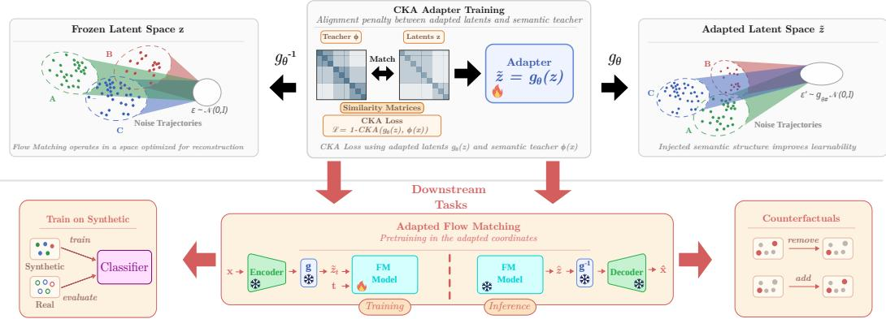
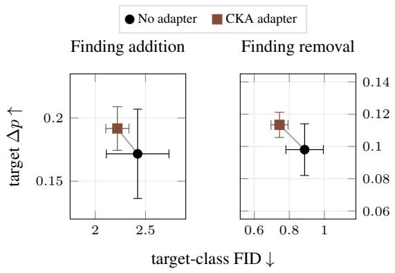
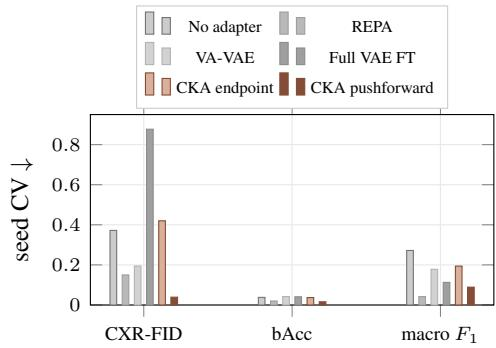
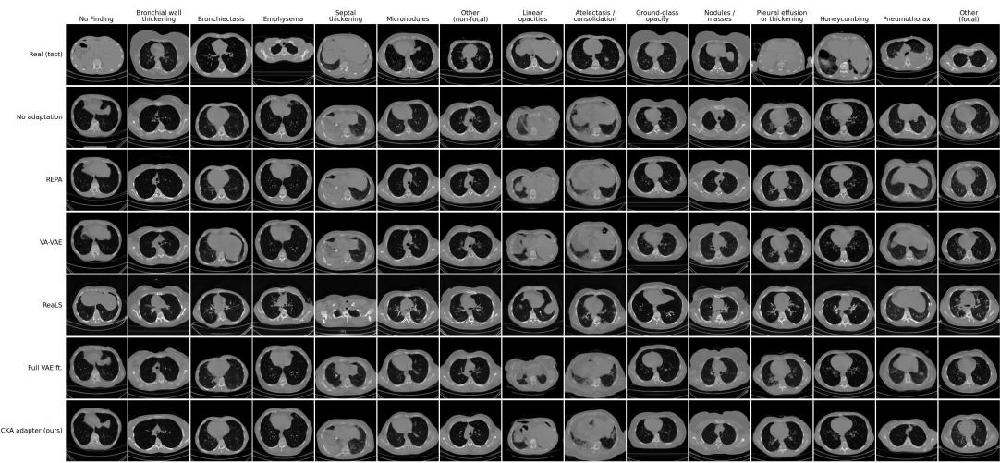
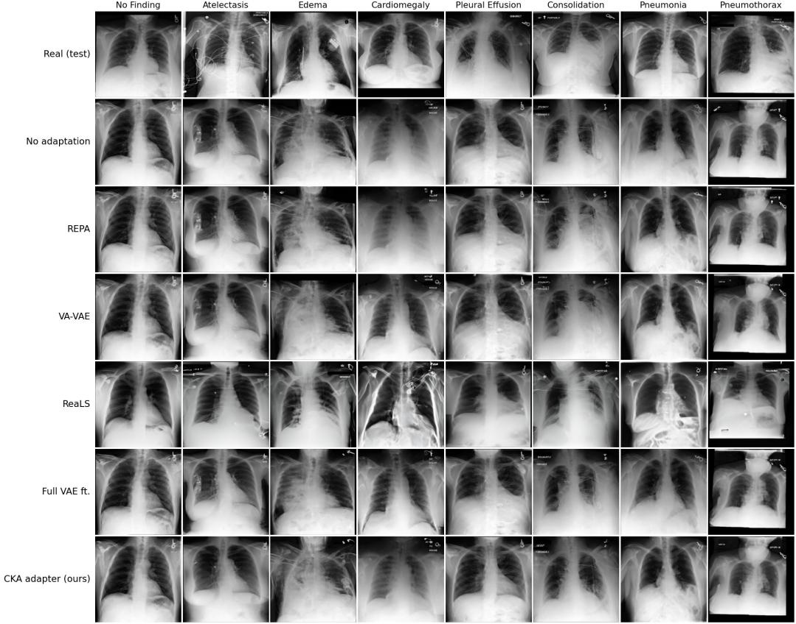

# SEMANTIC LATENT ALIGNMENT FOR FLOW MATCHING WITH INVERTIBLE BI-LIPSCHITZ ADAPTERS

Felix Nutzel¨ 1 Mischa Dombrowski1 Luca Hagen1 Bernhard Kainz1,2

1Friedrich-Alexander-Universitat Erlangen-N ¨ urnberg¨

2Imperial College London

## ABSTRACT

Pretrained latent spaces trade compression, reconstruction, and the learnability of the coordinates a downstream generator has to work in, which complicates adapting these spaces to different domains or tasks: continued training is expensive, and without a new alignment objective it often fails to improve downstream generation. We instead leave the encoder and decoder fixed and change only the coordinates between them, using an invertible bi-Lipschitz adapter aligned offline to a semantic teacher and frozen during class-conditional flow matching. Invertibility preserves compatibility with the pretrained autoencoder, while the bi-Lipschitz constraint limits how far alignment can distort its latent geometry. This provides a simple way to improve semantic organization while retaining the compression and reconstruction properties of the original latent space. On two medical imaging datasets, constrained latent adaptation improves feature metrics, seed stability and counterfactual edit strength, while remaining competitive on downstream classification. In contrast, unconstrained adaptation can become highly anisotropic and sensitive despite remaining invertible, highlighting the importance of controlling geometric distortion. Our results suggest that carefully constrained post-hoc adaptation offers a parameter-efficient and tuning-free alternative to jointly modifying the representation during generative training.

## 1 INTRODUCTION

Latent generative models, including latent diffusion (Rombach et al., 2022) and flow matching (Lipman et al., 2023), operate on compressed representations produced by pretrained variational autoencoders (VAEs) (Kingma & Welling, 2013). VAEs are typically optimized for a rate-distortion trade-off between compression and reconstruction fidelity (Alemi et al., 2018; Bozkurt et al., 2021). However, a representation that reconstructs well is not necessarily easy for a downstream model to learn (Skorokhodov et al., 2025; Zheng et al., 2026; Dombrowski et al., 2026). Latent representation design therefore involves a third axis: downstream learnability. We define learnability as the ease with which a bounded-capacity learner can recover task-relevant structure from a representation under the measurement process used by the downstream pipeline. It depends not only on which information the representation retains, but also on how that information is arranged (Yao et al., 2025; Black Forest Labs, 2025).

Fine-tuning the autoencoder can adapt the representation, but it also changes the decoder coordinates, requires a new latent cache, and adds a costly adaptation stage, with the adapted latents often still showing low learnability (Dombrowski et al., 2026). Meanwhile, methods such as REPA (Yu et al., 2025) align features inside the generative model during training. They improve the generator instead of the latent representation and repeat the alignment cost for each training run. We study a post-hoc alternative: adapt the latent coordinates once, then reuse them across flow-matching models.

We place a spatial invertible adapter between the frozen autoencoder and the generator. The adapter is trained offline on cached latents using features from a frozen semantic teacher. Flow matching consumes the adapted latents, while the adapter inverse returns generated samples to the coordinates expected by the pretrained decoder. Under exact inversion, the encoder-decoder reconstruction mapping remains unchanged. An unconstrained invertible map can still produce essentially collapsed latents, so we use a bi-Lipschitz design that bounds the distortion in both directions with a single scalar, estimated from the data.

  
Figure 1: Semantic latent adaptation. $T o p \mathrm { : }$ an invertible adapter $g _ { \theta }$ is trained offline on the cached latents z of a frozen autoencoder, maximizing the linear CKA between the similarity structure of the adapted latents $g _ { \boldsymbol { \theta } } ( z )$ and that of a frozen semantic teacher $\phi ( x )$ . The bi-Lipschitz constraint bounds how far this alignment can distort the original latent geometry, and $g _ { \theta } ^ { - 1 }$ returns exactly to the coordinates the decoder expects. Bottom: the adapter is then frozen, and flow matching is trained and sampled in the adapted space. The whole noise path is pushed through ${ \mathit { g } } _ { \theta } ,$ so the source distribution becomes $g _ { \theta \# } \mathcal { N } ( 0 , I )$ , and generated latents are mapped back by $g _ { \theta } ^ { - \daleth }$ before decoding. We evaluate the generators by training classifiers on synthetic data and by counterfactual edits that add or remove a finding.

For teacher alignment, we measure linear Centered Kernel Alignment (CKA) (Kornblith et al., 2019), which only compares the relative similarity matrices of the two spaces. This matters because the adapted latent and the teacher embedding have different, very high dimensionalities and no shared coordinate system. We evaluate generation on two medical imaging datasets, using sample quality, semantic coverage, train-on-synthetic utility and counterfactual generation. Comparisons include the unchanged latent space, online generator alignment, autoencoder adaptation, and less constrained invertible maps.

## Our contributions are:

1. We propose a post-hoc latent adapter that is invertible and bi-Lipschitz by construction, aligned offline to a semantic teacher via CKA and frozen during flow matching. It leaves the autoencoder and the flow-matching objective unchanged, while a single scalar λ bounds its distortion in both directions with a closed-form certificate.

2. We make the adapter tuning-free: λ can be estimated from a necessary condition on teacher triplets and the teacher from label geometry on training data, both fixed before any generator is trained. On both datasets the teacher choice agrees with the downstream results, and the method works across an eightfold range of λ.

3. On our tested datasets, the adapter is competitive with online generator alignment and autoencoder adaptation, has the lowest seed variance in domain FID among the adaptation methods, and produces stronger counterfactual edits, at 405× fewer parameters than REPA’s projection head and a fraction of the compute of autoencoder fine-tuning.

4. We show that invertibility alone is insufficient: invertible maps without Lipschitz control become nearly rank-deficient and fail as generators, and adapting only the clean endpoint instead of the whole flow path gives good but unreliable runs.

## 2 RELATED WORK

Prior work improves latent generation by modifying the encoder-decoder pair, aligning representations inside the generator, or transforming an existing latent space. We study the latter via the additional requirement that the transformation remains invertible and well-conditioned.

Semantic alignment for latent generation. To semantically align the latents, Yao et al. (2025) and Xu et al. (2025) train visual tokenizers with semantic priors in VA-VAE and ReaLS, while in EQ-VAE, the autoencoder is fine-tuned with an equivariance regularizer (Kouzelis et al., 2025). Meanwhile, other semantic alignment procedures leave the VAE unchanged. One prominent example is REPA, which aligns intermediate denoiser states with features from a frozen vision encoder during generator training (Yu et al., 2025). Singh et al. (2025) modify REPA to emphasize the spatial structure of the teacher features. Unlike prior alternatives, we leave both the VAEs and the flow matching objective untouched.

Invertible latent transformations. Invertible networks can be grouped into a few architectural families: coupling layers (Dinh et al., 2015; 2017; Kingma & Dhariwal, 2018), autoregressive maps (Kingma et al., 2016; Papamakarios et al., 2017), invertible residual blocks (Behrmann et al., 2019; Chen et al., 2019), and continuous-time flows (Grathwohl et al., 2019). Most are trained as normalizing flows, where invertibility is what makes the objective computable at all: maximum likelihood needs the change-of-variables term log | det $J | ,$ , so the map has to be invertible and its Jacobian determinant tractable. Applied to latents, this buys richer variational posteriors (Rezende & Mohamed, 2015; Kingma et al., 2016) or a density fitted to the codes of a pretrained autoencoder (Xiao et al., 2019; Bohm & Seljak, 2022). In each case the map transports one distribution onto¨ another.

In our case, the invertible map is used as a reversible change of latent coordinates and not as a density model. The adapter aligns encoded latents with a semantic teacher, while its inverse returns generated latents to the coordinates expected by the frozen decoder. Because the objective does not require unrestricted transport, we constrain the map to remain close to an isometry and limit the distortion of the pretrained latent geometry.

To this end, we construct the adapter from invertible residual blocks (Behrmann et al., 2019; Chen et al., 2019) with joint control of expansion and contraction. Related work certifies monotone residual layers with separate lower and upper Lipschitz bounds (Wang et al., 2024). Meanwhile, we tie them to expose a single distortion budget.

## 3 PROBLEM SETUP

Notation. We write $\| \cdot \|$ for the Euclidean norm. For a differentiable map $g : \mathbb { R } ^ { m }  \mathbb { R } ^ { m }$ we write $J _ { g } ( z )$ for its Jacobian at z and $\sigma _ { 1 } ( J _ { g } ( z ) ) \geq \dots \geq \sigma _ { m } ( J _ { g } ( z ) ) \geq 0$ for its singular values, with condition number $\kappa ( J _ { g } ( z ) ) = \sigma _ { 1 } / \sigma _ { m }$ when $\sigma _ { m } > 0$ . We reserve σ for singular values and write t for the flow-matching path parameter. The pushforward of a measure $p$ under a measurable map $g$ is $g _ { \# } p .$

Latents. Let $\mathcal { E } : \mathbb { R } ^ { H \times W \times 3 }  \mathbb { R } ^ { C \times h \times w }$ be a pretrained encoder and D its decoder. We identify the latent space $\mathcal { Z }$ with $\mathbb { R } ^ { m } , m = C h w .$ , under the Euclidean norm of the flattened tensor, and cache $\{ ( z _ { i } , y _ { i } ) \} _ { i = 1 } ^ { N }$ with $z _ { i } = \mathcal { E } ( x _ { i } )$ , with $y _ { i }$ being a single label.

Semantic teacher. A frozen image encoder ϕ supplies the semantic reference. Our adapter objective uses its global image embedding $\mathbf { \bar { \phi } } _ { \phi ( x ) } ^ { \mathbf { { \alpha } } } \in \mathbb { R } ^ { d }$ , a single vector per image, so it compares images as a whole. The spatial alignment baselines (REPA, VA-VAE, ReaLS) instead use the encoder’s patch grid $\phi ( \boldsymbol { x } ) \in \bar { \mathbb { R } ^ { d \times h ^ { \prime } \times w ^ { \prime } } }$ and match it to latent or hidden-state features location by location.

Bi-Lipschitz maps. A map $f : \mathbb { R } ^ { m }  \mathbb { R } ^ { m }$ is $( \mu , \nu )$ -bi-Lipschitz with $0 < \mu \le \nu$ if

$$
\mu \| x - y \| \leq \| f ( x ) - f ( y ) \| \leq \nu \| x - y \| \qquad \forall x , y \in \mathbb { R } ^ { m } .\tag{1}
$$

The lower bound makes $f$ injective, while the upper bound limits distortion. At $\mu = \nu = 1$ the map is an isometry, and it is a near-isometry when both sit close to 1. A differentiable $( \mu , \nu ) { \mathrm { - b i } }$ Lipschitz map satisfies $\sigma _ { m } ( J _ { f } ( z ) ) \geq \mu$ and $\sigma _ { 1 } ( J _ { f } ( z ) ) \leq \nu$ at every z. The converse holds for a $C ^ { 1 }$ diffeomorphism of $\mathbb { R } ^ { m }$ onto itself, where convexity of the domain lets one integrate the pointwise bounds along segments.

Centered kernel alignment. To compare latents and semantic embeddings, we use CKA. For n images, collect the adapted latents, each flattened to a vector by a map $P$ (Section 4.2), as rows of $\breve { X } \in \mathbb { R } ^ { n \times p } , X _ { i } = \dot { P ( g _ { \theta } ( z _ { i } ) ) }$ , and the teacher features as rows of ${ \boldsymbol { Y } } ^ { * } \in \mathbb { R } ^ { \dot { n } \times { q } } , { \boldsymbol { Y } } _ { i } = \phi ( { \boldsymbol { x } } _ { i } )$ , both column-centered. Their Gram matrices $K = X X ^ { \top }$ and $L = Y Y ^ { \top }$ hold one entry per pair of images: $K _ { i j }$ is how similar the adapter finds images i and $j ,$ , and $L _ { i j }$ is the teacher’s verdict on the same pair. Linear CKA is the cosine between these two similarity patterns,

$$
\begin{array} { r } { \mathrm { C K A } ( \boldsymbol { X } , \boldsymbol { Y } ) = \frac { \langle \boldsymbol { K } , \boldsymbol { L } \rangle _ { \mathrm { F } } } { \| \boldsymbol { K } \| _ { \mathrm { F } } \| \boldsymbol { L } \| _ { \mathrm { F } } } , \qquad \langle \boldsymbol { K } , \boldsymbol { L } \rangle _ { \mathrm { F } } = \sum _ { i , j } K _ { i j } L _ { i j } , } \end{array}\tag{2}
$$

reaching 1 when both spaces agree on every pair and 0 when the two patterns are unrelated.

Flow matching. Flow matching (Lipman et al., 2023; Liu et al., 2023) regresses a velocity field along a prescribed probability path. For FLUX-type models the interpolant is $z _ { t } = ( 1 - t ) z + t \varepsilon$ with $\varepsilon \sim \mathcal { N } ( 0 , I )$ and t drawn from a flow-match scheduler, so $t = 0$ recovers the clean latent, and the regression target is $\varepsilon - z$

## 4 METHOD

## 4.1 OVERVIEW

Our general approach is as specified in Figure 1: First, we train an invertible adapter $g _ { \theta }$ to semantically align the latent space with the embeddings of a teacher $\phi .$ . For flow matching training, frozen gθ adapts the cached original latents, while $\bar { g } _ { \theta } ^ { - 1 }$ carries generated latents back to the coordinates the decoder expects for inference:

$$
z = \mathcal { E } ( x ) , \qquad \tilde { z } = g _ { \boldsymbol { \theta } } ( z ) , \qquad x \approx \mathcal { D } ( g _ { \boldsymbol { \theta } } ^ { - 1 } ( \tilde { z } ) ) .\tag{3}
$$

The adapter leaves the latent dimensionality unchanged, and under exact inversion the autoencoder reconstruction mapping is identical to $\mathcal { D } \circ \mathcal { E }$ . The adapter is bi-Lipschitz in the sense of equation 1 with $\mu = e ^ { - \lambda }$ and $\nu = e ^ { \lambda }$ , so it may rotate, bend and rescale the latent space, and it may not stretch or collapse any distance by more than $e ^ { \lambda }$ . So, a single scalar λ specifies how far the geometry is allowed to move.

## 4.2 ALIGNING LATENTS WITH A TEACHER

The semantic alignment between the cached latents and the adapter $g _ { \theta }$ is achieved as follows: writing P for the map that turns the spatial latent tensor into one vector per image, the primary objective is

$$
\mathcal { L } _ { \mathrm { C K A } } = 1 - \mathrm { C K A } \big ( P ( g _ { \theta } ( z ) ) , \phi ( x ) \big ) .\tag{4}
$$

We use two choices of $P .$ Pool 0 flattens the full adapted latent $( C \times h \times w = 3 2 \times 6 4 \times 6 4$ , i.e. 131,072 dimensions), and pool 8 first average-pools it to an $8 \times 8$ grid (2,048 dimensions), which discards fine spatial detail before the comparison. Linear CKA compares centered Gram matrices, so it reads relational structure and ignores isotropic scale. The objective therefore targets relational structure rather than latent magnitude, which suits spaces without shared coordinates.

## 4.3 THE DISTORTION BUDGET

Invertibility on its own is not enough, since an invertible map without additional bounds can still deform the original space so that important structure is destroyed, which makes it effectively unusable. Our unconstrained controls exhibit this failure mode: their estimated largest singular values exceed 360 and their normalized participation ratios fall below 0.013 (Table 7).

Therefore, similarly to Wang et al. (2024), we build $g _ { \theta }$ from residual blocks interleaved with Cayleyparameterized orthogonal mixers. Each block is $B _ { i } ( x ) = c _ { i } x + r _ { i } ( c _ { i } x )$ with $c _ { i } = \cosh \lambda _ { i }$ and $\bar { \mathrm { L i p } } ( r _ { i } ) \leq \operatorname { t a n h } \lambda _ { i } < \bar { 1 }$ , where $r _ { i }$ is a small spatial convolution stack whose Lipschitz bound comes from rescaling each of its weights to a fixed norm. The constant is therefore closed form, and it holds at every training step without a separate certification pass. The contractive-residual argument of Behrmann et al. (2019) makes each block a bijection of $\bar { \mathbb { R } ^ { m } }$ with bounds $c _ { i } ( 1 \pm \operatorname { t a n h } \lambda _ { i } ) \stackrel { \smile } { = } e ^ { \pm \lambda _ { i } }$ and the orthogonal mixers are isometries, so the composition satisfies equation 1 with $\lambda = \sum _ { i } \lambda _ { i }$ and

$$
\mu = e ^ { - \lambda } , \qquad \nu = e ^ { \lambda } , \qquad \lambda \geq 0 .\tag{5}
$$

Consequently, raising λ buys larger contractions and expansions. Propositions 1 and 2 prove equation 5; Appendix A gives the architecture.

We take a closed-form bound instead of the tighter certificate of Wang et al. (2024) because of what the map has to do. It acts on a $C \times h \times$ w tensor, so the bound has to compose over convolutions. It is inverted once per generated sample inside the sampling loop, so the inverse has to be a plain fixed-point iteration. Additionally, the budget is a constraint we set to preserve important properties of the original latents, so the bound being conservative does not matter to us.

Choosing λ from the data. The budget has to be large enough for the adapter to reproduce the teacher’s own relative distances. For a triplet that the teacher orders, write $\rho _ { z } = d _ { z } ( i , j ) / d _ { z } ( i , k )$ for the ratio in latent space and $\rho _ { \phi } = d _ { \phi } ( i , j ) / d _ { \phi } ( i , k ) \le 1$ for the ratio the teacher assigns. Reaching the teacher’s margin on that triplet needs

$$
\begin{array} { r } { \lambda \ge \frac 1 2 \operatorname* { m a x } \bigl ( 0 , \log \rho _ { z } - \log \rho _ { \phi } \bigr ) , } \end{array}\tag{6}
$$

which is necessary locally per triplet. (Proposition 4 and Remark 5). Sampling 1,500 anchors with 20 teacher neighbours and 20 random candidates each, the 99th percentile of the right-hand side is roughly 0.5 for both datasets, with under 0.01 of movement across three sampling seeds. We adopt $\lambda = 0 . 5$ for both datasets, which covers 99.3% and 98.5% of sampled triplets and gives $\mu = 0 . 6 0 7$ and $\nu = 1 . 6 4 9$ . Section 5.5 sweeps $\lambda \in \{ 0 . 2 5 , 0 . 5 , 1 . 0 , 2 . 0 \}$ and shows that the method works across this range.

## 4.4 FLOW MATCHING IN THE ADAPTED COORDINATES

Once the adapter is frozen, the generator must choose how to incorporate it into its flow-matching path. To state the paths actually used in the experiments, let $h _ { \theta } = N \circ g _ { \theta }$ , where N is the fixed preprocessing of Section 5.1. This notation records the generator’s coordinates; N is not learned by our method and is not included in the adapter certificate. Write z for a clean latent, $\varepsilon \sim \mathcal { N } ( 0 , I )$ for Gaussian noise, and t for the path parameter of Section 3, with $t = 0$ clean and

$$
z _ { t } = ( 1 - t ) z + t \varepsilon .
$$

Our main construction is the pushforward path

$$
x _ { t } = h _ { \theta } ( z _ { t } ) , \quad u _ { t } = J _ { h _ { \theta } } ( z _ { t } ) ( \varepsilon - z ) ,\tag{7}
$$

which transports the entire reference path through the frozen adapter and fixed preprocessing. Its clean endpoint is therefore $h _ { \theta } ( z )$ , while its source is the pushed-forward Gaussian

$$
x _ { 1 } = h _ { \theta } ( \varepsilon ) , \qquad x _ { 1 } \sim h _ { \theta \# } \mathcal { N } ( 0 , I ) .
$$

Thus the source, target, and all intermediate states are expressed in the coordinates induced by $h _ { \theta }$ , and the corresponding velocity is obtained by a forward-mode Jacobian–vector product. Proposition 3 bounds the adapter’s contribution before the fixed preprocessing.

As an ablation, we also consider endpoint interpolation,

$$
x _ { t } = ( 1 - t ) h _ { \theta } ( z ) + t \varepsilon , ~ u _ { t } = \varepsilon - h _ { \theta } ( z ) ,\tag{8}
$$

which adapts only the clean endpoint while retaining the standard Gaussian source. Both define valid flow-matching objectives (Lipman et al., 2023) and share the same adapted target distribution at $t = 0$ , but they induce different source distributions, intermediate geometries, and regression targets (see Table 4 for an empirical comparison).

## 5 EXPERIMENTS

## 5.1 SETUP AND EVALUATION

Datasets. Our main dataset is a single-label filtered subset of MIMIC-CXR (Johnson et al., 2019), consisting of eight disease classes split between 66,586 train samples, 8,261 validation samples and 8,361 test samples. As alternative medical modality, we additionally report results for a single-label slices split of CT-RATE (Hamamci et al., 2026), consisting of 13,309 train samples, 2,229 validation samples and 6,767 test samples across 15 disease classes. Both datasets exhibit heavily long-tailed class distributions.

Metrics. On these datasets, we measure the sample quality using Frechet Inception Distance´ (FID) (Heusel et al., 2018) and the diversity via the Image Retrieval Score (IRS) (Dombrowski et al., 2025). We report these measures in independent domain-specific feature spaces and domainunspecific spaces, to capture both image realism and fidelity. The domain-specific extractors are a CheXNet-style DenseNet-121 classifier (Huang et al., 2017; Rajpurkar et al., 2017) for MIMIC-CXR and a DenseNet-121 classifier trained on the CT-RATE training split for CT-RATE. For general realism, we use DINOv2 features (Oquab et al., 2023).

For downstream utility, we train a DenseNet-121 on the synthetic images and evaluate it on the real test set (TSTR). Since the datasets are long-tailed, we report macro $\bar { F _ { 1 } }$ and balanced accuracy. For counterfactual edits, we use a TorchXRayVision (Cohen et al., 2022) DenseNet-121 as the oracle for edit strength. To measure minimality, we report LPIPS (Zhang et al., 2018) to the factual and the change of the non-targeted findings, and we measure target realism by the FID to real images of the target class.

Training & inference. We use FLUX.2 latents for training the models, since Dombrowski et al. (2026) showed that they exhibit the best overall learnability among the representations they tested. The adapters are trained for 200 epochs, which is a crude heuristic choice, since the loss usually saturates after only a couple of epochs. However, adapter matching is cheap: the adapter only consists of 36,871 parameters (about 405 times fewer than the REPA projection head), so even 200 epochs take less compute than the autoencoder-adaptation baselines, which fine-tune the full autoencoder for 5 (VA-VAE, full fine-tuning) or 10 (ReaLS) epochs. Before flow-matching training, every latent representation, including the unadapted baseline, is centered and scaled per channel to standard deviation 0.5 using statistics from its training cache. This fixed affine preprocessing is inverted before applying $g _ { \theta } ^ { - 1 }$ and decoding.

The FM models are trained on MIMIC-CXR for 10 flow-matching epochs, while CT-RATE uses 30 due to its lower number of samples. Each model is trained with seeds 0, 1 and 2, without classifier-free guidance. Every generator produces three seeded, class-balanced sets of 50,000 images per FM seed, which are used for the feature metrics and as TSTR training sets.

## 5.2 MAIN RESULTS

Table 1 compares the adapter with the unchanged latent space, online alignment with REPA, and three ways of adapting the autoencoder itself. No method is best on every column, but the adapter is the only one that ranks first or second on nearly all of them on both datasets. On CT-RATE it is best on all four feature metrics, lowering CT-FID from 20.23 to 15.46 and DINOv2 FID from 186.9 to 111.9, and it matches the best balanced accuracy. On MIMIC-CXR it is best in the DINOv2 feature space and second in the domain feature space, where VA-VAE leads, while REPA gives the strongest train-on-synthetic scores. Neither advantage carries over to CT-RATE, where VA-VAE no longer improves CT-FID over the unadapted model and REPA falls below it in macro $F _ { 1 }$ . Adapting the autoencoder is also the least reliable option: ReaLS degrades DINOv2 FID on both datasets, and ful fine-tuning diverged in one of three MIMIC-CXR runs.

On MIMIC-CXR, our adapter is also the most stable method: the SD of CXR-FID over flow-matching seeds is 0.69, against 7.50 without adaptation and about 2.9 for REPA and VA-VAE; for DINOv2 FID it is 0.84, against at least 6.90 for every other method. Figure 3 shows that the same holds relative to the mean, for sample quality as well as for the downstream metrics.

<table><tr><td></td><td colspan="2">FID↓</td><td colspan="2">IRS↑</td><td colspan="2">TSTR</td></tr><tr><td>Method</td><td>domain</td><td>DINOv2</td><td>domain</td><td>DINOv2</td><td></td><td>bAcc ↑ macro F1 ↑</td></tr><tr><td>MIMIC-CXR CXR-FID</td><td></td><td></td><td></td><td></td><td></td><td></td></tr><tr><td>No adaptation</td><td> $2 0 . 1 6 \pm 7 . 5 0$ </td><td> $2 8 . 0 9 \pm 1 3 . 7 4$ </td><td> $0 . 3 1 5 \pm . 1 0 3$ </td><td> $0 . 4 1 2 \pm . 1 1 5$ </td><td> $0 . 5 5 7 \pm . 0 2 1$ </td><td> $0 . 1 6 8 \pm . 0 4 6$ </td></tr><tr><td>REPA (Yu et al., 2025)</td><td> $1 9 . 3 4 \pm 2 . 9 0$ </td><td> $2 6 . 1 3 \pm 9 . 1 6$ </td><td> $0 . 3 3 1 \pm . 0 6 0$ </td><td> $0 . 4 3 0 \pm . 1 1 1$ </td><td> $\mathbf { 0 . 5 9 0 \bot . 0 1 2 }$ </td><td> $\mathbf { 0 . 2 3 3 \pm . 0 1 0 }$ </td></tr><tr><td>VA-VAE (Yao et al., 2025)</td><td> $\mathbf { 1 5 . 0 5 \pm } 2 . 9 2$ </td><td> $2 3 . 5 6 \pm 9 . 0 7$ </td><td> $\mathbf { 0 . 4 1 4 \pm . 0 6 3 }$ </td><td> $\underline { { 0 . 4 6 3 } } \pm . 0 8 9$ </td><td> $0 . 5 6 3 \pm . 0 2 4$ </td><td> $0 . 1 7 9 \pm . 0 3 2$ </td></tr><tr><td>ReaLS (Xu et al., 2025)</td><td> $1 9 . 0 5 \pm 1 . 3 5$ </td><td> $1 8 5 . 5 9 \pm 6 . 9 0$ </td><td> $0 . 2 0 7 \pm . 0 1 8$ </td><td> $0 . 1 2 1 \pm . 0 0 2$ </td><td> $0 . 5 4 4 \pm . 0 0 5$ </td><td> $0 . 0 9 4 \pm . 0 1 4$ </td></tr><tr><td>Full VAE fine-tuning</td><td> $3 9 . 3 2 \pm 3 4 . 4 9$ </td><td> $4 4 1 . 2 9 \pm 7 0 8 . 4 4$ </td><td> $0 . 2 3 9 \pm . 1 8 4$ </td><td> $0 . 2 6 2 \pm . 2 1 6$ </td><td> $\underline { { 0 . 5 7 0 } } \pm . 0 2 3$ </td><td> $\underline { { 0 . 2 1 0 } } \pm . 0 2 4$ </td></tr><tr><td>CKA adapter (ours)</td><td> $\underline { { 1 7 . 8 7 } } \pm . 6 9$ </td><td> $\mathbf { 2 2 . 2 7 \pm . 8 4 }$ </td><td> $\underline { { 0 . 3 5 3 } } \pm . 0 1 0$ </td><td> $\mathbf { 0 . 4 7 8 \pm . 0 1 0 }$ </td><td> $\underline { { 0 . 5 7 0 } } \pm . 0 0 9$ </td><td> $0 . 1 9 4 \pm . 0 1 7$ </td></tr><tr><td>CT-RATE CT-FID</td><td></td><td></td><td></td><td></td><td></td><td></td></tr><tr><td>No adaptation</td><td> $2 0 . 2 3 \pm . 1 6$ </td><td> $1 8 6 . 9 \pm 7 . 0$ </td><td> $0 . 8 6 5 \pm . 0 0 8$ </td><td> $0 . 5 5 8 \pm . 0 1 9$ </td><td> $\mathbf { 0 . 5 2 8 \pm . 0 1 1 }$ </td><td> $0 . 0 8 4 \pm . 0 1 3$ </td></tr><tr><td>REPA (Yu et al., 2025)</td><td> $2 0 . 1 5 \pm 3 . 5 9$ </td><td> $\underline { { 1 4 3 . 8 } } \pm 6 6 . 6$ </td><td> $\underline { { 0 . 8 6 5 } } \pm . 0 3 2$ </td><td> $\underline { { 0 . 6 7 0 } } \pm . 2 0 1$ </td><td> $\underline { { 0 . 5 2 6 } } \pm . 0 1 7$ </td><td> $0 . 0 7 1 \pm . 0 2 5$ </td></tr><tr><td>VA-VAE (Yao et al., 2025)</td><td> $2 0 . 6 7 \pm 6 . 1 9$ </td><td> $1 6 8 . 0 \pm 8 3 . 4$ </td><td> $0 . 8 6 3 { \scriptstyle \pm . 0 6 6 }$ </td><td> $0 . 6 3 6 \pm . 1 8 2$ </td><td> $\underline { { 0 . 5 2 6 } } \pm . 0 1 1$ </td><td> $\underline { { 0 . 0 8 7 } } \pm . 0 2 8$ </td></tr><tr><td>ReaLS (Xu et al., 2025)</td><td> $9 7 . 7 8 \pm 6 . 8 9$ </td><td> $3 5 9 . 3 \pm 3 6 . 0$ </td><td> $0 . 4 4 8 \pm . 0 1 2$ </td><td> $0 . 3 5 5 \pm . 0 4 8$ </td><td> $0 . 5 2 1 \pm . 0 0 5$ </td><td> $0 . 0 5 1 \pm . 0 0 9$ </td></tr><tr><td>Full VAE fine-tuning</td><td> $2 6 . 3 8 \pm 2 . 5 6$ </td><td> $2 4 5 . 7 \pm 2 0 . 7$ </td><td> $0 . 8 0 7 \pm . 0 1 8$ </td><td> $0 . 4 8 0 \pm . 0 3 9$ </td><td> $\underline { { 0 . 5 2 6 } } \pm . 0 0 8$ </td><td> $\mathbf { 0 . 0 9 2 \pm . 0 1 8 }$ </td></tr><tr><td>CKA adapter (ours)</td><td> $\mathbf { 1 5 . 4 6 \pm 1 . 3 8 }$ </td><td> $\mathbf { 1 1 1 . 9 \pm 3 9 . 2 }$ </td><td> $\mathbf { 0 . 8 9 0 \pm . 0 2 4 }$ </td><td> $\mathbf { 0 . 7 4 5 \pm . 0 9 4 }$ </td><td> $\mathbf { 0 . 5 2 8 \pm . 0 0 9 }$ </td><td> $0 . 0 8 6 \pm . 0 2 3$ </td></tr></table>

Table 1: Generation quality and train-on-synthetic (TSTR) utility. Domain FID uses CheXNet features against the training set on MIMIC-CXR and a CT-trained DenseNet-121 against the test set on CT-RATE, and the DINOv2 columns use ViT-B/14 features. IRS is the image retrieval score normalized by that of the real test set. TSTR trains a DenseNet-121 on 50,000 class-balanced synthetic images and evaluates it on the real test set. Mean and sample SD over three flow-matching seeds, with generation and classifier seeds averaged within each flow-matching seed; best in bold, second best underlined.
<table><tr><td>Intervention</td><td></td><td>∆p ↑ off-target ↓</td><td>LPIPS ↓</td><td>FID↓</td></tr><tr><td>Add: no adapter</td><td> $. 1 7 2 \pm . 0 3 5$ </td><td></td><td>.149 ±.028 .068 ±.013</td><td> $2 . 4 2 \pm . 3 1$ </td></tr><tr><td>Add: ours</td><td> $. 1 9 2 \pm . 0 1 7$ </td><td>.168 ±.012 .086 ±.010</td><td></td><td> $2 . 2 2 \pm . 1 2$ </td></tr><tr><td>Remove: no adapter .098 ±.016 .106 ±.016 .078 ±.014</td><td></td><td></td><td></td><td> $. 8 9 \pm . 1 1$ </td></tr><tr><td>Remove: ours</td><td></td><td></td><td>.113 ±.008 .121 ±.005 .097 ±.005</td><td>.74 ±.05</td></tr></table>

Table 2: Counterfactual edits on MIMIC-CXR under the TXRV oracle. Targetprobability change, mean absolute change of the other findings against an edit to the factual’s own class, LPIPS to the factual, and target-class FID in TXRV features; mean and sample SD over three flow-matching seeds. Our adapter makes a stronger, more targetrealistic, but less selective edit.

  
Figure 2: Effect and target realism of the edits in Table 2. Points show the means and bars one sample SD over three flow-matching seeds. The adapter increases target probability and lowers target-class FID in both directions.

## 5.3 COUNTERFACTUAL CONTROLLABILITY

To test counterfactual controllability, we generate counterfactuals following Sanchez & Tsaftaris (2022) and evaluate them following Monteiro et al. (2023): we invert the factual latent along the learned flow, integrate it back under the target class and decode the result. Table 2 scores two edits on MIMIC-CXR, adding a finding to a No Finding radiograph and removing the finding from a diseased one, with a TorchXRayVision classifier that shares no training with the generator or the teacher. The adapter makes, on average, the stronger edit in both directions, raising the target probability by 0.192 against 0.172 for addition and by 0.113 against 0.098 for removal, and its edits lie closer to real images of the target class (Figure 2). The stronger edit also changes more of the image, with slightly higher LPIPS and off-target movement, so the adapter trades some selectivity for edit strength. As in generation, its spread across flow-matching seeds is about half that of the baseline.

<table><tr><td>Teacher</td><td> $\mathrm { P o o l }$ </td><td>FID↓</td><td>IRS↑</td><td></td><td>bAcc ↑ macro F1 ↑</td></tr><tr><td>MII</td><td>8</td><td> $\mathbf { 1 4 . 1 3 \pm 2 . 0 0 }$ </td><td> ${ \bf 5 2 4 } \pm . 0 4 6$ </td><td> $. 5 6 7 \pm . 0 1 7$ </td><td>.183 ±.043</td></tr><tr><td>MedSigLIP</td><td>0</td><td> $1 8 . 0 0 \pm . 5 3 $ </td><td> $\underline { { 4 7 8 } } \pm . 0 2 1$ </td><td> $. 5 7 4 \pm . 0 1 6$ </td><td>.185 ±.028</td></tr><tr><td>MII</td><td>0</td><td> $\underline { { 1 7 . 8 7 \pm . 6 9 } }$  </td><td> $\underline { { 4 7 8 } } \pm . 0 1 0$ </td><td> $. 5 7 0 \pm . 0 0 9$ </td><td> $\mathbf { 1 9 4 \pm . 0 1 7 }$ </td></tr></table>

Table 3: Teacher and pooling ablation on MIMIC-CXR. MII is MedImageInsight (Codella et al., 2024); pool 0 applies CKA to the full flattened latent, pool 8 to the latent average-pooled to $8 \times 8 .$ . The configuration used everywhere else is shaded; best in bold, second best underlined; seeds aggregated as in Table 1 (MedSigLIP: generation seed 0 only). All rows use $\lambda = 0 . 5$ and the pushforward path.

  
Figure 3: Relative variability over three MIMIC-CXR FM seeds. Bars show sample SD divided by the mean. Pushforward has lower variability than endpoint, no adaptation, and both VAE baselines on all three metrics, while REPA has lower macro- $F _ { 1 }$ variability.

<table><tr><td>FM path</td><td>CXR-FID ↓ bAcc ↑</td><td></td><td> $F _ { 1 } \uparrow$ </td></tr><tr><td>Endpoint</td><td>15.94±6.69</td><td> $5 6 5 \pm . 0 2 1$ </td><td> $. 1 7 3 \pm . 0 3 4$ </td></tr><tr><td>Pushforward</td><td> $1 7 . 8 7 \pm . 6 9$ </td><td> ${ \bf 5 7 0 } \pm . 0 0 9$ </td><td> $\mathbf { 1 9 4 \pm . 0 1 7 }$ </td></tr></table>

Table 4: Flow-matching path on MIMIC-CXR. The same frozen adapter, three flowmatching seeds (endpoint: generation seed 0 only).

<table><tr><td> $\lambda$ </td><td>certified  $[ \mu , \nu ]$ </td><td>FID↓</td><td>IRS ↑</td><td> $F _ { 1 } \uparrow$ </td></tr><tr><td>0.25</td><td>[.779, 1.284]</td><td>11.45</td><td>.518</td><td>.189</td></tr><tr><td>1.00</td><td>[.368, 2.718]</td><td>17.22</td><td>.477</td><td>.137</td></tr><tr><td>2.00</td><td>[.135, 7.389]</td><td>16.48</td><td>.483</td><td>.173</td></tr><tr><td>0.50</td><td>[.607, 1.649]</td><td>12.48</td><td>.570</td><td>.123</td></tr></table>

Table 5: Distortion budget on MIMIC-CXR. Med-ImageInsight, pool 8, flow-matching and generation seed 0. $\lambda = 0 . 5$ was fixed before the sweep.

## 5.4 TEACHER SELECTION

The teacher decides which semantic structure the adapter imposes, so we fixed it before training any generator, from training data alone (Appendix C.1, Table 9). MedImageInsight leads narrowly on MIMIC-CXR and MedSigLIP leads clearly on CT-RATE. The generators follow the size of these margins. On MIMIC-CXR, exchanging MedImageInsight for MedSigLIP keeps every column of Table 3 within one seed SD. On CT-RATE, training against MedImageInsight instead (generation seed 0) raises CT-FID from 15.46 to 19.13 and roughly halves macro $\breve { F } _ { 1 }$ , from 0.086 to 0.046. Pooling the adapted latent to $8 \times 8$ before the CKA lowers the mean CXR-FID to 14.13, but at three times the seed spread, a trade-off that recurs for the endpoint path below.

## 5.5 ABLATIONS & ANALYSIS

Flow-matching path. Endpoint interpolation reaches a lower mean CXR-FID than the pushforward path, but its SD over flow-matching seeds is nearly ten times larger, and it is lower on both downstream columns (Table 4). Keeping the source and every intermediate state in adapted coordinates is what makes the result repeatable, so we use the pushforward path throughout.

Distortion budget & Inversion Cost. Table 5 sweeps λ around the value estimated in Section 4.3. Every budget from 0.25 to 2 yields comparable results, with CXR-FID between 11.45 and 17.22 and no trend in the downstream scores beyond the seed spread of Table 1. The budget therefore needs no tuning beyond the triplet estimate. Inverting the adapter costs 0.69 ms per sample (0.075% of generation) at a round-trip error of $4 . 3 \times 1 0 ^ { - 6 }$ (Table 8).

<table><tr><td>Map</td><td>conditioner</td><td>FID↓</td><td>IRS↑</td><td>bAcc ↑</td><td> $F _ { 1 }$  ←</td></tr><tr><td>Additive</td><td>controlled</td><td>19.63</td><td>.415</td><td>.582</td><td>.210</td></tr><tr><td>Affine</td><td>controlled</td><td>17.13</td><td>.477</td><td>.576</td><td>.210</td></tr><tr><td>RQ spline</td><td>controlled</td><td>113.98</td><td>.006</td><td>.520</td><td>.113</td></tr><tr><td>Additive</td><td>free</td><td>102.38</td><td>.005</td><td>.524</td><td>.124</td></tr><tr><td>Affine</td><td>free</td><td>58.83</td><td>.031</td><td>.508</td><td>.031</td></tr><tr><td>RQ spline</td><td>free</td><td>724.44</td><td>.000</td><td>.503</td><td>.029</td></tr><tr><td>Residual</td><td>certified</td><td>18.33</td><td>.464</td><td>.572</td><td>.202</td></tr></table>

<table><tr><td>Map</td><td>bound</td><td> $\hat { \sigma } _ { \mathrm { m a x } }$ </td><td>PR</td></tr><tr><td>Certified residual</td><td>[.607, 1.649] 1.042–1.056 .9997</td><td></td><td></td></tr><tr><td>Affine coupling, free</td><td>none</td><td>363.2</td><td>.0076</td></tr><tr><td>Free residual</td><td>none</td><td>1473.9</td><td>.0121</td></tr></table>

Table 6: Adapter family on MIMIC-CXR with the clean-only objective. At flow-matching and generation seed 0 with three classifier seeds. We use invertible residual blocks (Behrmann et al., 2019; Chen et al., 2019), additive coupling (Dinh et al., 2015), affine coupling (Dinh et al., 2017; Kingma & Dhariwal, 2018), and rational-quadratic splines (Durkan et al., 2019).  
Table 7: Local Jacobian diagnostics on eight validation anchors. Only the certified residual has an analytic two-sided bound.
<table><tr><td>Measurement</td><td>Value</td></tr><tr><td>Forward</td><td>0.40 ms</td></tr><tr><td>Inverse</td><td>0.69 ms</td></tr><tr><td>Round-trip error</td><td> $4 . 3 \times 1 0 ^ { - 6 }$ </td></tr><tr><td>Share of generation</td><td>0.075%</td></tr></table>

Table 8: Per-sample adapter cost and numerical inversion error.

Adapter family. Table 6 replaces our residual adapter with coupling flows. Couplings whose conditioner is norm-controlled perform on par with it, while the same couplings with a free conditioner fail as generators, with CXR-FID between 58.8 and 724.4 and IRS near zero, although they remain invertible. Table 7 gives context for this: the free maps stretch some directions by more than 360 and are close to rank-deficient, whereas the certified adapter stretches no direction by more than 6%. Controlled couplings therefore work as well, but only the residual adapter carries a certificate for the full map.

## 6 DISCUSSION

The results show that a small, frozen change of coordinates is competitive with methods that retrain the autoencoder or alter generator training, while being more stable across seeds than the other adaptation methods. Three properties make our approach practical: it has a single hyperparameter with a direct meaning, the distortion budget λ, which can be estimated from the data before training and which works across an eightfold range. The teacher can likewise be chosen from training data alone, and on both datasets this choice agreed with the downstream results. Finally, the adapter is cheap: it is fitted once in a few GPU-hours, reused by every flow-matching run and inverted in under a millisecond, and it leaves the autoencoder and the flow-matching loss untouched. The ablations indicate where the stability comes from. Invertibility alone is not enough, since invertible maps without Lipschitz control become nearly rank-deficient and fail as generators, and adapting only the clean endpoint gives good but unreliable runs. Bounding the distortion in both directions and keeping the whole path in the adapted coordinates makes the gains repeatable.

Limitations. We implemented the autoencoder-adaptation baselines with a medical teacher and their recommended settings, but more tuning could strengthen some of them, although needing it is itself a cost that can be avoided with our method. The adapter can only impose structure that its teacher carries, so it depends on a teacher with a good label geometry for the target domain, as the CT-RATE teacher comparison shows. Finally, the stronger counterfactual edits come with slightly larger off-target changes, so the adapter mainly improves edit strength.

## 7 CONCLUSION

We introduced an invertible bi-Lipschitz adapter that aligns pretrained latents with a semantic teacher offline and stays frozen during flow matching. On MIMIC-CXR and CT-RATE, it is competitive with generator alignment and autoencoder adaptation, more stable across seeds, and a small fraction of their cost. Its only hyperparameter can be estimated from the data, and its teacher can be selected before any generator is trained. Constrained post-hoc adaptation therefore offers a simple way to make a fixed latent space easier to learn, without retraining the autoencoder or changing the generative objective.

## ACKNOWLEDGMENTS

The authors gratefully acknowledge the scientific support and HPC resources provided by the Erlangen National High Performance Computing Center (NHR@FAU) of the Friedrich-Alexander-Universitat¨ Erlangen-Nurnberg (FAU) under the NHR project b180dc. NHR funding is provided by federal¨ and Bavarian state authorities. NHR@FAU hardware is partially funded by the German Research Foundation (DFG) – 440719683.

## REPRODUCIBILITY STATEMENT

In Section 5.1, we detail the main setup needed to reproduce our results. Additionally, we provide our code in the supplementary material, with scripts to conveniently reproduce our environment and results, as well as tables used in this paper. The specific details behind our architecture is detailed in Appendix A. Claims made in the main paper are supported by proofs in Appendix B.

## REFERENCES

Alexander Alemi, Ben Poole, Ian Fischer, Joshua Dillon, Rif A. Saurous, and Kevin Murphy. Fixing a broken ELBO. In Jennifer Dy and Andreas Krause (eds.), Proceedings ofthe 35th International Conference on Machine Learning, volume 80 of Proceedings of Machine Learning Research, pp. 159–168. PMLR, 10–15 Jul 2018. URL https://proceedings.mlr.press/v80/ alemi18a.html.

Jens Behrmann, Will Grathwohl, Ricky T. Q. Chen, David Duvenaud, and Joern-Henrik Jacobsen. Invertible residual networks. In Kamalika Chaudhuri and Ruslan Salakhutdinov (eds.), Proceedings ofthe 36th International Conference on Machine Learning, volume 97 of Proceedings ofMachine Learning Research, pp. 573–582. PMLR, 09–15 Jun 2019. URL https://proceedings. mlr.press/v97/behrmann19a.html.

Black Forest Labs. Representation comparison. https://bfl.ai/research/ representation-comparison, 2025. Accessed: 2026-09-15.

Vanessa Bohm and Uro¨ s Seljak. Probabilistic autoencoder.ˇ Transactions on Machine Learning Research, 2022. doi: 10.48550/ARXIV.2006.05479. URL https://openreview.net/ forum?id=AEoYjvjKVA.

Alican Bozkurt, Babak Esmaeili, Jean-Baptiste Tristan, Dana Brooks, Jennifer Dy, and Jan-Willem van de Meent. Rate-regularization and generalization in variational autoencoders. In Arindam Banerjee and Kenji Fukumizu (eds.), Proceedings ofThe 24th International Conference on Artificial Intelligence and Statistics, volume 130 of Proceedings of Machine Learning Research, pp. 3880–3888. PMLR, 13–15 Apr 2021. URL https://proceedings.mlr.press/v130/ bozkurt21a.html.

Ricky T. Q. Chen, Jens Behrmann, David Kristjanson Duvenaud, and Jorn-Henrik Jacobsen. Residual¨ flows for invertible generative modeling. ArXiv, abs/1906.02735, 2019. URL https://api. semanticscholar.org/CorpusID:174801267.

Noel C. F. Codella, Ying Jin, Shrey Jain, Yu Gu, Ho Hin Lee, Asma Ben Abacha, Alberto Santamaria-Pang, Will Guyman, Naiteek Sangani, Sheng Zhang, Hoifung Poon, Stephanie Hyland, Shruthi Bannur, Javier Alvarez-Valle, Xue Li, John Garrett, Alan McMillan, Gaurav Rajguru, Madhu Maddi, Nilesh Vijayrania, Rehaan Bhimai, Nick Mecklenburg, Rupal Jain, Daniel Holstein, Naveen Gaur, Vijay Aski, Jenq-Neng Hwang, Thomas Lin, Ivan Tarapov, Matthew Lungren, and Mu Wei. Medimageinsight: An open-source embedding model for general domain medical imaging, 2024. URL https://arxiv.org/abs/2410.06542.

Joseph Paul Cohen, Joseph D. Viviano, Paul Bertin, Paul Morrison, Parsa Torabian, Matteo Guarrera, Matthew P Lungren, Akshay Chaudhari, Rupert Brooks, Mohammad Hashir, and Hadrien Bertrand.

TorchXRayVision: A library of chest X-ray datasets and models. In Medical Imaging with Deep Learning, 2022. URL https://github.com/mlmed/torchxrayvision.

Corentin Dancette, Julien Khlaut, Antoine Saporta, Helene Philippe, Elodie Ferreres, Baptiste Callard, Theo Danielou, L ´ eo Alberge, L ´ eo Machado, Daniel Tordjman, et al. Curia: A multi-modal´ foundation model for radiology. arXiv preprint arXiv:2509.06830, 2025.

Laurent Dinh, David Krueger, and Yoshua Bengio. Nice: Non-linear independent components estimation, 2015. URL https://arxiv.org/abs/1410.8516.

Laurent Dinh, Jascha Sohl-Dickstein, and Samy Bengio. Density estimation using real NVP. In International Conference on Learning Representations, 2017. URL https://openreview. net/forum?id=HkpbnH9lx.

Mischa Dombrowski, Weitong Zhang, Sarah Cechnicka, Hadrien Reynaud, and Bernhard Kainz. Image generation diversity issues and how to tame them. In Proceedings of the IEEE/CVF Conference on Computer Vision and Pattern Recognition (CVPR), pp. 3029–3039, June 2025.

Mischa Dombrowski, Felix Nutzel, and Bernhard Kainz. The learnability gap in medical latent ¨ diffusion, 2026. URL https://arxiv.org/abs/2605.17087.

Conor Durkan, Artur Bekasov, Iain Murray, and George Papamakarios. Neural spline flows. In H. Wallach, H. Larochelle, A. Beygelzimer, F. d'Alche-Buc, E. Fox, and R. Gar-´ nett (eds.), Advances in Neural Information Processing Systems, volume 32. Curran Associates, Inc., 2019. URL https://proceedings.neurips.cc/paper\_files/paper/ 2019/file/7ac71d433f282034e088473244df8c02-Paper.pdf.

Will Grathwohl, Ricky T. Q. Chen, Jesse Bettencourt, and David Duvenaud. Scalable reversible generative models with free-form continuous dynamics. In International Conference on Learning Representations, 2019. URL https://openreview.net/forum?id=rJxgknCcK7.

Ibrahim Ethem Hamamci, Sezgin Er, Chenyu Wang, Furkan Almas, Ayse Gulnihan Simsek, Sevval Nil Esirgun, Irem Dogan, Omer Faruk Durugol, Benjamin Hou, Suprosanna Shit, et al. Generalist foundation models from a multimodal dataset for 3d computed tomography. Nature Biomedical Engineering, pp. 1–19, 2026.

Martin Heusel, Hubert Ramsauer, Thomas Unterthiner, Bernhard Nessler, and Sepp Hochreiter. Gans trained by a two time-scale update rule converge to a local nash equilibrium, 2018. URL https://arxiv.org/abs/1706.08500.

Gao Huang, Zhuang Liu, Laurens van der Maaten, and Kilian Q. Weinberger. Densely connected convolutional networks. In Proceedings ofthe IEEE Conference on Computer Vision and Pattern Recognition (CVPR), July 2017.

Alistair E. W. Johnson, Tom J. Pollard, Seth J. Berkowitz, Nathan R. Greenbaum, Matthew P. Lungren, Catherine Y. Deng, Roger G. Mark, and Steven Horng. Mimic-cxr, a de-identified publicly available database of chest radiographs with free-text reports. Scientific Data, 6(1):317, 2019. doi: 10.1038/s41597-019-0322-0.

Diederik P. Kingma and Max Welling. Auto-encoding variational bayes. CoRR, abs/1312.6114, 2013. URL https://api.semanticscholar.org/CorpusID:216078090.

Diederik P. Kingma, Tim Salimans, and Max Welling. Improved variational inference with inverse autoregressive flow. ArXiv, abs/1606.04934, 2016. URL https://api.semanticscholar. org/CorpusID:11514441.

Durk P Kingma and Prafulla Dhariwal. Glow: Generative flow with invertible 1x1 convolutions. In S. Bengio, H. Wallach, H. Larochelle, K. Grauman, N. Cesa-Bianchi, and R. Garnett (eds.), Advances in Neural Information Processing Systems, volume 31. Curran Associates, Inc., 2018. URL https://proceedings.neurips.cc/paper\_files/paper/ 2018/file/d139db6a236200b21cc7f752979132d0-Paper.pdf.

Simon Kornblith, Mohammad Norouzi, Honglak Lee, and Geoffrey Hinton. Similarity of neural network representations revisited. In Kamalika Chaudhuri and Ruslan Salakhutdinov (eds.), Proceedings ofthe 36th International Conference on Machine Learning, volume 97 of Proceedings of Machine Learning Research, pp. 3519–3529. PMLR, 09–15 Jun 2019. URL https:// proceedings.mlr.press/v97/kornblith19a.html.

Theodoros Kouzelis, Ioannis Kakogeorgiou, Spyros Gidaris, and Nikos Komodakis. EQ-VAE: Equivariance regularized latent space for improved generative image modeling. In Forty-second International Conference on Machine Learning, 2025. URL https://openreview.net/ forum?id=UWhW5YYLo6.

Yuheng Li, Yuan Gao, Haoyu Dong, Yuxiang Lai, Shansong Wang, Mojtaba Safari, James E. Baciak, and Xiaofeng Yang. Universal ct representations from anatomy to disease phenotype through agglomerative pretraining, 2026. URL https://arxiv.org/abs/2605.21906.

Yaron Lipman, Ricky T. Q. Chen, Heli Ben-Hamu, Maximilian Nickel, and Matthew Le. Flow matching for generative modeling. In The Eleventh International Conference on Learning Representations, 2023. URL https://openreview.net/forum?id=PqvMRDCJT9t.

Xingchao Liu, Chengyue Gong, and qiang liu. Flow straight and fast: Learning to generate and transfer data with rectified flow. In The Eleventh International Conference on Learning Representations, 2023. URL https://openreview.net/forum?id=XVjTT1nw5z.

Miguel Monteiro, Fabio De Sousa Ribeiro, Nick Pawlowski, Daniel C. Castro, and Ben Glocker. Measuring axiomatic soundness of counterfactual image models. In The Eleventh International Conference on Learning Representations, 2023. URL https://openreview.net/forum? id=lZOUQQvwI3q.

Maxime Oquab, Timothee Darcet, Theo Moutakanni, Huy V. Vo, Marc Szafraniec, Vasil Khalidov,´ Pierre Fernandez, Daniel Haziza, Francisco Massa, Alaaeldin El-Nouby, Russell Howes, Po-Yao Huang, Hu Xu, Vasu Sharma, Shang-Wen Li, Wojciech Galuba, Mike Rabbat, Mido Assran, Nicolas Ballas, Gabriel Synnaeve, Ishan Misra, Herve Jegou, Julien Mairal, Patrick Labatut, Armand Joulin, and Piotr Bojanowski. Dinov2: Learning robust visual features without supervision, 2023.

George Papamakarios, Theo Pavlakou, and Iain Murray. Masked autoregressive flow for density estimation. In I. Guyon, U. Von Luxburg, S. Bengio, H. Wallach, R. Fergus, S. Vishwanathan, and R. Garnett (eds.), Advances in Neural Information Processing Systems, volume 30. Curran Associates, Inc., 2017. URL https://proceedings.neurips.cc/paper\_files/paper/ 2017/file/6c1da886822c67822bcf3679d04369fa-Paper.pdf.

Pranav Rajpurkar, Jeremy Irvin, Kaylie Zhu, Brandon Yang, Hershel Mehta, Tony Duan, Daisy Ding, Aarti Bagul, Curtis Langlotz, Katie Shpanskaya, Matthew P. Lungren, and Andrew Y. Ng. Chexnet: Radiologist-level pneumonia detection on chest x-rays with deep learning, 2017. URL https://arxiv.org/abs/1711.05225.

Danilo Rezende and Shakir Mohamed. Variational inference with normalizing flows. In Francis Bach and David Blei (eds.), Proceedings ofthe 32nd International Conference on Machine Learning, volume 37 of Proceedings ofMachine Learning Research, pp. 1530–1538, Lille, France, 07–09 Jul 2015. PMLR. URL https://proceedings.mlr.press/v37/rezende15.html.

Robin Rombach, Andreas Blattmann, Dominik Lorenz, Patrick Esser, and Bjorn Ommer. High-¨ resolution image synthesis with latent diffusion models. In Proceedings of the IEEE/CVF Conference on Computer Vision and Pattern Recognition (CVPR), pp. 10684–10695, June 2022.

Pedro Sanchez and Sotirios A. Tsaftaris. Diffusion causal models for counterfactual estimation. In Bernhard Scholkopf, Caroline Uhler, and Kun Zhang (eds.), ¨ Proceedings of the First Conference on Causal Learning and Reasoning, volume 177 of Proceedings of Machine Learning Research, pp. 647–668. PMLR, 11–13 Apr 2022. URL https://proceedings.mlr.press/v177/ sanchez22a.html.

Andrew Sellergren, Sahar Kazemzadeh, Tiam Jaroensri, Atilla Kiraly, Madeleine Traverse, Timo Kohlberger, Shawn Xu, Fayaz Jamil, C´ıan Hughes, Charles Lau, Justin Chen, Fereshteh Mahvar, Liron Yatziv, Tiffany Chen, Bram Sterling, Stefanie Anna Baby, Susanna Maria Baby, Jeremy Lai, Samuel Schmidgall, Lu Yang, Kejia Chen, Per Bjornsson, Shashir Reddy, Ryan Brush, Kenneth Philbrick, Mercy Asiedu, Ines Mezerreg, Howard Hu, Howard Yang, Richa Tiwari, Sunny Jansen, Preeti Singh, Yun Liu, Shekoofeh Azizi, Aishwarya Kamath, Johan Ferret, Shreya Pathak, Nino Vieillard, Ramona Merhej, Sarah Perrin, Tatiana Matejovicova, Alexandre Rame, Morgane Riviere,´ Louis Rouillard, Thomas Mesnard, Geoffrey Cideron, Jean bastien Grill, Sabela Ramos, Edouard Yvinec, Michelle Casbon, Elena Buchatskaya, Jean-Baptiste Alayrac, Dmitry Lepikhin, Vlad Feinberg, Sebastian Borgeaud, Alek Andreev, Cassidy Hardin, Robert Dadashi, Leonard Hussenot,´ Armand Joulin, Olivier Bachem, Yossi Matias, Katherine Chou, Avinatan Hassidim, Kavi Goel, Clement Farabet, Joelle Barral, Tris Warkentin, Jonathon Shlens, David Fleet, Victor Cotruta, Omar Sanseviero, Gus Martins, Phoebe Kirk, Anand Rao, Shravya Shetty, David F. Steiner, Can Kirmizibayrak, Rory Pilgrim, Daniel Golden, and Lin Yang. Medgemma technical report, 2026. URL https://arxiv.org/abs/2507.05201.

Jaskirat Singh, Xingjian Leng, Zongze Wu, Liang Zheng, Richard Zhang, Eli Shechtman, and Saining Xie. What matters for representation alignment: Global information or spatial structure? arXiv preprint arXiv:2512.10794, 2025.

Ivan Skorokhodov, Sharath Girish, Benran Hu, Willi Menapace, Yanyu Li, Rameen Abdal, Sergey Tulyakov, and Aliaksandr Siarohin. Improving the diffusability of autoencoders. In Forty-second International Conference on Machine Learning, 2025. URL https://openreview.net/ forum?id=2hEDcA7xy4.

Ruigang Wang, Krishnamurthy Dj Dvijotham, and Ian Manchester. Monotone, bi-lipschitz, and polyak-Łojasiewicz networks. In Ruslan Salakhutdinov, Zico Kolter, Katherine Heller, Adrian Weller, Nuria Oliver, Jonathan Scarlett, and Felix Berkenkamp (eds.), Proceedings of the 41st International Conference on Machine Learning, volume 235 of Proceedings ofMachine Learning Research, pp. 50379–50399. PMLR, 21–27 Jul 2024. URL https://proceedings.mlr. press/v235/wang24p.html.

Zhisheng Xiao, Qing Yan, and Yali Amit. Generative latent flow. arXiv: Computer Vision and Pattern Recognition, 2019. URL https://api.semanticscholar.org/CorpusID: 203702623.

Wanghan Xu, Xiaoyu Yue, Zidong Wang, Yao Teng, Wenlong Zhang, Xihui Liu, Luping Zhou, Wanli Ouyang, and Lei Bai. Exploring representation-aligned latent space for better generation. arXiv preprint arXiv:2502.00359, 2025.

Jingfeng Yao, Bin Yang, and Xinggang Wang. Reconstruction vs. generation: Taming optimization dilemma in latent diffusion models. 2025 IEEE/CVF Conference on Computer Vision and Pattern Recognition (CVPR), pp. 15703–15712, 2025. URL https://api.semanticscholar. org/CorpusID:275211938.

Sihyun Yu, Sangkyung Kwak, Huiwon Jang, Jongheon Jeong, Jonathan Huang, Jinwoo Shin, and Saining Xie. Representation alignment for generation: Training diffusion transformers is easier than you think. In International Conference on Learning Representations, 2025.

Richard Zhang, Phillip Isola, Alexei A Efros, Eli Shechtman, and Oliver Wang. The unreasonable effectiveness of deep features as a perceptual metric. In CVPR, 2018.

Wentao Zhang, Yutong Zhang, Yuxin Zheng, and Wentao Mo. A general framework for activation function optimization based on mollification theory. Mathematics, 14(1), 2026. ISSN 2227-7390. doi: 10.3390/math14010072. URL https://www.mdpi.com/2227-7390/14/1/72.

Boyang Zheng, Nanye Ma, Shengbang Tong, and Saining Xie. Diffusion transformers with representation autoencoders. In The Fourteenth International Conference on Learning Representations, 2026. URL https://openreview.net/forum?id=0u1LigJaab.

## A ADAPTER CONSTRUCTION

Per-layer constants. Each residual branch $( r _ { i } )$ consists of $( 1 \times 1 )$ pointwise and $\left( 3 \times 3 \right)$ depthwise convolutions interleaved with SiLU activations. For pointwise convolutions, we rescale each weight matrix to a fixed Frobenius norm, which upper bounds its spectral norm. For depthwise convolutions, we rescale each kernel to a fixed $( \ell _ { 1 } )$ norm, which upper bounds the induced convolution operator norm by Young’s inequality. Let $( L _ { \mathrm { S i L U } } \approx 1 . 1 )$ denote the Lipschitz constant of SiLU (Zhang et al., 2026). We normalize every hidden convolution to have operator norm at most $( 1 / L _ { \mathrm { S i L U } } ) ;$ consequently, the composition of each hidden convolution with its subsequent SiLU activation is (1)-Lipschitz. The output convolution is instead normalized to have operator norm at most (tanh $\lambda _ { i } )$ Multiplying these per-layer bounds therefore gives $\mathrm { L i p } ( r _ { i } ) \leq$ tanh $\lambda _ { i }$ . This bound is enforced directly through the weight normalizations, requires no power iteration, and holds both at initialization and after every parameter update.

Bijectivity of Rm. The singular-value characterization in Section 3 requires a diffeomorphism of $\mathbb { R } ^ { \breve { m } }$ onto ${ \dot { \mathbb { R } } } ^ { m }$ , not onto its image, so injectivity alone is not enough. Contraction supplies the rest. For any target y the map $u \mapsto y - r _ { i } ( u )$ contracts $\mathbb { R } ^ { m }$ with factor tanh $\lambda _ { i } < 1$ , so the Banach fixed-point theorem gives a unique u with $u + r _ { i } ( u ) = y$ , and $x = u / c _ { i }$ solves $B _ { i } ( x ) = y$ . Every block is therefore a bijection of $\mathbb { R } ^ { m }$ onto itself. The Cayley-parameterized mixers are orthogonal and hence isometries of $\mathbb { R } ^ { m }$ onto itself, so the composition inherits both invertibility and surjectivity.

Numerical inversion. We invert each block by the fixed-point iteration $b \gets y - s r _ { i } ( b )$ implied by the same contraction, capped at 50 steps with a tolerance of $1 0 ^ { - 6 }$ , where s is the block’s gate. Table 8 gives the realized round-trip error and the per-sample latency.

## B PROOFS

Each statement below is used in Section 4 and proved here. Throughout, $g _ { \theta }$ is the adapter of Section 4.3.

## B.1 THE BUDGET OF THE COMPOSED ADAPTER

Proposition 1 (Block bounds). Let $\boldsymbol B ( \boldsymbol x ) = c \boldsymbol x + \boldsymbol r ( c \boldsymbol x )$ with $c > 0$ and $\mathrm { L i p } ( r ) \leq \gamma < 1$ . Then B is $\left( c ( 1 - \gamma ) , c ( 1 + \gamma ) \right) - b i - L i p s c h$ itz. Taking c = cosh λ and γ = tanh λ gives B the bounds $( e ^ { - \lambda } , e ^ { \lambda } )$ .

Proof. Write $u = c x$ and $v = c y$ , so $B ( x ) - B ( y ) = ( u - v ) + \bigl ( r ( u ) - r ( v ) \bigr )$ . The triangle inequality and $\mathrm { L i p } ( r ) \leq \gamma { \mathrm { g i v e } }$

$$
\| B ( x ) - B ( y ) \| \leq \| u - v \| + \gamma \| u - v \| = c ( 1 + \gamma ) \| x - y \| ,
$$

and the reverse triangle inequality gives

$$
\| B ( x ) - B ( y ) \| \geq \| u - v \| - \gamma \| u - v \| = c ( 1 - \gamma ) \| x - y \| ,
$$

which is positive because $\gamma < 1$ . For the stated c and $\gamma _ { \mathrm { : } }$

$$
\cosh \lambda \left( 1 \pm \operatorname { t a n h } \lambda \right) = \cosh \lambda \pm \sinh \lambda = e ^ { \pm \lambda } .
$$

Proposition 2 (Composition, Eq. equation 5). Let $g _ { \theta } = Q _ { K + 1 } \circ B _ { K } \circ \cdot \cdot \cdot \circ B _ { 1 } \circ Q _ { 1 }$ , where each $B _ { i }$ satisfies Proposition 1 with budget $\lambda _ { i } \geq 0$ and each $Q _ { i }$ is orthogonal. Then gθ $\dot { \iota } s ( e ^ { - \lambda } , e ^ { \lambda } ) – b i \mathrm { . }$ Lipschitz with $\bar { \lambda = } \sum _ { i } \lambda _ { i }$

Proof. If $f _ { 1 }$ is $( \mu _ { 1 } , \nu _ { 1 } )$ -bi-Lipschitz and $f _ { 2 }$ is $( \mu _ { 2 } , \nu _ { 2 } ) – \mathtt { b i - I }$ Lipschitz, then for all $x , y ,$

$$
\begin{array} { r } { \mu _ { 2 } \mu _ { 1 } \| x - y \| \leq \mu _ { 2 } \| f _ { 1 } ( x ) - f _ { 1 } ( y ) \| \leq \| f _ { 2 } ( f _ { 1 } ( x ) ) - f _ { 2 } ( f _ { 1 } ( y ) ) \| \leq \nu _ { 2 } \nu _ { 1 } \| x - y \| , } \end{array}
$$

so the constants multiply. An orthogonal $Q$ satisfies $\| Q x - Q y \| = \| x - y \|$ and contributes the factor 1. Multiplying the block constants of Proposition 1 gives $\begin{array} { r } { \prod _ { i } e ^ { \pm \dot { \lambda _ { i } } } = e ^ { \pm \sum _ { i } \lambda _ { i } } } \end{array}$ □

Proposition 3 (Pushforward velocity, Eq. equation 7). Let $g _ { \boldsymbol { \theta } }$ be differentiable. Then for every $z _ { t }$ and every $v \in \mathbb { R } ^ { m }$

$$
e ^ { - \lambda } \| v \| \leq \| J _ { g _ { \theta } } ( z _ { t } ) v \| \leq e ^ { \lambda } \| v \| .
$$

In particular the pushforward velocity $u _ { t } = J _ { g _ { \theta } } ( z _ { t } ) ( \varepsilon - z )$ satisfies $e ^ { - \lambda } \| \varepsilon - z \| \le \| u _ { t } \| \le e ^ { \lambda } \| \varepsilon - z \|$

Proof. A differentiable $( \mu , \nu )$ -bi-Lipschitz map has $\sigma _ { m } ( J _ { g _ { \theta } } ( z ) ) \geq e ^ { - \lambda }$ and $\sigma _ { 1 } ( J _ { g _ { \theta } } ( z ) ) \leq e ^ { \lambda }$ at every z (Section 3), so $e ^ { - \lambda } \| v \| \leq \| J _ { g _ { \theta } } ( z _ { t } ) v \| \leq e ^ { \lambda } \| v \|$ , which is the claim. □

## B.2 THE TRIPLET BUDGET

Proposition 4 (Necessary budget, Eq. equation 6). Fix a triplet $( i , j , k )$ and write $\begin{array} { r l } { \rho _ { z } } & { { } = } \end{array}$ $d _ { z } ( \bar { i } , j ) / d _ { z } ( i , k )$ for the latent distance ratio and $\rho _ { \phi } = d _ { \phi } ( i , j ) / d _ { \phi } ( i , k )$ for the teacher’s. If a $( e ^ { - \lambda } , e ^ { \lambda } )$ -bi-Lipschitz map gθ achieves $d _ { \tilde { z } } ( i , j ) / d _ { \tilde { z } } ( i , k ) \le \rho _ { \phi }$ , then

$$
\begin{array} { r } { \lambda \geq \frac { 1 } { 2 } \operatorname* { m a x } \bigl ( 0 , \log \rho _ { z } - \log \rho _ { \phi } \bigr ) . } \end{array}
$$

Proof. Write $\tilde { z } = g _ { \theta } ( z )$ . Applying equation 1 to each pair, $e ^ { - \lambda } d _ { z } ( i , j ) \leq d _ { \tilde { z } } ( i , j ) \leq e ^ { \lambda } d _ { z } ( i , j )$ and likewise for $( i , k )$ . Dividing the smallest possible numerator by the largest possible denominator bounds the adapted ratio from below,

$$
\frac { d _ { \tilde { z } } ( i , j ) } { d _ { \tilde { z } } ( i , k ) } \geq \frac { e ^ { - \lambda } d _ { z } ( i , j ) } { e ^ { \lambda } d _ { z } ( i , k ) } = e ^ { - 2 \lambda } \rho _ { z } .
$$

The assumed inequality therefore forces $e ^ { - 2 \lambda } \rho _ { z } \le \rho _ { \phi }$ , that is $2 \lambda \geq \log \rho _ { z } - \log \rho _ { \phi }$ . Combining with $\lambda \geq 0$ gives the statement. □

Remark 5. Proposition 4 is necessary and not sufficient. It constrains λ from below for one triplet, and it does not assert that any map inside the budget attains the ratio, nor that a single map attains it on all triplets at once. We therefore read the quantiles of Section 4.3 as a lower envelope on a reasonable budget rather than as a feasibility threshold, and we measure sensitivity to the choice directly in Section 5.5.

## C TEACHER SELECTION AND QUALITATIVE SAMPLES

## C.1 TEACHER SELECTION

We fixed the teacher of each dataset before training any adapter or generator, using only the training split. For every candidate we drew the same 8,000 single-label TRAIN images (seed 0) and measured three properties of its embedding. Label geometry is the linear CKA between the embedding and the one-hot label matrix, reported relative to a $3 2 \times 3 2$ pixel thumbnail (the pixel floor) and relative to the flattened FLUX.2 latents that the adapter receives. The second ratio bounds how much label structure a CKA objective can add to the latents. Retrieval is the same-class rate among the 10 nearest neighbours, excluding neighbours from the same patient (MIMIC-CXR) or the same volume (CT-RATE); it is scored on queries that carry a finding (2,083 and 5,191 queries, random baselines 0.047 and 0.100). Confound rate is the fraction of those neighbours that come from the same patient or volume, where lower is better. We selected the embedding that leads on label geometry and retrieval. Table 9 lists every candidate.

The two datasets select different teachers. On MIMIC-CXR MedImageInsight leads MedSigLIP by a small margin in label geometry (6.18× against 5.66× the latents) and a large one in retrieval. On CT-RATE MedSigLIP leads every alternative in label geometry by a wide margin (2.44× against at most 1.72×), while the CT-native encoders carry more volume identity than the pixel floor. Section 5.4 compares these margins with the downstream results.

## C.2 QUALITATIVE SAMPLES

Figures 5 and 4 show uncurated samples from every method in Table 1. For each class we take the first generated image of that class from flow-matching seed 0 and generation seed 0. The top row shows the first TEST image of each class. No sample was filtered, re-drawn, or reordered.

<table><tr><td></td><td>Embedding</td><td>Label CKA</td><td>× pixels</td><td>× latents</td><td>Retrieval ↑</td><td>Confound ↓</td></tr><tr><td></td><td>Pixels (32 × 32)</td><td>0.023</td><td>1.00</td><td>0.71</td><td>0.076</td><td>0.002</td></tr><tr><td></td><td>MedSigLIP (Sellergren et al., 2026), pooled</td><td>0.121</td><td>5.35</td><td>3.78</td><td>0.163</td><td>0.016</td></tr><tr><td>MIMMIC</td><td>MedSigLIP (Sellergren et al., 2026), image embedding</td><td>0.182</td><td>8.01</td><td>5.66</td><td>0.209</td><td>0.017</td></tr><tr><td></td><td>MedImageInsight (Codella et al., 2024), pooled</td><td>0.192</td><td>8.46</td><td>5.97</td><td>0.279</td><td>0.017</td></tr><tr><td></td><td>MedImageInsight (Codella et al., 2024), image embedding</td><td>0.198</td><td>8.75</td><td>6.18</td><td>0.281</td><td>0.016</td></tr><tr><td></td><td>Pixels (32 × 32)</td><td>0.079</td><td>1.00</td><td>0.99</td><td>0.130</td><td>0.232</td></tr><tr><td></td><td>MedSigLIP (Sellergren et al., 2026), pooled</td><td>0.175</td><td>2.20</td><td>2.19</td><td>0.198</td><td>0.181</td></tr><tr><td></td><td>MedSigLIP (Sellergren et al., 2026), image embedding</td><td>0.194</td><td>2.45</td><td>2.44</td><td>0.202</td><td>0.154</td></tr><tr><td>CTAATE</td><td>MedImageInsight (Codella et al., 2024), pooled</td><td>0.120</td><td>1.52</td><td>1.51</td><td>0.197</td><td>0.112</td></tr><tr><td></td><td>MedImageInsight (Codella et al., 2024), image embedding</td><td>0.116</td><td>1.47</td><td>1.46</td><td>0.197</td><td>0.106</td></tr><tr><td></td><td>Curia (Dancette et al., 2025) (CLS)</td><td>0.137</td><td>1.73</td><td>1.72</td><td>0.182</td><td>0.263</td></tr><tr><td></td><td>FlexiCT-2D (Li et al., 2026) (CLS)</td><td>0.095</td><td>1.20</td><td>1.19</td><td>0.167</td><td>0.214</td></tr></table>

Table 9: Teacher selection on 8,000 TRAIN images per dataset, shaded rows selected. Label CKA is linear CKA against the one-hot labels; the two ratios divide it by that of a 32 × 32 pixel thumbnail and of the flattened FLUX.2 latents. Retrieval is the same-class rate at 10 neighbours excluding the same patient or volume, and confound is the same-patient or same-volume rate at 10. The CT-native encoders Curia and FlexiCT-2D provide no image-text projection, so their class token stands in for the image embedding.

  
Figure 4: Uncurated CT-RATE samples, flow-matching seed 0, generation seed 0, for all fifteen classes: No Finding, six non-focal findings (bronchial wall thickening through other non-focal), and eight focal findings (linear opacities through other focal). Slices are shown with the posterior side down. Each column is one class; all generated entries of a column start from the same initial noise.

Atelectasis

No Finding

Edema

Cardiomegaly  
Pleural Effusion  
Consolidation  
Pneumonia  
Pneumothorax  
  
Figure 5: Uncurated MIMIC-CXR samples, flow-matching seed 0, generation seed 0. Each column is one class; all generated entries of a column start from the same initial noise.