# SOFTCACHE: ADAPTIVE STEP SIZE CACHING FOR DIFFUSION TRANSFORMERS

Shimon Malnick1, Nadav Orenstein1, Ohad Fried2, Shai Avidan1

1Tel Aviv University 2Reichman University

Project page: malnick.net/softcache

## ABSTRACT

Diffusion and flow models generate a sample over iterative steps, each a full pass through a large network, and that pass dominates generation cost. Training-free caching accelerates them by reusing activations from recent evaluations instead of recomputing them. Dynamic caching methods decide when to refresh by accumulating a cheap probe of the network input into a staleness signal and spending a fresh evaluation once it crosses a threshold. They perform hard caching: the signal is a binary switch between refresh and reuse, and every step, fresh or cached, advances by the prescribed step size. We observe that the signal carries much more than this switch. How far it sits below the threshold, its headroom, predicts the error induced by reuse. We propose SoftCache, which performs soft caching: instead of a binary switch, the headroom sets how far each cached step goes. Where the headroom is large, the sampler jumps past several scheduled nodes, and as a refresh nears, its steps shrink back toward the original step. These adaptive jumps may land between the scheduled nodes, taking the sampler off its fixed grid. SoftCache requires no training and adds no per-backbone settings: on FLUX for images and on HunyuanVideo and Wan2.1 for video, at speedups from 3.5× to 6.9×, it is ahead of every baseline on all four fidelity metrics.

## 1 INTRODUCTION

Diffusion and flow models set the state of the art in image and video synthesis (Black Forest Labs, 2024; Kong et al., 2024; Wan et al., 2025; Esser et al., 2024). These models are slow at inference: producing a single output requires tens of full network evaluations, each a pass through the same large transformer. Yet the latent changes only slightly between steps, so successive passes largely recompute what the previous one already produced. This redundancy is the resource that accelera tion methods draw on, and they differ in what they are willing to give up to reach it. In practice, this is done using distillation (Song et al., 2023; Salimans & Ho, 2022), fewer-step solvers (Song et al., 2021a; Lu et al., 2022; Zhao et al., 2023), or cheaper attention (Yuan et al., 2024; Xi et al., 2025; Zhang et al., 2025b;a), each with its own cost in training, calibration, or fidelity.

A different lever is to reuse the model’s own output, i.e., caching, instead of solving faster or attending more cheaply. Successive steps can then share computation directly rather than recompute it. Every cache must still decide when to refresh, and many settle this before sampling begins, with a refresh pattern that is fixed in advance and shared by every prompt (Ma et al., 2024; Selvaraju et al., 2024; Liu et al., 2025b; Cui et al., 2026; Aliev et al., 2026). Dynamic caches instead make refresh timing their central question and decide it during sampling: a cheap probe of the network predicts how much its output is about to change, and this signal decides, per prompt, when the cached computation has gone stale (Liu et al., 2025a; Chung et al., 2026).

Yet these dynamic caches spend the signal on a single binary decision, a form of hard caching: at every node of the sampler’s fixed grid, the signal is compared with a threshold, and the sampler either reuses the cached computation or refreshes it. How far below the threshold the signal sits plays no role. A node where the cache has barely aged and one on the verge of refresh are treated identically, and both advance by exactly the step the schedule prescribed.

We observe that this ignored distance is informative. Below the threshold, the signal closely tracks the reuse error, the gap between the cached computation and a fresh one at the current node. The distance from the threshold, which we call the headroom, measures how safely the cache can be trusted, and we use it to set the step size instead of only the refresh decision: this is soft caching. When the headroom xis large, the cache is still reliable, so the sampler takes a long step that skips several scheduled nodes and can land between them (Fig. 1). When the headroom is small, refresh is near, so the step shrinks back toward the scheduled one. We call this method SoftCache: the headroom sets the step continuously rather than picking how many nodes to skip, and every node a step passes over is one the sampler no longer visits.

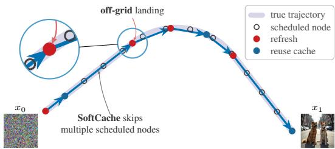  
Figure 1: SoftCache: how far, not just whether. Hard caching walks the fixed grid of scheduled nodes one node at a time, deciding only whether eduled nodesto refresh or reuse. SoftCache also sets the step size: a reused step the cache still supports skips several nodes and lands between them (inset).

Set against both kinds of cache, this is a different form of adaptivity. A fixed schedule refreshes at the same nodes for every prompt. A dynamic cache refreshes at nodes that vary with the prompt, but at scheduled nodes all the same. Here the steps vary with the prompt too, and they also land where no node was scheduled. This freedom translates into fidelity: on FLUX, HunyuanVideo and Wan2.1, against caches of both kinds at comparable speed, SoftCache reproduces the uncached model most faithfully on every metric at every operating point we test. Adaptivity, then, does not stop at deciding when to refresh. It also decides where the sampler goes next.

Our main contributions are: (1) We identify that the refresh signal of a dynamic cache carries more than a binary decision: its headroom below the threshold tracks the reuse error, so it measures how far the cached computation can still be trusted. (2) We propose SoftCache, which reads the headroom as a step size: cached steps jump off the scheduler’s grid in proportion to it, the tail is re-spaced so that every node passed is dropped from the trajectory, and the cached residual is extrapolated linearly to the landing, at no extra network cost. (3) On image and video backbones, SoftCache adds no perbackbone settings and is ahead of every cache we compare on all four fidelity metrics in every speed band from 3.5× to 6.9×.

## 2 RELATED WORK

## 2.1 DIFFUSION SAMPLING ACCELERATION

Methods that cut sampling cost differ in what they modify. Some change the network or a single evaluation of it: distillation trains a student that needs fewer steps (Song et al., 2023; Salimans & Ho, 2022; Luo et al., 2023), while sparse attention (Yuan et al., 2024; Xi et al., 2025; Zhang et al., 2025b;a) and token reduction (Bolya et al., 2023) make each step cheaper. Others change the grid: higher-order solvers reach a given quality in fewer steps (Song et al., 2021a; Lu et al., 2022; Zhao et al., 2023), and schedule design places the steps where they matter most (Karras et al., 2022; Esser et al., 2024; Sabour et al., 2024). We work in a third family, caching, which changes neither the network nor an evaluation of it: it exploits the redundancy between neighboring states along the trajectory and reuses computation from earlier steps, without training.

## 2.2 FEATURE CACHING

Caching methods differ in what they store and when they refresh it. The stored quantity ranges from intermediate activations of U-Net or transformer blocks (Ma et al., 2024; Selvaraju et al., 2024; Liu et al., 2025b) to the residual of a span of blocks or of the entire stack (Chen et al., 2024; Liu et al., 2025a; Chung et al., 2026), and it may be refreshed for only a subset of tokens (Zou et al., 2025; 2024; Zheng et al., 2025b). Fixed schedules refresh periodically (Ma et al., 2024; Selvaraju et al., 2024; Liu et al., 2025b) or at steps chosen offline, by thresholding a reuse error calibrated on a few samples (Ma et al., 2025; Peng et al., 2026) or by optimizing for a fixed budget of full evaluations (Cui et al., 2026; Aliev et al., 2026). Online rules refresh once an accumulated cheap proxy of the output change crosses a threshold (Liu et al., 2025a; Chung et al., 2026; Nam et al., 2026; Bu et al., 2025). Such rules therefore refreshe at different nodes for different prompts, whereas a fixed schedule applies one refresh pattern to all of them. Either way, each node, or token, makes one binary choice between a full evaluation and reuse. SoftCache refreshes on the same spectral signal (Chung et al., 2026), but also reads its headroom below the threshold to make reuse soft rather than binary.

## 2.3 PREDICTIVE CACHING

Between refreshes, most caches hold the stored quantity fixed (Ma et al., 2024; Selvaraju et al., 2024; Liu et al., 2025a; Chung et al., 2026), so the reuse error grows with the time since the last refresh. Predictive caches extrapolate from recent history instead. Some forecast what the network returns, the output of the block stack (Cui et al., 2026), its increment over the input (Bu et al., 2025), or the velocity itself (Wang et al., 2026). Others forecast the increment each attention and MLP branch adds to its input, which the current node applies to its own activations, with Taylor (Liu et al., 2025b) or Hermite (Feng et al., 2026) coefficients built from several stored past values. Multistep formulas (Yu et al., 2025; Zheng et al., 2025a) and a check on the prediction (Liu et al., 2025c) extend how far it can be carried. All of them predict only at the nodes of the sampler’s schedule, so the schedule itself is untouched. We extrapolate an increment as well, a single one for the entire stack, along the straight line through the two most recent fresh evaluations. Written in the flow time, that line is defined between nodes, which is what lets the sampler leave the schedule rather than only skip evaluations along it.

## 2.4 ADAPTIVE STEP SIZE CONTROL

Adaptive ODE solvers set each step at runtime from an estimate of the local error, obtained by comparing two solutions of different order (Dormand & Prince, 1980), and the same control has been applied to diffusion sampling in both its SDE (Jolicoeur-Martineau et al., 2021) and ODE (Lu et al., 2022) forms. The estimate costs several network evaluations per step, which is the computation a cache exists to avoid. SoftCache takes its step size from the refresh signal the cache already computes, so the schedule adapts at no evaluations beyond those the cache spends anyway.

## 3 PRELIMINARIES

Diffusion and flow models generate a sample by transporting noise to data along a differential equation. In diffusion models this is a reverse-time SDE or, equivalently, its probability-flow ODE, whose drift is built from a learned score (Song et al., 2021b), while in flow matching the network regresses the transporting velocity directly (Lipman et al., 2022; Liu et al., 2022; Albergo & Vanden-Eijnden, 2022). We present the method in the ODE form, which covers the rectified-flow transformers we evaluate (Esser et al., 2024). Writing $x _ { t } \in \mathbb { R } ^ { d }$ for the state at time $t \in [ 0 , 1 ]$ , with $x _ { 0 } \sim p _ { 0 }$ a sample from the prior and $x _ { 1 }$ the generated data sample, sampling integrates

$$
\frac { d x _ { t } } { d t } = v _ { \theta } ( x _ { t } , t ) , \qquad v _ { \theta } : \mathbb { R } ^ { d } \times [ 0 , 1 ]  \mathbb { R } ^ { d } ,\tag{1}
$$

from $t = 0$ to t = 1 over a grid $0 = t _ { 0 } < t _ { 1 } < \cdot \cdot < t _ { N } = 1$ that the scheduler fixes before sampling, independently of the prompt and of the trajectory. With the explicit Euler solver, one step reads

$$
x _ { i + 1 } = x _ { i } + \Delta _ { i } v _ { \theta } ( x _ { i } , t _ { i } ) , \qquad \Delta _ { i } : = t _ { i + 1 } - t _ { i } ,\tag{2}
$$

so a sample costs $N$ evaluations of $v _ { \theta }$ , one at every node of the grid.

## 3.1 RESIDUAL CACHING

A cache removes most of the cost of a step by reusing what an earlier evaluation produced. Which part is reused follows from how a diffusion transformer (Peebles & Xie, 2023; Esser et al., 2024; Black Forest Labs, 2024; Kong et al., 2024) computes $v _ { \theta } ,$ in three stages. A patch embedding $\mathcal { E } : \mathbb { R } ^ { d }  \mathbb { R } ^ { n \times c }$ maps the latent to a sequence of n tokens of width $c ,$ which we write $s _ { i } = \mathcal { E } ( x _ { i } )$ . A stack of transformer blocks B transforms these tokens, conditioned on the time embedding $e _ { i } ,$ and an output layer O normalizes and projects them back to $\mathbb { R } ^ { d }$

$$
v _ { \theta } ( x _ { i } , t _ { i } ) = \mathcal { O } \big ( \mathcal { B } ( s _ { i } , e _ { i } ) , \ : e _ { i } \big ) .\tag{3}
$$

The prompt embedding is fixed for the whole trajectory and enters both B and $e _ { i }$ . We suppress it from the notation, since nothing in what follows reads it. Evaluating B accounts for nearly all of the cost of a model evaluation, whereas $\mathcal { E }$ and $\mathcal { O }$ are comparatively cheap, so it is B that a cache skips.

Let $a < i$ be the anchor, the most recent node at which the stack was evaluated. What is stored there is not its output but the change it made to its input,

$$
\boldsymbol { r } _ { a } = \boldsymbol { B } ( s _ { a } , e _ { a } ) - \boldsymbol { s } _ { a } ,\tag{4}
$$

which we call the residual (Liu et al., 2025a; Chung et al., 2026). It varies slowly along the trajectory, so a cached node skips B and adds the anchor’s residual to its own patched input,

$$
\begin{array} { r } { \widehat { r } _ { i } = r _ { a } , \qquad \widehat { v } _ { i } = { \mathcal O } \big ( s _ { i } + \widehat { r } _ { i } , ~ e _ { i } \big ) , } \end{array}\tag{5}
$$

a zero-order hold. The patched input $s _ { i }$ is recomputed from the current latent and the output layer is evaluated at the current time through $e _ { i } ,$ , so what is stale is the stack’s own contribution, computed at the anchor’s state and under the anchor’s time conditioning.

## 3.2 DYNAMIC CACHING

A dynamic cache decides when to refresh from the trajectory itself (Liu et al., 2025a). It reads a cheap probe $I _ { i }$ of the network at every node, available before any block runs, and scores staleness by the relative change of the probe between consecutive nodes,

$$
\rho _ { i } = \frac { \| I _ { i } - I _ { i - 1 } \| _ { 1 } } { \| I _ { i - 1 } \| _ { 1 } + \epsilon } \ \ge \ 0 ,\tag{6}
$$

with $\epsilon > 0$ a small constant. The score is accumulated since the anchor,

$$
A _ { i } = \sum _ { j = a + 1 } ^ { i } \rho _ { j } ,\tag{7}
$$

so $A _ { i }$ is nonnegative and nondecreasing until the next refresh, and the node is cached while it

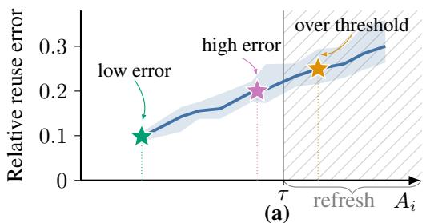

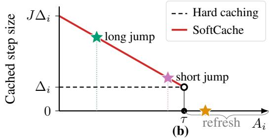  
Figure 2: The refresh signal carries more than a binary decision. (a) On uncached FLUX trajectories, the error $E _ { i }$ of reusing the cached residual (binned median, interquartile band) grows steadily with the refresh signal $A _ { i } .$ (b) Hard caching only compares $A _ { i }$ with τ and takes the scheduled step $\Delta _ { i }$ at every cached node. SoftCache also reads how far below τ it sits: the lower $A _ { i } ,$ the longer the step, up to $J \Delta _ { i }$ (Eq. (9)). Stars mark the same $A _ { i }$ in both panels: a low error buys a long jump, a high one only a short jump, and past τ the node refreshes.

stays below a threshold τ. Rules of this family differ in how the probe is prepared. The timestepmodulated input at the entry of the stack tracks how much the output is about to change, and is read either unfiltered, with $\rho _ { i }$ rescaled through a polynomial fitted per backbone (Liu et al., 2025a), or through a closed-form spectral low-pass that needs no such fit (Chung et al., 2026). We use the filtered probe of SeaCache throughout. SoftCache assumes nothing of $\rho _ { i }$ beyond $\rho _ { i } \geq 0$ and the reset of $A _ { i }$ at a refresh, so TeaCache’s probe can replace it, at lower fidelity (Sec. C.2).

## 4 METHOD

## 4.1 HEADROOM AS A STEP SIZE

Hard caching spends $A _ { i }$ on one decision: compare it with τ and either refresh or reuse (Liu et al., 2025a; Chung et al., 2026). We ask whether there is more to this signal, not whether the cached residual can still be used, but for how long. Instead of reading $A _ { i }$ against τ as a hard threshold, we read how far below it the accumulator sits, which says how much of the reuse budget is left, and we let that quantity set the length of the next step. We define the headroom

$$
H _ { i } = 1 - \frac { A _ { i } } { \tau } ,\tag{8}
$$

which lies in $[ 0 , 1 ]$ at a cached node. Reusing the anchor’s residual costs a relative reuse error $E _ { i } = \| r _ { i } - r _ { a } \| / \| r _ { a } \|$ , between the residual the stack would produce at node i and the one Eq. (5) substitutes for it. We measure it on uncached FLUX trajectories, where $r _ { i }$ is available at every node (Fig. 2a): the error rises as the accumulator fills, and a node just past a refresh differs from one about to trigger the next by $2 . 2 \times$ in median error, although the threshold treats the two alike (Sec. C.1). The measurement says which nodes can carry the residual further, not how much further, so any rule that takes longer steps where the error is lower is consistent with it. We choose the simplest one. Freezing the same enlarged steps at even, back-loaded or random positions instead does worse at the slower operating point (Tab. C.4.3).

With $\Delta _ { i }$ the scheduled spacing at node $i ( \mathrm { E q . } ( 2 ) )$ and $J > 1$ a cap on how many scheduled steps a single step may span, we set the step from the headroom:

$$
\bar { \Delta } _ { i } = \left\{ \begin{array} { l l l } { { \Delta _ { i } , } } & { { A _ { i } \geq \tau } } & { { ( \mathrm { f r e s h } ) } } \\ { { \operatorname* { m i n } \bigr \{ 1 - t _ { i } , } }  & { { \Delta _ { i } + \left( J - 1 \right) H _ { i } \Delta _ { i } \bigr \} , } } & { { A _ { i } < \tau } } & { { ( \mathrm { c a c h e d } ) . } } \end{array} \right.\tag{9}
$$

At a cached node the step exceeds the scheduled one in proportion to the headroom (Fig. 2b): approaching $\Delta _ { i }$ as a refresh nears, at most $J \Delta _ { i }$ , and never past the end of the schedule. After a jump, the probe change is measured from the node the step left, so a long step fills the accumulator more than a short one.

We disable the jump in two cases, at the start of the trajectory and at a node where the probe change is itself large, and the cached node then takes the scheduled step $\Delta _ { i }$ . Both are thresholds on quantities the sampler already holds, with the same values in every setting (Sec. A.3).

## 4.2 SAMPLING BETWEEN NODES

A jump ends at a time the grid does not contain, and the node the sampler lands on is one no schedule placed. Like every cached node it reuses $r _ { a }$ , and the further a node sits from the anchor the worse that reuse gets. A jump puts it further than any scheduled step does. Instead of holding $r _ { a }$ , we extend it along the line through the two most recent fresh residuals, the residual motion of the cache:

$$
\widehat { r } _ { i } = r _ { a } + \beta \lambda _ { i } ( r _ { a } - r _ { a - 1 } ) , \qquad \lambda _ { i } = \frac { t _ { i } - t _ { a } } { t _ { a } - t _ { a - 1 } } ,\tag{10}
$$

a straight line through the last two anchors, followed a fraction $\beta$ of the way. The ratio $\lambda _ { i }$ is built from time gaps, so it is defined wherever the sampler is, on the grid or off it. Predictive caches that count steps instead have a residual one node later, two nodes later, and nothing in between. We apply Eq. (10) at every cached node, whether or not the node was reached by a jump. It costs one more stored tensor, $r _ { a - 1 }$ , and no evaluation.

The nodes ahead of the landing also need attention. The jump has passed several of them, and the first it has not passed may be a fraction of a scheduled step away, so following the old grid would spend a full node on a fraction of a step. The time the step ended at becomes $t _ { i + 1 }$ , and the nodes after it are replaced. Writing $m _ { i }$ for the number of nodes of the old grid still ahead of $t _ { i + 1 }$ , we spread that many nodes evenly over $[ t _ { i + 1 } , 1 ]$ , counting $t _ { i + 1 }$ as the first of them,

$$
t _ { i + 1 + k } = t _ { i + 1 } + ( 1 - t _ { i + 1 } ) { \frac { k } { m _ { i } - 1 } } , \qquad k = 1 , \ldots , m _ { i } - 1 .\tag{11}
$$

Sampling continues from $( x _ { i + 1 } , t _ { i + 1 } )$ along this grid, which ends at $t _ { i + m _ { i } } ~ = ~ 1$ , and the construction repeats at every jump. If $t \ = \ 1$ is the only node left ahead, the tail is already a single step and is kept. The rebuilt tail is evenly spaced in t since that choice has nothing to tune. Re-spacing in the backbone’s own coordinate instead changes little, and the sign of the difference varies with speed (Sec. A.4).

Until the first refresh there is a single anchor and no line to draw, so the node holds $r _ { a }$ as in Eq. (5). Every quantity in this section is fixed across all configurations, except $\beta ,$ which is 1 below 4× and damped to $\textstyle { \frac { 1 } { 2 } }$ above it (Sec. 5.4).

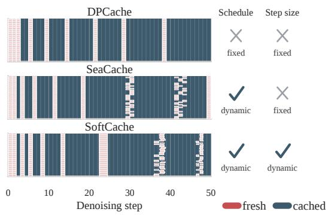  
Figure 3: Step placement on FLUX. Fresh and cached steps for 25 prompts, one per row.

Collecting the pieces, a node is either fresh or

cached, and the accumulator decides which. A fresh node evaluates the stack and takes the scheduled step. A cached node extrapolates the residual and takes a step set by its headroom. The update is

$$
x _ { i + 1 } = x _ { i } + \bar { \Delta } _ { i } \mathcal { O } \big ( s _ { i } + \widehat { r } _ { i } , e _ { i } \big ) .\tag{12}
$$

Two settings of Eq. (12) are known samplers. With $\beta = 0$ and $\bar { \Delta } _ { i } = \Delta _ { i }$ at every node it is the hold of Eq. (5) on the scheduled grid (Chung et al., 2026). With every node fresh it is Eq. (2). The loop, including its initialization, is in Alg. A.1.1.

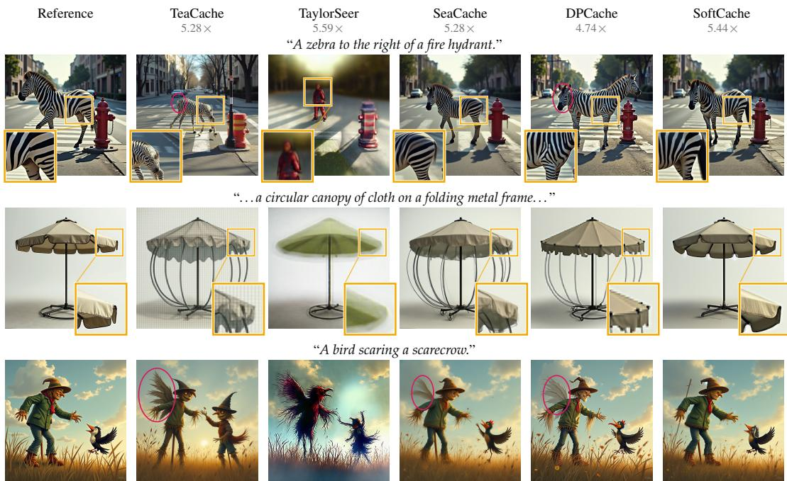  
Figure 4: FLUX on DrawBench at ≈ 5.2× speedup. The speedup under each method is its band mean. Red ellipses mark structural errors, and each inset enlarges one region of its tile where shown.

Fig. 3 shows the schedules this produces on FLUX. DPCache (Cui et al., 2026) fixes its refresh steps before sampling, so every prompt follows the same schedule. SeaCache (Chung et al., 2026) refreshes dynamically, at different steps for different prompts, but each step it takes is one scheduled interval. SoftCache is dynamic in step size as well: the headroom stretches each cached step (Eq. (9)), and the re-spaced tail (Eq. (11)) moves the nodes after it, so its steps vary in length and fall between grid lines.

## 5 EXPERIMENTS

## 5.1 EXPERIMENTAL SETUP

We evaluate on one image and two video backbones. FLUX.1-dev (Black Forest Labs, 2024) generates one 1024 × 1024 image for each of the 200 DrawBench prompts (Saharia et al., 2022). HunyuanVideo (Kong et al., 2024) generates one 65-frame 640 × 480 video for each of the 946 VBench prompts (Huang et al., 2024), and Wan2.1-T2V-1.3B (Wan et al., 2025) one 81-frame 832×480 video for each of 100 VBench prompts, stratified by dimension (Sec. A.2). Every backbone samples 50 Euler steps. On FLUX we compare against the dynamic caches TeaCache (Liu et al., 2025a) and SeaCache (Chung et al., 2026), against the recent DPCache (Cui et al., 2026), which fixes its refresh schedule before sampling from a calibrated cost, and against TaylorSeer (Liu et al., 2025b), which forecasts features rather than reusing them. Under our compute budget, on video we compare against SeaCache and DP-Cache, which both report gains over TeaCache and TaylorSeer (Chung et al., 2026; Cui et al., 2026) and are the two strongest baselines on FLUX.

Table 1: FLUX DrawBench-200. One block per speed band. DrmSim is DreamSim.
<table><tr><td rowspan="2">Method</td><td>Efficiency</td><td colspan="3">Quality</td></tr><tr><td>Speedup</td><td>PSNR↑</td><td>SSIM↑</td><td>LPIPS↓ DrmSim↓</td></tr><tr><td>TeaCache</td><td>4.02×</td><td>16.02</td><td>0.660 0.396</td><td>0.140</td></tr><tr><td>TaylorSeer</td><td>3.70×</td><td>15.50</td><td>0.637 0.397</td><td>0.128</td></tr><tr><td>SeaCache</td><td>3.25×</td><td>22.41</td><td>0.830 0.173</td><td>0.037</td></tr><tr><td>DPCache</td><td>3.49×</td><td>21.27</td><td>0.803 0.182</td><td>0.041</td></tr><tr><td>SoftCache</td><td>3.79×</td><td>23.20</td><td>0.847 0.146</td><td>0.028</td></tr><tr><td>TeaCache TaylorSeer</td><td>5.28× 5.59×</td><td>15.19 11.44</td><td>0.619 0.466 0.448 0.695</td><td>0.193 0.385</td></tr><tr><td>SeaCache DPCache</td><td>5.28×</td><td>18.81</td><td>0.724 0.326</td><td>0.088</td></tr><tr><td>SoftCache</td><td>4.74× 5.44×</td><td>18.05 20.05</td><td>0.700 0.770</td><td>0.305 0.086 0.251 0.060</td></tr><tr><td>TeaCache</td><td>5.91×</td><td>14.73</td><td></td><td></td></tr><tr><td>TaylorSeer</td><td>6.22×</td><td>10.34</td><td>0.596</td><td>0.516 0.244 0.579</td></tr><tr><td>SeaCache</td><td>6.66×</td><td>17.46</td><td>0.363</td><td>0.824</td></tr><tr><td></td><td></td><td></td><td>0.673</td><td>0.409 0.131</td></tr><tr><td>DPCache</td><td>6.50×</td><td>14.83</td><td>0.537</td><td>0.533 0.206</td></tr><tr><td></td><td></td><td></td><td></td><td></td></tr><tr><td>SoftCache</td><td>6.91×</td><td>18.58</td><td>0.710 0.327</td><td>0.087</td></tr></table>

On each backbone all methods share the prompts, seeds, generation settings and hardware (Sec. A.1). Methods are compared at matched wall-clock speedup. For each method we sweep the parameter that sets its speed, the threshold for the dynamic caches and the number of fresh steps or the refresh interval for DPCache and TaylorSeer, and take the run nearest each speed band (Tab. A.1.1). PSNR, SSIM, LPIPS (Zhang et al., 2018) and DreamSim (Fu et al., 2023) measure fidelity to the uncached sample of the same prompt and seed, since a cache approximates the uncached sampler. We additionally report ImageReward (Xu et al., 2023) for images and VBench for video, which score a sample on its own and separate the methods far less than the fidelity metrics do (Secs. B.3 and 5.3). Tabs. D.2.1 and D.2.2 give the full prompts used in every qualitative figure.

## 5.2 IMAGE GENERATION

Tab. 1 reports four fidelity metrics at three matched speed bands on FLUX, Sec. B.1 adds latency, TFLOPs and peak memory, and Sec. B.2 resolves each band per prompt. SoftCache is ahead of every baseline on all four metrics in all three bands, and at the fastest band it leads SeaCache by 1.12 dB PSNR and 0.082 LPIPS. Because each method’s speed is set by its own parameter, a lead in quality could come from running slower. None of the leads above does. SoftCache is faster than SeaCache and DPCache in every band, and the only two runs faster than it, TeaCache at the slowest band by 0.23× and TaylorSeer at the middle band by 0.15×, trail it by 7.2 and 8.6 dB.

Fig. 4 shows generation for three DrawBench prompts at the ≈ 5.2× band, and illustrates what the gaps of Tab. 1 look like in the image. In these examples the baselines lose the structure of objects, not only their detail. In the first row two of them break the zebra itself, leaving it without a head (TeaCache) or with a second one (DPCache, red ellipses), and even SeaCache, the closest to SoftCache, loses the stripe pattern in the enlarged region, where black bleeds into the white stripes. The canopy of the second row grows curved struts it does not have, and the scarecrow of the third row grows wings it does not have (red ellipses). SoftCache keeps every object the prompt names, with its shape intact, in all three rows. Sec. D.2 adds further prompts, including a set at the ≈ 6.6× band (Fig. D.2.1) where the same failures grow, and enlarged examples at the ≈5.2× band (Fig. D.2.2).

## 5.3 VIDEO GENERATION

Tab. 2 repeats the comparison on Hunyuan-Video against the two video baselines. Soft-Cache leads both on all four metrics in all three bands, by 0.54 to 2.78 dB PSNR over the better one. As on FLUX, the leads do not come from running slower: no baseline is more than 0.06× (about 1%) faster in any band. The lead holds where the budget is tightest. From the middle to the fastest band SoftCache loses 0.09 dB PSNR and 0.021 LPIPS and SeaCache 1.44 dB and 0.057 LPIPS. Without its jump, SoftCache, like SeaCache, can gain speed only by refreshing less often, and it then falls furthest behind as the budget tightens (Sec. 5.4). On VBench, scored with one sample per prompt, SoftCache matches DPCache to within 0.003 on the Total in every band and scores above SeaCache in all three (Sec. B.3). We extend the video comparison to Wan2.1-T2V-1.3B at two points, leading

Table 2: HunyuanVideo VBench 480p. One block per matched speed band. DrmSim is DreamSim.
<table><tr><td rowspan="2">Method</td><td>Efficiency</td><td colspan="3">Quality</td></tr><tr><td>Speedup</td><td>PSNR↑</td><td>SSIM↑</td><td>LPIPS↓ DrmSim↓</td></tr><tr><td>SeaCache</td><td>3.53×</td><td>23.63</td><td>0.778 0.203</td><td>0.102</td></tr><tr><td>DPCache</td><td>3.28×</td><td>23.70</td><td>0.786 0.182</td><td>0.092</td></tr><tr><td>SoftCache</td><td>3.52×</td><td>26.48</td><td>0.843 0.141</td><td>0.067</td></tr><tr><td>SeaCache</td><td>5.33×</td><td>21.82</td><td>0.713 0.292</td><td>0.162</td></tr><tr><td>DPCache</td><td>5.42×</td><td>20.34</td><td>0.682 0.293</td><td>0.162</td></tr><tr><td>SoftCache</td><td>5.39×</td><td>22.36</td><td>0.742 0.246</td><td>0.129</td></tr><tr><td>SeaCache</td><td>6.11×</td><td>20.38</td><td>0.667 0.349</td><td>0.205</td></tr><tr><td>DPCache</td><td>6.07×</td><td>20.06</td><td>0.660 0.310</td><td>0.172</td></tr><tr><td>SoftCache</td><td>6.05×</td><td>22.27</td><td>0.739 0.267</td><td>0.141</td></tr></table>

SeaCache and DPCache on all four metrics at both (Tab. B.1.3 in Sec. B.1).

Fig. 5 shows two VBench clips at the ≈ 5.4× band. DPCache alters what the clips contain, adding a person the prompt does not ask for in the first and a malformed duck in mid-air in the second (red ellipses). Both baselines also lose detail, and in the last frame of the first clip SeaCache dissolves the dog’s head into speckle while DPCache keeps only a smeared outline of it (inset). SoftCache keeps the content of the reference in both clips, with the dog’s head clean down to the collar, the structure of the astronaut’s gloves intact (insets), and more background detail than either baseline. The appendix repeats this comparison on two more clips at this band (Fig. D.2.3) and at other speeds: HunyuanVideo at ≈3.5× (Fig. D.2.4), FLUX at ≈6.6× (Fig. D.2.1), and Wan2.1 at ≈3.7× (Fig. D.2.5), and HunyuanVideo at its native 720p resolution at ≈4.5× (Fig. D.2.6).

“a dog and a horse”  
“An astronaut feeding ducks. . . ”  
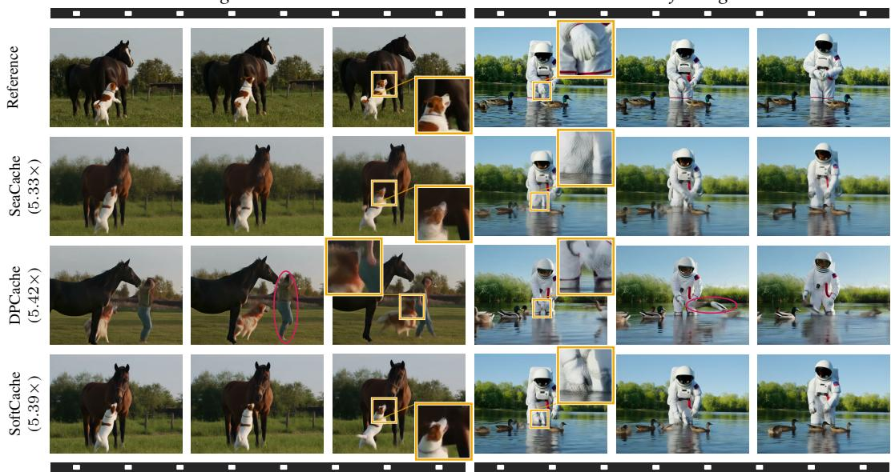  
Figure 5: HunyuanVideo on VBench at ≈ 5.4× speedup. Each clip shows its first, middle and last frame, and the speedup beside each method is its band mean. Insets enlarge one region, and red ellipses mark a person the prompt does not ask for and a malformed duck in mid-air.

## 5.4 ABLATIONS

We ablate on FLUX with 50 prompts from DPG-Bench (Hu et al., 2024), kept separate from the DrawBench-200 test prompts. Each variant disables one term of the sampler and keeps the rest of SoftCache. Removing the jump sets J=1 in Eq. (9), so every cached node takes the scheduled step and the sampler stays on the grid. Removing headroom scaling replaces $H _ { i }$ by 1 in the same equation, so a cached node jumps the full $J \Delta _ { i }$ i whenever it jumps rather than in proportion to the reuse budget left. Removing tail re-spacing holds $m _ { i }$ fixed in Eq. (11), so the rebuilt tail retires one node per jump however far the jump lands, and the extra distance saves no nodes. Removing residual motion sets β=0 in Eq. (10), so a cached node holds $r _ { a }$ as in Eq. (5).

At 3× every removal trails SoftCache on all three metrics. At higher speeds the removals fall into two groups. Removing the jump or the tail respacing trails on every metric at every band. Without the jump the sampler stays on the scheduled grid, so it gains speed only by refreshing less often, and at $7 \times$ it trails SoftCache by 4.18 dB PSNR and 0.219 LPIPS. Holding $m _ { i }$ fixed costs less, 1.21 dB, because the jump still lands where the headroom allows, but the tail keeps its node count, so the distance the jump covers buys no speed. Removing headroom scaling or residual motion behaves differently. SoftCache stays ahead of both on LPIPS and DreamSim at every band, while both pass it on PSNR at high speed (Fig. 6 and Tab. C.4.1). PSNR averages pixel error, so it rewards an output that blurs fine detail over one that keeps the detail but places it slightly off,

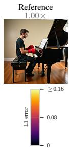

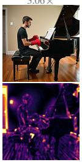

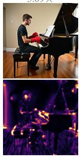

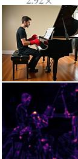

<table><tr><td>LPIPS↓ DrmSim↓ PSNR↑ LPIPS↓ DrmSim↓ PSNR↑</td><td></td><td></td><td></td><td></td><td></td><td></td></tr><tr><td>w/o jumps (J=1)</td><td>0.103</td><td>0.018</td><td>24.30</td><td>0.548</td><td>0.199</td><td>13.67</td></tr><tr><td>w/o headroom  $( H _ { i } = 1 )$ </td><td>0.122</td><td>0.016</td><td>25.70</td><td>0.330</td><td>0.082</td><td>18.17</td></tr><tr><td>w/o re-spacing (mi fixed)</td><td>0.109</td><td>0.018</td><td>24.64</td><td>0.371</td><td>0.101</td><td>16.64</td></tr><tr><td>SoftCache</td><td>0.093</td><td>0.013</td><td>26.50</td><td>0.329</td><td>0.078</td><td>17.85</td></tr></table>

Figure 6: Component leave-one-out (FLUX, 50 DPG-Bench prompts). Top: one prompt at ≈ 3× with its perpixel $L _ { 1 }$ error to the uncached image. Bottom: means at matched wall-clock speedup. Every removal trails Soft-Cache at 3×, and removing the jump costs the most at $7 \times$ Tab. C.4.1 adds 5× and residual motion.

which the perceptual metrics prefer. Sec. D.1 shows such a case.

The scale $\beta$ in Eq. (10) sets how far a cached node follows the linear extrapolation. The extrapolation grows with distance from the last fresh evaluation, through $\lambda _ { i } ,$ , so at high speed it reaches beyond the two evaluations it was fitted to and becomes less reliable. Damping it to $\beta { = } 0 . 5$ loses to $\beta { = } 1$ at 3× but beats it by 1.65 dB PSNR and 0.080 LPIPS at $7 \times$ (Tab. C.4.2). We therefore use $\beta { = } 1$ below 4× and $\beta { = } 0 . 5$ above it, the same rule on all three backbones. Raising the cap instead gains less: at 7× even J=20 gains 1.12 dB and 0.050 LPIPS, and it loses fine texture that $\beta { = } 0 . 5$ keeps (Sec. C.4). Removing residual motion scores a higher PSNR than $\beta { = } 0 . 5$ at $7 \times$ but a worse LPIPS (Tab. C.4.1). Comparing the images ourselves at that band, blind to the variant, we prefer $\beta { = } 0 . 5$ to J=20 and to removing residual motion (Sec. C.3).

## 6 CONCLUSION

We presented SoftCache, a training-free method that turns hard caching into soft caching. A dynamic cache already measures how stale its cached computation has become, but spends the measurement on a binary choice between refresh and reuse. SoftCache reads the headroom below the threshold as how far the cache can still be trusted and lets it set the step size: cached steps jump past scheduled nodes while the cache is reliable and shrink back to the scheduled step as a refresh nears, the tail is re-spaced so that every node passed is dropped from the trajectory, and the cached residual is extrapolated to each off-grid landing at no extra network cost. On FLUX, HunyuanVideo and Wan2.1, at wall-clock speedups from 3.5× to 6.9×, SoftCache stays closest to the uncached sample on all four fidelity metrics, with no per-model calibration. Adaptivity in caching, then, does not stop at deciding when to refresh.

## ACKNOWLEDGMENTS

This project was partially supported by ISF grants 1574/21 and 2132/23.

## REFERENCES

Michael S Albergo and Eric Vanden-Eijnden. Building normalizing flows with stochastic interpolants. arXiv preprint arXiv:2209.15571, 2022.

Mishan Aliev, Eva Neudachina, Ilya Bykov, Aleksandr Oganov, Kirill Struminsky, Aibek Alanov, and Denis Rakitin. ReCache: Learning budget-aware caching schedules for diffusion models via REINFORCE. arXiv preprint arXiv:2606.06060, 2026.

Black Forest Labs. Flux. https://github.com/black-forest-labs/flux, 2024.

Daniel Bolya, Cheng-Yang Fu, Xiaoliang Dai, Peizhao Zhang, Christoph Feichtenhofer, and Judy Hoffman. Token merging: Your ViT but faster. In International Conference on Learning Representations, 2023.

Jiazi Bu, Pengyang Ling, Yujie Zhou, Yibin Wang, Yuhang Zang, Tong Wu, Dahua Lin, and Jiaqi Wang. DiCache: Let diffusion model determine its own cache. arXiv preprint arXiv:2508.17356, 2025.

Pengtao Chen, Mingzhu Shen, Peng Ye, Jianjian Cao, Chongjun Tu, Christos-Savvas Bouganis, Yiren Zhao, and Tao Chen. ∆-DiT: A training-free acceleration method tailored for diffusion transformers. arXiv preprint arXiv:2406.01125, 2024.

Jiwoo Chung, Sangeek Hyun, MinKyu Lee, Byeongju Han, Geonho Cha, Dongyoon Wee, Youngjun Hong, and Jae-Pil Heo. SeaCache: Spectral-evolution-aware cache for accelerating diffusion models. In Proceedings of the IEEE/CVF Conference on Computer Vision and Pattern Recognition, pp. 14283–14294, June 2026.

Bowen Cui, Yuanbin Wang, Huajiang Xu, Biaolong Chen, Aixi Zhang, Hao Jiang, Zhengzheng Jin, Xu Liu, and Pipei Huang. Denoising as path planning: Training-free acceleration of diffusion models with DPCache. In Proceedings of the IEEE/CVF Conference on Computer Vision and Pattern Recognition, pp. 43632–43642, June 2026.

John R Dormand and Peter J Prince. A family of embedded runge-kutta formulae. Journal of computational and applied mathematics, 6(1):19–26, 1980.

Patrick Esser, Sumith Kulal, Andreas Blattmann, Rahim Entezari, Jonas Muller, Harry Saini, Yam¨ Levi, Dominik Lorenz, Axel Sauer, Frederic Boesel, et al. Scaling rectified flow transformers for high-resolution image synthesis. In Forty-first international conference on machine learning, 2024.

Liang Feng, Shikang Zheng, Jiacheng Liu, Yuqi Lin, Qinming Zhou, Peiliang Cai, Xinyu Wang, Junjie Chen, Chang Zou, Yue Ma, and Linfeng Zhang. Hicache: A plug-in scaled-hermite upgrade for taylor-style cache-then-forecast diffusion acceleration. In The Fourteenth International Conference on Learning Representations, 2026. URL https://openreview.net/forum? id=faYbbo1KsQ.

Stephanie Fu, Netanel Tamir, Shobhita Sundaram, Lucy Chai, Richard Zhang, Tali Dekel, and Phillip Isola. Dreamsim: Learning new dimensions of human visual similarity using synthetic data. In A. Oh, T. Naumann, A. Globerson, K. Saenko, M. Hardt, and S. Levine (eds.), Advances in Neural Information Processing Systems, volume 36, pp. 50742–50768. Curran Associates, Inc., 2023. doi: 10.52202/ 075280-2208. URL https://proceedings.neurips.cc/paper\_files/paper/ 2023/file/9f09f316a3eaf59d9ced5ffaefe97e0f-Paper-Conference.pdf.

Xiwei Hu, Rui Wang, Yixiao Fang, Bin Fu, Pei Cheng, and Gang Yu. ELLA: Equip diffusion models with LLM for enhanced semantic alignment. arXiv preprint arXiv:2403.05135, 2024.

Ziqi Huang, Yinan He, Jiashuo Yu, Fan Zhang, Chenyang Si, Yuming Jiang, Yuanhan Zhang, Tianxing Wu, Qingyang Jin, Nattapol Chanpaisit, Yaohui Wang, Xinyuan Chen, Limin Wang, Dahua Lin, Yu Qiao, and Ziwei Liu. VBench: Comprehensive benchmark suite for video generative models. In Proceedings of the IEEE/CVF Conference on Computer Vision and Pattern Recognition, 2024.

Alexia Jolicoeur-Martineau, Ke Li, Remi Pich´ e-Taillefer, Tal Kachman, and Ioannis Mitliagkas.´ Gotta go fast when generating data with score-based models. arXiv preprint arXiv:2105.14080, 2021.

Tero Karras, Miika Aittala, Timo Aila, and Samuli Laine. Elucidating the design space of diffusion-based generative models. In Alice H. Oh, Alekh Agarwal, Danielle Belgrave, and Kyunghyun Cho (eds.), Advances in Neural Information Processing Systems, 2022. URL https://openreview.net/forum?id=k7FuTOWMOc7.

Weijie Kong, Qi Tian, Zijian Zhang, Rox Min, Zuozhuo Dai, Jin Zhou, Jiangfeng Xiong, Xin Li, Bo Wu, Jianwei Zhang, et al. Hunyuanvideo: A systematic framework for large video generative models. arXiv preprint arXiv:2412.03603, 2024.

Yaron Lipman, Ricky TQ Chen, Heli Ben-Hamu, Maximilian Nickel, and Matt Le. Flow matching for generative modeling. arXiv preprint arXiv:2210.02747, 2022.

Feng Liu, Shiwei Zhang, Xiaofeng Wang, Yujie Wei, Haonan Qiu, Yuzhong Zhao, Yingya Zhang, Qixiang Ye, and Fang Wan. Timestep embedding tells: It’s time to cache for video diffusion model. In Proceedings of the IEEE/CVF Conference on Computer Vision and Pattern Recognition, pp. 7353–7363, June 2025a.

Jiacheng Liu, Chang Zou, Yuanhuiyi Lyu, Junjie Chen, and Linfeng Zhang. From reusing to forecasting: Accelerating diffusion models with TaylorSeers. In Proceedings ofthe IEEE/CVF International Conference on Computer Vision, pp. 15853–15863, October 2025b.

Jiacheng Liu, Chang Zou, Yuanhuiyi Lyu, Fei Ren, Shaobo Wang, Kaixin Li, and Linfeng Zhang. SpeCa: Accelerating diffusion transformers with speculative feature caching. In Proceedings of the 33rd ACM International Conference on Multimedia, pp. 10024–10033, October 2025c. doi: 10.1145/3746027.3755331.

Xingchao Liu, Chengyue Gong, and Qiang Liu. Flow straight and fast: Learning to generate and transfer data with rectified flow. arXiv preprint arXiv:2209.03003, 2022.

Cheng Lu, Yuhao Zhou, Fan Bao, Jianfei Chen, Chongxuan LI, and Jun Zhu. Dpm-solver: A fast ode solver for diffusion probabilistic model sampling in around 10 steps. In S. Koyejo, S. Mohamed, A. Agarwal, D. Belgrave, K. Cho, and A. Oh (eds.), Advances in Neural Information Processing Systems, volume 35, pp. 5775–5787. Curran Associates, Inc., 2022. doi: 10.52202/ 068431-0418. URL https://proceedings.neurips.cc/paper\_files/paper/ 2022/file/260a14acce2a89dad36adc8eefe7c59e-Paper-Conference.pdf.

Simian Luo, Yiqin Tan, Suraj Patil, Daniel Gu, Patrick Von Platen, Apolinario Passos, Longbo´ Huang, Jian Li, and Hang Zhao. Lcm-lora: A universal stable-diffusion acceleration module. arXiv preprint arXiv:2311.05556, 2023.

Xinyin Ma, Gongfan Fang, and Xinchao Wang. Deepcache: Accelerating diffusion models for free. In Proceedings of the IEEE/CVF Conference on Computer Vision and Pattern Recognition (CVPR), pp. 15762–15772, 2024.

Zehong Ma, Longhui Wei, Feng Wang, Shiliang Zhang, and Qi Tian. Magcache: Fast video generation with magnitude-aware cache. In The Thirty-ninth Annual Conference on Neural Information Processing Systems, 2025. URL https://openreview.net/forum?id=KZn7TDOL4J.

Joonsik Nam, Hyunwoo Yu, and Suk-Ju Kang. OriCache: Orientation-guided feature caching for DiT acceleration. In ICML Workshop on Resource-Adaptive Foundation Model Inference, 2026.

William Peebles and Saining Xie. Scalable diffusion models with transformers. In 2023 IEEE/CVF International Conference on Computer Vision (ICCV), pp. 4172–4182. IEEE, 2023.

Xurui Peng, Chenqian Yan, Hong Liu, Rui Ma, Fangmin Chen, XING WANG, Zhihua Wu, Songwei Liu, and Mingbao Lin. ERTACache: Error rectification and timesteps adjustment for efficient diffusion. In The Fourteenth International Conference on Learning Representations, 2026. URL https://openreview.net/forum?id=InvyBiYcK5.

Amirmojtaba Sabour, Sanja Fidler, and Karsten Kreis. Align your steps: optimizing sampling schedules in diffusion models. In Proceedings ofthe 41st International Conference on Machine Learn ing, ICML’24. JMLR.org, 2024.

Chitwan Saharia, William Chan, Saurabh Saxena, Lala Li, Jay Whang, Emily L Denton, Kamyar Ghasemipour, Raphael Gontijo Lopes, Burcu Karagol Ayan, Tim Salimans, et al. Photorealistic text-to-image diffusion models with deep language understanding. Advances in neural information processing systems, 35:36479–36494, 2022.

Tim Salimans and Jonathan Ho. Progressive distillation for fast sampling of diffusion models. In International Conference on Learning Representations, 2022. URL https://openreview. net/forum?id=TIdIXIpzhoI.

Pratheba Selvaraju, Tianyu Ding, Tianyi Chen, Ilya Zharkov, and Luming Liang. FORA: Fastforward caching in diffusion transformer acceleration. arXiv preprint arXiv:2407.01425, 2024.

Jiaming Song, Chenlin Meng, and Stefano Ermon. Denoising diffusion implicit models. In International Conference on Learning Representations, 2021a. URL https://openreview.net/ forum?id=St1giarCHLP.

Yang Song, Jascha Sohl-Dickstein, Diederik P Kingma, Abhishek Kumar, Stefano Ermon, and Ben Poole. Score-based generative modeling through stochastic differential equations. In International Conference on Learning Representations, 2021b. URL https://openreview.net/ forum?id=PxTIG12RRHS.

Yang Song, Prafulla Dhariwal, Mark Chen, and Ilya Sutskever. Consistency models. In Andreas Krause, Emma Brunskill, Kyunghyun Cho, Barbara Engelhardt, Sivan Sabato, and Jonathan Scarlett (eds.), Proceedings of the 40th International Conference on Machine Learning, volume 202 of Proceedings ofMachine Learning Research, pp. 32211–32252. PMLR, 23–29 Jul 2023. URL https://proceedings.mlr.press/v202/song23a.html.

Team Wan, Ang Wang, Baole Ai, Bin Wen, Chaojie Mao, Chen-Wei Xie, Di Chen, Feiwu Yu, Haiming Zhao, Jianxiao Yang, et al. Wan: Open and advanced large-scale video generative models. arXiv preprint arXiv:2503.20314, 2025.

Yixiao Wang, Ting Jiang, Zishan Shao, Hancheng Ye, Jingwei Sun, Mingyuan Ma, Jianyi Zhang, Yiran Chen, and Hai Li. ZEUS: Accelerating diffusion models with only second-order predictor. arXiv preprint arXiv:2604.01552, 2026.

Haocheng Xi, Shuo Yang, Yilong Zhao, Chenfeng Xu, Muyang Li, Xiuyu Li, Yujun Lin, Han Cai, Jintao Zhang, Dacheng Li, Jianfei Chen, Ion Stoica, Kurt Keutzer, and Song Han. Sparse videogen: Accelerating video diffusion transformers with spatial-temporal sparsity. In Forty-second International Conference on Machine Learning, 2025. URL https://openreview.net/ forum?id=u8CA3qIS0V.

Jiazheng Xu, Xiao Liu, Yuchen Wu, Yuxuan Tong, Qinkai Li, Ming Ding, Jie Tang, and Yuxiao Dong. Imagereward: learning and evaluating human preferences for text-to-image generation. In Proceedings of the 37th International Conference on Neural Information Processing Systems, pp. 15903–15935, 2023.

Zichao Yu, Zhen Zou, Guojiang Shao, Chengwei Zhang, Shengze Xu, Jie Huang, Feng Zhao, Xiaodong Cun, and Wenyi Zhang. AB-Cache: Training-free acceleration of diffusion models via adams–bashforth cached feature reuse. arXiv preprint arXiv:2504.10540, 2025.

Zhihang Yuan, Hanling Zhang, Lu Pu, Xuefei Ning, Linfeng Zhang, Tianchen Zhao, Shengen Yan, Guohao Dai, and Yu Wang. DiTFastattn: Attention compression for diffusion transformer models. In The Thirty-eighth Annual Conference on Neural Information Processing Systems, 2024. URL https://openreview.net/forum?id=51HQpkQy3t.

Jintao Zhang, Chendong Xiang, Haofeng Huang, Jia Wei, Haocheng Xi, Jun Zhu, and Jianfei Chen. Spargeattn: Accurate sparse attention accelerating any model inference. In International Conference on Machine Learning (ICML), 2025a.

Peiyuan Zhang, Yongqi Chen, Runlong Su, Hangliang Ding, Ion Stoica, Zhengzhong Liu, and Hao Zhang. Fast video generation with sliding tile attention. In Forty-second International Conference on Machine Learning, 2025b. URL https://openreview.net/forum?id= U74MOXPEJd.

Richard Zhang, Phillip Isola, Alexei A Efros, Eli Shechtman, and Oliver Wang. The unreasonable effectiveness of deep features as a perceptual metric. In CVPR, 2018.

Wenliang Zhao, Lujia Bai, Yongming Rao, Jie Zhou, and Jiwen Lu. UniPC: A unified predictorcorrector framework for fast sampling of diffusion models. In Thirty-seventh Conference on Neural Information Processing Systems, 2023. URL https://openreview.net/forum? id=hrkmlPhp1u.

Shikang Zheng, Liang Feng, Xinyu Wang, Qinming Zhou, Peiliang Cai, Chang Zou, Jiacheng Liu, Yuqi Lin, Junjie Chen, Yue Ma, and Linfeng Zhang. Forecast then calibrate: Feature caching as ODE for efficient diffusion transformers. arXiv preprint arXiv:2508.16211, 2025a.

Zhixin Zheng, Xinyu Wang, Chang Zou, Shaobo Wang, and Linfeng Zhang. Compute only 16 tokens in one timestep: Accelerating diffusion transformers with cluster-driven feature caching. In Proceedings of the 33rd ACM International Conference on Multimedia, MM ’25, pp. 10181–10189, New York, NY, USA, 2025b. Association for Computing Machinery. ISBN 9798400720352. doi: 10.1145/3746027.3755479. URL https://doi.org/10.1145/ 3746027.3755479.

Chang Zou, Evelyn Zhang, Runlin Guo, Haohang Xu, Conghui He, Xuming Hu, and Linfeng Zhang. Accelerating diffusion transformers with dual feature caching. arXiv preprint arXiv:2412.18911, 2024.

Chang Zou, Xuyang Liu, Ting Liu, Siteng Huang, and Linfeng Zhang. Accelerating diffusion transformers with token-wise feature caching. In The Thirteenth International Conference on Learning Representations, 2025. URL https://openreview.net/forum?id=yYZbZGo4ei.

## APPENDICES

In the following sections we provide additional setup and implementation details (Sec. A), extended quantitative results (Sec. B), additional ablations (Sec. C), and further qualitative results and discussion (Sec. D).

## A EXPERIMENTAL SETUP AND IMPLEMENTATION

## A.1 SETUP DETAILS

Alg. A.1.1 is the full SoftCache sampler, including its initialization. The first node is always fresh, since no anchor exists before it, and until the first refresh a cached node holds the single anchor rather than extrapolating.

Algorithm A.1.1 SoftCache sampling   
Require: noise $x _ { 0 } ,$ , model $v _ { \theta } = \mathcal { O } ( B ( \mathcal { E } ( \cdot ) , e )$ , e) as in Eq. (3), grid $0 = t _ { 0 } < \cdots < t _ { N } = 1 $   
threshold $\tau ,$ cap $^ { J , }$ scale $\beta$   
$1 \colon { \mathit { i } } \gets 0$   
2: while $t _ { i } < 1$ do   
3: $s _ { i } \gets \mathcal { E } ( x _ { i } )$   
4: if $i > 0$ then $A _ { i }  A _ { i - 1 } + \rho _ { i }$   
5: if $i = 0$ or $A _ { i } \geq \tau$ then ▷ fresh: evaluate the stack   
6: if $i > 0$ then $( r _ { a - 1 } , t _ { a - 1 } ) \gets ( r _ { a } , t _ { a } )$   
7: $( r _ { a } , t _ { a } ) \gets ( B ( s _ { i } , e _ { i } ) - s _ { i } , t _ { i } ) , \quad A _ { i } \gets 0$   
8: $\begin{array} { r } { \widehat { r } _ { i } \gets r _ { a } , \quad \bar { \Delta } _ { i } \gets \Delta _ { i } } \end{array}$   
9: else ▷ cached: extrapolate the residual, stretch the step   
10: if $r _ { a - 1 }$ exists then   
11: $\widehat { r } _ { i } \gets r _ { a } + \beta \lambda _ { i } \left( r _ { a } - r _ { a - 1 } \right)$ ▷ Eq. (10)   
12: else   
13: $\widehat { r _ { i } } \gets r _ { a }$ ▷ one anchor so far, Eq. (5)   
14: end if   
15: $H _ { i } \gets 1 - A _ { i } / \tau , \quad \bar { \Delta } _ { i } \gets \operatorname* { m i n } \{ 1 - t _ { i } , \Delta _ { i } + ( J - 1 ) H _ { i } \Delta _ { i } \}$ ▷ Eq. (9)   
16: if opening stretch or large probe change then $\bar { \Delta } _ { i }  \Delta _ { i }$ ▷ no jump, Sec. A.3   
17: end if   
18: $x _ { i + 1 }  x _ { i } + \bar { \Delta } _ { i } \mathcal { O } ( s _ { i } + \widehat { r } _ { i } , e _ { i } ) , \quad t _ { i + 1 }  t _ { i } + \bar { \Delta } _ { i }$   
19: if $\bar { \Delta } _ { i } > \Delta _ { i }$ i and $t _ { i + 1 } < 1$ then re-space the nodes still ahead by Eq. (11)   
20: $i \gets i + 1$   
21: end while   
22: return $x _ { i }$

FLUX uses all 200 prompts of DrawBench (Saharia et al., 2022). HunyuanVideo uses all 946 prompts of VBench (Huang et al., 2024) at every budget, and Wan2.1 uses a subset of 100 VBench prompts (Sec. A.2). The ablations of Sec. 5.4 use 50 prompts from DPG-Bench (Hu et al., 2024), disjoint from DrawBench and subsampled deterministically from the released list. The 25 prompts of Fig. 3 are drawn from these 200 DrawBench prompts.

Every backbone samples 50 steps with a first-order Euler step in bf16, one sample per prompt from seed 0 on a CPU generator, so all methods in a comparison start from the same initial noise. FLUX loads black-forest-labs/FLUX.1-dev with guidance 3.5, the checkpoint’s resolution-dependent shift, $s = e ^ { 1 . 1 5 }$ at $1 0 2 4 \times 1 0 2 4$ , and 512 T5 tokens. HunyuanVideo loads hunyuanvideo-community/HunyuanVideo with guidance 6, shift $s = { \dot { 7 } }$ and 256 Llama tokens. Wan2.1 loads $\mathtt { W a n \mathrm { - } A I / W a n 2 \mathrm { \cdot } 1 \mathrm { - } \mathrm { T } 2 \mathrm { V } \mathrm { - } 1 \mathrm { \cdot } \mathrm { 3 B \mathrm { - } D i f f u s e r s } }$ with classifier-free guidance 6, shift s = 3 and 226 UMT5 tokens. FLUX and HunyuanVideo use no negative prompt, since neither runs a classifier-free branch, and Wan2.1 runs classifier-free guidance with an empty negative prompt. On Wan2.1 the Euler step replaces the UniPC solver the checkpoint ships with. FLUX generates 1024×1024 images, HunyuanVideo 640×480 videos of 65 frames and Wan2.1 832×480 videos of 81 frames. Videos are saved as MP4 at 8 fps on HunyuanVideo and 16 fps on Wan2.1. The 720p HunyuanVideo comparison of Fig. D.2.6 generates 1280 × 720 videos of 129 frames. FLUX and HunyuanVideo run on one H100 NVL and Wan2.1 on one RTX A5000, so Wan2.1 latencies are not comparable with the other two backbones.

Every SoftCache result uses the cap J = 8, first-order residual motion (Eq. (10)), the tail re-spacing of Eq. (11) and the two jump guards of Sec. A.3, with τ as the only parameter that sets the speed. The scale β is 1 below 4× and 0.5 above it (Sec. 5.4).

All methods, SoftCache and every baseline, are run by us on the hardware and settings above, and every number in the paper comes from these runs. Tab. A.1.1 gives, per method, the parameter that sets its speed, the values swept on each backbone, and in bold the values that appear in Sec. B.1. DPCache (Cui et al., 2026) releases code for FLUX and for Wan2.1-I2V-14B, so we adapt its official implementation to HunyuanVideo and Wan2.1-T2V-1.3B and recalibrate its cost tensor on 10 VBench prompts disjoint from the evaluation prompts. On FLUX its released cost tensor was calibrated with fp16 Taylor states, so we recalibrate it at bf16 with its own protocol on 10 of the 200 DrawBench prompts. There, DPCache at k = 5 is excluded as degenerate (8.64×, 8.46 dB PSNR), and TeaCache and TaylorSeer are not run on video, where each additional method costs a full VBench sweep per backbone and speed. Every method is scored against the uncached sample of the same prompt and seed. SoftCache, SeaCache and TeaCache run in our sampler and share one reference on every backbone. DPCache and TaylorSeer run their own drivers: DPCache’s reference is byte-identical to ours, and TaylorSeer’s differs from it only by driver-level numerics.

Table A.1.1: Swept speed parameter per method. Bold values appear in Sec. B.1.
<table><tr><td>Method</td><td>Parameter</td><td>Swept values</td></tr><tr><td>FLUX</td><td></td><td></td></tr><tr><td>SoftCache, β=1</td><td>T</td><td>0.3, 0.5, 0.8, 1.1</td></tr><tr><td>SoftCache, β=0.5</td><td>T</td><td>0.8,1.1</td></tr><tr><td>SeaCache</td><td>T</td><td>0.3, 0.5, 0.8, 1.1, 1.5, 2</td></tr><tr><td>TeaCache</td><td>rel. L1 threshold</td><td>0.5, 0.8, 1.2, 1.6</td></tr><tr><td>TaylorSeer</td><td>interval N</td><td>6, 7, 10, 16, 25</td></tr><tr><td>DPCache</td><td>fresh steps k</td><td>5, 6, 7, 9, 13</td></tr><tr><td>HunyuanVideo</td><td></td><td></td></tr><tr><td>SoftCache, β=1</td><td>T</td><td>0.5, 0.6, 0.75, 0.9, 1.1, 1.3</td></tr><tr><td>SoftCache, β=0.5</td><td>T</td><td>0.9,1.1</td></tr><tr><td>SeaCache</td><td>T</td><td>0.5, 0.6, 0.75, 0.9, 1.1, 1.3, 1.6</td></tr><tr><td>DPCache</td><td>fresh steps k</td><td>7, 8, 9, 11, 12, 13, 15</td></tr><tr><td>Wan2.1</td><td></td><td></td></tr><tr><td>SoftCache, β=1</td><td>T</td><td>0.32, 0.38, 0.45, 0.6, 0.73, 0.79, 1.07</td></tr><tr><td>SoftCache, β=0.5</td><td>T</td><td>0.32, 0.38, 0.6, 0.73</td></tr><tr><td>SeaCache</td><td>T</td><td>0.32, 0.45, 0.6, 0.73, 0.79, 1.07</td></tr><tr><td>DPCache</td><td>fresh steps k</td><td>8,9,12</td></tr></table>

Settings that are not swept keep each method’s released values. TaylorSeer uses Taylor order 1 and computes its first 3 steps fresh. TeaCache uses the rescaling polynomial of the released FLUX script and computes the first and last steps fresh. SeaCache uses its released filter, with exponent 2 on FLUX and 3 on the two video backbones, and the probe of SoftCache uses the same. DPCache uses Taylor order 2.

No main-table result is interpolated. The runs of every method are grouped into speed bands, and each method contributes to a band the run whose achieved speedup lies nearest it. Speedups within a band therefore differ slightly, and each cell reports its own. Speedup is the median uncached latency over prompts divided by the method’s median latency. The ablations match budgets by interpolation instead (Sec. C.4).

The ablations use the 50 DPG-Bench prompts above. Every ablation is scored on a seven-threshold grid, τ ∈ {0.15, 0.3, 0.5, 0.8, 1.1, 1.5, 2.2}, run once per variant. For each variant we interpolate its wall-clock speedup on the 50 prompts, computed as for the main results, along $\tau$ to find the threshold at which it runs at $3 \times , 5 \times \mathrm { o r } 7 \times$ . Each prompt’s metrics are interpolated to that threshold and paired with SoftCache at its own matched threshold. A cell that would need extrapolation is dropped rather than clamped. All variants run on an H100 80GB. The example images of Fig. 6 are rendered on an RTX 5090.

TFLOPs are counted with PyTorch’s FLOP counter and include the VAE decode. Peak memory is allocated, not reserved, GPU memory, except on Wan2.1, where it is reserved memory. Dream-Sim (Fu et al., 2023) uses version 0.2.1 with its default ensemble of DINO, CLIP and OpenCLIP ViT-B/16 features. All fidelity metrics compare the decoded output with the uncached sample in RGB, and videos are read back from their saved MP4 files. PSNR and SSIM are computed on 8-bit values scaled to [0, 1] at full resolution, SSIM with the default $7 \times 7$ uniform window of scikit-image on each color channel. LPIPS (Zhang et al., 2018) uses the AlexNet backbone, and DreamSim resizes its input to $2 2 4 \times 2 2 4$ . For video, every metric is computed per frame against the same frame of the uncached clip, averaged over all frames (65 on HunyuanVideo, 81 on Wan2.1), and then averaged over prompts. Samples are generated one at a time (batch size 1). SoftCache, SeaCache and TeaCache run in our sampler, which times the denoising loop between two CUDA synchronizations, once per sample. Every speedup divides the latency of an uncached run by the method’s latency, both measured the same way on the same GPU. Attention runs through PyTorch SDPA and no model is compiled.

## A.2 VBENCH PROMPT SUBSET

Wan2.1 (Tab. B.1.3) is evaluated on 100 of the 946 VBench prompts (Huang et al., 2024), since running every method at every budget on the full set was beyond our compute budget. The first 100 prompts of the manifest are not a usable subset: the manifest is grouped by dimension and opens with 48 static-scene prompts (“In a still frame. . . ”), against a 7.8% static share in the full set, and reuse across timesteps is nearly free on a static scene, so such a subset would flatter every cache. We instead take the first 100 prompts of a fixed low-discrepancy reordering of the manifest, which spreads the draw evenly over the set with no seed to choose. The subset has 8 static prompts, and Tab. A.2.1 shows every VBench dimension’s share within two percentage points of its share in the full set.

Table A.2.1: VBench dimension coverage. Number of prompts carrying each dimension label in the 946-prompt set and in our 100-prompt subset. A prompt may carry several labels, so columns do not sum to the prompt count.
<table><tr><td>VBench dimension</td><td>Population (n=946)</td><td>n=100 subset</td></tr><tr><td>human_action</td><td>100 (10.6%)</td><td>10 (10%)</td></tr><tr><td>temporal_style</td><td>100 (10.6%)</td><td>12 (12%)</td></tr><tr><td>overall_consistency</td><td>93 (9.8%)</td><td>9 (9%)</td></tr><tr><td>aesthetic_quality</td><td>93 (9.8%)</td><td>9 (9%)</td></tr><tr><td>imaging-quality</td><td>93 (9.8%)</td><td>9 (9%)</td></tr><tr><td>appearance_style</td><td>90 (9.5%)</td><td>9 (9%)</td></tr><tr><td>scene</td><td>86 (9.1%)</td><td>8 (8%)</td></tr><tr><td>background_consistency</td><td>86 (9.1%)</td><td>8 (8%)</td></tr><tr><td>color</td><td>85 (9.0%)</td><td>8 (8%)</td></tr><tr><td>spatial_relationship</td><td>84 (8.9%)</td><td>10 (10%)</td></tr><tr><td>multiple_objects</td><td>82 (8.7%)</td><td>9 (9%)</td></tr><tr><td>object_class</td><td>79 (8.4%)</td><td>9 (9%)</td></tr><tr><td>temporal_flickering</td><td>75 (7.9%)</td><td>8 (8%)</td></tr><tr><td>subject_consistency</td><td>72 (7.6%)</td><td>8 (8%)</td></tr><tr><td>dynamic_degree</td><td>72 (7.6%)</td><td>8 (8%)</td></tr><tr><td>motion_smoothness</td><td>72 (7.6%)</td><td>8 (8%)</td></tr></table>

## A.3 JUMP GUARDS

Eq. (9) stretches the step at every cached node, since a cached node has $A _ { i } ~ < ~ \tau$ and therefore $H _ { i } > 0$ . Two guards override it and make the node take the scheduled step $\Delta _ { i }$ instead: the opening stretch, $t _ { i } < 0 . 1$ , and a large probe change at the node itself, $\rho _ { i } > 0 . 1 8$ with $\rho _ { i }$ as in Eq. (6). The two thresholds are the same for every model and resolution in the paper. On FLUX at $\tau = 0 . 8$ over 100 DrawBench prompts, 1,103 of the 5,000 scheduled nodes are cached but held to the scheduled step instead of jumping, 800 by the opening stretch, 302 by the large-change guard and one whose stretched step would be less than 1% longer, which the sampler rounds to $\Delta _ { i }$ . Turning both guards off in Tab. C.4.2 leaves LPIPS within noise at every matched speed and moves PSNR by +0.59 dB at 3× and −0.66 dB at 7×.

## A.4 RE-SPACING GEOMETRY

The rebuilt tail of Eq. (11) is spaced uniformly in t. The alternative is to space it the way the backbone’s scheduler spaces its own grid. Diffusers schedulers build a grid from uniform points u through the shift map $\bar { w } _ { s } ( u ) = s u / \bigl ( \bar { 1 } + ( s - 1 ) u \bigr )$ on the noise level 1 − t, with a shift s fixed by the checkpoint $( s = e ^ { 1 . 1 5 }$ for FLUX at our resolution). Applying the same map to the tail gives

$$
1 - t _ { i + 1 + k } = w _ { s } \left( \left( 1 - { \frac { k } { m _ { i } - 1 } } \right) w _ { s } ^ { - 1 } \bigl ( 1 - t _ { i + 1 } \bigr ) \right) , \qquad k = 0 , \ldots , m _ { i } - 1 ,\tag{13}
$$

which unwarps the landing node, spaces $m _ { i }$ nodes evenly between it and t = 1, and warps them back. $\mathbf { A } \mathbf { t } \ s = 1$ the map is the identity and Eq. (13) is Eq. (11).

On FLUX we compare the two on DPG-50 with the protocol of Sec. C.4. They differ by at most 0.26 dB PSNR, at 3× in favour of Eq. (11), and the sign of the difference flips between speeds on PSNR and on the perceptual metrics alike. With no consistent winner we keep Eq. (11) on every backbone.

## B ADDITIONAL QUANTITATIVE RESULTS

## B.1 FULL TABLES WITH EFFICIENCY COLUMNS

Tabs. B.1.1 and B.1.2 add latency, TFLOPs and peak memory to Tabs. 1 and 2, and Tab. B.1.3 gives the Wan2.1 comparison that Sec. 5.3 summarizes. The first row of each table is the uncached reference: it carries efficiency figures and a dash in every quality column, since a sample has no quality against itself. Peak memory is set by the VAE decode for every method except TaylorSeer, which stores Taylor terms for every block and peaks 4.1 GB above the rest on FLUX.

Sampling with fewer uncached Euler steps does not reach the same fidelity. Scored against the same 50-step reference, 13, 9 and 7 steps, each within a few percent of the speed of a SoftCache band in Tab. B.1.1, reach 14.64, 13.90 and 13.58 dB PSNR against 23.20, 20.05 and 18.58 dB for SoftCache, and trail it on SSIM, LPIPS and DreamSim as well. Even 15 steps, slower than every SoftCache run, reaches only 15.05 dB.

Wan2.1. At 3.83× SoftCache is faster than both SeaCache at 3.73× and DPCache at 3.60× and leads all four metrics, by 1.06 dB PSNR and 0.020 DreamSim over SeaCache and by 2.75 dB and 0.033 over DPCache. At the faster band SoftCache again leads all four metrics, by 0.34 dB PSNR, 0.066 LPIPS and 0.041 DreamSim over SeaCache, while its 6.12× run is 1.15× faster than SeaCache’s 5.30× and faster still than DPCache’s 5.07×. DPCache does not hold up at this budget, falling from 23.20 dB at 3.60× to 15.05 dB and 0.401 DreamSim at 5.07×.

## B.2 PER-PROMPT QUALITY AGAINST ACHIEVED SPEEDUP

Secs. 5.2 and 5.3 report means over the prompt set. Figs. B.2.1 and B.2.2 resolve the same comparison per prompt, plotting every prompt at its own achieved speedup rather than at the band mean, so the spread behind each reported mean is visible. The FLUX figure shows all five methods of Tab. 1. The HunyuanVideo figure shows SeaCache, DPCache and SoftCache, so TeaCache and TaylorSeer appear only on FLUX. The clouds overlap heavily at every operating point, which is what the same prompts and seeds decoded under different caches should produce, and the means separate anyway.

Table B.1.1: FLUX DrawBench-200. Each block groups the runs that land nearest one speed band, and the speedup each method actually reached is given per row. All four metrics measure fidelity to the uncached FLUX sample for the same prompt and seed. The efficiency columns add the latency, TFLOPs and peak memory behind each speedup.
<table><tr><td rowspan="2">Method</td><td colspan="4">Efficiency</td><td colspan="4">Quality</td></tr><tr><td>Speedup</td><td>Latency (s) (↓)</td><td>TFLOPs (↓)</td><td>Mem (GB) (↓)</td><td>PSNR (↑)</td><td>SSIM (↑)</td><td>LPIPS (↓)</td><td>DreamSim (↓)</td></tr><tr><td>FLUX</td><td>1.00×</td><td>15.49</td><td>3735</td><td>33.8</td><td></td><td></td><td></td><td></td></tr><tr><td>TeaCache (Liu et al., 2025a)</td><td>4.02×</td><td>3.86</td><td>931</td><td>33.8</td><td>16.02</td><td>0.660</td><td>0.396</td><td>0.140</td></tr><tr><td>TaylorSeer (Liu et al., 2025b)</td><td>3.70×</td><td>4.18</td><td>760</td><td>37.9</td><td>15.50</td><td>0.637</td><td>0.397</td><td>0.128</td></tr><tr><td>SeaCache (Chung et al., 2026)</td><td>3.25×</td><td>4.77</td><td>1132</td><td>33.8</td><td>22.41</td><td>0.830</td><td>0.173</td><td>0.037</td></tr><tr><td>DPCache (Cui et al., 2026)</td><td>3.49×</td><td>4.44</td><td>983</td><td>34.0</td><td>21.27</td><td>0.803</td><td>0.182</td><td>0.041</td></tr><tr><td>SoftCache</td><td>3.79×</td><td>4.08</td><td>983</td><td>33.8</td><td>23.20</td><td>0.847</td><td>0.146</td><td>0.028</td></tr><tr><td>TeaCache (Liu et al., 2025a)</td><td>5.28×</td><td>2.93</td><td>686</td><td>33.8</td><td>15.19</td><td>0.619</td><td>0.466</td><td>0.193</td></tr><tr><td>TaylorSeer (Liu et al., 2025b)</td><td>5.59×</td><td>2.77</td><td>388</td><td>37.9</td><td>11.44</td><td>0.448</td><td>0.695</td><td>0.385</td></tr><tr><td>SeaCache (Chung et al., 2026)</td><td>5.28×</td><td>2.93</td><td>686</td><td>33.8</td><td>18.81</td><td>0.724</td><td>0.326</td><td>0.088</td></tr><tr><td>DPCache (Cui et al., 2026)</td><td>4.74×</td><td>3.27</td><td>686</td><td>34.0</td><td>18.05</td><td>0.700</td><td>0.305</td><td>0.086</td></tr><tr><td>SoftCache</td><td>5.44×</td><td>2.85</td><td>685</td><td>33.8</td><td>20.05</td><td>0.770</td><td>0.251</td><td>0.060</td></tr><tr><td>TeaCache (Liu et al., 2025a)</td><td>5.91×</td><td>2.62</td><td>579</td><td>33.8</td><td>14.73</td><td>0.596</td><td>0.516</td><td>0.244</td></tr><tr><td>TaylorSeer (Liu et al., 2025b)</td><td>6.22×</td><td>2.49</td><td>314</td><td>37.9</td><td>10.34</td><td>0.363</td><td>0.824</td><td>0.579</td></tr><tr><td>SeaCache (Chung et al., 2026)</td><td>6.66×</td><td>2.32</td><td>537</td><td>33.8</td><td>17.46</td><td>0.673</td><td>0.409</td><td>0.131</td></tr><tr><td>DPCache (Cui et al., 2026)</td><td>6.50×</td><td>2.38</td><td>462</td><td>34.0</td><td>14.83</td><td>0.537</td><td>0.533</td><td>0.206</td></tr><tr><td>SoftCache</td><td>6.91×</td><td>2.24</td><td>536</td><td>33.8</td><td>18.58</td><td>0.710</td><td>0.327</td><td>0.087</td></tr></table>

Table B.1.2: HunyuanVideo VBench 480p. Blocks are three increasing speed bands. All four metrics measure fidelity to the uncached HunyuanVideo clip for the same prompt and seed, averaged over all 65 frames. The efficiency columns add the latency, TFLOPs and peak memory behind each speedup.
<table><tr><td rowspan="3">Method</td><td colspan="4">Efficiency</td><td colspan="4">Quality</td></tr><tr><td>Speedup</td><td>Latency (s) (↓)</td><td>TFLOPs (↓)</td><td>Mem (GB) (↓)</td><td>PSNR (↑)</td><td>SSIM (↑)</td><td>LPIPS (↓)</td><td>DreamSim (↓)</td></tr><tr><td>HunyuanVideo</td><td>1.00×</td><td>212.99</td><td>30579</td><td>55.5</td><td></td><td></td><td>一</td><td>一</td></tr><tr><td>SeaCache (Chung et al., 2026)</td><td>3.53×</td><td>60.26</td><td>8906</td><td>55.5</td><td>23.63</td><td>0.778</td><td>0.203</td><td>0.102</td></tr><tr><td>DPCache (Cui et al., 2026)</td><td>3.28×</td><td>64.95</td><td>9744</td><td>56.2</td><td>23.70</td><td>0.786</td><td>0.182</td><td>0.092</td></tr><tr><td>SoftCache</td><td>3.52×</td><td>60.52</td><td>9114</td><td>55.5</td><td>26.48</td><td>0.843</td><td>0.141</td><td>0.067</td></tr><tr><td>SeaCache (Chung et al., 2026)</td><td>5.33×</td><td>39.98</td><td>6172</td><td>55.5</td><td>21.82</td><td>0.713</td><td>0.292</td><td>0.162</td></tr><tr><td>DPCache (Cui et al., 2026)</td><td>5.42×</td><td>39.33</td><td>6172</td><td>56.2</td><td>20.34</td><td>0.682</td><td>0.293</td><td>0.162</td></tr><tr><td>SoftCache</td><td>5.39×</td><td>39.49</td><td>6170</td><td>55.5</td><td>22.36</td><td>0.742</td><td>0.246</td><td>0.129</td></tr><tr><td>SeaCache (Chung et al., 2026)</td><td>6.11×</td><td>34.84</td><td>5577</td><td>55.5</td><td>20.38</td><td>0.667</td><td>0.349</td><td>0.205</td></tr><tr><td>DPCache (Cui et al., 2026)</td><td>6.07×</td><td>35.11</td><td>5577</td><td>56.2</td><td>20.06</td><td>0.660</td><td>0.310</td><td>0.172</td></tr><tr><td>SoftCache</td><td>6.05×</td><td>35.20</td><td>5574</td><td>55.5</td><td>22.27</td><td>0.739</td><td>0.267</td><td>0.141</td></tr></table>

## B.3 REFERENCE-FREE METRICS

Our main tables measure fidelity to the uncached sample generated from the same noise and prompt, since a cache approximates the uncached sampler. Reference-free metrics instead judge a generated image or video by its own quality, independent of any other sample. We report two of them here, ImageReward (Xu et al., 2023) for images and VBench (Huang et al., 2024) for video.

ImageReward (package 1.5, ImageReward-v1.0 weights) scores human preference and prompt alignment. We score FLUX on DrawBench-200 for the uncached sampler and for every method of Tab. 1 at the $\approx 3 . 7 \times$ and $\approx 5 . 2 \times$ bands. ImageReward separates the methods only where the fidelity metrics already do. TaylorSeer at the $\approx 5 . 2 \times$ band loses 0.89 against the uncached sampler, more than the across-prompt standard deviation of 0.79, on the run that Tab. 1 scores at 11.44 dB PSNR. Every other cache lowers the mean by 0.02 to 0.12 (Fig. B.3.1a). Paired by prompt, Soft-Cache scores above TaylorSeer at the $\approx 5 . 2 \times$ band on 81% of prompts (Wilcoxon signed-rank, $p < 1 0 ^ { - 2 0 } )$ , and the same test finds no difference in the other seven comparisons $( p \ge 0 . 1 4 )$ , where the mean difference is below 0.06 against a standard deviation of 0.49 in the per-prompt difference and SoftCache scores higher on 45% to 55% of prompts (Fig. B.3.1b). ImageReward therefore adds nothing to Tab. 1 that the fidelity metrics do not already show, and we do not use it to rank caches.

Table B.1.3: Wan2.1-T2V-1.3B, VBench 100-prompt subset. Blocks are two increasing speed bands. All four metrics measure fidelity to the uncached Wan2.1 clip for the same prompt and seed.
<table><tr><td rowspan="2">Method</td><td colspan="4">Efficiency</td><td colspan="4">Quality</td></tr><tr><td>Speedup</td><td>Latency (s) (↓)</td><td>TFLOPs (↓)</td><td>Mem (GB) (↓)</td><td>PSNR (↑)</td><td>SSIM (↑)</td><td>LPIPS (↓)</td><td>DreamSim (↓)</td></tr><tr><td>Wan2.1</td><td>1.00×</td><td>440.02</td><td>28578</td><td>6.7</td><td></td><td></td><td></td><td></td></tr><tr><td>SeaCache (Chung et al., 2026)</td><td>3.73×</td><td>117.93</td><td>7771</td><td>7.2</td><td>24.89</td><td>0.838</td><td>0.139</td><td>0.058</td></tr><tr><td>DPCache (Cui et al., 2026)†</td><td>3.60×</td><td>122.35</td><td>7209</td><td>5.9</td><td>23.20</td><td>0.791</td><td>0.155</td><td>0.071</td></tr><tr><td>SoftCache</td><td>3.83×</td><td>115.03</td><td>7770</td><td>7.1</td><td>25.95</td><td>0.869</td><td>0.102</td><td>0.038</td></tr><tr><td>SeaCache (Chung et al., 2026)</td><td>5.30×</td><td>83.03</td><td>5522</td><td>7.2</td><td>21.17</td><td>0.736</td><td>0.262</td><td>0.144</td></tr><tr><td>DPCache (Cui et al., 2026)†</td><td>5.07×</td><td>86.73</td><td>4960</td><td>5.9</td><td>15.05</td><td>0.566</td><td>0.470</td><td>0.401</td></tr><tr><td>SoftCache</td><td>6.12×</td><td>71.91</td><td>4958</td><td>7.1</td><td>21.51</td><td>0.776</td><td>0.196</td><td>0.103</td></tr></table>

†DPCache releases Wan2.1 code for image-to-video only. These rows are our port to the text-to-video pipeline, recalibrated as in Sec. A.1 and checked against the uncached reference, which it reproduces byte for byte with caching disabled.

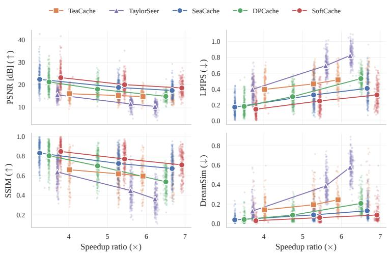  
Figure B.2.1: FLUX DrawBench-200. The four fidelity metrics against achieved speedup for Tea Cache, TaylorSeer, SeaCache, DPCache and SoftCache. Each faint dot is one prompt. Solid markers are per-method means, connected across the three speed bands of Sec. B.1.

VBench scores a video along 16 quality and semantic dimensions. We score the HunyuanVideo samples of Tab. 2 on all 16, each on the prompts VBench tags for it, which together cover all 946 prompts. The VBench protocol samples five videos per prompt, and we generate one, with seed 0, within our compute budget. Totals are therefore lower than published ones for every method, the uncached model included (0.791 against the 0.809 Total that Cui et al. (2026) report), and we compare our runs only with each other (Tabs. B.3.1 and B.3.2).

On the Total SoftCache is ahead of DPCache by 0.001 at the slowest band and 0.003 at the fastest, behind by 0.001 in the middle, and ahead of SeaCache in all three. DPCache is ahead of SoftCache on aesthetic quality, imaging quality, object class and temporal style in all three bands, by up to 0.039, and SoftCache is ahead on background consistency, temporal flickering and appearance style in all three, by up to 0.016, while the remaining dimensions change sides between bands. The two sets offset each other in the Total, and neither measures fidelity to the uncached clip, which Tab. 2 separates by 2.78 dB PSNR at the slowest band.

## C ADDITIONAL ABLATIONS AND ANALYSIS

## C.1 HEADROOM AND REUSE ERROR

Fig. 2a is measured on uncached FLUX trajectories, in the setting of Sec. A.1, on 40 DrawBench prompts. Since nothing is reused, the residual is exact at every node. We can therefore pair every node with every later one, treating the earlier node as the anchor, which gives 1,128 pairs per prompt. For each pair we compute the reuse error $E _ { i }$ and the accumulator $A _ { i } .$ . The first and last nodes are excluded as boundary effects. Panel (a) keeps the pairs a hard cache would reuse, those with $A _ { i }$ below the threshold, and plots their error against the accumulator. Error grows with the accumulator: a node about to trigger a refresh $( A _ { i } \approx \tau )$ has 2.2× the median error of one just after a refresh $( A _ { i } \approx 0 )$ , although a threshold treats the two alike. This is the factor quoted in Sec. 4.1. Since both the error and the accumulator grow with the distance from the anchor, we also check that $A _ { i }$ is more than a step counter: at a fixed gap i − a of 2 to 12 nodes, $A _ { i }$ still orders the pairs by error with a Spearman correlation of about 0.8, computed per prompt and averaged.

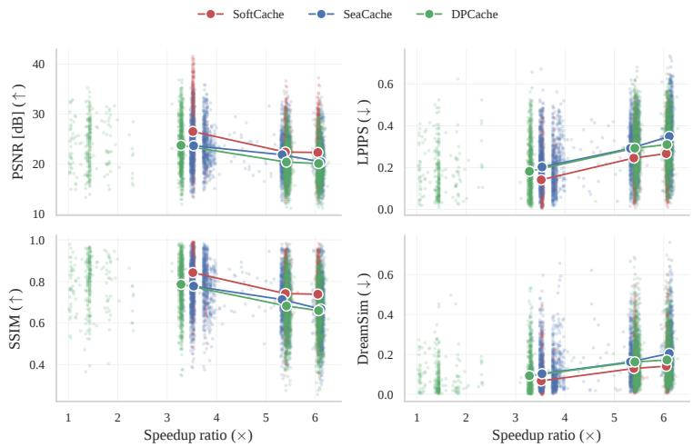  
Figure B.2.2: HunyuanVideo VBench 480p. The four fidelity metrics against achieved speedup. Each faint dot is one prompt. Solid markers are per-method means, connected across the three speed bands of Sec. B.1. SoftCache holds the best mean PSNR, LPIPS, SSIM and DreamSim at all three.

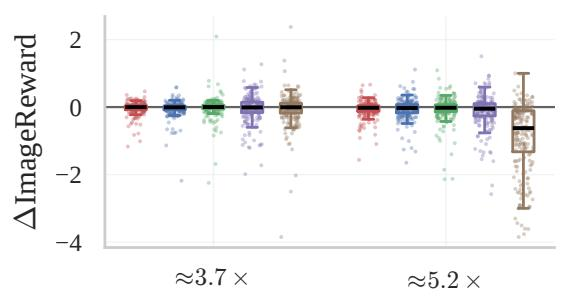  
(a)

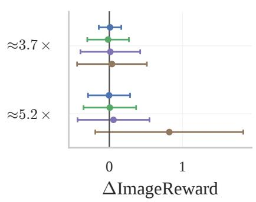  
(b)  
Figure B.3.1: ImageReward on DrawBench-200 with FLUX (one seed, 200 prompts), paired by prompt. (a) Per-prompt change relative to the uncached image, for each cache at the $\approx 3 . 7 \times$ and $\approx 5 . 2 \times$ bands of Tab. 1. (b) Mean per-prompt difference between SoftCache and each baseline in the same band, with bars at one standard deviation of the per-prompt differences. ImageReward separates the methods only where the fidelity metrics already do: TaylorSeer at the $\approx 5 . 2 \times$ band collapses, and every other difference is small against its spread.

Table B.3.1: HunyuanVideo VBench quality dimensions.
<table><tr><td>Method</td><td>Speedup</td><td>Subj. (↑)</td><td>Bkg. (↑)</td><td>Flicker (↑)</td><td>Smooth (↑)</td><td>Aesth. (↑)</td><td>Imag. (↑)</td><td>Dynamic (↑)</td><td>Quality (↑)</td></tr><tr><td>HunyuanVideo</td><td>1.00×</td><td>0.963</td><td>0.965</td><td>0.991</td><td>0.992</td><td>0.601</td><td>0.619</td><td>0.347</td><td>0.810</td></tr><tr><td>SeaCache (Chung et al., 2026)</td><td>3.53×</td><td>0.962</td><td>0.968</td><td>0.991</td><td>0.992</td><td>0.589</td><td>0.591</td><td>0.306</td><td>0.801</td></tr><tr><td>DPCache† (Cui et al., 2026)</td><td>3.28×</td><td>0.964</td><td>0.964</td><td>0.991</td><td>0.993</td><td>0.595</td><td>0.607</td><td>0.319</td><td>0.805</td></tr><tr><td>SoftCache</td><td>3.52×</td><td>0.964</td><td>0.968</td><td>0.992</td><td>0.993</td><td>0.592</td><td>0.597</td><td>0.333</td><td>0.805</td></tr><tr><td>SeaCache (Chung et al., 2026)</td><td>5.33×</td><td>0.960</td><td>0.970</td><td>0.992</td><td>0.992</td><td>0.575</td><td>0.544</td><td>0.306</td><td>0.791</td></tr><tr><td>DPCache† (Cui et al., 2026)</td><td>5.42×</td><td>0.961</td><td>0.959</td><td>0.989</td><td>0.991</td><td>0.589</td><td>0.597</td><td>0.292</td><td>0.797</td></tr><tr><td>SoftCache</td><td>5.39×</td><td>0.960</td><td>0.968</td><td>0.991</td><td>0.992</td><td>0.587</td><td>0.578</td><td>0.333</td><td>0.800</td></tr><tr><td>SeaCache (Chung et al., 2026)</td><td>6.11×</td><td>0.955</td><td>0.969</td><td>0.992</td><td>0.992</td><td>0.562</td><td>0.508</td><td>0.278</td><td>0.781</td></tr><tr><td>DPCache† (Cui et al., 2026)</td><td>6.07×</td><td>0.956</td><td>0.953</td><td>0.987</td><td>0.990</td><td>0.586</td><td>0.598</td><td>0.208</td><td>0.786</td></tr><tr><td>SoftCache</td><td>6.05×</td><td>0.958</td><td>0.969</td><td>0.992</td><td>0.992</td><td>0.580</td><td>0.564</td><td>0.319</td><td>0.796</td></tr></table>

†One sample per prompt (seed 0), for compute reasons, against five in the VBench protocol, so totals are not comparable with published scores: DPCache reports 0.8035 and 0.8023 against an uncached 0.8093 under the five-sample protocol (Cui et al., 2026).

Table B.3.2: HunyuanVideo VBench semantic dimensions and total.
<table><tr><td colspan="12">Method Object (↑) Multi-obj. (↑) Action (↑) Color (↑) Spatial (↑)</td></tr><tr><td>HunyuanVideo</td><td>0.820</td><td>0.658</td><td>0.900</td><td>0.856</td><td>0.621</td><td>0.416</td><td>0.198</td><td>0.237</td><td>0.267</td><td>0.715</td><td>Total (↑) 0.791</td></tr><tr><td>SeaCache (Chung et al., 2026)</td><td>0.860</td><td>0.683</td><td>0.910</td><td>0.888</td><td>0.603</td><td>0.403</td><td>0.200</td><td>0.237</td><td>0.264</td><td>0.723</td><td>0.785</td></tr><tr><td>DPCache† (Cui et al., 2026)</td><td>0.843</td><td>0.704</td><td>0.910</td><td>0.863</td><td>0.586</td><td>0.388</td><td>0.197</td><td>0.239</td><td>0.264</td><td>0.716</td><td>0.787</td></tr><tr><td>SoftCache</td><td>0.832</td><td>0.707</td><td>0.920</td><td>0.900</td><td>0.600</td><td>0.389</td><td>0.199</td><td>0.234</td><td>0.263</td><td>0.722</td><td>0.788</td></tr><tr><td>SeaCache (Chung et al., 2026)</td><td>0.779</td><td>0.606</td><td>0.890</td><td>0.846</td><td>0.574</td><td>0.355</td><td>0.206</td><td>0.227</td><td>0.261</td><td>0.687</td><td>0.771</td></tr><tr><td>DPCache† (Cui et al., 2026)</td><td>0.831</td><td>0.668</td><td>0.910</td><td>0.874</td><td>0.619</td><td>0.392</td><td>0.199</td><td>0.238</td><td>0.264</td><td>0.717</td><td>0.781</td></tr><tr><td>SoftCache</td><td>0.792</td><td>0.681</td><td>0.910</td><td>0.842</td><td>0.572</td><td>0.365</td><td>0.202</td><td>0.234</td><td>0.264</td><td>0.701</td><td>0.780</td></tr><tr><td>SeaCache (Chung et al., 2026)</td><td>0.762</td><td>0.547</td><td>0.910</td><td>0.845</td><td>0.538</td><td>0.369</td><td>0.209</td><td>0.225</td><td>0.258</td><td>0.679</td><td>0.760</td></tr><tr><td>DPCache† (Cui et al., 2026)</td><td>0.813</td><td>0.633</td><td>0.910</td><td>0.871</td><td>0.606</td><td>0.403</td><td>0.200</td><td>0.237</td><td>0.264</td><td>0.711</td><td>0.771</td></tr><tr><td>SoftCache</td><td>0.799</td><td>0.608</td><td>0.930</td><td>0.831</td><td>0.554</td><td>0.332</td><td>0.205</td><td>0.229</td><td>0.262</td><td>0.688</td><td>0.774</td></tr></table>

†One sample per prompt, see the note to Tab. B.3.1.

## C.2 SUBSTITUTING THE STALENESS PROBE

SoftCache assumes nothing of the probe $\rho _ { i }$ of Eq. (6) beyond $\rho _ { i } \geq 0$ and the reset of $A _ { i }$ at a refresh, so either dynamic cache can host it. We use SeaCache’s filtered probe (Chung et al., 2026) throughout. Here we swap in TeaCache’s polynomial-rescaled probe (Liu et al., 2025a) for both the refresh decision and the headroom, hold the rest of SoftCache fixed (J=8, β=1, tail re-spacing, the τ grid), and score both configurations at matched wall-clock budget against both caches on DPG-50 (Tab. C.2.1).

The policy transfers. On TeaCache’s probe, SoftCache improves on TeaCache at every budget and degrades it at none: by 2.92 and 1.32 dB of PSNR at the two lower budgets, and by LPIPS at the two higher ones, where PSNR is level at 0.29 and 0.25 dB. The host sets the ceiling. The same policy on TeaCache’s probe lands 3.6 to 4.2 dB below plain SeaCache, while on SeaCache’s probe it is at or above SeaCache and 3.9 to 10.0 dB above TeaCache. We therefore read this experiment as evidence that jump scheduling and residual motion are portable, not as a comparison between the two caches. It uses one seed and 50 prompts on FLUX, and substitutes the gate and the headroom together, so it does not separate which use of Ai is responsible.

## C.3 CAP SWEEP AND THE BLIND-PICK PROTOCOL

The cap ladder of Tab. C.4.2 fixes J=8 on DPG-50. Smaller caps $( J { = } 3 , \ J { = } 5 )$ are perceptually worse from 5× on. Larger caps are a wash through 5×, gaining PSNR and giving it back on LPIPS and DreamSim, and win only at 7×, where they lose high-frequency texture (Sec. C.4). J=8 is therefore the smallest cap that gives up nothing through 5×. The $7 \times$ band is handled by β instead (Sec. 5.4), which costs no texture. Two blind checks below back this, both on DPG-50 only. In each, one author saw, per prompt, the uncached reference and several unlabeled variants in a random order, with only the speedup shown.

<table><tr><td rowspan="2">T</td><td colspan="3">SoftCache, SeaCache probe</td><td colspan="4">SoftCache, TeaCache probe</td></tr><tr><td>Speedup</td><td>∆PSNR vs. SeaCache</td><td>∆PSNR vs. TeaCache</td><td>Speedup</td><td>∆PSNR vs. SeaCache</td><td>∆PSNR vs. TeaCache</td><td>∆LPIPS vs. TeaCache</td></tr><tr><td>0.3</td><td>2.95×</td><td>+2.93</td><td>+10.00</td><td>3.13×</td><td>-3.61</td><td>+2.92</td><td>+0.138</td></tr><tr><td>0.5</td><td>3.80×</td><td>+2.09</td><td>+7.75</td><td>4.44×</td><td>-3.77</td><td>+1.32</td><td>+0.094</td></tr><tr><td>0.8</td><td>5.43×</td><td>+0.41</td><td>+5.12</td><td>6.09×</td><td>-4.16</td><td>+0.29</td><td>+0.079</td></tr><tr><td>1.1</td><td>6.89×</td><td>+0.04</td><td>+3.94</td><td>7.18×</td><td></td><td>+0.25</td><td>+0.037</td></tr></table>

Table C.2.1: SoftCache on either probe. SoftCache driven by the SeaCache probe (used throughout the paper) or the TeaCache probe, scored at matched wall-clock budget against both caches. Positive values favour SoftCache. Means over 50 DPG prompts, FLUX.1-dev, 50 steps. A dash marks a budget beyond the SeaCache frontier, where the comparison would be extrapolated.

Reject test at 5×. The six variants differ only in the cap, $J \in \{ 1 , 3 , 5 , 8 , 1 2 , 3 2 \}$ , at matched ≈ 5×. The rater rejected any variant visibly worse than the reference, or marked the prompt “can’t tell”. The rule was fixed in advance: keep J=8 if it has the lowest or tied-lowest reject rate, otherwise switch to the cap that is strictly lower. Five prompts were “can’t tell”. On the remaining 45, J=8 was never rejected (0/45), against 2% for J=3 and J=5, 22% for $J { = } 1$ , 53% for J=12 and 91% for J=32, so the rule keeps J=8.

Preference test at 7×. Every cap $J \ge 1 2$ and β=0.5 beat SoftCache at β=1 on both LPIPS and PSNR at this band (Tab. C.4.2). The four variants, all at 6.7–6.9×, are SoftCache at J=8, β=1, the same without residual motion, β=0.5, and J=20. The rater picked the variant closest to the reference, could pick several when no single one stood out, or marked “can’t tell”. Of the 50 prompts, 38 received a pick and 12 were “can’t tell”. β=0.5 was picked on 26 prompts, the variant without residual motion on 15, SoftCache at β=1 on 13 and J=20 on 8. Head to head, β=0.5 beats SoftCache at β=1 19 to 6 (two-sided sign test, p=0.015) and J=20 loses to it 21 to 3 (p<0.001). Picks showed no position bias: the four shuffled slots received 14, 15, 14 and 19 picks.

Both checks are single-rater preference tests, not user studies.

## C.4 ADDITIONAL ABLATION VIEWS

Every result here is FLUX on the 50 DPG-Bench prompts of Sec. 5.4, at the matched wall-clock speedups of Sec. A.1.

Tab. C.4.1 extends the leave-one-out of Sec. 5.4 to the 5× band and adds residual motion, with $\beta { = } 1$ at 3× and $\beta { = } 0 . 5$ above it as in the method we report. The extra band and the extra row do not change the ranking of Sec. 5.4. SoftCache has the lowest LPIPS and DreamSim at every band, by 0.001 LPIPS over the headroom removal at 7×, and removing the jump costs the most PSNR at every band. Removing headroom scaling scores a higher PSNR than SoftCache at 5× and 7×, as does removing residual motion at $7 \times$ . This is the disagreement between PSNR and the perceptual metrics that Sec. D.1 looks at.

Table C.4.1: Component leave-one-out (FLUX, DPG-50). Each row removes one component of SoftCache at matched wall-clock speedup, with β=1 at 3× and β=0.5 above it.
<table><tr><td rowspan="2"></td><td colspan="3">LPIPS (↓)</td><td colspan="3">DreamSim (↓)</td><td colspan="3">PSNR (↑)</td></tr><tr><td>3×</td><td>5×</td><td> $7 \times$ </td><td>3×</td><td> $5 \times$ </td><td>7×</td><td>3×</td><td>5×</td><td>7×</td></tr><tr><td>w/o jumps (J=1)</td><td>0.103</td><td>0.245</td><td>0.548</td><td>0.018</td><td>0.048</td><td>0.199</td><td>24.30</td><td>18.88</td><td>13.67</td></tr><tr><td>w/o headroom (Hi=1)</td><td>0.122</td><td>0.215</td><td>0.330</td><td>0.016</td><td>0.041</td><td>0.082</td><td>25.70</td><td>21.36</td><td>18.17</td></tr><tr><td>w/o re-spacing (mi fixed)</td><td>0.109</td><td>0.231</td><td>0.371</td><td>0.018</td><td>0.045</td><td>0.101</td><td>24.64</td><td>19.65</td><td>16.64</td></tr><tr><td>w/o residual motion (β=0)</td><td>0.117</td><td>0.246</td><td>0.363</td><td>0.018</td><td>0.051</td><td>0.087</td><td>25.50</td><td>20.24</td><td>18.28</td></tr><tr><td>SoftCache</td><td>0.093</td><td>0.207</td><td>0.329</td><td>0.013</td><td>0.037</td><td>0.078</td><td>26.50</td><td>20.61</td><td>17.85</td></tr></table>

Tab. C.4.2 changes one setting at a time against SoftCache at $\beta { = } 1 .$ . The $\beta { = } 0 . 5$ row is the band rule of Sec. 5.4: it loses at $3 \times$ and wins at $7 \times .$ . Caps below 8 lose from 5× on. Caps above 8 trade the slower bands for the fastest one, and what they gain there on the metrics they pay in fine texture: the correlation of high-pass detail between the output and the uncached image falls from 0.32 to between 0.23 and 0.30 at $7 \times$ , while β=0.5 keeps it at 0.32. Beyond 5× the reported method therefore lowers $\beta$ to 0.5 rather than raising the cap, and Sec. C.3 backs the choice with a blind comparison. The remaining rows change little. A second-order term in Eq. (10) is no better than the straight line, at $J { = } 8$ or at $\bar { J } { = } 2 0$ . Removing the two jump guards of Sec. A.3, which hold a cached node to the scheduled step early in sampling and when the probe changes sharply, moves LPIPS by at most 0.022. Spacing the rebuilt tail in the scheduler’s shifted coordinate rather than uniformly in t (Sec. A.4) moves it by at most 0.012.

Table C.4.2: One setting at a time (FLUX, DPG-50). Change against SoftCache at $\beta { = } 1$ at matched wall-clock speedup, signed so that positive is better.
<table><tr><td rowspan="3">Variant</td><td>-∆LPIPS</td><td></td><td colspan="2">∆PSNR</td></tr><tr><td>3×</td><td>5× 7×</td><td>3×</td><td>5× 7×</td></tr><tr><td></td><td> $- 0 . 0 0 9 + 0 . 0 0 4 + 0 . 0 8 0 - 0 . 3 1 + 0 . 7 5 + 1 . 6 5$ </td><td></td><td></td></tr><tr><td> $\beta { = } 0 . 5$ </td><td></td><td></td><td></td><td></td></tr><tr><td>cap J=3  $\mathrm { c a p \ } J { = } 5$ </td><td> $+ 0 . 0 0 4 \ : - 0 . 0 1 4 \ : - 0 . 0 6 7 \ : - 0 . 5 0 \ : - 0 . 3 7 \ : - 1 . 0 2$ </td><td> $+ 0 . 0 0 5 \ - 0 . 0 2 0 \ - 0 . 0 8 5 \ - 0 . 4 7 \ - 0 . 6 3 \ - 1 . 2 8$ </td><td></td><td></td></tr><tr><td> $\mathrm { c a p } \ J { = } 1 2$ </td><td> $- 0 . 0 0 6 \ - 0 . 0 1 4 \ + 0 . 0 2 1 \ + 0 . 8 3 \ + 0 . 1 8 \ + 0 . 4 7$ </td><td></td><td></td><td></td></tr><tr><td> $\mathrm { c a p \ } J { = } 2 0$ </td><td></td><td></td><td></td><td></td></tr><tr><td>cap  $J { = } 3 2$ </td><td> $- 0 . 0 2 5 \ : - 0 . 0 0 5 \ : + 0 . 0 5 0 \ : + 0 . 6 8 \ : + 1 . 1 9 \ : + 1 . 1 2$   $- 0 . 0 5 1 - 0 . 0 2 3 + 0 . 0 6 5 - 0 . 0 8 + 1 . 4 7 + 2 . 3 0$ </td><td></td><td></td><td></td></tr><tr><td>residual motion, 2nd order</td><td> $- 0 . 0 0 2 \ - 0 . 0 0 2 \ - 0 . 0 3 8 \ - 0 . 1 2 \ - 0 . 0 3 \ - 0 . 2 2$ </td><td></td><td></td><td></td></tr><tr><td>residual motion, 2nd order,</td><td></td><td> $J { = } 2 0 \ - 0 . 0 2 6 \ - 0 . 0 0 4 \ + 0 . 0 4 5 \ + 0 . 6 2 \ + 1 . 1 8 \ + 1 . 0 8$ </td><td></td><td></td></tr><tr><td>no jump guards</td><td></td><td> $+ 0 . 0 0 6 \ - 0 . 0 2 2 \ + 0 . 0 0 2 \ + 0 . 5 9 \ - 0 . 2 1 \ - 0 . 6 6$ </td><td></td><td></td></tr><tr><td>tail, shifted spacing</td><td> $- 0 . 0 1 2 \ - 0 . 0 0 2 \neq 0 . 0 0 3 \ - 0 . 2 6 \ + 0 . 0 8 \ + 0 . 0 6$ </td><td></td><td></td><td></td></tr></table>

Tab. C.4.3 asks whether it matters where the jumps fall. SoftCache jumps wherever the headroom allows, so every prompt gets its own positions. Each alternative instead fixes in advance which grid nodes may jump, the same for every prompt: nodes spread evenly over the trajectory, nodes near its end, or nodes drawn at random. A last variant never jumps. A listed node jumps only if it is cached, so these variants jump less often and run slower than SoftCache, and each row is reported as its PSNR gain over SeaCache at that row’s own speedup. For the random lists we report the mean of five draws and the best one, chosen after scoring. Nodes near the start are omitted as a list because almost none of them are cached. At τ=0.3 SoftCache leads every fixed list, by 1.2 dB over the next best. At τ=0.8 the fixed lists trail by 0.1 to 1.3 dB, and never jumping costs 1.5 dB. Because the fixed lists also jump less often, the table shows that where the jumps fall matters, but it does not isolate the value of choosing them per prompt.

Table C.4.3: Where the jumps fall (FLUX, DPG-50). PSNR gain over SeaCache at each variant’s own wall-clock speedup. Jumps is the mean number of jumps per image.
<table><tr><td rowspan="2">Placement</td><td colspan="3">τ=0.3</td><td colspan="3">τ=0.8</td></tr><tr><td>Speedup</td><td>Jumps</td><td>∆PSNR</td><td>Speedup</td><td>Jumps</td><td>∆PSNR</td></tr><tr><td>SoftCache</td><td>2.91×</td><td>5.0</td><td>+3.08</td><td>5.34×</td><td>5.9</td><td>+0.35</td></tr><tr><td>Evenly spaced</td><td>2.56×</td><td>2.0</td><td>+0.92</td><td>4.74×</td><td>3.4</td><td>-0.26</td></tr><tr><td>Near the end</td><td>2.57×</td><td>3.0</td><td>+1.88</td><td>5.25×</td><td>4.0</td><td>+0.10</td></tr><tr><td>Random (best of 5)</td><td>2.43×</td><td>1.0</td><td>+1.69</td><td>5.28×</td><td>5.0</td><td>+0.22</td></tr><tr><td>Random (mean of 5)</td><td>2.49×</td><td>2.0</td><td>+0.98</td><td>5.23×</td><td>4.0</td><td>-0.99</td></tr><tr><td>No jumps</td><td>2.31×</td><td>0.0</td><td>+1.79</td><td>4.23×</td><td>0.0</td><td>-1.16</td></tr></table>

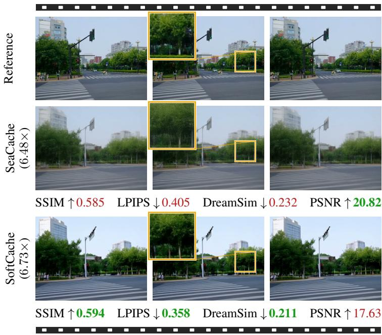  
Figure D.1.1: Higher PSNR, blurrier frames. Four frames of one HunyuanVideo 480p clip at a similar speedup, with green marking the better value on each metric. SeaCache leads on PSNR, yet the inset shows its foliage blurred where SoftCache keeps the leaves. SSIM, LPIPS and DreamSim rank the clip the other way.

## D QUALITATIVE RESULTS

## D.1 WHAT THE FIDELITY METRICS MEASURE

PSNR is a per-pixel error, so it rewards an output that drifts toward a smooth conditional mean and penalises one that keeps sharp detail slightly out of place. At high speedups a blurred output can therefore outscore a sharper one that looks closer to the reference. Fig. D.1.1 shows such a case. On one HunyuanVideo clip at a similar speedup, SeaCache leads SoftCache by 3.19 dB in PSNR, yet its foliage is visibly blurred (inset), and SSIM, LPIPS and DreamSim all favour SoftCache. We therefore report PSNR in every table but never decide on it alone, and we back the ablation choices with blind visual comparisons (Sec. C.3).

## D.2 QUALITATIVE COMPARISONS ACROSS PROMPTS

Fig. D.2.1 compares all methods against the uncached reference on further DrawBench prompts at the ≈6.6× FLUX band of Tab. B.1.1. The speedup under each header is the method’s DrawBench-200 mean from Tab. B.1.1. Tab. D.2.1 gives the full prompt for every row of Figs. 4 and D.2.1.

TaylorSeer degrades on every row at this speed. The other baselines fail in two recurring ways. Some change the content, adding a second trunk to the elephant (elephant row), drawing two carrots (carrot row), or blending the giraffe with a different animal (giraffe row). Others keep the content but lose texture, smoothing the peel (pear row) or covering the tree behind the elephant with a highfrequency pattern (elephant row). SoftCache keeps the content of the reference and gives the most realistic textures (pear, red-car, bear and four-cars rows). SoftCache is the closest method to the reference on all four metrics on every row except the pear, where SeaCache leads PSNR, SSIM and LPIPS with its smoother peel while SoftCache still leads DreamSim.

Fig. D.2.2 returns to the slower ≈ 5.2× band of Fig. 4 on two prompts. SoftCache is the closest method to the reference, and the enlarged crops show this most clearly on the frame of the clock, which SoftCache reproduces more faithfully than any baseline. On the second prompt, of two cats and two dogs, the reference itself draws only one dog, so what counts is the animals it does draw.

Reference

  
TeaCache 5.91×  
TaylorSeer 6.22×  
“An elephant is behind a tree. . . ”

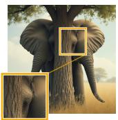  
DPCache 6.50×  
SeaCache 6.66×

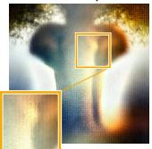

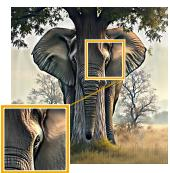

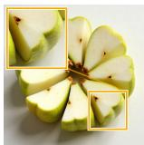  
“A pear cut into seven pieces arranged in a ring.”

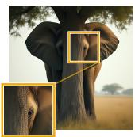

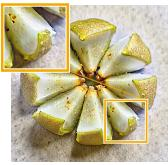

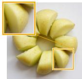

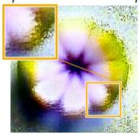

  
“A carrot on the left of a broccoli.”

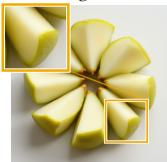

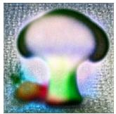

  
“A red colored car.”

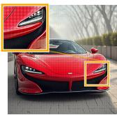

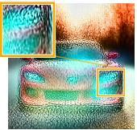  
“A pink colored giraffe.”

  
“A blue bird and a brown bear.”

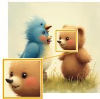

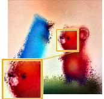

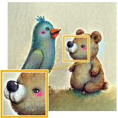

  
“Four cars on the street.”

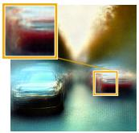

  
“A mechanical or electrical devicefor measuring time.”

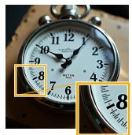

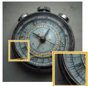

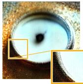

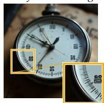  
Figure D.2.1: FLUX at the ≈ 6.6× band, eight DrawBench prompts. Each method’s achieved speedup over DrawBench-200 is under its header (Tab. B.1.1).

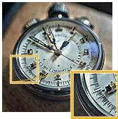  
SoftCache 6.91×

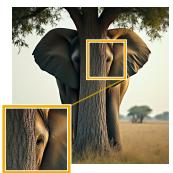

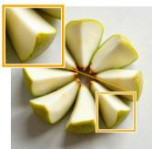

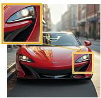

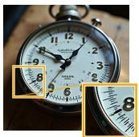

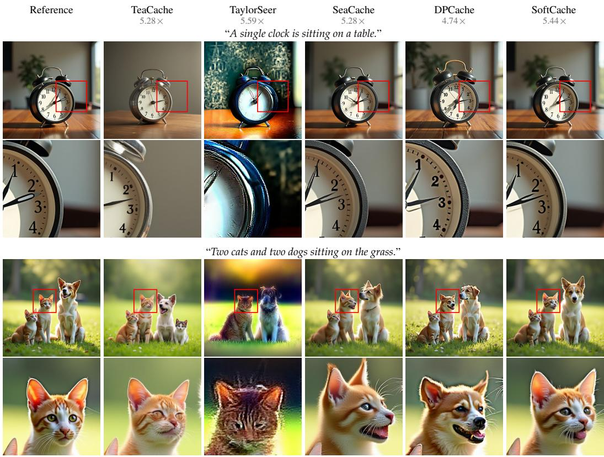  
Figure D.2.2: FLUX on DrawBench at ≈ 5.2× speedup, two prompts enlarged. The row under each prompt enlarges the region in its red box, the frame of the clock and the middle cat, where SoftCache stays closest to the reference.

Some baselines change them, morphing one of the cats, while SoftCache keeps the two cats and the dog of the reference.

The video figures show three frames per clip, with zoom insets and red ellipses marking defects. Fig. D.2.3 adds two HunyuanVideo clips at the ≈ 5.4× band of Fig. 5. On the sweeping clip Sea-Cache blurs the whole scene and DPCache changes the content, drawing a second broom (ellipse), while SoftCache stays sharp and keeps a single broom. On the zebra clip the inset shows DPCache smearing the back of the zebra’s head and SeaCache blurring the background far more than the other methods, while SoftCache keeps both close to the reference.

Fig. D.2.4 repeats the comparison at the slower ≈ 3.5× band. On the harp clip the inset shows that SoftCache keeps the most detail in the hand, and in the last frame DPCache hallucinates a second hand next to the one on the strings (ellipse), so the player has three hands. On the grooming clip SoftCache keeps the dog closest to the reference. SeaCache distorts the dog’s face, and DPCache changes the action and leaves the face less visible.

Fig. D.2.5 repeats the comparison on Wan2.1 at ≈ 3.7×. Across the shown frames, SeaCache and DPCache lose fine detail. Edges soften, high-frequency texture fades, and small structures that are sharp in the reference become smeared. SoftCache retains this detail and stays visually closest to the reference throughout. The inset on the palace pool shows the largest gap, where both baselines distort the pool far more than SoftCache.

Fig. D.2.6 runs HunyuanVideo at its native 1280 × 720, 129-frame resolution, instead of the 640 × 480, 65-frame setting of the tables, against SeaCache at ≈ 4.5× (median speedup over the 720p prompts). SoftCache does not reproduce the reference’s motion exactly but stays consistent with it, while SeaCache has the corgi start a distorted flip in the middle frame that never happens in the reference. By the last frame SeaCache also softens the corgi’s face and the grass, while SoftCache keeps both sharp.

“A person is sweeping floor”  
“a zebra”  
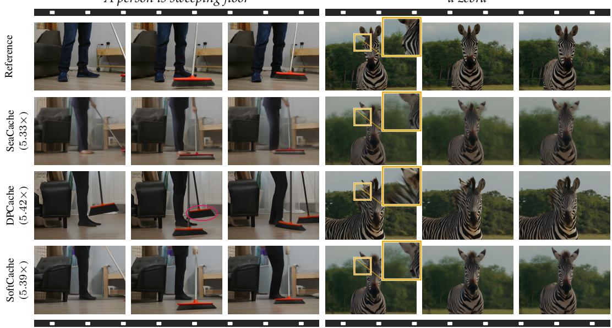  
Figure D.2.3: HunyuanVideo on VBench at ≈ 5.4× speedup, two further clips. Same band, methods and frames as Fig. 5. The red ellipse marks a second broom in DPCache, and the inset enlarges the back of the zebra’s head.

“A person is playing harp”  
“A person is grooming dog”  
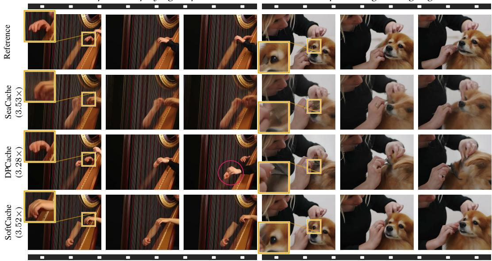  
Figure D.2.4: HunyuanVideo on VBench at ≈ 3.5× speedup. Frames 1, 33 and 65 of 65, with a zoom inset of the boxed region on the first frame. The red ellipse marks a hallucinated second hand in DPCache.

“A tranquil tableau of palace”  
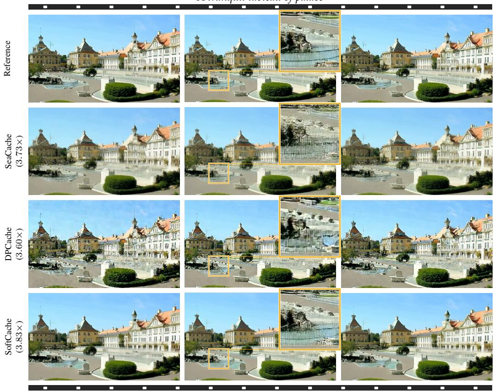  
Figure D.2.5: Wan2.1 on VBench at ≈ 3.7× speedup. Frames 1, 41 and 81 of 81, with each method’s mean speedup at left (Tab. B.1.3) and a zoom inset of the pool on the middle frame. SeaCache and DPCache distort the pool, while SoftCache stays closest to the reference.

“A cute happy Corgi playing in park, sunset, in super slow motion”  
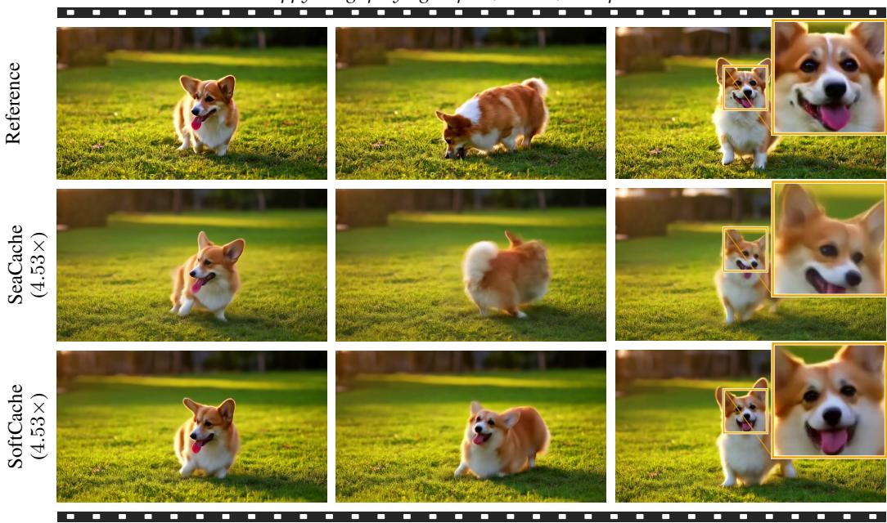  
Figure D.2.6: HunyuanVideo at native 720p, ≈ 4.5× speedup. Frames 1, 65 and 129 of 129, the last frame carrying a zoom inset of the corgi’s face.

Table D.2.1: Prompts of the image qualitative figures, verbatim.
<table><tr><td>Prompt id</td><td>Category</td><td>Text</td></tr><tr><td>Fig. 4</td><td></td><td></td></tr><tr><td>drawbench_133</td><td>Positional</td><td>A zebra to the right of a fire hydrant.</td></tr><tr><td>drawbench_079</td><td>Descriptions</td><td>A device consisting of a circular canopy of cloth on a folding metal frame supported by a central rod, used as protection against rain or sometimes sun.</td></tr><tr><td>drawbench_027</td><td>Conflicting</td><td>A bird scaring a scarecrow.</td></tr><tr><td>Fig. D.2.1</td><td></td><td></td></tr><tr><td>drawbench_098</td><td>Gary Marcus et al.</td><td>An elephant is behind a tree. You can see the trunk on one side and the back legs on the other.</td></tr><tr><td>drawbench_100</td><td>Gary Marcus et al.</td><td>A pear cut into seven pieces arranged in a ring.</td></tr><tr><td>drawbench_128</td><td>Positional</td><td>A carrot on the left of a broccoli.</td></tr><tr><td>drawbench_000</td><td>Colors</td><td>A red colored car.</td></tr><tr><td>drawbench_012</td><td>Colors</td><td>A pink colored giraffe.</td></tr><tr><td>drawbench_016</td><td>Colors</td><td>A blue bird and a brown bear.</td></tr><tr><td>drawbench_038</td><td>Counting</td><td>Four cars on the street.</td></tr><tr><td>drawbench_082</td><td>Descriptions</td><td>A mechanical or electrical device for measuring time.</td></tr><tr><td>Fig. D.2.2</td><td></td><td></td></tr><tr><td>drawbench_061</td><td>DALL-E</td><td>A single clock is sitting on a table.</td></tr><tr><td>drawbench_049</td><td>Counting</td><td>Two cats and two dogs sitting on the grass.</td></tr><tr><td>Fig. 6</td><td></td><td>Dense (DPG-Bench) A man with bright red boxing gloves awkwardly attempts</td></tr><tr><td>dpg-whoops26</td><td></td><td>to play a glossy black grand piano in the center of a room. Around him, the floor is a polished hardwood, reflecting the soft overhead lighting. Despite the gloves, he appears con- centrated, engaged in his unique challenge, with sheet music</td></tr></table>

Table D.2.2: Prompts of the video qualitative figures, verbatim.
<table><tr><td>Prompt id</td><td>VBench dimension</td><td>Text</td></tr><tr><td>Fig. 5</td><td></td><td></td></tr><tr><td>vbad077 vbad687</td><td>multiple_objects overall_consistency,</td><td>a dog and a horse An astronaut feeding ducks on a sunny after-</td></tr><tr><td>Fig. D.2.3</td><td>thetic_quality, imaging-quality</td><td>noon, reflection from the water.</td></tr><tr><td>vbad168</td><td>human_action</td><td>A person is sweeping floor</td></tr><tr><td>vbad351</td><td>object_class</td><td>a zebra</td></tr><tr><td>Fig. D.2.5 vbad015</td><td></td><td>A tranquil tableau of palace</td></tr><tr><td></td><td>temporal_flickering</td><td></td></tr><tr><td>Fig. D.2.4</td><td></td><td></td></tr><tr><td>vbad165</td><td>human_action</td><td>A person is playing harp</td></tr><tr><td>vbad220</td><td>human_action</td><td>A person is grooming dog</td></tr><tr><td></td><td></td><td></td></tr><tr><td>Fig. D.2.6</td><td></td><td></td></tr><tr><td>vbad623</td><td>temporal_style</td><td>A cute happy Corgi playing in park, sunset,</td></tr><tr><td></td><td></td><td>in super slow motion</td></tr><tr><td>Fig. D.1.1</td><td></td><td></td></tr><tr><td></td><td></td><td></td></tr><tr><td></td><td></td><td></td></tr><tr><td></td><td></td><td></td></tr><tr><td></td><td></td><td></td></tr><tr><td></td><td></td><td></td></tr><tr><td></td><td></td><td></td></tr><tr><td></td><td></td><td></td></tr><tr><td></td><td></td><td></td></tr><tr><td>vbad799</td><td>scene, background_consistency</td><td>crosswalk</td></tr><tr><td></td><td></td><td></td></tr><tr><td></td><td></td><td></td></tr><tr><td></td><td></td><td></td></tr><tr><td></td><td></td><td></td></tr><tr><td></td><td></td><td></td></tr><tr><td></td><td></td><td></td></tr><tr><td></td><td></td><td></td></tr><tr><td></td><td></td><td></td></tr><tr><td></td><td></td><td></td></tr><tr><td></td><td></td><td></td></tr><tr><td></td><td></td><td></td></tr><tr><td></td><td></td><td></td></tr><tr><td></td><td></td><td></td></tr><tr><td></td><td></td><td></td></tr><tr><td></td><td></td><td></td></tr><tr><td></td><td></td><td></td></tr><tr><td></td><td></td><td></td></tr><tr><td></td><td></td><td></td></tr><tr><td></td><td></td><td></td></tr><tr><td></td><td></td><td></td></tr><tr><td></td><td></td><td></td></tr><tr><td></td><td></td><td></td></tr><tr><td></td><td></td><td></td></tr></table>