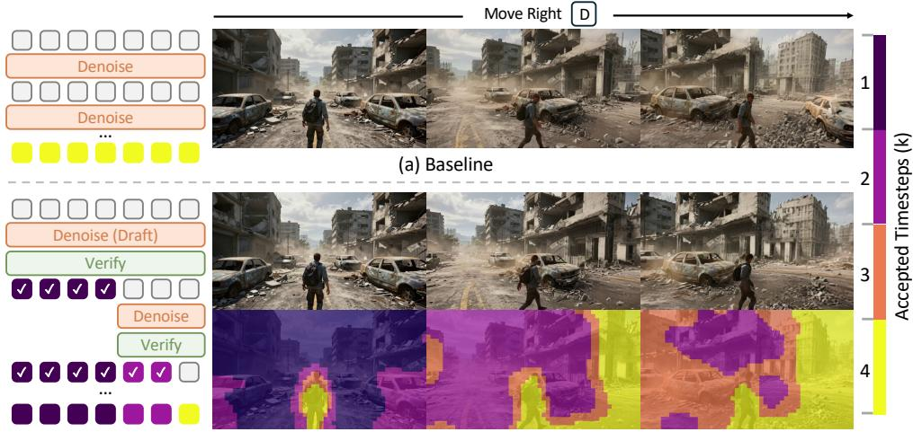
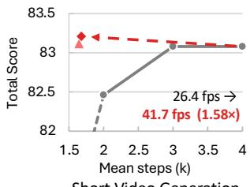
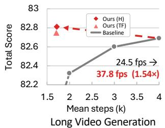
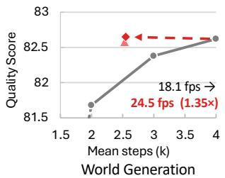
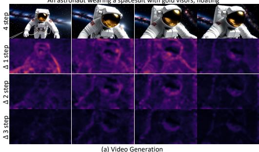
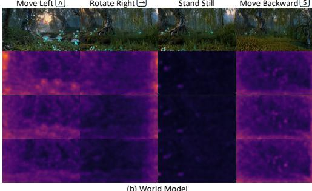
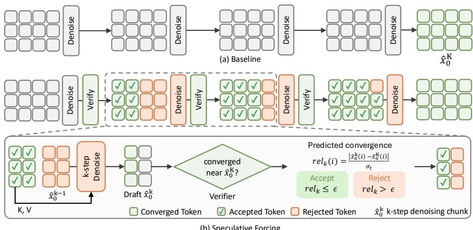
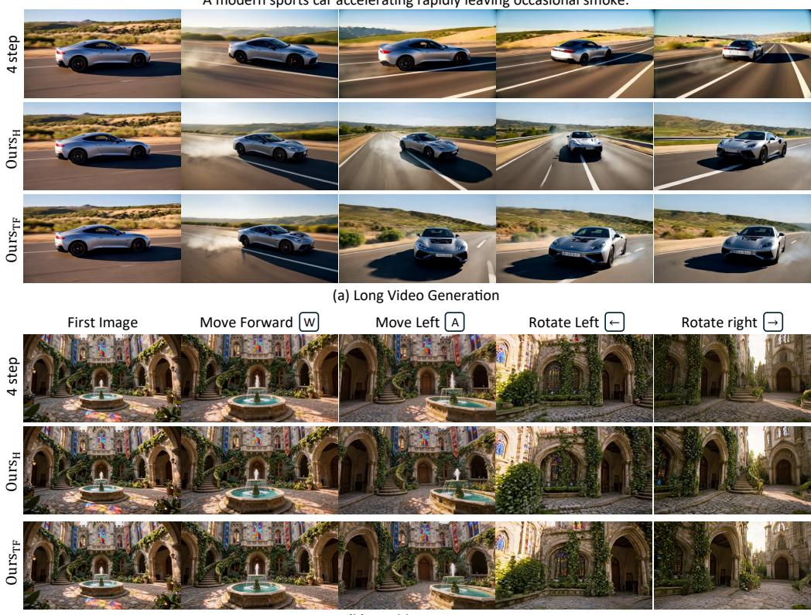
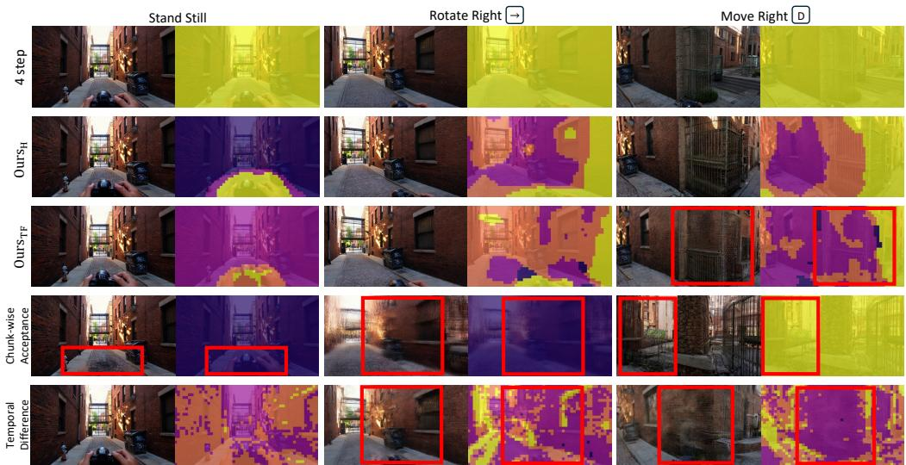

# SPECULATIVE FORCING FOR EFFICIENT AUTOREGRESSIVE VIDEO GENERATION

Hyunwook Choi1∗, Seungryong Kim1, Dongyoon Han†,2, Sangdoo Yun†,2 1KAIST AI, 2NAVER AI Lab

https://speculative-forcing.github.io/

Short Video Generation  
  
(b) Speculative Forcing

  
(c) Inference Efficiency

  
Figure 1: Compared with full-step sampling (a), Speculative Forcing treats intermediate token estimates as drafts, accepts those that have converged, and refines only the rest (b), achieving comparable quality with fewer denoising steps and higher throughput (c).

## ABSTRACT

Few-step autoregressive video generators enable streaming generation, yet they run every token through the final denoising step, regardless of how much refinement it needs. We find this uniform computation is often unnecessary: many tokens already closely match their eventual full-step outputs in the initial steps, while others require refinement until the end. We introduce Speculative Forcing, a framework that treats intermediate clean estimates as drafts and predicts when individual tokens can be safely accepted early. Once accepted, a token is frozen as its final output and undergoes no further denoising, while its cached keys and values remain available as context for the remaining tokens. We explore two alternative verifier designs: a training-free one based on similarity to clean content and stability across steps, and a learned one that reads the frozen generator’s intermediate features to estimate each token’s remaining gap to its full-step output. Across short-video, long-video, and world generation, Speculative Forcing preserves the quality of full-step sampling while substantially reducing computation. On LongLive, it matches the four-step generator with ∼1.7 denoising steps per token, running over 1.5× faster at 41.7 and 37.8 fps. On Lingbot-World 2.0, where camera motion continually changes the visible content, it maintains quality with ∼2.5 denoising steps per token and runs 1.35× faster at 24.5 fps.

## 1 INTRODUCTION

Diffusion models have enabled high-quality image and video generation, with recent video models achieving realistic appearance, natural motion, and faithful prompt following (Team Wan et al., 2025; Kong et al., 2025; Yang et al., 2025b; NVIDIA et al., 2026; Team Seedance et al., 2026). Autoregressive (AR) video generators extend these capabilities to streaming generation (Yin et al., 2025; Huang et al., 2025; Yang et al., 2025a; Liu et al., 2025b; Zhu et al., 2026; Lu et al., 2025) and interactive world models (Team et al., 2026; Gao et al., 2026; He et al., 2026; Wang et al., 2026; Seo et al., 2026; AlayaWorld Team et al., 2026). Within a video, however, different regions may require different amounts of refinement. Some may readily reproduce familiar content from the history, while others must form newly appearing structures or resolve fine details. This raises a fundamental question: Does every token need to be denoised until thefinal step?

We study this question in distilled few-step AR video generators, whose intermediate predictions can already serve as plausible video outputs. Self Forcing (Huang et al., 2025) uses intermediate clean estimates as outputs for distribution-matching training (Yin et al., 2024b;a), making them natural candidates for early commitment. We observe that many tokens already approximate the generator’s own full-step output in the initial steps, while others continue changing until the last step (Figure 2). These differences often follow intuitive patterns. Regions that reproduce previously observed content can settle early, while nearby regions continue refining appearance or motion. Similar variation arises in world models as actions change the observed content. These observations motivate a simple principle: stop denoising tokens once they have converged, and spend the remaining computation only where refinement is still needed.

We introduce Speculative Forcing, a framework that predicts when each token’s estimate has sufficiently converged, allowing individual tokens to be accepted at different steps (Figure 1). Each intermediate clean estimate serves as a draft of the generator’s full-step output. A verifier determines whether to accept the draft or continue refining it. Once accepted, the estimate is fixed as the token’s output and receives no further denoising updates, while retaining its cached keys and values as context for the remaining tokens. This requires predicting whether a token’s current draft is already close to its full-step output without running the remaining denoising steps.

We address this challenge with two verifiers. Because drafts are clean latent estimates, similarity to previously generated content and changes between consecutive estimates of the same token provide evidence of convergence without additional training. Our training-free verifier uses similarity to clean history or reference content at the first step and stability between consecutive drafts at later steps. We also introduce a learned verifier for demanding settings such as world models, leveraging contextual cues encoded in the pretrained generator’s intermediate features. A shallow head trained with the generator frozen predicts each token’s gap to the full-step output, showing that the intermediate features contain cues about how much its predictions will change with further denoising. Both verifiers support token-wise acceptance without modifying the generator’s weights

We evaluate Speculative Forcing on LongLive (Yang et al., 2025a) and the world model Lingbot-World 2.0 (Gao et al., 2026). On both short and long videos, our method maintains the quality of the four-step generator with approximately 1.7 denoising steps per token, running over 1.5× faster at 41.7 and 37.8 fps. On controllable world model rollouts, a harder setting where camera motion continually changes the visible content, it maintains quality with approximately 2.5 denoising steps per token, running 1.35× faster at 24.5 fps.

## 2 RELATED WORK

Autoregressive Video Generation. Autoregressive (AR) video diffusion models generate successive frames or chunks conditioned on preceding content (ai et al., 2025; Chen et al., 2025; 2024a). Distribution matching distillation (Yin et al., 2024b;a) enables few-step generation by aligning the student’s output distribution with a target distribution represented by a pretrained teacher. CausVid applies distribution matching to distill a bidirectional teacher into a causal generator (Yin et al., 2025), while Self Forcing trains on autoregressive rollouts conditioned on the generator’s own outputs (Huang et al., 2025). Causal Forcing revisits this distillation for real-time interactive generation (Zhu et al., 2026; Zhao et al., 2026). LongLive, Rolling Forcing, and Self-Forcing++ extend few-step generation to long streaming videos (Yang et al., 2025a; Liu et al., 2025b; Cui et al., 2025).

“An astronaut wearing a spacesuit with gold visors, floating ”

Move Left A  
Rotate Right →  
  
(b) World Model  
Figure 2: Token-wise convergence during denoising. We visualize latent differences between each chunk’s k-step prediction and the baseline four-step output. (a) In video generation, background and object regions that remain similar to history tend to converge early, while other regions continue to change. (b) In world generation, previously observed regions often converge early, whereas newly revealed regions tend to require further denoising.

The same few-step AR recipe underlies real-time interactive world models, which additionally condition generation on actions or camera trajectories (Team et al., 2026; Gao et al., 2026; He et al., 2026; Wang et al., 2026; Seo et al., 2026; AlayaWorld Team et al., 2026). These generators produce a clean latent estimate at every denoising step, not only the last, so an intermediate estimate can serve as a final output.

Adaptive Denoising. Caching methods accelerate diffusion by reusing intermediate computation across denoising steps (Ma et al., 2023; Chen et al., 2024b; Selvaraju et al., 2024; Zhao et al., 2025; Liu et al., 2025a), including reuse selected per token (Zou et al., 2025) and, in AR video generation, per chunk or by local motion (Ma et al., 2026; Xu et al., 2026). Spatially adaptive samplers redistribute computation within the schedule, with RAS recomputing only the regions the model attends to (Liu et al., 2026) and HSA evaluating each token at a different number of steps along the same noise schedule (Chu & Patel, 2026). In both cases every token is carried to the end of the schedule, so no token is ever declared finished, and the error left by the computation that was skipped has to be kept bounded by periodic full updates. Substituting a previous output also weakens as the schedule shortens, since distilled samplers leave fewer steps over which one output can stand in for the next (Zou et al., 2026).

In Self Forcing-style generators, DSA and Surprise Forcing select denoising depth for an entire frame or chunk, assigning the same number of steps to settled and unsettled regions (Le et al., 2026; Shi et al., 2026). Speculative Forcing instead treats intermediate clean estimates as drafts that can be committed at different steps according to token-wise convergence (Figure 2). It draws on draft verification in speculative decoding (Leviathan et al., 2023; Chen et al., 2023; Zhang et al., 2024), without adopting its exact acceptance rule. Committed tokens receive no further denoising updates, while their cached keys and values remain as context for the remaining tokens.

## 3 METHOD

Speculative Forcing allows individual tokens to stop denoising at different steps. Accepted drafts are fixed as output, while their cached keys and values provide context for tokens that continue denoising (Section 3.2). To determine when to accept each draft, we introduce two verifiers that predict convergence from latent estimates or the generator’s intermediate features (Section 3.3).

## 3.1 PRELIMINARIES

Autoregressive video diffusion. Autoregressive (AR) video diffusion models generate a video as a sequence of latent chunks $\{ c _ { 1 } , c _ { 2 } , \ldots \}$ , each containing one or more consecutive frames. The joint distribution is factorized as $\begin{array} { r } { p ( c _ { 1 } , c _ { 2 } , . . . ) = \prod _ { t } p ( c _ { t } \mid c _ { < t } ) } \end{array}$ , where each conditional distribution is modeled through a diffusion process. At inference, the model generates each chunk by progressively denoising Gaussian noise conditioned on previously generated chunks. We consider generators that use clean history $\mathcal { H } _ { t } = c _ { < t }$ as conditioning and cache its keys and values to avoid recomputing history features during subsequent generation.

  
Figure 3: Speculative Forcing. Baseline runs every token through the full denoising schedule. Speculative Forcing instead treats each token’s intermediate clean estimate as a draft and asks a verifier to predict its remaining gap $\mathrm { r e l } _ { k } ( i )$ to the full-step output. Tokens predicted to have converged are accepted and committed, after which they enter the next step only as keys and values, so the following denoising pass is computed for the rejected tokens alone.

Few-step autoregressive generation. Distilled AR video generators (Yin et al., 2025; Huang et al., 2025; Yang et al., 2025a) reduce the denoising process to K steps, enabling real-time streaming. Each chunk contains N spatiotemporal latent tokens indexed by i. At step $k \in \{ 1 , \ldots , K \}$ , the generator takes the current noisy latent and the clean history as input and predicts a clean estimate $\bar { \hat { x } } _ { 0 } ^ { ( k ) }$ . For $k < K$ , this estimate is re-noised to the next noise level for further denoising, and the final estimate $\hat { x } _ { 0 } ^ { ( K ) }$ is returned as the generated chunk.

These generators can be trained with distribution matching distillation (Yin et al., 2024b;a), which aligns their output distribution with a target distribution represented by a pretrained teacher. In particular, Self Forcing (Huang et al., 2025) trains on autoregressive rollouts conditioned on selfgenerated history and randomly selects a denoising exit step at which to evaluate the distributionmatching objective. Intermediate clean estimates thus receive supervision as generated samples, although the standard inference procedure runs every token through all K steps.

## 3.2 TOKEN-WISE COMMITMENT

Figure 2 shows that tokens approach the full-step output at different rates: some intermediate estimates already closely match their final values, while others continue to change. This motivates committing converged tokens while continuing to refine the rest. Speculative Forcing treats each intermediate token estimate as a draft and uses a verifier to predict whether further denoising would substantially change it (Figure 3). Accepted drafts are committed as final outputs and removed from further denoising, while the remaining tokens continue to be refined.

Commitment and continued denoising. Every token starts active, and the first step produces a draft for every token. At each step $k < K$ , the verifier evaluates the active tokens. An accepted token i has its output fixed to $\hat { x } _ { 0 } ^ { ( k ) } ( i )$ and is excluded from all subsequent denoising forwards. Its layerwise keys and values computed at commitment remain cached, allowing active tokens to continue attending to it. Rejected tokens are re-noised to the next noise level and continue denoising. Any tokens still active at step K are committed at that step.

Let $k ^ { * } ( i )$ denote the commit step of token i. The completed chunk combines estimates accepted at potentially different steps, $c _ { t } ( i ) = \hat { x } _ { 0 } ^ { ( k ^ { * } ( i ) ) } ( i )$ . The base generator’s clean pass over $c _ { t }$ then refreshes the KV cache for subsequent chunks. Commitment reduces the number of denoising token evaluations from KN to $\Sigma _ { i = 1 } ^ { \bar { N } } k ^ { * } ( i )$ , with mean denoising depth $\begin{array} { r } { \bar { k } = \frac { 1 } { N } \sum _ { i = 1 } ^ { N } k ^ { * } ( i ) } \end{array}$ . Both methods additionally perform N token evaluations for the clean pass.

Convergence criterion. To decide which drafts can be accepted, we measure how closely an intermediate estimate agrees with the generator’s full-step output. Here, $\hat { x } _ { 0 } ^ { ( K ) }$ denotes the output of the original generator with every token evaluated at all K steps, using the same initial noise and conditioning. This reference measures the change that remains under the original denoising schedule.

We normalize the distance by $\sigma _ { t } .$ the median token norm in the full-step output of chunk t, and define the convergence gap as

$$
\operatorname { r e l } _ { k } ( i ) = { \frac { \left\| { \hat { x } } _ { 0 } ^ { ( k ) } ( i ) - { \hat { x } } _ { 0 } ^ { ( K ) } ( i ) \right\| _ { 2 } } { \sigma _ { t } } } , \qquad { \mathrm { ~ f o r ~ } } k < K .\tag{1}
$$

A draft meets the convergence criterion when re $\mathrm { l } _ { k } ( i ) \leq \epsilon .$ Since the full-step output is unavailable during early commitment, this gap serves as an oracle and is used as the ground truth in eq. (2).

## 3.3 CONVERGENCE VERIFICATION

To make acceptance decisions before the full-step output is available, we seek evidence of convergence in the current draft and the features used to produce it. The draft can be compared with clean content or its own previous estimate, motivating a training-free verifier. The generator’s intermediate features provide additional contextual information, which a learned verifier uses to predict the convergence gap. Since latent tokens encode content across multiple output frames, isolated acceptance decisions can affect both spatial and temporal coherence. We therefore apply a spatiotemporal smoothing operator S to each verifier’s scores before thresholding, encouraging coherent decisions across neighboring tokens.

## 3.3.1 TRAINING-FREE VERIFIER

At the first step, only one draft exists, so a token’s own change cannot be observed. We therefore rely on its redundancy with content that is already clean. From the second step on, we judge convergence by how much the token’s consecutive drafts differ.

Redundancy-based verification. We observe that drafts resembling previously generated or reference content often have smaller remaining changes (Figure 2). This motivates similarity to clean content as a proxy for convergence. At the first step, we score each token by the distance from its draft to the most similar clean latent token, $\begin{array} { r } { s _ { \mathrm { r e d } } \bar { ( i ) } \stackrel { - } { = } \operatorname* { m i n } _ { h \in \mathcal { H } } \left\| \hat { x } _ { 0 } ^ { ( 1 ) } ( i ) - h \right\| _ { 2 } } \end{array}$ , where H contains clean latent tokens from previous chunks within the generator’s attention window and any reference frames, including those retained as attention sinks. The search covers all spatial positions within this bank to accommodate camera and object motion. Tokens with $S [ s _ { \mathrm { r e d } } ] ( i ) \stackrel { - } { \ } \tau _ { \mathrm { r e d } }$ are accepted.

Stability-based verification. From the second step on, two consecutive drafts of the same active token are available. Their difference measures how much the token’s estimate has changed over the latest denoising step, $s _ { \mathrm { s t a b } } ^ { ( k ) } ( i ) = \left. \hat { x } _ { 0 } ^ { ( k ) } ( i ) - \hat { x } _ { 0 } ^ { ( k - 1 ) } ( i ) \right. _ { 2 }$ for $2 \leq k < K$ . Active tokens with $S [ s _ { \mathrm { s t a b } } ^ { ( k ) } ] ( i ) ~ \le ~ \tau _ { \mathrm { s t a b } }$ are accepted. Both thresholds are calibrated on held-out data. Tokens whose drafts closely match clean content can thus be committed at the first step, while tokens with sufficiently small changes between consecutive drafts can be committed at later steps. Tokens that satisfy neither condition run the full schedule.

## 3.3.2 LEARNED VERIFIER

Redundancy and stability are proxies for convergence rather than convergence itself. A token can match the history and still need refinement, or change little between two steps and yet remain far from its final value. The learned verifier instead predicts the convergence gap directly from the generator’s own features. A shallow convolutional head suffices for this prediction, indicating that the intermediate features contain information about each token’s remaining discrepancy to the fullstep output.

Training. The head takes the hidden state of a selected backbone layer at step k and outputs a predicted gap ${ \hat { r } } _ { k } ( i )$ for each token. It consists of layer normalization followed by three 3D convolutions and is shared across all steps. We run the frozen generator for the full K steps and collect intermediate hidden states together with their oracle convergence gaps. Only the head is trained, using a

Huber loss,

$$
\mathcal { L } ( \phi ) = \frac { 1 } { N ( K - 1 ) } \sum _ { i = 1 } ^ { N } \sum _ { k = 1 } ^ { K - 1 } \mathrm { s m o o t h } _ { \ell _ { 1 } } \big ( \hat { r } _ { k } ( i ) , \mathrm { r e l } _ { k } ( i ) \big ) ,\tag{2}
$$

where ϕ denotes the head parameters.

Verification. At inference, we retain the last hidden states of committed tokens and update those of active tokens, preserving the token grid for the convolutional head. At each step $k < K$ , the head predicts ${ \hat { r } } _ { k } ( i )$ , and active tokens with $S [ \hat { r } _ { k } ] ( i ) \le \epsilon$ are accepted.

Because the head predicts the convergence gap itself, ϵ sets a tolerance on the predicted discrepancy to the full-step output. Local smoothing encourages spatially and temporally coherent decisions. Adjusting ϵ controls the speed-quality trade-off at inference without retraining or fine-tuning.

## 4 EXPERIMENT

We evaluate Speculative Forcing on autoregressive video generation and world modeling. We compare generation quality and inference speed against uniform-step sampling, and examine whether preserving settled predictions while selectively refining the remaining tokens reduces error drift during autoregressive rollouts. We further analyze the verification tolerance, token selection, and the granularity of step allocation.

## 4.1 EXPERIMENTAL DETAILS

Experimental setups. We apply our method to LongLive (Yang et al., 2025a) (1.3B) and the Causal-Fast model of Lingbot-World 2.0 (Gao et al., 2026) (1.3B), both using four denoising steps. We keep both generators frozen and evaluate training-free and learned verifiers. For LongLive, we train the learned verifier on full-step rollouts from 1K VidProM (Wang & Yang, 2024) prompts following the generator’s original training rollout procedure. For Lingbot, we collect training rollouts from 1K initial images with scenes disjoint from evaluation, using the same random camera-trajectory sampling and rollout protocol as evaluation. Both use the same 3-layer 3D convolutional head with negligible overhead. $\mathrm { \bf u r s _ { H } }$ uses the head verifier, while ${ \mathrm { O u r s } } _ { \mathrm { T F } }$ uses the training-free verifier.

The verification tolerance can be adjusted at inference without retraining. We set the learned verifier’s tolerance to $\epsilon = 0 . 2 8$ for short videos and use a more conservative $\epsilon = 0 . 2 4$ for long videos and world model rollouts. For each setting, we calibrate the training-free thresholds $( \tau _ { \mathrm { r e d } } , \tau _ { \mathrm { s t a b } } )$ on held-out calibration data against the oracle convergence criterion re $\mathrm { l } _ { k } ( i ) \le \epsilon$ , using the same tolerance as the learned verifier. We compare against uniform sampling with one, two, three, and four denoising steps and report mean denoising steps and throughput on a single NVIDIA H100. Implementation details are provided in Appendix A.

Evaluation. For LongLive, we evaluate 5-second videos using the VBench prompts rewritten by Self Forcing (Huang et al., 2025), with five random seeds per prompt, and report all 16 VBench dimensions (Huang et al., 2023). We also generate 30-second videos with the same prompt set and evaluate all 16 dimensions using VBench-Long (Huang et al., 2024), following the protocol of LongLive (Yang et al., 2025a).

We further evaluate Lingbot on 200 held-out navigation scenes to examine performance under substantial changes in visible content and pronounced intermediate distortions. Each scene provides an initial image, a text prompt, and a camera trajectory composed of five segments with randomly sampled camera actions and motion speeds. We generate 253 frames per scene and report a VBench quality aggregate over six dimensions, excluding temporal flickering. We also report relative camera-pose error against the commanded ground-truth trajectory to assess whether accelerated sampling follows the camera path as faithfully as the four-step generator. For both long videos and world model rollouts, we additionally report the Drift metric of Reward Forcing (Lu et al., 2025), which measures temporal variation in imaging quality across video segments. All methods share the same conditioning inputs and sampling seeds. Metric definitions and benchmark construction are detailed in Appendix B.

## 4.2 EXPERIMENTAL RESULTS

Table 2: Comparison on 30s long videos with LongLive. Evaluated on VBench-Long.
<table><tr><td rowspan="2">Method</td><td rowspan="2">Mean Steps ↓</td><td rowspan="2">Through. (FPS)</td><td rowspan="2">Drift ↓</td><td rowspan="2">Total</td><td rowspan="2"></td><td rowspan="2">Quality Semantic Score ↑ Score ↑ Score ↑</td><td colspan="6">VBench-Long dimension scores ↑</td></tr><tr><td>Subject Consistency</td><td>Background Consistency</td><td>Motion Smoothness</td><td>Dynamic Degree</td><td>Aesthetic Quality</td><td>Imaging Quality</td></tr><tr><td colspan="10">LongLive (Yang et al., 2025a)</td></tr><tr><td></td><td></td><td></td><td></td><td></td><td></td><td></td><td></td><td></td><td></td><td></td><td></td></tr><tr><td>1-step</td><td>1.00</td><td>61.6 40.9</td><td>2.930 1.992</td><td>80.82 82.32</td><td>81.87 82.99</td><td>76.64 79.61</td><td>96.94 97.67</td><td>95.76 96.38</td><td>98.24 98.60</td><td>49.63 44.81</td><td>60.09 63.81</td></tr><tr><td>2-step</td><td>2.00 3.00</td><td>30.6</td><td>1.738</td><td>82.60</td><td>83.09</td><td>80.67</td><td>98.09</td><td>96.75</td><td>98.77 38.98</td><td>62.92</td><td>67.66</td></tr><tr><td>3-step 4-step</td><td>4.00</td><td>24.5</td><td>1.722</td><td>82.69</td><td>83.29</td><td>80.30</td><td>98.22</td><td>96.99</td><td>39.17</td><td>63.71 64.43</td><td>68.69 68.52</td></tr><tr><td>OursTF</td><td>1.71</td><td>38.8</td><td>1.685</td><td>82.75</td><td>83.28</td><td>80.65</td><td>98.11</td><td>96.77</td><td>98.85 98.74</td><td>41.57 63.83</td><td>68.27</td></tr><tr><td></td><td>1.72</td><td>37.8</td><td>1.707</td><td>82.81</td><td>83.32</td><td>80.77</td><td>98.22</td><td>96.79</td><td>98.75</td><td>40.74 63.95</td><td></td></tr><tr><td>Oursí</td><td></td><td></td><td></td><td></td><td></td><td></td><td></td><td></td><td></td><td></td><td>68.66</td></tr></table>

Table 3: World-model comparison on dynamic videos. Results with the autoregressive Lingbot-World 2.0 (Gao et al., 2026), evaluated on VBench. RPE is the relative pose error of the camera trajectory. Quality Score aggregates the six dimensions reported here.
<table><tr><td rowspan="2">Method</td><td rowspan="2">Mean Steps ↓</td><td rowspan="2">Through. (FPS)</td><td colspan="2">RPE</td><td rowspan="2">Drift ↓</td><td rowspan="2">Quality Score ↑</td><td colspan="6">VBench dimension scores ↑</td></tr><tr><td></td><td></td><td>Subject Consistency</td><td>Background Consistency</td><td>Motion Smoothness</td><td>Dynamic Degree</td><td>Aesthetic Quality</td><td>Imaging Quality</td></tr><tr><td colspan="10">Lingbot-World 2.0 (Gao et al., 2026)</td><td></td><td></td><td></td></tr><tr><td>1-step</td><td>1.00</td><td>46.9</td><td>0.552</td><td>0.3605.579</td><td></td><td>77.19</td><td>81.31</td><td>87.23</td><td>96.98</td><td>96.50</td><td>58.38</td><td>66.63</td></tr><tr><td>2-step</td><td>2.00</td><td>30.7</td><td>0.345</td><td>0.255</td><td>3.999</td><td>81.68</td><td>87.71</td><td>90.28</td><td>97.10</td><td>98.50</td><td>65.98</td><td>70.65</td></tr><tr><td>3-step</td><td>3.00</td><td>22.8</td><td>0.329</td><td>0.251</td><td>3.361</td><td>82.38</td><td>88.42</td><td>90.67</td><td>97.13</td><td>99.00</td><td>67.14</td><td>71.61</td></tr><tr><td>4-step</td><td>4.00</td><td>18.1</td><td>0.328</td><td>0.253</td><td>3.094</td><td>82.62</td><td>88.50</td><td>90.83</td><td>97.23</td><td>99.00</td><td>67.18</td><td>72.24</td></tr><tr><td>OursTF</td><td>2.53</td><td>24.7</td><td>0.329</td><td>0.259</td><td>2.926</td><td>82.58</td><td>88.47</td><td>90.57</td><td>97.16</td><td>99.00</td><td>67.17</td><td>72.69</td></tr><tr><td>Oursí</td><td>2.55</td><td>24.5</td><td>0.328</td><td>0.2602.839</td><td></td><td>82.65</td><td>88.56</td><td>90.62</td><td>97.12</td><td>99.00</td><td>67.55</td><td>72.65</td></tr></table>

Short video generation. Table 1 compares generation quality and efficiency on 5-second videos. Both verifiers maintain the overall VBench performance of the four-step generator while using fewer than 1.7 denoising steps per token on average. By accepting settled predictions early and continuing to refine the remaining tokens, our method preserves generation quality with less than half the denoising token evaluations of the original schedule.

Long video generation. Table 2 reports results on long video generation. The training-free verifier retains competitive quality with a small loss in consistency, while the learned verifier maintains both the quality and consistency of the four-step generator. Both verifiers use approximately 1.7 denoising steps per token on average and achieve lower Drift than the four-step generator. Both also maintain comparable dynamic degree, suggesting that the reduced quality variation is not simply a consequence of suppressing motion.

Table 1: Comparison on 5s videos with LongLive. Mean Steps is the measured average number of denoising passes per token. Standard VBench 16-dimension protocol, throughput on a single H100.
<table><tr><td rowspan="2">Mean Through. Method Steps ↓ (FPS)</td><td></td><td>Evaluation scores ↑</td></tr><tr><td></td><td>Total Quality Semantic</td></tr><tr><td colspan="4">LongLive (Yang et al., 2025a)</td></tr><tr><td>1-step 1.00</td><td>67.97</td><td>79.06 80.03</td><td>75.17</td></tr><tr><td>2-step 2.00</td><td>44.54</td><td>82.46 83.06</td><td>80.09</td></tr><tr><td>3-step 3.00</td><td>33.15</td><td>83.08 83.45</td><td>81.58</td></tr><tr><td>4-step 4.00</td><td>26.40</td><td>83.08 83.49</td><td>81.43</td></tr><tr><td>OursTF 1.65</td><td>43.61</td><td>83.12 83.51</td><td>81.56</td></tr><tr><td>Oursí 1.68</td><td>41.74</td><td>83.21 83.54</td><td>81.89</td></tr></table>

World generation. Table 3 reports results on world generation, a more challenging setting in which camera control induces substantial changes across the visible scene. Accordingly, our methods tend to allocate more denoising steps than in standard video generation. Despite this increased difficulty, the training-free verifier remains competitive in quality while maintaining low Drift. The learned verifier preserves quality and consistency comparable to the four-step generator while achieving lower Drift. Camera-pose errors against the commanded trajectory also remain comparable, indicating that acceleration preserves camera-following accuracy.

Qualitative results. Figure 4 compares our generations with the corresponding four-step generators. On both LongLive and Lingbot, our method preserves visual quality comparable to four-step generation without noticeable degradation over time. On LongLive, it maintains subject identity and image quality even in scenes with dynamic objects. On Lingbot, previously observed regions remain coherent under large camera motion, while newly revealed regions are further refined, yielding consistent transitions between accepted and refined areas.

“A modern sports car accelerating rapidly leaving occasional smoke.”

(b) World Generation

  
Figure 4: Qualitative comparisons on video generation and world modeling. Both our head and training-free verifiers preserve visual quality comparable to the four-step baseline without visibly increasing quality drift over the illustrated rollouts on our benchmark.

## 4.3 ABLATION STUDIES

We examine how verification tolerance, verification signals, and acceptance granularity affect generation quality and efficiency. Figure 5 provides representative qualitative comparisons of the alternative policies. We further evaluate how accurately each verification signal predicts the oracle in Appendix C.1 and provide additional ablations on our head in Appendix C.2.

Effect of verification tolerance. Table 4 shows how ϵ controls the quality-efficiency trade-off on Lingbot. Increasing ϵ reduces mean denoising steps, with ϵ = 0.20 and ϵ = 0.24 maintaining the four-step generator’s quality while achieving lower Drift. Larger tolerances accept insufficiently refined drafts and degrade quality, highlighting the need to balance early acceptance with further refinement.

Effect of verification signals. We adapt two existing selection criteria to token-wise commitment in latent space. Inspired by MotionCache (Xu et al., 2026), we measure temporal differences between adjacent latent frames at the same spatial position. We also adapt RAS’s predicted-noise dispersion signal (Liu et al., 2026) to the channel variance of each predicted clean latent token. Thresholds are calibrated on held-out data to obtain comparable mean denoising steps. As shown in Table 5, both adapted signals yield lower quality than our learned verifier and uniform sampling at similar mean steps. Temporal differences, for example, can reflect both camera-induced changes and intermediate distortions, limiting their reliability as convergence signals (Figure 5). These results support directly predicting each draft’s remaining convergence gap.

Comparison with oracle verification. We additionally evaluate an oracle verifier that computes the full-step reference for each chunk using the same initial noise and conditioning, then uses the measured convergence gaps to determine token acceptance. We apply the same tolerance and spatiotemporal smoothing as the learned verifier. Our learned verifier achieves generation quality comparable to oracle verification without computing the full-step reference at inference (Table 5).

  
Figure 5: Qualitative ablations of verification and commitment granularity. Our learned verifier handles distortions that challenge training-free verification. Premature chunk-wise acceptance propagates errors to later chunks, while motion-based verification struggles to distinguish camerainduced changes from distortions.

Table 4: One test-time threshold sweeps speed against quality. $\mathrm { A t } \ \epsilon \in \ [ 0 . 2 0 , 0 . 2 4 ]$ our sampler exceeds the uniform 4-step baseline on quality metrics. Drift is lowest in this range, not at the full budget.  
Table 5: Routing-strategy comparison on world generation benchmark on Lingbot-World 2.0. Every method is recalibrated on ϵ = 0.24. Oracle measures the true residual by running all steps for each chunk; therefore, we report no throughput (N/A).
<table><tr><td>Tolerance €</td><td>Mean Through. Steps ↓ (FPS) ↑</td><td>Quality ↑</td><td>Quality ↑</td><td>Imaging Drift ↓</td></tr><tr><td>€ = 0.16</td><td>3.47</td><td>20.1</td><td>82.56</td><td>72.43 3.010</td></tr><tr><td> $\epsilon = 0 . 2 0$ </td><td>2.95</td><td>22.4</td><td>82.72</td><td>72.64 2.862</td></tr><tr><td>€ = 0.24</td><td>2.55</td><td>24.5</td><td>82.65 72.65</td><td>2.839</td></tr><tr><td>€ = 0.28</td><td>2.24</td><td>26.4</td><td>82.53</td><td>72.32 2.943</td></tr><tr><td>€ = 0.32</td><td>1.97</td><td>28.3</td><td>82.07</td><td>71.69 3.398</td></tr><tr><td>Uniform 4-step</td><td>4.00</td><td>18.1</td><td>82.62</td><td>72.24 3.094</td></tr></table>

<table><tr><td>Method</td><td>Mean Through. Steps ↓ (FPS) ↑</td><td></td><td>Quality ↑</td><td>Imaging Drift Quality ↑ ↓</td><td></td></tr><tr><td>Channel Variance</td><td>2.60</td><td>24.2</td><td>78.23</td><td>66.59</td><td>4.996</td></tr><tr><td>Temporal Difference</td><td>2.58</td><td>24.4</td><td>80.97</td><td>70.22</td><td>4.116</td></tr><tr><td>Chunk-wise Acceptance 2.61</td><td></td><td>25.2</td><td>82.54</td><td>72.26</td><td>3.214</td></tr><tr><td>OurstF</td><td>2.53</td><td>24.7</td><td>82.58</td><td>72.69</td><td>2.926</td></tr><tr><td>Oursí</td><td>2.55</td><td>24.5</td><td>82.65</td><td>72.65</td><td>2.839</td></tr><tr><td>Oracle</td><td>2.46</td><td>(N/A)</td><td>82.61</td><td>72.60</td><td>2.903</td></tr><tr><td>Uniform 4-step</td><td>4.00</td><td>18.1</td><td>82.62</td><td>72.24</td><td>3.094</td></tr></table>

Effect of token-wise commitment. Adaptive denoising has been explored at frame and chunk granularity (Le et al., 2026; Shi et al., 2026). To isolate commitment granularity, we use the same learned verifier but accept an entire chunk when its mean predicted convergence gap falls below a threshold at each step. The threshold is calibrated on held-out data against the oracle criterion to match our mean denoising steps. As shown in Table 5, token-wise commitment achieves higher quality and lower Drift at comparable mean denoising steps. Chunk-wise acceptance cannot distinguish tokens that have already converged from those that continue to change, resulting in lower quality and higher Drift when all tokens share the same acceptance step (Figure 5).

## 5 CONCLUSION

We introduced Speculative Forcing, a framework that allocates denoising computation according to token-wise convergence in few-step autoregressive video generation. By treating intermediate clean estimates as drafts, it predicts which tokens can be accepted early and continues denoising only the remaining tokens. Training-free and learned verifiers enable these decisions without modifying the generator’s weights. Experiments on short and long videos and controllable world model rollouts demonstrate faster generation while maintaining quality, with comparable or lower quality variation and preserved camera-following accuracy in world modeling. These results show that a shared denoising depth is not necessary for every token, supporting convergence-based acceptance as a practical approach to efficient video generation.

## REFERENCES

Sand. ai, Hansi Teng, Hongyu Jia, Lei Sun, Lingzhi Li, Maolin Li, Mingqiu Tang, Shuai Han, Tianning Zhang, W. Q. Zhang, Weifeng Luo, Xiaoyang Kang, Yuchen Sun, Yue Cao, Yunpeng Huang, Yutong Lin, Yuxin Fang, Zewei Tao, Zheng Zhang, Zhongshu Wang, Zixun Liu, Dai Shi, Guoli Su, Hanwen Sun, Hong Pan, Jie Wang, Jiexin Sheng, Min Cui, Min Hu, Ming Yan, Shucheng Yin, Siran Zhang, Tingting Liu, Xianping Yin, Xiaoyu Yang, Xin Song, Xuan Hu, Yankai Zhang, and Yuqiao Li. Magi-1: Autoregressive video generation at scale, 2025. URL https://arxiv.org/abs/2505.13211.

AlayaWorld Team, Kaipeng Zhang, Chuanhao Li, Yifan Zhan, Yongtao Ge, Yuanyang Yin, Jiaming Tan, Kang He, Liaoyuan Fan, Mingliang Zhai, Ruicong Liu, Xiaojie Xu, Xuangeng Chu, Zhen Li, Zhengyuan Lin, Zhixiang Wang, Zian Meng, and Zihui Gao. Alayaworld: Interactive longhorizon world modeling – full technical report, 2026. URL https://arxiv.org/abs/ 2607.18367.

Boyuan Chen, Diego Marti Monso, Yilun Du, Max Simchowitz, Russ Tedrake, and Vincent Sitz mann. Diffusion forcing: Next-token prediction meets full-sequence diffusion, 2024a. URL https://arxiv.org/abs/2407.01392.

Charlie Chen, Sebastian Borgeaud, Geoffrey Irving, Jean-Baptiste Lespiau, Laurent Sifre, and John Jumper. Accelerating large language model decoding with speculative sampling, 2023. URL https://arxiv.org/abs/2302.01318.

Guibin Chen, Dixuan Lin, Jiangping Yang, Chunze Lin, Junchen Zhu, Mingyuan Fan, Hao Zhang, Sheng Chen, Zheng Chen, Chengcheng Ma, Weiming Xiong, Wei Wang, Nuo Pang, Kang Kang, Zhiheng Xu, Yuzhe Jin, Yupeng Liang, Yubing Song, Peng Zhao, Boyuan Xu, Di Qiu, Debang Li, Zhengcong Fei, Yang Li, and Yahui Zhou. Skyreels-v2: Infinite-length film generative model, 2025. URL https://arxiv.org/abs/2504.13074.

Pengtao Chen, Mingzhu Shen, Peng Ye, Jianjian Cao, Chongjun Tu, Christos-Savvas Bouganis, Yiren Zhao, and Tao Chen. δ-dit: A training-free acceleration method tailored for diffusion transformers, 2024b. URL https://arxiv.org/abs/2406.01125.

Hyunwook Choi, Dahyun Chung, Hyunsung Kim, Siyoon Jin, Jinhyeok Choi, Junyoung Seo, and Seungryong Kim. World observer: Joint actor-observer generation for persistent world modeling, 2026. URL https://arxiv.org/abs/2610.02162.

Ernie Chu and Vishal M. Patel. Not all tokens need 40 steps: Heterogeneous step allocation in diffusion transformers for efficient video generation, 2026. URL https://arxiv.org/abs/ 2605.06892.

Justin Cui, Jie Wu, Ming Li, Tao Yang, Xiaojie Li, Rui Wang, Andrew Bai, Yuanhao Ban, and Cho-Jui Hsieh. Self-forcing++: Towards minute-scale high-quality video generation, 2025. URL https://arxiv.org/abs/2510.02283.

Zelin Gao, Qiuyu Wang, Jiapeng Zhu, Jingye Chen, Zichen Liu, Qingyan Bai, Jiahao Wang, Yufeng Yuan, Hanlin Wang, Yichong Lu, Ka Leong Cheng, Haojie Zhang, Jian Gao, Tianrui Feng, Yuzheng Liu, Yao Yao, Yinghao Xu, Xing Zhu, Yujun Shen, and Hao Ouyang. Infinite worlds with versatile interactions, 2026. URL https://arxiv.org/abs/2607.07534.

Xianglong He, Chunli Peng, Zexiang Liu, Boyang Wang, Yifan Zhang, Qi Cui, Fei Kang, Biao Jiang, Mengyin An, Yangyang Ren, Baixin Xu, Hao-Xiang Guo, Kaixiong Gong, Size Wu, Wei Li, Xuchen Song, Yang Liu, Yangguang Li, and Yahui Zhou. Matrix-game 2.0: An open-source real-time and streaming interactive world model, 2026. URL https://arxiv.org/abs/ 2508.13009.

Xun Huang, Zhengqi Li, Guande He, Mingyuan Zhou, and Eli Shechtman. Self forcing: Bridging the train-test gap in autoregressive video diffusion, 2025. URL https://arxiv.org/abs/ 2506.08009.

Yubo Huang, Hailong Guo, Fangtai Wu, Weiqiang Wang, Shifeng Zhang, Shijie Huang, Qijun Gan, Lin Liu, Sirui Zhao, Enhong Chen, Jiaming Liu, and Steven Hoi. Live avatar: Streaming real-time audio-driven avatar generation with infinite length, 2026. URL https://arxiv.org/abs/ 2512.04677.

Ziqi Huang, Yinan He, Jiashuo Yu, Fan Zhang, Chenyang Si, Yuming Jiang, Yuanhan Zhang, Tianxing Wu, Qingyang Jin, Nattapol Chanpaisit, Yaohui Wang, Xinyuan Chen, Limin Wang, Dahua Lin, Yu Qiao, and Ziwei Liu. Vbench: Comprehensive benchmark suite for video generative models, 2023. URL https://arxiv.org/abs/2311.17982.

Ziqi Huang, Fan Zhang, Xiaojie Xu, Yinan He, Jiashuo Yu, Ziyue Dong, Qianli Ma, Nattapol Chanpaisit, Chenyang Si, Yuming Jiang, Yaohui Wang, Xinyuan Chen, Ying-Cong Chen, Limin Wang, Dahua Lin, Yu Qiao, and Ziwei Liu. Vbench++: Comprehensive and versatile benchmark suite for video generative models, 2024. URL https://arxiv.org/abs/2411.13503.

Image Team, Huanqia Cai, Sihan Cao, Ruoyi Du, Peng Gao, Aiming Hao, Steven Hoi, Zhaohui Hou, Shijie Huang, Dengyang Jiang, Yuming Jiang, Xin Jin, Liangchen Li, Zhen Li, Zhong-Yu Li, David Liu, Dongyang Liu, Qilong Wu, Feng Yu, Zechao Zhan, Chi Zhang, Shifeng Zhang, Ruikai Zhou, and Shilin Zhou. Z-image: An efficient image generation foundation model with single-stream diffusion transformer, 2026. URL https://arxiv.org/abs/2511.22699.

Byungjun Kim, Taeksoo Kim, Junyoung Lee, and Hanbyul Joo. Dexterous world models, 2025. URL https://arxiv.org/abs/2512.17907.

Weijie Kong, Qi Tian, Zijian Zhang, Rox Min, Zuozhuo Dai, Jin Zhou, Jiangfeng Xiong, Xin Li, Bo Wu, Jianwei Zhang, Kathrina Wu, Qin Lin, Junkun Yuan, Yanxin Long, Aladdin Wang, Andong Wang, Changlin Li, Duojun Huang, Fang Yang, Hao Tan, Hongmei Wang, Jacob Song, Jiawang Bai, Jianbing Wu, Jinbao Xue, Joey Wang, Kai Wang, Mengyang Liu, Pengyu Li, Shuai Li, Weiyan Wang, Wenqing Yu, Xinchi Deng, Yang Li, Yi Chen, Yutao Cui, Yuanbo Peng, Zhentao Yu, Zhiyu He, Zhiyong Xu, Zixiang Zhou, Zunnan Xu, Yangyu Tao, Qinglin Lu, Songtao Liu, Dax Zhou, Hongfa Wang, Yong Yang, Di Wang, Yuhong Liu, Jie Jiang, and Caesar Zhong. Hunyuanvideo: A systematic framework for large video generative models, 2025. URL https://arxiv.org/abs/2412.03603.

Thanh-Tung Le, Yunhan Zhao, Menglei Chai, Zhengyang Shen, Zhe Cao, Danhang Tang, Xiaohui Xie, and Deying Kong. Dsa: Dynamic step allocation for fast autoregressive video generation, 2026. URL https://arxiv.org/abs/2606.04432.

Yaniv Leviathan, Matan Kalman, and Yossi Matias. Fast inference from transformers via speculative decoding, 2023. URL https://arxiv.org/abs/2211.17192.

Haotong Lin, Sili Chen, Jun Hao Liew, Donny Y. Chen, Zhenyu Li, Guang Shi, Jiashi Feng, and Bingyi Kang. Depth anything 3: Recovering the visual space from any views. arXiv preprint arXiv:2511.10647, 2025.

Feng Liu, Shiwei Zhang, Xiaofeng Wang, Yujie Wei, Haonan Qiu, Yuzhong Zhao, Yingya Zhang, Qixiang Ye, and Fang Wan. Timestep embedding tells: It’s time to cache for video diffusion model, 2025a. URL https://arxiv.org/abs/2411.19108.

Kunhao Liu, Wenbo Hu, Jiale Xu, Ying Shan, and Shijian Lu. Rolling forcing: Autoregressive long video diffusion in real time, 2025b. URL https://arxiv.org/abs/2509.25161.

Ziming Liu, Yifan Yang, Chengruidong Zhang, Yiqi Zhang, Lili Qiu, Yang You, and Yuqing Yang. Region-adaptive sampling for diffusion transformers, 2026. URL https://arxiv.org/ abs/2502.10389.

Yunhong Lu, Yanhong Zeng, Haobo Li, Hao Ouyang, Qiuyu Wang, Ka Leong Cheng, Jiapeng Zhu, Hengyuan Cao, Zhipeng Zhang, Xing Zhu, Yujun Shen, and Min Zhang. Reward forcing: Efficient streaming video generation with rewarded distribution matching distillation, 2025. URL https://arxiv.org/abs/2512.04678.

Xinyin Ma, Gongfan Fang, and Xinchao Wang. Deepcache: Accelerating diffusion models for free, 2023. URL https://arxiv.org/abs/2312.00858.

Yuexiao Ma, Xuzhe Zheng, Jing Xu, Xiwei Xu, Feng Ling, Xiawu Zheng, Huafeng Kuang, Huixia Li, Xing Wang, Xuefeng Xiao, Fei Chao, and Rongrong Ji. Flow caching for autoregressive video generation, 2026. URL https://arxiv.org/abs/2602.10825.

NVIDIA, Arslan Ali, Junjie Bai, Maciej Bala, Yogesh Balaji, Aaron Blakeman, Tiffany Cai, Jiaxin Cao, Tianshi Cao, Elizabeth Cha, Yu-Wei Chao, Prithvijit Chattopadhyay, Mike Chen, Yongxin Chen, Yu Chen, Shuai Cheng, Yin Cui, Jenna Diamond, Yifan Ding, Jiaojiao Fan, Linxi Fan, Liang Feng, Francesco Ferroni, Sanja Fidler, Xiao Fu, Ruiyuan Gao, Yunhao Ge, Jinwei Gu, Aryaman Gupta, Siddharth Gururani, Imad El Hanafi, Ali Hassani, Zekun Hao, Jacob Huffman, Joel Jang, Pooya Jannaty, Jan Kautz, Grace Lam, Xuan Li, Zhaoshuo Li, Maosheng Liao, Chen-Hsuan Lin, Tsung-Yi Lin, Yen-Chen Lin, Huan Ling, Ming-Yu Liu, Xian Liu, Yifan Lu, Alice Luo, Qianli Ma, Hanzi Mao, Kaichun Mo, Seungjun Nah, Yashraj Narang, Abhijeet Panaskar, Lindsey Pavao, Trung Pham, Morteza Ramezanali, Fitsum Reda, Scott Reed, Xuanchi Ren, Haonan Shao, Yue Shen, Stella Shi, Shuran Song, Bartosz Stefaniak, Shangkun Sun, Shitao Tang, Sameena Tasmeen, Lyne Tchapmi, Wei-Cheng Tseng, Jibin Varghese, Andrew Z. Wang, Hao Wang, Haoxiang Wang, Heng Wang, Ting-Chun Wang, Fangyin Wei, Jiashu Xu, Dinghao Yang, Xiaodong Yang, Haotian Ye, Seonghyeon Ye, Xiaohui Zeng, Jing Zhang, Qinsheng Zhang, Kaiwen Zheng, Andrew Zhu, and Yuke Zhu. World simulation with video foundation models for physical ai, 2026. URL https://arxiv.org/abs/2511.00062.

Qwen, :, An Yang, Baosong Yang, Beichen Zhang, Binyuan Hui, Bo Zheng, Bowen Yu, Chengyuan Li, Dayiheng Liu, Fei Huang, Haoran Wei, Huan Lin, Jian Yang, Jianhong Tu, Jianwei Zhang, Jianxin Yang, Jiaxi Yang, Jingren Zhou, Junyang Lin, Kai Dang, Keming Lu, Keqin Bao, Kexin Yang, Le Yu, Mei Li, Mingfeng Xue, Pei Zhang, Qin Zhu, Rui Men, Runji Lin, Tianhao Li, Tianyi Tang, Tingyu Xia, Xingzhang Ren, Xuancheng Ren, Yang Fan, Yang Su, Yichang Zhang, Yu Wan, Yuqiong Liu, Zeyu Cui, Zhenru Zhang, and Zihan Qiu. Qwen2.5 technical report, 2025. URL https://arxiv.org/abs/2412.15115.

Pratheba Selvaraju, Tianyu Ding, Tianyi Chen, Ilya Zharkov, and Luming Liang. Fora: Fastforward caching in diffusion transformer acceleration, 2024. URL https://arxiv.org/ abs/2407.01425.

Junyoung Seo, Hyunwook Choi, Minkyung Kwon, Jinhyeok Choi, Siyoon Jin, Gayoung Lee, Junho Kim, JoungBin Lee, Geonmo Gu, Dongyoon Han, Sangdoo Yun, Seungryong Kim, and Jin-Hwa Kim. Grounding world simulation models in a real-world metropolis, 2026. URL https: //arxiv.org/abs/2603.15583.

Shuwei Shi, Zhen Li, Muyao Niu, Chuanhao Li, Bo Zheng, Kaipeng Zhang, and Yinqiang Zheng. Surprise forcing: What to remember, when to skip in long video generation, 2026. URL https: //arxiv.org/abs/2607.18436.

Robbyant Team, Zelin Gao, Qiuyu Wang, Yanhong Zeng, Jiapeng Zhu, Ka Leong Cheng, Yixuan Li, Hanlin Wang, Yinghao Xu, Shuailei Ma, Yihang Chen, Jie Liu, Yansong Cheng, Yao Yao, Jiayi Zhu, Yihao Meng, Kecheng Zheng, Qingyan Bai, Jingye Chen, Zehong Shen, Yue Yu, Xing Zhu, Yujun Shen, and Hao Ouyang. Advancing open-source world models, 2026. URL https://arxiv.org/abs/2601.20540.

Team Seedance, De Chen, Liyang Chen, Xin Chen, Ying Chen, Zhuo Chen, Zhuowei Chen, Feng Cheng, Tianheng Cheng, Yufeng Cheng, Mojie Chi, Xuyan Chi, Jian Cong, Qinpeng Cui, Fei Ding, Qide Dong, Yujiao Du, Haojie Duanmu, Junliang Fan, Jiarui Fang, Jing Fang, Zetao Fang, Chengjian Feng, Yu Gao, Diandian Gu, Dong Guo, Hanzhong Guo, Qiushan Guo, Boyang Hao, Hongxiang Hao, Haoxun He, Jiaao He, Qian He, Tuyen Hoang, Heng Hu, Ruoqing Hu, Yuxiang Hu, Jiancheng Huang, Weilin Huang, Zhaoyang Huang, Zhongyi Huang, Jishuo Jin, Ming Jing, Ashley Kim, Shanshan Lao, Yichong Leng, Bingchuan Li, Gen Li, Haifeng Li, Huixia Li, Jiashi Li, Ming Li, Xiaojie Li, Xingxing Li, Yameng Li, Yiying Li, Yu Li, Yueyan Li, Chao Liang, Han Liang, Jianzhong Liang, Ying Liang, Wang Liao, J. H. Lien, Shanchuan Lin, Xi Lin, Feng Ling, Yue Ling, Fangfang Liu, Jiawei Liu, Jihao Liu, Jingtuo Liu, Shu Liu, Sichao Liu, Wei Liu, Xue Liu, Zuxi Liu, Ruijie Lu, Lecheng Lyu, Jingting Ma, Tianxiang Ma, Xiaonan Nie, Jingzhe Ning, Junjie Pan, Xitong Pan, Ronggui Peng, Xueqiong Qu, Yuxi Ren, Yuchen Shen, Guang Shi, Lei Shi, Yinglong Song, Fan Sun, Li Sun, Renfei Sun, Wenjing Tang, Boyang Tao, Zirui Tao, Dongliang Wang, Feng Wang, Hulin Wang, Ke Wang, Qingyi Wang, Rui Wang, Shuai Wang,

Shulei Wang, Weichen Wang, Xuanda Wang, Yanhui Wang, Yue Wang, Yuping Wang, Yuxuan Wang, Zijie Wang, Ziyu Wang, Guoqiang Wei, Meng Wei, Di Wu, Guohong Wu, Hanjie Wu, Huachao Wu, Jian Wu, Jie Wu, Ruolan Wu, Shaojin Wu, Xiaohu Wu, Xinglong Wu, Yonghui Wu, Ruiqi Xia, Xin Xia, Xuefeng Xiao, Shuang Xu, Bangbang Yang, Jiaqi Yang, Runkai Yang, Tao Yang, Yihang Yang, Zhixian Yang, Ziyan Yang, Fulong Ye, Bingqian Yi, Xing Yin, Yongbin You, Linxiao Yuan, Weihong Zeng, Xuejiao Zeng, Yan Zeng, Siyu Zhai, Zhonghua Zhai, Bowen Zhang, Chenlin Zhang, Heng Zhang, Jun Zhang, Manlin Zhang, Peiyuan Zhang, Shuo Zhang, Xiaohe Zhang, Xiaoying Zhang, Xinyan Zhang, Xinyi Zhang, Yichi Zhang, Zixiang Zhang, Haiyu Zhao, Huating Zhao, Liming Zhao, Yian Zhao, Guangcong Zheng, Jianbin Zheng, Xiaozheng Zheng, Zerong Zheng, Kuan Zhu, and Feilong Zuo. Seedance 2.0: Advancing video generation for world complexity, 2026. URL https://arxiv.org/abs/2604.14148.

Team Wan, Ang Wang, Baole Ai, Bin Wen, Chaojie Mao, Chen-Wei Xie, Di Chen, Feiwu Yu, Haiming Zhao, Jianxiao Yang, Jianyuan Zeng, Jiayu Wang, Jingfeng Zhang, Jingren Zhou, Jinkai Wang, Jixuan Chen, Kai Zhu, Kang Zhao, Keyu Yan, Lianghua Huang, Mengyang Feng, Ningyi Zhang, Pandeng Li, Pingyu Wu, Ruihang Chu, Ruili Feng, Shiwei Zhang, Siyang Sun, Tao Fang, Tianxing Wang, Tianyi Gui, Tingyu Weng, Tong Shen, Wei Lin, Wei Wang, Wei Wang, Wenmeng Zhou, Wente Wang, Wenting Shen, Wenyuan Yu, Xianzhong Shi, Xiaoming Huang, Xin Xu, Yan Kou, Yangyu Lv, Yifei Li, Yijing Liu, Yiming Wang, Yingya Zhang, Yitong Huang, Yong Li, You Wu, Yu Liu, Yulin Pan, Yun Zheng, Yuntao Hong, Yupeng Shi, Yutong Feng, Zeyinzi Jiang, Zhen Han, Zhi-Fan Wu, and Ziyu Liu. Wan: Open and advanced large-scale video generative models, 2025. URL https://arxiv.org/abs/2503.20314.

Wenhao Wang and Yi Yang. Vidprom: A million-scale real prompt-gallery dataset for text-to-video diffusion models, 2024. URL https://arxiv.org/abs/2403.06098.

Zile Wang, Zexiang Liu, Jiaxing Li, Kaichen Huang, Baixin Xu, Fei Kang, Mengyin An, Peiyu Wang, Biao Jiang, Yichen Wei, Yidan Xietian, Jiangbo Pei, Liang Hu, Boyi Jiang, Hua Xue, Zidong Wang, Haofeng Sun, Wei Li, Wanli Ouyang, Xianglong He, Yang Liu, Yangguang Li, and Yahui Zhou. Matrix-game 3.0: Real-time and streaming interactive world model with longhorizon memory, 2026. URL https://arxiv.org/abs/2604.08995.

Jing Xu, Yuexiao Ma, Xuzhe Zheng, Xing Wang, Shiwei Liu, Chenqian Yan, Xiawu Zheng, Rongrong Ji, Fei Chao, and Songwei Liu. Motion-aware caching for efficient autoregressive video generation, 2026. URL https://arxiv.org/abs/2605.01725.

Shuai Yang, Wei Huang, Ruihang Chu, Yicheng Xiao, Yuyang Zhao, Xianbang Wang, Muyang Li, Enze Xie, Yingcong Chen, Yao Lu, Song Han, and Yukang Chen. Longlive: Real-time interactive long video generation, 2025a. URL https://arxiv.org/abs/2509.22622.

Zhuoyi Yang, Jiayan Teng, Wendi Zheng, Ming Ding, Shiyu Huang, Jiazheng Xu, Yuanming Yang, Wenyi Hong, Xiaohan Zhang, Guanyu Feng, Da Yin, Yuxuan Zhang, Weihan Wang, Yean Cheng, Bin Xu, Xiaotao Gu, Yuxiao Dong, and Jie Tang. Cogvideox: Text-to-video diffusion models with an expert transformer, 2025b. URL https://arxiv.org/abs/2408.06072.

Tianwei Yin, Michael Gharbi, Taesung Park, Richard Zhang, Eli Shechtman, Fredo Durand, and ¨ William T. Freeman. Improved distribution matching distillation for fast image synthesis, 2024a. URL https://arxiv.org/abs/2405.14867.

Tianwei Yin, Michael Gharbi, Richard Zhang, Eli Shechtman, Fredo Durand, William T. Free-¨ man, and Taesung Park. One-step diffusion with distribution matching distillation, 2024b. URL https://arxiv.org/abs/2311.18828.

Tianwei Yin, Qiang Zhang, Richard Zhang, William T. Freeman, Fredo Durand, Eli Shechtman, and Xun Huang. From slow bidirectional to fast autoregressive video diffusion models, 2025. URL https://arxiv.org/abs/2412.07772.

Jun Zhang, Jue Wang, Huan Li, Lidan Shou, Ke Chen, Gang Chen, and Sharad Mehrotra. Draft & verify: Lossless large language model acceleration via self-speculative decoding. In Proceedings of the 62nd Annual Meeting of the Association for Computational Linguistics (Volume 1: Long Papers), pp. 11263–11282. Association for Computational Linguistics, 2024. doi: 10.18653/v1/ 2024.acl-long.607. URL http://dx.doi.org/10.18653/v1/2024.acl-long.607.

Min Zhao, Hongzhou Zhu, Kaiwen Zheng, Zihan Zhou, Bokai Yan, Xinyuan Li, Xiao Yang, Chongxuan Li, and Jun Zhu. Causal forcing++: Scalable few-step autoregressive diffusion distillation for real-time interactive video generation, 2026. URL https://arxiv.org/abs/ 2605.15141.

Xuanlei Zhao, Xiaolong Jin, Kai Wang, and Yang You. Real-time video generation with pyramid attention broadcast, 2025. URL https://arxiv.org/abs/2408.12588.

Kaiwen Zheng, Guande He, Min Zhao, Jintao Zhang, Huayu Chen, Jianfei Chen, Chen-Hsuan Lin, Ming-Yu Liu, Jun Zhu, and Qianli Ma. Causal-rcm: A unified teacher-forcing and self-forcing open recipe for autoregressive diffusion distillation in streaming video generation and interactive world models, 2026. URL https://arxiv.org/abs/2606.25473.

Hongzhou Zhu, Min Zhao, Guande He, Hang Su, Chongxuan Li, and Jun Zhu. Causal forcing: Autoregressive diffusion distillation done right for high-quality real-time interactive video generation, 2026. URL https://arxiv.org/abs/2602.02214.

Chang Zou, Xuyang Liu, Ting Liu, Siteng Huang, and Linfeng Zhang. Accelerating diffusion transformers with token-wise feature caching, 2025. URL https://arxiv.org/abs/2410. 05317.

Chang Zou, Changlin Li, Yang Li, Patrol Li, Jianbing Wu, Xiao He, Songtao Liu, Zhao Zhong, Kailin Huang, and Linfeng Zhang. Disca: Accelerating video diffusion transformers with distillation-compatible learnable feature caching, 2026. URL https://arxiv.org/abs/ 2602.05449.

## APPENDIX

A Implementation Details   
B Evaluation Details   
B.1 Evaluation Metrics   
B.2 Benchmark Construction   
C Additional Results and Analyses   
C.1 Analysis of Verification Accuracy   
C.2 Additional Ablation on Our Head   
C.3 Additional Quantitative Results   
C.4 Additional Qualitative Results   
D Discussions   
D.1 Limitations   
D.2 Other Discussions   
D.3 Potential Applications

## A IMPLEMENTATION DETAILS

We retain the released backbone configurations except for the denoising policies evaluated in this work. For LongLive (Yang et al., 2025a), we use an attention sink of 3 latent frames, a local attention window of 12 latent frames, and 3 latent frames per chunk. Short and long videos contain 81 and 477 frames, respectively. For Lingbot-World 2.0 (Gao et al., 2026), we use the 1.3B Causal-Fast model with an attention sink of 6 latent frames, a local attention window of 18 latent frames, and 4 laten frames per chunk. Each benchmark video contains 253 frames. Lingbot-World 2.0 additionally receives a per-frame camera trajectory encoded through Plucker embeddings derived from relative¨ camera-to-world poses. We retain the original camera-conditioning pathway, including per-video translation normalization by the maximum translation magnitude. For the main results, the trainingfree thresholds $( \tau _ { \mathrm { r e d } } , \tau _ { \mathrm { s t a b } } )$ are (0.497, 0.327) for 5-second LongLive videos, (0.357, 0.235) for 30-second LongLive videos, and (0.375, 0.300) for Lingbot-World 2.0.

We retain the original denoising schedules so that early commitment operates on the intermediate clean estimates supervised during distribution-matching training. In our configurations, LongLive and Lingbot-World 2.0 share the shifted timesteps [1000.0, 937.5, 833.3, 625.0], obtained from a 1000-step flow-matching schedule with a shift of 5.0. A token accepted at step k undergoes exactly the first k steps of this schedule. Uniform-step baselines use the same prefixes, allowing us to compare token-wise acceptance with a shared exit step along the same trained denoising trajectory.

The learned verifier reads hidden states from the generator’s final transformer block without an additional backbone forward. The head consists of layer normalization and three 3D convolutions with channel dimensions $1 5 3 6 \to 9 6 \to 4 8 \to 1$ . The first two convolutions use $3 \times 3 \times 3$ kernels with GELU activations, and the last uses a 1×1×1 kernel. The head’s output is average-pooled over $2 \times 2 \times 2$ token blocks and expanded back to the original grid using nearest-neighbor interpolation. The head has 4.11M parameters and is shared across denoising steps. We train only the head using the smooth- ${ \boldsymbol { \cdot } } { \boldsymbol { \ell } } _ { 1 }$ loss and Adam with a learning rate of $1 0 ^ { - 3 }$ and batch size 4.

Within each chunk, accepted tokens retain the layer-wise keys and values computed at their acceptance step, while active tokens update theirs as denoising continues. The cache can therefore contain KV states from different denoising steps. Once the chunk is complete, the generator performs a clean forward pass over the assembled output at timestep 0, refreshing the KV states of all tokens regardless of their acceptance steps. Subsequent chunks thus attend to history states computed from the completed clean output.

We apply spatiotemporal smoothing to each verifier’s score map before thresholding at every verification step. Spatial smoothing uses a normalized $9 \times 9$ Gaussian kernel with a standard deviation of 1.0 token and reflect padding, applied independently to each latent frame. Temporal smoothing then averages scores over the current and subsequent latent frames within the same chunk, using Gaussian weights with a standard deviation of 1.0 latent frame.

Only tokens that have not yet been accepted are forwarded through the generator at subsequent denoising steps. We reduce execution overhead through shared indexing and in-place KV updates. We also merge each chunk’s clean pass with the next chunk’s first denoising pass while preserving timestep conditioning, attention dependencies, and KV update order. All baselines use the same applicable execution optimizations for fair throughput comparisons.

## B EVALUATION DETAILS

## B.1 EVALUATION METRICS

We follow VBench (Huang et al., 2023) for 5-second videos and VBench-Long (Huang et al., 2024) for 30-second videos for LongLive, reporting all 16 dimensions. For Lingbot-World 2.0, we aggregate six quality dimensions using VBench’s official normalization and weights, excluding temporal flickering because intended camera motion can produce frame-to-frame pixel changes. Following Reward Forcing (Lu et al., 2025), we measure Drift as the standard deviation of imaging-quality scores across non-overlapping 2-second segments, averaged over videos. We use VBench’s MUSIQ model and preprocessing, with 7 complete segments per Lingbot evaluation and 15 segments per 30-second LongLive evaluation. Lower Drift indicates more consistent imaging quality over time.

Table A: Verification accuracy on LongLive. We report AUROC ↑ for identifying tokens requiring further refinement, defined by $\operatorname { r e l } _ { k } ( i ) > \epsilon$
<table><tr><td rowspan="2">Verifier signal</td><td colspan="3"> $\epsilon = 0 . 1 6$ </td><td colspan="3"> $\epsilon = 0 . 2 4$ </td><td colspan="3"> $\epsilon = 0 . 3 2$ </td></tr><tr><td>k = 1</td><td> $k = 2$ </td><td> $k = 3$ </td><td> $k = 1$ </td><td> $k = 2$ </td><td> $k = 3$ </td><td> $k = 1$ </td><td> $k = 2$ </td><td>k = 3</td></tr><tr><td colspan="10">Learned verifier (head) design</td></tr><tr><td>On-policy training</td><td>0.932</td><td>0.909</td><td>0.905</td><td>0.935</td><td>0.889</td><td>0.902</td><td>0.941</td><td>0.871</td><td>0.887</td></tr><tr><td>Per-token MLP</td><td>0.936</td><td>0.910</td><td>0.913</td><td>0.940</td><td>0.894</td><td>0.911</td><td>0.946</td><td>0.876</td><td>0.888</td></tr><tr><td>OursH</td><td>0.933</td><td>0.911</td><td>0.910</td><td>0.934</td><td>0.890</td><td>0.906</td><td>0.944</td><td>0.871</td><td>0.887</td></tr><tr><td colspan="10">Latent-based verification signals</td></tr><tr><td>Stability</td><td></td><td>0.852</td><td>0.890</td><td></td><td>0.774</td><td>0.854</td><td></td><td>0.711</td><td>0.829</td></tr><tr><td>Redundancy</td><td>0.820</td><td>0.724</td><td>0.670</td><td>0.828</td><td>0.692</td><td>0.611</td><td>0.849</td><td>0.653</td><td>0.609</td></tr><tr><td>Motion-based (Xu et al., 2026)</td><td>0.670</td><td>0.608</td><td>0.596</td><td>0.701</td><td>0.592</td><td>0.561</td><td>0.719</td><td>0.558</td><td>0.535</td></tr></table>

For Lingbot-World 2.0, we measure relative pose error (RPE) against the commanded ground-truth camera trajectory. We recover camera poses using Depth Anything 3 (Lin et al., 2025) and apply Sim3 Umeyama alignment to the commanded trajectory independently for each of the five cameracontrol segments, yielding 1,000 segments across 200 videos. We compare relative transformations between consecutive frames. Rot is the mean angular error over all frame pairs, in degrees. Trans is the sum of translation errors divided by the sum of commanded displacements over all pairs, and is dimensionless. This protocol evaluates local camera-following accuracy under the same reconstruction and alignment procedure for all methods.

To quantify denoising computation, we report the average number of denoising evaluations per token across all chunks and videos, excluding the clean pass used to refresh the KV cache. We measure throughput on a single NVIDIA H100 as the number of generated frames divided by the DiT forward time, excluding VAE encoding and decoding.

## B.2 BENCHMARK CONSTRUCTION

We construct a fixed benchmark of 200 scenes for Lingbot-World 2.0, each consisting of an initial image, a text prompt, and a camera trajectory. All methods use the same conditioning inputs and sampling seeds. Qwen2.5-7B-Instruct (Qwen et al., 2025) generates scene descriptions spanning diverse categories and visual styles, and Z-Image-Turbo (Image Team et al., 2026) generates the initial images at 1376 × 768. The image and video models receive the same scene prompt, combining environment, subject, and perspective descriptions. After fixing the benchmark, we construct the verifier’s training set from separate scenes using the same pipeline, filtering potential overlap through text and image similarity. Each video contains 253 frames, with the 252 camera transitions divided into five consecutive control segments of lengths 50, 50, 50, 50, and 52. For each segment, we uniformly sample an action from forward, backward, strafe left, strafe right, yaw left, yaw right, and stop, excluding the preceding segment’s action. Across the benchmark, this produces 593 translation, 276 rotation, and 131 stationary segments. Translation speeds are sampled from U(0.2, 1.0), with the fastest translation segment in each video set to 1.0 to match the model’s per-video translation normalization. Yaw rates are sampled from U(0.6, 2.0) degrees per frame. We choose the lower bound based on preliminary tests in which smaller commands produced little visible rotation. Camera intrinsics follow the official adapter defaults and remain fixed across methods.

## C ADDITIONAL RESULTS AND ANALYSES

## C.1 ANALYSIS OF VERIFICATION ACCURACY

We evaluate verification accuracy on rollouts with commitment decisions determined by the oracle criterion at $\epsilon = 0 . 2 4$ . Each chunk is denoised through all four steps to obtain complete convergence labels, while its output is assembled from the estimates selected by oracle commitment and used as history for subsequent chunks. Table A reports AUROC across three labeling tolerances, with the rollout commitment tolerance fixed at $\epsilon = 0 . 2 4$ . We compute AUROC within each chunk and average over chunks, since at run time the verifier only ranks tokens inside the chunk it is about to denoise.

Table B: Verifier ablations on Lingbot-World 2.0. Learned verifier variants are calibrated to our operating point (ϵ = 0.24).
<table><tr><td>Method</td><td>Mean Steps ↓</td><td>Through. (FPS)</td><td>Drift ↓</td><td>Quality Score ↑</td><td>Imaging Quality ↑</td></tr><tr><td>On-policy training</td><td>2.57</td><td>24.5</td><td>2.940</td><td>82.67</td><td>72.40</td></tr><tr><td>Per-token MLP</td><td>2.52</td><td>24.8</td><td>2.899</td><td>82.67</td><td>72.48</td></tr><tr><td>w/o spatiotemporal smoothing</td><td>2.55</td><td>24.7</td><td>2.882</td><td>82.58</td><td>72.54</td></tr><tr><td>Oursí</td><td>2.55</td><td>24.5</td><td>2.839</td><td>82.65</td><td>72.65</td></tr></table>

Table C: Quality evaluation on LongLive. Evaluated on VBench.

<table><tr><td>Method</td><td>Mean Steps</td><td>Through. (FPS)</td><td>Total</td><td>Quality</td><td>Subject Consist.</td><td>Backgr. Consist.</td><td>Temporal Flicker</td><td>Motion Smooth.</td><td>Dynamic Degree</td><td>Aesthetic Quality</td><td>Imaging Quality</td></tr><tr><td>1-step</td><td>1.00</td><td>67.97</td><td>79.06</td><td>80.03</td><td>90.43</td><td>93.51</td><td>99.20</td><td>98.24</td><td>45.00</td><td>61.06</td><td>63.97</td></tr><tr><td>2-step</td><td>2.00</td><td>44.54</td><td>82.46</td><td>83.06</td><td>95.88</td><td>95.84</td><td>99.35</td><td>98.59</td><td>46.67</td><td>65.05</td><td>67.65</td></tr><tr><td>3-step</td><td>3.00</td><td>33.15</td><td>83.08</td><td>83.45</td><td>96.91</td><td>96.75</td><td>99.40</td><td>98.76</td><td>41.11</td><td>66.55</td><td>68.39</td></tr><tr><td>4-step</td><td>4.00</td><td>26.40</td><td>83.08</td><td>83.49</td><td>97.13</td><td>96.98</td><td>99.38</td><td>98.84</td><td>37.78</td><td>67.21</td><td>68.82</td></tr><tr><td>Surprise Forcing (Shi et al., 2026)</td><td>3.59</td><td>27.38</td><td>83.11</td><td>83.53</td><td>97.13</td><td>96.99</td><td>99.39</td><td>98.83</td><td>38.33</td><td>67.23</td><td>68.80</td></tr><tr><td>OursTF (matched to ε=0.24)</td><td>1.97</td><td>39.77</td><td>83.16</td><td>83.55</td><td>96.97</td><td>96.51</td><td>99.43</td><td>98.76</td><td>41.67</td><td>66.64</td><td>68.83</td></tr><tr><td>OursTF (matched to ε=0.28)</td><td>1.65</td><td>43.61</td><td>83.12</td><td>83.51</td><td>96.64</td><td>96.34</td><td>99.41</td><td>98.67</td><td>44.17</td><td>66.26</td><td>68.62</td></tr><tr><td>OursH (ε=0.24)</td><td>1.83</td><td>39.93</td><td>83.20</td><td>83.58</td><td>96.91</td><td>96.47</td><td>99.42</td><td>98.74</td><td>42.22</td><td>66.56</td><td>69.03</td></tr><tr><td>OursH (ε=0.28)</td><td>1.68</td><td>41.74</td><td>83.21</td><td>83.54</td><td>96.77</td><td>96.30</td><td>99.41</td><td>98.70</td><td>43.61</td><td>66.33</td><td>68.88</td></tr></table>

A per-token MLP achieves verification accuracy comparable to Ours , suggesting that the backbone’s contextualized token features already provide useful convergence cues. Training on-policy, where the head sees the truncated history during training as well, is no better even though these measurements are taken on that distribution.

The latent-based signals support our training-free design. Redundancy is available at the first step but becomes less useful as a token is refined, while stability is stronger afterwards yet undefined at the first step. Our training-free verifier therefore uses redundancy at the first step and stability after, at the cost of two thresholds. Motion-based scheduling stays below redundancy at every step and tolerance. The head leads every latent signal throughout.

## C.2 ADDITIONAL ABLATION ON OUR HEAD

We evaluate head variants under the same Lingbot-World 2.0 benchmark setting, with thresholds calibrated to obtain comparable mean denoising steps. As shown in Table B, training on commitment rollouts or replacing the convolutional head with a per-token MLP yields similar generation quality and throughput. Spatiotemporal smoothing encourages coherent acceptance decisions across neighboring tokens and achieves lower Drift and higher imaging quality, supporting more stable rollouts.

## C.3 ADDITIONAL QUANTITATIVE RESULTS

We report all quality and semantic dimensions for LongLive in Tables C and D for 5-second videos using VBench, and Tables E and F for 30-second videos using VBench-Long. We compare uniform sampling with one, two, three, and four denoising steps against Speculative Forcing at ϵ = 0.24 and ϵ = 0.28.

We additionally implement the step allocation policy of Surprise Forcing (Shi et al., 2026) on LongLive, retaining LongLive’s original memory management. For each chunk, the policy ranks the maximum cosine distance between adjacent latent frames of the first clean estimate against the preceding 20 chunks. Chunks below the rank threshold of 0.4 use only the first and fourth denoising steps, while the others follow the full schedule. We retain the published settings, including full-step generation for the first five chunks, which cover five of the seven chunks in 5-second videos.

## C.4 ADDITIONAL QUALITATIVE RESULTS

Additional qualitative results are provided in the supplementary video materials.

Table D: Semantic evaluation on LongLive. Evaluated on VBench.
<table><tr><td>Method</td><td>Mean Steps</td><td>Through. (FPS)</td><td>Total</td><td>Semantic</td><td>Object Class</td><td>Multiple Objects</td><td>Human Action</td><td>Colour</td><td>Spatial Relation</td><td>Scene</td><td>Appear. Style</td><td>Temporal Style</td><td>Overall Consist.</td></tr><tr><td>1-step</td><td>1.00</td><td>67.97</td><td>79.06</td><td>75.17</td><td>90.27</td><td>64.57</td><td>94.80</td><td>91.03</td><td>68.39</td><td>46.45</td><td>21.11</td><td>23.28</td><td>26.62</td></tr><tr><td>2-step</td><td>2.00</td><td>44.54</td><td>82.46</td><td>80.09</td><td>95.52</td><td>79.88</td><td>97.20</td><td>90.92</td><td>77.32</td><td>55.77</td><td>20.62</td><td>24.06</td><td>26.92</td></tr><tr><td>3-step</td><td>3.00</td><td>33.15</td><td>83.08</td><td>81.58</td><td>96.80</td><td>87.20</td><td>96.60</td><td>91.25</td><td>78.87</td><td>58.75</td><td>20.58</td><td>24.20</td><td>26.78</td></tr><tr><td>4-step</td><td>4.00</td><td>26.40</td><td>83.08</td><td>81.43</td><td>96.27</td><td>87.26</td><td>96.20</td><td>90.78</td><td>78.21</td><td>59.65</td><td>20.55</td><td>24.21</td><td>26.65</td></tr><tr><td>Surprise Forcing (Shi et al., 2026)</td><td>3.59</td><td>27.38</td><td>83.11</td><td>81.42</td><td>96.28</td><td>87.18</td><td>96.20</td><td>90.87</td><td>78.22</td><td>59.52</td><td>20.55</td><td>24.21</td><td>26.66</td></tr><tr><td>OursTF (matched to ε=0.24)</td><td>1.97</td><td>39.77</td><td>83.16</td><td>81.62</td><td>96.49</td><td>86.23</td><td>97.40</td><td>91.04</td><td>79.47</td><td>59.46</td><td>20.47</td><td>24.23</td><td>26.72</td></tr><tr><td>OursTF (matched to ε=0.28)</td><td>1.65</td><td>43.61</td><td>83.12</td><td>81.56</td><td>96.36</td><td>86.60</td><td>97.60</td><td>91.16</td><td>79.57</td><td>58.42</td><td>20.42</td><td>24.28</td><td>26.77</td></tr><tr><td>OursH (ε=0.24)</td><td>1.83</td><td>39.93</td><td>83.20</td><td>81.68</td><td>96.30</td><td>86.97</td><td>97.60</td><td>90.65</td><td>80.32</td><td>58.90</td><td>20.47</td><td>24.26</td><td>26.73</td></tr><tr><td>OursH (ε=0.28)</td><td>1.68</td><td>41.74</td><td>83.21</td><td>81.89</td><td>96.60</td><td>88.49</td><td>97.40</td><td>91.41</td><td>80.23</td><td>58.58</td><td>20.43</td><td>24.27</td><td>26.76</td></tr></table>

Table E: Quality evaluation on LongLive. Evaluated on VBench-Long.
<table><tr><td>Method</td><td>Mean Steps</td><td>Through. (FPS)</td><td>Drift</td><td>Total</td><td>Quality</td><td>Subject Consist.</td><td>Backgr. Consist.</td><td>Temporal Flicker</td><td>Motion Smooth.</td><td>Dynamic Degree</td><td>Aesthetic Quality</td><td>Imaging Quality</td></tr><tr><td>1-step</td><td>1.00</td><td>61.59</td><td>2.930</td><td>80.82</td><td>81.87</td><td>96.94</td><td>95.76</td><td>99.24</td><td>98.24</td><td>49.63</td><td>60.09</td><td>63.81</td></tr><tr><td>2-step</td><td>2.00</td><td>40.91</td><td>1.992</td><td>82.32</td><td>82.99</td><td>97.67</td><td>96.38</td><td>99.27</td><td>98.60</td><td>44.81</td><td>62.92</td><td>67.66</td></tr><tr><td>3-step</td><td>3.00</td><td>30.62</td><td>1.738</td><td>82.60</td><td>83.09</td><td>98.09</td><td>96.75</td><td>99.31</td><td>98.77</td><td>38.98</td><td>63.71</td><td>68.69</td></tr><tr><td>4-step</td><td>4.00</td><td>24.45</td><td>1.722</td><td>82.69</td><td>83.29</td><td>98.22</td><td>96.99</td><td>99.28</td><td>98.85</td><td>39.17</td><td>64.43</td><td>68.52</td></tr><tr><td>Surprise Forcing (Shi et al., 2026)</td><td>3.22</td><td>27.61</td><td>1.674</td><td>82.89</td><td>83.52</td><td>98.19</td><td>97.04</td><td>99.35</td><td>98.80</td><td>41.57</td><td>64.80</td><td>68.44</td></tr><tr><td>OursTF</td><td>1.71</td><td>38.78</td><td>1.685</td><td>82.75</td><td>83.28</td><td>98.11</td><td>96.77</td><td>99.44</td><td>98.74</td><td>41.57</td><td>63.83</td><td>68.27</td></tr><tr><td>OursH (ε=0.24)</td><td>1.72</td><td>37.78</td><td>1.707</td><td>82.81</td><td>83.32</td><td>98.22</td><td>96.79</td><td>99.42</td><td>98.75</td><td>40.74</td><td>63.95</td><td>68.66</td></tr><tr><td>OursH (ε=0.28)</td><td>1.55</td><td>39.43</td><td>1.742</td><td>82.88</td><td>83.43</td><td>98.02</td><td>96.68</td><td>99.43</td><td>98.69</td><td>44.72</td><td>63.57</td><td>68.37</td></tr></table>

## D DISCUSSIONS

## D.1 LIMITATIONS

The achievable acceleration depends on both the underlying generator and the difficulty of the generation domain. If the backbone is sensitive to reducing denoising steps, fewer tokens can be accepted early without degrading generation quality, which limits the attainable speedup. Similarly, more challenging domains may require additional refinement across a larger fraction of tokens. This is evident in world generation, where large viewpoint changes introduce stronger distortions than standard video generation and result in higher mean denoising steps, as shown in Table 3. Our method therefore does not guarantee the same acceleration across different generators or domains.

## D.2 OTHER DISCUSSIONS

Mean Steps and Realized Speed-up. The clean forward pass used to refresh the KV cache adds one full pass per chunk. Assuming computation scales linearly with token evaluations, the ideal speed-up relative to the four-step generator is $5 / ( \bar { k } + 1 )$ . Approaches that reuse noisy KV states, such as CausalRCM (Zheng et al., 2026), could avoid this pass and move the ideal speed-up toward 4/¯k.

In practice, throughput does not scale proportionally with the mean denoising depth ${ \bar { k } } .$ Each chunk continues until its last active token is accepted, incurring forward-pass overhead at every executed step even when few tokens remain active. This overhead therefore depends on maxi $k ^ { * } ( i )$ within each chunk rather than the average across tokens. Reducing this overhead would bring the realized speed-up closer to the ideal implied by the mean denoising depth.

## D.3 POTENTIAL APPLICATIONS

Our experiments focus on general video generation and world modeling, but token-wise commitment may be particularly effective when much of the target content is already constrained by available conditions. In talking-head generation (Huang et al., 2026), for example, the background can remain largely unchanged while motion is concentrated around the face and upper body. In environment-grounded world models such as Seoul World Model (Seo et al., 2026) and World Observer (Choi et al., 2026), warped scene observations and reference images provide visual evidence for parts of the target view, while uncovered regions require new content to be generated. Dexterous World Models (Kim et al., 2025) provide static scene renderings along the camera trajectory and generate interaction-induced changes while preserving unaffected content.

Table F: Semantic evaluation on LongLive. Evaluated on VBench-Long.
<table><tr><td>Method</td><td>Mean Steps</td><td>Through. (FPS)</td><td>Drift</td><td>Total</td><td>Semantic</td><td>Object Class</td><td>Multiple Objects</td><td>Human Action</td><td>Colour</td><td>Spatial Relation</td><td>Scene</td><td>Appear. Style</td><td>Temporal Style</td><td>Overall Consist.</td></tr><tr><td>1-step</td><td>1.00</td><td>61.59</td><td>2.930</td><td>80.82</td><td>76.64</td><td>90.99</td><td>71.92</td><td>95.67</td><td>92.21</td><td>67.74</td><td>49.88</td><td>21.08</td><td>23.39</td><td>26.40</td></tr><tr><td>2-step</td><td>2.00</td><td>40.91</td><td>1.992</td><td>82.32</td><td>79.61</td><td>93.58</td><td>81.67</td><td>98.00</td><td>91.87</td><td>75.71</td><td>52.77</td><td>20.74</td><td>23.92</td><td>26.65</td></tr><tr><td>3-step</td><td>3.00</td><td>30.62</td><td>1.738</td><td>82.60</td><td>80.67</td><td>92.24</td><td>86.96</td><td>97.33</td><td>91.28</td><td>78.54</td><td>56.14</td><td>20.60</td><td>24.11</td><td>26.61</td></tr><tr><td>4-step</td><td>4.00</td><td>24.45</td><td>1.722</td><td>82.69</td><td>80.30</td><td>92.47</td><td>84.48</td><td>95.67</td><td>89.56</td><td>79.43</td><td>57.83</td><td>20.58</td><td>24.09</td><td>26.43</td></tr><tr><td>Surprise Forcing (Shi et al., 2026)</td><td>3.22</td><td>27.61</td><td>1.674</td><td>82.89</td><td>80.39</td><td>92.85</td><td>84.55</td><td>96.33</td><td>89.99</td><td>79.43</td><td>56.77</td><td>20.58</td><td>24.14</td><td>26.58</td></tr><tr><td>OursTF</td><td>1.71</td><td>38.78</td><td>1.685</td><td>82.75</td><td>80.65</td><td>92.75</td><td>84.93</td><td>97.33</td><td>90.09</td><td>79.74</td><td>57.76</td><td>20.55</td><td>23.91</td><td>26.63</td></tr><tr><td>OursH (ε=0.24)</td><td>1.72</td><td>37.78</td><td>1.707</td><td>82.81</td><td>80.77</td><td>92.46</td><td>85.57</td><td>97.00</td><td>90.77</td><td>78.68</td><td>58.95</td><td>20.53</td><td>23.97</td><td>26.60</td></tr><tr><td>OursH (ε=0.28)</td><td>1.55</td><td>39.43</td><td>1.742</td><td>82.88</td><td>80.68</td><td>92.26</td><td>84.81</td><td>97.67</td><td>91.06</td><td>79.25</td><td>57.81</td><td>20.52</td><td>23.95</td><td>26.62</td></tr></table>

These settings offer opportunities to allocate denoising computation according to how much refinement remains after conditioning. Tokens already reproducing content supported by scene conditions or references may be accepted early, while newly generated or dynamically changing regions receive further refinement. Extending token-wise commitment to these settings could also support efficient augmented and virtual reality applications that combine known environments with generated content and interaction dynamics.