# SUPRA-TEX:

# 3D Generation with Super-Aligned Texture

Chen Yang1\* Jiemin Fang1\*† Fanpeng Meng1\* Zihao Huang1 Jichen Pang2 Guanjun Wu3 Zhikuan Bao1 Qi Tian1

1Huawei Inc. 2Shanghai Jiao Tong University 3Huazhong University of Science and Technology

\*Equal contribution †Project lead Corresponding authors

## Abstract

Single-image 3D generation aims to dress a given 3D mesh with relightable materials while faithfully preserving the visual details of a reference image. Existing methods either introduce artifacts when fusing inconsistent multi-view predictions or struggle to preserve fine details through implicit image-feature conditioning. To resolve these challenges, we introduce SUPRA-Tex, built on the principle of decoupling visible-material estimation, surface alignment, and observation-guided 3D completion. This division of labor allows the 3D generator, trained on limited 3D data, to focus its capacity on preserving visible evidence and completing unobserved surfaces. Specifically, we first train an MLLM-based image editing model to predict lighting-separated PBR maps in the reference view. We then project these maps onto the visible surface and encode them with the pretrained material VAE encoder into native observation latents that share the generation target’s latent space. An interleavedflow transformer holds these latents as fixed, read-only anchors while alternating unobservedregion and full-surface updates to generate complete material latents. This design achieves super-alignment with the reference, delivering What You See Is What You Get fidelity on visible regions and coherent completion on unobserved surfaces. Trained solely on public datasets, SUPRA-Tex achieves SOTA performance in both geometry-conditioned texturing and end-to-end asset generation, matching or even exceeding leading commercial systems on in-the-wild images. Project page: supra-3d.github.io/supratex.

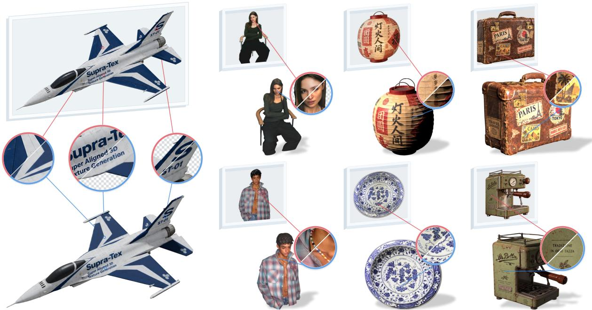  
Figure 1. Super-aligned textured mesh generated by SUPRA-Tex. Our method preserves fine-grained appearance details from the reference image. (Best viewed with zoom.)

## 1 Introduction

For applications such as product digitization and embodied AI, generating relightable 3D assets from a single reference image requires faithful preservation of the reference appearance. We refer to this requirement as super-alignment: accurately reproducing fine-grained text, logos, and patterns at their corresponding visible surface locations, while completing unobserved regions with materials consistent with the visible appearance.

Two prominent approaches to appearance generation are multi-view synthesis and native 3D generation. Multi-view pipelines leverage geometry-conditioned 2D generative models to synthesize appearance across surrounding viewpoints, then project and fuse the resulting images onto the mesh (Tencent Hunyuan3D Team, 2025a). However, cross-view discrepancies can introduce seams and ghosting, while blending conflicting predictions blurs sharp reference details (Lai et al., 2026; Zeng et al., 2026).

Native 3D generation circumvents view-fusion artifacts by synthesizing appearance directly on 3D representations (Lai et al., 2026; Chen et al., 2026; Zeng et al., 2026; Xiang et al., 2026), yet preserving fine reference details remains challenging. For example, TRELLIS.2 employs a 3D material VAE to compress surface PBR properties into material latents, which are generated under geometry and image conditioning before being decoded into surface materials. Its image cross-attention provides no explicit correspondence between image details and 3D surface locations, leaving the generator to learn where those details belong. To improve spatial alignment, recent work lifts high-resolution image features into 3D through camera projection (Li et al., 2026a). Yet even with explicit spatial correspondence, these conditions remain visual features rather than material observations. Consequently, the 3D generator must simultaneously shoulder the responsibilities of inferring PBR properties from visual features, reconstructing fine reference details at their corresponding surface locations, and synthesizing materials for unobserved regions.

We argue that these responsibilities should not fall on a single 3D generator. Given the inherent scarcity of 3D training data, requiring the 3D model to learn these heterogeneous tasks jointly increases its learning burden. Instead, we offload visible-material estimation to 2D generative priors and establish explicit surface alignment through camera projection, separating both from the 3D generative task. Our key insight is to translate visible reference evidence into native material observations before 3D generation, then organize full-surface completion around this grounded evidence. Rather than forcing the 3D model to infer physical materials from abstract visual features, this formulation enables the generator to anchor directly on established material evidence, preserving reference details while focusing more of its capacity on completing unobserved surfaces.

Based on this principle, we introduce SUPRA-Tex, a framework for generating relightable 3D assets with super-aligned textures. First, we leverage strong 2D priors by training an MLLM-based image editing model to jointly predict lighting-separated PBR maps in the reference view in a single forward pass, while preserving fine visual details. Next, we project these maps onto valid visible surface locations and encode the resulting partial materials with the pretrained material VAE encoder into native observation latents. Sharing the target latent space and directly decodable by the pretrained material decoder, these latents provide spatially aligned material content rather than abstract visual features that the 3D backbone must translate into PBR properties. We also encode the spatial extent of these observations to guide completion.

To guide full-surface material generation, we design an interleavedflow transformer that reads the native observation latents as fixed, read-only reference memory at every block. Its blocks alternate between updating unobserved latent cells and the full surface, allocating more updates to cells without observations while retaining full-surface interactions for coherent completion. Since observations are indexed by 3D surface coordinates, the same interface incorporates additional views, including 2D-generated back views, and interactive 2D edits without retraining the 3D backbone Through this division of labor, SUPRA-Tex delivers What You See Is What You Get fidelity in the reference view while completing the asset with globally coherent, relightable materials, as illustrated in Fig. 1.

Using only public datasets for training, SUPRA-Tex achieves SOTA results in both geometry-conditioned texturing and end-to-end asset generation. With synthetic back-view conditioning, SUPRA-Tex achieves reference fidelity and visual quality on real photographs comparable to or better than those of the leading commercial systems in our comparisons. Code and checkpoints are released on our project page to facilitate future research: supra-3d.github.io/supratex.

Our main contributions are as follows:

• Our key insight is to establish surface-aligned material observations before 3D generation, allowing the generator to focus on preserving reference details and completing unobserved surfaces. Built on this insight, SUPRA-Tex is trained solely on public datasets and, with synthetic back-view conditioning, achieves reference fidelity and visual quality comparable to or better than those of leading commercial systems in our comparisons.

• We present native observation encoding, which projects reference-view PBR estimates onto valid surface locations and encodes partial materials in the target latent space, simplifying learning to preserve reference appearance.

• We propose an interleaved flow transformer that uses fixed, read-only observation anchors and alternates unobservedcell and full-surface updates for reference-faithful, coherent material completion.

## 2 Related Work

Multi-view texture generation. Most texturing pipelines synthesize appearance in 2D views and fuse the predictions onto the mesh. Early approaches paint the mesh view-by-view with depth-guided diffusion and inpaint unobserved UV regions (Richardson et al., 2023; Chen et al., 2023; Zeng et al., 2024a). TexFusion aggregates view-wise denoising predictions in a shared latent texture map (Cao et al., 2023). Subsequent works improve cross-view coherence by synchronizing multi-view denoising (Liu et al., 2024b; Cheng et al., 2025; Bensadoun et al., 2024) or generating views jointly via geometry-conditioned diffusion (Huang et al., 2025b; Shao et al., 2025; Liang et al., 2026; Han et al., 2026; Zhang et al., 2026), a recipe also adopted by large image-to-3D systems (Zhang et al., 2024a; Li et al., 2025b; Tencent Hunyuan3D Team, 2025b). Reference-guided methods also explicitly target appearance preservation: EASI-Tex combines mesh-edge guidance with image features for single-image texturing (Perla et al., 2024), while AlignTex aligns multi-view artwork with the mesh before projection and texture refinement (Zhang et al., 2025b). Optimization-based approaches such as DreamMat distill geometry- and light-aware diffusion priors into PBR materials (Zhang et al., 2024b). Paint-it instead optimizes convolutionally parameterized PBR texture maps with score distillation (Youwang et al., 2024). To produce relightable assets, multi-view generation is extended to PBR channels using lighting-aware priors, material latent representations, or alternating view-space baking (Deng et al., 2024; Huang et al., 2025a; He et al., 2025a; Yeo et al., 2026; Feng et al., 2025; Tencent Hunyuan3D Team, 2025a; Lai et al., 2025; Bao et al., 2026; Wu et al., 2026b), often aided by single-image intrinsic delighting (Kocsis et al., 2024; Zeng et al., 2024b; Ke et al., 2025; Chen et al., 2024; He et al., 2025b; Careaga & Aksoy, 2024). Nevertheless, residual inconsistencies between synthesized views can blur or ghost sharp reference details during projection and blending. In contrast, SUPRA-Tex completes materials in native 3D space, using projected observations as conditioning anchors rather than directly fusing synthesized views into the final texture.

Native texture generation. Driven by the rise of large-scale 3D pretraining, native texture generation has emerged as an alternative paradigm. Existing approaches explore diffusion over point, octree, and UV representations (Yu et al., 2023; Liu et al., 2024a; Yu et al., 2024) and PBR prediction with octree-aligned Gaussians (Xiong et al., 2025). Latent texture generators, such as NaTex, LaFiTe, and TEXTRIX, learn structured latent spaces for surface colors or attributes (Lai et al., 2026; Chen et al., 2026; Zeng et al., 2026), while native 3D foundation models jointly represent geometry and appearance (Chen et al., 2025; Xiang et al., 2025; 2026). Beyond global conditioning, partial observations and spatially aligned features have also been explored. At scene scale, WorldGrow (Li et al., 2026b) extends TRELLIS with context-conditioned 3D block inpainting for progressive scene generation. TEXGen back-projects partial UV maps (Yu et al., 2024), NaTex encodes initial textures for refinement (Lai et al., 2026), and TEXTRIX encodes projected appearance with its pretrained attribute VAE in the generation target’s latent space (Zeng et al., 2026). For spatial feature alignment, camera projection techniques originally developed for implicit reconstruction (Saito et al., 2019; Yu et al., 2021a) have been adapted to 3D generative models, such as CUPID’s pose-aligned features and Pixal3D’s camera-frame back-projected multi-scale features (Huang et al., 2026; Li et al., 2026a). Even with spatially aligned image features, the 3D generator must still infer material properties, preserve reference details, and complete unobserved surfaces.

## 3 Method

Given a reference image I, a mesh M, and its camera projection π, SUPRA-Tex generates full-surface, relightable PBR materials. Figure 2 summarizes the three stages: reference-view material estimation, surface-aligned native observation encoding, and observation-guided 3D completion. We first introduce the material representation and upstream geometry model, then describe the three stages, training objective, and inference procedure. Appendices A and B provide implementation and training details; Appendix G.1 describes additional-view conditioning and texture editing.

## 3.1 Preliminaries

Surface PBR and material latents. We represent surface appearance through physically based rendering (PBR) properties over the mesh M. At any surface location $\mathbf { p } \in { \mathcal { M } }$ , these properties comprise albedo $\mathbf { a } \in \mathbb { R } ^ { 3 }$ , metallic $m \in [ 0 , 1 ]$ , and roughness $r \in [ 0 , 1 ]$ . We build on the O-Voxel representation of TRELLIS.2 (Xiang et al., 2026), which additionally includes opacity $\alpha \in [ 0 , 1 ]$ , giving the material tuple $T ( \mathbf { p } ) = ( \mathbf { a } ( \mathbf { p } ) , m ( \mathbf { p } ) , r ( \mathbf { p } ) , \alpha ( \mathbf { p } ) )$ . Separate sparse VAEs compress 3D geometry and surface materials into geometry latents $G = \{ g _ { s } \} _ { s \in \mathcal { S } }$ and material latents $Z = \{ z _ { s } \} _ { s \in \mathcal { S } }$ over active coordinates ${ \mathcal { S } } .$ For sparse surface attributes $\mathcal { P } _ { \cdot }$ , the pretrained material VAE encoder $E _ { \mathrm { m a t } }$ yields $Z ;$ conditioned on $G ,$ the material generation stage models PBR materials directly in the native 3D space by generating $Z ,$ , which the decoder $D _ { \mathrm { m a t } }$ restores onto the mesh surface.

Geometry foundation and camera projection. Our framework takes a mesh M and camera projection $\pi ,$ either provided as ground truth or predicted from the reference image. We use the open-source TRELLIS.2-based Pixal3D variant (Li et al., 2026a; Xiang et al., 2026), denoted Pixal3D⋆, which supports geometry and material generation. Its geometry module predicts the reference-aligned mesh for end-to-end generation.

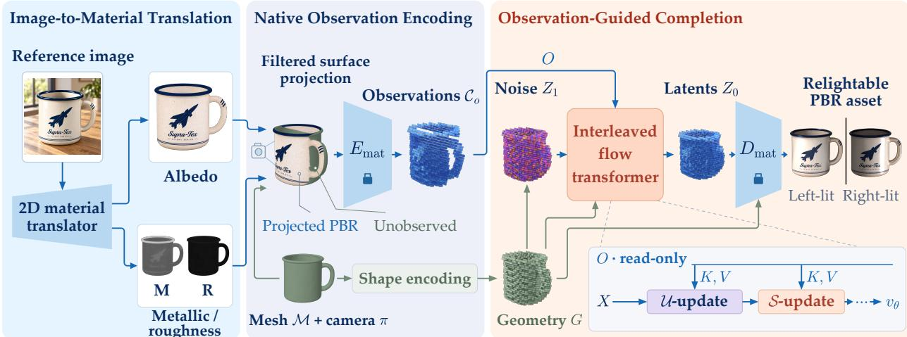  
Figure 2. Overview of SUPRA-Tex. Left: image-to-material translation. A 2D material translator estimates lighting-separated albedo, metallic, and roughness maps from a single reference image. Middle: native observation encoding. Using the mesh M and camera projection π, we project valid predictions onto visible surface voxels and omit unobserved voxels from the partial PBR input. The frozen material encoder $E _ { \mathrm { m a t } }$ maps these partial PBR attributes into the generation target’s latent space. These latents, together with coverage and boundary metadata, form the observation representation $\scriptstyle { \mathcal { C } } _ { o }$ . Right: observation-guided completion. Conditioned on geometry latents G, the interleaved flow transformer generates complete material latents $Z _ { 0 }$ from noise $Z _ { 1 } .$ . In the inset, the fixed, read-only stream O supplies keys and values, while the generation stream X alternates updates over cells without observations (U) and the full surface (S). The frozen decoder $D _ { \mathrm { m a t } }$ converts $Z _ { 0 }$ into surface PBR materials, lit from the left and right.

## 3.2 Image-to-Material Translation

To reduce the learning burden on the 3D generator, we separate reference-view material estimation from 3D surface completion. Specifically, we train an MLLM-based image editing model $F _ { \mathrm { 2 D } }$ to infer reference-view albedo and metallic-roughness (MR) maps directly from the input photograph:

$$
\widehat T _ { \mathrm { 2 D } } = F _ { \mathrm { 2 D } } ( I ) = ( \widehat { \bf a } , \widehat { m } , \widehat { r } ) ,\tag{1}
$$

where ab denotes the albedo map, and $\widehat { m }$ and rb denote the metallic and roughness maps. To reuse the 3-channel pretrained image VAE, we pack m and r with a constant channel into a 3-channel map, which also fulfills the input format expected by the pretrained material encoder.

Joint alignment and one-step inference. To coordinate channel predictions while retaining pretrained image priors, $F _ { \mathrm { 2 D } }$ adapts a multimodal DiT backbone (Super Intelligence Team, 2026) viafactorized modality-axis joint attention, jointly predicting albedo, metallic–roughness, and auxiliary normal maps. This attention exchanges features across output modalities at corresponding spatial locations. We train the 2D material estimator on RGB images paired with ground-truth material and normal maps rendered from Objaverse, using a latent flow-matching objective at the fixed maximum-noise endpoint $\sigma = 1 . 0$ . At inference, a single DiT forward pass at this endpoint (1.2 s on one H800) estimates clean material latents, which the VAE decodes into 1024 × 1024 material maps without iterative denoising.

This design has two advantages. First, it uses 2D image priors to disentangle illumination from intrinsic materials at full reference resolution. Second, it shields the downstream 3D generator from abstract visual features, letting the 3D model use physical PBR observations to focus on reference preservation and unobserved-surface completion.

## 3.3 Native Observation Encoding

To supply physical observations to the 3D generator in a representation it natively understands, we bridge the estimated reference-view PBR maps $\widehat { T } _ { \mathrm { 2 D } }$ directly to the surface of M using the pretrained material encoder $E _ { \mathrm { m a t } }$

Filtered surface projection. Through the camera projection $\pi ,$ we associate each foreground pixel u of $\widehat { T } _ { \mathrm { 2 D } }$ with its first visible surface hit $\mathbf { p } \in \mathcal { M }$ . At inference, foreground-mask erosion and local depth-discontinuity filtering further remove unreliable boundary correspondences. The retained correspondences form the observation set ${ \mathcal { H } } _ { \mathrm { v a l i d } }$ , shared by all PBR channels. We voxelize the retained materials into a partial surface representation:

$$
\mathcal { P } _ { o } = \mathrm { V o x e l i z e } \left( \left\{ \left( \mathbf { p } , \widehat { T } _ { \mathrm { 2 D } } ( \mathbf { u } ) \right) \mid ( \mathbf { u } , \mathbf { p } ) \in \mathcal { H } _ { \mathrm { v a l i d } } \right\} \right) ,\tag{2}
$$

where u is a 2D pixel coordinate and p its surface location on $\mathcal { M } ; \mathcal { P } _ { o }$ omits regions without valid observations.

Sparse coordinate encoding. The partial surface attributes $\mathcal { P } _ { o }$ match the input domain of the pretrained material VAE, allowing direct ingestion by $E _ { \mathrm { m a t } }$ without intermediate adapters:

$$
E _ { \mathrm { m a t } } ( \mathcal { P } _ { o } ) = \{ ( s , z _ { s } ^ { o } ) \mid s \in \mathcal { S } _ { o } \} , \qquad \mathcal { S } _ { o } \subseteq \mathcal { S } ,\tag{3}
$$

using the posterior mean. We call $\left\{ z _ { s } ^ { o } \right\}$ native observation latents; $\scriptstyle { S _ { o } }$ indexes latent cells receiving observations.

Zero-padding unobserved regions assigns concrete material values, such as black albedo, to surfaces without observations. We instead use the sparse coordinate architecture of $E _ { \mathrm { m a t } }$ to omit unobserved voxels. Encoding only the visible support $\mathcal { P } _ { o }$ avoids assigning explicit material values to unobserved voxels while retaining the visible support as conditioning evidence. This encoding runs once before sampling and remains fixed throughout generation. Section 4.4 examines how its latents and decoded materials differ from complete-material encoding.

Spatial observation metadata. Each latent cell aggregates surface voxels, so an observed cell in $\scriptstyle { S _ { o } }$ is rarely fully covered from one view. The generator must quantify each cell’s observation support and proximity to unobserved regions. Let $\gamma _ { s }$ be the surface voxels in cell s and $\gamma _ { o }$ the filtered, deduplicated set of observed voxels. Coverage is

$$
\rho _ { s } = \frac { | \mathcal { V } _ { s } \cap \mathcal { V } _ { o } | } { | \mathcal { V } _ { s } | } , \qquad s \in \mathcal { S } _ { o } ,\tag{4}
$$

preventing repeated pixel projections onto one voxel from inflating coverage. Let $\mathcal { U } = \mathcal { S } \setminus \mathcal { S } _ { o }$ be the unobserved cells and $\mathcal { G } _ { S }$ the six-neighbor graph over $s ;$ with $\mathcal { U } _ { s } \subseteq \mathcal { U }$ the unobserved cells reachable from s, the boundary distance is

$$
d _ { s } = \left\{ \begin{array} { l l } { \displaystyle \operatorname* { m i n } _ { q \in \mathcal { U } _ { s } } \mathrm { d i s t } _ { \mathcal { G } _ { S } } ( s , q ) , } & { \mathcal { U } _ { s } \neq \emptyset , } \\ { - 1 , } & { \mathcal { U } _ { s } = \emptyset , } \end{array} \right.\tag{5}
$$

measured in graph steps, with −1 marking cells from which no unobserved region is reachable. Both quantities describe the extent of observation, not the accuracy of the 2D estimate. These native observation latents and their spatial extent form the native observation representation

$$
\mathcal { C } _ { o } = \{ ( s , z _ { s } ^ { o } , \rho _ { s } , d _ { s } ) \ | \ s \in S _ { o } \} ,\tag{6}
$$

which encapsulates native material observations alongside their physical extent without fictitious padding, ready to anchor full-surface generation. Because anchors are indexed in 3D coordinates, the same interface can combine observations from additional or edited views without retraining the generator (Appendix G.1).

## 3.4 Observation-Guided Completion

We generate complete material latents via flow matching over the mesh M, predicting a velocity field at time t from the current noisy material latents $Z _ { t } ,$ , geometry latents $G ,$ and native observation representation $\scriptstyle { { \mathcal { C } } _ { o } }$ (Lipman et al., 2023). Native observation latents provide spatially aligned material evidence for reconstructing visible appearance. The generator must learn to use this evidence while completing unobserved surfaces coherently. Pixal3D⋆ injects projected image features through additive residuals and updates all surface tokens at every layer. We introduce an interleaved flow transformer that retains observations as fixed, read-only memory and alternates unobserved-cell and full-surface updates. This schedule assigns more hidden-state updates to unobserved cells while allowing visible materials to be refined during full-surface generation.

Interleaved flow transformer. The generator uses two coordinate supports: the full active surface S and the observed subset $\quad S _ { o } \subseteq S$ . Figure 7 in Appendix A.2 illustrates the update schedule. We maintain two streams: a dynamic generation stream X tracking the hidden state of $Z _ { t }$ over $s ,$ and a static observation stream O serving as immutable reference memory over $\scriptstyle { S _ { o } }$ . At observed coordinates, $O _ { s }$ stores partial evidence while $X _ { s }$ predicts the complete cell. Both streams use the same 3D coordinate frame and a shared input projection $W _ { \mathrm { i n } }$ over material and geometry latents:

$$
\begin{array} { r } { \begin{array} { r } { X _ { s } ^ { ( 0 ) } = W _ { \mathrm { i n } } ( [ Z _ { t , s } ; g _ { s } ] ) , \qquad s \in \mathcal { S } , } \\ { O _ { s } = W _ { \mathrm { i n } } ( [ \bar { z } _ { s } ^ { o } ; g _ { s } ] ) + W _ { \mathrm { m e t a } } ( [ \rho _ { s } ; d _ { s } ] ) + b _ { o } , \quad s \in \mathcal { S } _ { o } , } \end{array} } \end{array}\tag{7}
$$

where $\bar { z } _ { s } ^ { o }$ scales the native observation latents to match the normalization of $Z _ { t } , W _ { \mathrm { m e t a } }$ is a learnable affine projection of spatial metadata, and $b _ { o }$ is a learned observation-role bias initialized to zero.

Across the Transformer blocks, O produces no queries and receives no updates with $O ^ { ( \ell + 1 ) } = O$ across blocks, serving as read-only memory supplying keys and values to every layer. To concentrate generative capacity on unobserved surfaces, query coordinates alternate across blocks $\ell = 0 , \ldots , L - 1 \colon \mathcal { T } _ { \ell } = \mathcal { U }$ for even ℓ over unobserved cells $\mathcal { U } = \mathcal { S } \setminus \mathcal { S } _ { o } ,$ and $\mathcal { I } _ { \ell } = \mathcal { S }$ for odd ℓ over the full surface to maintain global coherence. Let $\widetilde { X } ^ { ( \ell ) } = N _ { \ell } ( X ^ { ( \ell ) } , t )$

Table 1. PBR texture generation with given geometry. Per-view metrics are averaged over 16 views; fg denotes the GT foreground. A.: albedo; Met./Rough.: metallic/roughness MAE.
<table><tr><td rowspan="2">Method</td><td colspan="6">Shaded</td><td colspan="6">PBR</td></tr><tr><td>PSNR ↑</td><td> $\mathrm { P S N R } _ { \mathrm { f g } }$ </td><td>↑ SSIM ↑</td><td>LPIPS ↓</td><td>CLIP-I↑</td><td>FDDINOv3↓</td><td>A. PSNR ↑</td><td> $\mathbf { A } . \mathbf { P S N R } _ { \mathrm { f g } }$ </td><td></td><td>↑ A. SSIM ↑ A. LPIPS ↓</td><td>Met. ↓ Rough. ↓</td><td></td></tr><tr><td>DTC-Tex</td><td></td><td></td><td></td><td></td><td></td><td></td><td></td><td></td><td></td><td></td><td></td><td></td></tr><tr><td>Step1X-3D</td><td>23.12</td><td>14.21</td><td>0.914</td><td>0.083</td><td>0.851</td><td>33.30</td><td></td><td></td><td></td><td></td><td></td><td></td></tr><tr><td>MV-Adapter</td><td>24.64</td><td>15.73</td><td>0.917</td><td>0.077</td><td>0.858</td><td>33.17</td><td></td><td></td><td></td><td></td><td></td><td></td></tr><tr><td>Ink3D</td><td>25.82</td><td>17.08</td><td>0.921</td><td>0.076</td><td>0.859</td><td>35.01</td><td></td><td></td><td></td><td></td><td></td><td></td></tr><tr><td>UniTEX</td><td>25.42</td><td>16.54</td><td>0.925</td><td>0.071</td><td>0.877</td><td>29.24</td><td></td><td></td><td></td><td></td><td></td><td></td></tr><tr><td>MVPainter</td><td>26.44</td><td>17.59</td><td>0.924</td><td>0.077</td><td>0.856</td><td>33.40</td><td>24.17</td><td>15.30</td><td>0.911</td><td>0.089</td><td>0.121</td><td>0.119</td></tr><tr><td>TEXGen</td><td>27.24</td><td>18.33</td><td>0.932</td><td>0.072</td><td>0.848</td><td>51.11</td><td></td><td></td><td></td><td></td><td></td><td></td></tr><tr><td>LumiTex</td><td>28.29</td><td>19.38</td><td>0.939</td><td>0.062</td><td>0.892</td><td>24.42</td><td>26.30</td><td>17.39</td><td>0.928</td><td>0.069</td><td>0.352</td><td>0.098</td></tr><tr><td>Hunyuan3D 2.1</td><td>26.80</td><td>17.89</td><td>0.926</td><td>0.070</td><td>0.877</td><td>28.18</td><td>24.00</td><td>15.09</td><td>0.910</td><td>0.079</td><td>0.142</td><td>0.079</td></tr><tr><td>TRELLIS.2</td><td>28.60</td><td>19.73</td><td>0.935</td><td>0.062</td><td>0.880</td><td>32.73</td><td>25.78</td><td>16.90</td><td>0.921</td><td>0.070</td><td>0.063</td><td>0.059</td></tr><tr><td>Pixal3D*</td><td>29.19</td><td>20.47</td><td>0.950</td><td>0.050</td><td>0.908</td><td>20.35</td><td>26.39</td><td>17.60</td><td>0.937</td><td>0.057</td><td>0.051</td><td>0.076</td></tr><tr><td>Ours</td><td>30.89</td><td>22.34</td><td>0.961</td><td>0.042</td><td>0.927</td><td>16.51</td><td>28.20</td><td>19.55</td><td>0.951</td><td>0.048</td><td>0.043</td><td>0.041</td></tr><tr><td>Ours‡</td><td>32.08</td><td>23.67</td><td>0.962</td><td>0.042</td><td>0.928</td><td>16.31</td><td>29.68</td><td>21.14</td><td>0.955</td><td>0.048</td><td>0.033</td><td>0.038</td></tr><tr><td>Complex-Tex</td><td></td><td></td><td></td><td></td><td></td><td></td><td></td><td></td><td></td><td></td><td></td><td></td></tr><tr><td>Step1X-3D</td><td>23.61</td><td>13.97</td><td>0.924</td><td>0.066</td><td>0.848</td><td>30.93</td><td></td><td></td><td></td><td></td><td></td><td></td></tr><tr><td>MV-Adapter</td><td>24.59</td><td>14.95</td><td>0.926</td><td>0.064</td><td>0.849</td><td>31.19</td><td></td><td></td><td></td><td></td><td></td><td></td></tr><tr><td>Ink3D</td><td>26.15</td><td>16.69</td><td>0.935</td><td>0.060</td><td>0.864</td><td>30.86</td><td></td><td>一</td><td></td><td></td><td></td><td></td></tr><tr><td>UniTEX</td><td>25.78</td><td>16.19</td><td>0.940</td><td>0.056</td><td>0.872</td><td>27.42</td><td></td><td></td><td></td><td></td><td></td><td></td></tr><tr><td>MVPainter</td><td>25.72</td><td>16.19</td><td>0.933</td><td>0.067</td><td>0.846</td><td>33.87</td><td>23.05</td><td>13.51</td><td>0.922</td><td>0.079</td><td>0.228</td><td>0.188</td></tr><tr><td>TEXGen</td><td>27.90</td><td>18.25</td><td>0.945</td><td>0.053</td><td>0.871</td><td>32.89</td><td></td><td></td><td></td><td></td><td></td><td></td></tr><tr><td>LumiTex</td><td>27.77</td><td>18.21</td><td>0.947</td><td>0.051</td><td>0.887</td><td>23.29</td><td>25.26</td><td>15.68</td><td>0.938</td><td>0.060</td><td>0.256</td><td>0.181</td></tr><tr><td>Hunyuan3D 2.1</td><td>25.83</td><td>16.19</td><td>0.931</td><td>0.063</td><td>0.857</td><td>31.05</td><td>22.89</td><td>13.25</td><td>0.918</td><td>0.074</td><td>0.247</td><td>0.156</td></tr><tr><td>TRELLIS.2</td><td>27.97</td><td>18.41</td><td>0.945</td><td>0.051</td><td>0.876</td><td>27.42</td><td>25.77</td><td>16.17</td><td>0.935</td><td>0.058</td><td>0.131</td><td>0.111</td></tr><tr><td>Pixal3D*</td><td>28.84</td><td>19.44</td><td>0.950</td><td>0.046</td><td>0.899</td><td>19.50</td><td>26.62</td><td>17.25</td><td>0.935</td><td>0.056</td><td>0.145</td><td>0.122</td></tr><tr><td>Ours</td><td>30.05</td><td>20.64</td><td>0.960</td><td>0.039</td><td>0.915</td><td>17.36</td><td>27.61</td><td>18.12</td><td>0.952</td><td>0.046</td><td>0.109</td><td>0.084</td></tr></table>

‡ A variant whose 2D material estimator is fine-tuned from Qwen-Image-2.1 instead of FireRed-Image-Edit-1.1.

and $\widetilde { O } ^ { ( \ell ) } = N _ { \ell } ( O , 0 )$ denote the streams after normalization and time modulation, where observations carry a fixed clean-time indicator. The cross-stream attention is formulated as:

$$
\begin{array} { r } { Q _ { \ell } = q _ { \ell } \left( \widetilde { X } _ { \mathcal { T } _ { \ell } } ^ { ( \ell ) } \right) , \quad K _ { \ell } = \left[ k _ { \ell } \left( \widetilde { O } ^ { ( \ell ) } \right) ; k _ { \ell } \left( \widetilde { X } ^ { ( \ell ) } \right) \right] , \quad V _ { \ell } = \left[ v _ { \ell } \left( \widetilde { O } ^ { ( \ell ) } \right) ; v _ { \ell } \left( \widetilde { X } ^ { ( \ell ) } \right) \right] , } \\ { A _ { \ell } = \mathrm { s o f t m a x } \left( Q _ { \ell } K _ { \ell } ^ { \top } / \sqrt { d _ { h } } \right) V _ { \ell } , } \end{array}\tag{8}
$$

where $d _ { h } = 1 2 8$ is the per-head dimension and $q _ { \ell } ,$ k apply 3D RoPE to latent coordinates, enabling attention based on relative position and content. Residual updates affect only $\mathcal { T } _ { \ell } ;$ other generation tokens are unchanged in that block, while O remains fixed throughout. An output projection maps the terminal state $X ^ { ( L ) }$ to predicted velocities for all of S. The full-surface training objective and sampling procedure are given in Sec. 3.5.

## 3.5 Training and Inference

Full-surface training objective. The generation stream X synthesizes material latents over the surface S. Training observations are constructed from ground-truth materials of public 3D assets using visible-surface observation encoding, with complete material latents as targets. With $Z _ { \mathrm { { g t } } }$ the normalized ground-truth latents and $\epsilon \sim \mathcal { N } ( 0 , \bf { I } )$

$$
Z _ { t } = ( 1 - t ) Z _ { \mathrm { g t } } + \left[ \sigma _ { \mathrm { m i n } } + ( 1 - \sigma _ { \mathrm { m i n } } ) t \right] \epsilon , \qquad v ^ { \ast } = ( 1 - \sigma _ { \mathrm { m i n } } ) \epsilon - Z _ { \mathrm { g t } } ,\tag{9}
$$

where $\sigma _ { \mathrm { m i n } }$ is a small residual noise scale, $t = 1$ corresponds to pure noise, and $t = 0$ to material latents with residual noise $\sigma _ { \mathrm { m i n } } \epsilon .$ . The loss is

$$
\mathcal { L } _ { \mathrm { F M } } = \mathbb { E } [ \mathrm { M S E } ( v _ { \theta } ( Z _ { t } , t ; O , G ) , v ^ { * } ) ] ,\tag{10}
$$

averaged over all valid tokens and channels, including observed coordinates. The observation representation remains fixed and is not noised along the flow path; it serves as conditioning input to the generator. The generation stream is supervised against complete-material targets over the entire surface, learning to reconstruct visible appearance from the fixed observations and to complete unobserved regions.

Inference. Given dataset-provided or predicted geometry and cameras, we encode the mesh into G and S and the filtered observations into anchors O (Sec. 3.3). Starting from $Z _ { 1 } \sim { \mathcal { N } } ( 0 , \mathbf { I } )$ over S, we integrate the learned velocity field with Euler steps, then de-normalize and decode the final latents with $D _ { \mathrm { m a t } }$ into full-surface PBR attributes for export. Optional KV caching reuses the observation stream’s per-layer keys and values across sampling steps; Table 6 reports its runtime and memory effects. Inference uses 25 Euler steps without classifier-free guidance on the time grid $t _ { j } = 3 u _ { j } / ( 1 + 2 u _ { j } ) , u _ { j } = 1 - j / 2 5 , j = 0 , \ldots , 2 5$

Input

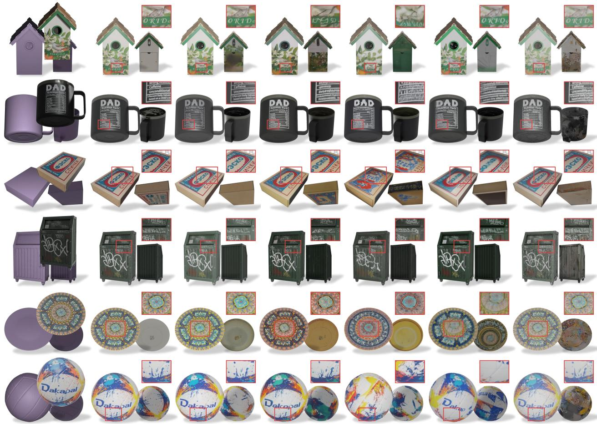  
Ours  
Pixal3D\*  
TRELLIS.2  
LumiTex  
TEXGen

Figure 3. Qualitative comparison with given geometry. Enlarged crops compare reference-view details; novel views show the completed appearance.

## 4 Experiments

The supplement covers datasets, implementation, baseline configurations, evaluation protocols, and additional analyses.

Datasets. Our 3D material generator is trained solely on publicly available 3D datasets. The training sources are summarized in Appendix B.1. We evaluate on two datasets with no overlap with the training set: DTC-Tex, comprising 100 texture-rich product scans selected from the Digital Twin Catalog (Dong et al., 2025), and Complex-Tex, comprising 110 Sketchfab (Sketchfab, n.d.) meshes with denser inscriptions, finer patterns, and more varied shapes.

Implementation details. The 2D material estimator adapts FireRed-Image-Edit-1.1 (Super Intelligence Team, 2026) at 1024 × 1024 resolution. The 3D generator uses 60 Transformer blocks, with self-attention initialized from TRELLIS.2 and the remaining components initialized randomly; the pretrained material encoder and decoder remain frozen. We train the generator with a global batch size of 576 using AdamW on 64 GPUs. Inference uses 25 Euler steps without classifier-free guidance.

## 4.1 3D Generation with Given Geometry

Setting and baselines. Each method textures the ground-truth mesh from a single forward-lit reference image. We record the ground-truth lighting and camera poses and render each textured result under these same conditions at the reference view and 15 novel views, isolating material quality from geometry, pose, and illumination differences. Table 1 compares ten baselines spanning native 3D generation and dedicated texturing methods. PBR methods are additionally evaluated on albedo, metallic, and roughness.

Results. Table 1 shows that SUPRA-Tex leads across all shaded and PBR metrics on both datasets. Compared with feature-conditioned Pixal3D⋆, shaded PSNR improves by 1.7 dB and 1.2 dB, and albedo PSNR by 2.0 dB and 0.9 dB on DTC-Tex and Complex-Tex, respectively. The gains over multi-view PBR methods are larger: LumiTex trails by more than 2 dB in shaded PSNR and by over 1.5 dB in albedo PSNR on both datasets. The albedo gains and lowest metallic/roughness MAE show that the improvements extend to material attributes. Figure 3 shows that SUPRA-Tex better preserves the mug’s fine lettering and the plate’s intricate patterns than multi-view and feature-conditioned baselines, while novel-view renderings show coherent appearance on the completed surfaces.

Table 2. Reference/novel-view fidelity on the valid objects per method and metric in Table 1. $\mathrm { P S N R _ { f g } }$ uses the GT mask.
<table><tr><td></td><td colspan="4">Reference view (1)</td><td colspan="4">Novel views (15)</td></tr><tr><td></td><td colspan="2">Shaded</td><td colspan="2">Albedo</td><td colspan="2">Shaded</td><td colspan="2">Albedo</td></tr><tr><td>Method</td><td> $\mathrm { P S N R } _ { \mathrm { f g } }$  ↑</td><td>LPIPS↓</td><td>PSNRfg ↑</td><td>LPIPS↓</td><td> $\mathrm { P S N R } _ { \mathrm { f g } }$ </td><td>LPIPS↓</td><td> $\mathrm { P S N R } _ { \mathrm { f g } }$ </td><td>LPIPS↓</td></tr><tr><td>DTC-Tex</td><td></td><td></td><td></td><td></td><td></td><td></td><td></td><td></td></tr><tr><td>Step1X-3D</td><td>14.288</td><td>0.0861</td><td></td><td></td><td>14.207</td><td>0.0831</td><td></td><td></td></tr><tr><td>MV-Adapter</td><td>16.079</td><td>0.0806</td><td></td><td></td><td>15.706</td><td>0.0766</td><td></td><td>一</td></tr><tr><td>Ink3D</td><td>16.365</td><td>0.0795</td><td></td><td></td><td>17.128</td><td>0.0757</td><td></td><td>一</td></tr><tr><td>UniTEX</td><td>16.132</td><td>0.0711</td><td></td><td></td><td>16.572</td><td>0.0712</td><td></td><td></td></tr><tr><td>MVPainter</td><td>16.789</td><td>0.0815</td><td>15.530</td><td>0.0912</td><td>17.640</td><td>0.0770</td><td>15.286</td><td>0.0887</td></tr><tr><td>TEXGen</td><td>22.814</td><td>0.0380</td><td></td><td></td><td>18.029</td><td>0.0746</td><td></td><td></td></tr><tr><td>LumiTex</td><td>18.598</td><td>0.0594</td><td>18.083</td><td>0.0643</td><td>19.434</td><td>0.0620</td><td>17.342</td><td>0.0693</td></tr><tr><td>Hunyuan3D 2.1</td><td>16.553</td><td>0.0696</td><td>15.206</td><td>0.0768</td><td>17.979</td><td>0.0700</td><td>15.079</td><td>0.0789</td></tr><tr><td>TRELLIS.2</td><td>18.609</td><td>0.0660</td><td>17.093</td><td>0.0713</td><td>19.803</td><td>0.0621</td><td>16.885</td><td>0.0698</td></tr><tr><td>Pixal3D*</td><td>21.837</td><td>0.0304</td><td>19.884</td><td>0.0363</td><td>20.377</td><td>0.0510</td><td>17.450</td><td>0.0585</td></tr><tr><td>Ours</td><td>25.372</td><td>0.0132</td><td>23.870</td><td>0.0156</td><td>22.134</td><td>0.0444</td><td>19.264</td><td>0.0500</td></tr><tr><td>Complex-Tex</td><td></td><td></td><td></td><td></td><td></td><td></td><td></td><td></td></tr><tr><td>Step1X-3D</td><td>13.431</td><td>0.0737</td><td></td><td></td><td>14.003</td><td>0.0651</td><td></td><td></td></tr><tr><td>MV-Adapter</td><td>14.748</td><td>0.0708</td><td></td><td></td><td>14.963</td><td>0.0630</td><td></td><td></td></tr><tr><td>Ink3D</td><td>15.801</td><td>0.0639</td><td></td><td></td><td>16.752</td><td>0.0595</td><td></td><td></td></tr><tr><td>UniTEX</td><td>15.261</td><td>0.0593</td><td></td><td></td><td>16.249</td><td>0.0562</td><td></td><td></td></tr><tr><td>MVPainter</td><td>14.927</td><td>0.0769</td><td>13.430</td><td>0.0881</td><td>16.272</td><td>0.0662</td><td>13.512</td><td>0.0783</td></tr><tr><td>TEXGen</td><td>21.974</td><td>0.0266</td><td></td><td></td><td>18.005</td><td>0.0551</td><td></td><td></td></tr><tr><td>LumiTex</td><td>17.419</td><td>0.0516</td><td>15.722</td><td>0.0607</td><td>18.264</td><td>0.0514</td><td>15.677</td><td>0.0604</td></tr><tr><td>Hunyuan3D 2.1</td><td>15.041</td><td>0.0694</td><td>13.145</td><td>0.0808</td><td>16.268</td><td>0.0624</td><td>13.262</td><td>0.0739</td></tr><tr><td>TRELLIS.2</td><td>17.123</td><td>0.0561</td><td>15.545</td><td>0.0623</td><td>18.493</td><td>0.0503</td><td>16.209</td><td>0.0577</td></tr><tr><td>Pixal3D*</td><td>20.062</td><td>0.0389</td><td>18.291</td><td>0.0453</td><td>19.402</td><td>0.0461</td><td>17.180</td><td>0.0566</td></tr><tr><td>Ours</td><td>22.927</td><td>0.0202</td><td>21.721</td><td>0.0254</td><td>20.488</td><td>0.0401</td><td>17.882</td><td></td></tr></table>

Table 3. End-to-end single-image-to-3D generation by dataset; column-wise best results are bold. Reconstruction uses four views except for reference-view CLIP-I; distribution metrics use 16-view rendered sets.
<table><tr><td rowspan="2">Method</td><td colspan="5">Reconstruction</td><td colspan="4">Distribution</td></tr><tr><td>PSNR ↑</td><td> $\mathrm { P S N R } _ { \mathrm { f g } } \ 1$ </td><td>SSIM ↑</td><td>LPIPS↓</td><td>CLIP-I↑</td><td>FDDINOv3 ↓</td><td> $\mathrm { F D } _ { \mathrm { C L I P } }$  →</td><td>FID↓</td><td>CMMD↓</td></tr><tr><td colspan="10">DTC-Tex</td></tr><tr><td>Step1X-3D</td><td>19.70</td><td>12.00</td><td>0.894</td><td>0.115</td><td>0.844</td><td>33.4</td><td>19.6</td><td>33.5</td><td>14.40</td></tr><tr><td>Hunyuan3D 2.1</td><td>21.97</td><td>14.52</td><td>0.904</td><td>0.095</td><td>0.835</td><td>34.8</td><td>22.7</td><td>33.6</td><td>12.78</td></tr><tr><td>UniLat3D†</td><td>19.78</td><td>11.89</td><td>0.900</td><td>0.105</td><td>0.822</td><td>34.2</td><td>27.2</td><td>36.1</td><td>27.17</td></tr><tr><td>CUPID†</td><td>20.26</td><td>12.38</td><td>0.906</td><td>0.093</td><td>0.850</td><td>32.1</td><td>25.1</td><td>33.0</td><td>24.18</td></tr><tr><td>TRELLIS.2†</td><td>22.59</td><td>15.71</td><td>0.907</td><td>0.098</td><td>0.816</td><td>41.7</td><td>26.2</td><td>32.2</td><td>16.63</td></tr><tr><td>Pixal3D*</td><td>26.88</td><td>19.90</td><td>0.945</td><td>0.071</td><td>0.910</td><td>27.2</td><td>16.5</td><td>26.0</td><td>8.29</td></tr><tr><td>Ours</td><td>28.65</td><td>20.79</td><td>0.967</td><td>0.025</td><td>0.971</td><td>21.1</td><td>9.9</td><td>23.0</td><td>4.97</td></tr><tr><td colspan="10">Complex-Tex</td></tr><tr><td>Step1X-3D</td><td>20.66</td><td>12.36</td><td>0.900</td><td>0.099</td><td>0.882</td><td>26.3</td><td>17.9</td><td>31.4</td><td>8.73</td></tr><tr><td>Hunyuan3D 2.1</td><td>21.87</td><td>13.83</td><td>0.908</td><td>0.087</td><td>0.843</td><td>31.2</td><td>23.2</td><td>35.5</td><td>11.39</td></tr><tr><td>UniLat3D†</td><td>20.41</td><td>11.89</td><td>0.902</td><td>0.096</td><td>0.830</td><td>29.8</td><td>27.5</td><td>35.2</td><td>21.57</td></tr><tr><td>CUPID†</td><td>20.68</td><td>12.12</td><td>0.905</td><td>0.090</td><td>0.852</td><td>28.1</td><td>24.4</td><td>34.1</td><td>18.44</td></tr><tr><td>TRELLIS.2†</td><td>22.22</td><td>14.32</td><td>0.909</td><td>0.087</td><td>0.830</td><td>32.6</td><td>23.4</td><td>32.0</td><td>10.49</td></tr><tr><td>Pixal3D*</td><td>26.24</td><td>18.64</td><td>0.940</td><td>0.070</td><td>0.909</td><td>22.9</td><td>15.9</td><td>25.8</td><td>5.96</td></tr><tr><td>Ours</td><td>28.73</td><td>20.24</td><td>0.963</td><td>0.029</td><td>0.968</td><td>19.4</td><td>9.3</td><td>23.3</td><td>4.00</td></tr></table>

†Similarity-aligned to the ground-truth mesh.

Table 2 separates the designated input view from the other 15 evaluation views, averaging novel-view scores per object before averaging over objects. For each method and metric, both splits use the same valid objects as Table 1. Novel views include both previously observed and unobserved surfaces; this split measures viewpoint generalization, rather than error exclusively on unseen surface regions.

SUPRA-Tex achieves the best mean in every reported metric on both view splits and datasets. Against the strongest baseline for shaded $\mathrm { P S N R _ { f g } }$ in each split, reference-view gains are 2.56 dB on DTC-Tex and 0.95 dB on Complex-Tex (TEXGen), while novel-view gains are 1.76 and 1.09 dB (Pixal3D⋆). The split supports improved reference-view fidelity together with improved novel-view appearance.

  
Input  
Ours  
Hi3D  
Meshy  
Tripo  
Rodin  
Hunyuan3D

Figure 4. Comparison with commercial systems: each row shows the input and reference-view/back-view renderings from commercial systems and SUPRA-Tex.  
Table 4. Comparison with commercial models. Preference reports our pairwise win rate (%); VLM reports mean scores out of 10.
<table><tr><td rowspan="2">System</td><td colspan="3">Ours win rate (%) ↑</td><td colspan="3">VLM (0–10) ↑</td></tr><tr><td>Align</td><td>PBR</td><td>Quality</td><td>Align</td><td>PBR</td><td>Quality</td></tr><tr><td>HY3.1</td><td>84.7</td><td>85.1</td><td>84.8</td><td>6.77</td><td>8.67</td><td>8.32</td></tr><tr><td>Rodin 2.5</td><td>75.8</td><td>72.3</td><td>75.5</td><td>6.81</td><td>8.64</td><td>8.38</td></tr><tr><td>Tripo H3.1</td><td>71.6</td><td>62.9</td><td>67.8</td><td>7.71</td><td>8.53</td><td>8.28</td></tr><tr><td>Meshy 7.1</td><td>60.8</td><td>54.7</td><td>57.6</td><td>7.74</td><td>8.61</td><td>8.34</td></tr><tr><td>Hi3D 3.0</td><td>51.1</td><td>44.9</td><td>51.1</td><td>8.19</td><td>8.67</td><td>8.37</td></tr><tr><td>Ours</td><td></td><td>一</td><td></td><td>8.08</td><td>8.67</td><td>8.34</td></tr></table>

Table 5. Observation ablations. Shad./Alb.: shaded/albedo PSNRfg; MR: mean metallic/roughness MAE.
<table><tr><td>Variant</td><td colspan="2">DTC-Tex</td><td colspan="2">Complex-Tex</td></tr><tr><td></td><td>Shad. ↑ Alb. ↑</td><td>MR↓</td><td>Shad. ↑ Alb. ↑1</td><td>MR↓</td></tr><tr><td>Residual injection</td><td>21.47</td><td>18.81 0.086</td><td>20.35</td><td>17.18 0.136</td></tr><tr><td>Joint-update attention</td><td>22.32</td><td>19.40 0.043</td><td>20.63</td><td>17.96 0.097</td></tr><tr><td>Fixed MR (M = 0, R= 0.5)</td><td>21.90</td><td>19.53 0.064</td><td>19.95</td><td>18.15 0.189</td></tr><tr><td>Dataset-mean MR</td><td>22.08</td><td>19.53 0.232</td><td>20.07</td><td>18.13 0.258</td></tr><tr><td>Ours</td><td>22.34</td><td>19.55</td><td>0.042 20.64</td><td>18.12 0.096</td></tr><tr><td>Oracle PBR (GT)</td><td>24.65</td><td>22.17</td><td>0.011 21.76</td><td>20.63 0.030</td></tr></table>

## 4.2 End-to-End Single-Image-to-3D Generation

Setting and baselines. Each method generates both geometry and appearance end-to-end from a single reference image, without access to ground-truth geometry or cameras during generation.

We compare with TRELLIS.2, Pixal3D⋆, Hunyuan3D 2.1, Step1X-3D, UniLat3D, and CUPID (Xiang et al., 2026; Li et al., 2026a; Tencent Hunyuan3D Team, 2025a; Li et al., 2025a; Wu et al., 2026a; Huang et al., 2026). SUPRA-Tex and Pixal3D⋆ share geometry predicted by the latter, with separate appearance pipelines. Other baselines generate their own geometry. For scoring, outputs are brought into a common coordinate frame, with GT similarity alignment applied to methods marked † in Table 3; this alignment plays no role in generation.

Results. Table 3 shows that SUPRA-Tex leads across all 9 metrics on both datasets. Relative to Pixal3D⋆, four-view PSNR improves by 1.77 dB on DTC-Tex and 2.49 dB on Complex-Tex, foreground PSNR by 0.89 dB and 1.60 dB, and LPIPS decreases by 64.8% and 58.6%, respectively. Higher reference-view CLIP-I and lower 16-view distribution distances further indicate stronger input consistency and multi-view appearance quality. Since Pixal3D⋆ and SUPRA-Tex share predicted geometry, these results show that our appearance pipeline retains its advantage on predicted surfaces, complementing the given-geometry results in Table 1.

## 4.3 Commercial Comparisons

We evaluate SUPRA-Tex against five commercial systems on 45 real and synthetic images. We use two-view conditioning only for commercial comparisons, combining the reference image with a back view synthesized from it.

Without ground-truth geometry or cameras, paired human preferences and VLM ratings assess input alignment, PBR plausibility, and visual quality. Trained solely on public data, SUPRA-Tex receives 51.1%–84.8% preference in human

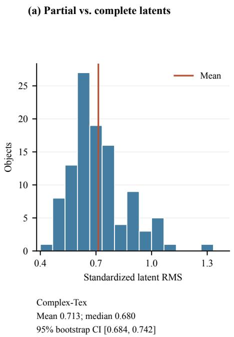

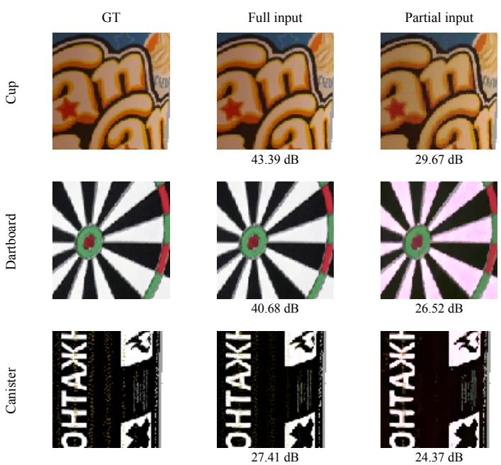  
Figure 5. Native observation encoding with GT geometry and materials. (a) Partial-versus-complete latent differences across valid Complex-Tex objects. (b) Decoded albedo for three cases selected by latent-difference percentile, with shared GT-selected crops. PSNR covers all retained observed GT voxels, not only the displayed crops.

visual-quality comparisons and ties for the highest VLM PBR score of 8.67 (Table 4). Figure 4 illustrates reference-detail preservation and coherent surface completion.

## 4.4 Ablation and Analysis

We evaluate the observation-injection architecture and material content under the given-geometry protocol of Sec. 4.1. The architecture variants share training data, initialization protocol, optimization settings, training budget, and checkpointselection rule. All comparisons use the same geometry, cameras, valid observation support, and sampling seed.

How observations are used. Table 5 compares three conditioning designs with the same predicted PBR observations. Residual injection adds encoded observations through layerwise residuals. Joint-update attention updates observation states in selected layers and all generation states in every layer. In contrast, SUPRA-Tex keeps observations read-only and alternates unobserved-cell and full-surface updates (Sec. 3.4). It improves shaded $\mathrm { P S N R _ { f g } }$ over residual injection by 0.87 dB on DTC-Tex and 0.29 dB on Complex-Tex, and matches joint-update attention in shaded fidelity while improving albedo $\mathrm { P S N R _ { f g } }$ by 0.15 and 0.16 dB with lower MR MAE. Thus, the design preserves or improves reconstruction quality without spending computation on observation-state updates or full-surface queries at every block. The complete design also samples 1.20× and 1.18× faster than joint-update attention on the two datasets (Sec. 4.5).

Effectiveness of 2D material estimation. To test whether the FireRed-based 2D material estimator supplies useful physical material estimates, we replace its predicted metallic and roughness with fixed values $( M = 0 , R = 0 . 5 )$ or dataset means, keeping predicted albedo and the 3D generator unchanged (Table 5). Relative to fixed and dataset-mean MR, predicted MR improves shaded $\mathrm { P S N R _ { f g } }$ by 0.44 and 0.26 dB on DTC-Tex, and 0.69 and 0.57 dB on Complex-Tex, respectively, with lower MR MAE on both datasets. These gains show that the 2D estimates provide useful material information beyond albedo alone. Replacing all predicted PBR channels with ground truth (Oracle PBR) further improves shaded $\mathrm { P S N R _ { f g } }$ by 2.31/1.12 dB and albedo $\mathrm { P S N R _ { f g } }$ by 2.62/2.51 dB on DTC-Tex/Complex-Tex. The remaining gap indicates that improving 2D material estimation can further improve 3D texture quality without changing the completion model. Using Qwen-Image-2.1 (Qwen Team, 2026) $( \mathrm { O u r s } ^ { \ddagger }$ in Table 1) narrows this oracle gap to 0.98/0.47 dB in shaded $\mathrm { P S N R _ { f g } }$ and 1.03/2.36 dB in albedo $\mathrm { P S N R _ { f g } }$ . The same completion model therefore works with a different 2D prior, and a stronger prior improves 3D texture quality toward the oracle.

Partial and complete material encoding. Sharing the material encoder does not imply that a partial observation yields the corresponding slice of a complete-material latent. We isolate this distinction using GT geometry, cameras, and PBR values on Complex-Tex, bypassing both 2D prediction and flow generation. For each object, we encode complete materials and the filtered visible subset with the same frozen encoder using its posterior mean, then compare features at identical observed coordinates. We measure the RMS difference over coordinates and channels after dividing each channel by its fixed material-latent standard deviation, and average the resulting scores equally across objects. We retain objects that pass the coordinate and projection checks, excluding failed projection-IoU checks or incompatible geometry/material support. All retained objects have nonzero differences: the mean standardized RMS is 0.713 (95% object-bootstrap interval 0.684–0.742), with median 0.680, while repeated encoding of identical inputs gives zero difference (Fig. 5a). Thus, partial encoding changes representations even for unchanged input materials.

Table 6. Runtime and sampling memory. Speedup is relative to Joint-update attention. Peak mean/max summarize sampling allocations; stage sum adds separately timed pipeline stages, not continuous end-to-end latency.
<table><tr><td>Configuration</td><td>Sampling (s)↓</td><td>Speedup</td><td>Stage sum (s)↓</td><td>Peak mean (GiB)</td><td>Peak max (GiB)</td></tr><tr><td>DTC-Tex</td><td></td><td></td><td></td><td></td><td></td></tr><tr><td>Joint-update attention</td><td>10.103</td><td>1.000×</td><td>26.840</td><td>12.586</td><td>13.757</td></tr><tr><td>Ours</td><td>8.440</td><td>1.197×</td><td>25.177</td><td>12.255</td><td>13.794</td></tr><tr><td>Ours + KV cache</td><td>7.909</td><td>1.277×</td><td>24.647</td><td>14.191</td><td>16.978</td></tr><tr><td>Complex-Tex</td><td></td><td></td><td></td><td></td><td></td></tr><tr><td>Joint-update attention</td><td>9.970</td><td>1.000×</td><td>21.542</td><td>12.562</td><td>14.293</td></tr><tr><td>Ours</td><td>8.440</td><td>1.181×</td><td>20.012</td><td>12.243</td><td>14.699</td></tr><tr><td>Ours + KV cache</td><td>7.931</td><td>1.257×</td><td>19.503</td><td>14.049</td><td>17.340</td></tr></table>

Latent distance alone does not establish material degradation. We decode the preselected cases nearest the 10th, 50th, and 90th latent-difference percentiles with the same frozen decoder. Each arm retains its encoder’s spatial correspondence cache, so this tests material reconstruction on supplied geometry rather than autonomous recovery of surface support. Figure 5b compares identical GT-selected crops; albedo PSNR is computed on the same retained GT surface voxels for both arms. Full/partial PSNR is 43.39/29.67, 40.68/26.52, and 27.41/24.37 dB for the cup, dartboard, and canister, respectively. Partial reconstructions retain the main patterns but introduce additional detail and color errors, including a pink shift in the dartboard’s white regions. The canister also shows appreciable full-input VAE error, which must be separated from the additional partial-input error. These three examples demonstrate decodable material content with imperfect fidelity; they are not a cohort-wide reconstruction estimate. Together, these results show that partial encoding supplies material evidence for refinement during full-surface generation. Appendix E.2 provides diagnostic settings.

## 4.5 Runtime and Memory

Table 6 compares Joint-update attention with SUPRA-Tex on all 210 given-geometry cases, using one H800 GPU per request. Both receive identical geometry and observation latents and use 25 Euler steps, seed 42, FP32 parameters, BF16 autocast, and FlashAttention 3 without classifier-free guidance. We report the mean of per-object median times from three runs after two warmups. These runtime measurements use the 10,000-step Joint-update attention checkpoint and the 30,000-step SUPRA-Tex checkpoint, separately from the matched-training quality ablations in Table 5; this timing comparison does not isolate interleaving alone.

SUPRA-Tex achieves sampling speedups of 1.20× on DTC-Tex and 1.18× on Complex-Tex. Observation KV caching adds 1.067× and 1.064× speedup, including cache construction, with identical latent outputs at every Euler step. Mean peak allocation rises by 1.94 and 1.81 GiB, respectively. The interleaved schedule also reduces query-token evaluations by 17.54% and 16.91% versus querying every cell at each block; these are not total FLOP reductions.

Stage sums exclude loading and file I/O. Geometry and observation preparation are timed once; estimation, sampling, and decoding use warm measurements. Peak memory covers only the resident denoiser and sampling tensors.

## 5 Limitations

Figure 6 shows how imperfect geometry, uncertain materials, and missing observations limit asset quality.

Large image–geometry discrepancies. In end-to-end generation, SUPRA-Tex uses geometry predicted by Pixal3D⋆. Large discrepancies in shape or pose between the reference image and the mesh can place projected material observations on incorrect surface locations. Correspondence filtering removes some unreliable observations, but cannot correct the underlying geometry, which remains fixed during material generation. Severe discrepancies can therefore prevent faithful texture alignment. Improving upstream geometry and camera alignment is therefore an important direction, but we do not evaluate corrected-geometry controls here.

Hallucinated geometry on unseen surfaces. Upstream geometry generators such as Pixal3D⋆ can introduce implausible unseen structures even when the visible shape matches the reference. These structures may deviate from shapes learned by the material generator, hindering coherent texture completion. Since SUPRA-Tex conditions on fixed geometry, it cannot remove these structures; their influence on texture generation can reduce final asset quality.

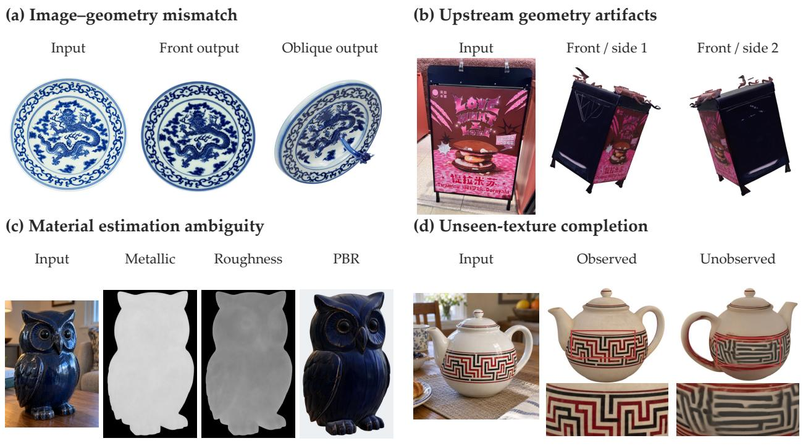  
Figure 6. Limitations under imperfect inputs and incomplete observations. (a) The front output exhibits local motif distortion around the dragon head; the oblique view reveals a spurious protrusion in the underlying geometry. (b) Two front-oblique views show spurious protrusions in the upstream geometry that remain visible after texture refinement. (c) The glossy painted-wood appearance is assigned a high metallic value. Without material ground truth, this example illustrates ambiguity in single-image material inference rather than a verified estimation error. Grayscale maps range from black (0) to white (1). (d) Observed and unobserved base-color views show a loss of motif precision on the hidden side; boxes identify the enlarged details. The front output in (a) and both outputs in (d) use unlit base color; the oblique output in (a) and both outputs in (b) use PBR rendering under the same neutral lighting.

Inconsistent completion across visibility boundaries. Completing unseen surfaces is particularly challenging when text or patterns extend beyond the visible region. For example, lettering that wraps around a can may be only partially visible in the input. The model may preserve the visible fragment yet fail to continue its strokes or layout coherently onto the hidden side, producing inconsistent text or patterns across the visibility boundary.

Errors in 2D material estimation. The 2D material estimator can misinterpret material properties, for example by assigning high metallic values to a non-metallic surface. These estimates condition the 3D generator, which may retain the error in the completed asset and produce implausible reflections under rendering or relighting. Accurate transfer of reference details thus does not guarantee correct material decomposition.

Failure cases. Figure 6 illustrates these limitations. Reference fidelity depends on usable image–surface correspondence and reliable material observations, while fine detail on unseen surfaces must be generated. The plate shows a printed motif reconstructed as protruding geometry, and the sign retains spurious structures after texture refinement. The owl separates recognizable appearance details from an ambiguous reflectance estimate; the teapot separates sharp observed patterns from less precise unseen completion. These are qualitative cases, without corrected-geometry controls or measured unseen-surface ground truth. A back view may help the last case; we report no paired two-view result.

## 6 Conclusion

We presented SUPRA-Tex, a framework for single-image 3D generation with super-aligned textures through observationguided material completion. By separating visible-material estimation and surface alignment from 3D generation and using native observation latents as fixed, read-only anchors, SUPRA-Tex preserves fine reference details while generating coherent, relightable materials across the full surface. Trained solely on public data, it achieves state-ofthe-art results among the evaluated methods in geometry-conditioned texturing and end-to-end asset generation. With synthetic back-view conditioning, it is also competitive with commercial systems in human evaluations on the mixed real-and-synthetic comparison set. These results demonstrate the value of spatially aligned, directly usable material observations for reconciling reference fidelity with full-surface generation.

## References

Jingzhi Bao, Hongze Chen, Lingting Zhu, Chenyu Liu, Runze Zhang, Keyang Luo, Zeyu Hu, Weikai Chen, Yingda Yin, Xin Wang, Zehong Lin, Jun Zhang, and Xiaoguang Han. LumiTex: Towards high-fidelity PBR texture generation with illumination context. In International Conference on Learning Representations, 2026. URL https://arxiv.org/abs/2511.19437.

Raphael Bensadoun, Yanir Kleiman, Idan Azuri, Omri Harosh, Andrea Vedaldi, Natalia Neverova, and Oran Gafni. Meta 3D TextureGen: Fast and consistent texture generation for 3D objects. arXiv preprint arXiv:2407.02430, 2024. URL https://arxiv.org/abs/2407.02430.

Tianshi Cao, Karsten Kreis, Sanja Fidler, Nicholas Sharp, and Kangxue Yin. TexFusion: Synthesizing 3D textures with text-guided image diffusion models. In Proceedings ofthe IEEE/CVF International Conference on Computer Vision, pp. 4169–4181, 2023. URL https://openaccess.thecvf.com/content/ICCV2023/html/Cao\_TexFusion\_ Synthesizing\_3D\_Textures\_with\_Text-Guided\_Image\_Diffusion\_Models\_ICCV\_2023\_paper.html.

Chris Careaga and Yagız Aksoy. Colorful diffuse intrinsic image decomposition in the wild.˘ ACM Transactions on Graphics, 43(6):178:1–178:12, 2024. doi: 10.1145/3687984. URL https://arxiv.org/abs/2409.13690.

Chia-Hao Chen, Yuan-Chen Guo, Zi-Xin Zou, Ze Yuan, Guan Luo, Xiaojuan Qi, Ding Liang, Yan-Pei Cao, and Song-Hai Zhang. Lafite: A generative latent field for 3D native texturing. In Proceedings ofthe IEEE/CVF Conference on Computer Vision and Pattern Recognition, pp. 19960–19971, 2026. URL https://openaccess.thecvf. com/content/CVPR2026/html/Chen\_Lafite\_A\_Generative\_Latent\_Field\_for\_3D\_Native\_Texturing\_ CVPR\_2026\_paper.html.

Dave Zhenyu Chen, Yawar Siddiqui, Hsin-Ying Lee, Sergey Tulyakov, and Matthias Nießner. Text2Tex: Text-driven texture synthesis via diffusion models. In Proceedings of the IEEE/CVF International Conference on Computer Vision, pp. 18558–18568, 2023. URL https://openaccess.thecvf.com/content/ICCV2023/html/Chen\_ Text2Tex\_Text-driven\_Texture\_Synthesis\_via\_Diffusion\_Models\_ICCV\_2023\_paper.html.

Xi Chen, Sida Peng, Dongchen Yang, Yuan Liu, Bowen Pan, Chengfei Lv, and Xiaowei Zhou. IntrinsicAnything: Learning diffusion priors for inverse rendering under unknown illumination. In European Conference on Computer Vision, pp. 450–467, 2024. URL https://arxiv.org/abs/2404.11593.

Zhaoxi Chen, Jiaxiang Tang, Yuhao Dong, Ziang Cao, Fangzhou Hong, Yushi Lan, Tengfei Wang, Haozhe Xie, Tong Wu, Shunsuke Saito, Liang Pan, Dahua Lin, and Ziwei Liu. 3DTopia-XL: Scaling high-quality 3D asset generation via primitive diffusion. In Proceedings of the IEEE/CVF Conference on Computer Vision and Pattern Recognition, pp. 26576–26586, 2025. URL https://openaccess.thecvf.com/content/CVPR2025/html/Chen\_3DTopia-XL\_ Scaling\_High-quality\_3D\_Asset\_Generation\_via\_Primitive\_Diffusion\_CVPR\_2025\_paper.html.

Wei Cheng, Juncheng Mu, Xianfang Zeng, Xin Chen, Anqi Pang, Chi Zhang, Zhibin Wang, Bin Fu, Gang Yu, Ziwei Liu, and Liang Pan. MVPaint: Synchronized multi-view diffusion for painting anything 3D. In Proceedings of the IEEE/CVF Conference on Computer Vision and Pattern Recognition, pp. 585–594, 2025. URL https : / / openaccess . thecvf . com / content / CVPR2025 / html / Cheng \_ MVPaint \_ Synchronized \_ Multi-View\_Diffusion\_for\_Painting\_Anything\_3D\_CVPR\_2025\_paper.html.

Jasmine Collins, Shubham Goel, Kenan Deng, Achleshwar Luthra, Leon Xu, Erhan Gundogdu, Xi Zhang, Tomas F. Yago Vicente, Thomas Dideriksen, Himanshu Arora, Matthieu Guillaumin, and Jitendra Malik. ABO: Dataset and benchmarks for real-world 3D object understanding. In Proceedings of the IEEE/CVF Conference on Computer Vision and Pattern Recognition (CVPR), pp. 21126–21136, 2022.

Matt Deitke, Ruoshi Liu, Matthew Wallingford, Huong Ngo, Oscar Michel, Aditya Kusupati, Alan Fan, Christian Laforte, Vikram Voleti, Samir Yitzhak Gadre, Eli VanderBilt, Aniruddha Kembhavi, Carl Vondrick, Georgia Gkioxari, Kiana Ehsani, Ludwig Schmidt, and Ali Farhadi. Objaverse-XL: A universe of 10M+ 3D objects. In Advances in Neural Information Processing Systems (NeurIPS), 2023.

Kangle Deng, Timothy Omernick, Alexander Weiss, Deva Ramanan, Jun-Yan Zhu, Tinghui Zhou, and Maneesh Agrawala. FlashTex: Fast relightable mesh texturing with LightControlNet. In European Conference on Computer Vision, 2024. URL https://eccv.ecva.net/virtual/2024/poster/537.

Zhao Dong, Ka Chen, Zhaoyang Lv, Hong-Xing Yu, Yunzhi Zhang, Cheng Zhang, Yufeng Zhu, Stephen Tian, Zhengqin Li, Geordie Moffatt, Sean Christofferson, James Fort, Xiaqing Pan, Mingfei Yan, Jiajun Wu, Carl Yuheng Ren, and Richard Newcombe. Digital twin catalog: A large-scale photorealistic 3D object digital twin dataset. In Proceedings of the IEEE/CVF Conference on Computer Vision and Pattern Recognition, 2025. URL https: //openaccess.thecvf.com/content/CVPR2025/html/Dong\_Digital\_Twin\_Catalog\_A\_Large-Scale\_ Photorealistic\_3D\_Object\_Digital\_Twin\_CVPR\_2025\_paper.html.

Yifei Feng, Mingxin Yang, Shuhui Yang, Sheng Zhang, Jiaao Yu, Zibo Zhao, Yuhong Liu, Jie Jiang, and Chunchao Guo. RomanTex: Decoupling 3D-aware rotary positional embedded multi-attention network for texture synthesis. In Proceedings of the IEEE/CVF International Conference on Computer Vision, pp. 17203–17213, 2025. URL https://openaccess.thecvf.com/content/ICCV2025/html/Feng\_RomanTex\_Decoupling\_3D-aware\_ Rotary\_Positional\_Embedded\_Multi-Attention\_Network\_for\_Texture\_ICCV\_2025\_paper.html.

Yue Han, Chong Li, Zhening Liu, Cong Huang, Fang Deng, Yong Liu, Fangyun Wei, and Yan Lu. Ink3D: Sculpting 3D assets with extremely complex textures via video generative models. In European Conference on Computer Vision, 2026. URL https://arxiv.org/abs/2607.01222.

Zebin He, Mingxin Yang, Shuhui Yang, Yixuan Tang, Tao Wang, Kaihao Zhang, Guanying Chen, Yuhong Liu, Jie Jiang, Chunchao Guo, and Wenhan Luo. MaterialMVP: Illumination-invariant material generation via multiview PBR diffusion. In Proceedings ofthe IEEE/CVF International Conference on Computer Vision, pp. 26294– 26305, 2025a. URL https://openaccess.thecvf.com/content/ICCV2025/html/He\_MaterialMVP\_ Illumination-Invariant\_Material\_Generation\_via\_Multi-view\_PBR\_Diffusion\_ICCV\_2025\_paper. html.

Zexin He, Tengfei Wang, Xin Huang, Xingang Pan, and Ziwei Liu. Neural LightRig: Unlocking accurate object normal and material estimation with multi-light diffusion. In Proceedings of the IEEE/CVF Conference on Computer Vision and Pattern Recognition, pp. 26514–26524, 2025b. URL https://openaccess.thecvf.com/ content/CVPR2025/html/He\_Neural\_LightRig\_Unlocking\_Accurate\_Object\_Normal\_and\_Material\_ Estimation\_with\_CVPR\_2025\_paper.html.

Martin Heusel, Hubert Ramsauer, Thomas Unterthiner, Bernhard Nessler, and Sepp Hochreiter. GANs trained by a two time-scale update rule converge to a local nash equilibrium. In Advances in Neural Information Processing Systems, 2017. URL https://arxiv.org/abs/1706.08500.

Binbin Huang, Haobin Duan, Yiqun Zhao, Zibo Zhao, Yi Ma, and Shenghua Gao. CUPID: Generative 3D reconstruction via joint object and pose modeling. In Proceedings ofthe IEEE/CVF Conference on Computer Vision and Pattern Recognition, pp. 12741–12752, 2026. URL https://arxiv.org/abs/2510.20776.

Xin Huang, Tengfei Wang, Ziwei Liu, and Qing Wang. Material anything: Generating materials for any 3D object via diffusion. In Proceedings of the IEEE/CVF Conference on Computer Vision and Pattern Recognition, pp. 26556–26565, 2025a. URL https://openaccess.thecvf.com/content/CVPR2025/html/Huang\_Material\_ Anything\_Generating\_Materials\_for\_Any\_3D\_Object\_via\_Diffusion\_CVPR\_2025\_paper.html.

Zehuan Huang, Yuan-Chen Guo, Haoran Wang, Ran Yi, Lizhuang Ma, Yan-Pei Cao, and Lu Sheng. MV-Adapter: Multi-view consistent image generation made easy. In Proceedings ofthe IEEE/CVF International Conference on Computer Vision, pp. 16377–16387, 2025b. URL https://arxiv.org/abs/2412.03632.

Sadeep Jayasumana, Srikumar Ramalingam, Andreas Veit, Daniel Glasner, Ayan Chakrabarti, and Sanjiv Kumar. Rethinking FID: Towards a better evaluation metric for image generation. In Proceedings ofthe IEEE/CVF Conference on Computer Vision and Pattern Recognition, pp. 9307–9315, 2024. URL https://arxiv.org/abs/2401.09603.

Bingxin Ke, Kevin Qu, Tianfu Wang, Nando Metzger, Shengyu Huang, Bo Li, Anton Obukhov, and Konrad Schindler. Marigold: Affordable adaptation of diffusion-based image generators for image analysis. IEEE Transactions on Pattern Analysis and Machine Intelligence, 2025. doi: 10.1109/TPAMI.2025.3591076. URL https://arxiv.org/ abs/2505.09358.

Mukul Khanna, Yongsen Mao, Hanxiao Jiang, Sanjay Haresh, Brennan Shacklett, Dhruv Batra, Alexander Clegg, Eric Undersander, Angel X. Chang, and Manolis Savva. Habitat synthetic scenes dataset (HSSD-200): An analysis of 3D scene scale and realism tradeoffs for ObjectGoal navigation. In Proceedings of the IEEE/CVF Conference on Computer Vision and Pattern Recognition (CVPR), pp. 16384–16393, 2024.

Peter Kocsis, Vincent Sitzmann, and Matthias Nießner. Intrinsic image diffusion for indoor single-view material estimation. In Proceedings of the IEEE/CVF Conference on Computer Vision and Pattern Recognition, pp. 5198–5208, 2024. URL https://openaccess.thecvf.com/content/CVPR2024/html/Kocsis\_Intrinsic\_ Image\_Diffusion\_for\_Indoor\_Single-view\_Material\_Estimation\_CVPR\_2024\_paper.html.

Zeqiang Lai, Yunfei Zhao, Haolin Liu, Zibo Zhao, Qingxiang Lin, Huiwen Shi, Xianghui Yang, Mingxin Yang, Shuhui Yang, Yifei Feng, Sheng Zhang, Xin Huang, Di Luo, Fan Yang, Fang Yang, Lifu Wang, Sicong Liu, Yixuan Tang, Yulin Cai, Zebin He, Tian Liu, Yuhong Liu, Jie Jiang, Linus, Jingwei Huang, and Chunchao Guo. Hunyuan3D 2.5: Towards high-fidelity 3D assets generation with ultimate details. arXiv preprint arXiv:2506.16504, 2025. URL https://arxiv.org/abs/2506.16504.

Zeqiang Lai, Yunfei Zhao, Zibo Zhao, Xin Yang, Xin Huang, Jingwei Huang, Xiangyu Yue, and Chunchao Guo. NaTex: Seamless texture generation as latent color diffusion. In Proceedings of the IEEE/CVF Conference on Computer Vision and Pattern Recognition, pp. 18619–18629, 2026. URL https://openaccess.thecvf.com/content/ CVPR2026/html/Lai\_NaTex\_Seamless\_Texture\_Generation\_as\_Latent\_Color\_Diffusion\_CVPR\_2026\_ paper.html.

Dong-Yang Li, Wang Zhao, Yuxin Chen, Wenbo Hu, Meng-Hao Guo, Fang-Lue Zhang, Ying Shan, and Shi-Min Hu. Pixal3D: Pixel-aligned 3D generation from images. In ACM SIGGRAPH 2026 Conference Papers, 2026a. doi: 10.1145/3799902.3811175. URL https://arxiv.org/abs/2605.10922.

Sikuang Li, Chen Yang, Jiemin Fang, Taoran Yi, Jia Lu, Jiazhong Cen, Lingxi Xie, Wei Shen, and Qi Tian. WorldGrow: Generating infinite 3D world. In Proceedings of the AAAI Conference on Artificial Intelligence, volume 40, pp. 6433–6441, 2026b. doi: 10.1609/aaai.v40i8.37571.

Weiyu Li, Xuanyang Zhang, Zheng Sun, Di Qi, Hao Li, Wei Cheng, Weiwei Cai, Shihao Wu, Jiarui Liu, Zihao Wang, Xiao Chen, Feipeng Tian, Jianxiong Pan, Zeming Li, Gang Yu, Xiangyu Zhang, Daxin Jiang, and Ping Tan. Step1X-3D: Towards high-fidelity and controllable generation of textured 3D assets. arXiv preprint arXiv:2505.07747, 2025a. URL https://arxiv.org/abs/2505.07747.

Yangguang Li, Zi-Xin Zou, Zexiang Liu, Dehu Wang, Yuan Liang, Zhipeng Yu, Xingchao Liu, Yuan-Chen Guo, Ding Liang, Wanli Ouyang, and Yan-Pei Cao. TripoSG: High-fidelity 3D shape synthesis using large-scale rectified flow models. arXiv preprint arXiv:2502.06608, 2025b. URL https://arxiv.org/abs/2502.06608.

Yixun Liang, Kunming Luo, Xiao Chen, Rui Chen, Hongyu Yan, Weiyu Li, Jiarui Liu, Fei-Peng Tian, and Ping Tan. UniTEX: Universal high fidelity generative texturing for 3D shapes. In Proceedings of the IEEE/CVF Conference on Computer Vision and Pattern Recognition, pp. 19917–19927, 2026. URL https://arxiv.org/abs/2505.23253.

Yaron Lipman, Ricky T. Q. Chen, Heli Ben-Hamu, Maximilian Nickel, and Matt Le. Flow matching for generative modeling. In International Conference on Learning Representations, 2023. URL https://openreview.net/ forum?id=PqvMRDCJT9t.

Jialun Liu, Chenming Wu, Xinqi Liu, Xing Liu, Jinbo Wu, Haotian Peng, Chen Zhao, Haocheng Feng, Jingtuo Liu, and Errui Ding. TexOct: Generating textures of 3D models with octree-based diffusion. In Proceedings of the IEEE/CVF Conference on Computer Vision and Pattern Recognition, pp. 4284–4293, 2024a. URL https:// openaccess.thecvf.com/content/CVPR2024/html/Liu\_TexOct\_Generating\_Textures\_of\_3D\_Models\_ with\_Octree-based\_Diffusion\_CVPR\_2024\_paper.html.

Yuxin Liu, Minshan Xie, Hanyuan Liu, and Tien-Tsin Wong. Text-guided texturing by synchronized multi-view diffusion. In SIGGRAPH Asia 2024 Conference Papers, 2024b. doi: 10.1145/3680528.3687621. URL https: //doi.org/10.1145/3680528.3687621.

Ilya Loshchilov and Frank Hutter. Decoupled weight decay regularization. In International Conference on Learning Representations, 2019. URL https://openreview.net/forum?id=Bkg6RiCqY7.

Sai Raj Kishore Perla, Yizhi Wang, Ali Mahdavi-Amiri, and Hao Zhang. EASI-Tex: Edge-aware mesh texturing from single image. ACM Transactions on Graphics, 43(4):40:1–40:11, 2024. doi: 10.1145/3658222.

Qwen Team. Qwen-Image-2.1: Compact, efficient, and unified image creation. Qwen Blog, 2026. URL https: //qwen.ai/blog?id=qwen-image-2.1. Published September 20, 2026.

Alec Radford, Jong Wook Kim, Chris Hallacy, Aditya Ramesh, Gabriel Goh, Sandhini Agarwal, Girish Sastry, Amanda Askell, Pamela Mishkin, Jack Clark, Gretchen Krueger, and Ilya Sutskever. Learning transferable visual models from natural language supervision. In Proceedings ofthe 38th International Conference on Machine Learning, volume 139, pp. 8748–8763, 2021. URL https://proceedings.mlr.press/v139/radford21a.html.

Elad Richardson, Gal Metzer, Yuval Alaluf, Raja Giryes, and Daniel Cohen-Or. TEXTure: Text-guided texturing of 3D shapes. In ACM SIGGRAPH 2023 Conference Proceedings, pp. 1–11, 2023. doi: 10.1145/3588432.3591503. URL https://doi.org/10.1145/3588432.3591503.

Shunsuke Saito, Zeng Huang, Ryota Natsume, Shigeo Morishima, Angjoo Kanazawa, and Hao Li. PIFu: Pixel-aligned implicit function for high-resolution clothed human digitization. In Proceedings of the IEEE/CVF International Conference on Computer Vision, pp. 2304–2314, 2019. URL https://openaccess.thecvf.com/content\_ICCV\_ 2019/html/Saito\_PIFu\_Pixel-Aligned\_Implicit\_Function\_for\_High-Resolution\_Clothed\_Human\_ Digitization\_ICCV\_2019\_paper.html.

Mingqi Shao, Feng Xiong, Zhaoxu Sun, and Mu Xu. MVPainter: Accurate and detailed 3D texture generation via multi-view diffusion with geometric control. arXiv preprint arXiv:2505.12635, 2025. URL https://arxiv.org/ abs/2505.12635.

Ruizhi Shao, Youxin Pang, Zerong Zheng, Jingxiang Sun, and Yebin Liu. 360-degree human video generation with 4D diffusion transformer. ACM Transactions on Graphics (TOG), 43(6), 2024. doi: 10.1145/3687980.

Kaiyue Shen, Chen Guo, Manuel Kaufmann, Juan Jose Zarate, Julien Valentin, Jie Song, and Otmar Hilliges. X-Avatar: Expressive human avatars. In Proceedings ofthe IEEE/CVF Conference on Computer Vision and Pattern Recognition (CVPR), pp. 16911–16921, 2023.

Oriane Siméoni, Huy V. Vo, Maximilian Seitzer, Federico Baldassarre, Maxime Oquab, Cijo Jose, Vasil Khalidov, Marc Szafraniec, Seungeun Yi, Michaël Ramamonjisoa, Francisco Massa, Daniel Haziza, Luca Wehrstedt, Jianyuan Wang, Timothée Darcet, Théo Moutakanni, Leonel Sentana, Claire Roberts, Andrea Vedaldi, Jamie Tolan, John Brandt, Camille Couprie, Julien Mairal, Hervé Jégou, Patrick Labatut, and Piotr Bojanowski. DINOv3. arXiv preprint arXiv:2508.10104, 2025. URL https://arxiv.org/abs/2508.10104.

Sketchfab. Sketchfab, n.d. URL https://sketchfab.com.

Jianlin Su, Murtadha Ahmed, Yu Lu, Shengfeng Pan, Wen Bo, and Yunfeng Liu. RoFormer: Enhanced transformer with rotary position embedding. Neurocomputing, 568:127063, 2024. doi: 10.1016/j.neucom.2023.127063.

Super Intelligence Team. FireRed-Image-Edit-1.0 technical report. arXiv preprint arXiv:2602.13344, 2026. URL https://arxiv.org/abs/2602.13344.

Tencent Hunyuan3D Team. Hunyuan3D 2.1: From images to high-fidelity 3D assets with production-ready PBR material, 2025a. URL https://arxiv.org/abs/2506.15442.

Tencent Hunyuan3D Team. Hunyuan3D 2.0: Scaling diffusion models for high resolution textured 3D assets generation. arXiv preprint arXiv:2501.12202, 2025b. URL https://arxiv.org/abs/2501.12202.

Wenbo Wang, Hsuan-I Ho, Chen Guo, Boxiang Rong, Artur Grigorev, Jie Song, Juan Jose Zarate, and Otmar Hilliges. 4D-DRESS: A 4D dataset of real-world human clothing with semantic annotations. In Proceedings ofthe IEEE/CVF Conference on Computer Vision and Pattern Recognition (CVPR), pp. 550–560, 2024.

Zhou Wang, Alan Conrad Bovik, Hamid Rahim Sheikh, and Eero P. Simoncelli. Image quality assessment: From error visibility to structural similarity. IEEE Transactions on Image Processing, 13(4):600–612, 2004. URL https://www.cns.nyu.edu/pub/eero/wang03-reprint.pdf.

Guanjun Wu, Jiemin Fang, Chen Yang, Sikuang Li, Taoran Yi, Jia Lu, Zanwei Zhou, Jiazhong Cen, Lingxi Xie, Xiaopeng Zhang, Wei Wei, Wenyu Liu, Xinggang Wang, and Qi Tian. UniLat3D: Geometry-appearance unified latents for single-stage 3D generation. In Proceedings ofthe IEEE/CVF Conference on Computer Vision and Pattern Recognition (Findings), 2026a. URL https://arxiv.org/abs/2509.25079.

Xiuchao Wu, Pengfei Zhu, Jiangjing Lyu, Xinguo Liu, Jie Guo, Yanwen Guo, Weiwei Xu, and Chengfei Lyu. MatMart: Material reconstruction of 3D objects via diffusion. In Proceedings ofthe IEEE/CVF Conference on Computer Vision and Pattern Recognition, pp. 2336–2345, 2026b. URL https://openaccess.thecvf.com/content/CVPR2026/ papers/Wu\_MatMart\_Material\_Reconstruction\_of\_3D\_Objects\_via\_Diffusion\_CVPR\_2026\_paper. pdf.

Jianfeng Xiang, Zelong Lv, Sicheng Xu, Yu Deng, Ruicheng Wang, Bowen Zhang, Dong Chen, Xin Tong, and Jiaolong Yang. Structured 3D latents for scalable and versatile 3D generation. In Proceedings of the IEEE/CVF Conference on Computer Vision and Pattern Recognition, pp. 21469–21480, 2025. URL https://openaccess. thecvf.com/content/CVPR2025/html/Xiang\_Structured\_3D\_Latents\_for\_Scalable\_and\_Versatile\_ 3D\_Generation\_CVPR\_2025\_paper.html.

Jianfeng Xiang, Xiaoxue Chen, Sicheng Xu, Ruicheng Wang, Zelong Lv, Yu Deng, Hongyuan Zhu, Yue Dong, Hao Zhao, Nicholas Jing Yuan, and Jiaolong Yang. Native and compact structured latents for 3D generation. In Proceedings ofthe IEEE/CVF Conference on Computer Vision and Pattern Recognition, pp. 14419–14429, 2026. URL https://openaccess.thecvf.com/content/CVPR2026/html/Xiang\_Native\_and\_Compact\_Structured\_ Latents\_for\_3D\_Generation\_CVPR\_2026\_paper.html.

Bojun Xiong, Jialun Liu, Jiakui Hu, Chenming Wu, Jinbo Wu, Xing Liu, Chen Zhao, Errui Ding, and Zhouhui Lian. TexGaussian: Generating high-quality PBR material via octree-based 3D gaussian splatting. In Proceedings of the IEEE/CVF Conference on Computer Vision and Pattern Recognition, pp. 551–561, 2025. URL https: //openaccess.thecvf.com/content/CVPR2025/html/Xiong\_TexGaussian\_Generating\_High-quality\_ PBR\_Material\_via\_Octree-based\_3D\_Gaussian\_Splatting\_CVPR\_2025\_paper.html.

Kyeongmin Yeo, Yunhong Min, Jaihoon Kim, and Minhyuk Sung. MatLat: Material latent space for PBR texture generation. In Proceedings ofthe IEEE/CVF Conference on Computer Vision and Pattern Recognition, pp. 4602–4612, 2026. URL https://openaccess.thecvf.com/content/CVPR2026/html/Yeo\_MatLat\_Material\_Latent\_ Space\_for\_PBR\_Texture\_Generation\_CVPR\_2026\_paper.html.

Kim Youwang, Tae-Hyun Oh, and Gerard Pons-Moll. Paint-it: Text-to-texture synthesis via deep convolutional texture map optimization and physically-based rendering. In Proceedings of the IEEE/CVF Conference on Computer Vision and Pattern Recognition, pp. 4347–4356, 2024. URL https://openaccess. thecvf.com/content/CVPR2024/html/Youwang\_Paint-it\_Text-to-Texture\_Synthesis\_via\_Deep\_ Convolutional\_Texture\_Map\_Optimization\_and\_CVPR\_2024\_paper.html.

Alex Yu, Vickie Ye, Matthew Tancik, and Angjoo Kanazawa. pixelNeRF: Neural radiance fields from one or few images. In Proceedings of the IEEE/CVF Conference on Computer Vision and Pattern Recognition, pp. 4578– 4587, 2021a. URL https://openaccess.thecvf.com/content/CVPR2021/html/Yu\_pixelNeRF\_Neural\_ Radiance\_Fields\_From\_One\_or\_Few\_Images\_CVPR\_2021\_paper.html.

Tao Yu, Zerong Zheng, Kaiwen Guo, Pengpeng Liu, Qionghai Dai, and Yebin Liu. Function4D: Real-time human volumetric capture from very sparse consumer RGBD sensors. In Proceedings of the IEEE/CVF Conference on Computer Vision and Pattern Recognition (CVPR), pp. 5746–5756, 2021b.

Xin Yu, Peng Dai, Wenbo Li, Lan Ma, Zhengzhe Liu, and Xiaojuan Qi. Texture generation on 3D meshes with point-UV diffusion. In Proceedings of the IEEE/CVF International Conference on Computer Vision, pp. 4206–4216, 2023. URL https://arxiv.org/abs/2308.10490.

Xin Yu, Ze Yuan, Yuan-Chen Guo, Ying-Tian Liu, Jianhui Liu, Yangguang Li, Yan-Pei Cao, Ding Liang, and Xiaojuan Qi. TEXGen: a generative diffusion model for mesh textures. ACM Transactions on Graphics, 43(6):213:1–213:14, 2024. doi: 10.1145/3687909. URL https://arxiv.org/abs/2411.14740.

Xianfang Zeng, Xin Chen, Zhongqi Qi, Wen Liu, Zibo Zhao, Zhibin Wang, Bin Fu, Yong Liu, and Gang Yu. Paint3D: Paint anything 3D with lighting-less texture diffusion models. In Proceedings of the IEEE/CVF Conference on Computer Vision and Pattern Recognition, pp. 4252–4262, 2024a.

Yifei Zeng, Yajie Bao, Jiachen Qian, Shuang Wu, Youtian Lin, Hao Zhu, Buyu Li, Feihu Zhang, Xun Cao, and Yao Yao. TEXTRIX: Latent attribute grid for native texture generation and beyond. In Proceedings of the IEEE/CVF Conference on Computer Vision and Pattern Recognition, pp. 27104–27113, 2026. URL https://arxiv.org/ abs/2512.02993.

Zheng Zeng, Valentin Deschaintre, Iliyan Georgiev, Yannick Hold-Geoffroy, Yiwei Hu, Fujun Luan, Ling-Qi Yan, and Miloš Hašan. RGB↔X: Image decomposition and synthesis using material- and lighting-aware diffusion models. In ACM SIGGRAPH 2024 Conference Papers, 2024b. doi: 10.1145/3641519.3657445. URL https: //arxiv.org/abs/2405.00666.

Longwen Zhang, Ziyu Wang, Qixuan Zhang, Qiwei Qiu, Anqi Pang, Haoran Jiang, Wei Yang, Lan Xu, and Jingyi Yu. CLAY: A controllable large-scale generative model for creating high-quality 3D assets. ACM Transactions on Graphics, 43(4):1–20, 2024a. doi: 10.1145/3658146. URL https://doi.org/10.1145/3658146.

Richard Zhang, Phillip Isola, Alexei A. Efros, Eli Shechtman, and Oliver Wang. The unreasonable effectiveness of deep features as a perceptual metric. In Proceedings ofthe IEEE Conference on Computer Vision and Pattern Recognition, 2018. URL https://arxiv.org/abs/1801.03924.

Yibo Zhang, Li Zhang, Rui Ma, and Nan Cao. Texverse: A universe of 3D objects with high-resolution textures. arXiv preprint arXiv:2508.10868, 2025a.

Yuqing Zhang, Yuan Liu, Zhiyu Xie, Lei Yang, Zhongyuan Liu, Mengzhou Yang, Runze Zhang, Qilong Kou, Cheng Lin, Wenping Wang, and Xiaogang Jin. DreamMat: High-quality PBR material generation with geometry- and light-aware diffusion models. ACM Transactions on Graphics, 43(4):39:1–39:18, 2024b. doi: 10.1145/3658170.

Yuqing Zhang, Hao Xu, Yiqian Wu, Sirui Chen, Sirui Lin, Xiang Li, Xifeng Gao, and Xiaogang Jin. AlignTex: Pixel-precise texture generation from multi-view artwork. ACM Transactions on Graphics, 44(4):161:1–161:12, 2025b. doi: 10.1145/3731158.

Yuqing Zhang, Yan-Pei Cao, Hao Xu, Yiqian Wu, Sirui Lin, Yuqing Wang, Ding Liang, Yuan-Chen Guo, and Xiaogang Jin. PixTex: Consistent 3D texturing via pixel-space multi-view diffusion. In ACM SIGGRAPH Conference Papers, 2026. doi: 10.1145/3799902.3811120.

Zoey. Multiview upgrade: Multi-view geometry and texture in Meshy. Meshy Blog, 2026. URL https://www.meshy. ai/blog/multiview-upgrade. Published August 7, 2026. Accessed September 26, 2026.

## Supplementary Material

This supplement provides method and training details, evaluation protocols, additional results, and extended discussion.   
The guide below links to each appendix and selected subsections; page numbers indicate where each appendix begins.

• Appendix A: Additional Method Details (p. 19). Geometry and camera projection, visible-surface observations, and boundary filtering; the interleaved flow transformer, including token dimensions and its read-only update schedule. The training objective and inference procedure are given in Sec. 3.5.

• Appendix B: Training Data and Optimization (p. 20). Training data, the 2D material estimator $F _ { \mathrm { 2 D } }$ , and 3D generator training, including observation construction, optimization, and checkpoint selection.

• Appendix C: Evaluation Protocols (p. 21). Evaluation datasets, rendering cameras, alignment, and metrics, baseline configurations, and commercial comparisons.

• Appendix D: 2D Material Evaluation (p. 23). 2D material prediction accuracy and $F _ { \mathrm { 2 D } }$ runtime measurements. Reference-view versus novel-view fidelity and 3D sampling efficiency are reported in Secs. 4.1 and 4.5.

• Appendix E: Ablation and Observation Analyses (p. 24). Ablation settings, the partial-versus-complete encoding diagnostic protocol, observed-support encoding versus zero filling, and early learning with native PBR latents.

• Appendix F: Additional Qualitative Comparisons (p. 26). Additional visual comparisons for given-geometry texturing, end-to-end image-to-3D generation, and commercial systems, extending the main-paper examples.

• Appendix G: Additional Views and Texture Editing (p. 26). Synthetic back-view conditions and image-based texture editing. Limitations and failure cases are discussed in Sec. 5.

• Appendix H: Notation Reference (p. 29). A consolidated symbol table with dimensions and definitions for the physical material channels, surface and latent coordinates, observation metadata, and generator states.

## A Additional Method Details

## A.1 Geometry and Surface Observations

Geometry foundation and camera projection. Our framework operates on an underlying mesh M and camera projection π, provided as ground-truth inputs or estimated from the reference image. For end-to-end inference, we follow the default MoGe-2-based camera-estimation pipeline of Pixal3D⋆, whose geometry module generates the mesh. For the 3D position $\mathbf { x } _ { s }$ of latent coordinate $s ,$ the model samples image features through camera projection:

$$
f _ { s } = \mathrm { S a m p l e } ( \Phi ( I ) , \pi ( \mathbf { x } _ { s } ) ) ,\tag{11}
$$

where $\Phi ( I )$ denotes a 2D feature map. In the geometry refinement stages, Pixal3D⋆ projects both the original and spatially upsampled image features and concatenates the sampled features. Combined with global image conditioning, these features align the predicted mesh M and camera projection $\pi$ with the reference view, serving as the geometric input for our material generation.

Surface observations and latent coordinates. The full surface defines the active latent-coordinate set S. Valid visible surface voxels form the partial PBR input ${ \mathcal { P } } _ { o } .$ which is encoded before any latent-level conditioning is constructed. The resulting coordinates $\scriptstyle { S _ { o } }$ identify cells with observations, but a cell in $\scriptstyle { S _ { o } }$ can also contain unseen surface voxels; $\mathcal { U } = \mathcal { S } \setminus \mathcal { S } _ { o }$ therefore denotes cells without any observation, not all unseen surface. Coverage $\rho _ { s }$ is the observed fraction of the surface voxels actually present in a cell, and repeated image samples of one voxel do not increase it. Boundary distance $d _ { s }$ uses the six-neighbor graph of active latent coordinates and is −1 if no unobserved cell is reachable.

Inference-time boundary filtering. At inference, we additionally apply foreground-mask erosion and local depthdiscontinuity filtering to reduce texture contamination from unreliable correspondences. Foreground erosion removes mixed pixels along the silhouette, and depth-discontinuity filtering rejects correspondences whose neighboring visible depths differ by more than a threshold, where a small projection error would move the observation onto a different surface. All material channels share the retained observation support, from which local material encoding, coverage, and boundary distance are computed.

## A.2 Interleaved Flow Transformer

3D generator architecture. Material and geometry latents have 32 channels each on a sparse latent grid of resolution $6 4 ^ { 3 }$ . The generator has 60 Transformer blocks with hidden dimension 1536 and 12 attention heads, 30 of each update type; its self-attention modules are initialized from TRELLIS.2 and the remaining components randomly.

Two states at an observed coordinate. At every $s \in S _ { o } ,$ the read-only observation token $O _ { s }$ represents a partial material observation, while the generation token $X _ { s }$ predicts the complete material of the cell. Geometry and material latents use fixed per-channel normalization; observation latents are mapped to the material-latent scale before the shared input projection. Projected spatial metadata and the learned role bias $\bar { b _ { o } } \in \mathbb { R } ^ { 1 5 3 6 }$ , initialized to zero, are added only to observation tokens. Table 7 summarizes the dimensions.

Table 7. Representation dimensions. $N = | S |$ and $M = | S _ { o } |$ vary across objects.
<table><tr><td>Quantity</td><td>Dimensions</td><td>Meaning</td></tr><tr><td>Geometry latents G</td><td> $N \times 3 2$ </td><td>Geometry conditions on the full surface</td></tr><tr><td>Noisy material latents  $Z _ { t }$ </td><td> $N \times 3 2$ </td><td>Full-surface material state at time t</td></tr><tr><td>Native observation latents {zs }s∈s.</td><td> $M \times 3 2$ </td><td>Encoded partial PBR materials</td></tr><tr><td>Observation metadata</td><td> $M \times 2$ </td><td>Coverage and boundary distance</td></tr><tr><td>Generation stream X</td><td> $N \times 1 5 3 6$ </td><td>Hidden generation states</td></tr><tr><td>Observation stream O</td><td> $M \times 1 5 3 6$ </td><td>Read-only observation states</td></tr><tr><td>Output velocity</td><td> $N \times 3 2$ </td><td>Updates to all material latents</td></tr></table>

Attention and update schedule. Figure 7 illustrates the two streams and their alternating update schedule. Each of the 60 Transformer blocks reads keys and values from both streams. Even-indexed blocks use queries from $X _ { \mathcal { U } } .$ , odd-indexed blocks from all of X; generation states in U are therefore updated in 60 blocks and those in $\scriptstyle { S _ { o } }$ in 30. Observation tokens pass through each block’s normalization and adaptive modulation with the clean-time indicator $t = 0 ,$ produce no queries, and receive no residual or feed-forward updates. Queries from X, and keys from both O and X, carry rotary positional encoding (Su et al., 2024) extended to 3D latent coordinates; values are not rotated. These counts describe hidden-state updates within one forward pass and do not restrict which material latents evolve during sampling: the output velocity and Euler updates cover all of S.

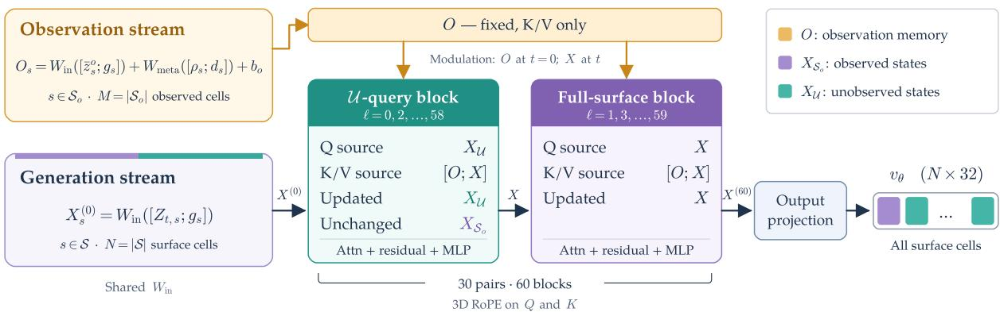  
Figure 7. Interleaved flow transformer. One forward pass through 60 distinct blocks arranged in 30 alternating pairs. The fixed observation stream O (orange) supplies keys and values without queries or state updates. The generation stream X spans the full active latent-cell set S, with states at observed cells $\scriptstyle { S _ { o } }$ (purple) and cells without any observation $\mathcal { U } = \mathcal { S } \setminus \mathcal { S } _ { o }$ (teal); the subscript o denotes observed. An observed cell may still contain unseen surface voxels. Evenindexed blocks query and update $X _ { \mathcal { U } } ;$ odd-indexed blocks query and update all of X. Both block types read keys and values from all of O and X, and the output projection predicts velocities over all $N = | S |$ cells. Source labels denote tokens before normalization, time modulation, and attention projections. At inference, 25 Euler sampling steps each invoke a full transformer forward pass.

## B Training Data and Optimization

## B.1 Training Data

We train our models using publicly available 3D datasets. The 3D generator uses assets from TexVerse (Zhang et al., 2025a), Objaverse-XL (Deitke et al., 2023), ABO (Collins et al., 2022), HSSD (Khanna et al., 2024), and open synthetic 3D collections, together with human scans from 4D-Dress (Wang et al., 2024), Human4DiT (Shao et al., 2024), THuman2.1 (Yu et al., 2021b), and X-Humans (Shen et al., 2023). These assets provide geometry and material supervision for observation-guided full-surface completion. The 2D material estimator is trained on paired RGB images, material maps, and normal maps rendered from Objaverse assets. All datasets are used in accordance with their respective licenses for non-commercial academic research.

## B.2 Training $F _ { \mathrm { 2 D } }$

We initialize $F _ { \mathrm { 2 D } }$ from FireRed-Image-Edit-1.1 adapted to individual PBR and normal prediction tasks, and jointly fine-tune it on aligned RGB images and ground-truth material and normal maps rendered from publicly available 3D assets. Both the task-specific adaptation and joint fine-tuning use these rendered data. Modality-axis attention is inserted at Transformer blocks 29, 39, 49, and 59, with rank 256 and four attention heads. We optimize these adapters and backbone blocks 29–49 using a latent flow-matching objective and AdamW (Loshchilov & Hutter, 2019), with learning rates of $2 \times 1 0 ^ { - 4 }$ and $5 \times 1 0 ^ { - 7 }$ , respectively. The VAE and text encoder remain frozen.

By folding the batch dimension, the model processes albedo, metallic-roughness, and an auxiliary normal stream in parallel, inserting lightweight cross-attention adapters at specific transformer layers to exchange features across modality axes at identical spatial coordinates. We train $F _ { \mathrm { 2 D } }$ with a flow-matching objective anchored at the fixed maximum-noise endpoint $\sigma = 1 . 0$ using an outlier-masked MSE loss. Elementwise latent-flow residuals with absolute magnitude greater than 50 contribute zero loss but remain in the averaging denominator. Losses are averaged equally across the albedo, metallic-roughness, and normal streams. At inference, we use a single prediction at this endpoint to estimate the clean material latents, which the image VAE decodes into 1024 × 1024 PBR maps.

## B.3 3D Generator Training

Preprocessing for training. We build training observations from ground-truth PBR materials of public 3D assets using the visible-surface observation encoding pipeline. Foreground validity and first-hit visibility determine the observed surface voxels supplied to the sparse material encoder. We follow Pixal3D (Li et al., 2026a) for asset preprocessing and reference-view sampling. During training, we drop the entire observation condition with probability 0.03 while retaining the geometry condition.

Optimization. We use random seed 42 throughout our training and evaluation pipelines. The material encoder and decoder are frozen. Generator self-attention is initialized from TRELLIS.2 and the remaining components randomly. We use the flow-matching objective in Eq. equation 10. We optimize the 3D generator for 30,000 steps with a global batch size of 576 using AdamW, with $\beta _ { 1 } = 0 . 9 , \beta _ { 2 } = 0 . 9 5$ , weight decay 0.01, and $\epsilon = 1 0 ^ { - 8 }$ . The initial learning-rate schedule uses 150 steps of linear warmup to 10−4, followed by cosine decay with a $2 0 { , } 0 0 0$ -step horizon and a minimum learning rate of $1 0 ^ { - 5 }$ . At step 15,000, we extend training with a cosine continuation from approximately $2 . 3 3 7 \times 1 0 ^ { - 5 }$ to $1 0 ^ { - 5 }$ at step 30,000, without additional warmup. We use BF16 automatic mixed precision and adaptive gradient clipping with a maximum norm of 1.0 and a 95th-percentile threshold. The final training stage uses 64 GPUs and FlashAttention-3 acceleration. Evaluation uses the raw generator weights at step 30,000.

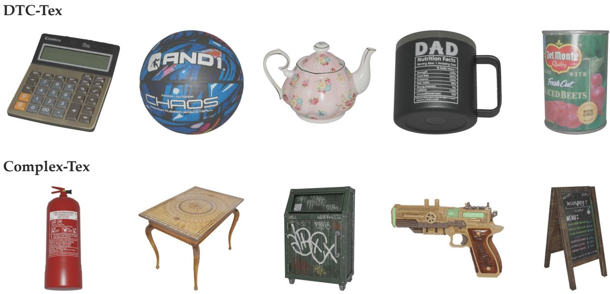  
Figure 8. Examples from DTC-Tex and Complex-Tex. Ten selected assets from DTC-Tex (top) and Complex-Tex (bottom), shown in their designated reference views. Examples include dense text, fine patterns, and reflective surfaces.

Training-time sampling. We use $\sigma _ { \mathrm { m i n } } = 1 0 ^ { - 5 }$ and sample training times as t = sigmoid(ξ) with $\xi \sim \mathcal { N } ( 1 , 1 )$ Observation dropout is applied as described in preprocessing above.

## C Evaluation Protocols

## C.1 Evaluation Datasets

DTC-Tex comprises 100 objects from the Digital Twin Catalog (Dong et al., 2025). We score the 2,399 catalog assets for surface-texture complexity from six views with Qwen3.8-27B, discard near-duplicates and broken meshes, and retain the 100 highest-scoring objects. Each object is evaluated from a front-view reference, together with its ground-truth mesh, PBR maps, and a 16-view camera rig. Typical cases are household products with printed labels or decorative motifs, such as canned goods, decorated ceramics, and books.

Complex-Tex complements this set with 110 Sketchfab (Sketchfab, n.d.) meshes that carry denser inscriptions and finer patterns on more varied shapes. This subset includes branded packaging and vehicles covered by logos and fine print, as well as buildings and characters with more irregular shapes. A method receives only the designated reference image, or that image together with the mesh when geometry is given. Figure 8 shows examples from both datasets.

Both DTC-Tex and Complex-Tex underwent strict duplicate checks during data collection to ensure no overlap with the training assets. We will release both evaluation benchmarks

## C.2 Rendering and Metrics

Protocol. Both settings evaluate the PBR asset each method exports, rendered under a shared protocol rather than compared in UV space, because latent decoding or remeshing changes the face layout. Predicted and ground-truth assets are rendered with the same cameras and forward lighting at 1024 × 1024 and downsampled to 512 × 512 with Lanczos interpolation; methods whose output lives in another coordinate frame are brought into the evaluation frame by their own transform or, where marked †, by a similarity transform to the ground-truth mesh. Per-view metrics are PSNR, SSIM (Wang et al., 2004), and VGG-LPIPS (Zhang et al., 2018) over the full image with a black background, so they penalize errors in silhouette as well as appearance, and CLIP-I, the cosine similarity of CLIP ViT-L/14 features (Radford et al., 2021) between corresponding views. We additionally report $\mathrm { P S N R _ { f g } }$ on both shaded RGB and albedo, the same PSNR restricted to the ground-truth object mask, so that large black background regions do not dominate the score.

Distribution metrics compare multi-view image sets within each dataset: $\mathrm { F D } _ { \mathrm { D I N O v 3 } }$ uses 1024-dimensional DINOv3 ViT-L/16 CLS features (Siméoni et al., 2025). In end-to-end evaluation, FID (Heusel et al., 2017) uses Inception-v3 features, while $\mathrm { F D } _ { \mathrm { C L I P } }$ and CMMD (Jayasumana et al., 2024) provide additional distribution measures. For methods that output PBR, we report mean absolute error (MAE) of metallic and roughness over the intersection of the predicted and ground-truth object masks. Per-view metrics are averaged over views per object, then over valid objects. We report results separately on DTC-Tex and Complex-Tex. In the given-geometry setting, the mesh and camera are provided as ground truth; end-to-end generation predicts geometry, aligned to GT by a similarity transform only for scoring.

Rendering cameras and alignment. For given-geometry evaluation, we replay the 16 camera poses and front-light settings stored in each ground-truth asset’s transforms.json; the designated input camera defines the reference view, and the other 15 cameras define novel views. Ground-truth and predicted assets use identical cameras and lighting, rendered with Blender 3.0.1 and Filmic color management. Where geometric alignment is required, we use iterative closest point (ICP) and silhouette-based refinement to estimate a similarity transform to the ground-truth geometry before rendering. This alignment is used only for evaluation.

DINOv3 Fréchet distance for given-geometry texturing. For Table 1, we extract the 1024-dimensional final-layer CLS token of DINOv3 ViT-L/16 without additional $\ell _ { 2 }$ normalization. We alpha-composite each shaded rendering onto black, resize its shorter side to 256 pixels using bilinear interpolation, center-crop to $2 2 4 \times 2 2 4$ , and apply ImageNet mean and standard-deviation normalization. These features are computed in FP32 with TF32 disabled using Transformers 4.57.3. We compute the Fréchet distance between the feature means and unbiased covariances of the generated and corresponding ground-truth image sets, using float64 statistics. This is one set-level score per method and dataset, rather than an average of object-level distances.

## C.3 Open-Source Baselines

Given-geometry comparison. Each object provides a ground-truth mesh and a forward-lit reference image from a specified view; every method textures the ground-truth mesh from this image through its own interface, and we render 16 views comprising the reference view and 15 novel views. We compare against the texturing stages of the native 3D generators TRELLIS.2 and Pixal3D⋆ and of the pipelines Hunyuan3D 2.1 and Step1X-3D (Xiang et al., 2026; Li et al., 2026a; Tencent Hunyuan3D Team, 2025a; Li et al., 2025a), and against the dedicated texturing methods LumiTex, MVPainter, MV-Adapter, TEXGen, UniTEX, and Ink3D (Bao et al., 2026; Shao et al., 2025; Huang et al., 2025b; Yu et al., 2024; Liang et al., 2026; Han et al., 2026). TRELLIS.2, Pixal3D⋆, Hunyuan3D 2.1, LumiTex, and MVPainter output PBR materials and are evaluated on shaded renderings, albedo, metallic, and roughness; the remaining methods output RGB textures and are evaluated on shaded renderings only, with unavailable channels marked “–”. We use the official implementations and released checkpoints for all baselines, providing the reference camera to every method that supports camera conditioning.

End-to-end comparison. When geometry is also predicted, reference fidelity depends on geometry reconstruction, surface correspondence, and material generation together. This is the setting the observation interface is most exposed to: the anchors now land on a predicted mesh through a predicted camera, so any geometry or correspondence error propagates into the materials. Each method takes the reference image alone. Pixal3D⋆ and SUPRA-Tex share the same predicted geometry and apply their respective appearance-generation pipelines; the other baselines use their own geometry-generation pipelines. SUPRA-Tex textures this predicted mesh with the pipeline of Sec. 3.5. We compare with TRELLIS.2, Pixal3D⋆, Hunyuan3D 2.1, Step1X-3D, UniLat3D, and CUPID (Xiang et al., 2026; Li et al., 2026a; Tencent Hunyuan3D Team, 2025a; Li et al., 2025a; Wu et al., 2026a; Huang et al., 2026), covering native latent generation, staged geometry-then-texture pipelines, and joint object–pose modeling. Since output material attributes differ across these systems, we compare complete assets through rendered appearance only. For scoring, outputs are brought into a common coordinate frame using their coordinate transforms or, for methods marked †, similarity alignment to the ground truth; this alignment plays no role in generation.

Reconstruction metrics take the reference view as anchor and compare four rendered views against the ground truth: the reference direction, its two sides, and the back. The side and back views thus test the completed surface, not only the reference view. CLIP-I compares the reference-view rendering with the input image. $\mathrm { F D } _ { \mathrm { D I N O v 3 } } , \mathrm { F D } _ { \mathrm { C L I P } }$ , FID, and CMMD compare the set of 16 rendered views of generated assets with the corresponding ground-truth set within each dataset. Reconstruction and CLIP-I measure fidelity to a specific object; the distribution metrics measure the visual quality of the generated population.

Baselines. We use the authors’ released checkpoints and implementations for the open-source baselines, following their inference recipes with method-specific sampling, resolution, and texture-export settings. Integration includes input-format conversion and repairs to mesh preprocessing, UV construction, and export. For given-geometry texturing, each method receives the designated reference image and GT mesh with its original materials removed, using the method’s texturing interface; the reference camera is supplied where the interface supports it. No GT material maps or additional GT images are provided. For image-to-3D generation, each method receives the same single reference image. Pixal3D⋆ and SUPRA-Tex share predicted geometry, as specified in Sec. 4.2.

Table 8. Standalone 2D material prediction. Metrics are averaged over objects in the benchmark PNG code domain; metallic and roughness MAE do not measure physical-linear error.
<table><tr><td>Dataset</td><td>n</td><td> $\mathbf { A l b . \ P S N R _ { f g } } \ \uparrow$ </td><td> $\mathbf { A l b . \ P S N R _ { f u l l } } \ \uparrow$ </td><td> $\mathrm { S S I M } _ { \mathrm { f u l l } } \uparrow$ </td><td> $\mathrm { L P I P S } _ { \mathrm { f u l l } } \downarrow$ </td><td> $\mathbf { A l b . \nabla M A E _ { f g } } \ \downarrow$ </td><td> $\mathbf { M } \mathbf { M } \mathbf { A } \mathbf { E } _ { \mathrm { f g } } \downarrow$ </td><td> $\mathrm { R } \mathrm { M A E } _ { \mathrm { f g } } \downarrow$ </td><td> $ { F _ { \mathrm { 2 D } } } \left( \mathrm { s } \right) \downarrow$ </td></tr><tr><td> $D T C  – T e x$ </td><td>100</td><td>20.19</td><td>28.25</td><td>0.9678</td><td>0.0331</td><td>0.0872</td><td>0.0267</td><td>0.2540</td><td>1.682</td></tr><tr><td> $C o m p l e x  – T e x$ </td><td>110</td><td>19.44</td><td>28.19</td><td>0.9596</td><td>0.0427</td><td>0.1011</td><td>0.1167</td><td>0.2025</td><td>1.684</td></tr></table>

Exported assets are converted from their method-specific coordinate frames for evaluation; similarity alignment is applied where indicated by † in the tables. Rendering and scoring follow the shared evaluation protocol. TEXTRIX (Zeng et al., 2026) was not included in the quantitative comparison because its official implementation and pretrained weights were unavailable when our experiments were conducted. The same availability constraint applied to NaTex, LaFiTe, and MatMart (Lai et al., 2026; Chen et al., 2026; Wu et al., 2026b). We discuss these methods in Sec. 2, but do not mix their reported scores with our results because the datasets and evaluation protocols differ.

## C.4 Commercial Comparisons

Commercial systems do not disclose their training data, so overlap with our ground-truth benchmarks cannot be ruled out. We therefore evaluate SUPRA-Tex without additional fine-tuning on a separate set of 45 images, comprising real photographs sourced online or contributed by users and synthetic images generated by image generation models such as GPT-Image-2. We compare end-to-end with the five commercial systems in Table 4: Hunyuan3D (v3.1), Hyper3D (Rodin-2.5 Extremely High), Tripo (H3.1), Meshy (v7.1), and Hi3D (v3.0), using their most advanced configurations and accessed after September 24, 2026. Hyper3D is listed as Rodin in the table.

We use two-view conditioning only for commercial comparisons, combining the reference image with a back view synthesized from it through the interface in Appendix G.1. We submit only the original reference image to each commercial system. Auxiliary-view synthesis is also supported by commercial workflows such as Meshy’s multi-view mode, which can generate missing views from a single image (Zoey, 2026).

The 3D generator receives projected PBR observations rather than photographs, so generalization to real inputs depends on the fine-tuned 2D material estimator and accurate placement of the surface observations. In the absence of groundtruth geometry and cameras, paired reconstruction metrics are unavailable. We instead assess three criteria: alignment with the input image, including text, logos, and color layout; PBR plausibility; and overall visual quality.

We collected 512 valid pairwise evaluations, each comprising one participant’s judgments on all three criteria for SUPRA-Tex versus one commercial system on a given input case. Each participant evaluated at most one model pair per case. For each of the five commercial systems and each criterion, Table 4 reports SUPRA-Tex’s wins divided by the total number of non-tied votes, pooled across evaluations.

Qwen3.8-27B assigns each result a score from 0 to 10 using the rendered outputs. Table 4 reports both human preferences and VLM ratings. Figure 4 shows how SUPRA-Tex preserves reference details and coherently completes unseen surfaces using only public training data.

## D 2D Material Evaluation

## D.1 2D Material Prediction

We evaluate $F _ { \mathrm { 2 D } }$ directly in image space, before 3D projection, sparse encoding, or completion. The evaluation includes all 100 objects of DTC-Tex and all 110 objects of Complex-Tex, using each object’s designated reference view. Predictions use one deterministic step at native 1024 × 1024 resolution, CFG 1, and seed 42. All 210 cases complete successfully, with no exclusions. The auxiliary normal output is generated but is not scored here.

Targets and metric domains. We reuse the benchmark’s existing reference-view PNG targets without resizing or inverse display/gamma conversion. Each image is independently composited onto black using its own alpha, when present. Albedo PSNR and albedo, metallic, and roughness MAE use the GT foreground (α > 0.5). Albedo full-image PSNR uses the mean squared error over all RGB pixels with unit data range. Albedo SSIM uses the full image with $\mathrm { ~ a ~ } 7 \times 7$ window and unit data range; VGG-LPIPS also uses the full image. None of the full-image metrics masks prediction pixels with the GT foreground. Metallic and roughness predictions are read from the red and green channels of the MRA output. Metrics are computed per object and averaged separately within each dataset.

Metrics are computed in the stored PNG encoding; metallic and roughness MAE therefore measure encoded-value differences rather than physical-linear material error.

Results. The measured foreground PSNR is approximately 19–20 dB, so these results do not establish near-ground-truth observation accuracy. Full-image PSNR is 28.25 and 28.19 dB on DTC-Tex and Complex-Tex, respectively. Like full-image SSIM and LPIPS, it includes the shared background and should be interpreted separately from foreground

PSNR. This experiment measures standalone $F _ { \mathrm { 2 D } } ;$ the effect of its errors on 3D generation is compared in Sec. 4.4, with settings provided in Appendix E.

## D.2 $F _ { \mathrm { 2 D } }$ Runtime

Each request runs on one NVIDIA H800. After two warmup calls per worker, synchronized wall time covers input loading, conditioning, the single DiT call, and VAE/PIL decoding; model initialization and PNG writing are excluded. The mean isolated DiT latency is 1.205 s on both datasets, and peak allocated memory is 66.25 GiB. Four independent workers produce the cohort, with one GPU per request.

Repeated DiT forward timing. We additionally measure the single DiT forward pass with the model loaded once and kept resident on one NVIDIA H800. After 10 excluded warmup calls, we time 30 repetitions of one reference image and 30 calls cycling through six reference images (three each from DTC-Tex and Complex-Tex). CUDA-event mean forward times are 1.1990 s and 1.1987 s, respectively, rounded to 1.20 s in the main text. Each call jointly predicts albedo, metallic–roughness, and normal outputs at 1024 × 1024 with BF16, one inference step, CFG 1, and seed 42. Timing covers only the DiT forward pass, excluding model loading, conditioning, VAE encoding/decoding, and file I/O.

## E Ablation and Observation Analyses

## E.1 Ablation Configurations

Table 5 reports the architecture and material-content ablations. Table 9 specifies the observation source and update rule for each row. The architecture variants use the same training data, initialization protocol, optimization settings, training budget, and checkpoint-selection rule. All variants use the given-geometry protocol of Sec. 4.1: GT geometry and cameras, matched valid observation support and sampling seed, and 25 Euler steps without classifier-free guidance. Scores average 16 views per object on each dataset; shaded and albedo $\mathrm { P S N R } _ { \mathrm { f g } }$ use the GT mask, and MR MAE averages metallic and roughness errors on the GT–prediction foreground intersection.

How observations are used. The architecture rows compare the conditioning designs as a whole.

What observations carry. The material-content comparison retains predicted albedo and replaces only metallic and roughness with fixed or dataset-mean constants. Ours uses all predicted PBR channels. Oracle PBR replaces the local observations with GT materials and is reported separately as a material-quality reference. The standalone image-space accuracy of $F _ { \mathrm { 2 D } }$ is reported in Appendix D.1.

## E.2 Partial and Complete Encoding: Diagnostic Protocol

The results and reconstruction examples appear in Sec. 4.4.

Diagnostic protocol. Figure 5 reports the paired GT partial-versus-complete encoding analysis and three illustrative material reconstructions. The diagnostic uses each object’s designated reference view, a two-pixel foreground erosion, and a 3 × 3 depth-discontinuity filter with relative threshold 0.04; projection IoU must be at least 0.90. The latent summary weights objects equally and uses 10,000 object-bootstrap resamples. The decoded examples are the objects nearest the 10th, 50th, and 90th percentiles of object-level latent RMS. Their 128 × 128 crops maximize GT albedo gradient on a 16-pixel candidate grid with at least 80% valid pixels. Material values are converted to [0, 1] and clamped as in the production decoder path; PSNR uses the same retained GT surface voxels for both reconstructions. Geometry support is supplied by each encoder’s spatial correspondence cache, so coordinate coverage is not evidence of independent geometry recovery.

## E.3 Observed-Support Encoding versus Zero Filling

As discussed in Sec. 3.3, zero-padding unobserved regions assigns the missing values concrete material semantics, such as black albedo. In the zero-filled formulation, we observed a pronounced dark bias on unseen surfaces. Figure 9 illustrates this behavior: the back of the calculator becomes nearly black and retains spurious front-side characters, while the dish develops dark mottling on its red side and white underside. With observed-support-only encoding, SUPRA-Tex instead produces a green calculator back and preserves the dish’s red-and-white color regions.

## E.4 Early Learning with Native PBR Latents

The native PBR latent is an in-domain observation representation: visible material evidence is encoded by the same pretrained material VAE that defines the generator’s output space. We examine how quickly the generator learns to recover reference-view appearance from this representation, using the official Pixal3D⋆ (Li et al., 2026a) implementation as an image-feature-conditioned comparison.

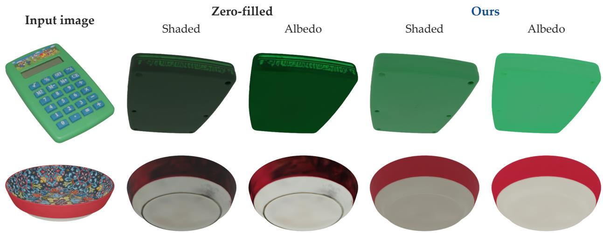  
Figure 9. Dark bias on unseen surfaces with zero-filled observations. The calculator and dish are shown with their input images, followed by shaded and albedo renderings from the zero-filled model and SUPRA-Tex. The zero-filled results darken the unseen surfaces; SUPRA-Tex retains the corresponding green and red-and-white materials. Each comparison uses the same geometry and perspective view.

Table 9. Configurations for the six rows of Table 5. All observation conditions are encoded with the pretrained material VAE. ab, mb , and rb denote predicted albedo, metallic, and roughness.
<table><tr><td>Variant</td><td>Material observations</td><td>Conditioning architecture</td></tr><tr><td>Residual injection</td><td>Predicted PBR</td><td>Observation latents added as layerwise residuals.</td></tr><tr><td>Joint-update attention</td><td>Predicted PBR</td><td>Observation states updated in selected layers; all genera- tion states updated in every layer.</td></tr><tr><td>Fixed MR</td><td> $\widehat { \mathbf { a } } ; m = 0 , r = 0 . 5$ </td><td>Read-only observations; interleaved generation updates.</td></tr><tr><td>Dataset-mean MR</td><td> $\widehat { \mathbf { a } } ; \mathrm { d a t a s e t - m e a n } m , r$ </td><td>Same architecture as Ours.</td></tr><tr><td>Ours</td><td>Predicted PBR</td><td>Read-only observations; alternating unobserved-cell and full-surface updates.</td></tr><tr><td>Oracle PBR (GT)</td><td>GT PBR</td><td>Reported separately as a material-quality reference.</td></tr></table>

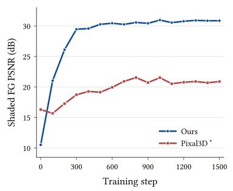

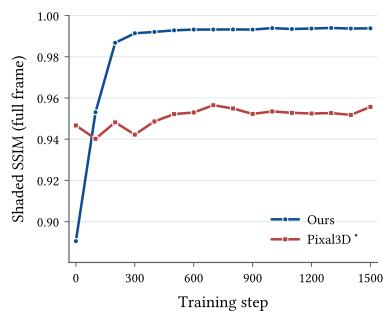

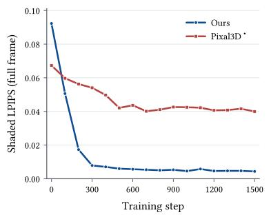  
Figure 10. Early reference-view learning on TeaPot during full-data training. Ours uses GT PBR observations; Pixal3D⋆ uses the corresponding shaded RGB image. Each point is an evaluated checkpoint. Most of our model’s improvement occurs within the first 300 steps.

Both models are trained on the same training set and initialized from the same pretrained TRELLIS.2 denoiser with their respective architectural adaptations and fresh optimizers. TeaPot is used only for evaluation, not for single-object fitting. We evaluate all 16 raw checkpoints from step 0 to 1500 at intervals of 100 on its designated front view; there are no failed or excluded checkpoints. Our model receives ground-truth albedo, metallic, roughness, and opacity through native partial-material encoding, while $\mathrm { P i x a l } 3 \mathrm { D } ^ { \star }$ receives the corresponding front-lit RGB image through its official image-feature projection interface. This oracle-material setting examines the 3D model’s ability to learn from native observations independently of $F _ { \mathrm { 2 D } }$ prediction errors. The two conditioning designs retain their respective architectures and optimization recipes.

All checkpoints use the same GT geometry and camera, 25 Euler sampling steps, seed 42, and time rescaling factor 3, with no reprojection repainting or material postprocessing. We render with Blender 3.0.1 using Filmic color management and 32 samples at $1 0 2 4 \times 1 0 2 4$ , then resize to $5 1 2 \times 5 1 2$ with Lanczos for scoring. Foreground PSNR uses the same 31,016 GT-mask pixels without erosion or intersection with the prediction mask. SSIM and VGG-LPIPS use the full image, including the background.

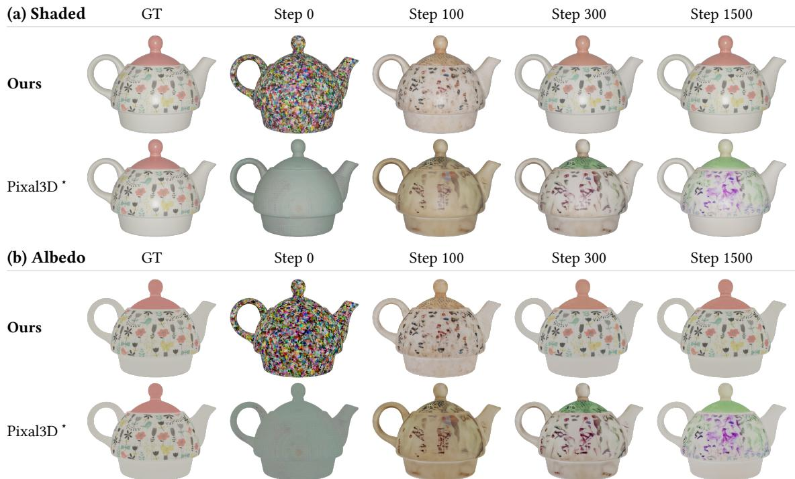  
Figure 11. Reference-view appearance during early training. Renderings correspond to the experiment in Fig. 10; our model recovers the reference colors and floral patterns within 300 steps.

With GT PBR observations, our model reaches 29.46 dB shaded foreground PSNR on the TeaPot reference view after 300 steps, compared with 18.72 dB for Pixal3D⋆ under shaded RGB conditioning. At step 1500, the scores are 30.86 versus 20.89 dB, SSIM is 0.9938 versus 0.9557, and LPIPS is 0.00436 versus 0.03996. Figure 11 shows the early recovery of reference colors and floral patterns. This single-view diagnostic supports the learnability of native observations under oracle-material conditioning; it does not isolate conditioning from the models’ architectural and optimization differences. Full-surface and dataset-level quality are evaluated separately in the main experiments.

## F Additional Qualitative Comparisons

## F.1 Given-Geometry Texturing

Figure 12 provides additional given-geometry comparisons across twelve cases.

## F.2 End-to-End Generation

With predicted geometry, the question in the images is whether local details still land on the right surface. Figure 13 places each input image alongside reference-view and novel-view renderings from each method to compare how these details carry over to the generated asset. Reference views highlight text, logos, repeated patterns, and color boundaries; novel views show the continuity of the completed appearance.

## F.3 Commercial Comparisons

Figure 15 complements Figure 4 with eight additional cases under the protocol in Appendix C.4. Front views show the reproduction of text, patterns, and color layout from the input, while back views show the completion of unseen surfaces.

## G Additional Views and Texture Editing

## G.1 Single-View Generation and Back-View Editing

Because any image attached to the surface becomes an anchor (Sec. 3.3), the same generator accepts a second view or an edited view without retraining: a 2D editing model can supply appearance for surfaces the reference never shows, or change the appearance of surfaces it does. Both put the unseen surface under user control: the single-view results of Secs. 4.1 and 4.2 show what the generator completes on its own, and the extensions show what it produces when instructed. We demonstrate both with the same 3D generator and no additional 3D training.

Figure 12. Twelve given-geometry comparisons. Novel views show the completed appearance.

甘在在甘在在甘 à 00009000904000 d dr dr dr dv dr du

Input

GT

Ours

Pixal3D\*

TRELLIS.2

LumiTex

TEXGen

Synthetic back-view conditions. From the same reference photograph, we synthesize a geometry-consistent back view and encode it as an additional material condition. Specifically, we select a viewpoint with minimal visual overlap relative

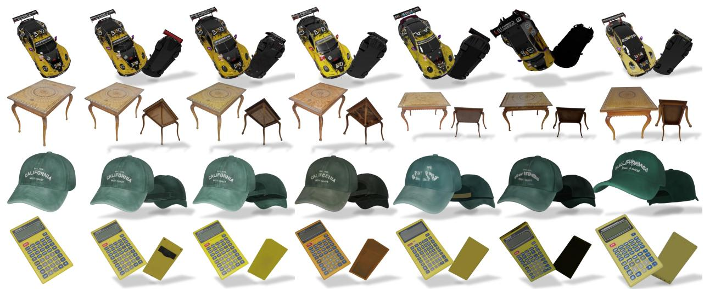  
Input  
GT  
Ours  
Pixal3D\*  
TRELLIS.2  
CUPID  
Hunyuan3D

Figure 13. Qualitative comparison of end-to-end single-image asset generation (Table 3) across four cases. All methods use the same reference image. Pixal3D⋆ and SUPRA-Tex share predicted geometry; other baselines use their own geometry pipelines. For each object we show the input, the reference-view rendering, and a novel view. Reference views assess text and repeated patterns; novel views assess the continuity of the completed appearance.

Single-view

Two-view

Input / Front

Base design

Back-view editing

Crane & peonies

Geometric

Koi & waves

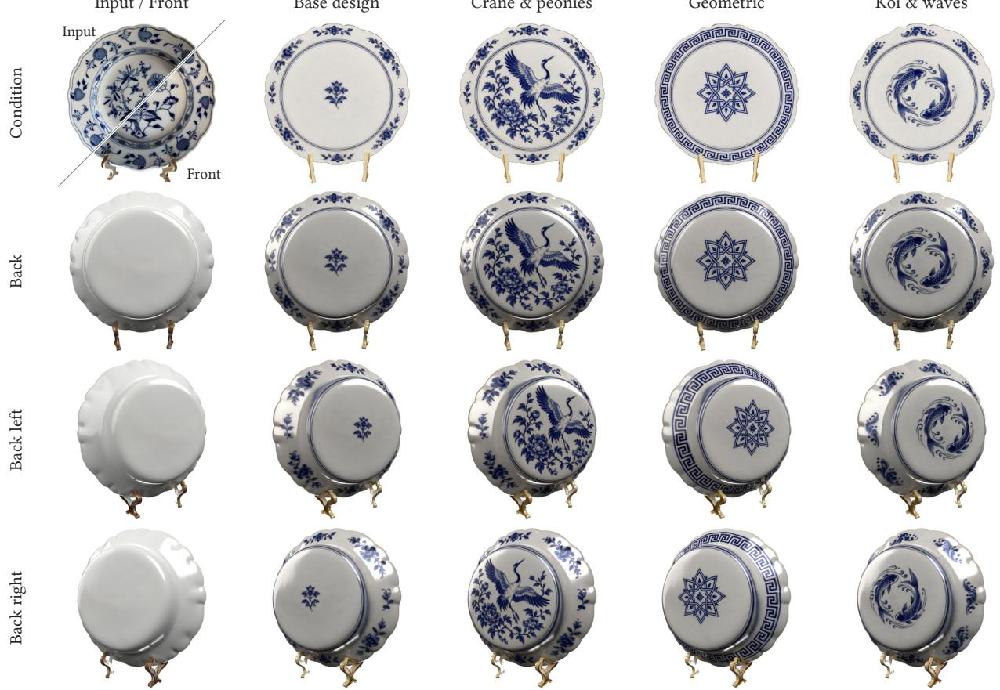

Figure 14. Single-view generation, two-view fusion, and back-view editing. The first condition panel shows the input photograph (upper left) and generated front (lower right); other panels show designed back-view materials.

to the reference, typically the opposite back side, render its surface normal map, and synthesize its shaded appearance via an MLLM, such as GPT-image, guided by the reference image, the rendered normal map, and optional user prompts. Both shaded views are translated into PBR maps, aggregated in 3D coordinate space via projection, and encoded into

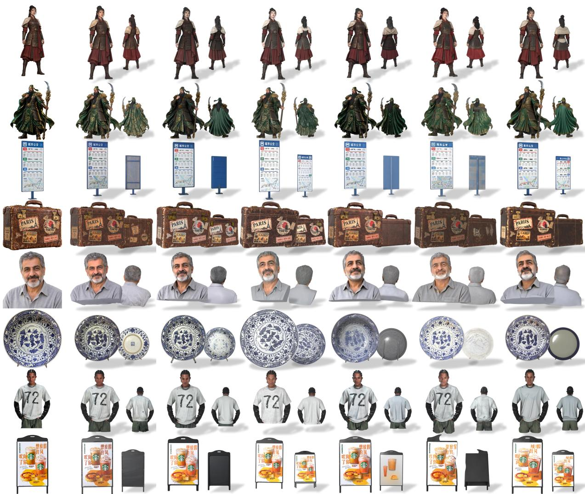  
Input  
Ours  
Hi3D  
Meshy7  
Tripo  
Rodin  
Hunyuan3D

Figure 15. Additional comparisons with commercial models across eight cases. Each row shows the input image and front/back renderings from Hunyuan3D, Rodin, Tripo, Meshy, Hi3D, and SUPRA-Tex. Model versions and evaluation settings are given in Appendix C.4.

unified anchors O for full-surface completion. We use this two-view variant for comparisons with commercial systems;   
the benchmark comparisons in Tables 1 and 3 use the single-view model.

Texture editing. Editing the observation condition transfers image edits to the 3D surface. We use the image editing model to modify the front or back view, rebuild that view’s observations, and regenerate the complete material. The visualizations show how the requested edit appears on the corresponding surface and how the edited region stays consistent with the rest of the asset.

Porcelain-plate example. Figure 14 demonstrates single-view generation, two-view fusion, and image-space material editing on a porcelain plate. Starting from the same front photograph and source geometry, the single-view model completes the unobserved back. A geometry-guided 2D design supplies a second material observation; editing that design produces crane-and-peony, geometric, and koi variants without additional 3D training. The synthetic back is a design hypothesis rather than a second photograph of the real object.

We keep the source geometry, front material observation, model checkpoint, and sampling settings fixed. Front and back material observations are combined on the shared surface before native material encoding. The diagonal input–render comparison shows reference-view fidelity, while the back and opposite rear oblique views show how the edited motifs are carried onto the complete asset.

## H Notation Reference

Table 10 summarizes the notation used in the main paper and supplement.

Table 10. Notation and symbol reference.
<table><tr><td>Symbol</td><td>Domain / Dimensions</td><td>Physical or Mathematical Interpretation</td></tr><tr><td colspan="3">Inputs and Geometry Foundation</td></tr><tr><td> $I$ </td><td> $\mathbb { R } ^ { H \times W \times 3 }$ </td><td>Input reference photograph in RGB space</td></tr><tr><td> $\mathcal { M }$ </td><td>3D Surface</td><td>Given or upstream-predicted object surface mesh</td></tr><tr><td> $\pi$ </td><td>Projection operator</td><td>Camera intrinsic and extrinsic projection mapping 3D to 2D</td></tr><tr><td> $\mathbf { p } \in \mathcal { M }$ </td><td> $\mathbb { R } ^ { 3 }$ </td><td>Continuous 3D coordinate on the mesh surface</td></tr><tr><td> $\mathbf { x } _ { s }$ </td><td> $\mathbb { R } ^ { 3 }$ </td><td>Continuous 3D centroid of sparse latent cell s</td></tr><tr><td colspan="3">PBR Materials and 2D Translation</td></tr><tr><td> $T ( \mathbf { p } )$ </td><td> $\mathbb { R } ^ { 3 } \times [ 0 , 1 ] ^ { 3 }$ </td><td>PBR material tuple  $( \mathbf { a } ( \mathbf { p } ) , m ( \mathbf { p } ) , r ( \mathbf { p } ) , \alpha ( \mathbf { p } ) )$  at surface location p</td></tr><tr><td> $\mathbf { a } , m , r , \alpha$   $F _ { \mathrm { 2 D } }$ </td><td> $\mathbb { R } ^ { 3 } , [ 0 , 1 ] , [ 0 , 1 ] , [ 0 , 1 ]$   $\mathbf { M o d a l i t y - D i T }$ </td><td>Albedo, metallic, roughness, and opacity physical channels MLLM-based 2D image editing model for reference-view PBR esti-</td></tr><tr><td></td><td></td><td>mation</td></tr><tr><td> $\widehat { T } _ { \mathrm { 2 D } }$ </td><td> $\mathbb { R } ^ { 1 0 2 4 \times 1 0 2 4 \times 5 }$ </td><td>Predicted physical maps  $( \widehat { \mathbf { a } } , \widehat { m } , \widehat { r } )$  MR is packed with a constant channel for the image VAE</td></tr><tr><td>u</td><td> $\mathbb { Z } ^ { 2 }$ </td><td>2D pixel coordinate in reference image and PBR maps</td></tr><tr><td colspan="3">Sparse Coordinate Space and 3D VAE Latents</td></tr><tr><td>S</td><td>Coordinate set  $( | S | = N )$ </td><td>Set of active sparse voxel coordinates on the surface of M</td></tr><tr><td> $G = \{ g _ { s } \} _ { s \in \mathcal { S } }$ </td><td> $\mathbb { R } ^ { N \times 3 2 }$ </td><td>Full-surface geometry latents produced by shape VAE</td></tr><tr><td> $Z = \{ z _ { s } \} _ { s \in \mathcal { S } }$ </td><td> $\mathbb { R } ^ { N \times 3 2 }$ </td><td>Complete full-surface material latents (locked target representation)</td></tr><tr><td> $E _ { \mathrm { m a t } } , D _ { \mathrm { m a t } }$   $\mathcal { P }$ </td><td>Neural networks</td><td>Pretrained 3D sparse material VAE encoder and decoder Full-surface PBR attribute voxels (input to  $E _ { \mathrm { m a t } }$  during ground-truth</td></tr><tr><td></td><td>Sparse attributes</td><td>pretraining)</td></tr><tr><td colspan="3">Native Observation Encoding and Spatial Metadata</td></tr><tr><td> ${ \mathcal { H } } _ { \mathrm { v a l i d } }$ </td><td> $\{ ( \mathbf { u } , \mathbf { p } ) \}$ </td><td>Valid pixel-surface correspondence pairs retained for observation encoding</td></tr><tr><td> $\mathcal { P } _ { o }$ </td><td>Sparse attributes</td><td>Voxelized partial PBR attributes supported strictly on visible surface</td></tr><tr><td> $\quad S _ { o } \subseteq S$ </td><td>Coordinate subset  $( | S _ { o } | = M )$ </td><td>Coordinate indices of latent cells that received valid observations</td></tr><tr><td> $z _ { s } ^ { o }$ </td><td> $\mathbb { R } ^ { 3 2 }$ </td><td>Native observation latent at cell  $s \in S _ { o }$  encoded by  $E _ { \mathrm { m a t } }$  Indices of unobserved latent cells required to be completed</td></tr><tr><td> $\mathcal { U } = \mathcal { S } \setminus \mathcal { S } _ { o }$   $\nu _ { s } , \nu _ { o }$ </td><td>Coordinate subset</td><td>Surface voxels in latent cell  $s ,$  and the deduplicated observed surface</td></tr><tr><td></td><td>Discrete voxel sets</td><td>voxels</td></tr><tr><td> $\rho _ { s } \in ( 0 , 1 ]$ </td><td>Scalar ratio</td><td>Observation coverage fraction  $| \mathcal { V } _ { s } \cap \mathcal { V } _ { o } | / | \mathcal { V } _ { s } |$  of cell s</td></tr><tr><td> $d _ { s } \in \mathbb { Z } _ { \geq - 1 }$ </td><td>Graph distance</td><td>6-neighbor lattice geodesic distance from cell s to U (—1 if unreach- able)</td></tr><tr><td> $\scriptstyle { { \mathcal { C } } _ { o } }$ </td><td>Structured set</td><td>Native observation representation  $\{ ( s , z _ { s } ^ { o } , \rho _ { s } , d _ { s } ) \mid s \in S _ { o } \}$ </td></tr><tr><td colspan="3">Observation-Guided Completion and Interleaved Flow Transformer</td></tr><tr><td> $t \in [ 0 , 1 ]$ </td><td>Continuous scalar</td><td>Flow matching time  $\left( t = 1 \right)$  Gaussian noise;  $t = 0 \colon$  material endpoint with residual noise  $\sigma _ { \mathrm { m i n } } \epsilon )$ </td></tr><tr><td> $Z _ { t }$ </td><td> $\mathbb { R } ^ { N \times 3 2 }$ </td><td>Noisy full-surface material latents along probability trajectory at time</td></tr><tr><td> $X = \{ X _ { s } ^ { ( \ell ) } \}$ </td><td> $\mathbb { R } ^ { N \times 1 5 3 6 }$ </td><td>t Dynamic full-surface generation stream hidden states across blocks l</td></tr><tr><td> $O = \{ O _ { s } \}$ </td><td> $\mathbb { R } ^ { M \times 1 5 3 6 }$ </td><td>Static read-only observation stream memory (fixed anchor representa-</td></tr><tr><td> $\ell \in \{ 0 , \ldots , L -$ </td><td>Integer (L = 60)</td><td>tion) Transformer block index</td></tr><tr><td colspan="3"> $1 \}$ </td></tr><tr><td> $\mathcal { T } _ { \ell }$ </td><td>Coordinate subset Learnable parameters</td><td>Query coordinates for block  $\ell \left( \mathcal { T } _ { \ell } = \mathcal { U } \right.$  for even  $\ell , \mathcal { T } _ { \ell } = \mathcal { S }$  for odd l) Shared material-geometry projection, metadata projection, and</td></tr><tr><td> $W _ { \mathrm { i n } } , W _ { \mathrm { m e t a } } , b _ { o }$ </td><td></td><td>observation-role bias</td></tr><tr><td> $Q _ { \ell } , K _ { \ell } , V _ { \ell }$ </td><td>Hidden tensors</td><td>Cross-stream attention queries (from  $X _ { \mathcal { I } _ { \ell } } ) _ { \ell }$  , keys and values (from [O; X])</td></tr><tr><td> $d _ { h } = 1 2 8$ </td><td>Per-head dimension  $\mathbb { R } ^ { N \times 3 2 }$ </td><td>Attention head width (1536/12)</td></tr><tr><td> $v ^ { \ast } , v _ { \theta }$ </td><td></td><td>Ground-truth flow target velocity and predicted full-surface velocity field</td></tr></table>