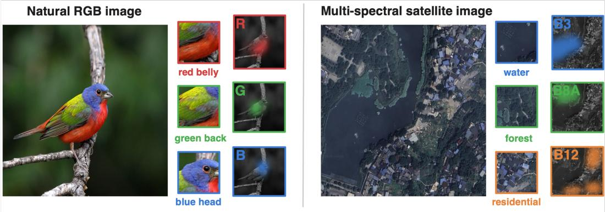
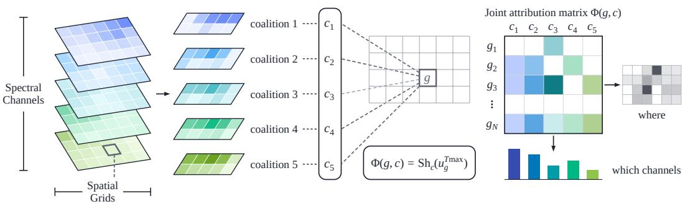
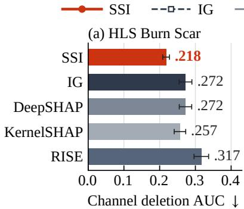
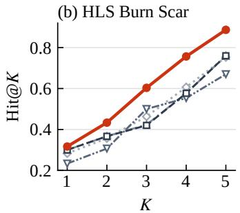
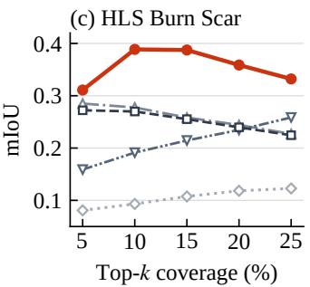
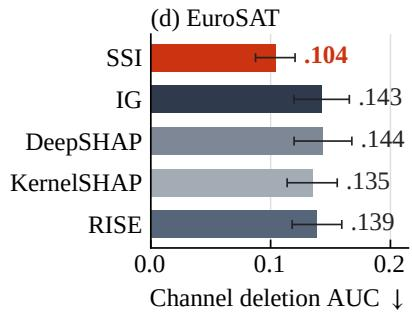
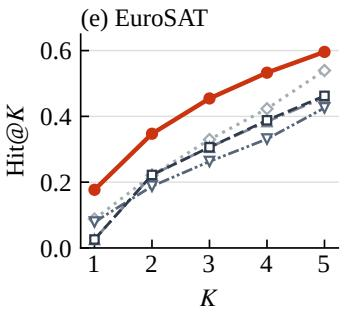
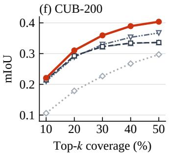
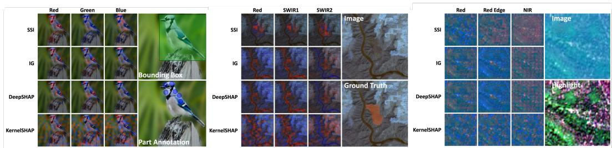

# Spectral-Spatial Interpretation

Haotian Ma1 Ruqi Yang1,2,\* Philip Townsend2

1Department of Computer Sciences   
2Department of Forest and Wildlife Ecology University of Wisconsin–Madison   
Corresponding author: ryang275@wisc.edu

## Abstract

Post-hoc image explanations usually show where a model looks using spatial heatmaps or indicate which channels matter using global channel scores. These separate views are limiting for multispectral data because channel relevance is often spatially localized and physically meaningful. We introduce Spectral-Spatial Interpretation (SSI), a full-grid attribution method over position-channel players (g, c). For each spatial position, SSI fixes the observed surrounding context, defines a conditional game over the channels at that position, and applies the Shapley value to this local game. The result is a full spectral-spatial attribution matrix rather than a single heatmap or a global channel ranking. SSI has a clear local interpretation. It satisfies Shapley fairness within each position, and aggregating its channel attributions exactly recovers the position-level contextual contrast obtained by replacing that position with the baseline. SSI also differs from context-averaged Owen-style hierarchical accounting, which uses the same position-channel grouping but averages over external spatial coalitions. On HLS Burn Scar, SSI outperforms an MC-Owen estimator across retained attribution metrics while using only about 6% of its evaluation budget. Across CUB-200, EuroSAT, and HLS Burn Scar under both per-channel mean and zero baselines, SSI achieves the best joint deletion and insertion AUC over dense, flat, and rank-1 baselines, yields the strongest spectral hit rates and channel deletion, and leads spatial localization on both annotated datasets. Code is available at https: //github.com/AtheavenMa/Spectral-Spatial-Interpretation.

## 1 Introduction

Modern vision models increasingly operate on inputs with multiple physically meaningful channels, from RGB fine-grained recognition to Sentinel-2 land-cover classification and burn-scar mapping. Existing post-hoc explanations usually answer where the model looks, but not which spectral channels support the prediction at each location. For these data, high attribution to near-infrared at a vegetation boundary or to short-wave infrared within a burn scar reflects different physical evidence from attribution to visible bands. An explanation should therefore identify where the evidence lies, which channels support it, and how much each channel contributes at each location.

Existing methods collapse this structure in one of two ways. Spatial attribution methods such as Grad-CAM [Selvaraju et al., 2017], RISE [Petsiuk et al., 2018], and Extremal Perturbation [Fong et al., 2019] aggregate over channels and produce a single heatmap. Spectral or channel attribution methods rank bands globally using mutual information, attention weights, or SHAP-style scores [Lundberg and Lee, 2017], averaging channel effects across space. Even a two-stage pipeline that multiplies a spatial heatmap by a global channel vector assumes a rank-1 structure, $A ( g , c ) = s ( g ) q ( c )$ , meaning that the same channel profile applies everywhere. This assumption fails when different regions have different spectral signatures, as with red and blue plumage on a bird or vegetation and water in a satellite scene (Figure 1). Channel importance depends on location. The same band can be decisive in one region and irrelevant in another, so the attribution target should be a localized position-channel score rather than a global channel ranking.

  
Figure 1: Spectral channels carry spatially distinct physical information. On a Painted Bunting (a), the red belly, green back, and blue head each align with a different RGB channel; on a Sentinel-2 scene (b), water, forest, and built-up areas align with B3, B8A, and B12. SSI is designed to recover this joint spectral-spatial structure.

We introduce Spectral-Spatial Interpretation (SSI), a full-grid attribution method that assigns a score $\Phi ( g , c )$ to each grid cell g and channel c (Figure 2). For each position, SSI fixes the rest of the image to its observed values and applies the standard Shapley value only to the channels at that position. The contribution lies in the observed-context position game rather than a new allocation rule. The output can be used directly as a joint attribution matrix or aggregated into spatial scores $\textstyle \sum _ { c } \Phi ( g , c )$ identifying where evidence lies and spectral scores $\textstyle \sum _ { g } \Phi ( g , c )$ identifying which channels contribute, without assuming a rank-1 spatial-spectral factorization. This observed-context formulation gives SSI local Shapley fairness and contextual aggregation consistency. In particular, $\textstyle \sum _ { c } \Phi ( g , c )$ equals the full-context contrast of replacing the entire position g with the baseline. Unlike context-averaged Owen-style hierarchical attribution [Owen, 1977], which averages over external spatial coalitions, SSI targets localized spectral evidence and solves small channel-player games at each position.

We evaluate SSI on CUB-200 [Wah et al., 2011], EuroSAT [Helber et al., 2019], and HLS Burn Scar [Phillips et al., 2023]. Across all three datasets, SSI outperforms dense, flat, and rank-1 attribution baselines on joint position-channel faithfulness metrics, and on HLS Burn Scar it further outperforms an MC-Owen estimator while using only about 6% of its evaluation budget.

Our contributions are as follows:

• We formulate spectral-spatial interpretation as attribution over position-channel players (g, c), targeting localized channel evidence rather than only a heatmap or a global channel ranking.

• We define SSI as an observed-context attribution method that fixes the surrounding image context and applies standard Shapley allocation among channels at each position. We characterize its local Shapley fairness, contextual aggregation consistency, and distinction from context-averaged Owen-style accounting.

• Across CUB-200, EuroSAT, and HLS Burn Scar under both per-channel mean and zero baselines, SSI achieves the best joint deletion, rank-1 deletion, and grid-sum insertion AUC over dense, flat, and rank-1 baselines. It leads spectral hit rates and channel deletion on EuroSAT and HLS Burn Scar, as well as spatial localization on both annotated datasets. On HLS Burn Scar, SSI also outperforms MC-Owen using about 6% of its evaluation budget.

  
Figure 2: Overview of SSI. For each spatial position g, SSI fixes the observed surrounding context and allocates the local contribution among channels, producing a full joint attribution matrix $\Phi ( g , c )$ for spatial and spectral interpretation.

## 2 Related Work

Post-hoc spatial attribution. A large family of explanation methods produces spatial heatmaps indicating which image regions drive a prediction. Gradient-based approaches such as Integrated Gradients [Sundararajan et al., 2017] and Grad-CAM [Selvaraju et al., 2017] propagate target-class signals to pixels or activation maps. Perturbation-based approaches such as RISE [Petsiuk et al., 2018] and Extremal Perturbation [Fong et al., 2019] measure prediction changes under spatial masks.

These methods are effective for identifying where evidence lies, but their explanations either aggregate over channels or treat input elements independently. They therefore do not provide a principled decomposition of which spectral channels matter at each location.

Spectral and channel attribution. A complementary line of work ranks spectral bands or channels using mutual information [Feng et al., 2014], game-theoretic criteria [Bruce, 2013], attention weights [Hu et al., 2018, Woo et al., 2018], or SHAP-style attribution [Lundberg and Lee, 2017]. Such methods are useful for identifying globally important wavelengths, but they typically average channel relevance over space. This averaging can hide localized spectral evidence because a band may be unimportant on average yet decisive in a small region. SSI instead assigns attribution to each position-channel pair and preserves spatial variation in channel importance.

Joint spectral-spatial modeling. Architectures such as 3D CNNs [Chen et al., 2016], spectralspatial transformers [Dang et al., 2022], and factorized architecture search [Zhong et al., 2022] jointly exploit spectral and spatial information but focus on prediction performance, and their internal representations remain opaque. Propagation-based explanations have been adapted for hyperspectral classifiers [Nagasubramanian et al., 2018], but remain architecture-specific. SSI instead provide model-agnostic, game-theoretic attribution for already-trained models.

Game-theoretic and hierarchical attribution. Shapley values [Shapley, 1953] and SHAP-style methods [Lundberg and Lee, 2017] provide additive feature attributions but usually treat all interpretable units as flat players. This flat treatment does not reflect the natural position-channel hierarchy of multispectral images. The Shapley interaction index [Grabisch and Roubens, 1999] and its higher-order extensions [Sundararajan et al., 2020, Tsai et al., 2023] quantify synergies but do not exploit this two-level structure. Group-level Shapley methods [Jullum et al., 2021] treat each predefined group as an atomic player and do not decompose contributions within groups; methods addressing feature dependence [Aas et al., 2022] estimate conditional expectations rather than fixing observed context. SSI differs from both lines of work in its attribution units and treatment of context.

Owen value. The Owen value [Owen, 1977], building on games with coalition structures [Aumann and Drèze, 1974], respects a priori coalitions by allocating value across and within groups. SSI uses the same position-channel grouping but targets observed-context conditional attribution rather than context-averaged hierarchical accounting.

## 3 Method

SSI explains predictions using joint position-channel players $( g , c )$ . It applies the standard Shapley value within each position, with the conditional position game providing the formulation for spectral spatial explanation. We define the player space and the conditional game at each position, derive SSI as its Shapley value, and establish local fairness and contextual aggregation consistency. We also explain how SSI differs from globally efficient context-averaged accounting. Proofs and sampling details are in Appendix A.

## 3.1 Spectral-Spatial Players

Let $f$ be a trained model and let $\boldsymbol { x } \in \mathbb { R } ^ { C \times H \times W }$ be an input with C channels. We partition the spatial domain into grid cells indexed by $\mathcal { G }$ and define the player set

$$
\mathcal { P } = \mathcal { G } \times \mathcal { C } , \qquad ( g , c ) \in \mathcal { P } .
$$

For any subset $S \subseteq { \mathcal { P } }$ , let $x _ { S }$ denote the input with players outside $S$ replaced by a masking baseline. Let $z _ { y } ( x _ { S } )$ be the target-class logit. We use the centered value function

$$
v ( S ) = z _ { y } ( x _ { S } ) - z _ { y } ( x _ { \emptyset } ) , \qquad v ( \emptyset ) = 0 .\tag{1}
$$

Adding a player may increase or decrease the target logit, so we do not assume monotonicity.

The player set decomposes by spatial position:

$$
{ \mathcal { P } } = \bigcup _ { g \in { \mathcal { G } } } S _ { g } , \qquad S _ { g } = \{ ( g , c ) : c \in { \mathcal { C } } \} .\tag{2}
$$

The group $S _ { g }$ contains all channels at position $g .$ Channels within $S _ { g }$ observe the same physical region through different spectral measurements, whereas channels at different positions correspond to different spatial regions.

For reference, we define two full-context contrasts. The player-level contrast is

$$
\delta ( g , c ) = v ( \mathcal { P } ) - v ( \mathcal { P } \setminus \{ ( g , c ) \} ) ,\tag{3}
$$

and the position-level contrast is

$$
\Delta ( g ) = v ( \mathcal { P } ) - v ( \mathcal { P } \setminus S _ { g } ) .\tag{4}
$$

These compare the observed input to a baseline-replaced version while all non-target players remain fixed.

## 3.2 Conditional Position Games

SSI explains each position relative to the rest of the observed image. For a target position $^ { g , }$ let

$$
B _ { g } = \mathcal { P } \setminus S _ { g }
$$

be all players outside that position. We define the conditional position game

$$
w _ { g } ( R ) = v ( B _ { g } \cup R ) - v ( B _ { g } ) , \qquad R \subseteq S _ { g } .\tag{5}
$$

This game varies only the channels at position g, while holding all other positions fixed in their observed state. It satisfies

$$
\begin{array} { r } { w _ { g } ( \emptyset ) = 0 , \qquad w _ { g } ( S _ { g } ) = v ( \mathcal { P } ) - v ( \mathcal { P } \setminus S _ { g } ) = \Delta ( g ) . } \end{array}
$$

Thus, $w _ { g }$ is the local channel-allocation problem induced by the observed surrounding context.

## 3.3 Spectral-Spatial Interpretation

SSI assigns attribution to channel c at position g by applying the Shapley value to the conditional game $w _ { g } \mathrm { . }$

$$
\Phi ( g , c ) = \mathrm { S h } _ { c } ( w _ { g } ) .\tag{6}
$$

Since $| S _ { g } | = C$ , this is a standard Shapley value over $C$ players:

$$
\Phi ( g , c ) = \sum _ { R \subseteq S _ { g } \backslash \{ ( g , c ) \} } { \frac { | R | ! ( C - | R | - 1 ) ! } { C ! } } \left[ w _ { g } ( R \cup \{ ( g , c ) \} ) - w _ { g } ( R ) \right] .\tag{7}
$$

The output is a full attribution matrix

$$
\Phi \in \mathbb { R } ^ { C \times H \times W } ,
$$

defined for every grid cell and every channel.

SSI is one endpoint of a broader context-weighted family $\begin{array} { r } { \alpha _ { \mu } ( g , c ) \ : = \ : \sum _ { T } \mu ( T ) \mathrm { S h } _ { c } ( w _ { q } ^ { T } ) } \end{array}$ (Appendix A.7); SSI sets $\mu ( T ) = \mathbf { 1 } \{ T = \mathcal { G } \setminus \{ g \} \}$ }, while the Owen value averages over $T$ with Shapley weights. SSI does not average a channel’s contribution over all possible external spatial coalitions. Instead, it asks how the channels at a position contribute in the surrounding image that was actually observed.

## 3.4 Properties

The first property is a local characterization. For each fixed position g, SSI is the standard Shapley allocation of the conditional game $w _ { g }$

Theorem 1 (Local Shapley characterization). For each position $g , \Phi ( g , \cdot )$ is the unique attribution over channels in $S _ { g }$ satisfying local efficiency, within-position symmetry, within-position null-player, and additivityfor the conditional game $w _ { g }$

Theorem 1 applies the standard Shapley characterization to the local game $w _ { g }$ . SSI therefore allocates attribution within each spatial position after conditioning on the observed context.

The second property links the channel-level scores to a spatial summary.

Theorem 2 (Contextual aggregation consistency). For every position g,

$$
\sum _ { c \in { \mathcal C } } \Phi ( g , c ) = \Delta ( g ) .\tag{8}
$$

Thus, the channel-aggregated SSI map exactly equals the full-context contrast of replacing the entire position by the baseline. This identity follows from local Shapley efficiency and requires no monotonicity, supermodularity, or architectural assumption.

This local aggregation property is different from global value accounting. In interacting games, the full-context contrasts of different positions need not sum to the total value.

Proposition 1 (Contextual aggregation and global efficiency can conflict). For the class ofall value functions v, no attribution rule can guarantee both

$$
\sum _ { c \in \mathcal { C } } \alpha ( g , c ) = \Delta ( g ) \quad f o r e \nu e r y g
$$

and

$$
\sum _ { g \in \mathcal { G } } \sum _ { c \in \mathcal { C } } \alpha ( g , c ) = v ( \mathcal { P } )
$$

for every game.

SSI provides position-wise conditional explanations with exact contextual aggregation. It does not aim to allocate the entire prediction value globally across all positions.

## 3.5 Computation, Outputs, and Relation to Owen-Style Accounting

In the main experiments, SSI evaluates $\Phi ( g , c )$ for every position $g \in { \mathcal { G } }$ and channel $c \in { \mathcal { C } }$ on the full grid. No subset selection is used, and $\Phi ( g , c )$ is reported for every position-channel pair.

We use permutation sampling over the channels within each position [Castro et al., 2009]. In all experiments, SSI uses

$$
K = \operatorname* { m i n } ( 2 ^ { C } , 1 0 )
$$

permutations per grid cell, or enumerates all $2 ^ { C }$ subsets when $2 ^ { C } \leq 1 0$ . The sampling estimator is unbiased and concentrates as a standard bounded Monte Carlo estimator; details are given in Appendix A.4, and the corresponding total forward-pass counts per image are reported in Appendix B.3. For $C = 3 \left( \mathrm { C U B } { - } 2 0 0 \right)$ , this enumerates all channel subsets exactly; for $C { = } 1 3$ (EuroSAT) and $C { = } 6$ (HLS), the empirical concentration bounds remain below $1 0 ^ { - 2 }$ (Appendix A.5).

The output of SSI can be evaluated directly as the joint attribution matrix $\Phi ( g , c )$ or summarized as spatial scores $\textstyle \sum _ { c } \Phi ( g , c )$ and spectral scores $\textstyle \sum _ { g } \bar { \Phi } ( g , c )$

SSI uses the same position-channel grouping as Owen-style hierarchical values, but estimates a different quantity. The Owen value provides globally efficient, context-averaged accounting by averaging over external spatial coalitions before allocating value within a position. SSI instead fixes the observed external context and estimates the conditional game $w _ { g } .$ In estimation, SSI samples only a small C-player conditional game at each position, whereas MC-Owen samples block-respecting permutations over the full position-channel set and includes additional variance from external spatial contexts. Appendix A.7 makes this relation explicit, and §4.5 reports a focused empirical comparison.

## 4 Experiments

We evaluate the faithfulness of SSI’s joint position-channel attribution $\Phi ( g , c )$ using deletion and insertion AUC. We then examine how rank-1 spatial-spectral factorization affects this attribution and assess spatial and spectral aggregation through localization, channel deletion, and spectral hit rates. Qualitative case studies are presented in §4.4, with full metric curves in the appendix. We also compare SSI with stronger gradient-based baselines on HLS Burn Scar and evaluate faithfulness using ROAD.

## 4.1 Experimental Setup

Datasets and models. We evaluate SSI on three datasets covering RGB images, multispectral land-cover classification, and burn-scar mapping. CUB-200-2011 [Wah et al., 2011] contains RGB images of 200 bird species with bounding-box annotations. We fine-tune an ImageNet-pretrained ResNet-18 classifier. EuroSAT [Helber et al., 2019] contains 13-band Sentinel-2 patches from 10 land-use/land-cover classes. We train a ResNet-18 classifier from scratch on all bands. HLS Burn Scar [Phillips et al., 2023] contains 6-band Harmonized Landsat–Sentinel-2 patches with burn-scar masks. We train a lightweight UNet for burn-scar segmentation and use the burn-class logit averaged over ground-truth mask positions as the scalar response for attribution. Training details and model performance are reported in Appendix B.

Player space and baselines. All methods are evaluated on the same full position-channel player space $( g , c )$ . To balance spatial resolution and computational cost, we use an $8 \times 8$ grid on EuroSAT and HLS Burn Scar and a finer 16 × 16 grid on CUB-200 to capture more detailed spatial structure. We use a per-channel mean baseline as the primary masking value in all datasets and methods; to verify robustness to baseline choice, we also report results with a zero baseline. The semantics of the conditional game $w _ { g }$ depend on this choice, as is inherent to all perturbation-based attribution. We compare SSI against three classes of attribution methods. The dense and flat baselines include Integrated Gradients (IG) [Sundararajan et al., 2017], DeepSHAP [Lundberg and Lee, 2017, Shrikumar et al., 2017], and KernelSHAP [Lundberg and Lee, 2017]. Dense maps from IG and DeepSHAP are summed within each position-channel player; KernelSHAP directly treats each $( g , c )$ as an interpretable feature. We also include a rank-1 perturbation control based on RISE [Petsiuk et al., 2018]. This method forms a factorized attribution map $A ( g , c ) = s ( g ) q ( c )$ , where $s ( g )$ is a spatial importance score and $q ( c )$ is a global channel score obtained from the target-logit drop caused by masking channel c globally across all spatial positions. It tests whether a spatial heatmap multiplied by a global channel vector is sufficient for joint spectral-spatial explanation. Finally, SSI computes the full-context attribution $\Phi ( g , c )$ for every grid cell and channel. On HLS Burn Scar, we also compare against Expected Gradients [Erion et al., 2021], Guided IG [Kapishnikov et al., 2021], and FullGrad [Srinivas and Fleuret, 2019]; these additional comparisons are reported separately in §4.6. Methods with dense channel-resolved attribution maps are aggregated spatially within grid cells while retaining the channel dimension for joint evaluation; channel summation is performed only for spatial summaries. Baseline descriptions are in Appendix B.2, and evaluation budgets for the original methods are reported in Appendix B.3.

Metrics. All evaluations use the target-class logit, matching the value function in §3.1. Lower deletion AUC indicates better attribution, whereas higher insertion AUC, bbox mIoU, and spectral hit rates indicate better results. Joint deletion operates directly on ranked position-channel players. Rank-1 projection evaluates each method under the best rank-1 factorization of its attribution matrix into a spatial heatmap and a global channel profile. For insertion, we sum attribution scores over channels at each grid position and insert positions in decreasing order of the aggregated score, which evaluates the spatial summary and ensures comparability with rank-1 baselines like RISE. Spatial aggregation uses $\begin{array} { r } { A _ { \mathrm { s p } } ( g ) = \dot { \sum _ { c } } A ( g , c ) } \end{array}$ , while spectral aggregation uses $\begin{array} { r } { A _ { \mathrm { c h } } ( c ) = \sum _ { g } A ( g , c ) } \end{array}$

For spatial localization, we threshold the channel-aggregated map at fixed top-coverage levels and compute mIoU against available annotations.

For spectral hit rates, we compare the top-ranked channels against dataset-specific physical priors grounded in established spectral indices (e.g., Normalized Burn Ratio for burn scars, NDVI/NDRE for vegetation). Only bands with well-documented physical correlations are included; classes without a reliably positive spectral signature are excluded. The full prior specification and scientific justification are given in Appendix C.3.

## 4.2 Joint Faithfulness

SSI assigns attribution to full-grid position-channel players $( g , c )$ . We therefore evaluate faithfulness by ranking the same players and measuring how efficiently the ranking removes target-class evidence. Our primary metric is joint deletion AUC: players are masked in decreasing attribution order, and the target-class logit is recorded after each step. Lower AUC indicates that the attribution ranking removes full-context evidence earlier.

We also report a rank-1 deletion diagnostic. For each method, we reshape the attribution scores into a matrix $A \in \mathbb { R } ^ { C \times N }$ , where N is the number of spatial cells, and retain only its leading rank-1 approximation. This factorized map has the form $A ( g , c ) \approx a ( g ) b ( c )$ , corresponding to a spatial heatmap multiplied by a global channel profile. If such a factorization were sufficient, rank-1 deletion would preserve joint faithfulness.

Table 1 shows that SSI achieves the lowest joint deletion AUC and the highest insertion AUC on all three datasets under both the per-channel mean and zero baselines. On CUB-200 under the mean baseline, SSI improves joint deletion over IG and DeepSHAP and achieves the highest insertion AUC (.7132), surpassing RISE (.6886) despite RISE using 8,000 spatial masks versus 2048 for SSI. The differences are larger on EuroSAT and HLS Burn Scar, where SSI removes target evidence substantially earlier than all baselines under both deletion metrics. These results support the use of $\Phi ( g , c )$ as a full-context position-channel attribution score and suggest that the advantage is not driven by a particular baseline choice. SSI also performs consistently across the tested grid resolutions, as shown in Appendix C.4.

We also evaluate faithfulness using ROAD [Rong et al., 2022] on HLS Burn Scar. SSI achieves the highest LeRF AUC (.657) and lowest MoRF AUC (.1143) among nine evaluated methods under this complementary removal protocol. Appendix C.2 reports the full comparison.

The rank-1 diagnostic further shows that factorized spectral-spatial explanations are insufficient. RISE can provide strong spatial or global-channel signals, but its rank-1 deletion AUC remains substantially worse than SSI. The gap between joint and rank-1 deletion is smallest on CUB-200 (C=3) and largest on EuroSAT $( { \bar { C } } { = } 1 3 )$ , suggesting that the rank-1 approximation degrades as channel diversity increases. Thus, a spatial heatmap multiplied by a global channel vector cannot replace the full joint attribution matrix.

## 4.3 Spatial and Spectral Aggregation

We assess whether the full position-channel attribution matrix remains meaningful after aggregation. Spatial aggregation $\begin{array} { r } { A _ { \mathrm { s p } } ( g ) = \sum _ { c } A ( g , c ) } \end{array}$ evaluates whether the resulting heatmap localizes annotated regions; spectral aggregation $\begin{array} { r } { A _ { \mathrm { c h } } ( c ) = \sum _ { a } A ( g , c ) } \end{array}$ evaluates whether the resulting channel ranking identifies decision-relevant bands. For SSI, Theorem 2 gives this spatial aggregation a direct contextual interpretation. The channel sum $\textstyle \sum _ { c } \Phi ( g , c )$ equals the full-context contrast of replacing the entire position by the baseline.

Table 1: Joint faithfulness. Deletion AUC (lower is better) and insertion AUC (higher is better). Values are mean ± bootstrap std. “Joint” and “Rank-1” evaluate position-channel deletion; “Ins.” evaluates grid-sum insertion. Best scores per column are in bold. Upper block: per-channel mean baseline; lower block: zero baseline.
<table><tr><td></td><td colspan="3">CUB-200</td><td colspan="3">EuroSAT</td><td colspan="3">HLS Burn Scar</td></tr><tr><td>Method</td><td>Joint↓</td><td>Rk1↓</td><td>Ins.↑</td><td>Joint↓</td><td>Rk1↓</td><td>Ins.↑</td><td>Joint↓</td><td> $\mathrm { R k l } \downarrow$ </td><td>Ins.↑</td></tr><tr><td colspan="10">Per-channel mean baseline</td></tr><tr><td>SSI</td><td> $\mathbf { . 0 0 8 8 } \pm . \mathbf { 0 0 1 }$ </td><td> $\mathbf { . 0 1 0 4 } \pm . 0 \mathbf { 0 1 }$ </td><td> $. 7 1 3 2 { \scriptstyle \pm . 0 1 9 }$ </td><td> $\mathbf { . 1 3 9 7 { \pm } . 0 2 0 }$ </td><td> $\mathbf { 1 6 8 2 } { \scriptstyle \pm . 0 2 1 }$ </td><td> $. 7 3 1 9 2 . 0 2 3$ </td><td> $\mathbf { 1 5 4 5 } \pm . \mathbf { 0 0 8 }$ </td><td> $\mathbf { 1 6 5 7 } \pm \mathbf { . 0 1 0 }$ </td><td> $\mathbf { 6 6 3 8 } \pm \mathbf { . 0 0 8 }$ </td></tr><tr><td>IG</td><td> $. 0 1 1 2 { \scriptstyle \pm . 0 0 1 }$ </td><td> $. 0 1 2 6 { \scriptstyle \pm . 0 0 1 }$ </td><td> $. 2 8 9 5 { \scriptstyle \pm . 0 2 2 }$ </td><td> $. 2 0 9 7 { \scriptstyle \pm . 0 3 0 }$ </td><td> $. 2 2 6 7 { \scriptstyle \pm . 0 3 0 }$ </td><td> $. 6 6 2 1 { \scriptstyle \pm . 0 2 9 }$ </td><td> $. 2 1 6 0 { \scriptstyle \pm . 0 1 1 }$ </td><td> $. 2 7 2 3 { \pm } . 0 1 5$ </td><td> $. 6 2 9 1 { \scriptstyle \pm . 0 0 9 }$ </td></tr><tr><td>DeepSHAP</td><td> $. 0 1 1 2 { \scriptstyle \pm . 0 0 1 }$ </td><td> $. 0 1 2 7 { \scriptstyle \pm . 0 0 1 }$ </td><td> $. 2 8 5 3 { \scriptstyle \pm . 0 2 2 }$ </td><td> $. 2 0 7 8 { \pm } . 0 2 9$ </td><td> $. 2 2 5 5 { \pm } . 0 3 1$ </td><td> $. 6 6 1 4 { \scriptstyle \pm . 0 2 8 }$ </td><td> $. 2 1 4 9 { \scriptstyle \pm . 0 1 1 }$ </td><td> $. 2 7 0 4 { \scriptstyle \pm . 0 1 6 }$ </td><td> $. 6 3 2 1 { \scriptstyle \pm . 0 0 9 }$ </td></tr><tr><td>KernelSHAP</td><td> $. 0 1 7 8 { \scriptstyle \pm . 0 0 1 }$ </td><td> $. 0 2 2 2 { \scriptstyle \pm . 0 0 2 }$ </td><td> $. 3 4 8 1 { \scriptstyle \pm . 0 1 9 }$ </td><td> $. 2 4 3 4 { \pm } . 0 2 7$ </td><td> $. 2 8 2 4 { \pm } . 0 2 8$ </td><td> $. 5 7 6 7 { \scriptstyle \pm . 0 3 0 }$ </td><td> $. 2 0 9 6 { \scriptstyle \pm . 0 1 2 }$ </td><td> $. 2 5 5 8 { \pm } . 0 1 6$ </td><td> $. 5 5 0 0 { \scriptstyle \pm . 0 0 8 }$ </td></tr><tr><td>RISE</td><td> $. 0 1 8 3 { \scriptstyle \pm . 0 0 1 }$ </td><td> $. 0 1 8 3 { \scriptstyle \pm . 0 0 1 }$ </td><td> $. 6 8 8 6 { \scriptstyle \pm . 0 1 7 }$ </td><td> $. 2 1 3 0 { \pm } . 0 2 6$ </td><td> $. 1 9 6 9 \pm . 0 2 3$ </td><td> $. 7 0 9 1 { \scriptstyle \pm . 0 2 3 }$ </td><td> $. 2 8 8 8 { \pm } . 0 1 6$ </td><td> $. 2 8 7 1 { \scriptstyle \pm . 0 1 5 }$ </td><td> $. 6 1 3 0 { \scriptstyle \pm . 0 0 9 }$ </td></tr><tr><td colspan="10">Zero baseline</td></tr><tr><td>SSI</td><td> $\mathbf { . 0 0 6 3 } \pm . 0 0 0$ </td><td> $\mathbf { 0 0 } 7 2 { \scriptstyle \pm . 0 0 1 }$ </td><td> $. 5 2 2 4 { \scriptstyle \pm . 0 1 7 }$ </td><td> $\mathbf { 0 7 6 3 } \pm . \mathbf { 0 1 5 }$ </td><td> $\mathbf { 0 8 5 0 } \pm . \mathbf { 0 1 7 }$ </td><td> $\mathbf { 6 0 0 1 } { \pm } . \mathbf { 0 2 4 }$ </td><td> $. 1 2 0 3 { \pm } . 0 0 9$ </td><td> $\mathbf { . 1 1 7 5 { \pm } . 0 1 0 }$ </td><td> $\mathbf { . 6 5 6 4 { \div } . 0 0 8 }$ </td></tr><tr><td>IG</td><td> $. 0 0 8 3 { \scriptstyle \pm . 0 0 1 }$ </td><td> $. 0 0 8 5 { \scriptstyle \pm . 0 0 1 }$ </td><td> $. 0 8 3 2 { \scriptstyle \pm . 0 1 3 }$ </td><td> $. 1 4 3 4 \pm . 0 2 3$ </td><td> $. 1 8 7 4 \pm . 0 2 9$ </td><td> $. 4 9 8 3 { \pm } . 0 3 3$ </td><td> $. 1 7 8 5 { \pm } . 0 1 0$ </td><td> $1 8 0 2 { \scriptstyle \pm . 0 1 1 }$ </td><td> $. 6 1 4 0 { \scriptstyle \pm . 0 0 9 }$ </td></tr><tr><td>DeepSHAP</td><td> $. 0 0 8 3 { \scriptstyle \pm . 0 0 0 }$ </td><td> $. 0 0 8 4 { \scriptstyle \pm . 0 0 1 }$ </td><td> $. 0 8 0 2 { \scriptstyle \pm . 0 1 2 }$ </td><td> $. 1 4 4 4 \pm . 0 2 4$ </td><td> $. 1 8 7 6 { \scriptstyle \pm . 0 2 8 }$ </td><td> $. 4 9 6 3 { \scriptstyle \pm . 0 3 2 }$ </td><td> $. 1 7 7 6 { \scriptstyle \pm . 0 1 0 }$ </td><td> $1 8 0 2 { \scriptstyle \pm . 0 1 1 }$ </td><td> $. 6 1 7 4 { \scriptstyle \pm . 0 0 9 }$ </td></tr><tr><td>KernelSHAP</td><td> $. 0 1 5 4 { \scriptstyle \pm . 0 0 1 }$ </td><td> $. 0 3 2 7 { \scriptstyle \pm . 0 0 3 }$ </td><td> $. 1 5 2 3 { \pm } . 0 1 1$ </td><td> $. 1 5 2 1 { \pm } . 0 1 7$ </td><td> $. 1 8 6 2 { \scriptstyle \pm . 0 2 0 }$ </td><td> $. 4 2 5 7 { \scriptstyle \pm . 0 3 1 }$ </td><td> $. 1 5 5 5 { \scriptstyle \pm . 0 0 9 }$ </td><td> $1 6 3 7 { \pm } . 0 0 9$ </td><td> $. 5 5 0 3 { \scriptstyle \pm . 0 0 8 }$ </td></tr><tr><td>RISE</td><td> $. 0 1 4 2 { \scriptstyle \pm . 0 0 1 }$ </td><td> $. 0 1 4 4 { \scriptstyle \pm . 0 0 1 }$ </td><td> $. 4 2 4 6 { \pm } . 0 2 1$ </td><td> $. 1 5 9 9 { \scriptstyle \pm . 0 1 9 }$ </td><td> $. 1 7 4 1 { \pm } . 0 2 3$ </td><td> $. 5 6 4 4 { \scriptstyle \pm . 0 2 9 }$ </td><td> $. 1 9 7 1 { \pm } . 0 1 0$ </td><td> $. 2 2 2 9 { \scriptstyle \pm . 0 1 0 }$ </td><td> $. 6 1 1 6 { \pm } . 0 0 8$ </td></tr></table>

Figure 3 summarizes all three aggregation views. Panels (a) and (b) show spatial localization after channel aggregation. On CUB-200, SSI achieves the strongest mIoU across all coverage levels; on HLS Burn Scar the margin is larger, with SSI reaching .389 mIoU at Top-10% compared to .277 for DeepSHAP and .191 for RISE. KernelSHAP, the flat-Shapley baseline operating on the same player granularity, lags substantially on both datasets. This is consistent with Proposition 3, which shows that flat Shapley does not guarantee position-level aggregability, whereas SSI’s spatial sum equals the contextual contrast $\Delta ( g )$ by Theorem 2. Panels (d) and (e) show spectral hit rates on EuroSAT and HLS Burn Scar. Across all reported K, SSI achieves the highest Hit@K on both datasets, indicating that its aggregated channel ranking recovers domain-derived spectral bands more reliably than the compared methods. Panels (c) and (f) show channel deletion AUC on EuroSAT and HLS Burn Scar. SSI achieves the lowest channel deletion AUC on both datasets, confirming that its spectral summaries remove decision-relevant spectral evidence earlier than the alternatives. The spatial and spectral summaries of the full attribution matrix therefore remain informative in both domains.

## 4.4 Qualitative Case Studies

Figure 4 visualizes representative localized channel evidence from channel-resolved methods. These cases illustrate attribution patterns rather than provide faithfulness evidence. Rank-1 controls such as RISE are omitted because they do not provide independent per-channel maps.

Localized RGB evidence on CUB-200. Figure 4 shows a representative CUB-200 example. The channel-aggregated SSI map concentrates on the bird region, while the per-channel maps show different spatial supports across RGB channels. Regions with distinct plumage colors tend to receive relatively higher attribution in their dominant color channel, reflecting the model’s learned spectral sensitivity of RGB bands.

Localized physical bands on HLS Burn Scar. SSI places high attribution near the burn-scar region and assigns substantial contribution to physically meaningful bands such as Red and SWIR. Some baseline channel maps appear more diffuse or highlight nearby structures less directly tied to the annotated burn region. The spectral aggregation results also show that SSI more frequently recovers burn-relevant bands.

Class-specific spectral profiles on EuroSAT. Vegetation classes are characterized by low red and high red-edge/NIR reflectance [Tucker, 1979, Clevers et al., 2002]. SSI recovers this pattern. Red-edge and NIR bands receive the strongest attribution while the red band ranks low. The compared baselines either miss the red-edge bands or produce spectrally uniform scores. Figure 3 shows a similar trend in the aggregate spectral results, where SSI achieves the lowest channel deletion AUC and leads at every Hit@K threshold.

Figure 3: Spatial and spectral aggregation views. Panels (c) and (f) show spatial localization using mIoU at different coverage thresholds. Panels (b) and (e) report spectral Hit@K, while panels (a) and (d) show channel deletion AUC (lower is better).  
  
Figure 4: Qualitative examples of spectral-spatial attribution. Representative CUB-200, HLS Burn Scar, and EuroSAT examples showing channel-aggregated maps and selected channel-level attributions. SSI illustrates localized channel evidence that is not captured by a single heatmap or a global channel ranking.

## 4.5 Observed Context versus Context-Averaged Hierarchical Attribution

To compare observed-context attribution with context-averaged hierarchical accounting, we evaluate SSI against MC-Owen on HLS Burn Scar, the smallest player setting in our study $( | \mathcal { P } | = 3 8 4 )$ Under the conservative forward-pass counting convention of Appendix B.3, MC-Owen with M=200 block-respecting permutations uses up to $\bar { M } | \mathcal { P } | { = } 7 6 \small { , } 8 0 0$ evaluations, whereas SSI uses up to G · $K ( C + 1 ) { \overset { - } { = } } 4$ ,480 evaluations. Table 2 shows that SSI outperforms MC-Owen on all retained metrics, including joint deletion, rank-1 deletion, channel deletion, grid-sum insertion, spatial localization, and spectral hit rates, while using roughly 6% of the MC-Owen evaluation budget. As shown in Appendix A.5, SSI’s budget yields uniform estimation errors below $1 0 ^ { - 2 }$ , suggesting that the current sampling budget is adequate for the reported setting. Both methods outperform the flat and rank-1 baselines in Table 1, confirming that the hierarchical grouping is itself a useful inductive bias. The additional gain of SSI over MC-Owen reflects both the modeling choice and the use of small C-player conditional games, which avoid the external-coalition sampling variance inherent in MC-Owen.

Table 2: Observed-context SSI vs. context-averaged MC-Owen on HLS Burn Scar. Under the forward-pass counting convention of Appendix B.3, MC-Owen with M=200 block-respecting permutations uses up to 76,800 evaluations, and SSI uses up to G · K(C+1)=4,480 evaluations. Grid-sum insertion ranks positions by channel-summed attribution. Values are mean ± bootstrap std.
<table><tr><td></td><td colspan="3">Deletion ↓</td><td></td><td colspan="3">Spatial mIoU ↑</td><td colspan="3">Hit Rate ↑</td></tr><tr><td>Method</td><td>Joint</td><td>Rk1</td><td>Ch.</td><td>Ins.↑</td><td>@5%</td><td>@15%</td><td>@25%</td><td>K=1</td><td>K=3</td><td>K=5</td></tr><tr><td>SSI</td><td></td><td>.155±.008 .166±.010.218±.009.664±.008</td><td></td><td></td><td>.311±.012 .387±.014</td><td></td><td> $. 3 3 2 \pm . 0 1 7$ </td><td>.317±.007.603±.016.887±.016</td><td></td><td></td></tr><tr><td>MC-Owen.173±.010 .254±.017</td><td></td><td></td><td> $. 2 6 1 \pm . 0 1 7$ </td><td>.627±.009</td><td>.299±.018 .254±.017</td><td></td><td> $. 2 2 4 \pm . 0 1 7$ </td><td>.287±.011.460±.017.730±.013</td><td></td><td></td></tr></table>

## 4.6 Additional Gradient-Based Baselines

On HLS Burn Scar, we compare SSI with Expected Gradients [Erion et al., 2021], Guided IG [Kapishnikov et al., 2021], and FullGrad [Srinivas and Fleuret, 2019]. We use the same position-channel evaluation metrics as in Table 2. Table 3 shows that SSI performs best on all ten reported metrics, covering joint and rank-1 deletion, channel deletion, grid-sum insertion, spatial localization, and spectral hit rates. Additional method details appear in Appendix B.2.

Table 3: Additional gradient-based baselines on HLS Burn Scar. All methods are evaluated using the same position-channel player space. Spatial mIoU is reported at top-5%, top-15%, and top-25% coverage. Values are mean ± reported variability. Best scores per column are in bold.
<table><tr><td>Method</td><td colspan="3">Deletion ↓</td><td></td><td colspan="3">Spatial mIoU ↑</td><td colspan="3">Hit Rate ↑</td></tr><tr><td></td><td>Joint</td><td>Rk1</td><td>Ch.</td><td>Ins.↑</td><td>@5%</td><td>@15%</td><td>@25%</td><td>K=1</td><td>K=3</td><td>K=5</td></tr><tr><td>SSI</td><td></td><td></td><td></td><td></td><td></td><td></td><td>.155±.008 .166±.010 .218±.009 .664±.008 .311±.012 .387±.014 .332±.017 .317±.007</td><td></td><td>.603±.016 .887±.016</td><td></td></tr><tr><td>Expected Gradients .185±.010 .238±.015 .275±.017 .637±.010 .292±.016 .284±.016 .236±.018 .287±.005 .510±.020 .720±.012</td><td></td><td></td><td></td><td></td><td></td><td></td><td></td><td></td><td></td><td></td></tr><tr><td>Guided IG</td><td></td><td></td><td></td><td></td><td></td><td></td><td>.185±.011 .244±.016 .280±.017 .630±.011 .296±.016 .283±.015 .233±.018 .293±.005 .500±.019 .703±.010</td><td></td><td></td><td></td></tr><tr><td>FullGrad</td><td></td><td></td><td></td><td>.278±.014 .277±.014 .581±.013 .543±.015 .131±.018 .135±.015 .128±.011 .000±.000 .333±.000 .667±.000</td><td></td><td></td><td></td><td></td><td></td><td></td></tr></table>

## 5 Conclusion

We introduced Spectral-Spatial Interpretation (SSI), which explains predictions of multi-channel image models at the level of joint position-channel players (g, c). SSI fixes the observed surrounding context and allocates each position’s contribution among its channels via the Shapley value, producing a full attribution matrix whose channel aggregation exactly recovers the position-level contextual contrast. Across CUB-200, EuroSAT, and HLS Burn Scar, SSI improves joint faithfulness, spectral hit rates, and channel deletion over dense, flat, and rank-1 baselines, and outperforms MC-Owen on HLS Burn Scar with roughly 6% of its evaluation budget.

Although SSI’s estimation error grows only as $\sqrt { \ln C }$ and its per-image cost grows only linearly in C (Appendix B.4), applying SSI to hyperspectral sensors with hundreds of correlated bands may benefit from channel screening or adaptive grouping to reduce spectral redundancy before local Shapley allocation. Validating such extensions on operational hyperspectral missions remains future work. SSI may also be useful for imaging spectroscopy data from sensors such as EnMAP, where spectral channels carry spatially localized physical information. The observed-context formulation may extend to other multi-channel imaging domains with localized physical meaning, including biomedical microscopy and industrial materials inspection.

Code availability. The open-source SSI implementation and its usage documentation are available at https://github.com/AtheavenMa/Spectral-Spatial-Interpretation.

## Acknowledgments and Disclosure of Funding

We thank the reviewers and area chairs for their constructive feedback.

Funding. No third-party funding or support was received for this work.

Competing interests. The authors declare no competing interests.

## References

Kjersti Aas, Martin Jullum, and Anders Løland. Explaining individual predictions when features are dependent: More accurate approximations to Shapley values. Artificial Intelligence, 298:103502, 2022.

Robert J Aumann and Jacques H Drèze. Cooperative games with coalition structures. International Journal of Game Theory, 3(4):217–237, 1974.

Lori Mann Bruce. Game theory applied to big data analytics in geosciences and remote sensing. In Proceedings of the IEEE International Geoscience and Remote Sensing Symposium (IGARSS), 2013.

Javier Castro, Daniel Gómez, and Juan Tejada. Polynomial calculation of the Shapley value based on sampling. Computers & Operations Research, 36(5):1726–1730, 2009.

Yushi Chen, Hanlu Jiang, Chunyang Li, Xiuping Jia, and Pedram Ghamisi. Deep feature extraction and classification of hyperspectral images based on convolutional neural networks. IEEE Transactions on Geoscience and Remote Sensing, 54(10):6232–6251, 2016.

Martin Claverie, Junchang Ju, Jeffrey G Masek, Jennifer L Dungan, Eric F Vermote, Jean-Claude Roger, Sergii Skakun, and Chris Justice. The Harmonized Landsat and Sentinel-2 surface reflectance data set. Remote Sensing ofEnvironment, 219:145–161, 2018.

Jan G P W Clevers, Steven M De Jong, Gerrit F Epema, Freek Van Der Meer, Wim H Bakker, Andrew K Skidmore, and Klass H Scholte. Derivation of the red edge index using the MERIS standard band setting. International Journal of Remote Sensing, 23(16):3169–3184, 2002.

Lanxue Dang, Libo Weng, Weichuan Dong, Shenshen Li, and Yane Hou. Spectral-spatial attention transformer with dense connection for hyperspectral image classification. Computational Intelligence and Neuroscience, 2022:7071485, 2022.

Jesús Delegido, Jochem Verrelst, Luis Alonso, and José Moreno. Evaluation of Sentinel-2 red-edge bands for empirical estimation of green LAI and chlorophyll content. Sensors, 11(7):7063–7081, 2011.

Gabriel Erion, Joseph D. Janizek, Pascal Sturmfels, Scott M. Lundberg, and Su-In Lee. Improving performance of deep learning models with axiomatic attribution priors and expected gradients. Nature Machine Intelligence, 3:620–631, 2021. doi: 10.1038/s42256-021-00343-w.

Jie Feng, Licheng Jiao, Xiangrong Zhang, and Tao Sun. Hyperspectral band selection based on trivariate mutual information and clonal selection. IEEE Transactions on Geoscience and Remote Sensing, 52(7):4092–4105, 2014. doi: 10.1109/TGRS.2013.2279591.

Ruth Fong, Mandela Patrick, and Andrea Vedaldi. Understanding deep networks via extremal perturbations and smooth masks. In Proceedings of the IEEE/CVF International Conference on Computer Vision (ICCV), pages 2950–2958, 2019.

María J L García and Vicente Caselles. Mapping burns and natural reforestation using thematic mapper data. Geocarto International, 6(1):31–37, 1991.

Michel Grabisch and Marc Roubens. An axiomatic approach to the concept of interaction among players in cooperative games. International Journal ofGame Theory, 28(4):547–565, 1999.

Patrick Helber, Benjamin Bischke, Andreas Dengel, and Damian Borth. EuroSAT: A novel dataset and deep learning benchmark for land use and land cover classification. IEEE Journal ofSelected Topics in Applied Earth Observations and Remote Sensing, 12(7):2217–2226, 2019.

Jie Hu, Li Shen, and Gang Sun. Squeeze-and-excitation networks. In Proceedings of the IEEE Conference on Computer Vision and Pattern Recognition (CVPR), pages 7132–7141, 2018.

Martin Jullum, Annabelle Redelmeier, and Kjersti Aas. groupShapley: Efficient prediction explanation with Shapley values for feature groups. arXiv preprint arXiv:2106.12228, 2021. URL https://arxiv.org/abs/2106.12228.

Andrei Kapishnikov, Subhashini Venugopalan, Besim Avci, Ben Wedin, Michael Terry, and Tolga Bolukbasi. Guided integrated gradients: An adaptive path method for removing noise. In Proceedings of the IEEE/CVF Conference on Computer Vision and Pattern Recognition, pages 5050–5058, 2021. URL https://openaccess.thecvf.com/content/CVPR2021/ html/Kapishnikov\_Guided\_Integrated\_Gradients\_An\_Adaptive\_Path\_Method\_for\_ Removing\_Noise\_CVPR\_2021\_paper.html.

Carl H Key and Nathan C Benson. Landscape assessment (LA): Sampling and analysis methods. Technical Report RMRS-GTR-164-CD, USDA Forest Service, Rocky Mountain Research Station, 2006.

Scott M Lundberg and Su-In Lee. A unified approach to interpreting model predictions. In Advances in Neural Information Processing Systems (NeurIPS), volume 30, 2017.

Koushik Nagasubramanian, Sarah Jones, Asheesh K Singh, Arti Singh, Baskar Ganapathysubramanian, and Soumik Sarkar. Explaining hyperspectral imaging based plant disease identification: 3D CNN and saliency maps. arXiv preprint arXiv:1804.08831, 2018.

Guillermo Owen. Values of games with a priori unions. In Rudolf Henn and Otto Moeschlin, editors, Mathematical Economics and Game Theory: Essays in Honor ofOskar Morgenstern, volume 141 of Lecture Notes in Economics and Mathematical Systems, pages 76–88. Springer, 1977.

Vitali Petsiuk, Abir Das, and Kate Saenko. RISE: Randomized input sampling for explanation of black-box models. In British Machine Vision Conference (BMVC), 2018.

Christopher Phillips, Sujit Roy, Kumar Ankur, and Rahul Ramachandran. HLS Foundation Burnscars Dataset. https://huggingface.co/datasets/ibm-nasa-geospatial/hls\_burn\_scars, August 2023. Dataset. DOI: https://doi.org/10.57967/hf/0956.

Yao Rong, Tobias Leemann, Vadim Borisov, Gjergji Kasneci, and Enkelejda Kasneci. A consistent and efficient evaluation strategy for attribution methods. In Proceedings ofthe 39th International Conference on Machine Learning, volume 162 of Proceedings of Machine Learning Research, pages 18770–18795. PMLR, 2022. URL https://proceedings.mlr.press/v162/rong22a. html.

John W Rouse, Rudolf H Haas, John A Schell, and Donald W Deering. Monitoring vegetation systems in the Great Plains with ERTS. In Third Earth Resources Technology Satellite-1 Symposium, volume 1, pages 309–317. NASA, 1974.

Ramprasaath R Selvaraju, Michael Cogswell, Abhishek Das, Ramakrishna Vedantam, Devi Parikh, and Dhruv Batra. Grad-CAM: Visual explanations from deep networks via gradient-based localization. In Proceedings ofthe IEEE International Conference on Computer Vision (ICCV), pages 618–626, 2017.

Lloyd S Shapley. A value for n-person games. In Harold W Kuhn and Albert W Tucker, editors, Contributions to the Theory ofGames II, pages 307–317. Princeton University Press, 1953.

Avanti Shrikumar, Peyton Greenside, and Anshul Kundaje. Learning important features through propagating activation differences. In Proceedings ofthe 34th International Conference on Machine Learning (ICML), pages 3145–3153, 2017.

Suraj Srinivas and François Fleuret. Full-gradient representation for neural network visualization. In Advances in Neural Information Processing Systems, volume 32, 2019. URL https://proceedings.neurips.cc/paper\_files/paper/2019/hash/ 80537a945c7aaa788ccfcdf1b99b5d8f-Abstract.html.

Mukund Sundararajan, Ankur Taly, and Qiqi Yan. Axiomatic attribution for deep networks. In Proceedings ofthe 34th International Conference on Machine Learning (ICML), pages 3319–3328, 2017.

Mukund Sundararajan, Kedar Dhamdhere, and Ashish Agarwal. The Shapley Taylor interaction index. In Proceedings of the 37th International Conference on Machine Learning (ICML), pages 9259–9268, 2020.

Simon Trigg and Stephane Flasse. An evaluation of different bi-spectral spaces for discriminating burned shrub-savannah. International Journal ofRemote Sensing, 22(13):2641–2647, 2001.

Che-Ping Tsai, Chih-Kuan Yeh, and Pradeep Ravikumar. Faith-Shap: The faithful Shapley interaction index. Journal ofMachine Learning Research, 24(94):1–42, 2023.

Compton J Tucker. Red and photographic infrared linear combinations for monitoring vegetation. Remote Sensing of Environment, 8(2):127–150, 1979.

Catherine Wah, Steve Branson, Peter Welinder, Pietro Perona, and Serge Belongie. The Caltech-UCSD birds-200-2011 dataset. Technical Report CNS-TR-2011-001, California Institute of Technology, 2011.

Sanghyun Woo, Jongchan Park, Joon-Young Lee, and In So Kweon. CBAM: Convolutional block attention module. In European Conference on Computer Vision (ECCV), pages 3–19. Springer, 2018.

Hanqiu Xu. A new index for delineating built-up land features in satellite imagery. International Journal ofRemote Sensing, 29(14):4269–4276, 2008.

Yong Zha, Jay Gao, and Shaoxiang Ni. Use of normalized difference built-up index in automatically mapping urban areas from TM imagery. International Journal ofRemote Sensing, 24(3):583–594, 2003.

Zilong Zhong, Ying Li, Lingfei Ma, Jonathan Li, and Wei-Shi Zheng. Spectral–spatial transformer network for hyperspectral image classification: A factorized architecture search framework. IEEE Transactions on Geoscience and Remote Sensing, 60:1–15, 2022.

## A Additional Method Details

This appendix provides proofs of the local Shapley characterization (Appendix A.1), contextual aggregation consistency (Appendix A.2), and the conflict between contextual aggregation and global efficiency (Appendix A.3). The sampling estimator and concentration bound appear in Appendix A.4. We discuss flat Shapley in Appendix A.6 and the relation to context-averaged Owen-style accounting in Appendix A.7.

## A.1 Local Shapley Axioms

Fix a spatial position g and its conditional game

$$
w _ { g } : 2 ^ { S _ { g } } \to \mathbb { R } , \qquad w _ { g } ( R ) = v ( B _ { g } \cup R ) - v ( B _ { g } ) .
$$

A local channel attribution is a map $\beta _ { g } : S _ { g } $ R. SSI uses the standard Shapley value on this local game. The relevant axioms are local rather than global.

(L1) Local efficiency.

$$
\sum _ { p \in S _ { g } } \beta _ { g } ( p ) = w _ { g } ( S _ { g } ) - w _ { g } ( \emptyset ) = w _ { g } ( S _ { g } ) .
$$

(L2) Within-position symmetry. ${ \mathrm { I f } } p , q \in S _ { g }$ satisfy

$$
w _ { g } ( R \cup \{ p \} ) = w _ { g } ( R \cup \{ q \} )
$$

for every $R \subseteq S _ { g } \setminus \{ p , q \}$ , then

$$
\beta _ { g } ( p ) = \beta _ { g } ( q ) .
$$

(L3) Within-position null player. ${ \mathrm { I f } } \ p \in S _ { g }$ satisfies

$$
w _ { g } ( R \cup \{ p \} ) = w _ { g } ( R )
$$

for every $R \subseteq S _ { g } \setminus \{ p \}$ , then

$$
\beta _ { g } ( p ) = 0 .
$$

(L4) Additivity. For two conditional games $w _ { g } ^ { ( 1 ) }$ and $w _ { g } ^ { ( 2 ) }$ on the same channel set,

$$
\begin{array} { r } { \beta _ { g } ^ { w _ { g } ^ { ( 1 ) } + w _ { g } ^ { ( 2 ) } } ( p ) = \beta _ { g } ^ { w _ { g } ^ { ( 1 ) } } ( p ) + \beta _ { g } ^ { w _ { g } ^ { ( 2 ) } } ( p ) . } \end{array}
$$

Proof of Theorem 1. For a fixed position $g , w _ { g }$ is an ordinary cooperative game over the finite player set $S _ { g } .$ . The Shapley value is the unique attribution satisfying efficiency, symmetry, null-player, and additivity on this game. Applying the standard Shapley characterization to $w _ { g }$ gives

$$
\beta _ { g } ( p ) = \mathrm { S h } _ { p } ( w _ { g } ) , \qquad p \in S _ { g } .
$$

Substituting $p = ( g , c )$ yields

$$
\Phi ( g , c ) = \mathrm { S h } _ { c } ( w _ { g } ) ,
$$

which is Eq. (6).

## A.2 Proof of Contextual Aggregation Consistency

Proof of Theorem 2. By local Shapley efficiency in the conditional game $w _ { g }$

$$
\sum _ { c \in \mathcal { C } } \Phi ( g , c ) = w _ { g } ( S _ { g } ) - w _ { g } ( \emptyset ) .
$$

Since $w _ { g } ( \emptyset ) = 0$ and

$$
w _ { g } ( S _ { g } ) = v ( B _ { g } \cup S _ { g } ) - v ( B _ { g } ) ,
$$

we have

$$
\sum _ { c \in \mathcal { C } } \Phi ( g , c ) = v ( B _ { g } \cup S _ { g } ) - v ( B _ { g } ) .
$$

Using $B _ { g } = \mathcal { P } \setminus S _ { g }$ and $B _ { g } \cup S _ { g } = \mathcal { P }$

$$
\sum _ { c \in \mathcal { C } } \Phi ( g , c ) = v ( \mathcal { P } ) - v ( \mathcal { P } \setminus S _ { g } ) = \Delta ( g ) .
$$

## A.3 Contextual Aggregation Versus Global Efficiency

Proof of Proposition 1. Suppose an attribution rule satisfied contextual aggregation for every position:

$$
\sum _ { c \in { \mathcal { C } } } \alpha ( g , c ) = \Delta ( g ) .
$$

Summing over g gives

$$
\sum _ { g \in \mathcal { G } } \sum _ { c \in \mathcal { C } } \alpha ( g , c ) = \sum _ { g \in \mathcal { G } } \Delta ( g ) .
$$

If the same rule also satisfied global efficiency, then every game would require

$$
\sum _ { g \in \mathcal { G } } \Delta ( g ) = v ( \mathcal { P } ) .
$$

This identity is false in general.

As a counterexample, consider two spatial positions $g , h ,$ each with one channel, so $\mathcal { P } = \{ a , b \}$ Define

$$
v ( \{ a , b \} ) = 1 , \qquad v ( \emptyset ) = v ( \{ a \} ) = v ( \{ b \} ) = 0 .
$$

Then

$$
\Delta ( g ) = v ( \{ a , b \} ) - v ( \{ b \} ) = 1 , \qquad \Delta ( h ) = v ( \{ a , b \} ) - v ( \{ a \} ) = 1 ,
$$

so $\Delta ( g ) + \Delta ( h ) = 2$ , while $v ( \mathcal { P } ) = 1$ . Therefore contextual aggregation and global efficiency cannot be guaranteed simultaneously for all games. □

## A.4 Sampling Estimator and Concentration

For a position g, exact SSI evaluates all subsets of $S _ { g }$

$$
\Phi ( g , c ) = \sum _ { R \subseteq S _ { g } \backslash \{ ( g , c ) \} } { \frac { | R | ! ( C - | R | - 1 ) ! } { C ! } } \left[ w _ { g } ( R \cup \{ ( g , c ) \} ) - w _ { g } ( R ) \right] .
$$

This requires $2 ^ { C }$ subset evaluations per spatial position.

For larger $C ,$ , we estimate the same Shapley value by permutation sampling. Let π be a uniformly random permutation of the channels in $S _ { g } ,$ , and let $\operatorname { P r e d } _ { \pi } ( c )$ denote the channels preceding c. Define

$$
M _ { g , c } ( \pi ) = w _ { g } ( \mathrm { P r e d } _ { \pi } ( c ) \cup \{ ( g , c ) \} ) - w _ { g } ( \mathrm { P r e d } _ { \pi } ( c ) ) .
$$

With K independent permutations,

$$
\widehat { \Phi } _ { K } ( g , c ) = \frac { 1 } { K } \sum _ { k = 1 } ^ { K } M _ { g , c } ( \pi _ { k } ) .\tag{9}
$$

Proposition 2 (Unbiasedness and concentration of SSI sampling). For every $g , c ,$

$$
\mathbb { E } [ \widehat { \Phi } _ { K } ( g , c ) ] = \Phi ( g , c ) .
$$

1 $f M _ { g , c } ( \pi ) \in [ a _ { g , c } , b _ { g , c } ]$ for all permutations and

$$
R = \operatorname* { m a x } _ { g , c } ( b _ { g , c } - a _ { g , c } ) ,
$$

then for any $\varepsilon > 0 ,$

$$
\operatorname* { P r } \biggr ( \operatorname* { m a x } _ { g , c } | \widehat { \Phi } _ { K } ( g , c ) - \Phi ( g , c ) | \geq \varepsilon \biggr ) \leq 2 | \mathcal { G } | C \exp \biggr ( { - \frac { 2 K \varepsilon ^ { 2 } } { R ^ { 2 } } } \biggr ) .
$$

Equivalently, with probability at least $1 - \delta ,$

$$
\operatorname* { m a x } _ { g , c } | \widehat { \Phi } _ { K } ( g , c ) - \Phi ( g , c ) | \leq R \sqrt { \frac { \log ( 2 | \mathcal { G } | C / \delta ) } { 2 K } } .
$$

Proof. For fixed $g , c ,$ the Shapley value is the expectation of the marginal contribution over a uniformly random channel permutation:

$$
\Phi ( g , c ) = \mathbb { E } _ { \pi } [ M _ { g , c } ( \pi ) ] .
$$

Thus $\widehat \Phi _ { K } ( g , c )$ is unbiased. Since the samples are independent and bounded in an interval of width at most $R ,$ , Hoeffding’s inequality gives the stated tail bound for each g, c. A union bound over all $| \mathcal { G } | C$ position-channel players gives the result. □

The bound does not imply that a fixed small K is universally sufficient for every possible game. It shows that SSI estimates G local C-player games, rather than a single full GC-player game. In our experiments we use $K = \operatorname* { m i n } ( 2 ^ { C } , 1 \bar { 0 } )$ permutations per grid cell, or enumerate all $\bar { 2 } ^ { C }$ subsets when $2 ^ { C } \leq 1 0 !$ ; the corresponding total forward-pass counts are reported in Appendix B.3.

## A.5 Empirical Instantiation of the Concentration Bound

On CUB-200 $( C { = } 3 ) , 2 ^ { C } { = } 8 \leq 1 0$ , so SSI enumerates all channel subsets exactly and no sampling variance arises. For the two datasets where permutation sampling is used, we measure the empirical marginal-contribution range $R { = } \operatorname* { m a x } _ { g , c } ( b _ { g , c } - a _ { g , c } )$ and substitute into Proposition 2 at confidence $1 - \delta { = } 0 . 9 5$ . The uniform bound is

$$
R \sqrt { \frac { \ln ( 2 | \mathcal { G } | C / \delta ) } { 2 K } } .
$$

EuroSAT $( | \mathcal { G } | { = } 6 4 , C { = } 1 3 , K { = } 1 0 )$ . The observed range is $R { \approx } 0 . 0 0 9 3$ . The logarithmic term is $\ln ( 2 \times 6 4 \times { \dot { 1 3 } } / 0 . 0 5 ) = \ln ( 3 3 2 8 0 ) \approx 1 0 . 4 1$ , giving

$$
0 . 0 0 9 3 \times { \sqrt { \frac { 1 0 . 4 1 } { 2 0 } } } = 0 . 0 0 9 3 \times 0 . 7 2 1 \approx 0 . 0 0 6 7 .
$$

This is a uniform bound over all |G|C=832 position-channel players simultaneously.

HLS Burn Scar $( | \mathcal { G } | { = } 6 4 , C { = } 6 , K { = } 1 0 )$ . The observed range is R≈0.0062. The logarithmic term is l $\Omega ( 2 \times 6 4 \times 6 / 0 . 0 \dot { 5 } ) = \ln ( 1 5 3 6 0 ) \approx 9 . 6 4$ , giving

$$
0 . 0 0 6 2 \times { \sqrt { \frac { 9 . 6 4 } { 2 0 } } } = 0 . 0 0 6 2 \times 0 . 6 9 4 \approx 0 . 0 0 4 3 .
$$

This is a uniform bound over all |G|C=384 players.

Summary. Both bounds are well below the inter-method gaps reported in Tables 1 and 2, confirming that K=10 provides sufficient estimation precision for the reported comparisons.

## A.6 Relation to Flat Shapley

Flat Shapley treats every position-channel pair $( g , c )$ as an independent player in a single game over P. SSI differs because it fixes the observed external context $B _ { g }$ and allocates value only among the channels in $S _ { g } .$ Flat Shapley averages over arbitrary subsets of ${ \mathcal { P } } _ { : }$ , including mixed spatial configurations in which only some channels of another position are present.

The following example shows that flat Shapley can change the summed attribution assigned to a position even when the quotient game over positions is unchanged.

Proposition 3. The flat Shapley value ϕ does not satisfy position-level hierarchical aggregability. There exist valuefunctions $v _ { 1 } , v _ { 2 }$ with identical quotient games over spatial positions but

$$
\sum _ { c } \phi ^ { v _ { 1 } } ( g , c ) \neq \sum _ { c } \phi ^ { v _ { 2 } } ( g , c ) .
$$

Proof. Consider two spatial positions with

$$
S _ { g } = \{ a _ { 1 } , a _ { 2 } \} , \qquad S _ { h } = \{ b \} .
$$

Let $v _ { 1 }$ be the unanimity game with

$$
v _ { 1 } ( \{ a _ { 1 } , a _ { 2 } , b \} ) = 1
$$

and all other subsets zero. Then

$$
\phi ^ { v _ { 1 } } ( a _ { 1 } ) = \phi ^ { v _ { 1 } } ( a _ { 2 } ) = \phi ^ { v _ { 1 } } ( b ) = \frac { 1 } { 3 } ,
$$

so

$$
\sum _ { a \in S _ { g } } \phi ^ { v _ { 1 } } ( a ) = { \frac { 2 } { 3 } } .
$$

Define $v _ { 2 }$ by

$$
v _ { 2 } ( S ) = 1 \quad { \mathrm { i f f } } \quad b \in S { \mathrm { a n d } } S \cap \{ a _ { 1 } , a _ { 2 } \} \not = \emptyset ,
$$

and $v _ { 2 } ( S ) = 0$ otherwise. The quotient games over positions are identical:

$$
v _ { i } ^ { Q } ( \emptyset ) = 0 , \quad v _ { i } ^ { Q } ( \{ g \} ) = 0 , \quad v _ { i } ^ { Q } ( \{ h \} ) = 0 , \quad v _ { i } ^ { Q } ( \{ g , h \} ) = 1
$$

for $i = 1 , 2$ . However,

$$
\phi ^ { v _ { 2 } } ( a _ { 1 } ) = \phi ^ { v _ { 2 } } ( a _ { 2 } ) = \frac { 1 } { 6 } ,
$$

so

$$
\sum _ { a \in S _ { g } } \phi ^ { v _ { 2 } } ( a ) = { \frac { 1 } { 3 } } .
$$

Thus the position-level summed attribution changes even though the quotient game over positions is the same. □

## A.7 Relation to Context-Averaged Hierarchical Accounting

SSI is not a context-averaged global accounting value. This section records its relation to the classical hierarchical value obtained by averaging over external spatial coalitions, and explains why the corresponding Monte Carlo estimator has a different sampling burden.

Define the quotient game over spatial positions:

$$
v ^ { Q } ( T ) = v \left( \bigcup _ { g ^ { \prime } \in T } S _ { g ^ { \prime } } \right) , \qquad T \subseteq { \mathcal G } .\tag{10}
$$

For a target position $g$ and an external spatial coalition $T \subseteq { \mathcal { G } } \setminus \{ g \}$ , define the context-conditioned internal game

$$
w _ { g } ^ { T } ( R ) = v \left( R \cup \bigcup _ { g ^ { \prime } \in T } S _ { g ^ { \prime } } \right) - v \left( \bigcup _ { g ^ { \prime } \in T } S _ { g ^ { \prime } } \right) , \qquad R \subseteq S _ { g } .\tag{11}
$$

SSI corresponds to

$$
T = T _ { \mathrm { m a x } } = \mathcal { G } \setminus \{ g \} , \qquad w _ { g } ^ { T _ { \mathrm { m a x } } } ( R ) = w _ { g } ( R ) .
$$

More generally, define a context-weighted hierarchical family

$$
\alpha _ { \mu } ( g , c ) = \sum _ { T \subseteq \mathcal { G } \setminus \{ g \} } \mu ( T ) \mathrm { S h } _ { c } ( w _ { g } ^ { T } ) , \qquad \mu ( T ) \geq 0 , \quad \sum _ { T } \mu ( T ) = 1 .\tag{12}
$$

SSI is the point-mass choice

$$
\mu _ { \mathrm { S S I } } ( T ) = { \bf 1 } \{ T = T _ { \mathrm { m a x } } \} .
$$

The Owen value uses Shapley weights over external spatial coalitions:

$$
\mu _ { \mathrm { O w e n } } ( T ) = \frac { | T | ! ( | \mathcal { G } | - | T | - 1 ) ! } { | \mathcal { G } | ! } .
$$

Thus, SSI and Owen-style attribution use the same position-channel grouping but estimate different quantities. SSI conditions on the observed context, whereas Owen averages over external contexts.

Theorem 3 (Owen value for context-averaged hierarchical accounting). Suppose an attribution over position-channel players satisfies global efficiency, position-level aggregability depending only on the quotient game, quotient-level Shapley consistency, within-position symmetry, within-position null-player, and additivity. Then the unique attribution is

$$
\psi ( g , c ) = \sum _ { T \subseteq \mathcal { G } \backslash \{ g \} } \frac { | T | ! ( | \mathcal { G } | - | T | - 1 ) ! } { | \mathcal { G } | ! } \mathrm { S h } _ { c } ( w _ { g } ^ { T } ) .\tag{13}
$$

Proof. The player set P is partitioned into a priori unions $\{ S _ { g } \} _ { g \in \mathcal { G } }$ . The quotient game $v ^ { Q }$ is the cooperative game over spatial positions, and each $\boldsymbol { w _ { g } ^ { T } }$ is the internal game over channels at position g under external spatial context T. Owen’s characterization for games with a priori unions states that the unique value satisfying global efficiency, quotient-level Shapley consistency, and withinunion Shapley fairness is the Owen value. Applying this theorem to the partition $\{ S _ { g } \} _ { g \in \mathcal { G } }$ gives Eq. (13). □

This theorem characterizes a context-averaged accounting objective. SSI does not estimate ψ and does not use Eq. (13) as its computational target.

The sampling burden also differs. MC-Owen estimates Eq. (13) by sampling block-respecting permutations, which randomize both the channel order within a position and the external spatial context preceding that position. Let $Z _ { g , c }$ be one MC-Owen marginal sample for player $( g , c )$ , and let T be the sampled set of external spatial positions preceding g. Then

$$
\operatorname { V a r } ( Z _ { g , c } ) = \mathbb { E } _ { T } [ \operatorname { V a r } ( Z _ { g , c } \mid T ) ] + \operatorname { V a r } _ { T } ( \mathbb { E } [ Z _ { g , c } \mid T ] ) .
$$

The first term is within-position channel-ordering variance. The second is external-context variance caused by averaging over spatial coalitions. This second term is absent from SSI because SSI fixes the observed external context. When evidence is spatially localized, this external-context variance can make MC-Owen estimates noisy unless many block-respecting permutations are sampled.

## A.8 Optional Region-Restricted SSI

The main experiments compute SSI for every spatial position. For applications requiring local explanations or reduced computation, the same construction can be restricted to a user-specified set of spatial positions ${ \mathcal { R } } \subseteq { \mathcal { G } }$

$$
\Phi ( g , c ) = \mathrm { S h } _ { c } ( w _ { g } ) , \qquad g \in \mathcal { R } .
$$

The conditional game $w _ { g }$ remains unchanged because all positions outside g stay fixed as the observed context. Restricting R changes only the evaluated support, not the definition of the position-wise attribution.

## B Additional Experimental Details

## B.1 Datasets, Models, and Preprocessing

CUB-200-2011. CUB-200-2011 [Wah et al., 2011] contains 11,788 RGB images of 200 bird species. Each image is annotated with a bounding box, part keypoints, and binary attributes, including color attributes. We fine-tune an ImageNet-pretrained ResNet-18 classifier and use the ground-truth class logit as the scalar response for attribution.

EuroSAT. EuroSAT [Helber et al., 2019] contains 27,000 Sentinel-2 patches from 10 land-use/landcover classes. We use the 13-band version, including visible RGB, red-edge, near-infrared, short-wave infrared, and atmospheric bands. We train a ResNet-18 classifier from scratch on all 13 bands.

HLS Burn Scar. HLS Burn Scar [Phillips et al., 2023] contains Harmonized Landsat–Sentinel-2 patches with six spectral bands: Blue, Green, Red, NIR, SWIR 1, and SWIR 2. We train a lightweight UNet for burn-scar segmentation. For attribution and evaluation, we average the burn-class logit over the evaluation region to obtain a scalar response.

Training and robustness. Full optimizer settings, learning rates, epochs, and preprocessing choices are dataset-specific and fixed before attribution evaluation.

## B.2 Attribution Baseline Details

Integrated Gradients. We compute Integrated Gradients (IG) [Sundararajan et al., 2017] along a straight-line path from the masking baseline to the input using 300 integration steps. IG produces dense attributions in $\mathbb { R } ^ { C \times H \times W }$ . To match the common player space, we sum pixel-level attributions within each grid cell and channel, yielding one score for every position-channel player $( g , c )$

DeepSHAP. DeepSHAP [Lundberg and Lee, 2017, Shrikumar et al., 2017] combines DeepLIFTstyle propagation rules with Shapley-value approximation. We compute DeepSHAP with 1,000 background samples. As with ${ \mathrm { I G } } ,$ dense attributions are aggregated within each grid cell and channel to obtain scores over the same $( g , c )$ player space.

KernelSHAP. For KernelSHAP [Lundberg and Lee, 2017], each position-channel pair $( g , c )$ is treated as an interpretable feature. We use the same spatial grid as SSI and sample $2 | \mathcal { P } | + 2 0 4 8$ coalitions following the library default, where the first $2 | \mathcal { P } |$ are deterministic singleton and complement pairs that receive the highest Shapley kernel weights, and the remaining 2048 are drawn uniformly at random. KernelSHAP is therefore the flat-Shapley baseline most directly matched to SSI’s player granularity, but it does not impose the position-level coalition structure used by SSI.

RISE rank-1 control. We include a RISE-based rank-1 control [Petsiuk et al., 2018]. RISE estimates a spatial importance map $s _ { \mathrm { r i s e } } ( g )$ by generating $M { = } 8 0 0 0$ random binary masks, evaluating the model response under each masked input, and computing a weighted average of the masks. We combine this spatial score with a global channel score $q ( c )$ , defined as the target-logit drop caused by masking channel c globally across all spatial positions:

$$
A _ { \mathrm { r i s e } } ( g , c ) = s _ { \mathrm { r i s e } } ( g ) q ( c ) .
$$

This gives a strong spatial perturbation baseline, but its rank-1 structure forces channel relevance to be global rather than varying by position. Comparing SSI against this control isolates the benefit of preserving the full joint attribution matrix rather than factorizing it into spatial and spectral summaries.

Additional gradient-based baselines on HLS Burn Scar. We additionally compare against Expected Gradients [Erion et al., 2021], which averages gradient-based contributions across reference samples and interpolation points; Guided IG [Kapishnikov et al., 2021], which adapts the integration path; and FullGrad [Srinivas and Fleuret, 2019], which incorporates input and internal bias-gradient information. All reported scores are evaluated over the same HLS Burn Scar position-channel players and using the metrics of Appendix C.1. For dense input-channel attributions, pixel-level scores are summed within each grid cell while retaining their channel indices. Unlike these input-channel attribution methods, FullGrad also includes internal bias-gradient terms; its conversion to positionchannel scores is implementation-specific rather than a direct spatial sum of a native input-channel tensor.

SSI. SSI computes the full-context attribution $\Phi ( g , c )$ from Eq. (6) over the full position-channel player set. No search-selected support is used for the reported main metrics. The resulting map is evaluated directly as a joint attribution matrix and can also be summarized spatially by $\textstyle \sum _ { c } \bar { \Phi ( g , c ) }$ or spectrally by $\textstyle \sum _ { g } \Phi ( g , c )$

## B.3 Computational Cost

We distinguish the permutation count $K ,$ , the number of channel orderings sampled in each cell’s conditional game $w _ { g }$ as used in Proposition 2, from the evaluation count $N _ { \mathrm { e v a l } } .$ , the total number of model forward passes needed to produce all attribution scores for one image. Reading Eq. (9) as a literal recipe, each sampled permutation π requires evaluating $w _ { g }$ on the $\bar { C } { + } 1$ cumulative subsets $\varnothing , \{ c _ { 1 } \} , \{ { \overset { . } { c _ { 1 } } } , \{ c _ { 2 } \} , \dots , { \overset { . } { S _ { g } } } .$ Since $w _ { g } ( \emptyset ) { = } 0$ requires no model evaluation and the endpoint $v ( B _ { g } )$ is shared across all $K$ permutations at the same cell, the per-cell forward-pass count is bounded by $K ( C { + } 1 )$ in the worst case and is closer to $K ( C { - } 1 ) { + } 2$ when endpoint states are cached. We report the worst-case upper bound throughout to keep the comparison conservative; cached implementations only reduce SSI’s cost further. For the small-C regime where SSI enumerates all subsets, the analogous bound is $2 ^ { C }$ per cell.

Table 4 reports $N _ { \mathrm { e v a l } }$ for every method under this convention. SSI enumerates all channel subsets when $2 ^ { C } \leq 1 0$ (CUB-200 with C=3, giving $G \cdot 2 ^ { C }$ evaluations) and switches to permutation sampling with $K { = } 1 0$ otherwise (EuroSAT with $C { = } 1 3$ and HLS with $C { = } 6$ , giving up to ${ \bar { G } } \cdot K ( C { + } 1 )$ evaluations). MC-Owen with M=200 block-respecting permutations costs up to $M | \mathcal { P } |$ evaluations along the same conservative counting convention, since each permutation traverses all $| \mathcal { P } |$ players. Under this convention SSI uses approximately 6% of the MC-Owen budget on HLS Burn Scar (4,480 vs. 76,800 evaluations); the gap remains one to two orders of magnitude across all three datasets. These are analytical model-evaluation counts, not measured wall-clock times. In particular, forward pass counts are not directly comparable with backward-pass costs of gradient-based methods, and the 6% claim applies only to the comparison between SSI and MC-Owen under the stated counting convention.

Table 4: Forward-pass evaluations per image. $| { \mathcal { P } } | { = } G { \times } C$ is the total number of position-channel players. SSI evaluations are reported under a worst-case convention that does not assume cached endpoint states; cached implementations further reduce SSI’s cost. MC-Owen is shown at $M { = } 2 0 0$ block-respecting permutations.
<table><tr><td>Method</td><td>Formula</td><td>CUB-200 (16×16, C=3)</td><td>EuroSAT (8×8, C=13)</td><td>HLS  $( 8 \times 8 , C = 6 )$ </td></tr><tr><td>IG</td><td>300</td><td>300</td><td>300</td><td>300</td></tr><tr><td>DeepSHAP</td><td>1,000</td><td>1,000</td><td>1,000</td><td>1,000</td></tr><tr><td>KernelSHAP</td><td>2|P|+2048</td><td>3,584</td><td>3,712</td><td>2,816</td></tr><tr><td>RISE</td><td>8000+C</td><td>8,003</td><td>8,013</td><td>8,006</td></tr><tr><td>SSI</td><td> $G \cdot \operatorname* { m i n } ( 2 ^ { C } , K ( C { + } 1 ) )$ </td><td>2,048</td><td>8,960</td><td>4,480</td></tr><tr><td>MC-Owen</td><td> $M | \mathcal { P } |$ </td><td>153,600</td><td>166,400</td><td>76,800</td></tr></table>

## B.4 Scalability to Higher Channel Counts

SSI’s computational cost per image scales as $G \cdot K ( C { + } 1 )$ model forward passes (Appendix B.3), where K is the per-cell permutation count. For $C \geq 4 .$ , K is capped at 10, so the per-image cost grows only linearly in $C$ rather than with $| { \mathcal { P } } | = G C$ as in flat or Owen-style estimators that traverse all players per permutation. The main concern is not how the computational cost grows with C, but whether $K { = } 1 0$ permutations provide sufficient estimation precision as $C$ increases.

Proposition 2 bounds the uniform estimation error by

$$
R \sqrt { \frac { \ln ( 2 | \mathcal { G } | C / \delta ) } { 2 K } } .
$$

The dependence on $C$ enters only through $\sqrt { \ln C }$ . Increasing $C$ from 13 (EuroSAT) to 200 (a typical hyperspectral sensor) multiplies the bound by ${ \sqrt { \ln 2 0 0 / \ln 1 3 } } \approx 1 . 3 ,$ a modest increase. Moreover, the marginal-contribution range R is expected to shrink as $C$ grows, since each channel then accounts for a smaller fraction of the input signal, partially or fully offsetting the ln C growth.

If tighter control is needed for very large C, K can be increased at $O ( \ln C )$ rate to maintain the same uniform bound. For example, moving from C=13 to $C { = } 2 0 0$ while holding the bound constant requires only $K \approx 1 0 \times \ln { 2 0 0 } /$ ln $1 3 \approx 2 1$ permutations per position, doubling the budget but remaining far below the cost of flat or Owen-style estimators that scale with $G C$

## C Additional Evaluation Protocols

## C.1 Metric Definitions

Joint deletion Joint deletion starts from the original input and masks position-channel players $( g , c )$ in decreasing order of signed attribution score. The target-class logit is recorded after each step. Lower deletion AUC and higher insertion AUC indicate better results.

Rank-1 projection. For each method, we reshape the grid-level attribution scores into a matrix $\boldsymbol { A } \in \mathbb { R } ^ { C \times N }$ , where C is the number of channels and N is the number of grid cells. We compute the best rank-1 approximation

$$
\widehat { A } = \sigma _ { 1 } u _ { 1 } v _ { 1 } ^ { \top } ,
$$

where $\sigma _ { 1 }$ is the largest singular value and $u _ { 1 } , v _ { 1 }$ are the corresponding singular vectors. Deletion and insertion are then evaluated using ${ \widehat { A } } .$

Spatial aggregation. Spatial maps are obtained by summing over channels:

$$
A _ { \mathrm { s p } } ( g ) = \sum _ { c } A ( g , c ) .
$$

We threshold $A _ { \mathrm { s p } }$ at multiple top-coverage levels and compute mIoU with available spatial annotations.   
CUB uses bird bounding boxes, and HLS uses burn-scar masks or their spatial support.

Spectral aggregation. Channel scores are obtained by summing over spatial cells:

$$
A _ { \mathrm { c h } } ( c ) = \sum _ { g } A ( g , c ) .
$$

Channel deletion masks entire channels in decreasing $A _ { \mathrm { c h } } ( c )$ order. Spectral hit rates compare the top-ranked channels against dataset-specific spectral priors:

$$
\mathrm { H i t @ } K = \frac { | \mathrm { T o p K } ( A ) \cap \mathcal { T } _ { y } | } { | \mathcal { T } _ { y } | } ,
$$

averaged over correctly classified samples.

## C.2 ROAD Faithfulness Evaluation

We also evaluate SSI with Remove and Debias (ROAD) [Rong et al., 2022] on HLS Burn Scar as a complementary faithfulness check to the standard masking-based deletion and insertion tests. The evaluation compares methods on the same position-channel player space, reporting ROAD area under the curve for removing the most relevant features first $( \mathrm { M o R F } ;$ lower is better) and the least relevant features first (LeRF; higher is better). ROAD is intended to mitigate some evaluation artifacts introduced by feature removal, rather than eliminate every distribution-shift effect. Table 5 reports the results included in the author rebuttal. SSI performs best in both removal directions among the nine methods considered.

Table 5: ROAD evaluation on HLS Burn Scar. LeRF AUC (higher is better) and MoRF AUC (lower is better). Values are mean ± reported variability, as in the author rebuttal. Best scores per column are in bold.
<table><tr><td>Method</td><td>ROAD LeRF ↑</td><td>ROAD MoRF↓</td></tr><tr><td>SSI</td><td>.657 ± .010</td><td>.1143 ± .0058</td></tr><tr><td>MC-Owen</td><td>.629 ± .009</td><td> $. 1 2 7 5 \pm . 0 0 5 8$ </td></tr><tr><td>RISE</td><td>.624 ± .010</td><td> $. 1 2 9 3 \pm . 0 0 6 7$ </td></tr><tr><td>IG</td><td>.623 ± .010</td><td> $. 1 3 1 6 \pm . 0 0 5 8$ </td></tr><tr><td>DeepSHAP</td><td>.622 ± .009</td><td> $. 1 3 2 5 \pm . 0 0 5 7$ </td></tr><tr><td>Expected Gradients</td><td> $. 6 2 0 \pm . 0 1 0$ </td><td> $. 1 3 5 4 \pm . 0 0 6 0$ </td></tr><tr><td>Guided IG</td><td> $. 6 1 2 \pm . 0 1 2$ </td><td> $. 1 4 3 0 \pm . 0 0 7 4$ </td></tr><tr><td>KernelSHAP</td><td> $. 5 8 8 \pm . 0 1 0$ </td><td> $. 1 7 0 2 \pm . 0 0 7 6$ </td></tr><tr><td>FullGrad</td><td> $. 5 2 7 \pm . 0 1 5$ </td><td> $. 2 3 3 7 \pm . 0 1 3 8$ </td></tr></table>

## C.3 Spectral Band Priors

The spectral hit-rate evaluation (§4.3) requires a set of prior bands for each class. These are channels whose reflectance is expected to be positively associated with the target-class decision. We select these priors from established spectral indices and physical reasoning rather than the attribution results themselves.

HLS Burn Scar. The HLS Burn Scar dataset uses a six-band stack (Blue, Green, Red, Narrow NIR, SWIR , SWIR ) derived from the Harmonized Landsat Sentinel-2 product [Claverie et al., 2018]. For the burn-scar class, we designate Red (band 2), SWIR (band 4), and SWIR (band 5) as prior bands. This selection follows directly from the Normalized Burn Ratio (NBR) and its variants, which are the standard spectral indices for burn severity mapping [Key and Benson, 2006, García and Caselles, 1991]. Burned surfaces exhibit elevated SWIR reflectance due to exposed soil, charcoal, and ash, and elevated red reflectance due to the loss of chlorophyll absorption [Trigg and Flasse, 2001]. These spectral signatures have been validated across decades of fire-mapping literature using Landsat TM/ETM+/OLI and Sentinel-2 MSI sensors. NIR is excluded from the positive prior because burn scars cause a sharp drop in NIR reflectance (loss of mesophyll scattering), making NIR negatively correlated with the burn-scar class.

EuroSAT. EuroSAT provides 13-band Sentinel-2 imagery spanning the visible, red-edge, NIR, and SWIR spectral regions. We assign class-specific priors based on the physical reflectance properties of each land-cover type:

• Vegetation classes (AnnualCrop, Forest, HerbaceousVegetation, Pasture, PermanentCrop). We use the red-edge (B05–B07, 705–783 nm) and NIR (B08/B8A, 842/865 nm) bands as priors. Healthy vegetation produces strong NIR reflectance through mesophyll scattering and exhibits a steep rededge transition driven by chlorophyll absorption [Clevers et al., 2002, Delegido et al., 2011]. These bands underpin NDVI, NDRE, and related vegetation indices that have been used operationally for crop monitoring and forest mapping for decades [Tucker, 1979, Rouse et al., 1974].

• Industrial. The priors are the SWIR bands (B11, B12; 1610/2190 nm). Impervious surfaces such as concrete, asphalt, and metal roofing reflect strongly in the SWIR due to low moisture content and high mineral reflectance [Zha et al., 2003, Xu, 2008].

• Highway, Residential, River, SeaLake. No positive prior is assigned. These classes are spectrally heterogeneous (Highway, Residential) or uniformly low-reflectance (water bodies), so no single band subset has a reliably positive association with the class decision.

In both datasets, we conservatively include only prior bands with a well-documented, physically grounded positive correlation with the target class. Classes without a clear positive spectral signature receive an empty prior set and are excluded from the hit-rate evaluation. This design ensures that the spectral validity metric tests whether the attribution method recovers known physical relationships, rather than fitting to arbitrary band rankings.

## C.4 Grid Resolution

Tables 6–9 report faithfulness metrics across alternative grid resolutions under the per-channel mean baseline. For each dataset we vary the spatial grid from 4×4 to 8×8 (where applicable) and report joint deletion AUC, rank-1 deletion AUC, and GridSum insertion AUC. SSI maintains leading performance across resolutions, suggesting robustness to the choice of grid size.

Table 6: Faithfulness test on HLS Burn Scar with 4×4 grid. Values are mean ± bootstrap std. Best in bold.
<table><tr><td>Method</td><td>Joint.Del↓</td><td>Rk1.Del↓</td><td>GridSum.Ins↑</td></tr><tr><td>SSI</td><td>.1544±.0082</td><td>.1588±.0097</td><td>.6310±.0077</td></tr><tr><td>IG</td><td>.2499±.0159</td><td>.2792±.0171</td><td>.5739±.0089</td></tr><tr><td>DeepSHAP</td><td>.2481±.0145</td><td>.2793±.0176</td><td>.5835±.0089</td></tr><tr><td>KernelSHAP</td><td>.2129±.0149</td><td>.2534±.0179</td><td>.5651±.0080</td></tr><tr><td>RISE</td><td>.4320±.0188</td><td>.4330±.0190</td><td>.5327±.0070</td></tr></table>

## C.5 Full Spatial Localization Curves

Tables 10–11 report spatial mIoU at each coverage threshold. On CUB-200, SSI leads across all thresholds, while IG and DeepSHAP have average mIoU scores 3 to 4 points lower and KernelSHAP falls substantially behind. On HLS Burn Scar, SSI leads at all coverage levels by a clear margin, consistent with the localized nature of burn-scar evidence.

Table 7: Faithfulness test on CUB-200 with 4×4 grid. Values are mean ± bootstrap std. Best in bold.
<table><tr><td>Method</td><td>Joint.Del↓</td><td> $\mathrm { R k l . D e l } \downarrow$ </td><td> ${ \mathrm { G r i d S u m . I n s } } \uparrow$ </td></tr><tr><td>SSI</td><td> $\mathbf { 0 2 3 9 } \pm . \mathbf { 0 0 1 1 }$ </td><td> $\mathbf { . 0 2 6 4 } \pm . \mathbf { 0 0 1 } 3$ </td><td> $\mathbf { \nabla } _ { \cdot } 7 2 6 7 { \pm } . 0 1 1 1$ </td></tr><tr><td>IG</td><td> $. 0 2 5 7 { \pm } . 0 0 1 2$ </td><td> $. 0 2 8 4 { \pm } . 0 0 1 5$ </td><td> $. 6 5 1 5 { \pm } . 0 1 4 9$ </td></tr><tr><td>DeepSHAP</td><td> $. 0 2 5 9 { \pm } . 0 0 1 2$ </td><td> $. 0 2 7 9 { \pm } . 0 0 1 3$ </td><td> $. 6 5 1 1 { \pm } . 0 1 4 6$ </td></tr><tr><td>KernelSHAP</td><td> $. 0 2 6 3 { \pm } . 0 0 1 2$ </td><td> $. 0 2 8 5 { \pm } . 0 0 1 3$ </td><td> $. 6 9 0 0 { \pm } . 0 1 2 4$ </td></tr><tr><td>RISE</td><td>.0329±.0017</td><td> $. 0 3 2 9 { \pm } . 0 0 1 5$ </td><td> $. 7 1 0 9 { \pm } . 0 1 1 3$ </td></tr></table>

Table 8: Faithfulness test on CUB-200 with 8×8 grid. Values are mean ± bootstrap std. Best in bold.
<table><tr><td>Method</td><td>Joint.Del↓</td><td> $\mathrm { R k l . D e l } \downarrow$ </td><td>GridSum.Ins↑</td></tr><tr><td>SSI</td><td> $\mathbf { 0 1 } 2 3 { \pm } . \mathbf { 0 0 0 } 7$ </td><td> $\mathbf { \delta . 0 1 5 4 } \pm . 0 0 1 0$ </td><td> $\mathbf { \partial } _ { \mathbf { \sigma } } . 7 5 6 7 { \scriptstyle \pm . 0 1 1 6 }$ </td></tr><tr><td>IG</td><td> $. 0 1 5 2 { \pm } . 0 0 0 8$ </td><td> $. 0 1 6 9 { \pm } . 0 0 1 0$ </td><td> $. 5 2 1 5 { \pm } . 0 2 1 3$ </td></tr><tr><td>DeepSHAP</td><td> $. 0 1 5 1 { \pm } . 0 0 0 8$ </td><td> $. 0 1 7 0 { \scriptstyle \pm . 0 0 1 0 }$ </td><td> $. 5 2 0 4 { \pm } . 0 2 2 1$ </td></tr><tr><td>KernelSHAP</td><td> $. 0 1 6 9 { \pm } . 0 0 0 8$ </td><td> $. 0 2 4 0 { \pm } . 0 0 1 6$ </td><td> $. 5 6 8 8 { \pm } . 0 1 8 8$ </td></tr><tr><td>RISE</td><td> $. 0 2 2 5 { \pm } . 0 0 1 3$ </td><td> $. 0 2 2 5 { \pm } . 0 0 1 2$ </td><td> $. 7 4 2 5 { \pm } . 0 1 1 8$ </td></tr></table>

Table 9: Faithfulness test on EuroSAT with 4×4 grid. Values are mean ± bootstrap std. Best in bold.
<table><tr><td>Method</td><td>Joint.Del↓</td><td>Rk1.Del↓</td><td>GridSum.Ins↑</td></tr><tr><td>SSI</td><td> $\mathbf { . 1 2 9 5 { \pm } . 0 1 5 8 }$ </td><td> $. 1 4 2 5 { \pm } . 0 1 5 5$ </td><td> $\mathbf { \partial } \cdot 7 \mathbf { 0 9 6 } \pm . 0 1 9 5$ </td></tr><tr><td>IG</td><td> $. 1 9 5 7 { \pm } . 0 2 3 3$ </td><td> $. 1 7 4 5 { \pm } . 0 2 1 7$ </td><td> $. 6 7 3 1 { \pm } . 0 2 2 4$ </td></tr><tr><td>DeepSHAP</td><td> $. 1 9 6 3 { \pm } . 0 2 3 4$ </td><td> $. 1 7 5 0 { \pm } . 0 2 1 7$ </td><td> $. 6 7 3 0 { \pm } . 0 2 2 3$ </td></tr><tr><td>KernelSHAP</td><td> $. 1 4 1 6 { \pm } . 0 1 9 9$ </td><td> $\mathbf { 1 4 5 8 } \pm \mathbf { . 0 1 8 1 }$ </td><td> $. 6 4 3 2 { \pm } . 0 2 4 0$ </td></tr><tr><td>RISE</td><td> $. 2 1 1 6 { \pm } . 0 2 7 2$ </td><td> $. 2 1 2 0 { \pm } . 0 2 6 3$ </td><td> $. 7 0 0 7 { \pm } . 0 1 8 8$ </td></tr></table>

Table 10: CUB-200 spatial localization. mIoU at top-coverage levels. Values are mean ± bootstrap std. Higher is better. Best scores are in bold.
<table><tr><td>Method</td><td>@0.1</td><td>@0.2</td><td>@0.3</td><td>@0.4</td><td>@0.5</td><td>Avg.</td></tr><tr><td>SSI</td><td>.2208±.0102</td><td> $. 3 1 0 3 { \pm } . 0 0 8 0$ </td><td> $\mathbf { . 3 5 9 2 { \div } . 0 0 8 2 }$ </td><td> $\mathbf { \delta } . 3 8 9 3 { \pm } . 0 1 0 2$ </td><td> $\mathbf { \delta } \mathbf { 4 0 3 6 \pm . 0 1 1 8 }$ </td><td> $. 3 3 6 6 { \pm } . 0 0 4 4$ </td></tr><tr><td>IG</td><td>.2148±.0083</td><td> $. 2 9 2 6 { \pm } . 0 0 5 3$ </td><td> $. 3 2 2 8 { \pm } . 0 0 5 4$ </td><td> $. 3 3 4 2 { \pm } . 0 0 7 9$ </td><td>.3361±.0099</td><td> $. 3 0 0 1 { \pm } . 0 0 3 4$ </td></tr><tr><td>DeepSHAP</td><td> $. 2 1 5 0 { \pm } . 0 0 7 9$ </td><td> $. 2 9 2 9 { \pm } . 0 0 5 0$ </td><td> $. 3 2 2 0 { \pm } . 0 0 5 2$ </td><td> $. 3 3 3 3 { \pm } . 0 0 7 4$ </td><td> $. 3 3 6 2 { \pm } . 0 1 0 1$ </td><td> $. 2 9 9 9 { \pm } . 0 0 3 3$ </td></tr><tr><td>KernelSHAP</td><td> $. 1 0 6 1 { \pm } . 0 0 2 4$ </td><td> $. 1 7 8 7 { \pm } . 0 0 3 0$ </td><td> $. 2 2 6 7 { \pm } . 0 0 4 4$ </td><td> $. 2 6 7 4 { \scriptstyle \pm . 0 0 7 1 }$ </td><td> $. 2 9 7 0 { \scriptstyle \pm . 0 0 9 5 }$ </td><td> $. 2 1 5 2 { \pm } . 0 0 2 6$ </td></tr><tr><td>RISE</td><td> $. 2 0 9 9 { \pm } . 0 0 9 0$ </td><td> $. 2 8 8 8 { \pm } . 0 0 7 4$ </td><td> $. 3 2 9 3 { \pm } . 0 0 7 2$ </td><td> $. 3 5 2 9 { \pm } . 0 0 8 6$ </td><td> $. 3 6 7 1 { \pm } . 0 1 0 3$ </td><td> $. 3 0 9 6 { \pm } . 0 0 3 8$ </td></tr></table>

Table 11: HLS Burn Scar spatial localization. mIoU at top-coverage levels. Values are mean ± bootstrap std. Higher is better. Best scores are in bold.
<table><tr><td>Method</td><td>@0.05</td><td>@0.10</td><td>@0.15</td><td>@0.20</td><td>@0.25</td><td> $\operatorname { A v g } .$ </td></tr><tr><td>SSI</td><td>.3109±.0113</td><td> $\mathbf { . 3 8 8 6 { \pm } . 0 1 3 1 }$ </td><td>.3874±.0137</td><td> $\mathbf { . 3 5 8 7 \pm . 0 1 5 9 }$ </td><td>.3321±.0155</td><td>.3555±.0065</td></tr><tr><td>IG</td><td>.2722±.0175</td><td>.2699±.0162</td><td>.2552±.0162</td><td> $. 2 3 9 6 { \pm } . 0 1 6 8$ </td><td>.2245±.0174</td><td>.2523±.0075</td></tr><tr><td>DeepSHAP</td><td>.2850±.0177</td><td> $. 2 7 7 6 { \pm } . 0 1 5 7$ </td><td>.2583±.0157</td><td> $. 2 4 4 1 { \pm } . 0 1 7 8$ </td><td>.2270±.0174</td><td> $. 2 5 8 4 { \pm } . 0 0 7 6$ </td></tr><tr><td>KernelSHAP</td><td>.0809±.0102</td><td> $. 0 9 3 2 { \pm } . 0 1 0 1$ </td><td>.1075±.0115</td><td> $. 1 1 8 3 { \pm } . 0 1 1 5$ </td><td> $. 1 2 2 8 { \pm } . 0 1 2 7$ </td><td> $. 1 0 4 5 { \pm } . 0 0 5 0$ </td></tr><tr><td>RISE</td><td>.1589±.0108</td><td> $. 1 9 1 3 { \pm } . 0 1 1 6$ </td><td>.2145±.0119</td><td> $. 2 3 4 6 { \pm } . 0 1 1 3$ </td><td> $. 2 5 8 5 { \pm } . 0 1 3 1$ </td><td> $. 2 1 1 6 { \pm } . 0 0 4 8$ </td></tr></table>

EuroSAT lacks a spatially discriminative ground-truth proxy. All methods produce identical mIoU with zero bootstrap variance at every threshold, so we do not include a spatial localization table for this dataset.

## C.6 Full Spectral Hit Curves

Tables 12 and 13 report channel deletion AUC and spectral hit rates at all K values. On HLS Burn Scar, SSI leads in channel deletion and achieves the highest hit rates, reaching .8867 at $K { = } 5$ and

exceeding the next-best method. On EuroSAT, SSI achieves the best channel deletion and leads on every hit-rate threshold, with KernelSHAP competitive at higher K values.  
Table 12: HLS Burn Scar spectral aggregation. Lower channel deletion scores and higher hit rates are better. Values are mean ± bootstrap std. Best scores are in bold.
<table><tr><td>Method</td><td>Ch.Del. ↓</td><td>Hit@1</td><td>Hit@2</td><td>Hit@3</td><td>Hit@4</td><td>Hit@5</td></tr><tr><td>SSI</td><td> $. 2 1 8 0 { \scriptstyle \pm . 0 0 9 4 }$ </td><td> $. 3 1 6 7 { \pm } . 0 0 6 8$ </td><td> $\mathbf { \sigma } _ { \mathbf { \sigma } \mathbf { 4 3 3 3 3 } \pm . 0 1 5 8 }$ </td><td> $\mathbf { \delta . 6 0 3 3 \pm . 0 1 5 9 }$ </td><td> $\mathbf { \nabla } _ { \cdot } 7 5 6 7 { \pm } . 0 1 9 3 $ </td><td> $\mathbf { \delta . 8 8 6 7 \pm . 0 1 6 3 }$ </td></tr><tr><td>IG</td><td> $. 2 7 2 4 { \pm } . 0 1 7 8$ </td><td> $. 3 0 0 0 { \pm } . 0 0 9 2$ </td><td> $. 3 6 6 7 { \pm } . 0 1 4 8$ </td><td> $. 4 2 0 0 { \pm } . 0 1 5 4 $ </td><td> $. 5 7 6 7 { \pm } . 0 1 4 8$ </td><td> $. 7 6 0 0 { \pm } . 0 1 4 8$ </td></tr><tr><td>DeepSHAP</td><td> $. 2 7 2 3 { \pm } . 0 1 7 4$ </td><td> $. 3 0 0 0 { \pm } . 0 1 0 3$ </td><td> $. 3 6 6 7 { \scriptstyle \pm . 0 1 4 5 }$ </td><td> $. 4 2 3 3 { \pm } . 0 1 6 0$ </td><td> $. 5 7 6 7 { \scriptstyle \pm . 0 1 4 7 }$ </td><td> $. 7 6 0 0 { \pm } . 0 1 5 1$ </td></tr><tr><td>KernelSHAP</td><td> $. 2 5 6 8 { \pm } . 0 1 6 1$ </td><td> $. 2 8 3 3 { \pm } . 0 1 2 0$ </td><td> $. 3 5 6 7 { \scriptstyle \pm . 0 1 2 6 }$ </td><td> $. 4 6 3 3 { \pm } . 0 1 6 3$ </td><td> $. 6 0 6 7 { \scriptstyle \pm . 0 1 6 7 }$ </td><td> $. 7 5 3 3 { \pm } . 0 1 4 5$ </td></tr><tr><td>RISE</td><td> $. 3 1 6 6 { \pm } . 0 2 0 4$ </td><td> $. 2 3 3 3 { \pm } . 0 1 5 3$ </td><td> $. 3 0 6 7 { \scriptstyle \pm . 0 2 0 0 }$ </td><td> $. 5 0 0 0 { \scriptstyle \pm . 0 1 9 2 }$ </td><td> $. 5 5 3 3 { \pm } . 0 1 5 9$ </td><td> $. 6 7 0 0 { \scriptstyle \pm . 0 0 3 4 }$ </td></tr></table>

Table 13: EuroSAT spectral aggregation. Lower channel deletion scores and higher hit rates are better. Values are mean ± bootstrap std. Best scores are in bold.
<table><tr><td>Method</td><td>Ch.Del. ↓</td><td>Hit@1</td><td>Hit@2</td><td>Hit@3</td><td>Hit@4</td><td>Hit@5</td></tr><tr><td>SSI</td><td> $\mathbf { \mathbf { . 1 0 3 9 } } \pm \mathbf { . 0 1 6 5 }$ </td><td> $\mathbf { \mathbf { \sigma } } _ { \mathbf { \cdot } \mathbf { 1 7 6 8 } \pm \mathbf { . 0 2 3 1 } }$ </td><td> $. 3 4 7 2 { \scriptstyle \pm . \mathbf 0 2 3 6 }$ </td><td> $\mathbf { . 4 5 4 5 { \pm } . 0 3 2 3 }$ </td><td> $\mathbf { . 5 3 2 8 { \scriptstyle \pm . 0 2 8 9 } }$ </td><td> $. 5 9 6 0 { \scriptstyle \pm . 0 2 6 4 }$ </td></tr><tr><td>IG</td><td> $. 1 4 2 6 { \pm } . 0 2 3 1$ </td><td> $. 0 2 5 8 { \pm } . 0 1 1 5$ </td><td> $. 2 2 2 0 { \pm } . 0 2 8 3$ </td><td> $. 3 0 6 1 { \pm } . 0 3 1 3$ </td><td> $. 3 8 8 1 { \pm } . 0 3 2 2$ </td><td> $. 4 6 2 4 { \pm } . 0 3 3 5$ </td></tr><tr><td>DeepSHAP</td><td> $. 1 4 3 7 { \pm } . 0 2 4 1$ </td><td> $. 0 2 5 8 { \pm } . 0 1 1 3$ </td><td> $. 2 2 2 0 { \pm } . 0 2 9 1$ </td><td> $. 3 0 6 1 { \pm } . 0 3 0 6$ </td><td> $. 3 8 4 3 { \pm } . 0 3 4 1$ </td><td> $. 4 5 7 3 { \pm } . 0 3 5 8$ </td></tr><tr><td>KernelSHAP</td><td> $. 1 3 4 7 { \pm } . 0 2 0 9$ </td><td> $. 0 8 7 9 { \pm } . 0 2 0 5$ </td><td> $. 2 2 0 7 { \pm } . 0 2 9 8$ </td><td> $. 3 2 9 5 { \pm } . 0 3 3 0$ </td><td> $. 4 2 3 2 { \pm } . 0 3 3 5$ </td><td> $. 5 3 9 4 { \pm } . 0 3 6 6$ </td></tr><tr><td>RISE</td><td> $. 1 3 8 7 { \pm } . 0 2 0 7$ </td><td> $. 0 7 8 8 { \pm } . 0 1 8 1$ </td><td> $. 1 8 7 6 { \pm } . 0 2 4 1$ </td><td> $. 2 6 2 9 { \pm } . 0 2 8 8$ </td><td> $. 3 3 1 1 { \pm } . 0 2 7 0$ </td><td> $. 4 2 5 8 { \pm } . 0 2 4 2$ </td></tr></table>