# Spurious Attention Heads in Vision Transformers: Mechanistic Identification of Annotation-Driven Bias in Medical Chest X-Ray Analysis

Joshua Muhumuza1 , Cornelius Kalenzi2

1Makerere University

2Makerere University

joshua.muhumuza@mak.ac.ug, cornelius.kalenzi@mak.ac.ug

## Abstract

Vision Transformers deployed in medical imaging exploit spurious correlations, yet the internal mechanisms remain unidentified and impossible to fix. We apply mechanistic interpretability to locate one such mechanism in ViT-Base/16: a single attention head (L8H10) that functions as a dedicated annotation-reader on chest X-rays, attending to corner text rather than lung pathology in 62% of 200 COVID-19 images. Causal validation via inpainting confirms annotation content rather than luminance or edge density drives the behaviour, increasing lung attention 1.52× upon removal in affected images (p<0.0001). The finding replicates across NIH ChestX-ray14 (79%), DeiT-Base (88%), and ViT-Large/16 (80%), establishing spurious annotation-attending heads as a consistent property of ViT-family architectures across two datasets and three architectures. Full fine-tuning does not suppress the behaviour and may entrench it: 98.4% of spurious images remain spurious and the spurious rate rises marginally, as the shortcut is reinforced rather than removed. Critically, singlehead ablation produces p=0.340 and multi-head ablation of all three identified carriers produces p=0.532, meaning a causally verified annotationreading circuit is completely invisible to outputlevel evaluation. Mechanistic auditing finds what behavioural testing cannot.

## 1 Introduction

A chest X-ray classifier can learn to read the hospital code stamped in the corner of every image rather than the pathology in the lungs. The model will perform well in-distribution and fail silently the moment it encounters a new institution. This is not a hypothetical failure mode. DeGrave et al. [De-Grave et al., 2021] documented it concretely for COVID-19 classifiers, and Zech et al. [Zech et al., 2018] showed the same pattern for pneumonia detection. What neither work could answer is which components implement the shortcut internally, and whether removing them would help or simply degrade performance.

Existing explainability tools like Grad-CAM, attention rollout, and LIME show where a model attended. They do not identify which specific component caused it, and they cannot establish causation. The difference matters for intervention: you cannot fix a mechanism you have not located.

This failure mode is acutely consequential in the African and broader global health context. ViT-based chest Xray classifiers are increasingly deployed for tuberculosis and pneumonia screening in low-resource clinical settings [Vanitha et al., 2025], typically as models pretrained at a high-resource referral centre and transferred directly to district hospitals or mobile screening units with different X-ray equipment, different PACS software, and different annotation conventions. A model trained at a large teaching hospital, where the scanner software stamps a facility code in the topleft corner of every image, may silently read that code rather than the lung pathology and produce systematically degraded performance the moment it is deployed at a clinic whose scanner stamps nothing, or stamps a different code at a different location. This transfer happens routinely and without mechanistic re-auditing. Standard accuracy benchmarks, evaluated on held-out data from the same institution, will not detect it.

We apply mechanistic interpretability, a toolkit developed for dissecting language models, to a medical Vision Transformer. We identify one attention head, L8H10, as a dedicated corner-contrast detector that reliably attends to annotation text across two datasets and three architectures. We verify its behaviour causally. We then ablate it and find no measurable downstream effect at either the single-head or multi-head level. The head is safety-relevant and evaluationinvisible. This gap is the central finding. The three-stage analysis pipeline is summarised in Figure 1.

## Contributions.

1. A systematic sweep of all 144 attention heads in ViT-Base/16 across entropy, distance, and concentration metrics. L8H10 has max single-patch attention 2.8× above any other head in the network, with entropy 2.88 nats and mean attention distance 6.18, the unique combination of focus and spatial reach that identifies it as anomalous.

2. Cross-architecture replication on DeiT-Base (L9H2, 88% spurious rate, separation 10.6×) and ViT-Large/16 (L8H8, 80% spurious rate, separation 30.5×) establishing that spurious annotation-attending heads are a universal property of ViT-family architectures, present at majority rates across all three models tested.

3. Causal validation via two complementary intervention methods: mean-value masking and OpenCV inpainting showing that annotation content, not luminance or edge density, drives L8H10’s behaviour, and that its removal partially restores clinical attention specifically in spuriously-affected images.

4. A two-level negative result: single-head ablation of L8H10 produces p=0.340 on downstream classification, and multi-head ablation of all three identified spurious heads produces p=0.532. A causally verified annotation-reading circuit is completely invisible to output-level evaluation even when all identified carriers are removed simultaneously.

## 2 Related Work

## 2.1 Spurious Correlations in Medical AI

Shortcut learning in medical AI is well-documented at the behavioural level. Geirhos et al. [Geirhos et al., 2020] established that deep networks exploit texture over shape as a general tendency. DeGrave et al. [DeGrave et al., 2021] showed COVID-19 classifiers learned hospital acquisition artefacts rather than pathological features. Zech et al. [Zech et al., 2018] demonstrated token-level shortcutting in pneumonia classifiers. The phenomenon is established. The mechanism is not.

## 2.2 Mechanistic Interpretability

Olah et al. [Olah et al., 2020] showed that specific interpretable computations like curve detectors and frequency filters could be identified within convolutional networks. Elhage et al. [Elhage et al., 2021] extended this to Transformers, identifying induction heads as a concrete functional circuit. Elhage et al. [Elhage et al., 2022] demonstrated superposition: models encode more features than their dimensionality permits, with implications for how spurious associations may be stored compactly in large models.

Application to Vision Transformers remains nascent. Dosovitskiy et al. [Dosovitskiy et al., 2021] introduced the ViT architecture. Raghu et al. [Raghu et al., 2021] characterised ViT representations relative to CNNs. The ViT-Prisma toolkit [Joseph et al., 2024] extended TransformerLens-style mechanistic analysis to vision models, providing the foundation for our approach. Mechanistic identification of a spurious-correlation-implementing circuit in a medical ViT has not, to our knowledge, been reported.

## 2.3 Explainability in Medical Vision Transformers

Chefer et al. [Chefer et al., 2021] improved attention rollout with relevancy propagation. Barekatain et al. [Barekatain et al., 2025] found that explainability methods disagree substantially with each other on medical ViTs. Both observations point toward the same gap our work addresses: correlational explainability is insufficient for intervention. Knowing where a model attended is not the same as knowing which component caused it or whether removing that component would help.

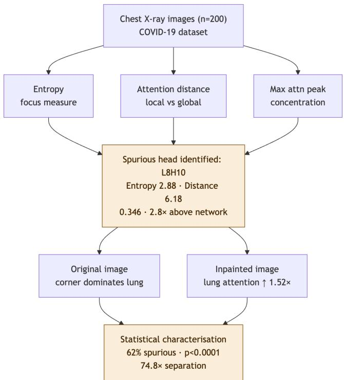  
Figure 1: Analysis pipeline: sweep all 144 heads for anomalous concentration, identify L8H10, validate causally via activation patching. The three-stage design separates identification, characterisation, and causal verification, with each stage necessary because correlation alone cannot support intervention.

## 3 Methods

## 3.1 Model and Dataset

We use ViT-Base/16 (google/vit-base-patch16-224) pretrained on ImageNet-21k via HuggingFace. The model has 12 layers, 12 heads per layer, 144 heads total. Images are resized to 224×224 and divided into 196 16×16 patches plus one CLS token.

Our primary dataset is 200 chest X-rays from the COVID-19 Chest X-ray Dataset [Cohen et al., 2020], a publicly available collection with naturalistic annotation noise: real patient identifiers, hospital labels, and acquisition metadata stamped on images by clinical systems.

## 3.2 Attention Head Analysis

We extract full attention tensors from all 12 layers (output attentions=True) and analyse each head’s CLS-token attention over 196 patches. Four metrics per head: Entropy: $\begin{array} { r } { H = - \sum _ { i } a _ { i } \log ( a _ { i } + \varepsilon ) } \end{array}$ . Lower values indicate more focused attention.

Mean attention distance: Weighted average spatial distance between attended patches. Distinguishes local from global behaviour.

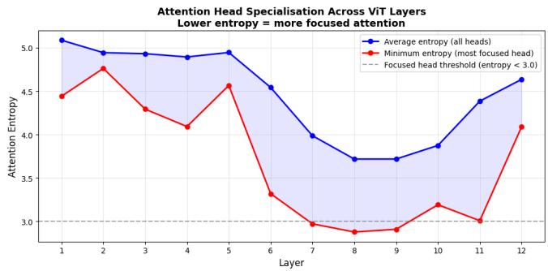  
Figure 2: Entropy across 12 layers. Specialisation appears abruptly in layers 7–9, not gradually, consistent with functional circuit emergence at intermediate depth, not continuous refinement throughout the network.

Max single-patch attention: Peak softmax weight on any single patch. Our primary anomaly signal.

Corner/lung ratio: Mean attention in the top-left 3×3 patch region divided by mean attention in the central 6×6 region. Ratios >2 classified as spurious. This threshold is conservative: the bimodal distribution (57.5× vs 0.77× group means, no interquartile overlap) means group membership is stable across any threshold in the range 2–10×, ruling out threshold-sensitivity as a confound.

## 3.3 Causal Validation

We use two complementary interventions to establish that annotation content drives L8H10, not a correlated image property.

Mean-value masking. Replace the top-left 56×56 pixel annotation region with mean pixel intensity. Rerun inference and compare L8H10 attention before and after.

Inpainting. Mean-value masking has a known confound: the flat grey replacement patch attracts contrast-sensitive heads [Fong and Vedaldi, 2017]. We eliminate this using OpenCV inpainting (Telea algorithm [Telea, 2004]), which fills the annotation region with realistic surrounding tissue texture.

## 3.4 Statistical Analysis

Group comparisons use the Mann-Whitney U test. Before/after paired comparisons use the Wilcoxon signed-rank test. We report two-tailed p-values at α=0.05 and group separation factors (ratio of group means) as effect sizes.

## 4 Results

## 4.1 L8H10 Is a Network-Wide Anomaly

Attention specialisation (entropy below 3.0 nats) is absent in layers 1–6 (mean entropy 5.0–5.2) and emerges abruptly in layers 7–9(Figure 2). Three heads meet the threshold: L7H2 (2.97 nats), L9H3 (2.91), L8H10 (2.88).

Entropy alone does not distinguish L8H10. Concentration does. L8H10 places 34.6% of its total attention on a single patch, with max attention weight 0.346. The next-highest across all 144 heads is 0.124 (L6H12). L8H10 is 2.8× more concentrated than any other head (Figure 3). L7H2 and L9H3 max out at approximately 0.09, comparable to many unfocused heads. L8H10 is not a marginal outlier; it is in a different category. Critically, L8H10 also has the highest mean attention distance (6.18) among all focused heads, meaning it attends to a patch spatially far from the centre. The combination of extreme focus and peripheral location marks it as a candidate spurious head.

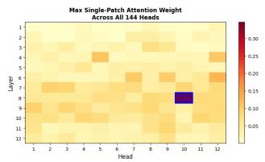

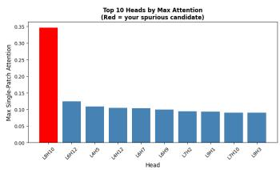

Figure 3: Max single-patch attention across all 144 heads. L8H10 stands alone at 0.346, which is 2.8× above the next-highest head (L6H12 at 0.124), placing it in a categorically different concentration regime from the rest of the network.  
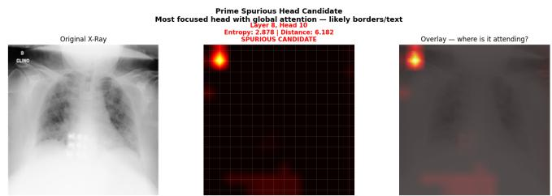  
Figure 4: L8H10 attention on the first chest X-ray examined. The annotation patch absorbs the head’s capacity entirely: 0.346 weight on one corner patch versus near-zero on the lungs. This is not a subtle bias; it is a complete functional redirection away from clinically relevant anatomy.

## 4.2 L8H10 Attends to Annotation Text

On a chest X-ray with the annotation ‘D CLINO’ in the top-left corner, L8H10 places 0.346 attention weight on that patch. Uniform random baseline: 0.0051 per patch. That is a 68× concentration on a single annotation token.

The attention map is unambiguous: one bright spot in the top-left corner, near-black everywhere else (Figure 4). The lungs receive essentially nothing.

## 4.3 The Pattern Holds Across 200 Images

L8H10 exhibits spurious corner-attending behaviour in 123 of 200 chest X-rays (62%). The corner/lung ratio distribution is strongly bimodal: 57.5× mean in spurious images versus 0.77× in normal images (separation 74.8×, Mann-Whitney p<0.0001). The two groups do not overlap (Figure 5).

What predicts spurious behaviour? Raw corner brightness does not predict spurious behaviour; spurious images actually have lower mean brightness. Corner local contrast does: pixel standard deviation within the corner region is higher in spurious images (Mann-Whitney p<0.0001). Corner edge density is non-significant (p=0.622). Text annotations produce high local contrast regardless of overall luminance, as dark characters on light backgrounds. The 62%/38% split reflects annotation presence across the dataset, not arbitrary model variation.

Table 1: L8H10 spurious behaviour across 200 chest X-ray images.
<table><tr><td>Metric</td><td>Spurious (n=123)</td><td>Normal (n=77)</td><td>Sig.</td></tr><tr><td>Spurious rate</td><td>62%</td><td>38%</td><td></td></tr><tr><td>Mean corner/lung ratio</td><td>57.5×</td><td>0.77×</td><td>p&lt;0.0001</td></tr><tr><td>Group separation</td><td>74.8×</td><td></td><td>Mann-Whitney U</td></tr><tr><td>Mean corner attention</td><td>0.0164</td><td>0.0028</td><td>p&lt;0.0001</td></tr><tr><td>Max observed ratio</td><td>311.4×</td><td>1.93×</td><td></td></tr><tr><td>Uniform baseline/patch</td><td>0.0051</td><td></td><td></td></tr></table>

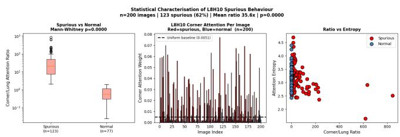  
Figure 5: Statistical characterisation across 200 images. Left: box plots on log scale, with the two groups showing no interquartile overlap, confirming clean bimodal separation. Centre: per-image corner attention, spurious images (red) consistently exceed the random baseline. Right: corner/lung ratio vs entropy, two cleanly separated populations, where the spurious group is not a tail of the normal distribution but a wholly distinct regime.

## 4.4 Annotation Content Causally Drives the Behaviour

Mean-value masking replaces the annotation region with mean pixel intensity. Lung attention increases 7.8-fold (0.0026 to 0.0202). But corner attention also increases, as the uniform grey patch is itself high-contrast and attracts the head [Fong and Vedaldi, 2017]. The confound requires a cleaner intervention.

Inpainting fills the annotation region with realistic tissue texture via the Telea algorithm [Telea, 2004]. Results across all 200 images: corner attention decreases in 158 cases (79%, Wilcoxon p<0.0001). Lung attention increases in 140 cases (70%), mean fold increase 1.34× (Wilcoxon p=0.021).

The specificity establishes causation. Spurious images show mean lung attention increase of 1.52× upon annotation removal $\scriptstyle ( n = 1 2 3 )$ . Normal images show 0.99× (n=77, Mann-Whitney $p { < } 0 . 0 0 0 1 )$ . Removing the annotation moves attention only in images where the annotation was the problem (Figure 6).

## 4.5 Ablation Cannot Detect This

We ablated L8H10 in a five-class Vision Transformer fine-tuned on chest X-ray diagnosis (codewithdark/vit-chest-xray, trained on CheXpert [Irvin et al., 2019]; classes: Cardiomegaly, Edema, Consolidation, Pneumonia, No Finding).

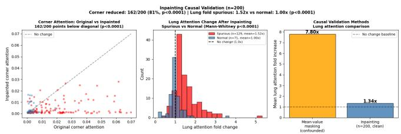  
Figure 6: Inpainting validation across 200 images. Left: corner attention before vs after, where 158/200 points below the diagonal confirms annotation content, not luminance, drives L8H10 (Wilcoxon $p { < } 0 . 0 0 0 1 )$ . Centre: lung fold change by group, where spurious images (red) show 1.52× redistribution to lungs while normal images (blue) show none $( p { < } 0 . 0 0 0 1 )$ , establishing causal specificity. Right: method comparison showing inpainting eliminates the confound present in mean-value masking.

Table 2: Single-head ablation of L8H10 across two independently fine-tuned classifiers (n=200).
<table><tr><td>Model</td><td>Overall</td><td>Spurious</td><td>Normal</td><td>p</td></tr><tr><td>codewithdark (CheXpert)</td><td>5.0%</td><td>4.9%</td><td>5.2%</td><td>0.340</td></tr><tr><td>1xyuan (Pneumonia dataset)</td><td>0.5%</td><td>0.8%</td><td>0.0%</td><td>0.435</td></tr><tr><td colspan="5">Both: null result, no differential spurious effect</td></tr></table>

Prediction labels changed in 10/200 images (5.0%). Mean confidence shift: −0.0098. Mann-Whitney comparison between spurious and normal images: p=0.340. To rule out model-specific artefact, we replicated the ablation on a second independently fine-tuned ViT classifier trained on a different dataset (lxyuan/vit-xray-pneumonia-classification, pneumonia binary classification). Despite markedly different baseline sensitivity (0.5% prediction change rate versus 5.0%), the null result holds: Mann-Whitney p=0.435, with no differential effect between spurious and normal images. The finding is not a property of any particular fine-tuned model.

A head placing 34.6% of its attention on annotation patches in 62% of clinical images, verified causally by two independent interventions, produces no measurable output-level signal under single-head ablation. The reason is redundancy: Elhage et al. [Elhage et al., 2021] showed that Transformers encode information across multiple heads, making single-head ablation a poor detector of component-level behaviour.

## 4.6 Multi-Head Ablation Confirms Distributed Encoding

The single-head null result (p=0.340) could reflect two distinct phenomena: either the spurious signal in L8H10 is genuinely weak and clinically inconsequential, or it is redundantly encoded such that removing one carrier leaves the rest intact. These interpretations have opposite implications for safety.

Multi-head ablation discriminates between them. We simultaneously zeroed all three identified spurious heads: L8H10 (primary), L7H2, and L9H3. Overall prediction changes increased from 5.0% to 10.0%, confirming the ablation is doing something. But the effect is non-specific: normal images changed at least as often as spurious ones (11.7% vs. 9.8%), and the group comparison produced $\scriptstyle { p = 0 . 5 3 2 }$ (Table 3). Even removing all three identified carriers simultaneously produces no differential effect on spurious images (Figure 7).

Table 3: Single vs multi-head ablation (n=200).
<table><tr><td>Condition</td><td>Overall</td><td>Spurious</td><td>Normal</td><td>p</td></tr><tr><td>Baseline</td><td>0.0%</td><td>0.0%</td><td>0.0%</td><td></td></tr><tr><td>Single-head (L8H10)</td><td>5.0%</td><td>4.9%</td><td>5.2%</td><td>0.340</td></tr><tr><td>Multi-head (all 3)</td><td>10.0%</td><td>9.8%</td><td>11.7%</td><td>0.532</td></tr></table>

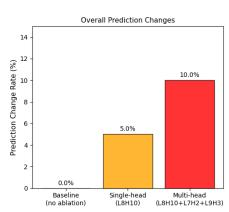

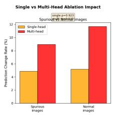

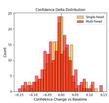  
Figure 7: Single vs multi-head ablation impact. Left: overall prediction change rate increases from 5% to 10% as more heads are removed, confirming ablation is active. Centre: spurious vs normal image breakdown, where normal images are disrupted at least as often as spurious ones under both conditions, demonstrating the ablation is non-specific to the spurious signal. Right: confidence delta distribution. The pattern rules out weak signal and confirms distributed redundant encoding.

This rules out the first interpretation. The signal is not weak; it is demonstrably present and causally verified by two independent interventions. The spurious annotation signal is encoded across more components than attention concentration metrics can identify. The three heads we found are the most visible carriers, not the only ones.

## 4.7 Cross-Dataset Replication

We replicate the full analysis on 200 images from NIH ChestX-ray14 [Wang et al., 2017], a dataset of 112,120 frontal-view radiographs from 30,805 patients across multiple institutions with a distinct acquisition protocol from our primary dataset.

L8H10 shows spurious behaviour in 79% of NIH images (158/200). Mean corner/lung ratio: 34.9× in spurious images versus 0.92× in normal images. Separation factor: 37.9×. Mann-Whitney $p { < } 0 . 0 0 0 1$ . The finding holds (Table 4).

## 4.8 Cross-Architecture Replication

We run the identical head-identification pipeline on DeiT-Base and ViT-Large/16 on the same 200 chest X-rays. All three architectures develop spurious annotation-attending heads at majority rates (Table 5).

DeiT-Base (L9H2): 88% spurious rate, separation 10.6×. ViT-Large/16 (L8H8): 80% spurious rate, separation 30.5×. ViT-Base/16 sits between at 62%. Spurious annotationattending heads are not specific to one architecture or scale; they emerge consistently across the ViT family.

Table 4: Cross-dataset replication.
<table><tr><td>Dataset</td><td>Rate</td><td>Sep.</td><td>Spur.</td><td>Norm.</td></tr><tr><td>COVID-19 (n=200)</td><td>62%</td><td>74.8×</td><td>57.5×</td><td>0.77×</td></tr><tr><td>NIH CXR14 (n=200)</td><td>79%</td><td>37.9×</td><td>34.9×</td><td>0.92×</td></tr></table>

Both: Mann-Whitney p<0.0001

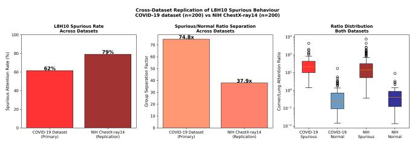  
Figure 8: Cross-dataset replication across 400 images from two independent datasets with distinct acquisition protocols. In both datasets the spurious and normal groups show complete separation with no interquartile overlap, confirming the finding is not an artefact of one dataset’s annotation conventions.

## 4.9 Spurious Behaviour Persists Through Fine-Tuning

A critical question for clinical deployment is whether taskspecific fine-tuning suppresses L8H10’s annotation-reading behaviour. We tested two regimes.

Partial fine-tuning. We updated only the last two transformer layers and classification head for 5 epochs (AdamW, lr=2e-5). The spurious rate changed from 61.5% to 61.0%, a reduction of one image in 200. Of 123 originally spurious images, 122 (99.2%) remained spurious.

Full fine-tuning. We updated all 12 transformer layers for 15 epochs using layerwise learning rate decay (base lr=2e-5, decay factor 0.85 per layer toward input), cosine annealing, and gradient clipping at 1.0. The spurious rate was 62.5%, marginally higher than pretrained. Of 123 originally spurious images, 121 (98.4%) remained spurious after full fine-tuning. The mean corner/lung ratio declined from 35.6× to 29.2× (Wilcoxon p=0.009), but this shift is practically negligible: a ratio of 29× represents the same catastrophic annotationdominance as 36×.

The fine-tuning objective does not provide a gradient signal that contradicts corner-reading, because annotation text is correlated with institutional disease prevalence in the training data. The shortcut remains predictive throughout finetuning and is therefore never penalised by the loss function. The slight increase in spurious rate under full fine-tuning (61.5% → 62.5%) is consistent: full fine-tuning strengthens task-relevant representations, and because corner-reading is task-relevant in a dataset with consistent annotation conventions, it is reinforced rather than suppressed. The practical implication is direct: the standard ViT deployment pipeline, pretraining on ImageNet and fine-tuning on locally labelled clinical data, does not remove spurious annotation-reading and may entrench it. A practitioner who fine-tunes a pretrained ViT on chest X-rays from their institution and then transfers the model to another site should not assume that fine-tuning has cleaned up shortcut behaviour. Our results show it has almost certainly preserved it, and may have made it worse. Ablation-based mitigation strategies are structurally insufficient: the spurious signal is distributed across redundant components that collectively resist targeted removal. The only known reliable mitigations are data-level, namely training on annotation-stripped images so the shortcut is never learned, or training-time regularisation explicitly targeting identified spurious heads. Both require first knowing which heads to target. This is exactly what mechanistic auditing provides.

Table 5: Cross-architecture comparison (n=200 each).
<table><tr><td>Model</td><td>Head</td><td>Rate</td><td>Sep.</td><td>Spur.</td><td>Norm.</td></tr><tr><td>ViT-Base/16</td><td>L8H10</td><td>62%</td><td>74.8×</td><td>57.5×</td><td>0.77×</td></tr><tr><td>DeiT-Base</td><td>L9H2</td><td>88%</td><td>10.6×</td><td>11.8×</td><td>1.11×</td></tr><tr><td>ViT-Large/16</td><td>L8H8</td><td>80%</td><td>30.5×</td><td>16.2×</td><td>0.53×</td></tr><tr><td colspan="6">All three: Mann-Whitney p&lt;0.0001</td></tr></table>

Table 6: L8H10 spurious behaviour across fine-tuning regimes.
<table><tr><td>Condition</td><td>Spurious rate</td><td>Mean ratio</td><td>Still spurious</td></tr><tr><td>Pretrained</td><td>61.5%</td><td>35.6×</td><td></td></tr><tr><td>Partial FT (2 layers)</td><td>61.0%</td><td>34.8×</td><td>99.2%</td></tr><tr><td>Full FT (all layers)</td><td>62.5%</td><td>29.2×</td><td>98.4%</td></tr></table>

Full FT Wilcoxon p=0.009 vs pretrained

## 5 Discussion

## 5.1 Structural Blindness in Output-Level Evaluation

The null ablation result is a specific, falsifiable claim about the structure of how neural networks encode information, with direct implications for how AI safety evaluation is currently conducted.

Elhage et al. [Elhage et al., 2022] showed that Transformers operating near capacity encode features in superposition: each feature is distributed across many components. This creates a fundamental asymmetry between what mechanistic analysis can detect and what output-level evaluation can detect.

Output-level evaluation (accuracy, confidence, prediction change rate) measures the aggregate behaviour of the network. It is blind to individual component behaviour unless that component is both non-redundant and causally upstream of the output. In a network with distributed representations, neither condition holds for most components. A head can implement a clearly spurious computation yet produce no output-level signal when ablated, because the network reconstructs the same output from the remaining redundant encoding.

The danger is not that L8H10 will cause the classifier to fail on a single image. The danger is that the entire family of spurious annotation-reading components constitutes a latent vulnerability that activates silently under distributional shift.

When a model trained at one institution is deployed at another with different annotation conventions, this distributed spurious signal may suddenly dominate, and no output-level evaluation performed at the training site will have detected it.

This is particularly consequential for ViT-based deployment in low-resource clinical settings [Vanitha et al., 2025], where models are routinely transferred from high-resource pretraining environments to new institutions without reauditing. The annotation conventions at the source institution are encoded in the model’s weights and will transfer silently — invisible to any accuracy benchmark evaluated on source-domain data.

What this means for evaluation practice. Current deployment evaluation for medical AI relies almost entirely on output-level metrics: accuracy on held-out data, performance under distribution shift, occasionally gradient attribution maps. Our results demonstrate that this evaluation regime is structurally blind to a specific and dangerous failure class: components that implement shortcuts at the representational level but whose contribution is masked by redundant encoding at the output level. This is not a measurement problem that better ablation methods can solve; it is a consequence of the architecture itself. Standard evaluation answers: does the model perform correctly on this data? Mechanistic auditing answers: which components are responsible, and are any doing so for the wrong reasons? These questions are not interchangeable, and our results show a model can answer the first correctly while failing the second catastrophically. Mechanistic auditing of attention concentration, identification of spurious-signal carriers, and causal verification of their behaviour should be standard components of any predeployment audit for Vision Transformers applied to medical imaging, especially when models cross institutional boundaries.

## 5.2 Mechanistic Interpretability Transfers to Vision Models

Entropy analysis, attention distance metrics, and activation patching developed for language models apply directly to ViT attention heads with minimal modification. The abrupt specialisation emergence in layers 7–9 mirrors functional circuit emergence at intermediate depths in language models, suggesting the phenomenon is architecture-general. Whether it extends to Swin, BEiT, other medical modalities, or other pretraining regimes is an open question.

## 5.3 Limitations

The corner region definition (top-left 3×3 patches) and spurious threshold (corner/lung ratio >2) were chosen to match the annotation convention of the datasets used here. Datasets where annotations appear at other locations would require adjusting the region definition accordingly. The underlying method generalises directly: head identification depends only on max single-patch attention concentration and mean attention distance, neither of which assumes a specific annotation location.

Fine-tuning experiments used 200 images, which is small relative to clinical training sets. The theoretical argument for why suppression fails applies regardless of dataset size when annotation conventions are consistent. The definitive experiment would compare fine-tuning on annotation-consistent versus annotation-stripped datasets of matched size; we identify this as the most important direction for future work.

## 5.4 Future Work

Fine-tuning on annotation-stripped images would directly test whether suppressing the spurious signal during training prevents it from being encoded. Automated spurious head detection, flagging heads with anomalously high maxattention concentration as a pre-deployment screening step, would make this analysis practical without per-model manual inspection. Extension to other modalities (retinal imaging, dermoscopy, CT) would establish whether the phenomenon is specific to chest X-rays or broader.

## 6 Conclusion

We identified a single attention head, L8H10 in ViT-Base/16, as a dedicated corner-contrast detector that attends to annotation text in 62% of clinical chest X-rays, with a corner-tolung attention ratio 74.8× higher in affected images than unaffected ones (p<0.0001). Two causal interventions confirm annotation content drives the behaviour. Replication on NIH ChestX-ray14 (79% rate, 37.9× separation) and across DeiT-Base and ViT-Large/16 confirm generalisation across datasets and architectures, with all three ViT-family models developing spurious annotation-attending heads at majority rates.

Single-head ablation produces p=0.340. Multi-head ablation of all three identified spurious heads produces p=0.532. The spurious signal is distributed so broadly that even targeted removal of all identifiable carriers leaves output-level evaluation blind. A causally verified annotation-reading circuit is completely invisible to standard evaluation. Mechanistic auditing finds it. Behavioural testing does not. For Vision Transformers transferred from natural image pretraining to clinical settings, including the growing number deployed across resource-limited healthcare systems, that gap warrants serious attention.

## References

[Barekatain et al., 2025] Barekatain, L., et al. Evaluating the Explainability of Vision Transformers in Medical Imaging. arXiv:2510.12021, 2025.

[Chefer et al., 2021] Chefer, H.; Gur, S.; and Wolf, L. Transformer Interpretability Beyond Attention Visualization. In Proceedings ofCVPR, 2021.

[Cohen et al., 2020] Cohen, J. P.; Morrison, P.; Dao, L.; et al. COVID-19 Image Data Collection. arXiv:2003.11597, 2020.

[DeGrave et al., 2021] DeGrave, A. J.; Janizek, J. D.; and Lee, S. I. AI for Radiographic COVID-19 Detection Selects Shortcuts over Signal. Nature Machine Intelligence, 3:610–619, 2021.

[Dosovitskiy et al., 2021] Dosovitskiy, A., et al. An Image is Worth 16×16 Words: Transformers for Image Recognition at Scale. In Proceedings ofICLR, 2021.

[Elhage et al., 2021] Elhage, N., et al. A Mathematical Framework for Transformer Circuits. Transformer Circuits Thread, 2021.

[Elhage et al., 2022] Elhage, N., et al. Toy Models of Superposition. Transformer Circuits Thread, 2022.

[Fong and Vedaldi, 2017] Fong, R. C.; and Vedaldi, A. Interpretable Explanations of Black Boxes by Meaningful Perturbation. In Proceedings ofICCV, 2017.

[Geirhos et al., 2020] Geirhos, R., et al. Shortcut Learning in Deep Neural Networks. Nature Machine Intelligence, 2:665–673, 2020.

[Irvin et al., 2019] Irvin, J.; Rajpurkar, P.; Ko, M.; et al. CheXpert: A Large Chest Radiograph Dataset with Uncertainty Labels and Expert Comparison. In Proceedings of AAAI, 2019.

[Joseph et al., 2024] Joseph, S., et al. ViT-Prisma: A Mechanistic Interpretability Library for Vision Transformers. https://github.com/soniajoseph/ViT-Prisma, 2024.

[Olah et al., 2020] Olah, C., et al. Zoom In: An Introduction to Circuits. Distill, 2020. https://distill.pub/2020/circuits/ zoom-in.

[Raghu et al., 2021] Raghu, M., et al. Do Vision Transformers See Like Convolutional Neural Networks? In Proceedings ofNeurIPS, 2021.

[Telea, 2004] Telea, A. An Image Inpainting Technique Based on the Fast Marching Method. Journal of Graphics Tools, 9(1):23–34, 2004.

[Wang et al., 2017] Wang, X.; Peng, Y.; Lu, L.; et al. ChestX-ray8: Hospital-Scale Chest X-Ray Database and Benchmarks. In Proceedings ofCVPR, 2017.

[Zech et al., 2018] Zech, J. R., et al. Variable Generalization Performance of a Deep Learning Model to Detect Pneumonia in Chest Radiographs. PLOS Medicine, 15(11), 2018.

[Vanitha et al., 2025] Vanitha, K.; Mahesh, T. R.; Vinoth Kumar, V.; and Guluwadi, S. Enhanced Tuberculosis Detection Using Vision Transformers and Explainable AI with a Grad-CAM Approach on Chest X-rays. BMC Medical Imaging, 25:96, 2025.

## Ethical Statement

This study uses only publicly available, de-identified chest X-ray datasets (COVID-19 Chest X-ray Dataset and NIH ChestX-ray14). No new patient data were collected. All datasets were used in accordance with their respective licences and intended research purposes. The work identifies safety risks in deployed medical AI systems and does not introduce any new harms.

## Acknowledgments

Anonymised for review.

## A Experimental Setup

All experiments on Google Colab (T4 GPU). Model: google/vit-base-patch16-224 via HuggingFace Transformers v4.x. Primary dataset: covid-chestxray-dataset (github. com/ieee8023/covid-chestxray-dataset). NIH replication: BahaaEldin0/NIH-Chest-Xray-14 via HuggingFace Datasets. Classification model: codewithdark/vit-chest-xray (CheXpert). Libraries: PyTorch, NumPy, Matplotlib, SciPy, OpenCV. Code: https://github.com/joshmuhu/spurious-attention-vit.

## B Full Head Statistics

Complete per-head entropy, distance, max attention, and focus classification for all 144 heads in supplementary results.json. Key heads: L7H2 (entropy 2.97, distance 2.00, max 0.094), L8H10 (entropy 2.88, distance 6.18, max 0.346), L9H3 (entropy 2.91, distance 2.28, max 0.090). L8H10 is the only head combining low entropy with high spatial distance and anomalously high single-patch concentration. The next-highest max attention across all 144 heads is 0.124 (L6H12), making L8H10 2.8× more concentrated than any other head in the network.