# SurgStreamer: proactive, request-driven monitoring of surgical video streams with structured state and a reusable reasoning layer

Bowen Xianga,∗, Jon S. Heiselmana, Michael I. Migaa

aDepartment of Biomedical Engineering, Vanderbilt University, Nashville, TN, USA

## Abstract

Surgical teams could benefit from assistants that watch the video for requested events, such as “tell me when the clip applier appears during Calot triangle dissection”, and answer questions about what has already happened. We formalise this task as request-driven event detection with exact semantics and causal alert decisions, and present SurgStreamer. It separates procedurespecific perception, which maps the 1-FPS stream to a structured state over tools, actions and phases, from procedure-agnostic reasoning, which evaluates a formal monitoring condition over this state and an event memory, either with exact rules or with a small controller that addresses entities through pointers rather than names. We evaluate this monitoring core with gold conditions. On a pre-registered, sealed test set of 12 laparoscopic cholecystectomies, SurgStreamer reached a macro event-F1 of 0.598 over full procedures. On identical 75-s windows with only the window available to every method, it scored 0.677. The tested configurations of the streaming vision–language model OneStreamer-4B, including ones fine-tuned on SurgStreamer’s state or on video with an adapted vision encoder, scored at most 0.540 (Holm-adjusted p ≤ 0 012). At three external centres, re-training only perception raised performance on held-out procedures from 0.239 to 0.470. On a new procedure, pituitary surgery, controller weights trained] on cholecystectomy matched an in-domain controller on oracle state (0.947 vs 0.938). On predicted state they missed the pre registered non-inferiority margin (−0 024 [−0 040, −0 008]) unless the alert thresholds were re-calibrated. The results support separating perception from reasoning and point to perception under distribution shift as the main limitation..

Keywords: surgical video understanding, proactive monitoring, streaming video, vision–language models, surgical workflow,[ domain transfer

## 1. Introduction

Laparoscopic cholecystectomy is among the most frequent abdominal operations. Its most feared complication, bile-duct injury, is linked to the misidentification of structures before they. are clipped and cut. Surgical guidelines therefore require a critical view of safety before the cystic duct and artery are divided6 (Strasberg and Brunt, 2010), and recent work has automated the assessment of this view from video (Mascagni et al., 2022). Beyond such fixed checks, a surgical team may want to ask an assistant to watch for events of its choice: “tell me when the cystic duct is being clipped”, “alert me if the clip applier ap-a pears during Calot triangle dissection”, or “has the cystic artery been cut yet?”. Such requests are phrased in natural language but refer to a predefined vocabulary of instruments, actions and phases, combined by a small set of operators. They are timecritical: an answer is useful only if it arrives when the event happens, once per occurrence, and never for an event that did not happen. In this work, events are visible events as defined by the dataset annotations; we do not assess whether an action was performed correctly, the quality of structure handling, or the prevention of complications.

Surgical data science has mainly addressed recognition (Maier-Hein et al., 2017): phases (Twinanda et al., 2017; Jin et al., 2018; Czempiel et al., 2020; Garrow et al., 2021), instruments, and actions (Nwoye et al., 2022). These methods label frames or segments; they do not answer user requests, and their metrics do not measure when an event is signalled. Streaming vision–language models (VLMs) can be prompted with such requests (Chen et al., 2024; Zeng et al., 2026), and streaming models now narrate surgery as it unfolds (He et al., 2026). A recent time-aware benchmark found that general and medical VLMs degrade markedly when they must decide when to answer or alert (Wang et al., 2026). In the configurations we tested, streaming VLMs alerted when an instrument was merely visible rather than appearing, alerted on absent objects, rarely detected disappearances or phase changes, and needed hundreds of milliseconds of GPU time per request and second of video. Fine-tuning reduced but did not remove these failures, even when it included the vision encoder. Fig. 1 shows a request on a sealed test procedure, the decisions SurgStreamer takes on it, and the silence of the two strongest fine-tuned VLMs.

We argue that proactive monitoring should be grounded in a structured state, and that the reasoning over this state should be separated from the procedure. SurgStreamer (Fig. 2) maps the video stream to a probabilistic state over a closed vocabulary of tools, actions and phases. A formal monitoring condition is evaluated over the state stream and an event memory, and alerts are decided causally. Perception is procedure-specific and must be trained for each procedure, and possibly for each centre. Reasoning sees entities only through their kind and state, never through their names, which makes it a candidate for reuse across procedures. A natural-language compiler maps requests to conditions; it is an interface module, and our evaluation targets the monitoring core given formal conditions. This paper tests three claims:

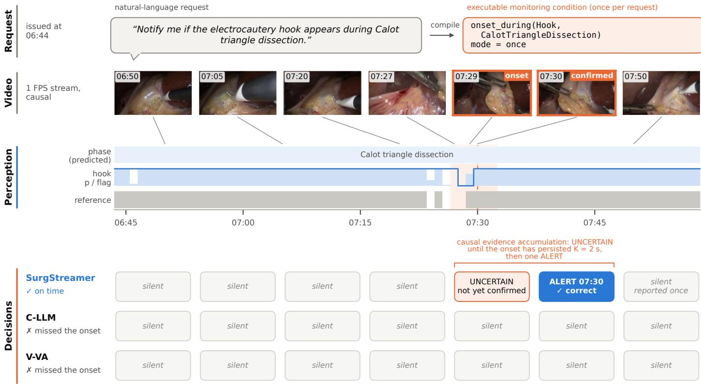  
Figure 1: Request-driven monitoring on a sealed Cholec80 test procedure (75-s window, equal context: every method has only the window). The request is compiled once into an executable monitoring condition. From the 1-FPS frames, perception computes a structured state: predicted phase, hook probability (shaded) and decoded flag (line); grey: reference presence; orange band: matching tolerance around the reference occurrence; dashed line: its confirmation. Bottom: perframe decisions. SurgStreamer accumulates evidence causally: uncertain at the onset second, a single alert once the onset has persisted K = 2 s, then silence. The strongest state-text baseline (C-LLM) and the vision-adapted VLM (V-VA) stay silent over the whole window, as does V-LoRA (not shown). The example was selected for illustration; Fig. 9 shows a failure, and Section 5 the quantitative results.

1. Event-level monitoring with exact semantics. Requestdriven monitoring can be specified as event detection with exact semantics and causal alert decisions, covering confirmation, once / every / n-th modes, composition and retrospective memory. We provide a benchmark of 20 query families with exact references and hard negatives.

2. Name-free pointer control over structured state. A small learned controller that reads the state through entity pointers and structured temporal features improves event monitoring over the exact rules on a pre-registered sealed test. Built on this state, the system outperforms the tested streaming-VLM configurations, including fine-tuned and vision-adapted ones, under equal context.

3. The transfer boundary. Frozen controller weights transfer to a new procedure on oracle state, while perception, and on predicted state the alert thresholds, must be adapted. We measure this at three external centres and on a new procedure, and we report where the claim fails.

The perception components (a fine-tuned DINOv3 encoder, causal temporal heads, an ordered phase model) are established techniques that we use as a strong, documented substrate. Preregistration and sealed test sets serve to make the three claims testable.

## 2. Related work

Surgical workflow and instrument recognition. Online phase recognition progressed from convolutional features with recurrent models (Twinanda et al., 2017; Jin et al., 2018) to tempo ral convolutions and transformers (Czempiel et al., 2020; Gao et al., 2021; Liu et al., 2023; Yang et al., 2024); Garrow et al. (2021) review the field. Instrument presence is usually learned jointly, and fine-grained actions are modelled as instrument– verb–target triplets (Nwoye et al., 2022). Surgical foundation encoders pretrained on large video collections aim at representations that transfer across tasks (Wang et al., 2023). Multicentre benchmarks such as HeiChole (Wagner et al., 2023) and procedure-specific ones such as PitVis (Das et al., 2025) document performance drops across centres and procedures. We use such recognition models as the perception layer and evaluate event timing explicitly.

Online and event-level video understanding. Online action detection (De Geest et al., 2016) and action spotting (Giancola et al., 2018) evaluate causal predictions and event timing within a tolerance. Our metric follows this practice and adds requestspecific semantics (modes, phase restrictions, ordering), a confirmation interval defined from the annotations, and an explicit state for accumulating evidence.

Streaming and surgical vision–language models. Streaming video LLMs decide at every frame whether to respond (Chen et al., 2024; Wang et al., 2025; Qian et al., 2025); some add a compressed long-term memory (Zhang et al., 2025). We use OneStreamer-4B (Zeng et al., 2026), a streaming fine-tune of Qwen3-VL (Bai et al., 2025) with a native proactive protocol. Surgical VLMs address visual question answering and representation learning (Seenivasan et al., 2022, 2023; Yuan et al., 2025), mostly on frames or clips and retrospectively. Surg-OnAir (He et al., 2026) brings streaming to surgery: it narrates the procedure frame by frame and emits sparse state tokens at phase and step transitions, with steps generated by a language model from narration transcripts. It describes the workflow rather than answering user requests, and it is evaluated by the pairwise preferences of an LLM judge, not by the timing of the transitions it signals.

Time-aware evaluation. MedStreamBench (Wang et al., 2026) evaluates medical video understanding under explicit evidence windows, across 22 datasets including Cholec80, HeiChole and PitVis. Its proactive mode asks a model to answer no alert, uncertain or alert as a stream unfolds, and scores the first alert against the expected time (responsiveness) and whether the model stays positive afterwards (stability). General and medical VLMs degraded markedly in its streaming and proactive settings. We adopt the same three-way response space but evaluate it diferently: an alert is an edge, one per requested occurrence and scored at every second against exact event definitions, so repeated alerts count as false alerts; and hard negatives test whether a model stays silent when nothing new happens.

Structured reasoning and runtime monitoring. Compositional visual questions can be answered by programs over perception outputs (Gupta and Kembhavi, 2023; Surís et al., 2023), and runtime verification monitors temporal-logic properties over signals (Maler and Nickovic, 2004). SurgStreamer combines these ideas for surgical streams and adds a learned controller that approximates the exact semantics under perception noise. Table 1 summarises the capabilities.

## 3. Method

## 3.1. Problem formulation

A video is observed as a causal stream of frames $x _ { 1 } , x _ { 2 } , \dotsc .$ at 1 frame per second; time t is in seconds. For a proactive request r the system emits, at every second,

$$
y _ { t } = \pi ( r , x _ { 1 : t } ) \in \mathcal { Y } ,\tag{1}
$$

Table 1: Capabilities of approach families, as typically published $( \checkmark )$ yes, ◦: partly, –: no). Causal: decision at t uses frames up to t. Events: evaluation of when events are signalled. Reuse: the reasoning is reused across procedures without retraining.
<table><tr><td>Approach</td><td>Causal</td><td>Request</td><td>Events</td><td>Memory</td><td>Reuse</td></tr><tr><td>Phase / tool recognition</td><td>√</td><td>一</td><td>一</td><td>0</td><td></td></tr><tr><td>Surgical VQA / VLMs</td><td>一</td><td>√</td><td>一</td><td>一</td><td>o</td></tr><tr><td>Streaming video LLMs</td><td>√</td><td>√</td><td>0</td><td>o</td><td>√</td></tr><tr><td>Surgical narration</td><td>√</td><td>一</td><td>一</td><td>o</td><td>一</td></tr><tr><td>Program-based reasoning</td><td>一</td><td>√</td><td>1</td><td>一</td><td>√</td></tr><tr><td>SurgStreamer</td><td>√</td><td>√</td><td>√</td><td>√</td><td>o</td></tr></table>

with Y = {no-alert uncertain alert}, the response space of the proactive mode of MedStreamBench (Wang et al., 2026), for which we define each state exactly. One alert must be issued per requested occurrence, at the moment the occurrence is confirmed, and the alert decision at t may use only frames up to t. uncertain marks evidence that has started to accumulate; it is defined ofline from the complete stream and serves as an auxiliary training label (Section 3.3). A retrospective request is answered at a question time $t _ { q }$ from the history. SurgStreamer factorises π into procedure-specific perception $f _ { \theta } ,$ a request compiler Γ and procedure-agnostic reasoning g:

$$
\begin{array} { r } { \begin{array} { r } { \mathbf { s } _ { t } = f _ { \theta } ( x _ { 1 : t } ) , \qquad c = \Gamma ( r ) , } \\ { y _ { t } = g ( c , \mathbf { s } _ { 1 : t } ) , } \end{array} } \end{array}\tag{2}
$$

where $\mathbf { s } _ { t }$ is a probabilistic state over a vocabulary E and c a monitoring condition. The reasoning g receives neither pixels nor entity names, only the state of the entities that c refers to. Fig. 2 shows the three parts on a test procedure: $f _ { \theta }$ (blue), the condition $^ { c , }$ and $g$ with the event memory (orange).

## 3.2. Entities, state and events

The vocabulary is defined in a procedure ontology and contains entities of three kinds: instruments, actions (a verb with an optional instrument and target) and phases. For cholecystectomy we use the 7 Cholec80 tools and phases (Twinanda et al., 2017). We add 21 CholecT50 action classes (Nwoye et al., 2022): 9 verbs, 8 instrument–verb pairs, and the clipping and cutting of the cystic duct and artery. At second $t ,$ each tool or action e has a presence probability $p _ { e } ( t )$ and a binary flag $b _ { e } ( t )$ from an episode decoder (Section 3.7); phases have a posterior and a decoded phase $z _ { t } ,$ and we write $b _ { \varphi } ( t ) = \mathbf { 1 } [ z _ { t } = \varphi ]$

Events are defined on a binary series b observed from $t _ { s } ,$ the first second of the stream (or of the window). An episode is a maximal run of presence in which absences of at most $G = 2$ s are bridged. A candidate onset starts at

$$
\begin{array} { r l } & { t _ { 0 } \in O _ { G } ( b ) \iff b ( t _ { 0 } ) = 1 , \ t _ { 0 } > t _ { s } , } \\ & { \qquad b ( t _ { 0 } - j ) = 0 \ \forall j \in \{ 1 , \dots , \operatorname* { m i n } ( G + 1 , t _ { 0 } - t _ { s } ) \} . } \end{array}\tag{3}
$$

The candidate is pending on $[ t _ { 0 } , t _ { c } )$ with $t _ { c } = t _ { 0 } + K - 1$ and $K \ = \ 2$ . It is confirmed at $t _ { c }$ if the entity remained present, $\Pi _ { j = 0 } ^ { K - 1 } b ( t _ { 0 } + j ) = 1$ , and cancelled at its first absent second otherwise. An ofset is the last present second $t _ { \ell }$ of an episode. It is pending while the entity is absent and confirmed at $t _ { c } = t _ { \ell } + G + 1$ , once the absence has lasted $G + 1 \mathrm { s } ;$ if the entity reappears earlier, the episode continues. A phase entry is a candidate onset of $b _ { \varphi }$ with $G = 0$ . Confirmation at $t _ { c }$ depends on b up to $t _ { c }$ only, so alert decisions are causal.

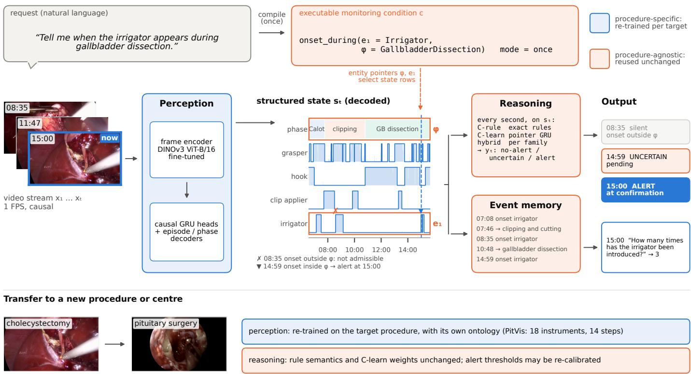  
Figure 2: SurgStreamer overview, shown on a sealed Cholec80 test procedure. A natural-language request is compiled once into an executable monitoring condition. Procedure-specific perception (blue) turns the 1-FPS stream into a structured state over a closed vocabulary of tools, actions and phases (decoded flags as lines, probabilities shaded; four of the seven tools shown). Procedure-agnostic reasoning (orange) addresses the entities of the condition through pointers (e , φ), never by name. Every second, the exact rule controller C-rule, the learned controller C-learn or their per-family hybrid outputs $y _ { t } ,$ and an alert is issued causally, once the event is confirmed. Here the earlier irrigator onset at 08:35 (×) falls in the clipping phase and is not admissible; the onset at 14:59 (▼) is confirmed and reported at 15:00 (dashed line), as in the reference (decisions of C-rule on the decoded state). The event memory logs episodes and phase transitions causally and answers retrospective requests; the count shown, 3, matches the reference. For a new procedure or centre only the blue components are re-trained; the rule semantics and the C-learn weights are reused unchanged, and only the alert thresholds may be re-calibrated.

## 3.3. Monitoring conditions

A condition $c = ( o , \mathbf { e } , m , n , \varphi )$ consists of an operator o, entities $\mathbf { e } = ( e _ { 1 } [ , e _ { 2 } ] )$ , a mode m ∈ {once, every, nth} with index n, and an optional phase restriction φ. Each proactive operator defines a base series $\beta _ { c }$ and an admissibility predicate $\alpha _ { c }$ on its candidate onsets (Table 2). The mode selects the confirmed occurrences that are requested: the first, all, or the n-th. The system alerts at the confirmation time $t _ { c }$ of each selected occurrence and only then. A condition that names an entity outside the vocabulary never alerts. In Fig. 2, for example, $c =$ (onset\_during irrigator once − gallbladder dissection): the irrigator onset at 08:35 fails $\alpha _ { c }$ because it occurs during clipping and cutting, and the first admissible onset (14:59) is reported at its confirmation.

Per-second labels mark pending seconds uncertain and confirmation seconds alert. They are generated ofline from the complete stream and are not causal. A pending ofset is known to be an ofset only once it is confirmed, and in the once mode a candidate that is later superseded is not labelled. These labels serve only as auxiliary training targets for the learned controller (Section 3.8); evaluation uses alert times only. In a check on 2,000 random truncations of benchmark streams, the alerts on each prefix never difered from the alerts of the complete stream, whereas 5 per-second labels did.

Table 2: Proactive operators: base series $\beta _ { c }$ and admissibility $\alpha _ { c }$ of a candidate onset t0. Onset-after uses the whole procedure history.
<table><tr><td>Operator</td><td>βc(t)</td><td> $\alpha _ { c } ( t _ { 0 } )$ </td></tr><tr><td>onset(e)</td><td> $b _ { e } ( t )$ </td><td>1</td></tr><tr><td> $\mathtt { p h a s e \_ e n t e r } ( \varphi )$ </td><td> $b _ { \varphi } ( t ) , G = 0$ </td><td>1</td></tr><tr><td> $\mathtt { c o \_ o n s e t } ( e _ { 1 } , e _ { 2 } )$ </td><td> $b _ { e _ { 1 } } ( t ) b _ { e _ { 2 } } ( t )$ </td><td>1</td></tr><tr><td> $\mathtt { o n s e t \_ d u r i n g } ( e , \varphi )$ </td><td> $b _ { e } ( t )$ </td><td> $\mathbf { 1 } [ z _ { t _ { 0 } } = \varphi ]$ </td></tr><tr><td> $\mathsf { o n s e t \_ a f t e r } ( e _ { 1 } , e _ { 2 } )$ </td><td> $b _ { e _ { 2 } } ( t )$ </td><td> $1 [ \exists t ^ { \prime } < t _ { 0 } : b _ { e _ { 1 } } ( t ^ { \prime } ) = 1 ]$ </td></tr><tr><td>offset(e)</td><td>offsets of  $b _ { e } ,$ </td><td>confirmed at  $t _ { \ell } + G + 1$ </td></tr></table>

An exact evaluator Eval(c s) implements these definitions. Applied to ground-truth state, it defines the benchmark refer ences. Applied to predicted state, it is the rule controller C-rule.

## 3.4. Event memory

The event memory is an append-only log built causally from the decoded state. It logs each episode start at its first second $t _ { 0 } ,$ including an entity already present when the stream starts, and including starts that later fail the K-second persistence. It logs each ofset at its confirmation time and each phase transition at its first second. A retrospective request at $t _ { q }$ sees the events logged before $t _ { q } .$ Has returns whether an episode of the entity has started, count the number of episode starts, and order which of two entities started first (or neither; a tie counts for the second). Counting therefore follows episode starts and is not restricted to confirmed onsets. Because the log stores typed, time-stamped episodes rather than answers, one memory serves all retrospective requests about any entity of the vocabulary; Figs. 2 and 3 show it on test procedures.

## 3.5. Request compiler (interface)

The compiler is the natural-language interface to the monitoring core; the main evaluation uses gold conditions and does not depend on it. A request r is compiled by $\Gamma ( r ) = $ $\mathcal { G } _ { r } ( N ( \mathrm { p a r s e } ( \mathrm { L M } ( P , r ) ) ) )$ Here LM is the OneStreamer-4B language backbone used text-only with greedy decoding, prompted with the schema, the vocabulary, five rules and one training example per family; parse validates the output against the schema, and N normalises shape errors without guessing content. The lexical grounding $\mathcal { G } _ { r }$ keeps an entity only if one of its ontology stems occurs in $r ;$ otherwise the entity becomes unsupported and never alerts. This turns the most consequential compilation error, mapping an absent object onto a similar real instrument, into silence.

## 3.6. Perception

Frames $( 4 4 8 \times 2 5 6 )$ are encoded by DINOv3 ViT-B/16 (Siméoni et al., 2025; Oquab et al., 2024). The frame feature $\mathbf { h } _ { t } \in \mathbb { R } ^ { 1 5 3 6 }$ concatenates the class token and the mean patch token. The last 8 of 12 blocks are fine-tuned with linear heads for tools, phase and actions, using a loss that averages each label source over the frames where it is available,

$$
\mathcal { L } _ { \mathrm { f r a m e } } = \sum _ { s } \frac { \sum _ { i } m _ { i } ^ { s } \ell _ { s } ( i ) } { \operatorname* { m a x } ( 1 , \sum _ { i } m _ { i } ^ { s } ) } ,\tag{4}
$$

where i runs over the frames of a mini-batch, $m _ { i } ^ { s }$ indicates whether frame i has labels of source s, and $\ell _ { s }$ is a classweighted binary cross-entropy (tools, actions; positive weight $\operatorname* { m i n } ( w _ { \operatorname* { m a x } } , \operatorname* { m a x } ( 1 , ( 1 - \mu _ { k } ) / \mu _ { k } ) )$ for class prevalence $\mu _ { k } )$ or a cross-entropy (phase). Training procedures are encoded by five out-of-fold encoders, so that downstream components see realistic noise.

A causal temporal encoder, $\mathbf { v } _ { t } = { \mathrm { G E L U } } ( \mathbf { W } \operatorname { L N } ( \mathbf { h } _ { t } ) + \mathbf { d } )$ followed by a two-layer GRU (Cho et al., 2014), feeds presence heads for $p _ { e } ( t )$ and the phase posterior. Optional event heads detect onsets, ofsets and phase entries within the first 3 s from the event. The final state averages an ensemble of four heads trained on 1024-s chunks; a three-head 256-s ensemble serves as an alternative state for the hybrid.

## 3.7. Episode and phase decoding

Flags are decoded causally per class by hysteresis. The flag switches on after $K _ { \mathrm { o n } }$ consecutive seconds with $p _ { e } \ > \ T _ { \mathrm { o n } }$ , or when an onset head exceeds a threshold; it switches of after $K _ { \mathrm { o f f } }$ consecutive seconds with $p _ { e } < T _ { \mathrm { o f f } } .$ or when an ofset head exceeds a threshold. Phases are decoded by an ordered hidden Markov model (Rabiner, 1989). Its transitions are estimated from training sequences, and transitions toward phases that typically occur earlier are down-weighted:

$$
A _ { i j } \propto \left( C _ { i j } + \gamma \mathbf { 1 } [ i = j \lor C _ { i j } > 0 ] \right) \eta ^ { \mathbf { 1 } [ \rho _ { j } < \rho _ { i } ] } ,\tag{5}
$$

where $C _ { i j }$ are per-second transition counts in the training annotations (self-transitions included), $\gamma = 0 . 5 , \rho _ { k }$ is the mean relative position of phase k in a procedure, and $\eta \leq 1$ . With the phase posterior $\bar { p } _ { k } ^ { \mathrm { p h } } ( t )$ of the temporal heads and the training frequency $\nu _ { k }$ of phase $k ,$ the state is filtered forward with tempered scaled likelihoods, $\begin{array} { r } { \hat { q } _ { t } ( k ) \propto ( p _ { k } ^ { \mathrm { p h } } ( t ) / \nu _ { k } ) ^ { w } \sum _ { j } \hat { q } _ { t - 1 } ( j ) A _ { j k } } \end{array}$ starting from $\hat { q } _ { 1 } ( k ) \propto \sigma _ { k } ( p _ { k } ^ { \mathrm { p h } } ( 1 ) / \nu _ { k } ) ^ { w }$ with $\sigma$ the training distribution of first phases $( \sigma = \nu$ for windows under equal context); the decoded phase switches only when the leading filtered probability exceeds $\tau _ { \mathrm { p h } }$ . The decoder parameters $( T _ { \mathrm { o n } } ,$ $T _ { \mathrm { o f f } } , K _ { \mathrm { o n } } , K _ { \mathrm { o f f } }$ , event-head thresholds, $\eta , w , \tau _ { \mathrm { p h } } )$ are selected on the out-of-fold predictions of all training procedures; inner fivefold cross-validation provides the reported development scores and the decoded state of the training procedures themselves.

## 3.8. Controllers

C-rule applies the exact evaluator to the decoded state. $\mathrm { C } \mathrm { - }$ learn reads the state of the entities named by the condition through entity pointers (the slots $e _ { 1 }$ and $\varphi$ in Fig. 2). For each of three slots (primary entity, secondary entity, phase restriction) it computes eight causal features,

$$
\begin{array} { r } { \psi _ { t } = \big [ p _ { t } , b _ { t } , u _ { t } ^ { + } / 1 0 , u _ { t } ^ { - } / 1 0 , N _ { t } / 5 , } \\ { \Delta _ { t } ^ { \uparrow } / 6 0 , \Delta _ { t } ^ { \downarrow } / 6 0 , \mathbf { 1 } [ \mathrm { s e e n } ] \big ] _ { [ 0 , 1 ] } . } \end{array}\tag{6}
$$

These are the probability and flag of the addressed entity, the lengths of the current run of present and of absent seconds of the flag, the number of episode onsets so far, the times since the last episode onset and since the flag last switched of, and whether the entity has been seen; $[ \cdot ] _ { [ 0 , 1 ] }$ clips each feature to [0 1]. With an 11-dimensional query code (one-hot operator including “unsupported”, an unsupported flag, one-hot kind of the primary entity), the input has $3 \times 8 + 1 1 = 3 5$ dimensions. A linear layer with GELU, a 64-unit GRU and a linear output map it to per-second probabilities $P _ { t }$ over Y. Because C-learn never sees entity names, the same weights apply to unseen entity combinations and to other vocabularies. Its design thus combines an entity-pointer interface with structured temporal features; we did not separate the contributions of these features and of the recurrence.

C-learn is trained to detect every occurrence of the base event. The targets are the reference labels of the condition with mode every on ground-truth state, the inputs are the out-of-fold predicted state of the training procedures (30 % ground-truth state), and the loss is a cross-entropy with class weights $\sqrt { N / N _ { y } }$ $( N _ { y }$ : number of training seconds with label y). At inference, alerts are rising edges of $P _ { t } { \left( { \bf A L E R T } \right) }$ above per-operator thresholds $\tau _ { o }$ (action and non-action operators calibrated separately on validation), at least $G + 1 = 3$ s apart. The requested mode is applied by structured decoding (first, every or n-th rising edge).

The hybrid chooses, for each query family $f ,$ a (state, controller) pair from the two state ensembles and the two controllers:

$$
\big ( s _ { f } ^ { * } , \kappa _ { f } ^ { * } \big ) = \underset { ( s , \kappa ) } { \arg \operatorname* { m a x } } \mathrm { F } 1 _ { f } ( s , \kappa ; \mathcal { P } _ { \mathrm { t r a i n } } ) .\tag{7}
$$

The selection was evaluated by nested cross-validation during development, then made once on all training folds and frozen. Retrospective requests are answered by the event memory.

## 4. Experimental setup

## 4.1. Data and splits

Cholec80 (Twinanda et al., 2017) provides tool and phase labels, and CholecT50 (Nwoye et al., 2022) action labels, at 1 FPS; together they contain 85 unique procedures (80 Cholec80, 5 CholecT50-only). The two datasets annotate instrument presence under diferent protocols and are never mixed within a query. Splits respect the published overlaps (Nwoye and Padoy, 2022). Before method development we sealed a final test set of 12 procedures (8 with action labels). The remaining procedures form a training set (43, of which 27 have action labels), a validation set (9) and a development test set (21) used for progress checks only. Procedure identifiers are listed in Appendix C. Table 3 lists which data trained and selected each component.

HeiChole (Wagner et al., 2023) contains 33 cholecystectomies from three German centres, with an oficial split into procedures 1–24 and 25–33; for perception adaptation we used procedures 1–21 for training, 22–24 for validation and 25–33 for testing. Its instrument categories map one-to-one onto five of our tools (grasper, clip applier, scissors, irrigator, specimen bag), and its phases follow Cholec80. Queries about hook and bipolar, which HeiChole pools into one category, are excluded. PitVis (Das et al., 2025) contains 25 endoscopic pituitary operations with per-second labels of 18 instruments and 14 steps. For it we wrote a new ontology (instruments as tools, steps as phases) and fixed a seeded $1 5 / 3 / 7$ split; the 7 test procedures were sealed until evaluation.

## 4.2. Benchmark

References are computed by the exact evaluator on groundtruth state, using gold monitoring conditions; all main results use gold conditions, so they evaluate perception and reasoning, not the compiler. The 20 query families (46 templates) cover tool onset and ofset, phase entry, every and n-th occurrence, co-occurrence, onset during a phase, onset after another event, action, instrument–verb and cystic duct / artery clip–cut events, absent objects, and six retrospective families. Absent objects are instruments outside the vocabulary, so their silence is guaranteed by construction; in-vocabulary objects that are simply not visible are not a separate family.

Each family has templates used only at test time. Two tool pairs and two instrument–verb pairs occur only in test compositions: they are unseen by the controllers, although each entity is supervised in perception. In the full-procedure protocol every query is active over the whole procedure. The final test contains ≈20,000 query instances. The windowed protocol, needed to aford VLM baselines, uses 240 windows of 75 s from 8 families: 7 scored by event-F1 and absent objects scored by false-positive rate. Half of the windows are positive. Up to half of the negatives are persistent-presence windows, in which the requested entity is visible throughout but nothing new happens. The benchmark thus complements MedStream-Bench (Wang et al., 2026): instead of a few question rounds per stream, it scores a decision at every second, derives every reference from the exact semantics of Section 3.3, and pairs positives with negatives that require silence.

## 4.3. Baselines

All VLM baselines use OneStreamer-4B (Zeng et al., 2026) with its native proactive protocol (silence, standby and response tokens mapped to Y). They use its conservative three-state system prompt, 1-FPS input with frames capped at $2 2 4 ^ { 2 }$ pixels, and a sliding window of 16 updates. Each update consists of a frame and the model’s reply, and the window drops frames and replies together, so no dialogue history survives beyond 16 s. No additional memory module was used. Decoding used temperature 0.7, top-p 0.8 and top-k 20, with one run at seed 42. Our VLM conclusions are limited to this configuration.

The zero-shot baselines are V (video), P-SG (SurgStreamer’s state rendered as text, with a prompt that treats it as ground truth) and VP-SG (video plus state text). The fine-tuned baselines are C-LLM (P-SG with LoRA (Hu et al., 2022)), V-LoRA (V with LoRA on the language model) and V-VA, a visionadapted model. V-VA adds LoRA on all 24 vision-encoder blocks and fully trains the vision–language projectors (109 M parameters). Half of its training updates describe the current surgical state, built from the same tool, phase and action labels that train SurgStreamer’s perception. All fine-tuned baselines are trained on the same 43 procedures, with teacher forcing through the unchanged inference session, so that training and inference contexts are identical.

## 4.4. Protocols and pre-registration

In the original window protocol, SurgStreamer’s state was computed from the whole procedure, while the VLMs saw the window. In the equal-context protocol, SurgStreamer is reset at each window start: its temporal heads start from a zero hidden state, its decoders start cold, its phase model starts from class priors, and its controller features start at the window. The state-reading baselines then read this reset state. Equal context equalises the available history. How much of it a method can use still difers: SurgStreamer accumulates a state over the 75 s, while OneStreamer attends to its last 16 updates. A wholeprocedure window reproduces the full-history state exactly.

For transfer we distinguish three levels: the rule semantics (DSL definitions and the constants G and K) are unchanged; the controller weights are frozen; and the alert thresholds are either frozen or, as a separate condition, re-calibrated on target validation data. On HeiChole we evaluate the whole system without retraining and then re-train only perception with the same recipe, keeping the controllers, thresholds and hybrid choices fixed. On PitVis we re-train perception on the 15 training procedures and compare frozen C-learn weights, with frozen and with re-calibrated thresholds, against a C-learn trained indomain, on oracle state (the ground-truth state) and on predicted state. An exploratory few-shot analysis (Appendix B) trains a light temporal head on k ∈ {1 3 5 10} annotated target procedures.

Table 3: Data used to train and to select each component (Cholec80 / CholecT50). OOF: out-of-fold predictions of the training procedures. The 12 final-test procedures were used for nothing but the final evaluation.
<table><tr><td>Component</td><td>Trained on</td><td>Selected / tuned on</td></tr><tr><td>Frame encoder</td><td>train (5 OOF models + 1 full)</td><td>val (checkpoint)</td></tr><tr><td>Temporal heads</td><td>train features</td><td>val (early stopping); train CV (ensemble)</td></tr><tr><td>Episode / phase decoders</td><td></td><td>train OOF predictions (inner CV for scores)</td></tr><tr><td>C-learn</td><td>train OOF state (+30 % GT state)</td><td>val (checkpoint, thresholds)</td></tr><tr><td>Hybrid choices</td><td></td><td>train CV (nested), then frozen</td></tr><tr><td>Request compiler LoRA baselines</td><td>prompt from train templates train windows</td><td>iterated on the development request set val loss</td></tr></table>

Table 4: Protocol timeline (UTC, commit time in the private repository). The original window comparison with the VLMs was part of the final protocol; the equal-context comparison and V-VA were defined after the final test had been opened and are post hoc analyses of that test, but were fixed before the HeiChole windows were scored. δ: matching tolerance (Section 4.5).
<table><tr><td>Protocol (scope)</td><td>Committed</td></tr><tr><td>Final protocol: frozen system, hybrid pri- mary, macro event-F1  $( \delta \ : = \ : 2 \ : \mathrm { s }$  tool / ac- tion, 10 s phaseª), paired bootstrap, sec- ondary metrics, baselines V, P-SG, VP- SG, C-LLM, V-LoRA</td><td>2026-10-07 06:16</td></tr><tr><td>final test first opened</td><td>2026-10-0713:46</td></tr><tr><td>Equal-context windows; V-VA (post hoc for the final test)</td><td>2026-10-08 04:35</td></tr><tr><td>HeiChole external test; PitVis trans- fer with non-inferiority margin 0.03 and threshold re-calibration (secondary)</td><td>2026-10-08 05:09</td></tr><tr><td>HeiChole perception-only adaptation Few-shot pools and adoption rules (test curves exploratory)</td><td>2026-10-08 09:11 2026-10-09 05:44</td></tr></table>

aChosen on development data before the final protocol. Reporting choices added later: add-one p-value correction and Holm adjustment.

Table 4 gives the timeline. Each protocol was committed, with a time stamp, to the project’s private version-controlled repository before the corresponding data were scored. The protocols were not registered on a public registry; the documents and their version history will be released with the code.

## 4.5. Metrics and statistics

An alert at a matches an occurrence $( t _ { e } , t _ { c } )$ , with event time $t _ { e } = t _ { 0 }$ for onsets and $t _ { e } = t _ { \ell }$ for ofsets, i $\dot { \cdot } t _ { e } - \delta \leq a \leq t _ { c } + \delta ,$ greedily in time and one-to-one. For a family $f ,$ with $\mathrm { T P } _ { f }$

matched occurrences, $N _ { f } ^ { \mathrm { o c c } }$ occurrences and $N _ { f } ^ { \mathrm { a l } }$ alerts, each summed over all requests and procedures of the family,

$$
\mathrm { F } 1 _ { f } = \frac { 2 \mathrm { T P } _ { f } } { N _ { f } ^ { \mathrm { o c c } } + N _ { f } ^ { \mathrm { a l } } } , \qquad \overline { { \mathrm { F 1 } } } = \frac { 1 } { | \mathcal { F } | } \sum _ { f \in \mathcal { F } } \mathrm { F 1 } _ { f } .\tag{8}
$$

The macro event-F1 F1 averages over the set $\mathcal { F }$ of proactive families scored by event-F1 (absent objects excluded); a family with $N _ { f } ^ { \mathrm { o c c } } + N _ { f } ^ { \mathrm { a l } } = 0$ in a (resampled) set is omitted. Negatives are scored by their false-positive rate (FPR), and retrospective requests by balanced accuracy (has, order) and exact / withinone accuracy (count). We also report false alerts per monitored request-hour and the alert delay after the event, which includes the confirmation interval and decoder hysteresis but not computation time.

Uncertainty is quantified by a procedure-level bootstrap $( B =$ 1000) with percentile intervals (Efron and Tibshirani, 1993). Diferences are paired, and controller seeds are averaged within each resample. Two-sided p-values use the add-one correction $p = \operatorname* { m i n } \{ 1 , 2 ( 1 + n ) / ( 1 + B ) \}$ , where n is the number of resampled diferences in the smaller tail $( \leq 0 \ \mathrm { o r } \geq 0 )$ , so the smallest attainable value is $2 / 1 0 0 1 \approx 0 . 0 0 2$ . Within each family of comparisons against several baselines, they are Holm-adjusted. Full training and implementation details are provided in Appendix D.

## 5. Results

## 5.1. Sealedfinal test

On the 12 sealed procedures, the pre-registered primary system, the hybrid, reached a macro event-F1 of 0.598 [0.550, 0.651] with gold conditions (Table 5). This is consistent with cross-validation (0.579) and the development test (0.563). It exceeded the exact rules on both state ensembles: by +0.028 [+0.009, +0.045] against C-rule on the 1024-s state, and by +0.036 [+0.022, +0.054] on the 256-s state (both Holmadjusted $p = 0 . 0 0 6 ;$ on the development test the corresponding margin was +0.037). C-learn alone scored nominally higher (0.607) but was not significantly diferent from the hybrid (−0 009 [−0 025, +0.007]). We therefore do not claim that the hybrid is the best variant.

Under a strict tolerance of 2 s for every family, including phase entry, the scores were 0.575 (hybrid), 0.584 (C-learn)

Table 5: Final test (12 sealed procedures), full-procedure protocol: event-F1 per family (mean over seeds) and macro event-F1; C-learn and C-rule on the 1024-s state. 95 % procedure-level bootstrap intervals of the macro event-F1: Hybrid [0.550, 0.651]; C-learn (1024-s) [0.559, 0.661]; C-rule (1024-s) [0.508, 0.632]. Absent-object requests: no alert in any procedure for all three systems.
<table><tr><td>Family</td><td>Hybrid</td><td>C-learn</td><td>C-rule</td></tr><tr><td>Tool onset</td><td>0.84</td><td>0.84</td><td>0.85</td></tr><tr><td>Tool offset</td><td>0.66</td><td>0.66</td><td>0.70</td></tr><tr><td>Phase entry</td><td>0.66</td><td>0.66</td><td>0.58</td></tr><tr><td>Tool, every</td><td>0.73</td><td>0.73</td><td>0.64</td></tr><tr><td>Tool, n-th</td><td>0.58</td><td>0.56</td><td>0.52</td></tr><tr><td>Co-occurrence</td><td>0.67</td><td>0.73</td><td>0.67</td></tr><tr><td>Onset during phase</td><td>0.64</td><td>0.64</td><td>0.48</td></tr><tr><td>Onset after event</td><td>0.71</td><td>0.73</td><td>0.71</td></tr><tr><td>Action onset</td><td>0.45</td><td>0.45</td><td>0.45</td></tr><tr><td>Action, every</td><td>0.61</td><td>0.65</td><td>0.59</td></tr><tr><td>Instrument-verb onset</td><td>0.35</td><td>0.42</td><td>0.38</td></tr><tr><td>Action during phase</td><td>0.45</td><td>0.44</td><td>0.45</td></tr><tr><td>Duct / artery clip-cut</td><td>0.41</td><td>0.37</td><td>0.38</td></tr><tr><td>Macro event-F1</td><td>0.598</td><td>0.607</td><td>0.570</td></tr></table>

and 0.529 (C-rule), the same order as under the registered tolerances (Table 6). Among the alerts that matched an occurrence, the median delay after the event was 1 s and the 90th percentile 2 s, consistent with the 1-s confirmation interval of onsets (ofsets need $G + 1 = 3 { \mathrm { s } } ) ;$ this does not imply that every event was detected within 2 s. The hybrid produced 0.67 false alerts per monitored request-hour, that is, per hour for each active request; the alert burden of a whole operation grows with the number of active requests.

Per family, tool onsets were detected with F1 0.84, phase entries with 0.66, relational requests with 0.64–0.71 and action onsets with 0.45. No out-of-vocabulary request triggered an alert, as guaranteed by construction. The event memory answered occurrence and order questions with balanced accuracy of at least 0.91 and counted within one episode in 85–86 % of cases (Table 7). Counting was the hardest retrospective task (exact accuracy 0.60 for tools): the count follows the decoded episodes, so every spurious or fragmented episode changes it; Fig. 3 shows a count answered correctly. Requests whose entity composition never occurs in training remained hard for every controller (0.40–0.48; Section 5.6).

## 5.2. Comparison with streaming vision–language models

In the pre-registered protocol, in which SurgStreamer’s state was computed with full history, the hybrid (0.685) exceeded every tested OneStreamer configuration on the final windows, at a fraction of their computational cost (Table 8). The difference was +0.128 against C-LLM and +0.569 against zeroshot video (Holm-adjusted $\begin{array} { r c l } { p } & { \leq } & { 0 . 0 1 0 ) } \end{array}$ In the post hoc equal-context analysis the conclusion was unchanged (Table 9, Fig. 4a). SurgStreamer scored 0.677 [0.577, 0.759], and its margins ranged from +0.137 over C-LLM, the strongest baseline, and +0.204 over the vision-adapted V-VA, to +0.561 over zero-shot video (Holm-adjusted $p ~ \leq ~ 0 . 0 1 2$ for all six). Removing SurgStreamer’s own history changed its score by only −0 008. SurgStreamer scored highest at every matching tolerance from 2 to 20 s, although the order among the baselines changed (Table A.4).

Adapting the VLM’s visual pathway improved video-only performance by 0.096 (V-VA over V-LoRA) but left the characteristic failure intact. V-VA detected appearances well but missed disappearances (tool-ofset F1 0.27 vs 0.69) and phase entries (0.00 vs 0.65); both require state over time (Fig. 5). Fig. 6 shows a disappearance request: SurgStreamer waits until the absence has lasted longer than G, which also keeps a 1-s gap in the reference from counting as an ofset, whereas V-VA alerts 16 s early, while the instrument is still visible, and C-LLM stays silent. The VLMs behaved diferently on negatives. Zero-shot video alerted on all absent-object windows and on 89 % of persistent-presence windows. C-LLM and V-VA were rarely triggered by persistent presence (FPR 0.02 and 0.07), but they achieved this partly by staying silent, which lowered their recall. SurgStreamer’s persistent-presence FPR was 0.16. For families answered by the exact rules, such alerts require an error of the decoded state, such as a visible instrument decoded as absent for at least 3 s or a spurious phase switch; for families answered by the learned controller, a controller error is also possible.

Excluding the request compiler, which runs once when a request is issued, SurgStreamer needs about 10 ms and 0.64 GB of GPU memory per 1-s update (Table 8). Most of the time is spent on the frame encoder and temporal heads, which are shared by all requests. The batched controller took 0.15, 0.16 and 0.18 ms for 1, 10 and 100 concurrent requests. The tested OneStreamer configuration needed 0.34–0.74 s and ≈9 GB per update for one request; additional requests need their own streaming sessions and forward passes, although the model weights could be shared. For a single request, SurgStreamer is therefore 34–74 times faster and needs 14 times less GPU memory.

## 5.3. External centres

Applied to all 33 HeiChole procedures without retraining, the system scored 0.231 [0.202, 0.258] (Table 10). On HeiChole’s ground-truth state the rules reproduced every reference; this confirms that the benchmark construction is consistent, but it does not by itself exclude errors of the learned controller or of the decoders. The diagnostics point to perception and event tim ing as the main limitation. Frame-level recognition remained high for grasper, irrigator and specimen bag (average precision 0.96, 0.91 and 0.86) but dropped for clip applier and scissors (0.40 and 0.25). Grasper episodes fragmented (59 predicted vs 38 true per procedure). In addition, HeiChole marks an instrument present from the first appearance of its tip, which shifts onsets: grasper onset F1 was 0.38 at ±2 s and 0.64 at ±30 s. Retraining only perception on procedures 1–21, with controllers, thresholds and hybrid choices unchanged, raised performance on procedures 25–33 from 0.239 to 0.470 (+0.231 [+0.190, +0.277], $p \ \leq \ 0 . 0 0 2 )$ . On this adapted state the learned controllers were not better than the exact rules.

On the HeiChole windows with all models trained on Cholec80 only (Table 9, Fig. 4b), SurgStreamer scored 0.363. After Holm adjustment its advantage was significant only against C-LLM (+0.208, $p = 0 . 0 3 6 )$ . The raw-video V-LoRA was nominally better (0.446, n.s.).

Table 6: Final test, full procedures (pre-registered secondary metrics). Registered: macro event-F1 with δ = 2 s for tool / action events and 10 s for phase entry. δ = d: the same tolerance for all families. FA/h: unmatched alerts per monitored request-hour. Delay: median / 90th percentile of the alert time after the event (s), matched alerts; it includes the confirmation interval and decoder hysteresis, not computation (≈10 ms).
<table><tr><td>System</td><td>Registered</td><td>δ = 2</td><td> $\delta = 5$ </td><td> $\delta = 1 0$ </td><td> $\delta = 2 0$ </td><td>FA/h</td><td>Delay</td></tr><tr><td>Hybrid</td><td>0.598</td><td>0.575</td><td>0.627</td><td>0.663</td><td>0.717</td><td>0.67</td><td>1/2</td></tr><tr><td>C-learn (1024-s)</td><td>0.607</td><td>0.584</td><td>0.615</td><td>0.644</td><td>0.688</td><td>0.62</td><td>1/2</td></tr><tr><td>C-rule (1024-s)</td><td>0.570</td><td>0.529</td><td>0.597</td><td>0.650</td><td>0.697</td><td>0.77</td><td>1/3</td></tr></table>

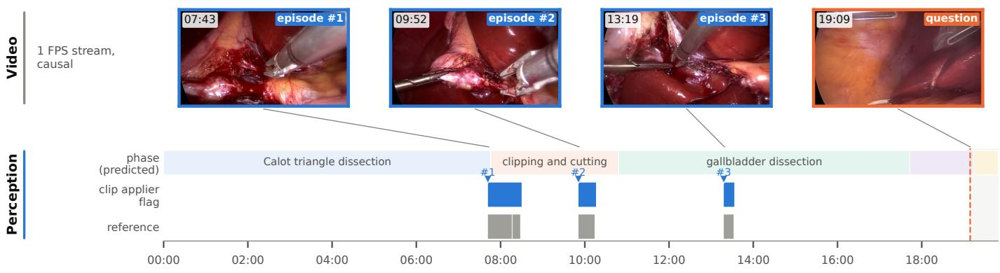

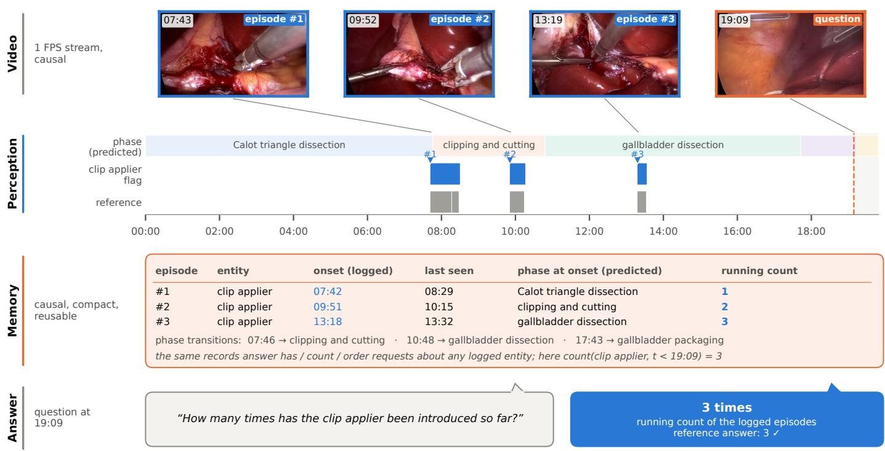  
Figure 3: Event memory on a sealed Cholec80 test procedure (full history). Perception decodes the clip applier (flag, blue; reference, grey) and the phase. The memory logs, causally, one record per episode (onset, last-seen time, predicted phase at onset) and the phase transitions. At 19:09 the question “How many times has the clip applier been introduced so far?” is answered by the running count of the logged episodes (3, as in the reference); the logged onsets coincide with the reference onsets. The same records answer has / count / order requests about any logged entity. Selected for illustration.

(a) Cholec80 final test, 240 windows, 12 procedures  
(b) HeiChole (3 external centres), 180 windows, 33 procedures  
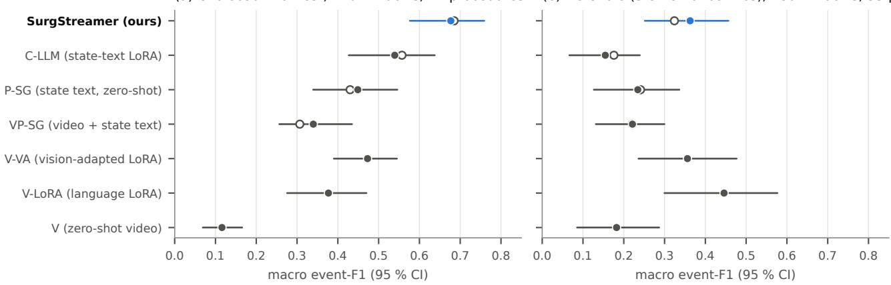  
equal context (window only)  
Figure 4: Comparison with streaming VLMs under equal context (gold conditions). Macro event-F1 with 95 % procedure-bootstrap intervals on identical 75- windows. Filled dots: every method has only the window available. Open dots: the state given to state-reading methods was computed with the full procedure history (pre-registered protocol). (a) Cholec80 final test. (b) HeiChole, three external centres, all models trained on Cholec80 / CholecT50 only.

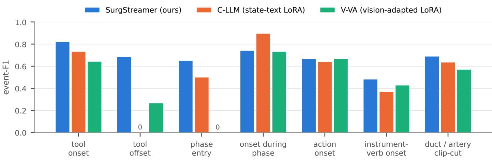  
Figure 5: Event-F1 per family on the Cholec80 final-test windows under equal context. The VLMs detect appearances but miss disappearances and phase entries.

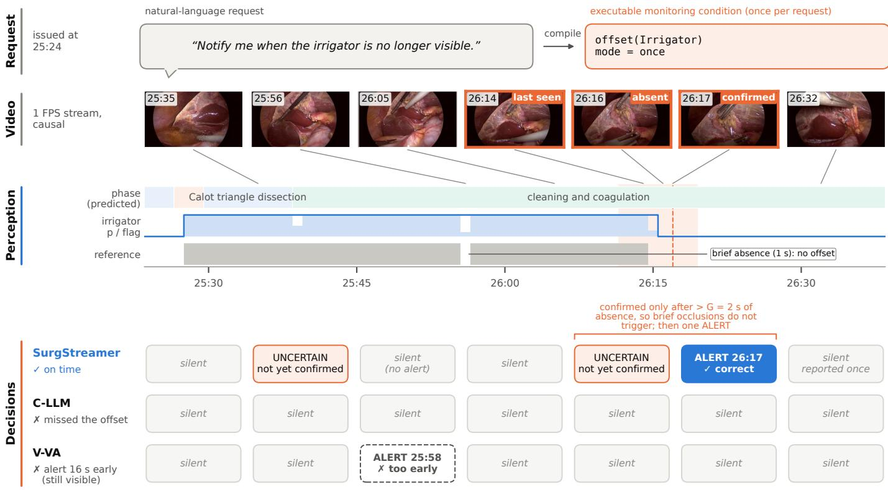  
Figure 6: A disappearance request on a sealed Cholec80 test window (equal context). The event is the last second the irrigator is visible (“last seen”); it is confirmed only after the instrument has been absent for more than G = 2 s, so the 1-s gap in the reference annotation (annotated) is not an ofset. C-learn, which answers thi family, briefly outputs uncertain around a dip of the irrigator probability without alerting, and alerts once at the confirmation of the real disappearance. C-LLM stays silent, as does V-LoRA (not shown); V-VA alerts 16 s early, while the irrigator is still visible. Selected to illustrate the failure mode quantified in Fig. 5; layout as in Fig. 1.

Table 7: Final test: retrospective requests answered from the event memory (balanced accuracy for has / order; exact accuracy, within-one accuracy and mean absolute error for counts).
<table><tr><td></td><td>Tools</td><td>Actions</td></tr><tr><td>Has occurred (bal. acc.)</td><td>0.995</td><td>0.974</td></tr><tr><td>Which first (bal. acc.)</td><td>0.994</td><td>0.915</td></tr><tr><td>Count, exact</td><td>0.601</td><td>0.515</td></tr><tr><td>Count, within one</td><td>0.863</td><td>0.848</td></tr><tr><td>Count, MAE</td><td>0.68</td><td>0.70</td></tr></table>

Table 8: Cost per 1-s update on a single RTX 5070 (12 GB). The frame encoder and temporal heads run once per stream, independent of the number of requests; C-learn processes concurrent requests as one batch. The request compiler runs once when a request is issued and is excluded.
<table><tr><td>Component</td><td>Latency</td></tr><tr><td>DINOv3 frame encoder Temporal heads (4 members) C-learn, 1 / 10 / 100 requests</td><td>8.1 ms 1.4 ms  $0 . 1 5 / 0 . 1 6 / 0 . 1 8$  ms</td></tr><tr><td>Exact DSL evaluator Peak GPU memory</td><td> $0 . 3 8 \mu \mathrm { s } / \mathrm { r e q u e s t - s }$ </td></tr><tr><td>OneStreamer-4B, one request</td><td>0.64 GB 340–740 ms, ≈9 GB</td></tr></table>

## 5.4. A new procedure: controller transfer to PitVis

On the sealed PitVis test (Table 11, Fig. 7b), the Clearn weights trained on cholecystectomy scored 0.947 [0.928, 0.965] on oracle state, and a C-learn trained on PitVis scored 0.938 (diference +0.009 [−0 012, +0.029]). Both remain below the exact rules, which are correct on oracle state by construction (1.000). The result therefore shows that the learned controller is independent of the procedure, not that it is superior.

On predicted state, with perception re-trained on PitVis (tool onset / ofset F1 ≈0.60 in training cross-validation), the two transfer conditions difered. With frozen weights and frozen thresholds, C-learn scored 0.372. This exceeded the exact rules $\left( + 0 . 0 1 8 [ + 0 . 0 0 4 , + 0 . 0 3 1 ] \right)$ ) but stayed below the in-domain controller $\left( - 0 . 0 2 4 \ [ - 0 . 0 4 0 , \ - 0 . 0 0 8 ] \right)$ ), so the pre-registered noninferiority criterion (margin 0.03) was not met. With frozen weights and thresholds re-calibrated on three validation procedures (the pre-registered secondary analysis), C-learn scored 0.397, the point estimate of the in-domain controller. Fig. 8 shows the transferred controller on a PitVis test procedure. It refers to the ring curette and the tumour-excision phase, entities that do not exist in cholecystectomy, through the same pointers, and accumulates evidence exactly as on Cholec80.

An exploratory analysis of adapting perception from a few annotated target videos is reported in Appendix B.

## 5.5. Failure modes

SurgStreamer errs where the decoded state departs from the reference. Fig. 9 shows an example from the sealed test. At the start of a window, perception decodes the scissors as present although the reference marks them absent; when this false detection ends, the decoded state contains a disappearance, and C-learn alerts 42 s before the real one, which, in once mode, is then not reported. The same mechanism underlies the fragmented episodes at the external centres (Section 5.3) and the alerts on persistent presence (Section 5.2).

(a) New centres (HeiChole 25-33)  
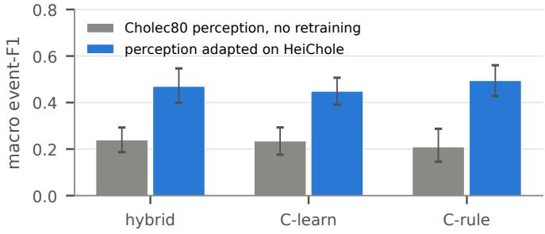

(b) New procedure (PitVis test)  
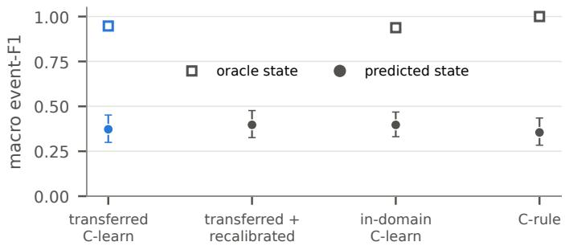  
Figure 7: Transfer with frozen controller weights. (a) New centres (HeiChole 25–33): re-training only the perception doubles performance, with controllers, thresholds and hybrid choices unchanged. (b) New procedure (PitVis sealed test): oracle state (squares) and predicted state (dots); “re-calibrated” keeps the weights frozen and re-calibrates only the alert thresholds. C-rule is exact on oracle state by construction.

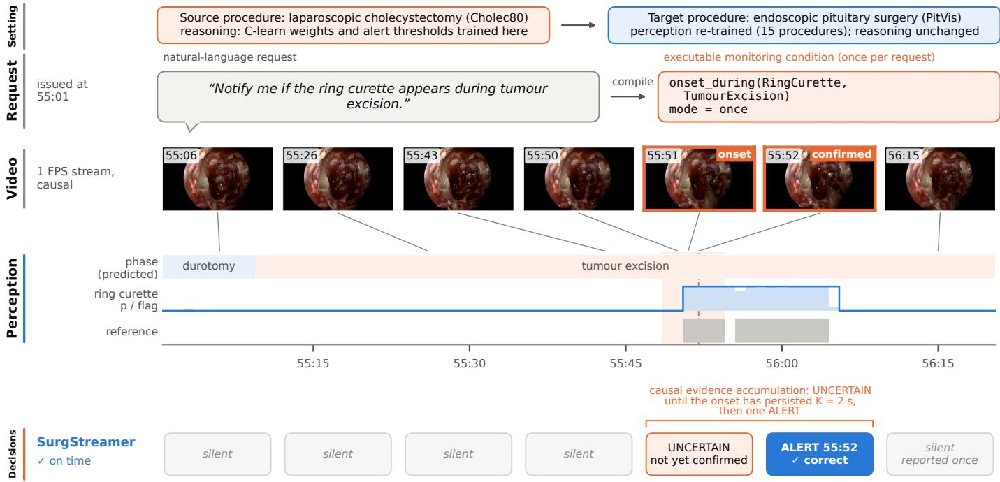  
Figure 8: The reasoning trained on cholecystectomy, applied unchanged to pituitary surgery (PitVis sealed test). Top: the transfer setting. Perception was re-trained on 15 PitVis procedures; the C-learn weights and alert thresholds are those trained on Cholec80. The controller addresses the ring curette and the tumour-excision phase only through entity pointers; it outputs uncertain at the onset and alerts once at confirmation. Selected for illustration; over the whole test set, the transferred controller scored 0.372 on predicted state (Table 11). Layout as in Fig. 1.

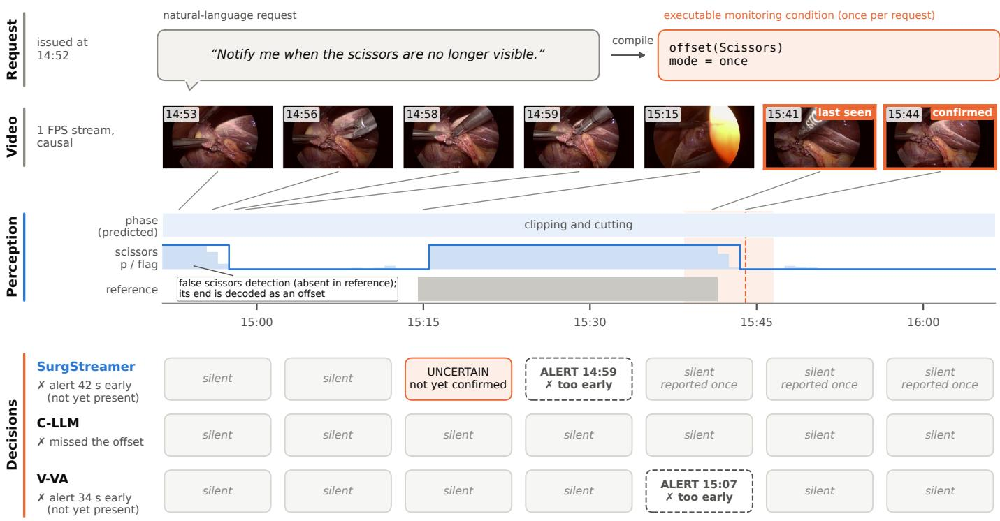  
Figure 9: A failure on a sealed Cholec80 test window (equal context). At the window start, perception decodes the scissors as present although the reference marks them absent. When this false detection ends (14:58), the decoded state contains an ofset, and C-learn alerts at 14:59, 42 s before the reference disappearance; in once mode, the real disappearance is then not reported. C-LLM stays silent; V-VA alerts 34 s early, and V-LoRA (not shown) also too early. The error originates in perception: on the decoded state, an ofset had occurred. Layout as in Fig. 1.

Table 9: Comparison with streaming vision–language models (OneStreamer-4B, 16-update window) on identical 75-s windows, gold conditions. Macro event-F1 with 95 % procedure-bootstrap intervals over the families scored by event-F1 (Cholec80: 7 of 8 window families; absent objects are scored by false-positive rate. HeiChole: 4 primary families). Equal: every method has only the window available (SurgStreamer re-computes its state from the window start);full: the state read by the state-based methods was computed from the whole procedure (the pre-registered protocol). ∆: SurgStreamer (equal) minus the method; p : paired bootstrap, add-one corrected, Holm-adjusted over the six baselines of each dataset. $\mathrm { F P R } _ { \mathrm { p p } } \mathrm { : }$ share of persistent-presence windows with an alert (equal context). HeiChole: three external centres, all models trained on Cholec80 / CholecT50 only.
<table><tr><td colspan="2"></td><td colspan="5">Cholec80 final test (12 procedures)</td><td colspan="3">HeiChole (33 procedures)</td></tr><tr><td>Method</td><td>Input</td><td>Full</td><td>Equal</td><td>∆</td><td>PH</td><td> $\mathrm { F P R } _ { \mathrm { p p } }$ </td><td>Equal</td><td>∆</td><td>PH</td></tr><tr><td>SurgStreamer (ours)</td><td>state</td><td>0.685</td><td>0.677 [0.577, 0.759]</td><td></td><td></td><td>0.16</td><td>0.363 [0.252, 0.457]</td><td></td><td></td></tr><tr><td>C-LLM</td><td>state text</td><td>0.557</td><td>0.540 [0.427, 0.638]</td><td>+0.137</td><td>0.012</td><td>0.02</td><td>0.155 [0.067, 0.239]</td><td>+0.208</td><td>0.036</td></tr><tr><td>P-SG</td><td>state text</td><td>0.430</td><td>0.449 [0.339, 0.546]</td><td>+0.228</td><td>0.012</td><td>0.69</td><td>0.234 [0.127, 0.336]</td><td>+0.128</td><td>0.104</td></tr><tr><td>VP-SG</td><td>video + state</td><td>0.307</td><td>0.340 [0.256, 0.435]</td><td>+0.337</td><td>0.012</td><td>0.84</td><td>0.221 [0.131, 0.300]</td><td>+0.141</td><td>0.070</td></tr><tr><td>V-VA</td><td>video</td><td></td><td>0.473 [0.390, 0.545]</td><td>+0.204</td><td>0.012</td><td>0.07</td><td>0.356 [0.236, 0.477]</td><td>+0.007</td><td>0.969</td></tr><tr><td>V-LoRA</td><td>video</td><td></td><td>0.377 [0.276, 0.470]</td><td>+0.300</td><td>0.012</td><td>0.16</td><td>0.446 [0.300, 0.577]</td><td>-0.083</td><td>0.723</td></tr><tr><td>V (zero-shot)</td><td>video</td><td></td><td>0.116 [0.069, 0.165]</td><td>+0.561</td><td>0.012</td><td>0.89</td><td>0.182 [0.085, 0.287]</td><td>+0.180</td><td>0.104</td></tr></table>

Table 10: External centres (HeiChole), full-procedure protocol, 8 tool / phase families. Without retraining: the whole Cholec80-trained system. Adapted: perception re-trained with the same recipe on HeiChole procedures 1–21 (validation 22–24), with controller weights, thresholds and hybrid choices unchanged. Adapted − without retraining (hybrid, procedures 25–33): +0.231 [+0.190, +0.277], p ≤0.002 (paired bootstrap, add-one corrected).
<table><tr><td>Controller</td><td>No retraining (1-33)</td><td>No retraining (25–33)</td><td>Adapted perception (25–33)</td></tr><tr><td>Hybrid</td><td>0.231</td><td>0.239</td><td>0.470 [0.400, 0.547]</td></tr><tr><td>C-learn (1024-s)</td><td>0.226</td><td>0.235</td><td>0.449 [0.391, 0.507]</td></tr><tr><td>C-rule (1024-s)</td><td>0.213</td><td>0.210</td><td>0.495 [0.428, 0.560]</td></tr></table>

Table 11: New procedure (PitVis, sealed test, 7 procedures, evaluated once); rows are C-learn unless named. Transferred: controller weights trained on cholecystectomy and reused unchanged, with the cholecystectomy thresholds unless re-calibrated on 3 PitVis validation procedures; on oracle and on predicted state (perception re-trained on 15 PitVis procedures). Transferred − indomain C-learn on predicted state: -0.024 [-0.040, -0.008]; on oracle state: +0.009 [-0.012, +0.029].
<table><tr><td>Controller</td><td>Oracle state</td><td>Predicted state</td></tr><tr><td>Transferred</td><td>0.947 [0.928, 0.965]</td><td>0.372 [0.299, 0.452]</td></tr><tr><td>Transferred, re-calibrated</td><td></td><td>0.397 [0.326, 0.477]</td></tr><tr><td>In-domain (PitVis)</td><td>0.938 [0.928, 0.946]</td><td>0.397 [0.331, 0.468]</td></tr><tr><td>Transferred hybrid</td><td></td><td>0.376 [0.309, 0.451]</td></tr><tr><td>C-rule (exact)</td><td>1.000</td><td>0.355 [0.284, 0.435]</td></tr></table>

## 5.6. Supporting analyses

On cross-validation, C-learn outperformed the exact rules (0.566 vs 0.546; Table 12). The gains were on temporal and relational operators: onset during a phase 0.69 vs 0.54, n-th occurrence 0.51 vs 0.41. A rule evaluator that read calibrated posteriors of an explicit-duration (semi-Markov) episode model instead of decoded flags (P-rule) was clearly worse (0.419). The controller’s gain is therefore not explained by access to confidences alone. Perception development, the annotationagreement reference and the compiler analysis are reported in Appendix A. In brief: fine-tuning the encoder was the largest single perception gain, and the compiler, revised on the development request set, reproduced 91.5 % of those requests exactly. Compiled instead of gold conditions lowered macro event-F1 by 0.016 on development data; the compiled system was not evaluated on the final test.

## 6. Discussion

Why does state grounding help? The requests that matter are about events: appearances, disappearances, phase transitions and their composition. SurgStreamer gives them exact semantics over a state stream. Given oracle state, the exact rules answer every benchmark request correctly by construction, and the learned controller nearly so (0.947 on PitVis oracle state). On predicted state, the results therefore suggest that perception and event timing are the main limitation (Sections 5.3–5.5). The tested VLM configurations detected appearances far better than disappearances or phase entries. Giving them SurgStreamer’s state as text helped substantially, yet a 4B-parameter model reading that state remained below a 64-unit controller reading it through pointers. We hypothesise that the diference lies in the representation of time: the controller receives explicit run lengths and times since events, whereas the VLM must infer them from a 16-update dialogue. Our experiments do not isolate this mechanism. The equal-context study shows that SurgStreamer’s advantage on Cholec80 does not depend on access to the procedure history. A further property of the design, which we did not evaluate with users, is that every decision can be traced to the decoded state and the condition that produced it (Figs. 1, 6 and 9), so that an error can be attributed to perception or to the reasoning by inspection; an end-to-end VLM does not expose such an intermediate state.

What transfers? We distinguish three levels of reuse: the rule semantics, the controller weights and the controller’s alert thresholds. The rule semantics transfer by construction. On oracle state, the controller weights trained on cholecystectomy transferred unchanged to a procedure with a diferent anatomy, camera and vocabulary, and performed like a controller trained there. On predicted state, unchanged weights and thresholds did not meet the pre-registered non-inferiority margin, whereas recalibrating only the thresholds on three validation procedures reached the in-domain point estimate. Perception did not transfer across centres at the 2-s event level, but re-training only perception doubled performance without changing the reasoning.

Table 12: Controllers on the full-procedure benchmark: macro event-F1 over the 13 proactive families (mean ± s.d. over 3 controller seeds where applicable). CV: out-of-fold over the training procedures (C-learn: controller-level 5-fold CV; hybrid: nested selection); dev test: 21 development procedures (no selection); final: the 12 sealed procedures, opened once; final, held-out comp.: final-test requests whose entity composition (tool pair or instrument–verb pair) never occurs in training (co-occurrence, onset-after and instrument–verb families). The hybrid choices used on dev / final test were fixed on CV.
<table><tr><td>Controller</td><td>CV</td><td>Dev test</td><td>Final test</td><td>Final, held-out comp.</td></tr><tr><td>C-rule, 256-s state</td><td>0.546</td><td>0.526</td><td>0.562</td><td>0.401</td></tr><tr><td>C-rule, 1024-s state</td><td>0.545</td><td>0.529</td><td>0.570</td><td>0.477</td></tr><tr><td>P-rule (rules on semi-Markov episode posteriors), 256-s state</td><td>0.419</td><td></td><td></td><td></td></tr><tr><td>C-learn, 256-s state</td><td> $0 . 5 6 6 \pm 0 . 0 0 8$ </td><td> $0 . 5 5 6 \pm 0 . 0 1 2$ </td><td> $0 . 5 9 1 \pm 0 . 0 0 9$ </td><td> $0 . 4 2 4 \pm 0 . 0 2 9$ </td></tr><tr><td>C-learn, 1024-s state</td><td> $0 . 5 6 7 \pm 0 . 0 0 3$ </td><td> $0 . 5 6 3 \pm 0 . 0 0 5$ </td><td> $0 . 6 0 7 \pm 0 . 0 0 5$ </td><td> $0 . 4 6 4 \pm 0 . 0 4 1$ </td></tr><tr><td>Hybrid (per-family state × controller)</td><td> $0 . 5 7 9 \pm 0 . 0 0 3$ </td><td> $0 . 5 6 3 \pm 0 . 0 0 4$ </td><td> $0 . 5 9 8 \pm 0 . 0 0 7$ </td><td> $0 . 4 3 6 \pm 0 . 0 0 5$ </td></tr></table>

The adaptation boundary of the design therefore held for the rule semantics and the controller weights, while the thresholds belong to the procedure-specific side.

What limits performance on real input? On external data, the diagnostics implicate instrument appearance, episode fragmentation and annotation conventions. The failure cases (Section 5.5) show how such errors reach the decision: a condition evaluated correctly on a wrong decoded state still produces a wrong alert. On HeiChole, SurgStreamer scored nominally higher with equal context than with full history (0.363 vs 0.324, n.s.); one possible explanation, which we did not test, is that errors of the frozen perception accumulate over long streams. The raw-video V-LoRA, built on a general-purpose visual encoder, was nominally better on HeiChole, which suggests that surgical fine-tuning may trade robustness for in-domain accuracy.

Limitations. The reasoning was trained on one procedure, and transfer was tested on one new procedure and one external dataset with small test sets (7 and 9 procedures). Event timing is bounded by annotation conventions, and rare actions and unseen entity compositions remain hard; which part of the controller (recurrence or slot features) produces its gain was not isolated. The VLM conclusions hold for the tested OneStreamer-4B configurations, each run once with sampling. Requests were generated from templates over a closed vocabulary, the main results use gold conditions, and in-vocabulary objects that are simply not visible were not tested. No surgeon wrote requests or rated alerts, and no prospective evaluation was performed, so clinical utility remains to be shown.

Future work. Natural next steps are free-text requests written by surgeons, a failure attribution across compiler, perception, decoding and control, and a sensitivity analysis of the episode parameters G and K. Wider baselines are also needed, including other streaming models, a state-of-the-art recognition model combined with C-rule, and a retrospective baseline for the event memory. Because SurgStreamer shares its response space, it can be evaluated directly on the proactive items of MedStream-Bench (Wang et al., 2026) drawn from the procedures studied here, which we have not done. Multi-procedure surgical pretraining and label-free adaptation of perception are promising ways to reduce the annotation needed per centre.

## 7. Conclusion

SurgStreamer answers natural-language monitoring requests over surgical video streams by evaluating compiled conditions over a structured state, with learned or exact reasoning and an event memory. On a pre-registered sealed test with gold conditions, it outperformed the tested OneStreamer-4B configurations under equal context, including fine-tuned and visionadapted ones, at a fraction of their cost. Its controller weights transferred unchanged to a new procedure on oracle state; on predicted state, they matched an in-domain controller only after re-calibrating the alert thresholds. Its perception had to be retrained for new centres and procedures. These results support state-grounded, modular designs for proactive surgical monitoring and point to perception under distribution shift as the main remaining obstacle.

## CRediT authorship contribution statement

Bowen Xiang: Conceptualization, Methodology, Software, Validation, Formal analysis, Investigation, Data curation, Writing – original draft, Writing – review & editing, Visualization. Jon S. Heiselman: Writing – review & editing, Visualization. Michael I. Miga: Writing – review & editing, Visualization.

## Ethics statement

This study used only publicly available, de-identified surgi cal video datasets (Cholec80, CholecT50, HeiChole and PitVis) under their respective licences. No new data were collected. The graphical abstract and Figs. 1, 2, 3, 6, 8 and 9 reproduce de-identified endoscopic frames from Cholec80 and PitVis with attribution.

## Funding

This research did not receive any specific grant from funding agencies in the public, commercial, or not-for-profit sectors.

## Declaration of competing interest

The authors declare that they have no known competing financial interests or personal relationships that could have appeared to influence the work reported in this paper.

Declaration of generative AI and AI-assisted technologies in the writing process

During the preparation of this work the authors used Claude (Anthropic) to assist with writing analysis code, generating figures and drafting text. After using this tool, the authors reviewed and edited the content as needed and take full responsibility for the content of the published article.

## Acknowledgements

We thank the providers of the Cholec80, CholecT50, HeiChole and PitVis datasets.

## Data and code availability

All datasets are publicly available from their providers: Cholec80, CholecT50, HeiChole (TU Dresden OPARA, DOI 10.25532/OPARA-284) and PitVis (UCL Research Data Repository). Code, benchmark definitions, splits and the timestamped protocol documents will be made publicly available upon publication.

## References

Bai, S., Cai, Y., Chen, R., Chen, K., Chen, X., Cheng, Z., Deng, L., Ding, W., Gao, C., Ge, C., et al., 2025. Qwen3-VL technical report. arXiv preprint arXiv:2511.21631 doi:10.48550/ arXiv.2511.21631.

Chen, J., Lv, Z., Wu, S., Lin, K.Q., Song, C., Gao, D., Liu, J.W., Gao, Z., Mao, D., Shou, M.Z., 2024. VideoLLM-online: Online video large language model for streaming video, in: Proceedings of the IEEE/CVF Conference on Computer Vision and Pattern Recognition (CVPR), pp. 18407–18418.

Cho, K., van Merriënboer, B., Gulcehre, C., Bahdanau, D., Bougares, F., Schwenk, H., Bengio, Y., 2014. Learning phrase representations using RNN encoder–decoder for statistical machine translation, in: Conference on Empirical Methods in Natural Language Processing (EMNLP), pp. 1724–1734.

Czempiel, T., Paschali, M., Keicher, M., Simson, W., Feussner, H., Kim, S.T., Navab, N., 2020. TeCNO: Surgical phase recognition with multi-stage temporal convolutional networks, in: Medical Image Computing and Computer Assisted Intervention – MICCAI 2020, pp. 343–352.

Das, A., Khan, D.Z., Psychogyios, D., Zhang, Y., Hanrahan, J.G., Vasconcelos, F., Pang, Y., Chen, Z., Wu, J., Zou, X., et al., 2025. PitVis-2023 challenge: Workflow recognition in videos of endoscopic pituitary surgery. Medical Image Analysis 106, 103716. doi:10.1016/j.media.2025.103716.

De Geest, R., Gavves, E., Ghodrati, A., Li, Z., Snoek, C., Tuytelaars, T., 2016. Online action detection, in: European Conference on Computer Vision (ECCV), pp. 269–284.

Efron, B., Tibshirani, R.J., 1993. An Introduction to the Bootstrap. Chapman & Hall.

Gao, X., Jin, Y., Long, Y., Dou, Q., Heng, P.A., 2021. Trans-SVNet: Accurate phase recognition from surgical videos via hybrid embedding aggregation transformer, in: Medical Image Computing and Computer Assisted Intervention – MICCAI 2021, Springer International Publishing, Cham. pp. 593–603. doi:10.1007/978-3-030-87202-1\_57.

Garrow, C.R., Kowalewski, K.F., Li, L., Wagner, M., Schmidt, M.W., Engelhardt, S., Hashimoto, D.A., Kenngott, H.G., Bodenstedt, S., Speidel, S., Müller-Stich, B.P., Nickel, F., 2021. Machine learning for surgical phase recognition: A systematic review. Annals of Surgery 273, 684–693. doi:10.1097/ SLA.0000000000004425.

Giancola, S., Amine, M., Dghaily, T., Ghanem, B., 2018. SoccerNet: A scalable dataset for action spotting in soccer videos, in: IEEE/CVF Conference on Computer Vision and Pattern Recognition Workshops (CVPRW).

Gupta, T., Kembhavi, A., 2023. Visual programming: Compositional visual reasoning without training, in: IEEE/CVF Conference on Computer Vision and Pattern Recognition (CVPR), pp. 14953–14962.

He, J., Zhou, Y., Bai, L., Yuan, K., Navab, N., Bi, Y., 2026. SurgOnAir: Hierarchy-aware real-time surgical video commentary. arXiv preprint arXiv:2605.21132 .

Hu, E.J., Shen, Y., Wallis, P., Allen-Zhu, Z., Li, Y., Wang, S., Wang, L., Chen, W., 2022. LoRA: Low-rank adaptation of large language models, in: International Conference on Learning Representations.

Jin, Y., Dou, Q., Chen, H., Yu, L., Qin, J., Fu, C.W., Heng, P.A., 2018. SV-RCNet: Workflow recognition from surgical videos using recurrent convolutional network. IEEE Transactions on Medical Imaging 37, 1114–1126.

Liu, Y., Huo, J., Peng, J., Sparks, R., Dasgupta, P., Granados, A., Ourselin, S., 2023. SKiT: a fast key information video transformer for online surgical phase recognition, in: Proceedings of the IEEE/CVF International Conference on Computer Vision (ICCV), pp. 21074–21084.

Loshchilov, I., Hutter, F., 2019. Decoupled weight decay regularization, in: International Conference on Learning Representations.

Maier-Hein, L., Vedula, S.S., Speidel, S., Navab, N., Kikinis, R., Park, A., et al., 2017. Surgical data science for nextgeneration interventions. Nature Biomedical Engineering 1, 691–696.

Maler, O., Nickovic, D., 2004. Monitoring temporal properties of continuous signals, in: Formal Techniques, Modelling and Analysis of Timed and Fault-Tolerant Systems, pp. 152–166.

Mascagni, P., Vardazaryan, A., Alapatt, D., Urade, T., Emre, T., Fiorillo, C., Pessaux, P., Mutter, D., Marescaux, J., Costamagna, G., Dallemagne, B., Padoy, N., 2022. Artificial intelligence for surgical safety: Automatic assessment of the critical view of safety in laparoscopic cholecystectomy using deep learning. Annals of Surgery 275, 955–961. doi:10.1097/SLA.0000000000004351.

Nwoye, C.I., Padoy, N., 2022. Data splits and metrics for method benchmarking on surgical action triplet datasets. ArXiv:2204.05235.

Nwoye, C.I., Yu, T., Gonzalez, C., Seeliger, B., Mascagni, P., Mutter, D., Marescaux, J., Padoy, N., 2022. Rendezvous: Attention mechanisms for the recognition of surgical action triplets in endoscopic videos. Medical Image Analysis 78, 102433.

Oquab, M., Darcet, T., Moutakanni, T., et al., 2024. DINOv2: Learning robust visual features without supervision. Transactions on Machine Learning Research .

Platt, J., 1999. Probabilistic outputs for support vector machines and comparisons to regularized likelihood methods, in: Advances in Large Margin Classifiers. MIT Press, pp. 61–74.

Qian, R., Ding, S., Dong, X., Zhang, P., Zang, Y., Cao, Y., Lin, D., Wang, J., 2025. Dispider: Enabling video LLMs with active real-time interaction via disentangled perception, decision, and reaction, in: Proceedings of the IEEE/CVF Conference on Computer Vision and Pattern Recognition (CVPR), pp. 24045–24055.

Rabiner, L.R., 1989. A tutorial on hidden Markov models and selected applications in speech recognition. Proceedings of the IEEE 77, 257–286.

Seenivasan, L., Islam, M., Kannan, G., Ren, H., 2023. SurgicalGPT: End-to-end language-vision GPT for visual question answering in surgery, in: Medical Image Computing and Computer Assisted Intervention – MICCAI 2023.

Seenivasan, L., Islam, M., Krishna, A.K., Ren, H., 2022. Surgical-VQA: Visual question answering in surgical scenes using transformer, in: Medical Image Computing and Computer Assisted Intervention – MICCAI 2022.

Siméoni, O., Vo, H.V., Seitzer, M., Baldassarre, F., Oquab, M., Jose, C., Khalidov, V., Szafraniec, M., Yi, S., Ramamonjisoa, M., et al., 2025. DINOv3. arXiv preprint arXiv:2508.10104 doi:10.48550/arXiv.2508.10104.

Strasberg, S.M., Brunt, L.M., 2010. Rationale and use of the critical view of safety in laparoscopic cholecystectomy. Journal of the American College of Surgeons 211, 132–138.

Surís, D., Menon, S., Vondrick, C., 2023. ViperGPT: Visual inference via python execution for reasoning, in: IEEE/CVF International Conference on Computer Vision (ICCV), pp. 11888–11898.

Twinanda, A.P., Shehata, S., Mutter, D., Marescaux, J., de Mathelin, M., Padoy, N., 2017. EndoNet: A deep architecture for recognition tasks on laparoscopic videos. IEEE Transactions on Medical Imaging 36, 86–97.

Wagner, M., Müller-Stich, B.P., Kisilenko, A., Tran, D., Heger, P., Mündermann, L., Lubotsky, D.M., Müller, B., Davitashvili, T., Capek, M., et al., 2023. Comparative validation of machine learning algorithms for surgical workflow and skill analysis with the HeiChole benchmark. Medical Image Analysis 86, 102770. doi:10.1016/j.media.2023. 102770.

Wang, Y., Gao, S., Jiang, S., Hu, Z., Liu, Z., 2026. Med-StreamBench: A time-aware benchmark for streaming and proactive medical video understanding. arXiv preprint arXiv:2607.01751 .

Wang, Y., Meng, X., Wang, Y., Liang, J., Wei, J., Zhang, H., Zhao, D., 2025. VideoLLM knows when to speak: Enhancing time-sensitive video comprehension with video-text duet interaction format, in: Findings of the Association for Computational Linguistics: EMNLP 2025, Association for Computational Linguistics, Suzhou, China. pp. 6338–6359. doi:10.18653/v1/2025.findings-emnlp.336.

Wang, Z., Liu, C., Zhang, S., Dou, Q., 2023. Foundation model for endoscopy video analysis via large-scale selfsupervised pre-train, in: Medical Image Computing and Computer Assisted Intervention – MICCAI 2023, Springer Nature Switzerland, Cham. pp. 101–111. doi:10.1007/ 978-3-031-43996-4\_10.

Yang, S., Luo, L., Wang, Q., Chen, H., 2024. Surgformer: Surgical transformer with hierarchical temporal attention for surgical phase recognition, in: Medical Image Computing and Computer Assisted Intervention – MICCAI 2024, Springer Nature Switzerland, Cham. pp. 606–616. doi:10.1007/ 978-3-031-72089-5\_57.

Yuan, K., Srivastav, V., Yu, T., Lavanchy, J.L., Marescaux, J., Mascagni, P., Navab, N., Padoy, N., 2025. Learning multi-modal representations by watching hundreds of surgical video lectures. Medical Image Analysis 105, 103644. doi:10.1016/j.media.2025.103644.

Zeng, X., Yang, Y., Zhang, Z., Zhu, Y., Li, X., Si, Q., Yao, D., Ma, C., Chen, H., Chen, X., et al., 2026. OneStreamer: Unifying perception, memory, and proactive response in streaming video interaction. arXiv preprint arXiv:2610.01762 doi:10.48550/arXiv.2610.01762. model: https:// huggingface.co/MCG-NJU/OneStreamer-4B.

Zhang, H., Wang, Y., Tang, Y., Liu, Y., Feng, J., Jin, X., 2025. Flash-VStream: Eficient real-time understanding for long video streams, in: Proceedings of the IEEE/CVF International Conference on Computer Vision (ICCV), pp. 21059– 21069.

## Appendix A. Additional results

Perception development. Fine-tuning the encoder was the largest single gain (Table A.1): the perception score rose from 0.39 to 0.47 and tool-onset F1 from 0.54 to 0.70. Long training context improved phase transitions, and the four-head ensemble reached 0.54. The ordered phase HMM raised online phase-transition F1 from 0.29 (argmax with dwell filter) to 0.40. Rejected during development: boundary-aware losses, factorised triplet heads, a spatial grid of patch tokens, a tool-aware phase cascade, an elapsed time input and an explicit-duration episode model

Table A.1: Perception ablations on cross-validation over the 43 training procedures (out-of-fold predictions; decoders tuned by inner cross-validation). $S _ { \mathrm { p e r c } }$ is the mean of the five timing scores: episode-onset / ofset F1 for actions and tools (±2 s; macro over classes) and phase-transition F1 (±10 s). Mean ± s.d. over seed where several were trained.
<table><tr><td>Variant</td><td>seeds</td><td> $S _ { \mathrm { p e r c } }$ </td><td>Action on / off</td><td></td><td>Tool on / off</td><td>Phase</td></tr><tr><td>Frozen DINOv3 + temporal heads (A0)</td><td>1</td><td>0.388</td><td>0.231 0.269</td><td>0.538</td><td>0.530</td><td>0.371</td></tr><tr><td>Fine-tuned DINOv3 + presence heads (A0)</td><td>1</td><td>0.468</td><td>0.296</td><td>0.261 0.698</td><td>0.656</td><td>0.430</td></tr><tr><td>+ event heads (A1)</td><td>2</td><td>0.488 ± 0.005</td><td>0.323</td><td>0.273 0.716</td><td>0.671</td><td>0.458</td></tr><tr><td>+ event heads + boundary-aware loss (A2)</td><td>1</td><td>0.481</td><td>0.300</td><td>0.270 0.712</td><td>0.686</td><td>0.436</td></tr><tr><td>+ event heads + factorised I→V→T heads (A3)</td><td>1</td><td>0.470</td><td>0.287</td><td>0.263 0.721</td><td>0.682</td><td>0.394</td></tr><tr><td>A1 + elapsed-time input</td><td>1</td><td>0.485</td><td>0.307</td><td>0.285 0.725</td><td>0.666</td><td>0.442</td></tr><tr><td>A1, 1024-s context (A1L)</td><td>3</td><td>0.498 ± 0.012</td><td>0.298</td><td>0.274 0.733</td><td>0.695</td><td>0.489</td></tr><tr><td>A1, 2048-s context</td><td>1</td><td>0.499</td><td>0.301</td><td>0.267 0.734</td><td>0.687</td><td>0.507</td></tr><tr><td>A1L + spatial patch grid</td><td>1</td><td>0.481</td><td>0.285</td><td>0.280 0.714</td><td>0.700</td><td>0.424</td></tr><tr><td>A1L + tool-aware phase cascade</td><td>3</td><td>0.493 ± 0.008</td><td>0.299</td><td>0.267 0.722</td><td>0.696</td><td>0.480</td></tr><tr><td>Presence heads, 1024-s context (A0L)</td><td>1</td><td>0.506</td><td>0.322</td><td>0.314 0.709</td><td>0.658</td><td>0.527</td></tr><tr><td>Ensemble, 256-s context (A0, A1 ×2)</td><td>1</td><td>0.511</td><td>0.346</td><td>0.289 0.744</td><td>0.714</td><td>0.463</td></tr><tr><td>Ensemble, 1024-s context (A1L ×3, A0L)</td><td>1</td><td>0.537</td><td>0.341</td><td>0.310 0.756</td><td>0.734</td><td>0.542</td></tr></table>

Annotation agreement. Cholec80 and CholecT50 annotate instrument presence independently on 45 shared procedures. Their agreement, expressed as episode-onset F1 at ±2 s, is 0.55–0.89 depending on the instrument (Table A.2). We use it as a crossannotation agreement reference: it indicates how much of the event-timing error at a 2-s tolerance can be attributed to annotation conventions rather than to the model.

Table A.2: Agreement between the two independent instrument-presence annotations (Cholec80 vs CholecT50) on 45 shared procedures, as episode-onset / ofset F1. A cross-annotation agreement reference for event timing, not an upper bound.
<table><tr><td>Instrument</td><td>Onset F1 (±2 s)</td><td>Onset F1 (±5 s)</td><td>Offset F1 (±2 s)</td></tr><tr><td>Grasper</td><td>0.55</td><td>0.61</td><td>0.53</td></tr><tr><td>Bipolar</td><td>0.81</td><td>0.83</td><td>0.77</td></tr><tr><td>Hook</td><td>0.80</td><td>0.83</td><td>0.79</td></tr><tr><td>Scissors</td><td>0.89</td><td>0.91</td><td>0.89</td></tr><tr><td>Clipper</td><td>0.85</td><td>0.88</td><td>0.76</td></tr><tr><td>Irrigator</td><td>0.82</td><td>0.83</td><td>0.79</td></tr></table>

Compiler. The compiler reproduced 91.5 % of the unique requests of the development request set exactly and mapped none of the ten out-of-vocabulary requests to a real instrument; a plain prompt with schema validation mapped eight of them (Table A.3). The compiler was revised after inspecting its errors on this request set, so these numbers are development estimates, not held-ou performance.

Table A.3: Request compiler on the 529 unique requests of the development request set (the compiler was revised after inspecting its errors on this set, so these are development estimates): exact match of the compiled condition, split by seen / held-out templates; unsafe = an out-of-vocabulary object compiled to a real instrument; rejections = in-vocabulary requests compiled to an unsupported entity (the monitor stays silent).
<table><tr><td>Compiler</td><td>Exact</td><td>Seen tpl.</td><td>Held-out tpl.</td><td>Unsafe</td><td>Rejections</td></tr><tr><td>Prompt + schema validation</td><td>0.858</td><td>0.846</td><td>0.873</td><td>8/10</td><td>11</td></tr><tr><td>+ named vocabulary, rules, normalisation, lexical grounding</td><td>0.915</td><td>0.944</td><td>0.881</td><td>0/ 10</td><td>14</td></tr></table>

Tolerance. Table A.4 repeats the equal-context window comparison at matching tolerances from 2 to 20 s. SurgStreamer scores highest at every tolerance; the order among the baselines changes.

Table A.4: Sensitivity of the window comparison (Cholec80 final test) to the matching tolerance δ (same tolerance for all families), equal context. SurgStreamer scores highest at every tolerance; the order among the baselines changes.
<table><tr><td>Method</td><td> $\delta = 2$ </td><td> $\delta = 5$ </td><td> $\delta = 1 0$ </td><td> $\delta = 2 0$ </td></tr><tr><td>SurgStreamer (equal context)</td><td>0.623</td><td>0.662</td><td>0.735</td><td>0.821</td></tr><tr><td>C-LLM (equal context)</td><td>0.480</td><td>0.538</td><td>0.580</td><td>0.634</td></tr><tr><td>V-VA</td><td>0.473</td><td>0.514</td><td>0.575</td><td>0.645</td></tr><tr><td>P-SG (equal context)</td><td>0.388</td><td>0.495</td><td>0.555</td><td>0.620</td></tr><tr><td>V-LoRA</td><td>0.377</td><td>0.407</td><td>0.446</td><td>0.508</td></tr><tr><td>VP-SG (equal context)</td><td>0.284</td><td>0.346</td><td>0.409</td><td>0.535</td></tr><tr><td>V (zero-shot)</td><td>0.085</td><td>0.123</td><td>0.176</td><td>0.278</td></tr></table>

## Appendix B. Few-shot adaptation (exploratory)

Design. The study asks how many annotated target videos are needed to adapt perception when the reasoning is kept fixed. For $k \in \{ 1 , 3 , 5 , 1 0 \}$ , five random draws of k annotated target procedures train a light temporal head on a frozen backbone; the C-learn weights trained on Cholec80 are reused unchanged. All component choices were made on development pools disjoint from the tes procedures and fixed in the protocol of 2026-10-09 (Table 4). The PitVis and HeiChole test procedures had been inspected in the earlier transfer studies, so the test curves are exploratory.

Results. Performance increased with the number of annotated videos on both targets (Fig. B.1, Table B.1), and the development curves show the same pattern. On HeiChole, a single annotated video was worse than no adaptation (0.149 vs 0.235), and three videos were on par with it. With ten videos, both targets stayed below full adaptation, which re-trains perception, including backbone fine-tuning, on all training procedures (PitVis 0.304 vs 0.372; HeiChole 0.327 vs 0.449). Full adaptation also uses more videos (15 and 21), so the comparison mixes the number of videos with the adaptation method.

(b) New centres: HeiChole  
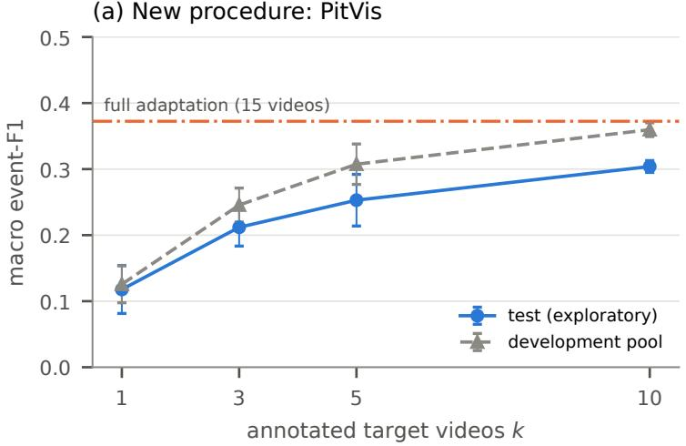

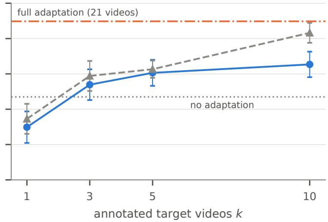  
Figure B.1: Few-shot adaptation with frozen controller weights (exploratory): macro event-F1 versus the number of annotated target videos used to train a ligh temporal head on the frozen Cholec80-tuned backbone (mean ± s.d. over 5 draws). Solid: test procedures; dashed: development pool. Dash-dotted: full adaptation; dotted: no adaptation.

Table B.1: Few-shot adaptation (exploratory): macro event-F1 (mean ± s.d. over 5 draws of k annotated target procedures; light temporal head on the frozen Cholec80-tuned backbone; C-learn weights trained on Cholec80, unchanged). k = 0: unadapted Cholec80 perception (HeiChole only). Full: perception re-trained on all training procedures with backbone fine-tuning (same test procedures). Test sets had been inspected before; their results are exploratory.
<table><tr><td>Target, evaluation</td><td> $k = 0$ </td><td>k = 1</td><td>k = 3</td><td>k = 5</td><td>k = 10</td><td>Full</td></tr><tr><td>PitVis, test (exploratory)</td><td>一</td><td> $0 . 1 1 8 \pm 0 . 0 3 6$ </td><td> $0 . 2 1 2 \pm 0 . 0 2 8$ </td><td> $0 . 2 5 3 \pm 0 . 0 3 9$ </td><td> $0 . 3 0 4 \pm 0 . 0 0 9$ </td><td>0.372</td></tr><tr><td>PitVis, development pool</td><td></td><td> $0 . 1 2 6 \pm 0 . 0 2 8$ </td><td> $0 . 2 4 6 \pm 0 . 0 2 6$ </td><td> $0 . 3 0 7 \pm 0 . 0 3 1$ </td><td> $0 . 3 6 0 \pm 0 . 0 1 0$ </td><td></td></tr><tr><td>HeiChole, test (exploratory)</td><td>0.235</td><td> $0 . 1 4 9 \pm 0 . 0 4 5$ </td><td> $0 . 2 6 9 \pm 0 . 0 4 3$ </td><td> $0 . 3 0 3 \pm 0 . 0 3 7$ </td><td> $0 . 3 2 7 \pm 0 . 0 3 6$ </td><td>0.449</td></tr><tr><td>HeiChole, development pool</td><td>0.218</td><td> $0 . 1 7 3 \pm 0 . 0 4 3$ </td><td> $0 . 2 9 4 \pm 0 . 0 4 2$ </td><td> $0 . 3 1 3 \pm 0 . 0 2 4$ </td><td> $0 . 4 1 6 \pm 0 . 0 2 8$ </td><td>一</td></tr></table>

Component decisions. The pre-registered decisions favoured simplicity. The backbone fine-tuned on cholecystectomy transferred better than generic DINOv3, also to pituitary surgery (0.29 vs 0.19 at k = 5 on the development pools), and the frozen learned controller exceeded the exact rules at every k on both targets. Neither candidate add-on met its adoption rule. Calibrating the adapter lowered false alerts by 35–40 % but did not raise macro event-F1, and a controller trained on simulated perception errors lost 0.035 on Cholec80 and did not improve transfer.

## Appendix C. Splits

Cholec80 / CholecT50 procedure identifiers (CholecT50-only procedures are 92, 96, 103, 110 and 111). Train (43): 1, 2, 3, 4, 5, 9, 11, 13, 15, 17, 19, 20, 21, 24, 25, 26, 27, 28, 30, 31, 33, 34, 36, 38, 43, 48, 49, 52, 56, 57, 60, 62, 67, 68, 70, 71, 72, 75, 79, 92, 96, 103, 110. Validation (9): 8, 12, 29, 41, 44, 45, 46, 50, 78. Development test (21): 6, 10, 14, 32, 42, 51, 53, 54, 55, 58, 59, 61, 63, 64, 69, 73, 74, 76, 77, 80, 111. Final test (12): 7, 16, 18, 22, 23, 35, 37, 39, 40, 47, 65, 66. PitVis: train 2, 3, 5, 7, 8, 9, 10, 12, 15, 16, 17, 18, 22, 24, 25; validation 1, 6, 23; test 4, 11, 13, 14, 19, 20, 21. HeiChole: oficial split, procedures 1–24 and 25–33; fo perception adaptation, training 1–21, validation 22–24, test 25–33.

## Appendix D. Implementation details

The frame encoder was trained with AdamW (Loshchilov and Hutter, 2019): backbone learning rate $2 \cdot 1 0 ^ { - 5 }$ , heads $1 0 ^ { - 3 }$ , weight decay 0.05, 200 warm-up steps and linear decay. It used batches of 32 frames sampled every second second, random 85–100 % crops, horizontal flips and brightness / contrast jitter, for 6000 steps, with $w _ { \mathrm { m a x } } = 2 0$ for tools and 50 for actions.

The temporal heads used 1024-s chunks with batches of 8 (256-s chunks with batches of 16 for the short-context ensemble), dropout 0.2 and AdamW with learning rate $1 0 ^ { - 3 }$ . Positive weights were clipped at 50 for presence and phase entry, and at 200 for tool and action onset / ofset events. Validation ran every 300 steps, with patience 6 and at most 6000 steps.

C-learn was trained on 600-s windows, half of them containing an occurrence at a random position, with 30 % ground-truth state, AdamW with learning rate $2 \cdot 1 0 ^ { - 3 }$ and batches of 32. Its checkpoint was selected by the validation event-F1 macro-averaged over operators, and its thresholds were chosen from {0 05 0 95}.

The LoRA baselines used rank 16, scaling factor 32 and dropout 0.05 on all attention and MLP projections of the language model, efective batch 8, learning rate $1 0 ^ { - 4 } .$ , and selection by a fixed set of validation updates. V-LoRA and C-LLM were trained for 2000 steps. V-VA was trained for 4000 steps, half of them auxiliary state descriptions, with vision-encoder LoRA and fully trained projectors (learning rate $2 \cdot 1 0 ^ { - 5 } )$ , on one A100 GPU. All other training and all inference used one RTX 5070 (12 GB). The few-shot calibration that was not adopted used per-tool Platt scaling (Platt, 1999) and one shared hysteresis setting, fitted on cross-fitted predictions of the k adaptation procedures.