# Multi-View Structural Representations for Physically-Consistent TeX Generation

Daoheng Li lidaoheng@njust.edu.cn Nanjing University of Science and Technology Nanjing, Jiangsu, China

Mengkai Yan   
ymk@hhu.edu.cn   
Hohai University   
Nanjing, Jiangsu, China

Jianjun Qian\* csjqian@njust.edu.cn Nanjing University of Science and Technology Nanjing, Jiangsu, China

Jian Yang csjyang@njust.edu.cn Nanjing University of Science and Technology Nanjing, Jiangsu, China

## Abstract

Infrared and visible images provide complementary cues for lowlight image generation, and physics-based methods can better exploit this complementarity. However, existing physics-based methods still rely heavily on paired data. To address these limitations, we propose Multi-View Routing Mixture-of-Experts (MVR-MoE), a framework for physically consistent TeX generation that learnsrspectral Raster Scanning Image multi-view structural representations. MVR-MoE mines intrinsic structural cues from infrared and visible images to organize them into multi-view representations, while the proposed multi-view hy per connections expand the feature space and preserve both shared evidence and modality-specific details. A hierarchical routing mechanism further regulates feature utilization at both the structuralview level and the expert level, enabling adaptive exploitation of heterogeneous cues. The predicted temperature, emissivity, and texture maps are constrained by the Stefan-Boltzmann law to ensure physically consistent. Extensive experiments on challenging datasets demonstrate that MVR-MoE achieves superior robustnesse-Map X-Map and discriminability while remaining lightweight.

## CCS Concepts

• Computing methodologies → Visual inspection; Appearance and texture representations; Object detection.

## Keywords

Infrared and Visible Images, Physically Consistent, TeX Generation, Multi-view Structural, Hierarchical Routing

## ACM Reference Format:

Daoheng Li, Jianjun Qian\*, Mengkai Yan, and Jian Yang. 2026. Multi-View Structural Representations for Physically-Consistent TeX Generation. In Proceedings ofthe 34th ACM International Conference on Multimedia (MM ’26), November 10–14, 2026, Rio de Janeiro, Brazil. ACM, New York, NY, USA, 10 pages. https://doi.org/10.1145/3767308.3835251

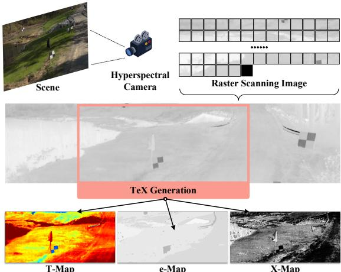  
Figure 1: Illustration of infrared radiation decomposition for TeX generation. The scene is factorized into temperature (T-Map), material emissivity (e-Map), and texture (X-Map), revealing physically meaningful distinctions that are not obvious in raw infrared measurements.

## 1 Introduction

Low-light conditions pose significant challenges for computer vision tasks [19, 23, 59]. In such scenarios, infrared imaging can provide complementary thermal cues that remain observable under weak illumination, thereby enriching scene perception when visible information is degraded. Motivated by this advantage, recent studies increasingly adopt multimodal perception, where visible and infrared images are jointly exploited to realize cross-modal fusion and improve target discriminability and overall robustness [4, 9, 17, 21, 31, 58].

Existing visible-infrared fusion methods have largely concentrated on saliency-oriented representation learning, using feature fusion, attention modulation, and cross-modal enhancement to improve target discriminability in degraded scenes [29]. While effective in emphasizing salient regions, these approaches mainly treat fusion as a perceptual aggregation problem. As a result, the fused features may improve visual prominence, yet they may not explicitly preserve the physical correspondence between visible appearance and infrared radiation characteristics [6, 32, 43]. Maintaining physically consistent requires infrared observations to be aligned with underlying physical factors rather than being treated solely as visual features.

Recent works shift from perceptual fusion to physical decomposition, explicitly modeling the formation process of infrared radiation. TeXNet [2], for instance, interprets infrared radiation through three intrinsic attributes of objects: temperature (T), material emissivity (e), and texture (X) [2]. As illustrated in Figure 1, this decomposition reveals distinctions invisible in raw infrared data—for instance, grass and soil exhibit similar thermal responses but difer in emissivity and texture. Compared with conventional fusion-based methods, such approaches aim to recover physically meaningful factors rather than directly aggregating features, thereby improving target characterization from the perspective of radiation decomposition. To reduce acquisition complexity, more recent studies further explore temperature-emissivity decomposition using standard infrared sensors, enabling direct decomposition from infrared images with fewer imaging requirements. However, these methods still underexploit the structural information inherent in source images, such as edges, layout regularities, and scale-dependent cues, which may help preserve physically consistent more efectively [8, 11, 61].

To overcome this limitation, we propose Multi-View Routing Mixture-of-Experts (MVR-MoE) for temperature-emissivity-texture (TeX) generation. MVR-MoE unifies structural diversity and physically consistent in multimodal features. We introduce multi-view hyper connections to expand the structural feature and enable crossview interaction among structural representation, while preserving modality-specific characteristics in each branch. A hierarchical routing mechanism is employed within the mixture-of-experts module, where feature-level routing selects informative structural views and expert-level routing aggregates specialized predictions under the task context. MVR-MoE preserves both shared structural evidence and distinctive modality-specific details, yielding more discriminative and physically consistent representations for TeX generation. Our main contributions are as follows:

• We propose MVR-MoE for TeX generation, which leverages disentangled structural views to enforce physically consistent in generated TeX channels.

• We design a multi-view hyper connections (MVHC) module to organize structural representations into adaptive multi-view branches, enabling more flexible cross-view interaction and viewaware routing.

• Extensive experiments demonstrate that MVR-MoE achieves superior TeX generation performance, with improved robustness under thermal degeneracy and modality imbalance while maintaining a favorable eficiency–accuracy trade-of.

## 2 Related Work

## 2.1 Multimodal Low-Light Visual Perception

Infrared and visible image fusion has been extensively studied using both generative and discriminative paradigms. Early generative approaches model the distribution of fused images via adversarial learning, such as FusionGAN [33] and GANMcC [34], while difusion-based methods including Dif-Fusion [57] and DDFM [71] improve stability and color fidelity through iterative refinement. Recent works further incorporate pre-trained models, where MAFS [30] and MaeFuse [41] exploit transferable representations for joint optimization. However, these methods tend to introduce redundant infrared information or noise under overexposed conditions. In parallel, many methods rely on carefully designed loss functions to guide fusion, such as SDNet [62], TUFusion [69], CAMF [42], AMSFusion [65], and texture and content guided models [64], with Xie et al. [50] explicitly addressing overexposure via prior modeling. While eficient, these approaches are sensitive to loss design and often fail to capture cross-modal semantic complementarity. More recent studies integrate fusion with downstream tasks including TarDal [26], SegMif [28], TDFusion [1], and DifusionSeg [48], enabling joint optimization with detection or segmentation. Although efective in preserving salient structures, their performance degrades under extreme illumination due to inaccurate localization of infrared cues. Meanwhile, increasing attention has been paid to structure-aware modeling for low-light perception. Methods such as SLFusion [32], DIVFusion [43], Structure-Guided Transformer [6], and UMCFuse [25] explicitly incorporate structural priors to enhance detail preservation and robustness in challenging conditions, highlighting the critical role of structural information in multimodal low-light visual perception.

## 2.2 Radiation physical decomposition

Thermal infrared (TIR) decomposition is typically formulated as a temperature–emissivity separation (TES) problem. The classical ASTER TES estimates emissivity via spectral contrast and derives temperature [10], but the problem is inherently ill-posed due to their strong coupling, especially with limited spectral information [36]. To mitigate this issue, various TES extensions introduce additional constraints, including smoothing and nonlinear formulations [35], subspace and spectral regularization [11, 47], and atmospheric or other physical factors [8, 18]. These methods generally rely on multi-band or hyperspectral data. With hyperspectral observations, learning-based approaches further improve estimation by modeling complex mappings from radiance to physical variables [11, 51], and recent works integrate deep learning with TES to enhance accuracy while maintaining physically consistent [61]. Overall, existing methods depend either on strongly constrained TES formulations or hyperspectral and learning-based models, limiting their applicability under constrained sensing conditions.

## 3 Method

We propose Multi-View Routing Mixture-of-Experts (MVR-MoE), a framework for physically consistent TeX generation that disentangles shared structure and view-specific cues in multimodal representations. As illustrated in Figure 2, MVR-MoE takes infrared and visible images as input and jointly constructs a fused representation alongside a multi-view structural space, which captures complementary information including the high-frequency map (HF), lowfrequency map (LF), and monogenic phase congruency map (MPC). A multi-view hyper connections (MVHC) module reorganizes these structural views into context-aware branches, strengthening common patterns while preserving discriminative modality-specific evidence. Built upon these structural representations, the MVR-MoE employs a hierarchical routing MoE at both the feature and expert levels. Each generation channel integrates heterogeneous representations and leverages a shared expert pool to produce the TeX. Robustness under thermal degeneracy and modality imbalance is improved, while over-smoothing caused by excessive fusion is mitigated and noise from unreliable cues is suppressed. We further incorporate structural cues to support physically consistent cross-modal representation learning.

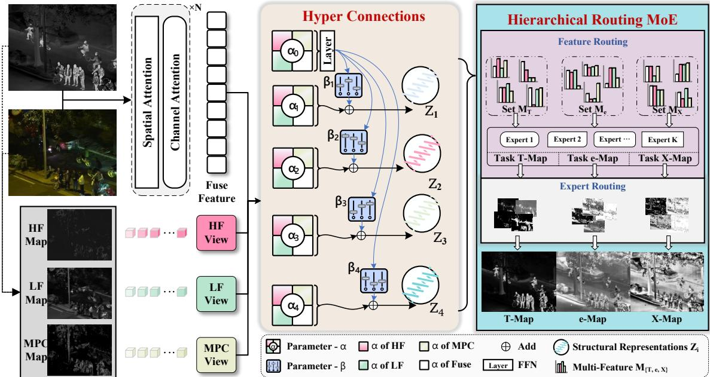  
Figure 2: Overview of MVR-MoE. Infrared and visible images are decomposed into high-frequency (HF), low-frequency (LF), and MPC components, which jointly form a multi-view feature set. Through multi-view hyper connections, these representations are jointly encoded into Structural Representations $Z _ { 1 , 2 , 3 , 4 } ,$ facilitating cross-modality interactions. Routing module performs s Ziadaptive reweighting and aggregation over $Z _ { 1 , 2 , 3 , 4 }$ to construct heterogeneous representations, which are subsequently dispatched to specialized experts. The outputs of all experts are finally integrated to generate TeX with physically consistent.

## 3.1 Feature Fusion

Given an infrared image $I _ { i r }$ and a visible image $I _ { v i s }$ , a fused feature � is learned to preserve complementary characteristics of both Xmodalities while facilitating efective cross-modal interaction. The module progressively models inter-modal dependencies from both spatial and channel perspectives, enabling fine-grained structural alignment as well as high-level consistency across modalities.

Spatial Atention. Spatial interaction is performed in the frequency domain to extract local cross-modal correspondences. Infrared and visible features are transformed by FFT [73], and crossmodal attention is computed from their frequency representations to form an initial fused feature. The fusion process is refined iteratively through convolutional extraction and attention-weighted interactions between the fused feature and the infrared feature. X-MapA residual connection with the visible feature preserves visible structural details and stabilizes feature propagation.

Channel Atention. Channel interaction focuses on global semantic dependencies across feature channels. Attention derived from the fused feature reweights the visible feature, amplifying informative channels and suppressing redundant information. Iterative convolution and attention modulation further strengthen semantic integration across modalities. A residual connection with the original $I _ { v i s }$ maintains modality-specific information and supports stable feature learning.

Fused Feature. The fuse feature � is dominated by infrared information and complemented by auxiliary cues from the visible modality. Infrared image provide the primary structural and saliency information, ensuring robust characterization of thermal targets. In contrast, the visible modality contributes additional texture details that are less distinguishable in the infrared domain. As a result, the � preserves the integrity of infrared features while incorporating fine-grained appearance cues, forming a representation that balances structural reliability with detail enhancement.

## 3.2 Multi-View Hyper Connections

MVHC integrates the fused feature � with disentangled structural priors. To bridge the modality gap without sacrificing physically consistent, we decompose the input into three complementary views: High-Frequency (HF), Low-Frequency (LF), and Monogenic Phase Congruency (MPC). Multiple views are formed from the same cross-modal representation under diferent structural constraints, enabling the network to examine scene structure from complementary viewpoints. The HF view captures fine-grained details, the LF view reflects coarse structures, and the MPC view encodes illumination-robust saliency. Shared structural evidence across modalities is reinforced across these views, while modalityspecific cues remain salient in individual branches. The resulting multi-view representation preserves both common patterns and complementary details, providing a richer basis for subsequent routing and prediction.

Multi-View Structural. The $I _ { v i s }$ is decomposed into two complementary components via a transmission estimation mechanism:

$$
L _ { 1 } = t \cdot \mathrm { g r a y } ( I _ { v i s } ) , \qquad L _ { 2 } = ( 1 - t ) \cdot \mathrm { g r a y } ( I _ { v i s } ) ,\tag{1}
$$

where � is the estimated transmission map. We apply guided filtering [12] to extract low-frequency structures. Given a guidanceAP LP moi Fuse HF image � and an input image ${ \boldsymbol { \mathit { p } } } ,$ the guided filter $\operatorname { G F } ( G , p ; r , \lambda )$ computes a filtered image $q$ by assuming a local linear model within each windowor e-Map $\omega _ { k } \colon$

$$
q _ { i } = a _ { k } G _ { i } + b _ { k } , \qquad i \in \omega _ { k } ,\tag{2}
$$

where

$$
a _ { k } = \frac { \mathrm { c o v } _ { \omega _ { k } } ( G , \mathfrak { p } ) } { \mathrm { v a r } _ { \omega _ { k } } ( G ) + \lambda } , \qquad b _ { k } = \mu _ { \mathfrak { p } } - a _ { k } \mu _ { G } .\tag{3}
$$

The filtered image is obtained by averaging the local coeficientsAP LP gmoi over overlapping windows: $q = { \bar { a } } \odot G + { \bar { b } } .$ . In this work, we focus on the self-guided setting, where the guided filter is applied withMulti-Feature identical guidance and input:

$$
E _ { 1 } = \mathrm { G F } ( L _ { 1 } , L _ { 1 } ; r , \lambda ) , E _ { 2 } = \mathrm { G F } ( L _ { 2 } , L _ { 2 } ; r , \lambda ) , E _ { 3 } = \mathrm { G F } ( I _ { i r } , I _ { i r } ; r , \lambda ) .\tag{4}
$$

The corresponding high-frequency details are obtained by residual decomposition:

$$
D _ { 1 } = L _ { 1 } - E _ { 1 } , \qquad D _ { 2 } = L _ { 2 } - E _ { 2 } , \qquad D _ { 3 } = I _ { i r } - E _ { 3 } ,\tag{5}
$$

where $D _ { i }$ captures edges, textures, and fine-grained structural details. Monogenic Phase Congruency (MPC) is employed to measure structural saliency independent of illumination intensity, estimating the consistency of multi-scale filter responses. For each detail map $D _ { i } ,$ the monogenic signal is computed to obtain its local structural components. Specifically, let $f _ { 1 , i }$ and $f _ { 2 , i }$ denote the corresponding filter responses derived from the monogenic decomposition. Based on these, the phase-congruency map is defined as

$$
M P C _ { i } = \frac { W _ { i } \cdot f _ { 1 , i } \cdot f _ { 2 , i } } { \sum _ { k } \left| R _ { i , k } \right| + \epsilon } ,\tag{6}
$$

where $R _ { i , k }$ denotes the response at scale $k ,$ and � is a small constant for numerical stability. Using MPC as a structural reliability measure, the high-frequency prior is fused as

$$
H F = \sum _ { i = 1 } ^ { 3 } w _ { i } D _ { i } ,\tag{7}
$$

with adaptive weights defined by

$$
w _ { i } ( x ) = \frac { M P C _ { i } ( x ) + \epsilon } { \operatorname* { m a x } _ { x } \left( \sum _ { j = 1 } ^ { 3 } M P C _ { j } ( x ) \right) + \epsilon } .\tag{8}
$$

For low-frequency extraction, we construct an intermediate map by selecting the component with stronger low-frequency response between the visible and infrared branches:

$$
E _ { 4 } = \mathbb { I } ( E _ { 2 } > E _ { 3 } ) \odot E _ { 2 } + \mathbb { I } ( E _ { 2 } \le E _ { 3 } ) \odot E _ { 3 } ,\tag{9}
$$

where I(·) denotes the indicator function that outputs $_ { \textrm { 1 } } \cdot$ when the condition is satisfied and $\ ' 0 ^ { \prime }$ otherwise, and ⊙ denotes element-wise multiplication. The final low-frequency prior is then obtained as

$$
{ \cal L } F = W _ { 4 } E _ { 4 } + W _ { 3 } E _ { 1 } ,\tag{10}
$$

where $W _ { 3 }$ and $W _ { 4 }$ are adaptive weights determined by the structural saliency of the corresponding low-frequency maps. Finally, the extracted priors {��, ��, ���} provide complementary structural information, including fine details, global intensity structure, and illumination-invariant geometric features.

Structural Representations. Hyper Connections (HC [74]) mechanism is introduced to construct multiple structural views, replacing direct concatenation. The proposed MVHC injects image-intrinsic structural cues to produce heterogeneous representations. The MVHC module takes a set of input features ${ \cal S } = \{ S _ { 1 } , S _ { 2 } , S _ { 3 } , S _ { 4 } \} =$ {�, ��, ��, ���}. A set of learnable coeficients $\alpha _ { i , j }$ parameterizes the contribution of the �-th input feature to the �-th branch. Each branch feature is obtained by a weighted combination of all inputs:

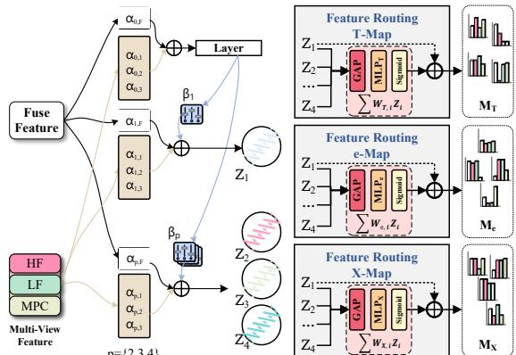  
Figure 3: MVHC. Through hyper connections, HF, LF, MPC interact with the � to form four multi-view branches that preserve both shared consensus and view-specific diversity. For each prediction channel, a feature-level routing module first constructs heterogeneous feature representations via adaptive composition of Structural Representations.

$$
\hat { F } _ { j } = \sum _ { i = 1 } ^ { 4 } \alpha _ { i , j } S _ { i } , \qquad j \in \{ 0 , 1 , 2 , 3 , 4 \} .\tag{11}
$$

The base feature is generated by applying a residual transformation followed by Layer(FFN): $F _ { 0 } = \mathrm { F F N } ( \hat { F } _ { 0 } )$ . Another set of learnable coeficients $\beta _ { j }$ modulates the interaction between the base feature $F _ { 0 }$ and each branch:

$$
Z _ { j } = \beta _ { j } F _ { 0 } + \hat { F } _ { j } , \qquad j \in \{ 1 , 2 , 3 , 4 \} .\tag{12}
$$

The MVHC module dynamically determines how multi-view structural representations $\mathcal { Z } = Z _ { 1 } , Z _ { 2 } , . . . , Z _ { K }$ are fused and propagated across feature branches. Each branch emphasizes complementary structural cues derived from the input modalities and maintains the shared cross-modal feature. The branch-wise fusion weights are learnable, allowing common structures to be strengthened while preserving view-specific information for subsequent prediction.

## 3.3 TeX Generation

A hierarchical routing Mixture-of-Experts is employed for TeX generation. We incorporate structural information into routing to better preserve physically consistent. As shown in Figure 3, the feature routing constructs heterogeneous feature for experts, assigning mixed structural features to diferent experts. The resulting expert outputs are then aggregated by gating networks to produce candidate predictions for each task channel.

Feature-level Routing. Given the Structural Representations set $Z _ { 1 } , Z _ { 2 } , Z _ { 3 } , Z _ { 4 } ,$ we instantiate three independent feature routing, namely $\mathrm { F R } _ { T } , \mathrm { F R } _ { e }$ , and $\mathrm { F R } _ { X } .$ each dedicated to a specific generation channel � ∈ {�,�,�}. For each feature routing, the views $Z _ { 1 } , Z _ { 2 } , Z _ { 3 } , Z _ { 4 }$ are incorporated through structured composition to construct enriched and heterogeneous feature representations. Concretely, for each auxiliary view $Z _ { i } ,$ we first apply global average pooling followed by a lightweight MLP to produce a scalar routing score:

$$
r _ { c , i } = \mathrm { M L P } _ { c } ( \mathrm { G A P } ( Z _ { i } ) ) ,\tag{13}
$$

where GAP(·) denotes global average pooling and $\mathrm { M L P } _ { c }$ represents the learnable parameters of the feature routing for channel �. Each score is independently transformed into a gating weight via a Sigmoid function $w _ { c , i } ~ = ~ \sigma ( r _ { c , i } )$ , and the heterogeneous feature for channel � is computed as

$$
M _ { c } = \sum _ { i = 1 } ^ { 4 } w _ { c , i } Z _ { i } .\tag{14}
$$

Such a routing strategy allows each generation channel to adaptively constructs heterogeneous features while preserving a stable base representation, thereby improving feature specialization and reducing unnecessary feature interference.

The heterogeneous features are then processed by a shared expert pool consisting of K experts $\mathcal { E } = \{ E _ { 1 } , E _ { 2 } , \dots , E _ { K } \}$ . Each expert independently transforms the heterogeneous feature to produce candidate outputs:

$$
M a p _ { c } ^ { ( k ) } = E _ { k } ( M _ { c } ) ,\tag{15}
$$

where $M a p _ { c } ^ { ( k ) }$ denotes the output generated by expert k for channel c. The expert pool is shared across all channels, allowing experts to specialize in diferent structural patterns while supporting multiple generation tasks.

Expert-level Routing. To route channel-specific information to the corresponding prediction branch, we introduce channel-specific gating networks $\{ \mathrm { G a t e } _ { T } , \mathrm { G a t e } _ { e } , \mathrm { G a t e } _ { X } \}$ . For each channel $c ,$ the gating network generates routing scores from the pooled channel representation:

$$
\begin{array} { r } { \pmb { s } _ { c } = \pmb { U } _ { c } \cdot \operatorname { P o o l } ( \pmb { M } _ { c } ) , } \end{array}\tag{16}
$$

where $U _ { c }$ denotes the parameters of the gating network. The routing weights are then obtained by applying a Top-� softmax operator:

$$
\mathbf { g } _ { c } = \mathrm { T o p K } \big ( \mathrm { S o f t m a x } ( \mathbf { s } _ { c } ) \big ) ,\tag{17}
$$

which retains the � highest-weight experts and normalizes their contributions. The routed expert features are aggregated as

$$
\mathbf { F } _ { c } = \sum _ { k \in S _ { c } } g _ { c , k } \mathbf { F } _ { c } ^ { ( k ) } ,\tag{18}
$$

where $S _ { c }$ denotes the Top-� expert set and $\mathbf { F } _ { c } ^ { ( k ) }$ is the feature output of the �-th expert. Finally, a channel-specific projection head maps the aggregated feature to the single-channel prediction:

$$
M a p _ { c } = \rho _ { c } ( \mathbf { F } _ { c } ) .\tag{19}
$$

TeX generation can be summarized as a nested routing operation

$$
M a p _ { c } = \sum _ { k = 1 } ^ { K } g _ { c , k } E _ { k } \left( \sum _ { i = 1 } ^ { 4 } s _ { c , i } Z _ { i } \right) ,\tag{20}
$$

where the feature routing determines how structural views are composed, while the expert routing determines which expert outputs dominate the final prediction. The proposed architecture employs hierarchical routing to decouple structural view composition, fea ture routing organizes multi-view features, and GateNet modules weight expert outputs. Cross-modal consensus and view-specific cues are jointly retained, supporting adaptive expert specialization for robust TeX generation.

## 3.4 Loss Function

We introduce physics-guided constraints during training to encourage physically consistent generation of the channels rather than superficial visual plausibility. Specifically, the loss design incorporates the Stefan–Boltzmann radiation model together with channel consistency constraints, enabling the generated T, e, and X maps to satisfy physically relationships.

Stefan–Boltzmann Constraint. Based on Stefan–Boltzmann law, we impose a reconstruction constraint that couples the generated channels T,e,X with the observed infrared image. The reconstructed infrared intensity is formulated as

$$
\hat { I } _ { i r } ( x , y ) = e ( x , y ) \sigma T ( x , y ) ^ { 4 } + \bigl ( 1 - e ( x , y ) \bigr ) X ( x , y ) ,\tag{21}
$$

where $\mathrm { T } ( \mathrm { x } , \mathrm { y } )$ denotes the temperature map, $\mathbf { e } ( \mathrm { x } , \mathrm { y } )$ denotes the emissivity map, $\mathrm { X } ( \mathrm { x } , \mathrm { y } )$ represents the texture, and � is the Stefan–Boltzmann constant. The reconstruction loss is defined to match the reconstructed infrared intensity $\hat { \cal I } _ { i r }$ with the observed infrared image $I _ { i r } \colon$

$$
\mathcal { L } _ { \mathrm { r e } } = \left. \hat { I } _ { i r } - I _ { i r } \right. _ { 1 } + D _ { K L } \big ( P ( I _ { i r } ) \ \| \ P ( \hat { I } _ { i r } ) \big ) ,\tag{22}
$$

the first term preserves pixel-level fidelity, whereas the second term encourages statistical consistency between the reconstructed and observed infrared intensities.

Channel Consistency Loss. The temperature T, emissivity e, and texture X represent diferent physical aspects of the same object. These quantities are governed by the intrinsic properties of materials. Accordingly, although their values difer across channels, their spatial structures remain consistent. In particular, when materials with diferent emissivities form a boundary in the image plane, the boundary is often accompanied by variations in emissivity, temperature, and texture. Therefore, the spatial structures of T, e, and X exhibit strong structural alignment. The channel consistency loss is defined in terms of high-frequency and low-frequency components:

$$
\begin{array} { r l r } {  { \mathcal { L } _ { \mathrm { e - T / X } } = \frac { 1 } { H W } ( \| T _ { \mathrm { H F } } - e _ { \mathrm { H F } } \| _ { 1 } + \| X _ { \mathrm { H F } } - e _ { \mathrm { H F } } \| _ { 1 } ) } } \\ & { } & { + \| T _ { \mathrm { L F } } - e _ { \mathrm { L F } } \| _ { 1 } + \| X _ { \mathrm { L F } } - e _ { \mathrm { L F } } \| _ { 1 } , \quad } \end{array}\tag{23}
$$

where � and � denote the spatial dimensions of the feature maps. The subscripts HF and LF denote the high-frequency and lowfrequency components extracted from the respective channels.

Temperature–Texture Complementarity. In multimodal imagery, high-intensity regions may arise from either elevated temperature or strong illumination and reflectance efects. A complementary relationship between the temperature channel T and the texture channel X is therefore imposed during generation. The constraint is built on the normalized infrared intensity $I _ { I R } ^ { n o r m }$ and the blurred visible luminance map $Y _ { b l u r }$ . Their diference provides a heuristic indication of whether a bright region is more likely attributable to thermal radiation or illumination. The complementarity loss is defined as

$$
{ \mathcal { L } } _ { \mathrm { T - X } } = \left. T - \phi \left( I _ { I R } ^ { n o r m } - Y _ { b l u r } \right) \right. _ { 2 } ^ { 2 } + \left. X - \phi \left( Y _ { b l u r } - I _ { I R } ^ { n o r m } \right) \right. _ { 2 } ^ { 2 } ,\tag{24}
$$

where $\phi ( \cdot )$ denotes the sigmoid function. This constraint encourages the model to assign bright regions either to temperature or to illumination efects, thereby reducing ambiguity between the T and X channels.

MoE Gate Task Loss. To improve expert utilization in the multitask MoE module, we introduce a gate-level regularization term that encourages balanced expert assignment within each task. Let $\mathcal { T } = \{ T , e X \}$ denote the task set, � the batch size, and � the number of experts. For each task $t \in \mathcal { T }$ , the gating output is $\mathbf { G } ^ { ( t ) } \in \mathbb { R } ^ { B \times K }$ where $\mathbf { G } _ { b , i } ^ { ( t ) }$ denotes the weight assigned to expert � for sample �. For each expert, we compute the coeficient of variation over the batch dimension:

$$
\mathrm { C V } _ { i } ^ { ( t ) } = \frac { \sigma _ { i } ^ { ( t ) } } { \mu _ { i } ^ { ( t ) } + \epsilon } ,\tag{25}
$$

where

$$
\mu _ { i } ^ { ( t ) } = \frac { 1 } { B } \sum _ { b = 1 } ^ { B } \mathbf { G } _ { b , i } ^ { ( t ) } , \qquad \sigma _ { i } ^ { ( t ) } = \sqrt { \frac { 1 } { B } \sum _ { b = 1 } ^ { B } \left( \mathbf { G } _ { b , i } ^ { ( t ) } - \mu _ { i } ^ { ( t ) } \right) ^ { 2 } } .\tag{26}
$$

The load balancing loss is defined as

$$
\mathcal { L } _ { \mathrm { g a t e } } = \frac { 1 } { \vert \mathcal { T } \vert } \sum _ { t \in \mathcal { T } } \frac { 1 } { K } \sum _ { i = 1 } ^ { K } \left( \mathrm { C V } _ { i } ^ { ( t ) } \right) ^ { 2 } .\tag{27}
$$

Furthermore, we constrain the extent to which an expert is shared across tasks. We define a binary usage indicator:

$$
U _ { b , i } ^ { ( t ) } = \left\{ { \begin{array} { l l } { 1 , } & { \mathbf { G } _ { b , i } ^ { ( t ) } > 0 , } \\ { 0 , } & { \mathrm { o t h e r w i s e } , } \end{array} } \right.\tag{28}
$$

and compute the task usage count of expert � as

$$
C _ { i } = \frac { 1 } { B } \sum _ { b = 1 } ^ { B } \left( U _ { b , i } ^ { ( T ) } + U _ { b , i } ^ { ( e ) } + U _ { b , i } ^ { ( X ) } \right) .\tag{29}
$$

We penalize experts that are selected by more than two tasks:

$$
\mathcal { L } _ { \mathrm { p e r t a s k } } = \frac { 1 } { K } \sum _ { i = 1 } ^ { K } \operatorname* { m a x } ( 0 , C _ { i } - 2 ) .\tag{30}
$$

Overall Physically Consistent Objective. Combining the above components, the final loss function is defined as

$$
\begin{array} { r } { \mathcal { L } = \mathcal { L } _ { \mathrm { r e } } + \lambda _ { 1 } \mathcal { L } _ { \mathrm { e - T / X } } + \lambda _ { 2 } \mathcal { L } _ { \mathrm { T - X } } + \lambda _ { 3 } \mathcal { L } _ { \mathrm { g a t e } } + \lambda _ { 4 } \mathcal { L } _ { \mathrm { p e r t a s k } } , } \end{array}\tag{31}
$$

where $\lambda _ { 1 } , \lambda _ { 2 } , \lambda _ { 3 }$ and $\lambda _ { 4 }$ are weighting coeficients. The proposed ob jective enforces physically consistent across the generated channels, ensuring that the predicted temperature, emissivity, and texture maps remain consistent with both the observed infrared signal and the intrinsic physical relationships among these quantities.

## 4 Experiment

## 4.1 Implementation Setting

Datasets. We evaluate our method on low-light object detection datasets: FLIR[45], LLVIP[16], and M3FD[26]. These datasets provide aligned IR-VIS image pairs and cover diverse real-world scenes. Metric. We use mean Average Precision (mAP) as the evaluation metric, including mAP@0.5, mAP@0.75, and mAP@0.5:0.95 with a 0.05 step size. The models for each downstream task were retrained on the TeX. We compare computational eficiency using three metrics: average runtime, FLOPs, and the number of parameters. Average runtime measures the time required to complete a task and reflects inference speed. FLOPs quantify the computational cost during forward propagation. The number of parameters indicates the model size and complexity, which are closely related to memory and storage overhead.

Table 1: Object detection performance comparison of MVR-MoE and competing methods on the LLVIP dataset.
<table><tr><td>Method</td><td>Modality</td><td> $\overline { { m A P _ { 5 0 } } }$ </td><td> $\overline { { m A P _ { 7 5 } } }$ </td><td> $m A P _ { 5 0 ; 9 5 }$ </td></tr><tr><td rowspan="2">YoLov10 [46] YoLov10 [46]</td><td>RGB</td><td>90.0</td><td>57.3</td><td>52.7</td></tr><tr><td>IR</td><td>96.1</td><td>74.8</td><td>64.7</td></tr><tr><td>MMI-Det [58]</td><td>IR+RGB</td><td>98.9</td><td>73.5</td><td>64.4</td></tr><tr><td>GAN-HA [31]</td><td>IR+RGB</td><td>94.3</td><td>N/A</td><td>56.0</td></tr><tr><td>RSDet [67]</td><td>IR+RGB</td><td>95.8</td><td>70.4</td><td>61.3</td></tr><tr><td>ICAFusion [40]</td><td>IR+RGB</td><td>N/A</td><td>N/A</td><td>N/A</td></tr><tr><td>UniRGB-IR [56]</td><td>IR+RGB</td><td>96.1</td><td>72.2</td><td>63.2</td></tr><tr><td>Fusion-Mamba [7]</td><td>IR+RGB</td><td>97.0</td><td>N/A</td><td>64.3</td></tr><tr><td>Diff-IF [53]</td><td>IR+RGB</td><td>93.3</td><td>68.4</td><td>59.5</td></tr><tr><td>DDFM [71]</td><td>IR+RGB</td><td>92.1</td><td>65.5</td><td>59.2</td></tr><tr><td>Text-IF [54]</td><td>IR+RGB</td><td>94.1</td><td>67.6</td><td>60.2</td></tr><tr><td>FusionBooster [5]</td><td>IR+RGB</td><td>97.4</td><td>N/A</td><td>69.3</td></tr><tr><td>FD²-Net [24]</td><td>IR+RGB</td><td>96.2</td><td>70.0</td><td>N/A</td></tr><tr><td>M2D-LIF [66]</td><td>IR+RGB</td><td>N/A</td><td>N/A</td><td>70.8</td></tr><tr><td>IC-Fusion [14]</td><td>IR+RGB</td><td>97.9</td><td>81.5</td><td>70.3</td></tr><tr><td>RCS-MD [39]]</td><td>IR+RGB</td><td>97.7</td><td>81.7</td><td>69.5</td></tr><tr><td>EI2Det [13]</td><td>IR+RGB</td><td>98.0</td><td>73.2</td><td>63.9</td></tr><tr><td>MCOR [15]</td><td>IR+RGB</td><td>97.6</td><td>73.7</td><td>64.9</td></tr><tr><td>LUT-Fuse [55]</td><td>IR+RGB</td><td>94.1</td><td>N/A</td><td>61.4</td></tr><tr><td>WaveMamba [75]</td><td>IR+RGB</td><td>98.3</td><td>N/A</td><td>66.0</td></tr><tr><td>OmniFuse [60]</td><td>IR+RGB</td><td>92.1</td><td>74.6</td><td>63.5</td></tr><tr><td>TDHF [20]</td><td>IR+RGB</td><td>97.8</td><td>82.1</td><td>69.9</td></tr><tr><td>MVR-MoE</td><td>IR+RGB</td><td>98.2</td><td>84.0</td><td>72.0</td></tr></table>

Table 2: Object detection performance comparison of MVR-

MoE and competing methods on the FLIR dataset.
<table><tr><td>MoE and competing methods on the FLiR dataset. Method</td><td>Modality</td><td> $\overline { { m A P _ { 5 0 } } }$ </td><td> $\overline { { m A P _ { 7 5 } } }$ </td><td> $\overline { { m A P _ { 5 0 : 9 5 } } }$ </td></tr><tr><td>YoLov10 [46]</td><td>RGB</td><td>66.3</td><td>27.7</td><td>32.7</td></tr><tr><td>YoLov10 [46]</td><td>IR</td><td>78.2</td><td>39.6</td><td>42.3</td></tr><tr><td>MMI-Det [58]</td><td>IR+RGB</td><td>79.8</td><td>35.8</td><td>40.5</td></tr><tr><td>RSDet [67]</td><td>IR+RGB</td><td>83.9</td><td>40.1</td><td>43.8</td></tr><tr><td>ICAFusion [40]</td><td>IR+RGB</td><td>79.2</td><td>36.9</td><td>41.4</td></tr><tr><td>UniRGB-IR [56]</td><td>IR+RGB</td><td>81.4</td><td>40.2</td><td>44.1</td></tr><tr><td>Fusion-Mamba [7]</td><td>IR+RGB</td><td>84.9</td><td>45.9</td><td>47.0</td></tr><tr><td>MMFN [52]</td><td>IR+RGB</td><td>80.8</td><td>36.6</td><td>41.7</td></tr><tr><td>FD2-Net [24]</td><td>IR+RGB</td><td>82.9</td><td>42.5</td><td>N/A</td></tr><tr><td>M2D-LIF [66]</td><td>IR+RGB</td><td>N/A</td><td>N/A</td><td>46.1</td></tr><tr><td>IC-Fusion [14]</td><td>IR+RGB</td><td>83.3</td><td>42.6</td><td>46.1</td></tr><tr><td>RCS-MD [39]]</td><td>IR+RGB</td><td>81.5</td><td>47.2</td><td>47.8</td></tr><tr><td>EI2Det [13]</td><td>IR+RGB</td><td>80.2</td><td>N/A</td><td>N/A</td></tr><tr><td>MCOR[15]</td><td>IR+RGB</td><td>78.2</td><td>34.4</td><td>39.9</td></tr><tr><td>TDHF [20]</td><td>IR+RGB</td><td>84.9</td><td>46.7</td><td>48.2</td></tr><tr><td>MVR-MoE</td><td>IR+RGB</td><td>85.7</td><td>53.2</td><td>51.8</td></tr></table>

## 4.2 Comparison with State-of-the-art Methods

The comparison results are reported in Tables 1, 2, and 3. The compared methods include both image-fusion-based pipelines and end-to-end multispectral detection approaches.

Results on LLVIP. As shown in Table 1, the proposed MVR-MoE achieves the best performance across all evaluation metrics, reaching 98.2% $m A P _ { 5 0 } ,$ 84.0% $m A P _ { 7 5 }$ , and 72.0% $m A P _ { 5 0 ; 9 5 } .$ . Compared with the strongest existing methods such as IC-Fusion and TDHF, our approach provides consistent improvements, especially under the stricter metrics �� $1 P _ { 7 5 }$ and�� $P _ { 5 0 ; 9 5 }$ . These results demonstrate that the proposed framework efectively exploits complementary multispectral information and improves localization accuracy under challenging illumination conditions.

Results on FLIR. Table 2 reports the detection performance on the FLIR dataset. MVR-MoE again achieves the best results across all three metrics, obtaining 85.7% $m A P _ { 5 0 } ;$ , 53.2% $m A P _ { 7 5 } ,$ , and 51.8% $m A P _ { 5 0 ; 9 5 }$ . Compared with recent state-of-the-art methods such as TDHF and Fusion-Mamba, our approach shows notable improvements, particularly on the more challenging metrics. These results indicate that the proposed architecture maintains strong robustness and efectiveness across diferent multispectral datasets.

Table 3: Quantitative comparison of MVR-MoE and other methods on the M3FD dataset for object detection, including per-class detection performance.
<table><tr><td>Method</td><td>Modality</td><td>People</td><td>Car</td><td>Bus</td><td>Motorcycle</td><td>Lamp</td><td>Truck</td><td> $\overline { { m A P _ { 5 0 } } }$ </td><td> $m A P _ { 5 0 ; 9 5 }$ </td></tr><tr><td>YoLov10 [46]</td><td>RGB</td><td>44.5</td><td>68.7</td><td>75.4</td><td>49.3</td><td>50.1</td><td>65.8</td><td> $\overline { { 8 6 . 1 } }$ </td><td>59.0</td></tr><tr><td>YoLov10 [46]</td><td>IR</td><td>53.1</td><td>64.6</td><td>72.4</td><td>41.1</td><td>47.7</td><td>61.4</td><td>84.5</td><td>56.7</td></tr><tr><td>CFT [37]</td><td>IR+RGB</td><td>52.0</td><td>68.2</td><td>79.2</td><td>49.9</td><td>45.2</td><td>69.6</td><td>89.8</td><td>60.7</td></tr><tr><td>TarDAL [26]</td><td>IR+RGB</td><td>49.8</td><td>65.4</td><td>69.5</td><td>46.6</td><td>43.7</td><td>61.1</td><td>86.0</td><td>56.0</td></tr><tr><td>MetaFusion[68]</td><td>IR+RGB</td><td>48.4</td><td>66.7</td><td>70.5</td><td>49.1</td><td>46.4</td><td>59.9</td><td>86.7</td><td>56.8</td></tr><tr><td>CDDFuse [70]</td><td>IR+RGB</td><td>46.1</td><td>69.7</td><td>74.2</td><td>42.2</td><td>44.2</td><td>62.7</td><td>87.0</td><td>56.5</td></tr><tr><td>ICAFusion [40]</td><td>IR+RGB</td><td>48.8</td><td>68.5</td><td>72.3</td><td>45.5</td><td>43.6</td><td>64.7</td><td>87.4</td><td>57.2</td></tr><tr><td>Text-IF [54]</td><td>IR+RGB</td><td>49.1</td><td>69.0</td><td>40.3</td><td>27.9</td><td>24.1</td><td>32.1</td><td>N/A</td><td>40.4</td></tr><tr><td>MTG-Fusion [49]</td><td>IR+RGB</td><td>59.5</td><td>75.2</td><td>50.5</td><td>41.0</td><td>34.8</td><td>54.8</td><td>N/A</td><td>52.6</td></tr><tr><td>CoDAF [76]</td><td>IR+RGB</td><td>46.8</td><td>69.4</td><td>78.0</td><td>54.2</td><td>50.7</td><td>68.4</td><td>90.8</td><td>61.2</td></tr><tr><td>MVR-MoE</td><td>IR+RGB</td><td>59.5</td><td>70.1</td><td>80.3</td><td>46.2</td><td>55.5</td><td>68.9</td><td>88.8</td><td>63.4</td></tr></table>

Results on M3FD. The comparison results on the M3FD dataset are presented in Table 3. MVR-MoE achieves competitive overall performance with 88.8% $m A P _ { 5 0 }$ and $6 3 . 4 \% \ m A P _ { 5 0 ; 9 5 }$ , outperforming most existing fusion-based methods while remaining comparable to recent end-to-end approaches. In addition, the proposed method shows stable detection performance across multiple object categories, particularly for challenging classes such as lamps and pedestrians. These results suggest that the multi-view feature evolution and expert routing mechanisms help the model capture complementary multispectral cues for diverse object categories.

To evaluate the generalizability of MVR-MoE, we conduct crossdataset transfer experiments by training the model on one dataset and directly generating TeX representations on another dataset without target-domain fine-tuning. Across FLIR, LLVIP, and M3FD, MVR-MoE consistently achieves stable downstream detection performance, with mAP50:95 ranging from 51.4% to 51.6%, 70.7% to 72.0%, and 62.7% to 63.4%, respectively. The small performance variation across diferent training-testing combinations indicates that MVR-MoE learns transferable thermal structural priors that are robust to dataset shifts. Overall, the experimental results across three datasets demonstrate that the proposed MVR-MoE framework consistently improves multispectral detection performance and generalizes well to diferent scenarios.

## 4.3 Ablation Study

We conduct ablation studies to evaluate each component of MVR-MoE, as shown in Table 4. The baseline directly predicts the �, �, and � channels from fused features using three parallel branches, achieving 44.4% mAP. Introducing the mixture-of-experts (MoE) im proves performance to 45.4% by decomposing channel generation into multiple specialized experts that capture task-relevant patterns from shared features. We further incorporate the multi-structure (MS) representation, which provides complementary cues such as high-frequency, low-frequency, and MPC-based phase information. This enriches the feature space and boosts performance to 46.8% mAP, serving as the intermediate configuration for subsequent analysis. Building on this, the multi-view hyper connections (MVHC) mechanism enables cross-branch feature interaction, enhancing multi-view feature diversity and improving performance to 48.0% mAP. We also explore expert selection (ES), which dynamically routes features to appropriate experts based on multi-modal inputs, achieving 47.7% mAP. Finally, combining MVHC and ES forms the full MVR-MoE, significantly improving performance to 51.8% mAP. While MVHC and ES individually yield moderate gains, their combination leads to a substantially larger improvement, indicating that the two components are complementary in enhancing feature representation and expert utilization.

Table 4: Ablation study of the proposed MVR-MoE framework. Each component, including Mixture-of-Experts (MoE), Multi-View Structure (MS), Multi-View Hyper Connections (MVHC), and Expert Specialization (ES), is progressively introduced to evaluate its contribution. Δ denotes the improvement over the baseline.
<table><tr><td>Setting</td><td>MoE</td><td>MS</td><td>MVHC</td><td>ES</td><td>mAP@0.5:0.95</td><td>Δ</td></tr><tr><td>Baseline</td><td>x</td><td>x</td><td>x</td><td>x</td><td>44.4</td><td></td></tr><tr><td>+MoE</td><td>√</td><td>x</td><td>x</td><td>x</td><td>45.4</td><td>+1.0</td></tr><tr><td>+MS</td><td>√</td><td>√</td><td>x</td><td>x</td><td>46.8</td><td>+1.4</td></tr><tr><td>+MVHC</td><td>√</td><td>√</td><td>√</td><td>X</td><td>48.0</td><td>+1.2</td></tr><tr><td>+ES</td><td>√</td><td>√</td><td>x</td><td>√</td><td>47.7</td><td>+0.9</td></tr><tr><td>All</td><td>√</td><td>√</td><td>√</td><td>√</td><td>51.8</td><td>+5.0</td></tr></table>

## 4.4 Visualization Analysis

We present the Multi-View Structural (HF, LF, and MPC), T-Map, e-Map, and X-Map results mined from infrared and visible images. As shown in Figure 4, our method does not merely fuse infrared and visible inputs, but decomposes them into structurally meaningful multi-view representations. The high-frequency and low-frequency maps capture complementary local and global cues, whereas the monogenic phase congruency map highlights robust structural boundaries. Meanwhile, the T-Map, e-Map, and X-Map indicate that the model disentangles temperature, emissivity, and texture information in a physically meaningful manner. In contrast, saliency-based fusion and task-driven fusion primarily aggregate multimodal information into a single representation, which tends to blur fine-grained structures or bias toward dominant modalities. As a result, subtle details and material-dependent characteristics roare not explicitly preserved. This design preserves fine details of humans, vehicles, and background objects under low-light conditions bewhile enhancing discriminability and robustness across materials h and scene components. We additionally evaluate MVR-MoE on the Wsimulated HADAR dataset, where ground-truth TeX annotations are available. As shown Figure 5, the generated maps preserve the bmain physical structures and remain reasonably close to the correo sponding target modalities, even without explicit label supervision.

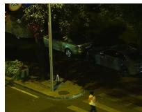  
(1) Visible image

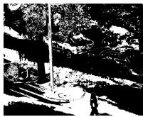  
(3) Saliency Map

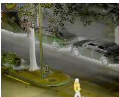  
(4) Fusion image

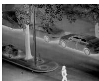

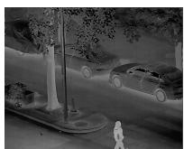  
(2) Infrared image  
(5) Y Channel

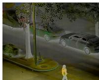

(7) HF  
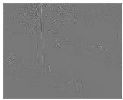  
(6) TDHF fusion

(9) MPC  
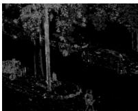

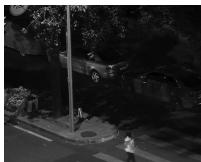  
(8) LF

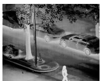  
(10) T Map

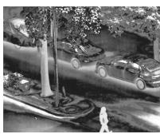  
(11) e Map

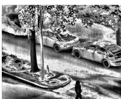  
(12) X Map

Figure 4: The figure shows visible images, infrared images, saliency-based fusion, task-driven fusion, high-frequency maps, low-frequency maps, monogenic phase congruency maps, and T-Map, e-Map, and X-Map results under low-light conditions.  
T-Map  
X-Map  
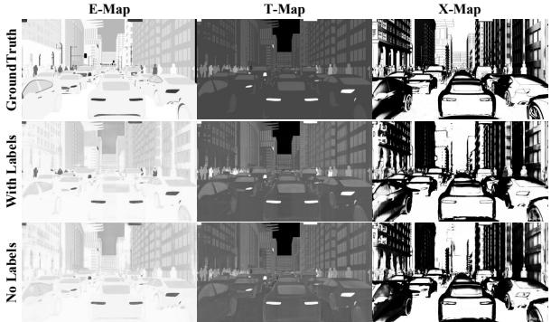  
h Figure 5: Ground truth and generated TeX maps under super-Trvised and self-supervised settings on HADAR.

## 4.5 Computational Complexity Analysis

We further evaluate the computational eficiency of the proposed MVR-MoE in terms of inference time, FLOPs, and the number of parameters. For this evaluation, we randomly sample 10 images from the M3FD dataset, each with a resolution of 1024 × 768, and measure the average inference time per image on an NVIDIA GeForce RTX 4090 GPU. All results are averaged over multiple runs. As reported in Table 5, the proposed method processes a single image in 29.03 ms, with 374.7 G FLOPs and only 0.487 M parameters, MVR-MoE maintains a favorable balance between computational eficiency and representation capability. In particular, the proposed architecture introduces only a very small parameter footprint while enhancing feature representation through structural design, mak ing it practical for eficient real-world deployment.

Table 5: Computational Eficiency Comparison of Diferent Methods (↓ indicates lower is better).
<table><tr><td>Method</td><td> ${ \mathrm { T i m e } } _ { ( m s ) } { \downarrow }$ </td><td> ${ \mathrm { F L O P S } } _ { ( G ) } { \downarrow }$ </td><td> $\mathrm { P a r a m s } _ { ( M ) } \downarrow$ </td></tr><tr><td>TGFuse [38]</td><td>41.17</td><td>318.9</td><td>137.30</td></tr><tr><td>CDDFuse [70]</td><td>463.8</td><td>1402.0</td><td>1.186</td></tr><tr><td>DDFM [71]</td><td>280.8k</td><td>1336k</td><td>552.700</td></tr><tr><td>IGNet [22]</td><td>47.46</td><td>647.6</td><td>7.871</td></tr><tr><td>MetaFusion[68]</td><td>85.40</td><td>637.9</td><td>0.812</td></tr><tr><td>MoE-Fusion [3]</td><td>77.79</td><td>229.5</td><td>83.450</td></tr><tr><td>PSFusion [44]</td><td>79.66</td><td>463.6</td><td>45.900</td></tr><tr><td>SegMiF [28]</td><td>681.50</td><td>500.4</td><td>0.621</td></tr><tr><td>MRFS [63]</td><td>98.90</td><td>356.0</td><td>135.000</td></tr><tr><td>CoCoNet [27]</td><td>29.06</td><td>498.5</td><td>9.114</td></tr><tr><td>FILM [72]</td><td>183.3</td><td>230.4</td><td>0.490</td></tr><tr><td>TDHF [20]</td><td>188.7</td><td>1135.71</td><td>57.1</td></tr><tr><td>MVR-MoE</td><td>29.03</td><td>374.7</td><td>0.487</td></tr></table>

## N5 Conclusion

In this work, we propose MVR-MoE, a physically consistent framework for TeX generation under low-light conditions. The framework organizes infrared and visible observations into multi-view structural representations, capturing both shared structural evidence and modality-specific characteristics. Multi-View Hyper Connections expand the structural feature space and enable cross-view interaction, while a hierarchical routing strategy adaptively regulates feature utilization at both the structural-view and expert levels. With Stefan-Boltzmann-law constraints, the predicted temperature, emissivity, and texture components remain consistent with their underlying radiative relationships, reducing artifacts from purely data-driven fusion. Extensive experiments demonstrate that MVR-MoE achieves strong discriminability and robustness with competitive eficiency. These results highlight the efectiveness of jointly modeling structural diversity and physically consistent for multimodal representation learning. The proposed framework connects physics-based modeling with multi-view representation learning and provides a reliable solution for TeX generation in complex environments. Nevertheless, sensitivity to emissivity estimation remains under complex conditions, future work will investigate more specialized emissivity modeling strategies to improve robustness and physical fidelity.

## 6 Acknowledgments

This work was funded by the Basic Research Program ofJiangsu under Grant No. BK20253028 and the National Natural Science Foundation ofChina under Grant Nos. U24A20330 and 62361166670.

## References

[1] Haowen Bai, Jiangshe Zhang, Zixiang Zhao, Yichen Wu, Lilun Deng, Yukun Cui, Tao Feng, and Shuang Xu. 2025. Task-driven image fusion with learnable fusion loss. In Proceedings ofthe Computer Vision and Pattern Recognition Conference. IEEE, 7457–7468.

[2] Fanglin Bao, Xueji Wang, Shree Hari Sureshbabu, Gautam Sreekumar, Liping Yang, Vaneet Aggarwal, Vishnu N Boddeti, and Zubin Jacob. 2023. Heat-assisted detection and ranging. Nature 619, 7971 (2023), 743–748.

[3] Bing Cao, Yiming Sun, Pengfei Zhu, and Qinghua Hu. 2023. Multi-modal gated mixture of local-to-global experts for dynamic image fusion. In Proceedings of the IEEE/CVF international conference on computer vision. IEEE, 23555–23564

[4] Yue Cao, Junchi Bin, Jozsef Hamari, Erik Blasch, and Zheng Liu. 2023. Multimodal object detection by channel switching and spatial attention. In Proceedings ofthe IEEE/CVF Conference on Computer Vision and Pattern Recognition. IEEE, 403–411.

[5] Chunyang Cheng, Tianyang Xu, Xiao-Jun Wu, Hui Li, Xi Li, and Josef Kittler. 2025. Fusionbooster: A unified image fusion boosting paradigm. International Journal of Computer Vision 133, 5 (2025), 3041–3058.

[6] Wei Dong, Yan Min, Han Zhou, and Jun Chen. 2025. Towards scale-aware low light enhancement via structure-guided transformer design. In Proceedings ofthe Computer Vision and Pattern Recognition Conference. IEEE, 1460–1470.

[7] Wenhao Dong, Haodong Zhu, Shaohui Lin, Xiaoyan Luo, Yunhang Shen, Guodong Guo, and Baochang Zhang. 2025. Fusion-Mamba for Cross-Modality Object Detection. IEEE Transactions on Multimedia 27 (2025), 7392–7406. doi:10.1109 TMM.2025.3599020

[8] Sofia L Ermida, Glynn Hulley, and Isabel F Trigo. 2024. Introducing emissivity directionality to the temperature-emissivity separation algorithm. Remote Sensing ofEnvironment 311 (2024), 114280.

[9] Haolong Fu, Shixun Wang, Puhong Duan, Changyan Xiao, Renwei Dian, Shutao Li, and Zhiyong Li. 2023. Lraf-net: Long-range attention fusion network for visible–infrared object detection. IEEE Transactions on Neural Networks and Learning Systems 35, 10 (2023), 13232–13245.

[10] Alan Gillespie, Shuichi Rokugawa, Tsuneo Matsunaga, J Steven Cothern, Simon Hook, and Anne B Kahle. 1998. A temperature and emissivity separation algorithm for Advanced Spaceborne Thermal Emission and Reflection Radiometer (ASTER) images. IEEE transactions on geoscience and remote sensing 36, 4 (1998), 1113–1126.

[11] Yang Hang, Zhang Lifu, Gao Yingqian, Hu Shunshi, Li Xueke, Zhang Genzhong, and Tong Qingxi. 2013. Temperature and emissivity separation from thermal airborne hyperspectral imager (TASI) data. Photogrammetric Engineering & Remote Sensing 79, 12 (2013), 1099–1107.

[12] Kaiming He, Jian Sun, and Xiaoou Tang. 2012. Guided image filtering. IEEE transactions on pattern analysis and machine intelligence 35, 6 (2012), 1397–1409.

[13] Ke Hu, Yudong He, Yuan Li, Jiayu Zhao, Song Chen, and Yi Kang. 2025. Ei 2 det: Edge-guided illumination-aware interactive learning for visible-infrared object detection. IEEE Transactions on Circuits and Systems for Video Technology 35 (2025), 7101–7115.

[14] Seongmin Hwang, Daeyoung Han, and Moongu Jeon. 2025. Multispectral Detection Transformer with Infrared-Centric Feature Fusion. arXiv preprint arXiv:2505.15137 (2025).

[15] Junbo Jang, Chanyeong Park, Heegwang Kim, Jiyoon Lee, and Joonki Paik. 2025. Multispectral object detection enhanced by cross-modal information complementary and cosine similarity channel resampling modules. In 2025 IEEE/CVF Winter Conference on Applications of Computer Vision (WACV). IEEE, IEEE, 9437–9446.

[16] Xinyu Jia, Chuang Zhu, Minzhen Li, Wenqi Tang, and Wenli Zhou. 2021. LLVIP: A visible-infrared paired dataset for low-light vision. In Proceedings ofthe IEEE/CVF international conference on computer vision. IEEE, 3496–3504.

[17] Huan Kang, Hui Li, Tianyang Xu, Xiao-Jun Wu, Rui Wang, Chunyang Cheng, and Josef Kittler. 2025. SMLNet: A SPD Manifold Learning Network for Infrared and Visible Image Fusion. International Journal of Computer Vision 133, 12 (2025), 8642–8663.

[18] Sungho Kim, Jungsub Shin, and Sunho Kim. 2021. AT 2 ES: Simultaneous at mospheric transmittance-temperature-emissivity separation using online upper midwave infrared hyperspectral images. Remote Sensing 13, 7 (2021), 1249.

[19] Chenglong Li, Wei Xia, Yan Yan, Bin Luo, and Jin Tang. 2020. Segmenting objects in day and night: Edge-conditioned CNN for thermal image semantic segmentation. IEEE Transactions on Neural Networks and Learning Systems 32, 7 (2020), 3069–3082.

[20] Daoheng Li, Mengkai Yan, Jun Li, Jian Yang, and Jianjun Qian. 2025. TDHF: Task-Driven Hierarchical Image Fusion Under Low-Light Conditions. IEEE Transactions on Circuits and Systems for Video Technology 36, 4 (2025), 4064–4077.

[21] Huafeng Li, Junyu Liu, Yafei Zhang, and Yu Liu. 2024. A deep learning framework for infrared and visible image fusion without strict registration. International Journal ofComputer Vision 132, 5 (2024), 1625–1644.

[22] Jiawei Li, Jiansheng Chen, Jinyuan Liu, and Huimin Ma. 2023. Learning a graph neural network with cross modality interaction for image fusion. In Proceedings of the 31st ACM international conference on multimedia. Association for Computing Machinery, New York, NY, USA, 4471–4479. https://doi.org/10.1145/3581783. 3612135

[23] Jinke Li, Yue Wu, and Xiaoyan Yang. 2025. CRT-YOLO: A High-Performance Thermal Infrared Object Detection Framework with Centralized Regulation. arXiv preprint arXiv:2505.10825 (2025).

[24] Ke Li, Di Wang, Zhangyuan Hu, Shaofeng Li, Weiping Ni, Lin Zhao, and Quan Wang. 2025. FD2-Net: Frequency-driven feature decomposition network for infrared-visible object detection. In Proceedings ofthe AAAI Conference on Artificial Intelligence. AAAI Press, Article 534, 9 pages. https://doi.org/10.1609/aaai. v39i5.32507

[25] Xilai Li, Xiaosong Li, Tianshu Tan, Huafeng Li, and Tao Ye. 2025. UMCFuse: A unified multiple complex scenes infrared and visible image fusion framework. IEEE Transactions on Image Processing 34 (2025), 6231–6245.

[26] Jinyuan Liu, Xin Fan, Zhanbo Huang, Guanyao Wu, Risheng Liu, Wei Zhong, and Zhongxuan Luo. 2022. Target-aware dual adversarial learning and a multiscenario multi-modality benchmark to fuse infrared and visible for object detection. In Proceedings ofthe IEEE/CVF conference on computer vision and pattern recognition. IEEE, 5802–5811.

[27] Jinyuan Liu, Runjia Lin, Guanyao Wu, Risheng Liu, Zhongxuan Luo, and Xin Fan. 2024. Coconet: Coupled contrastive learning network with multi-level feature ensemble for multi-modality image fusion. International Journal ofComputer Vision 132, 5 (2024), 1748–1775.

[28] Jinyuan Liu, Zhu Liu, Guanyao Wu, Long Ma, Risheng Liu, Wei Zhong, Zhongxuan Luo, and Xin Fan. 2023. Multi-interactive feature learning and a full-time multi-modality benchmark for image fusion and segmentation. In Proceedings of the IEEE/CVF international conference on computer vision. IEEE, 8115–8124.

[29] Jinyuan Liu, Guanyao Wu, Zhu Liu, Di Wang, Zhiying Jiang, Long Ma, Wei Zhong, Xin Fan, and Risheng Liu. 2024. Infrared and visible image fusion: From data compatibility to task adaption. IEEE Transactions on Pattern Analysis and Machine Intelligence 47, 4 (2024), 2349–2369.

[30] Zhuang Liu, Hanzi Mao, Chao-Yuan Wu, Christoph Feichtenhofer, Trevor Darrell, and Saining Xie. 2022. A convnet for the 2020s. In Proceedings ofthe IEEE/CVF conference on computer vision and pattern recognition. IEEE, 11976–11986.

[31] Guosheng Lu, Zile Fang, Jiaju Tian, Haowen Huang, Yuelong Xu, Zhuolin Han, Yaoming Kang, Can Feng, and Zhigang Zhao. 2024. GAN-HA: A generative adversarial network with a novel heterogeneous dual-discriminator network and a new attention-based fusion strategy for infrared and visible image fusion. Infrared Physics & Technology 142 (2024), 105548.

[32] Guohua Lv, Xiang Gao, Aimei Dong, Zhonghe Wei, and Jinyong Cheng. 2025. Slfusion: a structure-aware infrared and visible image fusion network for lowlight scenes. IEEE Transactions on Circuits and Systems for Video Technology 35, 12 (2025), 11877–11892.

[33] Jiayi Ma, Wei Yu, Pengwei Liang, Chang Li, and Junjun Jiang. 2019. FusionGAN: A generative adversarial network for infrared and visible image fusion. Information fusion 48 (2019), 11–26.

[34] Jiayi Ma, Hao Zhang, Zhenfeng Shao, Pengwei Liang, and Han Xu. 2020. GAN-McC: A generative adversarial network with multiclassification constraints for infrared and visible image fusion. IEEE Transactions on Instrumentation and Measurement 70 (2020), 1–14.

[35] Xinyuan Miao, Ye Zhang, Junping Zhang, and Xinyu Zhou. 2019. Temperature and emissivity smoothing separation with nonlinear relation of brightness tem perature and emissivity for thermal infrared sensors. Remote Sensing 11, 24 (2019), 2959.

[36] V Payan and A Royer. 2004. Analysis of temperature emissivity separation (TES) algorithm applicability and sensitivity. International Journal ofRemote Sensing 25, 1 (2004), 15–37.

[37] Fang Qingyun and Wang Zhaokui. 2022. Cross-modality attentive feature fusion for object detection in multispectral remote sensing imagery. Pattern Recognition 130 (2022), 108786.

[38] Dongyu Rao, Tianyang Xu, and Xiao-Jun Wu. 2023. TGFuse: An infrared and visible image fusion approach based on transformer and generative adversarial network. IEEE Transactions on Image Processing (2023), 1–1.

[39] YiKang Shao and Tao Shi. 2025. Representation Space Constrained Learning with Modality Decoupling for Multimodal Object Detection. arXiv preprint arXiv:2511.15433 (2025).

[40] Jifeng Shen, Yifei Chen, Yue Liu, Xin Zuo, Heng Fan, and Wankou Yang. 2024. ICAFusion: Iterative cross-attention guided feature fusion for multispectral object detection. Pattern Recognition 145 (2024), 109913.

[41] Jiaming Song, Chenlin Meng, and Stefano Ermon. 2020. Denoising difusion implicit models. arXiv preprint arXiv:2010.02502 (2020)

[42] Linfeng Tang, Ziang Chen, Jun Huang, and Jiayi Ma. 2023. CAMF: An interpretable infrared and visible image fusion network based on class activation mapping. IEEE Transactions on Multimedia 26 (2023), 4776–4791.

[43] Linfeng Tang, Xinyu Xiang, Hao Zhang, Meiqi Gong, and Jiayi Ma. 2023. DIV-Fusion: Darkness-free infrared and visible image fusion. Information Fusion 91 (2023), 477–493.

[44] Linfeng Tang, Hao Zhang, Han Xu, and Jiayi Ma. 2023. Rethinking the necessity of image fusion in high-level vision tasks: A practical infrared and visible image fusion network based on progressive semantic injection and scene fidelity. Information Fusion 99 (2023), 101870.

[45] F. Team et al. 2021. Free FLIR Thermal Dataset for Algorithm Training. https: //www.flir.com/oem/adas/adas-dataset-form

[46] Ao Wang, Hui Chen, Lihao Liu, Kai Chen, Zijia Lin, Jungong Han, et al. 2024. Yolov10: Real-time end-to-end object detection. Advances in Neural Information Processing Systems 37 (2024), 107984–108011.

[47] Ning Wang, Yonggang Qian, Hua Wu, Lingling Ma, Lingli Tang, and Chuanrong Li. 2019. Evaluation and comparison of hyperspectral temperature and emissivity separation methods influenced by sensor spectral properties. International journal ofremote sensing 40, 5-6 (2019), 1693–1708.

[48] Zhiwei Wang, Defeng He, Li Zhao, Bo Liu, Yayu Zheng, and Xiaoqin Zhang. 2025. DiFusionSeg: Difusion-driven semantic segmentation with multi-modal image fusion for enhanced perception. Knowledge-Based Systems 330, PA (2025), 114481.

[49] Zeyu Wang, Libo Zhao, Jizheng Zhang, Rui Song, Haiyu Song, Jiana Meng, and Shidong Wang. 2025. Multi-text guidance is important: Multi-modality image fusion via large generative vision-language model. International Journal of Computer Vision 133, 7 (2025), 4646–4668.

[50] Renping Xie, Ming Tao, Hengye Xu, Mengyao Chen, Di Yuan, and Qiao Liu. 2025. Overexposed infrared and visible image fusion benchmark and baseline. Expert Systems with Applications 266 (2025), 126024.

[51] Fangcao Xu, Jian Sun, Guido Cervone, and Mark Salvador. 2021. Ill-posed surface emissivity retrieval from multi-geometry hyperspectral images using a hybrid deep neural network. arXiv preprint arXiv:2107.04631 (2021).

[52] Fan Yang, Binbin Liang, Wei Li, and Jianwei Zhang. 2024. Multidimensional Fusion Network for Multispectral Object Detection. IEEE Transactions on Circuits and Systems for Video Technology (2024).

[53] Xunpeng Yi, Linfeng Tang, Hao Zhang, Han Xu, and Jiayi Ma. 2024. Dif-IF: Multi-modality image fusion via difusion model with fusion knowledge prior. Information Fusion 110 (2024), 102450

[54] Xunpeng Yi, Han Xu, Hao Zhang, Linfeng Tang, and Jiayi Ma. 2024. Text-if: Leveraging semantic text guidance for degradation-aware and interactive image fusion. In Proceedings ofthe IEEE/CVF Conference on Computer Vision and Pattern Recognition. 27026–27035.

[55] Xunpeng Yi, Yibing Zhang, Xinyu Xiang, Qinglong Yan, Han Xu, and Jiayi Ma. 2025. Lut-fuse: Towards extremely fast infrared and visible image fusion via distillation to learnable look-up tables. In Proceedings of the IEEE/CVF International Conference on Computer Vision. 14559–14568.

[56] Maoxun Yuan, Bo Cui, Tianyi Zhao, Jiayi Wang, Shan Fu, Xue Yang, and Xingxing Wei. 2025. UniRGB-IR: A Unified Framework for Visible-Infrared Semantic Tasks via Adapter Tuning. In Proceedings ofthe 33rd ACM International Conference on Multimedia (Dublin, Ireland) (MM ’25). Association for Computing Machinery, New York, NY, USA, 2409–2418. doi:10.1145/3746027.3754806

[57] Jun Yue, Leyuan Fang, Shaobo Xia, Yue Deng, and Jiayi Ma. 2023. Dif-fusion: Toward high color fidelity in infrared and visible image fusion with difusion models. IEEE Transactions on Image Processing 32 (2023), 5705–5720.

[58] Yuqiao Zeng, Tengfei Liang, Yi Jin, and Yidong Li. 2024. MMI-Det: Exploring multimodal integration for visible and infrared object detection. IEEE Transactions on Circuits and Systems for Video Technology (2024).

[59] Hao Zhang, Lei Cao, Xuhui Zuo, Zhenfeng Shao, and Jiayi Ma. 2025. OmniFuse: Composite Degradation-Robust Image Fusion With Language-Driven Semantics. IEEE Transactions on Pattern Analysis and Machine Intelligence 47, 9 (2025), 7577– 7595. doi:10.1109/TPAMI.2025.3568433

[60] Hao Zhang, Lei Cao, Xuhui Zuo, Zhenfeng Shao, and Jiayi Ma. 2025. Omnifuse: Composite degradation-robust image fusion with language-driven semantics.

IEEE Transactions on Pattern Analysis and Machine Intelligence (2025).

[61] Huanyu Zhang, Tian Hu, Bo-Hui Tang, Kanishka Mallick, Xiaopo Zheng, Mengmeng Wang, Albert Olioso, Vincent Rivalland, Darren Ghent, Agnieszka Soszynska, et al. 2025. Deep learning coupled with split window and temperatureemissivity separation (DL-SW-TES) method improves clear-sky high-resolution land surface temperature estimation. ISPRS Journal of Photogrammetry and Remote Sensing 225 (2025), 1–18.

[62] Hao Zhang and Jiayi Ma. 2021. SDNet: A versatile squeeze-and-decomposition network for real-time image fusion. International Journal of Computer Vision 129, 10 (2021), 2761–2785.

[63] Hao Zhang, Xuhui Zuo, Jie Jiang, Chunchao Guo, and Jiayi Ma. 2024. Mrfs: Mutually reinforcing image fusion and segmentation. In Proceedings ofthe IEEE/CVF conference on computer vision and pattern recognition. 26974–26983.

[64] Kai Zhang, Ludan Sun, Jun Yan, Wenbo Wan, Jiande Sun, Shuyuan Yang, and Huaxiang Zhang. 2024. Texture-content dual guided network for visible and infrared image fusion. IEEE Transactions on Multimedia 27 (2024), 2097–2111.

[65] Xingchen Zhang, Ping Ye, and Gang Xiao. 2020. VIFB: A visible and infrared image fusion benchmark. In Proceedings of the IEEE/CVF conference on computer vision and pattern recognition workshops. 104–105.

[66] Tianyi Zhao, Boyang Liu, Yanglei Gao, Yiming Sun, Maoxun Yuan, and Xingxing Wei. 2025. Rethinking multi-modal object detection from the perspective of mono-modality feature learning. In Proceedings of the IEEE/CVF International Conference on Computer Vision. 6364–6373.

[67] Tianyi Zhao, Maoxun Yuan, Feng Jiang, Nan Wang, and Xingxing Wei. 2024. Removal and selection: Improving RGB-infrared object detection via coarse-to fine fusion. arXiv preprint arXiv:2401.10731 (2024).

[68] Wenda Zhao, Shigeng Xie, Fan Zhao, You He, and Huchuan Lu. 2023. Metafusion: Infrared and visible image fusion via meta-feature embedding from object detection. In Proceedings ofthe IEEE/CVF Conference on Computer Vision and Pattern Recognition. 13955–13965.

[69] Yangyang Zhao, Qingchun Zheng, Peihao Zhu, Xu Zhang, and Wenpeng Ma. 2023. TUFusion: A transformer-based universal fusion algorithm for multimodal images. IEEE Transactions on Circuits and Systems for Video Technology 34, 3 (2023), 1712–1725.

[70] Zixiang Zhao, Haowen Bai, Jiangshe Zhang, Yulun Zhang, Shuang Xu, Zudi Lin, Radu Timofte, and Luc Van Gool. 2023. Cddfuse: Correlation-driven dual-branch feature decomposition for multi-modality image fusion. In Proceedings ofthe IEEE/CVF conference on computer vision and pattern recognition. 5906–5916.

[71] Zixiang Zhao, Haowen Bai, Yuanzhi Zhu, Jiangshe Zhang, Shuang Xu, Yulun Zhang, Kai Zhang, Deyu Meng, Radu Timofte, and Luc Van Gool. 2023. DDFM: Denoising difusion model for multi-modality image fusion. In Proceedings of the IEEE/CVF international conference on computer vision. 8082–8093.

[72] Zixiang Zhao, Lilun Deng, Haowen Bai, Yukun Cui, Zhipeng Zhang, Yulun Zhang, Haotong Qin, Dongdong Chen, Jiangshe Zhang, Peng Wang, and Luc Van Gool. 2024. Image fusion via vision-language model. In Proceedings of the 41st International Conference on Machine Learning (Vienna, Austria) (ICML’24). JMLR.org, Article 2513, 17 pages.

[73] Naishan Zheng, Man Zhou, Jie Huang, Junming Hou, Haoying Li, Yuan Xu, and Feng Zhao. 2024. Probing Synergistic High-Order Interaction in Infrared and Visible Image Fusion. In Proceedings of the IEEE/CVF Conference on Computer Vision and Pattern Recognition. 26384–26395.

[74] Defa Zhu, Hongzhi Huang, Zihao Huang, Yutao Zeng, Yunyao Mao, Banggu Wu, Qiyang Min, and Xun Zhou. 2024. Hyper-connections. arXiv preprint arXiv:2409.19606 (2024).

[75] Haodong Zhu, Wenhao Dong, Linlin Yang, Hong Li, Yuguang Yang, Yangyang Ren, Qingcheng Zhu, Zichao Feng, Changbai Li, Shaohui Lin, et al. 2025. WaveMamba: Wavelet-driven mamba fusion for RGB-infrared object detection. In Proceedings ofthe IEEE/CVF International Conference on Computer Vision. 11219–11229.

[76] Liu Zongzhen, Luo Hui, Wang Zhixing, Wei Yuxing, Zuo Haorui, and Zhang Jianlin. 2025. Cross-modal Ofset-guided Dynamic Alignment and Fusion for Weakly Aligned UAV Object Detection. arXiv preprint arXiv:2506.16737 (2025).