# OPENVLHARNESS: REAL WORLD VISUAL AGENTIC TOOL-USE WITH MULTIMODAL MEMORY

Yu Zhou<sup>\*,1</sup>, Cheng-Fu Yang<sup>\*,1</sup>, Rui Sun<sup>\*,1</sup>, Di Wu<sup>\*,1</sup>, Sibo Peng<sup>1</sup>, Mingyang Zhang<sup>1</sup>, Zhen Yang<sup>2</sup>, Ruiyi Zhang<sup>2</sup>, Nanyun Peng<sup>1</sup>, Zhe Gan<sup>2</sup>, Kai-Wei Chang

<sup>1</sup>University of California, Los Angeles

<sup>2</sup>Apple <sup>\*</sup>Equal contribution

Project page: openvlharness.github.io

Code: github.com/uclanlp/OpenVLHarness

## ABSTRACT

Multimodal large language models (MLLMs) have made rapid progress on visual reasoning, yet many tasks require evidence that is difficult to obtain through internal reasoning alone: our controlled study on 22 benchmarks shows that simply increasing the inference budget of the base model yields only modest gains. Such tasks demand grounded perception, external knowledge, and numerical measurements obtained through heterogeneous tools, whose outputs must be made interpretable to the model and retained across reasoning steps. We introduce Open-VLHarness, a multimodal reasoning harness organized around a capability layer and persistent multimodal memory. The capability layer combines task-level tool interfaces with evidence rendering, providing consistent access to heterogeneous backends and converting their outputs into model-readable observations. Persistent multimodal memory retains the corresponding images, structured data, and web references as addressable artifacts throughout each query. A coding interface executes generated programs over stored data, enabling computations that combine results from multiple tools. Together, these mechanisms support an iterative process of acquiring, inspecting, and composing multimodal evidence. Evaluated on 22 benchmarks with eight open and proprietary backbones, OpenVLHarness improves average scores by 9.7–12.6 points over matched no-tool baselines, including +11.2 with Qwen3-VL-8B, +9.7 with Kimi K3, and +9.9 with GPT-6 Astra. With GPT-6 Luna at medium reasoning effort, OpenVLHarness outperforms the base model, Codex, and Visual Sketchpad at maximum effort by 7.7–8.5 points while incurring at most 37% of their model-token cost.

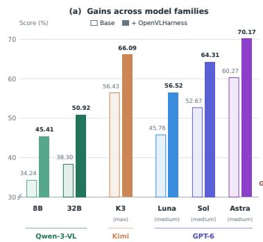

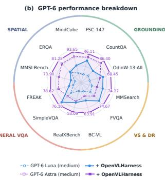

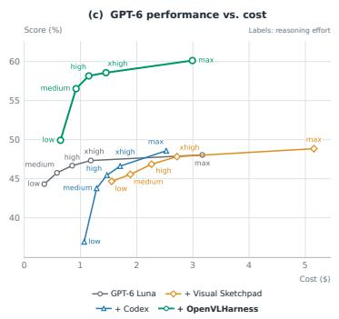  
Figure 1: Performance of OpenVLHarness across models and settings. (a) Average score over 22 challenging multimodal benchmarks with and without OpenVLHarness, across the Qwen, Kimi, and GPT model families. (b) Benchmark scores for GPT-6 Luna and GPT-6 Astra at medium reasoning effort, each with and without OpenVLHarness; radii are rescaled per benchmark, and numbers give the raw scores of GPT-6 Astra (medium) with OpenVLHarness. (c) Average score versus modeltoken cost (average for 1,000 query rollouts) on 22 benchmarks for GPT-6 Luna alone and with Codex, Visual Sketchpad, or OpenVLHarness, across all five reasoning-effort settings.

## 1 INTRODUCTION

Multimodal large language models (MLLMs) are increasingly used as reasoning engines over images, documents, webpages, and videos. However, many real-world visual tasks require information that the model cannot reliably infer from the input alone. Answering a question may require localizing numerous tiny objects in dense scenes, retrieving external knowledge about a long-tail entity, or computing quantities from intermediate measurements. Such tasks require additional multimodal evidence acquired through perception, search, and computation. Our inference-time scaling study (Fig. 1c) reveals diminishing returns at higher reasoning budgets: moving the base model from xhigh to max effort multiplies its model-token spending by 2.7 but improves its average score by only 0.7 points. This raises the question of whether further progress requires better access to task-relevant multimodal evidence, beyond additional reasoning over the initial input.

Visual tool-use agents address this need by connecting MLLMs to perception models, search engines, and code execution (Hong et al., 2026a; Wu et al., 2025a; Narayan et al., 2025; Geng et al., 2026; Su et al., 2025; Wu et al., 2025b; Sur´ıs et al., 2023; Gupta & Kembhavi, 2023). Building a general harness around these tools presents two connected challenges. First, heterogeneous backends expose different calling conventions and return outputs such as segmentation masks, depth maps, and retrieved webpages that need to be presented in a form the model can interpret. Second, subsequent reasoning steps may still need access to the underlying artifacts: a rendered depth map supports visual inspection, but a precise measurement requires its numerical values. Effective multimodal tool use therefore requires both consistent tool interfaces with evidence rendering and a mechanism for retaining and reusing the resulting artifacts.

We introduce OpenVLHarness, a multimodal reasoning harness organized around a capability layer and persistent multimodal memory. The capability layer combines task-level tool interfaces with model-facing evidence rendering. Task-level interfaces define operations independently of a particular backend, allowing tools to be replaced without changing the orchestrator’s task vocabulary. Evidence rendering converts heterogeneous outputs into observations that combine visualizations, concise descriptions, and compact structured information. For example, visual grounding accepts an image and a textual query, then presents the detected regions through an annotated image and coordinates. Together, these mechanisms let the orchestrator invoke tools consistently and inspect their results in a form suited to multimodal reasoning.

Persistent multimodal memory makes the corresponding artifacts available across turns within a query. Images, structured data, and web references are registered under reusable handles, allowing later calls to operate on earlier evidence. In the grounding example, the orchestrator can inspect the overlay, then reuse the retained masks and a subsequently acquired depth array to measure depth within each region. A Python Coding Agent supports such compositions: the orchestrator specifies a computational objective in natural language, and a code-generation session backed by the same backbone model writes a program that executes over the stored data. The capability layer makes tool results interpretable; memory makes their underlying artifacts addressable and reusable. Together, they support an iterative process of acquiring, inspecting, and computing over multimodal evidence.

We evaluate OpenVLHarness on 22 benchmarks spanning grounded perception, visual search and deep research, general VQA and hallucination, and spatial reasoning, using eight open and proprietary MLLM backbones of different scales (Fig. 1a). Across these settings, OpenVLHarness consistently improves average performance over the base MLLMs by 9.7–12.6 percentage points and outperforms existing visual tool-use baselines (Fig. 1c). Scaling experiments on 22 benchmarks further show that OpenVLHarness also benefits from greater reasoning effort (Fig. 1c), suggesting that evidence acquisition and inference-time scaling are complementary. We conduct ablation studies to examine the incremental effects of the capability layer and memory, showing the value of both usable tool outputs and retained multimodal artifacts. Lastly, for users who would like to adapt our harness to a custom domain, we further showcase two coding-agent-driven workflows for special ization: harness search edits prompts, tool descriptions, and output templates, while tool generation composes existing capabilities into new tools. Both operate without updating the underlying MLLM weights.

Our contributions are: (1) a capability layer that combines task-level tool interfaces with modelfacing evidence rendering for heterogeneous perception, search, and computation tools; (2) persistent multimodal memory that retains addressable artifacts across turns and enables their reuse in subsequent tool calls and memory-grounded computation; and (3) an evaluation across 22 benchmarks and eight backbones, with component ablations and domain-specialization studies, accompanied by an open-source release of the harness, tools, evaluation protocols, and two optimization workflows.

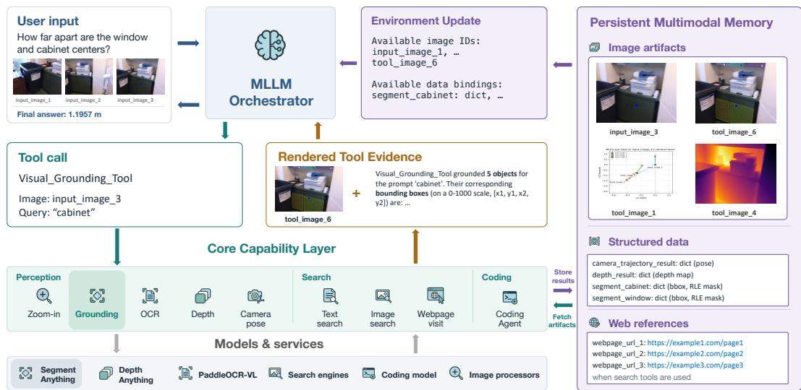  
Figure 2: Overview of OpenVLHarness. The MLLM orchestrator invokes capabilities through typed interfaces. The capability layer connects these interfaces to underlying models and services and renders their outputs into model-facing evidence: here, a labeled mask overlay accompanied by a textual description and normalized bounding boxes. Persistent multimodal memory retains image artifacts, structured data, and web references under reusable handles. An Environment Update advertises the available artifacts to the orchestrator, allowing subsequent calls to reuse earlier evidence, including through memory-grounded computation.

## 2 HARNESS DESIGN

OpenVLHarness augments an MLLM orchestrator with two complementary mechanisms (Figure 2). The capability layer combines task-level tool interfaces with model-facing evidence rendering, providing consistent access to tools and observations the orchestrator can inspect (Sec. 2.1). Persistent multimodal memory retains the corresponding artifacts and exposes them by reference for reuse across turns within a query (Sec. 2.2). At each step, the orchestrator uses the observations and available memory references to select a tool call or produce an answer. A Python Coding Agent supports computation over stored artifacts, connecting outputs from different capabilities into multi-step procedures. The modular interfaces and renderers also support harness specialization through text edits and tool composition (Sec. 3.6).

## 2.1 CAPABILITY LAYER

We design the capability layer with two goals: defining how the orchestrator invokes a capability and rendering the resulting evidence for inspection. The first accommodates different backends behind a consistent interface; the second addresses the heterogeneous formats of their outputs.

Task-level tool interfaces. We define a capability by the operation it provides, its typed inputs, and the evidence and reusable data it exposes. For example, visual grounding accepts an image reference and a textual query and exposes object locations, associated metadata, and a visualization; a supporting backend may additionally provide segmentation masks. Each backend is wrapped to implement this task-level interface. Visual Grounding can thus use SAM 3 or Grounding DINO, and OCR can use PaddleOCR-VL or DeepSeek-OCR, while preserving the orchestrator’s calling convention (Appendix C). Backend selection can reflect accuracy, cost, and latency requirements. Our base instantiation includes nine capabilities: five for perception—Zoom-in, Visual Grounding,

OCR, Depth Estimation, and Camera Trajectory; three for information seeking—Text Search, Image Search, and Webpage Visit; and a Python Coding Agent for computation over intermediate results. Please refer to Appendix C and Table 18 for their implementation details.

Model-facing evidence rendering. Raw tool outputs often require additional processing to become useful observations. An RLE mask encodes a region precisely, but serializing that encoding into the context does not show the orchestrator which object was segmented. Dense numerical arrays can likewise consume substantial context without providing useful, interpretable evidence.

Each capability therefore includes an output processor that renders its result into a model-facing observation. Depending on the capability, this observation combines visual attachments, concise natural-language descriptions, compact structured information, and references to reusable artifacts. Grounding can return a labeled mask overlay with the number of detected objects and normalized bounding boxes; depth estimation can return a colorized map; and Camera Trajectory can return a visualization of the recovered trajectory. The underlying masks, arrays, and camera parameters are passed to memory for later reuse. Figure 2 illustrates grounding for “cabinet” in input image 3. The capability returns a mask overlay with a description of the five grounded objects and their bounding boxes, allowing the orchestrator to inspect the detections. If a subsequent step requires a depth measurement for each cabinet, this rendered observation supplies the visual context, while the retained masks and a depth array supply the data for computation. The memory mechanism below connects these steps.

## 2.2 PERSISTENT MULTIMODAL MEMORY

The capability layer makes tool results interpretable; persistent multimodal memory makes their underlying artifacts addressable and reusable. A later tool call must be able to identify a particular image, mask, or array and access its contents. Repeating a description of a previous result does not provide this access.

We maintain an explicit artifact registry for each query, with entries retained across its reasoning trajectory. The registry separates an artifact’s payload from the handle used to reference it. The orchestrator sees available names and compact descriptors, while the harness retains the underlying values and resolves references when needed. The registry contains three categories:

• Image artifacts: input, tool-generated, and retrieved images, exposed through handles such as input image 3 and tool generated image 6. Duplicate images reuse an existing registry entry.

• Structured data bindings: named values containing boxes, scores, masks, depth arrays, camera parameters, OCR results, and other tool outputs. Each binding has a descriptor identifying its fields and types, including array shapes where applicable.

• Web references: retrieved URLs exposed through handles such as webpage url 1, allowing later navigation without requiring the model to reproduce the original URL.

Registering and reusing artifacts. After a successful tool call, the harness registers supported artifacts and associates their handles with the capability’s rendered observation. Images are delivered as visual attachments with named references; structured payloads remain accessible through data bindings. An Environment Update advertises the available image handles, data bindings, and web references after each tool turn, exposing the current namespace without repeating every artifact’s full payload. In the cabinet example, the grounding call adds an overlay image and bindings for the detection data, including bounding boxes and RLE masks.

When a subsequent call refers to an artifact, the harness resolves its handle to the input required by the receiving tool. An image handle supplies the image for a later visual operation, a web reference supplies a URL for Webpage Visit, and a data binding supplies values for code execution. The orchestrator can thus reuse the grounding and depth results without reconstructing their contents from earlier descriptions. References connect retained evidence across tools and turns. The detailed representation and handles can be found in Appendix C.4 and Table 19.

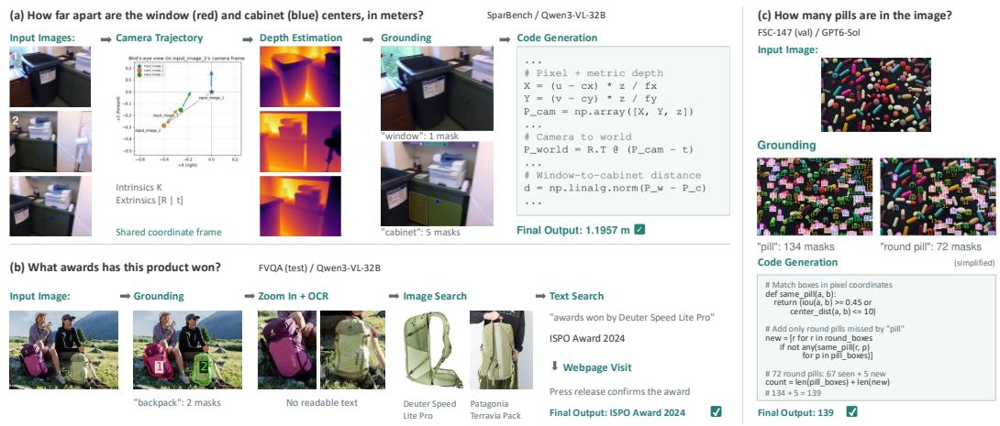  
Figure 3: Qualitative examples of OpenVLHarness. (a) Camera poses, depth, and grounding are combined in code to measure a 3D distance (Example 17). (b) Grounded crops are passed to OCR and image search, and the answer is verified on the web (Example 8). (c) Masks from two grounding queries are reconciled in code to reach the exact count (Example 1).

Memory-grounded computation. To compute depth within the detected cabinets, the orchestrator delegates a natural-language objective to the Python Coding Agent, such as “compute the average depth within each detected region.” The harness supplies descriptors of the available memory bindings to a fresh code-generation context of the same backbone model. The generated program executes with the actual binding values available as named variables, allowing it to combine the grounding masks with the depth array. Execution results and feedback return in language, with supported output artifacts registered for subsequent reuse. The orchestrator can then use the result or revise the objective in a later call.

This mechanism also supports filtering detections, aggregating OCR values, and other computations over intermediate results without requiring the orchestrator to serialize large arrays into its request. The capability layer supplies reusable operations and interpretable observations; memory and code execution connect their outputs into longer reasoning procedures.

Qualitative examples. Figure 3 shows three trajectories from our evaluation. In each, the agent chains several capabilities and reuses their outputs through memory: camera poses, depth maps, and grounding masks become bindings for exact 3D computation (a); grounded crops are passed by identifier to zoom-in, OCR, and image search before the answer is verified on the web (b); and masks from two grounding queries are reconciled in code to correct an undercount (c).

## 3 EXPERIMENTS

## 3.1 TASKS, MODELS, AND BASELINES

Tasks. We evaluate OpenVLHarness across four task domains spanning 22 datasets, as summarized in Table 1 (splits, sizes, and scoring in Appendix D):

• Grounded perception. Five benchmarks targeting object counting and open-vocabulary visual grounding: CountQA (Tamarapalli et al., 2025), FSC-147 (Ranjan et al., 2021), OdinW-13-All (Li et al., 2022), FSCD-147 (Nguyen et al., 2022), and FSCD-LVIS (Nguyen et al., 2022).

• Visual search and deep research. Six benchmarks drawn from a suite of 11 multimodal information-seeking tasks: FVQA (Wu et al., 2025a), MMSearch (Jiang et al., 2024), MMSearch-Plus (Tao et al., 2026), HLE-VL (Phan et al., 2025), BrowseComp-VL (Geng et al., 2026), and RealX-Bench (Hong et al., 2026a); the remaining five are evaluated in Appendix B.5.

• General VQA and hallucination. Six benchmarks covering general visual question answering and hallucination robustness: RealWorldQA (xAI, 2024), SimpleVQA (Cheng et al., 2025),

<table><tr><td colspan="2"></td><td colspan="4">Qwen3-VL-8B</td><td colspan="4">Qwen3-VL-32B</td><td colspan="4">GPT-6 Luna (medium)</td><td colspan="2">GPT-6 Astra (medium)</td></tr><tr><td colspan="2">Domain Dataset</td><td>Base OT</td><td></td><td>VS</td><td>Ours</td><td>Base</td><td>OT</td><td>VS</td><td>Ours</td><td>Base</td><td>VS</td><td>CX</td><td>Ours</td><td>Base</td><td>Ours</td></tr><tr><td rowspan="5">Grounded Percpton</td><td>CountQA</td><td>32.00</td><td>29.06</td><td>19.83</td><td>48.56</td><td>44.70</td><td>41.75</td><td>32.85</td><td>64.14</td><td>55.17</td><td>52.68</td><td>58.25</td><td>66.95</td><td>82.00</td><td>86.40</td></tr><tr><td>FSC-147</td><td>15.32</td><td>11.26</td><td>9.41</td><td>37.71</td><td>18.97</td><td>12.44</td><td>12.35</td><td>39.42</td><td>28.23</td><td>30.25</td><td>28.62</td><td>41.52</td><td>44.01</td><td>46.11</td></tr><tr><td>OdinW-13-All</td><td>39.80</td><td>24.60</td><td>31.77</td><td>50.40</td><td>42.39</td><td>44.33</td><td>36.10</td><td>59.13</td><td>36.74</td><td>43.84</td><td>36.14</td><td>53.56</td><td>50.46</td><td>60.45</td></tr><tr><td>FSCD-147</td><td>1.79</td><td>0.93</td><td>1.41</td><td>23.52</td><td>2.88</td><td>2.55</td><td>2.30</td><td>28.45</td><td>4.24</td><td>6.11</td><td>2.86</td><td>25.74</td><td>15.49</td><td>30.33</td></tr><tr><td>FSCD-LVIS</td><td>1.47</td><td>1.36</td><td>2.49</td><td>27.37</td><td>1.79</td><td>3.91</td><td>4.57</td><td>31.63</td><td>2.44</td><td>8.65</td><td>2.23</td><td>30.55</td><td>10.55</td><td>36.02</td></tr><tr><td rowspan="6">Vs eaal Seand Desrd arch</td><td>MMSearch</td><td>14.04</td><td>9.94</td><td>14.62</td><td>51.46</td><td>20.47</td><td>18.13</td><td>18.71</td><td>62.57</td><td>49.12</td><td>46.78</td><td>49.12</td><td>64.91</td><td>57.31</td><td>74.27</td></tr><tr><td>MMSearch-Plus</td><td>1.29</td><td>3.54</td><td>4.18</td><td>14.79</td><td>2.57</td><td>3.54</td><td>5.14</td><td>17.68</td><td>10.93</td><td>4.50</td><td>8.68</td><td>26.37</td><td>27.97</td><td>53.70</td></tr><tr><td>RealX-Bench</td><td>22.16</td><td>26.80</td><td>22.16</td><td>34.71</td><td>24.74</td><td>26.80</td><td>29.90</td><td>40.21</td><td>31.96</td><td>35.05</td><td>34.02</td><td>45.36</td><td>44.33</td><td>53.09</td></tr><tr><td>FVQA</td><td>28.39</td><td>32.67</td><td>28.67</td><td>55.00</td><td>32.67</td><td>35.00</td><td>33.33</td><td>62.67</td><td>52.89</td><td>47.72</td><td>48.06</td><td>68.78</td><td>60.67</td><td>74.67</td></tr><tr><td>HLE-VL</td><td>6.36</td><td>7.58</td><td>4.24</td><td>10.30</td><td>10.00</td><td>9.09</td><td>6.67</td><td>11.52</td><td>27.58</td><td>20.30</td><td>22.42</td><td>27.88</td><td>49.09</td><td>56.06</td></tr><tr><td>BC-VL</td><td>21.05</td><td>15.79</td><td>10.53</td><td>32.33</td><td>28.82</td><td>19.55</td><td>15.04</td><td>33.08</td><td>38.60</td><td>39.85</td><td>38.85</td><td>51.88</td><td>46.12</td><td>63.91</td></tr><tr><td rowspan="6">Gra V nd Halltion</td><td>RealWorldQA</td><td>71.37</td><td>69.67</td><td>69.15</td><td>72.67</td><td>78.82</td><td>76.21</td><td>74.38</td><td>80.52</td><td>80.65</td><td>80.26</td><td>79.35</td><td>80.78</td><td>87.58</td><td>92.16</td></tr><tr><td>SimpleVQA</td><td>54.33</td><td>46.27</td><td>42.81</td><td>70.00</td><td>59.00</td><td>51.75</td><td>49.58</td><td>70.33</td><td>55.46</td><td>55.06</td><td>54.47</td><td>72.20</td><td>62.17</td><td>76.10</td></tr><tr><td>HallusionBench</td><td>57.76</td><td>55.66</td><td>54.01</td><td>59.07</td><td>61.66</td><td>53.82</td><td>59.38</td><td>63.40</td><td>67.25</td><td>66.99</td><td>63.82</td><td>67.76</td><td>78.75</td><td>83.78</td></tr><tr><td>FREAK-VQA</td><td>44.68</td><td>38.8033.04</td><td></td><td>37.05</td><td>44.06</td><td>45.06</td><td>37.92</td><td>48.19</td><td>41.68</td><td>46.06</td><td>39.17</td><td>51.94</td><td>63.20</td><td>73.34</td></tr><tr><td>FREAK-MCQ</td><td>36.42</td><td>31.39</td><td>35.31</td><td>36.82</td><td></td><td>44.0638.73</td><td>38.33</td><td>45.77</td><td>49.40</td><td>51.31</td><td>44.37</td><td>56.34</td><td>76.26</td><td>83.90</td></tr><tr><td>V*</td><td>83.24</td><td>73.30 71.73</td><td></td><td>83.24</td><td>85.34 76.44</td><td></td><td>85.86</td><td>88.48</td><td>85.86</td><td>85.86</td><td>80.63</td><td>90.05</td><td>93.72</td><td>97.38</td></tr><tr><td rowspan="5">Reasoning Spatial</td><td>MMSI-Bench</td><td>31.60</td><td>27.90</td><td>28.10</td><td>33.00</td><td>35.00</td><td>36.60</td><td>32.40</td><td>38.00</td><td>38.30</td><td>40.00</td><td>38.20</td><td>47.70</td><td>65.20</td><td>73.90</td></tr><tr><td>ERQA</td><td>44.00</td><td>41.25</td><td>35.50</td><td>43.00</td><td>44.75</td><td>46.25</td><td>48.25</td><td>48.00</td><td>59.75</td><td>59.75</td><td>54.25</td><td>61.00</td><td>76.50</td><td>81.25</td></tr><tr><td>EmbSpatial</td><td>78.37</td><td>73.71</td><td>75.74</td><td>78.90</td><td>80.54</td><td>76.15</td><td>78.98</td><td>80.00</td><td>78.98</td><td>77.50</td><td>75.36</td><td>79.48</td><td>82.99</td><td>85.14</td></tr><tr><td>SparBench</td><td>39.55</td><td>38.32</td><td>34.63</td><td>43.73</td><td>46.98</td><td>45.29</td><td>44.69</td><td>46.76</td><td>52.10</td><td>46.55</td><td>46.16</td><td>58.31</td><td>63.68</td><td>68.17</td></tr><tr><td>MindCube</td><td>28.36</td><td>39.71</td><td>41.44</td><td>55.48</td><td>32.40</td><td>45.96</td><td>44.13</td><td>60.19</td><td>59.33</td><td>57.02</td><td>58.08</td><td>74.42</td><td>87.79</td><td>93.65</td></tr><tr><td colspan="2">Average</td><td>34.24</td><td>31.80</td><td>30.49</td><td>45.41</td><td>38.30</td><td>36.79</td><td>35.95</td><td>50.92</td><td>45.76</td><td>45.55</td><td>43.78</td><td>56.52</td><td>60.27</td><td>70.17</td></tr></table>

Table 1: Main results across four task domains and 22 datasets. Results are grouped by MLLM backbone. Base denotes the backbone without tool use; for harness, OT, VS, and CX denote OctoTools, Visual Sketchpad, and Codex, respectively; Ours denotes OpenVLHarness. GPT-6 Sol, GPT-5, and Kimi K3 results are in Table 7. Bold indicates the best result within each backbone group, and underlining indicates the best result across all shown backbones. Qwen3-VL results are means of three runs (standard deviations in Table 26); GPT-6 results are single runs. OdinW-13-All asks for all categories of an image’s source dataset in one query.

HallusionBench (Guan et al., 2024), FREAK-VQA (Yin et al., 2026), FREAK-MCQ (Yin et al., 2026), and V\* (Wu & Xie, 2024).

• Spatial reasoning. Five benchmarks targeting spatial and embodied reasoning: MMSI-Bench (Yang et al., 2025b), ERQA (Team et al., 2025), EmbSpatial-Bench (Du et al., 2024), SparBench (Zhang et al., 2026a), and MindCube (Wang et al., 2025c).

Models and baselines. We instantiate OpenVLHarness on four open-source models across different sizes—Qwen2.5-VL-7B-Instruct (Qwen Team, 2025a), Qwen3-VL-8B-Instruct (Qwen Team, 2025b), Qwen3-VL-32B-Instruct, and Kimi K3 (Team et al., 2026)—and four proprietary models: GPT-5 (OpenAI, 2025b), GPT-6 Luna, GPT-6 Sol, and GPT-6 Astra (OpenAI, 2026). Per-model sampling parameters can be found in Appendix C.6. Because the search APIs, the agent’s toolrouting decisions, and the LLM judge are all stochastic, every Qwen3-VL result, for OpenVLHarness and for all baselines, is the mean of three independent runs with different random seeds, while results with proprietary backbones are single runs because of API cost (standard deviations in Appendix H). In addition to the no-tool baseline (denoted Base), we compare OpenVLHarness against two groups of baselines: Training-based baselines: AdaReasoner (Song et al., 2026), PixelReasoner (Wang et al., 2025a), and DeepEyesV2 (Hong et al., 2026a)—harnesses that require finetuning the backbone to adapt it to the tool-use framework—evaluated with their released Qwen2.5- VL-7B checkpoints (Appendix Table 9; setup in Appendix G.2). Training-free baselines: Visual

<table><tr><td rowspan="2">Reasoning effort</td><td colspan="4">medium</td><td colspan="4">high</td><td colspan="4">xhigh</td><td colspan="4">max</td></tr><tr><td>Base</td><td>CX</td><td>VS</td><td>Ours</td><td>Base</td><td>CX</td><td>VS</td><td>Ours</td><td>Base</td><td>CX</td><td>VS</td><td>Ours</td><td>Base</td><td>CX</td><td>VS</td><td>Ours</td></tr><tr><td>Grounding</td><td>25.4</td><td>25.6</td><td>28.3</td><td>43.7</td><td>26.5</td><td>26.3</td><td>29.3</td><td>44.6</td><td>27.0</td><td>27.1</td><td>29.3</td><td>45.2</td><td>27.2</td><td>30.0</td><td>29.6</td><td>45.6</td></tr><tr><td>VS &amp;DR</td><td>35.2</td><td>33.5</td><td>32.4</td><td>47.5</td><td>35.3</td><td>35.4</td><td>34.6</td><td>50.3</td><td>37.4</td><td>36.7</td><td>35.6</td><td>50.6</td><td>37.8</td><td>40.3</td><td>36.9</td><td>52.7</td></tr><tr><td>General VQA</td><td>63.4</td><td>60.3</td><td>64.3</td><td>69.8</td><td>64.4</td><td>61.8</td><td>65.1</td><td>71.5</td><td>64.7</td><td>63.0</td><td>66.6</td><td>71.5</td><td>64.5</td><td>63.5</td><td>66.5</td><td>72.6</td></tr><tr><td>Spatial</td><td>57.7</td><td>54.4</td><td>56.2</td><td>64.2</td><td>59.3</td><td>57.0</td><td>57.1</td><td>65.3</td><td>58.7</td><td>58.4</td><td>58.5</td><td>65.9</td><td>61.5</td><td>59.1</td><td>61.4</td><td>68.5</td></tr><tr><td>Average</td><td>45.8</td><td>43.8</td><td>45.5</td><td>56.5</td><td>46.7</td><td>45.5</td><td>46.9</td><td>58.2</td><td>47.3</td><td>46.6</td><td>47.8</td><td>58.6</td><td>48.0</td><td>48.6</td><td>48.8</td><td>60.1</td></tr><tr><td>$ / 1k questions</td><td>0.58</td><td>1.29</td><td>1.89</td><td>0.92</td><td>0.85</td><td>1.47</td><td>2.27</td><td>1.15</td><td>1.18</td><td>1.71</td><td>2.72</td><td>1.45</td><td>3.17</td><td>2.52</td><td>5.15</td><td>2.99</td></tr></table>

Table 2: Reasoning effort versus harness, by domain. GPT-6 Luna alone (Base) and with Codex (CX), Visual Sketchpad (VS), or OpenVLHarness (Ours) on the full evaluation splits of our 22 benchmarks. Rows average each domain’s benchmarks: Grounding (grounded perception, 5), VS & DR (visual search and deep research, 6), General VQA (general VQA and hallucination, 6), and Spatial (spatial reasoning, 5). \$ / 1k questions is the model-token cost at Standard-tier prices, including reasoning tokens and excluding tool execution and judging, averaged over the 22 benchmarks. At each effort, bold marks the best score, and in the cost row the cheapest method, with the second cheapest underlined. Low effort is in Appendix Table 13.

Sketchpad (Hu et al., 2024) and OctoTools (Lu et al., 2025) are visual tool-use harnesses evaluated on the same Qwen3-VL backbones as OpenVLHarness (detailed setup in Appendix G.1). We additionally evaluate Visual Sketchpad and Codex on GPT-6 Luna.

## 3.2 MAIN RESULTS

Across the evaluated backbones, OpenVLHarness improves average performance over the underlying base model and outperforms all existing training-free harnesses (Table 1). On Qwen3-VL-8B, it raises the 22-dataset average from 34.2 to 45.4 (+11.2), exceeding the strongest trainingfree baseline, OctoTools (31.8), by 13.6 points; on Qwen3-VL-32B, the average rises from 38.3 to 50.9 (+12.6). The gains extend to GPT-5 (44.4 → 55.7), GPT-6 Sol (52.7 → 64.3), and Kimi K3 (56.4 → 66.1) (Appendix Table 7). On the Qwen2.5-VL-7B backbone, OpenVLHarness averages 33.45 across the 22 datasets, surpassing the training-based baselines AdaReasoner (25.29), Pixel-Reasoner (28.02), and DeepEyesV2 (25.02), without updating model weights (Appendix Table 9).

The GPT-6 results highlight that effective multimodal tool use depends on the harness. With GPT-6 Luna, Codex averages 43.8, below the no-tool baseline (45.8), while OpenVLHarness reaches 56.5. This comparison shows that a coding-agent harness does not automatically improve multimodal reasoning. With GPT-6 Astra, OpenVLHarness improves all 22 benchmarks and raises the average from 60.3 to 70.2, the highest of any backbone.

Grounded perception and visual search and deep research benefit substantially from dedicated vision experts and external retrieval, respectively. Gains on general VQA and hallucination and on spatial reasoning depend more on the backbone: Luna and Astra improve on every benchmark in these domains (Luna by less than one point on RealWorldQA, HallusionBench, and EmbSpatial), with average gains of +6.5/+7.5 on general VQA and hallucination and +6.5/+5.2 on spatial reasoning, respectively. This pattern is consistent with greater proficiency in using tools and reasoning over their visual evidence. The less consistent gains on Qwen3-VL-8B motivate the failure analysis and domain specialization in Secs. 3.5 and 3.6.

## 3.3 CAN MORE REASONING REPLACE THE HARNESS?

OpenVLHarness makes several model calls per question, each carrying tool outputs and memory, so it spends more model tokens than prompting the base model directly. To test whether its gains come simply from extra computation, we run Base, Codex, Visual Sketchpad, and OpenVLHarness with GPT-6 Luna at five reasoning-effort settings, from low to max, on the full evaluation splits of all 22 benchmarks (26,229 questions per setting). Figure 1c reports the 22-benchmark averages against model-token cost, and Table 2 breaks them down by domain.

Additional effort yields limited gains for the other methods: from low to max effort, Base rises from 44.3 to 48.0 and Visual Sketchpad from 44.7 to 48.8, while Codex, the weakest method at low effort, rises from 36.9 to 48.6. The step from xhigh to max effort alone multiplies their model-token cost by 1.5–2.7. At max effort, all three remain well below OpenVLHarness at medium effort (56.5), which spends at most 37% of their model-token cost per question, and OpenVLHarness at low effort (49.9) is already on par with their max-effort averages. The domain breakdown shows where the harness matters most. On grounded perception and on visual search and deep research, every effort setting of OpenVLHarness, including low, scores above every setting of the other methods, and at max effort it leads the best of them by 15.6 and 12.4 points. On general VQA and hallucination and on spatial reasoning, the harness benefits from more reasoning: at low effort, OpenVLHarness trails Base slightly (61.5 vs. 61.6 and 54.5 vs. 56.5), but from medium effort onward it scores above every setting of every other method in every domain, and at max effort it leads by 6.1 and 7.1 points. Raising the effort of OpenVLHarness itself lifts its average from 56.5 to 60.1. Acquiring and composing multimodal evidence therefore complements stronger reasoning: additional computation remains useful, but does not eliminate the benefit of the harness within the tested budgets. Costs cover model tokens, including reasoning tokens, and exclude tool execution and judging; Appendix B.6 gives the setup, per-benchmark scores, token usage, and how often Codex executes code.

<table><tr><td rowspan="2">Variant</td><td colspan="2">Grounding</td><td colspan="2">VS &amp;DR</td><td colspan="2">General VQA</td><td colspan="2">Spatial</td><td colspan="2">Overall</td></tr><tr><td>8B</td><td>32B</td><td>8B</td><td>32B</td><td>8B</td><td>32B</td><td>8B</td><td>32B</td><td>8B</td><td>32B</td></tr><tr><td>Baseline (no tool)</td><td>27.48</td><td>31.72</td><td>18.40</td><td>23.34</td><td>57.97</td><td>62.16</td><td>44.38</td><td>47.93</td><td>37.06</td><td>41.29</td></tr><tr><td>+ Tools</td><td>41.70</td><td>43.30</td><td>21.44</td><td>24.89</td><td>52.41</td><td>61.41</td><td>47.83</td><td>52.84</td><td>40.84</td><td>45.61</td></tr><tr><td>+ Capability layer</td><td>46.73</td><td>46.20</td><td>25.97</td><td>32.74</td><td>56.05</td><td>63.63</td><td>48.16</td><td>52.63</td><td>44.23</td><td>48.80</td></tr><tr><td>+ Textual memory</td><td>47.27</td><td>45.74</td><td>26.92</td><td>34.43</td><td>57.54</td><td>64.84</td><td>47.98</td><td>51.46</td><td>44.93</td><td>49.12</td></tr><tr><td>OpenVLHarness</td><td>45.46</td><td>51.74</td><td>33.10</td><td>37.96</td><td>59.81</td><td>66.12</td><td>50.82</td><td>54.59</td><td>47.14</td><td>52.51</td></tr></table>

Table 3: Ablation study of OpenVLHarness across model scales. We progressively add raw tool access, capability layer, textual memory, and multimodal memory to the no-tool baseline. Results are reported across four domains and overall for Qwen3-VL 8B and 32B models, averaged over three runs; standard deviations are provided in Table 27. Bold marks the best result in each column.

## 3.4 ABLATION STUDY

Table 3 examines the two mechanisms introduced in Sec. 2: the capability layer, which combines task-level tool interfaces with model-facing evidence rendering, followed by persistent multimodal memory, which makes the resulting artifacts addressable and reusable across turns. Starting from the no-tool baseline, we add raw tool access, then the capability layer, and finally memory, using a textual-memory variant as an intermediate comparison (details in Appendix B.2).

Raw tool access raises the overall average by +3.8 points at 8B and +4.3 at 32B, with the largest gains in grounded perception. Adding the capability layer restores full tool schemas and renders heterogeneous outputs into concise observations, yielding another +3.4 and +3.2 points. These gains support the joint value of task-level tool interfaces and model-facing evidence rendering; the comparison does not separate their individual contributions.

Adding textual memory enables structured data bindings, web references, and Environment Updates, but represents tool-generated images only through descriptions, without reusable image handles. This adds +0.7 points at 8B and +0.3 at 32B. Completing persistent multimodal memory with visual attachments and reusable image handles adds a further +3.1 and +4.5, bringing the full harness to 47.1 and 52.5. The largest gains from this final step occur in visual search and deep research (+6.2/+3.5), with additional gains in spatial reasoning (+2.8/+3.1). The results support the method’s complementary mechanisms: interpretable tool observations, followed by retained multimodal artifacts that can be revisited and composed across turns.

## 3.5 FAILURE ANALYSIS

We use Kimi K3 to critique 9,893 failed Qwen3-VL-8B trajectories across 22 benchmarks. Given the question, answer, images, trajectory, and toolbox, the critic assesses each tool call and identifies the trajectory’s primary failure cause and proposes a fix. Its labels agree with human annotations on 92% of 100 sampled failures. The protocol, coverage, and taxonomy are detailed in Appendix E.1.

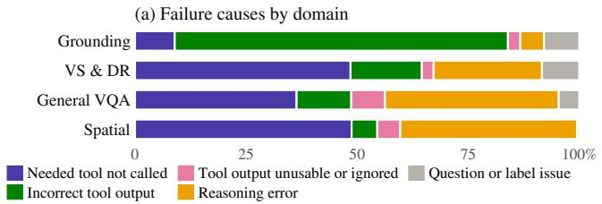

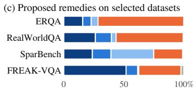

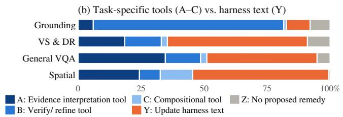

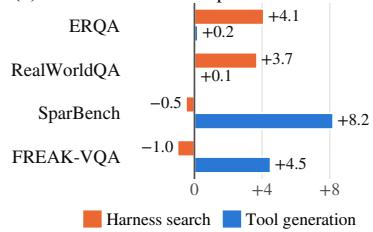  
Figure 4: Failure diagnosis and harness specialization with Qwen3-VL-8B. We critique failure trajectories using Kimi K3. (a) Distribution of failure causes across four domains. (b) Proposed remedies: grouped into creating task-specific tools (A–C), updating harness text (Y), and no proposed remedy (Z). (c) Four datasets selected for contrasting remedy profiles: Y (orange) dominates ERQA and RealWorldQA, while A–C (blue) dominates SparBench and FREAK-VQA. (d) Gains from harness search and tool generation over the unoptimized harness. Harness search is more effective on datasets dominated by text-level changes, while tool generation yields larger gains when task-specific tools are preferred.

Surprisingly, we find that failure patterns differ across domains (Fig. 4a). Despite substantial overall gains, grounded perception remains challenging in crowded images with more than 25 objects, where missed or merged instances limit exhaustive detection. Such perception errors account for the dominant “incorrect tool output” category (75% of failures in this domain). Failures in visual search and deep research most often involve an omitted tool call (49%), while failures in spatial reasoning and in general VQA and hallucination involve both omitted tool calls and reasoning errors, consistent with our hypothesis that the model has limited proficiency in spatial reasoning and tool use. Failures involving unusable or ignored correct tool outputs are uncommon (3–8% across domains), suggesting that the capability layer generally presents retrieved evidence in a usable form.

Failure causes alone do not determine how to specialize the harness: an omitted call may require clearer instructions or a new composition of tools. We therefore combine the cause and proposed fix into remedy channels (Fig. 4b). Constructing new task-specific tools can make evidence interpretation explicit (A), enforce systematic verification, filtering of tool results (B), or supply a missing tool composition (C). In contrast, harness text changes (Y)—edits to the system prompt, tool descriptions, and output messages—guide the model to call existing tools when needed and use their results appropriately. The remaining channel (Z) covers cases without a proposed remedy. These diagnostic recommendations guide optimization rather than predict recoverable accuracy, since the critique covers only failed trajectories. Exact mapping rules and per-dataset shares are in Appendix E.2.

## 3.6 HARNESS OPTIMIZATION

When adapting OpenVLHarness to a custom domain, users can use failures on their own data to identify which parts of the harness need refinement. We provide two coding-agent-driven workflows for specializing the general-purpose harness without updating model weights. Harness search edits system prompts, tool descriptions, and evidence-rendering templates, selecting candidates through repeated evaluation. Tool generation implements and refines task-specific tools by composing existing capabilities (algorithms in Appendix E.3). To compare them, we select four datasets with contrasting remedy profiles (Fig. 4c): harness text changes (Y) dominate ERQA (71%) and Real-WorldQA (56%), whereas task-specific tools (A+B+C) dominate SparBench (75%) and FREAK

VQA (62%). We run both workflows on all four datasets with Qwen3-VL-8B, testing whether their relative benefits align with these profiles.

The results follow this distinction (Fig. 4d). Harness search improves ERQA and RealWorldQA by +4.1 and +3.7 points, compared with +0.2 and +0.1 from tool generation. Conversely, tool generation improves SparBench and FREAK-VQA by +8.2 and +4.5, while harness search yields −0.5 and −1.0. The generated tools compute metric 3D relations on SparBench and make visibility decisions explicit on FREAK-VQA, matching the missing-composition and evidence-interpretation needs identified by the critique (Table 24). These results suggest a practical approach to adaptation on custom data: diagnose the prevailing failures, then use harness search to improve the use of existing capabilities or tool generation to add the task-specific operations the domain requires.

## 4 RELATED WORK

Visual Tool-Use Baselines. Early visual tool-use work treats the problem as program synthesis, compiling a question into a sequential plan that invokes vision tools in a pipeline to produce an answer (Sur´ıs et al., 2023; Gupta & Kembhavi, 2023; Kamali & Kordjamshidi, 2026; Zhao et al., 2025; Wu et al., 2023; Yang et al., 2023b; Gao et al., 2023; Castrejon et al., 2024; Zhang et al., 2026b; Zhou et al., 2024; Menon et al., 2024; Chen et al., 2024b; You et al., 2023); because these plans are fixed in place, they cannot be adjusted based on tool execution results. A later line adopts multi-turn frameworks that interleave reasoning with visual feedback, but depends on brittle, taskspecific framework designs that require extensive training to work (Ma et al., 2025; Zhou et al., 2025a; Song et al., 2026; Wang et al., 2025a; Zheng et al., 2025; Hong et al., 2026a; Su et al., 2025; Wu et al., 2025b; Zhao et al., 2026), and many domain-specific visual tool-use frameworks fall into the same category (Chen et al., 2025a; Wu et al., 2025a; Narayan et al., 2025; Geng et al., 2026; Huang et al., 2026; Yao et al., 2026; Yang et al., 2026; Du et al., 2026; Wang et al., 2025d). Closest to our setting, Visual Sketchpad (Hu et al., 2024) and OctoTools (Lu et al., 2025) are training-free tool-use frameworks built around manually designed tool interfaces and execution strategies. In contrast, we focus on making the harness itself more adaptable, so its evidence processing and tool composition can be specialized as tools, MLLMs, and target tasks evolve.

Working Memory for Tool-Using Agents. Language agents maintain intermediate information to support reasoning and action across multiple steps. Context management approaches further sep arate compact model-visible state from more detailed external information, enabling the agent to selectively recover relevant content when needed (Packer et al., 2023; Lee et al., 2024). Tool-using agents have also introduced explicit mechanisms for passing intermediate results across actions. ReWOO (Xu et al., 2023) represents tool evidence through referenceable variables, while Code-Act (Wang et al., 2024a) maintains intermediate results as variables in an executable interpreter. HuggingGPT (Shen et al., 2023) and LLMCompiler (Kim et al., 2024) go further in using symbolic references to intermediate tool outputs that are resolved when executing dependent downstream calls. Building on these ideas, OpenVLHarness extends them to the multimodal setting, maintaining a unified registry of typed artifacts spanning images, structured data, and web evidence. It exposes compact model-facing handles while preserving the underlying artifacts for later inspection, com position, and reuse through modality-appropriate downstream tools.

## 5 CONCLUSION

We presented OpenVLHarness, a general harness for real-world visual agentic tool use built around a capability layer and persistent multimodal memory. The capability layer combines task-level tool interfaces with evidence rendering, enabling the orchestrator to invoke heterogeneous tools and inspect their outputs. Persistent multimodal memory retains the corresponding artifacts for reuse across turns, including computation over stored data through a Python Coding Agent. Together, these mechanisms support reasoning that acquires and composes multimodal evidence. Evaluation across 22 benchmarks and eight backbones demonstrates broad gains, while component ablations show the incremental benefits of the capability layer and multimodal memory. Harness search and tool generation further specialize the system on selected domains without updating the underlying MLLM weights. We release the harness, tools, evaluation protocols, and optimization workflows to support further work on multimodal tool-use agents.

## ACKNOWLEDGMENTS

We sincerely thank Wenbo Hu, Xueqing Wu, and Zixian Ma for helpful discussions and feedback on this work. This work was supported by funding from Apple and U.S. ONR grant N00014-23-1- 2780. Chang and Peng are supported in part by a grant from DARPA to the Simons Institute for the Theory of Computing.

## REFERENCES

Manoj Acharya, Kushal Kafle, and Christopher Kanan. TallyQA: Answering complex counting questions. In Proceedings ofthe AAAI Conference on Artificial Intelligence, 2019.

Lakshya A Agrawal et al. GEPA: Reflective prompt evolution can outperform reinforcement learning. arXiv preprint arXiv:2507.19457, 2025.

Niki Amini-Naieni, Tengda Han, and Andrew Zisserman. CountGD: Multi-modal open-world counting. In Advances in Neural Information Processing Systems, 2024.

Marcin Andrychowicz, Filip Wolski, Alex Ray, Jonas Schneider, Rachel Fong, Peter Welinder, Bob McGrew, Josh Tobin, OpenAI Pieter Abbeel, and Wojciech Zaremba. Hindsight experience replay. Advances in neural information processing systems, 30, 2017.

Zhongang Cai, Yubo Wang, Qingping Sun, Ruisi Wang, Chenyang Gu, Wanqi Yin, Zhiqian Lin, Zhitao Yang, Chen Wei, Xuanke Shi, Kewang Deng, Xiaoyang Han, Zukai Chen, Jiaqi Li, Xiangyu Fan, Hanming Deng, Lewei Lu, Bo Li, Ziwei Liu, Quan Wang, Dahua Lin, and Lei Yang. Holistic evaluation of multimodal llms on spatial intelligence. arXiv preprint arXiv:2508.13142, 2025.

Nicolas Carion, Laura Gustafson, Yuan-Ting Hu, Shoubhik Debnath, Ronghang Hu, Didac Suris, Chaitanya Ryali, Kalyan Vasudev Alwala, Haitham Khedr, Andrew Huang, Jie Lei, Tengyu Ma, Baishan Guo, et al. SAM 3: Segment anything with concepts. arXiv preprint arXiv:2511.16719, 2025.

Lluis Castrejon, Thomas Mensink, Howard Zhou, Vittorio Ferrari, Andre Araujo, and Jasper Uijlings. Hammr: Hierarchical multimodal react agents for generic vqa. arXiv preprint arXiv:2404.05465, 2024.

Jierun Chen, Fangyun Wei, Jinjing Zhao, Sizhe Song, Bohuai Wu, Zhuoxuan Peng, S.-H. Gary Chan, and Hongyang Zhang. Revisiting referring expression comprehension evaluation in the era of large multimodal models. arXiv preprint arXiv:2406.16866, 2024a.

Shuang Chen, Kaituo Feng, Hangting Chen, Wenxuan Huang, Dasen Dai, Quanxin Shou, Yunlong Lin, Xiangyu Yue, Shenghua Gao, and Tianyu Pang. OpenSearch-VL: An open recipe for frontier multimodal search agents. arXiv preprint arXiv:2605.05185, 2026.

Siyi Chen, Mikaela Angelina Uy, Chan Hee Song, Faisal Ladhak, Adithyavairavan Murali, Qing Qu, Stan Birchfield, Valts Blukis, and Jonathan Tremblay. Spacetools: Tool-augmented spatial reasoning via double interactive rl. arXiv preprint arXiv:2512.04069, 2025a.

Yang Chen, Hexiang Hu, Yi Luan, Haitian Sun, Soravit Changpinyo, Alan Ritter, and Ming-Wei Chang. Can pre-trained vision and language models answer visual information-seeking questions? In Proceedings of the 2023 Conference on Empirical Methods in Natural Language Processing (EMNLP), 2023.

Zhenfang Chen, Rui Sun, Wenjun Liu, Yining Hong, and Chuang Gan. Genome: generative neurosymbolic visual reasoning by growing and reusing modules. In International Conference on Learning Representations, volume 2024, pp. 2012–2039, 2024b.

Zhenfang Chen, Delin Chen, Rui Sun, Wenjun Liu, and Chuang Gan. Scaling autonomous agents via automatic reward modeling and planning. In International Conference on Learning Representations, volume 2025, pp. 29237–29268, 2025b.

Xianfu Cheng, Wei Zhang, Shiwei Zhang, Jian Yang, Xiangyuan Guan, Xianjie Wu, Xiang Li, Ge Zhang, Jiaheng Liu, Yuying Mai, Yutao Zeng, Zhoufutu Wen, Ke Jin, Baorui Wang, Weixiao Zhou, Yunhong Lu, Tongliang Li, Wenhao Huang, and Zhoujun Li. SimpleVQA: Multimodal factuality evaluation for multimodal large language models. In Proceedings of the IEEE/CVF International Conference on Computer Vision (ICCV), pp. 4637–4646, 2025. arXiv:2502.13059.

Gheorghe Comanici et al. Gemini 2.5: Pushing the frontier with advanced reasoning, multimodality, long context, and next generation agentic capabilities. arXiv preprint arXiv:2507.06261, 2025.

Matt Deitke, Christopher Clark, Sangho Lee, Rohun Tripathi, Yue Yang, Jae Sung Park, Mohammadreza Salehi, Niklas Muennighoff, Kyle Lo, Luca Soldaini, et al. Molmo and pixmo: Open weights and open data for state-of-the-art vision-language models. In Proceedings of the Computer Vision and Pattern Recognition Conference, pp. 91–104, 2025.

Nikola Djukic, Alan Lukezic, Vitjan Zavrtanik, and Matej Kristan. A low-shot object counting network with iterative prototype adaptation. In Proceedings of the IEEE/CVF International Conference on Computer Vision, 2023.

Mengfei Du, Binhao Wu, Zejun Li, Xuan-Jing Huang, and Zhongyu Wei. Embspatial-bench: Benchmarking spatial understanding for embodied tasks with large vision-language models. In Proceedings of the 62nd Annual Meeting of the Association for Computational Linguistics (Volume 2: Short Papers), pp. 346–355, 2024.

Yifan Du, Zikang Liu, Jinbiao Peng, Jie Wu, Junyi Li, Jinyang Li, Wayne Xin Zhao, and Ji-Rong Wen. Towards long-horizon agentic multimodal search. arXiv preprint arXiv:2604.12890, 2026.

Haodong Duan, Junming Yang, Yuxuan Qiao, Xinyu Fang, Lin Chen, Yuan Liu, Xiaoyi Dong, Yuhang Zang, Pan Zhang, Jiaqi Wang, et al. Vlmevalkit: An open-source toolkit for evaluating large multi-modality models. In Proceedings of the 32nd ACM International Conference on Multimedia, pp. 11198–11201, 2024.

Difei Gao, Lei Ji, Luowei Zhou, Kevin Qinghong Lin, Joya Chen, Zihan Fan, and Mike Zheng Shou. Assistgpt: A general multi-modal assistant that can plan, execute, inspect, and learn. arXiv preprint arXiv:2306.08640, 2023.

Xinyu Geng, Peng Xia, Zhen Zhang, Xinyu Wang, Qiuchen Wang, Ruixue Ding, Chenxi Wang, Jialong Wu, Yida Zhao, Kuan Li, Huifeng Yin, Yong Jiang, Pengjun Xie, Fei Huang, Huaxiu Yao, Yi R. Fung, and Jingren Zhou. WebWatcher: Breaking new frontiers of vision-language deep research agent. In The Fourteenth International Conference on Learning Representations, 2026. arXiv:2508.05748.

Tianrui Guan, Fuxiao Liu, Xiyang Wu, Ruiqi Xian, Zongxia Li, Xiaoyu Liu, Xijun Wang, Lichang Chen, Furong Huang, Yaser Yacoob, et al. Hallusionbench: an advanced diagnostic suite for entangled language hallucination and visual illusion in large vision-language models. In Proceed ings of the IEEE/CVF conference on computer vision and pattern recognition, pp. 14375–14385, 2024.

Agrim Gupta, Piotr Dollar, and Ross Girshick. Lvis: A dataset for large vocabulary instance segmentation. In Proceedings of the IEEE/CVF conference on computer vision and pattern recognition, pp. 5356–5364, 2019.

Tanmay Gupta and Aniruddha Kembhavi. Visual programming: Compositional visual reasoning without training. In Proceedings of the IEEE/CVF conference on computer vision and pattern recognition, pp. 14953–14962, 2023.

Kimihiro Hasegawa, Wiradee Imrattanatrai, Masaki Asada, Ken Fukuda, and Teruko Mitamura. Tama: Tool-augmented multimodal agent for procedural activity understanding. arXiv preprint arXiv:2510.00161, 2025.

Jack Hong, Chenxiao Zhao, ChengLin Zhu, Weiheng Lu, Guohai Xu, and Xing Yu. DeepEyesV2: Toward agentic multimodal model. In The Fourteenth International Conference on Learning Representations, 2026a.

Yining Hong, Rui Sun, Bingxuan Li, Xingcheng Yao, Maxine Wu, Alexander Chien, Da Yin, Ying Nian Wu, Zhecan James Wang, and Kai-Wei Chang. Embodied web agents: Bridging physical-digital realms for integrated agent intelligence. arXiv preprint arXiv:2506.15677, 2025.

Yining Hong, Huang Huang, Manling Li, Li Fei-Fei, Jiajun Wu, and Yejin Choi. Learning from trial and errors: Reflective test-time planning for embodied llms. arXiv preprint arXiv:2602.21198, 2026b.

Wenbo Hu, Jingli Lin, Yilin Long, Yunlong Ran, Lihan Jiang, Yifan Wang, Chenming Zhu, Runsen Xu, Tai Wang, and Jiangmiao Pang. G<sup>2</sup>VLM: Geometry grounded vision language model with unified 3d reconstruction and spatial reasoning. In Proceedings ofthe IEEE/CVF Conference on Computer Vision and Pattern Recognition, pp. 9535–9546, 2026.

Yushi Hu, Weijia Shi, Xingyu Fu, Dan Roth, Mari Ostendorf, Luke Zettlemoyer, Noah A Smith, and Ranjay Krishna. Visual sketchpad: Sketching as a visual chain of thought for multimodal language models. Advances in Neural Information Processing Systems, 37:139348–139379, 2024.

Wenxuan Huang, Yu Zeng, Qiuchen Wang, Zhen Fang, Shaosheng Cao, Zheng Chu, Qingyu Yin, Shuang Chen, Zhenfei Yin, Lin Chen, Zehui Chen, Xu Tang, Yao Hu, Shaohui Lin, Philip Torr, Feng Zhao, and Wanli Ouyang. Vision-DeepResearch: Incentivizing DeepResearch capability in multimodal large language models. arXiv preprint arXiv:2601.22060, 2026.

Dongzhi Jiang, Renrui Zhang, Ziyu Guo, Yanmin Wu, Jiayi Lei, Pengshuo Qiu, Pan Lu, Zehui Chen, Chaoyou Fu, Guanglu Song, et al. Mmsearch: Benchmarking the potential of large model as multi-modal search engines. arXiv preprint arXiv:2409.12959, 2024.

Eric Hanchen Jiang, Zhi Zhang, Yuchen Wu, Levina Li, Dong Liu, Xiao Liang, Rui Sun, Yubei Li, Edward Sun, Haozheng Luo, et al. Memory as a controlled process: Learned adaptive memory management for llm agents. arXiv preprint arXiv:2607.13591, 2026.

Danial Kamali and Parisa Kordjamshidi. Neptune: A neuro-pythonic framework for tunable compositional reasoning on vision-language. In International Conference on Learning Representations, volume 2026, pp. 86124–86148, 2026.

Sahar Kazemzadeh, Vicente Ordonez, Mark Matten, and Tamara Berg. Referitgame: Referring to objects in photographs of natural scenes. In Proceedings of the 2014 conference on empirical methods in natural language processing (EMNLP), pp. 787–798, 2014.

Omar Khattab, Arnav Singhvi, Paridhi Maheshwari, Zhiyuan Zhang, Keshav Santhanam, Sri Vard hamanan, Saiful Haq, Ashutosh Sharma, Thomas T. Joshi, Hanna Moazam, Heather Miller, Matei Zaharia, and Christopher Potts. DSPy: Compiling declarative language model calls into self improving pipelines. In The Twelfth International Conference on Learning Representations, 2024.

Sehoon Kim, Suhong Moon, Ryan Tabrizi, Nicholas Lee, Michael W. Mahoney, Kurt Keutzer, and Amir Gholami. An LLM compiler for parallel function calling. In Ruslan Salakhutdinov, Zico Kolter, Katherine A. Heller, Adrian Weller, Nuria Oliver, Jonathan Scarlett, and Felix Berkenkamp (eds.), Forty-first International Conference on Machine Learning, ICML 2024, Vienna, Austria, July 21-27, 2024, volume 235 of Proceedings of Machine Learning Research, pp. 24370–24391. PMLR / OpenReview.net, 2024. URL https://proceedings.mlr. press/v235/kim24y.html.

Woosuk Kwon, Zhuohan Li, Siyuan Zhuang, Ying Sheng, Lianmin Zheng, Cody Hao Yu, Joseph E. Gonzalez, Hao Zhang, and Ion Stoica. Efficient memory management for large language model serving with pagedattention. In Proceedings of the ACM SIGOPS 29th Symposium on Operating Systems Principles, 2023.

Kuang-Huei Lee, Xinyun Chen, Hiroki Furuta, John F. Canny, and Ian Fischer. A human-inspired reading agent with gist memory of very long contexts. In Ruslan Salakhutdinov, Zico Kolter, Katherine A. Heller, Adrian Weller, Nuria Oliver, Jonathan Scarlett, and Felix Berkenkamp (eds.), Forty-first International Conference on Machine Learning, ICML 2024, Vienna, Austria, July 21- 27, 2024, volume 235 of Proceedings ofMachine Learning Research, pp. 26396–26415. PMLR / OpenReview.net, 2024. URL https://proceedings.mlr.press/v235/lee24c. html.

Yoonho Lee, Roshen Nair, Qizheng Zhang, Kangwook Lee, Omar Khattab, and Chelsea Finn. Metaharness: End-to-end optimization of model harnesses. arXiv preprint arXiv:2603.28052, 2026.

Liunian Harold Li, Pengchuan Zhang, Haotian Zhang, Jianwei Yang, Chunyuan Li, Yiwu Zhong, Lijuan Wang, Lu Yuan, Lei Zhang, Jenq-Neng Hwang, et al. Grounded language-image pretraining. In Proceedings of the IEEE/CVF conference on computer vision and pattern recognition, pp. 10965–10975, 2022.

Rang Li, Lei Li, Shuhuai Ren, Hao Tian, Shuhao Gu, Shicheng Li, Zihao Yue, Yudong Wang, Wenhan Ma, Zhe Yang, et al. Groundingme: Exposing the visual grounding gap in mllms through multi-dimensional evaluation. arXiv preprint arXiv:2512.17495, 2025a.

Shilong Li, Xingyuan Bu, Wenjie Wang, Jiaheng Liu, Jun Dong, Haoyang He, Hao Lu, Haozhe Zhang, Chenchen Jing, Zhen Li, Chuanhao Li, Jiayi Tian, Chenchen Zhang, Tianhao Peng, Yancheng He, Jihao Gu, Yuanxing Zhang, Jian Yang, Ge Zhang, Wenhao Huang, Wangchunshu Zhou, Zhaoxiang Zhang, Ruizhe Ding, and Shilei Wen. MM-BrowseComp: A comprehensive benchmark for multimodal browsing agents. arXiv preprint arXiv:2508.13186, 2025b.

Haotong Lin, Sili Chen, Junhao Liew, Donny Y. Chen, Zhenyu Li, Guang Shi, Jiashi Feng, and Bingyi Kang. Depth anything 3: Recovering the visual space from any views. arXiv preprint arXiv:2511.10647, 2025.

Chang Liu, Yujie Zhong, Andrew Zisserman, and Weidi Xie. CounTR: Transformer-based generalised visual counting. In British Machine Vision Conference, 2022.

Shilong Liu, Zhaoyang Zeng, Tianhe Ren, Feng Li, Hao Zhang, Jie Yang, Qing Jiang, Chunyuan Li, Jianwei Yang, Hang Su, Jun Zhu, and Lei Zhang. Grounding DINO: Marrying DINO with grounded pre-training for open-set object detection. In European Conference on Computer Vision, 2024.

Pan Lu, Bowen Chen, Sheng Liu, Rahul Thapa, Joseph Boen, and James Zou. Octotools: An agentic framework with extensible tools for complex reasoning. arXiv preprint arXiv:2502.11271, 2025.

Zixian Ma, Jianguo Zhang, Zhiwei Liu, Jieyu Zhang, Juntao Tan, Manli Shu, Juan Carlos Niebles, Shelby Heinecke, Huan Wang, Caiming Xiong, et al. Latte: Learning to think with vision specialists. In Proceedings of the 2025 Conference on Empirical Methods in Natural Language Processing, pp. 11203–11240, 2025.

Junhua Mao, Jonathan Huang, Alexander Toshev, Oana Camburu, Alan L. Yuille, and Kevin Murphy. Generation and comprehension of unambiguous object descriptions. In Proceedings of the IEEE Conference on Computer Vision and Pattern Recognition, 2016.

Sachit Menon, Richard Zemel, and Carl Vondrick. Whiteboard-of-thought: Thinking step-by-step across modalities. In Proceedings of the 2024 Conference on Empirical Methods in Natural Language Processing, pp. 20016–20031, 2024.

Thomas Mensink, Jasper Uijlings, Lluis Castrejon, Arushi Goel, Felipe Cadar, Howard Zhou, Fei Sha, Andre Araujo, and Vittorio Ferrari. Encyclopedic VQA: Visual questions about detailed properties of fine-grained categories. In Proceedings of the IEEE/CVF International Conference on Computer Vision (ICCV), 2023.

Kartik Narayan, Yang Xu, Tian Cao, Kavya Nerella, Vishal M. Patel, Navid Shiee, Peter Grasch, Chao Jia, Yinfei Yang, and Zhe Gan. DeepMMSearch-R1: Empowering multimodal LLMs in multimodal web search. arXiv preprint arXiv:2510.12801, 2025.

Thanh Nguyen, Chau Pham, Khoi Nguyen, and Minh Hoai. Few-shot object counting and detection. In European Conference on Computer Vision, pp. 348–365. Springer, 2022.

OpenAI. GPT-4o system card. arXiv preprint arXiv:2410.21276, 2024.

OpenAI. Codex CLI: A lightweight coding agent that runs in your terminal. https://github. com/openai/codex, 2025a. Version 0.155.1.

OpenAI. OpenAI GPT-5 system card. arXiv preprint arXiv:2601.03267, 2025b.

OpenAI. Introducing GPT-6 Sol and GPT-6 Luna. https://openai.com/index/ introducing-gpt-6-sol-and-luna/, 2026.

Siru Ouyang, Jun Yan, I Hsu, Yanfei Chen, Ke Jiang, Zifeng Wang, Rujun Han, Long Le, Samira Daruki, Xiangru Tang, et al. Reasoningbank: Scaling agent self-evolving with reasoning memory. In International Conference on Learning Representations, volume 2026, pp. 94327–94354, 2026.

Charles Packer, Vivian Fang, Shishir G Patil, Kevin Lin, Sarah Wooders, and Joseph E Gonzalez. Memgpt: towards llms as operating systems. ArXiv, 2023.

PaddlePaddle Team. PaddleOCR-VL: Boosting multilingual document parsing via a 0.9B ultracompact vision-language model. arXiv preprint arXiv:2510.14528, 2025.

Roni Paiss, Ariel Ephrat, Omer Tov, Shiran Zada, Inbar Mosseri, Michal Irani, and Tali Dekel. Teaching CLIP to count to ten. In Proceedings of the IEEE/CVF International Conference on Computer Vision, 2023.

Long Phan, Alice Gatti, Ziwen Han, Nathaniel Li, Josephina Hu, Hugh Zhang, Chen Bo Calvin Zhang, Mohamed Shaaban, John Ling, Sean Shi, et al. Humanity’s last exam. arXiv preprint arXiv:2501.14249, 2025.

Qwen Team. Qwen2.5-VL technical report. arXiv preprint arXiv:2502.13923, 2025a.

Qwen Team. Qwen3-VL technical report. arXiv preprint arXiv:2511.21631, 2025b.

Viresh Ranjan, Udbhav Sharma, Thu Nguyen, and Minh Hoai. Learning to count everything. In Proceedings of the IEEE/CVF conference on computer vision and pattern recognition, pp. 3394– 3403, 2021.

Baochang Ren, Yunzhi Yao, Rui Sun, Shuofei Qiao, Ningyu Zhang, and Huajun Chen. Aligning agentic world models via knowledgeable experience learning. arXiv preprint arXiv:2601.13247, 2026.

Asankhaya Sharma. OpenEvolve: an open-source evolutionary coding agent. https://github. com/algorithmicsuperintelligence/openevolve, 2025.

Yongliang Shen, Kaitao Song, Xu Tan, Dongsheng Li, Weiming Lu, and Yueting Zhuang. Hugginggpt: Solving AI tasks with chatgpt and its friends in hugging face. In Alice Oh, Tristan Naumann, Amir Globerson, Kate Saenko, Moritz Hardt, and Sergey Levine (eds.), Advances in Neural Information Processing Systems 36: Annual Conference on Neural Information Processing Systems 2023, NeurIPS 2023, New Orleans, LA, USA, December 10 - 16, 2023, 2023. URL http://papers.nips.cc/paper\_files/paper/2023/hash/ 77c33e6a367922d003ff102ffb92b658-Abstract-Conference.html.

Taiwei Shi, Sihao Chen, Bowen Jiang, Linxin Song, Longqi Yang, and Jieyu Zhao. Experiential reinforcement learning. arXiv preprint arXiv:2602.13949, 2026.

Mingyang Song, Haoyu Sun, Jiawei Gu, Linjie Li, Luxin Xu, Ranjay Krishna, and Yu Cheng. Adareasoner: Dynamic tool orchestration for iterative visual reasoning. arXiv preprint arXiv:2601.18631, 2026.

Zhaochen Su, Linjie Li, Mingyang Song, Yunzhuo Hao, Zhengyuan Yang, Jun Zhang, Guanjie Chen, Jiawei Gu, Juntao Li, Xiaoye Qu, et al. Openthinkimg: Learning to think with images via visual tool reinforcement learning. arXiv preprint arXiv:2505.08617, 2025.

D´ıdac Sur´ıs, Sachit Menon, and Carl Vondrick. Vipergpt: Visual inference via python execution for reasoning. In Proceedings of the IEEE/CVF international conference on computer vision, pp. 11888–11898, 2023.

Jayant Sravan Tamarapalli, Rynaa Grover, Nilay Pande, and Sahiti Yerramilli. Countqa: How well do mllms count in the wild? arXiv preprint arXiv:2508.06585, 2025.

Xijia Tao, Yihua Teng, Xinxing Su, Xinyu Fu, Jihao Wu, Chaofan Tao, Ziru Liu, Haoli Bai, Rui Liu, and Lingpeng Kong. MMSearch-Plus: Benchmarking provenance-aware search for multimodal browsing agents. In The Fourteenth International Conference on Learning Representations, 2026. arXiv:2508.21475.

Gemini Robotics Team, S Abeyruwan, J Ainslie, JB Alayrac, MG Arenas, T Armstrong, A Balakrishna, R Baruch, M Bauza, M Blokzijl, et al. Gemini robotics: Bringing ai into the physical world. arXiv preprint arXiv:2503.20020, 2025.

Kimi Team, Tongtong Bai, Yifan Bai, Yiping Bao, Jianfeng Cai, Xinyuan Cai, Peizhou Cao, Yuxuan Cao, Ziwei Chai, Y Charles, et al. Kimi k3: Open frontier intelligence. arXiv preprint arXiv:2607.24653, 2026.

Haozhe Wang, Alex Su, Weiming Ren, Fangzhen Lin, and Wenhu Chen. Pixel reasoner: Incentivizing pixel-space reasoning with curiosity-driven reinforcement learning. arXiv preprint arXiv:2505.15966, 2025a.

Jianyuan Wang, Minghao Chen, Nikita Karaev, Andrea Vedaldi, Christian Rupprecht, and David Novotny. VGGT: Visual geometry grounded transformer. In Proceedings of the IEEE/CVF Conference on Computer Vision and Pattern Recognition, 2025b.

Qineng Wang, Baiqiao Yin, Pingyue Zhang, Jianshu Zhang, Kangrui Wang, Zihan Wang, Jieyu Zhang, Keshigeyan Chandrasegaran, Han Liu, Ranjay Krishna, Saining Xie, Jiajun Wu, Li Fei-Fei, and Manling Li. Mindcube: Spatial mental modeling from limited views, 2025c. URL https://arxiv.org/abs/2506.21458.

Xingyao Wang, Yangyi Chen, Lifan Yuan, Yizhe Zhang, Yunzhu Li, Hao Peng, and Heng Ji. Executable code actions elicit better LLM agents. In Ruslan Salakhutdinov, Zico Kolter, Katherine A. Heller, Adrian Weller, Nuria Oliver, Jonathan Scarlett, and Felix Berkenkamp (eds.), Forty-first International Conference on Machine Learning, ICML 2024, Vienna, Austria, July 21-27, 2024, volume 235 of Proceedings ofMachine Learning Research, pp. 50208–50232. PMLR / OpenReview.net, 2024a. URL https://proceedings.mlr.press/v235/wang24h.html.

Yikun Wang, Zuyan Liu, Ziyi Wang, Han Hu, Pengfei Liu, and Yongming Rao. Geovista: Webaugmented agentic visual reasoning for geolocalization. arXiv preprint arXiv:2511.15705, 2025d.

Zora Zhiruo Wang, Jiayuan Mao, Daniel Fried, and Graham Neubig. Agent workflow memory. arXiv preprint arXiv:2409.07429, 2024b.

Haoran Wei, Yaofeng Sun, and Yukun Li. DeepSeek-OCR: Contexts optical compression. arXiv preprint arXiv:2510.18234, 2025a.

Jason Wei, Zhiqing Sun, Spencer Papay, Scott McKinney, Jeffrey Han, Isa Fulford, Hyung Won Chung, Alex Tachard Passos, William Fedus, and Amelia Glaese. BrowseComp: A simple yet challenging benchmark for browsing agents. arXiv preprint arXiv:2504.12516, 2025b.

Chenfei Wu, Shengming Yin, Weizhen Qi, Xiaodong Wang, Zecheng Tang, and Nan Duan. Visual chatgpt: Talking, drawing and editing with visual foundation models. arXiv preprint arXiv:2303.04671, 2023.

Jinming Wu, Zihao Deng, Wei Li, Yiding Liu, Bo You, Bo Li, Zejun Ma, and Ziwei Liu. MMSearch-R1: Incentivizing LMMs to search. arXiv preprint arXiv:2506.20670, 2025a.

Mingyuan Wu, Jingcheng Yang, Jize Jiang, Meitang Li, Kaizhuo Yan, Hanchao Yu, Minjia Zhang, Chengxiang Zhai, and Klara Nahrstedt. Vtool-r1: Vlms learn to think with images via reinforcement learning on multimodal tool use. arXiv preprint arXiv:2505.19255, 2025b.

Penghao Wu and Saining Xie. V\*: Guided visual search as a core mechanism in multimodal llms. In 2024 IEEE/CVF Conference on Computer Vision and Pattern Recognition (CVPR), pp. 13084– 13094. IEEE, 2024.

xAI. Realworldqa. https://x.ai/news/grok-1.5v, 2024. Introduced in the Grok-1.5 Vision Preview announcement.

Yunzhong Xiao, Yangmin Li, Hewei Wang, Yunlong Tang, and Zora Zhiruo Wang. Toolmem: Enhancing multimodal agents with learnable tool capability memory. arXiv preprint arXiv:2510.06664, 2025.

Binfeng Xu, Zhiyuan Peng, Bowen Lei, Subhabrata Mukherjee, Yuchen Liu, and Dongkuan Xu. Rewoo: Decoupling reasoning from observations for efficient augmented language models. CoRR, abs/2305.18323, 2023. doi: 10.48550/ARXIV.2305.18323. URL https://doi.org/10. 48550/arXiv.2305.18323.

BY Yan, Chaofan Li, Hongjin Qian, Shuqi Lu, and Zheng Liu. General agentic memory via deep research. arXiv preprint arXiv:2511.18423, 2025a.

Sikuan Yan, Xiufeng Yang, Zuchao Huang, Ercong Nie, Zifeng Ding, Zonggen Li, Xiaowen Ma, Jinhe Bi, Kristian Kersting, Jeff Z Pan, et al. Memory-r1: Enhancing large language model agents to manage and utilize memories via reinforcement learning. arXiv preprint arXiv:2508.19828, 2025b.

Cheng-Fu Yang, Da Yin, Wenbo Hu, Heng Ji, Nanyun Peng, Bolei Zhou, and Kai-Wei Chang. Verbalized representation learning for interpretable few-shot generalization. In 2025 IEEE/CVF International Conference on Computer Vision (ICCV), pp. 1602–1612. IEEE, 2025a.

Jianwei Yang, Hao Zhang, Feng Li, Xueyan Zou, Chunyuan Li, and Jianfeng Gao. Setof-mark prompting unleashes extraordinary visual grounding in GPT-4V. arXiv preprint arXiv:2310.11441, 2023a.

Lihe Yang, Bingyi Kang, Zilong Huang, Xiaogang Xu, Jiashi Feng, and Hengshuang Zhao. Depth anything: Unleashing the power of large-scale unlabeled data. In Proceedings of the IEEE/CVF Conference on Computer Vision and Pattern Recognition, 2024.

Sihan Yang, Runsen Xu, Yiman Xie, Sizhe Yang, Mo Li, Jingli Lin, Chenming Zhu, Xiaochen Chen, Haodong Duan, Xiangyu Yue, et al. Mmsi-bench: A benchmark for multi-image spatial intelligence. arXiv preprint arXiv:2505.23764, 2025b.

Zhaorui Yang, Bo Pan, Han Wang, Yiyao Wang, Xingyu Liu, Luoxuan Weng, Yingchaojie Feng, Haozhe Feng, Minfeng Zhu, Bo Zhang, et al. Multimodal deepresearcher: Generating text-chart interleaved reports from scratch with agentic framework. In Proceedings ofthe AAAI Conference on Artificial Intelligence, volume 40, pp. 34368–34377, 2026.

Zhengyuan Yang, Linjie Li, Jianfeng Wang, Kevin Lin, Ehsan Azarnasab, Faisal Ahmed, Zicheng Liu, Ce Liu, Michael Zeng, and Lijuan Wang. Mm-react: Prompting chatgpt for multimodal reasoning and action. arXiv preprint arXiv:2303.11381, 2023b.

Huanjin Yao, Qixiang Yin, Min Yang, Ziwang Zhao, Yibo Wang, Haotian Luo, Jingyi Zhang, and Jiaxing Huang. MM-DeepResearch: A simple and effective multimodal agentic search baseline. arXiv preprint arXiv:2603.01050, 2026.

Zhihan Yin, Jianxin Liang, Yueqian Wang, Yifeng Yao, Huishuai Zhang, and Dongyan Zhao. Freak: A fine-grained hallucination evaluation benchmark for advanced mllms. arXiv preprint arXiv:2603.19765, 2026.

Haoxuan You, Rui Sun, Zhecan Wang, Long Chen, Gengyu Wang, Hammad Ayyubi, Kai-Wei Chang, and Shih-Fu Chang. Idealgpt: Iteratively decomposing vision and language reasoning via large language models. In Findings of the Association for Computational Linguistics: EMNLP 2023, pp. 11289–11303, 2023.

Licheng Yu, Patrick Poirson, Shan Yang, Alexander C. Berg, and Tamara L. Berg. Modeling context in referring expressions. In European Conference on Computer Vision, 2016.

Mert Yuksekgonul, Federico Bianchi, Joseph Boen, et al. TextGrad: Automatic “differentiation” via text. arXiv preprint arXiv:2406.07496, 2024.

Mert Yuksekgonul, Daniel Koceja, Xinhao Li, Federico Bianchi, Jed McCaleb, Xiaolong Wang, Jan Kautz, Yejin Choi, James Zou, Carlos Guestrin, et al. Learning to discover at test time. arXiv preprint arXiv:2601.16175, 2026.

Eric Zelikman, Yuhuai Wu, Jesse Mu, and Noah Goodman. Star: Bootstrapping reasoning with reasoning. Advances in Neural Information Processing Systems, 35:15476–15488, 2022.

Guibin Zhang, Haotian Ren, Chong Zhan, Zhenhong Zhou, Junhao Wang, He Zhu, Wangchunshu Zhou, and Shuicheng Yan. Memevolve: Meta-evolution of agent memory systems. arXiv preprint arXiv:2512.18746, 2025.

Jiahui Zhang, Yurui Chen, Yueming Xu, Ze Huang, Jilin Mei, Chunhui Chen, Yanpeng Zhou, Yu-Jie Yuan, Xinyue Cai, Guowei Huang, et al. From flatland to space: Teaching vision-language models to perceive and reason in 3d. Advances in Neural Information Processing Systems, 38, 2026a.

Zhehao Zhang, Ryan A Rossi, Tong Yu, Franck Dernoncourt, Ruiyi Zhang, Jiuxiang Gu, Sungchul Kim, Xiang Chen, Zichao Wang, and Nedim Lipka. Vipact: Visual-perception enhancement via specialized vlm agent collaboration and tool-use. In Proceedings of the AAAI Conference on Artificial Intelligence, volume 40, pp. 36536–36546, 2026b.

Zhengbo Zhang, Jinbo Su, Zhaowen Zhou, Changtao Miao, Yuhan Hong, Qimeng Wu, Yumeng Liu, Feier Wu, Yihe Tian, Yuhao Liang, Zitong Shan, Wanke Xia, Yi-Fan Zhang, Bo Zhang, Zhe Li, Shiming Xiang, and Ying Yan. VisBrowse-Bench: Benchmarking visual-native search for multimodal browsing agents. arXiv preprint arXiv:2603.16289, 2026c.

Shitian Zhao, Haoquan Zhang, Shaoheng Lin, Ming Li, Qilong Wu, Kaipeng Zhang, and Chen Wei. Pyvision: Agentic vision with dynamic tooling. arXiv preprint arXiv:2507.07998, 2025.

Shitian Zhao, Shaoheng Lin, Ming Li, Haoquan Zhang, Wenshuo Peng, Kaipeng Zhang, and Chen Wei. Pyvision-rl: Forging open agentic vision models via rl. arXiv preprint arXiv:2602.20739, 2026.

Ziwei Zheng, Michael Yang, Jack Hong, Chenxiao Zhao, Guohai Xu, Le Yang, Chao Shen, and Xing Yu. Deepeyes: Incentivizing” thinking with images” via reinforcement learning. arXiv preprint arXiv:2505.14362, 2025.

Qiji Zhou, Ruochen Zhou, Zike Hu, Panzhong Lu, Siyang Gao, and Yue Zhang. Image-of-thought prompting for visual reasoning refinement in multimodal large language models. arXiv preprint arXiv:2405.13872, 2024.

Zetong Zhou, Dongping Chen, Zixian Ma, Zhihan Hu, Mingyang Fu, Sinan Wang, Yao Wan, Zhou Zhao, and Ranjay Krishna. Reinforced visual perception with tools. arXiv preprint arXiv:2509.01656, 2025a.

Zijian Zhou, Ao Qu, Zhaoxuan Wu, Sunghwan Kim, Alok Prakash, Daniela Rus, Jinhua Zhao, Bryan Kian Hsiang Low, and Paul Pu Liang. Mem1: Learning to synergize memory and reasoning for efficient long-horizon agents. arXiv preprint arXiv:2506.15841, 2025b.

## APPENDIX

## A TOOL-USE BEHAVIOR

Table 1 reports the accuracy of OpenVLHarness. This section characterizes the behavior that produces it: how frequently the agent invokes a tool, which capabilities it invokes, and how those invocations relate to accuracy relative to the same model without tools. The analysis covers five base models — Qwen3-VL-8B, Qwen3-VL-32B, GPT-6 Luna, GPT-6 Sol, and GPT-6 Astra, the GPT-6 models at medium reasoning effort — and reads every rollout of the OpenVLHarness runs behind Tables 1 and 7, approximately 123,000 rollouts containing 224,000 tool calls. All counts are exact rather than sampled. A question is engaged if the agent emitted at least one tool call on it, regardless of whether the call succeeded.

Measurement protocol. Section A.3 compares OpenVLHarness against the Base columns of Tables 1 and 7 on a per-question basis: both arms answer the same questions and are scored with the same dataset metric, and differences are averaged over paired rows. This design supports statements about individual capabilities, since the rows on which a given tool was invoked can be isolated and both arms evaluated on that subset. The resulting quantities are correlational rather than causal: the agent selects the rows on which it invokes a tool, and the remaining capabilities are available on those rows as well. Each per-tool measurement is therefore reported alongside a control, namely the same paired difference computed on the rows that did not invoke the tool. A capability whose two values coincide is not, on its own, responsible for the observed gain. The control is a complement set, so its composition depends on how often the capability is invoked: for a capability used on a small fraction of questions the control approximates the model’s overall gain, whereas for one used on the majority of questions the control is a small and atypical remainder.

## A.1 TOOL-CALL VOLUME AND ENGAGEMENT

Two quantities characterize how heavily a model uses the tools, and they vary independently: the number of calls a question costs, and the fraction of questions answered with no call. Table 4 reports them per model, and Figure 5 resolves them by domain.

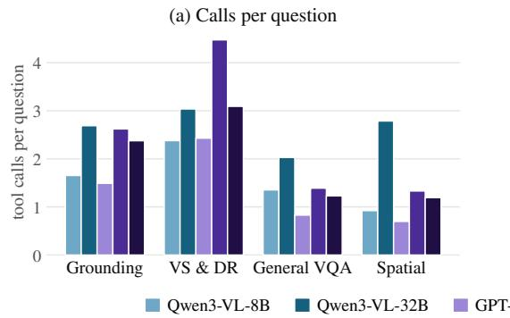

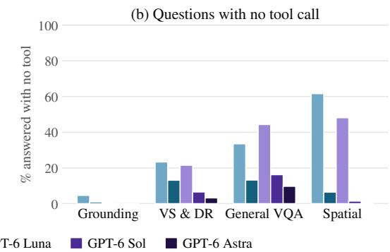  
Figure 5: Tool-call volume and engagement by domain. (a) Tool calls per question, averaged over all questions in the domain. (b) Fraction of questions answered with no tool call. Engagement varies with model scale within a family and not across families, and call volume does not order the models by accuracy.

Volume and engagement. Engagement varies with model scale within a family but not across families. The smaller models leave a substantial fraction of questions untouched (Qwen3-VL-8B 28.9%, GPT-6 Luna 25.3%), whereas the larger models rarely do (6.2%, 4.8% and 2.6%). Call volume does not order the models by accuracy: GPT-6 Luna issues the fewest calls per question of the five and attains higher accuracy than either Qwen model in Table 1. By domain, grounded perception engages all five models on nearly every question, while spatial reasoning and general VQA and hallucination account for most of the unengaged questions in the smaller models.

<table><tr><td>Model</td><td>Calls / question</td><td>Calls / engaged question</td><td>No tool (%)</td><td>Messages / question</td><td>Repeat calls (%)</td><td>Failed calls (%)</td></tr><tr><td>Qwen3-VL-8B</td><td>1.43</td><td>2.00</td><td>28.9</td><td>9.7</td><td>1.92</td><td>0.59</td></tr><tr><td>Qwen3-VL-32B</td><td>2.59</td><td>2.76</td><td>6.2</td><td>14.3</td><td>0.54</td><td>0.59</td></tr><tr><td>GPT-6 Luna</td><td>1.25</td><td>1.67</td><td>25.3</td><td>7.7</td><td>0.38</td><td>0.30</td></tr><tr><td>GPT-6 Sol</td><td>2.07</td><td>2.18</td><td>4.8</td><td>10.2</td><td>1.95</td><td>0.59</td></tr><tr><td>GPT-6 Astra</td><td>1.80</td><td>1.84</td><td>2.6</td><td>9.4</td><td>0.01</td><td>0.17</td></tr></table>

Table 4: Tool-use profile of OpenVLHarness across five base models. Calls per question averages over all questions, including those answered without tools; calls per engaged question conditions on questions with at least one call. Messages count transcript turns, including the Environment Update emitted after each call. Repeat calls are byte-identical to an earlier call in the same rollout; failed calls are those the tool server returned as errors.

Reliability and context cost. Fewer than 1% of calls return a tool error for any model, so execution reliability is not a limiting factor. Repeated calls, defined as byte-identical invocations within one rollout, are more frequent than errors but remain a small fraction of traffic and do not scale with model size. The dominant cost is context: a rollout occupies between 8 and 14 transcript turns, between two and 3.5 of which are Environment Updates, one emitted at the start and one after each call.

## A.2 DISTRIBUTION OF TOOL CALLS

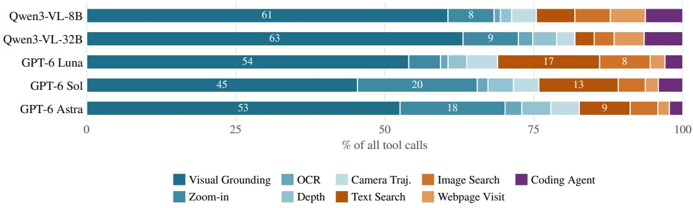  
Figure 6: Distribution of tool calls across capabilities. All calls issued by each model, normalized to 100%. Visual Grounding is the largest consumer for every model; the models differ mainly in the second-ranked capability.

Aggregate distribution. Visual Grounding accounts for the largest share of calls in all five models, ranging from 45% for GPT-6 Sol to 63% for Qwen3-VL-32B. The models differ mainly in the second-ranked capability. GPT-6 Sol and GPT-6 Astra allocate 20% and 18% of their calls to Zoomin, against 5–9% for the other models, corresponding to a ground-then-inspect pattern. The GPT-6 models allocate a larger share to web retrieval (17% to Text Search for Luna, 13% for Sol, and 9% for Astra), concentrated in the visual search and deep research domain. Depth Estimation, Camera Trajectory and the Python Coding Agent are small in aggregate and concentrated in the spatial reasoning datasets.

Distribution by domain. Figure 7 resolves the same budget by domain. Grounded perception is dominated by Visual Grounding for every model, at 90–94% of domain calls, with the exception of GPT-6 Sol and GPT-6 Astra, which allocate roughly a quarter of their calls in that domain to Zoom-in. Visual search and deep research is the only domain in which the three web capabilities dominate. Spatial reasoning is the one domain in which four capabilities carry comparable load, combining grounding, camera trajectory, depth and the coding agent, and general VQA and hallucination divides between grounding and inspection.

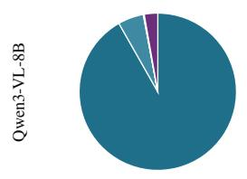  
Grounding  
VS & DR

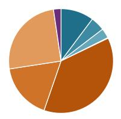  
General VQA

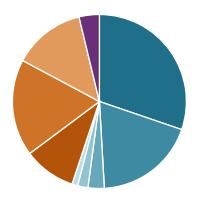  
Spatial

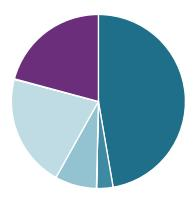

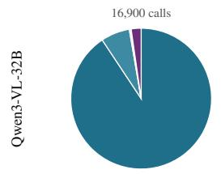

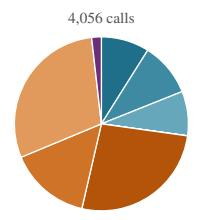

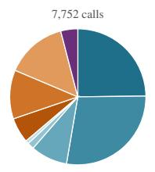

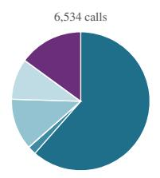

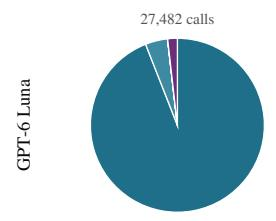

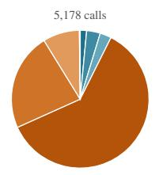

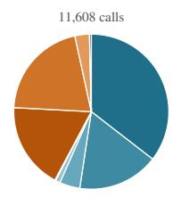

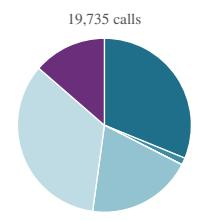

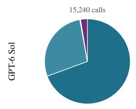

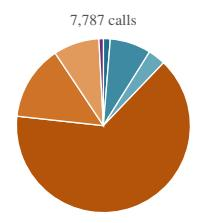

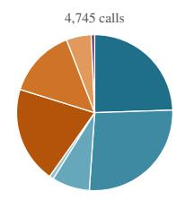

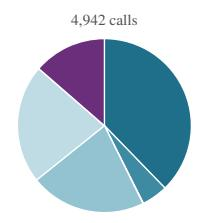

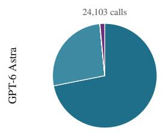

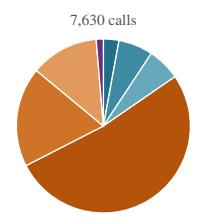

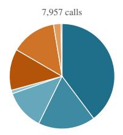

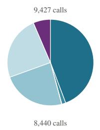  
Figure 7: Distribution of tool calls by domain. Calls issued in each domain as a share of that domain’s calls, with the call total below each panel. Colors are consistent across panels. Grounded perception is dominated by Visual Grounding for every model except GPT-6 Sol and GPT-6 Astra; visual search and deep research is the only domain dominated by the web capabilities; spatial reasoning is the only domain in which four capabilities carry comparable load.

## A.3 EFFECT OF TOOL USE ON ACCURACY

<table><tr><td>Model</td><td>Rows</td><td>Base</td><td>OpenVLHarness</td><td>∆</td><td>Rescued</td><td>Broken</td><td>Calls per net gain</td></tr><tr><td>Qwen3-VL-8B</td><td>24,410</td><td>50.02</td><td>60.09</td><td>+10.07</td><td>4,649</td><td>1,967</td><td>12.9</td></tr><tr><td>Qwen3-VL-32B</td><td>24,393</td><td>53.73</td><td>62.17</td><td>+8.44</td><td>4,381</td><td>2,146</td><td>28.1</td></tr><tr><td>GPT-6 Luna</td><td>26,226</td><td>57.88</td><td>67.67</td><td>+9.79</td><td>4,191</td><td>1,382</td><td>11.7</td></tr><tr><td>GPT-6 Sol</td><td>23,700</td><td>64.26</td><td>72.67</td><td>+8.41</td><td>3,153</td><td>1,025</td><td>23.1</td></tr><tr><td>GPT-6 Astra</td><td>23,700</td><td>70.74</td><td>76.98</td><td>+6.24</td><td>2,336</td><td>700</td><td>26.0</td></tr></table>

Table 5: OpenVLHarness against the base model, paired per question. Rescued counts questions answered incorrectly by the base model and correctly by OpenVLHarness; broken counts the converse. Calls per net gain divides the total number of tool calls issued on these questions by the net number of questions whose outcome changed.

Aggregate effect. All five models improve under OpenVLHarness, by +6.2 (GPT-6 Astra) to +10.1 (Qwen3-VL-8B) points. The net figure is the balance of two considerably larger flows: between 2,336 and 4,649 questions per model are corrected, while between 700 and 2,146 are de graded. Normalizing by the tool calls spent, the cost of a net corrected question ranges from 11.7 calls (GPT-6 Luna) to 28.1 calls (Qwen3-VL-32B), the latter combining the highest call volume with one of the smaller gains.

Null control. On questions where the agent issued no tool call, OpenVLHarness reduces to the base model with a longer system prompt, so the expected paired difference is zero. The measured values are −0.2 (GPT-6 Sol), −0.5 (GPT-6 Luna), −1.6 (Qwen3-VL-32B) and −1.8 (Qwen3-VL 8B) points, and +1.8 for GPT-6 Astra, which leaves only 2.6% of questions without a call, so its value rests on 614 questions. The proximity to zero supports the interpretation of the remaining differences as effects of tool use rather than of the prompt or the evaluation protocol, and the two larger negative values, both from the Qwen3-VL models, indicate a small cost to carrying the tool interface when it is not used.

Per-capability effects. Figure 8 reports, for each capability and model, the paired difference on the questions that invoked it. Table 6 gives the underlying counts, the share of questions each capability was invoked on, the accuracies of both arms, and the control, that is the same difference on the questions that did not invoke the capability. The two retrieval capabilities exhibit the largest separation from their controls in every model: rows invoking Image Search improve by 18.9 to 27.1 points, while the corresponding control values lie between −0.6 and +6.6. Visual Grounding is the dominant factor for the smaller models — Qwen3-VL-8B improves by 14.3 points on rows that ground and declines by 20.1 points on rows that do not — and flattens for the larger models, which invoke it on nearly all questions. Camera Trajectory is positive for all five models. Depth Estimation, OCR, Zoom-in and the Python Coding Agent are at or below their controls, apart from Zoom-in for GPT-6 Luna (+11.9 against +8.6) and GPT-6 Astra (+9.4 against +5.2), which is consistent with their being invoked on the questions a model cannot resolve from the image alone rather than with their being ineffective in isolation.

<table><tr><td>Capability</td><td>Model</td><td>Questions</td><td>Share</td><td>Calls</td><td>Base</td><td>OpenVLHarness</td><td></td><td>∆ △ elsewhere</td></tr><tr><td rowspan="5">Visual Grounding</td><td>Qwen-8B</td><td>13,103</td><td>54%</td><td>21,286</td><td>47.7</td><td>62.0</td><td>+14.3</td><td>-20.1</td></tr><tr><td>Qwen-32B</td><td>17,284</td><td>71%</td><td>40,057</td><td>56.1</td><td>64.5</td><td>+8.3</td><td>+0.2</td></tr><tr><td>Luna</td><td>13,216</td><td>50%</td><td>17,670</td><td>56.5</td><td>67.4</td><td>+10.9</td><td>+2.7</td></tr><tr><td>Sol</td><td>14,369</td><td>61%</td><td>22,313</td><td>67.5</td><td>74.3</td><td>+6.7</td><td>+2.2</td></tr><tr><td>Astra</td><td>15,488</td><td>65%</td><td>22,385</td><td>73.6</td><td>77.9</td><td>+4.3</td><td>+5.1</td></tr><tr><td rowspan="5">Zoom-in</td><td>Qwen-8B</td><td>1,703</td><td>7%</td><td>2,714</td><td>40.3</td><td>38.8</td><td>-1.6</td><td>+4.8</td></tr><tr><td>Qwen-32B</td><td>3,214</td><td>13%</td><td>5,805</td><td>45.1</td><td>47.6</td><td>+2.4</td><td>+7.8</td></tr><tr><td>Luna</td><td>1,551</td><td>6%</td><td>1,745</td><td>34.8</td><td>46.7</td><td>+11.9</td><td>+8.6</td></tr><tr><td>Sol</td><td>6,025</td><td>25%</td><td>9,866</td><td>48.4</td><td>58.2</td><td>+9.9</td><td>+9.4</td></tr><tr><td>Astra</td><td>5,351</td><td>23%</td><td>7,500</td><td>51.6</td><td>61.1</td><td>+9.4</td><td>+5.2</td></tr><tr><td rowspan="5">OCR</td><td>Qwen-8B</td><td>312</td><td>1%</td><td>343</td><td>50.6</td><td>54.8</td><td>+4.2</td><td>+7.5</td></tr><tr><td>Qwen-32B</td><td>1,259</td><td>5%</td><td>1,433</td><td>60.8</td><td>61.5</td><td>+0.8</td><td>+8.4</td></tr><tr><td>Luna</td><td>378</td><td>1%</td><td>414</td><td>41.3</td><td>45.4</td><td>+4.1</td><td>+12.7</td></tr><tr><td>Sol</td><td>863</td><td>4%</td><td>891</td><td>62.4</td><td>70.2</td><td>+7.9</td><td>+12.0</td></tr><tr><td>Astra</td><td>1,195</td><td>5%</td><td>1,201</td><td>73.9</td><td>78.8</td><td>+4.8</td><td>+10.7</td></tr><tr><td rowspan="5">Depth</td><td>Qwen-8B</td><td>598</td><td>2%</td><td>663</td><td>44.1</td><td>48.2</td><td>+4.1</td><td>+4.0</td></tr><tr><td>Qwen-32B</td><td>2,187</td><td>9%</td><td>2,546</td><td>59.6</td><td>56.2</td><td>-3.4</td><td>+4.5</td></tr><tr><td>Luna</td><td>868</td><td>3%</td><td>1,018</td><td>54.9</td><td>59.0</td><td>+4.1</td><td>+4.4</td></tr><tr><td>Sol</td><td>1,854</td><td>8%</td><td>2,101</td><td>63.1</td><td>65.2</td><td>+2.1</td><td>+6.9</td></tr><tr><td>Astra</td><td>1,933</td><td>8%</td><td>2,071</td><td>65.2</td><td>68.8</td><td>+3.5</td><td>+4.6</td></tr><tr><td rowspan="5">Camera Traj.</td><td>Qwen-8B</td><td>1,444</td><td>6%</td><td>1,457</td><td>34.6</td><td>50.6</td><td>+15.9</td><td>+3.0</td></tr><tr><td>Qwen-32B</td><td>1,925</td><td>8%</td><td>1,975</td><td>39.0</td><td>51.4</td><td>+12.3</td><td>+4.2</td></tr><tr><td>Luna</td><td>1,683</td><td>6%</td><td>1,699</td><td>45.5</td><td>62.8</td><td>+17.3</td><td>+0.4</td></tr><tr><td>Sol</td><td>1,969</td><td>8%</td><td>2,087</td><td>56.0</td><td>70.3</td><td>+14.2</td><td>+3.5</td></tr><tr><td>Astra</td><td>1,991</td><td>8%</td><td>2,034</td><td>73.2</td><td>81.6</td><td>+8.4</td><td>+3.6</td></tr><tr><td rowspan="5">Text Search</td><td>Qwen-8B</td><td>1,238</td><td>5%</td><td>2,048</td><td>26.1</td><td>37.9</td><td>+11.7</td><td>+8.7</td></tr><tr><td>Qwen-32B</td><td>1,353</td><td>6%</td><td>1,826</td><td>34.9</td><td>43.5</td><td>+8.6</td><td>+9.5</td></tr><tr><td>Luna</td><td>2,009</td><td>8%</td><td>5,599</td><td>36.9</td><td>54.8</td><td>+17.9</td><td>+9.7</td></tr><tr><td>Sol</td><td>1,801</td><td>8%</td><td>6,506</td><td>39.3</td><td>60.1</td><td>+20.8</td><td>+9.3</td></tr><tr><td>Astra</td><td>1,556</td><td>7%</td><td>3,639</td><td>49.7</td><td>69.2</td><td>+19.5</td><td>+8.3</td></tr><tr><td rowspan="5">Image Search</td><td>Qwen-8B</td><td>1,885</td><td>8%</td><td>1,937</td><td>32.3</td><td>53.2</td><td>+20.9</td><td>-0.6</td></tr><tr><td>Qwen-32B</td><td>1,922</td><td>8%</td><td>1,974</td><td>35.6</td><td>54.5</td><td>+18.9</td><td>+1.3</td></tr><tr><td>Luna</td><td>2,604</td><td>10%</td><td>2,769</td><td>34.6</td><td>61.4</td><td>+26.7</td><td>+2.8</td></tr><tr><td>Sol</td><td>1,923</td><td>8%</td><td>2,236</td><td>37.6</td><td></td><td>64.7 +27.1</td><td>+6.6</td></tr><tr><td>Astra</td><td>1,766</td><td>7%</td><td>1,968</td><td>47.9</td><td>74.1</td><td>+26.1</td><td>+5.1</td></tr><tr><td rowspan="6">Webpage Visit</td><td>Qwen-8B</td><td>1,215</td><td>5%</td><td>1,936</td><td>22.1</td><td>42.9</td><td>+20.7</td><td>+7.7</td></tr><tr><td>Qwen-32B</td><td>2,177</td><td>9%</td><td>3,014</td><td>34.1</td><td>51.7</td><td>+17.6</td><td>+0.7</td></tr><tr><td>Luna</td><td>698</td><td>3%</td><td>815</td><td>19.8</td><td>41.4 55.5</td><td>+21.6</td><td>+12.6</td></tr><tr><td>Sol</td><td>834</td><td>4%</td><td>1,079</td><td>26.5</td><td></td><td>+29.1</td><td>+12.2</td></tr><tr><td>Astra</td><td>655</td><td>3%</td><td>829</td><td>28.9</td><td>62.3</td><td>+33.4</td><td>+10.3</td></tr><tr><td>Qwen-8B</td><td>1,200</td><td>5%</td><td>2,196</td><td>37.1</td><td></td><td>39.9 +2.8</td><td>+8.8</td></tr><tr><td rowspan="5">Coding Agent</td><td>Qwen-32B</td><td>3,318</td><td>14%</td><td>4,121</td><td>57.2</td><td>55.0</td><td>-2.3</td><td>+6.6</td></tr><tr><td>Luna</td><td>780</td><td>3%</td><td>979</td><td>37.1</td><td>48.0</td><td>+10.9</td><td>+9.5</td></tr><tr><td>Sol</td><td>906</td><td>4%</td><td>2,018</td><td>37.5</td><td>47.4</td><td>+10.0</td><td>+7.3</td></tr><tr><td>Astra</td><td>857</td><td>4%</td><td>959</td><td>44.0</td><td>51.0</td><td>+7.0</td><td>+8.3</td></tr><tr></table>

Table 6: Per-capability paired comparison, corresponding to Figure 8. For each capability and model: the questions whose rollout invoked it at least once, the calls issued on them, the accuracy of the base model and of OpenVLHarness on exactly those questions, their difference, and the same difference computed on the questions that did not invoke the capability. Share is the fraction of paired questions that invoked it, which determines how closely the final column approximates the model’s overall gain. A question that invoked three capabilities is counted once under each.

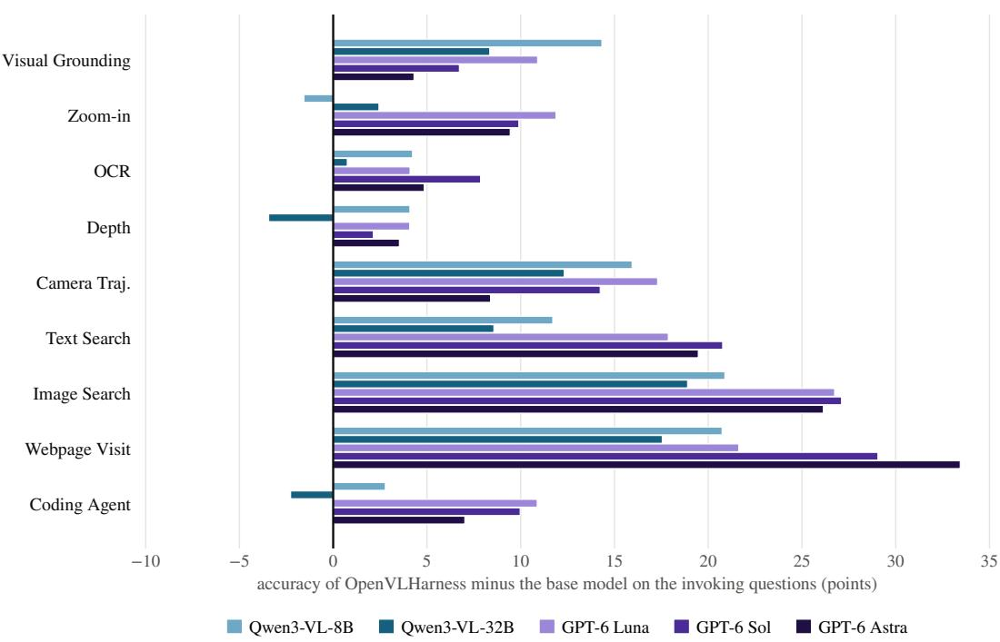  
Figure 8: Per-capability paired comparison against the base model. For each capability and model, the accuracy of OpenVLHarness minus that of the base model on the questions whose rollout invoked that capability. The corresponding difference on the questions that did not invoke it, which serves as the control, is given in the last column of Table 6 together with the share of questions each capability was invoked on.

## A.4 CAPABILITY COMPOSITION

Composition across capabilities. Rollouts frequently combine several capabilities rather than invoking one in isolation. Counting the number of distinct capabilities per rollout, among engaged rollouts 31.9% (Qwen3-VL-32B), 26.8% (GPT-6 Sol) and 26.0% (GPT-6 Astra) invoke two or more, against 20.7% and 11.6% for the smaller models, and the longest rollouts combine four or five. Combinations that cross capability families are rarer, 4–16% of engaged rollouts, and consist almost entirely of a perception capability followed by the Python Coding Agent: ground or mea sure first, then compute over the resulting quantities. This is the pattern rewarded by the counting, grounding and spatial datasets, and it is not expressible in a harness that exposes a single capability.

## B ADDITIONAL RESULTS AND ANALYSIS

This section reports results with additional backbones (GPT-5, GPT-6 Sol, and Kimi K3), gives details of the ablation in Table 3, compares OpenVLHarness with training-based harnesses, analyzes grounded perception across object counts, extends the visual search and deep research results to 11 information-seeking benchmarks, and tests whether additional reasoning can replace the harness.

## B.1 ADDITIONAL BACKBONES

Table 7 evaluates OpenVLHarness with GPT-5 (OpenAI, 2025b), with GPT-6 Sol (OpenAI, 2026), and with Kimi K3 (Team et al., 2026), an open-weight mixture-of-experts model with native visual understanding, on the same 22 datasets as Table 1, using the same tools, memory, prompts, and scoring. With GPT-6 Sol, OpenVLHarness improves every one of the 22 benchmarks, raising the average from 52.7 to 64.3.

<table><tr><td colspan="2"></td><td colspan="2">GPT-5</td><td colspan="2">GPT-6 Sol (medium)</td><td colspan="2">Kimi K3 (max)</td></tr><tr><td>Domain</td><td>Dataset</td><td>Base</td><td>Ours</td><td>Base</td><td>Ours</td><td>Base</td><td>Ours</td></tr><tr><td rowspan="5">Gronded Percpton</td><td>CountQA</td><td>38.48</td><td>58.70</td><td>73.00</td><td>76.00</td><td>71.27</td><td>73.10</td></tr><tr><td>FSC-147</td><td>22.16</td><td>42.92</td><td>38.72</td><td>44.40</td><td>36.78</td><td>42.07</td></tr><tr><td>OdinW-13-All</td><td>46.27</td><td>63.12</td><td>40.86</td><td>57.88</td><td>44.35</td><td>56.91</td></tr><tr><td>FSCD-147</td><td>0.16</td><td>28.09</td><td>8.36</td><td>29.42</td><td>7.88</td><td>29.11</td></tr><tr><td>FSCD-LVIS</td><td>2.04</td><td>33.22</td><td>5.17</td><td>35.22</td><td>7.15</td><td>33.60</td></tr><tr><td rowspan="5">Sea earnd Deseed arch Viual</td><td>MMSearch MMSearch-Plus</td><td>36.84</td><td>56.14</td><td>55.56</td><td>77.78</td><td>67.25</td><td>86.55 55.31</td></tr><tr><td>RealX-Bench</td><td>10.93</td><td>31.19</td><td>16.72</td><td>45.66</td><td>23.47</td><td></td></tr><tr><td></td><td>34.54</td><td>40.72</td><td>36.08</td><td>51.55</td><td>51.03</td><td>65.98</td></tr><tr><td>FVQA HLE-VL</td><td>54.67</td><td>55.00</td><td>58.67</td><td>71.00</td><td>70.00</td><td>79.33</td></tr><tr><td>BC-VL</td><td>20.00 42.11</td><td>24.85 52.38</td><td>36.67 43.86</td><td>43.33 58.90</td><td>41.52 51.63</td><td>46.67 64.66</td></tr><tr><td rowspan="5">Ga Vv ernd Halltion</td><td>RealWorldQA</td><td>82.80</td><td>83.13</td><td>84.58</td><td>87.45</td><td>83.8</td><td>86.9</td></tr><tr><td>SimpleVQA</td><td>66.33</td><td>68.33</td><td>60.30</td><td>76.40</td><td>81.33</td><td>82.33</td></tr><tr><td>HallusionBench</td><td>62.95</td><td>66.07</td><td>72.77</td><td>75.27</td><td>69.6</td><td>74.9</td></tr><tr><td>FREAK-VQA</td><td>45.93</td><td>51.44</td><td>54.94</td><td>64.08</td><td>52.6</td><td>59.6</td></tr><tr><td>FREAK-MCQ</td><td>44.37</td><td>52.82</td><td>61.77</td><td>70.32</td><td>52.9</td><td>63.1</td></tr><tr><td rowspan="5">Reasong Spatal</td><td>V*</td><td>72.80</td><td>84.81</td><td>91.10</td><td>93.19</td><td>90.6</td><td>92.1</td></tr><tr><td>MMSI-Bench</td><td>41.20</td><td>49.80</td><td>49.80</td><td>57.40</td><td>46.5</td><td>57.7</td></tr><tr><td>ERQA</td><td>60.00</td><td>59.00</td><td>66.50</td><td>71.25</td><td>63.8</td><td>66.8</td></tr><tr><td>EmbSpatial</td><td>81.29</td><td>82.47</td><td>80.60</td><td>82.53</td><td>83.7</td><td>83.9</td></tr><tr><td>SparBench</td><td>50.12</td><td>60.09</td><td>55.36</td><td>62.66</td><td>60.5</td><td>63.8</td></tr><tr><td colspan="2">MindCube Average</td><td>60.09 44.37</td><td>80.00 55.65</td><td>67.40 52.67</td><td>83.17 64.31</td><td>83.8 56.43</td><td>89.6 66.09</td></tr></table>

Table 7: Results of OpenVLHarness with GPT-5 (OpenAI, 2025b), GPT-6 Sol (OpenAI, 2026), and Kimi K3 (Team et al., 2026) as the backbone, on the same 22 datasets and four task domains as Table 1. Base: the backbone prompted directly; Ours: the backbone with OpenVLHarness. Bold marks the better of Base and Ours for each backbone.

## B.2 ABLATION STUDY DETAILS

The ablation in Table 3 isolates the contribution of each harness component by building a strict superset ladder: every rung adds exactly one mechanism to the one below it, so the gap between adjacent rungs measures that mechanism’s marginal value.

## Variants. The five rungs are:

1. Baseline (no tool). The backbone model prompted directly with the question image and no tool access, establishing the no-harness floor.

2. + Tool. The nine tools are available, but their payloads arrive as raw dumps, their schema is cut to a minimal signature (name, argument names and types, one clause each), and nothing persists between turns: no environment updates, no image labels, no data bindings, no URL references. Tool-generated images are replaced by a short stub.

3. + Capability layer. Adds the capability layer of Sec. 2.1: each tool’s raw payload is replaced by a per-tool post-processor that condenses it into a concise, model-readable summary (e.g. grounding boxes on a 0–1000 grid, reranked search results with inline citations, depth/zoom captions), and the full tool schema is restored so the model is told when to reach for each tool and how to phrase its arguments. No memory is present—nothing is carried across turns.

4. + Textual memory. Adds every memory mechanism that is addressed by a text handle: per-turn Environment Updates that re-advertise all live state, webpage url N references that let the agent revisit a URL, and out-of-context data bindings that the Python Coding Agent can read as typed variables. Tool-generated images are replaced by a VLM-written text description (up to 160 tokens) conditioned on the original question. Image references remain absent: tool-produced images cannot be named, stored, or passed to a later tool call.

5. OpenVLHarness (full). Adds multimodal image memory: every tool-produced image is labeled (tool generated image N), deduplicated by content, and kept addressable. The model selects which image to pass to each tool call by its identifier, enabling compositions such as grounding → zoom → OCR → search.

Implementation. All five variants share the same nine-tool toolset, backbone weights, and decoding configuration (temperature 0.7, top-p 0.8, top-k 20, repetition penalty 1.0, presence penalty 1.5, up to 12,800 generated tokens per turn, 15 tool-calling iterations, 168K-token context cap). They differ only in the ablation preset applied to the memory stack: a configuration block that switches individual mechanisms (environment updates, image identifiers, per-tool post-processors, data bindings, URL references) on or off. Each preset is a strict superset of the one below it, validated at initialization so a typo fails the run rather than silently selecting the wrong baseline. Table 8 summarizes the knob settings for each variant.

<table><tr><td>Variant</td><td>Tool schema</td><td>Post-proc.</td><td>Env update</td><td>Bindings</td><td>URL refs</td><td>Image refs</td></tr><tr><td>Baseline</td><td></td><td></td><td></td><td></td><td></td><td></td></tr><tr><td>+ Tool</td><td>minimal</td><td>raw</td><td>off</td><td>off</td><td>off</td><td>off</td></tr><tr><td>+ Capability layer</td><td>full</td><td>custom</td><td>off</td><td>off</td><td>off</td><td>off</td></tr><tr><td>+ Textual memory</td><td>full</td><td>custom</td><td>on</td><td>on</td><td>on</td><td>off</td></tr><tr><td>OpenVLHarness</td><td>full</td><td>custom</td><td>on</td><td>on</td><td>on</td><td>on</td></tr></table>

Table 8: Ablation knob settings for each variant in Table 3. “Post-proc.” refers to per-tool output processors (custom vs. raw dumps). “Env update” is the per-turn Environment Update message. “Bindings” are out-of-context typed data bindings. “URL refs” and “Image refs” are symbolic identifiers for web pages and tool-generated images, respectively.

Evaluation setup. Each variant is evaluated on 22 datasets spanning all four domains in Table 1. For efficiency, datasets with more than 500 samples are subsampled to 500 examples with a fixed random seed (42) shared across all variants, so every rung sees exactly the same instances. All reported numbers are means of three independent runs with different sampling seeds. Domain averages in Table 3 are macro-averages over the datasets in each domain.

## B.3 TRAINING-BASED BASELINES

<table><tr><td colspan="2">Dataset</td><td colspan="3">Training-based</td><td rowspan="2">Training-free OpenVLHarness</td></tr><tr><td>Domain</td><td></td><td>AdaReasoner</td><td>PixelReasoner</td><td>DeepEyesV2</td></tr><tr><td rowspan="6">Grounded Perpton</td><td>CountQA</td><td>36.98</td><td>21.66</td><td>21.73</td><td>51.37</td></tr><tr><td>FSC-147</td><td>1.34</td><td>9.75</td><td>21.26</td><td>31.60</td></tr><tr><td>OdinW-13-All</td><td>0.00</td><td>10.24</td><td>8.97</td><td>7.80</td></tr><tr><td>FSCD-147</td><td>0.00</td><td>0.04</td><td>0.06</td><td>10.30</td></tr><tr><td>FSCD-LVIS</td><td>0.00</td><td>0.00</td><td>0.05</td><td>14.20</td></tr><tr><td>Average</td><td>7.66</td><td>8.34</td><td>10.41</td><td>23.05</td></tr><tr><td rowspan="6">V Ser Seand Desrd rch</td><td>MMSearch</td><td>13.45</td><td>12.87</td><td>18.13</td><td>27.68</td></tr><tr><td>MMSearch-Plus</td><td>0.96</td><td>1.93</td><td>1.61</td><td>3.86</td></tr><tr><td>RealX-Bench</td><td>11.86</td><td>16.49</td><td>17.53</td><td>22.51</td></tr><tr><td>FVQA</td><td>21.67</td><td>26.33</td><td>29.67</td><td>40.33</td></tr><tr><td>HLE-VL</td><td>10.00</td><td>6.06</td><td>3.03</td><td>7.27</td></tr><tr><td>BC-VL</td><td>18.05</td><td>18.30</td><td>23.56</td><td>17.79</td></tr><tr><td rowspan="6">Ga Vl end Halton</td><td>Average RealWorldQA</td><td>12.66 63.52</td><td>13.66</td><td>15.59</td><td>19.91</td></tr><tr><td>SimpleVQA</td><td>35.90</td><td>70.33 41.68</td><td>66.67 42.12</td><td>66.14</td></tr><tr><td>HallusionBench</td><td>37.43</td><td>34.69</td><td>18.04</td><td>46.17 46.33</td></tr><tr><td>FREAK-VQA</td><td>27.16</td><td>35.42</td><td>23.90</td><td>36.67</td></tr><tr><td>FREAK-MCQ</td><td>30.08</td><td>30.78</td><td>26.96</td><td>33.30</td></tr><tr><td>V*</td><td>65.97</td><td>83.01</td><td>81.15</td><td>74.87</td></tr><tr><td rowspan="5"></td><td>Average</td><td>43.34</td><td>49.32</td><td>43.14</td><td>50.58</td></tr><tr><td>MMSI-Bench</td><td>20.10</td><td>28.10</td><td>9.30</td><td>29.80</td></tr><tr><td>ERQA</td><td>26.75</td><td>34.25</td><td>32.50</td><td>37.00</td></tr><tr><td>EmbSpatial</td><td>72.01</td><td>71.84</td><td>68.93</td><td>66.70</td></tr><tr><td>SparBench</td><td>31.62</td><td>30.33</td><td>30.44</td><td>31.90</td></tr><tr><td rowspan="4">Reasong Spdatial</td><td>MindCube</td><td>31.54</td><td>32.31</td><td>4.80</td><td>32.31</td></tr><tr><td></td><td></td><td></td><td></td><td></td></tr><tr><td>Average</td><td>36.40</td><td>39.37</td><td>29.19</td><td>39.54</td></tr><tr><td>Overall average</td><td>25.29</td><td>28.02</td><td>25.02</td><td>33.45</td></tr></table>

Table 9: Training-based baselines on the Qwen2.5-VL-7B-Instruct backbone. AdaReasoner, Pixel-Reasoner, and DeepEyesV2 fine-tune the backbone to adapt it to their tool-use harness; OpenVL-Harness is training-free and uses the same weights out of the box. Training-based columns are gray; shaded rows are per-domain averages. Bold marks the best result in each row.

Table 9 compares OpenVLHarness with the three training-based harnesses on Qwen2.5-VL-7B-Instruct, the base model all three are fine-tuned from (setup in Appendix G.2). Averaged over the 22 datasets, OpenVLHarness reaches 33.45, ahead of PixelReasoner (28.02), AdaReasoner (25.29), and DeepEyesV2 (25.02), without updating any weights.

Where training helps and where it does not. The margin is largest on grounded perception (23.05 vs. at most 10.41) and on visual search and deep research (19.91 vs. at most 15.59). The training-based harnesses are optimized for a fixed tool set and answer style: they rarely produce the dense, well-formed box lists that FSCD and OdinW require, and none of them retrieves web evidence in our setup, so knowledge-intensive search questions fall back on the 7B model’s parametric knowledge. On general VQA and hallucination and on spatial reasoning, which resemble their training distributions, the gap narrows (50.58 vs. 49.32 and 39.54 vs. 39.37), and the trained models are best on a few perception-centric datasets such as RealWorldQA and V\*, where Pixel-

Reasoner’s learned zoom-in behavior pays off. Training a model into one tool protocol thus helps in-distribution but transfers poorly, whereas a training-free harness can cover all four domains with the same weights.

The backbone as orchestrator. Absolute scores with OpenVLHarness on Qwen2.5-VL-7B are well below those on Qwen3-VL (Table 1). Because the harness relies on the backbone to plan tool calls and to follow output conventions, a weaker orchestrator limits its benefit; on OdinW-13-All, for example, OpenVLHarness reaches only 7.80 AP with Qwen2.5-VL-7B versus 50.40 with Qwen3- VL-8B. The harness therefore benefits directly from stronger backbones, with no retraining when a new backbone is adopted.

## B.4 GROUNDED PERCEPTION ACROSS OBJECT COUNTS

Most counting and grounding benchmarks rarely test models at high object counts, which can make headline scores misleading. To make this concrete, we bin every sample of widely used counting and grounding datasets by its number of target objects (Figures 9 and 10). For counting, TallyQA (Acharya et al., 2019), CountBenchQA (Paiss et al., 2023), and PixmoCount place essentially all samples at ten or fewer objects; only FSC-147 and FSCD-LVIS contribute meaningful mass above 50 objects. Grounding is even more skewed: referring-expression datasets such as RefCOCO/+/g (Kazemzadeh et al., 2014; Yu et al., 2016; Mao et al., 2016), Ref-L4 (Chen et al., 2024a), and GroundingME (Li et al., 2025a) ground exactly one target per sample, and detection-style benchmarks such as OdinW-13 and LVIS are dominated by a single object per image (97% and 86% of samples in the 0–1 bucket). Dense, many-object grounding appears only in the FSCD variants. This is why our suite includes FSC-147, FSCD-147, and FSCD-LVIS, and why we break their results down by object count below.

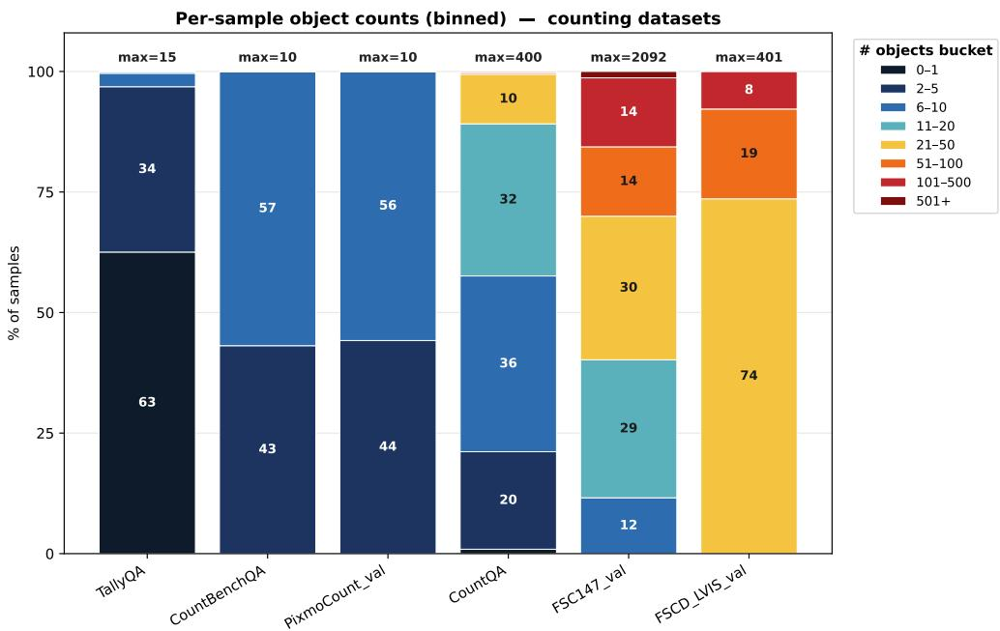  
Figure 9: Object-count distribution across counting benchmarks. Each bar shows the percentage of samples falling into binned object-count buckets, with the per-dataset maximum count annotated above. Widely used benchmarks such as TallyQA, CountBenchQA, and PixmoCount are dominated by low counts: nearly all of their samples contain ten or fewer objects (and a majority of TallyQA fall in the 0–1 bucket), capping at 10–15. Only FSC-147 and FSCD-LVIS contain substantial mass in the high-count regime (> 50 objects), reaching into the hundreds or thousands. This skew means accuracy on standard counting benchmarks largely reflects performance on small object counts and reveals little about high-count visual measurement.

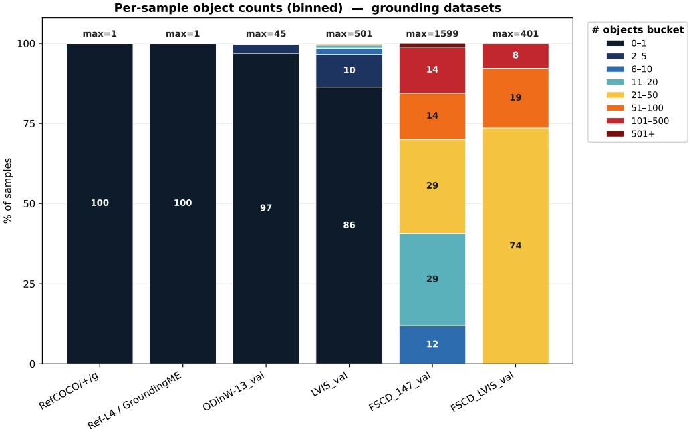  
Figure 10: Object-count distribution across grounding benchmarks. Each bar shows the percentage of samples falling into binned object-count buckets, with the per-dataset maximum count annotated above. Referring-expression benchmarks such as RefCOCO/+/g and Ref-L4/GroundingME ground a single target per sample (100% in the 0–1 bucket, max = 1), and even detection-style sets like OdinW-13 (97%) and LVIS (86%) are overwhelmingly concentrated at one object per image. Only the FSCD variants exercise dense, many-object grounding. As with counting, this distribution implies that progress on common grounding benchmarks is measured almost entirely in the singleor few-object regime.

Results by object count. Table 10 breaks down FSC-147 and FSCD-LVIS by the number of ground-truth objects, using the bins defined above. On FSC-147, OpenVLHarness improves exactmatch accuracy in every bucket, with the largest gains between 11 and 50 objects (e.g., 5.0 → 32.9 at 8B for 21–50), where the base models’ accuracy collapses. On FSCD-LVIS, where every image has at least 21 instances, the base models recover almost none of the instances $( \mathrm { F } 1 \leq 1 2 . 5 )$ , whereas OpenVLHarness reaches F1 above 56 up to 100 instances and around 41 beyond. Accuracy nevertheless falls steeply with count for every configuration: above 100 objects exact counting remains essentially unsolved, confirming that the high-count regime is where the most headroom lies.

<table><tr><td></td><td></td><td colspan="2">Qwen3-VL-8B</td><td colspan="2">Qwen3-VL-32B</td></tr><tr><td></td><td>Objects # Samples</td><td>Base</td><td>OpenVLHarness</td><td>Base</td><td>OpenVLHarness</td></tr><tr><td colspan="6">FSC-147: exact-match accuracy (%)</td></tr><tr><td>≤ 10</td><td>149</td><td>42.3</td><td>73.8</td><td>64.4</td><td>81.9</td></tr><tr><td>11-20</td><td>368</td><td>28.8</td><td>59.2</td><td>33.4</td><td>63.3</td></tr><tr><td>21-50</td><td>383</td><td>5.0</td><td>32.9</td><td>5.2</td><td>34.5</td></tr><tr><td>51-100</td><td>185</td><td>1.1</td><td>9.7</td><td>2.2</td><td>9.7</td></tr><tr><td>&gt; 100</td><td>201</td><td>3.5</td><td>6.5</td><td>0.5</td><td>1.0</td></tr><tr><td colspan="6">FSCD-LVIS: box F1 at IoU 0.5 (%)</td></tr><tr><td>21-50</td><td>869</td><td>8.5</td><td>63.2</td><td>12.5</td><td>63.5</td></tr><tr><td>51-100</td><td>220</td><td>3.4</td><td>58.0</td><td>5.8</td><td>56.9</td></tr><tr><td>&gt; 100</td><td>92</td><td>1.0</td><td>41.3</td><td>1.5</td><td>40.7</td></tr></table>

Table 10: Grounded perception performance by number of ground-truth objects. FSCD-LVIS is scored with instance-level F1 (predicted boxes matched to ground truth at IoU $\geq 0 . 5 )$ because AP is not defined per sample.

Additional metrics and benchmarks. Table 11 reports complementary counting metrics and an additional grounding benchmark. OpenVLHarness lowers the mean absolute error on FSC-147 and raises CountQA relative accuracy, showing that it also reduces large miscounts rather than only fixing near misses. On LVIS (federated val), which queries both present and absent categories over 1,203 classes, OpenVLHarness more than doubles AP at both scales $( 1 8 . 1  4 5 . 2 $ at 8B and 22.9 → 45.5 at 32B).
<table><tr><td colspan="2"></td><td>FSC-147</td><td colspan="2">CountQA</td><td>LVIS</td></tr><tr><td>Model</td><td>Method</td><td>MAE↓</td><td>RA@5↑</td><td>RA@10↑</td><td>AP↑</td></tr><tr><td rowspan="2">Qwen3-VL-8B</td><td>Base</td><td>29.70</td><td>33.64</td><td>43.13</td><td>18.12</td></tr><tr><td>OpenVLHarness</td><td>23.17</td><td>50.00</td><td>57.59</td><td>45.19</td></tr><tr><td rowspan="2">Qwen3-VL-32B</td><td>Base</td><td>60.70</td><td>46.79</td><td>58.90</td><td>22.87</td></tr><tr><td>OpenVLHarness</td><td>31.24</td><td>65.51</td><td>72.71</td><td>45.46</td></tr></table>

Table 11: Complementary counting metrics and LVIS grounding. MAE is the mean absolute counting error; RA@k is the share of predictions within k% of the ground truth.

## B.5 EXTENDED VISUAL SEARCH AND DEEP RESEARCH RESULTS

Table 12 extends the search results to 11 information-seeking benchmarks, including five that are not in Table 1. The agent workflow improves every backbone: the average across the 11 benchmarks rises from 13.74 to 29.05 for Qwen3-VL-8B, from 19.21 to 34.61 for Qwen3-VL-32B, and from 31.58 to 41.80 for GPT-5. Gains are largest for the open models, whose parametric knowledge is most limited; GPT-5’s direct-inference accuracy is additionally depressed by refusals on identity queries (Appendix D.2). With the harness, Qwen3-VL-32B surpasses direct GPT-5 on average (34.61 vs. 31.58).

<table><tr><td>Model</td><td>MMS</td><td>MSP</td><td></td><td></td><td>RXB FVQA HLE-VL BC-VL MM-BC VDR</td><td></td><td></td><td></td><td></td><td></td><td>VBB InfoSeek Enc-VQA Avg</td><td></td></tr><tr><td colspan="10">Direct Inference</td><td></td><td></td><td></td></tr><tr><td>Qwen3-VL-8B</td><td>14.04</td><td>1.29</td><td>22.16 28.39</td><td></td><td>6.36</td><td>21.05</td><td>4.94</td><td>5.40</td><td>7.69</td><td>29.20</td><td>10.61</td><td>13.74</td></tr><tr><td>Qwen3-VL-8B-T</td><td>12.87</td><td>3.22</td><td>22.16</td><td>25.67</td><td>10.30</td><td>33.83</td><td>7.41</td><td>8.20</td><td>11.24</td><td>27.25</td><td>18.06</td><td>16.38</td></tr><tr><td>Qwen3-VL-32B</td><td>20.47</td><td>2.57</td><td>24.74</td><td>32.67</td><td>10.00</td><td>28.82</td><td>6.58</td><td>9.40</td><td>10.06</td><td>33.20</td><td>32.76</td><td>19.21</td></tr><tr><td>GPT-5</td><td>36.8410.93</td><td></td><td></td><td>34.54 54.67</td><td>20.00</td><td>42.11</td><td>8.64</td><td>14.2028.40</td><td></td><td>53.67</td><td>43.33</td><td>31.58</td></tr><tr><td colspan="10">Agent Workflow</td><td></td><td></td><td></td></tr><tr><td>Qwen3-VL-8B</td><td></td><td></td><td>51.4614.79 34.71</td><td>55.00</td><td>10.30</td><td>32.33</td><td>6.00</td><td>14.4011.24</td><td></td><td>50.67</td><td>38.67</td><td>29.05</td></tr><tr><td>Qwen3-VL-32B</td><td>62.5717.6840.21</td><td></td><td></td><td>62.67</td><td>11.52</td><td>33.08</td><td>10.29</td><td>18.8019.53</td><td></td><td>55.33</td><td>49.00</td><td>34.61</td></tr><tr><td>GPT-5</td><td></td><td></td><td>56.14 31.19 40.72 55.00</td><td></td><td>24.85</td><td>52.38</td><td>25.93</td><td>23.8049.11</td><td></td><td>52.00</td><td>48.67</td><td>41.80</td></tr></table>

Table 12: Extended visual search and deep research results on 11 information-seeking benchmarks, five of which (MM-BC, VDR, VBB, InfoSeek, Enc-VQA) are not in Table 1. Qwen3-VL-8B refers to Qwen3-VL-8B-Instruct and Qwen3-VL-8B-T denotes Qwen3-VL-8B-Thinking. Abbreviations: MM-BC = MM-BrowseComp; MMS = MMSearch; MSP = MMSearch-Plus; BC-VL = BrowseComp-VL; RXB = RealX-Bench; VDR = VDR-Bench; VBB = VisBrowse-Bench; Enc-VQA = EncyclopedicVQA. Avg is the unweighted mean across the 11 benchmarks; per-benchmark sample counts are in Appendix D.2.

## B.6 REASONING-EFFORT STUDY: SETUP AND FULL RESULTS

OpenVLHarness answers a question over several model calls, and each call carries tool outputs and memory, so it spends more model tokens per question than prompting the base model directly. This raises the question of whether the harness helps simply by spending more compute: a reasoning model given a larger token budget might recover the gain by reasoning for longer. GPT-6 Luna exposes a reasoning-effort setting, which lets us test this directly by raising the effort of every method, including OpenVLHarness. Section 3.3 and Figure 1c summarize the results. Table 13 reports domain averages and costs, Table 14 the tokens per question behind the costs, Table 15 how often Codex executes code, and Table 16 the per-benchmark scores.

Setup. We run Base, Codex, Visual Sketchpad, and OpenVLHarness with GPT-6 Luna at five reasoning-effort settings (low, medium, high, xhigh, and max) on the full evaluation splits of all 22 benchmarks of Table 1, that is, 26,229 questions per setting and 524,580 in total. Each method keeps its configuration from Table 1 and Appendix G.1, and the medium-effort setting is the configuration reported in Table 1. Apart from the effort, only two settings change. First, Base, Visual Sketchpad, and OpenVLHarness may produce up to 16,000 output tokens per model call, raised to 64,000 at max effort so that reasoning is not truncated; Codex uses its own default limit. Second, GPT-6 Luna accepts max effort only through the Responses API, so Base switches to that API at max effort; OpenVLHarness and Codex use it at every setting, and the Chat Completions requests of Visual Sketchpad are translated to it at every setting. The Python Coding Agent of OpenVLHarness uses the same reasoning effort as the orchestrator. Codex is the Codex CLI agent (OpenAI, 2025a, see Appendix G.1): every question runs in a fresh session with the image attached and web search disabled to prevent the model from searching the web for the benchmark’s gold answer, and modelwritten code executes in a read-only sandbox enforced with Landlock and seccomp. All settings were run on the Flex service tier.

Cost is the GPT-6 Luna API bill for model tokens: uncached input, cache reads and writes, and output, including hidden reasoning tokens. We price all settings at Standard-tier rates; the Flex tier halves every price and leaves cost ratios unchanged. Costs exclude tool execution (e.g., SAM 3, OCR, and search APIs) and judging, and are averaged over the 22 benchmarks in the same way as the scores. Scoring follows Table 1; on the search benchmarks, every setting is scored with the GPT-4o judge used in that table. A question whose requests fail on every retry counts as incorrect; this occurred for 134 of the 524,580 questions (marked <sup>†</sup> in Table 16).

Results. Raising the effort increases the 22-benchmark average of every method. OpenVLHarness at medium effort (56.52 at \$0.92 per 1,000 questions) exceeds every setting of every other method by at least 7.68 points; the strongest of those settings is Visual Sketchpad at max effort (48.84 at \$5.15). OpenVLHarness at low effort (49.92 at \$0.64) already exceeds the average of every other setting. At low effort, OpenVLHarness leads Base on grounded perception and on visual search and deep research but trails it on general VQA and hallucination and on spatial reasoning (61.51 vs. 61.63; 54.45 vs. 56.54); from medium effort onward, it leads Base in every domain. At max effort, the gap between OpenVLHarness (60.12 at \$2.99) and the best other method is largest on grounded perception (15.6 points) and on visual search and deep research (12.4), consistent with the harness supplying evidence that the model cannot infer from the image, and smaller on general VQA and hallucination (6.1) and on spatial reasoning (7.1). Returns per unit of cost diminish for Base: moving from xhigh to max effort multiplies its cost by 2.7 and raises its average by 0.72 points. On FSC-147, no other setting exceeds 38.34, against 40.59 for OpenVLHarness at low effort; on the six search benchmarks, OpenVLHarness at max effort exceeds the best other setting by 3.0 to 19.6 points, and OpenVLHarness at low effort already exceeds it on 4 of them. OpenVLHarness attains the best score of all settings on 20 of the 22 benchmarks; the exceptions are HallusionBench (Codex at xhigh effort, 69.89, against 69.66 for OpenVLHarness at max effort) and ERQA (Visual Sketchpad at max effort, 64.75, against 63.50 for OpenVLHarness at max effort).

<table><tr><td rowspan="2">Method</td><td rowspan="2">Effort</td><td colspan="4">Domain average</td><td rowspan="2">Average (22)</td><td rowspan="2">$/1k</td></tr><tr><td>Grounding (5)</td><td>VS &amp; DR General VQA (6)</td><td>(6)</td><td>Spatial (5)</td></tr><tr><td rowspan="5">Base</td><td>low</td><td>24.28</td><td>33.49</td><td>61.63</td><td>56.54</td><td>44.31</td><td>0.36</td></tr><tr><td>medium</td><td>25.36</td><td>35.18</td><td>63.38</td><td>57.69</td><td>45.76</td><td>0.58</td></tr><tr><td>high</td><td>26.54</td><td>35.27</td><td>64.37</td><td>59.27</td><td>46.68</td><td>0.85</td></tr><tr><td>xhigh</td><td>27.01</td><td>37.36</td><td>64.72</td><td>58.73</td><td>47.33</td><td>1.18</td></tr><tr><td>max</td><td>27.24</td><td>37.80</td><td>64.46</td><td>61.45</td><td>48.04</td><td>3.17</td></tr><tr><td rowspan="5">Codex</td><td>low</td><td>20.29</td><td>26.13</td><td>54.66</td><td>45.21</td><td>36.92</td><td>1.07</td></tr><tr><td>medium</td><td>25.62</td><td>33.53</td><td>60.30</td><td>54.41</td><td>43.78</td><td>1.29</td></tr><tr><td>high</td><td>26.29</td><td>35.44</td><td>61.81</td><td>57.04</td><td>45.46</td><td>1.47</td></tr><tr><td>xhigh</td><td>27.11</td><td>36.65</td><td>63.02</td><td>58.39</td><td>46.61</td><td>1.71</td></tr><tr><td>max</td><td>29.98</td><td>40.30</td><td>63.54</td><td>59.13</td><td>48.58</td><td>2.52</td></tr><tr><td rowspan="5">Visual Sketchpad</td><td>low</td><td>24.87</td><td>32.07</td><td>64.80</td><td>55.44</td><td>44.67</td><td>1.55</td></tr><tr><td>medium</td><td>28.31</td><td>32.37</td><td>64.26</td><td>56.16</td><td>45.55</td><td>1.89</td></tr><tr><td>high</td><td>29.33</td><td>34.61</td><td>65.14</td><td>57.14</td><td>46.86</td><td>2.27</td></tr><tr><td>xhigh</td><td>29.27</td><td>35.60</td><td>66.61</td><td>58.54</td><td>47.83</td><td>2.72</td></tr><tr><td>max</td><td>29.56</td><td>36.87</td><td>66.45</td><td>61.38</td><td>48.84</td><td>5.15</td></tr><tr><td rowspan="5">OpenVLHarness</td><td>low</td><td>42.05</td><td>41.11</td><td>61.51</td><td>54.45</td><td>49.92</td><td>0.64</td></tr><tr><td>medium</td><td>43.66</td><td>47.53</td><td>69.84</td><td>64.18</td><td>56.52</td><td>0.92</td></tr><tr><td>high</td><td>44.56</td><td>50.26</td><td>71.46</td><td>65.27</td><td>58.16</td><td>1.15</td></tr><tr><td>xhigh</td><td>45.25</td><td>50.59</td><td>71.53</td><td>65.91</td><td>58.57</td><td>1.45</td></tr><tr><td>max</td><td>45.63</td><td>52.71</td><td>72.59</td><td>68.53</td><td>60.12</td><td>2.99</td></tr></table>

Table 13: GPT-6 Luna across five reasoning-effort settings for each method, evaluated on the full evaluation splits of all 22 benchmarks of Table 1 (26,229 questions per setting). Domain averages are unweighted means over the benchmarks of each domain (number of benchmarks in parentheses); per-benchmark scores are in Table 16. \$ /1k is the model-token cost per 1,000 questions at Standardtier prices, including reasoning tokens and excluding tool execution and judging, averaged over the 22 benchmarks. Bold marks the best score in each score column. Each cell is a single run.

Token usage. Most input tokens of OpenVLHarness, Codex, and Visual Sketchpad are cache reads and writes of the context carried across their model calls, whereas Base sends a single prompt. For Base, raising the effort leaves the input unchanged at about 1,800 tokens per question and mainly increases reasoning tokens, from 301 to 5,852 per question between low and max effort. For the three harnesses, the input also grows between low and max effort: from about 8,000 to 11,800 tokens per question for Codex, from 20,800 to 24,100 for Visual Sketchpad, and from 14,500 to 24,600 for OpenVLHarness.
<table><tr><td rowspan="2">Method</td><td rowspan="2">Effort</td><td rowspan="2">Score $/1k</td><td rowspan="2"></td><td colspan="3">Input tokens</td><td rowspan="2"></td><td colspan="2">Output tokens</td></tr><tr><td></td><td>Uncached Cache read Cache write</td><td></td><td>Total Reasoning</td><td>Total</td></tr><tr><td rowspan="5">Base</td><td>low</td><td>44.31</td><td>0.36</td><td>1,815</td><td>30</td><td>0</td><td>1,845</td><td>301</td><td>348</td></tr><tr><td>medium</td><td>45.76</td><td>0.58</td><td>1,793</td><td>52</td><td>0</td><td>1,845</td><td>750</td><td>804</td></tr><tr><td>high</td><td>46.68</td><td>0.85</td><td>1,795</td><td>50</td><td>0</td><td>1,845</td><td>1,283</td><td>1,345</td></tr><tr><td>xhigh</td><td>47.33</td><td>1.18</td><td>1,796</td><td>49</td><td>0</td><td>1,845</td><td>1,938</td><td>2,006</td></tr><tr><td>max</td><td>48.04</td><td>3.17</td><td>216</td><td>69</td><td>1,557</td><td>1,842</td><td>5,852</td><td>5,902</td></tr><tr><td rowspan="5">Codex</td><td>low</td><td>36.92</td><td>1.07</td><td>3</td><td>114</td><td>7,926</td><td>8,043</td><td>104</td><td>146</td></tr><tr><td>medium</td><td>43.78</td><td>1.29</td><td>8</td><td>450</td><td>7,846</td><td>8,304</td><td>556</td><td>604</td></tr><tr><td>high</td><td>45.46</td><td>1.47</td><td>10</td><td>928</td><td>7,870</td><td>8,809</td><td>900</td><td>954</td></tr><tr><td>xhigh</td><td>46.61</td><td>1.71</td><td>14</td><td>1,625</td><td>7,976</td><td>9,614</td><td>1,321</td><td>1,382</td></tr><tr><td>max</td><td>48.58</td><td>2.52</td><td>30</td><td>3,501</td><td>8,272</td><td>11,803</td><td>2,835</td><td>2,906</td></tr><tr><td rowspan="5">Visual Sketchpad</td><td>low</td><td>44.67</td><td>1.55</td><td>7</td><td>12,143</td><td>8,638</td><td>20,788</td><td>450</td><td>706</td></tr><tr><td>medium</td><td>45.55</td><td>1.89</td><td>10</td><td>12,996</td><td>8,689</td><td>21,695</td><td>1,076</td><td>1,339</td></tr><tr><td>high</td><td>46.86</td><td>2.27</td><td>19</td><td>13,847</td><td>8,876</td><td>22,742</td><td>1,749</td><td>2,030</td></tr><tr><td>xhigh</td><td>47.83</td><td>2.72</td><td>15</td><td>13,608</td><td>9,084</td><td>22,708</td><td>2,581</td><td>2,889</td></tr><tr><td>max</td><td>48.84</td><td>5.15</td><td>15</td><td>14,724</td><td>9,399</td><td>24,138</td><td>7,284</td><td>7,657</td></tr><tr><td rowspan="5">OpenVLHarness</td><td>low</td><td>49.92</td><td>0.64</td><td>27</td><td>10,804</td><td>3,635</td><td>14,466</td><td>56</td><td>159</td></tr><tr><td>medium</td><td>56.52</td><td>0.92</td><td>39</td><td>13,423</td><td>3,896</td><td>17,358</td><td>468</td><td>594</td></tr><tr><td>high</td><td>58.16</td><td>1.15</td><td>47</td><td>14,843</td><td>4,093</td><td>18,983</td><td>825</td><td>967</td></tr><tr><td>xhigh</td><td>58.57</td><td>1.45</td><td>43</td><td>16,643</td><td>4,321</td><td>21,007</td><td>1,316</td><td>1,485</td></tr><tr><td>max</td><td>60.12</td><td>2.99</td><td>57</td><td>19,685</td><td>4,808</td><td>24,550</td><td>4,118</td><td>4,374</td></tr></table>

Table 14: Model tokens per question behind Table 13, summed over every model call made for a question and averaged over the 22 benchmarks. Output totals include the reasoning tokens. For OpenVLHarness, the calls of the Python Coding Agent are logged per setting rather than per question and are apportioned evenly across questions; they account for 0.4% of its tokens and 2.5% of its model-token cost at low effort, rising to 3.6% and 14.7% at max effort.

Code execution in Codex. The sandbox permits code execution at every setting, yet GPT-6 Luna rarely uses it: Codex executes at least one command on 0.16% of questions at low effort and 6.17% at max effort (Table 15). Execution concentrates on grounded perception and on visual search and deep research (12.3% and 9.6% of their questions at max effort) and is almost absent on general VQA and hallucination and on spatial reasoning. On most questions, Codex therefore reduces to the model answering directly within the Codex agent loop and prompt. Its average is at most 2.0

points below that of Base from medium to xhigh effort and 0.5 points above it at max effort, but 7.4 points below it at low effort; this drop is not caused by failed requests, since every question receives a non-empty answer.
<table><tr><td>Executes code</td><td colspan="3"></td><td colspan="3">Executes code, by domain (%)</td><td colspan="3"></td></tr><tr><td>Effort</td><td>Questions</td><td>n</td><td>%</td><td>Grounding</td><td>VS &amp; DR</td><td>General VQA</td><td>Spatial</td><td>Commands</td><td>Per exec. Score</td></tr><tr><td>low</td><td>26,229</td><td>43</td><td>0.16</td><td>0.00</td><td>1.34</td><td>0.00</td><td>0.00</td><td>126</td><td>2.9 36.92</td></tr><tr><td>medium</td><td>26,229</td><td>106</td><td>0.40</td><td>0.30</td><td>2.31</td><td>0.02</td><td>0.00</td><td>679</td><td>6.4 43.78</td></tr><tr><td>high</td><td>26,229</td><td>221</td><td>0.84</td><td>1.11</td><td>3.21</td><td>0.09</td><td>0.00</td><td>2,051</td><td>45.46</td></tr><tr><td>xhigh</td><td>26,229</td><td>457</td><td>1.74</td><td>2.88</td><td>4.77</td><td>0.16</td><td>0.01</td><td>4,953</td><td>46.61</td></tr><tr><td>max</td><td>26,229</td><td>1,619</td><td>6.17</td><td>12.33</td><td>9.61</td><td>0.89</td><td>0.00</td><td>18,753</td><td>48.58</td></tr></table>

Table 15: How often Codex executes code with GPT-6 Luna in the effort study. A question counts as executing code if its Codex session contains at least one command execution. Commands is the total number of executed commands, and Per exec. the mean number of commands per question that executes code. Score is the 22-benchmark average from Table 13.  
Caveats. Costs cover model tokens only; the tool backends used by OpenVLHarness and Visual Sketchpad are not priced. The service tier affects price and latency, not the model. Each cell is a single run.

<table><tr><td rowspan="2">Dataset</td><td rowspan="2">low</td><td rowspan="2">med</td><td rowspan="2">Base high</td><td rowspan="2">xhigh</td><td rowspan="2"></td><td colspan="4"></td><td rowspan="2">xhigh max</td></tr><tr><td>max</td><td>low</td><td>med</td><td>Codex high</td></tr><tr><td>CountQA FSC-147</td><td>52.03 28.62</td><td>55.17</td><td>58.05</td><td>59.03</td><td>62.04</td><td>44.90</td><td>58.25</td><td>59.42</td><td>59.69</td><td>62.24</td></tr><tr><td>OdinW-13-All</td><td>35.67</td><td>28.23 36.74</td><td>29.32 38.18</td><td>29.78 38.80</td><td>29.94 36.55</td><td>22.63 30.66</td><td>28.62 36.14</td><td>29.55</td><td>31.88</td><td>38.34 38.03</td></tr><tr><td>FSCD-147</td><td>3.06</td><td>4.24</td><td>4.57</td><td>4.79</td><td>4.82</td><td>1.88</td><td>2.86</td><td>36.78 3.41</td><td>37.50</td><td>7.27</td></tr><tr><td>FSCD-LVIS</td><td>2.05</td><td>2.44</td><td>2.56</td><td>2.66</td><td>2.84</td><td>1.40</td><td>2.23</td><td>2.31</td><td>4.04</td><td>4.05</td></tr><tr><td>MMSearch</td><td>49.12</td><td>49.12</td><td>51.46</td><td>52.05</td><td></td><td></td><td></td><td></td><td>2.43</td><td></td></tr><tr><td>MMSearch-Plus</td><td>7.72</td><td>10.93</td><td>9.32</td><td>10.93</td><td>53.80 10.93†</td><td>40.35 5.14</td><td>49.12 8.68</td><td>52.63 10.29</td><td>52.63 11.25</td><td>58.48 12.22</td></tr><tr><td>RealX-Bench FVQA</td><td>31.44</td><td>31.96</td><td>30.41</td><td>35.57</td><td>32.99</td><td>23.71</td><td>34.02</td><td>32.47</td><td>32.99</td><td>37.11</td></tr><tr><td>HLE-VL</td><td>49.78</td><td>52.89</td><td>52.72</td><td>53.50</td><td>54.67†</td><td>39.22</td><td>48.06</td><td>49.50</td><td>50.89</td><td>54.50</td></tr><tr><td>BC-VL</td><td>23.03† 39.85</td><td>27.58†</td><td>27.58†</td><td>30.00†</td><td>33.03†</td><td>15.76</td><td>22.42</td><td>27.88</td><td>28.79</td><td>33.64</td></tr><tr><td>RealWorldQA</td><td>77.78</td><td>38.60</td><td>40.10</td><td>42.11</td><td>41.35†</td><td>32.58</td><td>38.85</td><td>39.85</td><td>43.36</td><td>45.86</td></tr><tr><td>SimpleVQA HallusionBench</td><td>55.56</td><td>80.65 55.46</td><td>81.44 57.58</td><td>80.52 57.73</td><td>81.31 58.27†</td><td>|72.29</td><td>79.35</td><td>79.87</td><td>81.18</td><td>80.39 58.67</td></tr><tr><td>FREAK-VQA</td><td>59.84</td><td>67.25</td><td>68.39</td><td>68.02</td><td>68.88</td><td>48.49 56.65</td><td>54.47 63.82</td><td>55.16 65.81</td><td>56.10 69.89</td><td>69.66</td></tr><tr><td>FREAK-MCQ V*</td><td>40.55</td><td>41.68</td><td>42.05</td><td>43.55</td><td>41.68</td><td>41.05</td><td>39.17</td><td>39.80</td><td>39.17</td><td>39.92</td></tr><tr><td></td><td>48.09</td><td>49.40</td><td>50.91</td><td>48.99</td><td>49.70</td><td>38.83</td><td>44.37</td><td>46.48</td><td>47.48</td><td>47.28</td></tr><tr><td>MMSI-Bench</td><td>87.96</td><td>85.86</td><td>85.86</td><td>89.53</td><td>86.91</td><td>70.68</td><td>80.63</td><td>83.77</td><td>84.29</td><td>85.34</td></tr><tr><td>ERQA EmbSpatial</td><td>39.00 59.50</td><td>38.30 59.75</td><td>43.00 61.25</td><td>42.50 58.25</td><td>45.10 59.75</td><td>33.70</td><td>38.20</td><td>39.80</td><td>40.70</td><td>44.00 56.75</td></tr><tr><td>SparBench MindCube</td><td>77.58 49.80</td><td>78.98 52.10</td><td>79.64</td><td>79.70</td><td>80.05</td><td>41.00 68.30</td><td>54.25 75.36</td><td>58.00 76.95</td><td>57.00 78.43</td><td>78.98</td></tr><tr><td></td><td>56.83</td><td>59.33</td><td>51.59 60.87</td><td>52.24 60.96</td><td>56.68 65.67</td><td>39.39 43.65</td><td>46.16 58.08</td><td>49.60 60.87</td><td>51.41 64.42</td><td>52.00 63.94</td></tr><tr><td>Average $/ 1k questions</td><td>44.31</td><td>45.76</td><td>46.68</td><td>47.33</td><td>48.04</td><td>36.92</td><td>43.78</td><td>45.46</td><td>46.61</td><td>48.58</td></tr><tr><td></td><td>0.36</td><td>0.58</td><td>0.85</td><td>1.18</td><td>3.17</td><td>1.07</td><td>1.29</td><td>1.47</td><td>1.71</td><td>2.52</td></tr><tr><td></td><td></td><td></td><td></td><td></td><td></td><td></td><td></td><td></td><td></td><td></td></tr><tr><td>Dataset</td><td></td><td>Visual Sketchpad</td><td></td><td></td><td></td><td></td><td></td><td>OpenVLHarness</td><td></td><td></td></tr><tr><td></td><td>low</td><td>med</td><td>high</td><td>xhigh</td><td>max</td><td>low</td><td>med</td><td>high</td><td>xhigh</td><td>max</td></tr><tr><td>CountQA</td><td>50.26</td><td>52.68</td><td>53.53</td><td></td><td>56.54†</td><td>58.97</td><td>66.95</td><td></td><td></td><td>70.16</td></tr><tr><td>FSC-147</td><td>29.16</td><td></td><td></td><td>53.93†</td><td>33.67†</td><td>40.59</td><td>41.52</td><td>68.85</td><td>69.37</td><td>42.07</td></tr><tr><td>OdinW-13-All</td><td>38.79†</td><td>30.25†</td><td>30.33†</td><td>31.88†</td><td>43.88†</td><td>54.45</td><td></td><td>41.37</td><td>41.45</td><td>55.67</td></tr><tr><td>FSCD-147</td><td>2.89</td><td>43.84†</td><td>47.89†</td><td>48.50†</td><td>7.51†</td><td></td><td>53.56</td><td>55.29</td><td>57.29</td><td>28.38</td></tr><tr><td>FSCD-LVIS</td><td></td><td>6.11†</td><td>6.24</td><td>6.93†</td><td></td><td>26.09</td><td>25.74</td><td>26.72</td><td>26.98</td><td>31.88</td></tr><tr><td>MMSearch</td><td>3.23</td><td>8.65</td><td>8.66†</td><td>5.09†</td><td>6.18†</td><td>30.17</td><td>30.55</td><td>30.58</td><td>31.14</td><td></td></tr><tr><td></td><td>49.12</td><td>46.78</td><td>51.46</td><td>52.05</td><td>52.05</td><td>66.67</td><td>64.91</td><td>69.59</td><td>71.35</td><td>71.93</td></tr><tr><td>MMSearch-Plus</td><td>6.43</td><td>4.50</td><td>7.07</td><td>5.79†</td><td>8.68</td><td>16.08</td><td>26.37</td><td>26.37</td><td>28.62</td><td>31.83</td></tr><tr><td>RealX-Bench</td><td>30.41</td><td>35.05</td><td>31.44</td><td>34.54</td><td>35.57</td><td>31.96</td><td>45.36</td><td>50.00</td><td>47.94</td><td>49.48</td></tr><tr><td>FVQA</td><td>46.17</td><td>47.72</td><td>49.44</td><td>51.50</td><td>52.56†</td><td>61.61</td><td>68.78</td><td>69.33</td><td>70.56</td><td>71.72</td></tr><tr><td>HLE-VL</td><td>20.91†</td><td>20.30†</td><td>26.67†</td><td>26.36†</td><td>28.48†</td><td>21.21†</td><td>27.88†</td><td>33.64†</td><td>33.94†</td><td>36.67†</td></tr><tr><td>BC-VL</td><td>39.35</td><td>39.85†</td><td>41.60</td><td>43.36†</td><td>43.86†</td><td>49.12</td><td>51.88</td><td>52.63</td><td>51.13</td><td>54.64</td></tr><tr><td>RealWorldQA SimpleVQA</td><td>80.92 80.26</td></table>

Table 16: Per-benchmark scores behind Table 13: GPT-6 Luna at five reasoning-effort settings for each method, on the full evaluation split of every benchmark. Scoring follows Table 1. Bold mark the best score in each benchmark row across all 20 settings. <sup>†</sup> Requests for some questions failed on every retry (134 questions in 55 cells; at most 13 in a single cell). These count as incorrect. \$ / 1k questions is the model-token cost at Standard-tier prices, averaged over the 22 benchmarks. Each cell is a single run.

## B.7 CODEX WITH OPEN-SOURCE BACKBONES

Table 1 compares OpenVLHarness with Codex only for GPT-6 Luna. To test whether that comparison depends on the backbone, we run Codex with Qwen3-VL-8B and Qwen3-VL-32B on all 22 benchmarks.

Setup. Codex is the Codex CLI agent (OpenAI, 2025a) in code mode, configured as for GPT-6 Luna (Appendix G.1) except that it also appends a short answer-format instruction to each question. Every question runs in a fresh session with the image attached, web search disabled, and medium reasoning effort; the Qwen3-VL Instruct models have no separate reasoning mode, so the effort setting does not change their decoding. Both models are served with vLLM, and each response is capped at 2,048 tokens, the per-turn limit used for OpenVLHarness. Codex runs model-written code in a read-only sandbox; in these runs it used its default sandbox, which cannot start shell processes on our evaluation host, so Codex could evaluate only simple expressions. These results therefore measure the Codex agent loop and prompt without shell-based tools. The grounded perception benchmarks use the validation splits, as in Table 1. FSC-147 is scored by the last integer in each answer, and an empty answer counts as wrong.

<table><tr><td rowspan="2">Domain</td><td rowspan="2">Dataset</td><td rowspan="2">Base</td><td colspan="2">Qwen3-VL-8B</td><td rowspan="2"></td><td colspan="2">Qwen3-VL-32B</td></tr><tr><td>Codex OpenVLHarness</td><td>Base</td><td>Codex</td><td>OpenVLHarness</td></tr><tr><td rowspan="5">Grounding</td><td>CountQA</td><td>32.00</td><td>29.97</td><td>48.56</td><td>44.70</td><td>39.73</td><td>64.14</td></tr><tr><td>FSC-147</td><td>15.32</td><td>13.53</td><td>37.71</td><td>18.97</td><td>16.41</td><td>39.42</td></tr><tr><td>OdinW-13-All</td><td>39.80</td><td>33.70</td><td>50.40</td><td>42.39</td><td>34.66</td><td>59.13</td></tr><tr><td>FSCD-147</td><td>1.79</td><td>0.50</td><td>23.52</td><td>2.88</td><td>0.50</td><td>28.45</td></tr><tr><td>FSCD-LVIS</td><td>1.47</td><td>0.78</td><td>27.37</td><td>1.79</td><td>2.24</td><td>31.63</td></tr><tr><td rowspan="6">VS &amp; DR</td><td>MMSearch</td><td>14.04</td><td>12.28</td><td>51.46</td><td>20.47</td><td>17.54</td><td>62.57</td></tr><tr><td>MMSearch-Plus</td><td>1.29</td><td>2.57</td><td>14.79</td><td>2.57</td><td>7.72</td><td>17.68</td></tr><tr><td>RealX-Bench</td><td>22.16</td><td>28.35</td><td>34.71</td><td>24.74</td><td>30.41</td><td>40.21</td></tr><tr><td>FVQA</td><td>28.39</td><td>33.00</td><td>55.00</td><td>32.67</td><td>36.33</td><td>62.67</td></tr><tr><td>HLE-VL</td><td>6.36</td><td>5.76</td><td>10.30</td><td>10.00</td><td>7.27</td><td>11.52</td></tr><tr><td>BC-VL</td><td>21.05</td><td>13.53</td><td>32.33</td><td>28.82</td><td>17.29</td><td>33.08</td></tr><tr><td rowspan="6">General VQA</td><td>RealWorldQA</td><td>71.37</td><td>67.58</td><td>72.67</td><td>78.82</td><td>76.08</td><td>80.52</td></tr><tr><td>SimpleVQA</td><td>54.33</td><td>46.27</td><td>70.00</td><td>59.00</td><td>50.12</td><td>70.33</td></tr><tr><td>HallusionBench</td><td>57.76</td><td>52.77</td><td>59.07</td><td>61.66</td><td>59.80</td><td>63.40</td></tr><tr><td>FREAK-VQA</td><td>44.68</td><td>34.42</td><td>37.05</td><td>44.06</td><td>43.43</td><td>48.19</td></tr><tr><td>FREAK-MČQ</td><td>36.42</td><td>34.51</td><td>36.82</td><td>44.06</td><td>50.10</td><td>45.77</td></tr><tr><td>V*</td><td>83.24</td><td>69.11</td><td>83.24</td><td>85.34</td><td>79.06</td><td>88.48</td></tr><tr><td rowspan="5">Spatial</td><td>MMSI-Bench</td><td>31.60</td><td>27.40</td><td>33.00</td><td>35.00</td><td>31.30</td><td>38.00</td></tr><tr><td>ERQA</td><td>44.00</td><td>41.25</td><td>43.00</td><td>44.75</td><td>41.75</td><td>48.00</td></tr><tr><td>EmbSpatial</td><td>78.37</td><td>74.51</td><td>78.90</td><td>80.54</td><td>77.53</td><td>80.00</td></tr><tr><td>SparBench</td><td>39.55</td><td>39.82</td><td>43.73</td><td>46.98</td><td>46.99</td><td>46.76</td></tr><tr><td>MindCube</td><td>28.36</td><td>29.71</td><td>55.48</td><td>32.40</td><td>35.87</td><td>60.19</td></tr><tr><td colspan="2">Average</td><td>34.24</td><td>31.42</td><td>45.41</td><td>38.30</td><td>36.46</td><td>50.92</td></tr></table>

Table 17: Codex with Qwen3-VL backbones on the 22 benchmarks of Table 1. Base and Open-VLHarness are copied from that table. Codex runs the Codex CLI agent in code mode at medium reasoning effort with web search disabled. Bold marks the best result within each model group. Averages are taken over all 22 rows. Each Codex cell is a single run.

Results. Table 17 reports the results. Averaged over the 22 benchmarks, Codex scores below Base with both backbones: 31.42 vs. 34.24 with Qwen3-VL-8B and 36.46 vs. 38.30 with Qwen3-VL-32B, while OpenVLHarness reaches 45.41 and 50.92. Codex beats Base on 5 benchmarks with the 8B model and 7 with the 32B model. The larger gains are on RealX-Bench, FVQA, and MMSearch-Plus, on MindCube (+1.35 and +3.47 points), and on FREAK-MCQ with the 32B model (+6.04); the other gains are below 0.5 points. The largest losses are on V\* (−14.13 points with the 8B model), BC-VL (−7.52 and −11.53), SimpleVQA (−8.06 and −8.88), and OdinW-13-All (−6.10 and −7.73). OpenVLHarness scores above Codex on every benchmark with the 8B model and on 20 of 22 with the 32B model. The two exceptions are FREAK-MCQ (50.10 vs. 45.77) and SparBench (46.99 vs. 46.76). As with GPT-6 Luna, placing a model in a general-purpose coding-agent loop does not by itself reproduce the gains of OpenVLHarness.

## C HARNESS IMPLEMENTATION DETAILS

This section documents the harness of Section 2: the nine capabilities of Section 2.1, how their outputs are kept in multimodal memory, and the agent’s system prompt.

Capabilities and backends. Following the generalized capability abstraction of Section 2.1, each capability exposes a fixed interface to the agent: typed arguments in, and a natural-language message plus memory artifacts out. The expert model or service behind the interface is a configurable backend, and switching it changes neither the agent’s prompt, the tool schema, nor the memory interface. Table 18 lists the capabilities and their backends; all experiments in this paper use the default backend of each capability, shown in bold.

<table><tr><td>Capability</td><td>Interface</td><td>Backends</td></tr><tr><td>Search</td><td></td><td></td></tr><tr><td>Text Search</td><td>text query → summarized results with cited Serper; Gemini with Google Search URLs</td><td></td></tr><tr><td>Image Search</td><td>image → visual matches (entities, URLs)</td><td>Serper (Google Lens); Gemini with Google Search</td></tr><tr><td>Webpage Visit</td><td>URLs and goal → goal-relevant evidence</td><td>Serper with an LLM extractor</td></tr><tr><td colspan="3">Perception</td></tr><tr><td>Zoom-in</td><td>image and box → cropped image</td><td>built-in</td></tr><tr><td>Visual Grounding</td><td>image and text query → boxes, masks, an- SAM 3; Grounding DINO notated image</td><td></td></tr><tr><td>OCR</td><td>image → transcribed text</td><td>PaddleOCR-VL; DeepSeek-OCR</td></tr><tr><td>Depth Estimation</td><td>image → depth map</td><td>Depth Anything 3; VGGT</td></tr><tr><td>Camera Trajectory</td><td>images → camera poses and trajectory plot Depth Anything 3; VGGT</td><td></td></tr><tr><td colspan="3">Compositional computation</td></tr><tr><td>ings</td><td>Python Coding Agent objective → program output and new bind- single-shot code generator; full cod-</td><td>ing agent</td></tr></table>

Table 18: The nine capabilities, their interfaces, and their interchangeable backends. Bold marks the backend used in all experiments.

## C.1 SEARCH TOOLS

By default, all three search tools route queries through the Serper API<sup>1</sup>; Text Search and Image Search can instead be served by Gemini (Comanici et al., 2025) with Google Search grounding, a costlier but stronger route. The search tools post-process the raw payload with a Qwen3-VL-8B-Instruct model as the VLM summarizer. The summarizer runs at decoding temperature 0 with a 4096-token output cap, and each call retrieves the top 10 raw results before reranking and summarization.

Text Search. Search the web with intelligent query routing and VLM summarization. Given a text query, the tool automatically classifies the query intent and routes it to the most appropriate Serper endpoint, which has general web, news, academic papers, images, maps, local places, shopping, or patents types, and returns a coherent summary of the top-10 raw results with inline citations [1], [2], ... followed by a citations block of source titles and URLs. This format supports multiround search: the agent can read the summary for quick understanding and then visit specific cited URLs through Webpage Visit. The summarizer prompt is shown below.

## Text Search summarizer prompt (abridged)

You are a research summarizer. Given raw web search results and a user query, do exactly three things:

1. RERANK the numbered organic results by how directly each helps answer the query.

2. KEEP at most K most useful results; emit their original 1-based ranks as kept indices. If none help, emit kept indices: [].

3. SUMMARIZE the query-relevant facts from the FULL set of raw results into a concise 3–5 sentence prose paragraph; include named entities, numbers, and dates verbatim.

Knowledge-graph, answer-box, and top-stories blocks are ineligible for kept indices but their facts should still surface in summary. Output STRICT JSON with the schema {kept indices, summary, no results justification, suggested queries, suggested next actions}; when no result is useful, populate the justification and propose alternative queries or downstream tool calls.

Image Search. Identify the objects, landmarks, artwork, text, products, plants, animals, and other entities depicted in an image, using Serper’s reverse-image-search (Google Lens) endpoint. Returns a list of visual matches with titles, source URLs, links, and thumbnails. The agent invokes the tool by passing the runtime identifier of the target image. The tool performs reverse search (image → information) on a single image per call; finding images from a text description is instead handled by Text Search with an image-search intent. A separate multimodal summarizer prompt (below) reranks the candidates against the query image and produces the same JSON envelope as Text Search.

## Image Search summarizer prompt (abridged)

You are a visual-match summarizer. Given raw reverse-image-search results (and, in the multimodal variant, the query image plus each candidate’s thumbnail), do exactly three things:

1. RERANK the numbered matches by how likely each identifies the same subject as the query image.

2. KEEP at most K most useful matches as kept indices.

3. SUMMARIZE what the FULL set of raw matches indicates about the query image’s likely subject in a concise 3–5 sentence prose paragraph; capture entity names, dates, attributes verbatim.

Output STRICT JSON with {kept indices, summary, no results justification, suggested next actions}; when no match is useful, justify per-match and propose follow-up actions such as cropping with Visual Grounding before re-searching, or switching to Text Search.

Webpage Visit. Visit one or more webpages, convert them to plain text via Serper APIs, and extract goal-relevant content using a local Qwen3-VL-8B-Instruct model. This tool returns per-URL evidence and a summary. The extraction prompt is shown below.

## Webpage Visit extraction prompt

Please process the following webpage content and user goal to extract relevant information: Webpage Content: {webpage content}

User Goal: {goal}

Task Guidelines

1. Content scanning for rationale: locate the specific sections directly related to the user’s goal.

2. Key extraction for evidence: extract the most relevant information; preserve the full original context whenever possible.

3. Summary output: organize the result into a concise paragraph with logical flow that connects the evidence back to the goal.

Output: a single JSON object with keys rational, evidence, and summary (each a string; empty string if no content is available). No code fences, no Markdown, no extra keys.

## C.2 PERCEPTION TOOLS

Zoom-in. Crop a region of an image given a normalized bounding box on the [0, 1000] scale plus padding, and return the cropped image. Used for closer visual inspection after the agent has already localized a region of interest.

Visual Grounding. Locate and highlight regions of an image that match a text query, backed by SAM 3 (Carion et al., 2025) by default or by Grounding DINO (Liu et al., 2024). It returns an annotated image with matched regions highlighted and numbered, along with bounding boxes (and segmentation masks when the backend provides them).

OCR. Extract readable text from an image, backed by PaddleOCR-VL (PaddlePaddle Team, 2025) by default or by DeepSeek-OCR (Wei et al., 2025a). Returns the transcribed text as a single string. Used when the task is about words, numbers, or printed labels in the image; not for general object localization or segmentation.

Depth Estimation. Estimate a per-pixel depth map for an input image, backed by Depth Anything 3 (Lin et al., 2025) or VGGT (Wang et al., 2025b). Returns a depth image (closer surfaces brighter, farther darker). Used when the task requires reasoning about relative distance, foreground– background separation, or 3D scene structure cues that flat 2D crops cannot resolve.

Camera Trajectory. Given an ordered sequence of at least two images of the same scene, estimate each camera’s pose relative to the first image using Depth Anything 3 (Lin et al., 2025) or VGGT (Wang et al., 2025b), and translate the result into a form the model can reason over directly. Rather than returning raw geometry alone, the tool reports, for every image, a plain-language summary of translation and rotation with respect to the reference frame (e.g. “salient direction: backward (-5.43); detailed: left (-0.20), down (+0.28), backward (-5.43)”), the accompanying scalars (cameracenter offset, forward direction, yaw, pitch), an explicit statement of the coordinate convention (+X right, +Y down, +Z forward, with positive yaw turning right), and a bird’s-eye-view rendering of the camera positions on the reference frame’s X–Z plane. Per-image intrinsics and world-tocamera extrinsics are returned as well for downstream computation. Translations below one meter and rotations below ten degrees are reported as non-salient. Used when a question depends on how the viewpoint moved or rotated across frames, or on multi-view scene structure that no single image conveys; the estimate is metric only up to the model’s calibration and requires sufficient scene overlap between the reference image and the other views.

## C.3 PYTHON CODING AGENT

Python Coding Agent. Run Python over the agent’s local computation state and the outputs of previously called tools (bounding boxes, OCR strings, segmentation masks, and so on), returning both standard output and the resulting local variables. The agent describes a computation goal in plain language, and by default a single-shot code-generation session of the same backbone model as the orchestrator writes the snippet using prior tool outputs as named variables before it is executed; the same interface can instead be backed by a full coding agent that inspects and revises its own code before returning. Used for aggregating numbers extracted by OCR, filtering detected regions by bounding-box area, or any cross-tool numerical reasoning the agent cannot complete in its own response.

## C.4 MULTIMODAL MEMORY ARTIFACTS

Table 19 summarizes how each tool’s output is retained in the explicit multimodal memory of Section 2.2 and the handle by which the agent re-addresses it on later turns.

Environment Update example. After every tool turn, the harness appends an Environment Update message that re-advertises the live memory namespace. The example below is taken verbatim from an FSCD-147 trajectory after two Visual Grounding calls; when web pages have been retrieved, the message additionally lists the registered webpage url N references.

<table><tr><td>Artifact</td><td>Source tool</td><td>Stored representation in memory</td><td>Reusable handle</td></tr><tr><td colspan="4">Image artifacts (returned to the model as a native image attachment + an ID)</td></tr><tr><td>Input image</td><td>(question)</td><td>Registered verbatim</td><td>input_image_n</td></tr><tr><td>Cropped region</td><td>Zoom-in</td><td>Cropped image, deduplicated by content</td><td>tool_generated_ image_n</td></tr><tr><td>Grounded / mask overlay</td><td>Visual Grounding</td><td>Annotated image with numbered regions</td><td>tool_generated_ image_n</td></tr><tr><td>Colorized depth map</td><td>Depth Estimation</td><td>Rendered depth visualization</td><td>tool_generated_ image_n</td></tr><tr><td>Camera-trajectory plot</td><td>Camera Trajectory</td><td>Bird&#x27;s-eye-view render of the estimated camera path</td><td>tool_generated_ image_n</td></tr><tr><td>Retrieved thumbnails</td><td>Image / Text Search</td><td>Image bytes fetched lazily on first reuse</td><td>tool_generated_ image_n</td></tr><tr><td colspan="4">Structured data bindings (kept out of the transcript; exposed as typed, named variables)</td></tr><tr><td>Boxes, scores, labels</td><td>Visual Grounding</td><td>Pixel/normalized boxes, confidences, labels, image size</td><td>named binding (e.g. grounding-query)</td></tr><tr><td>Segmentation masks</td><td>Visual Grounding</td><td>Per-region masks + scores + counts</td><td>named binding</td></tr><tr><td>Metric depth array</td><td>Depth Estimation</td><td>Per-pixel depth (float array) + shape + colormap</td><td>named binding</td></tr><tr><td>Camera poses</td><td>Camera Trajectory</td><td>Per-image intrinsic and extrinsic matrices</td><td>named binding</td></tr><tr><td>OCR results</td><td>OCR</td><td>Recognized text, per-token boxes, confidences</td><td>named binding</td></tr><tr><td colspan="4">Web references (URLs replaced by short tokens in retrieved text)</td></tr><tr><td>Search-result pages</td><td>Text / Image Search</td><td>URL + domain + provenance</td><td>webpage_url_n</td></tr><tr><td colspan="4">Code outputs (returned as text; emitted images are registered as image artifacts)</td></tr><tr><td>Code outputs</td><td>Python Coding Agent</td><td>Printed output + any emitted images</td><td>text + image handle(s)</td></tr></table>

Table 19: Tool-generated artifacts retained in persistent multimodal memory, grouped by how they are represented and re-addressed. Heavy payloads (image bytes, numeric arrays) are stored once and replaced in the transcript by a compact handle; the orchestrator reuses an artifact on a later turn by citing its handle, which the harness resolves back to the underlying data.

## Environment Update message (example)

<table><tr><td>Environment Update (not a new question): Currently available image IDs for tool calls:</td></tr><tr><td>- input_image_1: user_input - tool_generated_image_1: tool_output:Visual_Grounding-Tool - tool_generated_image_2: tool_output:Visual_Grounding_Tool</td></tr><tr><td>When a tool needs image input, pass one of these IDs via the *_image_id field. Do NOT invent image file names or paths.</td></tr><tr><td>Available data bindings (auto-injected into Python_Coding-Agent_Tool):</td></tr><tr><td>- segment_finger_food: dict (keys: pred_boxes, pred_scores, pred_masks, num_masks, orig_img_h,</td></tr><tr><td></td></tr><tr><td>orig_img-w) - segment_small_pastry_with_filling: dict (keys: pred_boxes, pred_scores, pred_masks, num_masks,</td></tr></table>

## C.5 SYSTEM PROMPT

Here is the system prompt of the agent.

<table><tr><td>System Prompt</td></tr><tr><td>You are a visual reasoning agent that answers questions about images using a structured Perception-Reasoning-Action framework. Your goal is to provide accurate, well-reasoned answers. You have access to various tools that compensate for known limitations of vision-language models. Use native tool-calling for tools. Do not write textual Action/Action Input to call tools. At most one native tool call is allowed per assistant message/turn. Use the following format: Question: the input question you must answer Observation: your direct perception of the input or the result of the action you took Thought: you should always think about what to do Action: the action to take, should be one of the provided tools, or “Final Answer&quot; if you have a final answer and do not need to call any more tools. Action Input: the input to the action, or the final answer if Action is “Final Answer&quot;</td></tr><tr><td># Image-input rule: - Runtime image IDs are provided in Environment Update messages. - If a tool needs image input, use those IDs in *_image_path fields. - Do NOT invent image file names or paths. # Tool-Use Rules - Call exactly ONE tool per turn. Never include multiple &lt;tool_call&gt; blocks. - Full tool schemas with parameters and types are provided in the &lt;tools&gt; section below. - After each tool call, verify whether the result is actually informative for the task. - If a tool result is empty, missing key values, or non-informative, do NOT guess. Issue another tool call with corrected arguments or use a different tool.</td></tr><tr><td># Available Tools You may call ONE tool per turn to assist with the user query. You are provided with function signatures within &lt;tools&gt;&lt;/tools&gt; XML tags: &lt;tools&gt; {tools_directory} &lt;/tools&gt; For each function call, return a json object with function name and arguments within &lt;tool_call&gt;&lt;/tool_call&gt; XML tags: &lt;tool_call&gt;</td></tr></table>

## C.6 MODELS AND SERVING

Table 20 lists every model used in our experiments and the role it plays.

<table><tr><td>Model</td><td>Role</td><td>Access</td></tr><tr><td colspan="3">Agent backbones</td></tr><tr><td>Qwen2.5-VL-7B-Instruct</td><td>Backbone (vs. training-based baselines)</td><td>vLLM</td></tr><tr><td>Qwen3-VL-8B-Instruct</td><td>Backbone</td><td>vLLM</td></tr><tr><td>Qwen3-VL-32B-Instruct</td><td>Backbone</td><td>vLLM</td></tr><tr><td>Qwen3-VL-8B-Thinking</td><td>Direct-inference reference (search)</td><td>vLLM</td></tr><tr><td>GPT-5</td><td>Backbone</td><td>OpenAI API</td></tr><tr><td>GPT-6 Luna, Sol, Astra</td><td>Backbones</td><td>OpenAI API</td></tr><tr><td colspan="3">Evaluation</td></tr><tr><td>GPT-40</td><td>Judge (visual search and deep research)</td><td>OpenAI API</td></tr><tr><td>Qwen3-VL-8B-Instruct</td><td>Judge / answer extractor (other domains)</td><td>vLLM</td></tr><tr><td colspan="3">Tool backends</td></tr><tr><td>Qwen3-VL-8B-Instruct</td><td>Webpage Visit extractor, search summarizer</td><td>vLLM</td></tr><tr><td>(= orchestrator backbone)</td><td>Python Coding Agent</td><td>(= backbone serving)</td></tr><tr><td>SAM 3</td><td>Visual Grounding</td><td>local server</td></tr><tr><td>PaddleOCR-VL</td><td>OCR</td><td>local server</td></tr><tr><td>Depth Anything 3, VGGT</td><td>Depth Estimation, Camera Trajectory</td><td>local server</td></tr></table>

Table 20: Models used in our experiments.

Open-source backbones. All Qwen models (Qwen2.5-VL (Qwen Team, 2025a) and Qwen3- VL (Qwen Team, 2025b)) use the public Hugging Face weights, served in bf16 with vLLM (Kwon et al., 2023) behind an OpenAI-compatible endpoint with native tool calling. We sample at temperature 0.7, top-p 0.8, top-k 20, repetition penalty 1.0, and presence penalty 1.5, with up to 12,800 generated tokens per turn. The agent runs for at most fifteen tool-calling iterations per query, and its context is capped at 168K tokens; when a trajectory approaches the cap, older turns are compacted while the latest Environment Update and the most recent turn are kept verbatim.

Proprietary backbones. We call GPT-5 (OpenAI, 2025b), GPT-6 Luna, GPT-6 Sol, and GPT-6 Astra (OpenAI, 2026) through the OpenAI API with native function calling, providerdefault sampling, and up to 16,000 output tokens per turn. GPT-5 uses the pinned snapshot gpt-5-2025-08-07, and the three GPT-6 models (gpt-6-luna, gpt-6-sol, and gpt-6-astra) use medium reasoning effort. All four use the same tools, multimodal memory, system prompt, and iteration cap as the open-source backbones.

Tool backends. Four tools call a language model internally: Text Search and Image Search use it to rerank and summarize the retrieved results, Webpage Visit uses it to extract goal-relevant content from a fetched page, and the Python Coding Agent uses it to write code for the agent’s objective. The three search-related tools use Qwen3-VL-8B-Instruct with greedy decoding, independent of the agent backbone. The Python Coding Agent instead routes to a fresh context of the same backbone model as the orchestrator, so that the code generator’s capability scales with the backbone. Every capability uses its default backend (Table 18). Perception tools are backed by SAM 3 (Carion et al., 2025) (Visual Grounding), PaddleOCR-VL (PaddlePaddle Team, 2025) (OCR), and Depth Anything 3 (Lin et al., 2025) or VGGT (Wang et al., 2025b) (Depth Estimation and Camera Trajectory), each served locally; search tools query the Serper API.

Judges. We use GPT-4o (OpenAI, 2024) with the Vision-DeepResearch judge prompt (Appendix D.2) for the visual search and deep research benchmarks, and Qwen3-VL-8B-Instruct for the remaining LLM-judged benchmarks; both judges decode greedily. On the counting benchmarks the judge only extracts the final integer from free-form responses, and correctness is decided by exact match. Grounding benchmarks need no judge and are scored with COCO-style box AP.

## D BENCHMARKS AND EVALUATION PROTOCOL

Table 21 summarizes the 22 benchmarks of Table 1. The following subsections describe each domain’s benchmarks, scoring, and prompts.
<table><tr><td>Domain</td><td>Benchmark</td><td>Split</td><td># Samples</td><td>Format</td><td>Scoring</td></tr><tr><td rowspan="5">Grounded Perception</td><td>CountQA FSC-147</td><td>test</td><td>1,528</td><td>integer</td><td>exact match</td></tr><tr><td></td><td>val</td><td>1,286</td><td>integer</td><td>exact match</td></tr><tr><td>OdinW-13-All</td><td>val</td><td>4,938</td><td>labeled boxes</td><td>box AP</td></tr><tr><td>FSCD-147</td><td>val</td><td>1,286</td><td>boxes</td><td>box AP</td></tr><tr><td>FSCD-LVIS</td><td>val</td><td>1,181</td><td>boxes</td><td>box AP</td></tr><tr><td rowspan="5">Visual Search and Deep Research</td><td>MMSearch MMSearch-Plus</td><td>end-to-end</td><td>171</td><td>open-ended</td><td>GPT-4o judge</td></tr><tr><td></td><td>full</td><td>311</td><td>open-ended</td><td>GPT-4o judge</td></tr><tr><td>RealX-Bench</td><td>full</td><td>194</td><td>open-ended</td><td>GPT-4o judge</td></tr><tr><td>FVQA</td><td>test</td><td>1,800</td><td>open-ended</td><td>GPT-4o judge</td></tr><tr><td>HLE-VL</td><td>full</td><td>330</td><td>open-ended</td><td>GPT-4o judge</td></tr><tr><td rowspan="5">General VQA and</td><td>BrowseComp-VL</td><td>full</td><td>399</td><td>open-ended</td><td>GPT-4o judge</td></tr><tr><td>RealWorldQA</td><td>full</td><td>765</td><td>multiple choice</td><td>option match</td></tr><tr><td>SimpleVQA</td><td>full</td><td>2,025</td><td>open-ended</td><td>LLM judge</td></tr><tr><td>HallusionBench</td><td>full</td><td>951</td><td>yes/no</td><td>exact match</td></tr><tr><td>FREAK-VQA FREAK-MCQ</td><td>full full</td><td>799 994</td><td>open-ended multiple choice</td><td>LLM judge option match</td></tr><tr><td rowspan="5">Spatial</td><td>V*</td><td>full</td><td>191</td><td>multiple choice</td><td>option match</td></tr><tr><td>MMSI-Bench</td><td>full</td><td>1,000</td><td>multi-image MC</td><td>option match</td></tr><tr><td>ERQA</td><td>full</td><td>400</td><td>multiple choice</td><td>option match</td></tr><tr><td>EmbSpatial-Bench</td><td>full</td><td>3,640</td><td>multiple choice</td><td>option match</td></tr><tr><td>SparBench MindCube</td><td>tiny</td><td>1,000</td><td>MC and numeric</td><td>option match / MRA</td></tr></table>

Table 21: The 22 benchmarks of Table 1. “LLM judge” is Qwen3-VL-8B-Instruct; MRA is mean relative accuracy for numeric answers.

Sampling Parameters. All benchmarks use the same agent configuration. The model is served locally via vLLM (Kwon et al., 2023) and sampled with temperature 0.7, top-p 0.8, top-k 20, repetition penalty 1.0, and presence penalty 1.5, with a cap of 12,800 tokens per model call and a 168K-token context window. The agent uses native tool calls and is allowed at most 15 tool-calling iterations per question; a trajectory that exhausts this budget, or that fails after three API retries, is scored incorrect. Web-page observations are capped at 20 environment updates per trajectory.

Because decoding is stochastic, all Qwen3-VL results are means of three runs with different random seeds; Appendix H describes the protocol and reports standard deviations.

Scoring. Multiple-choice and yes/no answers are matched against the gold option after a rulebased parser extracts the choice from the response; when the parser fails, Qwen3-VL-8B-Instruct extracts the chosen option, without judging correctness. Open-ended answers are graded by an LLM judge: GPT-4o for visual search and deep research (Appendix D.2) and Qwen3-VL-8B-Instruct for the other domains. Grounded perception benchmarks are scored without a judge (Appendix D.1). All methods and backbones on a benchmark share the same prompt and scorer.

## D.1 GROUNDED PERCEPTION

FSC-147. A class-agnostic counting benchmark (Ranjan et al., 2021) covering 147 categories with a point annotation for every object. Scenes are dense (median 27 objects, up to 2,092). We evaluate on the 1,286-image val split and ask “How many category are there in the image?”. Unlike the original few-shot protocol, we do not provide exemplar boxes, so the task is zero-shot.

CountQA. A benchmark (Tamarapalli et al., 2025) of real-world counting questions designed to stress MLLMs with cluttered, occluded, and densely packed scenes. We use all 1,528 questions of the test split.

OdinW-13-All. Built from the thirteen detection datasets of Object Detection in the Wild (OdinW-13) (Li et al., 2022), spanning aerial and underwater imagery, egocentric hands, thermal images, vehicles, and everyday objects. Unlike the common protocol of querying one category at a time, each image is posed as a single query that lists every category of its source dataset (for example, all 20 PascalVOC classes), hence the suffix -All, and the model must return a box with a category label for every instance of every listed category. A missed or mislabeled category therefore costs AP within the same response, and our numbers are not directly comparable to results obtained with one query per category. We use the 4,938 val images and report AP averaged over the thirteen datasets.

FSCD-147 and FSCD-LVIS. The few-shot counting-and-detection benchmarks of Nguyen et al. (2022), which annotate a box for every instance: FSCD-147 re-annotates FSC-147, and FSCD-LVIS draws dense scenes (21–401 instances) from LVIS (Gupta et al., 2019). We use the val splits (1,286 and 1,181 images), query one category per image, and again withhold the exemplar boxes.

LVIS (federated). In addition to the five benchmarks of Table 1, Appendix B.4 reports grounding on the LVIS val set (Gupta et al., 2019) (19,809 images, 1,203 categories) under its federated protocol, which queries both categories present in an image and verified-absent ones, so a model must also learn to return an empty list.

Counting metrics. Counting benchmarks are scored by exact-match accuracy between the predicted and ground-truth integers. A rule-based parser extracts the integer (or number word) from the response; for long free-form responses, Qwen3-VL-8B-Instruct first extracts the final answer with the prompt below, and correctness is still decided by exact match. We additionally report mean absolute error and, for CountQA, relative accuracy within 5% and 10% of the ground truth (Appendix B.4).

Grounding metrics. Grounding benchmarks are scored with COCO box AP averaged over IoU thresholds 0.50:0.95, computed with the official COCO evaluation code. Predicted boxes are parsed from the response (JSON, with a lenient fallback for lists of four numbers) and converted from the 0–1000 grid to pixel coordinates. For OdinW-13-All, predicted labels are matched to the category names, AP is computed per source dataset, and the thirteen values are averaged. FSCD-147, FSCD-LVIS, and LVIS are evaluated per queried category. No LLM judge is involved.

Task prompts. All methods receive the same task prompts, shown below with category names as placeholders.

Counting prompts

FSC-147. How many {category} are there in the image? Your final answer should be a single integer.

CountQA. {original question} Your final answer should be a single integer.

## Grounding prompts

OdinW-13-All. Locate every instance that belongs to the following categories: ‘{category<sub>1</sub>}, {category<sub>2</sub>}, . . . ’. Report the bounding boxes in JSON format as a list of objects, one object per detected instance, where each object has a “bbox 2d” key with [x1, y1, x2, y2] and a “label” key with the category name exactly as written above. Coordinates must be normalised on a 0-1000 scale, with (0,0) as the top-left corner and (1000,1000) as the bottom-right corner of the image. [. . . ] If none of the listed categories is present, output an empty list [].

FSCD-147, FSCD-LVIS, and LVIS. Locate all instances of ‘{category}’ in this image. For each instance, output a bounding box as [x1, y1, x2, y2] where coordinates are normalised on a 0-1000 scale (with (0,0) as the top-left corner and (1000,1000) as the bottom-right corner). Your answer should be a list of lists. If there are no instances of ‘{category}’ in the image, output an empty list [] as your answer.

## Answer extraction prompt (abridged)

You are an AI assistant who will help me to extract the final answer from a model response to a visual question. You are provided with a question, the ground truth answer, and the model’s response. Your task is to extract ONLY the final short answer from the response, matching the format of the ground truth (e.g. if the ground truth is a number, extract a number [. . . ]). Do NOT evaluate whether the answer is correct. Just extract it.   
If the response contains reasoning or explanation, ignore it and only return the final answer. [. . . three worked examples . . . ]   
Question: {question} Ground truth: {answer} Response: {response} Extracted answer:

## D.2 VISUAL SEARCH AND DEEP RESEARCH

FVQA. A fact-based VQA dataset (Wu et al., 2025a) that pairs images with questions whose answers require commonsense or world-knowledge facts not directly observable in the image. Following Vision-DeepResearch (Huang et al., 2026), we evaluate on the official test split of 1,800 samples; all samples are search-required.

MMSearch. A multimodal search benchmark (Jiang et al., 2024) of 300 manually curated questions across 14 subfields, designed to assess large multimodal models as multimodal search engines. We evaluate on the End-to-End sub-task, which requires the agent to perform query understanding, retrieval, and answering in a single pipeline. To align with other works for fair comparison, we only use the multimodal subset, which contains 171 samples.

MMSearch-Plus. A harder, provenance-aware extension (Tao et al., 2026) that emphasizes localized visual reasoning, verification under noisy or conflicting retrieval, and multi-step text–image search; each item provides 1–5 images and one or more valid answers. We use the full set of 311 samples for evaluation.

BrowseComp-VL. The vision–language extension of BrowseComp (Wei et al., 2025b) introduced by WebWatcher (Geng et al., 2026), with cross-modal information-seeking questions spanning entertainment, humanities, technology, natural science, and other domains. We use all 399 samples for evaluation.

HLE-VL. The multimodal subset of Humanity’s Last Exam (Phan et al., 2025), drawn from frontier-knowledge questions across mathematics, the natural sciences, and the humanities. We use all 330 samples for evaluation.

RealX-Bench. Introduced by DeepEyesV2 (Hong et al., 2026a), it contains expert-verified instances that require integrating fine-grained visual perception, dynamic multi-hop web retrieval, and multi-step logical reasoning. This benchmark contains perception and search types, which makes it easy to attribute gains to visual versus search tools. We use all 194 samples for evaluation.

Extended benchmarks. The following five benchmarks appear only in the extended search results (Appendix B.5, Table 12). They use the same judge and prompt as the six benchmarks above.

MM-BrowseComp. Hand-crafted multimodal browsing questions (Li et al., 2025b) across several sub-tasks, where the answer-relevant content is hard to find. There are two versions of MM-BrowseComp. We use the newest version, which has 243 multimodal tasks.

VDR-Bench. The benchmark released alongside Vision-DeepResearch (Huang et al., 2026): longhorizon multimodal deep-research instances that interleave many reasoning turns, designed to evaluate sustained multi-step browsing under heavy real-world noise. We use its test-mini split of 500 samples.

VisBrowse-Bench. A benchmark of visual-native search instances (Zhang et al., 2026c) that require cross-validation of multimodal evidence via interleaved text–image retrieval and joint reasoning, including cases where the answer is not present in any text snippet. We use the full 169 samples for evaluation.

InfoSeek. A visual information-seeking benchmark (Chen et al., 2023) of fine-grained questions about entities depicted in images (e.g., species, models, landmarks). The official test split has no public answers, so we evaluate on the 2,000-sample test subset used by MMSearch-R1 (Wu et al., 2025a).

EncyclopedicVQA. A benchmark (Mensink et al., 2023) of questions about detailed properties of fine-grained categories. We draw a random subset of 2,000 samples from the test split. 40 of its Google Landmarks v2 images are no longer publicly available, which leaves 1,960 samples for evaluation.

No retrieval shortcut. Across all visual search and deep research benchmarks, we did not observe cases in which the search tools surface the gold answer verbatim from indexed pages. This reduces the likelihood that gains are driven by trivial retrieval of the gold answer.

Judge prompt. To align with recent multimodal deep-research work (Huang et al., 2026), we adopt the same LLM judge and use GPT-4o as the judge model, applying the prompt below uniformly across all search-related benchmarks.

<table><tr><td>LLM Judge Prompt</td></tr><tr><td>You are an impartial judge evaluating whether a deep research report contains the correct answer.</td></tr><tr><td>[Question] {question} [Correct Answer] {correct_answer}</td></tr><tr><td>[Deep Research Report] {response} Task: Determine if the deep research report contains the correct answer anywhere in its</td></tr><tr><td>content. Instructions:</td></tr><tr><td>1. Read through the entire research report carefully 2. Look for the correct answer anywhere in the report (it may be embedded in paragraphs,</td></tr><tr><td>tables, or sections) 3. Check if the information in the report is consistent with the correct answer</td></tr><tr><td>4. The answer does NOT need to be in a specific format or labelled as “final answer&quot;</td></tr><tr><td>5. Provide your reasoning</td></tr><tr><td>6. Answer with “yes&quot; if the report contains the correct answer, “no&quot; if it doesn&#x27;t or contra- dicts it Output format: correct: [yes/no] reasoning: [your explanation]</td></tr></table>

Refusals on identity queries. Some of our evaluation benchmarks contain queries that reference a real person, such as “who is the person in this photograph,” “what is the affiliation of this researcher”. Proprietary models are increasingly trained to decline such queries under their privacy and identification policies, even when the gold answer is a public-figure fact already widely indexed on the open web. We observe this for the GPT models in our setting, which return a refusal in place of an answer, which the judge counts as incorrect. Therefore, in some of the benchmarks, the GPT performance is affected to some extent.

## D.3 GENERAL VQA AND HALLUCINATION

This domain tests whether tool use helps, or at least does not hurt, on everyday visual questions and on questions designed to provoke hallucination.

RealWorldQA. Real-world photographs, many taken from vehicles, with multiple-choice questions about spatial layout and scene understanding (xAI, 2024); we use all 765 questions.

SimpleVQA. A factuality benchmark (Cheng et al., 2025) of short, knowledge-bound questions about images. We use all 2,025 questions and grade answers as correct or incorrect with an LLM judge.

HallusionBench. Yes/no questions built from paired original and edited images and charts to expose language hallucination and visual illusion (Guan et al., 2024). Of the 1,129 questions in the released set, we evaluate the 951 that are grounded in an image. Free-form responses are first mapped to yes/no by an LLM extraction pass before scoring. The benchmark defines three accuracies: aAcc, the fraction of individual questions answered correctly; qAcc, the fraction of question groups for which every question is correct; andfAcc, the fraction of figures for which every associated question is correct. The latter two are deliberately strict, since a model that answers from language priors tends to succeed on the original image and fail on its edited counterpart. We report the benchmark’s Overall score, the unweighted mean of the three.

FREAK-VQA and FREAK-MCQ. FREAK (Yin et al., 2026) asks about counter-commonsense images, where answering from priors rather than the pixels leads to hallucination, across detection, counting, attribute, position, and OCR questions. It comes in an open-ended format (799 questions, graded by an LLM judge) and a four-option multiple-choice format (994 questions) that includes “the correct answer is not listed”.

V\*. Questions about small attributes and relative positions of objects in high-resolution images (Wu & Xie, 2024), where the relevant detail is easy to miss at the model’s input resolution; we use all 191 questions.

## D.4 SPATIAL REASONING

The spatial reasoning benchmarks are multiple-choice, and several of them provide multiple views of a scene, which exercises the harness’s handling of several input images. We follow the evaluation split used by the EASI leaderboard (Cai et al., 2025) and use its official implementation in the VLMEvalKit repository (Duan et al., 2024).

MMSI-Bench. Multi-image spatial-intelligence questions (Yang et al., 2025b) spanning positional relations, attributes, motion, and multi-step reasoning across views; we use the 1,000 questions in the standard (non-circular) setting.

ERQA. The embodied reasoning benchmark released with Gemini Robotics (Team et al., 2025), with 400 multiple-choice questions on spatial reasoning, trajectories, actions, and state estimation, some with several images.

EmbSpatial-Bench. Spatial-relation questions posed from an egocentric viewpoint in embodied 3D scenes (Du et al., 2024); we use all 3,640 questions.

SparBench. Spatial perception and reasoning tasks over single and multiple views (Zhang et al., 2026a). We use the tiny split: 20 tasks × 50 questions = 1,000 questions. Tasks are scored by type. Eleven multiple-choice tasks (spatial relations, spatial imagination, position matching, cameramotion inference) are scored by option-match accuracy. Eight numeric tasks (depth and distance prediction, object-centric and object-to-object, single- and multi-view) are scored by mean relative accuracy (MRA), which averages the indicator that the relative error falls below a threshold, sweeping the threshold from 0.5 to 0.95 in steps of 0.05, so partially accurate magnitude estimates receive partial credit. One task, view-change inference, uses the benchmark’s own view-change metric. We report the Overall score: the unweighted mean of the 20 per-task metrics, so each task contributes equally regardless of its scoring type and regardless of the differing scales of accuracy and MRA.

MindCube. Questions that require building a mental model of a scene from a few partial views, covering “among”, “around”, and rotation settings (Wang et al., 2025c); we use the 1,040-question MindCube-Tiny split.

## E FAILURE ANALYSIS AND HARNESS OPTIMIZATION DETAILS

This appendix describes how failure diagnosis guides specialization of OpenVLHarness on a user’s data. We detail the critique protocol, the mapping from diagnoses to remedy channels, and the two workflows that modify harness text or add task-specific tools without updating model weights. We then provide examples of the resulting edits and tools.

## E.1 CRITIQUE PROTOCOL

Failure selection and coverage. We use Kimi K3 to critique failures of the unoptimized OpenVL-Harness with Qwen3-VL-8B, obtaining 9,893 completed critiques across 22 benchmarks. Failures follow each benchmark’s judge verdict. For OdinW-13-All, FSCD-147, and FSCD-LVIS, which report box AP without per-image verdicts, we select images whose predicted boxes have F1 below 0.5 at IoU 0.5. Table 23 reports the completed coverage.

Critic inputs and outputs. Each critique includes the question, reference and predicted answers, full trajectory, input and tool-generated images, and toolbox from the run’s configuration. Tool descriptions and argument schemas are supplied with called tools marked, so the critic can assess omissions against the capabilities actually available. For each call, it labels information usefulness (yes, partial, or no) and correctness (correct, wrong, or unverifiable). It also returns one primary failure cause, a proposed fix type and sketch, supporting transcript excerpts, and confidence, all in a structured JSON record. Each critique uses approximately 3k prompt tokens and 0.7–2k completion tokens.

Taxonomy. The critic separately identifies where the trajectory failed and what change could address it (Table 22). A build-tool fix requires a new callable, including wrappers that verify, filter, or translate outputs and compositions of existing capabilities. A text-only fix changes instructions for using existing tools. These labels are subsequently combined into remedy channels; they do not directly determine which workflow to use.

Human agreement. Human annotators independently labeled 100 randomly sampled critiqued failures, with an average agreement of 92% with the critic. The abridged prompt below specifies the evidence requirements and fixed labels.

## Critic prompt (abridged)

You are a strict, evidence-driven critic of a vision-language tool-using agent. You are shown ONE trajectory where the agent answered a visual question wrongly, together with the correct answer and the catalog of tools the agent could call. [. . . ] The single question your critique must answer cleanly is: does fixing this family of failures require NEW TOOL CODE the agent can call, or only a TEXT change? [. . . ]

How to judge each tool call. For every tool the agent called, decide info useful (did the returned information bear on answering this question?) and info correct (was that information actually right, judged against the image content, the question, and the correct answer?). If a grounding tool reports 3 boxes but the correct answer implies 5 objects, that output is wrong. If you cannot tell, say unverifiable; do not guess.

Root cause. Choose exactly one of tool not called, tool output wrong, tool output unusable form, tool output ignored, reasoning error, label or question issue. tool not called must name a tool from the agent’s toolbox that would have supplied the missing evidence; if no listed tool could have, describe the missing capability in the fix sketch instead. [. . . ]

<table><tr><td>Label</td><td>Meaning</td></tr><tr><td>Root cause (exactly one)</td><td></td></tr><tr><td>Tool not called</td><td>The needed evidence was never gathered, although a tool in the agent&#x27;s tool- box could have supplied it.</td></tr><tr><td>Tool output wrong</td><td>A tool was called but returned wrong or missing information (missed or hal- lucinated boxes, a bad crop, a wrong transcription).</td></tr><tr><td>Tool output unusable</td><td>A tool returned correct information in a form the model could not use (raw arrays, uninterpreted coordinates, an overload of detections).</td></tr><tr><td>Tool output ignored</td><td>A tool returned correct, plainly usable information that the model did not incorporate or contradicted.</td></tr><tr><td>Reasoning error</td><td>The evidence was adequate and used; the error is in reasoning, arithmetic, comparison, or answer format.</td></tr><tr><td>Label or question issue</td><td>The question is ambiguous or the reference answer looks wrong; the agent&#x27;s answer is defensible.</td></tr><tr><td>Fix type</td><td></td></tr><tr><td>Build tool</td><td>A new callable is needed: a wrapper around a base tool, a combination of tools, or an output-translation layer.</td></tr><tr><td>Text only</td><td>Only a tool description or the agent prompt changes.</td></tr><tr><td>None</td><td>Nothing above would plausibly help.</td></tr></table>

Table 22: Critique taxonomy. Each failure receives one primary cause and one proposed fix type. Unusable and ignored outputs remain separate during critique and are combined for reporting in Fig. 4 and Table 23.

Rules. Ground every claim in the transcript: quote the tool output or the agent’s text. Never assume a tool was right just because the agent believed it. Do not propose memorizing answers or matching question wording; a fix sketch must describe a general capability or change. Set confidence low when the evidence is thin. Return ONLY a JSON object.

## E.2 REMEDY CHANNELS AND PER-DATASET RESULTS

Each failed trajectory receives two labels from the critic: a root cause, describing where it failed, and a fix type, indicating whether the proposed remedy requires new tool code, a text change, or neither. We determine its remedy channel jointly from this pair, using the tool-call assessments where needed. For example, an omitted call paired with a build-tool fix maps to tool composition (C), whereas the same cause paired with a text-only fix maps to harness text (Y).

The channels distinguish adding task-specific tools (A+B+C) from refining harness text (Y). New tools can make evidence interpretation explicit, refine outputs, or compose existing capabilities. Harness text comprises the system prompt, tool descriptions, and evidence-rendering templates; editing it guides when existing tools are called and how their results are used. We first assign cases with fix type none or a question/reference-answer issue to Z, then map the remaining cause–fix pairs as follows:

• A: evidence interpretation tools. An ignored-output or reasoning-error cause paired with a build-tool fix. We also include text-only fixes for ignored outputs, or for reasoning errors when at least one call returned correct, at least partially useful evidence. These tools turn available evidence into explicit task-level conclusions that the model can more readily use.

• B: output verification and refinement tools. A wrong- or unusable-output cause paired with a build-tool fix, motivating systematic verification, filtering, or translation.

• C: tool composition. An omitted-call cause paired with a build-tool fix, motivating a taskspecific callable that combines existing capabilities into the required operation.

• Y: harness text for tool-use guidance. The remaining causes paired with a text-only fix.

• Z: no proposed remedy. Cases excluded above because no fix is proposed or the question/reference answer is problematic.

The motivation for A is that correct, useful evidence may still require interpretation before it supports an answer. A reasoning error despite such evidence can therefore indicate difficulty interpreting or incorporating it, as can an ignored output. We include these cases even when the critic proposes a text change, to test whether a tool that makes the relevant conclusion explicit can address the difficulty. This motivates a candidate remedy rather than establishing that interpretation caused every such failure.

Table 23 reports the channel shares among critiqued failures. The final column illustrates why an omitted call alone does not identify the remedy: the critic proposes new tool code for 70% of such failures on SparBench, but only 11% on ERQA. The four datasets in Sec. 3.6 span contrasting profiles: Y accounts for 71% of ERQA and 56% of RealWorldQA failures, while A+B+C account for 75% of SparBench and 62% of FREAK-VQA failures. These shares guide the choice of workflow; they do not predict accuracy gains. Critiques of failures alone cannot establish whether an edit harms previously correct answers or whether the orchestrator will use a generated tool.
<table><tr><td></td><td></td><td></td><td colspan="4">Root cause (%)</td><td></td><td colspan="7">Remedy channel (%)</td><td></td></tr><tr><td>Domain</td><td>Dataset</td><td>#Fail.</td><td>NC</td><td>Wrong</td><td>Unus./Ign.</td><td>Reas.</td><td>Label</td><td>A</td><td>B</td><td>C</td><td>Y</td><td>Z</td><td>Tool</td><td>Text</td><td>NC→build</td></tr><tr><td rowspan="5">Grounding</td><td>CountQA</td><td>751</td><td>32</td><td>53</td><td>4</td><td>10</td><td>1</td><td>12</td><td>54</td><td>2</td><td>31</td><td>1 0</td><td>68</td><td>31</td><td>8</td></tr><tr><td>FSC-147</td><td>803</td><td>9</td><td>89</td><td>1</td><td>2</td><td>0</td><td>2</td><td>89</td><td>2 7</td><td></td><td></td><td>93</td><td>7</td><td>27</td></tr><tr><td>OdinW-13-All</td><td>1,016</td><td>4</td><td>56</td><td>2</td><td>15</td><td>23</td><td>12</td><td>56</td><td>0</td><td>9</td><td>23</td><td>68</td><td>9</td><td>7</td></tr><tr><td>FSCD-147</td><td>90</td><td>0</td><td>79</td><td>6</td><td>0</td><td>16</td><td>3</td><td>81</td><td>0</td><td>0</td><td>16</td><td>84</td><td>0</td><td>0</td></tr><tr><td>FSCD-LVIS</td><td>370</td><td>0</td><td>98</td><td>1</td><td>0</td><td>0</td><td>1</td><td>98</td><td>0</td><td>0</td><td>0</td><td>100</td><td>0</td><td>0</td></tr><tr><td rowspan="6">VS &amp; DR</td><td>MMSearch</td><td>80</td><td>49</td><td>15</td><td>0</td><td>21</td><td>15</td><td>20</td><td>14</td><td>0 51</td><td></td><td></td><td>34</td><td>51</td><td>0</td></tr><tr><td>MMSearch-Plus</td><td>280</td><td>62</td><td>13</td><td>4</td><td>20</td><td>1</td><td>19</td><td>12</td><td>0 67</td><td></td><td></td><td>31</td><td>67</td><td>1</td></tr><tr><td>RealX-Bench</td><td>125</td><td>44</td><td>29</td><td>4</td><td>14</td><td>9</td><td>10</td><td>29</td><td>6 47</td><td></td><td></td><td>44</td><td>47</td><td>13</td></tr><tr><td>FVQA</td><td>753</td><td>38</td><td>21</td><td>5</td><td>21</td><td>15</td><td>21</td><td>18</td><td>0</td><td>46</td><td>15</td><td>39</td><td>46</td><td>1</td></tr><tr><td>HLE-VL</td><td>302</td><td>42</td><td>14</td><td>1</td><td>41</td><td>3</td><td>16</td><td>13</td><td>8</td><td>57</td><td>6</td><td>37</td><td>57</td><td>20</td></tr><tr><td>BC-VL</td><td>265</td><td>56</td><td>5</td><td>3</td><td>29</td><td>7</td><td>25</td><td>3</td><td>0</td><td>66</td><td>7</td><td>27</td><td>66</td><td>0</td></tr><tr><td rowspan="6">General VQA</td><td>RealWorldQA</td><td>209</td><td>50</td><td>8</td><td>11</td><td>32</td><td>0</td><td>26</td><td>13</td><td>4 56</td><td></td><td></td><td>44</td><td>56</td><td>8</td></tr><tr><td>SimpleVQA</td><td>770</td><td>14</td><td>18</td><td>11</td><td>42</td><td>14</td><td>44</td><td>18</td><td>1</td><td>23</td><td>15</td><td>62</td><td>23</td><td>9</td></tr><tr><td>HallusionBench</td><td>258</td><td>38</td><td>9</td><td>4</td><td>41</td><td>8</td><td>15</td><td>10</td><td>8 57</td><td></td><td></td><td>33</td><td>57</td><td>21</td></tr><tr><td>FREAK-VQA</td><td>503</td><td>32</td><td>9</td><td>9</td><td>49</td><td>1</td><td>52</td><td>10</td><td>1</td><td>35</td><td></td><td>62</td><td>35</td><td>2</td></tr><tr><td>FREAK-MCQ V*</td><td>628</td><td>47</td><td>8</td><td>5</td><td>36</td><td>4</td><td>36</td><td>8</td><td>1</td><td>50</td><td></td><td>46</td><td>50</td><td>2</td></tr><tr><td></td><td>32</td><td>38</td><td>22</td><td>6</td><td>34</td><td>0</td><td>34</td><td>25</td><td>0</td><td>41</td><td>0</td><td>59</td><td>41</td><td>0</td></tr><tr><td rowspan="5">Spatial</td><td>MMSI-Bench</td><td>660</td><td>41</td><td>9</td><td>6</td><td>44</td><td>0</td><td>36</td><td>10 9</td><td>44</td><td>0</td><td>55</td><td></td><td>44</td><td>23</td></tr><tr><td>ERQA</td><td>228</td><td>52</td><td>5</td><td>5</td><td>38</td><td>0</td><td>16</td><td>7</td><td>6</td><td>71</td><td>0</td><td>29</td><td>71</td><td>11</td></tr><tr><td>EmbSpatial</td><td>765</td><td>75</td><td>3</td><td>4</td><td>18</td><td>1</td><td>6</td><td>6</td><td>11</td><td>76</td><td></td><td>23</td><td>76</td><td>15</td></tr><tr><td>SparBench</td><td>542</td><td>51</td><td>8</td><td>10</td><td>30</td><td>1</td><td>24</td><td>15</td><td>36</td><td>24</td><td>1</td><td>75</td><td>24</td><td>70</td></tr><tr><td>MindCube</td><td>463</td><td>25</td><td>3</td><td>2</td><td>70</td><td>0</td><td>40</td><td>3</td><td>3</td><td>54</td><td>0</td><td>46</td><td>54</td><td>10</td></tr></table>

Table 23: Per-dataset failure analysis of OpenVLHarness on Qwen3-VL-8B. #Fail.: critiqued failures. Root causes: NC = tool not called, Wrong = tool output wrong, Unus./Ign. = tool output unusable or ignored, Reas. = reasoning error, Label = label or question issue. Remedies: A = evidence interpretation, B = output verification/refinement, C = tool composition, Y = harness text, Z = no proposed remedy. Tool = A+B+C and Text = Y; the larger share is bold. Percentages are rounded independently. NC→build: share of tool-not-called failures the critic marks as needing a new tool. On the box-AP grounding benchmarks, a failure is an image with F1 below 0.5 at IoU 0.5.

## E.3 OPTIMIZATION ALGORITHMS

Both workflows use a coding agent (Codex with GPT-5.5) to inspect trajectories and modify a scratch copy of the harness. Candidates are evaluated by running the Qwen3-VL-8B orchestrator and applying the benchmark judge. Harness search changes instructions and evidence presentation; tool generation adds callable operations built from existing capabilities. Both keep model weights fixed.

Harness search. Algorithm 1 maintains a pool of harness states represented as file overlays on the base repository. The editable components are the system prompt and tool-use policy, tool descriptions, and model-facing output templates. For each parent state, an analysis agent inspects failed trajectories and may test hypotheses on up to 20 tasks with five trials each. A proposer then produces M distinct patches without instance-specific rules. Candidates include individual patches and compatible combinations of up to K patches. Each candidate is evaluated with S samples per instance using paired sampling seeds. The top N parents and children by mean search accuracy survive, with older states winning exact ties. A campaign runbook records proposals and scores for subsequent rounds.

We use $N { = } 4 , M { = } 4 , K { = } 4 , S { = } 3 .$ , and three rounds. ERQA uses 100 samples and is evaluated on a disjoint 300-sample validation split for assessing leading candidates. Similarly, RealWorldQA uses 100 samples and is reported on the disjoint 665 validation split. The first-round analysis can optionally use an earlier critique report, provided its claims are checked against the current trajectories. Thus, failure diagnosis can guide the choice of workflow without being a required input to the search algorithm.

Algorithm 1 Harness search   
Require: base harness $h _ { 0 } .$ search split D, optional validation split V, pool size N, proposals per   
parent M, max combination size K, samples per instance $S ,$ , rounds R   
1: $\bar { \mathcal { P } }  \{ h _ { 0 } \}$ ; score $( h _ { 0 } )  \mathrm { E v a l } ( h _ { 0 } , \mathcal { D } , S )$   
2: for $r \overset { \cdot } { = } 1 , \cdot \ldots , R$ do   
3: $c \gets \emptyset$   
4: for each parent $p \in \mathcal P$ do   
5: $a \gets \mathrm { A N A L Y Z E } ( p ,$ , failures of $p$ on ${ \mathcal { D } } ,$ runbook) ▷ coding agent; may use the playground   
6: $\{ \delta _ { 1 } , \dotsc , \delta _ { M } \} $ PROPOS ${ \mathrm { i } } ( p , a )$ ▷ text-only patches to the harness   
7: for each non-empty $I \subseteq \{ 1 , \cdots , M \}$ with $| I | \le K$ do   
8: $c  p \oplus \{ \delta _ { i } \} _ { i \in I } ;$ skip if the patches conflict   
9: score(c) ← Eval(c, D, S); C ← C ∪ {c}   
10: $\mathcal { P }  \mathrm { T o p } _ { N } ( \mathcal { P } \cup \mathcal { C } ,$ score) ▷ older state wins exact ties   
11: evaluate new members of $\scriptstyle \mathcal { P }$ on V if supplied; BOOKKEEP(runbook, C)   
12: return $\mathcal { P }$

Tool generation. Algorithm 2 groups source failures into at most D candidate tool directions, each describing a reusable operation and the failures it should address. Supporting examples are divided equally into tuning and held-out subsets. A tool-writing agent implements each candidate by composing existing capabilities; it may invoke tools, execute code, and query the base model. For up to T rounds, the candidate is registered in the scratch harness and evaluated on the tuning subset. A separate diagnosis agent classifies its use as not called, execution failed, evidence inadequate, evidence misinterpreted, or used correctly, and the tool-writing agent revises the implementation accordingly. Dataset- or instance-specific answer rules and lookup tables are prohibited.

The final gate requires complete scoring, at least two recovered failures and positive net lift across all supporting examples, and at least one recovered failure with positive net lift on the held-out half, whose trajectories were not shown to the tool-writing agent. Because these examples are selected from baseline failures, this gate measures recovery rather than regressions on initially correct answers. Accepted tools are collected into a bank and evaluated together with the original harness on the target dataset. We use $D { \le } 5 , T { = } 5$ , and 50 examples per direction on SparBench and 30 on FREAK-VQA. For both SparBench and FREAK-VQA, we generate tools on data disjoint from the standard evaluation splits and evaluate the resulting harness on the same splits used in our main experiments.

```latex
Algorithm 2 Tool generation
Require: harness h with primitive tools, source failures F, max directions D, forge rounds T
$1 : \mathsf { \bar { \{ ( d _ { j } , \mathscr { S } _ { j } ) \} } } _ { j \leq D } \gets \mathsf { A N A L Y Z E } ( \mathcal { F } )$ ▷ tool directions with supporting samples
2: ${ \dot { B } } \gets \emptyset$
3: for each direction $( d _ { j } , S _ { j } )$ do
4: split $S _ { j }$ into tuning half $S _ { j } ^ { \mathrm { t u n e } }$ and held-out half $S _ { j } ^ { \mathrm { h e l d } }$
5: $\tau \gets$ FORGE $( d _ { j } , h )$ ▷ coding agent writes a tool composing primitive tools
6: for $t = 1 , \dots , \bar { T }$ do
7: $\rho \gets \mathrm { R u n } ( h \cup \{ \tau \} , S _ { j } ^ { \mathrm { t u n e } } ) ; \kappa \gets \mathrm { D I A G N O S E } ( \rho )$ ▷ how the agent used τ
8: if κ requests an early stop then break
9: $\tau \gets \mathrm { F O R G E } ( d _ { j } , h , \bar { \tau } , \rho , \bar { \kappa } )$
10: (fix, broke) $\gets \mathrm { L i f t } ( h \cup \{ \tau \} , S _ { j } ) ; ~ ( \mathrm { f i x ' , b r o k e ' } ) \gets \mathrm { L i f t } ( h \cup \{ \tau \} , S _ { j } ^ { \mathrm { h e l d } } ) |$
11: if all examples scored and fix $\geq 2$ and fix > broke and $\mathrm { { f i x } ^ { \prime } \geq 1 }$ and $\mathrm { f i x } ^ { \prime } > \mathrm { b r o k e } ^ { \prime }$ then
12: $B  \hat { B ^ { \mathrm { ~ U ~ } } } \{ \tau \}$
13: return $h \cup B$
```

## E.4 OPTIMIZED HARNESSES AND GENERATED TOOLS

Harness text edits. The RealWorldQA example below combines edits from three search rounds: five system-prompt additions and one addition to the Visual Grounding output template. They guide the orchestrator to inspect small road-scene details, verify counts, and match its visual conclusion to the answer options. The output-template edit illustrates how evidence rendering supports adaptation: it prompts verification of grounded candidates before they are used as counts or relation evidence.

## Edits in a top-scoring RealWorldQA harness (additions only)

System prompt, when to use visual tools. For road-scene details such as traffic lights, traffic signs, arrows, lane markings, and whether a driver must stop, use visual tools before answering unless the relevant mark or signal is unmistakably large and clear. Before answering that such a detail is absent, not visible, or has a particular color/direction, ground the likely object or region and inspect the original pixels with zoom if the region is small or distant.

System prompt, using tool results. For count questions with numeric options, compare the filtered candidate count with the option values. If the count is outside the listed values or directly adjacent to a listed value, do one missed-object check using a broader/simple phrase or one targeted zoom of the most uncertain region, then choose the listed option best supported by all evidence.

For counts of printed letters, digits, or symbols, use OCR or a text-focused zoom when available before deciding the count. Unless the question explicitly says “standalone”, count occurrences inside longer strings as well as isolated characters.

System prompt, final answer. For multiple-choice questions, before writing <answer>, explicitly bind your visual conclusion to the option table. The option letter and option text you output must match each other and match the conclusion in your thinking; if your conclusion is not one of the options, re-check the evidence instead of choosing a nearby option.

If the listed options do not include a none/unknown/cannot-determine choice, never use an unlisted absence answer such as “none of the above”, “not visible”, or “cannot tell”. If your draft conclusion is that the needed cue is absent, do one targeted visual check when a tool can resolve it, then answer with the listed option best supported by the evidence.

Visual Grounding output template (appended after the list of boxes). Treat these as candidate regions, not a verified final count. Before answering count, presence, or relation questions, compare each candidate with the original image and remove duplicates, mirror/reflection copies, partial regions, offtarget detections, and objects that fail the question’s location or context constraint.

Task-specific tools. Table 24 lists the five accepted tools: two from SparBench failures and three from FREAK-MCQ failures. A fourth FREAK direction, localized text and symbol reading, encountered an execution error before completing the gate. The SparBench tools package depth, camera intrinsics, and cross-view geometry into metric 3D operations, addressing the composition needs of channel C. In the diagnosed SparBench failures, the critic judged 87% of Python Coding Agent calls incorrect, motivating reusable implementations of these computations. The FREAK tools make visibility, layout, and counting decisions explicit, addressing the evidence-interpretation needs of

channel A. The visibility verifier recovered the most gate examples among the three FREAK tools; the table reports generation-stage recovery, not a per-tool benchmark ablation.
<table><tr><td>Tool</td><td>What it does</td><td>Gate</td><td>Held-out</td></tr><tr><td colspan="2">Generated from SparBench failures Lifts localized image points or box centers into camera</td><td>30/50</td><td>13/25</td></tr><tr><td>image-points_to_ metric_3d</td><td>coordinates using depth and inverse intrinsics, and returns pairwise distances, distances from the observer, and nearest-point rankings in meters, with a warning when a point lies on a depth edge.</td><td></td><td></td></tr><tr><td>camera_center_ image-projector</td><td>Estimates camera poses across ordered views and projects 40/50 another view&#x27;s camera center into a reference image, returning its image coordinates and depth together with an annotated image.</td><td></td><td>18/25</td></tr><tr><td colspan="2">Generated from FREAK-MCQ failures target_visibility- After grounding or zooming, checks whether a small</td><td>12/30</td><td>7/15</td></tr><tr><td>absence_verifier object_layout_</td><td>object, part, or marking (a handle, wheel, blade, knob, . ..) is actually visible, and returns an explicit visible or not-visible status instead of a raw detection. Converts grounded boxes of objects or parts into explicit</td><td>4/30</td><td></td></tr><tr><td>relation_resolver</td><td>layout relations: which end or side holds a part, immediate neighbors, row order, left-versus-right counts, and symmetry.</td><td></td><td>3/15</td></tr><tr><td>visible-part_ count_verifier</td><td>Checks candidate boxes of repeated parts (legs, keys, spokes, .. . ), merges duplicates, and rejects off-target boxes, returning the visible count rather than the typical one.</td><td>2/30</td><td>1/15</td></tr></table>

Table 24: Accepted task-specific tools and recovery on their supporting examples. Gate: recovered failures / all examples for that direction. Held-out: recovered failures / examples withheld from the tool-writing agent. The held-out subset is included in the gate total. These counts measure recovery on selected failures, not accuracy on the full target benchmark.

Together, these examples illustrate two ways to adapt the same general-purpose harness to custom data: refine the instructions and rendered evidence when existing capabilities suffice, or add reusable operations when failures call for explicit interpretation, output refinement, or tool composition.

## F QUALITATIVE EXAMPLES

This section shows seventeen complete OpenVLHarness trajectories, ordered as the datasets appear in Table 1: grounded perception (Examples 1–3), visual search and deep research (Examples 4–9), general VQA and hallucination (Examples 10–12) and spatial reasoning (Examples 13–17). Eleven come from GPT-6 Sol and GPT-6 Luna, taken from the runs behind Table 1; six come from Open-VLHarness runs of Qwen3-VL-32B. Each example starts on a new page under a dark title bar and ends with an “End of Example” rule, and every step header names its example. Each example is laid out the same way:

• Overview and step notes. Each example opens with a green overview box that explains in plain words what the task asks, why it is hard without tools, and how the agent solves it. For the proprietary GPT-6 models, each step then opens with a short green “What happens” note that says what the call does and why it matters. We add these notes only for proprietary models, whose reasoning traces we cannot access: the API returns the tool calls and any visible text, but not the model’s reasoning, and GPT-6 often calls a tool without writing any text at all. The open Qwen3-VL models expose their reasoning, which they write in <thinking> tags before each call and which we show verbatim, so their examples have no step notes. The overviews and notes are our descriptions, written to guide the reader; everything else in the trajectory is verbatim.

• Inputs, question and results. The input images and the question exactly as sent to the model, then a table comparing the answer with and without the harness against the ground truth. For grounded perception examples, the table also shows what SAM 3, the model behind Visual Grounding, returns when queried alone, where the trajectory makes that measurable. For some Qwen3-VL examples no run of the same model without tools is available, and the table says so.

• Without tools. The same model’s full response to the same question with no tools, where such a run exists.

• Full trajectory with OpenVLHarness. Every tool call in order. Each step shows the tool, colour-coded by family (perception, search, computation); the complete arguments the model sent; the text the model wrote alongside the call, when there is any; the tool’s output, including the complete code the coding agent wrote and its execution output; and every image the tool returned, which the model sees in its next turn. For grounding examples, whose final answer is a list of coordinates, we add a panel drawing the final boxes on the input image, marked as ours.

• Harness messages. On a cream background : the environment updates through which the multimodal memory tells the model what it currently holds (Appendix C.4), including the data bindings that pass tool results to the coding agent.

• What to notice. A closing note on how the harness contributed.

All model text, arguments and tool outputs are verbatim, generated directly from the trajectory files. To keep each example readable we shorten in five ways, and every cut is marked in red where it happens. Search results show their first two entries, with the number omitted. Coding-agent execution outputs longer than 70 lines keep their first 25 and last 10 lines; the code itself is always complete. A coding-agent run that failed with an error shows the error but not its code. Other tool outputs longer than 1,500 characters are cut, with the remaining length stated; one such output in Example 11 is a webpage summary that loops, repeating the same sentences for over 128,000 characters. After the first environment update, which is shown in full, each update is summarized as the memory entries it adds, with any new data bindings kept verbatim. We also show escaped newlines inside JSON strings as line breaks, and emoji in search results as [emoji] or [flag]. In Example 5 the question and the model’s reasoning are in Chinese; the overview translates the question. The system prompt is given in Appendix C.5.

The examples were chosen by hand to illustrate how the harness composes tools, and are not a random sample. Not every one is a clean win, and the overviews say so where it matters: in Example 3 the no-tool answer fails on coordinate format; in Example 4 the perception step does not contribute; and in Examples 17, 14 and 9 the final answer is correct but only partly supported by the trajectory’s evidence.

<table><tr><td>Example 1 Dataset: FSC-147 Model: GPT-6 Sol</td></tr><tr><td>Overview (our summary)</td></tr><tr><td>Task. Count the pills in a photograph of about 140 pills of many colours and two shapes, oblong capsules and small round tablets, scattered on a dark surface. Why it is hard. There are too many to count reliably by eye, and a single detector query does not reliably find both shapes. How the agent solves it. It runs two grounding queries, one general and one for round pills, then asks</td></tr></table>

INPUT IMAGES

  
input image 1

QUESTION (as sent to the model)

Question: How many pill are there in the image? Your final answer should be a single   
integer.

WITHOUT TOOLS (GPT-6 Sol’s full response to the same question)

137

RESULTS

## With OpenVLHarness: full trajectory

HARNESS (environment update, shown in full)   
Environment Update (not a new question):   
Currently available image IDs for tool calls:   
- input image 1: user input   
When a tool needs image input, pass one of these IDs via the <sub>\*</sub> image id field.   
Do NOT invent image file names or paths.

## Example 1 · Step 1 Visual Grounding

WHAT HAPPENS The agent starts with the general query “pill”. SAM 3 returns 134 detections, drawn as numbered masks on the image.

## ARGUMENTS

{   
"query": "pill",   
"image id": "input image 1"   
}

## TOOL OUTPUT

```jsonl
Visual Grounding Tool grounded 134 objects for the prompt 'pill'. Their corresponding
bounding boxes (on a 0-1000 scale, [x1, y1, x2, y2]) are: ```json
[
{"bbox 2d": [0, 901, 26, 999], "label": "pill"},
{"bbox 2d": [0, 52, 29, 204], "label": "pill"},
{"bbox 2d": [0, 825, 78, 913], "label": "pill"},
{"bbox 2d": [0, 278, 25, 417], "label": "pill"},
{"bbox 2d": [0, 674, 49, 818], "label": "pill"},
{"bbox 2d": [0, 473, 34, 622], "label": "pill"},
{"bbox 2d": [1, 0, 66, 84], "label": "pill"},
{"bbox 2d": [7, 418, 89, 485], "label": "pill"},
{"bbox 2d": [29, 179, 107, 242], "label": "pill"},
{"bbox 2d": [58, 554, 116, 663], "label": "pill"},
{"bbox 2d": [59, 915, 109, 1000], "label": "pill"},
{"bbox 2d": [65, 0, 106, 53], "label": "pill"},
{"bbox 2d": [90, 307, 135, 375], "label": "pill"},
{"bbox 2d": [97, 202, 156, 287], "label": "pill"},
{"bbox 2d": [102, 4, 149, 75], "label": "pill"},
{"bbox 2d": [103, 603, 159, 688], "label": "pill"},
{"bbox 2d": [106, 380, 189, 520], "label": "pill"},
{"bbox 2d": [107, 762, 157, 889], "label": "pill"},
{"bbox 2d": [122, 59, 198, 204], "label": "pill"},
{"bbox 2d": [128, 960, 184, 1000], "label": "pill"},
{"bbox 2d": [130, 513, 214, 559], "label": "pill"},
{"bbox 2d": [161, 153, 260, 264], "label": "pill"},
{"bbox 2d": [163, 0, 249, 23], "label": "pill"},
{"bbox 2d": [180, 658, 212, 799], "label": "pill"},
{"bbox 2d": [181, 421, 273, 515], "label": "pill"},
{"bbox 2d": [182, 237, 267, 348], "label": "pill"},
```

## [The remaining 5,835 characters ofthis output are not shown (7,324 in total).]

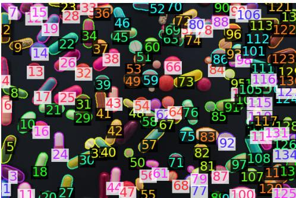

Image returned with this output

HARNESS (environment update, summarized: new memory entries; new data bindings verbatim)

Memory update: registers 1 new image in memory (tool generated image 1, from Visual   
Grounding Tool).   
Available data bindings (auto-injected into Python Coding Agent Tool):   
- segment pill: dict (keys: pred boxes, pred scores, pred masks, num masks, orig img h,   
orig img w)

## Example 1 · Step 2 Visual Grounding

WHAT HAPPENS A second query, “round pill”, targets the small round tablets that a general query tends to miss. It returns 72 detections, most of which overlap with those of Step 1.

## ARGUMENTS

"query": "round pill",   
"image id": "input image 1"

Memory update: registers 1 new image in memory (tool generated image 2, from Visual   
Grounding Tool).   
segment round pill: dict (keys: pred boxes, pred scores, pred masks, num masks, orig img   
h, orig img w)

## TOOL OUTPUT

<table><tr><td>bounding boxes (on a 0-1000 scale, [x1, y1, x2, y2]) are:json</td><td>Visual_Grounding-Tool grounded 72 objects for the prompt &#x27;round pill&#x27;. Their corresponding</td><td></td><td></td><td></td><td></td><td></td><td></td><td></td><td></td><td></td></tr><tr><td>[</td><td></td><td></td><td></td><td></td><td></td><td></td><td></td><td></td><td></td><td></td></tr><tr><td></td><td>{&quot;bbox_2d&quot;: [91, 307, 136, 374], &quot;label&quot;: &quot;round pil1&quot;},</td><td></td><td></td><td></td><td></td><td></td><td></td><td></td><td></td><td></td></tr><tr><td>{&quot;bbox_2d&quot;: [98, 202, 156, 288], &quot;label&quot;: &quot;round pill&quot;},</td><td></td><td></td><td></td><td></td><td></td><td></td><td></td><td></td><td></td><td></td></tr><tr><td>{&quot;bbox_2d&quot;: [102, 3, 150, 76], &quot;label&quot;: &quot;round pill&quot;},</td><td></td><td></td><td></td><td></td><td></td><td></td><td></td><td></td><td></td><td></td></tr><tr><td>{&quot;bbox_2d&quot;: [104, 603, 160, 688], &quot;label&quot;: &quot;round pil1&quot;},</td><td></td><td></td><td></td><td></td><td></td><td></td><td></td><td></td><td></td><td></td></tr><tr><td>{&quot;bbox_2d&quot;: [128, 959, 185, 1000], &quot;label&quot;: &quot;round pil1&quot;},</td><td></td><td></td><td></td><td></td><td></td><td></td><td></td><td></td><td></td><td></td></tr><tr><td>{&quot;bbox_2d&quot;: [250, 467, 303, 547], &quot;label&quot;: &quot;round pill&quot;},</td><td></td><td></td><td></td><td></td><td></td><td></td><td></td><td></td><td></td><td></td></tr><tr><td>{&quot;bbox_2d&quot;: [253, 310, 302, 384], &quot;label&quot;: &quot;round pill&quot;},</td><td></td><td></td><td></td><td></td><td></td><td></td><td></td><td></td><td></td><td></td></tr><tr><td>{&quot;bbox_2d&quot;: [284, 691, 317, 743], &quot;label&quot;: &quot;round pill&quot;},</td><td></td><td></td><td></td><td></td><td></td><td></td><td></td><td></td><td></td><td></td></tr><tr><td>{&quot;bbox-2d&quot;: [311, 190, 358, 262], &quot;label&quot;: &quot;round pill&quot;},</td><td></td><td></td><td></td><td></td><td></td><td></td><td></td><td></td><td></td><td></td></tr><tr><td>{&quot;bbox_2d&quot;: [316, 370, 368, 446], &quot;label&quot;: &quot;round pill&quot;},</td><td></td><td></td><td></td><td></td><td></td><td></td><td></td><td></td><td></td><td></td></tr><tr><td>{&quot;bbox_2d&quot;: [398, 911, 455, 998], &quot;label&quot;: &quot;round pil1&quot;},</td><td></td><td></td><td></td><td></td><td></td><td></td><td></td><td></td><td></td><td></td></tr><tr><td>{&quot;bbox_2d&quot;: [415, 491, 450, 538], &quot;label&quot;: &quot;round pill&quot;},</td><td></td><td></td><td></td><td></td><td></td><td></td><td></td><td></td><td></td><td></td></tr><tr><td>{&quot;bbox_2d&quot;: [418, 742, 448, 787], &quot;label&quot;: &quot;round pill&quot;},</td><td></td><td></td><td></td><td></td><td></td><td></td><td></td><td></td><td></td><td></td></tr><tr><td>{&quot;bbox_2d&quot;: [418, 348, 474, 431], &quot;label&quot;: &quot;round pil1&quot;},</td><td></td><td></td><td></td><td></td><td></td><td></td><td></td><td></td><td></td><td></td></tr><tr><td>{&quot;bbox_2d&quot;: [434, 192, 476, 258], &quot;label&quot;: &quot;round pill&quot;},</td><td></td><td></td><td></td><td></td><td></td><td></td><td></td><td></td><td></td><td></td></tr><tr><td>{&quot;bbox-2d&quot;: [451, 256, 494, 320], &quot;label&quot;: &quot;round pill&quot;},</td><td></td><td></td><td></td><td></td><td></td><td></td><td></td><td></td><td></td><td></td></tr><tr><td>{&quot;bbox_2d&quot;: [453, 482, 497, 551], &quot;label&quot;: &quot;round pill&quot;},</td><td></td><td></td><td></td><td></td><td></td><td></td><td></td><td></td><td></td><td></td></tr><tr><td>{&quot;bbox_2d&quot;: [456, 893, 480, 956], &quot;label&quot;: &quot;round pil1&quot;},</td><td></td><td></td><td></td><td></td><td></td><td></td><td></td><td></td><td></td><td></td></tr><tr><td>{&quot;bbox_2d&quot;: [458, 815, 479, 845], &quot;label&quot;:</td><td></td><td></td><td></td><td></td><td></td><td></td><td>&quot;round pill&quot;},</td><td></td><td></td><td></td></tr><tr><td>{&quot;bbox_2d&quot;: [472, 552, 529, 637], &quot;label&quot;: &quot;round pill&quot;},</td><td></td><td></td><td></td><td></td><td></td><td></td><td></td><td></td><td></td><td></td></tr><tr><td>{&quot;bbox_2d&quot;: [476, 342, 533, 427], &quot;label&quot;: &quot;round pill&quot;},</td><td></td><td></td><td></td><td></td><td></td><td>{&quot;bbox_2d&quot;: [484, 179, 532, 251], &quot;label&quot;: &quot;round pil1&quot;},</td><td></td><td></td><td></td><td></td></tr></table>

[The remaining 3,087 characters ofthis output are not shown (4,539 in total).]

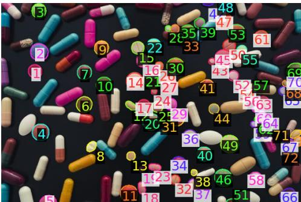  
Image returned with this output.

HARNESS (environment update, summarized: new memory entries; new data bindings verbatim)

## Example 1 · Step 3 Python Coding Agent

WHAT HAPPENS The agent asks the coding agent to merge the two sets. Both sets are available to the code as data bindings (segment pill and segment round pill), so no coordinates need to be copied by hand. The run completes but reports zero matches and a union of zero, which cannot be right, since both queries detect the same pills.

## ARGUMENTS

"objective": "Match the 134 detected pills against round-pill detections using mask overlap or bounding box intersection to count round pills absent from original pill detections, listing locations of missing ones and total union count." }

## TOOL OUTPUT

```python
Coding agent generated and executed the following Python code:
```python
import numpy as np
from PIL import Image, ImageDraw
import base64
import io
import json
# Decode masks to numpy arrays for intersection computation
def decode mask(mask str):
# Each mask is a base64-encoded string representing a segmentation mask
# We'll decode it to a numpy array of shape (H, W) with 0/1 values
# The format is assumed to be a run-length encoded or compressed binary mask
# For simplicity, we'll treat it as a base64-encoded PNG-like mask
try:
# Decode base64 string to bytes
mask bytes = base64.b64decode(mask str)
# Create a PIL Image from the bytes
img = Image.open(io.BytesIO(mask bytes))
# Convert to numpy array
mask array = np.array(img)
# Ensure binary mask (0 or 1)
mask array = (mask array > 0).astype(np.uint8)
return mask array
except Exception:
# If decoding fails, return None
return None
# Compute IoU (Intersection over Union) between two masks
def compute iou(mask1, mask2):
if mask1 is None or mask2 is None:
return 0.0
# Ensure masks are binary and same shape
mask1 = (mask1 > 0).astype(np.uint8)
mask2 = (mask2 > 0).astype(np.uint8)
# Compute intersection and union
intersection = np.logical and(mask1, mask2).sum()
union = np.logical or(mask1, mask2).sum()
if union == 0:
return 0.0
return intersection / union
# Compute IoU between two bounding boxes
def compute bbox iou(box1, box2):
# box format: [x1, y1, x2, y2] (top-left, bottom-right)
x1 1, y1 1, x2 1, y2 1 = box1
x1 2, y1 2, x2 2, y2 2 = box2
# Compute intersection
x left = max(x1 1, x1 2)
y top = max(y1 1, y1 2)
x right = min(x2 1, x2 2)
y bottom = min(y2 1, y2 2)
if x right <= x left or y bottom <= y top:
return 0.0
intersection area = (x right - x left) (y bottom - y top)
# Compute union
area1 = (x2 1 - x1 1) <sub>*</sub> (y2 1 - y1 1)
area2 = (x2 2 - x1 2) <sub>*</sub> (y2 2 - y1 2)
union area = area1 + area2 - intersection area
return intersection area / union area if union area > 0 else 0.0
# Get mask dimensions from ori inal ima e
H, W = segment pill["orig img h"], segment pill["orig img w"]
# Decode all masks for both datasets
decoded masks pill = [decode mask(mask) for mask in segment pill["pred masks"]]
decoded masks round pill = [decode mask(mask) for mask in segment round pill["pred masks"]]
# Initialize lists to store matched and unmatched round pills
matched round pills = []
unmatched round pills = []
# For each round pill, find the best match among original pills using IoU
for i, round mask in enumerate(decoded masks round pill):
best iou = 0.0
best match idx = -1
```

best bbox iou = 0.0   
best bbox idx = -1   
for j, pill mask in enumerate(decoded masks pill):   
if pill mask is not None and round mask is not None:   
mask iou = compute iou(pill mask, round mask)   
bbox iou = compute bbox iou(segment round pill["pred boxes"][i], segment pill["   
pred boxes"][j])   
# Use a combined score or choose the higher one   
combined score = (mask iou + bbox iou) / 2.0   
if combined score > best iou:   
best iou = combined score   
best match idx = j   
best bbox iou = bbox iou   
best bbox idx = j   
if best iou > 0.5: # Threshold for matching   
matched round pills.append((i, best match idx, best iou, best bbox iou))   
else:   
unmatched round pills.append((i, segment round pill["pred boxes"][i], segment round   
pill["pred scores"][i]))   
# Count total union of detected pills (unique pills from both sets)   
all masks = decoded masks pill + decoded masks round pill   
unique masks = []   
for mask in all masks:   
if mask is not None:   
# Check if mask is already in unique masks   
if not any(np.array equal(mask, existing mask) for existing mask in unique masks):   
unique masks.append(mask)   
total union count = len(unique masks)   
# Output results   
print(f"Total round pills detected: {len(segment round pill['pred masks'])}")   
print(f"Total original pills detected: {len(segment pill['pred masks'])}")   
print(f"Matched round pills: {len(matched round pills)}")   
print(f"Unmatched round pills: {len(unmatched round pills)}")   
print(f"Total union count: {total union count}")   
# List locations of unmatched round pills   
print("   
Unmatched round pills (location and score):")   
for idx, box, score in unmatched round pills:   
print(f" Index: {idx}, BBox: {box}, Score: {score}")   
# Optional: Print matched pairs   
print("   
Matched round pills (round idx, original idx, IoU, bbox iou):")   
for round idx, orig idx, iou, bbox iou in matched round pills:   
print(f" Round {round idx} -> Original {orig idx}, IoU: {iou:.4f}, BBox IoU: {bbox   
iou:.4f}")   
Execution output:   
Total round pills detected: 72   
Total original pills detected: 134   
Matched round pills: 0   
Unmatched round pills: 72   
Total union count: 0   
Unmatched round pills (location and score):   
Index: 0, BBox: [52.31292724609375, 117.94264221191406, 78.2960433959961,   
143.74490356445312], Score: 0.921875   
Index: 1, BBox: [56.460731506347656, 77.62562561035156, 90.11420440673828,   
110.55953979492188], Score: 0.91015625   
Index: 2, BBox: [58.77238082885742, 1.2981762886047363, 86.19441986083984,   
29.0463809967041], Score: 0.9140625   
Index: 3, BBox: [59.73981857299805, 231.58026123046875, 91.96317291259766,   
264.26812744140625], Score: 0.921875   
Index: 4, BBox: [73.73127746582031, 368.23492431640625, 106.33198547363281,   
384.2291259765625], Score: 0.85546875   
Index: 5, BBox: [144.1370849609375, 179.3444061279297, 174.76834106445312,   
209.95547485351562], Score: 0.9296875   
Index: 6, BBox: [145.93304443359375, 119.18267822265625, 173.69546508789062,   
147.4763641357422], Score: 0.9140625   
Index: 7, BBox: [163.64910888671875, 265.3359680175781, 182.84002685546875,   
285.3944396972656], Score: 0.875

```csv
Index: 8, BBox: [178.857666015625, 72.8042221069336, 206.23037719726562,
100.41905212402344], Score: 0.93359375
Index: 9, BBox: [182.19520568847656, 142.0789031982422, 212.25015258789062,
171.2662811279297], Score: 0.9375
Index: 10, BBox: [229.33837890625, 349.857177734375, 262.0947265625,
383.17645263671875], Score: 0.89453125
Index: 11, BBox: [238.81997680664062, 188.43115234375, 259.37640380859375,
206.6243896484375], Score: 0.69140625
Index: 12, BBox: [240.49752807617188, 284.8372802734375, 258.06903076171875,
302.1544494628906], Score: 0.89453125
Index: 13, BBox: [240.52491760253906, 133.4823760986328, 273.088134765625,
165.65768432617188], Score: 0.93359375
Index: 14, BBox: [250.11485290527344, 73.80632019042969, 274.3455810546875,
98.89035034179688], Score: 0.93359375
Index: 15, BBox: [259.9403076171875, 98.40367126464844, 284.60345458984375,
122.7780990600586], Score: 0.9296875
Index: 16, BBox: [260.7716369628906, 185.05271911621094, 286.3943176269531,
211.45742797851562], Score: 0.91015625
```

## [47 lines ofexecution output not shown here (82 in total).]

Index: 64, BBox: [534.013671875, 160.11773681640625, 550.9052734375,   
176.45880126953125], Score: 0.80859375   
Index: 65, BBox: [535.5726318359375, 355.00115966796875, 566.8264770507812,   
384.34881591796875], Score: 0.859375   
Index: 66, BBox: [538.7619018554688, 260.182861328125, 566.955322265625,   
287.40594482421875], Score: 0.89453125   
Index: 67, BBox: [540.86328125, 147.92442321777344, 552.2364501953125,   
159.67457580566406], Score: 0.8203125   
Index: 68, BBox: [548.8511962890625, 114.78163146972656, 577.1387939453125,   
147.60922241210938], Score: 0.890625   
Index: 69, BBox: [549.4615478515625, 148.23785400390625, 577.478515625,   
178.4287872314453], Score: 0.87890625   
Index: 70, BBox: [555.9362182617188, 242.7733154296875, 575.7222290039062,   
259.68731689453125], Score: 0.703125   
Index: 71, BBox: [563.8709106445312, 256.3594665527344, 577.0241088867188,   
274.3338317871094], Score: 0.78125   
Matched round pills (round idx, original idx, IoU, bbox iou):

## Example 1 · Step 4 Python Coding Agent

WHAT HAPPENS The agent restates the objective more narrowly: compare boxes only, by overlap or centre distance, and do not decode masks. This time the code finds five round detections that match nothing in the first set.

## ARGUMENTS

"objective": "Use ONLY the pred boxes pixel coordinate arrays for the original 134 pill detections and the 72 round pill detections. Match round boxes to original boxes by intersection-over-union >=0.45 or center proximity; report numbered round detections that are missing from original and original detections with major overlaps (duplicates). No mask decoding."

## TOOL OUTPUT

```python
Coding agent generated and executed the following Python code:
``python
import numpy as np
# Extract pred boxes for original pills and round pills
original boxes = segment pill["pred boxes"]
round boxes = segment round pill["pred boxes"]
# Convert to numpy arrays for easier computation
original boxes = np.array(original boxes)
round boxes = np.array(round boxes)
# Helper function to compute IoU
def iou(box1, box2):
# box format: [x1, y1, x2, y2] (assuming top-left and bottom-right)
x1 1, y1 1, x2 1, y2 1 = box1
x1 2, y1 2, x2 2, y2 2 = box2
# Compute intersection
```

x int = max(0, min(x2 1, x2 2) - max(x1 1, x1 2))   
y int = max(0, min(y2 1, y2 2) - max(y1 1, y1 2))   
intersection = x int <sub>\*</sub> y int   
# Compute union   
area1 = (x2 1 - x1 1) <sub>\*</sub> (y2 1 - y1 1)   
area2 = (x2 2 - x1 2) <sub>\*</sub> (y2 2 - y1 2)   
union = area1 + area2 - intersection   
if union == 0:   
return 0.0   
return intersection / union   
# Helper function to compute center proximity (Euclidean distance between centers)   
def center proximity(box1, box2):   
x1 1, y1 1, x2 1, y2 1 = box1   
x1 2, y1 2, x2 2, y2 2 = box2   
center1 x, center1 y = (x1 1 + x2 1) / 2, (y1 1 + y2 1) / 2   
center2 x, center2 y = (x1 2 + x2 2) / 2, (y1 2 + y2 2) / 2   
return np.sqrt((center1 x - center2 x)<sub>\*\*</sub>2 + (center1 y - center2 y)<sub>\*\*</sub>2)   
# Threshold for matching: IoU >= 0.45 OR center proximity <= 10 pixels (arbitrary, but   
reasonable for visual matching)   
MATCH THRESHOLD IOU = 0.45   
MATCH THRESHOLD CENTER = 10.0   
# Initialize lists to track matches and unmatched detections   
matched round indices = set()   
matched original indices = set()   
unmatched round indices = []   
unmatched original indices = []   
# For each round pill detection, try to match with original pill detections   
for round idx, round box in enumerate(round boxes):   
matched = False   
for orig idx, orig box in enumerate(original boxes):   
iou val = iou(round box, orig box)   
center dist = center proximity(round box, orig box)   
if iou val >= MATCH THRESHOLD IOU or center dist <= MATCH THRESHOLD CENTER:   
# Found a match   
matched = True   
matched round indices,add(round idx)   
matched original indices.add(orig idx)   
break   
if not matched:   
unmatched round indices.append(round idx)   
# Find original detections that have major overlaps (duplicates) - i.e., matched with   
multiple round pills   
duplicate original indices = []   
for orig idx in matched original indices:   
count = 0   
for round idx in range(len(round boxes)):   
if round idx not in matched round indices:   
continue   
iou val = iou(original boxes[orig idx], round boxes[round idx])   
center dist = center proximity(original boxes[orig idx], round boxes[round idx])   
if iou val >= MATCH THRESHOLD IOU or center dist <= MATCH THRESHOLD CENTER:   
count += 1   
if count > 1:   
duplicate original indices.append(orig idx)   
# Output results   
print("Round detections missing from original:", unmatched round indices)   
print("Original detections with major overlaps (duplicates):", duplicate original indices)   
Execution output:   
Round detections missing from original: [23, 25, 26, 40, 41]   
Original detections with major overlaps (duplicates): []

## Example 2 Dataset: OdinW-13-All (PascalVOC subset) Model: GPT-6 Sol

## Overview (our summary)

Task. Detect every object of the twenty PascalVOC categories in a photograph of fourteen men posing around a dinner table, and return labelled boxes.

Why it is hard. The people overlap heavily, some are visible only as a face between two others, and the table is covered with bottles and plates.

How the agent solves it. After a first pass over the four categories present, it zooms on the crowded table and issues narrower queries, ending with a referring expression for one partly hidden man. The final answer matches 22 of the 23 ground-truth objects.

## INPUT IMAGES

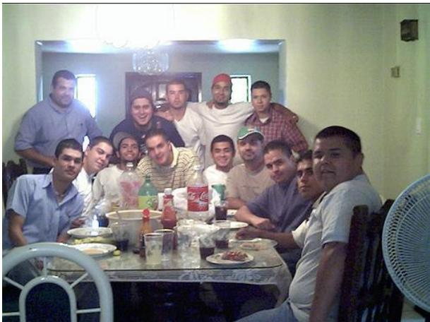  
input image 1

## QUESTION (as sent to the model)

Question: Locate every instance that belongs to the following categories: 'aeroplane, bicycle, bird, boat, bottle, bus, car, cat, chair, cow, diningtable, dog, horse, motorbike, person, pottedplant, sheep, sofa, train, tvmonitor'. Report the bounding boxes in JSON format as a list of objects, one object per detected instance, where each object has a " bbox 2d" key with [x1, y1, x2, y2] and a "label" key with the category name exactly as written above. Coordinates must be normalised on a 0-1000 scale, with (0,0) as the top-left corner and (1000,1000) as the bottom-right corner of the image. For example: [{" bbox 2d": [x1, y1, x2, y2], "label": "aeroplane"}, {"bbox 2d": [x1, y1, x2, y2], "label": "bicycle"}]. If none of the listed categories is present, output an empty list [].

## WITHOUT TOOLS (GPT-6 Sol’s full response to the same question)

```jsonl
{"bbox 2d":[28,205,238,565],"label":"person"},
{"bbox 2d":[4,421,208,757],"label":"person"},
{"bbox 2d":[162,413,282,651],"label":"person"},
{"bbox 2d":[218,397,330,637],"label":"person"},
{"bbox 2d":[250,269,376,520],"label":"person"},
{"bbox 2d":[348,232,464,456],"label":"person"},
{"bbox 2d":[438,216,588,501],"label":"person"},
{"bbox 2d":[552,243,714,501],"label":"person"},
{"bbox 2d":[314,381,464,635],"label":"person"},
{"bbox 2d":[438,408,564,627],"label":"person"},
{"bbox 2d":[508,387,636,680],"label":"person"},
{"bbox 2d":[538,432,738,720],"label":"person"},
{"bbox 2d":[678,451,758,688],"label":"person"},
{"bbox 2d":[524,379,892,997],"label":"person"},
{"bbox 2d":[138,632,698,997],"label":"diningtable"},
{"bbox 2d":[0,741,272,997],"label":"chair"},
{"bbox 2d":[810,613,908,997],"label":"chair"},
{"bbox 2d":[264,501,318,643],"label":"bottle"},
{"bbox 2d":[318,515,374,685],"label":"bottle"},
{"bbox 2d":[366,560,412,685],"label":"bottle"},
{"bbox 2d":[428,507,484,677],"label":"bottle"}
```

RESULTS (per-image counts from the benchmark evaluator; F1 at IoU ≥ 0.5; ground-truth categories: person, bottle, dining table, chair)

<table><tr><td></td><td>TP</td><td>FP</td><td>FN</td><td>F1</td></tr><tr><td>GPT-6 Sol, no tools</td><td>16</td><td>5</td><td>7</td><td>0.73</td></tr><tr><td>GPT-6 Sol + OpenVLHarness</td><td>22</td><td>1</td><td>1</td><td>0.96</td></tr><tr><td>Ground-truth boxes</td><td colspan="4">23</td></tr></table>

## With OpenVLHarness: full trajectory

HARNESS (environment update, shown in full)   
Environment Update (not a new question):   
Currently available image IDs for tool calls:   
- input image 1: user input   
When a tool needs image input, pass one of these IDs via the <sub>\*</sub> image id field.   
Do NOT invent image file names or paths.

## Example 2 · Step 1 Visual Grounding

WHAT HAPPENS A first pass on “person” returns 13 people.

ARGUMENTS

{   
"query": "person",   
"image id": "input image 1"   
}

## TOOL OUTPUT

Visual Grounding Tool grounded 13 objects for the prompt 'person'. Their corresponding   
bounding boxes (on a 0-1000 scale, [x1, y1, x2, y2]) are: \`\`\`json   
[   
{"bbox 2d": [0, 422, 191, 871], "label": "person"},   
{"bbox 2d": [29, 208, 234, 533], "label": "person"},   
{"bbox 2d": [165, 414, 260, 667], "label": "person"},   
{"bbox 2d": [211, 402, 324, 636], "label": "person"},   
{"bbox 2d": [251, 272, 426, 480], "label": "person"},   
{"bbox 2d": [313, 389, 462, 589], "label": "person"},   
{"bbox 2d": [381, 236, 478, 505], "label": "person"},   
{"bbox 2d": [428, 219, 695, 512], "label": "person"},   
{"bbox 2d": [470, 410, 545, 574], "label": "person"},   
{"bbox 2d": [521, 384, 635, 642], "label": "person"},   
{"bbox 2d": [536, 382, 888, 1000], "label": "person"},   
{"bbox 2d": [543, 434, 727, 846], "label": "person"},   
{"bbox 2d": [569, 240, 717, 470], "label": "person"}   
]\`\`\`. The object numbers correspond to the labeled masks rendered in the following image,   
which ou can refer to as tool enerated ima e 1

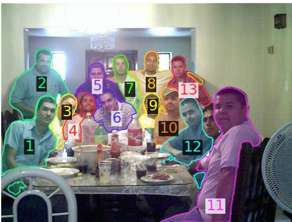  
Image returned with this output.  
HARNESS (environment update, summarized: new memory entries; new data bindings verbatim)

Memory update: registers 1 new image in memory (tool generated image 1, from Visual   
Grounding Tool).   
Available data bindings (auto-injected into Python Coding Agent Tool):   
- segment person: dict (keys: pred boxes, pred scores, pred masks, num masks, orig img h,   
orig img w)

## Example 2 · Step 2 Visual Grounding

WHAT HAPPENS Grounding “dining table” returns the table.

## ARGUMENTS

```jsonl
{
"query": "dining table",
"image id": "input image 1"
}
```

## TOOL OUTPUT

Visual Grounding Tool grounded 1 objects for the prompt 'dining table'. Their corresponding   
bounding boxes (on a 0-1000 scale, [x1, y1, x2, y2]) are: \`\`\`json   
[   
{"bbox 2d": [108, 722, 677, 942], "label": "dining table"}   
]\`\`\`. The object numbers correspond to the labeled masks rendered in the following image,   
which you can refer to as tool generated image 2.

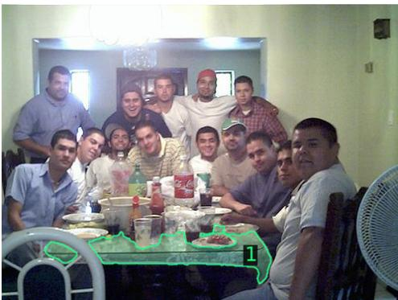

Image returned with this output.

HARNESS (environment update, summarized: new memory entries; new data bindings verbatim)

Memory update: registers 1 new image in memory (tool generated image 2, from Visual   
Grounding Tool).   
- segment dining table: dict (keys: pred boxes, pred scores, pred masks, num masks, orig   
img h, orig img w)

## Example 2 · Step 3 Visual Grounding

WHAT HAPPENS Grounding “bottle” returns five bottles on the table.

## ARGUMENTS

{   
"query": "bottle",   
"image id": "input image 1"   
}

## TOOL OUTPUT

Visual Grounding Tool grounded 5 objects for the prompt 'bottle'. Their corresponding   
bounding boxes (on a 0-1000 scale, [x1, y1, x2, y2]) are: \`\`\`json   
[   
{"bbox 2d": [271, 495, 327, 642], "label": "bottle"},   
{"bbox 2d": [318, 533, 364, 645], "label": "bottle"},   
{"bbox 2d": [319, 640, 354, 794], "label": "bottle"},   
{"bbox 2d": [369, 576, 409, 705], "label": "bottle"},

{"bbox 2d": [431, 504, 483, 681], "label": "bottle"}   
The object numbers correspond to the labeled masks rendered in the following image,   
which you can refer to as tool generated image 3.

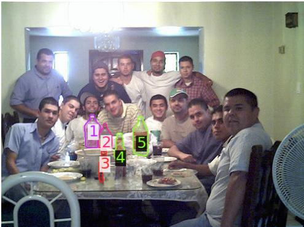  
Image returned with this output.

HARNESS (environment update, summarized: new memory entries; new data bindings verbatim)

Memory update: registers 1 new image in memory (tool generated image 3, from Visual   
Grounding Tool).   
- segment bottle: dict (keys: pred boxes, pred scores, pred masks, num masks, orig img h,   
orig img w)

## Example 2 · Step 4 Visual Grounding

WHAT HAPPENS Grounding “chair” returns three chairs.

## ARGUMENTS

{   
"query": "chair",   
"image id": "input image 1"   
}

## TOOL OUTPUT

Visual Grounding Tool grounded 3 objects for the prompt 'chair'. Their corresponding   
bounding boxes (on a 0-1000 scale, [x1, y1, x2, y2]) are: \`\`\`json   
[   
{"bbox 2d": [0, 745, 260, 999], "label": "chair"},   
{"bbox 2d": [0, 485, 61, 635], "label": "chair"},   
{"bbox 2d": [785, 612, 939, 999], "label": "chair"}   
]\`\`\`. The object numbers correspond to the labeled masks rendered in the following image,   
which you can refer to as tool generated image 4.

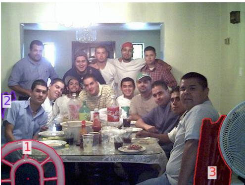  
Image returned with this output.  
HARNESS (environment update, summarized: new memory entries; new data bindings verbatim)

HARNESS (environment update, summarized: new memory entries; new data bindings verbatim)

Memory update: registers 1 new image in memory (tool generated image 4, from Visual   
Grounding Tool).   
- segment chair: dict (keys: pred boxes, pred scores, pred masks, num masks, orig img h,   
orig img w)

## Example 2 · Step 5 Zoom In

WHAT HAPPENS A zoom on the crowded right half of the table, where people overlap most.

## ARGUMENTS

```json
{
"image id": "input image 1",
"coords": [450, 350, 900, 810],
"padding": 50
}
```

## TOOL OUTPUT

Tool \`Zoom In Tool\` (tool call id=call GCCULV9QqGvr09iIPPIpWTM2) returned:   
Zoomed in image rendered below; refer to it as tool generated image 5.

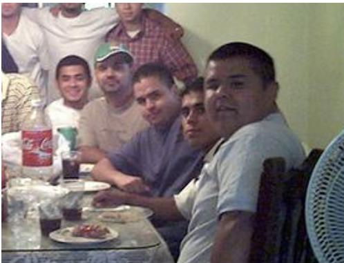

Image returned with this output

Memory update: registers 1 new image in memory (tool generated image 5, from Zoom In Tool).

## Example 2 · Step 6 Visual Grounding

WHAT HAPPENS The agent re-grounds the table with the shorter query “table”.

## ARGUMENTS

{   
"query": "table",   
"image id": "input image 1"   
}

## TOOL OUTPUT

Visual Grounding Tool grounded 1 objects for the prompt 'table'. Their corresponding   
bounding boxes (on a 0-1000 scale, [x1, y1, x2, y2]) are: \`\`\`json   
[   
{"bbox 2d": [109, 741, 677, 940], "label": "table"}   
]\`\`\`. The object numbers correspond to the labeled masks rendered in the following image,   
which you can refer to as tool generated image 6.

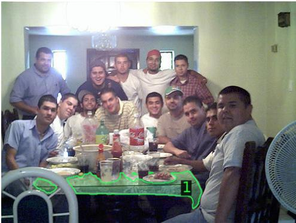  
Image returned with this output.

HARNESS (environment update, summarized: new memory entries; new data bindings verbatim)

Memory update: registers 1 new image in memory (tool generated image 6, from Visual   
Grounding Tool).   
- segment table: dict (keys: pred boxes, pred scores, pred masks, num masks, orig img h,   
orig img w)

## Example 2 · Step 7 Visual Grounding

WHAT HAPPENS The query “man” is an alternative wording for the people, and again returns 13.

## ARGUMENTS

```jsonl
{
"query": "man",
"image id": "input image 1"
}
TOOL OUTPUT
Visual Grounding Tool grounded 13 objects for the prompt 'man'. Their corresponding
bounding boxes (on a 0-1000 scale, [x1, y1, x2, y2]) are: ```json
[
{"bbox 2d": [0, 422, 190, 870], "label": "man"},
{"bbox 2d": [29, 209, 234, 533], "label": "man"},
{"bbox 2d": [166, 415, 259, 667], "label": "man"},
{"bbox 2d": [212, 402, 324, 636], "label": "man"},
{"bbox 2d": [251, 272, 426, 478], "label": "man"},
{"bbox 2d": [313, 389, 462, 589], "label": "man"},
{"bbox 2d": [381, 236, 478, 504], "label": "man"},
{"bbox 2d": [430, 219, 694, 512], "label": "man"},
{"bbox 2d": [470, 410, 545, 573], "label": "man"},
{"bbox 2d": [521, 384, 636, 642], "label": "man"},
{"bbox 2d": [537, 382, 887, 1000], "label": "man"},
{"bbox 2d": [543, 432, 726, 845], "label": "man"},
{"bbox 2d": [570, 240, 716, 470], "label": "man"}
]```. The object numbers correspond to the labeled masks rendered in the following image,
which you can refer to as tool generated image 7.
```

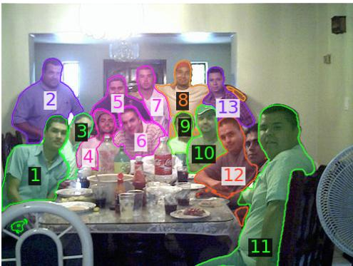  
Image returned with this output.

HARNESS (environment update, summarized: new memory entries; new data bindings verbatim)   
Memory update: registers 1 new image in memory (tool generated image 7, from Visual   
Grounding Tool).   
- segment man: dict (keys: pred boxes, pred scores, pred masks, num masks, orig img h, orig   
img w)

## Example 2 · Step 8 Visual Grounding

WHAT HAPPENS A narrow query for one specific person, “person in dark shirt”, returns a single match.

## ARGUMENTS

```jsonl
{
"query": "person in dark shirt",
"image id": "input image 1"
}
```

## TOOL OUTPUT

Visual Grounding Tool grounded 1 objects for the prompt 'person in dark shirt'. Their   
corresponding bounding boxes (on a 0-1000 scale, [x1, y1, x2, y2]) are: \`\`\`json   
[   
{"bbox 2d": [251, 273, 426, 483], "label": "person in dark shirt"}   
]\`\`\` The object numbers correspond to the labeled masks rendered in the following image,   
which you can refer to as tool generated image 8.

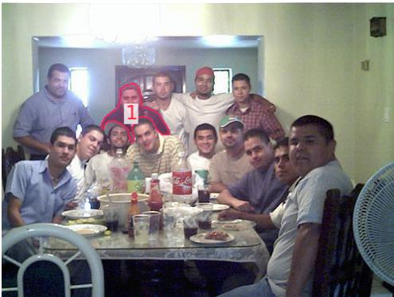  
Image returned with this output.

HARNESS (environment update, summarized: new memory entries; new data bindings verbatim)

Memory update: registers 1 new image in memory (tool generated image 8, from Visual   
Grounding Tool).   
- segment person in dark shirt: dict (keys: pred boxes, pred scores, pred masks, num masks,   
orig img h, orig img w)

## Example 2 · Step 9 Zoom In

WHAT HAPPENS A second, tighter zoom on a group of people on the right side of the table.

## ARGUMENTS

```json
{
"image id": "input image 1",
"coords": [630, 400, 785, 730],
"padding": 50
}
```

## TOOL OUTPUT

Tool \`Zoom In Tool\` (tool call id=call vl7F9q9d7GQQotr47vmOtha0) returned:   
Zoomed in image rendered below; refer to it as tool generated image 9.

HARNESS (environment update, summarized: new memory entries; new data bindings verbatim)   
Memory update: registers 1 new image in memory (tool generated image 9, from Zoom In Tool).

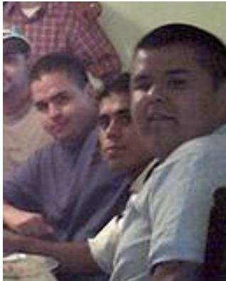

Image returned with this output.

## Example 2 · Step 10 Visual Grounding

WHAT HAPPENS The last query is a referring expression, “man behind the man in white shirt”, aimed at one partly hidden person. SAM 3 accepts such phrases, and the harness lets the agent use them when a category name is not enough.

## ARGUMENTS

```jsonl
{
"query": "man behind the man in white shirt",
"image id": "input image 1"
}
```

## TOOL OUTPUT

Visual Grounding Tool grounded 7 objects for the prompt 'man behind the man in white shirt'.   
Their corresponding bounding boxes (on a 0-1000 scale, [x1, y1, x2, y2]) are: \`\`\`json   
[   
{"bbox 2d": [165, 414, 259, 667], "label": "man behind the man in white shirt"},   
{"bbox 2d": [211, 402, 324, 637], "label": "man behind the man in white shirt"},   
{"bbox 2d": [381, 235, 478, 506], "label": "man behind the man in white shirt"},   
{"bbox 2d": [430, 219, 694, 513], "label": "man behind the man in white shirt"},   
{"bbox 2d": [470, 409, 545, 573], "label": "man behind the man in white shirt"},   
{"bbox 2d": [522, 384, 635, 642], "label": "man behind the man in white shirt"},   
{"bbox 2d": [537, 382, 887, 1000], "label": "man behind the man in white shirt"}   
]\`\`\`. The object numbers correspond to the labeled masks rendered in the following image,   
which you can refer to as tool generated image 10.

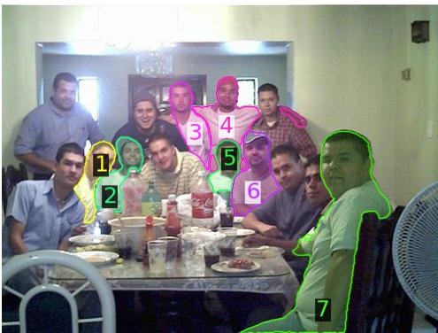  
Image returned with this output.  
HARNESS (environment update, summarized: new memory entries; new data bindings verbatim)

Memory update: registers 1 new image in memory (tool generated image 10, from Visual   
Grounding Tool).   
segment man behind the man in white sh: dict (keys: pred boxes, pred scores, pred masks,   
num masks, orig img h, orig img w)

## Example 2 · Final answer

WHAT HAPPENS The agent answers with 23 labelled boxes; the evaluator matches 22 of them to ground truth, with one false positive and one miss.

## MODEL

<answer>[{"bbox 2d":[0,422,191,871],"label":"person"},{"bbox 2d":[29,208,234,533],"label":"   
person"},{"bbox 2d":[165,414,260,667],"label":"person"},{"bbox 2d":[211,402,324,636],"label"   
:"person"},{"bbox 2d":[251,272,426,480],"label":"person"},{"bbox 2d":[313,389,462,589],"   
label":"person"},{"bbox 2d":[381,236,478,505],"label":"person"},{"bbox 2d":[428,219,695,   
512],"label":"person"},{"bbox 2d":[470,410,545,574],"label":"person"},{"bbox 2d":[521,384,   
635,642],"label":"person"},{"bbox 2d":[543,434,727,846],"label":"person"},{"bbox 2d":[675,   
465,759,803],"label":"person"},{"bbox 2d":[536,382,888,1000],"label":"person"},{"bbox 2d"   
:[569,240,717,470],"label":"person"},{"bbox 2d":[271,495,327,642],"label":"bottle"},{"bbox   
2d":[318,533,364,645],"label":"bottle"},{"bbox 2d":[319,640,354,794],"label":"bottle"},{"   
bbox 2d":[369,576,409,705],"label":"bottle"},{"bbox 2d":[431,504,483,681],"label":"bottle"},   
{"bbox 2d":[80,610,680,947],"label":"diningtable"},{"bbox 2d":[0,745,260,999],"label":"   
chair"},{"bbox 2d":[0,485,61,635],"label":"chair"},{"bbox 2d":[785,612,939,999],"label":"   
chair"}]</answer>

NOTE Panel drawn by us from the final answer: the 23 predicted boxes on the input image, coloured by label.

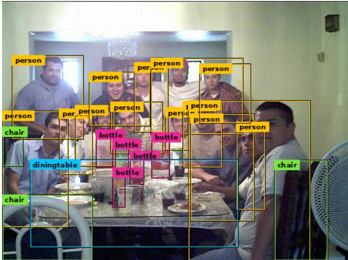

What to notice. After grounding the four categories present, the model zooms on the crowded table and issues narrower queries for what the first pass missed: “table”, “man”, “person in dark shirt”, and finally “man behind the man in white shirt” for a partly hidden person. The last query is a referring expression, not a category name; SAM 3 can resolve it, and the harness lets the model use that ability. The final answer matches 22 of the 23 ground-truth objects with one false positive.

<table><tr><td>Example 3 Dataset: FSCD-147 Model: GPT-6 Sol</td></tr><tr><td>Overview (our summary)</td></tr><tr><td>Task. Box every “package of fresh cut fruit&quot; on a supermarket shelf that holds 53 plastic fruit cups in rows. Why it is hard. The category name as given is unusual; a detector queried with it finds only part of the</td></tr><tr><td>shelf. How the agent solves it. It rephrases the category as “fruit cup&quot;, which finds every cup, checks two</td></tr><tr><td>regions with zooms, and returns 53 boxes that all match. Note that the no-tool answer scores zero only because it used pixel coordinates instead of the requested 0–1000 scale (see the note under the results).</td></tr></table>

INPUT IMAGES

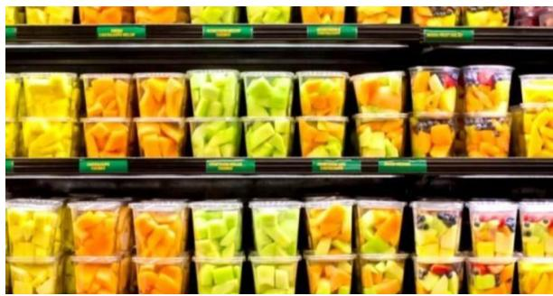  
input image 1  
QUESTION (as sent to the model)

Question: Locate all instances of 'package of fresh cut fruit' in this image. For each instance, output a bounding box as [x1, y1, x2, y2] where coordinates are normalised on a 0-1000 scale (with (0,0) as the top-left corner and (1000,1000) as the bottom-right corner). Your answer should be a list of lists. If there are no instances of 'package of fresh cut fruit' in the image, output an empty list [] as your answer.

WITHOUT TOOLS (GPT-6 Sol’s full response to the same question)

[[0,0,24,24],[24,0,95,24],[98,0,171,24],[173,0,244,24],[247,0,315,24],[319,0,392,24],[395, 0,465,24],[470,0,538,24],[542,0,611,24],[612,0,679,24],[680,0,731,24],[0,88,22,151],[22,88, 101,151],[104,88,175,151],[175,88,246,151],[244,85,319,151],[318,86,391,151],[392,86,464, 151],[463,87,538,151],[539,79,612,149],[611,78,685,149],[687,89,731,149],[0,149,22,204], [22,149,101,204],[103,149,175,204],[175,149,246,204],[245,149,319,204],[318,149,391,204], [391,149,464,204],[464,147,538,204],[539,145,612,204],[611,144,685,204],[686,145,731,204], [0,255,84,341],[84,257,166,341],[165,258,248,341],[247,258,324,341],[326,258,400,341],[400, 258,469,340],[469,258,536,340],[540,258,615,341],[616,258,686,341],[686,260,731,341],[0, 335,84,384],[84,335,166,384],[166,335,248,384],[248,334,324,384],[326,334,400,384],[400, 332,469,384],[469,332,536,384],[540,332,615,384],[616,332,686,384],[686,332,731,384]]

RESULTS (F1 at IoU ≥ 0.5 against the 53 ground-truth boxes)
<table><tr><td></td><td>boxes</td><td>F1</td><td>mean IoU</td></tr><tr><td>SAM 3 alone (query “package of fresh cut fruit&quot;)</td><td>25</td><td>0.64 X</td><td>一</td></tr><tr><td>SAM 3 alone (query “fruit cup”)</td><td>57</td><td>0.95 X</td><td>一</td></tr><tr><td>GPT-6 Sol, no tools</td><td>53</td><td>0.00 X</td><td></td></tr><tr><td>GPT-6 Sol + OpenVLHarness</td><td>53</td><td>1.00√</td><td>0.87</td></tr><tr><td>Ground truth</td><td>53</td><td></td><td></td></tr></table>

NOTE The no-tool answer gives its boxes in pixel coordinates (the image is 731×384) instead of the requested 0–1000 scale, so every box misses. Rescaled to that scale, its boxes would score F1 1.00 with mean IoU 0.81. Here the harness’s gain is mostly the answer’s coordinate frame, plus tighter boxes.

## With OpenVLHarness: full trajectory

HARNESS (environment update, shown in full)

Environment Update (not a new question):   
Currently available image IDs for tool calls:   
- input image 1: user input   
When a tool needs image input, pass one of these IDs via the <sub>\*</sub> image id field.   
Do NOT invent image file names or paths.

## Example 3 · Step 1 Visual Grounding

WHAT HAPPENS Grounding the category exactly as asked returns only 25 candidates, missing much of the shelf.

## ARGUMENTS

{   
"query": "package of fresh cut fruit",   
"image id": "input image 1"   
}

## TOOL OUTPUT

Visual Grounding Tool grounded 25 objects for the prompt 'package of fresh cut fruit'.   
Their corresponding bounding boxes (on a 0-1000 scale, [x1, y1, x2, y2]) are: \`\`\`json   
[   
{"bbox 2d": [337, 673, 434, 873], "label": "package of fresh cut fruit"},   
{"bbox 2d": [343, 859, 437, 1000], "label": "package of fresh cut fruit"},   
{"bbox 2d": [431, 226, 527, 383], "label": "package of fresh cut fruit"},   
{"bbox 2d": [445, 855, 538, 1000], "label": "package of fresh cut fruit"},   
{"bbox 2d": [445, 674, 541, 869], "label": "package of fresh cut fruit"},   
{"bbox 2d": [532, 225, 626, 381], "label": "package of fresh cut fruit"},   
{"bbox 2d": [535, 381, 625, 526], "label": "package of fresh cut fruit"},   
{"bbox 2d": [546, 663, 637, 863], "label": "package of fresh cut fruit"},   
{"bbox 2d": [547, 850, 638, 1000], "label": "package of fresh cut fruit"},   
{"bbox 2d": [631, 225, 729, 372], "label": "package of fresh cut fruit"},   
{"bbox 2d": [637, 371, 733, 527], "label": "package of fresh cut fruit"},   
{"bbox 2d": [640, 669, 731, 859], "label": "package of fresh cut fruit"},   
{"bbox 2d": [648, 855, 735, 1000], "label": "package of fresh cut fruit"},   
{"bbox 2d": [738, 208, 829, 372], "label": "package of fresh cut fruit"},   
{"bbox 2d": [739, 367, 824, 526], "label": "package of fresh cut fruit"},   
{"bbox 2d": [740, 674, 837, 871], "label": "package of fresh cut fruit"},   
{"bbox 2d": [745, 864, 838, 1000], "label": "package of fresh cut fruit"},

  
Image returned with this output.

HARNESS (environment update, summarized: new memory entries; new data bindings verbatim)

Memory update: registers 1 new image in memory (tool generated image 1, from Visual   
Grounding Tool).   
Available data bindings (auto-injected into Python Coding Agent Tool):   
- segment package of fresh cut fruit: dict (keys: pred boxes, pred scores, pred masks, num   
masks, orig img h, orig img w)

## Example 3 · Step 2 Visual Grounding

WHAT HAPPENS The agent rephrases the query as “fruit cup”. SAM 3 now returns 57 candidates covering the whole shelf, slightly more than the 53 cups.

## ARGUMENTS

{   
"query": "fruit cup",   
"image id": "input image 1"   
}

## TOOL OUTPUT

```jsonl
Visual Grounding Tool grounded 57 objects for the prompt 'fruit cup'. Their corresponding
bounding boxes (on a 0-1000 scale, [x1, y1, x2, y2]) are: ```json
[
{"bbox 2d": [0, 234, 28, 387], "label": "fruit cup"},
{"bbox 2d": [0, 0, 26, 59], "label": "fruit cup"},
{"bbox 2d": [0, 390, 25, 527], "label": "fruit cup"},
{"bbox 2d": [1, 668, 105, 871], "label": "fruit cup"},
{"bbox 2d": [6, 867, 102, 1000], "label": "fruit cup"},
{"bbox 2d": [26, 385, 130, 527], "label": "fruit cup"},
{"bbox 2d": [29, 229, 132, 385], "label": "fruit cup"},
{"bbox 2d": [35, 0, 124, 60], "label": "fruit cup"},
{"bbox 2d": [83, 664, 120, 861], "label": "fruit cup"},
{"bbox 2d": [106, 866, 128, 1000], "label": "fruit cup"},
{"bbox 2d": [114, 676, 212, 867], "label": "fruit cup"},
{"bbox 2d": [120, 865, 212, 1000], "label": "fruit cup"},
{"bbox 2d": [135, 0, 234, 59], "label": "fruit cup"},
{"bbox 2d": [138, 234, 234, 386], "label": "fruit cup"},
{"bbox 2d": [140, 386, 233, 527], "label": "fruit cup"},
{"bbox 2d": [166, 663, 234, 856], "label": "fruit cup"},
{"bbox 2d": [207, 858, 230, 1000], "label": "fruit cup"},
{"bbox 2d": [227, 676, 335, 873], "label": "fruit cup"},
{"bbox 2d": [234, 866, 336, 1000], "label": "fruit cup"},
{"bbox 2d": [235, 0, 333, 57], "label": "fruit cup"},
{"bbox 2d": [236, 230, 331, 387], "label": "fruit cup"},
{"bbox 2d": [236, 386, 331, 526], "label": "fruit cup"},
{"bbox 2d": [332, 385, 432, 526], "label": "fruit cup"},
```  
[The remaining 2,101 characters of this output are not shown (3,568 in total).]

  
Image returned with this output.

HARNESS (environment update, summarized: new memory entries; new data bindings verbatim)

Memory update: registers 1 new image in memory (tool generated image 2, from Visual   
Grounding Tool).   
- segment fruit cup: dict (keys: pred boxes, pred scores, pred masks, num masks, orig img h,   
orig img w)

## Example 3 · Step 3 Zoom In

WHAT HAPPENS A zoom on the lower left of the shelf, to check the cups there.

## ARGUMENTS

```json
{
"image id": "input image 1",
"coords": [0, 640, 343, 1000],
"padding": 50
}
```

## TOOL OUTPUT

Tool \`Zoom In Tool\` (tool call id=call 7rYFu8RXWlhnpwbcoWjvJPR2) returned:   
Zoomed in image rendered below; refer to it as tool generated image 3.

HARNESS (environment update, summarized: new memory entries; new data bindings verbatim)   
Memory update: registers 1 new image in memory (tool generated image 3, from Zoom In Tool).

  
Image returned with this output.

## Example 3 · Step 4 Zoom In

WHAT HAPPENS A zoom on the strip along the top edge, where partly cut-off cups sit.

## ARGUMENTS

"image id": "input image 1",   
"coords": [0, 0, 1000, 85],   
"padding": 50

## TOOL OUTPUT

Tool \`Zoom In Tool\` (tool call id=call BAISDAjjqrtvjY61E2BI4mEj) returned: Zoomed in image rendered below; refer to it as tool generated image 4.


Image returned with this output.

HARNESS (environment update, summarized: new memory entries; new data bindings verbatim)

Memory update: registers 1 new image in memory (tool generated image 4, from Zoom In Tool).

## Example 3 · Final answer

WHAT HAPPENS The agent returns 53 boxes, and all 53 match a ground-truth cup. The trajectory does not say how the agent chose 53 of the 57 candidates.

## MODEL

<answer>[[0,0,26,59],[35,0,124,60],[135,0,234,59],[235,0,333,57],[336,0,425,58],[440,0,   
521,57],[539,0,619,56],[640,0,723,59],[740,0,829,68],[834,0,921,68],[925,0,1000,68],[0,234,   
28,387],[29,229,132,385],[138,234,234,386],[236,230,331,387],[334,220,428,384],[432,226,   
527,381],[533,225,626,380],[631,225,729,372],[738,209,830,371],[834,204,927,371],[940,237,   
1000,339],[0,390,25,527],[26,385,130,527],[140,386,233,527],[236,386,331,526],[332,385,432,   
526],[432,382,528,526],[534,381,625,525],[637,370,733,526],[738,367,823,525],[836,368,924,   
526],[937,336,1000,525],[1,668,105,871],[114,676,212,867],[227,676,335,873],[337,673,434,   
873],[445,674,541,868],[546,666,637,862],[640,670,731,859],[740,675,836,871],[842,676,936,   
872],[939,677,1000,870],[6,867,102,1000],[120,865,212,1000],[234,866,336,1000],[343,859,   
437,1000],[445,855,538,1000],[547,851,639,1000],[647,856,735,1000],[745,866,838,1000],[841,   
866,934,1000],[936,867,1000,1000]]</answer>

NOTE Panel drawn by us from the final answer: the 53 predicted boxes on the input image.

<table><tr><td>Example 4 Dataset: MMSearch-Plus Model: GPT-6 Luna</td></tr><tr><td>Overview (our summary)</td></tr><tr><td>Task. A street photograph from Paris Fashion Week shows a woman in a beige jacket and an orange scarf (faces are blurred in the benchmark image). Which brand&#x27;s show was she attending, and which event and year was it? Why it is hard. Nothing in the image names the show; without tools the model guesses a Miu Miu show</td></tr><tr><td>in 2024. How the agent solves it. A reverse image search finds no match, so the agent turns the photo into a text</td></tr><tr><td>description and runs an image search with it. The top result is a street-style gallery titled “What they wore to Hermès&quot; at Paris Fashion Week Fall/Winter 2025, and a page visit confirms the event and season. Caveat. The perception step contributes nothing: the agent zooms on what it takes for a shopping bag,</td></tr></table>

INPUT IMAGES

  
input image 1

QUESTION (as sent to the model)

Question: In Paris Fashion Week, what brand did the person in the image represent? In   
which year did the event occur, and what is the event's name?

WITHOUT TOOLS (GPT-6 Luna’s full response to the same question)

The brand is <sub>\*\*</sub>Miu Miu<sub>\*\*</sub>. The event took place in <sub>\*\*</sub>2024<sub>\*\*</sub> and was the <sub>\*\*</sub>Miu Miu Spring/   
Summer 2025 show<sub>\*\*</sub> during Paris Fashion Week.

RESULTS (correctness from the GPT-4o judge)

<table><tr><td>GPT-6 Luna, no tools GPT-6 Luna + OpenVLHarness</td><td>Miu Miu; 2024; the Miu Miu Spring/Summer 2025 show X the Hermès show, Paris Fashion Week Fall/Winter 2025 √</td></tr><tr><td>Ground truth</td><td>StreetStyle Winter 2025 Hermes</td></tr></table>

## With OpenVLHarness: full trajectory

HARNESS (environment update, shown in full)   
Environment Update (not a new question):   
Currently available image IDs for tool calls:   
- input image 1: user input   
When a tool needs image input, pass one of these IDs via the <sub>\*</sub> image id field.   
Do NOT invent image file names or paths.

Example 4 · Step 1 Image Search

WHAT HAPPENS Reverse image search on the photograph returns no relevant matches.

## ARGUMENTS

```json
{
"image id": "input image 1"
}
```

## MODEL (text emitted with this call)

I’ll use reverse-image search to identify the street-style photo or event source, which may reveal the represented brand and event details

## TOOL OUTPUT

Tool \`Image Search Tool\` (tool call id=call x1uncz6TEwkbHACyGoWvL0AL) returned:   
{"ok": true, "result": "[Image Search | Visual Matches]   
NO RELEVANT MATCHES   
Why each raw match was rejected:   
All 10 candidates show studio product photos of jackets, which visually mismatch the QUERY   
image's street scene. Their text metadata correctly describes the products but is   
irrelevant to the QUERY image's context. No candidate image matches the QUERY image's   
subject or environment.   
Suggested next actions:   
- Image Search Tool(image id=input image 1)   
- Text Search Tool(query='Paris street scene with woman in beige jacket', search type=   
images)", "error": null}

## Example 4 · Step 2 Text Search

WHAT HAPPENS The agent describes the outfit in words and runs an image search with that description. The top result is a street-style gallery from outside the Hermes show at Paris Fashion Week Fall/Winter\` 2025.

## ARGUMENTS

```jsonl
{
"query": "Paris Fashion Week street style woman beige jacket orange scarf paper shopping
bag Paris black boots",
"search type": "images"
}
```

## TOOL OUTPUT

Tool \`Text Search Tool\` (tool call id=call eGfMUoOe3PcNico2aru6bQVC) returned:   
Image refs: tool generated image 1, tool generated image 2, tool generated image 3   
[Search Results | Type: images]   
1. Paris Fashion Week FW 2025 - What they Wore to Hermes - FunkyForty   
Image: [tool generated image 1]   
Source: FunkyForty [webpage url 1]   
Size: 1707x2560   
2. Showgoers Embraced the Colors of Fall for Day 5 of Paris Fashion Week - Fashionista   
Image: [tool generated image 2]   
Source: Fashionista [webpage url 2]   
Size: 2560x3840

## [1 more results not shown (3 in total).]


Images returned with this output.

HARNESS (environment update, summarized: new memory entries; new data bindings verbatim)

Memory update: registers 3 new images in memory (tool generated image 1 to tool generated   
image 3, from Text Search Tool); registers 3 new webpage URLs in memory (webpage url 1 to   
webpage url 3, from Text Search Tool).

## Example 4 · Step 3 Zoom In

WHAT HAPPENS A zoom on the lettering behind the woman, which the agent takes to be her shopping bag.

## ARGUMENTS

```json
{
"image id": "input image 1",
"coords": [468, 477, 551, 772],
"padding": 70
}
```

## MODEL (text emitted with this call)

I’ll inspect the lettering on the woman’s shopping bag; it could provide a clue to the brand associated with her.

## TOOL OUTPUT

Tool \`Zoom In Tool\` (tool call id=call 7WEex9earQgiebwQJQxRu5lz) returned:   
Zoomed in image rendered below; refer to it as tool generated image 4.


Image returned with this output.

HARNESS (environment update, summarized: new memory entries; new data bindings verbatim)

Memory update: registers 1 new image in memory (tool generated image 4, from Zoom In Tool).

## Example 4 · Step 4 OCR

WHAT HAPPENS OCR reads the lettering, a municipal slogan on a Paris litter bag, not a brand.

## ARGUMENTS

{   
"image id": "tool generated image 4"

## TOOL OUTPUT

OCR Tool transcribed the following text from the image:

ENSMLI   
RENOIS   
PARI   
PROPIE

Example 4 · Step 5 Webpage Visit

WHAT HAPPENS A visit to the gallery page confirms the event: street style at the Hermes show, Paris\` Fashion Week Fall/Winter 2025.

```json
{
"urls": ["webpage url 1"],
"goal": "Find whether the matching woman is shown and identify her outfit brand/
represented brand, the Paris Fashion Week year and event name/season."
}
```

```autoit
MODEL (text emitted with this call)
```

The person was attending the Hermes show. The event was Paris Fashion Week Fall/Winter 2025.\`

Tool \`Webpage Visit Tool\` (tool call id=call ax7zd7wE1WPQ3f3IsEkgRq9v) returned:   
{"ok": true, "result": "The useful information in https://funkyforty.com/   
paris-fashion-week-fw-2025-what-they-wore-to-hermes/ for user goal Find whether the   
matching woman is shown and identify her outfit brand/represented brand, the Paris Fashion   
Week year and event name/season. as follows:   
Evidence in page:   
Paris Fashion Week FW 2025 - What they Wore to Hermes. The article discusses street style   
at Hermes during Paris Fashion Week FW 2025, including styling ideas and bag trends, with   
photos taken by Yvonne Aeberhard Stutz. The event is clearly identified as Paris Fashion   
Week Fall/Winter 2025.   
Summary:   
The webpage documents street style at Paris Fashion Week Fall/Winter 2025, specifically   
focusing on what attendees wore to the Hermes show. While it does not explicitly name a   
specific woman, it references the event, season, and brand (Hermes) as requested in the   
goal.   
", "error": null}

What to notice. When reverse image search fails, the agent turns the photograph into words and searches with them, which finds the exact street-style gallery the photo comes from. The zoom and OCR in the middle of the trajectory read an unrelated sign, and the agent is not misled by it: the answer rests on the gallery page.

input image 2

Overview (our summary)

Task. The question, in Chinese, asks: how many years apart are the famous Great-Depression-era event commemorated in the first image and the event shown in the second? The first image is a rusted steel monument in a park; the second is a black-and-white photograph of a fight.

How the agent solves it. It identifies each image with reverse image search and dates each event from the web: the Ford Hunger March of 7 March 1932, and the Ford Strikers Riot of 3 April 1941. One page visit fails with a server error, and the agent recovers with a text search. It answers 9 years. The model reasons in Chinese throughout.

INPUT IMAGES  


QUESTION (as sent to the model)

Question: 图1中发生在大萧条时代的著名历史事件，和图2中的事件相隔多少年？

RESULTS (no run of this model without tools is available for this question)

Ground truth

## With OpenVLHarness: full trajectory

HARNESS (environment update, shown in full)

Environment Update (not a new question):   
Currently available image IDs for tool calls:   
input image 1: user input   
- input image 2: user input   
When a tool needs image input, pass one of these IDs via the <sub>\*</sub> image id field.   
Do NOT invent image file names or paths.

## Example 5 · Step 1 Image Search

MODEL (text emitted with this call)

<thinking>我需要先识别图1中的地点和相关的历史事件。从图1的墙上的文字“FORT STREETBRIDGEPARK”可以推断出这是位于美国密歇根州底特律市的一个公园。这个公园与底特律在工业时代的历史有关。然后，我需要确定图2中的历史事件是什么，并计算两个事件之间的时间间隔。

首先，我会使用图像搜索工具来确认图1中的雕塑或地标是否与某个特定的历史事件相关联。 </thinking>

ARGUMENTS

```json
{
"image id": "input image 1"
}
```

## TOOL OUTPUT

Tool \`Image Search Tool\` (tool call id=chatcmpl-tool-89abdf6fe5e37463) returned: Image refs: tool generated image 1, tool generated image 2, tool generated image 3 [Image Search | Visual Matches]

1. Fort Street Bridge Park chronicles labor and environmental history Source: planetdetroit.org/2024/03/fort-street-bridge-park [webpage url 1] Image: [tool generated image 1]

2. MotorCities - Fort Street Bridge Interpretive Park Source: motorcities.org/fortstreet [webpage url 2] Image: [tool generated image 2]

## [1 more results not shown (3 in total).]


  
Images returned with this output.


## HARNESS (environment update, summarized: new memory entries; new data bindings verbatim)

Memory update: registers 3 new images in memory (tool generated image 1 to tool generated image 3, from Image Search Tool); registers 3 new webpage URLs in memory (webpage url 1 to webpage url 3, from Image Search Tool).

## Example 5 · Step 2 Webpage Visit

## MODEL (text emitted with this call)

<thinking>根据图像搜索结果，图1显示的是位于底特律的Fort Street Bridge Park的雕塑。该公园纪念了底特律的劳工和环境历史。为了找到与大萧条时期相关的具体历史事件，我将访问其中一个来源网页以获取更多信息。<<sub>/t</sub>h<sub>in</sub>k<sub>ing</sub>>

## ARGUMENTS

```jsonl
{
"urls": ["webpage url 1"],
"goal": "Find out which historical event during the Great Depression is commemorated at
Fort Street Bridge Park."
}
```

## TOOL OUTPUT

Tool Webpage Visit Tool (tool call id=chatcmpl-tool-bbf896e936550bcb) returned: {"ok": true, "result": "The useful information in https://planetdetroit.org/2024/03/ fort-street-bridge-park/ for user goal Find out which historical event during the Great Depression is commemorated at Fort Street Bridge Park. as follows: \n\nEvidence in page: \nSigns explain why this sculpture and park are here: to honor the memory of protesters who met on this very spot on March 7, 1932, before marching up Miller Road to the massive Ford Rouge River Complex located in the adjacent city of Dearborn. ... This crowd of several thousand marched up the road on one of the coldest days of winter. They were greeted at the Dearborn border with clouds of tear gas, jets of cold water and a shower of bullets. It was then that the Ford Hunger March became the Ford Massacre.\n\nSummary: \nFort Street Bridge Park commemorates the Ford Hunger March of March 7, 1932, a pivotal labor protest during the Great Depression in which unemployed Ford workers marched to demand better working conditions and an end to discrimination, only to be violently suppressed by Ford security and Dearborn police | an event that became known as the Ford Massacre.\n\n", "error": null}

## Example 5 · Step 3 Image Search

## MODEL (text emitted with this call)

<thinkin<sub>g</sub>>现在我知道了图1中的事件是1932年的福特饥饿游行（Ford Hun<sub>g</sub>er March），也被称为福特大屠杀（FordMassacre）。接下来，我需要分析图2中的事件并确定其发生时间。图2是一张黑白照片，描绘了一群人正在打斗，其中一人举着棍子。这看起来像一个历史性的暴力事件。我将使用图像搜索工具来识别这张图片所代表的具体事件。 <<sub>/t</sub>h<sub>in</sub>k<sub>ing</sub>>

## ARGUMENTS

```json
{
"image id": "input image 2"
}
```

## TOOL OUTPUT

Tool \`Image Search Tool\` (tool call id=chatcmpl-tool-924377b36e8efdaf) returned:   
Image refs: tool generated image 4, tool generated image 5, tool generated image 6   
[Image Search | Visual Matches]   
1. Ford Strikers Riot - A black and white photo of a group of men fighting - PICRYL   
Public Domain Media Search Engine Public Domain Search   
Source: picryl.com/media/ford-strikers-riot-a4a7fb [webpage url 4]   
Image: [tool generated image 4]   
2. Moments The Pulitzer Prize Photographs 1942-1977 Sheryle John Leekley Vtg Book -   
very-good · Whatnot: Shop, Sell, Connect   
Source: whatnot.com/listing/TGlzdGluZ05vZGU6NzAzNzkzMTEy [webpage url 5]   
Image: [tool generated image 5]

## [1 more results not shown (3 in total).]


  
Images returned with this output.

## HARNESS (environment update, summarized: new memory entries; new data bindings verbatim)

Memory update: registers 3 new images in memory (tool generated image 4 to tool generated   
image 6, from Image Search Tool); registers 3 new webpage URLs in memory (webpage url 4 to   
webpage url 6, from Image Search Tool).

## Example 5 · Step 4 Webpage Visit

## MODEL (text emitted with this call)

<thinking>图像搜索结果显示，图2中的事件被标识为“福特罢工者骚乱”（Ford Strikers Riot）。为了准确确定这一事件的发生时间，我需要查阅更详细的信息。我将访问PICRYL网站上提供的链接，因为它是直接描述该事件的可靠来源。 </thinking>

## ARGUMENTS

```json
{
"urls": ["webpage url 4"],
"goal": "Determine the exact date of the Ford Strikers Riot shown in the image."
}
```

## TOOL OUTPUT

Tool \`Webpage Visit Tool\` (tool call id=chatcmpl-tool-a3db75968c467ffc) returned:   
{"ok": true, "result": "The useful information in https://picryl.com/media/   
ford-strikers-riot-a4a7fb for user goal Determine the exact date of the Ford Strikers Riot

shown in the image. as follows: \n\nEvidence in page: \nFailed to fetch https:// picryl.com/media/ford-strikers-riot-a4a7fb (HTTP 500, transient) after 3 attempts Detail: 500 Server Error: Internal Server Error for url: https://scrape.serper.dev/. Suggestion: source temporarily unavailable; try again later or pick a different URL.\n\nSummary: \nFETCH FAILED.\n\nReason: Failed to fetch https://picryl.com/media/ ford-strikers-riot-a4a7fb (HTTP 500, transient) after 3 attempts Detail: 500 Server Error: Internal Server Error for url: https://scrape.serper.dev/. Suggestion: source temporarily unavailable; try again later or pick a different URL.\nDiagnosis: Transient failure (5xx / 429 / timeout) after 3 retries. The source MAY be back online in a minute; retrying this URL once more after a short pause is reasonable. If it fails again, switch to a different source.\n\nSuggested next actions for the agent:\n\n - Tool switches (the agent may also re-call this same Webpage Visit Tool on a DIFFERENT URL | nothing is excluded just because the current URL failed):\n - Webpage Visit Tool(urls=[<a different webpage url N>], goal=...)\n Try a different URL from the same search results. If the prior search had multiple results and only th

[The remaining 541 characters ofthis output are not shown (2,041 in total).]

## Example 5 · Step 5 Text Search

## MODEL (text emitted with this call)

<thinking>由于无法访问PICRYL网站，我需要尝试另一个来源来确定福特罢工者骚乱的确切日期。我将使用文本搜索工具来查找关于<sub>“</sub>福特罢工者骚乱<sub>”</sub>的信息，特别是它的发生时间。 <<sub>/</sub>thinking>

## ARGUMENTS

```json
{
"query": "Ford Strikers Riot date",
"search type": "search"
}
```

## TOOL OUTPUT

Tool \`Text Search Tool\` (tool call id=chatcmpl-tool-9b84597577bb0a7f) returned: {"ok": true, "result": "[Search Results | Type: search]\n1. File:Ford Strikers Riot.jpg - Wikimedia Commons\n Source: commons.wikimedia.org/wiki/File:Ford Strikers Riot.jpg [tool generated image 7]\n Date, Taken on 3 April 1941. Source, The Detroit News, The legacy of Henry ... File:Ford Strikers Riot.png · Category:1941-04-03. File usage on other wikis.\n2. Unemployed Detroit auto workers conduct Hunger March to protest ...\n Source: nvdatabase.swarthmore.edu/content/unemployed-detroit-auto-workers-conduct-hun... [webpage url 7]\n On 1 April 1941, Ford workers conducted a walkout in order to protest the firing of eight union members. Because of the strike, the River Rouge plant was ...\n3. Ford Strikers Riot - Wikipedia\n Source: en.wikipedia.org/wiki/Ford Strikers Riot [webpage url 8]\n Ford Strikers Riot is a 1941 photograph which shows a strikebreaker getting beaten by United Auto Workers (UAW) strikers.\n\n[Summary]\nThe Ford Strikers Riot occurred on April 3, 1941, as documented in a photograph taken by Milton Brooks and published by The Detroit News, capturing a strikebreaker being beaten by United Auto Workers strikers. A strike began on April 1, 1941, after Ford fired eight union members, leading to a walkout and escalating tensions. The strike lasted about ten days, culminating in violence at the Ford River Rouge Plant, with strikers using around 2,000 vehicles to block access to the plant. The event is also referenced in Wikipedia and Wikimedia Commons as a pivotal moment in American labor history, with the photograph later winning a Pulitzer Prize for Photography.", "error": null}

HARNESS (environment update, summarized: new memory entries; new data bindings verbatim)

Memory update: registers 1 new image in memory (tool generated image 7, from Text Search Tool); registers 2 new webpage URLs in memory (webpage url 7 to webpage url 8, from Text Search Tool).

## Example 5 · Final answer

## MODEL

<thinkin<sub>g</sub>>现在我已经知道：  
- 图1中的事件是\*\*福特饥饿游行（Ford Hunger March）\*\*，发生在 \*\*1932年3月7日\*\*。 - 图2中的事件是\*\*福特罢工者骚乱（Ford Strikers Riot）\*\*，发生在 \*\*1941年4月3日\*\*。  
因此，这两个事件之间的年份差可以通过简单的减法计算得出：1941 - 1932 = 9年。  
所以，图1和图2中的事件相隔9年。 </thinking>  
<answer>9年</answer>

<table><tr><td>GPT-6 Luna, no tools GPT-6 Luna + OpenVLHarness</td><td>AHC X MYONS (弥玥泉) √</td></tr><tr><td>Ground truth</td><td>Miyue Spring</td></tr></table>

<table><tr><td>Example 6 Dataset: RealX-Bench Model: GPT-6 Luna</td></tr><tr><td>Overview (our summary)</td></tr><tr><td>Task. A photograph shows a crowded skincare shelf. Which brand does the item at the far right of the top row belong to? The item is a tall white spray can whose label is far too small to read. Why it is hard. Nothing legible identifies the product; without tools the model guesses AHC. How the agent solves it. Zooms and OCR on the top shelf return only book spines and dates, and a reverse search of the whole shelf returns generic “shelfie&quot; boards. The agent goes back to the image: it zooms on the bottles again, grounds them to see where each one sits, crops tightly, and reverse-searches the crop, which matches Miyuequan (Miyue Spring) hydrating spray.</td></tr></table>

INPUT IMAGES


input image 1

QUESTION (as sent to the model)

WITHOUT TOOLS (GPT-6 Luna’s full response to the same question)

RESULTS (correctness from the GPT-4o judge)

## With OpenVLHarness: full trajectory

Environment Update (not a new question):   
Currently available image IDs for tool calls:   
- input image 1: user input   
When a tool needs image input, pass one of these IDs via the <sub>\*</sub> image id field.   
Do NOT invent image file names or paths.

WHAT HAPPENS A first zoom on the top-right corner of the shelf.

HARNESS (environment update, summarized: new memory entries; new data bindings verbatim)   
Memory update: registers 1 new image in memory (tool generated image 1, from Zoom In Tool).

## ARGUMENTS

```json
{
"image id": "input image 1",
"coords": [812, 0, 872, 178],
"padding": 70
}
```

## TOOL OUTPUT

Tool \`Zoom In Tool\` (tool call id=call aS30iH3kdrzpsXHTthJAJebA) returned:   
Zoomed in image rendered below; refer to it as tool generated image 1.


Image returned with this output.

## Example 6 · Step 2 OCR

WHAT HAPPENS OCR on the crop reads only a date, from something other than the spray can.

## ARGUMENTS

{   
"image id": "tool generated image 1"

## TOOL OUTPUT

OCR Tool transcribed the following text from the image:  
1982年10月1日

## Example 6 · Step 3 Zoom In

WHAT HAPPENS A zoom further to the right, along the edge of the shelf.

## ARGUMENTS

```json
{
"image id": "input image 1",
"coords": [962, 18, 999, 176],
"padding": 70
}
```

## TOOL OUTPUT

Tool \`Zoom In Tool\` (tool call id=call FP7fQd52QBGnF4r6XelMVkCY) returned:   
Zoomed in image rendered below; refer to it as tool generated image 2.

OCR Tool transcribed the following text from the image:  
<sub>3</sub> 中國公物業  
2 符合的直文例語  
9 製作例語  
1 毛優的風趣人生

Memory update: registers 1 new image in memory (tool generated image 2, from Zoom In Tool).

## Example 6 · Step 4 OCR

WHAT HAPPENS OCR there reads the titles of books next to the shelf, not the product.

## ARGUMENTS

{   
"image id": "tool generated image 2"

## TOOL OUTPUT

## Example 6 · Step 5

Image Search

WHAT HAPPENS A reverse search of the whole photograph returns generic Pinterest boards of beauty shelves.

## ARGUMENTS

```json
{
"image id": "input image 1"
}
```

## TOOL OUTPUT

Tool \`Image Search Tool\` (tool call id=call Whh5HfzIXfILrrmtcCajNDKj) returned:   
Image refs: tool generated image 3, tool generated image 4, tool generated image 5   
[Image Search | Visual Matches]   
1. Discover 130 Beauty Shelf and shelf full of beauty products ideas | beauty products on   
a shelf, skincare shelfie ideas, korean skincare products on shelf and more   
Source: pinterest.com/honeymaesh/beauty-shelf [webpage url 1]   
Image: [tool generated image 3]   
2. I'm a Recent Dermstore Convert|Here Are the 21 Items I Would Buy in Bulk   
Source: es.pinterest.com/pin/266064290476051096 [webpage url 2]   
Image: [tool generated image 4]

[1 more results not shown (3 in total).]

  
Images returned with this output.


HARNESS (environment update, summarized: new memory entries; new data bindings verbatim)

Memory update: registers 3 new images in memory (tool generated image 3 to tool generated   
image 5, from Image Search Tool); registers 3 new webpage URLs in memory (webpage url 1 to   
webpage url 3, from Image Search Tool).

## Example 6 · Step 6 Zoom In

WHAT HAPPENS The agent zooms back onto the row of spray cans.

## ARGUMENTS

"image id": "input image 1",   
"coords": [814, 26, 870, 178],   
"padding": 100   
}

## TOOL OUTPUT

Tool \`Zoom In Tool\` (tool call id=call NbfAqx1ZRkUL0NVPM4WWiKLl) returned:   
Zoomed in image rendered below; refer to it as tool generated image 6.


Image returned with this output.

HARNESS (environment update, summarized: new memory entries; new data bindings verbatim)

Memory update: registers 1 new image in memory (tool generated image 6, from Zoom In Tool).

## Example 6 · Step 7 Visual Grounding

WHAT HAPPENS Grounding “shampoo bottle” on that crop separates the four tall bottles, so the agent can see which one is at the far right.

ARGUMENTS

```json
{
"query": "shampoo bottle",
"image id": "tool generated image 6"
}
```

## TOOL OUTPUT

Visual Grounding Tool grounded 4 objects for the prompt 'shampoo bottle'. Their   
corresponding bounding boxes (on a 0-1000 scale, [x1, y1, x2, y2]) are: \`\`\`json   
[   
{"bbox 2d": [0, 144, 18, 615], "label": "shampoo bottle"},   
{"bbox 2d": [16, 50, 197, 621], "label": "shampoo bottle"},   
{"bbox 2d": [198, 52, 376, 623], "label": "shampoo bottle"},   
{"bbox 2d": [376, 54, 554, 624], "label": "shampoo bottle"}   
]\`\`\`. The object numbers correspond to the labeled masks rendered in the following image,   
which you can refer to as tool generated image 7.


Image returned with this output.

HARNESS (environment update, summarized: new memory entries; new data bindings verbatim)

Memory update: registers 1 new image in memory (tool generated image 7, from Visual   
Grounding Tool).   
Available data bindings (auto-injected into Python Coding Agent Tool):   
- segment shampoo bottle: dict (keys: pred boxes, pred scores, pred masks, num masks, orig   
img h, orig img w)

## Example 6 · Step 8 Zoom In

WHAT HAPPENS A tighter zoom on the rightmost bottles.

## ARGUMENTS

```json
{
"image id": "input image 1",
"coords": [804, 37, 872, 176],
"padding": 120
}
```

## TOOL OUTPUT

Tool \`Zoom In Tool\` (tool call id=call azos4cSBGPDQ4vfi9c2sTq93) returned:   
Zoomed in image rendered below; refer to it as tool generated image 8.

HARNESS (environment update, summarized: new memory entries; new data bindings verbatim)


Image returned with this output.

HARNESS (environment update, summarized: new memory entries; new data bindings verbatim)

Memory update: registers 1 new image in memory (tool generated image 8, from Zoom In Tool).

## Example 6 · Step 9 Zoom In

WHAT HAPPENS A final tight crop around the target can.

## ARGUMENTS

"image id": "input image 1",   
"coords": [805, 25, 875, 175],   
"padding": 100   
}

## TOOL OUTPUT

Tool \`Zoom In Tool\` (tool call id=call Nq6FPXZJ2SVXf38UvzL0sBlU) returned:   
Zoomed in image rendered below; refer to it as tool generated image 9.


Image returned with this output.

Memory update: registers 1 new image in memory (tool generated image 9, from Zoom In Tool).

## Example 6 · Step 10 OCR

WHAT HAPPENS OCR on the tight crop again reads only a date.

ARGUMENTS

TOOL OUTPUT  
OCR Tool transcribed the following text from the image:  
2015年1月1日

```json
{
"image id": "tool generated image 9"
}
```

```json
{
"image id": "tool generated image 9"
}
```

HARNESS (environment update, summarized: new memory entries; new data bindings verbatim)   
Memory update: registers 3 new images in memory (tool generated image 10 to tool generated   
image 12, from Image Search Tool); registers 3 new webpage URLs in memory (webpage url 4 to   
webpage url 6, from Image Search Tool).

WHAT HAPPENS Reverse image search on the tight crop. Its second match is Miyuequan Hydrating Spray, the product on the shelf.

TOOL OUTPUT   
Tool \`Image Search Tool\` (tool call id=call zqaG64IKUZe4rIVRkEfufdxn) returned:   
Image refs: tool generated image 10, tool generated image 11, tool generated image 12   
[Image Search | Visual Matches]   
1. Amazon.com: YILIAN Face Mist Natural Facial Spray with HA, Soothing and Calming   
Sensitive Skin, 10.14 fl. oz.   
Source: amazon.com/clp/B0DTT9SV1Y [webpage url 4]   
Image: [tool generated image 10]   
2. Fast delivery][Hot selling in China] Miyuequan Hydrating Spray Moisturizing for Women   
Soothing Skin Pre-Makeup Glacier Hot Spring Small Molecule Toner Miyuequan | Daraz.com.np   
Source: daraz.com.np/products/   
fast-deliveryhot-selling-in-china-miyuequan-hydrating-s... [webpage url 5]   
Image: [tool generated image 11]

[1 more results not shown (3 in total).]


What to notice. When the whole-image search fails, the agent does not keep searching blindly: it returns to the image, uses grounding to isolate the target among similar bottles, and turns a tight crop into the search query. Perception and search alternate several times, and the product is identified only once the crop is tight enough for the reverse search to match it.

<table><tr><td>Example 7 Dataset: RealX-Bench Model: GPT-6 Sol</td></tr><tr><td>Overview (our summary)</td></tr><tr><td>Task. A makeup organizer holds brushes and cosmetics. Which brand is the liquid foundation at the far right? Its label is unreadable; its most distinctive feature is a crystal-faceted cap. Why it is hard. Without tools the model guesses Dior. How the agent solves it. OCR reads nothing, and reverse-searching a crop of the bottle finds no match. The agent then searches by description (“faceted crystal cap&quot;), tries a Jill Stuart hypothesis and drops it, and reverse-searches a tighter crop. That search&#x27;s summāry names the bottle as KATOKATO, and a targeted image search returns a KATÕ-KATO foundation whose cap matches the crop. Caveat. The brand name first appears in the reverse-search tool&#x27;s own summary of the crop, so the decisive step is partly inside the tool.</td></tr></table>

INPUT IMAGES

  
input image 1  
QUESTION (as sent to the model)

Question: Which brand does the liquid foundation on the far right on the storage shelf in the picture belong to?

WITHOUT TOOLS (GPT-6 Sol’s full response to the same question)  
The liquid foundation on the far right appears to be <sub>\*\*</sub>Dior<sub>\*\*</sub>.  
RESULTS (correctness from the GPT-4o judge)
<table><tr><td>GPT-6 Sol, no tools GPT-6 Sol + OpenVLHarness</td><td>Dior X KATO-KATO √</td></tr><tr><td>Ground truth</td><td>KATO</td></tr></table>

## With OpenVLHarness: full trajectory

HARNESS (environment update, shown in full)

Environment Update (not a new question):   
Currently available image IDs for tool calls:   
- input image 1: user input   
When a tool needs image input, pass one of these IDs via the <sub>\*</sub> image id field.   
Do NOT invent image file names or paths.

TOOL OUTPUT

## Example 7 · Step 1 OCR

WHAT HAPPENS OCR on the whole photograph finds no readable text.

## ARGUMENTS

```json
{
"image id": "input image 1"
}
```

MODEL (text emitted with this call)

I’ll check the label on the rightmostfoundation bottle on the shelf.

OCR Tool did not transcribe any readable text.

## Example 7 · Step 2 Zoom In

WHAT HAPPENS A zoom on the rightmost bottle.

## ARGUMENTS

{   
"image id": "input image 1",   
"coords": [423, 495, 485, 585],   
"padding": 70

MODEL (text emitted with this call)

The label wasn’t readable atfull size, so I’ll inspect the rightmost bottle more closely.

TOOL OUTPUT

Tool \`Zoom In Tool\` (tool call id=call zZ2NiO8lBIDogDGCwUzWI6ZD) returned:   
Zoomed in image rendered below; refer to it as tool generated image 1.


Image returned with this output.

HARNESS (environment update, summarized: new memory entries; new data bindings verbatim)

Memory update: registers 1 new image in memory (tool generated image 1, from Zoom In Tool).

## Example 7 · Step 3 Image Search

WHAT HAPPENS Reverse image search on that crop finds no relevant match.

ARGUMENTS

```json
{
"image id": "tool generated image 1"
}
```

## MODEL (text emitted with this call)

I’ll compare the bottle’s distinctive cap and shape with product images to confirm the brand.

## TOOL OUTPUT

Tool \`Image Search Tool\` (tool call id=call OoscIm9kAfd999QA3dwuSAnZ) returned:   
{"ok": true, "result": "[Image Search | Visual Matches]   
NO RELEVANT MATCHES   
Why each raw match was rejected:   
All candidates show single cosmetic products (nail polish or foundation) in isolation,   
while the QUERY image shows a multi-tiered makeup organizer with brushes and cosmetics.   
The image-text alignment is correct for each candidate but irrelevant to the QUERY image's   
subject. The text metadata is domain-relevant (beauty products) but fails to match the   
QUERY image's specific visual subject.   
Suggested next actions:   
Image Search Tool(image id=input image 1)", "error": null}

## Example 7 · Step 4 Zoom In

WHAT HAPPENS A tighter zoom on the bottle’s label and cap.

## ARGUMENTS

```json
{
"image id": "input image 1",
"coords": [432, 511, 474, 570],
"padding": 50
}
```

```autoit
MODEL (text emitted with this call)
```

I’ll look closer at the bottle’s lettering and cap.

## TOOL OUTPUT

Tool \`Zoom In Tool\` (tool call id=call IaM1kjcmpzK9Jytg2996KDA3) returned:   
Zoomed in image rendered below; refer to it as tool generated image 2.


Image returned with this output.

HARNESS (environment update, summarized: new memory entries; new data bindings verbatim)

Memory update: registers 1 new image in memory (tool generated image 2, from Zoom In Tool).

## Example 7 · Step 5 OCR

WHAT HAPPENS OCR on the tight crop still reads nothing.

## ARGUMENTS

```json
{
"image id": "tool generated image 2"
}
```

## TOOL OUTPUT

OCR Tool did not transcribe any readable text.

## Example 7 · Step 6 Text Search

WHAT HAPPENS A text search that describes the bottle (faceted silver cap, beige liquid) returns lists of luxury foundations.

## ARGUMENTS

```jsonl
{
"query": "foundation bottle ornate faceted silver cap rounded glass beige foundation
black base luxury brand",
"search type": "images"
}
```

## TOOL OUTPUT

Tool \`Text Search Tool\` (tool call id=call BGJ52afbD0ZHnyo2fgnt4UGG) returned:   
Image refs: tool generated image 3, tool generated image 4, tool generated image 5   
[Search Results | Type: images]   
1. Top 7 Luxury Foundations: Flawless, Long-Lasting & Easy to Apply   
Image: [tool generated image 3]   
Source: Lemon8 [webpage url 1]   
Size: 1440x1920   
2. Top 7 Luxury Foundations: Flawless, Long-Lasting & Easy to Apply   
Image: [tool generated image 4]   
Source: Lemon8 [webpage url 1]   
Size: 1440x1920

## [1 more results not shown (3 in total).]


Images returned with this output.


HARNESS (environment update, summarized: new memory entries; new data bindings verbatim)

Memory update: registers 3 new images in memory (tool generated image 3 to tool generated   
image 5, from Text Search Tool); registers 1 new webpage URL in memory (webpage url 1, from   
Text Search Tool).

## Example 7 · Step 7 Text Search

WHAT HAPPENS A second descriptive search returns nothing relevant.

## ARGUMENTS

```json
{
"query": "foundation bottle clear faceted jewel crystal cap silver beige liquid round
short bottle black base",
"search type": "images"
}
```

## TOOL OUTPUT


Tool \`Text Search Tool\` (tool call id=call S6nR1Mt5MOIn4aui2uN06iyd) returned:   
{"ok": true, "result": "[Search Results | Type: images]   
NO RELEVANT RESULTS   
Why each raw result was rejected:   
All candidates show foundation bottles that are either square, cylindrical, or lack the   
specified faceted crystal design, silver cap, or black base. Image 4 is the closest but   
lacks the cap color and base detail. Image 9 has beige liquid but a green cap and is not   
clear or faceted. Image 5 and 8 show frosted bottles, not clear or faceted. Image 1, 2,   
3, 6, 7 show square bottles with black caps, not round or faceted. Image 10 shows a tube,   
not a bottle. All candidates fail on at least one key attribute (shape, cap color, base   
color, faceted crystal design).   
Suggested query rewrites:   
clear faceted glass foundation bottle with black cap and beige liquid   
jewel crystal foundation bottle round short black base   
refillable clear glass foundation bottle with silver cap   
Suggested next actions:   
- Text Search Tool(query="clear faceted glass foundation bottle with black cap and beige   
liquid", search type=images)   
- Text Search Tool(query="jewel crystal foundation bottle round short black base", search   
type=images)   
- Text Search Tool(query="refillable clear glass foundation bottle with silver cap", search   
type=images)", "error": null}

## Example 7 · Step 8 Text Search

WHAT HAPPENS The agent tests a hypothesis, Jill Stuart, whose products have crystal-style caps; the results are concealers, not this bottle.

## ARGUMENTS

```jsonl
{
"query": "Jill Stuart foundation bottle crystal ornate silver cap round beige",
"search type": "images"
}
```

## TOOL OUTPUT

Tool \`Text Search Tool\` (tool call id=call dE4zv498aQD0an48qVLBJ0jv) returned:   
Image refs: tool generated image 6, tool generated image 7, tool generated image 8   
[Search Results | Type: images]   
1. Diamond Tips Concealer | PRODUCTS | JILL STUART Beauty Official Site   
Image: [tool generated image 6]   
Source: www.jillstuart-beauty.com [webpage url 2]   
Size: 640x640   
2. JILL STUART Base Makeup New Items | JILL STUART Beauty Official Site   
Image: [tool generated image 7]   
Source: www.jillstuart-beauty.com [webpage url 3]   
Size: 750x1090

[1 more results not shown (3 in total).]

Images returned with this output.

HARNESS (environment update, summarized: new memory entries; new data bindings verbatim)

Memory update: registers 3 new images in memory (tool generated image 6 to tool generated   
image 8, from Text Search Tool); registers 3 new webpage URLs in memory (webpage url 2 to   
webpage url 4, from Text Search Tool).

## Example 7 · Step 9 Text Search

WHAT HAPPENS A second Jill Stuart search does not match the bottle either, so the agent drops the hypothesis.

## ARGUMENTS

```jsonl
{
"query": "Jill Stuart liquid foundation glass bottle ornate crystal cap black base
foundation",
"search type": "images"
}
```

## TOOL OUTPUT

Tool \`Text Search Tool\` (tool call id=call IjxBHLUO1w76MLNjNAudQW3e) returned:   
Image refs: tool generated image 9, tool generated image 10, tool generated image 11   
[Search Results | Type: images]   
1. JILL STUART Diamond Tips Concealer Cover type 5.3mL Japan   
Image: [tool generated image 9]   
Source: eBay [webpage url 5]   
Size: 923x1200   
2. JILL STUART Base Makeup New Items & Limited Items | NEW ITEM | JILL STUART Beauty   
Official Site   
Image: [tool generated image 10]   
Source: JILL STUART [webpage url 6]   
Size: 650x618

[1 more results not shown (3 in total).]


Images returned with this output.

HARNESS (environment update, summarized: new memory entries; new data bindings verbatim)

Memory update: registers 3 new images in memory (tool generated image 9 to tool generated   
image 11, from Text Search Tool); registers 3 new webpage URLs in memory (webpage url 5 to   
webpage url 7, from Text Search Tool).

## Example 7 · Step 10 Text Search

WHAT HAPPENS Another descriptive search returns only empty stock bottles.

## ARGUMENTS

```json
{
"query": "foundation bottle \"black\" \"crystal\" cap \"silver\" round liquid
foundation",
"search type": "images"
}
```

## TOOL OUTPUT

Tool \`Text Search Tool\` (tool call id=call xM5R3uof4FvmZ1yv5tkzAkW6) returned:   
Image refs: tool generated image 12, tool generated image 13, tool generated image 14   
[Search Results | Type: images]   
1. 30ml Custom Logo Oem Plastic Empty Cosmetic Liquid Foundation Bottle Round Silver Clear   
Foundation Stick With Huge Brush Wand - Buy Product on Alibaba.com   
Image: [tool generated image 12]   
Source: Alibaba.com [webpage url 8]   
Size: 2268x2268

2. 30ml Custom Logo Oem Plastic Empty Cosmetic Liquid Foundation Bottle Round Silver Clear   
Foundation Stick With Huge Brush Wand - Buy Product on Alibaba.com   
Image: [tool generated image 13]   
Source: Alibaba.com [webpage url 8]   
Size: 800x800

[1 more results not shown (3 in total).]


Images returned with this output.

HARNESS (environment update, summarized: new memory entries; new data bindings verbatim)

Memory update: registers 3 new images in memory (tool generated image 12 to tool generated   
image 14, from Text Search Tool); registers 2 new webpage URLs in memory (webpage url 8 to   
webpage url 9, from Text Search Tool).

## Example 7 · Step 11 Image Search

WHAT HAPPENS A reverse search on the tight crop from Step 4. The tool’s summary identifies a ZOYA nail polish and “a KATOKATO foundation bottle”.

## ARGUMENTS

```json
{
"image id": "tool generated image 2"
}
```

## TOOL OUTPUT

Tool \`Image Search Tool\` (tool call id=call iL45p6mk8iTJWkV0ud1xLoi9) returned:   
Image refs: tool generated image 15, tool generated image 16, tool generated image 17   
[Image Search | Visual Matches]   
1. Zoya Bridal Bliss Collection (Part II) Swatch and Review - LacquerExpression   
Source: lacquerexpression.com/2018/06/mainstream-swatch-and-review-zoya 28.html   
[webpage url 10]   
Image: [tool generated image 15]   
2. Amazon.com: ZOYA Nail Polish, Maxine, 0.5 fl. oz. : Beauty & Personal Care   
Source: amazon.com/ZOYA-Nail-Polish-Maxine-0-5/dp/B07HHN2N6C [webpage url 11]   
Image: [tool generated image 16]

[1 more results not shown (3 in total).]

  
Images returned with this output.

HARNESS (environment update, summarized: new memory entries; new data bindings verbatim)

Memory update: registers 3 new images in memory (tool generated image 15 to tool generated   
image 17, from Image Search Tool); registers 3 new webpage URLs in memory (webpage url 10 to   
webpage url 12, from Image Search Tool).

## Example 7 · Step 12 Text Search

WHAT HAPPENS A targeted image search for KATOKATO foundation returns a KATO-KATO product whose crystal cap matches the crop.

## ARGUMENTS

```jsonl
{
"query": "\"KATOKATO\" liquid foundation crystal cap bottle",
"search type": "images"
}
```

## TOOL OUTPUT

Tool \`Text Search Tool\` (tool call id=call ILCAxaED23QcWvUq1eDpGdmQ) returned:   
Image refs: tool generated image 18   
[Search Results | Type: images]   
1. KATO-KATO { Chic Decent   
Image: [tool generated image 18]   
Source: Chic Decent [webpage url 13]   
Size: 645x645   
[Summary]   
The primary candidate (rank 1) from Chic Decent clearly shows the KATO-KATO liquid   
foundation with its distinctive crystal cap, matching the query exactly. The second   
candidate (rank 2) displays a KATO-KATO product but it is a 'Misty Project' spray with a   
black cap, not a liquid foundation. The third candidate (rank 3) is a 'Cloudy to Misty   
Lightweight Setting Spray' also with a black cap, confirming it is not the requested   
foundation. All three sources are from Chic Decent or The Hype Cosmetics Outlet, both   
retailing KATO-KATO products, but only the first image correctly depicts the liquid   
foundation with the crystal cap as specified in the query.   
tool generated image 18


Image returned with this output.

HARNESS (environment update, summarized: new memory entries; new data bindings verbatim)

Memory update: registers 1 new image in memory (tool generated image 18, from Text Search   
Tool); registers 1 new webpage URL in memory (webpage url 13, from Text Search Tool).

## Example 7 · Final answer

WHAT HAPPENS The agent answers KATO-KATO, which matches the ground truth, KATO.

## MODEL

<answer>KATO-KATO</answer>

## Example 8 Dataset: FVQA Model: Qwen3-VL-32B

Overview (our summary)

Task. A photograph shows two hikers resting with their backpacks. What awards has this product won? Why it is hard. The product is not named anywhere, and the logos on the backpacks are too small to read.

How the agent solves it. It grounds the two backpacks, tries to read each with zoom and OCR, and, when that fails, reverse-searches the crop of the green backpack, which identifies it as a Deuter Speed Lite Pro. A product page mentions no award, so it searches for awards and verifies the result on the manufacturer’s press release: the ISPO Award 2024. Nine calls use six different tools.

INPUT IMAGES


input image 1

QUESTION (as sent to the model)

Question: What awards has this product won?

RESULTS (no run of this model without tools is available for this question)

<table><tr><td>Qwen3-VL-32B + OpenVLHarness</td><td>The Deuter Speed Lite Pro backpack has won the ISPO Award 2024</td></tr><tr><td>Ground truth</td><td>ISPO Award 2024</td></tr></table>

## With OpenVLHarness: full trajectory

HARNESS (environment update, shown in full)

Environment Update (not a new question):   
Currently available image IDs for tool calls:   
- input image 1: user input   
When a tool needs image input, pass one of these IDs via the <sub>\*</sub> image id field.   
Do NOT invent image file names or paths.

## Example 8 · Step 1 Visual Grounding

MODEL (text emitted with this call)

<thinking>The image shows two people sitting outdoors with backpacks, likely hiking or camping. There is no clear indication of a specific product being advertised or labeled in the image. Without identifying the exact product, it’s impossible to determine any awards it may have won. I need to identify the product first.</thinking>

ARGUMENTS

{   
"query": "backpack",   
"image id": "input image 1"   
}

## TOOL OUTPUT

Visual Grounding Tool grounded 2 objects for the prompt 'backpack'. Their corresponding bounding boxes (on a 0-1000 scale, [x1, y1, x2, y2]) are: {'object 1': [199.49, 423.01, 407.82, 875.1], 'object 2': [552.17, 550.46, 684.45, 951.58]}. The object numbers correspond to the labeled masks rendered in the following image, which you can refer to as tool generated image 1.

  
Image returned with this output

HARNESS (environment update, summarized: new memory entries; new data bindings verbatim)

Memory update: registers 1 new image in memory (tool generated image 1, from Visual   
Grounding Tool).   
Available data bindings (auto-injected into Python Coding Agent Tool):   
- segment backpack: dict (keys: pred boxes, pred scores, pred masks, num masks, orig img h,   
orig img w)

## Example 8 · Step 2 Zoom In

## MODEL (text emitted with this call)

<thinking>I have identified two backpacks in the image. To determine which product might have won awards, I need to examine them more closely. I'll start by zooming in on the purple backpack (labeled as object 1) to see ifthere are any visible brand names, logos, or labels that could help identify the product.</ thinking>

## ARGUMENTS

```json
{
"image id": "input image 1",
"coords": [199, 423, 408, 875],
"padding": 50
}
```

## TOOL OUTPUT

Tool \`Zoom In Tool\` (tool call id=chatcmpl-tool-92335cf0b5261d44) returned:   
Zoomed in image rendered below; refer to it as tool generated image 2.

  
Image returned with this output.

HARNESS (environment update, summarized: new memory entries; new data bindings verbatim)

Memory update: registers 1 new image in memory (tool generated image 2, from Zoom In Tool).

## Example 8 · Step 3 OCR

## MODEL (text emitted with this call)

<thinking>I've zoomed in on the purple backpack, but the details are still not clear enough to read any text or logos. I'll now attempt to use OCR to extract any text from this zoomed-in image to identify the brand or model of the backpack.</thinking>

## ARGUMENTS

{   
"image id": "tool generated image 2"

## TOOL OUTPUT

OCR Tool did not transcribe any readable text.

## Example 8 · Step 4 Zoom In

## MODEL (text emitted with this call)

<thinking>The OCR tool failed to extract any text from the zoomed-in image of the purple backpack. I will now zoom in on the green backpack (labeled as object 2) to checkfor any visible branding or labels.</ thinking>

## ARGUMENTS

```json
{
"image id": "input image 1",
"coords": [552, 550, 684, 951],
"padding": 50
}
```

## TOOL OUTPUT

Tool \`Zoom In Tool\` (tool call id=chatcmpl-tool-bd7bc329779eaddf) returned:   
Zoomed in image rendered below; refer to it as tool generated image 3.


Image returned with this output.

HARNESS (environment update, summarized: new memory entries; new data bindings verbatim)

Memory update: registers 1 new image in memory (tool generated image 3, from Zoom In Tool).

## Example 8 · Step 5 OCR

## MODEL (text emitted with this call)

<thinking>I've zoomed in on the green backpack, and it appears to have some text or a logo on it. I will now use OCR to extract any readable text from this zoomed-in image to identify the brand or model.</ thinking>

## ARGUMENTS

{   
"image id": "tool generated image 3"

## TOOL OUTPUT

## Example 8 · Step 6 Image Search

## MODEL (text emitted with this call)

<thinking>Despite zooming in and attempting OCR, no readable text was extractedfrom either backpack. Since the visual inspection hasn't yielded any identifiable brand or product name, I will now use an image search to identify the backpacks based on their appearance.</thinking>

## ARGUMENTS

{ "image id": "tool generated image 3"   
}

## TOOL OUTPUT

Tool \`Image Search Tool\` (tool call id=chatcmpl-tool-bd7ce98f66d6d010) returned:   
Image refs: tool generated image 4, tool generated image 5, tool generated image 6   
[Image Search | Visual Matches]   
1. DEUTER Speed Lite Pro 25 Hiking Backpack in Mineral Grove | eBay Australia   
Source: ebay.com.au/itm/388231206979 [webpage url 1]   
Image: [tool generated image 4]   
2. deuter Men's Speed Lite Pro 19 Hiking Backpack : Amazon.ca: Sports & Outdoors   
Source: amazon.ca/deuter-Mens-Speed-Hiking-Backpack/dp/B0F79T5CY9 [webpage url 2]   
Image: [tool generated image 5]

## [1 more results not shown (3 in total).]


  
Images returned with this output.


HARNESS (environment update, summarized: new memory entries; new data bindings verbatim)

Memory update: registers 3 new images in memory (tool generated image 4 to tool generated image 6, from Image Search Tool); registers 3 new webpage URLs in memory (webpage url 1 to webpage url 3, from Image Search Tool).

## Example 8 · Step 7 Webpage Visit

## MODEL (text emitted with this call)

<thinking>The image search results strongly indicate that the green backpack is a Deuter Speed Lite Pro model. Now, I will visit the Amazon.ca product page for the Deuter Speed Lite Pro 19 to gather information about any awards it may have won.</thinking>

## ARGUMENTS

{   
"urls": ["webpage url 2"],   
"goal": "Find information about awards won by the Deuter Speed Lite Pro 19 hiking   
backpack."   
}

## TOOL OUTPUT

Tool \`Webpage Visit Tool\` (tool call id=chatcmpl-tool-8cd49fe4cf0b84ab) returned:   
{"ok": true, "result": "The useful information in https://www.amazon.ca/   
deuter-Mens-Speed-Hiking-Backpack/dp/B0F79T5CY9 for user goal Find information about awards   
won by the Deuter Speed Lite Pro 19 hiking backpack. as follows: \n\nEvidence in page:   
\ndeuter Men's Speed Lite Pro 19 Hiking Backpack : Amazon.ca: Sports & Outdoors\n\nBrand:   
deuter\n\n4.7 out of 5 stars (18)\n\n\ndeuter Men's Speed Lite Pro 19 Hiking Backpack\n\n\n   
1. \n\n 2. \n 3. \n 4. \n 5. \n 6. \n 7. \n 8. \n\nLoading Images...\n\nDouble-tap   
to zoom\n\nBrief content visible, double tap to read full content.\n\nFull content visible,   
double tap to read brief content.\n\nSize: 19 L\n\nColour Name: Mineral-grove\n\n{\"   
mobile buybox group 1\":[{\"displayPrice\":\"\$243.61\",\"priceAmount\":243.61,\"   
currencySymbol\":\"\$\",\"integerValue\":\"243\",\"decimalSeparator\":\".\",\"   
fractionalValue\":\"61\",\"symbolPosition\":\"left\",\"hasSpace\":false,\"   
showFractionalPartIfEmpty\":true,\"offerListingId\":\"6sWeWXGQzh2cpPC17FYwenyQPoo7llN1   
pV7pe4%2BwTvQ5FpoT51MwX7j4SSrR%2Fs2SWOjBZNZ3PkP0bR5B%2Bugzx%2FyS   
TXozbx65fDQnTINYrDHi1puuxbk5pDm4yABe7Xfa4VWjn%2FiosnmLRBrvBGvwwM   
G0jb%2BoBShmKaFpe1wsbiLPOC6iQTniamo%2BZ2R%2BMgtZ\",\"locale\":\"en-CA\",\"   
buyingOptionType\":\"NEW\",\"aapiBuyingOptionIndex\":0}]}\n\nBrief content visible, double   
tap to read full content.\n\nFull content visible, double tap to read brief   
content.\n\n\nPurchase options and add-o

[The remaining 2,268 characters ofthis output are not shown (3,768 in total).]

## Example 8 · Step 8 Text Search

## MODEL (text emitted with this call)

<thinking>The Amazon.ca product pagefor the Deuter Speed Lite Pro 19 hiking backpack does not mention any awards won by the product. I will now search for information about awards won by the Deuter Speed Lite Pro series or Deuter backpacks in general.</thinking>

## ARGUMENTS

```json
{
"query": "awards won by Deuter Speed Lite Pro backpack",
"search type": "search"
}
```

## TOOL OUTPUT

Tool \`Text Search Tool\` (tool call id=chatcmpl-tool-a3e251071bbd98bb) returned: {"ok": true, "result": "[Search Results | Type: search]\n1. The New deuter Speed Lite Pro Wins ISPO Award for Lightweight ...\n Source: outdoorindustry.org/press-release/ the-new-deuter-speed-lite-pro-wins-ispo-awa... [webpage url 4]\n The New deuter Speed Lite Pro Wins ISPO Award for Lightweight Speed on the Trail · Unmatched Comfort and Stability · Quick Access on the Move ...\n2. New Deuter Speed Lite Pro 2025 Backpacks - Gear Tips Club Blog\n Source: geartips.club/blog/en/new-deuter-speed-lite-pro-2025-backpacks [webpage url 5]\n ... earned the ISPO 2024 Award for the Speed Lite Pro. The new Deuter Speed Lite Pro is even lighter. The new Deuter Speed Lite Pro surpasses ...\n3. Speed Lite Pro 28 SL | black | M | 4046051170237 - deuter\n Source: deuter.com/us-en/speed-lite-pro-28-sl/ 4046051170237 [webpage url 6]\n This featherweight backpack weighs in at just 680 grams (Speed Lite Pro 25) und 740 grams (Speed Lite Pro 28 SL). Which means you can put more energy into ...\n\n[Summary]\nThe Deuter Speed Lite Pro backpack won the ISPO Award in 2024 for Lightweight Speed on the Trail, as confirmed by multiple sources including outdoorindustry.org and geartips.club. The backpack is noted for being lighter than previous models, with the Speed Lite Pro 25 weighing 680 grams and the 28 SL at 740 grams. It features sustainable materials, improved breathability, and enhanced comfort for fast-paced mountain adventures, with quick-access pockets and vest-style shoulder straps. Additional reviews from CleverHiker and Gearjunkie highlight its pocket-rich design and performance on trails, while Reddit users discuss its utility for day hikes and overnight treks.", "error": null}

## HARNESS (environment update, summarized: new memory entries; new data bindings verbatim)

Memory update: registers 3 new webpage URLs in memory (webpage url 4 to webpage url 6, from Text Search Tool).

## Example 8 · Step 9 Webpage Visit

## MODEL (text emitted with this call)

<thinking>The search results confirm that the Deuter Speed Lite Pro backpack won the ISPO Award in 2024 for Lightweight Speed on the Trail. To verify this information, I will visit the outdoorindustry.org press release page.</thinking>

## ARGUMENTS

```json
{
"urls": ["webpage url 4"],
"goal": "Verify the award won by the Deuter Speed Lite Pro backpack as mentioned in the
press release."
}
```

## TOOL OUTPUT

Tool \`Webpage Visit Tool\` (tool call id=chatcmpl-tool-ba493f77370099c0) returned:   
{"ok": true, "result": "The useful information in https://outdoorindustry.org/   
press-release/   
the-new-deuter-speed-lite-pro-wins-ispo-award-for-lightweight-speed-on-the-trail/ for user   
goal Verify the award won by the Deuter Speed Lite Pro backpack as mentioned in the press   
release. as follows: \n\nEvidence in page: \nThe New deuter Speed Lite Pro Wins ISPO   
Award for Lightweight Speed on the Trail... deuter, a global leader in backpacks and   
outdoor equipment, celebrates the ISPO Award 2024 win for its new Speed Lite Pro backpack   
series. ... 'We’re honored to receive the ISPO award for our new Speed Lite Pro series.'   
... 'The new Speed Lite Pro impresses with its great fit, good ventilation and low weight,   
' says the IPSO Award Jury.\n\nSummary: \nThe Deuter Speed Lite Pro backpack won the ISPO   
Award 2024 for Lightweight Speed on the Trail, as confirmed by deuter’s press release and   
the award jury’s statement, highlighting its lightweight design, comfort, and performance   
for speed hiking.\n\n", "error": null}

## Example 9 Dataset: BrowseComp-VL Model: Qwen3-VL-32B

Overview (our summary)

Task. A photograph shows the leaves and catkins of a flowering tree. From a riddle-like description (a common name that resembles an animal feature, a family that also contains a common Northern-Hemisphere genus, endemic to several provinces of southwestern China), name the regions of China where it is native.

How the agent approaches it. A reverse image search fails, so the agent hypothesizes a species, Castanopsis argentea, tests it with a text search and a Wikipedia visit, finds that the species is native to Java and Sumatra rather than China, rejects it, and searches again at the level of the genus.

Caveat. The species is never identified. The four provinces in the final answer first appear in the model’s own reasoning, before any search supports them, and the searches only confirm that the genus is diverse in Yunnan. The answer matches the ground truth, but it is not fully grounded in the retrieved evidence.

INPUT IMAGES

  
input image 1

QUESTION (as sent to the model)

Question: In the image, this flowering plant species, often referred to by its common name which resembles a distinctive animal feature, belongs to a family that also includes a genus commonly found in temperate regions of the Northern Hemisphere. This plant is endemic to several provinces in southwestern China, where it thrives in a variety of habitats. Which regions of China is this plant native to?

RESULTS (no run of this model without tools is available for this question)

<table><tr><td>Qwen3-VL-32B + OpenVLHarness</td><td>Yunnan, Guizhou, Sichuan, and Guangxi provinces in southwestern China√</td></tr><tr><td>Ground truth</td><td>Sichuan, eastern Yunnan, northern Guangxi, and Guizhou</td></tr></table>

## With OpenVLHarness: full trajectory

HARNESS (environment update, shown in full)   
Environment Update (not a new question):   
Currently available image IDs for tool calls:   
- input image 1: user input   
When a tool needs image input, pass one of these IDs via the <sub>\*</sub> image id field.   
Do NOT invent image file names or paths.


## Example 9 · Step 1 Image Search

## MODEL (text emitted with this call)

<thinking>The image shows a plant with green leaves and catkin-like structures, which resemble the common name ”hazel” or ”beech,” possibly referring to a plant like \*Corylus\* (hazelnut) or another member of the Betulaceae family. However, the question specifically mentions a plant endemic to southwestern China, with a common name resembling a distinctive animal feature—this strongly suggests \*Castanopsis\*, commonly called ”chestnut” or sometimes ”horse chestnut” (though horse chestnut is typically \*Aesculus\*). But more likely, given the habitat and region, it could refer to \*Castanopsis argentea\* or similar species, which are part ofthe Fagaceaefamily (which also includes oaks and beeches). To identify the exact species and confirm its native regions in China, I need to perform a reverse image search to determine the precise plant species.</thinking>

## ARGUMENTS

```json
{
"image id": "input image 1"
}
```

## TOOL OUTPUT

Tool \`Image Search Tool\` (tool call id=chatcmpl-tool-a90c981a4fce8386) returned:   
Image refs: tool generated image 1, tool generated image 2, tool generated image 3   
[Image Search | Visual Matches]   
1. Wondering what this plant is in my new yard? : r/whatsthisplant   
Source: reddit.com/.../wondering what this plant is in my new yard [webpage url 1]   
Image: [tool generated image 1]   
2. Is this Weeping Elm? in the Plant ID forum - Garden.org   
Source: garden.org/thread/view/164184/Is-this-Weeping-Elm [webpage url 2]   
Image: [tool generated image 2]  
[1 more results not shown (3 in total).]  
Images returned with this output.

## HARNESS (environment update, summarized: new memory entries; new data bindings verbatim)

Memory update: registers 3 new images in memory (tool generated image 1 to tool generated image 3, from Image Search Tool); registers 3 new webpage URLs in memory (webpage url 1 to webpage url 3, from Image Search Tool).

## Example 9 · Step 2 Text Search

## MODEL (text emitted with this call)

<thinking>The initial image search did not yield a clear matchfor a plant endemic to southwestern China with a common name resembling an animal feature. The closest matches were for trees like Weeping Elm or cherry trees, which are not consistent with the description in the question. Therefore, I need to refine the search by focusing on plants native to southwestern China that fit the description—specifically, a flowering plant with a common name resembling an animal feature and belonging to a family including genera common in temperate Northern Hemisphere regions (like Fagaceae, which includes oaks, beeches, and chestnuts).

I will now conduct a targeted text searchfor plants endemic to southwestern China with a common name resembling an animal feature and belonging to the Fagaceae family.</thinking>

## ARGUMENTS

{   
"query": "flowering plant endemic to southwestern China common name resembles animal   
feature Fagaceae family",   
"search type": "search"   
}

## TOOL OUTPUT

Tool \`Text Search Tool\` (tool call id=chatcmpl-tool-a448caf97cda639a) returned: {"ok": true, "result": "[Search Results | Type: search]\nNO RELEVANT RESULTS\n\nWhy each raw result was rejected:\nAll results describe the Fagaceae family broadly but do not identify any species endemic to southwestern China with a common name resembling an animal feature. None of the results mention such a plant, even though they detail genera, species counts, and geographic distributions (e.g., Europe, not China).\n\nSuggested query rewrites:\n- endemic flowering plant in southwestern China with animal-like common name Fagaceae (rationale: none of the results address this specific combination)\n- Chinese endemic plant with animal name in Fagaceae family (rationale: results focus on general family traits, not regional endemics with common names)\n\nSuggested next actions:\n- Text Search Tool(query='endemic flowering plant southwestern China animal common name Fagaceae', search type=plants)\n- Text Search Tool(query='Chinese endemic Fagaceae plant with animal name', search type=plants)", "error": null}

## Example 9 · Step 3 Text Search

## MODEL (text emitted with this call)

<thinking>The initial text search did not yield relevant results. I need to refine the query further to focus on specific plant species endemic to southwestern China that belong to the Fagaceae family and have a common name resembling an animal feature. A strong candidate is \*Castanopsis argentea\*, commonly known as ”silver chestnut” or sometimes colloquially associated with ”horse chestnut” due to its fruit resemblance, although ”horse chestnut” usually refers to \*Aesculus\*. Another possibility is \*Quercus\* spp., but these are generally not described with animal-feature common names.

Given the description in the question, the plant is likely \*Castanopsis argentea\*, which is endemic to Yunnan, Guizhou, Sichuan, and Guangxi provinces in southwestern China. Let me verify this by searching for ”Castanopsis argentea endemic regions China”.</thinking>

## ARGUMENTS

"query": "Castanopsis argentea endemic regions China", "search type": "search" }

## TOOL OUTPUT

Tool \`Text Search Tool\` (tool call id=chatcmpl-tool-8e4049dbe4cbb485) returned:   
{"ok": true, "result": "[Search Results | Type: search]\n1. Castanopsis argentea -   
Wikipedia\n Source: en.wikipedia.org/wiki/Castanopsis argentea [webpage url 4]\n It is   
mostly found in undisturbed forests of West Java around Mount Gede and Mount Halimun, with   
a density of ca. 12 trees/hectare. It also occurs in national ...\n2. Ecological   
Dynamics of Forest Stands with Castanopsis argentea ...\n Source: mdpi.com/2073-445X/14/6/   
1187 [webpage url 5]\n This species can be found in primary or old secondary forests,   
typically on dry, fertile soils with stoniness at altitudes ranging from 150 to 1750 m   
above sea ...\n3. [PDF] Vegetation community and species association of Castanopsis spp   
...\n Source: smujo.id/biodiv/article/download/9223/5257/51208 [webpage url 6]\n Previous   
studies revealed that. Castanopsis species were distributed abundantly, especially in   
South China and the Indo-China region (Chen et al. 2013; Cheuk   
...\n\n[Summary]\nCastanopsis argentea is mostly found in undisturbed forests of West Java   
around Mount Gede and Mount Halimun, with a density of ca. 12 trees/hectare, as noted in   
its Wikipedia entry. It can also be found in primary or old secondary forests in China,   
typically on dry, fertile soils at altitudes from 150 to 1750 m above sea level. Previous   
studies indicate that Castanopsis species are distributed abundantly in South China and the   
Indo-China region, with China hosting 30 endemic species of Castanopsis (Li et al., 2015)." "error": null}

HARNESS (environment update, summarized: new memory entries; new data bindings verbatim)

Memory update: registers 3 new webpage URLs in memory (webpage url 4 to webpage url 6, from Text Search Tool).

## Example 9 · Step 4 Webpage Visit

## MODEL (text emitted with this call)

<thinking>The search results suggest that while \*Castanopsis argentea\* is mentioned, its primary distribution is in West Java, Indonesia, not China. However, the third result indicates that Castanopsis species are abundant in South China and the Indo-China region, and China hosts 30 endemic species of Castanopsis. This implies that the plant in question might be a different species within the \*Castanopsis\* genus endemic to southwestern China. Let me visit the Wikipedia page for \*Castanopsis argentea\* to checkfor any mention of Chinese distribution, and then searchfor a specific \*Castanopsis\* species endemic to southwestern China.</thinking>

## ARGUMENTS

```jsonl
{
"urls": ["webpage url 4"],
"goal": "Confirm whether Castanopsis argentea is native to any regions in China or if
there are other Castanopsis species endemic to southwestern China."
}
```

## TOOL OUTPUT

Tool \`Webpage Visit Tool\` (tool call id=chatcmpl-tool-9f5dcae3e06d2a9c) returned: {"ok": true, "result": "The useful information in https://en.wikipedia.org/wiki/ Castanopsis argentea for user goal Confirm whether Castanopsis argentea is native to any regions in China or if there are other Castanopsis species endemic to southwestern China. as follows: \n\nEvidence in page: \nCastanopsis argentea is native to the islands of Java and Sumatra. Plants of the World Online describes a broader range for this species, from Assam in eastern India through Myanmar and Thailand, as well as on Sumatra, Java, and Borneo. There is no mention of China in the text.\n\nSummary: \nCastanopsis argentea is native to Java and Sumatra, with a broader range including Assam, Myanmar, Thailand, and Borneo, but not China. The webpage does not mention any Castanopsis species endemic to southwestern China.\n\n", "error": null}

## Example 9 · Step 5 Text Search

## MODEL (text emitted with this call)

<thinking>Since \*Castanopsis argentea\* is not native to China, I need to search for a different species within the \*Castanopsis\* genus that is endemic to southwestern China. Based on the earlier search result mentioning ”South China and the Indo-China region” and ”30 endemic species of Castanopsis in China, ” I will now search for a specific \*Castanopsis\* species native to southwestern China, particularly one whose common name resembles an animalfeature.</thinking>

## ARGUMENTS

{ "query": "Castanopsis species endemic to southwestern China common name animal feature", "search type": "search"   
}

## TOOL OUTPUT

Tool \`Text Search Tool\` (tool call id=chatcmpl-tool-8ce03e40fd36b2a9) returned: {"ok": true, "result": "[Search Results | Type: search]\n1. Castanopsis\n Source: en.wikipedia.org/wiki/Castanopsis [webpage url 7]\n Castanopsis, commonly called chinquapin or chinkapin, is a genus of evergreen trees belonging to the beech family, Fagaceae.\n2. The first report of an 'evergreen Castanopsis type' wood ...\n Source: onlinelibrary.wiley.com/doi/full/10.1002/gj.3919 [webpage url 8]\n by D Mantzouka · 2021 · Cited by 6 | Yunnan (38 spp.) has the highest Castanopsis species diversity in China, with 11 species endemic to Yunnan, and Indochina has 82 species.\n3. Castanopsis - AsianFagaceae.com\n Source: asianfagaceae.com/castanopsis [webpage url 9]\n About half of the species are found in China, and 30 spp. are endemic (Li et al., 2015), in a wide range of habitat types. They are often keystone species in ...\n\n[Summary]\nCastanopsis, commonly called chinquapin or chinkapin, is a genus of evergreen trees in the beech family Fagaceae. Yunnan province in southwestern China hosts the highest diversity of Castanopsis species (38 spp.), with 11 species endemic to the region. About half of all Castanopsis species are found in China, with 30 species endemic to the country, and they often serve as keystone species in subtropical forests. The genus includes species like Castanopsis tibetana and Castanopsis chinensis, which are native to China and play important ecological roles in mountain ecosystems.", "error": null}

HARNESS (environment update, summarized: new memory entries; new data bindings verbatim)

A. Yes   
There is a silver minivan on the left side of the street, stopped at the intersection with   
its headlights on, which is clearly closer to the viewer than the crosswalk visible on the   
right side of the image. Therefore, there are cars closer to us than the nearest   
crosswalk.   
Correct answer: A. Yes

## Example 10 Dataset: RealWorldQA Model: Qwen3-VL-32B

## Overview (our summary)

Task. In a photograph taken from a car at a city intersection, are there any cars closer to the camera than the nearest crosswalk?

Why it is hard. Judging relative distance along a street from one image is error-prone; without tools the same model answers “yes”, pointing at a silver minivan.

How the agent solves it. It estimates metric depth for the whole image, grounds the crosswalk and the cars, and has the coding agent compare the crosswalk’s depth with each car’s. The crosswalk is 17.4 m away and no car is closer.

INPUT IMAGES

  
input image 1

## QUESTION (as sent to the model)

Question: Question: Are there any cars closer to us than the nearest crosswalk?   
Options:   
A. Yes   
B. No   
Please select the correct answer from the options above.

WITHOUT TOOLS (Qwen3-VL-32B’s full response to the same question; source: no-tool run of Qwen3-VL-32B, sandbox/outputs/...

20260522 223842 default)

RESULTS

<table><tr><td>Qwen3-VL-32B, no tools Qwen3-VL-32B + OpenVLHarness</td><td>A. Yes X B.No√</td></tr><tr><td>Ground truth</td><td>B</td></tr></table>

## With OpenVLHarness: full trajectory

HARNESS (environment update, shown in full)

Environment Update (not a new question):   
Currently available image IDs for tool calls:   
- input image 1: user input   
When a tool needs image input, pass one of these IDs via the <sub>\*</sub> image id field.

Do NOT invent image file names or paths.

## Example 10 · Step 1 Depth Estimation

## MODEL (text emitted with this call)

<thinking>First, I need to locate the nearest crosswalk in the image. Then, I will check if there are any cars positioned closer to the camera than that crosswalk. To do this accurately, I'll use the Depth Estimation Tool to estimate relative distances and identify which objects (cars and crosswalk) are closer to the viewer.</thinking>

## ARGUMENTS

```json
{
"image id": "input image 1",
"colormap": "inferno"
}
```

## TOOL OUTPUT

Tool \`Depth Estimation Tool\` (tool call id=chatcmpl-tool-ba50db0a90d9afc0) returned:   
Depth estimation complete. Shape: [938, 1442], colormap: inferno.   
Metric depth in meters available as \`depth meters\` (float32 ndarray).   
Colorized depth map rendered below; refer to it as tool generated image 1.

  
Image returned with this output.

## HARNESS (environment update, summarized: new memory entries; new data bindings verbatim)

Memory update: registers 1 new image in memory (tool generated image 1, from Depth   
Estimation Tool).   
Available data bindings (auto-injected into Python Coding Agent Tool):   
- depth result: dict (keys: depth shape, colormap, size, depth meters)

## Example 10 · Step 2 Visual Grounding

## MODEL (text emitted with this call)

<thinking>Now I will locate the crosswalk in the image. The crosswalk is visible on the right side of the road, near the bottom ofthe image. From the depth map (tool generated image 1), the crosswalk appears in a region with relatively low depth values (dark purple/blue), indicating it is close to the camera. Next, I need to identify any cars that are even closer than this crosswalk. In the original image, there is a silver car on the left side of the road, just past the stop sign, which appears to be very close to the camera. Its position in the depth map also shows a low depth value, suggesting it is closer than the crosswalk. To confirm this, I will use the Visual Grounding Tool to locate both the crosswalk and the cars.</thinking>

## ARGUMENTS

```jsonl
{
"query": "crosswalk",
"image id": "input image 1"
}
```

## TOOL OUTPUT

Visual Grounding Tool grounded 1 objects for the prompt 'crosswalk'. Their corresponding bounding boxes (on a 0-1000 scale, [x1, y1, x2, y2]) are: {'object 1': [788.82, 646.79, 1000, 744.88]}. The object numbers correspond to the labeled masks rendered in the following image, which you can refer to as tool generated image 2.

  
Image returned with this output.

HARNESS (environment update, summarized: new memory entries; new data bindings verbatim)

Memory update: registers 1 new image in memory (tool generated image 2, from Visual   
Grounding Tool).   
- segment crosswalk: dict (keys: pred boxes, pred scores, pred masks, num masks, orig img h,   
orig img w)

## Example 10 · Step 3 Visual Grounding

## MODEL (text emitted with this call)

<thinking>Now I will locate the cars in the image using the Visual Grounding Tool. I need to identify any cars that are closer to the camera than the crosswalk, which is located on the right side of the road near the bottom. The car on the left side of the road appears to be very close to the camera and may be closer than the crosswalk.</thinking>

## ARGUMENTS

{   
"query": "cars",   
"image id": "input image 1"   
}

## TOOL OUTPUT

Visual Grounding Tool grounded 15 objects for the prompt 'cars'. Their corresponding bounding boxes (on a 0-1000 scale, [x1, y1, x2, y2]) are: {'object 1': [176.53, 513.87, 214.9, 620.67], 'object 2': [196.14, 505.4, 330.53, 637.25], 'object 3': [325.42, 525.2, 345.27, 592.08], 'object 4': [335.01, 525.61, 362.31, 590.18], 'object 5': [361.83, 532.05, 391.95, 577.99], 'object 6': [389.67, 539.5, 403.25, 573.49], 'object 7': [401.02, 535.78, 414.74, 568.96], 'object 8': [415.52, 537.59, 429.71, 565.0], 'object 9': [466.41, 534.55, 494.33, 571.55], 'object 10': [515.88, 533.44, 529.58, 567.8], 'object 11': [525.95, 530.37, 551.8, 575.87], 'object 12': [541.83, 534.66, 565.86, 594.67], 'object 13': [558.22, 512.4, 620.77, 606.17], 'object 14': [582.0, 524.63, 671.94, 624.84], 'object 15': [658.99, 527.86, 679.94, 580.83]}. The object numbers correspond to the labeled masks rendered in the following image, which you can refer to as tool generated image 3.


HARNESS (environment update, summarized: new memory entries; new data bindings verbatim)   
Memory update: registers 1 new image in memory (tool generated image 3, from Visual   
Grounding Tool).   
- segment cars: dict (keys: pred boxes, pred scores, pred masks, num masks, orig img h,   
orig img w)

Image returned with this output.

## Example 10 · Step 4 Python Coding Agent

## MODEL (text emitted with this call)

<thinking>Now I will use the Python Coding Agent Tool to compute the average depth at the center of each detected car and compare it with the average depth ofthe crosswalk. This will allow me to determine ifany cars are closer to the camera than the crosswalk.</thinking>

## ARGUMENTS

{   
"objective": "Compute the average depth at the center of each detected car bounding box   
and the average depth at the center of the crosswalk bounding box. Compare these depths to   
determine if any cars are closer to the camera than the crosswalk."   
}

## TOOL OUTPUT

Coding agent generated and executed the following Python code:   
\`\`\`python   
import numpy as np   
# Extract depth map and its dimensions   
depth map = depth result["depth meters"]   
height, width = depth result["depth shape"]   
# Extract crosswalk bounding box   
crosswalk box = segment crosswalk["pred boxes"][0]   
crosswalk center x = (crosswalk box[0] + crosswalk box[2]) / 2   
crosswalk center y = (crosswalk box[1] + crosswalk box[3]) / 2   
# Convert center coordinates to integer (pixel indices)   
crosswalk center x int = int(crosswalk center x)   
crosswalk center y int = int(crosswalk center y)   
# Get depth at crosswalk center   
crosswalk depth = depth map[crosswalk center y int, crosswalk center x int]   
# Extract car bounding boxes   
car boxes = segment cars["pred boxes"]   
# Compute average depth at center of each car bounding box   
car centers depths = []   
for box in car boxes:   
center x = (box[0] + box[2]) / 2   
center y = (box[1] + box[3]) / 2   
center x int = int(center x)   
center y int = int(center y)   
car depth = depth map[center y int, center x int]   
car centers depths.append(car depth)   
# Compute average depth for all cars   
avg car depth = np.mean(car centers depths)   
# Compare: any car closer than crosswalk?   
cars closer than crosswalk = any(car depth < crosswalk depth for car depth in car centers   
depths)   
# Output results   
print(f"Crosswalk center depth: {crosswalk depth:.2f} meters")   
print(f"Average car center depth: {avg car depth:.2f} meters")   
print(f"Any car closer to camera than crosswalk? {'Yes' if cars closer than crosswalk else   
'No'}")   
# Assign results to variables for result namespace   
crosswalk center depth = crosswalk depth   
average car center depth = avg car depth   
any car closer than crosswalk = cars closer than crosswalk

Task. Name the church in a photograph of a dark Gothic interior with a large baroque altar. Why it is hard. Many Gothic churches look alike; without tools the model guesses Antwerp Cathedral. How the agent solves it. Searching the whole photograph and describing it in text return only look-alike churches for eleven calls. The breakthrough is to crop the altarpiece alone and reverse-search the crop, which finds an archive photo of this exact painting; a final text search confirms the church.

INPUT IMAGES


input image 1

QUESTION (as sent to the model)   
Question: What church is depicted in this picture?   
WITHOUT TOOLS (GPT-6 Sol’s full response to the same question)   
This appears to be the Cathedral of Our Lady in Antwerp, Belgium.   
RESULTS   
GPT-6 Sol, no tools Cathedral of Our Lady in Antwerp, Belgium ✗   
GPT-6 Sol + OpenVLHarness St. Augustine’s Parish Church in Perchtoldsdorf,   
Austria ✓   
Ground truth Pfarrkirche hl. Augustinus, Perchtoldsdorf

With OpenVLHarness: full trajectory

HARNESS (environment update, shown in full)   
Environment Update (not a new question):   
Currently available image IDs for tool calls:   
- input image 1: user input   
When a tool needs image input, pass one of these IDs via the <sub>\*</sub> image id field.   
Do NOT invent image file names or paths.

## Example 11 · Step 1 Image Search

WHAT HAPPENS Reverse image search on the whole photograph. The matches are other churches with similar interiors.

## ARGUMENTS

```json
{
"image id": "input image 1"
}
```

## TOOL OUTPUT

Tool \`Image Search Tool\` (tool call id=call oH6X4bFwHKAz5nlS5Tjs5Fg8) returned:   
{"ok": true, "result": "[Image Search | Visual Matches]   
1. St Hilda's: \It was like a Cathedral!" { Shrine of the Relic Image of Our Lady of   
Guadalupe   
Source: relicourladyofguadalupe.wordpress.com/.../st-hildas-it-was-like-a-cathedral   
[webpage url 1]   
Image: [tool generated image 1]   
2. Oh Mary conceived without sin, pray for us who have recourse to Thee!   
Source: instagram.com/p/DRkWXrTj0OL [webpage url 2]   
Image: [tool generated image 2]

[8 more results not shown (10 in total).]

Image: [tool generated image 12]", "error": null}

HARNESS (environment update, summarized: new memory entries; new data bindings verbatim)

Memory update: registers 12 new images in memory (tool generated image 1 to tool generated   
image 12, from Image Search Tool); registers 8 new webpage URLs in memory (webpage url 1 to   
webpage url 8, from Image Search Tool).

Example 11 · Step 2 Webpage Visit

WHAT HAPPENS The agent visits the top match’s page to check it; it describes a different church.

## ARGUMENTS

{   
"urls": ["webpage url 1"],   
"goal": "Determine whether the photograph of dark Gothic church with ornate dark wood   
and gold baroque high altar is shown and identify church location."   
}

## TOOL OUTPUT

Tool \`Webpage Visit Tool\` (tool call id=call 86VJYX7gpuDLXJWAcBH74xsS) returned:   
{"ok": true, "result": "The useful information in https://   
relicourladyofguadalupe.wordpress.com/2017/10/14/st-hildas-it-was-like-a-cathedral/ for   
user goal Determine whether the photograph of dark Gothic church with ornate dark wood and   
gold baroque high altar is shown and identify church location. as follows:   
Evidence in page:   
St Hilda’s: \It was like a Cathedral!" { Shrine of the Relic Image of Our Lady of   
Guadalupe   
Father Michael Doherty, Parish Priest of St Hilda’s Church, Stevenage, was clearly   
delighted with the Pilgrimage Visit of the Relic Image. \It was like being a cathedral for   
the weekend!" he exclaimed. \St Hilda’s has become the National Shrine of Our Lady of   
Guadalupe!"   
He was standing in his beautiful church with its cathedral-sized sanctuary, which was   
lavishly decorated with flowers { mainly roses for Our Lady, but also a number of cheerful   
sunflowers on the back wall and, of course, with the Relic Image taking pride of place in   
the sanctuary.

[The remaining 5,465 characters ofthis output are not shown (6,528 in total).]

## Example 11 · Step 3 Text Search

WHAT HAPPENS A text search that describes the interior in words. The top result is Antwerp Cathedral, the same guess the model makes without tools.

## ARGUMENTS

{   
"query": "church interior gothic stone pointed arch dark carved wooden baroque altar   
painting virgin mary angels chandeliers",

HARNESS (environment update, summarized: new memory entries; new data bindings verbatim)   
Memory update: registers 1 new image in memory (tool generated image 23, from Zoom In Tool).

```json
"search type": "images"
}
```

## TOOL OUTPUT

Tool \`Text Search Tool\` (tool call id=call C0u5rG9aZlse8h5wvlCYCE2n) returned:   
{"ok": true, "result": "[Search Results | Type: images]   
1. Cathedral of Our Lady in Antwerp: Rubens, Gothic architecture and UNESCO   
Image: [tool generated image 13]   
Source: FromPlaceToPlace.travel [webpage url 9]   
Size: 768x1024   
2. Baroque Altar   
Image: [tool generated image 14]   
Source: Instagram [webpage url 10]   
Size: 640x1136

[8 more results not shown (10 in total).]

```json
Size: 800x533", "error": null}
```

HARNESS (environment update, summarized: new memory entries; new data bindings verbatim)   
Memory update: registers 10 new images in memory (tool generated image 13 to tool generated   
image 22, from Text Search Tool); registers 9 new webpage URLs in memory (webpage url 9 to   
webpage url 17, from Text Search Tool).

## Example 11 · Step 4 Zoom In

WHAT HAPPENS A wide crop of the nave and altar, used as a new image to search with.

## ARGUMENTS

```json
{
"image id": "input image 1",
"coords": [125, 155, 830, 905],
"padding": 50
}
```

## TOOL OUTPUT

Tool \`Zoom In Tool\` (tool call id=call pjFOkd8Yz6Q1ZeiGYRJcNHfo) returned:   
Zoomed in image rendered below; refer to it as tool generated image 23.


Crop of the nave and altar.

## Example 11 · Step 5 Image Search

WHAT HAPPENS Reverse image search on that crop. The matches are still generic Gothic interiors.

## ARGUMENTS

```json
{
"image id": "tool generated image 23"
}
```

## TOOL OUTPUT

Tool \`Image Search Tool\` (tool call id=call RJdprFbLE4EF2X3BcNmtd6GK) returned:   
{"ok": true, "result": "[Image Search | Visual Matches]   
1. So beautiful Gothic Architecture!   
Source: facebook.com/.../10241119283933448 [webpage url 18]   
Image: [tool generated image 24]   
2. This is St. Salvator Church, a Roman Catholic Church in the Klementinum, in Old Town,   
Prague, Czech Republic. As early as 1578 - 1581, the Society of Jesus, led by Rector   
Giovanni   
Source: reddit.com/.../this is st salvator church a roman catholic [webpage url 19]   
Image: [tool generated image 25]

[8 more results not shown (10 in total).]

Image: [tool generated image 34]", "error": null}

HARNESS (environment update, summarized: new memory entries; new data bindings verbatim)

Memory update: registers 11 new images in memory (tool generated image 24 to tool generated   
image 34, from Image Search Tool); registers 9 new webpage URLs in memory (webpage url 18 to   
webpage url 26, from Image Search Tool).

## Example 11 · Step 6 Text Search

WHAT HAPPENS A text search guessing a specific cathedral, with German keywords. It surfaces Munster¨ Cathedral.

## ARGUMENTS

{   
"query": "\"Stephansdom\" \"altar\" \"Maria\" \"barock\" \"Seitenaltar\" schwarze   
S¨aulen",   
"search type": "images"   
}

## TOOL OUTPUT

Tool \`Text Search Tool\` (tool call id=call 1zLdigDU9Lxb3Ukttglm3K77) returned:   
{"ok": true, "result": "[Search Results | Type: images]   
1. wdf - wupper digitale fotografie - M¨unster, St. Paulus-Dom   
Image: [tool generated image 35]   
Source: wupper digitale fotografie [webpage url 27]   
Size: 1000x1500   
2. wdf - wupper digitale fotografie - [ ] Sakralkunst   
Image: [tool generated image 36]   
Source: wupper digitale fotografie [webpage url 28]   
Size: 764x1021

[8 more results not shown (10 in total).]

```json
Size: 764x1021", "error": null}
```

HARNESS (environment update, summarized: new memory entries; new data bindings verbatim)

Memory update: registers 10 new images in memory (tool generated image 35 to tool generated image 44, from Text Search Tool); registers 5 new webpage URLs in memory (webpage url 27 to webpage url 31, from Text Search Tool).

## Example 11 · Step 7 Image Search

WHAT HAPPENS Reverse image search on one of the returned pictures, to test the Munster lead.¨

ARGUMENTS

```json
{ "image id": "tool generated image 35"
}
```

TOOL OUTPUT

Tool \`Image Search Tool\` (tool call id=call JHAzpfmSFZFnJj1CMWty12ej) returned:   
{"ok": true, "result": "[Image Search | Visual Matches]   
1. wdf - wupper digitale fotografie - M¨unster, St. Paulus-Dom   
Source: kdwupper.de/paulusdom-in-m¨unster.html [webpage url 32]   
Image: [tool generated image 35]   
2. Rochester NY Chapter | American Guild of Organists   
Source: rocago.org [webpage url 33]   
Image: [tool generated image 45]

[8 more results not shown (10 in total).]

Image: [tool generated image 54]", "error": null}

HARNESS (environment update, summarized: new memory entries; new data bindings verbatim)

Memory update: registers 10 new images in memory (tool generated image 45 to tool generated   
image 54, from Image Search Tool); registers 9 new webpage URLs in memory (webpage url 32 to   
webpage url 40, from Image Search Tool).

## Example 11 · Step 8 Text Search

WHAT HAPPENS A text search on the Munster lead, which brings up other German cathedrals.¨

## ARGUMENTS

```json
{
"query": "\"St. Paulus Dom\" \"altar\" \"Himmelfahrt\" \"barock\"",
"search type": "images"
}
```

## TOOL OUTPUT

Tool \`Text Search Tool\` (tool call id=call juQSJEm9vDllrbjT4ZcCblRU) returned:   
{"ok": true, "result": "[Search Results | Type: images]   
1. Dom zu Eichst¨att { Wikipedia   
Image: [tool generated image 55]   
Source: Wikipedia [webpage url 41]   
Size: 250x333   
2. Monaco di Baviera - Chiesa dello Spirito Santo (1724-1730), affreschi della navata   
dipinti da Cosmas Damian Asam tra il 1724 e il 1730. Rappresentano Re Davide con l'arpa e   
la fondazione dell'Ospedale   
Image: [tool generated image 56]   
Source: Instagram [webpage url 42]   
Size: 1440x1920

[8 more results not shown (10 in total).]

```json
Size: 764x1146", "error": null}
```

HARNESS (environment update, summarized: new memory entries; new data bindings verbatim)

Memory update: registers 10 new images in memory (tool generated image 55 to tool generated   
image 64, from Text Search Tool); registers 9 new webpage URLs in memory (webpage url 41 to   
webpage url 49, from Text Search Tool).

## Example 11 · Step 9 Webpage Visit

WHAT HAPPENS The agent visits a page about Munster Cathedral’s altars. The descriptions do not match¨ the photograph, and the page summary loops.

## ARGUMENTS

{   
"urls": ["webpage url 32"],   
"goal": "Identify whether this M¨unster St Paulus Dom contains a tall dark wooden Baroque   
altarpiece with an image of Mary dressed blue above saint kneeling and gold tabernacle, and   
which altar it is."   
}

## TOOL OUTPUT

Tool \`Webpage Visit Tool\` (tool call id=call 10Se3cWeACLTlacvvK4aENmK) returned:   
{"ok": true, "result": "The useful information in https://www.kdwupper.de/   
paulusdom-in-m¨unster.html for user goal Identify whether this M¨unster St Paulus Dom   
contains a tall dark wooden Baroque altarpiece with an image of Mary dressed blue above   
saint kneeling and gold tabernacle, and which altar it is. as follows:

Evidence in page:   
{   
"rationale": "The user is seeking to identify a specific Baroque altarpiece in the St.   
Paulus-Dom, M¨unster, described as tall, dark wooden, with an image of Mary dressed blue   
above a kneeling saint and a gold tabernacle. The webpage content contains detailed   
descriptions of altars and their features, including the Hauptaltar and the   
Laurentiusaltar, which match this description.",

[The remaining 130,110 characters ofthis output are not shown (130,916 in total).]

## Example 11 · Step 10 Text Search

WHAT HAPPENS Another descriptive text search; it returns stock photos of altars.

## ARGUMENTS

{   
"query": "gothic cathedral baroque altar \"Madonna\" \"kneeling\" dark wood gold   
tabernacle",   
"search type": "images"   
}

## TOOL OUTPUT

Tool \`Text Search Tool\` (tool call id=call vvXGQlwI8M5zkRMwcdjcA3CR) returned:   
{"ok": true, "result": "[Search Results | Type: images]   
1. 676 Gold Tabernacle Stock Photos - Free & Royalty-Free Stock Photos from Dreamstime   
Image: [tool generated image 65]   
Source: Dreamstime [webpage url 50]   
Size: 600x900   
2. 676 Gold Tabernacle Stock Photos - Free & Royalty-Free Stock Photos from Dreamstime   
Image: [tool generated image 66]   
Source: Dreamstime [webpage url 50]   
Size: 600x900

[8 more results not shown (10 in total).]

```json
Size: 600x900", "error": null}
```

HARNESS (environment update, summarized: new memory entries; new data bindings verbatim)

Memory update: registers 10 new images in memory (tool generated image 65 to tool generated   
image 74, from Text Search Tool); registers 8 new webpage URLs in memory (webpage url 50 to   
webpage url 57, from Text Search Tool).

## Example 11 · Step 11 Text Search

WHAT HAPPENS A German-language descriptive search; still no match.

## ARGUMENTS

```jsonl
{
"query": "\"gotische\" \"Kirche\" \"barocker\" \"Hochaltar\" \"Rosenkranz\" \"
Tabernakel\"",
"search type": "images"
}
```

## TOOL OUTPUT

Tool \`Text Search Tool\` (tool call id=call W4yiz0YOUUZ9djQcKEyENQj6) returned:   
{"ok": true, "result": "[Search Results | Type: images]   
1. verlag-st-peter.at - Die Kirchen von Hopfgarten im Brixental - Pfarrkirche: Rundgang   
Alt¨are   
Image: [tool generated image 75]   
Source: Kirchenf¨uhrer aus dem Verlag St. Peter [webpage url 58]   
Size: 400x600   
2. Barockheiligtum mit hochaltar -Fotos und -Bildmaterial in hoher Aufl¨osung { Alamy   
Image: [tool generated image 76]   
Source: Alamy [webpage url 59]   
Size: 1300x956

[8 more results not shown (10 in total).]

```json
Size: 400x600", "error": null}
```

HARNESS (environment update, summarized: new memory entries; new data bindings verbatim)

Memory update: registers 10 new images in memory (tool generated image 75 to tool generated   
image 84, from Text Search Tool); registers 2 new webpage URLs in memory (webpage url 58 to   
webpage url 59, from Text Search Tool).

## Example 11 · Step 12 Zoom In

WHAT HAPPENS The key step: a tight crop of the altarpiece alone, the one detail unique to this church.

## ARGUMENTS

```json
{
"image id": "input image 1",
"coords": [360, 440, 590, 713],
"padding": 50
}
```

## TOOL OUTPUT

Tool \`Zoom In Tool\` (tool call id=call o1GC4x3B6pWmL7FYCQuhlMR8) returned:   
Zoomed in image rendered below; refer to it as tool generated image 85.


Crop of the altarpiece alone.

HARNESS (environment update, summarized: new memory entries; new data bindings verbatim)

Memory update: registers 1 new image in memory (tool generated image 85, from Zoom In Tool).

## Example 11 · Step 13 Image Search

WHAT HAPPENS Reverse image search on the altarpiece crop. The first result is a Wikimedia Commons photo of the high-altar painting of the parish church in Perchtoldsdorf.

## ARGUMENTS

```json
{
"image id": "tool generated image 85"
}
```

## TOOL OUTPUT

Tool \`Image Search Tool\` (tool call id=call hPFqkdstj5TH5Bkj2yYmJHFE) returned:   
{"ok": true, "result": "[Image Search | Visual Matches]   
1. File:Perchtoldsdorf Pfarrkirche Hochaltarbild 01.jpg - Wikimedia Commons   
Source: commons.wikimedia.org/wiki/File:Perchtoldsdorf Pfarrkirche Hochaltarbild 01.jpg   
[tool generated image 86]   
Image: [tool generated image 87]   
2. Solum Church - Wikipedia   
Source: en.wikipedia.org/wiki/Solum Church [webpage url 60]   
Image: [tool generated image 88]

## [8 more results not shown (10 in total).]

Image: [tool generated image 97]", "error": null}

HARNESS (environment update, summarized: new memory entries; new data bindings verbatim)

Memory update: registers 12 new images in memory (tool generated image 86 to tool generated   
image 97, from Image Search Tool); registers 8 new webpage URLs in memory (webpage url 60 to   
webpage url 67, from Image Search Tool).

## Example 11 · Step 14 Text Search

WHAT HAPPENS A text search on that lead confirms it: the parish church of St. Augustine in Perchtoldsdorf has a high altar with an Assumption of Mary.

## ARGUMENTS

{   
"query": "Perchtoldsdorf Pfarrkirche Hochaltar Kirche Mari¨a Himmelfahrt altar",   
"search type": "search"

## TOOL OUTPUT

Tool \`Text Search Tool\` (tool call id=call 8aq24tQS1GhdDHIDdzwjZ5Q6) returned:   
{"ok": true, "result": "[Search Results | Type: search]   
1. Pfarrkirche St. Augustinus und Pfarrhof   
Source: perchtoldsdorf.at/Pfarrkirche St Augustinus und Pfarrhof [webpage url 68]   
von Perchtoldsdorf im Jahre 1217 zur Pfarrkirche. Der Hochaltar mit tordierten S¨aulen.   
Hochaltar mit dem Hauptbild ,,Mari¨a Himmelfahrt\ und dem hl. Augustinus ...   
2. Pfarrkirche | r¨om.-kath. Pfarre Perchtoldsdorf   
Source: pfarre-perchtoldsdorf.at/unsere-pfarre/pfarrkirche [webpage url 69]   
Neuigkeiten, bevorstehende Veranstaltungen und Informationen zu Taufen, Trauungen und   
weiteren kirchlichen Anl¨assen der r¨om. kath. Pfarre Perchtoldsdorf.

## [8 more results not shown (10 in total).]

Die r¨omisch-katholische Pfarrkirche Perchtoldsdorf steht am Marktplatz in   
Perchtoldsdorf, Bezirk M¨odling, Nieder¨osterreich, im Bereich der ehemaligen Burg.", "error"   
: null}

HARNESS (environment update, summarized: new memory entries; new data bindings verbatim)

Memory update: registers 9 new webpage URLs in memory (webpage url 68 to webpage url 76, from Text Search Tool).

## HARNESS

Please provide your best final answer now if enough information is available.

## Example 11 · Final answer

WHAT HAPPENS After the harness asks for a final answer, the agent names St. Augustine’s Parish Church in Perchtoldsdorf, Austria, which the judge accepts.

## MODEL

```xml
<answer>St. Augustine’s Parish Church in Perchtoldsdorf, Austria.</answer>
```

What to notice. Searching the whole photograph returns look-alike Gothic interiors, and eleven calls of text search, page visits and a wide crop do not narrow them down; the model tries Antwerp, Munster and ¨ Eichstatt along the way. Cropping the altarpiece (Step 12) turns the reverse image search into a specific ¨ one: its first result is an archive photo of this exact altar painting (Step 13). A text search on that lead then confirms the church (Step 14). Crop, reverse image search and text verification come from different tool families, composed through images and web pages the harness keeps addressable in memory.

<table><tr><td>GPT-6 Sol, no tools GPT-6 Sol + OpenVLHarness</td><td>A. right X B. left √</td></tr><tr><td>Ground truth</td><td>B</td></tr></table>

Overview (our summary)

INPUT IMAGES


input image 1

QUESTION (as sent to the model)

Question: Question: Is the woman with a backpack on the left or right side of the person   
with a beanie?   
Options:   
A. right   
B. left   
Please select the correct answer from the options above.

WITHOUT TOOLS (GPT-6 Sol’s full response to the same question)

A. right

RESULTS

## With OpenVLHarness: full trajectory

HARNESS (environment update, shown in full)

Environment Update (not a new question):   
Currently available image IDs for tool calls:   
- input image 1: user input   
When a tool needs image input, pass one of these IDs via the <sub>\*</sub> image id field.   
Do NOT invent image file names or paths.

Example 12 · Step 1 Visual Grounding

WHAT HAPPENS Grounding “person wearing beanie” on the full image returns one tiny box.

## ARGUMENTS

```jsonl
{
"query": "person wearing beanie",
"image id": "input image 1"
}
```

## TOOL OUTPUT

Visual Grounding Tool grounded 1 objects for the prompt 'person wearing beanie'. Their   
corresponding bounding boxes (on a 0-1000 scale, [x1, y1, x2, y2]) are: \`\`\`json   
[   
{"bbox 2d": [369, 830, 381, 853], "label": "person wearing beanie"}   
]\`\`\`. The object numbers correspond to the labeled masks rendered in the following image,   
which you can refer to as tool generated image 1.

  
Image returned with this output.

HARNESS (environment update, summarized: new memory entries; new data bindings verbatim)

Memory update: registers 1 new image in memory (tool generated image 1, from Visual   
Grounding Tool).   
Available data bindings (auto-injected into Python Coding Agent Tool):   
- segment person wearing beanie: dict (keys: pred boxes, pred scores, pred masks, num masks,   
orig img h, orig img w)

## Example 12 · Step 2 Visual Grounding

WHAT HAPPENS Grounding “woman with backpack” returns almost the same tiny box, so at this scale the two people cannot be told apart.

## ARGUMENTS

```json
{
"query": "woman with backpack",
"image id": "input image 1"
}
```

## TOOL OUTPUT

Visual Grounding Tool grounded 1 objects for the prompt 'woman with backpack'. Their   
corresponding bounding boxes (on a 0-1000 scale, [x1, y1, x2, y2]) are: \`\`\`json   
[   
{"bbox 2d": [368, 831, 381, 853], "label": "woman with backpack"}   
]\`\`\`. The object numbers correspond to the labeled masks rendered in the following image,   
which you can refer to as tool generated image 2.

  
Image returned with this output.

HARNESS (environment update, summarized: new memory entries; new data bindings verbatim)

Memory update: registers 1 new image in memory (tool generated image 2, from Visual   
Grounding Tool).   
- segment woman with backpack: dict (keys: pred boxes, pred scores, pred masks, num masks,   
orig img h, orig img w)

## Example 12 · Step 3 Zoom In

WHAT HAPPENS A first zoom on the region around that box.

## ARGUMENTS

```json
{
"image id": "input image 1",
"coords": [350, 810, 410, 875],
"padding": 100
}
```

## TOOL OUTPUT

Tool \`Zoom In Tool\` (tool call id=call 48KspHqeWAyb0sVqvUkH75he) returned:   
Zoomed in image rendered below; refer to it as tool generated image 3.

  
Image returned with this output.

HARNESS (environment update, summarized: new memory entries; new data bindings verbatim)

Memory update: registers 1 new image in memory (tool generated image 3, from Zoom In Tool).

## Example 12 · Step 4 Zoom In

WHAT HAPPENS A second zoom on a nearby region below the bus.

## ARGUMENTS

{   
"image id": "input image 1",   
"coords": [500, 810, 605, 920],

```json
"padding": 100
}
```

## TOOL OUTPUT

Tool \`Zoom In Tool\` (tool call id=call K9cLu6IVuAX39EqWkYJa6WuQ) returned: Zoomed in image rendered below; refer to it as tool generated image 4.

  
Image returned with this output

HARNESS (environment update, summarized: new memory entries; new data bindings verbatim)

Memory update: registers 1 new image in memory (tool generated image 4, from Zoom In Tool).

## Example 12 · Step 5 Zoom In

WHAT HAPPENS A third, much tighter zoom on the two figures. This crop is the evidence for the answer.

## ARGUMENTS

```json
{
"image id": "input image 1",
"coords": [508, 862, 538, 895],
"padding": 50
}
```

## TOOL OUTPUT

Tool \`Zoom In Tool\` (tool call id=call u8svfarDLYuRGK81UTyQojba) returned: Zoomed in image rendered below; refer to it as tool generated image 5.

  
Image returned with this output.

HARNESS (environment update, summarized: new memory entries; new data bindings verbatim)

Memory update: registers 1 new image in memory (tool generated image 5, from Zoom In Tool).

## Example 12 · Step 6 Visual Grounding

WHAT HAPPENS Grounding “woman with backpack” inside the crop now returns a clear box for her.

## ARGUMENTS

{   
"query": "woman with backpack",   
"image id": "tool generated image 5"   
}

## TOOL OUTPUT

Visual Grounding Tool grounded 1 objects for the prompt 'woman with backpack'. Their   
corresponding bounding boxes (on a 0-1000 scale, [x1, y1, x2, y2]) are: \`\`\`json   
[   
{"bbox 2d": [419, 447, 511, 569], "label": "woman with backpack"}   
]\`\` The object numbers correspond to the labeled masks rendered in the following image,   
which you can refer to as tool generated image 6.

  
Image returned with this output.

Memory update: registers 1 new image in memory (tool generated image 6, from Visual   
Grounding Tool).   
- segment woman with backpack 2: dict (keys: pred boxes, pred scores, pred masks, num masks,   
orig img h, orig img w)

## Example 12 · Step 7 Visual Grounding

WHAT HAPPENS Grounding “person with beanie” in the crop returns two boxes: the woman’s own box again, and a second person to her right.

## ARGUMENTS

```json
{
"query": "person with beanie",
"image id": "tool generated image 5"
}
```

## TOOL OUTPUT

Visual Grounding Tool grounded 2 objects for the prompt 'person with beanie'. Their   
corresponding bounding boxes (on a 0-1000 scale, [x1, y1, x2, y2]) are: \`\`\`json   
[   
{"bbox 2d": [419, 446, 511, 569], "label": "person with beanie"},   
{"bbox 2d": [472, 435, 527, 560], "label": "person with beanie"}   
]\`\`\`. The object numbers correspond to the labeled masks rendered in the following image,   
which you can refer to as tool generated image 7.

  
Image returned with this output

HARNESS (environment update, summarized: new memory entries; new data bindings verbatim)

Memory update: registers 1 new image in memory (tool generated image 7, from Visual Grounding Tool).

\- segment person with beanie: dict (keys: pred boxes, pred scores, pred masks, num masks, orig img h, orig img w)

## Example 12 · Final answer

WHAT HAPPENS The agent concludes that the woman is on the left of the person with the beanie, option B. The beanie query also returned the woman’s own box, so this last step still relies on the model’s reading of the crop.

MODEL

<answer>B. left</answer>

What to notice. The two people are a few pixels tall in the full image. Grounding them there returns almost the same tiny box for both queries (Steps 1 and 2), so it cannot separate them. The model zooms three times, each time closer, and grounds again on the final crop (Steps 6 and 7). There the woman with a backpack gets her own box, and the beanie query returns a second person to her right, so the model answers that she is on the left. The beanie query also returns the woman’s box, so this last step still needs the model’s judgement.

<table><tr><td>GPT-6 Sol, no tools GPT-6 Sol + OpenVLHarness</td><td>D (12 throw pillows) X C (16 throw pillows) ✓</td></tr><tr><td>Ground truth</td><td>C</td></tr></table>

## Example 13 Dataset: MMSI-Bench Model: GPT-6 Sol

## Overview (our summary)

Task. Seven photographs show one living room from different positions. Of four statements about the room, choose the correct one; two of them give the number of throw pillows, 16 or 12, counting partly covered ones.

Why it is hard. The pillows are spread across several views, some appear in more than one view, and some are partly hidden; without tools the model picks 12.

How the agent solves it. It grounds “throw pillows” in each of the four views that show seating, zooms on both halves of the main sofa, and chooses the statement with 16 pillows.

INPUT IMAGES  
  
input image 5  
input image 6  
input image 7

## QUESTION (as sent to the model)

following statements is correct?

Answer with the option's letter from the given choices directly. Enclose the option's letter within

WITHOUT TOOLS (GPT-6 Sol’s full response to the same question)

\`D\`

RESULTS

## With OpenVLHarness: full trajectory

HARNESS (environment update, shown in full)

Environment Update (not a new question):   
Currently available image IDs for tool calls:   
- input image 1: user input

- input image 2: user input   
input image 3: user input   
input image 4: user input   
- input image 5: user input   
input image 6: user input   
- input image 7: user input   
When a tool needs image input, pass one of these IDs via the <sub>\*</sub> image id field.   
Do NOT invent image file names or paths.

## Example 13 · Step 1 Visual Grounding

WHAT HAPPENS Grounding in view 5, which shows the main sofa, returns 11 pillows.

## ARGUMENTS

{   
"query": "throw pillows",   
"image id": "input image 5"   
}

## TOOL OUTPUT

Visual Grounding Tool grounded 11 objects for the prompt 'throw pillows'. Their   
corresponding bounding boxes (on a 0-1000 scale, [x1, y1, x2, y2]) are: \`\`\`json   
[   
{"bbox 2d": [0, 684, 113, 866], "label": "throw pillows"},   
{"bbox 2d": [55, 717, 159, 861], "label": "throw pillows"},   
{"bbox 2d": [180, 677, 308, 825], "label": "throw pillows"},   
{"bbox 2d": [326, 709, 428, 830], "label": "throw pillows"},   
{"bbox 2d": [352, 664, 457, 817], "label": "throw pillows"},   
{"bbox 2d": [592, 787, 715, 908], "label": "throw pillows"},   
{"bbox 2d": [631, 707, 772, 841], "label": "throw pillows"},   
{"bbox 2d": [690, 819, 831, 1000], "label": "throw pillows"},   
{"bbox 2d": [755, 738, 898, 993], "label": "throw pillows"},   
{"bbox 2d": [841, 905, 937, 1000], "label": "throw pillows"},   
{"bbox 2d": [930, 816, 1000, 1000], "label": "throw pillows"}   
]\`\`\`. The object numbers correspond to the labeled masks rendered in the following image,   
which you can refer to as tool generated image 1.


Image returned with this output

HARNESS (environment update, summarized: new memory entries; new data bindings verbatim)

Memory update: registers 1 new image in memory (tool generated image 1, from Visual   
Grounding Tool).   
Available data bindings (auto-injected into Python Coding Agent Tool):   
- segment throw pillows: dict (keys: pred boxes, pred scores, pred masks, num masks, orig   
img h, orig img w)

## Example 13 · Step 2 Visual Grounding

WHAT HAPPENS Grounding in view 3 returns 3 pillows.

ARGUMENTS

{   
"query": "throw pillows",   
"image id": "input image 3"   
}

## TOOL OUTPUT

Visual Grounding Tool grounded 3 objects for the prompt 'throw pillows'. Their   
corresponding bounding boxes (on a 0-1000 scale, [x1, y1, x2, y2]) are: \`\`\`json   
{"bbox 2d": [814, 671, 883, 806], "label": "throw pillows"},   
{"bbox 2d": [939, 663, 974, 738], "label": "throw pillows"},   
{"bbox 2d": [963, 669, 1000, 748], "label": "throw pillows"}   
]\`\`\`. The object numbers correspond to the labeled masks rendered in the following image,   
which you can refer to as tool generated image 2.

  
Image returned with this output.

HARNESS (environment update, summarized: new memory entries; new data bindings verbatim)

Memory update: registers 1 new image in memory (tool generated image 2, from Visual   
Grounding Tool).   
- segment throw pillows 2: dict (keys: pred boxes, pred scores, pred masks, num masks, orig   
img h, orig img w)

## Example 13 · Step 3 Visual Grounding

WHAT HAPPENS Grounding in view 4 returns 3 pillows.

## ARGUMENTS

{   
"query": "throw pillows",   
"image id": "input image 4"   
}

## TOOL OUTPUT

Visual Grounding Tool grounded 3 objects for the prompt 'throw pillows'. Their   
corresponding bounding boxes (on a 0-1000 scale, [x1, y1, x2, y2]) are: \`\`\`json   
[   
{"bbox 2d": [0, 658, 46, 729], "label": "throw pillows"},   
{"bbox 2d": [144, 881, 277, 1000], "label": "throw pillows"},   
{"bbox 2d": [963, 724, 1000, 852], "label": "throw pillows"}   
]\`\`\`. The object numbers correspond to the labeled masks rendered in the following image,   
which you can refer to as tool generated image 3.

  
Image returned with this output.

HARNESS (environment update, summarized: new memory entries; new data bindings verbatim)

Memory update: registers 1 new image in memory (tool generated image 3, from Visual   
Grounding Tool).   
- segment throw pillows 3: dict (keys: pred boxes, pred scores, pred masks, num masks, orig   
img h, orig img w)

## Example 13 · Step 4 Visual Grounding

WHAT HAPPENS Grounding in view 6 returns 1 pillow.

## ARGUMENTS

{   
"query": "throw pillows",   
"image id": "input image 6"   
}

## TOOL OUTPUT

Visual Grounding Tool grounded 1 objects for the prompt 'throw pillows'. Their   
corresponding bounding boxes (on a 0-1000 scale, [x1, y1, x2, y2]) are: \`\`\`json   
[   
{"bbox 2d": [0, 799, 102, 1000], "label": "throw pillows"}   
]\`\` The object numbers correspond to the labeled masks rendered in the following image,   
which you can refer to as tool generated image 4.

  
Image returned with this output.

HARNESS (environment update, summarized: new memory entries; new data bindings verbatim)

Memory update: registers 1 new image in memory (tool generated image 4, from Visual   
Grounding Tool).   
- segment throw pillows 4: dict (keys: pred boxes, pred scores, pred masks, num masks, orig   
img h, orig img w)

## Example 13 · Step 5 Zoom In

WHAT HAPPENS A zoom on the lower right of view 5, where pillows on the sofa overlap.

## ARGUMENTS

```json
{
"image id": "input image 5",
"coords": [530, 660, 1000, 1000],
"padding": 50
}
```

## TOOL OUTPUT

Tool \`Zoom In Tool\` (tool call id=call MTJTBg06TkGQbxJlDKAYPR3r) returned:   
Zoomed in image rendered below; refer to it as tool generated image 5.

  
Image returned with this output.

HARNESS (environment update, summarized: new memory entries; new data bindings verbatim)

Memory update: registers 1 new image in memory (tool generated image 5, from Zoom In Tool).

## Example 13 · Step 6 Zoom In

WHAT HAPPENS A zoom on the lower left of view 5.

## ARGUMENTS

```json
{
"image id": "input image 5",
"coords": [0, 650, 530, 1000],
"padding": 50
}
```

## TOOL OUTPUT

Tool \`Zoom In Tool\` (tool call id=call Ybk2IO4dyyOZDI6yeGGdwGt8) returned: Zoomed in image rendered below; refer to it as tool generated image 6.

  
Image returned with this output.

HARNESS (environment update, summarized: new memory entries; new data bindings verbatim)

## Example 14 Dataset: MMSI-Bench Model: Qwen3-VL-32B

## Overview (our summary)

Task. Two photographs show two rooms of a historic house: a parlour with a piano, and a dining room. Which is longer, the piano or the table under the mirror? Without tools the same model answers D, that the piano is longer.

How the agent approaches it. It grounds both objects, estimates metric depth in both photos, and has the coding agent convert each box to a real-world length.

Caveat. The answer is correct, but the evidence does not support it. The mirror hangs above the fireplace, so the “table under the mirror” is the mantel shelf. Grounding returns it as object 3, but the agent chooses the round dining table (object 2) instead, and concludes that the table, at 2.77 m, is longer than the piano, at 2.21 m. This example shows the harness’s tool chain, not a sound comparison.

## INPUT IMAGES

input image 1  


  
input image 2

## QUESTION (as sent to the model)

Question: Which is longer, the piano or the table under the mirror?   
Options: A: The table under the mirror is longer, B: Sometimes the table under the mirror   
is longer, sometimes the piano is longer, C: They are the same length, D: The piano is   
longer,   
Answer with the option's letter from the given choices directly. Enclose the option's   
letter within \`\`  
RESULTS (no-tool answer from a separate run of the same model, final answer only)

Qwen3-VL-32B, no tools

D (the piano is longer) ✗

Qwen3-VL-32B + OpenVLHarness

Ground truth

## With OpenVLHarness: full trajectory

HARNESS (environment update, shown in full)   
Environment Update (not a new question):   
Currently available image IDs for tool calls:   
- input image 1: user input   
- input image 2: user input   
When a tool needs image input, pass one of these IDs via the <sub>\*</sub> image id field.   
Do NOT invent image file names or paths.

## Example 14 · Step 1 Visual Grounding

## MODEL (text emitted with this call)

<thinking>To determine which is longer—the piano or the table under the mirror—I need to compare their lengths. The piano is visible in input image 1, and the table under the mirror is visible in input image 2. Since they are in different images, I need to use a tool to estimate their lengths relative to each other. I will first ground both objects in their respective images to get bounding boxes, then use a depth estimation tool to get relative scales, andfinally compare them using Python Coding Agent Tool.</thinking>

## ARGUMENTS

{   
"query": "piano",   
"image id": "input image 1"   
}

## TOOL OUTPUT

Visual Grounding Tool grounded 1 objects for the prompt 'piano'. Their corresponding bounding boxes (on a 0-1000 scale, [x1, y1, x2, y2]) are: {'object 1': [503.72, 477.32, 787.18, 999.63]}. The object numbers correspond to the labeled masks rendered in the following image, which you can refer to as tool generated image 1.


Image returned with this output.

## HARNESS (environment update, summarized: new memory entries; new data bindings verbatim)

Memory update: registers 1 new image in memory (tool generated image 1, from Visual   
Grounding Tool).   
Available data bindings (auto-injected into Python Coding Agent Tool):   
- segment piano: dict (keys: pred boxes, pred scores, pred masks, num masks, orig img h,   
orig img w)

## Example 14 · Step 2 Visual Grounding

## ARGUMENTS

{   
"query": "table under the mirror",   
"image id": "input image 2"   
}

## TOOL OUTPUT

Visual Grounding Tool grounded 3 objects for the prompt 'table under the mirror'. Their corresponding bounding boxes (on a 0-1000 scale, [x1, y1, x2, y2]) are: {'object 1': [2.6, 762.44, 205.84, 901.39], 'object 2': [38.62, 823.36, 556.79, 1000], 'object 3': [294.14, 573.73, 587.94, 865.76]}. The object numbers correspond to the labeled masks rendered in the following image, which you can refer to as tool generated image 2.

  
Image returned with this output.

HARNESS (environment update, summarized: new memory entries; new data bindings verbatim)

Memory update: registers 1 new image in memory (tool generated image 2, from Visual   
Grounding Tool).   
- segment table under the mirror: dict (keys: pred boxes, pred scores, pred masks, num   
masks, orig img h, orig img w)

## Example 14 · Step 3 Depth Estimation

## MODEL (text emitted with this call)

<thinking>From the grounding results, I have identified the piano in input image 1 with bounding box [503.72, 477.32, 787.18, 999.63]. In input image 2, there are three objects grounded under the prompt 'table under the mirror': a small side table (object 1), a round dining table (object 2), and afireplace mantel (object 3). The most relevant object for comparison is the round dining table (object 2) with bounding box [38.62, 823.36, 556.79, 1000].

To compare their lengths accurately, I need to accountfor perspective and depth. I will estimate the depth map for both images to get relative depth values at the centers of the piano and the dining table, then compute their projected lengths using the bounding box dimensions and depth information.</thinking>

## ARGUMENTS

```json
{
"image id": "input image 1",
"colormap": "grayscale"
}
```

## TOOL OUTPUT

Tool \`Depth Estimation Tool\` (tool call id=chatcmpl-tool-a16443994cabdb5b) returned:   
Depth estimation complete. Shape: [1022, 1274], colormap: grayscale.   
Metric depth in meters available as \`depth meters\` (float32 ndarray).   
Colorized depth map rendered below; refer to it as tool generated image 3.

  
Image returned with this output.

HARNESS (environment update, summarized: new memory entries; new data bindings verbatim)   
Memory update: registers 1 new image in memory (tool generated image 3, from Depth   
Estimation Tool).   
- depth result: dict (keys: depth shape, colormap, size, depth meters)

## Example 14 · Step 4 Depth Estimation

## ARGUMENTS

```json
{
"image id": "input image 2",
"colormap": "grayscale"
}
```

## TOOL OUTPUT

Tool \`Depth Estimation Tool\` (tool call id=chatcmpl-tool-928a1ad88a9f8106) returned:   
Depth estimation complete. Shape: [1022, 1274], colormap: grayscale.   
Metric depth in meters available as \`depth meters\` (float32 ndarray).   
Colorized depth map rendered below; refer to it as tool generated image 4.

  
Image returned with this output.

HARNESS (environment update, summarized: new memory entries; new data bindings verbatim)

Memory update: registers 1 new image in memory (tool generated image 4, from Depth   
Estimation Tool).   
- depth result 2: dict (keys: depth shape, colormap, size, depth meters)

## Example 14 · Step 5 Python Coding Agent

## MODEL (text emitted with this call)

<thinking>Now I have depth mapsfor both images. I will use the Python Coding Agent Tool to compute the actual lengths of the piano and the dining table (object 2) by combining their bounding box dimensions with the depth information at their centers. This will allow me to compare their real-world lengths accurately.</thinking>

## ARGUMENTS

"objective": "Compute the real-world length of the piano from input image 1 and the dining table (object 2) from input image 2 using their bounding boxes and depth values at their centers. The piano's bounding box is [503.72, 477.32, 787.18, 999.63] and the dining table's bounding box is [38.62, 823.36, 556.79, 1000]. Use the depth maps from the Depth Estimation Tool to get the depth at the center of each object. Then, calculate the projected length using the formula: real length = (bbox width / image width) depth 2 (assuming a rough perspective correction factor). Compare the two lengths and determine which is longer." 1

## TOOL OUTPUT

```markdown
Coding agent generated and executed the following Python code:
```python
import numpy as np
# Given bounding boxes (from the objective)
piano bbox = [503.72, 477.32, 787.18, 999.63] # [x1, y1, x2, y2]
table bbox = [38.62, 823.36, 556.79, 1000] # [x1, y1, x2, y2]
# Image dimensions (from segment piano and depth result)
image width = segment piano["orig img w"] # 1280
image height = segment piano["orig img h"] # 1024
# Depth maps
depth map 1 = depth result["depth meters"] # for piano (input image 1)
depth map 2 = depth result 2["depth meters"] # for table (input image 2)
# Compute center coordinates for each object
piano center x = (piano bbox[0] + piano bbox[2]) / 2
piano center y = (piano bbox[1] + piano bbox[3]) / 2
table center x = (table bbox[0] + table bbox[2]) / 2
table center y = (table bbox[1] + table bbox[3]) / 2
# Convert center coordinates to integer for depth map indexing
piano center x int = int(piano center x)
piano center y int = int(piano center y)
table center x int = int(table center x)
table center y int = int(table center y)
# Get depth at center points (clip to bounds if needed)
# Ensure coordinates are within depth map bounds
piano center x int = max(0, min(piano center x int, depth map 1.shape[1] - 1))
piano center y int = max(0, min(piano center y int, depth map 1.shape[0] - 1))
table center x int = max(0, min(table center x int, depth map 2.shape[1] - 1))
table center y int = max(0, min(table center y int, depth map 2.shape[0] - 1))
piano depth = depth map 1[piano center y int, piano center x int]
table depth = depth map 2[table center y int, table center x int]
# Compute projected real-world lengths
# Formula: real length = (bbox width / image width) depth 2
piano width = piano bbox[2] - piano bbox[0]
table width = table bbox[2] - table bbox[0]
piano real length = (piano width / image width) <sub>*</sub> piano depth <sub>*</sub> 2
table real length = (table width / image width) <sub>*</sub> table depth <sub>*</sub> 2
# Compare and output results
print(f"Piano real-world length: {piano real length:.4f} meters")
print(f"Dining table real-world length: {table real length:.4f} meters")
if piano real length > table real length:
longer object = "piano"
else:
longer object = "dining table"
print(f"The {longer object} is longer.")
# Assign results to variables for result namespace
piano real length = piano real length
table real length = table real length
longer object = longer object
Execution output:
Piano real-world length: 2.2109 meters
Dining table real-world length: 2.7731 meters
The dining table is longer.
```

## Example 15 Dataset: SparBench Model: GPT-6 Sol

Overview (our summary)

Task. Three photographs of a library are taken from nearby positions. A red point marks a bookshelf in the first photo and a blue point marks another bookshelf in the third. Give the 3D distance between them in metres.

Why it is hard. The two points never appear in the same photo, so the distance cannot be judged from any single view; without tools the model answers 4.0 m.

How the agent solves it. It recovers where each photo was taken from, measures metric depth at each point, and has the coding agent place both points in one 3D frame and measure between them: 2.0 m, against a ground truth of 1.9 m.

## INPUT IMAGES

  
input image 1. The red point marks the first bookshelf.

  
input image 2

  
input image 3. The blue point marks the second bookshelf.

QUESTION (as sent to the model)

Question:   
State the Euclidean distance in meters from the center of bookshelf (red point) to the center of bookshelf (blue point). Calculate or judge based on the 3D center points of these objects. Provide only one number for your response.   
Please answer the question using a single word or phrase.

WITHOUT TOOLS (GPT-6 Sol’s full response to the same question)

4.0

RESULTS (MRA: SparBench’s mean relative accuracy over thresholds 0.50–0.95)

<table><tr><td></td><td>answer</td><td>MRA</td></tr><tr><td>GPT-6 Sol, no tools</td><td>4.0 m</td><td>0.00 X</td></tr><tr><td>GPT-6 Sol + OpenVLHarness</td><td>2.0 m</td><td>0.90 √</td></tr><tr><td>Ground truth</td><td>1.9 m</td><td></td></tr></table>

## With OpenVLHarness: full trajectory

HARNESS (environment update, shown in full)

Environment Update (not a new question):   
Currently available image IDs for tool calls:   
- input image 1: user input   
input image 2: user input   
- input image 3: user input   
When a tool needs image input, pass one of these IDs via the <sub>\*</sub> image id field.   
Do NOT invent image file names or paths.

## Example 15 · Step 1 Camera Trajectory

WHAT HAPPENS Camera trajectory estimates each camera’s position and orientation relative to the first photo. The third photo was taken about 1.5 m to the left and 1.65 m behind the first. The full camera parameters are kept as a data binding for code.

## ARGUMENTS

```json
{
"image ids": ["input image 1", "input image 2", "input image 3"]
}
```

## TOOL OUTPUT

Camera trajectory summary:   
- input image 1: reference camera and reference view.   
- input image 2:   
camera movement: salient direction: none (all movements < 1 meter); detailed: right   
(+0.01), down (+0.16), backward (-0.08)   
camera rotation: salient direction: left (yaw -27.4°), down (pitch +19.8°); detailed:   
left (yaw -27.4°), down (pitch +19.8°)   
- input image 3:   
camera movement: salient direction: left (-1.49), backward (-1.65); detailed: left   
(-1.49), down (+0.27), backward (-1.65)   
camera rotation: salient direction: left (yaw -12.1°); detailed: left (yaw -12.1°),   
down (pitch +6.1°)   
If no salient movement or rotation is reported, use the magnitude of each axis to determine   
the most possible movement/rotation direction.   
Bird's-eye view of the camera trajectory on input image 1's X-Z plane is rendered in the   
following image - refer as tool generated image 1 (dots = camera positions, forward-pointing   
arrows = facing direction).   
All vectors are relative to input image 1's camera frame, using the coordinate system: +X =   
right, +Y = down, +Z = forward. With this convention, positive yaw (rotation around Y   
axis) = right and positive pitch (rotation around X axis) = down. If the original question   
assumes a different coordinate system (e.g. with +Y = up and -Z = forward, which flips the   
yaw/pitch signs), convert before answering.


Bird’s-eye view of the three camera positions in input image 1’s frame.

Memory update: registers 1 new image in memory (tool generated image 1, from Camera   
Trajectory Tool).   
Available data bindings (auto-injected into Python Coding Agent Tool):   
camera trajectory result: dict (keys: intrinsics, extrinsics, image ids, num images,   
cameras, coordinate system, reference image id)

## Example 15 · Step 2 Depth Estimation

WHAT HAPPENS Metric depth for the first photo, where the red point is.

## ARGUMENTS

```json
{
"image id": "input image 1",
"colormap": "inferno"
}
```

TOOL OUTPUT

Tool \`Depth Estimation Tool\` (tool call id=call qrfQNTtmO9TNFVBT4xdZiRyL) returned:   
Depth estimation complete. Shape: [966, 1302], colormap: inferno.   
Metric depth in meters available as \`depth meters\` (float32 ndarray).   
Colorized depth map rendered below; refer to it as tool generated image 2.


Colorized depth map of input image 1.

HARNESS (environment update, summarized: new memory entries; new data bindings verbatim)

Memory update: registers 1 new image in memory (tool generated image 2, from Depth   
Estimation Tool).   
- depth result: dict (keys: depth shape, colormap, size, depth meters)

## Example 15 · Step 3 Depth Estimation

WHAT HAPPENS Metric depth for the third photo, where the blue point is.

## ARGUMENTS

```json
{
"image id": "input image 3",
"colormap": "inferno"
}
```

## TOOL OUTPUT

Tool \`Depth Estimation Tool\` (tool call id=call YwF06eDGu6x1VabL7jtqFml7) returned:   
Depth estimation complete. Shape: [966, 1302], colormap: inferno.   
Metric depth in meters available as \`depth meters\` (float32 ndarray).   
Colorized depth map rendered below; refer to it as tool generated image 3.

  
Colorized depth map of input image 3.

HARNESS (environment update, summarized: new memory entries; new data bindings verbatim)   
Memory update: registers 1 new image in memory (tool generated image 3, from Depth   
Estimation Tool).   
- depth result 2: dict (keys: depth shape, colormap, size, depth meters)

Example 15 · Step 4 Python Coding Agent

WHAT HAPPENS The agent gives the coding agent the pixel positions of the two points, which it read off the images itself. The code reads the depth at each point (2.15 m and 4.08 m), turns each point into 3D coordinates using its camera’s parameters, and measures the distance between them: 2.0076 m.

ARGUMENTS   
{   
"objective": "Estimate Euclidean distance between red dot at pixel (1141,320) in first   
1302x966 image and blue dot at pixel (1060,47) in third image using respective estimated   
depth maps, camera intrinsics and world-to-camera extrinsics. Print intrinsics, camera   
transforms, depth local median at each point, derived 3D world coordinates and distance.   
Be careful depth result is first image and depth result 2 is third."   
}

## TOOL OUTPUT

Coding agent generated and executed the following Python code:   
\`\`python   
import numpy as np   
# Extract relevant data   
image ids = camera trajectory result["image ids"]   
num images = camera trajectory result["num images"]   
intrinsics = camera trajectory result["intrinsics"] # shape: (3, 3, 3)   
extrinsics = camera trajectory result["extrinsics"] # shape: (3, 3, 4)   
depth meters 1 = depth result["depth meters"] # first image depth map   
depth meters 3 = depth result 2["depth meters"] # third image depth map   
# Pixel coordinates (note: depth result is for first image, depth result 2 for third)   
# Pixel (1141, 320) in first image (depth result)   
# Pixel (1060, 47) in third image (depth result 2)   
# Note: image dimensions are [height, width] = [966, 1302] per depth result   
# Convert pixel coordinates to 0-based indexing (if needed, but usually they are 0-based)   
x1, y1 = 1141, 320 # first image   
x3, y3 = 1060, 47 # third image   
# Get depth at each pixel   
depth 1 = depth meters 1[y1, x1] # depth at pixel (1141, 320) in first image   
depth 3 = depth meters 3[y3, x3] # depth at pixel (1060, 47) in third image   
# Compute local median depth for each point (for robustness, though not strictly needed for   
distance)   
depth median 1 = np.median(depth meters 1[y1-1:y1+2, x1-1:x1+2]) # 3x3 neighborhood   
depth median 3 = np.median(depth meters 3[y3-1:y3+2, x3-1:x3+2]) # 3x3 neighborhood   
# Print intrinsics (first image)   
print("Intrinsics (first image):")   
print(intrinsics[0])   
# Print camera transforms (first and third images)   
print("   
Camera transforms (first image):")   
print(extrinsics[0])   
print("   
Camera transforms (third image):")   
print(extrinsics[2])   
# Print depth local medians   
print(f"   
Depth local median at pixel (1141, 320) in first image: {depth median 1:.4f} meters")   
print(f"Depth local median at pixel (1060, 47) in third image: {depth median 3:.4f} meters"   
# Convert 2D pixel coordinates to 3D world coordinates using camera model   
# For first image (image index 0)   
K = intrinsics[0] # 3x3 intrinsic matrix   
R1, t1 = extrinsics[0][:3, :3], extrinsics[0][:3, 3] # rotation and translation (world to   
camera)   
# Convert pixel to normalized image coordinates (assuming 0-based indexing)   
u1, v1 = x1, y1   
# Apply intrinsic matrix to get normalized coordinates   
x norm1 = (u1 - K[0, 2]) / K[0, 0] # (u - cx) / fx

y norm1 = (v1 - K[1, 2]) / K[1, 1] # (v - cy) / fy   
# Convert normalized image coordinates to 3D camera coordinates   
# [Xc, Yc, Zc] = depth <sub>\*</sub> [x norm, y norm, 1]   
Xc1 = depth median 1 <sub>\*</sub> x norm1   
Yc1 = depth median 1 <sub>\*</sub> y norm1   
Zc1 = depth median 1   
# Convert camera coordinates to world coordinates   
# Xw = RˆT <sub>\*</sub> (Xc - t)   
Xw1 = np.dot(R1.T, np.array([Xc1, Yc1, Zc1]) - t1)   
Xw1 = Xw1.flatten() # ensure 1D   
# For third image (image index 2)   
K = intrinsics[2] # 3x3 intrinsic matrix   
R3, t3 = extrinsics[2][:3, :3], extrinsics[2][:3, 3] # rotation and translation (world to   
camera)   
# Convert pixel to normalized image coordinates   
u3, v3 = x3, y3   
x norm3 = (u3 - K[0, 2]) / K[0, 0]   
y norm3 = (v3 - K[1, 2]) / K[1, 1]   
# Convert normalized image coordinates to 3D camera coordinates   
Xc3 = depth median 3 x norm3   
Yc3 = depth median 3 <sub>\*</sub> y norm3   
Zc3 = depth median 3   
# Convert camera coordinates to world coordinates   
Xw3 = np.dot(R3.T, np.array([Xc3, Yc3, Zc3]) - t3)   
Xw3 = Xw3.flatten() # ensure 1D   
# Print derived 3D world coordinates   
print(f"   
3D world coordinates (first image point): ({Xw1[0]:.4f}, {Xw1[1]:.4f}, {Xw1[2]:.4f})")   
print(f"3D world coordinates (third image point): ({Xw3[0]:.4f}, {Xw3[1]:.4f},   
{Xw3[2]:.4f})")   
# Compute Euclidean distance between the two 3D points   
distance = np.linalg.norm(Xw1 - Xw3)   
print(f"   
Euclidean distance between the two points: {distance:.4f} meters")   
Execution output:   
Intrinsics (first image):   
[[1.2203016e+03 0.0000000e+00 6.5100000e+02]   
[0.0000000e+00 1.3876421e+03 4.8300000e+02]   
[0.0000000e+00 0.0000000e+00 1.0000000e+00]]   
Camera transforms (first image):   
[[ 0.8591257 0.2705432 -0.43440697 0.01150304]   
[-0.12202131 0.93264997 0.33952138 0.15892358]   
[ 0.49700487 -0.23868464 0.8342756 -0.07446227]]   
Camera transforms (third image):   
[[ 0.941648 0.22854781 -0.24711327 1.7913343 ]   
[-0.16772765 0.9551071 0.24420871 -0.2721306 ]   
[ 0.29183298 -0.18851092 0.93770844 1.2118572 ]]   
Depth local median at pixel (1141, 320) in first image: 2.1547 meters   
Depth local median at pixel (1060, 47) in third image: 4.0840 meters   
3D world coordinates (first image point): (1.8916, -0.6854, 1.3490)   
3D world coordinates (third image point): (0.5929, -1.6351, 2.5497)   
Euclidean distance between the two points: 2.0076 meters

## Example 15 · Final answer

WHAT HAPPENS The agent rounds the computed 2.0076 m to 2.0.

<answer>2.0</answer>

## Example 16 Dataset: SparBench Model: GPT-6 Luna

## Overview (our summary)

Task. Three photographs of a basement storage area are taken from nearby positions; the first is the observer’s view. A red point marks a cabinet, visible only in the third photo. Give the distance from the observer to the cabinet in metres.

Why it is hard. The cabinet is seen from a different position than the one the question asks about, so its depth in the third photo is not the answer; without tools the model answers 2.0 m.

How the agent solves it. It recovers the camera positions, reads the cabinet’s depth in the third photo, and has the coding agent move that point into the observer’s frame: 2.40 m, exactly the ground truth.

## INPUT IMAGES

  
input image 1. The observer’s view.

  
input image 2

  
input image 3. The red point marks the cabinet, which appears only in this view.

## QUESTION (as sent to the model)

Question:

From the person’s position who took the photo, what is the distance to the center of cabinet (red point)? Express it in meters. Calculate or judge based on the 3D center points of these objects. The first image becomes the primary perspective, correlating with the observer's view. Only one number should be included in your response. Please answer the question using a single word or phrase.

## WITHOUT TOOLS (GPT-6 Luna’s full response to the same question)

2.0 m

RESULTS (MRA: SparBench’s mean relative accuracy over thresholds 0.50–0.95)

<table><tr><td></td><td>answer</td><td>MRA</td></tr><tr><td>GPT-6 Luna, no tools</td><td>2.0 m</td><td>0.00 X</td></tr><tr><td>GPT-6 Luna + OpenVLHarness</td><td>2.4</td><td>1.00√</td></tr><tr><td>Ground truth</td><td>2.4</td><td></td></tr></table>

## With OpenVLHarness: full trajectory

HARNESS (environment update, shown in full)

Environment Update (not a new question):   
Currently available image IDs for tool calls:   
input image 1: user input   
input image 2: user input   
- input image 3: user input   
When a tool needs image input, pass one of these IDs via the <sub>\*</sub> image id field.   
Do NOT invent image file names or paths.

## Example 16 · Step 1 Camera Trajectory

WHAT HAPPENS Camera trajectory recovers where each photo was taken. The third was taken about 0.7 m behind and 0.5 m to the left of the observer.

## ARGUMENTS

```autoit
MODEL (text emitted with this call)
```

```json
{
"image ids": ["input image 1", "input image 2", "input image 3"]
}
```

## TOOL OUTPUT

Camera trajectory summary:   
- input image 1: reference camera and reference view.   
- input image 2:   
camera movement: salient direction: none (all movements < 1 meter); detailed: left   
(-0.22), down (+0.12), backward (-0.38)   
camera rotation: salient direction: right (yaw +12.7°); detailed: right (yaw   
+12.7°), down (pitch +9.4°)   
input image 3:   
camera movement: salient direction: none (all movements < 1 meter); detailed: left   
(-0.53), down (+0.11), backward (-0.70)   
camera rotation: salient direction: none (all rotations < 10°); detailed: right   
(yaw +5.7°), down (pitch +8.8°)   
If no salient movement or rotation is reported, use the magnitude of each axis to determine   
the most possible movement/rotation direction.   
Bird's-eye view of the camera trajectory on input image 1's X-Z plane is rendered in the   
following image - refer as tool generated image 1 (dots = camera positions, forward-pointing   
arrows = facing direction).   
All vectors are relative to input image 1's camera frame, using the coordinate system: +X =   
right, +Y = down, +Z = forward. With this convention, positive yaw (rotation around Y   
axis) = right and positive pitch (rotation around X axis) = down. If the original question   
assumes a different coordinate system (e.g. with +Y = up and -Z = forward, which flips the   
yaw/pitch signs), convert before answering.


Bird’s-eye view of the three camera positions in input image 1’s frame.

HARNESS (environment update, summarized: new memory entries; new data bindings verbatim)

Memory update: registers 1 new image in memory (tool generated image 1, from Camera   
Trajectory Tool).   
Available data bindings (auto-injected into Python Coding Agent Tool):   
- camera trajectory result: dict (keys: intrinsics, extrinsics, image ids, num images,   
cameras, coordinate system, reference image id)

## Example 16 · Step 2 Depth Estimation

WHAT HAPPENS Metric depth for the third photo, the only one showing the cabinet. The agent explains that it wants the depth at the red point.

## ARGUMENTS

```json
{
"image id": "input image 3",
"colormap": "inferno"
}
```

I’ll estimate the marked cabinet’s depth relative to the camera using a depth map of the image containing the red point.

## TOOL OUTPUT

Tool \`Depth Estimation Tool\` (tool call id=call wl4V1aXn8L7m11iXLof958TR) returned:   
Depth estimation complete. Shape: [966, 1302], colormap: inferno.   
Metric depth in meters available as \`depth meters\` (float32 ndarray).   
Colorized depth map rendered below; refer to it as tool generated image 2.


Colorized depth map of input image 3.

HARNESS (environment update, summarized: new memory entries; new data bindings verbatim)

Memory update: registers 1 new image in memory (tool generated image 2, from Depth   
Estimation Tool).   
- depth result: dict (keys: depth shape, colormap, size, depth meters)

## Example 16 · Step 3 Python Coding Agent

WHAT HAPPENS The coding agent is asked for the depth at the red point. The code fails because it uses a library it did not import.

## ARGUMENTS

{   
"objective": "Extract the estimated depth in meters at the red point marking the cabinet   
in input image 3 (roughly x=1110, y=923 in a 1302x966 image). Report the local median depth   
in a small surrounding patch, ignoring invalid values."   
}

## TOOL OUTPUT

Coding agent generated and executed the following Python code:

[The generated code, 28 lines, is not shown: this run failed with the error below.]

Execution error: name 'math' is not defined

## Example 16 · Step 4 Python Coding Agent

WHAT HAPPENS A narrower retry reads the depth at the red point: 2.16 m. This is the distance from the third camera, not from the observer.

## ARGUMENTS

{   
"objective": "Read depth result depth meters at red point x≈1110 y≈923, image3 is   
1302x966. Compute median finite values in the nearby 7x7 patch. Use no imports."   
}

## TOOL OUTPUT

Coding agent generated and executed the following Python code:   
\`\`\`python   
# Get depth meters array and dimensions   
depth map = depth result["depth meters"]   
height, width = depth result["depth shape"]

# Target point (x≈1110, y≈923) - note: image coordinates are (width, height) = (1302,   
966)   
x, y = 1110, 923   
# Define 7x7 patch around the point (centered at (x, y))   
patch start row = max(0, y - 3)   
patch end row = min(height, y + 4)   
patch start col = max(0, x - 3)   
patch end col = min(width, x + 4)   
# Collect finite values in the 7x7 patch   
finite values = []   
for row in range(patch start row, patch end row):   
for col in range(patch start col, patch end col):   
val = depth map[row, col]   
if not (val == 0 or val == float('inf') or val == float('-inf')):   
finite values.append(val)   
# Compute median of finite values   
if len(finite values) > 0:   
sorted values = sorted(finite values)   
n = len(sorted values)   
median = sorted values[n // 2] if n % 2 == 1 else (sorted values[n // 2 - 1] + sorted   
values[n // 2]) / 2   
else:   
median = None   
print(median)   
Execution output:   
2.1564598

## Example 16 · Step 5 Python Coding Agent

WHAT HAPPENS The agent asks for the distance from the observer. The code turns the red point into a 3D point in the third camera’s frame and moves it into the first camera’s frame using the recovered camera positions: 2.3995 m.

## ARGUMENTS

```jsonl
{
"objective": "Estimate distance from reference camera (image1) to cabinet red-point
center in image3. Use its depth (local median around x=1110,y=923), intrinsics and
relative camera extrinsics/centers from camera trajectory result. Unproject the pixel into
image3 camera coordinates, transform the 3D point into image1 camera coordinates, and
calculate Euclidean distance. Report the computed value and relevant transform
conventions."
}
```

## TOOL OUTPUT

```python
Coding agent generated and executed the following Python code:
``python
import numpy as np
# Extract reference image index (image1) and target image index (image3)
ref idx = 0 # 'input image 1'
target idx = 2 # 'input image 3'
# Get depth at pixel (x=1110, y=923) in image3 (note: depth is in meters)
depth at pixel = depth result["depth meters"][923, 1110] # y, x indexing
# Compute local median depth around the pixel for robustness (3x3 neighborhood)
y center, x center = 923, 1110
y start, y end = max(0, y center - 1), min(depth result["depth shape"][0], y center + 2)
x start, x end = max(0, x center - 1), min(depth result["depth shape"][1], x center + 2)
local depth = depth result["depth meters"][y start:y end, x start:x end]
median depth = np.median(local depth)
# Use median depth for robustness
depth = median depth
# Unproject pixel (x=1110, y=923) in image3 to 3D point in image3 camera coordinates
# Using intrinsics and depth
```

```prolog
intrinsics = camera trajectory result["intrinsics"][target idx] # 3x3
K = intrinsics # camera matrix
# pixel coordinates (0-indexed, so subtract 1 if needed, but depth result uses 0-indexed)
x pixel = x center
y pixel = y center
# Unproject: (X, Y, Z) = depth (u - cx) / fx, depth (v - cy) / fy, depth
fx, fy = K[0, 0], K[1, 1]
cx, cy = K[0, 2], K[1, 2]
X 3d = depth <sub>*</sub> (x pixel - cx) / fx
Y 3d = depth <sub>*</sub> (y pixel - cy) / fy
Z 3d = depth
point 3d in target camera = np.array([X 3d, Y 3d, Z 3d])
# Transform point from image3 camera coordinates to image1 camera coordinates
# Use extrinsics: world to camera = [R | t], so camera to world = RˆT <sub>*</sub> (-t)
# We need to transform from image3 camera frame to image1 camera frame
# So: point in ref camera = R ref to target @ point in target camera + t ref to target
# Get extrinsics for image3 (target) and image1 (reference)
extrinsics target = camera trajectory result["extrinsics"][target idx] # 3x4
extrinsics ref = camera trajectory result["extrinsics"][ref idx] # 3x4
# Extract rotation matrix and translation vector for target and reference
R target = extrinsics target[:, :3] # 3x3 rotation matrix
t target = extrinsics target[:, 3] # 3x1 translation vector
R ref = extrinsics ref[:, :3] # 3x3 rotation matrix
t ref = extrinsics ref[:, 3] # 3x1 translation vector
# Transform point from target camera frame to reference camera frame
# point in ref camera = R ref to target @ point in target camera + t ref to target
# R ref to target = R targetˆT (since extrinsics are world to camera)
# t ref to target = -R targetˆT @ t target + t ref
R ref to target = R target.T # rotation from target to ref
t ref to target = -R ref to target @ t target + t ref
# Apply transformation
point 3d in ref camera = R ref to target @ point 3d in target camera + t ref to target
# Compute Euclidean distance from reference camera center to the point
camera center ref = t ref # camera center in reference frame is the translation vector
distance = np.linalg.norm(point 3d in ref camera - camera center ref)
# Print results
print(f"Estimated distance from reference camera to cabinet red-point center in image3:
{distance:.4f} meters")
print(f"Transform conventions: All vectors are relative to {camera trajectory
result['reference image id']}'s camera frame, using the coordinate system: {camera
trajectory result['coordinate system']}")
Execution output:
Estimated distance from reference camera to cabinet red-point center in image3: 2.3995
meters
Transform conventions: All vectors are relative to input image 1's camera frame, using the
coordinate system: All vectors are relative to input image 1's camera frame, using the
coordinate system: +X = right, +Y = down, +Z = forward. With this convention, positive
yaw (rotation around Y axis) = right and positive pitch (rotation around X axis) = down.
If the original question assumes a different coordinate system (e.g. with +Y = up and -Z =
forward, which flips the yaw/pitch signs), convert before answering.
```

input image 3

## Example 17 Dataset: SparBench Model: Qwen3-VL-32B

## Overview (our summary)

Task. Three photographs of an office corner are taken from nearby positions. A red point marks a window in the first photo and a blue point marks a cabinet in the third. Give the 3D distance between them in metres. Without tools the same model answers 1.7 m.

How the agent approaches it. It chains four kinds of tool: camera trajectory to relate the views, depth in all three views, grounding to locate the window and the cabinet, and the coding agent to back-project both points into one frame and measure between them.

Caveat. The pipeline is the right one, but its last step does not use the marked points. The generated code reads each box as position plus width and height, although the boxes are corner coordinates, and it takes the first “cabinet” box, an upper wall cabinet at the top edge of the photo, instead of the lower cabinet with the blue point. The answer, 1.20 m against a ground truth of 1.1 m, is therefore close partly by coincidence.

input image 1  
input image 2  
INPUT IMAGES  


## QUESTION (as sent to the model)

Question:   
In meters, how far is the center of window (red point) from the center of cabinet (blue   
point)? Calculate or judge based on the 3D center points of these objects. Only one   
numeric value is required for your response.   
Please answer the question using a single word or phrase.  
RESULTS (MRA: SparBench’s mean relative accuracy over thresholds 0.50–0.95; no-tool answer from a separate run of the same model, final answer only)

<table><tr><td></td><td>answer</td><td>MRA</td></tr><tr><td>Qwen3-VL-32B, no tools</td><td>1.7</td><td>0.00 X</td></tr><tr><td>Qwen3-VL-32B + OpenVLHarness</td><td>1.1957</td><td>0.90√</td></tr><tr><td>Ground truth</td><td>1.1</td><td></td></tr></table>

## With OpenVLHarness: full trajectory

Environment Update (not a new question):   
Currently available image IDs for tool calls:   
- input image 1: user input   
- input image 2: user input   
- input image 3: user input   
When a tool needs image input, pass one of these IDs via the <sub>\*</sub> image id field.   
Do NOT invent image file names or paths.

## Example 17 · Step 1

## MODEL (text emitted with this call)

<thinking>To calculate the distance between the center of the window (red point) and the center of the cabinet (blue point), I need to estimate their 3D positions. Since the images are from different viewpoints, I will first use the Camera Trajectory Tool to understand the camera motion between the frames. Then, I can use depth estimation and object grounding to get approximate 3D coordinatesfor both points. Finally, I'll compute the Euclidean distance between them.</thinking>

## ARGUMENTS

```json
{
"image ids": ["input image 1", "input image 2", "input image 3"]
}
```

## TOOL OUTPUT

Camera trajectory summary:   
input image 1: reference camera and reference view.   
input image 2:   
camera movement: salient direction: none (all movements < 1 meter); detailed: left   
(-0.40), down (+0.07), backward (-0.29)   
camera rotation: salient direction: right (yaw +40.7°); detailed: right (yaw   
+40.7°), down (pitch +1.0°)   
input image 3:   
camera movement: salient direction: none (all movements < 1 meter); detailed: left   
(-0.26), down (+0.03), backward (-0.15)   
camera rotation: salient direction: right (yaw +28.8°); detailed: right (yaw   
+28.8°), up (pitch -4.1°)   
If no salient movement or rotation is reported, use the magnitude of each axis to determine   
the most possible movement/rotation direction.   
Bird's-eye view of the camera trajectory on input image 1's X-Z plane is rendered in the   
following image - refer as tool generated image 1 (dots = camera positions, forward-pointing   
arrows = facing direction).   
All vectors are relative to input image 1's camera frame, using the coordinate system: +X =   
right, +Y = down, +Z = forward. With this convention, positive yaw (rotation around Y   
axis) = right and positive pitch (rotation around X axis) = down. If the original question   
assumes a different coordinate system (e.g. with +Y = up and -Z = forward, which flips the   
yaw/pitch signs), convert before answering.

  
Image returned with this output.

HARNESS (environment update, summarized: new memory entries; new data bindings verbatim)

Memory update: registers 1 new image in memory (tool generated image 1, from Camera   
Trajectory Tool).   
Available data bindings (auto-injected into Python Coding Agent Tool):   
camera trajectory result: dict (keys: intrinsics, extrinsics, image ids, num images,   
cameras, coordinate system, reference image id)

## Example 17 · Step 2 Depth Estimation

## MODEL (text emitted with this call)

<thinking>Now that I have the camera trajectory, I will estimate the 3D positions of the window (red point) and cabinet (blue point). I'll use depth estimation on each image to get depth values at these points, then combine with the camera positions and orientations to compute their 3D coordinates. Finally, I'll calculate the Euclidean distance between them.</thinking>

## ARGUMENTS

```json
{
"image id": "input image 1",
"colormap": "inferno"
}
```

## TOOL OUTPUT

Tool \`Depth Estimation Tool\` (tool call id=chatcmpl-tool-ba25e41bcbdd4895) returned:   
Depth estimation complete. Shape: [966, 1302], colormap: inferno.   
Metric depth in meters available as \`depth meters\` (float32 ndarray).   
Colorized depth map rendered below; refer to it as tool generated image 2.

  
Image returned with this output

HARNESS (environment update, summarized: new memory entries; new data bindings verbatim)

Memory update: registers 1 new image in memory (tool generated image 2, from Depth   
Estimation Tool).   
- depth result: dict (keys: depth shape, colormap, size, depth meters)

## Example 17 · Step 3 Depth Estimation

## MODEL (text emitted with this call)

<thinking>Next, I will estimate the depth at the red point (window center) and blue point (cabinet center) in each image. Since the points are marked in different images, I'll need to use the depth maps from each respective image to get their depths. Then, using the camera positions and orientationsfrom the trajectory, I can compute the 3D coordinates ofeach point and calculate the distance between them.</thinking>

## ARGUMENTS

```json
{
"image id": "input image 2",
"colormap": "inferno"
}
```

## TOOL OUTPUT

Tool \`Depth Estimation Tool\` (tool call id=chatcmpl-tool-a034e48c2e99033e) returned:   
Depth estimation complete. Shape: [966, 1302], colormap: inferno.   
Metric depth in meters available as \`depth meters\` (float32 ndarray).   
Colorized depth map rendered below; refer to it as tool generated image 3.

  
Image returned with this output.

HARNESS (environment update, summarized: new memory entries; new data bindings verbatim)

Memory update: registers 1 new image in memory (tool generated image 3, from Depth   
Estimation Tool).   
- depth result 2: dict (keys: depth shape, colormap, size, depth meters)

## Example 17 · Step 4 Depth Estimation

## MODEL (text emitted with this call)

<thinking>Now, I will estimate the depth at the red point (window center) and blue point (cabinet center) in each image. Since the points are marked in different images, I'll need to use the depth maps from each respective image to get their depths. Then, using the camera positions and orientationsfrom the trajectory, I can compute the 3D coordinates ofeach point and calculate the distance between them.</thinking>

## ARGUMENTS

```json
{
"image id": "input image 3",
"colormap": "inferno"
}
```

## TOOL OUTPUT

Tool \`Depth Estimation Tool\` (tool call id=chatcmpl-tool-956d2565d6a5d9fb) returned:   
Depth estimation complete. Shape: [966, 1302], colormap: inferno.   
Metric depth in meters available as \`depth meters\` (float32 ndarray).   
Colorized depth map rendered below; refer to it as tool generated image 4.

  
Image returned with this output.

HARNESS (environment update, summarized: new memory entries; new data bindings verbatim)

Memory update: registers 1 new image in memory (tool generated image 4, from Depth   
Estimation Tool).   
- depth result 3: dict (keys: depth shape, colormap, size, depth meters)

## Example 17 · Step 5 Visual Grounding

## MODEL (text emitted with this call)

<thinking>Now I have depth maps for all three images. Next, I will use the Visual Grounding Tool to locate the window (red point) in input image 1 and the cabinet (blue point) in input image 3. This will give me the pixel coordinates of these points, which I can then use with the depth maps to get their 3D coordinates relative to each camera. After that, I'll use the camera trajectory data to transform these points into a common coordinate system and compute the distance between them.</thinking>

## ARGUMENTS

```json
{
"query": "window",
"image id": "input image 1"
}
```

## TOOL OUTPUT

Visual Grounding Tool grounded 1 objects for the prompt 'window'. Their corresponding bounding boxes (on a 0-1000 scale, [x1, y1, x2, y2]) are: {'object 1': [0, 0, 353.92, 389.56]}. The object numbers correspond to the labeled masks rendered in the following image, which you can refer to as tool generated image 5.

  
Image returned with this output.

HARNESS (environment update, summarized: new memory entries; new data bindings verbatim)

Memory update: registers 1 new image in memory (tool generated image 5, from Visual   
Grounding Tool).   
- segment window: dict (keys: pred boxes, pred scores, pred masks, num masks, orig img h,   
orig img w)

## Example 17 · Step 6 Visual Grounding

## MODEL (text emitted with this call)

<thinking>Now I will ground the cabinet (blue point) in input image 3 to get its pixel coordinates. After that, I'll use the depth maps and camera trajectory data to compute the 3D coordinates of both points and calculate the distance between them.</thinking>

## ARGUMENTS

```json
{
"query": "cabinet",
"image id": "input image 3"
}
```

## TOOL OUTPUT

Visual Grounding Tool grounded 5 objects for the prompt 'cabinet'. Their corresponding   
bounding boxes (on a 0-1000 scale, [x1, y1, x2, y2]) are: {'object 1': [194.95, 0, 373.1,   
39.21], 'object 2': [252.05, 590.15, 416.32, 983.2], 'object 3': [382.59, 0, 593.34,   
61.06], 'object 4': [423.93, 649.71, 721.75, 1000], 'object 5': [599.26, 0, 864.26,

Memory update: registers 1 new image in memory (tool generated image 6, from Visual   
Grounding Tool).   
- segment cabinet: dict (keys: pred boxes, pred scores, pred masks, num masks, orig img h,   
orig img w)

83.16]}. The object numbers correspond to the labeled masks rendered in the following image, which you can refer to as tool generated image 6.

  
Image returned with this output.

HARNESS (environment update, summarized: new memory entries; new data bindings verbatim)

## Example 17 · Step 7 Python Coding Agent

## MODEL (text emitted with this call)

<thinking>Now I have the bounding boxesfor both the window and cabinet. The red point (window center) is in input image 1, and the blue point (cabinet center) is in input image 3. I will use the depth maps for each image to get the depth at these points, then combine with the camera positions and orientations from the trajectory to compute their 3D coordinates. Finally, I'll calculate the Euclidean distance between them.</thinking>

## ARGUMENTS

{   
"objective": "Compute the 3D coordinates of the window center (red point) in input image   
1 and the cabinet center (blue point) in input image 3 using the depth maps and camera   
trajectory data. Then, calculate the Euclidean distance between these two 3D points."   
}

## TOOL OUTPUT

Coding agent generated and executed the following Python code:

[The generated code, 126 lines, is not shown: this run failed with the error below.]

Execution error: index 182417 is out of bounds for axis 0 with size 966

## Example 17 · Step 8 Python Coding Agent

## MODEL (text emitted with this call)

<thinking>The error occurred because the pixel coordinates for the window center exceeded the depth map dimensions. I need to adjust the pixel coordinates to fit within the depth map bounds. I'll use the original image dimensions to compute the center, then clamp the coordinates to the depth map size before accessing the depth value.</thinking>

## ARGUMENTS

"objective": "Compute the 3D coordinates of the window center (red point) in input image 1 and the cabinet center (blue point) in input image 3 using the depth maps and camera trajectory data. Clamp the pixel coordinates to the depth map dimensions to avoid out-of-bounds errors. Then, calculate the Euclidean distance between these two 3D points." }

```python
TOOL OUTPUT
Coding agent generated and executed the following Python code:
```python
import numpy as np
from PIL import Image
import io
import base64
# Step 1: Extract camera intrinsics and extrinsics for input image 1 and input image 3
# Note: camera trajectory result["image ids"] is ['input image 1', 'input image 2', 'input
image 3']
# So index 0 is input image 1, index 2 is input image 3
K1 = camera trajectory result["intrinsics"][0] # 3x3 intrinsic matrix for input image 1
K3 = camera trajectory result["intrinsics"][2] # 3x3 intrinsic matrix for input image 3
# World-to-camera extrinsic matrices (OpenCV/COLMAP format: [R | t])
# Note: extrinsics are 3x4 matrices, where the first 3x3 is rotation and last column is
translation
# We need to convert to camera-to-world for 3D point reconstruction
# But for now, we'll use the extrinsics as is for projecting 3D points to camera space
# Extract extrinsics for input image 1 and input image 3
E1 = camera trajectory result["extrinsics"][0] # world-to-camera for input image 1
E3 = camera trajectory result["extrinsics"][2] # world-to-camera for input image 3
# Step 2: Get window bounding box from segment window (for input image 1)
# The bounding box is in [x1, y1, w, h] format, normalized? Let's check the values
# Preview: [[-0.7693090438842773, -0.09972977638244629, 458.6855163574219,
377.0949401855469]]
# The x1, y1 are negative? That suggests they are normalized or relative to center?
# But orig img h=968, orig img w=1296, and depth map is 966x1302 | very close.
# Let's assume the bounding box is in pixel coordinates, but the negative values suggest
it's not.
# Since the values are large (458, 377) and the image is 1296x968, it's likely absolute
pixel coordinates.
# But x1 is negative? That's odd. Let's check if it's normalized.
# Actually, looking at the values: x1=-0.769, y1=-0.099 | these are very small, likely
normalized.
# But then w=458, h=377 | these are large, so probably not normalized.
# Let's assume the bounding box is in absolute pixel coordinates, and clamp to image size.
# We'll use the original image dimensions from segment window for clamping.
orig h = segment window["orig img h"] # 968
orig w = segment window["orig img w"] # 1296
# Get window box
window box = segment window["pred boxes"][0]
x1, y1, w, h = window box
# Convert to center coordinates
window center x = x1 + w / 2
window center y = y1 + h / 2
# Clamp to image dimensions
window center x = np.clip(window center x, 0, orig w - 1)
window center y = np.clip(window center y, 0, orig h - 1)
# Step 3: Get depth for window center in input image 1
# depth result is for input image 1 (since it's the first depth result and we're using it
for input image 1)
depth map 1 = depth result["depth meters"]
# Clamp to depth map dimensions (966, 1302)
depth h, depth w = depth map 1.shape
window center x clamped = np.clip(window center x, 0, depth w - 1)
window center y clamped = np.clip(window center y, 0, depth h - 1)
# Get depth at window center
depth window = depth map 1[int(window center y clamped), int(window center x clamped)]
# Step 4: Convert 2D pixel + depth to 3D point in camera coordinate system (input image 1)
# We need to use the intrinsic matrix K1 to unproject
# Convert pixel to normalized coordinates
u = window center x clamped
```

v = window center y clamped   
# Unproject using depth and intrinsic matrix   
# 3D point in camera coordinates: [X, Y, Z] = depth <sub>\*</sub> [ (u - cx) / fx, (v - cy) / fy, 1 ]   
# But we need to invert the intrinsic matrix to get the 3D point   
# Intrinsic matrix K1 is 3x3   
fx, fy = K1[0, 0], K1[1, 1]   
cx, cy = K1[0, 2], K1[1, 2]   
# Compute 3D point in camera coordinates   
X cam = (u - cx) depth window / fx   
Y cam = (v - cy) <sub>\*</sub> depth window / fy   
Z cam = depth window   
# So 3D point in camera 1 coordinate system is [X cam, Y cam, Z cam]   
point window cam1 = np.array([X cam, Y cam, Z cam])   
# Step 5: Get cabinet bounding box from segment cabinet (for input image 3)   
# There are 5 detections, we'll use the first one (highest score)   
cabinet box = segment cabinet["pred boxes"][0]   
x1 cab, y1 cab, w cab, h cab = cabinet box   
# Convert to center   
cabinet center x = x1 cab + w cab / 2   
cabinet center y = y1 cab + h cab / 2   
# Clamp to image dimensions   
cabinet center x = np.clip(cabinet center x, 0, orig w - 1)   
cabinet center y = np.clip(cabinet center y, 0, orig h - 1)   
# Step 6: Get depth for cabinet center in input image 3   
depth map 3 = depth result 3["depth meters"]   
# Clamp to depth map dimensions   
cabinet center x clamped = np.clip(cabinet center x, 0, depth w - 1)   
cabinet center y clamped = np.clip(cabinet center y, 0, depth h - 1)   
# Get depth at cabinet center   
depth cabinet = depth map 3[int(cabinet center y clamped), int(cabinet center x clamped)]   
# Step 7: Convert 2D pixel + depth to 3D point in camera coordinate system (input image 3)   
# Use intrinsic matrix K3   
fx3, fy3 = K3[0, 0], K3[1, 1]   
cx3, cy3 = K3[0, 2], K3[1, 2]   
# Unproject   
X cam3 = (cabinet center x clamped - cx3) depth cabinet / fx3   
Y cam3 = (cabinet center y clamped - cy3) <sub>\*</sub> depth cabinet / fy3   
Z cam3 = depth cabinet   
point cabinet cam3 = np.array([X cam3, Y cam3, Z cam3])   
# Step 8: Convert both 3D points to world coordinates using extrinsics   
# Extrinsics are world-to-camera: E = [R | t], so to get world point from camera point:   
# P world = RˆT <sub>\*</sub> (P cam - t) [since E <sub>\*</sub> P world = P cam, so P world = Eˆ{-1} <sub>\*</sub> P cam]   
# For input image 1: E1 = [R1 | t1], so E1ˆ{-1} = [R1ˆT | -R1ˆT <sub>\*</sub> t1]   
R1 = E1[:, :3] # 3x3 rotation matrix   
t1 = E1[:, 3] # 3x1 translation vector   
# Invert E1: E1 inv = [R1ˆT, -R1ˆT <sub>\*</sub> t1]   
R1 T = R1.T   
t1 inv = -R1 T @ t1   
# Convert point window cam1 to world coordinates   
point window world = R1 T @ (point window cam1 - t1)   
# For input image 3: E3 = [R3 | t3]   
R3 = E3[:, :3]   
t3 = E3[:, 3]   
R3 T = R3.T   
t3 inv = -R3 T @ t3   
# Convert point cabinet cam3 to world coordinates   
point cabinet world = R3 T @ (point cabinet cam3 - t3)   
# Step 9: Compute Euclidean distance between the two 3D points in world coordinates


END OF EXAMPLE 17

## G BASELINE REPRODUCTION

We re-run every baseline ourselves on our benchmark suite using each method’s official implementation (Table 25). All baselines receive exactly the same question text as OpenVLHarness, including each dataset’s answer-format instruction (e.g., “a single integer”, or a JSON list of boxes on a 0– 1000 scale for grounding); the only addition is a short answer-format instruction that Codex appends for Qwen3-VL backbones (Appendix G.1). Their predictions are scored with the same evaluation pipeline and judges. Boxes that a baseline returns in a different coordinate frame, such as pixel coordinates of the model’s resized input, are converted to our normalized format before scoring. Every baseline is evaluated on the full evaluation split. On Qwen3-VL, OctoTools and Visual Sketchpad follow the same three-run protocol as OpenVLHarness (Appendix H); runs with proprietary backbones and the training-based baselines are single runs. A request that fails or times out counts as incorrect.

<table><tr><td>Method</td><td>Backbone</td><td>Tools</td><td>Search</td></tr><tr><td colspan="4">Training-free</td></tr><tr><td>OctoTools</td><td>Qwen3-VL-8B/32B</td><td>Generalist solution generator</td><td>X</td></tr><tr><td>Visual Sketchpad</td><td>Qwen3-VL-8B/32B, GPT-6 Luna</td><td>Detection, SoM, depth, zoom, overlay</td><td>X</td></tr><tr><td>Codex</td><td>Qwen3-VL-8B/32B, GPT-6 Luna</td><td>Code execution (GPT-6 Luna only; see text)</td><td>X</td></tr><tr><td colspan="4">Training-based (released checkpoints)</td></tr><tr><td>AdaReasoner</td><td>AdaReasoner-7B</td><td>Point, OCR, crop, drawing</td><td>X</td></tr><tr><td>PixelReasoner</td><td>PixelReasoner-RL-v1 (7B)</td><td>Zoom-in, frame selection</td><td>X</td></tr><tr><td>DeepEyesV2</td><td>DeepEyesV2-7B</td><td>Code execution</td><td>X</td></tr><tr><td>OpenVLHarness</td><td>Matched to baseline</td><td>Nine tools (Table 18)</td><td>√</td></tr></table>

Table 25: Configurations of the reproduced baselines. Search marks access to a web-search tool. All baselines except Codex decode greedily; Codex uses its own request settings.

## G.1 TRAINING-FREE HARNESSES

The training-free harnesses run on the same model endpoints as OpenVLHarness, so any difference reflects the harness rather than the model.

OctoTools. OctoTools (Lu et al., 2025) is a planner–executor framework in which a planner analyzes the query and proposes the next step, an executor turns it into a tool command, and a verifier decides whether to stop. We use the official implementation and route every language-model role, including the planner, executor, verifier, and the Generalist Solution Generator tool, to the Qwen3- VL backbone. We use its base toolset, the Generalist Solution Generator, with a budget of ten steps and greedy decoding. Because OctoTools accepts a single image per query, multi-image inputs are tiled into one composite with labeled panels (“Image 1”, “Image 2”, . . . ). The final answer is taken from its direct-output mode.

Visual Sketchpad. Visual Sketchpad (Hu et al., 2024) prompts the model to write Python that calls vision tools and draws on the image, in a ReAct-style loop. We use the official implementation with the Qwen3-VL backbone as its single planning agent and its vision-task toolset: open-vocabulary detection with Grounding DINO (Liu et al., 2024), sliding-window detection, Set-of-Mark segmentation (Yang et al., 2023a), depth estimation with Depth Anything (Yang et al., 2024), zoom-in, and image overlay, all served with the original expert models. The agent may take up to ten replies with greedy decoding, receives multiple images as separate inputs, and ends with an ANSWER: line from which we read the prediction. For grounding tasks, it is instructed to convert its detector’s boxes to our output format.

Codex. Codex (OpenAI, 2025a) (v0.155.1) is OpenAI’s general-purpose coding agent. We run it non-interactively (codex exec) in code mode, with a fresh, ephemeral session for every question, the question’s images attached as inputs, and its final agent message taken as the prediction. Web search, browser use, apps, plugins, image generation, and sub-agents are disabled, and modelwritten code runs in a read-only sandbox. With GPT-6 Luna, Codex calls the OpenAI Responses API at medium reasoning effort and receives the question text unchanged. Codex’s default sandbox cannot start shell processes on our evaluation host. For the GPT-6 Luna runs, we therefore enforce the same read-only policy with Linux Landlock and seccomp, under which model-written code executes (Table 15 reports how often); the Qwen3-VL runs used the default sandbox and could evaluate only simple expressions (Appendix B.7). With Qwen3-VL-8B and Qwen3-VL-32B, it calls the same vLLM endpoints as OpenVLHarness through a small proxy that exposes Codex’s code tool as a standard function tool, which our vLLM server otherwise fails to stream, and each response is capped at 2,048 tokens. For the Qwen3-VL runs, Codex also appends a short instruction to the question: answer directly, give the option letter for multiple-choice questions, and use the image as evidence. A question whose request fails or exceeds the time limit counts as incorrect; the limit is 300 seconds with Qwen3-VL and 1,800 seconds with GPT-6 Luna. With Qwen3-VL, LLM-judged benchmarks, including the search benchmarks, are scored with the Qwen3-VL-8B judge; with GPT-6 Luna, scoring follows Table 1, so the search benchmarks are scored with the GPT-4o judge.

## G.2 TRAINING-BASED HARNESSES

For the training-based baselines, the tool-use behavior lives in the fine-tuned weights, so we evaluate each method’s released checkpoint inside its authors’ inference loop rather than re-training it. We followed a two-stage reproduction procedure. First, we executed each repository’s own reproduction workflow—including its released environment, model checkpoint, prompt and image preprocessing, tool implementations, and agent loop—until the baseline ran correctly on its documented benchmarks. Second, we added a lightweight HTTP serving layer around that verified path. The serving layer standardizes request transport, process lifecycle, and input normalization, while the model-specific reasoning logic remains in the released implementation. Each service accepts a question and one or more ordered images, returns a final prediction and an agent trajectory, and keeps the model and tool processes resident across examples.

All hosted baselines are evaluated through a shared external harness. For each benchmark example, the harness invokes the dataset’s prompt builder, converts the resulting text and ordered images into a common request, and records the returned prediction. The harness controls outer concurrency and, after inference, writes the prediction file expected by the benchmark evaluator and invokes the dataset’s native evaluate method using the same configured language-model judge where required. Crucially, scoring is performed entirely outside the baseline services: no service inspects ground truth, selects an evaluator, or computes accuracy. This separation ensures that all baselines are scored through a single consistent protocol. We compare them against OpenVLHarness on Qwen2.5-VL-7B-Instruct, the base model all three were fine-tuned from (Table 9).

AdaReasoner. AdaReasoner (Song et al., 2026) trains the model to adaptively compose tools. We use the AdaReasoner-7B checkpoint and the authors’ BaseToolInferencer, which exposes pointing (backed by Molmo (Deitke et al., 2025)), OCR, cropping, and drawing and path-planning tools through <tool call> blocks, for up to six rounds. AdaReasoner is the only baseline requiring two Conda environments: the model/vLLM stack and the GPU PaddleOCR tool workers have incompatible tested dependencies. The launcher starts a tool controller and dedicated Point, OCR, and Crop workers alongside the model server.

PixelReasoner. PixelReasoner (Wang et al., 2025a) is trained to reason in pixel space. We use the PixelReasoner-RL-v1 checkpoint and initialize the released Ray/vLLM engines, multimodal processor, and function-call prompt once at startup. The service retains the released tool parser and pixel-space operations (normalized cropping and frame selection). Inference proceeds at the granularity of model/tool rounds: ready requests are batched across vLLM engines, generated tool calls are executed, resulting crops or selected frames are appended to the conversation, and unfinished requests are requeued. The final answer is read from \boxed{}. The documented image-resolution budgets (MIN PIXELS=401408, MAX PIXELS=4014080) are preserved as they affect how much visual information reaches the model.

DeepEyesV2. DeepEyesV2 (Hong et al., 2026a) is trained for agentic multimodal reasoning with code execution. We use the released DeepEyesV2-7B checkpoint with the agent mode of the authors’ vendored VLMEvalKit VLLMAPIWrapper. A single launcher supervises the text-search adapter, Python code service, one or more OpenAI-compatible vLLM model replicas, and the public inference API. The wrapper controls model calls, Python execution, retrieval turns, stopping rules, and answer extraction. All ordered input images are bound in the Python sandbox as image 1, image 2, . . . so that generated code can address every input.

Fair-comparison controls. For a defensible comparison, the following are held fixed or explicitly reported across all baselines: dataset version, split, and prompt builder; model checkpoint and quan tization; image preprocessing and resolution limits; context window, per-call generation cap, temperature, and maximum agent/tool rounds; enabled tools and external search backend; concurrency and failure-retry policy; judge model, judge prompt, and judge retry count; and whether failures are scored as incorrect or retried.

## H RUN-TO-RUN VARIABILITY

Agentic evaluation is stochastic: the backbone samples at a non-zero temperature, the harness makes further model calls inside its tools, and live search results change over time. This section describes how we account for this variability and quantifies it for the Qwen3-VL results in the main paper.

Protocol. Every Qwen3-VL number in the main paper, including the Base, OctoTools, Visual Sketchpad, and OpenVLHarness columns of Table 1 and every entry of Table 3, is the mean of three independent runs. Each run uses a different random seed, which controls both the backbone’s sampling and every stochastic component of the harness, such as the model calls made inside the Webpage Visit and Python Coding Agent tools. All other factors are held fixed across runs: the benchmark instances, prompts, tool backends, decoding parameters, iteration and context limits, and the scorers. Judges and answer extractors decode greedily, so the variation we measure comes from the agent rather than from scoring. We report all three runs of every configuration; no run is discarded or re-run, and a request that fails after retries is scored as incorrect in the run where it occurs. Search tools query the live web and cannot be seeded, so for search benchmarks the variation also reflects changes in retrieved content between runs. Results with proprietary backbones (GPT-5, GPT-6 Luna, GPT-6 Sol, and GPT-6 Astra) are single runs because of API cost.

Reported statistics. Tables 26 and 27 report, for each entry, the standard deviation of the score across the three runs. For averages over datasets, we first compute the average within each run and then take the standard deviation of these three averages; this is smaller than the per-dataset deviations because independent fluctuations partly cancel. With only three runs, each standard deviation is itself a coarse estimate and should be read as indicating the scale of run-to-run variation rather than an exact value.

Main results. Per-dataset standard deviations are small relative to the differences between methods (Table 26). For OpenVLHarness, most are below 2 points; the largest occur on search benchmarks with live retrieval, such as MMSearch (171 questions, where one question is worth 0.58 points) and FVQA with Qwen3-VL-8B. OpenVLHarness varies somewhat more than Base, as expected for multi-turn trajectories in which an early difference in a tool call can change the rest of the trajectory. The 22-dataset averages are very stable, with standard deviations of at most 0.35 points. The gain of OpenVLHarness over Base in this average (+11.2 at 8B and +12.6 at 32B) is therefore about 29 and 44 times the combined standard deviation of the two averages, so the improvement cannot be attributed to run-to-run variation.

Ablation. The overall averages in Table 3 have standard deviations between 0.2 and 0.35 points for every variant and backbone (Table 27). Adding tools, the capability layer, and multimodal memory each changes the overall average by several points, far beyond this variation. The textual-memory step (+0.7 at 8B and +0.3 at 32B) is comparable to run-to-run variation, which is consistent with our conclusion that text descriptions of images are a weak substitute for retaining the images themselves.

Single-run results. Proprietary backbones are evaluated once, so their per-dataset numbers carry run-to-run variation of the scale measured above. Their conclusions, however, rest on large differences: OpenVLHarness improves the 22-dataset average by +10.8 points with GPT-6 Luna, +11.6 with GPT-6 Sol, and +9.9 with GPT-6 Astra, more than twenty-five times the largest average-level standard deviation we observe with Qwen3-VL.

<table><tr><td colspan="2"></td><td colspan="2">Qwen3-VL-8B</td><td colspan="2">Qwen3-VL-32B</td></tr><tr><td>Domain</td><td>Dataset</td><td>Base</td><td>Ours</td><td>Base</td><td>Ours</td></tr><tr><td rowspan="5">Gronded Percpton</td><td>CountQA</td><td>0.40</td><td>1.08</td><td>0.40</td><td>0.53</td></tr><tr><td>FSC-147</td><td>0.26</td><td>0.17</td><td>0.26</td><td>0.59</td></tr><tr><td>OdinW-13-All</td><td>0.98</td><td>0.94</td><td>0.89</td><td>1.94</td></tr><tr><td>FSCD-147</td><td>0.14</td><td>0.06</td><td>0.14</td><td>0.10</td></tr><tr><td>FSCD-LVIS</td><td>0.15</td><td>0.14</td><td>0.15</td><td>0.22</td></tr><tr><td rowspan="5">Va ea Seãnd Dese erch</td><td>MMSearch MMSearch-Plus</td><td>0.00</td><td>4.94</td><td>0.00</td><td>1.08</td></tr><tr><td></td><td>0.40</td><td>1.27</td><td>0.25</td><td>0.61</td></tr><tr><td>RealX-Bench</td><td>1.10</td><td>1.60</td><td>1.10</td><td>2.01</td></tr><tr><td>FVQA</td><td>1.41</td><td>3.93</td><td>1.41</td><td>0.67</td></tr><tr><td>HLE-VL BC-VL</td><td>0.00 1.41</td><td>0.87 0.77</td><td>0.00 1.41</td><td>1.37</td></tr><tr><td rowspan="5">Gra Vv ernd Hallton</td><td>RealWorldQA</td><td>0.80</td><td></td><td></td><td>0.29</td></tr><tr><td>SimpleVQA</td><td>0.07</td><td>2.27 0.69</td><td>0.80 0.07</td><td>0.57 0.60</td></tr><tr><td>HallusionBench</td><td>0.64</td><td>0.61</td><td>0.64</td><td>1.64</td></tr><tr><td>FREAK-VQA</td><td>0.67</td><td>0.65</td><td>0.67</td><td>0.80</td></tr><tr><td>FREAK-MCQ</td><td>0.70</td><td>0.61</td><td>0.70</td><td>0.35</td></tr><tr><td rowspan="5">Reassoning Spatal</td><td>V*</td><td>1.11</td><td>0.91</td><td>1.11</td><td>2.12</td></tr><tr><td>MMSI-Bench</td><td>0.40</td><td>0.62</td><td>0.40</td><td>0.31</td></tr><tr><td>ERQA</td><td>0.18</td><td>1.95</td><td>0.18</td><td>2.29</td></tr><tr><td>EmbSpatial</td><td>0.10</td><td>0.34</td><td>0.10</td><td>0.22</td></tr><tr><td>SparBench MindCube</td><td>0.36 0.59</td><td>1.47 1.08</td><td>0.35 0.59</td><td>1.67 1.15</td></tr><tr><td></td><td>Average</td><td>0.16</td><td>0.35</td><td>0.16</td><td>0.24</td></tr></table>

Table 26: Standard deviations across three runs for the Qwen3-VL Base and OpenVLHarness results in Table 1. Average is the standard deviation of the per-run 22-dataset average.
<table><tr><td rowspan="2">Variant</td><td colspan="2">Grounding</td><td colspan="2">VS &amp;DR</td><td colspan="2">General VQA</td><td colspan="2">Spatial</td><td colspan="2">Overall</td></tr><tr><td>8B</td><td>32B</td><td>8B</td><td>32B</td><td>8B</td><td>32B</td><td>8B</td><td>32B</td><td>8B</td><td>32B</td></tr><tr><td>Baseline (no tool)</td><td>0.64</td><td>0.63</td><td>0.46</td><td>0.46</td><td>0.36</td><td>0.36</td><td>0.24</td><td>0.24</td><td>0.22</td><td>0.22</td></tr><tr><td>+ Tool</td><td>0.23</td><td>0.19</td><td>1.11</td><td>0.75</td><td>0.40</td><td>0.43</td><td>0.59</td><td>0.73</td><td>0.34</td><td>0.29</td></tr><tr><td>+ Capability layer</td><td>0.27</td><td>0.31</td><td>0.71</td><td>0.64</td><td>0.36</td><td>0.42</td><td>0.55</td><td>1.01</td><td>0.25</td><td>0.32</td></tr><tr><td>+ Textual memory</td><td>0.22</td><td>0.20</td><td>0.74</td><td>0.56</td><td>0.56</td><td>0.46</td><td>0.31</td><td>0.39</td><td>0.25</td><td>0.21</td></tr><tr><td>OpenVLHarness</td><td>0.27</td><td>0.24</td><td>1.05</td><td>0.65</td><td>0.62</td><td>0.44</td><td>0.56</td><td>0.75</td><td>0.34</td><td>0.28</td></tr></table>

Table 27: Standard deviations across three runs for the ablation in Table 3. Domain and overall columns are standard deviations of the per-run averages.

## I ADDITIONAL RELATED WORK

Multimodal search agents. Our work targets multimodal search, where a query is resolved by orchestrating reasoning, perception, and live web retrieval across many turns. A growing collection of benchmarks frames this task: MMSearch (Jiang et al., 2024) couples a multimodal query with a curated search engine; MMSearch-Plus (Tao et al., 2026) adds provenance-aware verification; BrowseComp-VL (Geng et al., 2026) and MM-BrowseComp (Li et al., 2025b) raise cross-modal information-seeking difficulty; VisBrowse-Bench (Zhang et al., 2026c) targets visual-native search; and RealX-Bench (Hong et al., 2026a) couples fine-grained perception with multi-hop retrieval. Beyond pure search, the landscape extends to embodied tasks that integrate web information with physical action (Hong et al., 2025). Recent browsing agents tackle these benchmarks via handengineered tool inventories (Geng et al., 2026; Huang et al., 2026; Yao et al., 2026; Chen et al., 2026; Wu et al., 2025a; Narayan et al., 2025), supervised fine-tuning or reinforcement learning that teaches tool use, or memory learned over a fixed inventory (Xiao et al., 2025; Hasegawa et al., 2025). Our contribution is orthogonal: rather than freeze the inventory, we generate it.

Grounded perception. Class-agnostic counting was popularized by FSC-147 (Ranjan et al., 2021), which asks for the number of objects of an arbitrary category; specialized counters such as CounTR (Liu et al., 2022), LOCA (Djukic et al., 2023), and CountGD (Amini-Naieni et al., 2024) regress density maps or detections, and FSCD (Nguyen et al., 2022) extends the task to predicting a box for every instance. Open-vocabulary detectors and segmenters, including GLIP (Li et al., 2022), Grounding DINO (Liu et al., 2024), and SAM 3 (Carion et al., 2025), localize arbitrary text-specified categories, and MLLMs have begun to count by pointing (Deitke et al., 2025). Nevertheless, MLLMs remain unreliable once scenes contain more than a handful of objects (Paiss et al., 2023; Tamarapalli et al., 2025). Tool-use systems such as ViperGPT (Sur´ıs et al., 2023), VisProg (Gupta & Kembhavi, 2023), and Visual Sketchpad (Hu et al., 2024) let a language model call detectors and count their outputs programmatically. OpenVLHarness follows this direction but keeps grounding outputs as persistent evidence: boxes, masks, and scores are stored as typed bindings that the Python Coding Agent can filter, deduplicate, and aggregate across turns, instead of a count that is read once from text.

Spatial reasoning. Spatial reasoning benchmarks test models beyond static single-image relations. EmbSpatial-Bench (Du et al., 2024) and ERQA (Team et al., 2025) target spatial and embodied reasoning in simulated and real-world scenes; SparBench (Zhang et al., 2026a) covers diverse single- and multi-view spatial tasks; and MindCube (Wang et al., 2025c) and MMSI-Bench (Yang et al., 2025b) emphasize reasoning across multiple or limited views. In parallel, VGGT (Wang et al., 2025b) and subsequent VGGT-style geometric foundation models (Hu et al., 2026) recove explicit scene geometry, including depth, camera pose, point maps, and tracks from visual observations. OpenVLHarness treats such geometric models as callable capabilities rather than requiring the MLLM itself to internalize 3D reconstruction, allowing their outputs to be composed with grounding and other persistent evidence during reasoning.

Experience learning and harness optimization. Learning from past experience has a long history in reinforcement learning, exemplified by Hindsight Experience Replay (Andrychowicz et al., 2017), which relabels failed rollouts as successes, STaR (Zelikman et al., 2022), which bootstraps a reasoner on its own correct rationales, and ARMAP (Chen et al., 2025b), which learns a reward model from an agent’s own trajectories to guide its planning. A newer line treats memory as a learning signal, distilling reusable knowledge from cross-sample working memory, though these methods often require additional training or model-weight updates (Packer et al., 2023; Yan et al., 2025b; Zhou et al., 2025b; Wang et al., 2024b; Yang et al., 2025a; Ouyang et al., 2026; Zhang et al., 2025; Yan et al., 2025a; Ren et al., 2026; Shi et al., 2026; Hong et al., 2026b; Jiang et al., 2026). A third line instead optimizes prompts and harnesses without any model-weight updates, using LLMand coding-agent-driven optimizers that rewrite prompts, pipelines, and harness code from observed failures (Khattab et al., 2024; Yuksekgonul et al., 2024; Agrawal et al., 2025; Lee et al., 2026; Yuksekgonul et al., 2026; Sharma, 2025), but to date this is done purely in the text-only prompt and harness domain.