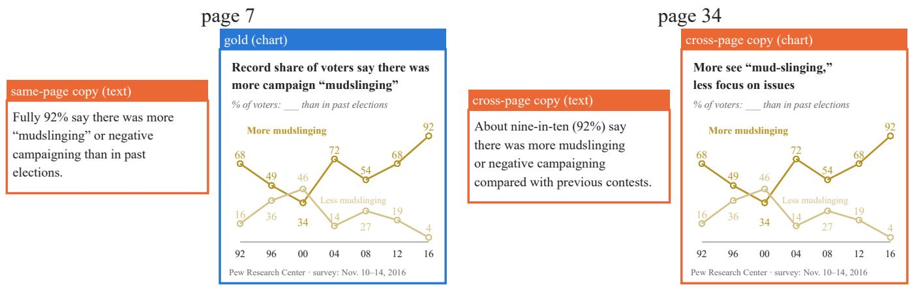
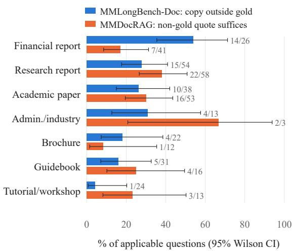
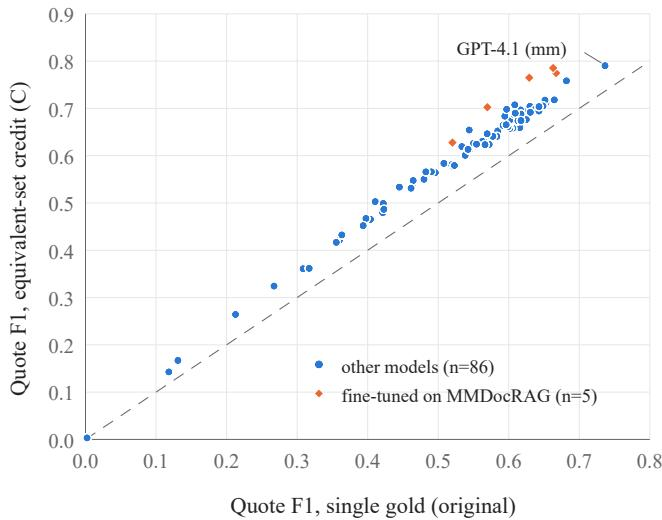
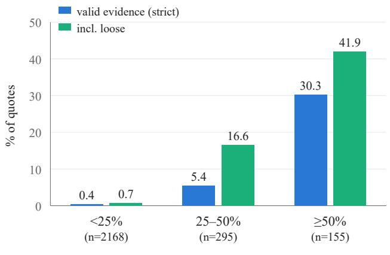

# One Fact, Many Places: Redundant Evidence in Long Visual Documents Breaks Single-Gold Evaluation of Retrieval, Citation and Attribution

Xiaokang Yuan1 Binhui Yao1 Luwei Yang2 Ruimin Chen2 Zeng Wang2

1Zhejiang University, Hangzhou, China

2Zhejiang Geely Holding Group Co., Ltd, Hangzhou, China

22621230@zju.edu.cn

## Abstract

Document understanding is increasingly judged on where an answer comes from, scored against annotated gold locations as if each fact lived in one place. In long visual documents, a fact often lives in several places: a chart value is restated in the text, a key figure reappears in the summary. We ask how often such copies occur in standard benchmarks and what they do to evaluation. We annotate 420 questions from MMLongBench-Doc and MMDocRAG with the locations that independently establish each required fact, checked by two independent reviewers. Copies are common and often cross-modal: 19.5% of MMLongBench-Doc test questions have a strict copy outside the gold, and in 28% of MMDocRAG questions a non-gold candidate alone supplies a required fact. Single-gold scoring then fails in three predictable ways. A retriever that finds a copy is scored as a miss: page recall@1 of text and visual retrievers is underestimated by 13–24 points on questions with a cross-page copy. A model that cites a copy is scored as citing wrongly: crediting equivalent evidence reverses 11% of pairwise orderings among 65 competitive MMDocRAG systems. Masking the gold region leaves the fact available elsewhere: with a copy in the input, 41–56% of correct answers across four models survive it yet fail once every annotated instance is masked. Set-level masking with automatically found copies closes 78% of the gap to masking every annotated instance at matched granularity (three models); an unverified key-string rule lowers survival at least as far but masks three times the area. We release the annotations and redundancy-aware metrics.

## 1 Introduction

Evaluation of document understanding increasingly asks not only whether an answer is right but where it comes from. Retrieval for document RAG is scored by whether the gold page is retrieved [5, 11, 37]; multimodal RAG benchmarks score which candidate quotes a model cites [10]; recent attribution benchmarks score the region a model points to and often build the gold region by masking candidate elements and checking which one the answer depends on [7, 18]; and selective-answering methods mask the region a model cites and abstain when the answer does not change [15]. All of these assume that each required fact lives in one place.

Long, visually rich documents often violate this assumption. Reports restate their charts in prose and repeat key findings in summaries and appendices, and financial filings give the same figure in several statements (Figure 1). We call the nongold locations of a fact its copies. With copies, single-gold evaluation makes three kinds of error. A retriever that finds a copy is counted as a miss. A model that cites a copy is counted as citing wrongly and as missing the gold. Masking the gold location leaves the fact available elsewhere, so the answer survives and the location is judged unnecessary. That verdict is correct for the region, but it is wrong to read it as showing that the answer does not use the document.

Redundant evidence has been recognised in text retrieval over high-overlap corpora [4], in fact-verification datasets that list alternative evidence sets [28], and as a known failure case of masking-based abstention [15]. How often it occurs in the human-annotated benchmarks that the vision–language community uses for long documents, where copies are frequently cross-modal (a chart and the sentence that restates it), and how much it changes citation scores and masking-based attribution, has not been measured. This paper is such an audit. We also separate what a masking test can establish. Removing one region tests whether that region is necessary, and removing every instance of a fact tests whether the answer depends on the fact. Neither identifies which instance the model read (Section 3).

## Contributions.

• An audit of 220 MMLongBench-Doc [20] and 200 MM-DocRAG [10] questions in terms offact units and their equivalent evidence sets, with a protocol that separates strict copies from loose restatements, joint support and contextual gold, checked by two independent reviewers. Copies affect roughly one in five to one in three questions and concentrate in reports, financial filings and papers (Sections 3 and 4).

• A quantification of how single-gold scoring mis-measures retrieval and citation: underestimated recall of text and visual retrievers on questions with copies, mis-scored citations that are mostly cross-modal, and changed pairwise orderings among 91 published systems; answer-string matching and two open VLM judges do not reproduce the equivalent sets in our setting (Sections 5.1 and 5.2).

  
Figure 1: One fact, four places. MMLongBench-Doc asks for the highest share of voters who saw “more mudslinging than in past elections” (92). The annotated gold is the chart on page 7 (blue). The same value is stated in the text of page 7 and again in a chart and a sentence on page 34 (orange). A retriever that returns page 34 is scored as a miss; a model that cites page 34 is scored as citing wrongly; and masking the gold chart leaves the answer recoverable, so a single-region masking test declares the chart unnecessary although the answer depends on the fact it shows. Source excerpts are redrawn for readability.

• Evidence, across three VLMs and a text model, that single-region masking misses fact-level dependence for 41–56% of correctly answered copy items, that ablationbased attribution splits credit among copies, and that a benchmark whose gold is built by masking underrepresents questions with copies (Section 5.3).

• Set-level masking with automatically detected copies, which recovers most of the effect of the annotated sets and is not explained by the extra context it removes; an unverified key-string rule lowers survival as far but masks three times the area, and verification raises precision. We release redundancy-aware metrics and the annotations (Section 6).

## 2 Related work

Long and visually rich document understanding. Document VQA moved from single pages [21] to multi-page inputs [26, 29] and to long documents with charts, tables and layout-dependent evidence [8, 20]. These benchmarks annotate evidence pages and sources per question, which later work reuses as retrieval and attribution gold. We audit such annotations for completeness rather than correctness of the answer.

Retrieval and RAG over document images. Page-level retrievers embed page images directly [11, 37] and are combined with VLM readers [5, 27]. MMDocRAG [10] evaluates multimodal RAG by asking models to select and cite quotes from 15 or 20 retrieved candidates, scoring selection with F1 against gold quotes. Because candidates are retrieved for relevance, they are exactly where copies of the gold concentrate.

Citation and evidence attribution. Text generation with citations is evaluated against retrieved passages [12], recently with principles that judge a citation in its full context [34]; a citation that supports a statement need not be the one the model relied on [32]. For documents, VISA answers with boxes on page screenshots [19], and CiteVQA asks for element-level box citations whose gold is produced by an automated pipeline that “identifies crucial evidence via masking ablation” [18]; its overall score also accepts semantically relevant citations, so a valid non-gold citation need not be penalised. DocAttriBench builds grounding labels on single gold pages by masking layout elements and measuring the increase in answer perplexity, and filters ambiguous cases, including information repeated on the page, by score thresholds [7]. Training-free attribution methods read attention instead [30], or estimate each source’s effect from context ablations [6, 16, 17]. EVICT masks the region a VLM cites, re-queries, and abstains when the answer is unchanged; its authors list duplicated evidence as a case in which this test “will spuriously signal evidenceindependence” [15], and report that the test is contraindicated on chart QA, where answers that survive masking are mostly correct. Masking-based attribution inherits a known weakness of removal-based explanation: when inputs are redundant, removing one of them changes little, so its importance is underestimated [9, 13]. We quantify this weakness for document evidence, for single-region masking and for an ablation-based method, and test a set-level mitigation.

Incomplete and alternative gold. Incomplete relevance judgments are a long-standing problem in IR evaluation, handled by measures that skip unjudged documents [2, 25]; shallow pools bias the judged set [3], and LLM assessors that fill it [22, 31] can agree with humans overall yet misorder the top systems [23]; open-domain QA avoids passage labels by count ing any passage that contains the answer string [14]. FEVER lists alternative evidence sets for a claim [28]; HotpotQA annotates supporting facts per question [36]; RoMQA targets multi evidence questions [38]. Unlabelled positives are a known source of error in passage retrieval [24]. Closest to us, RARE builds text retrieval benchmarks over high-similarity corpora with atomic facts, redundancy-aware gold and a retrieve-thenverify construction of it [4]; our fact units, equivalent sets and copy detection follow the same idea. What we add is measurement: we audit existing human-annotated visual longdocument benchmarks, where copies are often cross-modal, quantify the effect on citation scoring and masking-based attribution, not only on retrieval, and test whether answer-string matching and LLM judges can stand in for equivalent sets.

## 3 Fact units and equivalent evidence

Fact units. For a question q over document D with reference answer a, a fact unit u is an atomic fact needed to derive a (e.g. “FY2015 net income = 629,551”). A ratio question has two units (numerator and denominator); a lookup has one. Questions whose answer aggregates over the whole document (“how many line plots are in the report?”) have no locationspecific units and are excluded as not applicable.

Instances and copies. An instance of u is a region of D (a text block, table cell group, chart, figure or layout element) that by itself establishes u. Benchmarks annotate one or a few instances, the gold. Any other instance is a copy. A copy is strict if it states the same entity and the same value (“92%” and “fully 92%”); it is loose if it supports the same conclusion at a different precision or scope (“about a third” for 33%, a direction without the value, a subset of the groups). Regions that support u only jointly are a combination, not a copy; regions that are cited as gold but state no required fact (a table caption, a slide title) are contextual gold. A pointer such as “see page $1 6 ^ { \circ }$ is never an instance.

Copy forms. We label each copy by how it arises: restatement (the fact re-expressed elsewhere, including text that restates a chart or table, which we call cross-modal), summary (abstracts, key-findings pages, selected financial data), crossstatement (the same figure in several financial statements), verbatim duplicate (a repeated section, slide or chart), and same elementfamily (repeated headers and form fields).

Equivalent evidence sets. The equivalent evidence set of u is E(u) = {gold instances} ∪ {strict copies}. A question is redundant if some required unit has $| E ( u ) | \ge 2$ with at least one member outside the gold; it isfully redundant if every unit has such a copy.

Redundancy-aware scores. Given $E ( u )$ , three single-gold scores have direct set versions. (i) Evidence-aware recall@k: a ranked list of pages hits if, for every unit, some page in $E ( u )$ is in the top-k (instead of every gold page). (ii) Quote selection: with the set R of quotes that are gold or strict copies, precision is $| C \cap R | / | C |$ for cited quotes C; recall credits a gold quote when it is cited or all units it supports are covered by cited quotes (variant C), or measures unit coverage directly (variant R, which also stops requiring contextual gold). (iii) Set-level masking: to test whether an answer depends on u, mask every member of $E ( u )$ , not one instance.

What masking measures. Three questions are easily conflated. Region necessity: does the answer change when one region is removed? Fact dependence: does it change when every instance of u is removed? Source attribution: which instance did the model read, and is its citation faithful to that instance? Single-region masking answers the first. When u has a copy, a region can be sufficient yet unnecessary, so “unnecessary” is a correct answer to that question; the error is to read it as “the answer does not depend on the document”, or to use it to reject a valid citation or to drop the region from the gold. Set-level masking answers the second. Neither answers the third: if regions A and B both state u, masking A, B or both cannot reveal which one the model used. Our masking experiments compare the first two.

## 4 Prevalence of copies

Data and protocol. MMLongBench-Doc [20] pairs 1,082 questions with 135 long PDFs (median 28 pages over our annotated questions) and annotates evidence pages and evidence sources. We annotated a 60-question development sample, used to fix the protocol, and an independent 160-question test sample, stratified by evidence source (text, table, chart, figure, layout, two-page) with at most two questions per document. For every applicable question we identified the fact units, verified the gold pages, and searched the whole document for instances: string and number search over the text layer (OCR for 13 scanned slide decks), reading of candidate contexts, and rendering pages when needed. MMDocRAG [10] provides 15 candidate quotes (text passages and images) per question; we annotated 200 random questions from its evaluation set, recording for every candidate which units it supports alone, loosely, or only jointly. All annotations were made by one annotator, an LLM (Claude) following a written protocol, so the human review below is the main check on them. A second search pass over 30 random test questions labelled “no copy” (BM25 over the fact context plus number-format variants) found no missed copy.

<table><tr><td>Sample</td><td>n</td><td>Redundant</td><td>95% CI</td></tr><tr><td colspan="3">MMLongBench-Doc: a strict copy outside the gold</td></tr><tr><td>Test (160, stratified)</td><td>154</td><td>19.5% 14.0-26.4</td></tr><tr><td>reweighted to the pool</td><td>20.4%</td><td>14.2–27.2</td></tr><tr><td>every unit has a copy</td><td>154 14.9%</td><td>10.2–21.4</td></tr><tr><td>incl. loose copies</td><td>154 22.7%</td><td>16.8-30.0</td></tr><tr><td>Development (60)</td><td>54 42.6%</td><td>30.3-55.8</td></tr><tr><td>MMDocRAG (200 questions)</td><td></td><td></td></tr><tr><td>Non-gold quote suffices (strict)</td><td>196</td><td>28.1% 22.2-34.7</td></tr><tr><td>incl. loose</td><td>196 41.8%</td><td>35.2-48.8</td></tr><tr><td>A unit has  $\geq 2$  supporting quotes</td><td>196 52.0%</td><td>45.1-58.9</td></tr><tr><td>Gold quotes copy each other</td><td>196 45.9%</td><td>39.1–52.9</td></tr><tr><td>Contextual gold present</td><td>196 33.7%</td><td>27.4–40.5</td></tr></table>

Table 1: Prevalence of copies. Wilson intervals. The development sample was annotated first and is reported separately; the test sample is the primary estimate.

  
Figure 2: Copies by document type (both samples pooled for MMLongBench-Doc). Bars show the share of applicable questions; labels give counts.

Independent review. Two human reviewers re-annotated 60 questions independently (15 labelled redundant and 15 copy-free per benchmark), blind to our labels. They agreed with each other at Cohen’s $\kappa = 0 . 9 3$ on both benchmarks and confirmed all 15 of our MMLongBench-Doc positives and 13 of 15 MMDocRAG positives (the other two are loose copies); at the relation level our strict relations reach a precision of 0.97–1.00 (MMLongBench-Doc) and 0.74–0.79 (MM-DocRAG) against their judgments. All values meet the acceptance thresholds we fixed before the review (Section A). In the other direction, both reviewers found copies in 2 of the 15 questions per benchmark that we had labelled copy-free, so errors run mostly toward under-counting: correcting the rates with the review gives 30–33% for MMLongBench-Doc and 34–36% for MMDocRAG. The miss rate rests on 15 questions per benchmark (95% CI 4–38%), so all tables report our original annotation, frozen before the review, and we treat the corrected rates as indicative.

Prevalence. Table 1 gives the main estimates. On the independent MMLongBench-Doc test sample, one in five applicable questions has a strict copy of a required fact outside the gold; reweighting the strata to the benchmark’s composition gives the same 20%. The development sample shows a higher rate (43%), a gap larger than sampling noise (Fisher $p = 0 . 0 0 2 )$ . It was annotated first, while the protocol was being fixed, and later re-checked under the final strict rule (two questions were downgraded to loose); we cannot exclude that it remains more inclusive, or that its documents differ by chance. We therefore treat the test sample as the estimate and the development rate as an upper reference. Analyses that pool both samples (Figure 2, Section 5.1) say so; their test-only values are in the supplement (Section B). In MMDocRAG, where candidates are retrieved for relevance, 28% of questions have a non-gold candidate that alone supplies a required fact, and in 52% some fact has more than one supporting candidate when gold quotes that repeat each other are counted.

Where copies occur. Copies concentrate in document types that summarise and restate (Figure 2): in the pooled MMLongBench-Doc sample, 14 of 26 financial-report questions (54%) have one (cross-statement and selected-financialdata copies), against 4% for tutorial slides. Questions whose evidence is a single figure rarely have copies (4%); questions with text, tables or charts do (18–24%), as do two-page questions (29%). Restatement is the most common form, followed by summaries and cross-statement copies; 16 of the 30 redundant test questions have a cross-modal copy, typically a sentence restating a chart value.

Gold annotations are also incomplete. In 12 of 220 MMLongBench-Doc questions (5.5%) the gold pages are wrong: printed page numbers used as PDF indices, off-by-one offsets, pages that do not contain the fact, and one document that does not match its questions. In 9 of 196 MMDocRAG questions (4.6%) a required fact is supported only by non-gold candidates.

## 5 What copies do to evaluation

We now score existing systems twice, once against the benchmark’s single gold and once against the equivalent sets of Section 3. Table 2 gives the main results: page retrieval and masking on MMLongBench-Doc, and quote citation on MM-DocRAG.

## 5.1 Page retrieval

We rank the pages of each document with two text retrievers, BM25 (text layer with OCR fallback) and E5-base [33], and two visual retrievers that embed page images, ColPali and ColQwen2 [11]. We use the 208 applicable MMLongBench-Doc questions of both samples. Under single-gold scoring, a ranking hits at k when every fact unit has a verified gold page in the top k; under evidence-aware scoring, any page of $E ( u )$ counts. We also report the answer-string hit used in open-domain QA [14], which needs no evidence annotation.

MMLongBench-Doc  
(a) Page retrieval, R@1 (%), 46 questions with a cross-page copy
<table><tr><td>Retriever</td><td>Gold</td><td>Answer</td><td>E(u) (ours)</td><td>∆</td></tr><tr><td>BM25</td><td>19.6</td><td>34.8</td><td>43.5</td><td>+23.9</td></tr><tr><td>E5-base</td><td>19.6</td><td>30.4</td><td>39.1</td><td>+19.6</td></tr><tr><td>ColPali</td><td>37.0</td><td>39.1</td><td>54.3</td><td> $+ 1 7 . 4$ </td></tr><tr><td>ColQwen2</td><td>43.5</td><td>39.1</td><td>56.5</td><td> $+ 1 3 . 0$ </td></tr></table>

(b) Masking, answer survival (%), six-page input
<table><tr><td></td><td colspan="3">Copy items</td><td>Controls</td></tr><tr><td>Model</td><td>n</td><td> $\mathrm { M } _ { \mathrm { g o l d } }$   $\mathbf { M } _ { \mathrm { a l l } }$ </td><td> $\Delta _ { \mathrm { r e d } }$ </td><td> $\mathrm { M } _ { \mathrm { g o l d } }$ </td></tr><tr><td>Qwen2.5-VL-7B</td><td>29</td><td>86.2 31.0</td><td>55.2</td><td>15.7</td></tr><tr><td>InternVL3-8B</td><td>26</td><td>76.9 30.8</td><td>46.2</td><td>20.4</td></tr><tr><td>GPT-6.1 Sol</td><td>32</td><td>93.8 53.1</td><td>40.6</td><td>33.3</td></tr><tr><td>Qwen3-4B (text)</td><td>25</td><td>76.0</td><td>20.0 56.0</td><td>11.4</td></tr></table>

MMDocRAG  
(c) Quote citation, Quote F1 and rank among 91 systems
<table><tr><td></td><td></td><td colspan="2">Original</td><td colspan="2">C (ours)</td><td></td></tr><tr><td>System</td><td>Input</td><td>F1</td><td>Rank</td><td>F1</td><td>Rank</td><td>Change</td></tr><tr><td>GPT-4.1</td><td>MM</td><td>.736</td><td>1</td><td>.790</td><td>1</td><td>一</td></tr><tr><td>GPT-4.1</td><td>Text</td><td>.682</td><td>2</td><td>.758</td><td>5</td><td>↓3</td></tr><tr><td>Qwen2.5-32B-FT</td><td>Text</td><td>.667</td><td>3</td><td>.775</td><td>3</td><td>一</td></tr><tr><td>Gemini-2.5-Pro</td><td>MM</td><td>.665</td><td>4</td><td>.718</td><td>6</td><td>↓2</td></tr><tr><td>Qwen2.5-72B-FT</td><td>Text</td><td>.663</td><td>5</td><td>.785</td><td>2</td><td>↑3</td></tr><tr><td>Gemini-2.0-Flash-Think</td><td>MM</td><td>.653</td><td>6</td><td>.711</td><td>8</td><td>↓2</td></tr><tr><td>GPT-40</td><td>MM</td><td>.651</td><td>7</td><td>.718</td><td>7</td><td>一</td></tr><tr><td>Grok-3-mini</td><td>Text</td><td>.649</td><td>8</td><td>.705</td><td>10</td><td>↓2</td></tr><tr><td>Claude-3.5-Sonnet</td><td>MM</td><td>.646</td><td>9</td><td>.697</td><td>19</td><td>↓10</td></tr><tr><td>GPT-4.1-mini</td><td>MM</td><td>.645</td><td>10</td><td>.695</td><td>21</td><td>↓11</td></tr><tr><td>Qwen2.5-14B-FT</td><td>Text</td><td>.629</td><td>20</td><td>.765</td><td>4</td><td>↑16</td></tr><tr><td>Qwen2.5-32B</td><td>Text</td><td>.608</td><td>30</td><td>.708</td><td>9</td><td>↑21</td></tr><tr><td>Mean of 91 systems</td><td></td><td>.533</td><td></td><td>.601</td><td></td><td></td></tr></table>

Table 2: Main results: single-gold vs. equivalent-set scoring. (a) Gold: every fact unit has a verified gold page at rank 1. Answer: the top page contains the answer string. E(u): any page of the equivalent set counts $\Delta \colon E ( u )$ minus Gold. BM25 and E5 read the text layer; ColPali and ColQwen2 embed page images. (b) Items answered correctly without a mask, masked at their gold instances $\mathbf { ( M _ { \mathrm { g o l d } } ) }$ or at all annotated instances $\mathrm { ( M _ { a l l } ) }$ . Controls: facts whose key string occurs only in the gold region. (c) The 12 systems in the top ten under either metric; all 91 are in Table S6. MM: images given as images; Text: text-only input. FT: fine-tuned by the MMDocRAG authors. Every ∆ and $\Delta _ { \mathrm { r e d } }$ has a 95% bootstrap interval that excludes zero (Tables S8 and S17).

Table 2(a) shows R@1 on the 46 questions with a strict cross-page copy. Single-gold scoring underestimates all four retrievers, by 20–24 points for the text retrievers and by 13–17 points for the visual ones, which find the gold page more often. Over all 208 questions the gap is 3–5 points, and errors in the dataset’s own page labels cost another 5–10 points (Table S17). The answer-string hit does not close the gap. The answer string occurs on no evidence page for 46% of the questions, and on the cross-page subset it stays below the evidence-aware score for every retriever. The test sample alone shows the same pattern (Section B).

## 5.2 Quote selection in multimodal RAG

MMDocRAG scores the quotes a model cites by F1 against the gold quotes. We re-scored the 91 published system outputs (15-candidate setting) on our 200 annotated questions, on which the original ranking agrees with the full-benchmark ranking (Kendall $\tau ~ = ~ 0 . 8 9 )$ . Our main correction is variant C (Section 3), which credits a missed gold quote when cited copies cover its facts. Applying all corrections from the human review changes Quote F1 under C by at most 0.003 (Section C).

Per-system results. Table 2(c) lists the 12 systems that rank in the top ten under either metric. GPT-4.1 with image input stays first, but the order below it changes. Claude-3.5-Sonnet drops from 9th to 19th and GPT-4.1-mini from 10th to 21st, while Qwen2.5-14B-FT, fine-tuned by the MMDocRAG authors, rises from 20th to 4th. The systems that drop cite 4.7 and

5.1 quotes per question on average; the fine-tuned Qwen2.5 models cite 1.5–2.0 (Figure S1). The original metric reward citing every copy of a fact and penalises a single sufficient citation. Under C, both receive the same recall. Among the 65 systems with original $\mathrm { F 1 \ge 0 . 5 }$ , C reverses 11.4% of the pairwise orderings.

Mis-scored citations. Of the citations the original metric counts as false positives, 11.4% are strict copies of a gold fact (19.1% with loose copies). Of the gold quotes it counts as missed, 29.3% are covered by a cited copy, and another 31.0% are contextual gold that states no required fact. Most copies are cross-modal (Figure 3). In at least 63% of the valid non-gold citations, an image restates a text gold quote or the reverse. Non-gold quotes cited by at least half of the systems are valid evidence in 30% of cases, against 0.4% for quotes cited by fewer than a quarter (Figure S2).

Scoring rules. Table 3 separates the parts of the correction. Counting valid non-gold citations in precision (A) hardly changes the ranking $( \tau = 0 . 9 7 ) ;$ most of the change comes from the recall credit in C. The C flip rate is stable under bootstrap resampling of questions (8.5–14.8%), 59% of the flipped pairs differed by at least 0.01 F1 under the original metric, and the rate rises to 18.4% among the 34 systems above 0.6. Global rank correlation can hide such changes [23]. Variant R changes the ranking more $( \tau _ { \mathrm { c o m p } } = 0 . 6 7 )$ , but it also drops the requirement to cite contextual gold. We therefore use C as the redundancy correction and R as an upper bound.

String matching and VLM judges. We also built the support relations without our annotation, keeping the rest of the metric fixed (Table 3, bottom). One baseline matches the numbers and quoted phrases of each fact unit. The other two ask an open VLM, Qwen2.5-VL-7B or InternVL3-8B, whether a candidate by itself establishes the unit (Section H). Against the human review, string matching has low precision (0.21). The judges reach 0.78/0.58 and 0.65/0.87 in precision and recall, against 0.74/0.87 for our annotation, and neither meets the criterion we set before running them. They agree with each other at $\kappa = 0 . 6 7$ and miss 24 and 13 of the 49 cross-modal copies in our annotation. With their relations, C reverses 2.9% and 8.6% of competitive pairs; a different flip rate by itself does not show which ranking is closer to human judgment. In our setting, these judges do not replace the annotation.

<table><tr><td>Metric</td><td>F1</td><td>T</td><td> $\tau _ { \mathrm { c o m p } }$  Flips</td><td>P/R</td></tr><tr><td>Original (single gold) A: credit valid citations</td><td>.533 .552.966</td><td></td><td></td><td></td></tr><tr><td>C: equivalent-set credit R: unit recall</td><td></td><td>.627.818.670 16.5%</td><td></td><td>.601.878.771 11.4%.74/.87</td></tr><tr><td>C, support relations without our annotation</td><td></td><td></td><td></td><td></td></tr><tr><td></td><td></td><td></td><td></td><td></td></tr><tr><td>Key-string match Qwen2.5-VL-7B judge .566.969.942</td><td>.623.933 .887</td><td></td><td></td><td>5.7% .21/.68 2.9%.78/.58</td></tr></table>

Table 3: Scoring rules for MMDocRAG Quote F1 (mean over 91 systems). A counts valid non-gold citations in precision; R also scores recall over fact units. τ: Kendall agreement with the original ranking; $\tau _ { \mathrm { c o m p } }$ and flips: among the 65 systems with original $\mathrm { F 1 \ge 0 . 5 }$ . The top system is GPT-4.1 under every row except R (Qwen2.5-72B-FT). P / R: precision and recall of the (quote, fact unit) support relations against the human review. Bottom: C with the support relations built by string matching or by an open VLM judge.
<table><tr><td colspan="4">Q: How do BERT BASE (ours) and SenseBERT BASE compare across NLP tasks? MMDocRAG #1249 Gold quote (image; first columns redrawn):</td></tr><tr><td></td><td>Score</td><td>CoLA</td><td>SST-2</td></tr><tr><td>BERT BASE (ours)</td><td>77.5</td><td>50.1</td><td>92.6</td></tr><tr><td>SenseBERT BASE</td><td>77.9</td><td>54.6</td><td>92.2</td></tr><tr><td colspan="4">Non-gold quote (text), cited by 55 of 91 systems:</td></tr><tr><td colspan="4">&quot;.. SenseBERT performs on par with BERT, achieving an overall score of 77.9, compared to 77.5 achieved by BERT BASE.&quot;</td></tr></table>

Figure 3: A cross-modal copy. The text passage states the overall scores of the gold table, yet the original metric counts every citation of it as wrong. For GPT-4.1, which cites both quotes, Quote F1 on this question is 0.67 under the original metric and 1.00 under C.

## 5.3 Masking-based attribution

Attribution benchmarks and selective-answering methods mask a candidate region and check whether the answer changes [7, 15, 18]. If the fact has a copy in the input, the answer can survive the mask.

Setup. We use a separate set of 157 MMLongBench-Doc fact units whose instances can be located in the text layer, or by a drawn box for charts without one. Of these, 59 have copies (56 cross-page) and 98 are controls whose key string occurs only in the gold region. It is a selected set, not a random sample: of its 154 six-page inputs, 81 come from our test sample, 19 from the development sample and 54 from other benchmark questions (Section D). We render pages at 144 dpi and cover every line that contains an instance with a gray box. The conditions are no mask (M0), the gold instances $\mathbf { \Gamma } ( \mathbf { M } _ { \mathrm { g o l d } } )$ the copies only, all instances $\mathrm { ( M _ { a l l } ) }$ , and random lines of the same area $\mathbf { \Gamma } ( \mathbf { M } _ { \mathrm { r a n d } } )$ . Each input has six pages (gold, copy and BM25 distractor pages), fixed across conditions, so the copy is always present. This is common in practice. For half of the questions with a cross-page copy, the BM25 top-5 contains both the gold page and a copy, and 24% of MMDocRAG candidate lists contain a gold and a non-gold quote for the same fact.

Answers are scored with the rule-based scorer of MMLongBench-Doc [20] and count as correct at a score of at least 0.8. The redundancy effect $\begin{array} { r l r } { \Delta _ { \mathrm { r e d } } } & { { } = } & { P ( } \end{array}$ (correct under $\mathbf { M } _ { \mathrm { g o l d } }$ ∧ wrong under $\mathbf { M } _ { \mathrm { a l l } }$ | correct under M0) is the share of correct answers whose dependence on the fact a single-region test misses. Its denominator includes correct answers that may not use the gold region. We evaluate Qwen2.5-VL-7B [1] and InternVL3-8B [39] on page images with greedy decoding, Qwen3-4B-Instruct-2507 [35] on the page text with masked lines replaced by [masked], and GPT-6.1 Sol on page images. GPT-6.1 ran without temperature control and serves as a robustness check. The validity and effect criteria, the no-document runs and the sensitivity to annotation errors are in Section D; all criteria were fixed before running.

Results. Table 2(b) gives the main numbers and Table S8 all conditions. With a copy in the input, 76–94% of the correctly answered copy items survive $\bf M _ { \mathrm { g o l d } }$ , and 20–53% survive $\mathbf { M } _ { \mathrm { a l l } }$ For 41–56% of these items, a single-region test declares the gold region unnecessary although removing every instance of the fact changes the answer. Every lower bound of $\Delta _ { \mathrm { r e d } }$ is above 22 points, and every $\Delta _ { \mathrm { r e d } }$ exceeds the change caused by random masks of the same area (3.7–10.1%). Some items survive $\mathbf { M } _ { \mathrm { a l l } }$ because the value is still visible in a figure or logo, which lowers $\Delta _ { \mathrm { r e d } }$

Masking passes the pre-set validity check for Qwen2.5- VL and the text model: 14.0% and 11.6% of the controls that cannot be answered without the document survive $\mathbf { M } _ { \mathrm { g o l d } }$ (criterion: at most 20%). InternVL3 and GPT-6.1 fail it with 20.4% and 28.4%. In 8 of InternVL3’s 11 and 14 of GPT-6.1’s 19 surviving controls the fact is still in the input, which our text-based selection of controls missed. Such answers survive both masks and lower $\Delta _ { \mathrm { r e d } }$ . Given identical inputs, GPT-6.1 changed its correctness on 3% of controls. On the 81 inputs from our test sample alone, $\Delta _ { \mathrm { r e d } }$ is 40–55%, with every lower bound above zero (Section D).

Model-cited regions. EVICT [15] masks the region a model cites and abstains when the answer does not change (CED $= 0 )$ . For a correct answer, CED = 0 is a false abstention. If the cited region is the annotated gold region and an answer counts as unchanged while it stays correct, the $\mathrm { C E D } = 0$ rate equals $\mathbf { M } _ { \mathrm { g o l d } }$ survival. For Qwen2.5-VL this is 86.2% on copy items and 15.7% on controls, so the test would abstain on most correct answers whose fact has a copy. With the model’s own boxes the result is dominated by localisation errors. Only 18% of Qwen2.5-VL’s 99 parsable boxes overlap an instance of the fact (Section E), so we draw no conclusion about deployed attribution systems.

Ablation-based attribution. ContextCite [6] fits a sparse linear model to random ablations of the context. We ran it with the text model on the same inputs (128 ablations over text blocks; Section H). When a copy is present, the gold block ranks lower (mean best rank 13.0, against 2.7 on controls) and receives about a third of a control’s score. All instances together receive about as much as the gold block of a control, so the credit is split among the copies. Block rankings are only moderately stable between 64 and 128 ablations, and we report aggregates only.

Benchmarks built by masking. DocAttriBench [7] builds element-level gold on single gold pages. It masks each layout element, keeps the one whose removal most raises the perplexity of the answer, and filters ambiguous cases, which its authors note include information repeated on the page. We matched 273 of the 276 items of its MMLongBench-Doc subset to the source questions. Of the 145 single-page questions we annotated, it retains 68% (78/115) of those without a copy and 37% (11/30) of those with one. The gap holds within every evidence type (Mantel–Haenszel odds ratio 0.21, $p = 0 . 0 0 2 )$ and questions with copies fall from 21% to 12% of the subset. This is an association. We do not have the filtering logs and did not check that every question entered its candidate pool. It agrees with the filter, though: for facts with copies elsewhere, the key string appears in two or more text blocks of the gold page more often (50% vs. 16%). The boxes the benchmark keeps are accurate (Section G), but the questions on which single-region tests are least reliable are under-represented.

## 6 Set-level masking with automatic copy detection

Set-level masking needs $E ( u )$ , which benchmarks do not provide. We construct it without training.

Pipeline. (1) Fact extraction: given the region under test (a gold region, or the region a model cited), a VLM reads a crop of it with the question and the answer under test (here the reference answer) and writes the fact it provides as one sentence plus the key strings as printed. (2) Candidates: text blocks (OCR lines without a text layer) outside the region under test, on pages that contain a key string or rank in the top 10 by BM25 against the fact. (3) Verification: the same VLM sees each candidate crop and the fact and answers whether the region by itself establishes the same fact with the same value; accepted regions and the region under test form $\hat { E } ( u )$ (4) Set-level masking: mask every region in $\hat { E } ( u ) \left( \mathbf { M } _ { \mathrm { a u t o } } \right)$

Detection. We score detection at page level against our annotation (138 test units with locatable key strings, 57 copy pages); the pre-set criterion was recall $\geq 0 . 7 0$ at precision $\geq 0 . 5 0$ . Accepting every candidate that contains a key string gives recall 0.88 but precision 0.25, since numbers such as $" 4 1 \% "$ recur with unrelated meanings. The verified detector, whose candidates cover 77% of the copy pages, reaches recall 0.47 at precision 0.50; a reviewer adjudicated all 28 accepted pages outside our annotation and found 10 strict copies that our annotation missed, giving precision 0.68 and recall 0.55, still short of the criterion.

Comparison with baselines. Table 4 compares $\mathbf { M } _ { \mathrm { a u t o } }$ with single-region masking $\mathrm { ( M _ { g o l d } ) }$ and with a simpler baseline that masks every block containing an extracted key string, without verification $( \mathbf { M _ { \mathrm { s t r } } } ^ { \mathrm { b l k } } )$ . Masking every annotated instance at block level $\left( \mathbf { M } _ { \mathrm { a l l } } \mathbf { \Sigma } ^ { \mathrm { b l k } } \right)$ gives the reference. Masking needs only the copies in the input, and the detector found one for 21 of the 29 copy items that Qwen2.5-VL answered correctly.

$\mathbf { M } _ { \mathrm { a u t o } }$ lowers survival from 76–86% to 32–38% and closes 78% of the gap to the reference for each of the three models, with criteria fixed before running (Section F). GPT-6.1, run with $\mathbf { M } _ { \mathrm { a u t o } }$ only, drops from 93.8% to 68.8%. Removing the same amount of unrelated context does not reproduce the effect: adding random non-evidence blocks of $\bf M _ { \mathrm { a u t o } } ^ { \prime } \hat { s }$ extra area to $\mathbf { M } _ { \mathrm { g o l d } }$ changes survival by −4.3 to $+ 4 . 8$ points. On controls, $\mathbf { M } _ { \mathrm { a u t o } }$ lowers accuracy by at most 2.3 points net relative to $\mathbf { M } _ { \mathrm { g o l d } }$

The string baseline removes the answer as well as the annotated sets do, but it is much less selective. It masks three times the area of $\bf { M } _ { \mathrm { { a u t o } } } ,$ only 27% of the blocks it adds are annotated copies (61% for $\bf M _ { \mathrm { a u t o } } )$ , and it flips the correctness of 9.5% of correctly answered controls on average (3.3% for $\mathbf { M } _ { \mathrm { a u t o } } )$ . Among the same key-string candidates, verification raises block precision from 39% to 76%, which matters when the masked set must leave the rest of the input intact.

## 7 Discussion and limitations

Size of the effect. Copies are common but not universal. They affect about a fifth of long-document questions by our original annotation and about a third after the review’s correction, with more in financial reports and among retrieved candidates. Their effect on aggregate rankings is moderate (11% pairwise flips among competitive systems, same top system), but single systems move by ten or more places, and the original metric favours systems that cite many quotes. For masking-based attribution the effect on fact dependence is large in all four models.

<table><tr><td></td><td></td><td></td><td colspan="3">Answer survival (%)</td><td colspan="3">Selectivity</td></tr><tr><td>Method</td><td>Mask</td><td>No copy annot.</td><td>Qwen2.5-VL InternVL3</td><td></td><td>Qwen3 (text)</td><td>Copy prec. (%) ↑ Ctrl. flips (%) ↓ Area ↓</td><td></td><td></td></tr><tr><td>Single-region masking (gold only)</td><td> $\begin{array} { l } { \mathbf { M _ { \mathrm { g o l d } } } } \\ { \mathbf { M _ { \mathrm { s t r } } } ^ { \mathrm { b l k } } } \end{array}$ </td><td>√</td><td>86.2</td><td>76.9</td><td>76.0</td><td></td><td>一</td><td>一</td></tr><tr><td>Key-string masking, unverified</td><td></td><td>√</td><td>20.7</td><td>19.2</td><td>8.0</td><td>27.5</td><td>9.5</td><td>3.1×</td></tr><tr><td>Ours: verified set masking</td><td> $\mathbf { M } _ { \mathrm { a u t o } }$ </td><td>√</td><td>37.9</td><td>34.6</td><td>32.0</td><td>60.6</td><td>3.3</td><td>1.0×</td></tr><tr><td>Reference: annotated sets</td><td> $\mathbf { M } _ { \mathrm { a l l } } ^ { \mathbf { b l k } }$ </td><td>x</td><td>24.1</td><td>23.1</td><td>20.0</td><td>一</td><td>一</td><td>一</td></tr></table>

Table 4: Set-level masking: baselines vs. ours (MMLongBench-Doc copy items answered correctly without a mask, six-page input, $n = 2 9 .$ 26 and 25; all masks at block granularity). Single-region masking is the test used by DocAttriBench [7] and EVICT [15]. Survival should approach the annotated reference. Copy prec.: share of the blocks masked beyond the gold region that overlap an annotated or adjudicated copy. Ctrl. flips: correctly answered controls whose correctness differs from single-region masking, mean of the three models. Area: masked area relative to ours. Sets are detected with Qwen2.5-VL for every model

Recommendations. Benchmarks that score evidence should (i) annotate evidence as sets per fact unit, (ii) separate contextual gold from fact-bearing gold, (iii) score retrieval and citations against the set rather than against answer strings or unchecked LLM judgments, and (iv) not build gold or absten tion decisions on single-region masking without first collecting the region’s copies, and report which cases a masking filter removes.

Limitations. One annotator labelled all questions; the independent review finds errors both ways, mostly missed copies. Copy search relies on the text layer and OCR, so pixel-only copies are under-counted, and MMDocRAG image candidates were judged partly from their descriptions. The MMLongBench-Doc development and test samples disagree (43% vs. 20%). Masking uses 25–32 correct copy items per model from a selected set (8 copy items lack item-level verification records), in a setting that contains a copy by construction, and for two models the masking validity check failed its pre-set criterion. Copy detection misses its pre-set recall criterion at the document level. We tested two open 7–8B judges; stronger judges may come closer. The DocAttriBench analysis is correlational; CiteVQA is not yet audited.

## 8 Conclusion

The same fact often appears in several places in a long visual document, and single-gold evaluation treats all but one of them as wrong. We measured how often this happens in two bench marks and showed that it distorts retrieval and citation scores and hides fact-level dependence from single-region masking. Set-level masking with automatically detected copies recovers most of this dependence. Annotations, metrics, code and model outputs are provided as ancillary files.

## References

[1] Shuai Bai et al. Qwen2.5-VL technical report. arXiv preprint arXiv:2502.13923, 2025.

[2] Chris Buckley and Ellen M. Voorhees. Retrieval evaluation with incomplete information. In SIGIR, 2004.

[3] Chris Buckley, Darrin Dimmick, Ian Soboroff, and Ellen M. Voorhees. Bias and the limits of pooling. In SIGIR, pages 619–620, 2006.

[4] Hanjun Cho and Jay-Yoon Lee. RARE: Redundancy-aware retrieval evaluation framework for high-similarity corpora. In ACL, 2026.

[5] Jaemin Cho, Debanjan Mahata, Ozan Irsoy, Yujie He, and Mohit Bansal. M3DocRAG: Multi-modal retrieval is what you need for multi-page multi-document understanding. arXiv preprint arXiv:2411.04952, 2024.

[6] Benjamin Cohen-Wang, Harshay Shah, Kristian Georgiev, and Aleksander Madry. ContextCite: Attributing model generation to context. In NeurIPS, 2024.

[7] Luca De Grandis, Silvia Cappelletti, William Raccagni, Marcella Cornia, Lorenzo Baraldi, and Rita Cucchiara. DocAttriBench: Benchmarking answer grounding in document visual question answering. In BMVC, 2026.

[8] Chao Deng, Jiale Yuan, Pi Bu, Peijie Wang, Zhong-Zhi Li, Jian Xu, Xiao-Hui Li, Yuan Gao, Jun Song, Bo Zheng, and Cheng-Lin Liu. LongDocURL: a comprehensive multimodal long document benchmark integrating understanding, reasoning, and locating. In ACL, 2025.

[9] Jay DeYoung, Sarthak Jain, Nazneen Fatema Rajani, Eric Lehman, Caiming Xiong, Richard Socher, and Byron C. Wallace. ERASER: A benchmark to evaluate rationalized NLP models. In ACL, 2020.

[10] Kuicai Dong, Yujing Chang, Shijie Huang, Yasheng Wang, Ruiming Tang, and Yong Liu. Benchmarking retrievalaugmented multimodal generation for document question answering. In NeurIPS Datasets and Benchmarks Track, 2025.

[11] Manuel Faysse, Hugues Sibille, Tony Wu, Bilel Omrani, Gautier Viaud, Céline Hudelot, and Pierre Colombo. ColPali: Efficient document retrieval with vision language models. In ICLR, 2025.

[12] Tianyu Gao, Howard Yen, Jiatong Yu, and Danqi Chen. Enabling large language models to generate text with citations. In EMNLP, 2023.

[13] Sara Hooker, Dumitru Erhan, Pieter-Jan Kindermans, and Been Kim. A benchmark for interpretability methods in deep neural networks. In NeurIPS, 2019.

[14] Vladimir Karpukhin, Barlas Oguz, Sewon Min, Patrick Lewis,˘ Ledell Wu, Sergey Edunov, Danqi Chen, and Wen-tau Yih. Dense passage retrieval for open-domain question answering. In EMNLP, 2020.

[15] Varun Kotte. EVICT: Evidence-sufficiency verification via counterfactual dropout for visually-grounded selective question answering. In CVPR Workshops (GRAIL-V), pages 11251– 11259, 2026.

[16] Ruizhe Li, Chen Chen, Yuchen Hu, Yanjun Gao, Xi Wang, and Emine Yilmaz. Attributing response to context: A Jensen– Shannon divergence driven mechanistic study of context attribution in retrieval-augmented generation. In ICLR, 2026.

[17] Fengyuan Liu, Nikhil Kandpal, and Colin Raffel. AttriBoT: A bag of tricks for efficiently approximating leave-one-out context attribution. In ICLR, 2025.

[18] Dongsheng Ma, Jiayu Li, Zhengren Wang, Yijie Wang, Jiahao Kong, Weijun Zeng, Jutao Xiao, Jie Yang, Bangrui Xu, Yuhan Wang, Bin Wang, and Conghui He. CiteVQA: Benchmarking evidence attribution for trustworthy document intelligence. arXiv preprint arXiv:2605.12882, 2026.

[19] Xueguang Ma, Shengyao Zhuang, Bevan Koopman, Guido Zuccon, Wenhu Chen, and Jimmy Lin. VISA: Retrieval augmented generation with visual source attribution. In ACL, pages 30154–30169, 2025.

[20] Yubo Ma, Yuhang Zang, Liangyu Chen, Meiqi Chen, Yizhu Jiao, Xinze Li, Xinyuan Lu, Ziyu Liu, Yan Ma, Xiaoyi Dong, Pan Zhang, Liangming Pan, Yu-Gang Jiang, Jiaqi Wang, Yixin Cao, and Aixin Sun. MMLongBench-Doc: Benchmarking long-context document understanding with visualizations. In NeurIPS Datasets and Benchmarks Track, 2024.

[21] Minesh Mathew, Dimosthenis Karatzas, and C. V. Jawahar. DocVQA: A dataset for VQA on document images. In WACV, 2021.

[22] David Otero and Javier Parapar. Hybrid pooling with LLMs via relevance context learning. In SIGIR, 2026.

[23] David Otero, Javier Parapar, and Álvaro Barreiro. Limitations of automatic relevance assessments with large language models for fair and reliable retrieval evaluation. In SIGIR, pages 2545– 2549, 2025.

[24] Yingqi Qu, Yuchen Ding, Jing Liu, Kai Liu, Ruiyang Ren, Wayne Xin Zhao, Daxiang Dong, Hua Wu, and Haifeng Wang. RocketQA: An optimized training approach to dense passage retrieval for open-domain question answering. In NAACL, 2021.

[25] Tetsuya Sakai. Alternatives to bpref. In SIGIR, 2007.

[26] Ryota Tanaka, Kyosuke Nishida, Kosuke Nishida, Taku Hasegawa, Itsumi Saito, and Kuniko Saito. SlideVQA: A dataset for document visual question answering on multiple images. In AAAI, 2023.

[27] Ryota Tanaka, Taichi Iki, Taku Hasegawa, Kyosuke Nishida, Kuniko Saito, and Jun Suzuki. VDocRAG: Retrievalaugmented generation over visually-rich documents. In CVPR, pages 24827–24837, 2025.

[28] James Thorne, Andreas Vlachos, Christos Christodoulopoulos, and Arpit Mittal. FEVER: a large-scale dataset for fact extraction and VERification. In NAACL, 2018.

[29] Rubèn Tito, Dimosthenis Karatzas, and Ernest Valveny. Hierarchical multimodal transformers for multipage DocVQA. Pattern Recognition, 2023.

[30] Dang Quang Thien Tran, Quang V. Dang, Vinamra Tyagi, Sai Soorya Rao Veeravalli, Trang Nguyen, Ryan A. Rossi, Franck Dernoncourt, Nedim Lipka, Koustava Goswami, and Samyadeep Basu. MultAttnAttrib: Training-free multimodal attribution in long document question answering. arXiv preprint arXiv:2607.01420, 2026.

[31] Shivani Upadhyay, Ronak Pradeep, Nandan Thakur, Nick Craswell, and Jimmy Lin. UMBRELA: UMbrela is the (opensource reproduction of the) Bing RELevance assessor. arXiv preprint arXiv:2406.06519, 2024.

[32] Jonas Wallat, Maria Heuss, Maarten de Rijke, and Avishek Anand. Correctness is not faithfulness in retrieval augmented generation attributions. In ICTIR, pages 22–32, 2025.

[33] Liang Wang, Nan Yang, Xiaolong Huang, Binxing Jiao, Linjun Yang, Daxin Jiang, Rangan Majumder, and Furu Wei. Text embeddings by weakly-supervised contrastive pre-training. arXiv preprint arXiv:2212.03533, 2022.

[34] Yumo Xu, Peng Qi, Jifan Chen, Kunlun Liu, Rujun Han, Lan Liu, Bonan Min, Vittorio Castelli, Arshit Gupta, and Zhiguo Wang. CiteEval: Principle-driven citation evaluation for source attribution. In ACL, pages 32759–32778, 2025.

[35] An Yang et al. Qwen3 technical report. arXiv preprint arXiv:2505.09388, 2025.

[36] Zhilin Yang, Peng Qi, Saizheng Zhang, Yoshua Bengio, William Cohen, Ruslan Salakhutdinov, and Christopher D. Manning. HotpotQA: A dataset for diverse, explainable multi-hop question answering. In EMNLP, 2018.

[37] Shi Yu, Chaoyue Tang, Bokai Xu, Junbo Cui, Junhao Ran, Yukun Yan, Zhenghao Liu, Shuo Wang, Xu Han, Zhiyuan Liu, and Maosong Sun. VisRAG: Vision-based retrieval-augmented generation on multi-modality documents. In ICLR, 2025.

[38] Victor Zhong, Weijia Shi, Wen-tau Yih, and Luke Zettlemoyer. RoMQA: A benchmark for robust, multi-evidence, multi-answer question answering. In Findings of EMNLP, 2023.

[39] Jinguo Zhu, Weiyun Wang, Zhe Chen, Zhaoyang Liu, Shenglong Ye, Lixin Gu, et al. InternVL3: Exploring advanced training and test-time recipes for open-source multimodal mod els. arXiv preprint arXiv:2504.10479, 2025.

Sections A–I, Tables S1–S20 and Figures S1–S2 are in this supplement; all other section, table and figure numbers refer to the main paper.

## A Annotation and its independent review

Samples. The MMLongBench-Doc development sample (60 questions) contains answerable questions with one or two gold pages, 10 per stratum (plain text, table, chart, figure, layout, two-page), one question per document (seed 20261015). It was annotated first and used to fix the protocol; two of its positives were later downgraded to loose under the final strict rule. The test sample (160) uses the same strata, excludes the development questions, allows at most two questions per document, and has quotas of 27 per single-source stratum and 44 two-page questions (the layout stratum yielded 8 under the per-document cap; seed 20261015). The two samples therefore differ in per-document cap and stratum quotas, but neither difference explains the higher development rate (two-page questions, which have the highest rate, are a smaller share of the development sample). MMDocRAG questions are two uniform random samples of the 2,000-question evaluation set (seeds 20261015 and 20261016). Unit-level instance annotation exists for the MMLongBench-Doc test sample and all MMDocRAG questions; the MMLongBench-Doc development sample has question-level labels and page-level units.

Annotator. All annotations were produced by a single annotator, an LLM (Claude), following a written protocol: identify the fact units of the reference answer; verify the gold pages; search the whole document for instances by string and number search over the text layer (OCR for 13 scanned slide decks), read candidate contexts, and render pages when needed; label each instance strict, loose, combination or contextual. For MMDocRAG, each of the 15 candidates was read; image candidates were judged from the source page’s text layer where the PDF is available and otherwise from the dataset’s image description. Boxes are located automatically from key strings and are absent where a fact exists only in pixels. Because the annotator is a model, the human review below is the main check on the labels.

Second search pass. For 30 random test questions labelled copy-free, we searched again with BM25 over the fact context and number-format variants of the key strings; no missed copy was found. This pass shares the text-layer limitation of the annotation and does not replace the human review.

Independent human review. For each benchmark we drew 15 questions labelled redundant and 15 labelled copy-free (seed 20261017). Two human reviewers, without access to our labels or to each other’s, re-annotated them: for MMLongBench-Doc they searched the whole PDF for regions that by themselves establish each required fact; for MM-DocRAG they labelled every candidate quote as a strict copy, a loose copy, or neither. The acceptance criteria were fixed before any review was returned: Cohen’s $\kappa \geq 0 . 6$ between reviewers on each benchmark (question level, strict copies), and a pooled confirmation of our positives of at least 11/15 per reviewer. Table S1 gives the results. Both criteria are met.

<table><tr><td colspan="3">MMLongBench-Doc MMDocRAG</td></tr><tr><td>κ between reviewers</td><td>0.93</td><td>0.93</td></tr><tr><td>κ A / B vs. our labels</td><td>0.87 / 0.80</td><td>0.73 / 0.67</td></tr><tr><td>Positives confirmed (strict)</td><td>30/30</td><td>26/30</td></tr><tr><td>strict or loose</td><td>30/30</td><td>30/30</td></tr><tr><td>Copies in negatives: A / B</td><td>2/15 / 3/15</td><td>2/15 / 3/15</td></tr><tr><td>found by both reviewers</td><td>2</td><td>2</td></tr><tr><td>Copy pages match ours</td><td>15/15</td><td></td></tr></table>

Table S1: Independent human review of 30 questions per benchmark (15 positives, 15 negatives by our labels). Not confirmed as strict on MMDocRAG: questions 141 and 1750 (both reviewers: loose). Copies found by both reviewers in our negatives: MMLongBench-Doc 404 and 454 (the latter a bar label in a figure, missed by text search); MMDocRAG 1267 and 1582.
<table><tr><td></td><td>r</td><td>C</td><td>m</td><td>corrected</td></tr><tr><td>MMLongBench-Doc test, found by both 19.5</td><td></td><td>1.00</td><td>0.133</td><td>30.2</td></tr><tr><td>mean over reviewers</td><td>19.5</td><td>1.00</td><td>0.167</td><td>32.9</td></tr><tr><td>MMDocRAG, found by both</td><td></td><td></td><td>28.1 0.867 0.133</td><td>33.9</td></tr><tr><td>mean over reviewers</td><td></td><td></td><td>28.1 0.867 0.167</td><td>36.3</td></tr></table>

Table S2: Review-corrected redundancy rates (%).

Corrected rates. Writing r for our rate, c for the confirmation rate of our positives and m for the rate at which reviewers found copies in our negatives, the corrected rate is rc + (1 − r) m (Table S2). The miss rate m rests on 15 questions per benchmark (2/15 has a 95% Wilson interval of 3.7–37.9%), so the corrections are imprecise; the main paper reports the original annotation, frozen before the review, in every table.

Relation-level agreement. We also evaluated the review at the relation level. Inter-reviewer agreement is κ = 0.96 for MMDocRAG (915 candidate quote × fact unit relations; 0.97 on non-gold quotes) and 0.91 for MMLongBench-Doc (fact unit × page). Taking the relations judged strict by both reviewers (by either reviewer) as reference, our strict relations have a precision of 0.74 (0.79) and a recall of 0.87 (0.86) on MMDocRAG, and a precision of 0.97 (1.00) and a recall of 0.58 on MMLongBench-Doc. Agreement and precision both fall in the highest tier (good) of the thresholds fixed before the review; the lower MMLongBench-Doc recall reflects copies missed by text-layer search. For MMLongBench-Doc the relations are the pages nominated by us or by either reviewer, so κ there measures agreement on nominated pages rather than specificity over every page of the PDF.

<table><tr><td>Document type</td><td>Pooled</td><td>Test only</td></tr><tr><td>Financial report</td><td>14/26 (54%)</td><td>9/17 (53%)</td></tr><tr><td>Research report</td><td>15/54 (28%)</td><td>7/38 (18%)</td></tr><tr><td>Academic paper</td><td>10/38 (26%)</td><td>7/31 (23%)</td></tr><tr><td>Administration/Industry file</td><td>4/13 (31%)</td><td>3/11 (27%)</td></tr><tr><td>Brochure</td><td>4/22 (18%)</td><td>3/18 (17%)</td></tr><tr><td>Guidebook</td><td>5/31 (16%)</td><td>1/22 (5%)</td></tr><tr><td>Tutorial/Workshop</td><td>1/24 (4%)</td><td>0/17 (0%)</td></tr><tr><td>All</td><td>53/208 (25%) 30/154 (19%)</td><td></td></tr></table>

Table S3: Questions with a strict copy, by document type (MMLongBench-Doc, applicable questions).
<table><tr><td></td><td>Hit counted on</td><td>R@1</td><td>R@5</td></tr><tr><td>BM25</td><td>Dataset pages Verified gold Evidence-aware Gap [95% CI]</td><td>36.4 41.6 44.8 +3.2 [0.6, 6.5] +3.2 [0.6, 6.5]</td><td>66.2 73.4 76.6</td></tr><tr><td>E5</td><td>Dataset pages Verified gold Evidence-aware Gap [95% CI]</td><td>37.7 42.9 44.2 +1.3 [0.0, 3.2] +2.6 [0.6, 5.2]</td><td>65.6 72.7 75.3</td></tr></table>

Table S4: Page retrieval on the MMLongBench-Doc test sample only (154 applicable questions; recall, %). Gap: evidence-aware minus verified gold.

## B Test-sample-only analyses

Figure 2 and the retrieval analysis (Section 5.1) pool the development and test samples of MMLongBench-Doc. Tables S3 and S4 repeat them on the test sample alone. The test sample confirms the pooled picture: financial reports remain the most redundant document type (9/17, 53%), and evidence-aware scoring gives higher recall for both retrievers at both cutoffs (all four gaps positive, three of four intervals excluding zero); as in the pooled sample, the gain concentrates on questions with copies.

## C Quote re-scoring

Metric variants. Let C be the cited quotes, G the gold quotes, and S(q) the set of units quote q supports by itself (strict copies; loose copies only when stated). A unit is covered if some cited quote supports it, or all quotes of one of its listed combinations are cited. Original: $P = | C \cap G | / | C |$ $R = | C \cap G | / | G |$ . A: precision counts every quote in G ∪ $\{ q : S ( q ) \neq \emptyset \}$ ; recall as original. C: precision as A; a gold quote counts as recalled if it is cited, or if every unit it supports is covered (or every unit for whose combination it is needed); contextual gold, which supports no unit, must still be cited. R: precision as A; recall is the share of supported

<table><tr><td>Annotation</td><td>C F1 R F1</td><td></td><td> $\tau _ { \mathrm { c o m p } }$ </td><td>C flips</td><td>Top-1</td></tr><tr><td>Original</td><td>.601</td><td>.627</td><td>.771</td><td>11.4% [8.5, 14.8]</td><td>GPT-4.1</td></tr><tr><td>Review, both strict</td><td>.598</td><td>.616</td><td>.796</td><td>10.2% [7.5, 13.7] GPT-4.1</td><td></td></tr><tr><td>Review, either strict .599</td><td></td><td>.622</td><td>.797</td><td>10.1% [7.6, 13.8] GPT-4.1</td><td></td></tr></table>

Table S5: Re-scoring with the human review’s relation-level judgements (91 systems; flips among the 65 competitive systems, 2,080 pairs).

units that are covered, so contextual gold is no longer required.   
Questions marked not applicable use the original definition.   
F1 is averaged over questions, then over systems.

Sensitivity to the review’s corrections. The re-scoring is robust to the human review. We applied every relation-level judgement of the review to the 30 reviewed MMDocRAG questions: a (quote, unit) relation is strict if both reviewers (or either) marked it strict; all other questions, the benchmark’s gold lists and the combinations are unchanged. This includes the four question-level corrections of Table S1. Table S5 shows that Quote F1 under C changes by at most 0.003, the flip rate stays within the bootstrap interval of the original, and the top system is unchanged. On MMLongBench-Doc, the reviewed copy pages change a single retrieval hit (E5, R@5). The reviewed questions were drawn half from our positives, so this is a sensitivity analysis rather than a corrected estimate. Both corrected files are released alongside the original.

Modality of the copies. Of the 71 non-gold quotes that strictly support a fact, 45 (63%) have the other modality than the gold quotes for the same fact (a text passage restating an image or the reverse); among the 61 whose fact also has a strict gold quote, the share is 74%. Weighted by how often systems cite them, at least 63% [49, 76] of the valid citations counted as wrong are cross-modal, and in 85% [80, 90] of the coverage credits of C at least one supporting cited quote has the other modality than the credited gold quote. On MMLongBench-Doc, 16 of the 30 redundant test questions have a cross-modal copy, most often a sentence restating a chart (12 gold–copy pairs) or a table (4).

All systems. Table S6 lists Quote F1 and rank for all 91 published system outputs under the original metric and under C, on our 200 questions; Table 2(c) in the main paper shows the 12 that rank in the top ten under either metric.

Stability of the C flip rate. Table S7 reports a question-level bootstrap of the flip rate among the 65 systems with original F1 ≥ 0.5 (2,000 resamples, seed 20261015; the system set is held fixed), the share of flipped pairs that were nearly tied under the original metric, and the flip rate under other thresholds for the competitive set. The flip rate is stable under resampling (95% CI 8.5–14.8%) and grows among the strongest systems, where rankings matter most: from 8.0% with 79 systems to 18.4% with the 34 systems above 0.6. Most flipped pairs (59%) were separated by at least 0.01 F1 under the original metric, so the correction changes orderings the original metric did resolve. A flip is a pair whose F1 differences under the two metrics have strictly opposite signs.

Share of the 91 models that cite the non-gold quote
<table><tr><td>System</td><td>Input</td><td>Original</td><td>C</td><td>System</td><td>Input</td><td>Original</td><td>C</td><td>System</td><td>Input</td><td>Original</td><td>C</td></tr><tr><td>GPT-4.1</td><td>MM</td><td>.736 (1)</td><td>.790 (1)</td><td>Gemini-2.5-Flash</td><td>Text</td><td>.606 (32)</td><td>.658 (40)</td><td>Qwen2.5-3B-FT</td><td>Text</td><td>.520 (63)</td><td>.628 (51)</td></tr><tr><td>GPT-4.1</td><td>Text</td><td>.682 (2)</td><td>.758 (5)</td><td>Gemini-2.0-Flash</td><td>MM</td><td>.603 (33)</td><td>.677 (30)</td><td>InternVL3-14B</td><td>MM</td><td>.519 (64)</td><td>.581 (63)</td></tr><tr><td>Qwen2.5-32B-FT</td><td>Text</td><td>.667 (3)</td><td>.775 (3)</td><td>Grok-3</td><td>Text</td><td>.601 (34)</td><td>.658 (41)</td><td>InternVL3-9B</td><td>Text</td><td>.508 (65)</td><td>.584 (62)</td></tr><tr><td>Gemini-2.5-Pro</td><td>MM</td><td>.665 (4)</td><td>.718 (6)</td><td>Llama-4-Maverick</td><td>Text</td><td>.599 (35)</td><td>.661 (37)</td><td>InternVL3-14B</td><td>Text</td><td>.496 (66)</td><td>.564 (68)</td></tr><tr><td>Qwen2.5-72B-FT</td><td>Text</td><td>.663 (5)</td><td>.785 (2)</td><td>Llama-4-Maverick</td><td>MM</td><td>.597 (36)</td><td>.698 (18)</td><td>Qwen-VL-Max</td><td>MM</td><td>.490 (67)</td><td>.566 (67)</td></tr><tr><td>Gemini-2.0-Flash-Think</td><td>MM</td><td>.653 (6)</td><td>.711 (8)</td><td>Qwen3-14B</td><td>Text</td><td>.596 (37)</td><td>.665 (35)</td><td>Qwen2.5-7B</td><td>Text</td><td>.482 (68)</td><td>.566 (66)</td></tr><tr><td>GPT-40</td><td>MM</td><td>.651 (7)</td><td>.718 (7)</td><td>GPT-4-Turbo</td><td>Text</td><td>.594 (38)</td><td>.684 (29)</td><td>Llama-4-Scout</td><td>MM</td><td>.480 (69)</td><td>.550 (69)</td></tr><tr><td>Grok-3-mini</td><td>Text</td><td>.649 (8)</td><td>.705 (10)</td><td>GPT-4o-mini</td><td>Text</td><td>.592 (39)</td><td>.664 (36)</td><td>GPT-4.1-nano</td><td>Text</td><td>.464 (70)</td><td>.547 (70)</td></tr><tr><td>Claude-3.5-Sonnet</td><td>MM</td><td>.646 (9)</td><td>.697 (19)</td><td>Gemini-2.0-Flash-Think</td><td>Text</td><td>.589 (40)</td><td>.659 (39)</td><td>R1-Distill-Qwen-32B</td><td>Text</td><td>.463 (71)</td><td>.538 (71)</td></tr><tr><td>GPT-4.1-mini</td><td>MM</td><td>.645 (10)</td><td>.695 (21)</td><td>Gemini-2.0-Pro</td><td>OCR</td><td>.584 (41)</td><td>.652 (43)</td><td>Llama-3.1-8B</td><td>Text</td><td>.461 (72)</td><td>.531 (73)</td></tr><tr><td>GPT-40</td><td>Text</td><td>.644 (11)</td><td>.704 (12)</td><td>Qwen-Plus</td><td>Text</td><td>.583 (42)</td><td>.641 (47)</td><td>InternVL2.5-38B</td><td>MM</td><td>.445 (73)</td><td>.533 (72)</td></tr><tr><td>Gemini-2.5-Pro</td><td>Text</td><td>.643 (12)</td><td>.692 (24)</td><td>Gemini-1.5-Pro</td><td>Text</td><td>.580 (43)</td><td>.640 (48)</td><td>Mistral-Small-24B</td><td>Text</td><td>.423 (74)</td><td>.487 (76)</td></tr><tr><td>Qwen3-8B</td><td>Text</td><td>.643 (13)</td><td>.704 (13)</td><td>Qwen2.5-VL-72B</td><td>MM</td><td>.577 (44)</td><td>.641 (46)</td><td>InternVL2.5-8B</td><td>MM</td><td>.422 (75)</td><td>.499 (75)</td></tr><tr><td>Qwen3-30B-A3B</td><td>Text</td><td>.643 (14)</td><td>.694 (23)</td><td>Qwen2.5-14B</td><td>Text</td><td>.573 (45)</td><td>.642 (45)</td><td>Mistral-7B</td><td>Text</td><td>.421 (76)</td><td>.479 (77)</td></tr><tr><td>DeepSeek-V3</td><td>Text</td><td>.642 (15)</td><td>.703 (15)</td><td>InternVL3-38B</td><td>Text</td><td>.573 (46)</td><td>.637 (49)</td><td>InternVL2.5-78B</td><td>MM</td><td>.411 (77)</td><td>.503 (74)</td></tr><tr><td>Gemini-2.5-Flash</td><td>MM</td><td>.638 (16)</td><td>.698 (17)</td><td>Llama-3.3-70B</td><td>Text</td><td>.572 (47)</td><td>.624 (54)</td><td>InternVL3-8B</td><td>MM</td><td>.405 (78)</td><td>.463 (80)</td></tr><tr><td>Gemini-2.0-Pro</td><td>MM</td><td>.634 (17)</td><td>.703 (14)</td><td>InternVL3-78B</td><td>Text</td><td>.572 (48)</td><td>.621 (56)</td><td>Llama-3.1-8B</td><td>OCR</td><td>.404 (79)</td><td>.465 (79)</td></tr><tr><td>GPT-4.1-mini</td><td>Text</td><td>.631 (18)</td><td>.692 (25)</td><td>Qwen2.5-7B-FT</td><td>Text</td><td>.570 (49)</td><td>.702 (16)</td><td>Qwen2.5-7B</td><td>OCR</td><td>.398 (80)</td><td>.467 (78)</td></tr><tr><td>Gemini-2.0-Pro</td><td>Text</td><td>.630 (19)</td><td>.704 (11)</td><td>Qwen3-4B</td><td>Text</td><td>.569 (50)</td><td>.646 (44)</td><td>Qwen2.5-VL-32B</td><td>MM</td><td>.394 (81)</td><td>.452 (81)</td></tr><tr><td>Qwen2.5-14B-FT</td><td>Text</td><td>.629 (20)</td><td>.765 (4)</td><td>Qwen3-32B</td><td>Text</td><td>.566 (51)</td><td>.623 (55)</td><td>Mixtral-8x7B</td><td>Text</td><td>.363 (82)</td><td>.432 (82)</td></tr><tr><td>Gemini-1.5-Pro</td><td>MM</td><td>.627 (21)</td><td>.695 (22)</td><td>GPT-40</td><td>OCR</td><td>.563 (52)</td><td>.630 (50)</td><td>GPT-4.1-nano</td><td>MM</td><td>.360 (83)</td><td>.421 (83)</td></tr><tr><td>DeepSeek-R1</td><td>Text</td><td>.625 (22)</td><td>.676 (31)</td><td>InternVL3-38B</td><td>MM</td><td>.554 (53)</td><td>.624 (53)</td><td>InternVL2.5-26B</td><td>MM</td><td>.355 (84)</td><td>.417 (84)</td></tr><tr><td>Qwen-Max</td><td>Text</td><td>.617 (23)</td><td>.688 (27)</td><td>Gemini-2.0-Flash-Think</td><td>OCR</td><td>.550 (54)</td><td>.626 (52)</td><td>Qwen2.5-3B</td><td>Text</td><td>.317 (85)</td><td>.362 (85)</td></tr><tr><td>Qwen3-235B-A22B</td><td>Text</td><td>.617 (24)</td><td>.674 (32)</td><td>InternVL3-8B</td><td>Text</td><td>.544 (55)</td><td>.611 (59)</td><td>Llama-3.2-3B</td><td>Text</td><td>.308 (86)</td><td>.361 (86)</td></tr><tr><td>o3-mini</td><td>Text</td><td>.617 (25)</td><td>.697 (20)</td><td>InternVL3-9B</td><td>MM</td><td>.544 (56)</td><td>.654 (42)</td><td>Qwen-VL-Plus</td><td>MM</td><td>.267 (87)</td><td>.324 (87)</td></tr><tr><td>Claude-3.5-Sonnet</td><td>Text</td><td>.616 (26)</td><td>.659 (38)</td><td>Qwen2.5-72B</td><td>OCR</td><td>.542 (57)</td><td>.613 (58)</td><td>Qwen2.5-VL-7B</td><td>MM</td><td>.213 (88)</td><td>.264 (88)</td></tr><tr><td>QwQ-Plus</td><td>Text</td><td>.613 (27)</td><td>.674 (33)</td><td>Gemini-2.0-Flash</td><td>Text</td><td>.538 (58)</td><td>.601 (61)</td><td>MiniCPM-o-2.6</td><td>MM</td><td>.131 (89)</td><td>.167 (89)</td></tr><tr><td>InternVL3-78B</td><td>MM</td><td>.612 (28)</td><td>.670 (34)</td><td>DeepSeek-V3</td><td>OCR</td><td>.538 (59)</td><td>.604 (60)</td><td>QVQ-Max</td><td>MM</td><td>.118 (90)</td><td>.143 (90)</td></tr><tr><td>Qwen2.5-72B</td><td>Text</td><td>.609 (29)</td><td>.690 (26)</td><td>R1-Distill-Llama-70B</td><td>Text</td><td>.534 (60)</td><td>.619 (57)</td><td>Janus-Pro-7B</td><td>MM</td><td>.002 (91)</td><td>.003 (91)</td></tr><tr><td>Qwen2.5-32B</td><td>Text</td><td>.608 (30)</td><td>.708 (9)</td><td>Llama-4-Scout</td><td>Text</td><td>.523 (61)</td><td>.579 (64)</td><td></td><td></td><td></td><td></td></tr><tr><td>GPT-4o-mini</td><td>MM</td><td>.608 (31)</td><td>.687 (28)</td><td>Llama-3.3-70B</td><td>OCR</td><td>.522 (62)</td><td>.577 (65)</td><td></td><td></td><td></td><td></td></tr></table>

Table S6: Quote F1 (rank) of all 91 MMDocRAG systems on our 200 questions, sorted by the original metric. MM: images given as images; Text and OCR: the benchmark’s two text-only input modes. FT: fine-tuned by the MMDocRAG authors.

  
Figure S1: Original vs. equivalent-set Quote F1 for 91 systems. Systems fine-tuned on MMDocRAG, which cite about two quotes per question, gain most.

  
Figure S2: Consensus marks unlabelled copies. Share of non-gold MMDocRAG quotes that are valid evidence, by how many of the 91 systems cite them.

## D Masking experiments

Items and inputs. The 157 units form a set selected for the masking experiments. It is not a random sample of MMLongBench-Doc and not a subset of the 160-question test sample. It has 59 units with copies (56 cross-page, 3 same-page) and 98 controls whose key string occurs only in the gold region. Of the 56 cross-page copy items, 29 come from our test sample, 19 from the development sample and 8 from MMLongBench-Doc questions outside the 220 we audited; the 3 same-page items come from the development sample. Of the 98 controls, 52 come from the test sample and 46 from questions outside the audit. The question text of every item matches the benchmark. Items outside the audit enter neither the prevalence estimates nor the independent review. The 8 copy items outside the audit come from an earlier answer-string candidate search that predates the VLM detector of Section 6, so $\mathbf { M } _ { \mathrm { a u t o } }$ did not produce them; the detector accepts the selected copy page for 4 of them. Item-level records of how their copies were checked were not kept. The six-page input (S\_page) contains the gold page(s), the copy page(s) and distractor pages ranked by BM25 against the question, fixed per item across conditions; it is used for the 56 cross-page copy items and all controls (154 items). The gold-page-only input (S\_single) is built for the 3 same-page copy items and the controls. Every item is also asked without the document (NoDoc).

<table><tr><td></td><td>Systems</td><td>C flip rate</td></tr><tr><td>Threshold 0.4</td><td>79</td><td>8.0% (247/3,081)</td></tr><tr><td>Threshold 0.5 (main paper)</td><td>65</td><td>11.4% (238/2,080) [8.5, 14.8]</td></tr><tr><td>Threshold 0.6</td><td>34</td><td>18.4% (103/561)</td></tr><tr><td colspan="3">Flipped pairs (threshold 0.5) with original F1 difference</td></tr><tr><td>≥ 0.01</td><td></td><td>140/238 (58.8%)</td></tr><tr><td>≥ 0.02</td><td></td><td>76/238 (31.9%)</td></tr></table>

Table S7: Stability of the C re-ranking. Interval: 95% questionlevel bootstrap.

Masks. Pages are rendered at 144 dpi. Instances are located in the text layer (OCR lines for pages without one; a drawn box for charts without text) and every line that contains an instance is covered by a gray box padded by 2 pt. $\mathbf { M } _ { \mathrm { g o l d } }$ covers gold instances; $\mathbf { M } _ { \mathrm { c o p y } }$ covers copies; $\mathbf { M } _ { \mathrm { a l l } }$ covers gold instances, copies, and any line on a distractor page that contains a key string but was not verified as a copy, so that no textual occurrence of the fact remains (such lines occur in 8 of the 56 copy items and in no control; excluding these 8 items changes $\Delta _ { \mathrm { r e d } }$ by −0.6 to +3.8 points). $\mathbf { M } _ { \mathrm { r a n d } }$ covers random text lines that do not contain a key string, on the same pages and with the same total area per page as $\mathbf { M } _ { \mathrm { a l l } } . \mathbf { M } _ { \mathrm { a u t o } }$ covers whole text blocks (OCR lines for pages without a text layer) accepted by the detector (Section F). For the text model, every line whose box overlaps a mask by at least 30% of its area is replaced by the token [masked], and runs of masked lines are collapsed.

Prompts. Image input, system prompt: “You are given images of pages from one document, in page order. Some regions may be covered by gray boxes. Answer the question using only the document. If the document does not contain the answer, reply exactly: Not answerable.” Text input: the same, with “the text of pages” and “Some lines may be replaced by [masked]”, and pages separated by “— Page k —”. NoDoc: “Answer the question. If you cannot answer it, reply exactly: Not answerable.” The user turn is the question followed by a format instruction chosen by the dataset’s answer type: “Answer with a single integer only.” (Int); “Answer with a single number only (keep the % sign if the answer is a percentage).” (Float); “Answer with a short phrase only.” (Str, None); “Answer with a Python list of short strings only, e.g. ["a", "b"].” (List). Output is capped at 96 tokens.

Scoring. The answer is the answer field if the output is JSON, otherwise the first line, after removing reasoning tags, an “Answer:” prefix and a final period. It is scored with MMLongBench-Doc’s official rule-based scorer: Int by exact match; Float with percentage rescaling and 1% relative tolerance; Str by exact match for short or numeric strings and ANLS (threshold 0.5) otherwise; List element-wise after sorting. An answer is correct if its score is at least 0.8. No model judge is used.

Models. Qwen2.5-VL-7B-Instruct: vLLM 0.8.5.post1, transformers 4.51.3, greedy decoding, at most 1280 · 28 · 28 pixels per page. Qwen3-4B-Instruct-2507: same stack, greedy; all weight shards and inference files were verified by SHA-256 against the official release (revision cdbee75f). InternVL3-8B: revision 0908e0d6, same vLLM, temperature 0, up to 6 tiles of 448 px plus a thumbnail per page (comparable to the Qwen2.5- VL resolution), maximum length 16,384 tokens; it reused the rendered images and prompts of the first run unchanged (SHA-256 verified). GPT-6.1 Sol (model string gpt-6.1-sol): queried on 2026-10-17 through the Codex app-server protocol at low reasoning effort and the default service tier, eight jobs in parallel. Each job ran in a fresh process and an ephemeral thread with no history; images were attached unchanged at original detail; no tools, temperature or output schema were supplied, and configured external tool servers were disabled. An audit of all raw events found four built-in resource listings that returned empty results, in two no-document jobs, and no other tool events. All 983 jobs were answered; one job answered twice after an overlapping retry, and the scorer used the later answer without regard to correctness. An earlier configuration with tools enabled attempted to fetch a source PDF; all of its outputs were excluded. The interface exposes no temperature and no immutable model checkpoint.

Pre-set criteria. The criteria were fixed on 2026-10-16, be fore any model output was produced, and revised once on 2026-10-17 (detection criterion only) before any result was seen; the revision did not change any verdict. V1 (masking removes the evidence): among controls not answerable without the document, at most 20% survive $\mathbf { M } _ { \mathrm { g o l d } }$ . V2 (no generic masking artefact): at most 15% of answers change under $\mathbf { M } _ { \mathrm { r a n d } } .$ and $\Delta _ { \mathrm { r e d } }$ minus that change rate has a positive lower bound. E1 (effect): survival under $\mathbf { M } _ { \mathrm { g o l d } }$ minus survival under $\mathbf { M } _ { \mathrm { a l l } }$ on copy items, and $\Delta _ { \mathrm { r e d } }$ , have positive lower bounds. If V1 or V2 fails, the masking instrument is “not validated”. B1–B3 (automatic sets): $\mathbf { M } _ { \mathrm { a u t o } }$ lowers survival relative to $\mathbf { M } _ { \mathrm { g o l d } }$ with a positive lower bound; it closes at least half of the $\mathbf { M } _ { \mathrm { g o l d } } { - } \mathbf { M } _ { \mathrm { a l l } }$ gap; its answer-change rate on controls, relative to M0, exceeds that of $\mathbf { M } _ { \mathrm { g o l d } }$ by at most 5 points, i.e. it lowers control accuracy by at most 5 points net. Intervals are 95% cluster bootstraps over questions (2,000 resamples, seed 20261015). Table S10 gives every value.

<table><tr><td>Model</td><td>Items (n)  $\mathrm { M _ { g o l d } }$ </td><td> $\mathbf { M } _ { \mathrm { { c o p y } } }$   $\mathbf { M } _ { \mathrm { a l l } }$   $\mathbf { M } _ { \mathrm { r a n d } }$   $\Delta _ { \mathrm { r e d } }$ </td></tr><tr><td rowspan="2">Qwen2.5-VL-7B</td><td>copy (29) 86.2 93.1</td><td>31.0 96.6 55.2 [36.7, 75.0]</td></tr><tr><td>control (51) 15.7 n/a 15.7</td><td>96.1</td></tr><tr><td rowspan="2">InternVL3-8B</td><td>copy (26) 76.9 92.3</td><td>30.8 96.2 46.2 [26.9, 66.7]</td></tr><tr><td>control (54) 20.4 n/a</td><td>20.4 90.7</td></tr><tr><td rowspan="2">GPT-6.1 Sol</td><td>copy (32) 93.8 96.9</td><td>53.1 96.9 40.6 [22.6, 59.4]</td></tr><tr><td>control (75) 33.3 n/a</td><td>37.3 96.0</td></tr><tr><td rowspan="2">copy (25) Qwen3-4B (text)</td><td>76.0 76.0</td><td>20.0 88.0 56.0 [37.5, 76.0]</td></tr><tr><td>control (44) 11.4 n/a</td><td>11.4 90.9</td></tr></table>

Table S8: Answer survival under masking (% of items answered correctly without a mask, six-page input; n of 56 copy and 98 control items). The first three models read page images; Qwen3-4B-Instruct-2507 reads the page text. Intervals: cluster bootstrap over questions.
<table><tr><td>Model</td><td>Copy (n)</td><td> $\Delta _ { \mathrm { r e d } }$  [95% CI]</td><td>Closed [95% CI]</td><td>V1</td></tr><tr><td>Qwen2.5-VL-7B</td><td>11</td><td>54.5 [25.0, 90.0]</td><td>100.0 [50, 150]</td><td>24.0</td></tr><tr><td>InternVL3-8B</td><td>13</td><td>53.8 [26.7, 83.3]</td><td>87.5 [50, 129]</td><td>34.6</td></tr><tr><td>GPT-6.1 Sol</td><td>14</td><td>42.9 [14.3, 71.4]</td><td></td><td>30.3</td></tr><tr><td>Qwen3-4B (text)</td><td>10</td><td>40.0 [10.0, 77.8] 125.0 [100, 180]</td><td></td><td>19.0</td></tr><tr><td>All 154 inputs</td><td>25-32</td><td>40.6–56.0</td><td>77.8-78.6</td><td>11.6–28.4</td></tr></table>

Table S9: Masking on the 81 test-sample inputs (post hoc, existing outputs, %). Copy: correctly answered copy items. Closed: share of the $\mathbf { M } _ { \mathrm { g o l d } } { - } \mathbf { M } _ { \mathrm { a l l } } ^ { \mathrm { b l k } }$ gap closed by $\mathbf { M } _ { \mathrm { a u t o } } ;$ above 100 means lower survival under $\mathbf { M } _ { \mathrm { a u t o } }$ than under the annotated block mask, not better detection. V1: survival under $\mathbf { M } _ { \mathrm { g o l d } }$ of controls not answerable without the document (pre-set criterion ≤ 20). Intervals: question-cluster bootstrap. $- \mathrm { : \mathbf { M } _ { \mathrm { a l l } } } ^ { \mathrm { b l \bar { k } } }$ not run for GPT-6.1 (line-level gap closed 66.7).

Full results. Table S8 gives every masking condition for copy items and controls; Table 2(b) in the main paper shows a subset of its columns.

Test-sample subset. Because 73 of the 154 masking inputs lie outside our independent test sample, we re-scored the existing outputs on the 81 inputs that come from it (65 questions; 29 copy items and 52 controls), without running any model again (Table S9). The effect holds on this subset. $\Delta _ { \mathrm { r e d } }$ is 40.0–54.5%, in the same range as on all inputs, and its lower bound is above zero for all four models. $\mathbf { M } _ { \mathrm { a u t o } }$ still closes most or all of the gap to the annotated block mask. The subset is small, so the intervals are wide, and its controls give a weaker validity check: only the text model meets the pre-set criterion V1. Removing also the 19 inputs in the detector’s development split leaves 62 inputs, on which $\Delta _ { \mathrm { r e d } }$ is 33.3–44.4% and the text model’s interval reaches zero. This analysis was not planned before the experiment.

Why V1 fails for two models. We read every control that survives $\mathbf { M } _ { \mathrm { g o l d } }$ and is not answerable without the document (Table S11). Most are redundancy that our text-based selection of controls missed: the fact restated on another page, visible in a picture that line masks leave intact, or recoverable from remaining content. The two GPT-6.1 survivors of question 454 survive through a bar label in a figure that the human review later identified as a copy. Dropping the controls whose fact is still in the input (post hoc) gives V1 values of 6.5% (3/46) for InternVL3 and 9.4% (5/53) for GPT-6.1. Such controls survive both masks, so they cannot raise $\Delta _ { \mathrm { r e d } }$

Manual checks (Qwen2.5-VL). We read all 16 items that make up $\Delta _ { \mathrm { r e d } } \mathrm { : }$ each answer under $\mathbf { M } _ { \mathrm { g o l d } }$ is correct and each under $\mathbf { M } _ { \mathrm { a l l } }$ is genuinely wrong (e.g. $9 2  7 2 )$ , not a scoring artefact. Of the 9 copy items that survive $\mathbf { M } _ { \mathrm { a l l } }$ , most do so because the value still appears in pixels (a logo, chart or picture) or a long title is repeated elsewhere; one is a lenient match by the official scorer (6.31 vs. 6.29). The model rarely answers “Not answerable” (5 of 98 masked controls), so answer change tracks evidence removal.

Copies found after the experiment. Copies found later by the human review or by the detector adjudication (Section F) were not added to $\mathbf { M } _ { \mathrm { a l l } }$ . Mapped by question and fact, they touch 4 of the 157 items (q189\_x0, q454\_ctrl, q454\_x0, q946\_auto; the H1c copy of question 404 belongs to no masking item). For q189\_x0 the new copy page is not part of the six-page input, so only three items actually had an unmasked copy in view. The results are robust to these additions: excluding the four items changes $\Delta _ { \mathrm { r e d } }$ by −0.6 to +4.9 points and every model keeps a large effect (Table S12). The missed copies and the unverified lines masked in 8 items (see Masks) bias $\Delta _ { \mathrm { r e d } }$ in opposite directions; excluding either set changes it by at most 5 points. V1 is essentially unchanged (InternVL3 21.2%, GPT-6.1 26.2%).

How often a copy accompanies the gold in practice. Table S13 uses the BM25 and E5 rankings of Section 5.1 on the 48 MMLongBench-Doc questions with a cross-page copy (two development questions in this set have only loose copies; restricting to the 46 with strict copies changes no entry by more than 2 points). Already at $k = 5 ,$ , about half of these questions retrieve both the gold page and a copy of the same fact, which is the situation of our six-page input. In MM-DocRAG’s own 15-candidate inputs, 102 of 196 questions have a fact supported by two or more candidates, and in 47 (24%) a gold and a non-gold candidate support the same fact.

Gold-page-only input. S\_single contains only 3 copy items (all same-page), too few to analyse. On controls, survival under $\mathbf { M } _ { \mathrm { g o l d } }$ is 15.8% (Qwen2.5-VL, n = 57), 13.8% (InternVL3, n = 58) and 6.5% (text model, n = 46); GPT-6.1 was not run on this input.

<table><tr><td>Model</td><td>MO acc.</td><td>NoDoc</td><td>V1</td><td>V2:  $\mathbf { M } _ { \mathrm { r a n d } }$  chg.</td><td> $\begin{array} { r } { \mathrm { V } 2 \colon \Delta _ { \mathrm { r e d } } - \mathrm { c h g } . } \end{array}$ </td><td>E1:  $\Delta _ { \mathrm { r e d } }$ </td><td>B1:  $\mathbf { M } _ { \mathrm { g o l d } } - \mathbf { M } _ { \mathrm { a u t o } }$ </td><td>B2/B3</td></tr><tr><td>Qwen2.5-VL-7B</td><td>51.9</td><td>0.6</td><td>14.0√</td><td>3.7</td><td>51.7 [33.3, 70.0]</td><td>55.2 [36.7, 75.0]</td><td>48.3 (lb 28.6)</td><td>87.5% / +2.0</td></tr><tr><td>InternVL3-8B</td><td>51.9</td><td>0.0</td><td>20.4 ×</td><td>7.5</td><td>42.3 [24.0, 64.0]</td><td>46.2 [26.9, 66.7]</td><td>42.3 (lb 24.0)</td><td>91.7% / -1.9</td></tr><tr><td>GPT-6.1 Sol</td><td>69.5</td><td>8.9</td><td>28.4 ×</td><td>3.7</td><td>37.5 [16.1, 58.1]</td><td>40.6 [22.6, 59.4]</td><td>25.0 (lb 9.7)</td><td>61.5% / -5.3</td></tr><tr><td>Qwen3-4B (text)</td><td>44.8</td><td>0.6</td><td> $1 1 . 6 \checkmark$ </td><td>10.1</td><td>44.0 [22.2, 66.7]</td><td>56.0 [37.5, 76.0]</td><td>44.0 (lb 20.8)</td><td>78.6% / +2.3</td></tr></table>

Table S10: Every pre-set criterion, per model (six-page input, %; accuracies over 154 items). V1 fails for InternVL3 and GPT-6.1, so by the pre-set rule their masking is not validated; Table S11 explains the failures. B2: share of the $\mathbf { M } _ { \mathrm { g o l d } } .$ ${ \bf \Gamma } - { \bf M } _ { \mathrm { a l l } }$ gap closed by $\begin{array} { r } { \mathbf { M } _ { \mathrm { a u t o } } ; } \end{array}$ B3: net loss of control accuracy under $\mathbf { M } _ { \mathrm { a u t o } }$ relative to $\mathbf { M } _ { \mathrm { g o l d } }$ (points; negative values are gains). Flip rates, which count changes in both directions, are in Table S19. Excluding copy items answerable without the document leaves the results unchanged except for GPT-6.1 (n = 28, $\Delta _ { \mathrm { r e d } }$ 42.9 [25.0, 63.0]).

<table><tr><td>Reason</td><td>InternVL3 GPT-6.1</td><td></td></tr><tr><td>Restated elsewhere in the input</td><td>3</td><td>4</td></tr><tr><td>Readable from a picture</td><td>3</td><td>5</td></tr><tr><td>Countable or inferable from the rest</td><td>2</td><td>3</td></tr><tr><td>Copy found later by the review</td><td>0</td><td>2</td></tr><tr><td>Guess among few options</td><td>3</td><td>0</td></tr><tr><td>Recall of the public source only</td><td>0</td><td>5</td></tr><tr><td>Total</td><td>11</td><td>19</td></tr></table>

Table S11: Controls that survive $\mathbf { M _ { g o l d } }$ , excluding controls answerable without the document.
<table><tr><td>Model</td><td colspan="3"> $\Delta _ { \mathrm { r e d } } \ ( \mathrm { a l l } )$   $\Delta _ { \mathrm { r e d } }$  (excluding) Change</td></tr><tr><td>Qwen2.5-VL-7B</td><td>55.2</td><td>55.6 (15/27)</td><td>+0.4</td></tr><tr><td>InternVL3-8B</td><td>46.2</td><td>45.8 (11/24)</td><td>-0.3</td></tr><tr><td>GPT-6.1 Sol</td><td>40.6</td><td>40.0 (12/30)</td><td>-0.6</td></tr><tr><td>Qwen3-4B (text)</td><td>56.0</td><td>60.9 (14/23)</td><td>+4.9</td></tr></table>

<table><tr><td></td><td colspan="2">Gold and copy both retrieved Copy without gold</td><td colspan="2"></td></tr><tr><td></td><td>Top-k BM25</td><td>E5</td><td>BM25</td><td>E5</td></tr><tr><td>1</td><td>0.0</td><td>0.0</td><td>22.9</td><td>20.8</td></tr><tr><td>3</td><td>33.3</td><td>31.2</td><td>12.5</td><td>8.3</td></tr><tr><td>5</td><td>50.0</td><td>45.8</td><td>10.4</td><td>10.4</td></tr><tr><td>10</td><td>56.2</td><td>56.2</td><td>10.4</td><td>10.4</td></tr></table>

Table S12: Sensitivity to copies found after the experiment (%, six-page input).

## E EVICT replication

EVICT [15] computes CED $= \mathcal { H } [ s < 0 . 7 ] \left( 1 - s \right)$ , where s is the token Jaccard similarity between the answers before and after masking the cited region, and abstains when CED = 0. For model-cited regions, Qwen2.5-VL-7B received the image prompt of Section D followed by “Then point to the single region of the document that your answer relies on. Reply in JSON only: {"answer": "...", "image": ⟨1-based index of the page image⟩, "bbox\_2d": [x1, y1, x2, y2]} with the box in pixel coordinates of that image.” (at most 160 tokens). We gray-fill the box and re-ask, or the box together with every instance of the fact. For the gold-region version we count an answer as unchanged when it is still correct, so its rates equal the $\mathbf { M } _ { \mathrm { g o l d } }$ survival of Table S8. Table S14 gives both versions.

## F Automatic copy detection

Pipeline details. Fact extraction: the VLM sees a crop of the region under test (padded by 48 pt) and the prompt “This image is a region of a document page. It is cited as evidence for the question: “⟨question⟩” (reference answer: ⟨answer⟩). State the specific fact that this region provides for answering the question, as one short sentence, and list the key strings (numbers, names, short phrases) exactly as they are written in the region. Reply in JSON only: {"fact": "...", "keys": $[ " . . . " , " . . . " ] \} ^ { " }$ . Candidates: pages whose text contains a key string (up to 40) together with the top 10 pages by BM25 against the fact and key strings; on these pages, every text block outside the region under test, keeping up to 25 blocks that contain a key string and up to 8 others ranked by BM25 against the fact. Verification: for each candidate crop (padded by 36 pt), “Claim: ⟨fact⟩. Does this image region by itself state this same claim, with the same entity and the same value(s)? Answer yes only if the region alone is enough to establish the claim. Answer yes or no.” (at most 4 tokens). The VLM is Qwen2.5-VL-7B throughout.

Table S13: Gold and copy in retrieved pages (% of the 48 MMLongBench-Doc questions with a cross-page copy). “Both”: the top-k pages contain a gold page and a copy page of the same fact.
<table><tr><td>CED = 0 among correct answers</td><td>Copy</td><td>Control</td><td>Difference</td></tr><tr><td>Gold region (still correct)</td><td>86.2</td><td>15.7</td><td>70.5 [52.8, 85.3]</td></tr><tr><td>Cited box (Jaccard ≥ 0.7)</td><td>89.5</td><td>69.2</td><td>20.2 [−1.8, 40.9]</td></tr><tr><td>Cited box + all instances</td><td>26.3</td><td>7.7</td><td></td></tr><tr><td>n (gold / cited)</td><td>29 / 1951 / 26</td><td></td><td></td></tr></table>

Table S14: False abstention of the EVICT test (%). Cited boxes: 99 of 154 outputs parsable, 18% of them overlap an instance of the fact. Masking every instance with the cited box lowers CED = 0 on copy items by 63.2 points [42.1, 84.2].

Evaluation. Detection is scored at page level against our annotation of cross-page copies. Over all 138 test units with locatable key strings, candidate recall is 0.77, recall 0.47 and precision 0.50 (Section 6); over the 127 units with at least one candidate, the same quantities are 0.80, 0.49 and 0.50, and 15 units have at least one false alarm. On the development split (95 units with candidates) they are 0.66, 0.38 and 0.51.

<table><tr><td></td><td>Qwen2.5-VL</td><td>InternVL3</td><td>Text model</td></tr><tr><td>Survival,  $\mathbf { M } _ { \mathrm { g o l d } }$ </td><td>86.2</td><td>76.9</td><td>76.0</td></tr><tr><td>Survival,  $\bar { { \bf M } _ { \mathrm { a u t o } } }$ </td><td>37.9</td><td>34.6</td><td>32.0</td></tr><tr><td>Survival,  $\mathrm { { M _ { a l l } } ^ { b l k } }$ </td><td>24.1</td><td>23.1</td><td>20.0</td></tr><tr><td>G1: gap closed</td><td>78 [50, 100]</td><td>79 [50, 108]</td><td>79 [46, 107]</td></tr><tr><td>G4:  $\mathbf { M } _ { \mathrm { { g o l d } } } - \mathbf { M } _ { \mathrm { { c t x } } }$ </td><td>4.3 [0.0, 13.6]</td><td>-4.8[-15,0]</td><td>-4.8 [-20,10]</td></tr><tr><td>G3: random change</td><td>e 1.3 [0.0, 4.0]</td><td>1.3 [0.0, 4.2]</td><td>4.4 [0.0, 9.9]</td></tr><tr><td>n (G1 / G4 / G3)</td><td>29 / 23 / 78</td><td> $2 6 / 2 1 / 7 7$ </td><td>25 / 21 / 68</td></tr></table>

Table S15: Matched-granularity masking (survival and differences in %, six-page input; intervals: cluster bootstrap over questions). G4 is computed on items whose automatic set adds area beyond the gold region; G3 on correctly answered items with an area-matched random mask.

The detector uses one frozen prompt on both splits, and the experiment package records no prompt tuning on the development split. This split is not the audit split: 92 of the 154 masking inputs carry its development label, including 19 of the 81 test-sample inputs.

False-alarm adjudication. A third reviewer judged all 28 accepted test pages outside our annotation, seeing each accepted region enlarged together with the full page and the gold page, and labelled it a strict copy, a loose copy or not a copy. Ten are strict copies that our text-based annotation missed and 18 are not copies; counting the ten as correct gives precision 0.68 and recall 0.55.

Matched-granularity comparison. $\mathbf { M } _ { \mathrm { a u t o } }$ masks whole text blocks while $\mathbf { M } _ { \mathrm { a l l } }$ masks lines, so we repeated the comparison at block granularity on the six-page input with Qwen2.5- VL, InternVL3 and the text model (1,260 new answers; same prompts and settings). The gates were fixed before any output existed (2026-10-18 02:39 UTC; an amendment adding $\mathbf { M } _ { \mathrm { c t x } }$ and G4 at 03:03 UTC, before the run at 03:29–03:43 UTC). G1: $\mathbf { M } _ { \mathrm { a u t o } }$ closes ≥ 50% of the gap between $\mathbf { M } _ { \mathrm { g o l d } }$ and $\mathrm { { M _ { a l l } } ^ { b l k } }$ which masks every block containing an annotated instance. G3: random non-key blocks of $\mathbf { M } _ { \mathrm { a l l } } ^ { \mathrm { b l k } \overline { { \mathbf { \alpha } } } } \mathbf { \Omega } _ { \mathrm { : } } ^ { }$ s area change ≤ 15% of answers. G4: $\mathbf { M } _ { \mathrm { c t x } }$ , which adds to $\mathbf { M } _ { \mathrm { g o l d } }$ random non-evidence blocks with the area that $\mathbf { M } _ { \mathrm { a u t o } }$ adds (matched within ±5%), lowers survival by < 10 points relative to $\mathbf { M } _ { \mathrm { g o l d } } .$ A further gate (G2) masks the gold region with the detector’s false-positive blocks only; just one correctly answered item per model has such blocks, so it is uninformative (survival change 0, −100 and 0 points) and we draw no conclusion from it. Table S15 gives the results: all three models pass G1, G3 and G4.

## G DocAttriBench analysis

We used the mmlongbenchdoc subset of DocAttriBench [7] (276 items, HuggingFace revision 184aecba). 273 items match a unique MMLongBench-Doc question by document and question text; the item’s image is the question’s evidence page. Among the 145 single-page applicable questions we annotated, Table S16 gives retention by evidence type. The direction holds in every type and in both samples (development 5/12 vs. 15/21, test 6/18 vs. 63/94). Stratified by evidence type, the Mantel–Haenszel odds ratio is 0.21 (CMH $p = 0 . 0 0 2 ) ;$ unstratified, Fisher $p = 0 . 0 0 3 .$ . On test units with a key string $( n = 7 4 )$ , the key string appears in two or more text blocks of the gold page for 50% of units with copies and 16% of units without. Of the 45 retained items whose box we could compare with our gold region, 40 boxes cover it; four of the other five answers are lists or counts that need several elements, and in the fifth the box covers an adjacent line that states the same answer. We do not have the benchmark’s filtering logs, so these are associations.

<table><tr><td>Evidence type</td><td>With copy</td><td>Without copy</td></tr><tr><td>Chart</td><td>3/9</td><td>17/24</td></tr><tr><td>Figure</td><td>0/2</td><td>20/32</td></tr><tr><td>Layout text</td><td>3/5</td><td>10/11</td></tr><tr><td>Plain text</td><td>4/6</td><td>18/25</td></tr><tr><td>Table</td><td>1/8</td><td>13/23</td></tr><tr><td>All</td><td>11/30 (37%) 78/115 (68%)</td><td></td></tr></table>

Table S16: Questions retained by DocAttriBench, among the single-page MMLongBench-Doc questions we annotated.

## H Baselines

These comparisons were added after the main study. The decision rules for the visual retrievers, the judges and string masking were written down before any model was called and revised once, also before any model call (the sample used for the retriever rule; an area-matched control for string masking); both versions are released with their hashes. Visual retrievers: ColPali v1.3 and ColQwen2 v1.0 with colpali-engine 0.3.10 and its default preprocessing, pages rendered at 144 dpi, original questions. Judges: Qwen2.5-VL-7B-Instruct and InternVL3-8B, greedy decoding, at most 4 tokens. String masking reuses the pages, prompts, blocks and settings of the matched-granularity experiment (Section F). Intervals: question-level bootstrap as elsewhere.

Retrieval. Table S17 extends Table 2(a). The answer string, matched after lower-casing, collapsing whitespace and removing thousands separators (every element for list answers), occurs on some gold or copy page for 112 of the 208 questions (53.8%); for the others the answer-string hit cannot succeed. On the test sample alone, the all-question R@1 gap is +3.2 (BM25), +1.3 (E5), +3.2 (ColPali) and +1.9 (ColQwen2). Earlier versions scored a cross-page subset of 48 questions in which, for two development questions, the evidence-aware hit credited a loose copy page, contrary to the definition of $E ( u ) ;$ all retrieval tables now use the 46 questions with strict crosspage copies (R@1 gaps on the 48: +22.9, +18.8, +16.7, +12.5). The pre-set rule for the visual retrievers was stated on the 48; it is met on both. The co-occurrence analysis (Table S13) still uses the 48.

<table><tr><td></td><td></td><td colspan="5">All (208)</td><td colspan="4">Cross-page copy (46)</td><td>Test, cross-page (26)</td></tr><tr><td>Retriever</td><td>k</td><td>Dataset</td><td>Gold</td><td>Answer</td><td>Evid.</td><td>Gap</td><td>Gold</td><td>Answer</td><td>Evid.</td><td>Gap [95% CI]</td><td>Gap [95% CI]</td></tr><tr><td>BM25</td><td>1</td><td>32.2</td><td>37.0</td><td>36.1</td><td>42.3</td><td>+5.3</td><td>19.6</td><td>34.8</td><td>43.5</td><td>+23.9 [13.0, 37.0]</td><td>+19.2 [3.8, 34.6]</td></tr><tr><td></td><td>5</td><td>63.0</td><td>69.7</td><td>53.8</td><td>72.1</td><td>+2.4</td><td>52.2</td><td>54.3</td><td>63.0</td><td>+10.9 [2.2, 19.6]</td><td>+19.2 [7.7, 34.6]</td></tr><tr><td>E5</td><td>1</td><td>33.2</td><td>38.0</td><td>33.7</td><td>42.3</td><td>+4.3</td><td>19.6</td><td>30.4</td><td>39.1</td><td> $+ 1 9 . 6 \ [ 8 . 7 , 3 0 . 4 ]$ </td><td>+7.7 [0.0, 19.2]</td></tr><tr><td></td><td>5</td><td>64.9</td><td>72.1</td><td>51.0</td><td>75.0</td><td>+2.9</td><td>65.2</td><td>52.2</td><td>78.3</td><td> $+ 1 3 . 0 \ [ 4 . 3 , 2 3 . 9 ]$ </td><td>+15.4 [3.8, 30.8]</td></tr><tr><td>ColPali</td><td>1</td><td>49.0</td><td>56.3</td><td>39.9</td><td>60.1</td><td>+3.8</td><td>37.0</td><td>39.1</td><td>54.3</td><td> $+ 1 7 . 4 \ [ 6 . 5 , 3 0 . 4 ]$ </td><td>+19.2 [3.8, 34.6]</td></tr><tr><td></td><td>5</td><td>73.1</td><td>79.8</td><td>54.8</td><td>81.7</td><td>+1.9</td><td>69.6</td><td>56.5</td><td>78.3</td><td> $+ 8 . 7 \ [ 2 . 2 , 1 7 . 4 ]$ </td><td>+11.5 [0.0, 23.1]</td></tr><tr><td>ColQwen2</td><td>1</td><td>50.0</td><td>60.1</td><td>40.9</td><td>63.0</td><td>+2.9</td><td>43.5</td><td>39.1</td><td>56.5</td><td>+13.0 [4.3, 23.9]</td><td>+11.5 [0.0, 23.1]</td></tr><tr><td></td><td>5</td><td>78.4</td><td>84.1</td><td>56.3</td><td>85.6</td><td>+1.4</td><td>73.9</td><td>56.5</td><td>80.4</td><td>+6.5 [0.0, 15.2]</td><td>+7.7 [0.0, 19.2]</td></tr></table>

Table S17: Page retrieval with four retrievers and four hit definitions (MMLongBench-Doc, recall, %). Gap: evidence-aware minus verified gold.

<table><tr><td></td><td colspan="3">Human reference (P / R)</td><td colspan="2">vs. our annotation</td></tr><tr><td>Relations from</td><td>All</td><td>Text</td><td>Image</td><td>P/R</td><td>κ</td></tr><tr><td>Our annotation</td><td>.74 / .87</td><td>一</td><td></td><td></td><td></td></tr><tr><td>Key-string match .21 / .68</td><td></td><td></td><td></td><td>.37 / .57</td><td></td></tr><tr><td>Qwen2.5-VL-7B .78 / .58.85 / .70 .72 / .51 .86 / .52</td><td></td><td></td><td></td><td></td><td>.61</td></tr><tr><td>InternVL3-8B</td><td>.65 / .87 .61 / .82 .67 / .90 .75 / .80</td><td></td><td></td><td></td><td>.74</td></tr></table>

Table S18: Support relations from string matching and VLM judges (MMDocRAG). Human reference: the 915 (quote, unit) relations of the 30 reviewed questions, positive when both reviewers judged them strict. The two judges agree at $\kappa = 0 . 6 7$ (text 0.72, image 0.61). –: not computed.

Citation judges. J1 asks, for every fact unit and candidate (5,584 pairs): “Fact: ⟨fact⟩. Does this passage/image by itself state this fact, with the same entity and the same value(s)? Answer yes only if it alone is enough to establish the fact. Answer yes or no.” Text candidates are given as text and image candidates as images. Its answers replace our support relations; the benchmark’s gold lists, the combinations and the contextual gold are unchanged. The pre-set criterion required precision and recall each within 0.05 of our annotation against the human reference; neither judge meets it (Table S18). The string-match relations use the numbers and quoted phrases of each unit’s fact sentence; 108 of 372 units contain none. An answer-level judge (J2: does the candidate provide evidence for the reference answer?) used only for precision gives mean F1 0.334 and 0.488 under variant A and reverses 14.3% and 13.0% of competitive pairs, against 0.552 for A with our relations.

String masking. $\mathbf { M _ { \mathrm { s t r } } } ^ { \mathrm { b l k } }$ masks the gold region and every text block of the six-page input that contains a key string extracted in the first step of the pipeline (Section 6). $\mathbf { M _ { \mathrm { { s t r } } } } ^ { \mathrm { { c t x } } }$ instead adds random non-evidence blocks without key strings whose area matches what $\mathbf { M _ { \mathrm { s t r } } } ^ { \mathrm { b l k } }$ adds beyond the gold region (±5%); it is run on copy items only, and matching failed for 3 items and was not needed for 16 with no added area. The pre-set rule declared string masking sufficient if it closes at least the share of the gap that $\mathbf { M } _ { \mathrm { a u t o } }$ closes and if $\bf { M } _ { \mathrm { { s t r } } } ^ { \mathrm { { c t x } } }$ lowers survival by less than 10 points; all three models meet both (Table S19). This shows that the string rule removes the answer as effectively, not that the masked set isolates the fact: random blocks control for area, not for context that shares the key string. On copy items, $\mathbf { M _ { \mathrm { s t r } } } ^ { \mathbf { \delta b l k } }$ masks on average 3.1 times the area of Mauto, and 27.5% (86/313) of its added blocks overlap an annotated or adjudicated copy, against 60.6% (57/94). The comparison asks whether the string rule suffices rather than removing only the verifier: both use the same extracted keys, but ${ \bf M } _ { \mathrm { a u t o } } \ ' _ { \mathrm { { s } } }$ candidates also include blocks ranked by BM25 without a key string and are capped in number. Within the key-string candidates of the original pipeline, verification raises block precision from 38.6% (78/202) to 76.1% (51/67). Controls carry no annotated copy, so their flips measure only the cost of over-masking.

<table><tr><td></td><td>Qwen2.5-VL InternVL3</td><td></td><td>Text model</td></tr><tr><td>Survival,  $\mathbf { M } _ { \mathrm { s t r } } ^ { \mathrm { \Delta \ b l k } }$ </td><td>20.7</td><td>19.2</td><td>8.0</td></tr><tr><td>Gap closed,  $\mathbf { M } _ { \mathrm { s t r } } ^ { \mathrm { \Delta \ b l k } }$ </td><td>106 [79, 144]</td><td>107[78,150]121[94,167]</td><td></td></tr><tr><td>Gap closed,  $\mathbf { M _ { a u t o } }$ </td><td>78 [50, 100]</td><td>79 [50, 108]</td><td>79 [46, 107]</td></tr><tr><td> $\mathbf { M } _ { \mathrm { { g o l d } } } / \mathbf { M } _ { \mathrm { { s t r } } } \mathrm { { c t x } }$  survival</td><td>90.9 / 95.5</td><td>84.2 / 89.5</td><td>76.2 / 85.7</td></tr><tr><td>n (ctx)</td><td>22</td><td>19</td><td>21</td></tr><tr><td>Control flips: str / auto</td><td>5.9 / 2.0</td><td>11.1 / 5.6</td><td>11.4 / 2.3</td></tr></table>

Table S19: Masking every key-string block without verification (six-page input, %). Gap closed: share of the $\mathbf { M } _ { \mathrm { g o l d - } } \mathbf { M } _ { \mathrm { a l l } } ^ { \mathrm { b l k } }$ gap; values above 100 mean survival below $\mathbf { M } _ { \mathrm { a l l } } ^ { \mathrm { \Delta \ b l k } }$ . Control flips: share of correctly answered controls whose correctness differs from that under $\mathbf { M } _ { \mathrm { g o l d } } .$ , in either direction. This is not the net accuracy loss B3 of Table S10.

Ablation-based attribution (ContextCite). We ran the official ContextCite implementation (commit c11f8ac; default Lasso, $\alpha = 0 . 0 1 )$ with Qwen3-4B-Instruct-2507 on the sixpage text inputs of the masking experiment. Sources are the text blocks used by $\begin{array} { r } { \mathbf { M _ { a u t o } } ; } \end{array}$ each ablation keeps every block independently with probability 0.5; the target is the model’s own answer under M0, scored for all 69 correctly answered items (25 copy, 44 control) with 64 and 128 ablations. One copy item whose gold region is not text is excluded from gold statistics. The token log-probabilities were aggregated in float64 because the official float32 aggregation overflows for highly confident answers; nothing else was changed. The threshold, the median raw score of control gold blocks, was computed and frozen after the control runs and before any copy item was run. Raw scores are not normalised for answer length, so the score contrast is descriptive; ranks are scale-free. Block scores correlate only moderately between 64 and 128 ablations (Spearman 0.46, top-3 Jaccard 0.38), and the default Lasso raised convergence warnings in some fits; Table S20 should be read as aggregate patterns.

<table><tr><td>128 ablations</td><td>Copy (24)</td><td>Control (44)</td></tr><tr><td>Gold block raw score</td><td></td><td>10.1 [6.2, 14.3] 32.8 [25.3, 41.4]</td></tr><tr><td>All instances of the fact, summed</td><td>30.6 [23.2, 38.9]</td><td></td></tr><tr><td>Best rank of a gold block</td><td>13.0 [3.0, 29.4]</td><td>2.7 [1.3, 5.2]</td></tr><tr><td>A gold block in the top 3</td><td>70.8 [50.0, 88.0]88.6 [78.6, 97.7]</td><td></td></tr><tr><td>Gold block below, set above threshold 46.7 [29.2, 63.8]</td><td></td><td></td></tr><tr><td>gold set also below</td><td>25.0 [8.7, 41.7]</td><td>1</td></tr></table>

Table S20: ContextCite under copies (text model, correctly answered items; rates in %). Threshold: median control gold-block score. “Gold block below, set above threshold” is the share of an item’s gold blocks that meet the condition, computed within each item and averaged over the 24 items; it is not a share of items. –: not defined for controls, which have no copy. Intervals: bootstrap over questions.

## I Released data

Code, annotations and frozen experimental outputs accompany this preprint as an ancillary archive (code-and-data.7z). The release includes two JSONL files and a small scoring library. MMLongBench-Doc: 220 questions with split, document type, applicability, dataset and verified gold pages, gold-page errors, and per unit the fact, key strings and every instance (page, modality, role, copy form, strict or loose, boxes in PDF points where located). MMDocRAG: 200 questions with gold quotes and, per unit, the strict, loose and combination quotes, plus contextual gold. The library computes evidence-aware recall@k, the Quote F1 variants above, and the region list for set-level masking, and a script reproduces the main paper’s prevalence, re-scoring and retrieval numbers. Annotations follow the source benchmarks’ CC BY-NC 4.0 license; no document images or PDFs are redistributed. Editable PowerPoint figure sources are provided in the ancillary archive editable-figures.7z.