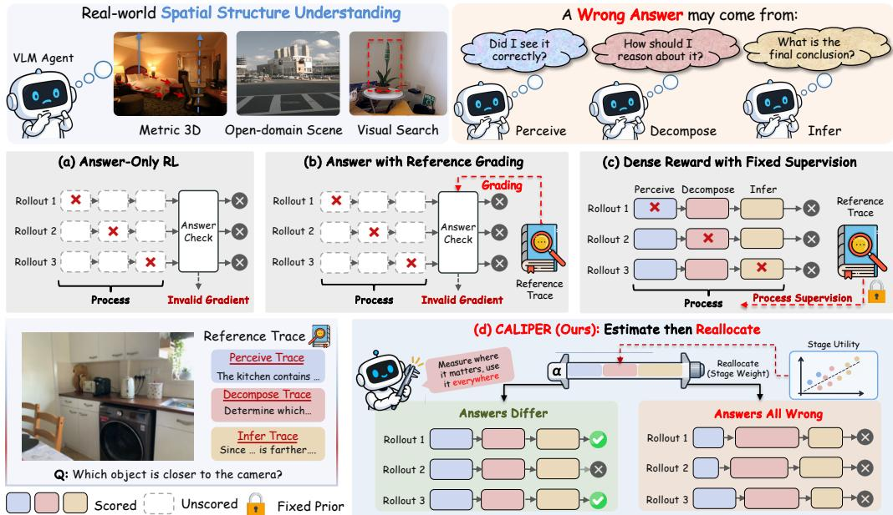
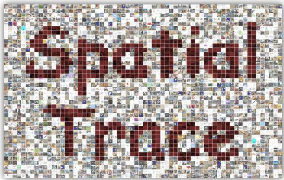
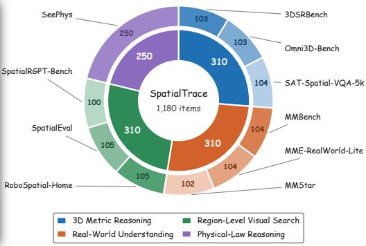
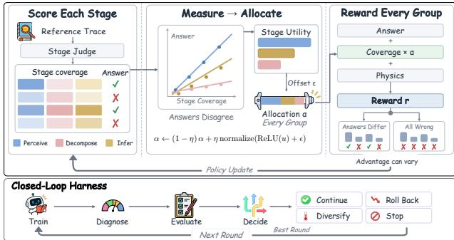
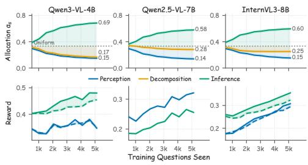
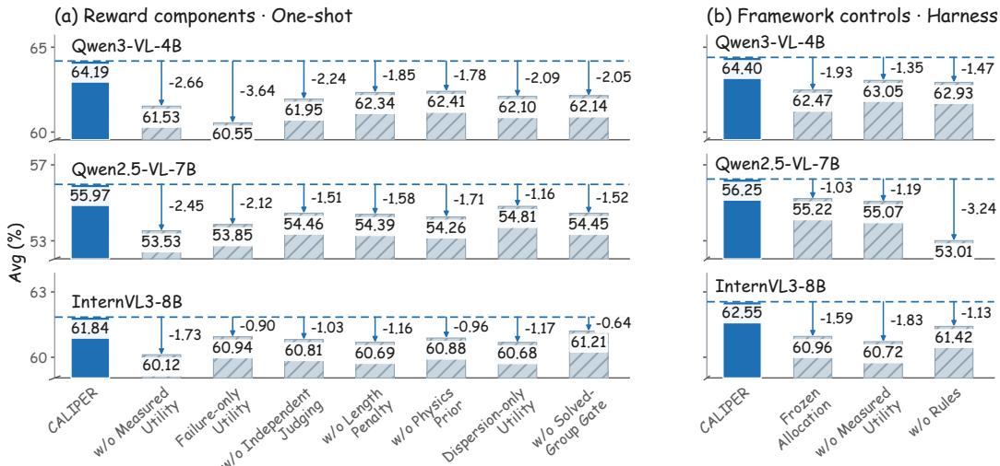
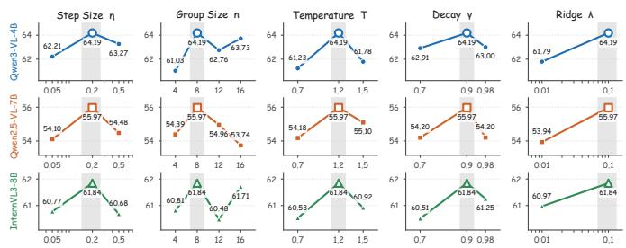
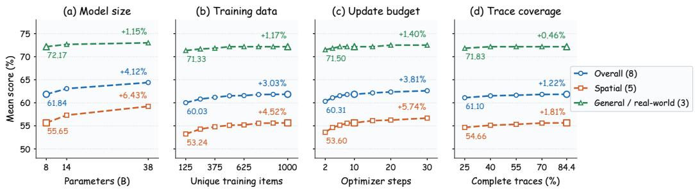
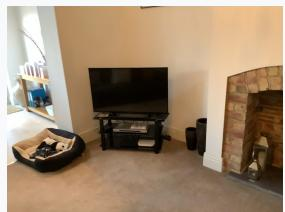
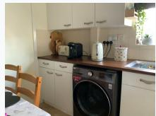

# POLICY-ADAPTIVE CREDIT ASSIGNMENT FOR SPA-TIAL REASONING WITH VERIFIABLE REWARDS

Hailiang Yang School of Computer Science and Engineering University of New South Wales z5516532@ad.unsw.edu.au

Shengchao Chen∗   
Australian AI Institute   
University of Technology Sydney   
shengchao.chen.uts@gmail.com

## ABSTRACT

Image-based spatial reasoning requires perception, decomposition, and inference, but the stage that limits accuracy can change during training. Answer-level rewards neither localize failures to individual stages nor provide discriminative group-relative feedback when all rollouts receive the same reward. Process supervision provides intermediate feedback, but fixed weights cannot adapt reward allocation to these changing bottlenecks. To address this gap, we propose CALIPER, an adaptive process-reward framework supported by SpatialTrace, a corpus of stage-decomposed spatial reasoning traces. CALIPER jointly estimates the associations between stage-wise reference coverage and answer correctness through within-group ridge regression, using these associations as utility proxies to gradually update reward weights. The resulting process reward supervises all rollout groups, including uniformly failing ones. Because utility estimates can become unreliable when answer-discriminative groups are scarce, a closed-loop harness monitors estimator reliability and validation performance to guide checkpoint rollback, rollout diversification, and early stopping. Extensive experiments across eight benchmarks and three backbones show that CALIPER achieves the highest mean under both one-shot and harness training, with consistent gains over fixed allocation across RL optimizers. Further analyses confirm the benefits of adaptive reward allocation and harness control, with favorable scaling in model/data size.

## 1 INTRODUCTION

Image-based spatial reasoning remains a persistent weakness of vision-language models, spanning metric and relational reasoning in 3D scenes (Ma et al., 2025), open-domain scene understanding (Zhang et al., 2025) and region-level search in high-resolution images (Wu & Xie, 2024). Although typically evaluated as a direct mapping from an image and question to an answer, solving these tasks often involves distinct stages of perception, decomposition and inference, whose relative importance varies across instances. Reinforcement learning from verifiable rewards (RLVR) (Guo et al., 2025), often using group-relative advantages over multiple rollouts of the same question (Shao et al., 2024), has been extended to multimodal reasoning by Vision-R1 (Huang et al., 2026) and DeepEyes (Zheng et al., 2026). However, its answer-level supervision has two limitations. It cannot distinguish failures in perception, decomposition or inference, and it provides no discriminative signal when all rollouts receive the same reward, especially on difficult spatial instances.

Reference-assisted verification enriches answer grading but retains a scalar outcome reward, leaving stage-level credit assignment and uniform-reward degeneracy unresolved, as illustrated in Fig. 1a,b. Process supervision (Uesato et al., 2022) provides finer feedback through human-annotated step labels (Lightman et al., 2024) or rollout-derived labels in Math-Shepherd (Wang et al., 2024b). However, a stage score quantifies alignment with a reference or grading criterion. It does not determine the supervision weight appropriate to that stage. Combining such scores with predefined weights leaves reward allocation insensitive to changes in the relationship between stage performance and answer correctness. Fig. 1c illustrates this gap in adaptive credit allocation across perception, decomposition and inference despite access to intermediate feedback.

  
Figure 1: Outcome-only rewards (a), as in GRPO (Shao et al., 2024) and DeepSeek-R1 (Guo et al., 2025), supervise final answers. Reference-assisted verification (b) improves grading but retains uniform-reward degeneracy. Process supervision (c) combines human-labeled feedback (Lightman et al., 2024) or Math-Shepherd scores (Wang et al., 2024b) with fixed weights. CALIPER (d) adapts these weights from estimated utility.

Stage utility guides allocation through the association between stage performance and answer correctness under the current rollout distribution. Low reference coverage does not establish the expected benefit of increasing a stage’s reward weight. Allocation therefore requires an estimate of this association, conditioned on the policy’s evolving behavior across spatial competencies. Rollout groups with variation in answer correctness supply the contrast needed for estimation, whereas uniformly correct or incorrect groups provide no such contrast. Adaptive supervision must estimate utility from informative groups and maintain reliable allocation as they become scarce.

To address this gap, we introduce SpatialTrace and CALIPER, as illustrated in Fig. 1d. SpatialTrace represents heterogeneous spatial tasks through a common schema for perception, decomposition and inference while retaining available reasoning from incomplete traces. CALIPER uses this representation to allocate process supervision according to estimated stage utility. It estimates the association between stage coverage and answer correctness from answer-discriminative rollout groups, then applies the resulting allocation to all groups, including uniformly failing ones. A closed-loop harness monitors estimation reliability and validation performance to guide checkpoint rollback, rollout diversification and stopping. Our contributions are as follows.

• We formulate process-reward allocation as a policy-dependent estimation problem, distinguishing stage quality from its association with answer correctness. Utility estimation is restricted to informative groups, while process supervision applies to all groups.

• We construct SpatialTrace, a reasoning-augmented spatial dataset spanning heterogeneous spatial tasks, in which approximately 84% of items carry complete three-stage traces and the remainder retain available reasoning without imputed stage labels.

• We propose CALIPER, a closed-loop framework that estimates stage utility from answerdiscriminative rollout groups, applies the resulting allocation to all groups, including degenerate groups, and audits that estimate through a rule-based harness.

• Across eight benchmarks and three backbones, CALIPER attains the highest mean under both protocols and improves on fixed allocation across RL optimizers. Ablations support adaptive allocation and harness control, with gains at larger model and data scales.

## 2 RELATED WORK

Spatial Reasoning in Vision-Language Models. Spatial reasoning in vision-language models advances through spatial supervision, visual search and outcome optimization. SpatialVLM (Chen et al., 2024a) and SpatialRGPT (Cheng et al., 2024) derive metric and relational supervision from 3D reconstruction or depth. Benchmarks include 3DSRBench (Ma et al., 2025) for 3D relations, SpatialEval (Wang et al., 2024a) for synthetic reasoning, MME-RealWorld (Zhang et al., 2025) for real-world scenes and RoboSpatial (Song et al., 2025) for embodied settings. ${ \bar { \mathbf { V } } } ^ { * }$ (Wu & Xie, 2024), ZoomEye (Shen et al., 2025) and DeepEyes (Zheng et al., 2026) improve evidence acquisition through region selection, cropping and zooming. RLVR extends to multimodal reasoning in Vision-R1 (Huang et al., 2026), R1-Zero-style spatial training (Liao et al., 2025) and video spatial reasoning in SpaceR (Ouyang et al., 2025). These efforts improve supervision, evidence acquisition and outcome optimization while leaving intermediate-stage credit allocation unresolved.

Process Supervision in RLVR. Chain-of-thought prompting (Wei et al., 2022) makes intermediate reasoning explicit, while DeepSeek-R1 (Guo et al., 2025) optimizes reasoning trajectories with verifiable outcome rewards. GRPO (Shao et al., 2024) uses group-relative advantages, DAPO (Yu et al., 2025) modifies clipping and rollout filtering, and GSPO (Zheng et al., 2025a) uses sequencelevel importance ratios. These methods govern how rewards are translated into policy updates, but do not change their granularity. Process supervision instead assigns feedback to intermediate rea soning steps, using direct annotations (Lightman et al., 2024) or labels derived from rollouts (Wang et al., 2024b). PRIME (Cui et al., 2025) integrates implicit process rewards into online RL, and PURE (Cheng et al., 2025) replaces summation with min-form credit assignment. Such feedback alleviates outcome-reward sparsity, but its aggregation follows a fixed rule, leaving reward allocation insensitive to the policy’s changing bottlenecks. CALIPER addresses this orthogonal problem by estimating policy-dependent stage utility and adapting process-reward weights accordingly.

## 3 SPATIALTRACE DATASET

Task Formulation. SpatialTrace targets spatial question answering with an explicit reasoning trace. Given an image I and a question x, a vision-language policy receives $q = ( I , x )$ and generates a trace τ followed by an answer a. The desired behavior comprises extracting relevant visual evidence, decomposing the question into spatial subproblems, and deriving an answer consistent with that evidence. We represent these components as ${ \boldsymbol \tau } = ( \tau _ { \mathrm { p } } , \tau _ { \mathrm { d } } , \tau _ { \mathrm { i } } )$ , corresponding to perception, decomposition and inference. A reference answer $a ^ { \star }$ supports outcome verification, while stage annotations support separate assessment of these reasoning components. This distinction permits analysis of intermediate reasoning even when the final answer is incorrect.

  
Figure 2: SpatialTrace examples (left) and source composition (right).

Construction. Learning this behavior requires coverage of spatial problems with different perceptual and inferential demands. SpatialTrace draws metric 3D questions from 3DSRBench (Ma et al., 2025), Omni3D-Bench (Brazil et al., 2023) and SAT-Spatial-VQA-5k (Ray et al., 2025). Opendomain questions are sampled from MMBench (Liu et al., 2024), MME-RealWorld-Lite (Zhang et al., 2025) and MMStar (Chen et al., 2024b). Region-level search instances are sampled from RoboSpatial-Home (Song et al., 2025), SpatialEval (Wang et al., 2024a) and SpatialRGPT-Bench (Cheng et al., 2024), with SeePhys (Xiang et al., 2026) supplying auxiliary physical reasoning. Fig. 2 summarizes SpatialTrace’s 1,180 single-image questions with verifiable answers. Family quotas preserve coverage, with source-stratified splits of 1,000 training and 180 validation items.

Traces. The annotations encode the relationship between visual evidence, intermediate reasoning and the reference answer. Perception records relevant visual observations. Decomposition identifies the subproblems required by the question. Inference connects the observations to the answer. Each record also includes answer reconciliation and the final answer, allowing discrepancies between visual evidence and the source label to be recorded. An image-grounded annotator drafts the trace, and a text-only editor refines its reasoning and records unsupported inferences or ambiguity. Approximately 84% of the corpus contains all three stage fields. Other records retain their answers and available reasoning without imputed stage labels. Appendix A details the annotation protocol.

## 4 METHODOLOGY

Problem Formulation. Given an image–question pair $q = ( I , x )$ and a verifiable answer $a ^ { \star }$ , a policy $\pi _ { \theta }$ generates a group g of n rollouts $\{ o _ { i } \} _ { i \in g } \stackrel {  } { \sim } \pi _ { \theta } ( \cdot \mid q )$ . Let $r _ { i }$ denote the reward of rollout $o _ { i }$ . Group-relative policy optimization (Shao et al., 2024) computes its advantage from the group mean $\mu _ { g }$ and standard deviation $\sigma _ { g } .$

$$
\begin{array} { r } { A _ { i } = \left\{ \begin{array} { l l } { ( r _ { i } - \mu _ { g } ) / \sigma _ { g } , } & { \sigma _ { g } > 0 , } \\ { 0 , } & { \sigma _ { g } = 0 , } \end{array} \right. \quad \mu _ { g } = \frac { 1 } { n } \sum _ { j \in g } r _ { j } , \sigma _ { g } ^ { 2 } = \frac { 1 } { n } \sum _ { j \in g } ( r _ { j } - \mu _ { g } ) ^ { 2 } , } \end{array}\tag{1}
$$

The same $A _ { i }$ applies to every token of $o _ { i } .$ . If all rewards in g agree, then $\sigma _ { g } = 0$ and the advantages are set to zero. Such groups contribute no advantage-weighted policy gradient, although other objective terms may remain. Let $\operatorname { a c c } _ { i } \in \{ 0 , 1 \}$ denote the verifier judgment of the answer in $o _ { i }$ against $a ^ { \star }$ Under a binary outcome reward, groups that are uniformly correct or uniformly incorrect both yield zero advantages. The problem is to assign credit among perception, decomposition and inference even when answer-level rewards cannot distinguish the rollouts.

Overview. Fig. 3 shows CALIPER’s two coupled loops. During a policy update, a stage judge scores each rollout against the corresponding Spatial-Trace reference for perception, decomposition and inference. Groups with both correct and incorrect answers support the stage-utility estimate. The estimated utilities determine the weights used to reward every group. Across training rounds, the harness checks validation performance and estimator reliability. It then continues training, restores a checkpoint, increases rollout diversity or stops.

  
Figure 3: CALIPER scores stages against reference traces, estimates utility from groups with mixed answer correctness, and updates the policy using rewards for every group. Validation and estimator diagnostics guide continuation, rollback, rollout diversification or stopping.

Stage-Decomposed Process Reward. Let S index the perception, decompo-

sition and inference stages. The reference trace for q is $\boldsymbol { \tau ^ { \star } } = ( \boldsymbol { \tau } _ { s } ^ { \star } ) _ { s \in \mathcal { S } }$ . A judge J assigns each rollout a reference-coverage score $\mathrm { c o v } _ { s } ( o _ { i } ) = J ( o _ { i } , \bar { \tau _ { s } ^ { \star } } ) \in [ 0 , 1 ]$ for stage s. Let phys $\in [ 0 , 1 ]$ be a physical-plausibility score and $\mathrm { l e n } _ { i } \in [ 0 , 1 ]$ a response-length penalty. The nonnegative weights $w _ { a } , w _ { m } , w _ { p }$ and $w _ { \ell } \in [ 0 , 1 ]$ control answer correctness, process coverage, physical plausibility and length, respectively. The allocation $\alpha \in \Delta ^ { | S | }$ lies on the probability simplex and distributes the process weight $w _ { m }$ across stages. We define the rollout reward as

$$
r ( o _ { i } ) ~ = ~ \Big [ w _ { a } \operatorname { a c c } _ { i } ~ + ~ w _ { m } \sum _ { s \in \mathcal { S } } \alpha _ { s } \cos ( o _ { i } ) ~ + ~ w _ { p } \mathrm { p h y s } _ { i } \Big ] \cdot \big ( 1 - w _ { \ell } \mathrm { l e n } _ { i } \big ) ,\tag{2}
$$

The score $\mathrm { p h y s } _ { i }$ quantifies consistency with physical constraints on magnitudes, units and relations. For response length $\left| o _ { i } \right|$ | in tokens, target length $L _ { 0 }$ and cap $L _ { \mathrm { m a x } } > L _ { 0 }$ , the penalty is

$$
{ \mathrm { l e n } } _ { i } = \operatorname* { m i n } \left\{ 1 , \operatorname* { m a x } \left\{ 0 , { \frac { | o _ { i } | - L _ { 0 } } { L _ { { \mathrm { m a x } } } - L _ { 0 } } } \right\} \right\} .
$$

It increases linearly from zero at $L _ { 0 }$ to one at $L _ { \mathrm { m a x } }$ . For incomplete references, the reward sums over available stages and renormalizes their weights.

Stage Utility. Stage utility is the conditional association between coverage and answer correctness under the current policy. Among groups with complete references, only answer-discriminative groups $\mathcal { M } = \{ g : 0 \overset { \cdot } { < } \sum _ { i \in q } \operatorname { a c c } _ { i } < \overline { { n } } \}$ contain the outcome variation needed to estimate it. For rollout $o _ { i }$ in such a group, we center each stage score and the outcome within the group,

$$
\tilde { x } _ { i , s } = \mathrm { c o v } _ { s } ( o _ { i } ) - \frac { 1 } { n } \sum _ { j \in g } \mathrm { c o v } _ { s } ( o _ { j } ) , \qquad \tilde { y } _ { i } = \mathrm { a c c } _ { i } - \frac { 1 } { n } \sum _ { j \in g } \mathrm { a c c } _ { j } .
$$

The vector $\tilde { x } _ { i }$ collects the centered stage scores. The design matrix $\tilde { X }$ stacks these vectors as rows, and $\tilde { y }$ stacks the corresponding outcomes. With $\bar { \sigma } ^ { 2 } = \mathrm { t r } \bar { ( } \tilde { X } ^ { \top } \tilde { X } ) / | S |$ and ridge coefficient $\lambda > 0$ we estimate utility $u \in \mathbb { R } ^ { | S | }$ by

$$
u = \arg \operatorname* { m i n } _ { \beta \in \mathbb { R } ^ { | \cal S | } } \left\{ \sum _ { g \in \mathcal { M } } \sum _ { i \in g } \big ( \tilde { y } _ { i } - \beta ^ { \top } \tilde { x } _ { i } \big ) ^ { 2 } + \lambda \bar { \sigma } ^ { 2 } \| \beta \| _ { 2 } ^ { 2 } \right\} = \big ( \tilde { X } ^ { \top } \tilde { X } + \lambda \bar { \sigma } ^ { 2 } \mathrm { I } \big ) ^ { - 1 } \tilde { X } ^ { \top } \tilde { y } ,\tag{3}
$$

where I is the identity matrix and the closed form applies when $\bar { \sigma } ^ { 2 } > 0 $ . Centering compares rollouts of the same question, and joint regression accounts for correlations among stage scores. The coefficients quantify each stage’s association with correctness after accounting for the other stages. The scale $\bar { \sigma } ^ { 2 }$ is the mean diagonal of the Gram matrix, so the penalty follows the feature scale. Across batches, exponential decay $\gamma \in ( 0 , 1 )$ gives recent samples greater weight in the sufficient statistics $\tilde { X } ^ { \top } \tilde { X }$ and ${ \tilde { X } } ^ { \top } { \tilde { y } } .$ Let $N _ { \mathrm { e f f } }$ be the corresponding decayed sample mass and $N _ { \mathrm { m i n } }$ its update threshold. We retain the current allocation unless $N _ { \mathrm { e f f } } \geq N _ { \mathrm { m i n } }$ , feature variation is nonzero and at least one coefficient is positive.

Utility-Adaptive Allocation. Define $\mathrm { R e L U } ( u ) = \operatorname* { m a x } ( u , 0 )$ elementwise and normalize ${ \bf \nabla } ; ( v ) =$ $v / \sum _ { s } v _ { s }$ . An offset $\epsilon > 0$ keeps the normalized target positive, and a step size $\eta \in ( 0 , 1 ]$ limits the change between updates. CALIPER interpolates between the current allocation and this target,

$$
\alpha  ( 1 - \eta ) \alpha + \eta \mathrm { n o r m a l i z e } \big ( \mathrm { R e L U } ( u ) + \epsilon \big ) ,\tag{4}
$$

The offset is added componentwise. It preserves positive weights but does not impose a lower bound of ϵ after normalization. Utilities are estimated from answer-discriminative groups, and the resulting allocation supervises all groups.

Closed-Loop Harness. As training progresses, answer-discriminative groups may become scarce, weakening the utility estimate even when the allocation appears stable. Validation performance can also deteriorate during training. The harness diagnoses both failure modes to determine whether and how training should continue. At round $k ,$ let $\alpha _ { k }$ be the current allocation, $m _ { k }$ the validation accuracy, σ its standard error and $m ^ { \star }$ the best accuracy from earlier rounds. We record allocation drift $\delta _ { k } = \| \alpha _ { k } - \alpha _ { k - 1 } \| _ { 1 }$ and the mean number $n _ { k } ^ { \mathcal { M } }$ of answer-discriminative groups per batch. The allocation target is ${ \bar { u } } _ { k } = \mathrm { n o r m a l i z e } ( \operatorname { R e L U } ( u _ { k } ) + { \overset { . . . } { \epsilon } } )$ , with separation $\begin{array} { r } { \Delta u _ { k } = \operatorname* { m a x } _ { s } \bar { u } _ { k , s } - \operatorname* { m i n } _ { s } \bar { u } _ { k , s } } \end{array}$ The decision $\mathcal { D } _ { k }$ applies the fixed regression tolerance $\rho _ { \mathrm { r } }$ , drift threshold $\epsilon _ { \delta } .$ , group-count threshold $\nu _ { \mathrm { m i n } }$ and separation threshold $\epsilon _ { u }$ in the following order,

$$
\mathcal { D } _ { k } = \left\{ \begin{array} { l l } { \mathrm { R o L L B A C K } } & { m _ { k } < m ^ { \star } - \operatorname* { m a x } ( \rho _ { \mathrm { r } } m ^ { \star } , 2 \sigma ) , } \\ { \mathrm { D I V E R S I F Y } } & { \delta _ { k } < \epsilon _ { \delta } \mathrm { ~ \wedge ~ } n _ { k } ^ { \mathcal { M } } < \nu _ { \operatorname* { m i n } } , } \\ { \mathrm { S T O P } } & { \delta _ { k } < \epsilon _ { \delta } \mathrm { ~ \wedge ~ } n _ { k } ^ { \mathcal { M } } \geq \nu _ { \operatorname* { m i n } } \mathrm { ~ \wedge ~ } \operatorname* { m a x } ( \Delta u _ { k } , \Delta u _ { k - 1 } ) < \epsilon _ { u } , } \\ { \mathrm { C O N T I N U E } } & { \mathrm { o t h e r w i s e } , } \end{array} \right.\tag{5}
$$

Rollback requires a saved checkpoint. We set $\Delta u _ { 0 } = + \infty$ and use $\Delta u _ { k } = + \infty$ when the utility estimate is unavailable, disabling utility-based stopping in those rounds. ROLLBACK restores the policy, allocation and rollout temperature of the best validation round. DIVERSIFY raises temperature when allocation drift is low and answer-discriminative groups are scarce. STOP terminates training when current drift is low, sufficient answer-discriminative groups are available and utility separation is small in two consecutive rounds. Evaluation uses the best validation checkpoint.

Policy Objective. The policy update computes $A _ { i }$ from the stage-weighted reward in Eq. 2. Let $o _ { i , t }$ be token t of rollout $o _ { i } , o _ { i , < t }$ its prefix and $\theta _ { \mathrm { o l d } }$ the parameters of the sampling policy. The

token-level importance ratio is

$$
\rho _ { i , t } ( \theta ) = \frac { \pi _ { \theta } ( o _ { i , t } \mid q , o _ { i , < t } ) } { \pi _ { \theta _ { \mathrm { o l d } } } ( o _ { i , t } \mid q , o _ { i , < t } ) } .
$$

With lower and upper clipping tolerances $\varepsilon _ { \mathrm { l o } } , \varepsilon _ { \mathrm { h i } } > 0$ , the clipped policy-loss term averaged over sampled questions and rollout groups is

$$
\begin{array} { r } { \mathcal { L } _ { \mathrm { p o l i c y } } ( \theta ) ~ = ~ - \mathbb { E } \Big [ \frac { 1 } { n } \sum _ { i } \frac { 1 } { | \boldsymbol { o } _ { i } | } \sum _ { t } \operatorname* { m i n } \big ( \rho _ { i , t } A _ { i } , ~ \mathrm { c l i p } ( \rho _ { i , t } , 1 - \varepsilon _ { \mathrm { l o } } , 1 + \varepsilon _ { \mathrm { h i } } ) A _ { i } \big ) \Big ] , } \end{array}\tag{6}
$$

For GRPO, we augment this objective with a KL penalty that constrains deviation from the frozen reference policy. The complete CALIPER training procedure is given in Algorithm 1.

Proposition 1 (Stage-Contrast Preservation) Fix the policy and the conditional distributions of complete-reference groups. Let $d = | S | , p \in ( 0 , 1 )$ be the rolloutfraction in answer-discriminative groups, D the centered feature covariance in the remaining groups, and c the centered feature– outcome cross-moment in answer-discriminative groups. Assume exact moments, positive feature variance in both group types, and $\lambda , \epsilon \ > \ 0 .$ . Let T denote the target map in Eq. 4 and $\alpha _ { \mathrm { u n i f } }$ the uniform allocation. The mixed-group utility $u _ { \mathrm { M } }$ and its target are independent $o f p ,$ whereas applying the same estimator to all groups gives a utility $u _ { p }$ satisfying

$$
\big \| \mathcal { T } _ { \epsilon } ( u _ { p } ) - \alpha _ { \mathrm { u n i f } } \big \| _ { 1 } \leq \frac { 2 \sqrt { d } p \| c \| _ { 2 } } { ( 1 - p ) \lambda \epsilon \mathrm { t r } D } \longrightarrow 0 \quad a s p \downarrow 0 .\tag{7}
$$

Moreover, a bounded three-stage construction preserves a positive association between normalized advantages and a correctness-associated stage contrast under mixed-group estimation, while this association vanishes under pooled estimation as p ↓ 0. The proofis provided in Appendix C.

## 5 EXPERIMENTS

Implementation Details. The primary experiments use the GRPO implementation of EasyR1 (Zheng et al., 2025b) on verl (Sheng et al., 2025). The backbone is frozen throughout and a LoRA adapter (Hu et al., 2022) of rank 64 is trained with $n = 8$ rollouts per question at temperature 1.2, AdamW at learning rate $1 \times 1 0 ^ { - 5 }$ , and 512 questions per optimizer step. Backbones are Qwen3-VL-4B (Bai et al., 2025a), Qwen2.5-VL-7B (Bai et al., 2025b) and InternVL3-8B (Zhu et al., 2025). One-shot training comprises ten optimizer steps, approximately five passes over 1,000 items. Harness training comprises at most six rounds of five steps. Each run uses eight NVIDIA H200 GPUs (141 GB each) on a single node. Unless varied explicitly, the backbones share the reward, estimator, allocation and harness settings specified in Appendix B.

Baselines. We compare two untrained configurations and three reward-based training baselines. Direct prompting requests an answer without a reasoning trace. Chain-of-thought prompting (Wei et al., 2022) uses the same three-stage format as trained methods to isolate explicit reasoning before training. Within each training protocol, all methods share the backbone, adapter and rollout settings. Outcome reward uses final-answer supervision, following GRPO (Shao et al., 2024) and Vision-R1 (Huang et al., 2026). Reference-assisted reward is a controlled variant in which the verifier receives the SpatialTrace reference as grading context. The process reward model (PRM) baseline follows stage-level labeling in Lightman et al. (2024) and Wang et al. (2024b), and combines its three predicted scores under fixed weights. Appendix B.1 details reward scorers, baseline and prompts.

Benchmarks & Metrics. We train each backbone on our SpatialTrace dataset (Section 3) and evaluate it on eight primary benchmarks. Four target 3D and relational spatial understanding, namely 3DSRBench (Ma et al., 2025), RoboSpatial-Home (Song et al., 2025), and spatial questionanswering splits built on Omni3D (Brazil et al., 2023) and SAT (Ray et al., 2025). Two are the general multimodal benchmarks MMBench (Liu et al., 2024) and MMStar (Chen et al., 2024b), and the remaining two are the high-resolution real-world benchmark MME-RealWorld-Lite (Zhang et al., 2025) and the synthetic spatial puzzles of SpatialEval (Wang et al., 2024a). Training and evaluation images are disjoint (Appendix A). We report benchmark scores (%) and their unweighted mean (Avg) on fixed 200-item subsets. The metrics include binary accuracy, a mixed numerical score for Omni3D, and a proxy context score within RoboSpatial. Appendix B specifies these differences.

Table 1: Main results (%). Avg is the mean, and 1st counts wins (ties included). Bold/underline mark best/second-best scores. ∆ compares protocols.
<table><tr><td>Method</td><td>Harness</td><td>3DSR</td><td>MMB</td><td>MME-RW</td><td>MMSTAR</td><td>OMNI3D</td><td>ROBOSP</td><td>SAT</td><td>SPATEVAL</td><td>Avg</td><td>Δ</td><td>1st</td></tr><tr><td colspan="9">Qwen3-VL-4B (Bai et al., 2025a)</td><td></td><td></td><td></td><td></td></tr><tr><td>Direct (No RL)</td><td>X</td><td>55.00</td><td>89.00</td><td>49.00</td><td>61.00</td><td>38.90</td><td>43.92</td><td>75.00</td><td>56.00</td><td>58.48</td><td>X</td><td>1</td></tr><tr><td>CoT (No RL)</td><td>x</td><td>59.00</td><td>92.00</td><td>47.50</td><td>67.00</td><td>31.85</td><td>44.72</td><td>73.50</td><td>68.50</td><td>60.51</td><td>X</td><td>0</td></tr><tr><td>Outcome Reward</td><td>X</td><td>60.50</td><td>91.00</td><td>46.00</td><td>66.50</td><td>33.70</td><td>46.15</td><td>76.00</td><td>70.00</td><td>61.23</td><td>+0.13</td><td>0</td></tr><tr><td rowspan="2">Reference-Assisted</td><td>√</td><td>58.00</td><td>91.00</td><td>50.50</td><td>64.50</td><td>33.65</td><td>46.72</td><td>76.00</td><td>70.50</td><td>61.36</td><td></td><td>0</td></tr><tr><td>X</td><td>61.00</td><td>92.00</td><td>47.50</td><td>68.00</td><td>33.95</td><td>47.13</td><td>77.00</td><td>68.00</td><td>61.82</td><td>+0.13</td><td>1</td></tr><tr><td rowspan="2">Process Reward Model</td><td>√</td><td>61.50</td><td>92.00</td><td>50.00</td><td>65.00</td><td>32.55</td><td>48.03</td><td>75.00</td><td>71.50</td><td>61.95</td><td></td><td>0</td></tr><tr><td>X</td><td>63.00</td><td>93.50</td><td>49.50</td><td>68.50</td><td>37.20</td><td>49.20</td><td>74.00</td><td>69.50</td><td>63.05</td><td>-0.15</td><td>1</td></tr><tr><td rowspan="2">CALIPER (ours)</td><td>√</td><td>63.50</td><td>92.50</td><td>48.00</td><td>69.50</td><td>37.05</td><td>46.11</td><td>75.00</td><td>71.50</td><td>62.90</td><td></td><td>0</td></tr><tr><td>X</td><td>66.00</td><td>93.50</td><td>52.00</td><td>69.00</td><td>37.05</td><td>46.95</td><td>76.50</td><td>72.50</td><td>64.19</td><td></td><td>2</td></tr><tr><td rowspan="2"></td><td>√</td><td>65.50</td><td>93.00</td><td>52.50</td><td>70.00</td><td>36.35</td><td>50.37</td><td>72.50</td><td>75.00</td><td>64.40</td><td>+0.21</td><td>4</td></tr><tr><td>Qwen2.5-VL-7B (Bai et al., 2025b)</td><td></td><td></td><td></td><td></td><td></td><td></td><td></td><td></td><td></td><td></td><td></td></tr><tr><td colspan="10">Direct (No RL)</td><td></td><td>X</td><td></td><td></td></tr><tr><td>CoT (No RL)</td><td>X X</td><td>49.50 51.50</td><td>88.00 88.50</td><td>44.50 45.50</td><td>62.00 65.00</td><td>23.15 24.65</td><td>43.73 47.23</td><td>51.50 54.50</td><td>53.00 57.00</td><td>51.92 54.23</td><td></td><td>0</td></tr><tr><td></td><td>X</td><td></td><td>89.00</td><td>51.00</td><td>62.50</td><td>22.75</td><td>44.05</td><td>58.50</td><td>54.50</td><td>54.66</td><td>X</td><td>0</td></tr><tr><td rowspan="2">Outcome Reward</td><td>√</td><td>55.00 55.50</td><td>89.50</td><td>49.50</td><td>65.50</td><td>24.05</td><td>43.06</td><td>62.50</td><td>55.50</td><td></td><td>+0.98</td><td>0</td></tr><tr><td></td><td>53.50</td><td>89.50</td><td>52.00</td><td>65.50</td><td>20.45</td><td></td><td>57.50</td><td>56.50</td><td>55.64</td><td></td><td>3</td></tr><tr><td rowspan="2">Reference-Assisted</td><td>x √</td><td>53.00</td><td>88.50</td><td>50.00</td><td>63.50</td><td>22.45</td><td>44.10 43.47</td><td>62.00</td><td>57.00</td><td>54.88</td><td>+0.11</td><td>2</td></tr><tr><td></td><td>52.50</td><td>85.50</td><td>47.00</td><td></td><td></td><td></td><td></td><td></td><td>54.99</td><td></td><td>0</td></tr><tr><td rowspan="2">Process Reward Model</td><td>X √</td><td>48.50</td><td>85.50</td><td>44.50</td><td>59.50 60.00</td><td>24.75 24.00</td><td>45.25 45.87</td><td>53.50 56.00</td><td>54.50 55.50</td><td>52.81</td><td>-0.33</td><td>1</td></tr><tr><td></td><td>54.50</td><td></td><td>50.50</td><td></td><td></td><td></td><td></td><td></td><td>52.48</td><td></td><td>0</td></tr><tr><td rowspan="2">CALIPER (ours) InternVL3-8B (Zhu et al., 2025)</td><td>x √</td><td>53.50</td><td>90.50 90.50</td><td>49.50</td><td>63.50 65.50</td><td>23.05 24.75</td><td>46.73 48.27</td><td>57.00 55.50</td><td>62.00 62.50</td><td>55.97</td><td>+0.28</td><td>1</td></tr><tr><td></td><td></td><td></td><td></td><td></td><td></td><td></td><td></td><td></td><td>56.25</td><td></td><td>5</td></tr><tr><td colspan="2">Direct (No RL)</td><td></td><td></td><td></td><td></td><td></td><td></td><td></td><td></td><td></td><td></td><td></td></tr><tr><td rowspan="2">CoT (No RL)</td><td>X</td><td>51.00</td><td>89.00</td><td>54.00</td><td>71.00</td><td>36.95</td><td>39.90</td><td>74.50</td><td>50.00</td><td>58.29</td><td>X</td><td>1</td></tr><tr><td>x</td><td>56.50</td><td>88.50</td><td>53.00</td><td>73.00</td><td>38.65</td><td>44.32</td><td>72.50</td><td>50.50</td><td>59.62</td><td>X</td><td>1</td></tr><tr><td rowspan="2">Outcome Reward</td><td>X</td><td>55.50</td><td>88.00</td><td>53.00</td><td>67.50</td><td>37.40</td><td>41.63</td><td>75.00</td><td>52.50</td><td>58.82</td><td></td><td>1</td></tr><tr><td>√</td><td>55.50</td><td>87.50</td><td>54.50</td><td>66.50</td><td>37.00</td><td>43.75</td><td>74.00</td><td>57.50</td><td>59.53</td><td>+0.71</td><td>0</td></tr><tr><td rowspan="2">Reference-Assisted</td><td>X</td><td>56.50</td><td>88.00</td><td>52.50</td><td>71.50</td><td>37.90</td><td>44.28</td><td>74.00</td><td>54.00</td><td>59.84</td><td>+0.45</td><td>0</td></tr><tr><td>√</td><td>55.00</td><td>88.00</td><td>54.00</td><td>68.50</td><td>38.10</td><td>47.19</td><td>74.00</td><td>57.50</td><td>60.29</td><td></td><td>0</td></tr><tr><td rowspan="2">Process Reward Model</td><td>X √</td><td>57.50 57.00</td><td>88.50 89.00</td><td>56.50 52.50</td><td>70.00 70.00</td><td>38.15 38.35</td><td>49.08 50.04</td><td>73.50 72.50</td><td>56.00 54.50</td><td>61.15 60.49</td><td>-0.67</td><td>1 1</td></tr><tr></table>

## 5.1 MAIN RESULTS

Performance Comparison. Table 1 shows that CALIPER achieves the highest mean score across the eight benchmarks for all three backbones under both training protocols. Under harness training, its margin over the strongest trained baseline reaches 2.06 percentage points on InternVL3-8B. PRM improves on outcome reward for two backbones but falls behind on Qwen2.5-VL-7B, indicating that intermediate supervision alone is insufficient. The consistent advantage over frozen allocation supports adapting stage weights to the current policy.

OOD Generalization. Table 2 shows CALIPER’s strongest relative gain on viewpoint-dependent spatial reasoning. Its mean exceeds frozen allocation by 3.00 percentage points, with the largest individual gain on ViewSpatial-Bench. The evaluation covers BLINK-Spatial (Fu et al., 2024), RealWorldQA (xAI, 2024), EmbSpatial-Bench (Du et al., 2024) and ViewSpatial-Bench (Li et al., 2025) under fixed prompts

Table 2: Qwen3-VL-4B OOD accuracy (%).
<table><tr><td>Method</td><td>BLINK</td><td>RealWorld QA</td><td>Emb Spatial</td><td>View Spatial</td><td>Avg</td></tr><tr><td>Direct (no RL)</td><td>80.50</td><td>73.00</td><td>76.50</td><td>37.50</td><td>66.88</td></tr><tr><td>CoT (no RL)</td><td>83.00</td><td>75.00</td><td>69.50</td><td>43.00</td><td>67.63</td></tr><tr><td>Outcome Reward</td><td>84.00</td><td>71.50</td><td>72.50</td><td>41.50</td><td>67.38</td></tr><tr><td>Reference-Assisted</td><td>85.00</td><td>71.50</td><td>73.00</td><td>43.00</td><td>68.13</td></tr><tr><td>Process Reward Model</td><td>80.50</td><td>72.00</td><td>72.00</td><td>45.00</td><td>67.38</td></tr><tr><td>Frozen α</td><td>83.00</td><td>74.50</td><td>73.00</td><td>41.50</td><td>68.00</td></tr><tr><td>CALIPER (ours)</td><td>85.50</td><td>76.00</td><td>76.50</td><td>46.00</td><td>71.00</td></tr><tr><td>Harness PRM</td><td>81.50</td><td>76.00</td><td>75.00</td><td>45.50</td><td>69.50</td></tr></table>

and decoding after SpatialTrace training. Harness PRM uses the separate harness protocol. The pattern is consistent with better transfer of stage-specific supervision to viewpoint reasoning while retaining performance on the other OOD tasks.

Stage Coverage Answer Accuracy Measured Al ocation Fixed Al ocation

## 5.2 FRAMEWORK ANALYSIS

Generality Across Optimizers. Table 3 shows that adaptive allocation improves performance across distinct policy optimizers. Under both DAPO (Yu et al., 2025) and GSPO (Zheng et al., 2025a), CALIPER outperforms frozen allocation, with gains of up to 1.92 percentage points despite their different update rules. On Qwen2.5-VL-7B, outcome reward remains stronger than processbased variants, indicating that adaptive allocation improves process supervision without requiring process rewards to universally dominate outcome rewards. These comparisons support utility-based allocation across the tested policy objectives.

Table 3: Optimizer transfer under harness training, with ∆ relative to CALIPER.
<table><tr><td rowspan="2">Optim.</td><td rowspan="2">Method</td><td colspan="2">Q3-VL-4B</td><td colspan="2">Q2.5-VL-7B</td><td colspan="2">IVL3-8B</td></tr><tr><td>Avg</td><td>∆</td><td>Avg</td><td>∆</td><td>Avg</td><td>∆</td></tr><tr><td>GRPO</td><td>Outcome</td><td>61.36</td><td>-3.04</td><td>55.64</td><td>-0.61</td><td>59.53</td><td>-3.02</td></tr><tr><td></td><td>Ref.-assisted</td><td>61.95</td><td>-2.45</td><td>54.99</td><td>-1.26</td><td>60.29</td><td>-2.26</td></tr><tr><td></td><td>Frozen α</td><td>62.47</td><td>-1.93</td><td>55.22</td><td>-1.03</td><td>60.96</td><td>-1.59</td></tr><tr><td></td><td>CALIPER</td><td>64.40</td><td></td><td>56.25</td><td></td><td>62.55</td><td></td></tr><tr><td>DAPO</td><td>Outcome</td><td>63.31</td><td>-0.04</td><td>56.31</td><td>+2.34</td><td>61.34</td><td>-1.13</td></tr><tr><td></td><td>Ref.-assisted</td><td>63.36</td><td>+0.01</td><td>56.26</td><td>+2.29</td><td>61.21</td><td>-1.27</td></tr><tr><td></td><td>Frozen α</td><td>62.56</td><td>-0.79</td><td>53.38</td><td>-0.59</td><td>61.09</td><td>-1.39</td></tr><tr><td></td><td>CALIPER</td><td>63.35</td><td></td><td>53.97</td><td></td><td>62.48</td><td></td></tr><tr><td>GSPO</td><td>Outcome</td><td>61.43</td><td>-1.71</td><td>55.46</td><td>+0.78</td><td>59.97</td><td>-0.61</td></tr><tr><td></td><td>Ref.-assisted</td><td>62.95</td><td>-0.20</td><td>53.91</td><td>-0.76</td><td>60.17</td><td>-0.42</td></tr><tr><td></td><td>Frozen α</td><td>62.78</td><td>-0.37</td><td>52.75</td><td>-1.92</td><td>60.44</td><td>-0.14</td></tr><tr><td></td><td>CALIPER</td><td>63.15</td><td></td><td>54.67</td><td></td><td>60.58</td><td></td></tr></table>

  
Figure 4: Stage allocation (top) and rewards (bottom) over optimizer steps. Dashed curves use fixed allocation.

Reward Allocation Dynamics. Fig. 4 shows a consistent reallocation toward inference across backbones. Starting from uniform weights, inference accounts for 0.58–0.69 of the final processreward allocation. The lower panels further reveal that higher stage coverage does not uniformly translate into higher answer accuracy: coverage increases on Qwen3-VL-4B despite fluctuating accuracy, whereas the other two backbones exhibit more aligned improvements in both. The fixedallocation baselines also follow backbone-specific trajectories on Qwen3-VL-4B and InternVL3-8B. These trajectories support using within-question correctness contrasts to estimate stage utility.

  
Figure 5: Reward-component (a) and framework (b) ablations. Gaps are in percentage points.

Ablation Studies. Fig. 5 shows consistent contributions from both adaptive reward allocation and harness control. Removing measured utility degrades all three backbones, with failure-only utility causing the largest drop on Qwen3-VL-4B (3.64 points), while freezing the learned allocation also consistently reduces performance. Removing harness rules produces further degradation across backbones, reaching 3.24 points on Qwen2.5-VL-7B. Together, these results show that CALIPER benefits from both policy-dependent reward adaptation and closed-loop training control.

Hyperparameter Sensitivity. Fig. 6 shows that the shared default gives the highest mean on all three backbones. Group-size effects differ by backbone: Qwen3-VL-4B and InternVL3-8B recover at $n ~ = ~ 1 6$ after a dip, whereas Qwen2.5-VL-7B declines beyond $n \ = \ 8 .$ Non-default step size, temperature and decay also reduce

  
Figure 6: Hyperparameter sensitivity.  
performance, consistent with a balance between diverse rollouts and stable allocation updates. Increasing the ridge penalty from 0.01 to 0.1 improves the mean on all three backbones.

Case Study. Fig. 7 shows two failures to translate recognized objects into spatial answers. CALIPER resolves the camera-depth relation in the first item and distinguishes possible placement from current location in the second. Both cases illustrate gains in inference or decomposition despite similar object recognition. Appendix E provides crossbackbone examples and a regression.

Scaling Behaviour. Fig. 8 shows diminishing gains with model capacity, unique training items, optimizer steps and complete-trace coverage. The spatial group gains more than the general and real-world group across these settings. The fixed-model panels vary data exposure, optimization and annotation coverage, while the model-size panel compares members of the InternVL3 family. Appendix D.

  
Figure 7: Qualitative effects of adaptive stage supervision.

  
Figure 8: Scaling with model size, training data, update budget and trace coverage.

## 6 CONCLUSION

This paper proposes CALIPER, an adaptive process-reward framework that allocates spatialreasoning supervision according to policy-dependent stage utility. CALIPER estimates utility from answer-discriminative rollout groups and applies the resulting stage weights to all groups, including those with uniformly incorrect answers. A closed-loop harness monitors estimator reliability and validation performance to guide training decisions. Extensive experiments across eight benchmarks, three backbones and three optimizers show gains over matched fixed weights.

## AI USE STATEMENT

In this work, we used AI tools for manuscript preparation, including language editing, selected icons in Fig. 1, and code revision assistance. We also used a vision-language model to synthesize the initial SpatialTrace reasoning traces, which were subsequently refined by a text-only model. The authors take responsibility for the final manuscript, figures, dataset and code, including AI-assisted content. These tools did not independently determine the methods or technical conclusions.

## REPRODUCIBILITY STATEMENT

Section 3 and Appendix A describe SpatialTrace sources, sampling and reference annotation. Section 4 specifies the reward, utility estimator and allocation update, with pseudocode in Algorithm 1. Appendix B records training protocols, hyperparameters, evaluation metrics and reward-scoring prompts. Appendix C provides the assumptions and proof of Proposition 1, while Appendix D details experimental controls and scaling settings.

## REFERENCES

Shuai Bai, Yuxuan Cai, Ruizhe Chen, Keqin Chen, Xionghui Chen, Zesen Cheng, Lianghao Deng, Wei Ding, Chang Gao, Chunjiang Ge, Wenbin Ge, Zhifang Guo, Qidong Huang, Jie Huang, Fei Huang, Binyuan Hui, Shutong Jiang, Zhaohai Li, Mingsheng Li, Mei Li, Kaixin Li, Zicheng Lin, Junyang Lin, Xuejing Liu, Jiawei Liu, Chenglong Liu, Yang Liu, Dayiheng Liu, Shixuan Liu, Dunjie Lu, Ruilin Luo, Chenxu Lv, Rui Men, Lingchen Meng, Xuancheng Ren, Xingzhang Ren, Sibo Song, Yuchong Sun, Jun Tang, Jianhong Tu, Jianqiang Wan, Peng Wang, Pengfei Wang, Qiuyue Wang, Yuxuan Wang, Tianbao Xie, Yiheng Xu, Haiyang Xu, Jin Xu, Zhibo Yang, Mingkun Yang, Jianxin Yang, An Yang, Bowen Yu, Fei Zhang, Hang Zhang, Xi Zhang, Bo Zheng, Humen Zhong, Jingren Zhou, Fan Zhou, Jing Zhou, Yuanzhi Zhu, and Ke Zhu. Qwen3-vl technical report, 2025a. URL https://arxiv.org/abs/2511.21631.

Shuai Bai, Keqin Chen, Xuejing Liu, Jialin Wang, Wenbin Ge, Sibo Song, Kai Dang, Peng Wang, Shijie Wang, Jun Tang, Humen Zhong, Yuanzhi Zhu, Mingkun Yang, Zhaohai Li, Jianqiang Wan, Pengfei Wang, Wei Ding, Zheren Fu, Yiheng Xu, Jiabo Ye, Xi Zhang, Tianbao Xie, Zesen Cheng, Hang Zhang, Zhibo Yang, Haiyang Xu, and Junyang Lin. Qwen2.5-vl technical report, 2025b. URL https://arxiv.org/abs/2502.13923.

Garrick Brazil, Abhinav Kumar, Julian Straub, Nikhila Ravi, Justin Johnson, and Georgia Gkioxari. Omni3d: A large benchmark and model for 3d object detection in the wild. In 2023 IEEE/CVF Conference on Computer Vision and Pattern Recognition (CVPR), pp. 13154–13164. IEEE, 2023.

Boyuan Chen, Zhuo Xu, Sean Kirmani, Brain Ichter, Dorsa Sadigh, Leonidas Guibas, and Fei Xia. Spatialvlm: Endowing vision-language models with spatial reasoning capabilities. In Proceedings ofthe IEEE/CVF conference on computer vision and pattern recognition, pp. 14455–14465, 2024a.

Lin Chen, Jinsong Li, Xiaoyi Dong, Pan Zhang, Yuhang Zang, Zehui Chen, Haodong Duan, Jiaqi Wang, Yu Qiao, Dahua Lin, et al. Are we on the right way for evaluating large vision-language models? Advances in Neural Information Processing Systems, 37:27056–27087, 2024b.

An-Chieh Cheng, Hongxu Yin, Yang Fu, Qiushan Guo, Ruihan Yang, Jan Kautz, Xiaolong Wang, and Sifei Liu. Spatialrgpt: Grounded spatial reasoning in vision-language models. Advances in Neural Information Processing Systems, 37:135062–135093, 2024.

Jie Cheng, Gang Xiong, Ruixi Qiao, Lijun Li, Chao Guo, Junle Wang, Yisheng Lv, and Fei-Yue Wang. Stop summation: Min-form credit assignment is all process reward model needs for reasoning. In The Thirty-ninth Annual Conference on Neural Information Processing Systems, 2025.

Ganqu Cui, Lifan Yuan, Zefan Wang, Hanbin Wang, Yuchen Zhang, Jiacheng Chen, Wendi Li, Bingxiang He, Yuchen Fan, Tianyu Yu, Qixin Xu, Weize Chen, Jiarui Yuan, Huayu Chen, Kaiyan Zhang, Xingtai Lv, Shuo Wang, Yuan Yao, Xu Han, Hao Peng, Yu Cheng, Zhiyuan Liu, Maosong Sun, Bowen Zhou, and Ning Ding. Process reinforcement through implicit rewards, 2025.

DeepSeek-AI, Anyi Xu, Bangcai Lin, Bing Xue, Bingxuan Wang, Bingzheng Xu, Bochao Wu, Bowei Zhang, Chaofan Lin, Chen Dong, Chenchen Ling, Chengda Lu, Chenggang Zhao, Chengqi Deng, Chengyu Hou, Chenhao Xu, Chenze Shao, Chong Ruan, Conner Sun, Damai Dai, Daya Guo, Dejian Yang, Deli Chen, Donghao Li, Dongjie Ji, Erhang Li, Fang Wei, Fangyun Lin, Fangzhou Yuan, Feiyu Xia, Fucong Dai, Guangbo Hao, Guanting Chen, Guoai Cao, Guolai Meng, Guowei Li, Han Yu, Han Zhang, Hanwei Xu, Hao Li, Haofen Liang, Haoling Zhang, Haoming Luo, Haoran Wei, Haotian Yuan, Haowei Zhang, Haowen Luo, Haoyu Chen, Haozhe Ji, Hengqing Zhang, Honghui Ding, Hongxuan Tang, Huanqi Cao, Huazuo Gao, Hui Qu, Hui Zeng, J Yang, JQ Zhu, Jia Luo, Jia Song, Jia Yu, Jialiang Huang, Jialu Cai, Jian Liang, Jiangting Zhou, Jiasheng Ye, Jiashi Li, Jiaxin Xu, Jiewen Hu, Jieyu Yang, Jin Chen, Jin Yan, Jingchang Chen, Jingli Zhou, Jingting Xiang, Jingyang Yuan, Jingyuan Cheng, Jingzi Zhou, Jinhua Zhu, Jiping Yu, Joseph Sun, Jun Ran, Junguang Jiang, Junjie Qiu, Junlong Li, Junmin Zheng, Junxiao Song, Kai Dong, Kaige Gao, Kang Guan, Kexing Zhou, Kezhao Huang, Kuai Yu, Lean Wang, Lecong Zhang, Lei Wang, Leyi Xia, Li Zhang, Liang Zhao, Lihua Guo, Lingxiao Luo, Linwang Ma, Linyan Zhu, Litong Wang, Liyu Cai, Liyue Zhang, Longhao Chen, MS Di, MY Xu, Max Mei, Miaojun Wang, Mingchuan Zhang, Minghua Zhang, Minghui Tang, Mingming Li, Mingxu Zhou, Minmin Han, Ning Wang, Panpan Huang, Panpan Wang, Peixin Cong, Peiyi Wang, Peng Zhang, Qiancheng Wang, Qihao Zhu, Qingyang Li, Qinyu Chen, Qiushi Du, Qiwei Jiang, Rui Tian, Ruifan Xu, Ruijie Lu, Ruiling Xu, Ruiqi Ge, Ruisong Zhang, Ruizhe Pan, Runji Wang, Runqian Chen, Runqiu Yin, Runxin Xu, Ruomeng Shen, Ruoyu Zhang, Ruyi Chen, SH Liu, Shanghao Lu, Shangmian Sun, Shangyan Zhou, Shanhuang Chen, Shaofei Cai, Shaoheng Nie, Shaoqing Wu, Shaoyuan Chen, Shengding Hu, Shengyu Liu, Shiqiang Hu, Shirong Ma, Shiyu Wang, Shuiping Yu, Shunfeng Zhou, Shuting Pan, Shuying Yu, Songyang Zhou, Tao Ni, Tao Yun, Tian Jin, Tian Pei, Tian Ye, Tianle Lin, Tianran Ji, Tianyi Cui, Tianyuan Yue, Tingting Yu, Tun Wang, W Zhang, WL Xiao, Wangding Zeng, Wei An, Weilin Zhao, Wen Liu, Wenfeng Liang, Wenjie Pang, Wenjing Luo, Wenjing Yao, Wenjun Gao, Wenkai Yang, Wenlve Huang, Wenqing Hou, Wentao Zhang, Wenting Ma, Xi Gao, Xiang He, Xiangwen Wang, Xianzu Wang, Xiao Bi, Xiaodong Liu, Xiaohan Wang, Xiaokang Chen, Xiaokang Zhang, Xiaotao Nie, Xiaowen Sun, Xiaoxiang Wang, Xin Cheng, Xin Liu, Xin Xie, Xingchao Liu, Xingchen Liu, Xingkai Yu, Xingyou Li, Xinyu Yang, Xinyu Zhang, Xu Chen, Xuanyu Wang, Xuecheng Su, Xueyin Chen, Xuheng Lin, Xuwei Fu, YC Yan, YQ Wang, YW Ma, Yanfeng Luo, Yang Zhang, Yanhong Xu, Yanru Ma, Yanwen Huang, Yao Li, Yao Li, Yao Xu, Yao Zhao, Yaofeng Sun, Yaohui Wang, Yi Qian, Yi Shao, Yi Yu, Yichao Zhang, Yifan Ding, Yifan Shi, Yijia Wu, Yiliang Xiong, Yiling Ma, Ying He, Ying Tang, Ying Zhou, Yingjia Luo, Yinmin Zhong, Yishi Piao, Yisong Wang, Yixiang Zhang, Yixiao Chen, Yixuan Tan, Yixuan Wei, Yiyang Ma, Yiyuan Liu, Yonglun Yang, Yongqiang Guo, Yongtong Wu, Yu Wu, YuKun Li, Yuan Cheng, Yuan Ou, Yuanfan Xu, Yuanhao Li, Yuduan Wang, Yuehan Yang, Yuer Xu, Yuhan Wu, Yuhao Meng, Yuheng Zou, Yukun Zha, Yunfan Xiong, Yupeng Chen, Yuping Lin, Yuqian Cao, Yuqian Wang, Yushun Zhang, Yuting Yan, Yutong Lin, Yuxian Gu, Yuxiang Luo, Yuxiang You, Yuxuan Liu, Yuxuan Zhou, Yuyang Zhou, Yuzhen Huang, ZF Wu, Zehao Wang, Zehua Zhao, Zehui Ren, Zekai Zhang, Zhangli Sha, Zhe Fu, Zhe Ju, Zhean Xu, Zhenda Xie, Zhengyan Zhang, Zheren Gao, Zhewen Hao, Zhibin Gou, Zhicheng Ma, Zhigang Yan, Zhihong Shao, Zhixian Huang, Zhixuan Chen, Zhiyu Wu, Zhizhou Ren, Zhongyu Wu, Zhuoshu Li, Zhuping Zhang, Zian Xu, Zihao Wang, Zihua Qu, Zihui Gu, Zijia Zhu, Zilin Li, Zipeng Zhang, Ziwei Xie, Ziyi Gao, Ziyi Wan, Zizheng Pan, and Zongqing Yao. Deepseek-v4: Towards highly efficient million-token context intelligence, 2026. URL https://arxiv.org/abs/2606.19348.

Mengfei Du, Binhao Wu, Zejun Li, Xuanjing Huang, and Zhongyu Wei. Embspatial-bench: Benchmarking spatial understanding for embodied tasks with large vision-language models, 2024. URL https://arxiv.org/abs/2406.05756.

Xingyu Fu, Yushi Hu, Bangzheng Li, Yu Feng, Haoyu Wang, Xudong Lin, Dan Roth, Noah A. Smith, Wei-Chiu Ma, and Ranjay Krishna. Blink: Multimodal large language models can see but not perceive, 2024. URL https://arxiv.org/abs/2404.12390.

Daya Guo, Dejian Yang, Haowei Zhang, Junxiao Song, Peiyi Wang, Qihao Zhu, Runxin Xu, Ruoyu Zhang, Shirong Ma, Xiao Bi, Xiaokang Zhang, Xingkai Yu, Yu Wu, Z. F. Wu, Zhibin Gou, Zhihong Shao, Zhuoshu Li, Ziyi Gao, Aixin Liu, Bing Xue, Bingxuan Wang, Bochao Wu, Bei Feng, Chengda Lu, Chenggang Zhao, Chengqi Deng, Chong Ruan, Damai Dai, Deli Chen, Dongjie Ji, Erhang Li, Fangyun Lin, Fucong Dai, Fuli Luo, Guangbo Hao, Guanting Chen, Guowei

Li, H. Zhang, Hanwei Xu, Honghui Ding, Huazuo Gao, Hui Qu, Hui Li, Jianzhong Guo, Jiashi Li, Jingchang Chen, Jingyang Yuan, Jinhao Tu, Junjie Qiu, Junlong Li, J. L. Cai, Jiaqi Ni, Jian Liang, Jin Chen, Kai Dong, Kai Hu, Kaichao You, Kaige Gao, Kang Guan, Kexin Huang, Kuai Yu, Lean Wang, Lecong Zhang, Liang Zhao, Litong Wang, Liyue Zhang, Lei Xu, Leyi Xia, Mingchuan Zhang, Minghua Zhang, Minghui Tang, Mingxu Zhou, Meng Li, Miaojun Wang, Mingming Li, Ning Tian, Panpan Huang, Peng Zhang, Qiancheng Wang, Qinyu Chen, Qiushi Du, Ruiqi Ge, Ruisong Zhang, Ruizhe Pan, Runji Wang, R. J. Chen, R. L. Jin, Ruyi Chen, Shanghao Lu, Shangyan Zhou, Shanhuang Chen, Shengfeng Ye, Shiyu Wang, Shuiping Yu, Shunfeng Zhou, Shuting Pan, S. S. Li, Shuang Zhou, Shaoqing Wu, Tao Yun, Tian Pei, Tianyu Sun, T. Wang, Wangding Zeng, Wen Liu, Wenfeng Liang, Wenjun Gao, Wenqin Yu, Wentao Zhang, W. L. Xiao, Wei An, Xiaodong Liu, Xiaohan Wang, Xiaokang Chen, Xiaotao Nie, Xin Cheng, Xin Liu, Xin Xie, Xingchao Liu, Xinyu Yang, Xinyuan Li, Xuecheng Su, Xuheng Lin, X. Q. Li, Xiangyue Jin, Xiaojin Shen, Xiaosha Chen, Xiaowen Sun, Xiaoxiang Wang, Xinnan Song, Xinyi Zhou, Xianzu Wang, Xinxia Shan, Y. K. Li, Y. Q. Wang, Y. X. Wei, Yang Zhang, Yanhong Xu, Yao Li, Yao Zhao, Yaofeng Sun, Yaohui Wang, Yi Yu, Yichao Zhang, Yifan Shi, Yiliang Xiong, Ying He, Yishi Piao, Yisong Wang, Yixuan Tan, Yiyang Ma, Yiyuan Liu, Yongqiang Guo, Yuan Ou, Yuduan Wang, Yue Gong, Yuheng Zou, Yujia He, Yunfan Xiong, Yuxiang Luo, Yuxiang You, Yuxuan Liu, Yuyang Zhou, Y. X. Zhu, Yanping Huang, Yaohui Li, Yi Zheng, Yuchen Zhu, Yunxian Ma, Ying Tang, Yukun Zha, Yuting Yan, Z. Z. Ren, Zehui Ren, Zhangli Sha, Zhe Fu, Zhean Xu, Zhenda Xie, Zhengyan Zhang, Zhewen Hao, Zhicheng Ma, Zhigang Yan, Zhiyu Wu, Zihui Gu, Zijia Zhu, Zijun Liu, Zilin Li, Ziwei Xie, Ziyang Song, Zizheng Pan, Zhen Huang, Zhipeng Xu, Zhongyu Zhang, and Zhen Zhang. Deepseek-r1 incentivizes reasoning in llms through reinforcement learning. Nature, 645 (8081):633–638, September 2025. ISSN 1476-4687. doi: 10.1038/s41586-025-09422-z. URL http://dx.doi.org/10.1038/s41586-025-09422-z.

Edward J Hu, yelong shen, Phillip Wallis, Zeyuan Allen-Zhu, Yuanzhi Li, Shean Wang, Lu Wang, and Weizhu Chen. LoRA: Low-rank adaptation of large language models. In International Conference on Learning Representations, 2022. URL https://openreview.net/forum? id=nZeVKeeFYf9.

Wenxuan Huang, Bohan Jia, Shaosheng Cao, Zheyu Ye, Zhe Xu, Yao Hu, Shaohui Lin, et al. Visionr1: Incentivizing reasoning capability in multimodal large language models. In International Conference on Learning Representations, volume 2026, pp. 63794–63812, 2026.

Woosuk Kwon, Zhuohan Li, Siyuan Zhuang, Ying Sheng, Lianmin Zheng, Cody Hao Yu, Joseph Gonzalez, Hao Zhang, and Ion Stoica. Efficient memory management for large language model serving with pagedattention. In Proceedings of the 29th symposium on operating systems principles, pp. 611–626, 2023.

Dingming Li, Hongxing Li, Zixuan Wang, Yuchen Yan, Hang Zhang, Siqi Chen, Guiyang Hou, Shengpei Jiang, Wenqi Zhang, Yongliang Shen, Weiming Lu, and Yueting Zhuang. Viewspatialbench: Evaluating multi-perspective spatial localization in vision-language models, 2025. URL https://arxiv.org/abs/2505.21500.

Zhenyi Liao, Qingsong Xie, Yanhao Zhang, Zijian Kong, Haonan Lu, Zhenyu Yang, and Zhijie Deng. Improved visual-spatial reasoning via r1-zero-like training. arXiv preprint arXiv:2504.00883, 2025.

Hunter Lightman, Vineet Kosaraju, Yuri Burda, Harrison Edwards, Bowen Baker, Teddy Lee, Jan Leike, John Schulman, Ilya Sutskever, and Karl Cobbe. Let’s verify step by step. In International Conference on Learning Representations, volume 2024, pp. 39578–39601, 2024.

Yuan Liu, Haodong Duan, Yuanhan Zhang, Bo Li, Songyang Zhang, Wangbo Zhao, Yike Yuan, Jiaqi Wang, Conghui He, Ziwei Liu, Kai Chen, and Dahua Lin. Mmbench: Is your multi-modal model an all-around player?, 2024. URL https://arxiv.org/abs/2307.06281.

Wufei Ma, Haoyu Chen, Guofeng Zhang, Yu-Cheng Chou, Jieneng Chen, Celso De Melo, and Alan Yuille. 3dsrbench: A comprehensive 3d spatial reasoning benchmark. In 2025 IEEE/CVF International Conference on Computer Vision (ICCV), pp. 6924–6934. IEEE, 2025.

Kun Ouyang, Yuanxin Liu, Haoning Wu, Yi Liu, Hao Zhou, Jie Zhou, Fandong Meng, and Xu Sun. Spacer: Reinforcing mllms in video spatial reasoning. arXiv preprint arXiv:2504.01805, 2025.

Arijit Ray, Jiafei Duan, Ellis Brown, Reuben Tan, Dina Bashkirova, Rose Hendrix, Kiana Ehsani, Aniruddha Kembhavi, Bryan A. Plummer, Ranjay Krishna, Kuo-Hao Zeng, and Kate Saenko. Sat: Dynamic spatial aptitude training for multimodal language models, 2025. URL https: //arxiv.org/abs/2412.07755.

Zhihong Shao, Peiyi Wang, Qihao Zhu, Runxin Xu, Junxiao Song, Xiao Bi, Haowei Zhang, Mingchuan Zhang, Y. K. Li, Y. Wu, and Daya Guo. Deepseekmath: Pushing the limits of mathematical reasoning in open language models, 2024. URL https://arxiv.org/abs/2402. 03300.

Haozhan Shen, Kangjia Zhao, Tiancheng Zhao, Ruochen Xu, Zilun Zhang, Mingwei Zhu, and Jianwei Yin. Zoomeye: Enhancing multimodal llms with human-like zooming capabilities through tree-based image exploration. In Proceedings of the 2025 Conference on Empirical Methods in Natural Language Processing, pp. 6613–6629, 2025.

Guangming Sheng, Chi Zhang, Zilingfeng Ye, Xibin Wu, Wang Zhang, Ru Zhang, Yanghua Peng, Haibin Lin, and Chuan Wu. Hybridflow: A flexible and efficient rlhf framework. In Proceedings of the Twentieth European Conference on Computer Systems, pp. 1279–1297, 2025.

Chan Hee Song, Valts Blukis, Jonathan Tremblay, Stephen Tyree, Yu Su, and Stan Birchfield. Robospatial: Teaching spatial understanding to 2d and 3d vision-language models for robotics. In 2025 IEEE/CVF Conference on Computer Vision and Pattern Recognition (CVPR), pp. 15768– 15780. IEEE, 2025.

Jonathan Uesato, Nate Kushman, Ramana Kumar, Francis Song, Noah Siegel, Lisa Wang, Antonia Creswell, Geoffrey Irving, and Irina Higgins. Solving math word problems with process-and outcome-based feedback. arXiv preprint arXiv:2211.14275, 2022.

Jiayu Wang, Yifei Ming, Zhenmei Shi, Vibhav Vineet, Xin Wang, Yixuan Li, and Neel Joshi. Is a picture worth a thousand words? delving into spatial reasoning for vision language models. Advances in Neural Information Processing Systems, 37:75392–75421, 2024a.

Peiyi Wang, Lei Li, Zhihong Shao, Runxin Xu, Damai Dai, Yifei Li, Deli Chen, Yu Wu, and Zhifang Sui. Math-shepherd: Verify and reinforce llms step-by-step without human annotations. In Proceedings of the 62nd Annual Meeting of the Association for Computational Linguistics (Volume 1: Long Papers), pp. 9426–9439, 2024b.

Jason Wei, Xuezhi Wang, Dale Schuurmans, Maarten Bosma, Fei Xia, Ed Chi, Quoc V Le, Denny Zhou, et al. Chain-of-thought prompting elicits reasoning in large language models. Advances in neural information processing systems, 35:24824–24837, 2022.

Penghao Wu and Saining Xie. V\*: Guided visual search as a core mechanism in multimodal llms. In 2024 IEEE/CVF Conference on Computer Vision and Pattern Recognition (CVPR), pp. 13084– 13094. IEEE, 2024.

xAI. RealWorldQA. Dataset, 2024. URL https://huggingface.co/datasets/ xai-org/RealworldQA.

Kun Xiang, Heng Li, Terry Jingchen Zhang, Yinya Huang, Zirong Liu, Peixin Qu, Jixi He, Jiaqi Chen, Yu-Jie Yuan, Jianhua Han, et al. Seephys: Does seeing help thinking?–benchmarking vision-based physics reasoning. Advances in Neural Information Processing Systems, 38, 2026.

Qiying Yu, Zheng Zhang, Ruofei Zhu, Yufeng Yuan, Xiaochen Zuo, YuYue, Weinan Dai, Tiantian Fan, Gaohong Liu, Juncai Liu, LingJun Liu, Xin Liu, Haibin Lin, Zhiqi Lin, Bole Ma, Guangming Sheng, Yuxuan Tong, Chi Zhang, Mofan Zhang, Ru Zhang, Wang Zhang, Hang Zhu, Jinhua Zhu, Jiaze Chen, Jiangjie Chen, Chengyi Wang, Hongli Yu, Yuxuan Song, Xiangpeng Wei, Hao Zhou, Jingjing Liu, Wei-Ying Ma, Ya-Qin Zhang, Lin Yan, Yonghui Wu, and Mingxuan Wang. DAPO: An open-source LLM reinforcement learning system at scale. In The Thirty-ninth Annual Conference on Neural Information Processing Systems, 2025. URL https://openreview. net/forum?id=2a36EMSSTp.

YiFan Zhang, Huanyu Zhang, Haochen Tian, Chaoyou Fu, Shuangqing Zhang, Junfei Wu, Feng Li, Kun Wang, Qingsong Wen, Zhang Zhang, et al. Mme-realworld: Could your multimodal llm challenge high-resolution real-world scenarios that are difficult for humans? In International Conference on Learning Representations, volume 2025, pp. 89655–89701, 2025.

Yanli Zhao, Andrew Gu, Rohan Varma, Liang Luo, Chien-Chin Huang, Min Xu, Less Wright, Hamid Shojanazeri, Myle Ott, Sam Shleifer, et al. Pytorch fsdp: experiences on scaling fully sharded data parallel. arXiv preprint arXiv:2304.11277, 2023.

Chujie Zheng, Shixuan Liu, Mingze Li, Xiong-Hui Chen, Bowen Yu, Chang Gao, Kai Dang, Yuqiong Liu, Rui Men, An Yang, Jingren Zhou, and Junyang Lin. Group sequence policy optimization, 2025a. URL https://arxiv.org/abs/2507.18071.

Yaowei Zheng, Junting Lu, Shenzhi Wang, Zhangchi Feng, Dongdong Kuang, Yuwen Xiong, and Richong Zhang. Easyr1: An efficient, scalable, multi-modality rl training framework. https: //github.com/hiyouga/EasyR1, 2025b.

Ziwei Zheng, Minghao Yang, Jack Hong, Chenxiao Zhao, Guohai Xu, Le Yang, and Chao Shen. Deepeyes: Incentivizing" thinking with images" via reinforcement learning. In International Conference on Learning Representations, volume 2026, pp. 126775–126798, 2026.

Jinguo Zhu, Weiyun Wang, Zhe Chen, Zhaoyang Liu, Shenglong Ye, Lixin Gu, Hao Tian, Yuchen Duan, Weijie Su, Jie Shao, Zhangwei Gao, Erfei Cui, Xuehui Wang, Yue Cao, Yangzhou Liu, Xingguang Wei, Hongjie Zhang, Haomin Wang, Weiye Xu, Hao Li, Jiahao Wang, Nianchen Deng, Songze Li, Yinan He, Tan Jiang, Jiapeng Luo, Yi Wang, Conghui He, Botian Shi, Xingcheng Zhang, Wenqi Shao, Junjun He, Yingtong Xiong, Wenwen Qu, Peng Sun, Penglong Jiao, Han Lv, Lijun Wu, Kaipeng Zhang, Huipeng Deng, Jiaye Ge, Kai Chen, Limin Wang, Min Dou, Lewei Lu, Xizhou Zhu, Tong Lu, Dahua Lin, Yu Qiao, Jifeng Dai, and Wenhai Wang. Internvl3: Exploring advanced training and test-time recipes for open-source multimodal models, 2025. URL https://arxiv.org/abs/2504.10479.

Roadmap Appendix A details SpatialTrace construction. Appendix B specifies implementation and evaluation protocols. Appendix C proves Proposition 1. Appendix D provides detailed experiments and scaling settings, and Appendix E presents additional qualitative examples.

## A DATASET CONSTRUCTION DETAILS

Sources and Sampling. SpatialTrace combines ten single-image question sources grouped by reasoning demand in Table 4. The 3D family comprises 3DSRBench (Ma et al., 2025), Omni3D-Bench (Brazil et al., 2023) and SAT-Spatial-VQA-5k (Ray et al., 2025). General multimodal questions come from MMBench (Liu et al., 2024), MME-RealWorld-Lite (Zhang et al., 2025) and MMStar (Chen et al., 2024b). Region-level spatial questions come from RoboSpatial-Home (Song et al., 2025), SpatialEval (Wang et al., 2024a) and SpatialRGPT-Bench (Cheng et al., 2024), while SeePhys (Xiang et al., 2026) adds physical reasoning. Records with empty question or answer fields or Chinese text were removed to match the English training prompt. Fixed quotas assign 310 items to each core family and 250 to physical reasoning. Within each core family, the largest-remainder method allocates items in proportion to filtered source sizes. Sampling uses seed 42, followed by a source- and family-stratified split of 1,000 training and 180 validation items. Each 200-item evaluation subset in Section 5 excludes every image in these splits, so SpatialTrace shares source benchmarks with the evaluation but no evaluation images.

Table 4: SpatialTrace source families and reasoning demands.
<table><tr><td>Family</td><td>Source datasets</td><td>Items</td><td>Primary reasoning demand</td></tr><tr><td>3D metric</td><td>3DSRBench, Omni3D-Bench, SAT-Spatial-VQA-5k</td><td>310</td><td>Depth, orientation and metric relations</td></tr><tr><td>General multimodal</td><td>MMBench, MME-RealWorld-Lite, MMStar</td><td>310</td><td>Object grounding and open-domain relations</td></tr><tr><td>Region-level spatial</td><td>RoboSpatial-Home, SpatialEval, SpatialRGPT-Bench</td><td>310</td><td>Placement and local spatial relations</td></tr><tr><td>Physical reasoning</td><td>SeePhys</td><td>250</td><td>Physical quantities and plausibility</td></tr><tr><td>Total</td><td>Ten source datasets</td><td>1,180</td><td>Single-image questions with verifiable answers</td></tr></table>

Reference Annotation and Coverage. Qwen2.5-VL-32B (Bai et al., 2025b), served locally through Ollama, generates visual observations, question decomposition and inference from each image, question and reference answer. The annotation prompt requests verifiable evidence and explicit acknowledgment of ambiguity. Decomposition identifies detection, counting and spatial subproblems, while inference connects observations to an answer. A text-only editing pass preserves visual observations, clarifies inferences and flags unsupported estimates or evidence–label conflicts. The three resulting fields form the stage references in Eq. 2. Reflection and verification record annotation concerns without adding reward stages. Complete three-stage records cover 844 training and 152 validation items. The remaining 156 training and 28 validation items retain answer supervision and available reasoning. Policy training uses all 1,000 training items, while utility estimation uses records with complete stage references.

Human Validation. Three unpaid members of the research group independently assess 100 randomly sampled SpatialTrace items using the rubric in Table 5. They judge question validity and answer alignment from the image, question and reference answer before reading the stage references. Items without complete stage references are rated only on available stages. Table 6 reports positive rater-item judgments and Krippendorff’s nominal α on the original response categories, which counts disagreement between adjacent ordinal levels as complete disagreement. Positive denotes a valid question, faithful perception, adequate decomposition, inference rated at least four, or agreement with the recorded answer alignment, respectively. Agreement is weakest for decomposition, where judging the completeness of a subproblem set requires the most interpretation.

Table 5: Rubric used by the SpatialTrace raters.
<table><tr><td>QUESTION VALIDITY &quot;Given the image and the question, can an attentive reader determine a single answer from visible evidence?&quot; POSITIVE The image contains the objects and relations the question asks about, and one answer follows from</td></tr><tr><td>them. FAILURE The evidence is occluded or outside the frame, the reference frame is unspecified, or several answers remain defensible.</td></tr><tr><td>PERCEPTION FIDELITY perception, three-point ordinal</td></tr><tr><td>&quot;Does each observation report objects, attributes or positions that are visible in the image and needed for the question?&quot;</td></tr><tr><td>POSITIVE Faithful reports only visible content and covers the evidence the answer depends on. FAILURE Partial is correct but omits one needed object or relation. Unfaithful describes absent objects, mis-</td></tr><tr><td>reads a position or orientation, or states the answer in place of evidence. decomposition, three-point ordinal</td></tr><tr><td>DECOMPOSITION ADEQUACY &quot;Would answering these subquestions in order suffice to answer the original question?&quot;</td></tr><tr><td>POSITIVE Adequate covers every object, quantity and reference frame the answer depends on.</td></tr><tr><td>FAILURE Partial misses one of them. Inadequate restates the question, targets irrelevant objects, or answers the subquestions itself.</td></tr><tr><td>INFERENCE SOUNDNESS inference, five-point Likert</td></tr><tr><td>&quot;How well does the inference derive the reference answer from the recorded observations?&quot; POSITIVE 5 every step follows from the observations and reaches the reference answer, 4 it is sound apart from</td></tr><tr><td>one minor gap.</td></tr><tr><td>FAILURE 3 it reaches the answer through one weakly supported step, 2 it relies on facts absent from the perception stage or on unjustified numerical precision, 1 it contradicts the observations or reaches a</td></tr><tr><td></td></tr><tr><td>different answer.</td></tr><tr><td>ALIGNMENT AGREEMENT</td></tr><tr><td></td></tr><tr><td></td></tr><tr><td>&quot;Judging from the image, is the reference answer supported at its stated precision?&quot;</td></tr><tr><td></td></tr><tr><td></td></tr><tr><td></td></tr><tr><td></td></tr><tr><td></td></tr><tr><td></td></tr><tr><td></td></tr><tr><td></td></tr><tr><td>POSITIVE The judgment, made before the recorded answer alignment is shown, matches that record.</td></tr><tr><td></td></tr><tr><td></td></tr><tr><td></td></tr><tr><td></td></tr><tr><td></td></tr><tr><td></td></tr><tr><td></td></tr><tr><td>FAILURE The rater finds an unsupported label or unjustified precision that the record accepts, or rejects a</td></tr><tr><td></td></tr><tr><td></td></tr><tr><td></td></tr><tr><td></td></tr><tr><td></td></tr><tr><td></td></tr><tr><td></td></tr><tr><td></td></tr><tr><td></td></tr><tr><td></td></tr><tr><td></td></tr><tr><td>recorded concern.</td></tr><tr><td></td></tr><tr><td></td></tr><tr><td></td></tr><tr><td></td></tr><tr><td></td></tr><tr><td></td></tr><tr><td></td></tr><tr><td></td></tr><tr><td></td></tr><tr><td></td></tr><tr><td></td></tr><tr><td></td></tr><tr><td></td></tr><tr><td></td></tr><tr><td></td></tr><tr><td></td></tr><tr><td></td></tr><tr><td></td></tr><tr><td></td></tr><tr><td></td></tr><tr><td></td></tr><tr><td></td></tr><tr><td></td></tr><tr><td></td></tr><tr><td></td></tr><tr><td></td></tr><tr><td></td></tr><tr><td></td></tr><tr><td></td></tr><tr><td></td></tr><tr><td></td></tr><tr><td></td></tr><tr><td></td></tr><tr><td></td></tr><tr><td></td></tr><tr><td></td></tr><tr><td></td></tr><tr><td></td></tr><tr><td></td></tr><tr><td></td></tr><tr><td></td></tr><tr><td></td></tr><tr><td></td></tr><tr><td></td></tr><tr><td></td></tr><tr><td></td></tr><tr><td></td></tr><tr><td></td></tr><tr><td></td></tr><tr><td></td></tr><tr><td></td></tr><tr><td></td></tr><tr><td></td></tr><tr><td></td></tr><tr><td></td></tr><tr><td></td></tr><tr><td></td></tr><tr><td></td></tr><tr><td></td></tr><tr><td></td></tr><tr><td></td></tr><tr><td></td></tr><tr><td></td></tr><tr><td></td></tr><tr><td></td></tr><tr><td></td></tr><tr><td></td></tr><tr><td></td></tr><tr><td></td></tr><tr><td></td></tr><tr><td></td></tr><tr><td></td></tr><tr><td></td></tr><tr><td></td></tr><tr><td></td></tr><tr><td></td></tr><tr><td></td></tr><tr><td></td></tr><tr><td></td></tr><tr><td></td></tr><tr><td></td></tr><tr><td></td></tr><tr><td></td></tr><tr><td></td></tr><tr><td></td></tr><tr><td></td></tr><tr><td></td></tr><tr><td></td></tr><tr><td></td></tr><tr><td></td></tr><tr><td></td></tr><tr><td></td></tr><tr><td></td></tr><tr><td></td></tr></table>

Table 6: Human assessment of SpatialTrace references.
<table><tr><td>Criterion</td><td>Items</td><td>Positive ratings</td><td>Positive (%)</td><td>α</td></tr><tr><td>Question validity</td><td>100</td><td>269/300</td><td>89.7</td><td>0.785</td></tr><tr><td>Perception fidelity</td><td>95</td><td>226/285</td><td>79.3</td><td>0.715</td></tr><tr><td>Decomposition adequacy</td><td>94</td><td>217/282</td><td>77.0</td><td>0.640</td></tr><tr><td>Inference soundness</td><td>95</td><td>212/285</td><td>74.4</td><td>0.808</td></tr><tr><td>Alignment agreement</td><td>100</td><td>255/300</td><td>85.0</td><td>0.765</td></tr></table>

Reference Traces. The reference examples distinguish visual evidence, decomposition and inference. The Omni3D example separates visible evidence from unsupported numerical precision, illustrating the complementary roles of reference coverage and physical plausibility.

<table><tr><td>Perception • A grey car is parked on the left side of the image,facing towards the right.  • A red fire hydrant is located on the sidewalk near the intersection,closer to the right side of the image. Decomposition</td><td>Question. Consider the real-world 3D locations and orientations of the objects. If I stand at the grey car&#x27;s position facing where it is facing, is the fire hydrant on the left or right of me? Ground-truth answer. B.on the right</td></tr><tr><td></td><td>• What is the position and orientation of the grey car? • Where is the fire hydrant located relative to the car? • If standing at the car&#x27;s position and facing its direction, which side is the fire hydrant on? Inference • Step 1: The grey car is observed to be parked on the left side of the image and isfacing towards the right. This establishes its orientation as directed to the right. • Step 2: The fire hydrant is located on the sidewalk near the intersection and iscloser to the right side of the image. This places it spatially to the right of the car&#x27;s orientation. • Step 3: If a person stands at the grey car&#x27;s position and faces the direction the car is facing (towards the right), the fire hydrant, being positioned to the right of the car, would also be on the right side</td></tr></table>

Omni3D-Bench, 3D metric reasoning  

## Question. If the combined height of the TV and TV stand is 2.7m, how tall is the fireplace? Ground-truth answer. 2.989

## Perception

• The TV is mounted on a stand, and both are visible in the image.

• The fireplace is visible on the right side of the image.

• The TV and TV stand are positioned at the same height as the fireplace.

• The height of the TV and stand is given as 2.7 meters.

• The fireplace has a visible height that extends above the TV and stand.

## Decomposition

• What is the height of the TV and stand? (Given as 2.7 meters)

• How much taller is the fireplace compared to the TV and stand?

• What is the total height of the fireplace?

## Inference

• Step 1: The height of the TV and stand is explicitly given as 2.7 meters.

• Step 2: The fireplace is visually observed to extend above the top of the TV and stand. Based on the image, the additional height of the fireplace above the TV and stand appears to be slightly less than 0.3 meters.

Step 3: Using a coarse visual estimate, the additional height of the fireplace is approximated as 0.289 meters. This estimate is based on proportional comparison in the image, but no exact measurement tools are available.

• Step 4: Adding the height of the TV and stand (2.7 meters) to the estimated additional height of the fireplace (0.289 meters) gives a total height of 2.989 meters for the fireplace.

Answer alignment, recorded as not supported

• The stated precision of 2.989 meters exceeds what can be justified from the available visual evidence. The answer should be treated as a plausible estimate rather than an exact measurement.

## B IMPLEMENTATION DETAILS

Framework and Optimization. EasyR1 implements GRPO on verl, with vLLM (Kwon et al., 2023) for rollout generation and FSDP (Zhao et al., 2023) for policy updates. Rank-64 LoRA adapters with scaling 64 update the language model’s linear layers. The vision tower remains frozen. AdamW uses bfloat16, weight decay 10−2, gradient-norm clipping at 1.0 and linear warmup over the first 5% of training. Gradient checkpointing, unpadded packing and on-device states reduce memory overhead.

Rollouts and Batching. Each optimizer step processes 512 training questions in four gradient updates of 128. Rollouts use top-p = 1.0, and prompts and responses are each limited to 3072 tokens. Overlength prompts are excluded, and images are rescaled to $2 . 6 { \times } 1 0 ^ { 5 } – 4 . 2 { \times } 1 0 ^ { 6 }$ pixels. GRPO uses a KL penalty of $1 0 ^ { - 2 }$ against the frozen reference policy. DAPO and GSPO disable this penalty and use the optimizer-specific settings in Table 7. Data and reward definitions remain fixed across optimizers.

Algorithm 1 CALIPER. Each harness round comprises H steps of stage-adaptive GRPO.   
Require: SpatialTrace D with reference traces τ⋆, policy πθ, stages S   
Settings: rounds K, steps per round H, patience P, step size η, offset ϵ, decay γ, gate $N _ { \mathrm { m i n } }$   
Return: the policy of the best-validating round   
1: α ← uniform, statistics and $N _ { \mathrm { e f f } } \gets 0 , m ^ { \star } \gets - \infty , \Delta u _ { 0 } \gets + \infty$   
2: α ← α0   
3: for round $k = 1 , \ldots , K$ do   
Inner loop: stage-adaptive GRPO   
4: for step $i = 1 , \ldots , H$ do   
5: draw a batch from D and sample n rollouts {oi} per question from πθ   
6: co $\boldsymbol { \tau } _ { s } ( o _ { i } ) \gets J ( o _ { i } , \boldsymbol { \tau } _ { s } ^ { \star } )$ for each $s \in S$ ▷ stages judged independently   
7: score every rollout by Eq. 2 under the allocation α of the previous update   
8: form Ai by Eq. 1 and update θ by Eq. 6   
9: $\begin{array} { r } { \mathcal { M }  \{ g : 0 < \sum _ { i \in g } \bar { \operatorname { a c c } _ { i } } < n \} } \end{array}$ ▷ answer-discriminative groups   
10: decay statistics and $\begin{array} { r } { \dot { N _ { \mathrm { e f f } } } \mathfrak { b y } \gamma , } \end{array}$ , then add complete-trace samples from M   
11: if $N _ { \mathrm { e f f } } \geq N _ { \mathrm { m i n } }$ and feature variation is nonzero then   
12: $u \gets \mathrm { E q . ~ } 3$   
13: if max $_ s u _ { s } > 0$ then   
14: $\alpha \gets \mathrm { E q . } 4$ ▷ otherwise hold the allocation   
15: end if   
16: end if   
17: end for   
Outer loop: closed-loop harness   
18: mk ← validation accuracy of θ, and $\mathcal { D } _ { k }  \mathrm { E q . } 5$   
19: if mk > m⋆ then   
20: $m ^ { \star } \gets m _ { k }$ and retain the current checkpoint   
21: end if   
22: if D = ROLLBACK then   
23: restore the policy, allocation and rollout temperature of the best round   
24: else if $\mathcal { D } _ { k } = \mathrm { { D I V E R S I F Y } }$ then   
25: raise the rollout temperature   
26: else if $\mathcal { D } _ { k } = \mathrm { { s T O P } }$ then   
27: break ▷ stages indistinguishable in utility   
28: end if   
29: if m⋆ has not improved for P rounds then   
30: break   
31: end if   
32: end for

Protocols. One-shot training evaluates the final checkpoint after ten optimizer steps. Harness training uses at most six rounds of five steps, with early stopping after two rounds without validation improvement. Each round is evaluated on the 180 validation items using greedy decoding, and the best validation checkpoint is selected for benchmark evaluation. Eq. 5 combines validation performance with allocation drift, group diversity and utility separation. Rollback requires a decline exceeding both the relative tolerance and twice the binomial standard error. Checkpoints retain the policy, allocation and rollout temperature.

Evaluation. Adapters are merged into the backbone for greedy decoding with a 2048-token response budget. All methods use the same three-stage prompt except direct prompting, which retains the answer format but omits reasoning. Scoring is deterministic and task-specific. Multiple-choice items use option matching. Omni3D combines exact or categorical matching with mean relative accuracy over ten error thresholds for numerical answers. RoboSpatial-Home averages compatibility, configuration and context scores. Its context implementation uses the convex hull of reference points with a nearest-point fallback instead of the official mask. The reported mean weights the eight benchmark scores equally, preserving their task-specific scales rather than pooling them as binary outcomes.

Table 7: Default hyperparameters and optimizer variants. AdamW uses bfloat16. Clipping values specify lower / upper thresholds.
<table><tr><td>Hyperparameter</td><td>Symbol</td><td>Value</td></tr><tr><td>Policy optimization</td><td></td><td></td></tr><tr><td>LoRA rank / scaling</td><td></td><td>64 / 64</td></tr><tr><td>Rollouts per question</td><td>n</td><td>8</td></tr><tr><td>Rollout temperature</td><td> $T$ </td><td>1.2</td></tr><tr><td>Questions / optimizer step</td><td></td><td>512</td></tr><tr><td>Gradient updates / step</td><td></td><td>4</td></tr><tr><td>AdamW learning rate</td><td></td><td> $1 \times 1 0 ^ { - 5 }$ </td></tr><tr><td>Maximum response length</td><td></td><td>3072</td></tr><tr><td>Process reward (Eq. 2)</td><td></td><td></td></tr><tr><td>Outcome weight</td><td> $w _ { a }$ </td><td>0.60</td></tr><tr><td>Process weight</td><td> $w _ { m }$ </td><td>0.25</td></tr><tr><td>Physics weight</td><td> $w _ { p }$ </td><td>0.08</td></tr><tr><td>Length weight</td><td> $w _ { \ell }$ </td><td>0.10</td></tr><tr><td>Length target</td><td> $L _ { 0 }$ </td><td>1500</td></tr><tr><td>Length cap</td><td> $L _ { \mathrm { m a x } }$ </td><td>3072</td></tr><tr><td>Utility estimator (Eq. 3) Ridge penalty /</td><td></td><td></td></tr><tr><td>mean diagonal</td><td> $\lambda$ </td><td>0.1</td></tr><tr><td>Statistics decay</td><td> $\gamma$ </td><td>0.9</td></tr><tr><td>Identifiability threshold</td><td> $N _ { \mathrm { m i n } }$ </td><td>24</td></tr></table>

<table><tr><td>Hyperparameter</td><td>Symbol</td><td>Value</td></tr><tr><td>Allocation update (Eq. 4)</td><td></td><td></td></tr><tr><td>Step size</td><td>η</td><td>0.2</td></tr><tr><td>Additive target offset</td><td>€</td><td>0.15</td></tr><tr><td>Initial allocation</td><td>α0</td><td>uniform</td></tr><tr><td>Closed-loop harness (Eq. 5)</td><td></td><td></td></tr><tr><td>Steps per round</td><td></td><td>5</td></tr><tr><td>Maximum rounds / patience</td><td></td><td>6/2</td></tr><tr><td>Regression tolerance</td><td> $\rho _ { \mathrm { r } }$ </td><td>0.02</td></tr><tr><td>Allocation drift threshold Answer-discriminative</td><td> $\epsilon _ { \delta }$ </td><td>0.02</td></tr><tr><td>group threshold</td><td> $\nu _ { \mathrm { m i n } }$ </td><td>1</td></tr><tr><td>Flat-utility threshold</td><td> $\epsilon _ { u }$ </td><td>0.05</td></tr><tr><td>Temperature step</td><td> $\Delta _ { T }$ </td><td>0.15</td></tr><tr><td>Temperature cap</td><td> $T _ { \mathrm { m a x } }$ </td><td>1.6</td></tr><tr><td>Round-selection items</td><td></td><td>180 items</td></tr><tr><td></td><td></td><td></td></tr><tr><td>Optimizer variants (Table 3)</td><td></td><td></td></tr><tr><td>DAPO clipping range</td><td></td><td>0.2 / 0.28</td></tr><tr><td>DAPO online filtering</td><td></td><td>enabled</td></tr><tr><td></td><td></td><td> $3 { \times } 1 0 ^ { - 4 } /$ </td></tr><tr><td>GSPO clipping range</td><td></td><td> $4 \times 1 0 ^ { - 4 }$ </td></tr><tr><td>GSPO importance ratio</td><td></td><td></td></tr><tr><td></td><td></td><td>sequence level</td></tr><tr><td>DAPO and GSPO KL penalty</td><td></td><td>disabled</td></tr></table>

## B.1 REWARD SCORING AND BASELINE DETAILS

Reward Computation. The policy generates three numbered reasoning stages followed by an answer. DeepSeek-V4-Flash (DeepSeek-AI et al., 2026), at temperature 0, scores all three stages in one call by comparing each stage with its corresponding reference. Independent grading prevents evidence from one stage from inflating another stage’s score. For incomplete references, the scorer excludes missing stages and renormalizes the remaining allocation. The same judge evaluates freeform answers if option matching is inapplicable. The physics term checks units, magnitudes and plausibility in the answer region and is active only if at least one check applies. The length penalty increases linearly from zero at 1500 tokens to one at the 3072-token cap, scaling the weighted reward as in Eq. 2.

Process Reward Model Scorer. The PRM baseline combines a LoRA adapter with a three-output regression head on the policy backbone. It is fitted to stage labels obtained by scoring the untrained policy’s rollouts against SpatialTrace references. During policy training, its predictions replace reference-based stage scores in Eq. 2 and receive equal weights. CALIPER additionally accesses reference traces at scoring time. The frozen-allocation control preserves that access and the judge, isolating the contribution of weight adaptation.

Reward Prompts. The judge computes the stage-coverage terms in Eq. 2 from one call per rollout. Inputs contain up to 500 question characters, 6000 reasoning characters and ten reference steps per stage. Stage labels distinguish visual observations, question decomposition and reasoning. The split clause indicates a multi-stage reference, and the strict clause requires evidence to match its designated stage. The loose-judging ablation replaces only that requirement, allowing a rollout step to match any reference stage.

Stage-Matching Judge   
You are checking whether a model's reasoning covers the steps of a reference solution.{split\_clause}   
Question: {question}   
{stage\_blocks}   
Model's reasoning:   
{model\_reasoning}   
For EACH stage, count how many of its numbered reference steps have a semantically equivalent   
counterpart in the model's reasoning (same idea, not necessarily same words).{strict\_clause}   
Return ONLY a JSON object: {"visual\_covered": <int>, "decomp\_covered": <int>, "reasoning\_covered   
": <int>}   
Independence Instruction, Default and Loose Variant   
strict: Judge each stage independently: count a reference step as covered ONLY if   
the model's reasoning explicitly states its content, not merely because   
content from another stage implies it.   
loose: A step in the model's reasoning may cover steps from any stage.  
Baseline Access and Evaluation Prompts. The outcome-only judge receives the question, reference answer and predicted answer. Reference-assisted grading adds up to 800 reference-trace characters. The PRM receives up to 400 question characters and 2500 reasoning characters without the reference trace. The frozen-allocation control holds reference access fixed to isolate weight adaptation. Trained methods and untrained chain-of-thought prompting share the three-stage response format. Direct prompting omits the reasoning request while retaining the answer format.

## C THEORETICAL ANALYSIS

Assumptions and Notation. Fix a policy and the conditional distributions of complete-reference rollout groups. Let $d = | S | \geq 2 , x \in [ 0 , \bar { 1 } ] ^ { d }$ collect stage-coverage scores, and $y \in \{ 0 , 1 \}$ } denote answer correctness. Within each group g, define $\tilde { x } = x - \bar { x } _ { g }$ and $\tilde { y } = y - \bar { y } _ { g }$ using its rollout means. Let M denote answer-discriminative groups and let $\mathcal { M } ^ { c }$ denote the remaining, outcome-degenerate groups, whose answers are either all correct or all wrong. The fraction of rollout mass in $\mathcal { M }$ is $p \in ( 0 , 1 ]$ . Changing p leaves both conditional distributions fixed. Define the conditional moments

$$
\Sigma = \mathbb { E } [ \tilde { x } \tilde { x } ^ { \top } \mid \mathcal { M } ] , \qquad D = \mathbb { E } [ \tilde { x } \tilde { x } ^ { \top } \mid \mathcal { M } ^ { c } ] , \qquad c = \mathbb { E } [ \tilde { x } \tilde { y } \mid \mathcal { M } ] .\tag{8}
$$

These are exact expected moments or exact weighted empirical moments. Assume tr $\Sigma > 0 ,$ , tr $D >$ 0, and fixed $\lambda , \epsilon > 0$ . Full rank is unnecessary. For a covariance matrix $H$ , define

$$
R ( H ) = H + \frac { \lambda } { d } \operatorname { t r } ( H ) I _ { d } , \qquad \mathcal { T } _ { \epsilon } ( u ) = \frac { [ u ] _ { + } + \epsilon { \bf 1 } } { \lVert [ u ] _ { + } \rVert _ { 1 } + d \epsilon } , \qquad \alpha _ { \mathrm { u n i f } } = \frac { { \bf 1 } } { d } ,\tag{9}
$$

where $I _ { d }$ is the identity, 1 is the all-ones vector, and $[ u ] _ { + }$ is the componentwise positive part. Thus R uses the trace-scaled penalty in Eq. 3, and $\mathcal { T } _ { \epsilon }$ is the target before interpolation in Eq. 4.

Formal Statement. Under these assumptions, the mixed-group and pooled estimators satisfy

$$
u _ { \mathrm { M } } = R ( \Sigma ) ^ { - 1 } c , \qquad u _ { p } = R \bigl ( p \Sigma + ( 1 - p ) D \bigr ) ^ { - 1 } p c .\tag{10}
$$

The utility $u _ { \mathrm { M } }$ and target $\mathcal { T } _ { \epsilon } ( u _ { \mathrm { M } } )$ are independent of $p .$ For $0 < p < 1$ , the pooled target satisfies Eq. 7 and converges to $\alpha _ { \mathrm { u n i f } }$ as $p \downarrow 0 .$ . Consequently, the limiting targets differ whenever the mixedgroup target is nonuniform. This assertion concerns the computed target, before the algorithm’s update gates.

For the normalized-advantage claim, take $d = 3 , v = ( 1 , - 1 , 0 ) ^ { \top }$ , and any $a , b > 0$ such that $a + b \leq 1 / 2$ . Each group contains the four equally represented sign pairs $( z , \xi ) \in \{ - 1 , 1 \} ^ { 2 }$ repeated m times for any integer $m \geq 1$ , so its size is $n = 4 m$ . Define

$$
\begin{array} { r } { x = \frac { 1 } { 2 } \mathbf { 1 } + a z v + b \xi \mathbf { 1 } , \qquad y = \left\{ { ( z + 1 ) } / { 2 } \right. \overset { \mathrm { i n ~ m i x e d ~ g r o u p s } , } { \mathrm { i n ~ o u t c o m e - d e g e n e r a t e ~ g r o u p s } . } } \end{array}\tag{11}
$$

The conditional feature distributions are identical, while only mixed groups associate the contrast z with correctness. Let $\eta \in ( 0 , 1 ]$ , initialize both allocations at $\alpha _ { \mathrm { u n i f } }$ , and apply $j \geq 1$ eligible updates with fixed moments. Eligibility means that the effective-sample and feature-variation gates admit every update. Define

$$
\begin{array} { l } { { \displaystyle r _ { \lambda } = \frac { \lambda } { 3 } ( 2 a ^ { 2 } + 3 b ^ { 2 } ) , \qquad h = \frac { a } { 2 ( 2 a ^ { 2 } + r _ { \lambda } ) } , \quad \kappa _ { j } = 1 - ( 1 - \eta ) ^ { j } , } } \\ { { \displaystyle \delta _ { \mathrm { M } , j } = \kappa _ { j } \frac { h } { h + 3 \epsilon } , \qquad \delta _ { p , j } = \kappa _ { j } \frac { p h } { p h + 3 \epsilon } . } } \end{array}\tag{12}
$$

On an all-wrong group from this family, assume a common physics score, a common positive length multiplier, and $w _ { m } > 0$ . The advantages in Eq. 1, using the group standard deviation with divisor $n ,$ are

$$
A _ { \mathrm { M } , j } = \frac { a \delta _ { \mathrm { M } , j } z + b \xi } { \sqrt { a ^ { 2 } \delta _ { \mathrm { M } , j } ^ { 2 } + b ^ { 2 } } } , \qquad A _ { p , j } = \frac { a \delta _ { p , j } z + b \xi } { \sqrt { a ^ { 2 } \delta _ { p , j } ^ { 2 } + b ^ { 2 } } } .\tag{13}
$$

For every $0 < p < 1$ , their uniform within-group averages obey

$$
0 < \mathbb { E } [ A _ { p , j } z ] < \mathbb { E } [ A _ { \mathrm { M } , j } z ] = \frac { a \delta _ { \mathrm { M } , j } } { \sqrt { a ^ { 2 } \delta _ { \mathrm { M } , j } ^ { 2 } + b ^ { 2 } } } , \qquad \operatorname* { l i m } _ { p \downarrow 0 } \mathbb { E } [ A _ { p , j } z ] = 0 .\tag{14}
$$

The mixed-group association remains positive and independent of $p .$ Here $z$ identifies the same stage-coverage contrast across both group types. It predicts correctness in mixed groups, while all evaluation-group answers in this construction are wrong.

Proof. Within any outcome-degenerate group, $y = \bar { y } _ { g }$ for every rollout. Hence $\tilde { y } = 0$ and $\mathbb { E } [ \tilde { x } \tilde { y } \ |$ $\mathcal { M } ^ { c } ] = 0$ . The law of total expectation gives

$$
G _ { p } = \mathbb { E } [ \tilde { x } \tilde { x } ^ { \top } ] = p \Sigma + ( 1 - p ) D , \qquad \mathbb { E } [ \tilde { x } \tilde { y } ] = p c .
$$

Thus these groups contribute feature covariance but no feature–outcome cross-moment. For either conditional distribution and any vector $w ,$ , the quadratic form of its covariance is $\mathbb { E } [ ( w ^ { \top } \tilde { x } ) ^ { 2 } ] \ge 0$ Both $\Sigma$ and $D ,$ and therefore $G _ { p } ,$ are positive semidefinite.

For a feature covariance H and cross-moment t, expanding the ridge objective gives

$$
\mathbb { E } [ \tilde { y } ^ { 2 } ] - 2 \beta ^ { \top } t + \beta ^ { \top } H \beta + \frac { \lambda } { d } \operatorname { t r } ( H ) \beta ^ { \top } \beta .
$$

Its gradient is $2 R ( H ) \beta - 2 t$ . For every nonzero w and positive-trace H considered here,

$$
w ^ { \top } R ( H ) w \geq \frac { \lambda } { d } \operatorname { t r } ( H ) \| w \| _ { 2 } ^ { 2 } > 0 .
$$

The objective is strictly convex, so its unique minimizer is $R ( H ) ^ { - 1 } t$ . Substitution of $\left( H , t \right) = \left( \Sigma , c \right)$ and $( \bar { G } _ { p } , p c )$ proves Eq. 10. Neither $\Sigma$ nor c depends on $p ,$ establishing invariance of the mixedgroup utility and target. For weighted empirical data, dividing the squared-error sum and the Grammatrix trace by the total sample weight scales the entire objective by the same positive constant. The minimizer is unchanged, giving exactly these moment formulas for Eq. 3.

For $0 < p < 1$ , positive semidefiniteness and the trace penalty imply

$$
R ( G _ { p } ) \succeq \frac { ( 1 - p ) \lambda \mathrm { t r } D } { d } I _ { d } .
$$

The spectral decomposition of this real symmetric positive-definite matrix bounds the Euclidean operator norm of its inverse by $d / ( ( 1 - p ) \mathsf { \bar { \lambda } } \mathrm { t r } D )$ . Applying this inverse to $p c$ yields

$$
\| u _ { p } \| _ { 2 } \leq \frac { p d \| c \| _ { 2 } } { ( 1 - p ) \lambda \operatorname { t r } D } .
$$

Let $w = [ u _ { p } ] _ { + }$ and $s = \| w \| _ { 1 }$ . Subtracting the uniform vector from the allocation target gives

$$
{ \mathcal { T } } _ { \epsilon } ( u _ { p } ) - \alpha _ { \mathrm { u n i f } } = { \frac { w - ( s / d ) \mathbf { 1 } } { s + d \epsilon } } .
$$

Since $w$ is nonnegative, the triangle inequality bounds the numerator’s $\ell _ { 1 }$ norm by $s + s = 2 s$ Cauchy–Schwarz and $\| [ u _ { p } ] _ { + } \| _ { 2 } \leq \| u _ { p } \| _ { 2 }$ give $s \leq \sqrt { d } \| u _ { p } \| _ { 2 }$ . Consequently,

$$
\bigl \| \mathcal { T } _ { \epsilon } ( u _ { p } ) - \alpha _ { \mathrm { u n i f } } \bigr \| _ { 1 } \leq \frac { 2 s } { s + d \epsilon } \leq \frac { 2 \sqrt { d } } { d \epsilon } \| u _ { p } \| _ { 2 } \leq \frac { 2 \sqrt { d } p \| c \| _ { 2 } } { ( 1 - p ) \lambda \epsilon \operatorname { t r } D } .
$$

The last expression tends to zero as $p \downarrow 0 .$ . The mixed-group target is fixed, so it remains separated from this limit whenever it is nonuniform. This proves the target bound and limiting separation.

In $\operatorname { E q . } 1 1 ,$ , the first two coordinates satisfy $| a z v _ { s } + b \xi | \le a + b \le 1 / 2$ , and the third satisfies $| b \xi | \overset { - } { = } b \le 1 / 2$ . Every coverage score therefore lies in $[ 0 , 1 ] ,$ , and the specified labels are binary. Balanced sign pairs satisfy

$$
\begin{array} { r } { \mathbb { E } [ z ] = \mathbb { E } [ \xi ] = \mathbb { E } [ z \xi ] = 0 , \qquad \mathbb { E } [ z ^ { 2 } ] = \mathbb { E } [ \xi ^ { 2 } ] = 1 . } \end{array}
$$

The group feature mean is $\mathbf { 1 } / 2 ,$ giving $\tilde { x } = a z v + b \xi { \bf 1 }$ . In mixed groups, $\bar { y } _ { g } = 1 / 2$ and $\tilde { y } = z / 2$ In all-wrong groups, $\tilde { y } = 0$ . Expanding the products and using the zero cross-moment of the signs gives

$$
\Sigma = D = a ^ { 2 } v v ^ { \top } + b ^ { 2 } \mathbf { 1 } \mathbf { 1 } ^ { \top } , \qquad c = { \frac { a } { 2 } } v , \qquad { \mathrm { t r } } \Sigma = 2 a ^ { 2 } + 3 b ^ { 2 } .
$$

Since $v ^ { \top } v = 2$ and $\mathbf { 1 } ^ { \top } v = 0$ , we obtain

$$
R ( \Sigma ) v = ( 2 a ^ { 2 } + r _ { \lambda } ) v .
$$

Both group types have the same covariance, so $G _ { p } = \Sigma$ . Eq. 10 then gives $u _ { \mathrm { M } } = h v$ and $u _ { p } =$ $p h v .$ Their first coordinate is positive for $p > 0$ , and the feature variance is nonzero. Thus the positivity and feature-variation gates admit both estimates. Replicating balanced groups increases the mixed-sample mass without changing the conditional moments, making the assumed effectivesample eligibility compatible with this construction.

For either fixed target $\alpha _ { \mathrm { t a r } } , \mathrm { E q }$ . 4 becomes $\alpha _ { \ell + 1 } = ( 1 - \eta ) \alpha _ { \ell } + \eta \alpha _ { \mathrm { t a r } }$ . Starting at $\alpha _ { 0 } = \alpha _ { \mathrm { u n i f } }$ , this recursion yields

$$
\alpha _ { j } = ( 1 - \eta ) ^ { j } \alpha _ { \mathrm { u n i f } } + \big ( 1 - ( 1 - \eta ) ^ { j } \big ) \alpha _ { \mathrm { t a r } } .
$$

The formula holds at $j = 0$ . If it holds at $j ,$ , substitution into the recursion makes the coefficient on $\alpha _ { \mathrm { u n i f } }$ equal to $( 1 - \eta ) ^ { j + 1 }$ and the coefficient on $\alpha _ { \mathrm { t a r } }$ equal to $( 1 - \eta ) ( 1 - ( 1 - \eta ) ^ { j } ) + \eta = 1 - ( 1 - \eta ) ^ { j + 1 }$ Induction proves the formula for every $j \geq 0$ . Each allocation stays in the simplex as a convex combination of two simplex vectors. Since $[ h v ] _ { + } = ( h , 0 , 0 ) ^ { \top }$

$$
\mathcal { T } _ { \epsilon } ( h v ) = \frac { ( h + \epsilon , \epsilon , \epsilon ) ^ { \top } } { h + 3 \epsilon } , \qquad v ^ { \top } \mathcal { T } _ { \epsilon } ( h v ) = \frac { h } { h + 3 \epsilon } .
$$

Replacing h by ph gives the pooled target’s contrast $p h / ( p h + 3 \epsilon )$ . Also $v _ { - } ^ { \top } \alpha _ { \mathrm { u n i f } } = 0$ . Taking the inner product of the recursion solution with v proves $v ^ { \top } \alpha _ { \mathrm { M } , j } = \delta _ { \mathrm { M } , j }$ and $v ^ { \top } \alpha _ { p , j } = \delta _ { p , j }$ in Eq. 12.

On an all-wrong group, the answer reward is zero. Let $P$ be the common physics score and $L =$ $1 - w \ell { \mathrm { l e n } } > 0$ the common length multiplier. For either allocation α, Eq. 2 and $\mathbf { 1 } ^ { \top } \alpha = 1$ give

$$
\begin{array} { r } { r = L \big ( w _ { m } \alpha ^ { \top } x + w _ { p } P \big ) , \qquad \alpha ^ { \top } x = \frac { 1 } { 2 } + a ( v ^ { \top } \alpha ) z + b \xi . } \end{array}
$$

Write $\delta = v ^ { \top } c$ α. Averaging over the balanced group removes both sign terms, so

$$
\bar { r } = L ( w _ { m } / 2 + w _ { p } P ) , \qquad r - \bar { r } = L w _ { m } ( a \delta z + b \xi ) .
$$

Squaring the centered reward and averaging gives

$$
\sigma _ { r } ^ { 2 } = L ^ { 2 } w _ { m } ^ { 2 } \big ( a ^ { 2 } \delta ^ { 2 } \mathbb { E } [ z ^ { 2 } ] + 2 a \delta b \mathbb { E } [ z \xi ] + b ^ { 2 } \mathbb { E } [ \xi ^ { 2 } ] \big ) = L ^ { 2 } w _ { m } ^ { 2 } ( a ^ { 2 } \delta ^ { 2 } + b ^ { 2 } ) .
$$

The assumptions $L , w _ { m } , b \ > \ 0$ ensure $\sigma _ { r } \ > \ 0 ,$ , so the nondegenerate branch of Eq. 1 applies. Division by $\sigma _ { r }$ cancels the positive common factor $L w _ { m }$ and gives Eq. 13. Multiplying by z and averaging gives

$$
\mathbb { E } [ A z ] = F ( \delta ) , \qquad F ( t ) = \frac { a t } { \sqrt { a ^ { 2 } t ^ { 2 } + b ^ { 2 } } } , \qquad F ^ { \prime } ( t ) = \frac { a b ^ { 2 } } { ( a ^ { 2 } t ^ { 2 } + b ^ { 2 } ) ^ { 3 / 2 } } > 0 .
$$

For $j \ge 1 , \kappa _ { j } > 0$ . Since $h , \epsilon > 0$ and $0 < p < 1$ , cross-multiplication gives $p h / ( p h + 3 \epsilon ) < h / ( h +$ $3 \epsilon )$ , equivalently $3 p h \epsilon < 3 h \epsilon$ . Hence $0 < \delta _ { p , j } < \delta _ { \mathrm { M } , j }$ , with $\delta _ { p , j }  0 \mathrm { a s } p \downarrow 0 .$ . Strict monotonicity and continuity of ${ \bar { F } } .$ , together with $F ( 0 ) \stackrel { . } { = } 0 ,$ , prove Eq. 14. The mixed-group association stays positive and independent of $p ,$ completing the proof. □

## D DETAILED EXPERIMENTS

Table 8 shows task-specific sensitivity to utility proxies. On Qwen3-VL-4B, failure-only utility produces the weakest SAT result among the tested component variants despite retaining competitive performance on other benchmarks. Grading and reward constraints have different task-specific effects, indicating that they do not substitute for estimating which stages distinguish correct answers. This pattern supports task-level assessment of utility beyond aggregate coverage.

Table 9 shows backbone-dependent sensitivity to harness settings. Relaxing the mixed-sample threshold approaches CALIPER on Qwen3-VL-4B but widens the gap on Qwen2.5-VL-7B. Frozen allocation and disabled rules also produce distinct task-level changes, separating reward adaptation from training intervention. This pattern is consistent with complementary contributions from informative rollout groups and the harness response to their scarcity.

Table 10 shows that CALIPER’s advantage over frozen allocation extends to DAPO and GSPO. The gain varies by task despite matched optimizer settings and reference access within each comparison. This variation supports utility-based allocation across policy objectives, with task-dependent gains.

Table 8: Component ablations by benchmark.
<table><tr><td>Method</td><td>3DSR</td><td>MMB</td><td>MME-RW</td><td>MMSTAR</td><td>OMNI3D</td><td>ROBOSP</td><td>SAT</td><td>SPATEVAL</td><td>Avg</td></tr><tr><td colspan="8">Qwen3-VL-4B</td><td></td><td></td></tr><tr><td>CALIPER (ours)</td><td>66.00</td><td>93.50</td><td>52.00</td><td>69.00</td><td>37.05</td><td>46.95</td><td>76.50</td><td>72.50</td><td>64.19</td></tr><tr><td>w/o Measured Utility</td><td>61.50</td><td>92.50</td><td>48.00</td><td>67.50</td><td>32.05</td><td>44.69</td><td>73.50</td><td>72.50</td><td>61.53</td></tr><tr><td>w/o Independent Judging</td><td>59.50</td><td>92.00</td><td>50.00</td><td>66.00</td><td>31.55</td><td>45.06</td><td>76.00</td><td>75.50</td><td>61.95</td></tr><tr><td>w/o Solved-Group Gate</td><td>62.50</td><td>91.00</td><td>49.50</td><td>67.00</td><td>35.00</td><td>43.13</td><td>74.00</td><td>75.00</td><td>62.14</td></tr><tr><td>w/o Length Penalty</td><td>64.00</td><td>91.00</td><td>50.50</td><td>66.50</td><td>36.70</td><td>40.48</td><td>74.50</td><td>75.00</td><td>62.34</td></tr><tr><td>w/o Physics Prior</td><td>67.00</td><td>92.00</td><td>50.50</td><td>65.50</td><td>33.10</td><td>43.15</td><td>74.00</td><td>74.00</td><td>62.41</td></tr><tr><td>w/o Utility, Dispersion</td><td>61.50</td><td>92.50</td><td>49.00</td><td>67.00</td><td>32.75</td><td>43.56</td><td>75.50</td><td>75.00</td><td>62.10</td></tr><tr><td>w/o Utility, Failure</td><td>61.50</td><td>92.00</td><td>50.50</td><td>67.00</td><td>36.90</td><td>44.97</td><td>54.50</td><td>77.00</td><td>60.55</td></tr><tr><td colspan="8">Qwen2.5-VL-7B</td><td></td></tr><tr><td>CALIPER (ours)</td><td>54.50</td><td>90.50</td><td>50.50</td><td>63.50</td><td>23.05</td><td>46.73</td><td>57.00</td><td>62.00</td><td>55.97</td></tr><tr><td>w/o Measured Utility</td><td>51.50</td><td>88.00</td><td>46.00</td><td>61.50</td><td>23.05</td><td>45.66</td><td>56.00</td><td>56.50</td><td>53.53</td></tr><tr><td>w/o Independent Judging</td><td>51.50</td><td>90.00</td><td>48.50</td><td>61.00</td><td>22.95</td><td>45.72</td><td>58.50</td><td>57.50</td><td>54.46</td></tr><tr><td>w/o Solved-Group Gate</td><td>51.50</td><td>90.00</td><td>46.50</td><td>64.50</td><td>22.50</td><td>45.09</td><td>56.00</td><td>59.50</td><td>54.45</td></tr><tr><td>w/o Length Penalty</td><td>51.00</td><td>88.00</td><td>49.50</td><td>63.00</td><td>21.55</td><td>47.07</td><td>55.00</td><td>60.00</td><td>54.39</td></tr><tr><td>w/o Physics Prior</td><td>52.00</td><td>89.50</td><td>49.50</td><td>63.50</td><td>20.45</td><td>45.61</td><td>56.00</td><td>57.50</td><td>54.26</td></tr><tr><td>w/o Utility, Dispersion</td><td>51.00</td><td>90.00</td><td>49.00</td><td>63.00</td><td>21.85</td><td>47.17</td><td>59.00</td><td>57.50</td><td>54.81</td></tr><tr><td>w/o Utility, Failure</td><td>49.50</td><td>91.00</td><td>48.50</td><td>65.50</td><td>21.25</td><td>43.58</td><td>55.00</td><td>56.50</td><td>53.85</td></tr><tr><td colspan="10">InternVL3-8B</td></tr><tr><td>CALIPER (ours)</td><td>58.00</td><td>89.00</td><td>55.00</td><td>72.50</td><td>41.65</td><td>46.10</td><td>75.00</td><td>57.50</td><td>61.84</td></tr><tr><td>w/o Measured Utility</td><td>55.50</td><td>88.50</td><td>54.00</td><td>70.50</td><td>37.70</td><td>46.73</td><td>75.50</td><td>52.50</td><td>60.12</td></tr><tr><td>w/o Independent Judging</td><td>56.50</td><td>89.50</td><td>54.00</td><td>72.00</td><td>37.30</td><td>48.22</td><td>73.50</td><td>55.50</td><td>60.81</td></tr><tr><td>w/o Solved-Group Gate</td><td>55.00</td><td>89.00</td><td>56.00</td><td>71.00</td><td>36.90</td><td>49.75</td><td>75.50</td><td>56.50</td><td>61.21</td></tr><tr><td>w/o Length Penalty</td><td>56.50</td><td>88.00</td><td>53.50</td><td>69.50</td><td>37.15</td><td>47.83</td><td>77.00</td><td>56.00</td><td>60.69</td></tr><tr><td>w/o Physics Prior</td><td>56.50</td><td>89.00</td><td>55.00</td><td>72.50</td><td>35.25</td><td>47.82</td><td>74.50</td><td>56.50</td><td>60.88</td></tr><tr><td>w/o Utility, Dispersion</td><td>56.50</td><td>87.50</td><td>54.00</td><td>70.00</td><td>36.20</td><td>48.71</td><td>76.00</td><td>56.50</td><td>60.68</td></tr><tr><td>w/o Utility, Failure</td><td>57.50</td><td>88.00</td><td>55.00</td><td>69.50</td><td>39.80</td><td>45.73</td><td>76.00</td><td>56.00</td><td>60.94</td></tr></table>

## D.1 HYPERPARAMETER SENSITIVITY

Table 11 shows that the shared default yields the highest mean across the tested settings for each backbone. Larger rollout groups partly recover performance on Qwen3-VL-4B and InternVL3-8B but reduce it on Qwen2.5-VL-7B. The nonmonotonic response indicates that larger rollout groups alone do not consistently improve performance.

Table 9: Harness ablations by benchmark.
<table><tr><td>Method</td><td>3DSR</td><td>MMB</td><td>MME-RW</td><td>MMSTAR</td><td>OMNI3D</td><td>ROBOSP</td><td>SAT</td><td>SPATEVAL</td><td>Avg</td></tr><tr><td>Qwen3-VL-4B</td><td></td><td></td><td></td><td></td><td></td><td></td><td></td><td></td><td></td></tr><tr><td>Outcome Reward</td><td>58.00</td><td>91.00</td><td>50.50</td><td>64.50</td><td>33.65</td><td>46.72</td><td>76.00</td><td>70.50</td><td>61.36</td></tr><tr><td>Reference-Assisted</td><td>61.50</td><td>92.00</td><td>50.00</td><td>65.00</td><td>32.55</td><td>48.03</td><td>75.00</td><td>71.50</td><td>61.95</td></tr><tr><td>Frozen α</td><td>64.50</td><td>94.00</td><td>50.50</td><td>65.50</td><td>32.70</td><td>44.09</td><td>75.50</td><td>73.00</td><td>62.47</td></tr><tr><td>w/o Measured Utility</td><td>62.50</td><td>93.00</td><td>50.00</td><td>69.00</td><td>35.20</td><td>48.19</td><td>73.50</td><td>73.00</td><td>63.05</td></tr><tr><td>α EMA = 0.05</td><td>60.00</td><td>92.50</td><td>52.50</td><td>65.50</td><td>35.85</td><td>49.58</td><td>77.00</td><td>73.50</td><td>63.30</td></tr><tr><td>Min. Mixed Samples = 8</td><td>65.00</td><td>93.00</td><td>50.50</td><td>68.50</td><td>34.15</td><td>46.46</td><td>76.50</td><td>79.00</td><td>64.14</td></tr><tr><td>Rollout Temperature = 1.5</td><td>60.50</td><td>91.50</td><td>49.00</td><td>70.50</td><td>32.35</td><td>48.61</td><td>76.50</td><td>79.00</td><td>63.49</td></tr><tr><td>w/o Rules</td><td>62.00</td><td>93.50</td><td>53.00</td><td>65.00</td><td>34.35</td><td>47.61</td><td>74.00</td><td>74.00</td><td>62.93</td></tr><tr><td>CALIPER (ours)</td><td>65.50</td><td>93.00</td><td>52.50</td><td>70.00</td><td>36.35</td><td>50.37</td><td>72.50</td><td>75.00</td><td>64.40</td></tr><tr><td>Qwen2.5-VL-7B</td><td></td><td></td><td></td><td></td><td></td><td></td><td></td><td></td><td></td></tr><tr><td>Outcome Reward</td><td>55.50</td><td>89.50</td><td>49.50</td><td>65.50</td><td>24.05</td><td>43.06</td><td>62.50</td><td>55.50</td><td>55.64</td></tr><tr><td>Reference-Assisted</td><td>53.00</td><td>88.50</td><td>50.00</td><td>63.50</td><td>22.45</td><td>43.47</td><td>62.00</td><td>57.00</td><td>54.99</td></tr><tr><td>Frozen α</td><td>52.50</td><td>89.50</td><td>50.50</td><td>65.00</td><td>22.60</td><td>46.65</td><td>55.50</td><td>59.50</td><td>55.22</td></tr><tr><td>w/o Measured Utility</td><td>51.00</td><td>90.50</td><td>52.00</td><td>65.00</td><td>20.95</td><td>43.58</td><td>58.50</td><td>59.00</td><td>55.07</td></tr><tr><td>α EMA = 0.05</td><td>51.50</td><td>89.50</td><td>49.50</td><td>64.50</td><td>23.90</td><td>46.18</td><td>56.50</td><td>59.00</td><td>55.07</td></tr><tr><td>Min. Mixed Samples = 8</td><td>52.50</td><td>90.00</td><td>48.00</td><td>65.00</td><td>19.80</td><td>44.10</td><td>53.50</td><td>57.50</td><td>53.80</td></tr><tr><td>Rollout Temperature = 1.5</td><td>52.00</td><td>90.50</td><td>48.00</td><td>65.00</td><td>24.65</td><td>44.15</td><td>58.00</td><td>57.50</td><td>54.98</td></tr><tr><td>w/o Rules</td><td>49.00</td><td>87.00</td><td>46.50</td><td>63.00</td><td>21.40</td><td>45.66</td><td>55.50</td><td>56.00</td><td>53.01</td></tr><tr><td>CALIPER (ours)</td><td>53.50</td><td>90.50</td><td>49.50</td><td>65.50</td><td>24.75</td><td>48.27</td><td>55.50</td><td>62.50</td><td>56.25</td></tr><tr><td>InternVL3-8B</td><td></td><td></td><td></td><td></td><td></td><td></td><td></td><td></td><td></td></tr><tr><td>Outcome Reward</td><td>55.50</td><td>87.50</td><td>54.50</td><td>66.50</td><td>37.00</td><td>43.75</td><td>74.00</td><td>57.50</td><td>59.53</td></tr><tr><td>Reference-Assisted</td><td>55.00</td><td>88.00</td><td>54.00</td><td>68.50</td><td>38.10</td><td>47.19</td><td>74.00</td><td>57.50</td><td>60.29</td></tr><tr><td>Frozen α</td><td>55.50</td><td>88.50</td><td>55.00</td><td>73.50</td><td>37.95</td><td>47.20</td><td>74.50</td><td>55.50</td><td>60.96</td></tr><tr><td>w/o Measured Utility</td><td>56.00</td><td>89.00</td><td>56.00</td><td>70.00</td><td>35.40</td><td>45.32</td><td>75.50</td><td>58.50</td><td>60.72</td></tr><tr><td>α EMA = 0.05</td><td>57.50</td><td>88.50</td><td>54.00</td><td>72.00</td><td>37.30</td><td>46.65</td><td>74.50</td><td>57.00</td><td>60.93</td></tr><tr><td>Min. Mixed Samples = 8</td><td>58.50</td><td>89.00</td><td>54.50</td><td>75.00</td><td>37.60</td><td>46.75</td><td>76.50</td><td>55.00</td><td>61.61</td></tr><tr><td>w/o Rules</td><td>57.50</td><td>88.50</td><td>54.50</td><td>69.50</td><td>38.60</td><td>50.24</td><td>75.50</td><td>57.00</td><td>61.42</td></tr><tr><td>CALIPER (ours)</td><td>57.50</td><td>89.00</td><td>55.50</td><td>71.00</td><td>40.25</td><td>52.14</td><td>75.00</td><td>60.00</td><td>62.55</td></tr></table>

## D.2 SCALING SETTINGS

Model Size. Fig. 8a compares the 8B, 14B and 38B variants of InternVL3 (Zhu et al., 2025) with 1,000 training items, rank-64 LoRA, ten update steps and eight rollouts per question. The 38B variant also changes its vision encoder, so this panel describes family-level capacity scaling.

Training Data. The data-size panel fixes InternVL3-8B and uses nested subsets that approximately preserve source proportions and complete-trace coverage. Each update samples 512 questions with replacement, holding the update count fixed while varying exposure to unique items.

Update Budget. The update panel evaluates final checkpoints after 2, 4, 6, 8, 10, 15, 20 and 30 steps. All settings use 1,000 training items, eight rollouts per question and 512 questions per step, isolating the number of updates.

Trace Coverage. The annotation panel fixes ten updates and varies complete-trace coverage over {25, 40, 55, 70, 84.4}%. Nested, source-stratified subsets retain all stages for selected complete traces. Other records retain answers and available reasoning, with missing stages masked. The fixed 1,000-item training set isolates stage evidence for utility estimation.

## E QUALITATIVE EVIDENCE

The left–right example documents an inference error despite an accurate visual description, separating evidence recognition from its use in the answer. In the Omni3D example, the InternVL3 fixed-weight trace identifies the nearer chair but selects the washing machine, whereas CALIPER follows the depth evidence. In the RoboSpatial placement example, CALIPER answers correctly on both backbones while the other rewards exhibit backbone-dependent errors.

Table 10: Optimizer comparisons under harness training.
<table><tr><td>Method</td><td>3DSR</td><td>MMB</td><td>MME-RW</td><td>MMSTAR</td><td>OMNI3D</td><td>ROBOSP</td><td>SAT</td><td>SPATEVAL</td><td> $\mathbf { A v } \mathbf { g }$ </td></tr><tr><td colspan="8">Qwen3-VL-4B</td><td></td></tr><tr><td>GRPO, Outcome Reward</td><td>58.00</td><td>91.00</td><td>50.50</td><td>64.50</td><td>33.65</td><td>46.72</td><td>76.00</td><td>70.50</td><td>61.36</td></tr><tr><td>GRPO, Reference-Assisted</td><td>61.50</td><td>92.00</td><td>50.00</td><td>65.00</td><td>32.55</td><td>48.03</td><td>75.00</td><td>71.50</td><td>61.95</td></tr><tr><td>GRPO, Frozen α</td><td>64.50</td><td>94.00</td><td>50.50</td><td>65.50</td><td>32.70</td><td>44.09</td><td>75.50</td><td>73.00</td><td>62.47</td></tr><tr><td>GRPO, CALIPER (ours)</td><td>65.50</td><td>93.00</td><td>52.50</td><td>70.00</td><td>36.35</td><td>50.37</td><td>72.50</td><td>75.00</td><td>64.40</td></tr><tr><td>DAPO, Outcome Reward</td><td>61.50</td><td>93.50</td><td>50.50</td><td>65.50</td><td>34.45</td><td>51.03</td><td>76.50</td><td>73.50</td><td>63.31</td></tr><tr><td>DAPO, Reference-Assisted</td><td>62.50</td><td>94.00</td><td>52.50</td><td>66.50</td><td>31.70</td><td>51.18</td><td>75.50</td><td>73.00</td><td>63.36</td></tr><tr><td>DAPO, Frozen α</td><td>64.50</td><td>91.00</td><td>51.00</td><td>69.00</td><td>33.90</td><td>43.11</td><td>73.50</td><td>74.50</td><td>62.56</td></tr><tr><td>DAPO, CALIPER (ours)</td><td>65.50</td><td>92.00</td><td>50.50</td><td>64.50</td><td>33.60</td><td>50.19</td><td>74.50</td><td>76.00</td><td>63.35</td></tr><tr><td>GSPO, Outcome Reward</td><td>60.00</td><td>92.00</td><td>52.00</td><td>66.00</td><td>32.45</td><td>45.03</td><td>74.00</td><td>70.00</td><td>61.43</td></tr><tr><td>GSPO, Reference-Assisted</td><td>65.00</td><td>91.50</td><td>51.00</td><td>66.50</td><td>32.00</td><td>47.62</td><td>77.00</td><td>73.00</td><td>62.95</td></tr><tr><td>GSPO, Frozen α</td><td>65.50</td><td>92.00</td><td>52.00</td><td>65.00</td><td>37.65</td><td>44.59</td><td>74.50</td><td>71.00</td><td>62.78</td></tr><tr><td>GSPO, CALIPER (ours)</td><td>64.00</td><td>91.50</td><td>50.00</td><td>67.00</td><td>35.05</td><td>50.15</td><td>75.00</td><td>72.50</td><td>63.15</td></tr><tr><td colspan="10">Qwen2.5-VL-7B</td></tr><tr><td>GRPO, Outcome Reward</td><td>55.50</td><td>89.50</td><td>49.50</td><td>65.50</td><td>24.05</td><td>43.06</td><td>62.50</td><td>55.50</td><td>55.64</td></tr><tr><td>GRPO, Reference-Assisted</td><td>53.00</td><td>88.50</td><td>50.00</td><td>63.50</td><td>22.45</td><td>43.47</td><td>62.00</td><td>57.00</td><td>54.99</td></tr><tr><td>GRPO, Frozen α</td><td>52.50</td><td>89.50</td><td>50.50</td><td>65.00</td><td>22.60</td><td>46.65</td><td>55.50</td><td>59.50</td><td>55.22</td></tr><tr><td>GRPO, CALIPER (ours)</td><td>53.50</td><td>90.50</td><td>49.50</td><td>65.50</td><td>24.75</td><td>48.27</td><td>55.50</td><td>62.50</td><td>56.25</td></tr><tr><td>DAPO, Outcome Reward</td><td>55.50</td><td>89.00</td><td>53.00</td><td>62.00</td><td>23.35</td><td>45.09</td><td>63.00</td><td>59.50</td><td>56.31</td></tr><tr><td>DAPO, Reference-Assisted</td><td>55.00</td><td>87.50</td><td>53.50</td><td>63.50</td><td>25.00</td><td>44.05</td><td>61.50</td><td>60.00</td><td>56.26</td></tr><tr><td>DAPO, Frozen α</td><td>49.50</td><td>86.50</td><td>47.00</td><td>63.00</td><td>24.35</td><td>44.67</td><td>55.50</td><td>56.50</td><td>53.38</td></tr><tr><td>DAPO, CALIPER (ours)</td><td>51.00</td><td>85.00</td><td>48.00</td><td>61.00</td><td>23.55</td><td>48.21</td><td>59.50</td><td>55.50</td><td>53.97</td></tr><tr><td>GSPO, Outcome Reward</td><td>55.50</td><td>89.50</td><td>52.00</td><td>64.00</td><td>22.60</td><td>45.04</td><td>56.50</td><td>58.50</td><td>55.46</td></tr><tr><td>GSPO, Reference-Assisted</td><td>55.50</td><td>86.50</td><td>48.50</td><td>62.00</td><td>24.75</td><td>42.02</td><td>57.50</td><td>54.50</td><td>53.91</td></tr><tr><td>GSPO, Frozen α</td><td>52.00</td><td>87.00</td><td>48.00</td><td>60.50</td><td>18.85</td><td>43.68</td><td>56.00</td><td>56.00</td><td>52.75</td></tr><tr><td>GSPO, CALIPER (ours)</td><td>51.00</td><td>90.00</td><td>50.00</td><td>64.50</td><td>22.80</td><td>45.08</td><td>57.00</td><td>57.00</td><td>54.67</td></tr><tr><td colspan="10">InternVL3-8B</td></tr><tr><td>GRPO, Outcome Reward</td><td>55.50</td><td>87.50</td><td>54.50</td><td>66.50</td><td>37.00</td><td>43.75</td><td>74.00</td><td>57.50</td><td>59.53</td></tr><tr><td>GRPO, Reference-Assisted</td><td>55.00</td><td>88.00</td><td>54.00</td><td>68.50</td><td>38.10</td><td>47.19</td><td>74.00</td><td>57.50</td><td>60.29</td></tr><tr><td>GRPO, Frozen α</td><td>55.50</td><td>88.50</td><td>55.00</td><td>73.50</td><td>37.95</td><td>47.20</td><td>74.50</td><td>55.50</td><td>60.96</td></tr><tr><td>GRPO, CALIPER (ours)</td><td>57.50</td><td>89.00</td><td>55.50</td><td>71.00</td><td>40.25</td><td>52.14</td><td>75.00</td><td>60.00</td><td>62.55</td></tr><tr><td>DAPO, Outcome Reward</td><td>54.50</td><td>89.00</td><td>52.50</td><td>71.00</td><td>38.25</td><td>43.50</td><td>74.00</td><td>68.00</td><td>61.34</td></tr><tr><td>DAPO, Reference-Assisted</td><td>55.00</td><td>89.50</td><td>54.00</td><td>69.50</td><td>36.10</td><td>48.10</td><td>71.00</td><td>66.50</td><td>61.21</td></tr><tr><td>DAPO, Frozen α</td><td>59.00</td><td>89.50</td><td>55.50</td><td>70.50</td><td>34.30</td><td>49.38</td><td>73.00</td><td>57.50</td><td>61.09</td></tr><tr><td>DAPO, CALIPER (ours)</td><td>57.00</td><td>88.50</td><td>56.50</td><td>73.00</td><td>39.15</td><td>52.17</td><td>75.00</td><td>58.50</td><td>62.48</td></tr><tr><td>GSPO, Outcome Reward</td><td>56.00</td><td>88.00</td><td>52.00</td><td>70.00</td><td>39.10</td><td>46.67</td><td>74.50</td><td>53.50</td><td>59.97</td></tr><tr><td>GSPO, Reference-Assisted</td><td>57.50</td><td>88.00</td><td>51.50</td><td>71.00</td><td>39.20</td><td>46.14</td><td>71.00</td><td>57.00</td><td>60.17</td></tr><tr><td>GSPO, Frozen α</td><td>57.00</td><td>89.00</td><td>53.00</td><td>72.50</td><td>38.30</td><td>45.26</td><td>72.00</td><td>56.50</td><td>60.44</td></tr><tr><td>GSPO, CALIPER (ours)</td><td>57.50</td><td>89.00</td><td>53.50</td><td>70.00</td><td>37.90</td><td>47.78</td><td>73.00</td><td>56.00</td><td>60.58</td></tr><tr><td></td><td></td><td></td><td></td><td></td><td></td><td></td><td></td><td></td><td></td></tr></table>

Table 11: One-shot sensitivity averaged over eight benchmarks.
<table><tr><td>Configuration</td><td>Qwen3-VL-4B</td><td>Qwen2.5-VL-7B</td><td>InternVL3-8B</td></tr><tr><td>Default configuration</td><td>64.19</td><td>55.97</td><td>61.84</td></tr><tr><td> $\eta = 0 . 0 5$ </td><td>62.21</td><td>54.10</td><td>60.77</td></tr><tr><td> $\eta = 0 . 5$ </td><td>63.27</td><td>54.48</td><td>60.68</td></tr><tr><td> $\lambda = 0 . 0 1$ </td><td>61.79</td><td>53.94</td><td>60.97</td></tr><tr><td> $n = 4$ </td><td>61.03</td><td>54.39</td><td>60.81</td></tr><tr><td> $n = 1 2$ </td><td>62.76</td><td>54.96</td><td>60.48</td></tr><tr><td> $n = 1 6$ </td><td>63.73</td><td>53.74</td><td>61.71</td></tr><tr><td> $T = 0 . 7$ </td><td>61.23</td><td>54.18</td><td>60.53</td></tr><tr><td> $T = 1 . 5$ </td><td>61.78</td><td>55.10</td><td>60.92</td></tr><tr><td> $\gamma = 0 . 7$ </td><td>62.91</td><td>54.20</td><td>60.51</td></tr><tr><td> $\gamma = 0 . 9 8$ </td><td>63.00</td><td>54.20</td><td>61.25</td></tr></table>

## RoboSpatial-Home, left–right regression

Can the speaker fit left of the cup? Answer yes or no.

Perception and inference

IVL3-8B Base ✓ “The speaker is located to the left of the cup in the image.” → yes

IVL3-8B Outcome ✓ “the speaker is already positioned to the left of the cup” → yes

IVL3-8B Dense ✓ “the speaker is currently to the left of the cup” → yes

IVL3-8B CALIPER × “The speaker is located to the left of the computer monitor, and the cup is placed to the right of the monitor on the desk.” Yet it concludes “the speaker is not to the left of the cup” → no

Ground-truth answer: Yes.

## Omni3D-Bench, both backbones on one item

## Which object is closer to the camera: the washing machine or the rightmost chair?

## Perception

“The image shows a kitchen area with a washing machine on the right side of the counter, and a wooden chair (partially visible) on the left side, near the . . . ”

## Inference

Q3-4B Base × “. . . positioned closer to the camera, as it is in the foreground and its front is directly facing the viewer.” → washing machine

Q3-4B Outcome × “. . . the foreground of the image and occupies a more central position relative to the camera’s perspective.” → washing machine

Q3-4B Dense × “. . . a more central position in the frame. The chair is further away, behind the table and to the left.” → washing machine

Q3-4B CALIPER ✓ “. . . and the washing machine is further back (in the mid-ground), the chair is closer to the camera.” → rightmost chair

IVL3-8B Base ✓ “. . . to the wall. - The rightmost chair is positioned closer to the foreground, nearer to the camera. Answer:” → rightmost chair

IVL3-8B Outcome × “. . . front of the camera, while the rightmost chair is further away, placed at the end of the table. Answer:” → washing machine

IVL3-8B Dense × “. . . further back in the image compared to the rightmost chair, which is closer to the foreground. Answer:” → washing machine

IVL3-8B CALIPER ✓ “. . . to the wall. - The rightmost chair is positioned closer to the foreground, nearer to the camera. Answer:” → rightmost chair Ground-truth answer: rightmost chair. Ground-truth answer: rightmost chair

Can the watch fit above the toilet? Answer yes or no.

## Perception

“The image shows a bathroom with a toilet on the left, a bathtub with a shower curtain in the center, and a wooden shelving unit on the right. - On the top . . . ”

## Inference

Q3-4B Base × “. . . the watch cannotfit above the toilet as there is no such surface or space available in the image.” → no

Q3-4B Outcome × “. . . the shelf is not positioned to be directly above it. Therefore, the watch cannot fit above the toilet.” → no

Q3-4B Dense × “. . . above the toilet, and there is no indication that it could be moved there without obstruction.” → no

Q3-4B CALIPER ✓ “. . . and the watch is placed on that shelf. - Therefore, the watch is physically located above the toilet.” → yes

IVL3-8B Base × “. . . a watch could be placed without interference from the shower curtain or the bathtub fixtures. Answer:” → no

IVL3-8B Outcome × “. . . above the toilet where a watch could be placed without interference from the shower curtain. Answer:” → no

IVL3-8B Dense ✓ “. . . issues. Based on the observations, the watch is already placed above the toilet on the shelf. Answer:” → yes

IVL3-8B CALIPER ✓ “. . . issues. Based on the observations, the watch is already placed above the toilet on the shelf. Answer:” → yes

Ground-truth answer: Yes.