# POSTCACHE: FROM FORECASTING TO POSTDICTIVE SMOOTHING FOR REVISABLE DIFFUSION CACHING

Liwei Lan1 Hui Chen2 Jungong Han3 Guiguang Ding1

1School of Software, Tsinghua University 2BNRist, Tsinghua University

3Department of Automation, Tsinghua University

llw25@mails.tsinghua.edu.cn, huichen@mail.tsinghua.edu.cn

{jghan, dinggg}@tsinghua.edu.cn

## ABSTRACT

Diffusion and flow matching models achieve impressive visual generation quality but remain computationally expensive due to iterative sampling. Caching-based acceleration provides a practical training-free solution by reusing or predicting intermediate features. However, existing methods largely enforce a forward-only information flow: approximations produced for skipped model evaluations are immediately committed to the sampling trajectory and cannot benefit from feedback generated by later full-computation steps. We propose PoSTCache (Postdictive Smoothing Trajectory Cache), a training-free and plug-and-play framework that reformulates diffusion caching as revisable trajectory inference. PoSTCache first uses an existing caching strategy to construct forward proposals for skipped steps. At a later full-computation step, the discrepancy between the refreshed prediction and its forward proposal yields a correction signal, which PoSTCache propagates backward to refine and reintegrate the preceding predictions. Viewing fullcomputation steps as sources of corrective feedback also changes how they should be selected. We therefore introduce the Posterior Variance Reduction (PVR) strategy, which estimates cross-timestep dependencies from offline denoising trajectories and selects anchors according to their expected reduction in surrogate trajectory uncertainty rather than local approximation error alone. Experiments on representative image and video generation models show that PoSTCache consistently improves the quality–efficiency trade-off over representative caching methods.

## 1 INTRODUCTION

Diffusion models (Song & Ermon, 2019; Ho et al., 2020; Song et al., 2020b) and flow matching models (Lipman et al., 2023; Liu et al., 2023) have become a dominant paradigm for modern visual generation. By progressively transporting noisy latent variables toward structured data samples, they enable impressive image (Rombach et al., 2022; Podell et al., 2024) and video synthesis quality (Blattmann et al., 2023; Chen et al., 2024a). Despite this progress, sampling still requires tens to hundreds of steps, making user-facing applications latency-bound.

Traditional acceleration techniques, such as distillation (Song et al., 2023) and post-training quantization (Li et al., 2023), often incur additional training costs, architectural modifications, or nontrivial deployment efforts. In contrast, caching provides a lightweight, training-free alternative by exploiting the temporal redundancy of intermediate representations (Liu et al., 2025a; Bu et al., 2025; Chung et al., 2026). Existing caching approaches have evolved from static feature reuse (Selvaraju et al., 2024) to adaptive strategies that estimate inter-step redundancy online (Liu et al., 2025a; Ma et al., 2026; Haghighi & Alahi, 2026), extrapolate future feature trajectories with polynomial approximations (Liu et al., 2025b; Feng et al., 2026), or exploit shallow-layer dynamics to guide deep-layer feature reuse (Bu et al., 2025). More recently, caching has also been extended beyond the original feature space to spectral representations (Chung et al., 2026).

Despite their diversity, most existing caching methods follow a strictly forward information flow, which we refer to as forecasting: skipped-step predictions are constructed from historical information and committed to the sampling trajectory without later revision, allowing approximation errors to propagate through subsequent updates, as illustrated in Figure 1(a). This raises a broader question: does later sampling reveal new information that could help correct these earlier errors? In particular, periodic full-computation steps produce fresh predictions after the trajectory has evolved through preceding approximations, potentially exposing backward-looking information about accumulated errors. For example, the discrepancy between a refreshed prediction and its forward proposal can provide such corrective evidence. However, most existing methods use this newly revealed information only for subsequent sampling, rather than propagating it backward to revise earlier estimates. This motivates a postdictive smoothing view of diffusion caching, inspired by Bayesian smoothing, in which later evidence retrospectively revises uncertain intermediate estimates (Rauch et al., 1965; Rabiner, 1989; Sarkk¨ a & Svensson, 2023). Accordingly, we treat skipped predictions as provisional¨ rather than final, allowing feedback from later full-computation steps to retrospectively refine these estimates and enable backward informationflow, as illustrated in Figure 1(b).

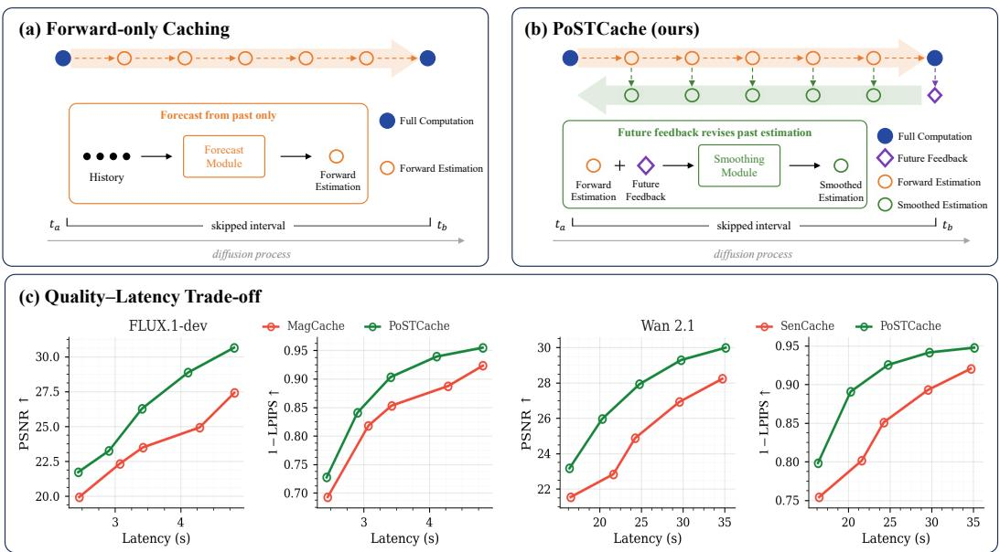

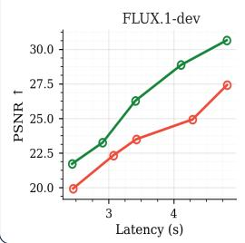

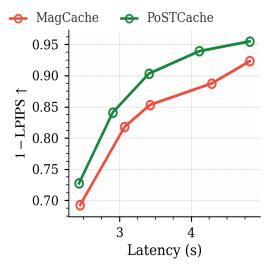

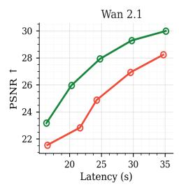

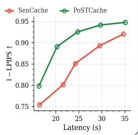  
Figure 1: From forecasting to postdictive smoothing. (a) Forward-only caching commits skipped predictions using historical information and leaves the resulting trajectory drift unrevised. (b) PoST-Cache additionally propagates feedback from a later full-computation step backward to retrospectively refine skipped predictions and correct the trajectory. (c) PoSTCache consistently improves the quality–latency trade-off over strong caching baselines across image and video models.

Motivated by this perspective, we propose PoSTCache, short for Postdictive Smoothing Trajectory Cache, a training-free and plug-and-play framework that reformulates cache-based acceleration as revisable trajectory inference. Building on an existing caching strategy, PoSTCache propagates feedback from subsequent full-computation anchors backward to refine skipped predictions and reintegrates the corrected trajectory. This shift also changes how anchors should be valued: from their local approximation error to their trajectory-level corrective value. We therefore introduce the Posterior Variance Reduction (PVR) strategy, which estimates cross-timestep dependencies from offline denoising trajectories and greedily selects anchors to reduce surrogate trajectory uncertainty under a fixed computation budget. Figure 1(c) previews the resulting quality–latency trade-off.

## Our contributions are summarized as follows:

• From Forecasting to Postdictive Smoothing. We propose PoSTCache, a training-free and plug-and-play framework that reformulates diffusion caching from forward-only forecasting into postdictive smoothing by retrospectively revising skipped predictions.

• Posterior Variance Reduction (PVR) Anchor Selection. We propose a smoothing-aware PVR strategy that profiles offline denoising trajectories and greedily selects anchors to reduce surrogate trajectory uncertainty under a fixed computation budget.

• Superior Performance. Comprehensive experiments across representative image and video models show that PoSTCache improves reconstruction fidelity at comparable or higher acceleration while maintaining competitive semantic generation quality.

## 2 RELATED WORK

Generative Model Acceleration. Acceleration methods for diffusion and flow-based models reduce either the cost of each model evaluation or the number of sampling steps. The former includes model compression techniques such as pruning (Fang et al., 2023), quantization (Li et al., 2023), and knowledge distillation (Meng et al., 2023), as well as computation-efficient designs such as FlashAttention (Dao et al., 2022) and token reduction (Bolya et al., 2022). The latter improves sampling efficiency through deterministic sampling with DDIM (Song et al., 2020a), high-order ODE solvers such as DPM-Solver (Lu et al., 2022), alternative generative dynamics including flow matching (Lipman et al., 2023) and rectified flow (Liu et al., 2023), or few-step generation through progressive distillation (Salimans & Ho, 2022), consistency models (Song et al., 2023), Shortcut Models (Frans et al., 2025), and MeanFlow (Geng et al., 2026). Although effective, these approaches often require additional training, architectural changes, or modifications to the sampling process.

Cache-based Acceleration. Caching provides a lightweight and training-free alternative by exploiting the temporal redundancy of intermediate representations. Early methods reuse U-Net features with fixed schedules, including DeepCache (Ma et al., 2024) and FasterDiffusion (Li et al., 2024), while FORA (Selvaraju et al., 2024) and ∆-DiT (Chen et al., 2024b) extend feature or attention reuse to diffusion transformers. More recent approaches adaptively determine when to refresh cached features using different error proxies, such as TeaCache (Liu et al., 2025a), MagCache (Ma et al., 2026), and DiCache (Bu et al., 2025). TaylorSeer (Liu et al., 2025b) and HiCache (Feng et al., 2026) instead predict future features from historical states. Other methods incorporate trajectory priors, including spectral evolution in SeaCache (Chung et al., 2026), global path planning in DPCache (Cui et al., 2026), average-velocity stability in MeanCache (Gao et al., 2026), and offline residual rectification in ERTACache (Peng et al., 2026). Despite these advances, most methods remain online forward-only: skipped states are determined using historical information or offline priors and remain unrevised after future full-computation states become available.

Bayesian Posterior Smoothing. Bayesian smoothing estimates an intermediate latent state using both past and future observations, whereas filtering conditions only on observations available up to the current time. For linear Gaussian systems, this principle underlies Kalman filtering (Kalman, 1960) and the Rauch–Tung–Striebel smoother (Rauch et al., 1965). A similar forward–backward inference procedure is used in hidden Markov models (Rabiner, 1989). Bayesian smoothing has been generalized to nonlinear and non-Gaussian state-space models (Sarkk¨ a & Svensson, 2023). These¨ methods share the central idea that future evidence can retrospectively correct uncertain intermediate estimates, motivating our reformulation of diffusion caching as revisable trajectory inference.

## 3 METHOD

## 3.1 PRELIMINARIES

Diffusion sampling evolves a latent trajectory through a sequence of model predictions and state updates, resembling sequential Bayesian estimation (Kalman, 1960). At each denoising step, the model produces a prediction from the information available so far, which is then used by the numerical solver to advance the trajectory. When some predictions are replaced by inaccurate approximations, their errors can propagate through subsequent updates and accumulate along the trajectory.

Bayesian smoothing provides a principled mechanism for revising such forward estimates once informative future evidence becomes available (Rauch et al., 1965; Rabiner, 1989; Sarkk¨ a & Svens-¨ son, 2023). Under a linear Gaussian approximation, conditioning the forward estimate at step t on an observation at a later step b gives

$$
m _ { t | b } = m _ { t } + P _ { t b } ( P _ { b b } + R _ { b } ) ^ { - 1 } ( y _ { b } - m _ { b } ) ,\tag{1}
$$

where $y _ { b } - m _ { b }$ is the future innovation, defined as the residual between the future observation y and its forward prediction $m _ { b }$ . The factor $P _ { t b } ( P _ { b b } + R _ { b } ) ^ { - 1 }$ is the smoothing gain. The conditional

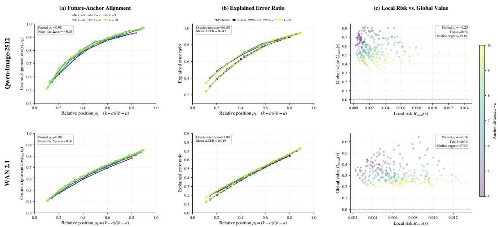  
Figure 2: Empirical motivation for postdictive smoothing. (a) Future-anchor residuals increasingly align with preceding proposal errors. (b) The relative-position gain retains over 96% of the explained error achieved by the oracle scalar gain, with a small mean EER gap. (c) Local cache risk is weakly correlated with trajectory-level correction value.

mean, therefore, takes the generic form

smoothed estimate = forward estimate + smoothing gain × future innovation. (2)

This perspective motivates treating skipped diffusion predictions as revisable forward estimates rather than fixed approximations. The sequential-estimation interpretation and the corresponding smoothing derivation are provided in Appendices A.1 and A.2, respectively.

## 3.2 TRAJECTORY ANALYSIS

Existing caching methods construct skipped predictions from historical states, whose approximation errors are integrated into the sampling trajectory and remain unrevised. We investigate whether a later full-computation step provides useful evidence for retrospectively correcting these errors.

Consider a cache interval bounded by two full-computation steps $a < b .$ Let $\widetilde { u } _ { k }$ and $\bar { u } _ { k }$ denote the cached and full-computation predictions at step $k ,$ respectively. We define

$$
e _ { k } = \bar { u } _ { k } - \widetilde { u } _ { k } , \qquad r _ { b } = \bar { u } _ { b } - \widetilde { u } _ { b } , \quad a < k < b ,\tag{3}
$$

where $e _ { k }$ is the proposal error, and $r _ { b }$ is the future-anchor residual. Following the Bayesian smooth ing interpretation in Sec. 3.1, we hereafter refer to this residual as the anchor innovation.

Future anchors provide corrective information. Figure 2(a) shows that $e _ { k }$ and $r _ { b }$ are consistently positively aligned, with stronger alignment as the intermediate step approaches the future anchor. Across interval lengths from 5 to 10, the relative position $\rho _ { k } = ( k - a ) / ( b - a )$ and the cosine alignment cos $( e _ { k } , r _ { b } )$ exhibit pooled Spearman correlations of 0.98 on both Qwen-Image-2512 and Wan 2.1. Moreover, the mean alignment at near-anchor positions $( \rho _ { k } \ge 0 . 7 5 )$ exceeds that at faranchor positions $( \rho _ { k } \le 0 . 2 5 )$ by 0.35 and 0.36, respectively. These results indicate that the anchor innovation $r _ { b }$ contains increasingly accurate directional information about the errors accumulated within the preceding interval.

Figure 2(b) measures the fraction of proposal error removed by a scalar correction:

$$
\mathrm { E E R } _ { k , b } ( g ) = 1 - \frac { \| e _ { k } - g r _ { b } \| _ { 2 } ^ { 2 } } { \| e _ { k } \| _ { 2 } ^ { 2 } } .\tag{4}
$$

We compare the oracle scalar gain $g _ { k , b } ^ { \mathrm { o r a c l e } } = \arg \operatorname* { m i n } _ { \boldsymbol { g } } \| \boldsymbol { e } _ { k } - \boldsymbol { g r } _ { b } \| _ { 2 } ^ { 2 }$ with the relative-position gain $g _ { k , b } ^ { \mathrm { l i n e a r } } = \rho _ { k }$ . Despite requiring no sample-specific estimation, the linear gain retains 96.3% and 97.0% of the oracle explained error on Qwen-Image-2512 and Wan 2.1, with mean EER gaps of only 0.047 and 0.019, respectively. This shows that sampling progress provides a simple approximation to the oracle scalar correction strength, motivating our time-dependent smoothing gain.

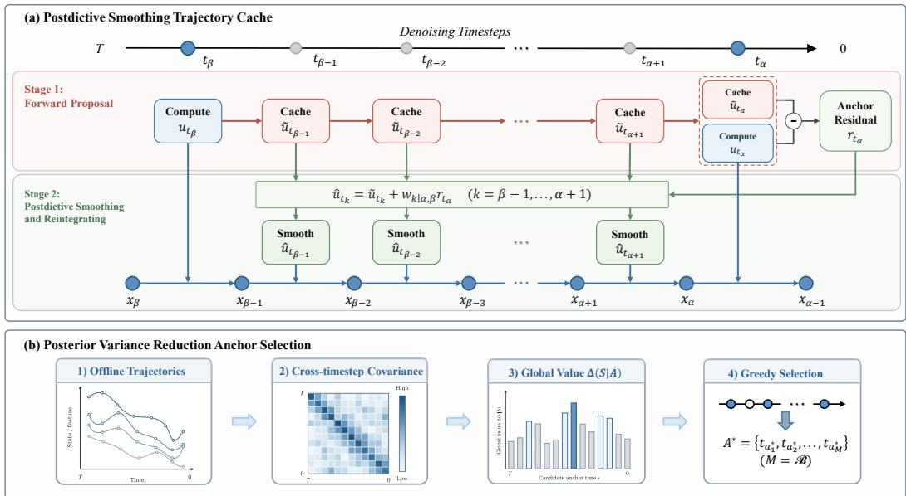  
Figure 3: Overview of PoSTCache. PoSTCache consists of postdictive smoothing and reintegration together with posterior variance reduction anchor selection. The former uses future anchor innovations to retrospectively correct skipped predictions and reintegrate the sampling trajectory. The latter profiles complete offline denoising trajectories, estimates their cross-timestep covariance, and greedily selects anchors that increase global informativeness under a fixed computation budget.

Local error is a poor proxy for anchor informativeness. Figure 2(c) compares local cache risk with trajectory-level correction value (Appendix C.1). The two criteria are poorly aligned: their pooled Spearman correlations are negative, with 0% top-1 agreement and median regrets of 39.1% and 47.9% on Qwen-Image-2512 and Wan 2.1, respectively. Therefore, the step with the largest local error is not necessarily the most informative anchor for correcting the preceding trajectory.

## 3.3 POSTCACHE

Motivated by the Bayesian smoothing principle in Sec. 3.1, which revises a forward estimate using a gain-weighted anchor innovation, and supported by the empirical observations in Sec. 3.2, PoSTCache uses future-anchor innovations for retrospective trajectory correction and trajectorylevel uncertainty for anchor selection, as shown in Figure 3.

## 3.3.1 POSTDICTIVE SMOOTHING TRAJECTORY CACHE

Let $u _ { k } \ : = \ : f _ { \theta } ( x _ { k } , \tau _ { k } )$ denote the model prediction consumed by the numerical solver at the k-th denoising step. Consider two consecutive full-computation anchors $a < b$ . Starting from anchor $^ { a , }$ an existing caching method constructs forward proposals for the intermediate predictions:

$$
\begin{array} { r } { \widetilde { u } _ { k } = \mathcal { P } _ { k } ( \mathcal { H } _ { a } ) , \qquad k = a + 1 , \dots , b , } \end{array}\tag{5}
$$

where ${ \mathcal { H } } _ { a }$ contains the historical states available at anchor $^ { a , }$ and $\mathcal { P } _ { k }$ can represent feature reuse, extrapolation, or other forward caching strategies. In our default implementation, $\mathcal { P } _ { k }$ simply reuses the latest full-computation prediction.

At the next anchor $b ,$ a full model evaluation produces $\bar { u } _ { b }$ . The resulting anchor residual is

$$
r _ { b } = \bar { u } _ { b } - \widetilde { u } _ { b } ,\tag{6}
$$

where $\widetilde { u } _ { b }$ is the corresponding forward proposal. As established in Sec. 3.2, this residual is the anchor innovation used in the following smoothing update.

Under a local linear Gaussian approximation of the proposal errors, conditioning the intermediate proposal on the future anchor innovation yields

$$
\begin{array} { r } { \widehat { u } _ { k } = \widetilde { u } _ { k } + G _ { k  b } ( \bar { u } _ { b } - \widetilde { u } _ { b } ) , } \end{array}\tag{7}
$$

where $G _ { k  b }$ is a covariance-dependent smoothing gain that propagates the anchor innovation backward to step k. It assigns stronger corrections when the intermediate proposal error is more closely correlated with the anchor innovation, while accounting for the uncertainty of the future evidence. This conditioning also reduces the remaining uncertainty of the intermediate prediction. The detailed forms of the smoothing gain and posterior covariance are provided in Appendix A.3.

Although computing the full high-dimensional gain is impractical, the analysis in Sec. 3.2 shows that a simple relative-position scalar gain captures most of the oracle scalar correction. We therefore adopt the lightweight isotropic approximation $\begin{array} { r } { G _ { k  b } \approx w _ { k \mid a , b } I , } \end{array}$ giving

$$
\widehat { u } _ { k } = \widetilde { u } _ { k } + w _ { k | a , b } \left( \bar { u } _ { b } - \widetilde { u } _ { b } \right) , \qquad w _ { k | a , b } = \frac { \eta _ { k } - \eta _ { a } } { \eta _ { b } - \eta _ { a } } , \quad a < k \le b ,\tag{8}
$$

where $\eta _ { k }$ denotes the sampling progress, instantiated by the step index. The resulting gain increase from 0 to 1 across the interval, gradually incorporating the future evidence.

Correcting the model predictions alone does not revise the latent states already produced within the skipped interval. We therefore reintegrate the corrected predictions from anchor a:

$$
\widehat { x } _ { k + 1 } = S _ { k } \left( \widehat { x } _ { k } , \widehat { u } _ { k } , \tau _ { k } \right) , \qquad \widehat { x } _ { a } = x _ { a } ,\tag{9}
$$

where $\scriptstyle { S _ { k } }$ is the original scheduler or numerical solver. Reintegration involves only inexpensive solver operations and requires no additional neural-network evaluations at skipped steps; for efficiency, we also retain the already-computed future-anchor prediction $\bar { u } _ { b }$ rather than re-evaluating the model at the reintegrated anchor state ${ \widehat { x } } _ { b } .$ . We further examine the resulting anchor-state consis tency and its compute trade-off in Appendix C.6.

## 3.3.2 POSTERIOR VARIANCE REDUCTION ANCHOR SELECTION

The analysis in Sec. 3.2 shows that local cache risk does not reliably reflect the trajectory-level correction value required for effective postdictive smoothing. Since directly modeling proposal errors requires costly rollouts and depends on the proposal method, cache interval, and caching configuration, we instead profile N complete offline denoising trajectories to construct a proposalagnostic surrogate. Let $z _ { k } ^ { ( n ) } = \bar { u } _ { k } ^ { ( n ) } \in \mathbb { R } ^ { D }$ denote the full-computation model prediction at timestep k for the n-th sample. We construct the timestep-level covariance kernel

$$
\mu _ { k } = \frac { 1 } { N } \sum _ { n = 1 } ^ { N } z _ { k } ^ { ( n ) } , \qquad K _ { i j } = \frac { 1 } { N D } \sum _ { n = 1 } ^ { N } \left. z _ { i } ^ { ( n ) } - \mu _ { i } , z _ { j } ^ { ( n ) } - \mu _ { j } \right. ,\tag{10}
$$

where $K _ { i j }$ summarizes the normalized cross-timestep covariance. A large magnitude $| K _ { i j } |$ | indicates a strong dependency between trajectory states at timesteps i and j.

Using K as a covariance model, the posterior variance at step t conditioned on an anchor set A is

$$
V _ { t } ( A ) = K _ { t t } - K _ { t A } K _ { A A } ^ { - 1 } K _ { A t } .\tag{11}
$$

Given a computation budget B, we select anchors by minimizing the weighted trajectory uncertainty:

$$
A ^ { \star } = \arg \operatorname* { m i n } _ { A _ { 0 } \subseteq A } \sum _ { t = 1 } ^ { T } \gamma _ { t } V _ { t } ( A ) ,\tag{12}
$$

where $A _ { 0 }$ contains the dense-prefix anchors and the final denoising step, and $\gamma _ { t }$ is a scheduler-aware temporal weight. Detailed implementation settings are provided in Appendix B.2.

Since exact optimization is combinatorial, we greedily select the candidate with the largest marginal variance reduction. Given the current anchor set A, we define the conditional cross-covariance

$$
C _ { t s | A } = K _ { t s } - K _ { t A } K _ { A A } ^ { - 1 } K _ { A s } .\tag{13}
$$

Table 1: Text-to-image efficiency and quality on FLUX.1-dev and Qwen-Image-2512.
<table><tr><td rowspan="2">Method</td><td colspan="4">Efficiency</td><td colspan="5">Visual Quality</td></tr><tr><td>Latency(s) ↓</td><td>Speed ↑</td><td>FLOPs(T) ↓</td><td>Mem(GB) ↓</td><td>LPIPS ↓</td><td>SSIM ↑</td><td>PSNR ↑</td><td>Image Reward↑</td><td>CLIP Score↑</td></tr><tr><td colspan="10">FLUX.1-dev 1024×1024</td></tr><tr><td>Original: 50 steps</td><td>9.33</td><td>1.00×</td><td>2990.80</td><td>33.85</td><td></td><td></td><td></td><td>1.0347</td><td>31.666</td></tr><tr><td>60% steps</td><td>5.91</td><td>1.58×</td><td>1800.39</td><td>33.85</td><td>0.2447</td><td>0.7737</td><td>19.177</td><td>1.0269</td><td>31.607</td></tr><tr><td>30% steps</td><td>3.30</td><td>2.83×</td><td>907.59</td><td>33.85</td><td>0.4192</td><td>0.6472</td><td>15.322</td><td>0.9477</td><td>31.540</td></tr><tr><td>TeaCache</td><td>3.49</td><td>2.67×</td><td>908.16</td><td>33.85</td><td>0.3413</td><td>0.7032</td><td>17.217</td><td>1.0249</td><td>31.647</td></tr><tr><td>TaylorSeer</td><td>3.63</td><td>2.57×</td><td>730.24</td><td>37.86</td><td>0.3515</td><td>0.6868</td><td>16.666</td><td>1.0033</td><td>31.698</td></tr><tr><td>HiCache</td><td>3.73</td><td>2.51×</td><td>729.99</td><td>37.86</td><td>0.3500</td><td>0.6877</td><td>16.694</td><td>0.9996</td><td>31.695</td></tr><tr><td>SeaCache</td><td>3.42</td><td>2.73×</td><td>908.16</td><td>33.85</td><td>0.1727</td><td>0.8331</td><td>22.740</td><td>1.0135</td><td>31.674</td></tr><tr><td>DiCache-slow</td><td>3.53</td><td>2.65×</td><td>944.70</td><td>33.85</td><td>0.1813</td><td>0.8338</td><td>23.803</td><td>1.0034</td><td>31.702</td></tr><tr><td>MagCache-slow</td><td>3.43</td><td>2.72×</td><td>967.66</td><td>33.85</td><td>0.1479</td><td>0.8488</td><td>23.648</td><td>1.0188</td><td>31.712</td></tr><tr><td>PoSTCache-slow</td><td>3.41</td><td>2.74×</td><td>967.11</td><td>33.85</td><td>0.0966</td><td>0.8961</td><td>26.625</td><td>1.0322</td><td>31.728</td></tr><tr><td>DiCache-fast</td><td>3.05</td><td>3.06×</td><td>769.32</td><td>33.85</td><td>0.2335</td><td>0.7913</td><td>21.713</td><td>0.9715</td><td>31.655</td></tr><tr><td>MagCache-fast PoSTCache-fast</td><td>3.08 2.90</td><td>3.03× 3.21×</td><td>848.65</td><td>33.85 33.85</td><td>0.1838</td><td>0.8230</td><td>22.448</td><td>1.0235</td><td>31.729 31.758</td></tr><tr><td colspan="10">788.55 0.1592 0.8411</td></tr><tr><td colspan="10">Qwen-Image-2512 (CFG enabled)1328×1328</td></tr><tr><td>Original: 50 steps</td><td>31.29</td><td>1.00×</td><td>9407.07</td><td>60.78</td><td></td><td></td><td></td><td>1.0961</td><td>31.544</td></tr><tr><td>60% steps</td><td>19.22</td><td>1.63×</td><td>5645.49</td><td>60.78</td><td>0.1681</td><td>0.8278</td><td>20.481</td><td>1.0850</td><td>31.515</td></tr><tr><td>30% steps</td><td>10.23</td><td>3.06×</td><td>2824.31</td><td>60.78</td><td>0.3239</td><td>0.6956</td><td>15.824</td><td>1.1055</td><td>31.586</td></tr><tr><td>TaylorSeer</td><td>13.56</td><td>2.31×</td><td>2263.84</td><td>89.37</td><td>0.3858</td><td>0.6218</td><td>13.860</td><td>1.0648</td><td>31.392</td></tr><tr><td>HiCache</td><td>14.15</td><td>2.21×</td><td>2262.15</td><td>89.37</td><td>0.3600</td><td>0.6235</td><td>14.604</td><td>1.0730</td><td>31.385</td></tr><tr><td>MagCache-slow</td><td>11.75</td><td>2.66×</td><td>3200.87</td><td>60.78</td><td>0.1624</td><td>0.8321</td><td>24.397</td><td>1.0631</td><td>31.409</td></tr><tr><td>DiCache-slow</td><td>11.62</td><td>2.69×</td><td>3119.38</td><td>60.78</td><td>0.1278</td><td>0.8670</td><td>24.632</td><td>1.0674</td><td>31.432</td></tr><tr><td>PoSTCache-slow</td><td>10.78</td><td>2.90×</td><td>3012.39</td><td>60.78</td><td>0.0608</td><td>0.9302</td><td>27.588</td><td>1.0901</td><td>31.631</td></tr><tr><td>MagCache-fast</td><td>10.94</td><td>2.86×</td><td>2918.52</td><td>60.78</td><td>0.1791</td><td>0.8156</td><td>22.623</td><td>1.0706</td><td>31.449</td></tr><tr><td>DiCache-fast</td><td>9.88</td><td>3.17×</td><td>2564.58</td><td>60.78</td><td>0.1428</td><td>0.8504</td><td>23.046</td><td>1.0611</td><td>31.428</td></tr><tr><td>PoSTCache-fast</td><td>9.56</td><td>3.27×</td><td>2636.23</td><td>60.78</td><td>0.0899</td><td>0.8979</td><td>24.712</td><td>1.0883</td><td>31.637</td></tr></table>

Under Gaussian conditioning, adding candidate s reduces the posterior variance at timestep t by $C _ { t s | A } ^ { 2 } / V _ { s } ( A )$ ). Its weighted marginal gain over the trajectory is therefore

$$
\Delta ( s \mid A ) = \sum _ { t = 1 } ^ { T } \gamma _ { t } \frac { C _ { t s \mid A } ^ { 2 } } { V _ { s } ( A ) } , \qquad s ^ { \star } = \arg \operatorname* { m a x } _ { s \not \in A } \Delta ( s \mid A ) .\tag{14}
$$

This criterion favors anchors with high trajectory-level correction value rather than large local variation alone. Appendix A.4 derives it as posterior variance reduction under the linear Gaussian surrogate, while Appendix C.3 validates this surrogate on held-out trajectories, showing strong correlation with measured post-smoothing error $( \rho = 0 . 8 5 8 / 0 . 9 6 3$ on Qwen-Image/Wan).

## 4 EXPERIMENTS

## 4.1 SETTINGS

Base Models and Compared Methods. We evaluate PoSTCache on three video generation models, Open-Sora 1.2 (Zheng et al., 2024), CogVideoX (Yang et al., 2025), and Wan 2.1 (Wan et al., 2025), and two image generation models, FLUX.1-dev (Labs, 2024) and Qwen-Image-2512 (Wu et al., 2025). We compare against representative diffusion caching methods, including TeaCache (Liu et al., 2025a), TaylorSeer (Liu et al., 2025b), MagCache (Ma et al., 2026), DiCache (Bu et al., 2025), HiCache (Feng et al., 2026), SeaCache (Chung et al., 2026), and SenCache (Haghighi & Alahi, 2026). We enable classifier-free guidance (CFG) (Ho & Salimans, 2022) for Qwen-Image-2512 and Wan 2.1, using identical guidance settings for full inference and all accelerated methods.

Evaluation Metrics. We evaluate 200 DrawBench prompts (Saharia et al., 2022) with three random seeds for text-to-image generation and 944 VBench prompts (Huang et al., 2024) with five random seeds for text-to-video generation. Following prior work (Bu et al., 2025; Liu et al., 2025a), we report latency, speedup, FLOPs, and peak allocated GPU memory. ImageReward and CLIP Score assess image quality, while VBench evaluates video quality. LPIPS (Zhang et al., 2018), SSIM (Wang et al., 2004), and PSNR measure reconstruction fidelity against full inference. All results are averaged over random seeds.

Implementation Details. All experiments are conducted on a single NVIDIA H200 GPU. We use 10 offline calibration trajectories to estimate the cross-timestep covariance statistics. Detailed model configurations, profiling protocols, and baseline hyperparameters are provided in Appendix B.

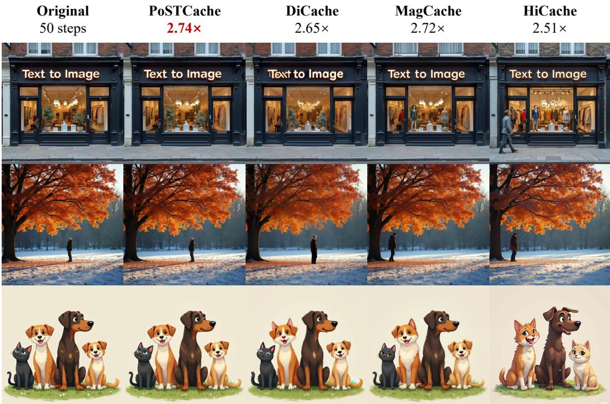  
Figure 4: Qualitative comparison with previous acceleration methods on FLUX.1-dev.

## 4.2 MAIN RESULTS

Text-to-image generation. Table 1 compares PoSTCache with representative caching methods and direct step-reduction baselines on FLUX.1-dev and Qwen-Image-2512. Across both models and acceleration regimes, PoSTCache consistently improves reconstruction fidelity at comparable or higher speedups while largely preserving semantic quality, yielding the strongest efficiency–fidelity trade-off overall. As illustrated in Figure 4, these quantitative gains are accompanied by better preservation of object identity, geometric structure, and fine-grained appearance than competing caching methods. Qualitative comparison on Qwen-Image-2512 is provided in Appendix C.8.

Text-to-video generation. Table 2 reports the results on Wan 2.1, CogVideoX, and OpenSora 1.2. PoSTCache likewise achieves consistently stronger reconstruction fidelity under comparable computation budgets while maintaining competitive overall VBench quality. Its advantage persists across both moderate and aggressive acceleration settings, as well as across different architectures and resolutions, demonstrating the effectiveness of PoSTCache in limiting accumulated spatiotemporal trajectory errors. Additional qualitative comparisons are provided in Appendix C.8.

## 4.3 ABLATION STUDIES

Component Analysis. Table 3(a) evaluates the contributions of postdictive smoothing and anchor selection under the same computation budget. Postdictive smoothing consistently improves all three selection strategies, confirming that anchor innovations provide effective corrective information for skipped predictions. The PVR selector also outperforms fixed intervals and the MagCache selector, and combining PVR selection with postdictive smoothing yields the best performance.

Generality across Forward Caching Strategies. Table 3(b) evaluates PoSTCache with Mag-Cache and DiCache as forward caching strategies. Postdictive smoothing improves reconstruction fidelity with only marginal runtime overhead, while combining it with PVR selection provides substantial additional gains. These results demonstrate that PoSTCache is compatible with different forward proposal mechanisms.

Table 2: Text-to-video efficiency and quality on video generation models.
<table><tr><td rowspan="2">Method</td><td colspan="4">Acceleration</td><td colspan="4">Visual Quality</td></tr><tr><td>Latency(s) ↓</td><td>Speed ↑</td><td>FLOPs(T) ↓</td><td>Mem(GB)↓</td><td>LPIPS↓</td><td>SSIM ↑</td><td>PSNR ↑</td><td>VBench ↑</td></tr><tr><td colspan="9">Wan 2.1 1.3B (CFG enabled) (81 frames, 832×480)</td></tr><tr><td>Original: 50 steps</td><td>69.40</td><td>1.00×</td><td>8243.74</td><td>17.92</td><td></td><td></td><td></td><td>79.63%</td></tr><tr><td>60% steps</td><td>42.61</td><td>1.63×</td><td>4959.36</td><td>17.92</td><td>0.3489</td><td>0.6268</td><td>16.759</td><td>79.08%</td></tr><tr><td>30% steps</td><td>22.71</td><td>3.06×</td><td>2496.07</td><td>17.92</td><td>0.4822</td><td>0.5385</td><td>14.795</td><td>76.93%</td></tr><tr><td>MagCache</td><td>30.79</td><td>2.25×</td><td>3482.28</td><td>17.92</td><td>0.2178</td><td>0.7568</td><td>21.478</td><td>76.97%</td></tr><tr><td>DiCache-slow</td><td>30.40</td><td>2.28×</td><td>3244.21</td><td>17.92</td><td>0.2161</td><td>0.7480</td><td>21.195</td><td>77.30%</td></tr><tr><td>SenCache-slow</td><td>29.91</td><td>2.32×</td><td>3318.10</td><td>17.92</td><td>0.1034</td><td>0.8685</td><td>26.867</td><td>78.86%</td></tr><tr><td>PoSTCache-slow</td><td>29.31</td><td>2.37×</td><td>3317.17</td><td>17.92</td><td>0.0597</td><td>0.9067</td><td>29.232</td><td>79.44%</td></tr><tr><td>DiCache-fast</td><td>25.22</td><td>2.75×</td><td>2688.71</td><td>17.92</td><td>0.2307</td><td>0.7293</td><td>20.754</td><td>76.50%</td></tr><tr><td>SenCache-fast</td><td>24.40</td><td>2.84×</td><td>2661.34</td><td>17.92</td><td>0.1449</td><td>0.8280</td><td>24.811</td><td>78.35%</td></tr><tr><td>PoSTCache-fast</td><td>24.17</td><td>2.87×</td><td>2660.29</td><td>17.92</td><td>0.0757</td><td>0.8890</td><td>27.829</td><td>79.19%</td></tr><tr><td colspan="9">CogVideoX 2B (49 frames, 720×480)</td></tr><tr><td>Original: 50 steps</td><td>34.92</td><td>1.00×</td><td>4751.86</td><td>29.39</td><td></td><td></td><td></td><td>77.11%</td></tr><tr><td>60% steps</td><td>22.10</td><td>1.58×</td><td>2863.84</td><td>29.39</td><td>0.3329</td><td>0.6737</td><td>17.381</td><td>75.15%</td></tr><tr><td>30% steps</td><td>12.69</td><td>2.75×</td><td>1447.83</td><td>29.39</td><td>0.4663</td><td>0.5922</td><td>14.743</td><td>70.13%</td></tr><tr><td>TeaCache-slow</td><td>13.29</td><td>2.63×</td><td>1543.07</td><td>29.39</td><td>0.1730</td><td>0.8041</td><td>23.126</td><td>75.90%</td></tr><tr><td>SenCache-slow PoSTCache-slow</td><td>13.55</td><td>2.58× 2.64×</td><td>1354.32 1542.24</td><td>29.39</td><td>0.1197 0.0996</td><td>0.8608 0.8741</td><td>26.066</td><td>75.57%</td></tr><tr><td></td><td>13.25</td><td></td><td></td><td>29.39</td><td></td><td></td><td>27.694</td><td>75.67%</td></tr><tr><td>TeaCache-fast SenCache-fast</td><td>11.31</td><td>3.09× 2.96×</td><td>1259.94</td><td>29.39</td><td>0.2271</td><td>0.7565</td><td>21.158</td><td>75.30%</td></tr><tr><td>PoSTCache-fast</td><td>11.79 11.23</td><td>3.11×</td><td>1165.57 1259.03</td><td>29.39 29.39</td><td>0.2036 0.1412</td><td>0.7831 0.8271</td><td>22.837</td><td>73.66%</td></tr><tr><td></td><td></td><td></td><td></td><td></td><td></td><td></td><td>24.898</td><td>75.44%</td></tr><tr><td colspan="9">OpenSora 1.2 (51 frames, 854×480)</td></tr><tr><td>Original: 30 steps 60% steps</td><td>30.13 19.02</td><td>1.00× 1.58×</td><td>3481.73</td><td>21.70</td><td>0.2891</td><td>0.7181</td><td>17.263</td><td>79.35%</td></tr><tr><td>30% steps</td><td>10.65</td><td>2.83×</td><td>2168.73</td><td>21.70 21.70</td><td>0.4327</td><td>0.6254</td><td>13.920</td><td>78.01%</td></tr><tr><td></td><td></td><td></td><td>1183.98</td><td></td><td></td><td></td><td></td><td>74.37%</td></tr><tr><td>TeaCache-slow</td><td>14.37</td><td>2.10×</td><td>1512.43</td><td>22.11</td><td>0.2439</td><td>0.7475</td><td>19.460</td><td>78.12%</td></tr><tr><td>MagCache-slow</td><td>13.53</td><td>2.23×</td><td>1512.43</td><td>21.91</td><td>0.1526</td><td>0.8262</td><td>23.444</td><td>77.54%</td></tr><tr><td>PoSTCache-slow</td><td>13.51</td><td>2.23×</td><td>1512.23</td><td>21.73</td><td>0.1180</td><td>0.8545</td><td>25.767</td><td>78.00%</td></tr><tr><td>TeaCache-fast</td><td>11.80</td><td>2.55×</td><td>1293.62</td><td>22.11</td><td>0.2840</td><td>0.7216</td><td>18.605</td><td>77.03%</td></tr><tr><td>MagCache-fast</td><td>11.72 11.70</td><td>2.57×</td><td>1293.62</td><td>21.91</td><td>0.2068</td><td>0.7840</td><td>21.453</td><td>77.28%</td></tr><tr><td>PoSTCache-fast</td><td></td><td>2.58×</td><td>1293.40</td><td>21.73</td><td>0.1756</td><td>0.8054</td><td>23.197</td><td>77.57%</td></tr></table>

Table 3: Ablation studies on FLUX.1-dev. (a) Contributions of postdictive smoothing and anchor selection under B = 16. (b) Generality across different forward caching strategies.
<table><tr><td colspan="5">(a) Component Analysis</td><td colspan="5">(b) Forward-Strategy Generality</td></tr><tr><td>Selector</td><td>Smooth.</td><td>LPIPS↓</td><td>SSIM↑</td><td>PSNR↑</td><td>Variant</td><td>Speed↑</td><td>LPIPS↓</td><td>SSIM↑</td><td>PSNR↑</td></tr><tr><td>Fixed Interval</td><td>x</td><td>0.2639</td><td>0.7498</td><td>19.539</td><td>MagCache</td><td>2.71×</td><td>0.1468</td><td>0.8477</td><td>23.507</td></tr><tr><td>Fixed Interval</td><td>√</td><td>0.2316</td><td>0.7776</td><td>20.017</td><td>+ Smoothing</td><td>2.68×</td><td>0.1259</td><td>0.8635</td><td>24.319</td></tr><tr><td>MagCache</td><td>x</td><td>0.1466</td><td>0.8488</td><td>23.589</td><td>+ Smoothing + PVR</td><td>2.71×</td><td>0.0967</td><td>0.8943</td><td>26.267</td></tr><tr><td>MagCache</td><td>√</td><td>0.1256</td><td>0.8635</td><td>24.352</td><td>DiCache</td><td>2.65×</td><td>0.1804</td><td>0.8326</td><td>23.612</td></tr><tr><td>PVR</td><td>x</td><td>0.1293</td><td>0.8712</td><td>25.287</td><td>+ Smoothing</td><td>2.59×</td><td>0.1696</td><td>0.8341</td><td>23.662</td></tr><tr><td>PVR</td><td>√</td><td>0.0968</td><td>0.8944</td><td>26.284</td><td>+ Smoothing + PVR</td><td>2.62×</td><td>0.0741</td><td>0.9044</td><td>27.157</td></tr></table>

Additional Analysis. Appendices C.2–C.7 further examine calibration-size robustness, validate the PVR objective and schedule transferability, compare alternative global scheduling objectives, and analyze temporal weighting, dense-prefix anchors, and anchor-state consistency. These results support our default design choices, quantify the modest one-time offline calibration cost, and confirm negligible online overhead and favorable quality–efficiency trade-offs.

## 5 CONCLUSION AND FUTURE WORK

In this work, we presented PoSTCache, a training-free and plug-and-play framework that reformulates diffusion caching as a revisable trajectory inference problem. By using feedback from subsequent full-computation steps, PoSTCache retrospectively refines skipped predictions and reintegrates the corrected sampling trajectory. Viewing anchors as sources of corrective feedback, we further introduced a posterior variance reduction criterion to select informative anchors according to their expected reduction in surrogate trajectory uncertainty. Extensive experiments on representative image and video generation models demonstrate that PoSTCache consistently improves the efficiency–fidelity trade-off and can be readily integrated with different forward caching strategies. Currently, PoSTCache estimates a shared anchor configuration from offline trajectories and applies it uniformly to all samples. Although this design is simple and effective, it may not fully capture sample-specific trajectory dynamics. A promising direction for future work is to combine the offline uncertainty structure with lightweight online observations, enabling the anchor schedule to adapt to each sampling trajectory without introducing substantial inference overhead.

## REFERENCES

Andreas Blattmann, Tim Dockhorn, Sumith Kulal, Daniel Mendelevitch, Maciej Kilian, Dominik Lorenz, Yam Levi, Zion English, Vikram Voleti, Adam Letts, et al. Stable video diffusion: Scaling latent video diffusion models to large datasets. arXiv preprint arXiv:2311.15127, 2023.

Daniel Bolya, Cheng-Yang Fu, Xiaoliang Dai, Peizhao Zhang, Christoph Feichtenhofer, and Judy Hoffman. Token merging: Your vit but faster. arXiv preprint arXiv:2210.09461, 2022.

Jiazi Bu, Pengyang Ling, Yujie Zhou, Yibin Wang, Yuhang Zang, Dahua Lin, and Jiaqi Wang. Dicache: Let diffusion model determine its own cache. arXiv preprint arXiv:2508.17356, 2025.

Haoxin Chen, Yong Zhang, Xiaodong Cun, Menghan Xia, Xintao Wang, Chao Weng, and Ying Shan. Videocrafter2: Overcoming data limitations for high-quality video diffusion models. In Proceedings ofthe IEEE/CVF conference on computer vision and pattern recognition, pp. 7310– 7320, 2024a.

Pengtao Chen, Mingzhu Shen, Peng Ye, Jianjian Cao, Chongjun Tu, Christos-Savvas Bouganis, Yiren Zhao, and Tao Chen. ∆-DiT: A training-free acceleration method tailored for diffusion transformers. arXiv preprint arXiv:2406.01125, 2024b.

Jiwoo Chung, Sangeek Hyun, MinKyu Lee, Byeongju Han, Geonho Cha, Dongyoon Wee, Youngjun Hong, and Jae-Pil Heo. Seacache: Spectral-evolution-aware cache for accelerating diffusion models. arXiv preprint arXiv:2602.18993, 2026.

Bowen Cui, Yuanbin Wang, Huajiang Xu, Biaolong Chen, Aixi Zhang, Hao Jiang, Zhengzheng Jin, Xu Liu, and Pipei Huang. Denoising as path planning: Training-free acceleration of diffusion models with dpcache. In Proceedings of the IEEE/CVF Conference on Computer Vision and Pattern Recognition, pp. 43632–43642, 2026.

Tri Dao, Dan Fu, Stefano Ermon, Atri Rudra, and Christopher Re. Flashattention: Fast and memory-´ efficient exact attention with io-awareness. Advances in neural information processing systems, 35:16344–16359, 2022.

Gongfan Fang, Xinyin Ma, and Xinchao Wang. Structural pruning for diffusion models, 2023. URL https://arxiv.org/abs/2305.10924.

Liang Feng, Shikang Zheng, Jiacheng Liu, Yuqi Lin, Qinming Zhou, Peiliang Cai, Xinyu Wang, Junjie Chen, Chang Zou, Yue Ma, and Linfeng Zhang. Hicache: A plug-in scaled-hermite upgrade for taylor-style cache-then-forecast diffusion acceleration. In International Conference on Learning Representations (ICLR), 2026.

Kevin Frans, Danijar Hafner, Sergey Levine, and Pieter Abbeel. One step diffusion via shortcut models. In International Conference on Learning Representations, volume 2025, pp. 34668– 34684, 2025.

Huanlin Gao, Ping Chen, Fuyuan Shi, Ruijia Wu, Li YanTao, Qiang Hui, Yuren You, Ting Lu, Chao Tan, Shaoan Zhao, et al. Meancache: From instantaneous to average velocity for accelerating flow matching inference. arXiv preprint arXiv:2601.19961, 2026.

Zhengyang Geng, Mingyang Deng, Xingjian Bai, Zico Kolter, and Kaiming He. Mean flows for one-step generative modeling. Advances in Neural Information Processing Systems, 38:75460– 75482, 2026.

Yasaman Haghighi and Alexandre Alahi. Sencache: Accelerating diffusion model inference via sensitivity-aware caching. arXiv preprint arXiv:2602.24208, 2026.

Jack Hessel, Ari Holtzman, Maxwell Forbes, Ronan Le Bras, and Yejin Choi. Clipscore: A reference-free evaluation metric for image captioning. In Proceedings of the 2021 conference on empirical methods in natural language processing, pp. 7514–7528, 2021.

Jonathan Ho and Tim Salimans. Classifier-free diffusion guidance. arXiv preprint arXiv:2207.12598, 2022.

Jonathan Ho, Ajay Jain, and Pieter Abbeel. Denoising diffusion probabilistic models. Advances in neural information processing systems, 33:6840–6851, 2020.

Ziqi Huang, Yinan He, Jiashuo Yu, Fan Zhang, Chenyang Si, Yuming Jiang, Yuanhan Zhang, Tianxing Wu, Qingyang Jin, Nattapol Chanpaisit, et al. Vbench: Comprehensive benchmark suite for video generative models. In Proceedings of the IEEE/CVF Conference on Computer Vision and Pattern Recognition, pp. 21807–21818, 2024.

RE Kalman. A new approach to linear filtering and prediction problems. Journal ofBasic Engineering, 82(1):35–45, 1960.

Black Forest Labs. Flux. https://github.com/black-forest-labs/flux, 2024.

Senmao Li, Taihang Hu, Joost van de Weijer, Fahad S Khan, Tao Liu, Linxuan Li, Shiqi Yang, Yaxing Wang, Ming-Ming Cheng, and Jian Yang. Faster diffusion: Rethinking the role of the encoder for diffusion model inference. Advances in Neural Information Processing Systems, 37: 85203–85240, 2024.

Yanjing Li, Sheng Xu, Xianbin Cao, Xiao Sun, and Baochang Zhang. Q-dm: An efficient low-bit quantized diffusion model. Advances in neural information processing systems, 36:76680–76691, 2023.

Yaron Lipman, Ricky TQ Chen, Heli Ben-Hamu, Maximilian Nickel, and Matt Le. Flow matching for generative modeling. In The Eleventh International Conference on Learning Representations (ICLR), 2023.

Feng Liu, Shiwei Zhang, Xiaofeng Wang, Yujie Wei, Haonan Qiu, Yuzhong Zhao, Yingya Zhang, Qixiang Ye, and Fang Wan. Timestep embedding tells: It’s time to cache for video diffusion model. In Proceedings of the Computer Vision and Pattern Recognition Conference, pp. 7353– 7363, 2025a.

Jiacheng Liu, Chang Zou, Yuanhuiyi Lyu, Junjie Chen, and Linfeng Zhang. From reusing to forecasting: Accelerating diffusion models with taylorseers. In Proceedings of the IEEE/CVF International Conference on Computer Vision, pp. 15853–15863, 2025b.

Xingchao Liu, Chengyue Gong, and Qiang Liu. Flow straight and fast: Learning to generate and transfer data with rectified flow. In The Eleventh International Conference on Learning Representations (ICLR), 2023.

Cheng Lu, Yuhao Zhou, Fan Bao, Jianfei Chen, Chongxuan Li, and Jun Zhu. Dpm-solver: A fast ode solver for diffusion probabilistic model sampling in around 10 steps. Advances in neural information processing systems, 35:5775–5787, 2022.

Xinyin Ma, Gongfan Fang, and Xinchao Wang. Deepcache: Accelerating diffusion models for free. In Proceedings of the IEEE/CVF conference on computer vision and pattern recognition, pp. 15762–15772, 2024.

Zehong Ma, Longhui Wei, Feng Wang, Shiliang Zhang, and Qi Tian. Magcache: Fast video generation with magnitude-aware cache. Advances in Neural Information Processing Systems, 38: 34348–34380, 2026.

Chenlin Meng, Robin Rombach, Ruiqi Gao, Diederik Kingma, Stefano Ermon, Jonathan Ho, and Tim Salimans. On distillation of guided diffusion models. In Proceedings of the IEEE/CVF conference on computer vision and pattern recognition, pp. 14297–14306, 2023.

Xurui Peng, Chenqian Yan, Hong Liu, Rui Ma, Fangmin Chen, Xing Wang, Zhihua Wu, Songwei Liu, and Mingbao Lin. Ertacache: Error rectification and timesteps adjustment for efficient diffusion. In International Conference on Learning Representations, volume 2026, pp. 82104–82120, 2026.

Dustin Podell, Zion English, Kyle Lacey, Andreas Blattmann, Tim Dockhorn, Jonas Muller, Joe¨ Penna, and Robin Rombach. Sdxl: Improving latent diffusion models for high-resolution image synthesis. In International Conference on Learning Representations, volume 2024, pp. 1862– 1874, 2024.

Lawrence R Rabiner. A tutorial on hidden markov models and selected applications in speech recognition. Proceedings ofthe IEEE, 77(2):257–286, 1989.

Herbert E Rauch, Fong Tung, and Charlotte T Striebel. Maximum likelihood estimates of linear dynamic systems. AIAA journal, 3(8):1445–1450, 1965.

Robin Rombach, Andreas Blattmann, Dominik Lorenz, Patrick Esser, and Bjorn Ommer. High-¨ resolution image synthesis with latent diffusion models. In Proceedings ofthe IEEE/CVF conference on computer vision and pattern recognition, pp. 10684–10695, 2022.

Chitwan Saharia, William Chan, Saurabh Saxena, Lala Li, Jay Whang, Emily L Denton, Kamyar Ghasemipour, Raphael Gontijo Lopes, Burcu Karagol Ayan, Tim Salimans, et al. Photorealistic text-to-image diffusion models with deep language understanding. Advances in neural information processing systems, 35:36479–36494, 2022.

Tim Salimans and Jonathan Ho. Progressive distillation for fast sampling of diffusion models. arXiv preprint arXiv:2202.00512, 2022.

Simo Sarkk ¨ a and Lennart Svensson. ¨ Bayesian filtering and smoothing, volume 17. Cambridge university press, 2023.

Pratheba Selvaraju, Tianyu Ding, Tianyi Chen, Ilya Zharkov, and Luming Liang. Fora: Fast-forward caching in diffusion transformer acceleration. arXiv preprint arXiv:2407.01425, 2024.

Jiaming Song, Chenlin Meng, and Stefano Ermon. Denoising diffusion implicit models. arXiv preprint arXiv:2010.02502, 2020a.

Yang Song and Stefano Ermon. Generative modeling by estimating gradients of the data distribution. Advances in neural information processing systems, 32, 2019.

Yang Song, Jascha Sohl-Dickstein, Diederik P Kingma, Abhishek Kumar, Stefano Ermon, and Ben Poole. Score-based generative modeling through stochastic differential equations. arXiv preprint arXiv:2011.13456, 2020b.

Yang Song, Prafulla Dhariwal, Mark Chen, and Ilya Sutskever. Consistency models. In Proceedings ofthe 40th International Conference on Machine Learning, pp. 32211–32252, 2023.

Team Wan, Ang Wang, Baole Ai, Bin Wen, Chaojie Mao, Chen-Wei Xie, Di Chen, Feiwu Yu, Haiming Zhao, Jianxiao Yang, et al. Wan: Open and advanced large-scale video generative models. arXiv preprint arXiv:2503.20314, 2025.

Zhou Wang, Alan C Bovik, Hamid R Sheikh, and Eero P Simoncelli. Image quality assessment: from error visibility to structural similarity. IEEE transactions on image processing, 13(4):600– 612, 2004.

Chenfei Wu, Jiahao Li, Jingren Zhou, Junyang Lin, Kaiyuan Gao, Kun Yan, Sheng-ming Yin, Shuai Bai, Xiao Xu, Yilei Chen, et al. Qwen-image technical report. arXiv preprint arXiv:2508.02324, 2025.

Jiazheng Xu, Xiao Liu, Yuchen Wu, Yuxuan Tong, Qinkai Li, Ming Ding, Jie Tang, and Yuxiao Dong. Imagereward: Learning and evaluating human preferences for text-to-image generation. Advances in Neural Information Processing Systems, 36:15903–15935, 2023.

Zhuoyi Yang, Jiayan Teng, Wendi Zheng, Ming Ding, Shiyu Huang, Jiazheng Xu, Yuanming Yang, Wenyi Hong, Xiaohan Zhang, Guanyu Feng, et al. Cogvideox: Text-to-video diffusion models with an expert transformer. In International Conference on Learning Representations, volume 2025, pp. 83048–83077, 2025.

Jiahui Yu, Yuanzhong Xu, Jing Yu Koh, Thang Luong, Gunjan Baid, Zirui Wang, Vijay Vasudevan, Alexander Ku, Yinfei Yang, Burcu Karagol Ayan, et al. Scaling autoregressive models for contentrich text-to-image generation. arXiv preprint arXiv:2206.10789, 2022.

Richard Zhang, Phillip Isola, Alexei A Efros, Eli Shechtman, and Oliver Wang. The unreasonable effectiveness of deep features as a perceptual metric. In Proceedings of the IEEE conference on computer vision and pattern recognition, pp. 586–595, 2018.

Zangwei Zheng, Xiangyu Peng, Tianji Yang, Chenhui Shen, Shenggui Li, Hongxin Liu, Yukun Zhou, Tianyi Li, and Yang You. Open-sora: Democratizing efficient video production for all. arXiv preprint arXiv:2412.20404, 2024.

## APPENDIX OVERVIEW

We organize the appendix as follows.

## Theoretical Background and Derivations.

• Section A.1 introduces a sequential trajectory-estimation view of diffusion sampling.

• Section A.2 reviews linear Gaussian filtering and smoothing.

• Section A.3 derives the postdictive smoothing formulation.

• Section A.4 derives posterior variance reduction anchor selection.

## Experimental Settings.

• Section B.1 describes the evaluated models, datasets, and generation configurations.

• Section B.2 reports the implementation and hyperparameter settings of PoSTCache.

• Section B.3 provides the configurations of the compared methods.

• Section B.4 describes the evaluation and runtime measurement protocols.

• Section B.5 defines the evaluation metrics.

## Additional Experimental Results and Analysis.

• Section C.1 provides additional trajectory analysis and corresponding evaluation details.

• Section C.2 studies calibration size and selector robustness.

• Section C.3 directly validates PVR as a schedule-level surrogate on held-out trajectories.

• Section C.4 evaluates the transferability of offline PVR schedules across prompt distributions, guidance scales, and spatial configurations.

• Section C.5 provides additional ablations.

• Section C.6 analyzes anchor-state consistency after retrospective reintegration and the compute trade-off of explicit anchor refresh.

• Section C.7 analyzes offline calibration cost, online runtime overhead, and the efficiency– quality trade-off.

• Section C.8 presents additional qualitative comparisons.

• Section C.9 discusses limitations and boundary conditions.

## A THEORETICAL BACKGROUND AND DERIVATIONS

## A.1 SEQUENTIAL TRAJECTORY ESTIMATION VIEW OF DIFFUSION AND FLOW SAMPLING

A broad class of diffusion, flow-matching, and rectified-flow samplers can be expressed as a sequence of model predictions and numerical state updates:

$$
u _ { k } = f _ { \theta } ( x _ { k } , \tau _ { k } ) , \qquad x _ { k + 1 } = S _ { k } ( x _ { k } , u _ { k } , \tau _ { k } ) ,\tag{15}
$$

where $x _ { k }$ is the latent state at the k-th sampling step, $\tau _ { k }$ is the corresponding noise or time level, $u _ { k }$ is the model prediction consumed by the sampler, and $\scriptstyle { S _ { k } }$ denotes the scheduler or numerical solver. Depending on the model parameterization, $u _ { k }$ may represent noise, a clean sample estimate, a velocity, or a flow vector.

Equation (15) defines a recursive trajectory estimation process. At each step, the model predicts the local direction of the trajectory from the current latent state, and the solver propagates this prediction to the next state. This structure resembles sequential Bayesian estimation, in which an estimate is repeatedly updated using the information available at the current step.

Under cache-based acceleration, some full model predictions are replaced by forward approximations. Let

$$
\widetilde { u } _ { k } = u _ { k } - e _ { k }\tag{16}
$$

denote the cached prediction, where $e _ { k }$ is the corresponding approximation error. The approximate sampling trajectory then evolves according to

$$
\widetilde { x } _ { k + 1 } = S _ { k } \left( \widetilde { x } _ { k } , \widetilde { u } _ { k } , \tau _ { k } \right) .\tag{17}
$$

Because each state is used as the input to subsequent model evaluations and solver updates, an error introduced at one step can affect all later states.

To make this propagation explicit, define the latent-state deviation $\delta x _ { k } = \widetilde { x } _ { k } - x _ { k }$ . A first-order expansion of the solver around the full-computation trajectory gives

$$
\delta x _ { k + 1 } \approx A _ { k } \delta x _ { k } - B _ { k } e _ { k } , \qquad A _ { k } = { \frac { \partial S _ { k } } { \partial x _ { k } } } , \qquad B _ { k } = { \frac { \partial S _ { k } } { \partial u _ { k } } } .\tag{18}
$$

Thus, the deviation at step $k + 1$ depends not only on the current prediction error but also on the deviation accumulated from previous steps. Repeatedly applying Eq. (18) over a skipped interval $a < k < b$ yields

$$
\delta x _ { b } \approx A _ { b - 1 } \cdot \cdot \cdot A _ { a } \delta x _ { a } - \sum _ { j = a } ^ { b - 1 } \left( A _ { b - 1 } \cdot \cdot \cdot A _ { j + 1 } \right) B _ { j } e _ { j } ,\tag{19}
$$

where an empty matrix product is understood as the identity. Consequently, even individually small approximation errors may accumulate and alter the subsequent sampling trajectory.

Suppose that step $b$ is selected as a full-computation anchor. A complete model evaluation at the current latent state produces $\bar { u } _ { b } = f _ { \theta } ( \widetilde { x } _ { b } , \tau _ { b } )$ , while the forward caching rule also provides a proposal $\widetilde { u } _ { b } .$ Their discrepancy,

$$
r _ { b } = \bar { u } _ { b } - \widetilde { u } _ { b } ,\tag{20}
$$

is the anchor innovation. Although $r _ { b }$ does not directly observe each preceding error $e _ { k } .$ , it reveals the discrepancy between the forward approximation and the newly available full computation. Since the preceding cache errors jointly influence the latent state and the forward proposal at step $b ,$ the innovation can contain information about the errors accumulated over the skipped interval.

More formally, let the centered intermediate error $e _ { k }$ and future innovation $r _ { b }$ be locally approximated by a joint Gaussian distribution. Conditioning on the observed innovation gives

$$
\begin{array} { r } { \mathbb { E } \left[ e _ { k } ~ \middle | ~ r _ { b } \right] = \sum _ { e _ { k } r _ { b } } \left( \sum _ { r _ { b } r _ { b } } + R _ { b } \right) ^ { - 1 } r _ { b } , } \end{array}\tag{21}
$$

where $\Sigma _ { e _ { k } r _ { b } }$ is the cross-covariance between the intermediate proposal error and the future innovation, and $R _ { b }$ accounts for residual uncertainty in the future evidence. The corresponding corrected prediction therefore has the generic form

$$
\begin{array} { r } { \widehat { u } _ { k } = \widetilde { u } _ { k } + G _ { k  b } r _ { b } , \qquad G _ { k  b } = \Sigma _ { e _ { k } r _ { b } } ( \Sigma _ { r _ { b } r _ { b } } + R _ { b } ) ^ { - 1 } . } \end{array}\tag{22}
$$

That is, a forward estimate is revised by propagating a future innovation backward through a covariance-dependent smoothing gain. This conditional estimation view motivates the postdictive correction used by PoSTCache. The standard linear Gaussian filtering and smoothing identities underlying Eq. (22) are reviewed in Appendix A.2.

## A.2 LINEAR GAUSSIAN FILTERING AND SMOOTHING

Consider a linear Gaussian state-space model

$$
z _ { t + 1 } = A _ { t } z _ { t } + w _ { t } , y _ { t } = H _ { t } z _ { t } + v _ { t } ,\tag{23}
$$

where $w _ { t } \sim \mathcal { N } ( 0 , Q _ { t } )$ and $v _ { t } \sim \mathcal { N } ( 0 , R _ { t } )$ .

Given the filtering distribution

$$
p ( z _ { t } \mid y _ { 1 : t } ) = \mathcal { N } ( m _ { t \mid t } , P _ { t \mid t } ) ,\tag{24}
$$

the one-step predictive distribution is

$$
p ( z _ { t + 1 } \mid y _ { 1 : t } ) = \mathcal { N } ( m _ { t + 1 \mid t } , P _ { t + 1 \mid t } ) ,\tag{25}
$$

where

$$
m _ { t + 1 | t } = A _ { t } m _ { t | t } ,\tag{26}
$$

$$
\begin{array} { r } { P _ { t + 1 | t } = A _ { t } P _ { t | t } A _ { t } ^ { \top } + Q _ { t } . } \end{array}\tag{27}
$$

The Rauch–Tung–Striebel smoother (Rauch et al., 1965) performs a backward recursion after the forward filtering pass:

$$
m _ { t | T } = m _ { t | t } + G _ { t } \left( m _ { t + 1 | T } - m _ { t + 1 | t } \right) ,\tag{28}
$$

$$
\begin{array} { r } { P _ { t | T } = P _ { t | t } + G _ { t } \left( P _ { t + 1 | T } - P _ { t + 1 | t } \right) G _ { t } ^ { \top } , } \end{array}\tag{29}
$$

with smoothing gain

$$
G _ { t } = P _ { t | t } A _ { t } ^ { \top } P _ { t + 1 | t } ^ { - 1 } .\tag{30}
$$

The innovation $m _ { t + 1 | T } - m _ { t + 1 | t }$ measures the discrepancy between the future smoothed estimate and its forward prediction, which is propagated backward to revise the current estimate.

More generally, suppose an intermediate state $z _ { t }$ and future evidence $y _ { b }$ follow a joint Gaussian distribution:

$$
\left[ z _ { t } \right] \sim N \left( \left[ { m _ { t } } \right] , \left[ { P _ { t t } } \right. \left. \begin{array} { c } { { P _ { t b } } } \\ { { P _ { b t } } } \end{array} \right] \right) .\tag{31}
$$

Applying the Gaussian conditioning identity gives

$$
p ( z _ { t } \mid y _ { b } ) = \mathcal { N } \left( m _ { t | b } , P _ { t | b } \right) ,\tag{32}
$$

where

$$
m _ { t | b } = m _ { t } + P _ { t b } ( P _ { b b } + R _ { b } ) ^ { - 1 } ( y _ { b } - m _ { b } ) ,\tag{33}
$$

$$
P _ { t | b } = P _ { t t } - P _ { t b } ( P _ { b b } + R _ { b } ) ^ { - 1 } P _ { b t } .\tag{34}
$$

The conditional mean has the generic form

$$
{ \mathrm { s m o o t h e d ~ e s t i m a t e } } = { \mathrm { f o r w a r d ~ e s t i m a t e } } + { \mathrm { s m o o t h i n g ~ g a i n } } \times { \mathrm { f u t u r e ~ i n n o v a t i o n } } .\tag{35}
$$

Meanwhile, the posterior covariance subtracts a positive-semidefinite term from the prior covariance. Therefore, informative future evidence both corrects the forward estimate and reduces its remaining uncertainty. This linear Gaussian result motivates the postdictive correction and posterior variance reduction formulations used in our method.

## A.3 DERIVATION OF POSTDICTIVE SMOOTHING

Consider a cache interval bounded by two consecutive full-computation anchors $a \ < \ b$ . For an intermediate step k, define the proposal error as

$$
e _ { k } = \bar { u } _ { k } - \widetilde { u } _ { k } , \qquad a < k < b ,\tag{36}
$$

where $\bar { u } _ { k }$ denotes the hypothetical full-computation prediction evaluated at the same forward state.

We locally approximate the temporal evolution of the proposal errors by a first-order stochastic system:

$$
e _ { j + 1 } = F _ { j } e _ { j } + \xi _ { j } , \qquad \xi _ { j } \sim { \mathcal { N } } ( 0 , Q _ { j } ) ,\tag{37}
$$

where $F _ { j }$ is the Jacobian of the local error transition around the forward trajectory. Propagating this system from step k to anchor b gives

$$
e _ { b } = \Phi _ { b  k } e _ { k } + \xi _ { k : b } , \quad \quad \Phi _ { b  k } = F _ { b - 1 } \cdot \cdot \cdot F _ { k } ,\tag{38}
$$

where $\xi _ { k : b }$ aggregates the process noise over the interval.

Assume that the intermediate proposal error follows a Gaussian prior

$$
e _ { k } \sim { \mathcal { N } } ( 0 , C _ { k k } ) .\tag{39}
$$

At the future full-computation anchor, the innovation

$$
r _ { b } = \bar { u } _ { b } - \widetilde { u } _ { b } = e _ { b }\tag{40}
$$

directly reveals the terminal proposal error.

Equation (38) induces the joint Gaussian distribution

$$
\left[ \boldsymbol { e } _ { k } \right] \sim \mathcal { N } \left( 0 , \left[ \begin{array} { l l } { C _ { k k } } & { C _ { k b } } \\ { C _ { b k } } & { C _ { b b } } \end{array} \right] \right) ,\tag{41}
$$

where

$$
\begin{array} { r } { C _ { k b } = C _ { k k } \Phi _ { b  k } ^ { \top } , } \end{array}\tag{42}
$$

$$
C _ { b b } = \Phi _ { b  k } C _ { k k } \Phi _ { b  k } ^ { \top } + Q _ { k : b } ,\tag{43}
$$

and $Q _ { k : b }$ denotes the covariance of the accumulated process noise.

Applying the Gaussian conditioning identity to Eq. (41) yields

$$
p ( e _ { k } \mid r _ { b } ) = \mathcal { N } ( G _ { k  b } r _ { b } , C _ { k k | b } ) ,\tag{44}
$$

with smoothing gain

$$
G _ { k  b } = C _ { k b } C _ { b b } ^ { - 1 } ,\tag{45}
$$

and posterior covariance

$$
\begin{array} { r } { C _ { k k | b } = C _ { k k } - C _ { k b } C _ { b b } ^ { - 1 } C _ { b k } . } \end{array}\tag{46}
$$

The conditional mean is the minimum-mean-square-error estimate of $\textstyle e _ { k } \colon$

$$
{ \widehat { e } } _ { k } = \mathbb { E } [ e _ { k } \mid r _ { b } ] = G _ { k  b } r _ { b } .\tag{47}
$$

Since $\bar { u } _ { k } = \widetilde { u } _ { k } + e _ { k }$ , the corresponding estimate of the full-computation prediction is

$$
\widehat { u } _ { k } = \widetilde { u } _ { k } + G _ { k  b } ( \bar { u } _ { b } - \widetilde { u } _ { b } ) .\tag{48}
$$

The covariance reduction induced by the future anchor is

$$
C _ { k k } - C _ { k k | b } = C _ { k b } C _ { b b } ^ { - 1 } C _ { b k } \succeq 0 .\tag{49}
$$

Thus, under the assumed linear Gaussian model, conditioning on an informative future anchor cannot increase the uncertainty of the intermediate proposal error.

Direct estimation of the full matrix gain in $\operatorname { E q . }$ (45) is impractical for high-dimensional model predictions. We therefore use the isotropic approximation

$$
\begin{array} { r } { G _ { k  b } \approx w _ { k | a , b } I . } \end{array}\tag{50}
$$

Motivated by the empirical observation in Sec. 3.2 that the alignment between intermediate errors and the anchor innovation increases toward the future anchor, we set

$$
w _ { k | a , b } = \frac { \eta _ { k } - \eta _ { a } } { \eta _ { b } - \eta _ { a } } .\tag{51}
$$

This yields the lightweight postdictive correction used in the main text:

$$
\begin{array} { r } { \widehat { u } _ { k } = \widetilde { u } _ { k } + w _ { k | a , b } \left( \bar { u } _ { b } - \widetilde { u } _ { b } \right) . } \end{array}\tag{52}
$$

## A.4 DERIVATION OF POSTERIOR VARIANCE REDUCTION SELECTION

Cross-timestep uncertainty model. For each offline sample n, we store the complete sequence of full-computation model predictions

$$
z _ { k } ^ { ( n ) } = \bar { u } _ { k } ^ { ( n ) } \in \mathbb { R } ^ { D } , \qquad k = 1 , \dots , T ,\tag{53}
$$

where $\bar { u } _ { k } ^ { ( n ) }$ is the prediction consumed by the numerical solver after applying the same guidance and output-parameterization transformations as in inference. All non-temporal dimensions are flattened without projection. We define the empirical mean and block covariance as

$$
\mu _ { k } = \frac { 1 } { N } \sum _ { n = 1 } ^ { N } z _ { k } ^ { ( n ) } ,\tag{54}
$$

$$
\Sigma _ { i j } = \frac { 1 } { N } \sum _ { n = 1 } ^ { N } \left( z _ { i } ^ { ( n ) } - \mu _ { i } \right) \left( z _ { j } ^ { ( n ) } - \mu _ { j } \right) ^ { \top } .\tag{55}
$$

Explicitly storing every block $\Sigma _ { i j } \in \mathbb { R } ^ { D \times D }$ is prohibitively expensive. We therefore summarize each block by its normalized trace:

$$
K _ { i j } = \frac { 1 } { D } \operatorname { t r } ( \Sigma _ { i j } )\tag{56}
$$

$$
= \frac { 1 } { N D } \sum _ { n = 1 } ^ { N } \Big \langle z _ { i } ^ { ( n ) } - \mu _ { i } , z _ { j } ^ { ( n ) } - \mu _ { j } \Big \rangle .\tag{57}
$$

Thus, $K \in \mathbb { R } ^ { T \times T }$ provides a lightweight timestep-level summary of the covariance structure of the complete trajectories. The resulting empirical kernel is positive semidefinite. In implementation, we add a small fixed diagonal jitter before matrix solving for numerical stability and use K to denote the stabilized kernel below.

Let $\delta z _ { k } = z _ { k } - \mu _ { k }$ . We adopt the isotropic covariance surrogate

$$
\delta z _ { 1 : T } \sim \mathcal { N } \left( 0 , K \otimes I _ { D } \right) .\tag{58}
$$

For an anchor set A, the corresponding centered trajectory states are observed as

$$
y _ { A } = \delta z _ { A } .\tag{59}
$$

Posterior mean and variance. The joint Gaussian distribution of the centered state at timestep t and the observed anchor states is

$$
[ \begin{array} { l } { \delta z _ { t } } \\ { y _ { A } } \end{array} ] \sim \mathcal { N } ( 0 , \begin{array} { c c } { K _ { t t } I _ { D } } & { K _ { t A } \otimes I _ { D } } \\ { K _ { A t } \otimes I _ { D } } & { K _ { A A } \otimes I _ { D } } \end{array} ] ) .\tag{60}
$$

Gaussian conditioning gives

$$
p ( \delta z _ { t } \mid y _ { A } ) = \mathcal { N } \left( \widehat { \delta z } _ { t } ^ { A } , V _ { t } ( A ) I _ { D } \right) ,\tag{61}
$$

where

$$
\widehat { \delta z } _ { t } ^ { A } = \left[ K _ { t A } K _ { A A } ^ { - 1 } \otimes I _ { D } \right] y _ { A } ,\tag{62}
$$

$$
V _ { t } ( A ) = K _ { t t } - K _ { t A } K _ { A A } ^ { - 1 } K _ { A t } .\tag{63}
$$

For a single anchor $A = \left\{ b \right\}$ , the posterior mean reduces to

$$
\widehat { \delta z } _ { t } ^ { \{ b \} } = \frac { K _ { t b } } { K _ { b b } } y _ { b } .\tag{64}
$$

The posterior variance measures the trajectory uncertainty remaining after conditioning on the selected anchors. Under the isotropic surrogate, the corresponding conditional mean-squared error is

$$
\mathbb { E } \left[ \left. \delta z _ { t } - \widehat { \delta } z _ { t } ^ { A } \right. _ { 2 } ^ { 2 } \bigg | y _ { A } \right] = D V _ { t } ( A ) .\tag{65}
$$

Connection to postdictive correction. Consider a candidate anchor s $\not \in A .$ . We define the residual error at timestep t and the innovation introduced by candidate s as

$$
\epsilon _ { t } ^ { A } = \delta z _ { t } - { \widehat { \delta z } } _ { t } ^ { A } , \qquad \nu _ { s } ^ { A } = y _ { s } - { \widehat { \delta z } } _ { s } ^ { A } .\tag{66}
$$

Conditioned on the current anchor observations $y _ { A }$ , these quantities follow the joint Gaussian distribution

$$
( \left[ \underset { \nu _ { s } ^ { A } } { \epsilon _ { t } ^ { A } } \right] \ | \ y _ { A } ) \sim \mathcal { N } \left( 0 , \ \left[ \begin{array} { l l } { V _ { t } ( A ) } & { C _ { t s | A } } \\ { C _ { t s | A } } & { V _ { s } ( A ) } \end{array} \right] \otimes I _ { D } \right) ,\tag{67}
$$

where

$$
C _ { t s | A } = K _ { t s } - K _ { t A } K _ { A A } ^ { - 1 } K _ { A s } .\tag{68}
$$

Therefore, $C _ { t s | A } I _ { D }$ is precisely the conditional covariance between the residual error at timestep t and the innovation of candidate anchor s under the trajectory surrogate.

Conditioning additionally on $\nu _ { s } ^ { A }$ gives the posterior-mean update

$$
\widehat { \delta z } _ { t } ^ { A \cup \{ s \} } = \widehat { \delta z } _ { t } ^ { A } + \frac { C _ { t s \mid A } } { V _ { s } ( A ) } \nu _ { s } ^ { A } .\tag{69}
$$

This update has the same form as the linear Gaussian postdictive correction in Eq. (7), with $C _ { t s \mid A } / \overset { \cdot } { V _ { s } } ( A )$ acting as an isotropic smoothing gain.

The corresponding posterior variance satisfies the rank-one update

$$
V _ { t } ( A \cup \{ s \} ) = V _ { t } ( A ) - \frac { C _ { t s \mid A } ^ { 2 } } { V _ { s } ( A ) } .\tag{70}
$$

Consequently, observing candidate anchor s reduces the conditional mean-squared residual error at timestep t by

$$
D \left[ V _ { t } ( A ) - V _ { t } ( A \cup \{ s \} ) \right] = D \frac { C _ { t s \mid A } ^ { 2 } } { V _ { s } ( A ) } .\tag{71}
$$

Thus, $C _ { t s \mid A } ^ { 2 } / V _ { s } ( A )$ directly measures the expected residual variance reduction provided by candidate anchor s.

The conditional mean above is a statistical surrogate induced by the complete-trajectory covariance and need not coincide with the specific forward proposal used by a practical caching method. Accordingly, the resulting criterion should be interpreted as a proposal-agnostic measure of intrinsic anchor informativeness.

Budgeted anchor selection. Given a full-computation budget $B ,$ we minimize the weighted uncertainty of the complete trajectory:

$$
A ^ { \star } = \arg \operatorname* { m i n } _ { A _ { 0 } \subseteq A } \sum _ { t = 1 } ^ { T } \gamma _ { t } V _ { t } ( A ) ,\tag{72}
$$

where $A _ { 0 }$ contains the dense-prefix anchors and the final denoising step, and $\gamma _ { t }$ is a scheduler-aware temporal weight.

By Eq. (70), the marginal reduction in weighted trajectory uncertainty obtained by adding candidate s is

$$
\Delta ( s \mid A ) = \sum _ { t = 1 } ^ { T } \gamma _ { t } \frac { C _ { t s \mid A } ^ { 2 } } { V _ { s } ( A ) } .\tag{73}
$$

The common factor $D$ in the corresponding mean-squared error reduction does not affect candidate ranking and is therefore omitted. At each iteration, we select

$$
s ^ { \star } = \arg \operatorname* { m a x } _ { s \notin A } \Delta ( s \mid A ) ,\tag{74}
$$

update the posterior covariance, and repeat until the computation budget is exhausted.

Table 4: Generation configurations of the evaluated models.
<table><tr><td>Model</td><td>Task</td><td>Resolution</td><td>Frames</td><td>Full steps</td><td>CFG</td><td>Scheduler</td><td>Precision</td><td>Prompts</td></tr><tr><td>FLUX.1-dev</td><td>Image</td><td> $1 0 2 4 \times 1 0 2 4$ </td><td></td><td>50</td><td></td><td>FlowMatch Euler</td><td>BF16</td><td>DrawBench</td></tr><tr><td>Qwen-Image-2512</td><td>Image</td><td>1328×1328</td><td></td><td>50</td><td>4.0</td><td>FlowMatch Euler</td><td>BF16</td><td>DrawBench</td></tr><tr><td>Wan 2.1 1.3B</td><td>Video</td><td>832×480</td><td>81</td><td>50</td><td>5.0</td><td>UniPC (2nd order)</td><td>BF16</td><td>VBench</td></tr><tr><td>CogVideoX 2B</td><td>Video</td><td>720×480</td><td>49</td><td>50</td><td>1</td><td>DDIM (v-prediction)</td><td>FP16</td><td>VBench</td></tr><tr><td>OpenSora 1.2</td><td>Video</td><td>854×480</td><td>51</td><td>30</td><td>一</td><td>Rectified Flow (RFlow)</td><td>BF16</td><td>VBench</td></tr></table>

## B EXPERIMENTAL SETTINGS

## B.1 MODELS, DATASETS, AND GENERATION CONFIGURATIONS

We evaluate PoSTCache on five representative image and video generation models. For text-toimage generation, we use FLUX.1-dev (Labs, 2024) and Qwen-Image-2512 (Wu et al., 2025), evaluated on DrawBench (Saharia et al., 2022). For text-to-video generation, we use Wan 2.1 (Wan et al., 2025), CogVideoX (Yang et al., 2025), and OpenSora 1.2 (Zheng et al., 2024), evaluated on VBench (Huang et al., 2024) prompts.

Table 4 summarizes the generation configuration of each model. CogVideoX is evaluated in FP16 following its officially recommended inference configuration, while the other models use BF16. Unless otherwise specified, all remaining parameters follow the default configurations of the corresponding official implementations.

## B.2 POSTCACHE CONFIGURATION

PoSTCache consists of a forward proposal strategy, postdictive smoothing and reintegration, and posterior variance reduction anchor selection. Unless otherwise specified, the latest full-computation prediction is reused as the forward proposal. Within each cache interval [a, b], the postdictive gain is set to the relative sampling progress $w _ { k | a , b } = ( \eta _ { k } - \eta _ { a } ) / ( \eta _ { b } - \eta _ { a } )$

For offline anchor selection, we collect N = 10 complete denoising trajectories for each model. All non-temporal dimensions are flattened without projection when constructing the cross-timestep covariance kernel. The empirical kernel is normalized by both the number of calibration samples and the trajectory dimension.

Scheduler-aware temporal weighting. Many diffusion schedulers use non-uniform discretizations with relatively small solver intervals in the early denoising stage and progressively larger intervals later. Such dense sampling reflects the need to track the trajectory at a finer temporal resolution. We therefore use the local solver spacing as a scheduler-aware proxy for timestep importance, assigning larger weights to more densely sampled regions rather than treating all denoising steps uniformly. Let $\delta _ { k }$ denote the local scheduler spacing at timestep $k .$ . When the sampler exposes a noise-level sequence $\{ \sigma _ { k } \} _ { k = 0 } ^ { T } ,$ , we use the exact transition spacing

$$
\delta _ { k } = \left| \sigma _ { k + 1 } - \sigma _ { k } \right| , \qquad k = 0 , \ldots , T - 1 .\tag{75}
$$

Otherwise, given scheduler timesteps $\{ \tau _ { k } \} _ { k = 1 } ^ { T } ,$ , we approximate the local spacing by

$$
\delta _ { k } = \left\{ \begin{array} { l l } { | \tau _ { 2 } - \tau _ { 1 } | , } & { k = 1 , } \\ { \frac { 1 } { 2 } \left( | \tau _ { k } - \tau _ { k - 1 } | + | \tau _ { k + 1 } - \tau _ { k } | \right) , } & { 1 < k < T , } \\ { | \tau _ { T } - \tau _ { T - 1 } | , } & { k = T . } \end{array} \right.\tag{76}
$$

The unnormalized temporal weight is

$$
\widetilde { \gamma } _ { k } = \left( \frac { \mathrm { m e d i a n } _ { j } \delta _ { j } } { \delta _ { k } + \epsilon } \right) ^ { p } ,\tag{77}
$$

where $p$ controls the weighting strength. We first normalize the weights to unit mean, clip their range, and renormalize:

$$
\bar { \gamma } _ { k } = \frac { \widetilde { \gamma } _ { k } } { \frac { 1 } { T } \sum _ { j = 1 } ^ { T } \widetilde { \gamma } _ { j } } , \qquad \gamma _ { k } = \frac { \mathrm { c l i p } \left( \bar { \gamma } _ { k } , \gamma _ { \mathrm { m i n } } , \gamma _ { \mathrm { m a x } } \right) } { \frac { 1 } { T } \sum _ { j = 1 } ^ { T } \mathrm { c l i p } \left( \bar { \gamma } _ { j } , \gamma _ { \mathrm { m i n } } , \gamma _ { \mathrm { m a x } } \right) } .\tag{78}
$$

Table 5: Model-specific PoSTCache configurations. Dense-prefix lengths follow the empirical rule in Eq. (94).
<table><tr><td rowspan="2">Model</td><td colspan="2">Fast</td><td colspan="2">Slow</td></tr><tr><td>Budget B</td><td>Dense prefix</td><td>Budget B</td><td>Dense prefix</td></tr><tr><td>FLUX.1-dev</td><td>13</td><td>6</td><td>16</td><td>7</td></tr><tr><td>Qwen-Image-2512</td><td>14</td><td>7</td><td>16</td><td>7</td></tr><tr><td>Wan 2.1</td><td>16</td><td>8</td><td>20</td><td>10</td></tr><tr><td>CogVideoX</td><td>13</td><td>6</td><td>16</td><td>7</td></tr><tr><td>OpenSora 1.2</td><td>10</td><td>5</td><td>12</td><td>6</td></tr></table>

Table 6: Baseline configurations for text-to-image generation.
<table><tr><td>Model</td><td>Method</td><td>Regime</td><td>Configuration</td></tr><tr><td rowspan="7">FLUX.1-dev</td><td>TeaCache</td><td>Slow</td><td>δ = 0.58</td></tr><tr><td>TaylorSeer</td><td>Slow</td><td>prefix = 3, N = 5, O = 1</td></tr><tr><td>HiCache</td><td>Slow</td><td>prefix = 3, N = 5, O = 1, scale = 0.7</td></tr><tr><td>SeaCache</td><td>Slow</td><td>δ = 0.5</td></tr><tr><td rowspan="2">DiCache</td><td>Fast</td><td>prefix_ratio = 0.15, δ = 0.4</td></tr><tr><td>Slow</td><td>prefix_ratio = 0.2, δ = 0.4</td></tr><tr><td rowspan="2">MagCache</td><td>Fast</td><td>prefix_ratio = 0.1, K = 6, δ = 0.4</td></tr><tr><td>Slow</td><td>prefix_ratio = 0.1, K = 4, δ = 0.2</td></tr><tr><td rowspan="5">Qwen-Image-2512</td><td>TaylorSeer HiCache</td><td>Slow</td><td>prefix = 3, N = 5, O = 2</td></tr><tr><td></td><td>Slow</td><td>prefix = 3, N = 5, O = 2, scale = 0.5</td></tr><tr><td rowspan="2">DiCache</td><td>Fast</td><td>prefix_ratio = 0.1, δ = 0.5</td></tr><tr><td>Slow</td><td>prefix_ratio = 0.2, δ = 0.5</td></tr><tr><td rowspan="2">MagCache</td><td>Fast</td><td>prefix_ratio = 0.15, K = 10, δ = 0.8</td></tr><tr><td>Slow</td><td>prefix_ratio = 0.2, K = 10, δ = 0.8</td></tr></table>

Unless otherwise specified, we use $p = 0 . 5$ and $( \gamma _ { \mathrm { m i n } } , \gamma _ { \mathrm { m a x } } ) = ( 0 . 5 , 2 . 0 )$  
Detailed model-specific settings are reported in Table 5.  
For all models and variants, we use N = 10 calibration trajectories and the same scheduler-aware temporal weighting. The final denoising step is always included as a mandatory anchor. The Fast and Slow variants differ only in the full-computation budget B and dense-prefix length.

## B.3 BASELINE GENERATION SETTINGS

We compare PoSTCache with representative training-free diffusion caching methods, including Tea-Cache (Liu et al., 2025a), TaylorSeer (Liu et al., 2025b), MagCache (Ma et al., 2026), DiCache (Bu et al., 2025), HiCache (Feng et al., 2026), SeaCache (Chung et al., 2026), and SenCache (Haghighi & Alahi, 2026). We use the official implementations whenever available. For each baseline, we perform a lightweight runtime calibration on a small profiling set (typically two prompts), varying only its acceleration-control parameters to identify configurations with latency closest to the corresponding Fast and Slow regimes of PoSTCache. This calibration uses latency only and does not access any generation-quality metric. The selected configurations are then fixed and evaluated on the complete benchmark using the same prompt–seed pairs as the other methods. Tables 6 and 7 report the complete configurations.

Table 7: Baseline configurations for text-to-video generation.
<table><tr><td>Model</td><td>Method</td><td>Regime</td><td>Configuration</td></tr><tr><td rowspan="5">Wan 2.1</td><td>MagCache</td><td>Slow</td><td>prefix_ratio = 0.2, K = 4, δ = 0.12</td></tr><tr><td rowspan="2">DiCache</td><td>Fast</td><td>prefix_ratio = 0.2, δ = 0.25</td></tr><tr><td>Slow</td><td>prefix_ratio = 0.2, δ = 0.15</td></tr><tr><td rowspan="2">SenCache</td><td>Fast</td><td>prefix_ratio = 0.16, δ = 0.55</td></tr><tr><td>Slow</td><td>prefix_ratio = 0.2, δ = 0.4</td></tr><tr><td rowspan="4">CogVideoX</td><td rowspan="2">TeaCache</td><td>Fast</td><td>δ = 0.3</td></tr><tr><td>Slow</td><td>δ = 0.22</td></tr><tr><td rowspan="2">SenCache</td><td>Fast</td><td>prefix_ratio = 0.15, δ = 2.5</td></tr><tr><td>Slow</td><td>prefix_ratio = 0.2, δ = 1.4</td></tr><tr><td rowspan="4">OpenSora 1.2</td><td rowspan="2">TeaCache</td><td>Fast</td><td>δ = 0.28</td></tr><tr><td>Slow</td><td>δ = 0.2</td></tr><tr><td rowspan="2">MagCache</td><td>Fast</td><td>prefix-ratio = 0.18, K = 4, δ = 0.12</td></tr><tr><td>Slow</td><td>prefix_ratio = 0.2, K = 3, δ = 0.12</td></tr></table>

## B.4 EVALUATION AND IMPLEMENTATION DETAILS

Hardware and software. All experiments are conducted on a single NVIDIA H200 GPU in a Linux environment with Python 3.12.13, CUDA Toolkit 13.0.2, PyTorch 2.11.0, Diffusers 0.37.1, and Transformers 5.4.0. The complete environment configuration and dependency list will be released with the code repository.

Random seeds. We evaluate DrawBench and VBench using three and five different base seeds, respectively, with one sample generated per prompt in each run. Specifically, the image experiments use base seeds {0, 2026, 2027}, while the video experiments use base seeds {100, 200, 300, 400, 500}. For a prompt with global index p, its seed is deterministically assigned as

$$
s _ { p } = s _ { \mathrm { b a s e } } + p .\tag{79}
$$

Full inference and all accelerated methods use identical prompt–seed pairs, independent of batch size or data-parallel partitioning. Results are averaged over the corresponding base-seed runs.

Latency measurement. Inference latency is measured during the actual generation of the Draw-Bench and VBench evaluation samples rather than using isolated synthetic inputs. For each prompt– seed pair, wall-clock time is recorded using time.perf counter() with CUDA synchronization before each timestamp to ensure that asynchronous GPU operations are completed. The reported latency is the arithmetic mean over all evaluated prompts and random seeds for each model and method under the same hardware and software environment. Output serialization and metric computation are excluded from the timing.

The speedup ratio is computed as

$$
\mathrm { S p e e d u p } = \frac { \mathrm { L a t e n c y } _ { \mathrm { f u l l } } } { \mathrm { L a t e n c y } _ { \mathrm { m e t h o d } } } .\tag{80}
$$

FLOPs and memory. FLOPs and GPU memory are profiled over the generation loop. FLOPs are estimated using torch.profiler with FLOP counting enabled, and the estimates reported by all supported ATen operators are summed. The profiler primarily provides FLOP metadata for matrix multiplication and convolution; therefore, the reported FLOPs do not necessarily include every element-wise or framework-level operation. Before each profiled generation, we synchronize the GPU and reset the CUDA peak-memory statistics. Peak memory is reported as the maximum allocated CUDA memory obtained from torch.cuda.max memory allocated(), expressed in

GiB. We report allocated rather than reserved memory to reflect the peak memory actively used by tensors during inference.

Offline profiling cost. Offline trajectory collection and anchor selection are performed once for each model. Their costs are excluded from per-sample inference latency because the resulting anchor schedule is shared across all evaluation samples.

## B.5 EVALUATION METRICS

We evaluate both inference efficiency and generation quality. Efficiency is measured by latency, speedup, FLOPs, and peak GPU memory. Generation quality is evaluated using semantic-quality metrics and paired reconstruction metrics.

ImageReward. ImageReward (Xu et al., 2023) is a learned human-preference metric for text-toimage generation. It evaluates the consistency and perceptual quality of a generated image with respect to its text prompt. A higher score indicates stronger alignment with human preference.

CLIP Score. CLIP Score (Hessel et al., 2021) measures text–image alignment using the cosine similarity between pretrained CLIP text and image embeddings. We use the CLIP-ViT-Base-Patch32 model for feature extraction. Higher values indicate stronger semantic consistency with the input prompt.

VBench. VBench (Huang et al., 2024) evaluates video generation along multiple spatial, temporal, semantic, and perceptual dimensions. We use the official evaluation implementation and report its aggregated overall score. Higher scores indicate better video quality.

LPIPS. Learned Perceptual Image Patch Similarity (LPIPS) (Zhang et al., 2018) measures perceptual discrepancy using deep visual features. Let xˆ and $x ^ { \star }$ denote the accelerated and full-inference outputs, respectively. LPIPS is computed as

$$
\mathrm { L P I P S } ( \hat { x } , x ^ { \star } ) = \sum _ { l } \frac { 1 } { H _ { l } W _ { l } } \sum _ { h , w } \Big \| { \mathbf { w } } _ { l } \odot \Big ( \widetilde { \phi } _ { l } ( \hat { x } ) _ { h , w } - \widetilde { \phi } _ { l } ( x ^ { \star } ) _ { h , w } \Big ) \Big \| _ { 2 } ^ { 2 } ,\tag{81}
$$

where $\widetilde { \phi } _ { l } ( \cdot )$ denotes the channel-normalized feature at layer l, and $\mathbf { w } _ { l }$ contains the learned channelwise weights. We use AlexNet as the feature-extraction backbone. Lower values indicate that the accelerated output is perceptually closer to the corresponding full-inference output.

SSIM. Structural Similarity Index Measure (SSIM) (Wang et al., 2004) compares the luminance, contrast, and structural information of the accelerated and full-inference outputs. For two local image windows xˆ and $x ^ { \star }$ , it is defined as

$$
\mathrm { S S I M } ( \hat { x } , x ^ { \star } ) = \frac { ( 2 \mu _ { \hat { x } } \mu _ { x ^ { \star } } + C _ { 1 } ) ( 2 \sigma _ { \hat { x } x ^ { \star } } + C _ { 2 } ) } { ( \mu _ { \hat { x } } ^ { 2 } + \mu _ { x ^ { \star } } ^ { 2 } + C _ { 1 } ) ( \sigma _ { \hat { x } } ^ { 2 } + \sigma _ { x ^ { \star } } ^ { 2 } + C _ { 2 } ) } ,\tag{82}
$$

where $\mu _ { \hat { x } }$ and $\mu _ { x } .$ ⋆ are the local means, $\sigma _ { \hat { x } } ^ { 2 }$ and $\sigma _ { x } ^ { 2 } ,$ ⋆ are the local variances, $\sigma _ { \hat { x } x ^ { \star } }$ is their covariance, and $C _ { 1 }$ and $C _ { 2 }$ are stabilizing constants. The final score is averaged over all spatial windows. Higher values indicate stronger structural similarity.

PSNR. Peak Signal-to-Noise Ratio measures pixel-level reconstruction fidelity:

$$
\mathrm { P S N R } = 1 0 \log _ { 1 0 } \left( \frac { R ^ { 2 } } { \mathrm { M S E } } \right) ,\tag{83}
$$

where R is the maximum representable pixel value. Higher PSNR indicates smaller pixel-level reconstruction error

For video reconstruction, LPIPS, SSIM, and PSNR are computed between temporally corresponding frames and then averaged over frames and evaluation prompts.

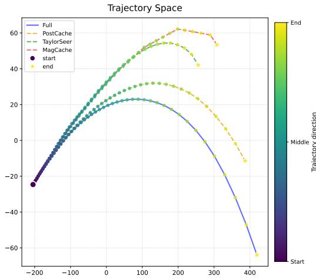

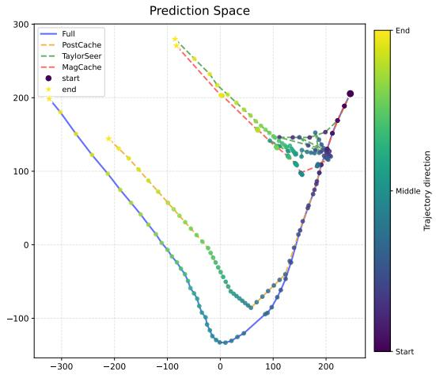  
(a) Trajectory visualization on FLUX.1-dev.

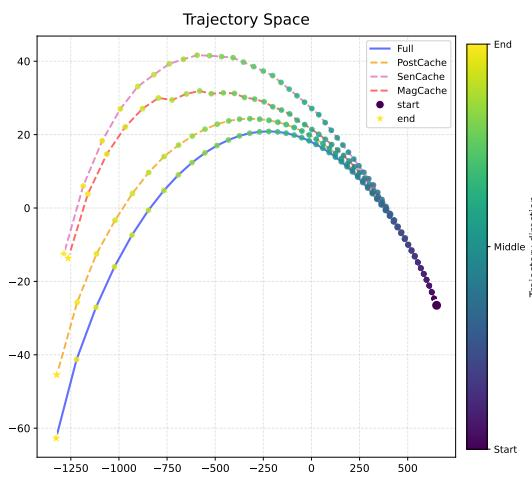

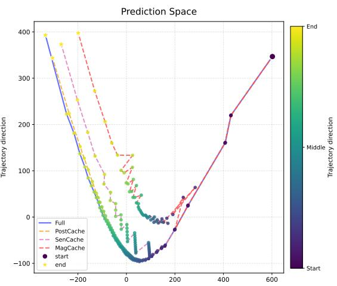  
(b) Trajectory visualization on Wan 2.1.  
Figure 5: Additional trajectory visualizations. For each model, the left panel shows the denoising trajectories and the right panel shows the model predictions in the projected space. Compared with TaylorSeer, MagCache and SenCache, PoSTCache stays closer to the full-inference trajectory, illustrating the corrective effect of postdictive smoothing.

## C ADDITIONAL EXPERIMENTAL RESULTS AND ANALYSIS

## C.1 ADDITIONAL TRAJECTORY ANALYSIS

Additional trajectory visualization. To complement the quantitative trajectory analysis in Sec. 3.2, we visualize the denoising trajectories of full inference, forward-only caching, and PoST-Cache in a low-dimensional space. As shown in Figure 5, forward-only caching progressively deviates from the full-inference trajectory, whereas postdictive smoothing consistently pulls the trajectory toward the full-inference reference after future anchors become available. This behavior is observed across both image and video generation models.

Evaluation details for Figure 2(c). For a candidate future anchor s following the most recent full-computation anchor a, we quantify its local cache risk under nearest reuse as

$$
R _ { \mathrm { l o c a l } } ( s \mid a ) = \frac { 1 } { N D } \sum _ { n = 1 } ^ { N } \sum _ { k = a + 1 } ^ { s } \gamma _ { k } \left\| \bar { u } _ { k } ^ { ( n ) } - \bar { u } _ { a } ^ { ( n ) } \right\| _ { 2 } ^ { 2 }\tag{84}
$$

Table 8: Effect of the number of offline calibration trajectories on Qwen-Image-2512 with budget steps = 16 and dense prefix = 7. The default setting is highlighted in bold.
<table><tr><td>N</td><td>LPIPS↓ SSIM↑</td><td>PSNR ↑</td></tr><tr><td>2</td><td>0.0641 0.9267</td><td>27.266</td></tr><tr><td>5</td><td>0.0607 0.9302</td><td>27.597</td></tr><tr><td>10</td><td>0.0607 0.9302</td><td>27.597</td></tr><tr><td>20</td><td>0.0613 0.9285</td><td>27.223</td></tr></table>

To measure its trajectory-level corrective value, we use the same relative-position gain as PoST-Cache, $w _ { k | a , s } = ( \eta _ { k } - \eta _ { a } ) / ( \eta _ { s } - \eta _ { a } )$ , and define

$$
G _ { \mathrm { f i x e d } } ( s \mid a ) = \frac { 1 } { N D } \sum _ { n = 1 } ^ { N } \sum _ { k = a + 1 } ^ { s - 1 } \gamma _ { k } \left[ \| e _ { k } ^ { ( n , a ) } \| _ { 2 } ^ { 2 } - \| e _ { k } ^ { ( n , a ) } - w _ { k | a , s } r _ { s } ^ { ( n , a ) } \| _ { 2 } ^ { 2 } \right]\tag{85}
$$

where $e _ { k } ^ { ( n , a ) } = \bar { u } _ { k } ^ { ( n ) } - \bar { u } _ { a } ^ { ( n ) }$ and $r _ { s } ^ { ( n , a ) } = \bar { u } _ { s } ^ { ( n ) } - \bar { u } _ { a } ^ { ( n ) }$

For each candidate set C, top-1 agreement compares the maximizers of $R _ { \mathrm { l o c a l } }$ and $G _ { \mathrm { f i x e d } }$ , while normalized regret is $1 - G _ { \mathrm { f i x e d } } ( s _ { \mathrm { l o c a l } } ) / \operatorname* { m a x } _ { s \in \mathcal { C } } \bar { G } _ { \mathrm { f i x e d } } ( s )$

## C.2 CALIBRATION SIZE AND SELECTOR ROBUSTNESS

PoSTCache estimates the cross-timestep covariance kernel from a small set of offline denoising trajectories. Since the kernel is computed from deviations around the empirical mean, a single trajectory yields a degenerate zero covariance and cannot provide a meaningful uncertainty estimate. We therefore vary the calibration size from $N = 2$ to $N = 2 0$ and examine its effect on anchor selection and reconstruction fidelity.

As shown in Table 8, using only two trajectories leads to a less reliable covariance estimate and slightly lower reconstruction quality. Performance stabilizes from $N \ = \ 5 { : }$ using $N \ = \ 5$ and $N = \mathrm { { 1 0 } }$ produces identical schedules and reconstruction results, while increasing the calibration set to $N \stackrel { - } { = } 2 0$ provides no further improvement. These results indicate that the selected anchors are robust to the calibration size once a small number of trajectories is available. We use $N = 1 0$ throughout the main experiments as a conservative default that balances estimation reliability and offline profiling cost.

## C.3 SCHEDULE-LEVEL VALIDATION OF THE PVR OBJECTIVE

The derivation in Sec. A.4 motivates PVR as a schedule-level surrogate: for an anchor set A, the weighted posterior uncertainty

$$
J _ { \mathrm { P V R } } ( A ) : = \sum _ { t = 1 } ^ { T } \gamma _ { t } V _ { t } ( A )\tag{86}
$$

should be small when the selected anchors provide informative future evidence for the remaining trajectory. We directly test this interpretation by asking whether $J _ { \mathrm { P V R } } ( A )$ predicts the correction quality of complete anchor schedules on held-out trajectories. Our default selector greedily optimizes the global PVR objective by selecting the candidate with the largest marginal variance reduction over the full trajectory; we denote it as PVR (ours) below.

Protocol. We evaluate Qwen-Image-2512 and Wan 2.1 using the Slow configurations in Tables 4 and 5. The proposal, scheduler-aware temporal weights, and postdictive correction follow Sec. B.2. For each model, the covariance kernel is constructed from the same 10 calibration trajectories used by the selector and evaluated on 16 held-out prompt–seed pairs. Their prompts, seeds, and exact prompt–seed combinations do not overlap with calibration.

Under a fixed computation budget, we evaluate 135 unique schedules: 100 randomly generated schedules, 30 local perturbations of PVR (ours), and five named selectors—PVR (ours), precedinginterval PVR, local proposal risk, fixed interval, and distance only. Random schedules keep the

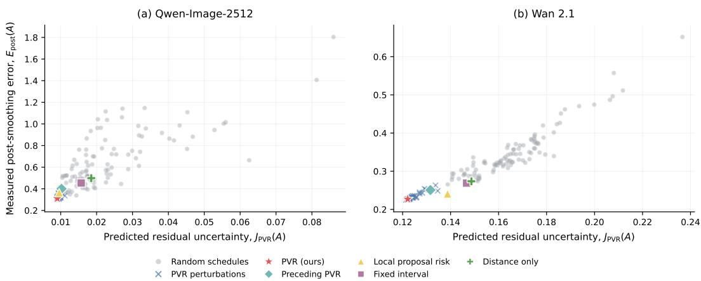  
Figure 6: Predicted PVR uncertainty versus measured post-smoothing error on Qwen-Image-2512 and Wan 2.1. Each point denotes a complete schedule evaluated under the same computation budget. Random schedules, local perturbations, and named selectors are distinguished by the legend; lowerleft is better. PVR (ours) denotes the default greedy selector that optimizes the global PVR objective.

Table 9: Schedule-level validation of PVR. Brackets report $9 5 \%$ paired bootstrap intervals over the 16 held-out trajectories. The schedule pool is fixed during bootstrap resampling. The PVR percentile is based on $\bar { E _ { \mathrm { { p o s t } } } }$ over the 135 sampled schedules.
<table><tr><td>Model</td><td> $\rho ( J _ { \mathrm { P V R } } , E _ { \mathrm { p o s t } } )$ </td><td> $\rho ( Q _ { \mathrm { P V R } } , R _ { \mathrm { c o r r } } )$ </td><td>Pairwise accuracy</td><td>PVR percentile</td><td>ρlocal</td></tr><tr><td>Qwen-Image-2512</td><td>0.858 [0.836, 0.885]</td><td>0.897 [0.877, 0.918]</td><td>83.7% [82.2%, 85.4%]</td><td>95.6% [94.1%, 95.6%]</td><td>0.644 [0.606, 0.693]</td></tr><tr><td>Wan 2.1</td><td>0.963 [0.931, 0.971</td><td>0.967 [0.946, 0.969</td><td>92.3% [89.6%, 93.3%]</td><td>97.8% [97.8%, 97.8%]</td><td>0.933 [0.914, 0.954]</td></tr></table>

dense prefix and final anchor fixed and sample the remaining anchor indices without replacement.   
Each local perturbation moves one non-mandatory PVR anchor by one to three timestep indices;   
collisions and out-of-range moves are rejected. The primary schedule pool uses seed 20260727.

For schedule A, let ${ \widetilde u } _ { k } ^ { ( n , A ) }$ and $\widehat { u } _ { k } ^ { ( n , A ) }$ denote the nearest-reuse proposal and its corrected prediction for held-out trajectory n. Using the full-computation prediction $\bar { u } _ { k } ^ { ( n ) }$ from Eq. (53), we measure

$$
E _ { \mathrm { p r e } } ( A ) = \frac { 1 } { N _ { \mathrm { v a l } } D } \sum _ { n = 1 } ^ { N _ { \mathrm { v a l } } } \sum _ { k \in \mathcal { K } _ { \mathrm { e v a l } } } \gamma _ { k } \left. \bar { u } _ { k } ^ { ( n ) } - \widetilde { u } _ { k } ^ { ( n , A ) } \right. _ { 2 } ^ { 2 } ,\tag{87}
$$

$$
E _ { \mathrm { p o s t } } ( A ) = \frac { 1 } { N _ { \mathrm { v a l } } D } \sum _ { n = 1 } ^ { N _ { \mathrm { v a l } } } \sum _ { k \in \mathcal { K } _ { \mathrm { e v a l } } } \gamma _ { k } \left\| \bar { u } _ { k } ^ { ( n ) } - \widehat { u } _ { k } ^ { ( n , A ) } \right\| _ { 2 } ^ { 2 } ,\tag{88}
$$

where $\kappa _ { \mathrm { e v a l } }$ contains all solver steps except the initial mandatory anchor, and D is the product of all non-batch and non-temporal prediction dimensions. Right anchors are included in $E _ { \mathrm { p r e } }$ and have zero residual in $E _ { \mathrm { p o s t } }$ . We further define

$$
Q _ { \mathrm { P V R } } ( A ) = J _ { \mathrm { P V R } } ( A _ { 0 } ) - J _ { \mathrm { P V R } } ( A ) , \qquad R _ { \mathrm { c o r r } } ( A ) = \frac { E _ { \mathrm { p r e } } ( A ) - E _ { \mathrm { p o s t } } ( A ) } { E _ { \mathrm { p r e } } ( A ) } ,\tag{89}
$$

where $A _ { 0 }$ contains the mandatory anchors.

Schedule-level correspondence. Figure 6 shows a clear monotonic relationship between predicted residual uncertainty and measured post-smoothing error: schedules with smaller $J _ { \mathrm { P V R } } ( A )$ are generally concentrated in the lower-error region. The trend is particularly tight on Wan, whereas Qwen-Image exhibits greater dispersion among random schedules, indicating that its realized correction error contains additional variation not fully captured by the timestep-level covariance surrogate. Nevertheless, the overall ranking remains strong on both models.

The named selectors provide a complementary view. PVR (ours) lies in the most favorable lowerleft region of both panels and achieves the lowest $E _ { \mathrm { p o s t } }$ among the named schedules. The local perturbations remain near the selected solution but generally move coherently upward and to the right, showing that the surrogate remains informative even among schedules with similar global structure.

Table 10: Geometry-controlled schedule-level results. Partial correlations control for maximum gap and gap standard deviation. The final column counts schedule–trajectory pairs for which correction does not increase prediction error.
<table><tr><td>Model</td><td>ρ(maxgap,  $\mathbf { { E _ { p o s t } } } )$ </td><td>ρ(stdgap,  $\mathbf { { E _ { p o s t } } } )$ </td><td> $\rho ( J , E _ { \mathrm { p o s t } }$  | geometry)</td><td> $\rho ( Q , R _ { \mathrm { c o r r } }$  | geometry)</td><td> $E _ { \mathrm { p o s t } } \leq E _ { \mathrm { p r e } }$ </td></tr><tr><td>Qwen-Image-2512</td><td>0.504</td><td>0.623</td><td>0.764</td><td>0.829</td><td>2160/2160</td></tr><tr><td>Wan 2.1</td><td>0.591</td><td>0.643</td><td>0.938</td><td>0.949</td><td>2160/2160</td></tr></table>

These visual trends agree with Table 9. The Spearman correlation between $J _ { \mathrm { P V R } }$ and $E _ { \mathrm { p o s t } }$ reaches 0.858 on Qwen-Image and 0.963 on Wan. Pairwise ranking accuracy, computed over all 9045 unordered schedule pairs, is 83.7% and 92.3%, respectively; no ties occur in the primary pools. PVR (ours) outperforms 95.6% and 97.8% of the sampled schedules in terms of $E _ { \mathrm { p o s t } }$ , and outperforms all 100 randomly generated schedules on both models.

Controlling for interval geometry. To test whether the observed relationship is explained only by spacing, we define a schedule as gap matched when its maximum gap differs from PVR (ours) by at most 2 steps and the population standard deviation of its gaps differs by at most 0.75. This yields 66 schedules on Qwen-Image and 75 on Wan. We also compute partial rank correlations by regressing the average ranks of both variables on the average ranks of maximum gap and gap standard deviation.

The geometry-only correlations are notably weaker than the corresponding PVR correlations. The relationship remains strong within the gap-matched pools and after removing the rank-level effects of maximum gap and gap dispersion. Moreover, correction reduces the prediction-space error for all $2 1 6 0 = 1 3 5 \times 1 6$ schedule–trajectory pairs on each model. These results indicate that PVR captures schedule information beyond simple interval geometry.

Stability and scope. Repeating schedule generation with seeds 20260728, 20260729, and $2 0 2 6 0 7 3 0$ gives $\rho ( J _ { \mathrm { P V R } } , E _ { \mathrm { p o s t } } )$ ranges of 0.860–0.890 on Qwen-Image and 0.962–0.981 on Wan, with PVR (ours) percentiles of 94.8%–97.0% and 97.0%–98.5%, respectively. Thus, the main conclusions are stable to schedule-pool construction.

The confidence intervals in Table 9 are obtained from 1000 paired bootstrap replicates using seed $2 0 2 6 0 7 2 8$ , resampling held-out trajectories while keeping the schedule pool fixed. They therefore quantify uncertainty across validation trajectories rather than schedule-pool sampling. Finally, this experiment is an offline prediction-space analysis on stored full-computation trajectories and does not model the closed-loop effect of reintegration on subsequent predictions. End-to-end behavior is evaluated separately by the online component ablations in Sec. 4.3.

## C.4 TRANSFERABILITY OF OFFLINE PVR SCHEDULES

PoSTCache estimates its cross-timestep dependency profile from a small set of offline denoising trajectories and uses the resulting PVR schedule for subsequent inference. We examine whether a schedule profiled in one setting can be reused after changing the prompt distribution, guidance scale, or spatial configuration, without collecting a new target calibration set.

For each target setting, we compare two schedules. Transferred directly reuses the schedule selected in the source setting, whereas Reprofiled recomputes the dependency profile from ten target calibration trajectories and reruns the same greedy PVR selector. Both schedules use the same full-computation budget, nearest-reuse proposal, and postdictive smoothing procedure. Each target setting is evaluated against its own full-inference reference.

We report the post-smoothing prediction error $E _ { \mathrm { p o s t } } ( A )$ defined in Eq. 88, evaluated on target trajectories disjoint from calibration. This metric measures the discrepancy between corrected model predictions and their full-computation counterparts before accounting for the recursive effect of trajectory reintegration. We additionally report LPIPS, SSIM, and PSNR against target full inference to measure the final closed-loop reconstruction quality.

Table 11: Prompt-distribution transfer on PartiPrompts-Complex. Bold values indicate the better result between the transferred and target-reprofiled schedules.
<table><tr><td>Schedule</td><td> $\mathbf { E } _ { \mathrm { p o s t } } \downarrow$ </td><td>LPIPS↓</td><td>SSIM↑</td><td>PSNR↑</td></tr><tr><td>Transferred</td><td>0.2128</td><td>0.0898</td><td>0.8979</td><td>25.8494</td></tr><tr><td>Reprofiled</td><td>0.2019</td><td>0.0969</td><td>0.8898</td><td>25.1856</td></tr></table>

Table 12: Guidance-scale transfer from the schedule profiled at CFG = 4. Bold values indicate the better result within each target CFG.
<table><tr><td>Target CFG</td><td>Schedule</td><td> $\mathbf { E } _ { \mathrm { p o s t } } \downarrow$ </td><td>LPIPS↓</td><td>SSIM↑</td><td>PSNR↑</td></tr><tr><td>2</td><td>Transferred</td><td>0.0855</td><td>0.0319</td><td>0.9694</td><td>33.0123</td></tr><tr><td>2</td><td>Reprofiled</td><td>0.0666</td><td>0.0310</td><td>0.9710</td><td>32.4347</td></tr><tr><td>6</td><td>Transferred</td><td>0.6637</td><td>0.0781</td><td>0.9139</td><td>26.1554</td></tr><tr><td>6</td><td>Reprofiled</td><td>0.6981</td><td>0.0839</td><td>0.9091</td><td>25.7871</td></tr></table>

Prompt-distribution transfer. We first study FLUX.1-dev with 50 sampling steps and a fullcomputation budget of $B \ = \ 1 6 .$ The source schedule is profiled using the original calibration prompts and then transferred to PartiPrompts-Complex (Yu et al., 2022), whose prompts contain more challenging compositional relationships. Target reprofiling uses ten PartiPrompts-Complex calibration trajectories, while prediction-space evaluation uses ten disjoint held-out trajectories. End-to-end reconstruction is evaluated on 93 target prompts.

As shown in Table 11, target-specific reprofiling reduces $E _ { \mathrm { p o s t } }$ , indicating that its selected anchors better match the held-out target trajectories in prediction space. However, the transferred schedule is better on all three final reconstruction metrics. Paired bootstrap intervals over evaluation prompts exclude zero for LPIPS, SSIM, and PSNR, showing that the final reconstruction advantage is not caused by a small number of prompts.

The source and target dependency profiles nevertheless remain highly similar, with a profilesimilarity score of 0.989. This suggests that the temporal structure exploited by PVR is largely preserved under the prompt shift. The disagreement between $E _ { \mathrm { p o s t } }$ and the final metrics also highlights the scope of Eq. 88: it measures prediction correction on stored target trajectories but does not fully capture how the corrected states alter subsequent denoising predictions after reintegration.

Guidance-scale transfer. We next evaluate Qwen-Image-2512 by profiling the source schedule at CFG = 4 and transferring it to CFG = 2 and CFG = 6. All configurations use 50 sampling steps, $B = 1 6 ,$ , the same negative prompt, and identical prompt–seed splits. For each target CFG, ten trajectories are used for target reprofiling, ten disjoint trajectories are used to evaluate $E _ { \mathrm { p o s t } }$ , and 50 prompts are used for end-to-end reconstruction.

Table 12 reveals different behaviors at the two target guidance scales. At CFG = 2, reprofiling substantially reduces $E _ { \mathrm { p o s t } }$ . The original target-reprofiled schedule also performs well relative to schedules obtained by resampling the target calibration set, indicating that the prediction-space improvement is reproducible rather than an accidental schedule choice. Nevertheless, paired-bootstrap intervals for LPIPS, SSIM, and PSNR all include zero. Thus, adapting the profile improves the prediction-space criterion but does not produce a statistically distinguishable improvement in final reconstruction. This is the clearest case in which $E _ { \mathrm { p o s t } }$ is informative but incomplete as a proxy for the closed-loop trajectory.

At CFG = 6, the transferred schedule instead obtains lower $E _ { \mathrm { p o s t } }$ and better mean reconstruction metrics. The LPIPS improvement is supported by a paired-bootstrap interval excluding zero, whereas the SSIM and PSNR differences are less conclusive. Additional cross-evaluation shows that the target-reprofiled schedule is favored by the profile constructed from its calibration trajectories but becomes worse when scored using independent target trajectories.

Table 13: Spatial-configuration transfer from a schedule profiled at $1 3 2 8 \times 1 3 2 8$ . Bold values indicate the better result within each target configuration.
<table><tr><td>Target size</td><td>Schedule</td><td> $\mathbf { E } _ { \mathrm { p o s t } } \downarrow$ </td><td>LPIPS↓</td><td>SSIM↑</td><td>PSNR↑</td></tr><tr><td> $1 0 2 4 \times 1 0 2 4$ </td><td>Transferred</td><td>0.3154</td><td>0.0506</td><td>0.9397</td><td>28.4701</td></tr><tr><td> $1 0 2 4 \times 1 0 2 4$ </td><td>Reprofiled</td><td>0.3003</td><td>0.0497</td><td>0.9380</td><td>28.0984</td></tr><tr><td> $1 6 6 4 \times 9 2 8$ </td><td>Transferred</td><td>0.2487</td><td>0.0535</td><td>0.9397</td><td>28.6091</td></tr><tr><td> $1 6 6 4 \times 9 2 8$ </td><td>Reprofiled</td><td>0.3252</td><td>0.0798</td><td>0.9184</td><td>27.8478</td></tr></table>

Spatial-configuration transfer. Finally, we profile a Qwen-Image-2512 schedule at $1 3 2 8 \times 1 3 2 8$ and reuse it at $1 0 2 4 \times 1 0 2 4$ and $1 6 6 4 \times 9 2 8$ . The first target changes the resolution while preserving the square aspect ratio. The second additionally changes the aspect ratio and spatial token-grid geometry. The guidance scale, sampling steps, full-computation budget, prompts, negative prompt, and profiling procedure are otherwise kept unchanged.

For the resolution-only shift to $1 0 2 4 \times 1 0 2 4$ , target reprofiling slightly improves $E _ { \mathrm { p o s t } }$ and LPIPS, whereas the transferred schedule obtains higher SSIM and PSNR. The corresponding held-out PVR scores are nearly identical, showing that the two schedules are practically comparable.

For the wider $1 6 6 4 \times 9 2 8$ configuration, the transferred schedule is clearly better in both prediction and reconstruction space. Meanwhile, the source–target profile similarity remains as high as 0.996, indicating that the underlying temporal dependency structures differ only modestly. Despite this limited profile shift, the two resulting schedules produce substantially different $E _ { \mathrm { p o s t } }$ values and final reconstruction quality. This disproportionate effect suggests a limitation of the discrete greedy selector: small perturbations in the estimated profile can change early anchor choices, which in turn alter subsequent conditional gains and lead to markedly different complete schedules. The result therefore highlights the path dependence and finite-sample instability of greedy anchor selection, rather than a large structural difference between the source and target profiles.

Results analysis. The experiments above show that target-specific reprofiling may improve, match, or underperform direct transfer. To identify where these differences arise, we use three complementary diagnostics.

First, profile similarity measures whether the source and target settings exhibit similar relative crosstimestep dependency patterns. Let $K ^ { ( s ) }$ and $K ^ { ( t ) }$ denote the covariance kernels estimated from the source and target calibration trajectories, respectively, using Eq. 100. Since their marginal prediction variances may differ across settings, we first convert each covariance kernel into a correlation profile:

$$
C _ { i j } ^ { ( x ) } = \frac { K _ { i j } ^ { ( x ) } } { \sqrt { \operatorname* { m a x } \left( K _ { i i } ^ { ( x ) } , \epsilon \right) \operatorname* { m a x } \left( K _ { j j } ^ { ( x ) } , \epsilon \right) } } , \qquad x \in \{ s , t \} ,\tag{90}
$$

where $\epsilon = 1 0 ^ { - 1 2 }$ is used for numerical stability.

Let

$$
\mathbf { c } ^ { ( x ) } = \mathrm { v e c } _ { i < j } \left( C _ { i j } ^ { ( x ) } \right)\tag{91}
$$

denote the vector containing the strictly upper-triangular entries of $C ^ { ( x ) }$ . We define profile similarity as the Pearson correlation between the source and target profile vectors:

$$
\mathrm { S i m } _ { \mathrm { p r o f l e } } = \frac { \sum _ { k } \left( c _ { k } ^ { \left( s \right) } - \bar { c } ^ { \left( s \right) } \right) \left( c _ { k } ^ { \left( t \right) } - \bar { c } ^ { \left( t \right) } \right) } { \sqrt { \sum _ { k } \left( c _ { k } ^ { \left( s \right) } - \bar { c } ^ { \left( s \right) } \right) ^ { 2 } } \sqrt { \sum _ { k } \left( c _ { k } ^ { \left( t \right) } - \bar { c } ^ { \left( t \right) } \right) ^ { 2 } } } .\tag{92}
$$

The diagonal is excluded because it is one after correlation normalization, and only the upper triangle is retained to avoid counting each symmetric timestep pair twice. A value close to one indicates that the source and target profiles exhibit similar relative cross-timestep dependency patterns, even when their absolute covariance magnitudes or marginal variances differ.

Table 14: Diagnostics for offline schedule transfer. “Lower held-out $J _ { \mathrm { P V R } } { \boldsymbol { \stackrel { \ r { \ r } } { \scriptscriptstyle } } } 3 $ identifies the fixed schedule with lower predicted residual uncertainty on an independent target profile. The target percentile is the fraction of target-bootstrap schedules with higher $E _ { \mathrm { p o s t } }$ than the original reprofiled schedule.
<table><tr><td>Shift</td><td>Profile similarity</td><td>Lower held-out  $J _ { \mathrm { P V R } }$ </td><td>Target percentile</td></tr><tr><td>Prompt OOD</td><td>0.989</td><td>Reprofiled</td><td>61.6%</td></tr><tr><td> $\mathrm { C F G } \overset { \cdot } { 4 }  2$ </td><td>0.850</td><td>Reprofiled</td><td>88.1%</td></tr><tr><td> $\mathrm { C F G 4 }  6$ </td><td>0.943</td><td>Transferred</td><td>4.8%</td></tr><tr><td> $1 3 2 8 \times 1 3 2 8 \to 1 0 2 4 \times 1 0 2 4$ </td><td>0.997</td><td>Comparable</td><td>92.5%</td></tr><tr><td> $1 3 2 8 \times 1 3 2 8 \to 1 6 6 4 \times 9 2 8$ </td><td>0.996</td><td>Transferred</td><td>14.0%</td></tr></table>

Second, we cross-evaluate the two fixed schedules using an independent target profile and report which one obtains the lower schedule-level uncertainty $\bar { J _ { \mathrm { P V R } } } ( A )$ from $\operatorname { E q . } 8 6 $ . This checks whether an advantage on the target calibration profile persists beyond the trajectories used to construct it.

Third, we assess sensitivity to the particular ten target calibration trajectories. We repeatedly resample these trajectories with replacement, recompute the target profile, and rerun greedy schedule selection. Each bootstrap schedule is then evaluated on the same target held-out trajectories using $E _ { \mathrm { p o s t } }$ from Eq. 88. The target-schedule percentile is the fraction of these bootstrap schedules outperformed by the original target-reprofiled schedule. A high percentile means that the reported target schedule is typical or relatively strong among schedules obtained from the same target setting, whereas a low percentile indicates an unfavorable calibration or greedy-selection realization.

Table 14 separates three qualitatively different cases. For prompt OOD, the two dependency profiles are nearly identical and the original target schedule lies near the middle of its bootstrap distribution. The reprofiled schedule has lower held-out $J _ { \mathrm { P V R } }$ and $E _ { \mathrm { p o s t } }$ , but worse final reconstruction. The result is therefore best interpreted as strong profile overlap together with a fixed-schedule mismatch between prediction-space ranking and closed-loop output quality.

At CFG = 2, the target schedule has lower held-out $J _ { \mathrm { P V R } } .$ , lower $E _ { \mathrm { p o s t } } .$ , and a high bootstrap percentile. Target adaptation is therefore consistently beneficial for the prediction-space objective, even though the final images remain statistically indistinguishable. In contrast, the target schedules at $\mathrm { C F G } = 6$ and $1 6 6 4 \times 9 2 8$ have low bootstrap percentiles and are also worse under the independent target profile. Their poor final results do not indicate that source profiles are intrinsically superior. Instead, estimating a profile from a finite calibration split and applying discrete greedy selection can produce an unfavorable target schedule. The $1 0 2 4 \times 1 0 2 4$ case lies between these regimes: target reprofiling slightly improves the prediction-space metrics, while the two schedules remain effectively comparable in final reconstruction.

Overall, the source PVR schedule remains a robust practical default across the evaluated prompt, guidance, and spatial shifts. These results do not imply that the dependency profile is invariant or that target adaptation is generally harmful. Rather, target reprofiling can provide genuine predictionspace improvements, but these improvements need not translate into better reintegrated outputs. This discrepancy reflects the current offline–online gap: the offline PVR objective and $E _ { \mathrm { p o s t } }$ are evaluated on stored full-computation trajectories, whereas online reintegration changes the latent states and recursively affects all subsequent model predictions. In addition, finite-sample profile estimation with greedy selection can introduce further variability into discrete anchor selection.

## C.5 ADDITIONAL ABLATION STUDIES

Temporal weighting. We ablate the power p in the scheduler-aware temporal weight

$$
\widetilde { \gamma } _ { t } = \left( \frac { \mathrm { m e d i a n } _ { j } \delta _ { j } } { \delta _ { t } + \epsilon } \right) ^ { p } .\tag{93}
$$

Table 15: Effect of the temporal-weighting power p on Qwen-Image-2512 with budget steps = 16 and dense prefix = 7. The default setting is highlighted in bold.
<table><tr><td>Power  $p$ </td><td>LPIPS↓</td><td>SSIM ↑</td><td>PSNR↑</td></tr><tr><td>0</td><td>0.0632</td><td>0.9262</td><td>26.781</td></tr><tr><td>0.25</td><td>0.0625</td><td>0.9268</td><td>26.957</td></tr><tr><td>0.5</td><td>0.0607</td><td>0.9302</td><td>27.597</td></tr><tr><td>0.75</td><td>0.0639</td><td>0.9271</td><td>27.585</td></tr><tr><td>1.0</td><td>0.0639</td><td>0.9271</td><td>27.585</td></tr></table>

Table 16: Effect of the dense-prefix length on FLUX.1-dev with budget st $\mathtt { e p s } = 1 6$ . In addition to the dense-prefix and PVR-selected anchors reported in the table, the final denoising step is always retained as a mandatory anchor, i.e., $L _ { \mathrm { p r e f i x } } + \bar { N _ { \mathrm { P V R } } } + 1 = 1 6$ . The default setting is highlighted in bold.
<table><tr><td>Dense prefix</td><td>PVR-selected anchors</td><td>LPIPS↓</td><td>SSIM ↑</td><td>PSNR ↑</td></tr><tr><td>5</td><td>10</td><td>0.1147</td><td>0.8756</td><td>24.761</td></tr><tr><td>6</td><td>9</td><td>0.1132</td><td>0.8779</td><td>24.933</td></tr><tr><td>7</td><td>8</td><td>0.0968</td><td>0.8944</td><td>26.284</td></tr><tr><td>8</td><td>7</td><td>0.1029</td><td>0.8889</td><td>25.846</td></tr><tr><td>9</td><td>6</td><td>0.1233</td><td>0.8701</td><td>24.616</td></tr></table>

Setting $p = 0$ yields uniform weighting, while larger values place greater emphasis on densely sampled scheduler regions. We conduct this ablation on Qwen-Image-2512 with budget steps = 16 and dense prefix = 7, keeping the clipping range and all other configurations fixed.

As shown in Table 15, the default setting $p = 0 . 5$ achieves the best overall reconstruction fidelity, reducing LPIPS from 0.0632 to 0.0607 and improving SSIM from 0.9262 to 0.9302 and PSNR from 26.781 to 27.597 compared with uniform weighting. Larger powers provide no further improvement, suggesting that excessively emphasizing densely sampled regions is not beneficial. We therefore use $p = 0 . 5$ in the main experiments.

Mandatory prefix anchors. We study the effect of the dense-prefix length while fixing the total full-computation budget. Specifically, we evaluate FLUX.1-dev with budget steps = 16 and vary the number of consecutive full-computation steps at the beginning of the sampling trajectory. Since the total budget is fixed, increasing the dense-prefix length allocates more anchors to the early denoising stage while leaving fewer anchors for PVR-based selection over the remaining trajectory.

As shown in Table 16, reconstruction quality first improves and then degrades as the dense-prefix length increases. A short prefix leaves the rapidly varying early denoising stage insufficiently covered, whereas an overly long prefix consumes too much of the fixed budget and limits adaptive anchor placement over the remaining trajectory. The default setting of 7 achieves the best performance across all three metrics, reducing LPIPS to 0.0968 while increasing SSIM and PSNR to 0.8944 and 26.284, respectively.

The optimal dense-prefix length depends on the model, scheduler, and total budget, and does not admit a simple closed-form prescription. We therefore adopt the empirical rule

$$
L _ { \mathrm { p r e f i x } } \in \left\{ \left\lfloor { \frac { B } { 2 } } \right\rfloor - 1 , \left\lfloor { \frac { B } { 2 } } \right\rfloor \right\} ,\tag{94}
$$

which is used for all model-specific configurations reported in Table 5.

Comparison with DPCache. PVR globally models cross-timestep dependencies when evaluating the information value of an anchor. DPCache (Cui et al., 2026) is therefore the closest conceptual comparison, as it also formulates timestep selection as a global optimization problem, but minimizes a path-additive cost through dynamic programming.

Table 17: Comparison with path-based scheduling on FLUX.1-dev. DPCache-Retro is our correction-aware extension of DPCache. All selectors use the same online pipeline and computation budget.
<table><tr><td>Selector</td><td> $\mathbf { E } _ { \mathrm { p o s t } } \downarrow$ </td><td>LPIPS↓</td><td>SSIM ↑</td><td>PSNR↑</td></tr><tr><td>DPCache-Pre</td><td>0.2562</td><td>0.1076</td><td>0.8827</td><td>25.16</td></tr><tr><td>DPCache-Retro</td><td>0.1991</td><td>0.1059</td><td>0.8853</td><td>25.55</td></tr><tr><td>PVR</td><td>0.2024</td><td>0.0968</td><td>0.8944</td><td>26.28</td></tr></table>

To isolate the scheduling objective, we adapt DPCache to the same PoSTCache online pipeline. DPCache-Pre follows the original pre-correction principle and constructs its path cost from nearestreuse proposal errors before postdictive smoothing. DPCache-Retro is our correction-aware extension, which retains the same dynamic-programming formulation but computes the interval cost after applying postdictive smoothing. All selectors use FLUX.1-dev with 50 sampling steps, a budget of $B = 1 6$ , ten calibration trajectories, and the same nearest-reuse and single-anchor smoothing pipeline. Prediction-space evaluation uses ten disjoint held-out trajectories, while reconstruction metrics are evaluated over 200 prompts.

As shown in Table 17, DPCache-Retro consistently improves over DPCache-Pre, confirming that anchor scheduling should account for the subsequent postdictive correction. DPCache-Retro obtains a slightly lower held-out $E _ { \mathrm { p o s t } }$ than PVR, which is expected because its path cost is directly constructed from the post-smoothing prediction error. Nevertheless, PVR achieves the best final reconstruction quality across all three metrics.

This discrepancy further reflects the offline–online gap: reducing prediction error on stored fullcomputation trajectories does not fully capture how reintegration changes the latent trajectory and recursively affects later model predictions. It also highlights the distinction between the two global objectives: DPCache minimizes fixed path-additive interval costs, whereas PVR evaluates the un certainty reduction of each anchor conditioned on the complete selected set, thereby modeling redundancy and complementarity among anchors.

## C.6 ANCHOR-STATE CONSISTENCY AND COMPUTE ALLOCATION

Local anchor-state consistency. At a future anchor $b ,$ the full prediction used to construct the anchor innovation is evaluated at the state $\widetilde { x } _ { b }$ reached by the forward proposal trajectory. Postdictive smoothing subsequently revises the preceding skipped predictions and reintegrates the interval from anchor a, yielding a corrected anchor state $\widehat { x } _ { b }$ . Because the default implementation retains the already-computed anchor prediction, it is not re-evaluated at $\widehat { x } _ { b }$ . To quantify the resulting local state–prediction mismatch, we compare

$$
\begin{array} { r } { \bar { u } _ { b } = f _ { \theta } ( \widetilde { x } _ { b } , \tau _ { b } ) , \qquad u _ { b } ^ { \mathrm { f r e s h } } = f _ { \theta } ( \widehat { x } _ { b } , \tau _ { b } ) , } \end{array}\tag{95}
$$

where $u _ { b } ^ { \mathrm { f r e s h } }$ is used only as a diagnostic probe and does not alter the default sampling trajectory.

We measure the relative state displacement and prediction discrepancy as

$$
D _ { x } ( b ) = \frac { \| \widehat { x } _ { b } - \widetilde { x } _ { b } \| _ { 2 } } { \| \widetilde { x } _ { b } \| _ { 2 } } , \qquad E _ { \mathrm { a n c h o r } } ( b ) = \frac { \| u _ { b } ^ { \mathrm { f r e s h } } - \bar { u } _ { b } \| _ { 2 } } { \| u _ { b } ^ { \mathrm { f r e s h } } \| _ { 2 } } .\tag{96}
$$

We additionally report the directional discrepancy

$$
C _ { \mathrm { a n c h o r } } ( b ) = 1 - \cos \left( u _ { b } ^ { \mathrm { f r e s h } } , \bar { u } _ { b } \right) .\tag{97}
$$

To assess whether this prediction discrepancy materially affects the subsequent numerical update, we further define

$$
E _ { \mathrm { s t e p } } ( b ) = \frac { \left\|  { S } _ { b } \left( \widehat { x } _ { b } , \bar { u } _ { b } , \tau _ { b } \right) -  { S } _ { b } \left( \widehat { x } _ { b } , u _ { b } ^ { \mathrm { f r e s h } } , \tau _ { b } \right) \right\| _ { 2 } } { \left\|  { S } _ { b } \left( \widehat { x } _ { b } , u _ { b } ^ { \mathrm { f r e s h } } , \tau _ { b } \right) \right\| _ { 2 } } .\tag{98}
$$

We conduct this diagnostic analysis on Qwen-Image-2512 and Wan 2.1 using their Fast and Slow configurations in Table 5. We use eight evaluation prompts with a fixed random seed and identical prompt–seed pairs across all compared variants. All consistency statistics are averaged over the cache intervals encountered during inference.

Table 18: Anchor-state consistency under the paper configurations. $D _ { x }$ measures reintegrationinduced state displacement, $E _ { \mathrm { a n c h o r } }$ the resulting prediction discrepancy, $C _ { \mathrm { a n c h o r } }$ the corresponding directional discrepancy, and $E _ { \mathrm { s t e p } }$ the normalized downstream state discrepancy after one solver update.
<table><tr><td>Model</td><td>Regime</td><td> $D _ { x }$ </td><td> $E _ { \mathrm { a n c h o r } }$ </td><td> $C _ { \mathrm { a n c h o r } }$ </td><td> $E _ { \mathrm { s t e p } }$ </td></tr><tr><td>Qwen-Image-2512</td><td>Slow</td><td>0.0216</td><td>0.0531</td><td>0.0033</td><td>0.0035</td></tr><tr><td>Qwen-Image-2512</td><td>Fast</td><td>0.0222</td><td>0.0543</td><td>0.0038</td><td>0.0043</td></tr><tr><td>Wan 2.1</td><td>Slow</td><td>0.0090</td><td>0.0540</td><td>0.0024</td><td>0.0048</td></tr><tr><td>Wan 2.1</td><td>Fast</td><td>0.0148</td><td>0.0817</td><td>0.0063</td><td>0.0082</td></tr></table>

Table 19: Anchor refresh versus broader temporal anchor coverage. NFE denotes the actual number of neural-network evaluations recorded at runtime. The two 21-NFE Qwen-Image variants provide a compute-matched comparison between refreshing existing anchors and allocating the same evaluations to additional standard PoSTCache anchors.
<table><tr><td>Model</td><td>Variant</td><td>NFE</td><td>LPIPS↓</td><td>SSIM ↑</td><td>PSNR ↑</td></tr><tr><td rowspan="4">Qwen</td><td>Fast  $( B = 1 4 )$ </td><td>14</td><td>0.0749</td><td>0.9466</td><td>28.90</td></tr><tr><td>Slow (B = 16)</td><td>16</td><td>0.0646</td><td>0.9547</td><td>29.61</td></tr><tr><td>Fast + Fresh</td><td>21</td><td>0.0553</td><td>0.9622</td><td>30.97</td></tr><tr><td>B = 21</td><td>21</td><td>0.0239</td><td>0.9801</td><td>34.04</td></tr><tr><td rowspan="3">Wan</td><td>Fast (B = 16)</td><td>16</td><td>0.0914</td><td>0.8647</td><td>26.60</td></tr><tr><td>Slow (B = 20)</td><td>20</td><td>0.0717</td><td>0.8843</td><td>28.17</td></tr><tr><td> $\mathrm { F a s t + F r e s h }$ </td><td>24</td><td>0.0767</td><td>0.8779</td><td>27.75</td></tr></table>

As shown in Table 18, reintegration changes the future-anchor state only modestly, with $\mathit { D _ { x } } \ <$ 2.3% across all evaluated settings. The resulting prediction discrepancy is measurable, whereas the normalized downstream state discrepancy after one solver update is approximately one order of magnitude smaller. Qwen-Image exhibits nearly unchanged consistency statistics between its Fast and Slow configurations, while Wan shows a larger discrepancy under the sparser Fast schedule. Furthermore, $D _ { x }$ and Eanchor are strongly correlated (Spearman $\rho = 0 . 8 4 5  – 0 . 9 2 5 )$ ), as are $E _ { \mathrm { a n c h o r } }$ and $E _ { \mathrm { s t e p } } ~ ( \rho = 0 . 8 9 2 – 0 . 9 1 7 )$ . These results support the expected propagation from reintegrationinduced state displacement to prediction staleness and subsequently to the numerical solver update, while showing that the immediate downstream perturbation remains comparatively small.

Fresh-anchor oracle and compute allocation. A small discrepancy after a single numerical update does not necessarily imply negligible end-to-end impact, since diffusion sampling recursively feeds each updated latent state into subsequent model evaluations. We therefore construct a Fresh-Anchor Oracle that recomputes the model prediction at the reintegrated anchor state and uses this fresh prediction for subsequent sampling. Importantly, the preceding cache interval is not smoothed or reintegrated a second time, so this variant isolates the effect of restoring anchor-state consistency rather than introducing an additional correction iteration.

Fresh-anchor recomputation consistently improves reconstruction relative to the corresponding Fast configuration, reducing LPIPS from 0.0749 to 0.0553 on Qwen-Image and from 0.0914 to 0.0767 on Wan. This confirms that the local state–prediction mismatch, although small at each individual solver update, can accumulate into a measurable end-to-end reconstruction gap.

Restoring exact consistency, however, requires additional neural-network evaluations. To determine whether anchor refresh is an effective use of this extra computation, we perform an NFE-matched comparison on Qwen-Image. Its Fast configuration uses $B = 1 4$ and a dense-prefix length $L _ { \mathrm { p r e f i x } } =$ 7. The Fresh-Anchor Oracle retains these seven dense-prefix evaluations and refreshes all seven post-prefix anchors, including the mandatory final anchor, resulting in $1 4 + 7 = 2 1$ total NFEs.

Table 20: Offline calibration and PVR selector cost. Collection time excludes model loading and VAE decoding. Kernel construction excludes model forward. Selector latency measures the time required to construct one complete anchor schedule after the covariance kernel and selector configuration have been loaded into memory; it is reported as the median / 95th percentile over 1,000 CPU runs. Raw storage is the theoretical size of all solver-consumed predictions, whereas kernel storage size is the actual serialized FP64 selector state.
<table><tr><td>Model</td><td>Collect / traj. (s)</td><td>Total collect (min)</td><td>Kernel build (s)</td><td>Raw storage (GiB)</td><td>Kernel storage (KiB)</td><td>Selector med.  $/ { \bf p 9 5 }$  (ms)</td></tr><tr><td>Qwen-Image-2512</td><td>30.27 ± 0.09</td><td>5.05</td><td>2.96</td><td>0.411</td><td>22.23</td><td>3.74 / 3.77</td></tr><tr><td>Wan 2.1</td><td> $6 6 . 6 9 \pm 0 . 1 6$ </td><td>11.12</td><td>14.43</td><td>1.953</td><td>22.18</td><td>3.47 / 3.50</td></tr></table>

For the compute-matched baseline, we instead set $B = 2 1$ and $L _ { \mathrm { p r e f i x } } = 1 0$ and rerun the same PVR anchor selection procedure. Thus, both variants use exactly 21 model evaluations, but spend the additional computation differently: the Fresh-Anchor Oracle re-evaluates already-selected anchors, whereas the standard B = 21 configuration allocates the evaluations to broader temporal anchor coverage.

At the identical budget of 21 NFEs, broader anchor coverage reduces LPIPS from 0.0553 to 0.0239, while improving SSIM from 0.9622 to 0.9801 and PSNR from 30.97 to 34.04. Hence, although explicit anchor refresh reveals genuine consistency headroom, the same additional model evaluations are substantially more effective when allocated to informative new anchors in this controlled Qwen-Image comparison.

The Wan operating points provide complementary evidence. Fresh-anchor recomputation improves the Fast configuration from LPIPS 0.0914 to 0.0767, but requires 24 NFEs and still remains slightly behind the 20-NFE Slow configuration with LPIPS 0.0717. Together, these results show that unconditional anchor refresh is not an obviously preferable use of additional computation. In the controlled Qwen-Image comparison, allocating the same NFE budget to broader anchor coverage is substantially more effective, while Wan exhibits the same qualitative tendency despite using different operating points. This supports our default design of prioritizing informative temporal anchors without introducing mandatory refresh evaluations.

## C.7 EFFICIENCY AND RUNTIME ANALYSIS

Offline calibration cost. PoSTCache uses complete denoising trajectories to estimate the crosstimestep covariance kernel, but the raw high-dimensional predictions do not need to be persistently stored. For each calibration trajectory $Z ^ { ( n ) } \in \mathbb { R } ^ { T \times D }$ , we accumulate the sufficient statistics

$$
S = \sum _ { n = 1 } ^ { N } Z ^ { ( n ) } , \qquad Q = \sum _ { n = 1 } ^ { N } Z ^ { ( n ) } Z ^ { ( n ) \top } ,\tag{99}
$$

from which the kernel used by the PVR selector is recovered exactly as

$$
K = \frac { Q } { N D } - \frac { S S ^ { \top } } { N ^ { 2 } D } .\tag{100}
$$

Therefore, each trajectory can be discarded immediately after its contribution has been accumulated. This procedure reduces offline data-loading and repeated-processing overhead and substantially decreases the storage footprint, while exactly preserving all information required by the current PVR selector.

As shown in Table 20, collecting ten calibration trajectories takes 5.05 minutes on Qwen-Image-2512 and 11.12 minutes on Wan 2.1. Streaming kernel construction adds only 2.96 seconds and 14.43 seconds, corresponding to approximately 1.0% and 2.2% of the respective collection time. The dominant offline cost therefore remains the N complete denoising runs rather than covariance accumulation. This cost is paid only once per model and sampling configuration, after which the resulting kernel and anchor schedule are shared across all subsequent inference runs.

After applying the sufficient-statistics compression, the persistent selector state is reduced from 0.411–1.953 GiB of raw predictions to approximately 22 KiB, as its dominant component scales with $T ^ { 2 }$ rather than NTD. The serialized artifact additionally contains temporal weights and configuration metadata, much of which can be readily reconstructed from the sampling configuration at runtime; retaining only the covariance kernel would further reduce the storage footprint. Once the kernel and selector configuration are available in memory, constructing a complete anchor schedule takes only 3.47–3.74 ms in median. This schedule-construction cost is incurred only once for each model and sampling configuration, after which the resulting schedule is stored and reused during inference, and therefore does not contribute to per-sample online latency.

Table 21: Runtime breakdown of PoSTCache on Wan.
<table><tr><td>Component</td><td>Latency</td><td>Fraction</td></tr><tr><td>Neural-network evaluations</td><td>26.869 s</td><td>93.82%</td></tr><tr><td>Postdictive correction / orchestration</td><td>0.010 s</td><td>0.03%</td></tr><tr><td>Scheduler reintegration</td><td>0.051 s</td><td>0.18%</td></tr><tr><td>VAE decoding</td><td>1.657 s</td><td>5.79%</td></tr><tr><td>Pipeline preparation</td><td>0.051 s</td><td>0.18%</td></tr></table>

Online inference overhead. Postdictive smoothing requires only lightweight vector operations and scheduler reintegration, without introducing additional neural-network evaluations at skipped timesteps. Table 21 reports the runtime breakdown on Wan 2.1 with a full-computation budget of 20 steps and a dense prefix of 10 steps. We separately measure the costs of neural-network evaluations, postdictive correction and orchestration, scheduler reintegration, VAE decoding, and pipeline preparation. The correction and reintegration together account for only 0.21% of the total latency, indicating that the computational overhead introduced by PoSTCache is negligible.

Efficiency–quality trade-off. Figure 7 further reports the complete quality–latency trade-off using all three reconstruction metrics. Across 1-LPIPS, SSIM, and PSNR, PoSTCache consistently dominates the corresponding caching baseline over a broad range of latency budgets.

## C.8 ADDITIONAL QUALITATIVE RESULTS

We provide additional qualitative comparisons to complement the image results in the main paper. The examples cover diverse prompts, model architectures, and acceleration regimes. Across these settings, PoSTCache more closely follows full inference in terms of global composition, local appearance, and object structure. For video generation, it additionally reduces structural and appearance deviations across the sampled frames, while achieving acceleration ratios comparable to or higher than those of the competing methods.

Qwen-Image-2512. Figure 8 presents additional text-to-image results on Qwen-Image-2512. At a 2.90× speedup, PoSTCache closely preserves both the global layout and fine-grained structures of full inference. In the fireworks example, it retains the shapes of the rendered letters and the local burst patterns. In the moonlit cat and industrial landscape examples, it better preserves small foreground elements, cloud boundaries, vegetation, and reflection details. In comparison, competing methods tend to smooth away these local structures or introduce more noticeable changes in color, illumination, and scene layout. These results indicate that postdictive correction mitigates not only semantic degradation but also the accumulation of fine-grained appearance errors.

OpenSora 1.2. Figure 9 compares PoSTCache with representative caching methods on Open-Sora 1.2. PoSTCache more faithfully preserves object identity, geometry, and prompt-specified spatial relationships across the sampled frames. For example, it maintains the contour and proportions of the pink vase, the relative arrangement of the couch and bed, and the left–right relationship between the toothbrush and hair drier. TeaCache and MagCache, by contrast, produce more visible changes in object shape, orientation, or relative placement. The improvements are obtained at a comparable acceleration ratio, suggesting that retrospective correction is effective for preventing structural deviations from propagating along the video trajectory.

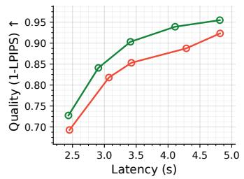

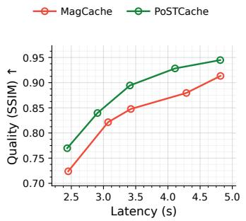  
(a) FLUX.1-dev.

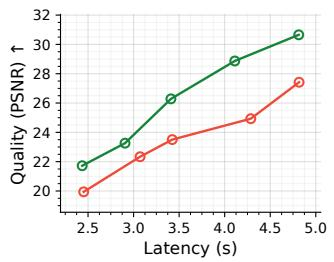

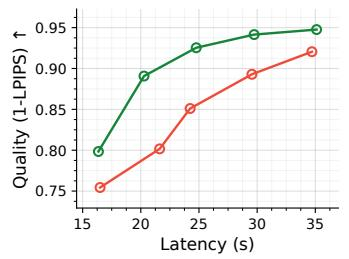

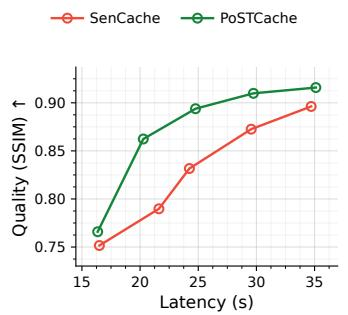  
(b) Wan 2.1.

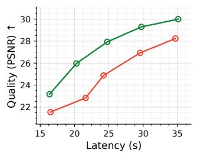  
Figure 7: Quality–latency trade-off across reconstruction metrics. We report 1 − LPIPS, SSIM, and PSNR under different computation budgets on (a) FLUX.1-dev and (b) Wan 2.1. PoSTCache consistently shifts the quality–latency frontier over MagCache on FLUX.1-dev and SenCache on Wan 2.1 across all three metrics.

CogVideoX. Figure 10 further evaluates PoSTCache on CogVideoX using stylized landscapes, natural scenes, and architectural objects. PoSTCache closely reproduces the object scale and scene composition of full inference, including the position of the Eiffel Tower and boat, the appearance of the lakeside bench, and the silhouette of the Gothic-style lamppost. Moreover, these structures remain comparatively stable across the displayed frames. TeaCache and SenCache exhibit larger variations in object proportions, background layout, or foreground appearance. This comparison demonstrates that PoSTCache remains effective when the underlying model architecture and visual content differ substantially from those of OpenSora.

Wan 2.1. Figure 11 shows the corresponding comparisons on Wan 2.1. The selected prompts test both compositional relationships and the preservation of distinctive scene structures. For the boat– airplane example, PoSTCache maintains the prompt-specified relative positions and closely follows the full-inference object silhouettes. For the lighthouse and castle examples, it preserves the principal architectural structures, surrounding vegetation, and overall scene appearance across frames. DiCache introduces substantial structural degradation in the lighthouse scene, while SenCache produces more noticeable changes in object geometry and background appearance. PoSTCache therefore provides a closer approximation to full inference while attaining the highest acceleration ratio among the compared methods in this setting.

Overall, the qualitative results are consistent with the reconstruction metrics reported in the main paper. By revising skipped predictions using future-anchor evidence, PoSTCache reduces accumulated errors in local texture, object geometry, spatial composition, and temporal appearance across different image and video generation architectures.

## C.9 LIMITATIONS AND BOUNDARY CONDITIONS

PoSTCache relies on offline trajectory statistics to construct a shared anchor schedule. The resulting schedule transfers well across the evaluated prompt distributions, guidance scales, and spatial configurations, but this does not imply that the underlying dependency profile is invariant or that a single schedule is optimal for every sample. Target-specific reprofiling can improve the offline PVR objective or the held-out prediction-space error without improving the final reconstruction. This discrepancy reflects an offline–online gap: the offline profile is estimated on stored full-computation trajectories, whereas online correction changes the latent states and recursively affects subsequent model predictions. In addition, the current greedy selector is path dependent; small finite-sample perturbations of otherwise similar covariance profiles can alter early anchor choices and produce substantially different schedules. Combining the shared offline prior with inexpensive online trajectory observations is therefore a promising direction for more stable and sample-adaptive anchor selection.

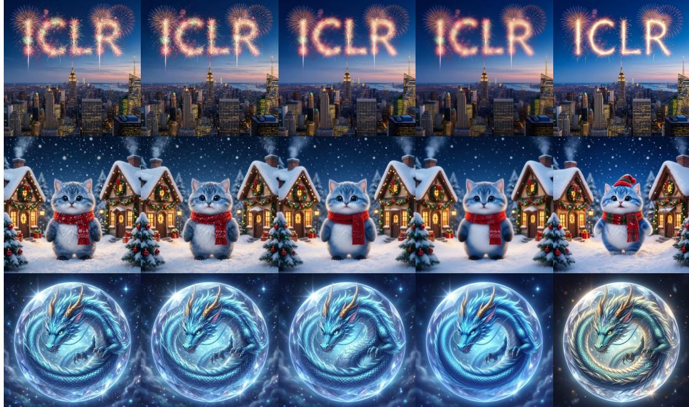  
Figure 8: Qualitative comparison with previous acceleration methods on Qwen-Image-2512.

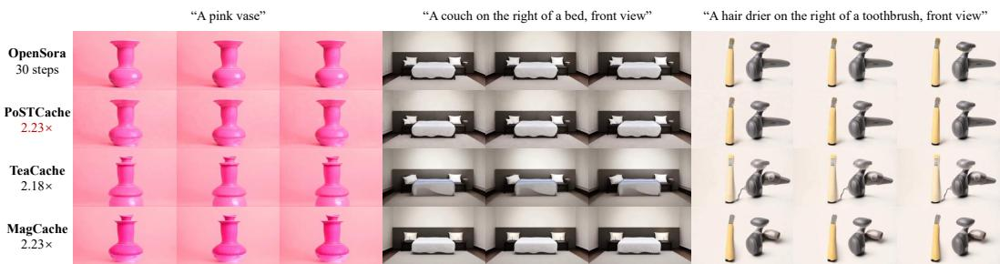  
Figure 9: Qualitative comparison with previous acceleration methods on OpenSora 1.2.

Retrospective reintegration can also introduce a local state–prediction mismatch at future anchors. Appendix C.6 shows that unconditional anchor refresh reduces this mismatch but is less computeefficient than broader anchor coverage in our matched-NFE comparison. Our analysis nevertheless compares only two coarse allocation strategies and does not exclude more selective policies. An adaptive scheme that refreshes only high-risk anchors, or dynamically allocates each additional model evaluation between anchor refresh and new anchor placement, may yield a more favorable consistency–coverage trade-off.

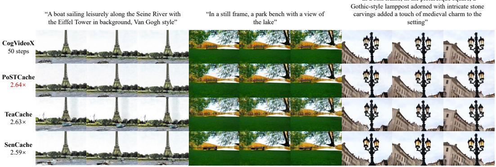

Figure 10: Qualitative comparison with previous acceleration methods on CogVideoX.  
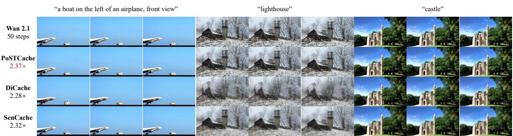  
Figure 11: Qualitative comparison with previous acceleration methods on Wan 2.1.

Postdictive correction further relies on the temporal correlation between skipped prediction errors and innovations revealed by future anchors. Our implementation approximates the full covariance dependent smoothing gain with an isotropic linear gain determined by sampling progress. Although this approximation is effective in the evaluated regimes, it cannot fully capture nonlinear, featuredependent, or sample-specific error evolution. Under very aggressive acceleration or unusually long cache intervals, accumulated drift may weaken the relationship between a future innovation and earlier skipped predictions, limiting the recoverable error.