# PhysSkin++: Real-Time and Generalizable Physics-Based Animation via Self-Supervised Neural Skinning

Yuanhang Lei, Baofei Liu, Xingxuan Li, Tao Cheng, Zixuan Wang, Boming Zhao, Yujun Shen, Siyuan Huang, Ruizhen Hu, Peter Yichen Chen, Hujun Bao, and Zhaopeng Cui†

Abstract—Generalizing real-time physics-based animation across diverse 3D shapes and spatial discretizations remains challenging. In this paper, we introduce PhysSkin++, a physicsinformed framework that learns continuous neural skinning fields from static geometries to construct compact deformation subspaces. Specifically, we propose a Neural Skinning Fields Autoencoder that predicts shape-dependent deformation subspaces without per-object network training. To learn these subspaces without simulation trajectories, we develop a Physics-Informed Self-Supervised Learning strategy that combines skinning-field normalization with conflict-aware gradient correction, stabilizing joint optimization under physical and orthogonality constraints. The learned representation supports efficient reduced dynamics with user control and contact interactions, together with direct animation binding to meshes, point clouds, and 3D Gaussians. For prescribed rig animation, we further introduce a self-supervised complementarity objective to learn complementary elastic responses without enforcing complementarity constraints at runtime. Experiments demonstrate cross-shape generalization of the learned skinning fields, real-time reduced simulation, and applications to controllable, collision-aware, and rig-complementary animation. Project page: https://zju3dv.github.io/PhysSkin plus/.

Index Terms—Physics-based animation, geometric deep learn ing, reduced-order modeling, self-supervised learning.

## I. INTRODUCTION

Real-time physics-based animation is a long-standing goal in computer vision and graphics, underpinning applications in VR/AR authoring, character animation, and interactive digital content creation. To support such applications, an animation system must provide a compact yet expressive motion representation that captures physically plausible deformations, accommodates user control and interactions, and remains computationally efficient for real-time animation.

Subspace physics-based animation [2], [10] addresses this by learning a low-dimensional motion subspace for efficient computation, and then lifting the result back to the full space using a subspace mapping. However, classical methods [2], [51] optimize a single linear subspace mapping matrix tied to a particular mesh topology and resolution, which prevents generalization across different spatial discretizations. Recently, neural methods [10], [49] have emerged as promising alternatives by using neural networks to learn subspace mappings that naturally handle arbitrary spatial discretizations. These approaches, however, must still train a separate network per object and fail to generalize to different 3D shapes. In parallel, recent transformer-based approaches learn physical dynamics directly from simulation trajectories across diverse objects and physical systems [15], [58]. Although this data-driven route enables generalizable neural simulation, it requires extensive trajectory supervision and does not explicitly construct a lowdimensional deformation subspace for reduced-order animation. These limitations motivate a central question: How can we learn a physics-consistent deformation subspace mapping that generalizes across diverse 3D shapes and discretizations directly from static geometries, without relying on supervised training data?

In this work, we introduce PhysSkin++ (Fig. 1), a generalizable physics-informed framework for real-time physicsbased animation across diverse 3D shapes and discretizations. In the spirit of Linear Blend Skinning (LBS) [43], we use continuous skinning fields to define a deformation subspace mapping, with handle transformations serving as the reduced coordinates for full-space 3D object deformation. To construct this representation directly from static geometries, we introduce a Neural Skinning Fields Autoencoder. Specifically, PhysSkin++ employs a transformer-based point cloud encoder to extract latent shape features from surface samples, while a crossattention decoder predicts continuous neural skinning fields at arbitrary spatial locations. PhysSkin++ requires no simulation trajectories, skinning annotations, or category-specific priors. This mesh-free, discretization-agnostic representation generalizes across object categories, topologies, and resolutions.

Learning such a deformation subspace mapping purely from geometry is highly non-trivial. A physically meaningful subspace must exhibit low potential energy, reflecting defor mation modes compatible with physically plausible behavior; spatial smoothness, ensuring coherent deformations; and orthogonality, promoting independence among the deformation modes. We therefore formulate a self-supervised objective consisting of potential-energy, smoothness, and orthogonality terms. However, jointly optimizing these terms often leads to conflicts in gradient magnitude and direction, making naive joint optimization unstable. To overcome this optimization challenge, we introduce a Physics-Informed Self-Supervised Learning (PISSL) strategy. First, we apply on-the-fly skinningfield normalization, which regulates the scale of the learned skinning weights and prevents numerical drift during training.

Self-Supervised Neural Skinning via Transformer  
Applications  
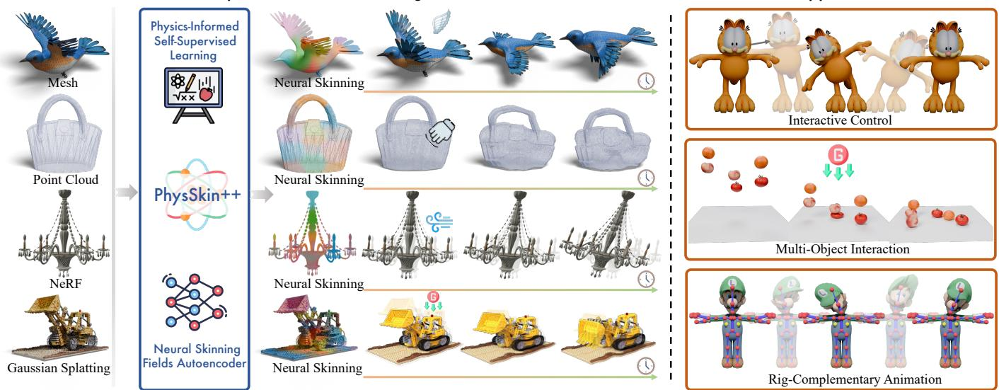  
Fig. 1. PhysSkin++ is a generalizable physics-informed neural skinning framework for object animation. The framework is learned directly from static 3D geometries via physics-informed self-supervision without any annotated data. Once trained, PhysSkin++ can be applied in a feed-forward manner to perform neural skinning for diverse 3D shapes and discretizations, enabling real-time physics-based animation. It further supports interactive control, collision-aware multi-object interaction, and rig-complementary animation.

Second, we incorporate a conflict-aware gradient correction mechanism [37] to resolve destructive interference among gradients of the loss terms, enabling balanced optimization and stable convergence. Together, these mechanisms enable PhysSkin++ to learn a physically consistent deformation subspace mapping directly from static geometries, with spatially smooth and approximately orthogonal skinning fields.

At runtime, we advance the reduced coordinates through implicit reduced dynamics and map them to full-space deformations through the learned skinning-based subspace mapping. To support controllable and collision-aware animation, we incorporate Dirichlet boundary conditions, interactive control, environmental interaction, and multi-object contact into this formulation. Prescribed boundary displacements are enforced through a boundary-compatible deformation map, while exter nal forces and contact interactions are incorporated through their corresponding energy terms. This formulation supports both rigid–deformable and deformable–deformable interactions within the learned deformation subspaces. Moreover, the continuous deformation map can be directly bound to different spatial discretizations, including 3D Gaussian representations [28], en abling physics-based animation of diverse object representations within the same reduced dynamics framework.

Beyond purely physics-driven animation, PhysSkin++ also supports rig-complementary animation when an artist-authored LBS rig is available. Artist-authored rigs provide intuitive lowdimensional control, but their kinematic deformations alone cannot reproduce physical elastic responses, while increasing the complexity of a rig places a greater burden on animation authoring. Complementary dynamics [6], [65] addresses this tension by augmenting a prescribed rig animation with complementary physical deformations. Following this principle, PhysSkin++ treats the user-authored rig-based animation as the primary animation and learns neural skinning fields for complementary elastic response. We augment the self-supervised objective with a rig-space complementarity term defined by the rig Jacobian, encouraging the learned deformation subspace to be complementary to the prescribed rig animation space. At runtime, the resulting reduced dynamics enriches the prescribed animation with physics-based complementary displacement without enforcing the rig-space complementarity constraint at every step. Both animation settings share the continuous skinning representation and reduced dynamics framework.

Experiments on various datasets evaluate the learned skinning fields and demonstrate real-time physics-based animation across diverse shapes, controls, interactions, and spatial discretizations. Our contributions are:

• We present PhysSkin++, a generalizable physics-informed framework for real-time physics-based animation across diverse 3D shapes and discretizations by learning neural skinning fields directly from static geometries. Its Neural Skinning Fields Autoencoder employs a transformer-based shape encoder and a cross-attention decoder to predict continuous skinning fields.

• We develop a Physics-Informed Self-Supervised Learning (PISSL) strategy that incorporates on-the-fly skinningfield normalization and conflict-aware gradient correction, enabling stable joint optimization of multiple selfsupervised loss terms.

• We develop a controllable and collision-aware reduced dynamics formulation that supports Dirichlet boundary conditions, interactive control, environmental interaction, and multi-object contact, together with discretizationagnostic binding of the continuous deformation map to meshes, point clouds, and 3D Gaussian representations.

• We support rig-complementary animation by extending the self-supervised objective with a rig-space complementarity term defined by the rig Jacobian. This enables physics-based complementary elastic responses under interactive rig control and user-authored animation sequences without enforcing the rig-space complementarity constraint at runtime.

A preliminary version of this work has been published as PhysSkin [30]. The present article extends the conference version in four aspects. First, we develop a reduced dynamics formulation for controllable and collision-aware animation, sup porting prescribed boundary displacements, interactive control, environmental interaction, and multi-object contact. Second, we provide a discretization-agnostic binding formulation for 3D Gaussian representations, updating both Gaussian centers and anisotropic covariances through local affine transformations determined by the learned skinning fields and current reduced coordinates. Third, we extend the deformation representation with prescribed rig displacement and the self-supervised objec tive with a rig-space complementarity term. These extensions support complementary elastic deformation for prescribed rig animations without enforcing the complementarity constraint at runtime. Finally, we expand the experimental evaluation to cover controllable and collision-aware animation, 3D Gaussian animation, and self-supervised rig-complementarity learning, including rig-complementary animation under interactive rig control and user-authored animation sequences.

## II. RELATED WORK

Neural Physics-Based Animation. Subspace physics-based animation [2], [10], [57] is an effective method for accelerating animation computations. Its core idea is to learn a lowdimensional motion subspace for efficient computation, and then lift the result back to the full space using a subspace mapping. Recently, fully neural approaches have been proposed to directly learn subspace mapping by neural networks. Datadriven methods [9], [10], [17], [50], [68] represented by CROM [10] learn the mapping for a single object by fitting neural networks to motion sequences from physical simulators, but they have limited generalization ability to unseen motion patterns. In parallel, recent transformer-based approaches learn physical dynamics directly from simulation trajectories across rigid, deformable, and particle-based systems [12], [15], [19], [58]. Data-free methods [8], [41], [44], [49], [59] learn a low-energy subspace mapping by physics-informed learning without requiring motion sequences, but pure neural network approaches often struggle to converge to high-quality subspace representations. Recently, Simplicits [44] learns neural skinning weight functions as a physics-informed subspace mapping by minimizing a quadratic energy subject to orthogonality constraints, which stabilizes training compared to purely neural models but limits generalization due to its per-object network design. Our method overcomes these limitations with a neural skinning fields autoencoder that outputs skinning weights generalizing across diverse 3D shapes, enabling real-time subspace physics-based animation. Our physics-informed neural subspace formulation retains explicit reduced-order dynamics and complements approaches that learn dynamics directly from simulation trajectories.

Neural Rigging and Skinning Representations. Another classical reduced deformation representation is skeletal riggingbased animation [5], [16], [39]. Recently, based on 3D shape

VAEs [64], [67], many works [14], [20], [36], [52], [53], [62], [66] have performed supervised learning from expert-annotated 3D object rigging and skinning datasets to infer objects’ joints, bones, and skinning weights through a feed-forward network. However, some methods are limited to specific categories of 3D shapes such as characters [20], [62] or animals [55], [60], as they incorporate category-specific priors [39], [69] such as predefined skeletal structures or semantic constraints, making it difficult to generalize to other object categories. Works represented by Anymate [14] learn from annotated 3D object rigging and skinning datasets and design category-agnostic network architectures, thereby enabling the ability to generalize across diverse object categories and demonstrating stronger generalization capabilities. However, these methods heavily rely on expert-annotated data [14], [34], [35], [40], [60], which are costly and difficult to scale. In contrast, our work employs self-supervised learning to train neural skinning fields directly from static 3D geometries without any annotated data.

## III. METHOD

## A. Framework Overview and Problem Formulation

PhysSkin++ is a generalizable physics-informed framework for real-time physics-based animation across diverse 3D shapes and discretizations. As illustrated in Fig. 2, our neural skinning fields autoencoder predicts continuous skinning fields from static geometry to define a deformation subspace mapping. The autoencoder is trained through Physics-Informed Self-Supervised Learning (PISSL) under physical and numerical constraints. At runtime, we advance reduced coordinates to animate objects with boundary conditions, interactive control, and contact. Beyond purely physics-driven animation, PhysSkin++ also supports rig-complementary animation by learning complementary deformation subspaces for prescribed rigs. Moreover, the continuous deformation map supports binding to mesh vertices, sampled points, and 3D Gaussians.

Classical full-space physics-based animation methods [27], [31], [38], [51], [61], [63] typically use explicit or implicit time integrators to update the object’s motion state. Explicit time integrators are often constrained by stability conditions [33], while implicit time integrators require solving a large nonlinear optimization problem in the high-dimensional full space. PhysSkin++ instead represents the deformation using continuous neural skinning fields and advances only the corresponding reduced-order subspace coordinates through implicit time integration. This lower-dimensional optimization reduces computational cost [6], enabling real-time physicsbased animation.

Continuous Skinning-Based Deformation Representation. To model full-space 3D object deformations within a reducedorder subspace, in the spirit of Linear Blend Skinning (LBS) [43], we represent the deformation map $\begin{array} { r } { \pmb { x } = \phi ( \mathbf { X } , \mathbf { z } ( t ) ) } \end{array}$ using a weighted sum of m affine displacement transformations:

$$
\phi ( \mathbf { X } , \mathbf { z } ) = \mathbf { X } + \sum _ { i = 1 } ^ { m } W _ { i } ( \mathbf { X } ) \mathbf { Z } _ { i } \left[ { \mathbf { X } } \right] .\tag{1}
$$

Here, $\mathbf { X } \in \mathbb { R } ^ { 3 }$ is a point in undeformed space and $\pmb { x } \in \mathbb { R } ^ { 3 }$ is its deformed position, m is the number of skinning handles,

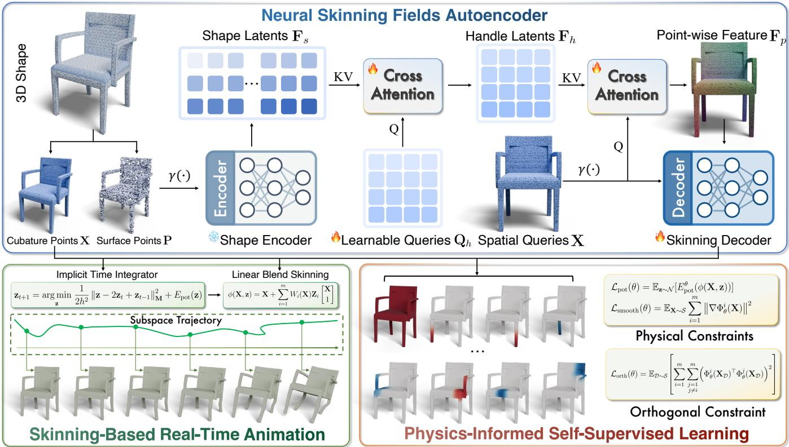  
Fig. 2. Given a static 3D shape, we first sample volumetric cubature points for animation and surface points for shape encoding. A shape encoder processes the surface points to produce shape latents, from which a set of learnable queries extract handle latents via cross-attention. Subsequently, spatial queries attend to the handle latents through another cross-attention block to derive point-wise features, which are decoded into neural skinning fields. A geometry-only, physics-informed learning strategy optimizes the network in a self-supervised manner under physical and orthogonality constraints, enabling the learned skinning fields to support real-time, physics-based animation.

$W _ { i } : \mathbb { R } ^ { 3 }  \mathbb { R }$ is the continuous skinning weight function associated with handle $i ,$ and $\mathbf { Z } _ { i } \in \mathbb { R } ^ { 3 \times 4 }$ parameterizes its affine displacement. The vector $\mathbf { z } = \mathbb { I } \mathrm { a t } ( \mathbf { Z } ) \in \mathbb { R } ^ { 1 2 m }$ stacks all handle parameters and serves as the reduced-order subspace coordinates, compactly representing the full-space deformation of n spatial sample points, where $m \ll n$ . We first describe the representation and learning procedure for purely physics-driven animation, and then introduce the prescribed rig displacement and rig-space complementarity objective in Sec. III-E.

## B. Neural Skinning Fields Autoencoder

We train a neural skinning fields autoencoder to predict spatially continuous skinning weights across diverse 3D shapes and discretizations. The resulting mesh-free representation supports the skinning-based real-time animation described in Sec. III-D. Unlike existing neural subspace methods [10], [44] that train a separate neural network for each object, our single feedforward network generalizes across diverse objects, improving scalability and practicality.

Neural 3D Shape Encoding. We use the transformer-based point cloud encoder Michelangelo [67] to extract a highly compressed latent set $\mathbf { F } _ { s } \in \mathbb { R } ^ { M \times d }$ for a given 3D shape via a cross-attention block and several self-attention blocks:

$$
\mathbf F _ { s } = \mathrm { S e l f A t t n } ^ { ( 1 : L ) } ( \mathrm { C r o s s A t t n } ( \mathbf Q _ { s } , \gamma ( \mathbf P ) ) ) ,\tag{2}
$$

where $\mathbf { Q } _ { s } \in \mathbb { R } ^ { M \times d }$ is a set of learnable shape latent tokens, $\mathbf { P } \in \mathbb { R } ^ { N \times 6 }$ is the sampled surface point cloud with N points, each point consisting of 3D coordinates and normals, $\gamma ( \cdot )$ is point-wise positional encoding, $\mathrm { S e l f A t t n } ^ { ( 1 : L ) } ( \cdot )$ indicates a stack of L self-attention layers that iteratively improve the shape latent representation, M is the number of latents, and d is the dimension of each latent. In practice, the shape encoder is pretrained on the ShapeNet dataset [7] via a signed distance field (SDF) reconstruction task [47] to learn generalizable geometric priors. We then freeze the encoder parameters during training to enhance efficiency.

Neural Skinning Fields Decoding. To obtain spatially continuous skinning fields, we decode the shape latent set ${ \bf F } _ { s }$ obtained from Eq. (2) into spatially varying skinning weights. We first assign m learnable skinning handle tokens $\mathbf { Q } _ { h } \in \mathbb { R } ^ { m \times d }$ , and then use a cross-attention block to extract a skinning handle latent set $\mathbf { F } _ { h } \in \mathbb { R } ^ { m \times d }$ from the shape latent set ${ \bf F } _ { s }$

$$
\mathbf { F } _ { h } = \operatorname { C r o s s } \mathrm { A t t n } ( \mathbf { Q } _ { h } , \operatorname { S e l f A t t n } ( \mathbf { F } _ { s } ) ) .\tag{3}
$$

Next, for any spatial query point X, we use another crossattention block to extract a point-wise skinning feature $\mathbf { F } _ { p } \in \mathbb { R } ^ { d }$ from the skinning handle latent set ${ { \bf { F } } _ { h } } { \bf { : \Psi } }$

$$
\mathbf { F } _ { p } = { \mathrm { C r o s s A t t n } } ( \gamma ( \mathbf { X } ) , \mathbf { F } _ { h } ) .\tag{4}
$$

Finally, we concatenate the point-wise skinning feature $\mathbf { F } _ { p }$ with the positional encoding of the query point, and use a ResNet-style MLP to compute the skinning fields:

$$
W ( \mathbf { X } ) = \mathrm { M L P } ( \mathbf { F } _ { p } \oplus \boldsymbol { \gamma } ( \mathbf { X } ) ) ,\tag{5}
$$

where $W ( \mathbf { X } ) \in \mathbb { R } ^ { m }$ is the skinning weight vector at point X, and ⊕ denotes the concatenation operator. To promote orthogonality among different skinning modes, we apply an Orthogonalization by Newton’s Iteration (ONI) module [26] at the final layer of the MLP, and we adopt ELU as the activation function in the MLP, which allows learning flexible and expressive skinning-based deformation subspaces without enforcing non-negativity on the learned skinning modes. We denote the full autoencoder by $\Phi _ { \theta }$ and its skinning weight output at X by $\Phi _ { \theta } ( \mathbf { X } )$ . The continuous fields can be queried throughout the object, while cubature points specify locations for physics-informed training and numerical integration.

Cubature Points Sampling. In the classical Finite Element Method (FEM) [51], the object’s volume is typically discretized into a tetrahedral mesh [23] to facilitate numerical solutions of physical equations. Unlike triangle surface meshes commonly used for rendering, which only contain surface points, tetrahedral meshes include interior volumetric elements that better capture the object’s spatial structure. To train the neural skinning fields autoencoder, we sample cubature points both on the object’s surface and inside its volume, with each cubature point serving as a spatial query point X for computing the potential energy $E _ { \mathrm { p o t } }$ during subspace learning and skinningbased real-time animation. This sampling captures volumetric deformation behavior that surface-only sampling cannot, in contrast to popular 3D Shape VAEs [64] that only sample surface points. To sample interior cubature points, we first convert the object’s surface mesh into a watertight mesh [24], [25], then uniformly sample points in the voxelized spatial grid using ray tracing [45], and classify points as being outside the object if the ray intersects the surface mesh and the dot product with the normal is negative. For surface cubature points, we employ Sharp Edge Sampling (SES) [11] to better capture geometric details.

## C. Physics-Informed Self-Supervised Learning

To learn a deformation subspace mapping directly from static geometry without annotated skinning data or precomputed simulation trajectories, we train the neural skinning fields autoencoder with a Physics-Informed Self-Supervised Learning (PISSL) strategy. The learned skinning fields should be spatially smooth and mutually independent, while inducing lowenergy deformations. We therefore formulate a self-supervised objective consisting of potential-energy, smoothness, and orthogonality terms:

$$
{ \mathcal { L } } _ { \mathrm { s u b s p a c e } } ( \theta ) = { \mathcal { L } } _ { \mathrm { s m o o t h } } ( \theta ) + \lambda _ { \mathrm { p o t } } { \mathcal { L } } _ { \mathrm { p o t } } ( \theta ) + \lambda _ { \mathrm { o r t h } } { \mathcal { L } } _ { \mathrm { o r t h } } ( \theta ) ,\tag{6}
$$

where $\lambda _ { \mathrm { p o t } }$ and $\lambda _ { \mathrm { o r t h } }$ weight the potential-energy and orthogonality losses, respectively. The additional objective for rigcomplementary learning is introduced in Sec. III-E.

Physical Constraints. To encourage physically plausible deformations, we construct a low-energy subspace [49] by minimizing the expected potential energy of deformations induced by randomly sampled subspace coordinates $\mathbf { z } \in \mathbb { R } ^ { 1 2 m }$

$$
\begin{array} { r } { \mathcal { L } _ { \mathrm { p o t } } ( \theta ) = \mathbb { E } _ { \mathbf { z } \sim \mathcal { N } } [ E _ { \mathrm { p o t } } ^ { \theta } ( \phi ( \mathbf { X } , \mathbf { z } ) ) ] , } \end{array}\tag{7}
$$

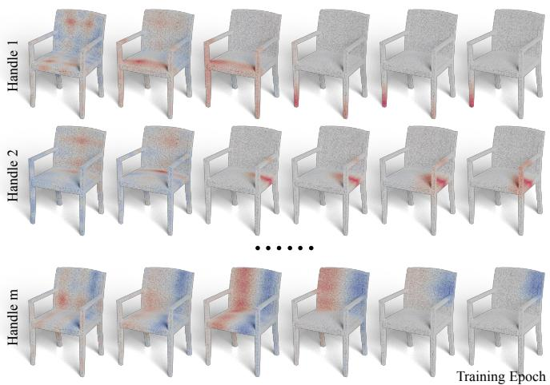  
Fig. 3. Evolution of neural skinning fields during optimization. Starting from disordered initial representations, our physics-informed self-supervised learning progressively organizes them into physically consistent, approximately orthogonal, and spatially smooth skinning results. For visualization, each skinning weight function $W _ { i }$ is divided by max $| W _ { i } |$ to fall within $[ - 1 , 1 ] .$

where z is defined in Sec. III-A, and $\mathcal { N } = \mathcal { N } ( \mathbf { 0 } , \mu ^ { 2 } \mathbf { I } _ { 1 2 m } )$ denotes a Gaussian distribution over $\mathbb { R } ^ { 1 2 m }$ with $\mu = 0 . 2$ . The expectation is estimated by averaging the potential energy over sampled subspace coordinates within a training batch. Here, $E _ { \mathrm { p o t } } ^ { \theta } ( \phi ( \mathbf { X } , \mathbf { z } ) )$ denotes the object’s potential energy evaluated using the deformation map induced by z under the current network parameters θ, with spatial integration approximated using cubature points. During training, we linearly interpolate the potential energy computation from the linear elasticity [56] model to the Neo-Hookean [29] model to enhance training stability [44]. Besides the low-energy constraint imposed by ${ \mathcal { L } } _ { \mathrm { p o t } } .$ , we also expect $\Phi _ { \theta } ( \mathbf { X } )$ to be spatially smooth, so we introduce a spatial smoothness loss:

$$
\mathcal { L } _ { \mathrm { s m o o t h } } ( \theta ) = \mathbb { E } _ { \mathbf { X } \sim S } \sum _ { i = 1 } ^ { m } \| \nabla \Phi _ { \theta } ^ { i } ( \mathbf { X } ) \| ^ { 2 } ,\tag{8}
$$

where $s$ denotes the set of sampled cubature points introduced in Sec. III-B, and $\nabla \Phi _ { \theta } ^ { i }$ is the spatial gradient of the i-th skinning weight function at point X under the current network parameters θ.

Orthogonality Constraint. To enhance subspace expressiveness, we introduce a loss that promotes orthogonality among the learned skinning weight functions:

$$
\mathcal { L } _ { \mathrm { o r t h } } ( \theta ) = \mathbb { E } _ { \mathcal { D } \sim \mathcal { S } } \left[ \sum _ { i = 1 } ^ { m } \sum _ { j = 1 } ^ { m } \left( \Phi _ { \theta } ^ { i } ( \mathbf { X } _ { \mathcal { D } } ) ^ { \top } \Phi _ { \theta } ^ { j } ( \mathbf { X } _ { \mathcal { D } } ) \right) ^ { 2 } \right] ,\tag{9}
$$

where D denotes a training batch of cubature points sampled from the overall set $s ,$ and $\mathbf { X } _ { \mathcal { D } }$ represents the corresponding point matrix within the batch.

Stable Joint Optimization. Simplicits [44] jointly penalizes deviations from orthogonality and unit magnitude. We instead $\ell _ { 2 } { \mathrm { - n o r m a l i z e } }$ each column of the skinning weight matrix evaluated at the batch points on the fly. This normalization regulates the scale of the learned modes and prevents numerical drift during training, thereby facilitating optimization of the orthogonality objective and promoting more independent neural skinning fields. However, gradients of the self-supervised loss terms can differ substantially in magnitude and conflict in di rection, making naive joint optimization unstable. To overcome this challenge, we complement our on-the-fly skinning-field normalization with ConFIG [37] to correct conflicting gradients and stabilize joint optimization. In Fig. 3, we visualize the evolution of different skinning modes during optimization, demonstrating that our physics-informed self-supervised framework progressively organizes the initially unstructured skinning representations into low-energy, approximately orthogonal, and spatially smooth skinning results, which are then used for real-time physics-based animation as detailed in Sec. III-D.

## D. Skinning-Based Real-Time Animation

The learned neural skinning fields define a continuous subspace mapping through which reduced coordinates determine fullspace deformations for physics-based animation. We first describe the basic reduced dynamics, and then incorporate boundary conditions, external control, and contact energies. Rigcomplementary dynamics is introduced separately in Sec. III-E. Subspace Dynamics. With the skinning-based subspace representation, we can create motions with physically plausible deformations directly in the reduced-order subspace. We discretize the governing Newtonian physical equations using standard implicit time integration and update the subspace coordinates z over time as:

$$
\mathbf { z } _ { t + 1 } = \mathop { \mathrm { a r g } \mathrm { m i n } } _ { \mathbf { z } } \frac { 1 } { 2 h ^ { 2 } } \| \mathbf { z } - 2 \mathbf { z } _ { t } + \mathbf { z } _ { t - 1 } \| _ { \mathbf { M } } ^ { 2 } + E _ { \mathrm { p o t } } ( \phi ( \mathbf { X } , \mathbf { z } ) ) ,\tag{10}
$$

where h is the time step size, $\| \cdot \| _ { \mathbf { M } }$ is the norm induced by the reduced mass matrix M, and $E _ { \mathrm { p o t } }$ is the potential energy that induces the internal force, with $E _ { \mathrm { p o t } }$ supporting general hyperelastic material models. This formulation can be solved using standard Newton-based methods [46]. The much lower subspace dimensionality allows efficient optimization of Eq. (10) [6], enabling real-time physics-based animation.

Reduced Dynamics with Control and Contact. We extend Eq. (10) by augmenting its elastic potential with the energies associated with each animation setting. Let $\phi _ { D }$ denote the deformation map satisfying the prescribed Dirichlet boundary conditions. For a fixed boundary displacement field and fixed constrained region, we update the reduced coordinates via:

$$
\begin{array} { r } { \mathbf { z } _ { t + 1 } = \underset { \mathbf { z } } { \arg \operatorname* { m i n } } \ \frac { 1 } { 2 h ^ { 2 } } \left\| \mathbf { z } - 2 \mathbf { z } _ { t } + \mathbf { z } _ { t - 1 } \right\| _ { \mathbf { M } } ^ { 2 } + E _ { \mathrm { p o t } } ( \phi _ { D } ( \mathbf { X } , \mathbf { z } ) ) } \\ { + E _ { \mathrm { f o r c e } } ( \mathbf { z } , t ) + E _ { \mathrm { b n d } } ( \mathbf { z } ) + E _ { \mathrm { c o l l } } ( \mathbf { z } ) . \qquad } \end{array}\tag{11}
$$

Here, $E _ { \mathrm { f o r c e } }$ accounts for the effects of gravity or user-defined actuation forces, $E _ { \mathrm { b n d } }$ models penalty-based environment interaction, and $E _ { \mathrm { c o l l } }$ accounts for inter-object contact. In the absence of boundary constraints, $\phi _ { D }$ reduces to $\phi .$ Activating the relevant terms in Eq. (11) supports controllable and collision-aware animation.

Boundary and External Control. We enforce prescribed boundary displacements through Dirichlet boundary conditions and project global or localized external forces into the reduced space to drive and interactively control object deformation.

Dirichlet Boundary Conditions. Let $\Omega \subset \mathbb { R } ^ { 3 }$ denote the object’s rest domain and $\Gamma _ { D } \subseteq \partial \Omega$ its Dirichlet boundary. We define an indicator $d : \Omega \to \{ 0 , 1 \}$ for the unconstrained region, with $d = 0$ on $\Gamma _ { D }$ and $d = 1$ elsewhere, and let $\mathbf { g } : \Omega \to \mathbb { R } ^ { 3 }$ be a displacement field that matches the prescribed displacement on $\Gamma _ { D }$ . Following a boundary-compatible construction, we modify the deformation map in Eq. (1) as:

$$
\phi _ { D } ( \mathbf { X } , \mathbf { z } ) = \mathbf { X } + \mathbf { g } ( \mathbf { X } ) + d ( \mathbf { X } ) \sum _ { i = 1 } ^ { m } W _ { i } ( \mathbf { X } ) \mathbf { Z } _ { i } \left[ { \mathbf { X } } \right] .\tag{12}
$$

This construction is equivalent to modulating the runtime skinning fields by $d ( \mathbf { X } )$ . Consequently, the displacement induced by the reduced coordinates vanishes on $\Gamma _ { D }$ , where g directly specifies the prescribed boundary displacement for arbitrary reduced coordinates. Different boundary configurations are specified by selecting different subsets of ∂Ω. As shown in Fig. 4(a), varying the constrained region produces distinct boundary-conditioned deformation behavior under the same reduced formulation.

External Force and Interactive Control. External controls are represented as full-space force fields and then mapped to the reduced coordinates through the deformation map. Let $J _ { \phi }$ denote the Jacobian of the active deformation map with respect to the reduced coordinates. A full-space force $\mathbf { f } _ { x } ( t )$ gives:

$$
\mathbf { f } _ { z } ( t ) = J _ { \phi } ^ { \top } \mathbf { f } _ { x } ( t ) , \qquad E _ { \mathrm { f o r c e } } ( \mathbf { z } , t ) = - \mathbf { f } _ { z } ( t ) ^ { \top } \mathbf { z } .\tag{13}
$$

This linear potential applies to forces held fixed during each reduced solve. It covers global force fields, such as gravity, and localized user-defined actuation forces. Different controls share the same force-to-coordinate mapping while differing in how $\mathbf { f } _ { x } ( t )$ is constructed. For interactive dragging, we construct a Gaussian-kernel-weighted local force around the selected point and update the drag target position from the current user input at each frame before applying Eq. (13). As shown in Fig. 4(b), localized dragging enables direct manipulation of different character geometries.

Contact-Aware Multi-Object Dynamics. We handle contact through boundary-penalty environment interaction and pointbased IPC-style collision energies, with the latter supporting both rigid–deformable and deformable–deformable interaction. Boundary-Penalty Environment Interaction. We model simple environmental interactions, such as plane collision, as penalty constraints to prescribed geometric boundaries. Let $\Gamma _ { E }$ denote an environment boundary, and let A be the active set of animation points within its influence region. For each active point $j ,$ , we compute a boundary target $\bar { \mathbf { x } } _ { j } \in \Gamma _ { E }$ from the current environment geometry. The boundary penalty is:

$$
E _ { \mathrm { b n d } } ( \mathbf { z } ) = \sum _ { j \in \mathcal { A } } \big \| \phi _ { D } ( \mathbf { X } _ { j } , \mathbf { z } ) - \bar { \mathbf { x } } _ { j } \big \| _ { 2 } ^ { 2 } .\tag{14}
$$

The active set and targets are held fixed when differentiating this energy. The resulting full-space derivatives are mapped to the reduced coordinates using the same deformation-map Jacobian $J _ { \phi }$ as in $\operatorname { E q . }$ (13). For plane-collision scenarios, such as an inclined ramp, $\Gamma _ { E }$ is instantiated as a finite rectangular boundary with a prescribed normal. The target $\bar { \bf x } _ { j }$ is obtained by projecting the current point onto the boundary plane and restricting it to the finite boundary extent. Moving or rotating the boundary updates its geometry, active points, and boundary targets. As shown in Fig. 4(c), the same boundary-penalty formulation supports contact with planar environments across diverse object geometries and boundary orientations.

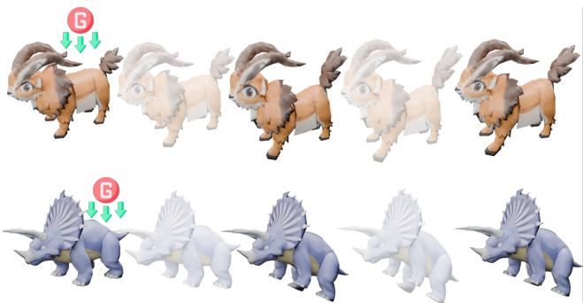  
(a) Dirichlet Boundary Conditions

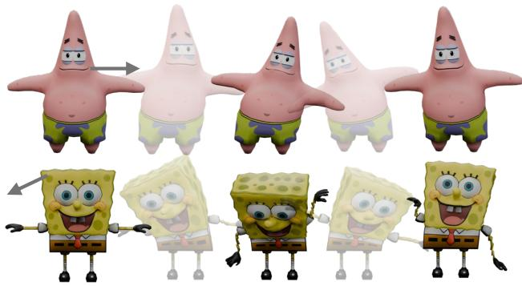  
(b) Interactive Control

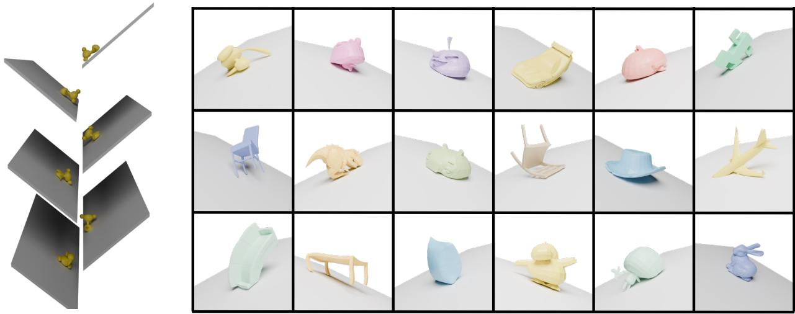  
(c) Boundary-Penalty Environment Interaction  
Fig. 4. Qualitative results for controllable and collision-aware reduced dynamics. (a) Dirichlet boundary conditions constrain prescribed regions during deformation. (b) Interactive dragging provides localized user control. (c) Boundary-penalty energies support contact with planar environments across diverse shapes. We encourage readers to visit our project page for additional animation videos.

IPC-Style Collision Energy. For multi-object interaction, we use sampled integration points as collision primitives and construct a contact set C by querying neighboring points from different objects. For each contact c, we store a contact direction $\mathbf { n } _ { c }$ and define the contact gap $d _ { c }$ as the signed separation along this direction. We normalize this gap by the contact radius $r _ { c } > 0 .$ i.e., $\begin{array} { r } { \widehat { d } _ { c } = d _ { c } / r _ { c } , } \end{array}$ , and use the following point-based log barrier inspired by Incremental Potential Contact (IPC) [32]:

$$
E _ { b , c } = \left\{ \begin{array} { l l } { - ( \widehat { d } _ { c } - 1 ) ^ { 2 } \log ( \widehat { d } _ { c } - r _ { p } ) , } & { r _ { p } < \widehat { d } _ { c } < 1 , } \\ { 0 , } & { \widehat { d } _ { c } \geq 1 , } \\ { + \infty , } & { \widehat { d } _ { c } \leq r _ { p } . } \end{array} \right.\tag{15}
$$

We assemble the collision term as $\begin{array} { r } { E _ { \mathrm { c o l l } } ~ = ~ k _ { c } \sum _ { c \in \mathcal { C } } E _ { b , c } , } \end{array}$ defining an IPC-style barrier over sampled point pairs. Here, $0 \leq r _ { p } < 1$ specifies the minimum normalized contact gap, and $k _ { c }$ controls the contact stiffness. The barrier is finite only for $\dot { d _ { c } } > r _ { p }$

Rigid–Deformable Interaction. We model rigid-body motion with a global rigid transformation, while the deformable geometry evolves according to the neural skinning deformation map. At the beginning of each time step, the transformed rigid surface samples and current deformable points are used to construct the active contact pairs. For each pair, the point-pair barrier in Eq. (15) is evaluated from the contact gap between the rigid and deformable sides. The rigid transformation is treated as prescribed input to this reduced deformable solve. As shown in Fig. 5(a), this formulation handles rigid–deformable contact across different object pairs and motions.

Deformable–Deformable Interaction. For K deformable objects, each object i maintains its own reduced coordinates zi, material parameters, and subspace dimension. We concatenate the reduced coordinates into the global reduced variable $\mathbf { z } = [ \mathbf { z } _ { 1 } ^ { \top } , \ldots , \mathbf { z } _ { K } ^ { \top } ] ^ { \top }$ and sum the per-object inertial, elastic, and control energies. Cross-object contacts couple these states through the same point-pair barrier in Eq. (15). For a contact c between objects a and b, let $J _ { \phi , a }$ and ${ \cal J } _ { \phi , b }$ denote their deformation-map Jacobians with respect to ${ \bf z } _ { a }$ and $\mathbf { z } _ { b } ,$ respectively, evaluated at the corresponding contact points. With the contact direction and radius held fixed during differentiation, the contact gap is affine in z. Applying the chain rule to the barrier energy gives the following reduced derivatives, showing only the nonzero blocks for objects a and b:

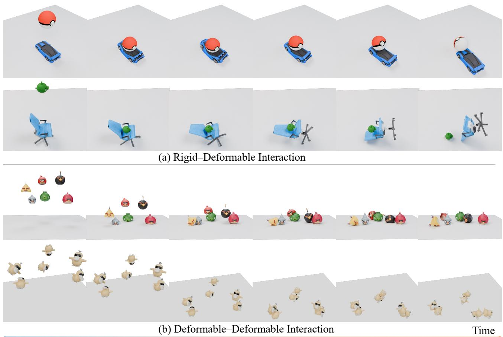  
Fig. 5. Qualitative results for collision-aware multi-object animation. (a) Rigid–deformable contact between objects with distinct geometries. (b) Deformable– deformable contact among multiple objects, jointly resolved by the reduced collision formulation. We encourage readers to visit our project page for additional animation videos.

$$
\begin{array} { r } { \displaystyle { \pmb J } _ { c } = \frac { \partial d _ { c } } { \partial \mathbf { z } } = { \bf n } _ { c } ^ { \top } [ { \pmb J } _ { \phi , a } - { \pmb J } _ { \phi , b } ] , } \\ { \displaystyle \nabla _ { \mathbf { z } } E _ { b , c } = { \pmb J } _ { c } ^ { \top } \frac { \partial E _ { b , c } } { \partial d _ { c } } , \qquad \nabla _ { \mathbf { z } } ^ { 2 } E _ { b , c } = { \pmb J } _ { c } ^ { \top } \frac { \partial ^ { 2 } E _ { b , c } } { \partial d _ { c } ^ { 2 } } { \pmb J } _ { c } . } \end{array}\tag{16}
$$

At each reduced solve step, we assemble these per-contact derivatives into the global gradient and Hessian of $E _ { \mathrm { c o l l } } ( \mathbf { z } )$ directly coupling the reduced states of contacting objects. As shown in Fig. 5(b), the resulting coupled system jointly resolves contacts among multiple deformable objects.

## E. Rig-Complementary Animation

Beyond purely physics-driven animation, PhysSkin++ also supports rig-complementary animation when an artist-authored LBS rig is available. The prescribed rig deformation serves as the primary animation, while complementary elastic deformation is parameterized by reduced coordinates through the learned neural skinning fields. We first describe the rig-based deformation and then introduce the rig-space complementarity objective used during self-supervised learning.

Rig-Based Deformation Representation. Consider a skeletal rig with $n _ { \mathrm { b } }$ bones, pose parameters p, and rest pose $ { \mathbf { p } } ^ { 0 }$ Let $\mathbf { G } _ { b } ( \mathbf { p } ) \in \mathrm { S E } ( 3 )$ be the global transformation of bone $b ,$ obtained by composing its local transformations along the kinematic hierarchy. We denote by $\mathbf { A } _ { b } ( \mathbf { p } ) \in \mathbb { R } ^ { 3 \times 4 }$ the affine transform induced by the relative bone motion $\mathbf { G } _ { b } ( \mathbf { p } ) \mathbf { G } _ { b } ( \mathbf { p } ^ { 0 } ) ^ { - 1 }$ With rig skinning weights $W _ { b } ^ { \mathrm { r i g } } ( { \bf X } )$ , LBS [43] maps a restspace point as:

$$
\phi _ { \mathrm { r i g } } ( \mathbf { X } , \mathbf { p } ) = \sum _ { b = 1 } ^ { { n } _ { \mathrm { b } } } W _ { b } ^ { \mathrm { r i g } } ( \mathbf { X } ) \mathbf { A } _ { b } ( \mathbf { p } ) \left[ \mathbf { X } \right] .\tag{17}
$$

Here, $\mathbf { A } _ { b } ( \mathbf { p } )$ moves the point from the rest configuration according to bone $b ,$ and the weighted sum blends the bonetransformed positions. Subtracting the rest position gives the rig displacement ${ \bf u } _ { \mathrm { r i g } } ( { \bf X } , { \bf p } ) = \phi _ { \mathrm { r i g } } ( { \bf X } , { \bf p } ) - { \bf X }$ . This formulation is efficient and directly controllable, but its kinematic deformations alone cannot produce physical elastic responses.

For rig-complementary animation, we augment the representation in Eq. (1) with the prescribed rig displacement:

$$
\begin{array} { l } { \displaystyle \phi ( \mathbf { X } , \mathbf { p } , { \mathbf z } ) = \mathbf { X } + \mathbf { u } _ { \mathrm { r i g } } ( \mathbf { X } , \mathbf { p } ) } \\ { \displaystyle + \sum _ { i = 1 } ^ { m } W _ { \theta , i } ^ { \mathrm { c o m p } } ( \mathbf { X } ) \mathbf { Z } _ { i } \left[ \mathbf { X } \right] . } \end{array}\tag{18}
$$

The neural skinning term defines the complementary elastic displacement $\mathbf { u } _ { \mathrm { c o m p } } ( \mathbf { X } , \mathbf { z } )$ . Both animation settings share the continuous skinning parameterization, with rig-complementary animation incorporating the prescribed rig displacement.

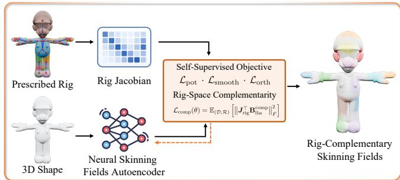  
Fig. 6. Self-supervised rig-complementarity training. The rig Jacobian of a prescribed rig provides a complementarity constraint for learning rigcomplementary neural skinning fields from static geometry.

Rig-Space Complementarity Constraint. Fig. 6 summarizes our self-supervised rig-complementarity training pipeline. For a batch D of $N _ { \mathcal { D } }$ cubature points, we stack the rig and complementary displacements as ${ \bf u } _ { \mathrm { r i g } } ( { \bf p } ) , { \bf u } _ { \mathrm { c o m p } } ( { \bf z } ) \in \mathbb { R } ^ { 3 N _ { \mathcal { D } } }$ We denote the rig Jacobian by $J _ { \mathrm { r i g } } = \partial { \bf u } _ { \mathrm { r i g } } ( { \bf p } ) / \partial { \bf p }$ . To prevent the physical component from duplicating motion expressible by the rig, we seek complementary displacements satisfying:

$$
\begin{array} { r } { J _ { \mathrm { r i g } } ^ { \top } \mathbf { u } _ { \mathrm { c o m p } } = \mathbf { 0 } . } \end{array}\tag{19}
$$

This condition makes the complementary displacement orthogonal to the rig motion subspace spanned by the columns of $J _ { \mathrm { r i g } }$ under the Euclidean inner product.

To impose this condition for arbitrary subspace coordinates z, we arrange the batch point matrix as $\mathbf { X } _ { \mathcal { D } } ^ { \mathbf { \mathcal { - } } } \in \mathbb { R } ^ { 3 \times N _ { \mathcal { D } } }$ and collect the predicted complementary weights in $W _ { \theta } ^ { \mathrm { c o m p } } ( \mathbf { X } _ { \mathcal { D } } ) \in$ $\mathbb { R } ^ { N _ { D } \times m }$ . Consistent with Eq. (18), the corresponding discrete skinning matrix is constructed as:

$$
\begin{array} { r l } & { \mathbf { B } _ { \mathrm { l b s } } ^ { \mathrm { c o m p } } = \mathbf { I } _ { 3 } \otimes \left[ \left( \mathbf { 1 } _ { m } ^ { \top } \otimes \left[ \mathbf { 1 } _ { N _ { D } } ^ { \top } \right] ^ { \top } \right) \right. } \\ & { \qquad \left. \odot \left( W _ { \theta } ^ { \mathrm { c o m p } } ( \mathbf { X } _ { \mathcal { D } } ) \otimes \mathbf { 1 } _ { 4 } ^ { \top } \right) \right] . } \end{array}\tag{20}
$$

Here, $\otimes$ and $\odot$ denote the Kronecker and Hadamard products, respectively, and $\mathbf { B } _ { \mathrm { l b s } } ^ { \mathrm { c o m p } } \ \in \ \mathbb { R } ^ { 3 N _ { \mathscr { D } } \times 1 2 m }$ . The displacement stacking and the flattening of handle parameters use the ordering consistent with this matrix, so that $\begin{array} { r } { { \bf u } _ { \mathrm { c o m p } } = { \bf B } _ { \mathrm { l b s } } ^ { \mathrm { c o m p } } { \bf z } . } \end{array}$

We use a linear control parameterization of the prescribed rig, yielding a constant rig Jacobian $J _ { \mathrm { r i g } }$ [6]. Since $\mathbf { u } _ { \mathrm { c o m p } } =$ $\mathbf { B } _ { \mathrm { l b s } } ^ { \mathrm { c o m p } } \mathbf { z }$ , the complementarity condition in Eq. (19) holds for arbitrary z when:

$$
\begin{array} { r } { J _ { \mathrm { r i g } } ^ { \top } \mathbf { B } _ { \mathrm { l b s } } ^ { \mathrm { c o m p } } = \mathbf { 0 } . } \end{array}\tag{21}
$$

We optimize the predicted complementary skinning weights using the following rig-space complementarity loss:

$$
\begin{array} { r } { \mathcal { L } _ { \mathrm { c o m p } } ( \boldsymbol { \theta } ) = \mathbb { E } _ { ( \mathcal { D } , \mathcal { R } ) } \left[ \left| \left| J _ { \mathrm { r i g } } ^ { \top } \mathbf { B } _ { \mathrm { l b s } } ^ { \mathrm { c o m p } } \right| \right| _ { F } ^ { 2 } \right] , } \end{array}\tag{22}
$$

where R denotes the prescribed rig and its Jacobian is evaluated on the same batch points as $\mathbf { B } _ { \mathrm { l b s } } ^ { \mathrm { c o m p } }$ . The rig-complementary training objective augments Eq. (6):

$$
{ \mathcal { L } } _ { \mathrm { r i g } } ( \theta ) = { \mathcal { L } } _ { \mathrm { s u b s p a c e } } ( \theta ) + \lambda _ { \mathrm { c o m p } } { \mathcal { L } } _ { \mathrm { c o m p } } ( \theta ) ,\tag{23}
$$

where $\mathcal { L } _ { \mathrm { s u b s p a c e } }$ is the self-supervised subspace learning objective defined in Eq. (6), $\mathcal { L } _ { \mathrm { c o m p } }$ is the rig-space complementarity loss defined in Eq. (22), and $\lambda _ { \mathrm { c o m p } }$ is a weighting hyperparameter. We optimize the resulting objective using the on-the-fly skinning-field normalization and conflict-aware gradient correction described in Sec. III-C.

Rig-Driven Complementary Dynamics. At runtime, the deformation representation in Eq. (18) expresses object deformation through the prescribed rig displacement and a complementary elastic displacement parameterized by the reduced coordinates. The rig trajectory $\left\{ \mathbf { p } _ { t } \right\}$ is supplied as an external kinematic input, such as an animator-authored pose sequence. Given the prescribed pose $\mathbf { p } _ { t + 1 }$ , we update the complementary coordinates through implicit reduced dynamics:

$$
\begin{array} { r l } & { \mathbf { z } _ { t + 1 } = \arg \operatorname* { m i n } \frac { 1 } { 2 h ^ { 2 } } \left\| \mathbf { z } - 2 \mathbf { z } _ { t } + \mathbf { z } _ { t - 1 } \right\| _ { \mathbf { M } } ^ { 2 } } \\ & { \quad \quad \quad + E _ { \mathrm { p o t } } ( \mathbf { X } + \mathbf { u } _ { \mathrm { c o m p } } ( \mathbf { X } , \mathbf { z } ) + \mathbf { u } _ { \mathrm { r i g } } ( \mathbf { X } , \mathbf { p } _ { t + 1 } ) ) . } \end{array}\tag{24}
$$

The complementarity loss in Eq. (22) encourages the condition in Eq. (19) during training, allowing the runtime solve to optimize only the complementary coordinates without additional complementarity constraints. As shown in Fig. 7, this formulation supports both interactive rig control and user-authored rig animation sequences, enriching their kinematic deformation with physics-based complementary elastic response.

## F. Discretization-Agnostic Animation Binding

A key advantage of representing skinning weights as continuous neural fields is the resulting discretization-agnostic deformation map. The learned fields can be evaluated directly at mesh vertices, sampled points, and neural scene primitives, allowing the same reduced physical state to deform different spatial discretizations. We demonstrate this binding capability with 3D Gaussian Splatting by directly binding the anisotropic Gaussian primitives to the learned skinning fields.

3D Gaussian Representation. 3D Gaussian Splatting (3DGS) [28] represents a scene using anisotropic Gaussian primitives $\mathcal { G } = \bar { \{ G _ { g } \} } _ { g = 1 } ^ { N _ { G } }$ , each parameterized as:

$$
\mathcal { G } _ { g } = \{ \mu _ { g } , { \bf R } _ { g } , { \bf s } _ { g } , \alpha _ { g } , { \bf c } _ { g } \} ,\tag{25}
$$

where $\mu _ { g } \in \mathbb { R } ^ { 3 }$ is the center, $\mathbf { R } _ { g } \in \mathrm { S O } ( 3 )$ is the rotation matrix, $\mathbf { s } _ { g } \in \mathbb { R } _ { + } ^ { 3 }$ contains the principal-axis scales, $\alpha _ { g } \in [ 0 , 1 ]$ is the opacity, and $\mathbf { c } _ { g }$ denotes the spherical harmonic (SH) appearance coefficients. The corresponding 3D covariance matrix is:

$$
\begin{array} { r } { \Sigma _ { g } = \mathbf { R } _ { g } \mathbf { S } _ { g } \mathbf { S } _ { g } ^ { \top } \mathbf { R } _ { g } ^ { \top } , \qquad \mathbf { S } _ { g } = \mathrm { d i a g } ( \mathbf { s } _ { g } ) . } \end{array}\tag{26}
$$

For rendering, each 3D Gaussian is projected to a screenspace Gaussian, whose color contribution is accumulated through depth-ordered alpha blending. Animating the Gaussian representation therefore requires updating the center and covariance of each Gaussian according to the underlying physical deformation.

Continuous Gaussian Binding. Let $\mu _ { g } ^ { 0 }$ denote the rest center of the g-th Gaussian. Since the neural skinning fields are spatially continuous, we directly evaluate $W _ { i } ( \mu _ { g } ^ { 0 } )$ at its rest center. Following the deformation map in Eq. (1), we construct the local affine transformation for each Gaussian as:

$$
\mathbf { T } _ { g } ( \mathbf { z } ) \equiv [ \mathbf { A } _ { g } ( \mathbf { z } ) \mathbf { t } _ { g } ( \mathbf { z } ) ] = [ \mathbf { I } _ { 3 } \mathbf { 0 } ] + \sum _ { i = 1 } ^ { m } W _ { i } ( { \boldsymbol { \mu } } _ { g } ^ { 0 } ) \mathbf { Z } _ { i } ,\tag{27}
$$

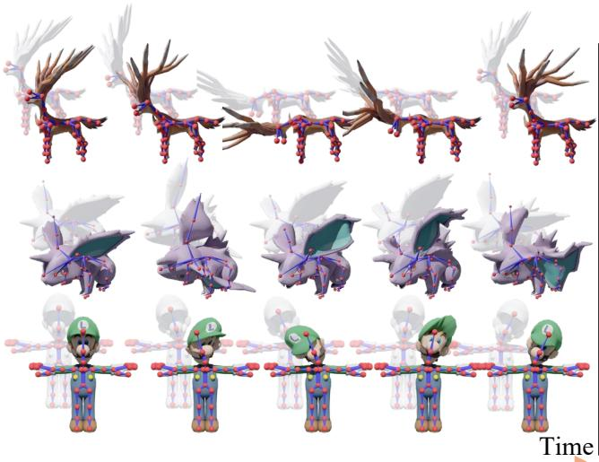

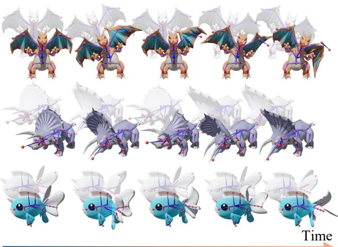  
(a) Interactive Rig Control

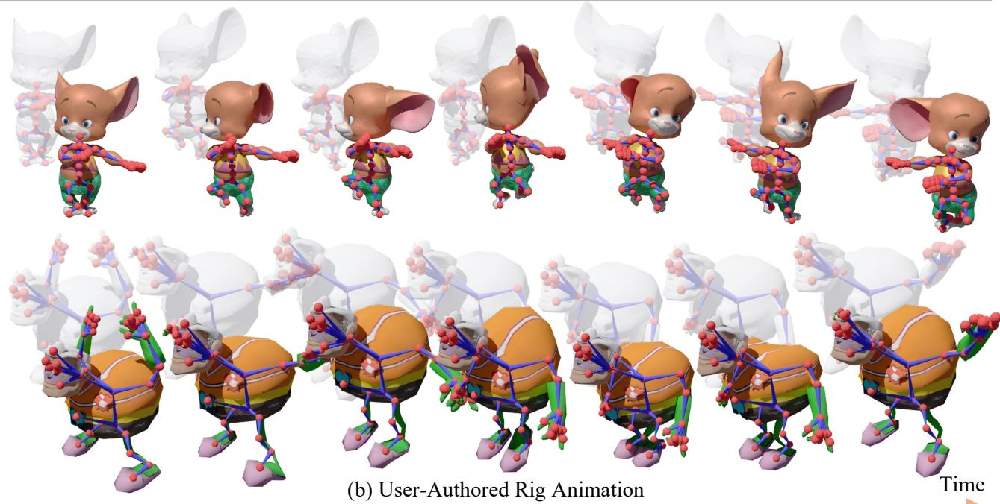  
Fig. 7. Qualitative results of rig-complementary animation. For each frame, the rig-driven primary motion without complementary elastic deformation is shown semi-transparently as a reference to the corresponding rig-complementary animation. (a) During interactive rig control, user-manipulated poses define the primary animation, and PhysSkin++ produces the corresponding complementary elastic response at runtime. (b) For user-authored rig animation sequences, PhysSkin++ augments the input kinematic trajectory with temporally evolving complementary elastic deformation. We encourage readers to visit our project page for additional animation videos.

where $\mathbf { A } _ { g } \in \mathbb { R } ^ { 3 \times 3 }$ is the linear part of the affine transformation, which may include rotation, scaling, and shear, and $\mathbf { t } _ { g } \in \mathbb { R } ^ { 3 }$ is its translation. We evaluate the skinning weights once at each Gaussian’s rest center and use these fixed weights throughout its kernel. The resulting local affine transformation is updated from the current reduced coordinates.

Gaussian Kernel Deformation. Let $\Sigma _ { g } ^ { 0 }$ denote the rest covariance. Applying the local affine transformation $\mathbf { T } _ { \boldsymbol { g } } ( \mathbf { z } )$ to the Gaussian kernel gives:

$$
\begin{array} { r } { \pmb { \mu } _ { g } ( \mathbf { z } ) = \mathbf { A } _ { g } ( \mathbf { z } ) \pmb { \mu } _ { g } ^ { 0 } + \mathbf { t } _ { g } ( \mathbf { z } ) , } \\ { \Sigma _ { g } ( \mathbf { z } ) = \mathbf { A } _ { g } ( \mathbf { z } ) \Sigma _ { g } ^ { 0 } \mathbf { A } _ { g } ( \mathbf { z } ) ^ { \top } . } \end{array}\tag{28}
$$

The center therefore follows the skinned point motion, while the covariance captures the induced rotation and anisotropic deformation of the Gaussian kernel. The opacity and SH coefficients retain their rest values.

Runtime Coupling. At runtime, we advance the reduced coordinates z using Eq. (10). At each frame, these coordinates determine the local affine maps in Eq. (27), which update the Gaussian centers and covariances through Eq. (28), driving physics-based animation of the Gaussian representation.

## IV. EXPERIMENTS

## A. Implementation Details

For the 3D shape encoder, we adopt the pre-trained Michelangelo [67] model which consists of one cross-attention block and eight self-attention blocks; the output latent set $\mathbf { F } _ { s } \in \mathbb { R } ^ { M \times d }$ has M = 256 and $d \ : = \ : 7 6 8$ . For each 3D object, we recenter and normalize it into a bounding volume of [−1, 1]3. For the 3D shape encoder, we sample 4096 points on the object surface as input. For cubature points sampling, we first sample 100k points on the surface, and then voxelize the space into a $1 2 8 ^ { 3 }$ grid to obtain interior points to form the complete candidate cubature point set. For each training batch, we randomly sample 1000 cubature points from the candidate point set for potential energy computation, following the same strategy as previous work [9], [44]. In each batch, we randomly sample 1024 subspace coordinate vectors z for training. Our framework is trained on 4 NVIDIA GeForce RTX 4090 GPUs. The learning rate is linearly increased to $5 \times 1 0 ^ { - 4 }$ within the first 1% of training iterations (warm-up), and then gradually decreased using the cosine decay schedule until reaching the minimum value of $5 \times 1 0 ^ { - 5 }$

TABLE I  
QUANTITATIVE COMPARISON ON THE RIGNET [62] DATASET.
<table><tr><td>Method</td><td>-2↓  $\Omega _ { \mathrm { o r t h } } \times 1 0 ^ { - }$ </td><td> $\kappa _ { \mathrm { l o g } }$  →</td><td> $H _ { \mathrm { s p e c } } \uparrow$ </td></tr><tr><td>RigNet [62]</td><td>0.5324</td><td>2.7997</td><td>0.9762</td></tr><tr><td>M-I-A [20]</td><td>1.4098</td><td>27.7357</td><td>0.7224</td></tr><tr><td>Anymate [14]</td><td>1.5737</td><td>2.6093</td><td>0.9682</td></tr><tr><td>Puppeteer [52]</td><td>0.5615</td><td>5.5605</td><td>0.9798</td></tr><tr><td>Ours</td><td>0.0033</td><td>1.0453</td><td>0.9999</td></tr></table>

## B. Evaluation of Learned Skinning Fields

Baselines. We compare our method with the following baselines: Simplicits [44], RigNet [62], M-I-A [20], Anymate [14], and Puppeteer [52] on the ShapeNet [7] and RigNet [62] datasets. Simplicits trains a separate neural network for each object to output skinning fields through self-supervised learning. The other baselines are supervised neural rigging and skinning methods that output object joints, bones, and skinning weights in a feed-forward manner. These methods are pretrained on expert-annotated datasets, then fine-tuned for comparison.

Evaluation Metrics. Since our framework is entirely selfsupervised and does not rely on annotated skinning data as ground truth, we draw from matrix analysis [4], [22] and spectral theory [13], [54] to propose three quantitative metrics that measure structural independence, numerical stability, and spectral balance of the skinning weights matrix $W \in \dot { \mathbb { R } ^ { N \times K } }$ where N is the number of vertices and K is the number of handles or bones. To ensure a fair comparison, we perform ℓ2-normalization on each column of W before evaluation for all methods, resulting in the matrix Wˆ .

(1) Orthogonality Metric. We first measure the pairwise orthogonality among handle or bone influence vectors as:

$$
\Omega _ { \mathrm { o r t h } } = \frac { 1 } { K ( K - 1 ) } \| \hat { W } ^ { \top } \hat { W } - I \| _ { 2 } ^ { 2 } ,\tag{29}
$$

where I is the $K \times K$ identity matrix. A smaller $\Omega _ { \mathrm { o r t h } }$ indicates that different handle or bone weights are more decorrelated and capture distinct deformation subspaces. Since each column of Wˆ is $\ell _ { 2 } \cdot$ -normalized, $\Omega _ { \mathrm { o r t h } }$ is bounded within [0, 1], and a smaller value indicates that each handle or bone encodes an independent deformation mode.

TABLE II  
QUANTITATIVE COMPARISON ON THE SHAPENET DATASET [7].
<table><tr><td>Method</td><td> $\Omega _ { \mathrm { o r t h } } \times 1 0 ^ { - 2 } \downarrow$ </td><td> $\kappa _ { \log \mathrm { ~ } } \downarrow$ </td><td> $H _ { \mathrm { s p e c } }$  个</td></tr><tr><td>RigNet [62]</td><td>0.5130</td><td>4.5417</td><td>0.9648</td></tr><tr><td>M-I-A [20]</td><td>1.5736</td><td>27.9573</td><td>0.7006</td></tr><tr><td>Anymate [14]</td><td>5.3520</td><td>4.9221</td><td>0.8858</td></tr><tr><td>Puppeteer [52]</td><td>1.9528</td><td>1.4317</td><td>0.9799</td></tr><tr><td>Simplicits [44]</td><td>0.2621</td><td>1.5205</td><td>0.9941</td></tr><tr><td>Ours</td><td>0.0098</td><td>1.0460</td><td>0.9997</td></tr></table>

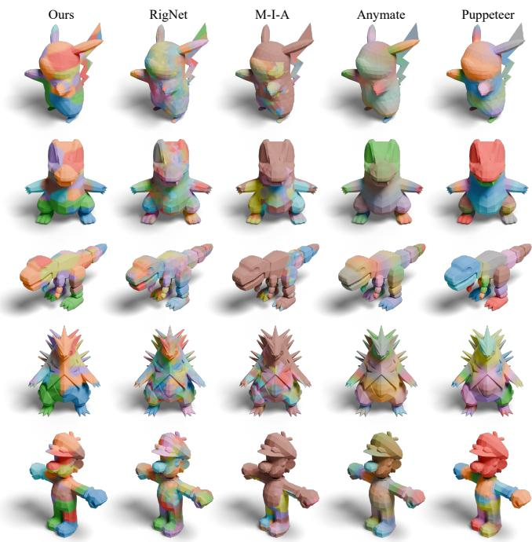  
Fig. 8. Qualitative comparisons on the RigNet [62] dataset. We visualize combined skinning fields obtained by blending all skinning weights together, providing an overall view of deformation influences and smoothness compared with baselines [14], [20], [52], [62].

(2) Log-Condition Number Metric. To evaluate the numerical stability of the skinning basis, we compute the log-scaled condition number [21] of the Gram matrix:

$$
\kappa _ { \mathrm { l o g } } = \log _ { 2 } \Big ( 1 + \frac { \lambda _ { \operatorname* { m a x } } ( \hat { W } ^ { \top } \hat { W } ) } { \lambda _ { \operatorname* { m i n } } ( \hat { W } ^ { \top } \hat { W } ) } \Big ) ,\tag{30}
$$

where $\lambda _ { \mathrm { m a x } }$ and $\lambda _ { \mathrm { m i n } }$ are the largest and smallest eigenvalues of $\hat { W } ^ { \top } \hat { W } . ~ \kappa _ { \log }$ lies within [1, +∞); a smaller value indicates a well-conditioned deformation basis, where small transformations result in stable geometric responses.

(3) Spectrum Entropy Metric. To assess the balance of spectral energy distribution across skinning weights, we define the spectrum entropy metric [13], [54] as:

$$
H _ { \mathrm { s p e c } } = - \frac { 1 } { \log K } \sum _ { i = 1 } ^ { K } p _ { i } \log p _ { i } , { p _ { i } = \frac { \lambda _ { i } } { \sum _ { j } \lambda _ { j } } } ,\tag{31}
$$

where $\{ \lambda _ { i } \} _ { i = 1 } ^ { K }$ are the eigenvalues of $\hat { W } ^ { \top } \hat { W } . H _ { \mathrm { s p e c } }$ is bounded within [0, 1], where higher values indicate more uniform spectral energy and balanced, expressive deformation modes. Results. We first evaluate neural skinning on unseen objects from the test set of the RigNet [62] dataset to assess generalization. The RigNet dataset provides annotated skinning data; we fine-tune the pretrained feed-forward neural skinning baselines using these annotations, whereas our model is trained only on the 3D meshes. Table I reports the quantitative comparison on unseen objects. Our method significantly outperforms the baselines across all three evaluation metrics, demonstrating its generalization ability. We further evaluate our method on the ShapeNet dataset [7], which provides clearly defined object categories. Our model is trained jointly across all categories, and all baselines are evaluated on the corresponding test sets. Because Simplicits can only be trained on a single object at a time, we train an individual Simplicits model for each object. The quantitative results in Table II show that our method consistently outperforms all baselines. In Fig. 8 and Fig. 10, we compare the qualitative skinning results with the baselines. Our method produces more physically consistent, geometrically orthogonal, and spatially smooth skinning results. Fig. 9 and Fig. 11 further show that our method generalizes to unseen objects and produces high-quality skinning results. For additional results, please refer to the supplementary material. Deformable Shape Family. In Fig. 12, our method uses a single model to infer skinning fields for a deformable shape family, while Simplicits [44] must be trained separately for each geometry. This comparison demonstrates the efficiency and cross-shape generalization of our framework.

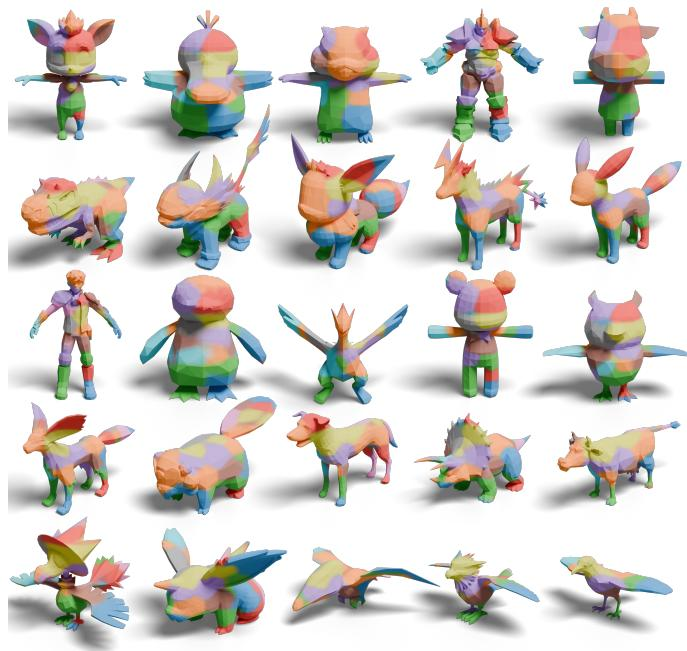  
Fig. 9. Qualitative results on unseen 3D shapes from the RigNet [62] test set. We visualize blended skinning fields to demonstrate our method’s generalization to novel 3D shapes. A single PhysSkin++ model produces all results.

Rig-Complementary Neural Skinning Fields. We evaluate the neural skinning fields learned with our self-supervised rig-complementarity objective on characters from the RigNet dataset [62], which provides the skeletal rigs and associated LBS skinning weights. Fig. 13 shows the learned fields across diverse character geometries and rig structures, with spatially varying patterns over the body and appendages. We further examine the resulting complementary elastic responses under interactive rig control and user-authored animation sequences

Ours

Simplicits

Anymate

Puppeteer

Ours

Simplicits

Anymate

Puppeteer

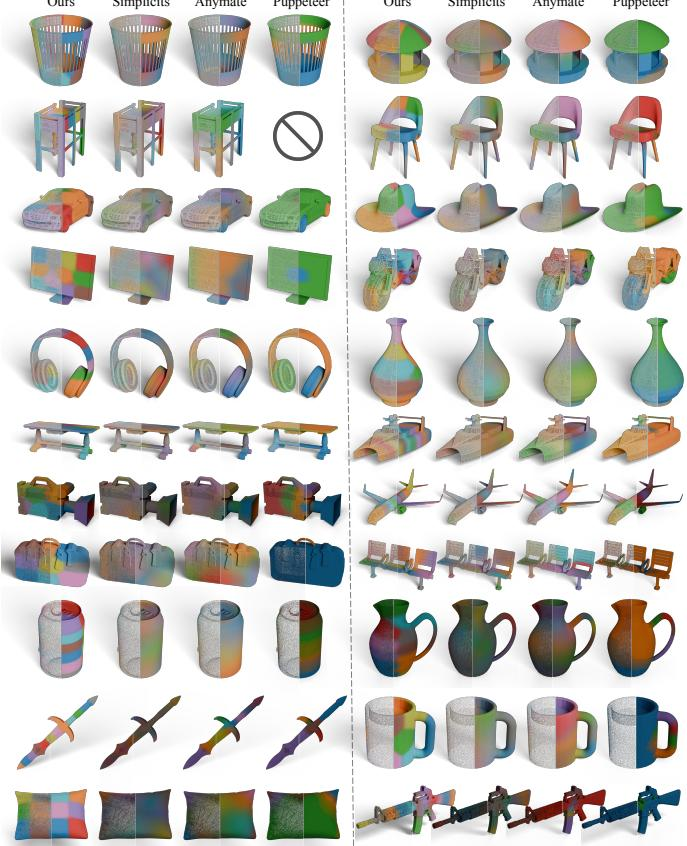

Fig. 10. Qualitative comparisons on the ShapeNet [7] dataset. We compare with Simplicits [44], Anymate [14], and Puppeteer [52]. Zoom in for details.  
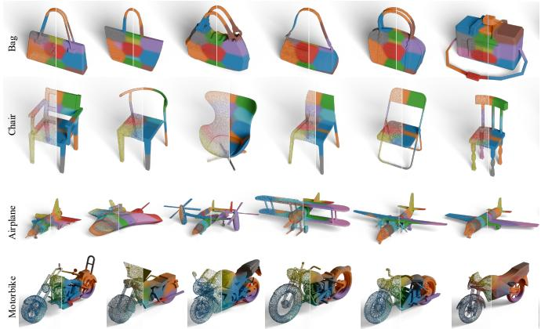  
Fig. 11. Qualitative skinning results of our method on unseen objects from the ShapeNet [7] dataset. Zoom in for more details.

in Sec. IV-D.

## C. Ablation Studies

To validate our design choices, we conduct ablation studies covering both the key components of the proposed Physics-Informed Self-Supervised Learning (PISSL) strategy and the rig-space complementarity term in the rig-complementary setting, using the RigNet [62] dataset. As shown in Table III, we remove or modify the PISSL components to assess their individual effects on model performance. Specifically, we evaluate the smoothness loss $\mathcal { L } _ { \mathrm { { s m o o t h } } }$ , the orthogonality constraint ${ \mathcal { L } } _ { \mathrm { o r t h } } .$ , the skinning normalization process, the ONI [26] layer, and conflict-aware gradient correction using ConFIG [37]. The quantitative results demonstrate that these components maintain the numerical stability and orthogonality of the learned neural skinning fields, which are essential for well-conditioned and physically consistent deformation behavior. In Fig. 14, we visualize the skinning results obtained without the potential energy loss ${ \mathcal { L } } _ { \mathrm { p o t } } .$ , where the model fails to produce physically interpretable skinning fields. Fig. 13 further compares neural skinning fields learned with and without ${ \mathcal { L } } _ { \mathrm { c o m p } } .$ . Without this term, the visualized fields form broad regions across the head, torso, and limbs. Incorporating $\mathcal { L } _ { \mathrm { c o m p } }$ changes these distributions, with visible differences in the ears, wings, and limb regions across multiple characters. These comparisons illustrate the effect of rig-space complementarity learning on the spatial organization of the skinning fields.

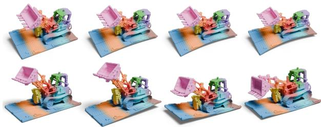  
Fig. 12. Skinning results for the deformable Lego shape family, where the deformable geometries are from Mani-GS [18].

TABLE III  
ABLATION STUDIES ON THE RIGNET [62] DATASET.
<table><tr><td>Config.</td><td> $\Omega _ { \mathrm { o r t h } } \times 1 0 ^ { - 2 } \downarrow$ </td><td> $\kappa _ { \log \mathrm { ~ } } \mathcal { I }$  </td><td> $H _ { \mathrm { s p e c } } \uparrow$ </td></tr><tr><td>w/o Skinning Normalization</td><td>6.5533</td><td>8.5492</td><td>0.8113</td></tr><tr><td>w/o ONI Layer</td><td>0.0081</td><td>1.0844</td><td>0.9997</td></tr><tr><td>w/o ConFIG Optimization</td><td>8.9247</td><td>11.8595</td><td>0.7594</td></tr><tr><td>w/o  ${ \mathcal { L } } _ { \mathrm { o r t h } }$ </td><td>100.0</td><td>29.18</td><td>NaN</td></tr><tr><td>w/o  ${ \mathcal { L } } _ { \mathrm { { s m o o t h } } }$ </td><td>0.0050</td><td>1.0567</td><td>0.9998</td></tr><tr><td>Full Model</td><td>0.0033</td><td>1.0453</td><td>0.9999</td></tr></table>

## D. Diverse Real-Time Physics-Based Animation

We next examine the broader animation scope enabled by PhysSkin++. Its discretization-agnostic neural skinning fields support efficient reduced dynamics for controllable and collision-aware animation, rig-complementary animation, and direct binding to 3D Gaussian representations.

Time Efficiency. We first evaluate the time efficiency of our skinning-based subspace animation. We compare it with a classical FEM method using implicit time integration and an MPM method using explicit time integration. For these two full-space physical simulators, we use open-source highperformance GPU implementations [9], [68]. All methods are evaluated on the same CPU and GPU hardware. As shown in Table IV, our method demonstrates excellent time efficiency. Controllable and Collision-Aware Animation. Beyond unconstrained deformation, we qualitatively examine how the learned neural skinning subspaces respond to prescribed controls and environmental contact. As shown in Fig. 4(a), the Dirichlet boundary conditions enforce zero displacement over the prescribed upper regions, while the unconstrained geometry deforms under gravity. In the interactive sequences of Fig. 4(b), the lower region of each object is fixed by Dirichlet boundary conditions, while Gaussian-kernel-weighted dragging provides localized control over the remaining deformable domain. Fig. 4(c) further demonstrates contact with planar environments across diverse shapes and boundary orientations, with the contact response modeled by the boundary-penalty energy in Eq. (14). We further evaluate collision-aware animation involving multiple objects. In the rigid–deformable sequences of Fig. 5(a), a rigid body is released from an elevated position and falls under gravity onto a deformable object. Contact between the two objects is modeled by the point-pair IPC-style barrier in Eq. (15), while contact with the supporting floor is handled by the boundary-penalty energy in Eq. (14). In the deformable–deformable sequences of Fig. 5(b), multiple deformable objects are released from elevated positions and fall under gravity. Contacts among the falling objects are resolved using the point-pair IPC-style barrier in Eq. (15), while their contact with the supporting floor is modeled by the boundary-penalty energy in Eq. (14). These results demonstrate controllable deformation and multi-object interaction within the PhysSkin++ skinning-based reduced representation.

TABLE IV  
COMPARISON OF PER-STEP SIMULATION COST FOR PHYSICS-BASED ANIMATION WITH FULL-SPACE SIMULATORS FEM [9] AND MPM [68].
<table><tr><td>3D Shape</td><td>Vertex Count</td><td>FEM [9] Step Cost (ms)</td><td>MPM [68] Step Cost (ms)</td><td>Ours Step Cost (ms)</td></tr><tr><td>Airplane</td><td>10K</td><td>79.83</td><td>141.83</td><td>12.26</td></tr><tr><td>Bag</td><td>121K</td><td>3012.47</td><td>233.79</td><td>13.39</td></tr><tr><td>Camera</td><td>80K</td><td>2121.02</td><td>203.38</td><td>12.52</td></tr><tr><td>Chair</td><td>52K</td><td>1772.70</td><td>178.46</td><td>12.48</td></tr><tr><td>Pillow</td><td>127K</td><td>3170.93</td><td>251.81</td><td>13.74</td></tr></table>

Rig-Complementary Animation. We evaluate the resulting rig-complementary animation under both interactive control and user-authored animation sequences, as shown in Fig. 7. For interactive rig control, we implement a Polyscope-based graphical interface [48] that allows users to manipulate bone poses at runtime. The resulting rig motion defines the primary animation, while PhysSkin++ computes the corresponding complementary elastic response. For user-authored rig animation, we obtain source skeletal animation sequences from Mixamo [1] and retarget them to the target character rigs using Auto-Rig Pro [3]. In both settings, PhysSkin++ augments the primary rig animation with temporally evolving, physics-based complementary deformation.

Discretization-Agnostic 3D Gaussian Animation. Owing to the discretization-agnostic nature of our neural skinning formulation, the learned deformation fields can be evaluated directly on 3D Gaussian primitives without introducing an underlying mesh discretization. Following the 3D Gaussian binding formulation in Sec. III-F, we evaluate PhysSkin++ on the ShapeSplat dataset [42], which contains 3D Gaussian reconstructions of objects from ShapeNet [7]. As shown in Fig. 15, the learned fields are queried at the Gaussian rest centers, and the induced local affine deformation updates both the centers and anisotropic covariances to produce coherent physics-based animation. We encourage readers to visit our project page for additional animation videos.

Rig Structure

Rig-based Skinning

Rig-Complementary Neural Skinning

Non-Complementary Neural Skinning

Rig Structure

Rig-based Skinning

Rig-Complementary Neural Skinning

Non-Complementary Neural Skinning

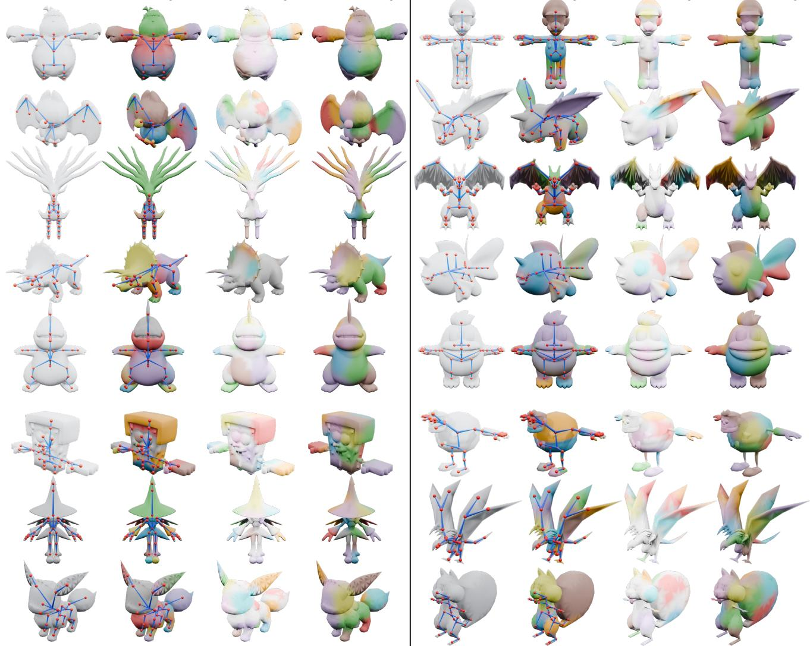  
Fig. 13. Qualitative results of self-supervised rig-complementarity learning. For each character, the four columns show the prescribed rig structure, its LBS skinning weights, and neural skinning fields learned with and without the rig-space complementarity term ${ \mathcal { L } } _ { \mathrm { c o m p } } ,$ , respectively. The comparison illustrates how this term changes the spatial distribution of the learned skinning fields across diverse characters and rig structures

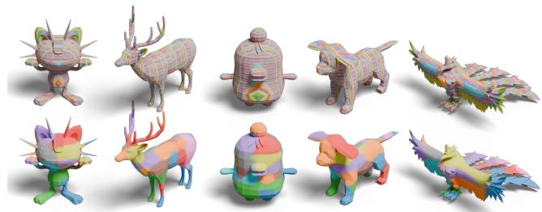  
Fig. 14. Top: Trained without ${ \mathcal { L } } _ { \mathrm { p o t } }$ . Bottom: Trained with ${ \mathcal { L } } _ { \mathrm { p o t } } .$

## V. CONCLUSION

In this paper, we present PhysSkin++, a generalizable physics-informed framework for real-time physics-based animation across diverse 3D shapes and discretizations. A neural skinning fields autoencoder learns continuous skinning fields directly from static geometries to define a skinning-based subspace mapping. Our Physics-Informed Self-Supervised

  
Fig. 15. Animation results on 3DGS models [42].

Learning (PISSL) strategy promotes physically plausible deformations through a self-supervised objective and stabilizes joint optimization through on-the-fly skinning-field normalization and conflict-aware gradient correction. At runtime, a reduced dynamics formulation advances the reduced coordinates and supports Dirichlet boundary conditions, interactive control, environmental interaction, and both rigid–deformable and deformable–deformable contact. Beyond purely physics-driven animation, we extend the deformation representation with prescribed rig displacement and the self-supervised objective with a rig-space complementarity term, enabling complementary elastic responses for prescribed rig animations without enforcing the complementarity constraint at runtime. The continuous deformation map also enables discretization-agnostic binding to meshes, point clouds, and 3D Gaussian representations. Experiments demonstrate that PhysSkin++ achieves outstanding performance on generalizable neural skinning while enabling real-time physics-based animation. As a limitation, our current formulation does not incorporate semantic priors for modeling complex geometries. Future work will explore such priors to improve the expressiveness of the learned skinning-based subspace mapping.

## REFERENCES

[1] Adobe. Mixamo. https://www.mixamo.com/. Accessed: July 23, 2026.

[2] Steven S An, Theodore Kim, and Doug L James. Optimizing cubature for efficient integration of subspace deformations. ACM Transactions on Graphics, 27(5):1–10, 2008.

[3] Artell. Auto-Rig Pro. https://superhivemarket.com/products/auto-rig-pro. Accessed: July 23, 2026.

[4] Sheldon Axler. Linear algebra done right. Springer Nature, 2024.

[5] Ilya Baran and Jovan Popovic. Automatic rigging and animation of 3D´ characters. ACM Transactions on Graphics, 26(3):72:1–72:8, 2007.

[6] Otman Benchekroun, Jiayi Eris Zhang, Siddhartha Chaudhuri, Eitan Grinspun, Yi Zhou, and Alec Jacobson. Fast complementary dynamics via skinning eigenmodes. ACM SIGGRAPH Conference Proceedings, 2023.

[7] Angel X Chang, Thomas Funkhouser, Leonidas Guibas, Pat Hanrahan, Qixing Huang, Zimo Li, Silvio Savarese, Manolis Savva, Shuran Song, Hao Su, et al. ShapeNet: An information-rich 3D model repository. arXiv preprint arXiv:1512.03012, 2015.

[8] Yue Chang, Otman Benchekroun, Maurizio M Chiaramonte, Peter Yichen Chen, and Eitan Grinspun. Shape space spectra. ACM Transactions on Graphics, 2025.

[9] Yue Chang, Peter Yichen Chen, Zhecheng Wang, Maurizio M Chiaramonte, Kevin Carlberg, and Eitan Grinspun. LiCROM: Linear-subspace continuous reduced order modeling with neural fields. In ACM SIGGRAPH Asia Conference Proceedings, pages 1–12, 2023.

[10] Peter Yichen Chen, Jinxu Xiang, Dong Heon Cho, Yue Chang, GA Pershing, Henrique Teles Maia, Maurizio M Chiaramonte, Kevin Carlberg, and Eitan Grinspun. CROM: Continuous reduced-order modeling of PDEs using implicit neural representations. International Conference on Learning Representations, 2023.

[11] Rui Chen, Jianfeng Zhang, Yixun Liang, Guan Luo, Weiyu Li, Jiarui Liu, Xiu Li, Xiaoxiao Long, Jiashi Feng, and Ping Tan. Dora: Sampling and benchmarking for 3D shape variational auto-encoders. In Proceedings of the IEEE/CVF Conference on Computer Vision and Pattern Recognition, pages 16251–16261, 2025.

[12] Yiming Chen, Yushi Lan, and Andrea Vedaldi. PhysiFormer: Learning to simulate mechanics in world space, 2026.

[13] Manlio De Domenico and Jacob Biamonte. Spectral entropies as information-theoretic tools for complex network comparison. Physical Review X, 6(4):041062, 2016.

[14] Yufan Deng, Yuhao Zhang, Chen Geng, Shangzhe Wu, and Jiajun Wu. Anymate: A dataset and baselines for learning 3D object rigging. In ACM SIGGRAPH Conference Proceedings, pages 1–10, 2025.

[15] Zhiyang Dou, Minghao Guo, Haixu Wu, Doug Roble, Tuur Stuyck, and Wojciech Matusik. RigidFormer: Learning rigid dynamics using transformers. In Advances in Neural Information Processing Systems, 2026.

[16] Andrew Feng, Dan Casas, and Ari Shapiro. Avatar reshaping and automatic rigging using a deformable model. In Proceedings of the 8th ACM SIGGRAPH Conference on Motion in Games, pages 57–64, 2015.

[17] Lawson Fulton, Vismay Modi, David Duvenaud, David IW Levin, and Alec Jacobson. Latent-space dynamics for reduced deformable simulation.

In Computer Graphics Forum, volume 38, pages 379–391. Wiley Online Library, 2019.

[18] Xiangjun Gao, Xiaoyu Li, Yiyu Zhuang, Qi Zhang, Wenbo Hu, Chaopeng Zhang, Yao Yao, Ying Shan, and Long Quan. Mani-GS: Gaussian splatting manipulation with triangular mesh. Proceedings of the IEEE/CVF Conference on Computer Vision and Pattern Recognition, 2025.

[19] Chen Geng, Guangzhao He, Yue Gao, Yunzhi Zhang, Shangzhe Wu, and Jiajun Wu. NeuROK: Generative 4D neural object kinematics. In Proceedings of the IEEE/CVF Conference on Computer Vision and Pattern Recognition (CVPR), pages 39239–39251, June 2026.

[20] Zhiyang Guo, Jinxu Xiang, Kai Ma, Wengang Zhou, Houqiang Li, and Ran Zhang. Make-It-Animatable: An efficient framework for authoring animation-ready 3D characters. In Proceedings of the IEEE/CVF Conference on Computer Vision and Pattern Recognition, pages 10783– 10792, 2025.

[21] Desmond J Higham. Condition numbers and their condition numbers. Linear Algebra and its Applications, 214:193–213, 1995.

[22] Roger A Horn and Charles R Johnson. Topics in matrix analysis. Cambridge University Press, 1994.

[23] Yixin Hu, Teseo Schneider, Bolun Wang, Denis Zorin, and Daniele Panozzo. Fast tetrahedral meshing in the wild. ACM Transactions on Graphics, 39(4):117:1–117:18, 2020.

[24] Jingwei Huang, Hao Su, and Leonidas Guibas. Robust watertight manifold surface generation method for ShapeNet models. arXiv preprint arXiv:1802.01698, 2018.

[25] Jingwei Huang, Yichao Zhou, and Leonidas Guibas. ManifoldPlus: A robust and scalable watertight manifold surface generation method for triangle soups. arXiv preprint arXiv:2005.11621, 2020.

[26] Lei Huang, Li Liu, Fan Zhu, Diwen Wan, Zehuan Yuan, Bo Li, and Ling Shao. Controllable orthogonalization in training DNNs. In Proceedings of the IEEE/CVF Conference on Computer Vision and Pattern Recognition, pages 6429–6438, 2020.

[27] Chenfanfu Jiang, Craig Schroeder, Joseph Teran, Alexey Stomakhin, and Andrew Selle. The material point method for simulating continuum materials. In ACM SIGGRAPH 2016 Courses, pages 1–52. 2016.

[28] Bernhard Kerbl, Georgios Kopanas, Thomas Leimkuhler, and George¨ Drettakis. 3D Gaussian splatting for real-time radiance field rendering. ACM Transactions on Graphics, 42(4):139:1–139:14, 2023.

[29] Theodore Kim and David Eberle. Dynamic deformables: implementation and production practicalities. In ACM SIGGRAPH 2020 Courses, pages 1–182. 2020.

[30] Yuanhang Lei, Tao Cheng, Xingxuan Li, Boming Zhao, Siyuan Huang, Ruizhen Hu, Peter Yichen Chen, Hujun Bao, and Zhaopeng Cui. PhysSkin: Real-time and generalizable physics-based animation via selfsupervised neural skinning. In Proceedings of the IEEE/CVF Conference on Computer Vision and Pattern Recognition, 2026.

[31] Yuanhang Lei, Boming Zhao, Zesong Yang, Xingxuan Li, Tao Cheng, Haocheng Peng, Ru Zhang, Yang Yang, Siyuan Huang, Yujun Shen, Ruizhen Hu, Hujun Bao, and Zhaopeng Cui. DiffWind: Physics-informed differentiable modeling of wind-driven object dynamics. In International Conference on Learning Representations, 2026.

[32] Minchen Li, Zachary Ferguson, Teseo Schneider, Timothy R. Langlois, Denis Zorin, Daniele Panozzo, Chenfanfu Jiang, and Danny M. Kaufman. Incremental potential contact: Intersection- and inversion-free large deformation dynamics. ACM Transactions on Graphics, 39(4), 2020.

[33] Minchen Li, Chenfanfu Jiang, Zhaofeng Luo, Wenxin Du, Chang Yu, Ziga Kovaˇ ciˇ c, and Tianyi Xie.ˇ Physics-Based Simulation. July 2025.

[34] Ruining Li, Chuanxia Zheng, Christian Rupprecht, and Andrea Vedaldi. Puppet-Master: Scaling interactive video generation as a motion prior for part-level dynamics. Proceedings of the IEEE/CVF International Conference on Computer Vision, 2025.

[35] Yang Li, Hikari Takehara, Takafumi Taketomi, Bo Zheng, and Matthias Nießner. 4DComplete: Non-rigid motion estimation beyond the observable surface. Proceedings of the IEEE/CVF International Conference on Computer Vision, 2021.

[36] Isabella Liu, Zhan Xu, Wang Yifan, Hao Tan, Zexiang Xu, Xiaolong Wang, Hao Su, and Zifan Shi. RigAnything: Template-free autoregressive rigging for diverse 3D assets. ACM Transactions on Graphics, 44(4):1–12, 2025.

[37] Qiang Liu, Mengyu Chu, and Nils Thuerey. ConFIG: Towards conflictfree training of physics informed neural networks. International Conference on Learning Representations, 2025.

[38] Tiantian Liu, Adam W Bargteil, James F O’Brien, and Ladislav Kavan. Fast simulation of mass-spring systems. ACM Transactions on Graphics, 32(6):1–7, 2013.

[39] Matthew Loper, Naureen Mahmood, Javier Romero, Gerard Pons-Moll, and Michael J. Black. SMPL: A skinned multi-person linear model. ACM Transactions on Graphics, 34(6):248:1–248:16, Oct. 2015.

[40] Zhongjin Luo, Shengcai Cai, Jinguo Dong, Ruibo Ming, Liangdong Qiu, Xiaohang Zhan, and Xiaoguang Han. RaBit: Parametric modeling of 3D biped cartoon characters with a topological-consistent dataset. In Proceedings of the IEEE/CVF Conference on Computer Vision and Pattern Recognition, pages 12825–12835, 2023.

[41] Aoran Lyu, Shixian Zhao, Chuhua Xian, Zhihao Cen, Hongmin Cai, and Guoxin Fang. Accelerate neural subspace-based reduced-order solver of deformable simulation by Lipschitz optimization. ACM Transactions on Graphics, 43(6):1–10, 2024.

[42] Qi Ma, Yue Li, Bin Ren, Nicu Sebe, Ender Konukoglu, Theo Gevers, Luc Van Gool, and Danda Pani Paudel. ShapeSplat: A large-scale dataset of Gaussian splats and their self-supervised pretraining, 2024.

[43] Nadia Magnenat-Thalmann, Richard Laperriere, and Daniel Thalmann.\` Joint-dependent local deformations for hand animation and object grasping. In Proceedings of Graphics Interface ’88, pages 26–33, 1988.

[44] Vismay Modi, Nicholas Sharp, Or Perel, Shinjiro Sueda, and David IW Levin. Simplicits: Mesh-free, geometry-agnostic elastic simulation. ACM Transactions on Graphics, 43(4):1–11, 2024.

[45] Nicolas Moenne-Loccoz, Ashkan Mirzaei, Or Perel, Riccardo de Lutio, Janick Martinez Esturo, Gavriel State, Sanja Fidler, Nicholas Sharp, and Zan Gojcic. 3D Gaussian ray tracing: Fast tracing of particle scenes. ACM Transactions on Graphics, 2024.

[46] Jorge Nocedal and Stephen J Wright. Numerical optimization. Springer, 2006.

[47] Jeong Joon Park, Peter Florence, Julian Straub, Richard Newcombe, and Steven Lovegrove. DeepSDF: Learning continuous signed distance functions for shape representation. In Proceedings of the IEEE/CVF Conference on Computer Vision and Pattern Recognition, pages 165–174, 2019.

[48] Nicholas Sharp et al. Polyscope, 2019. https://polyscope.run/.

[49] Nicholas Sharp, Cristian Romero, Alec Jacobson, Etienne Vouga, Paul Kry, David IW Levin, and Justin Solomon. Data-free learning of reduced order kinematics. In ACM SIGGRAPH Conference Proceedings, pages 1–9, 2023.

[50] Siyuan Shen, Yang Yin, Tianjia Shao, He Wang, Chenfanfu Jiang, Lei Lan, and Kun Zhou. High-order differentiable autoencoder for nonlinear model reduction. ACM Transactions on Graphics, 2021.

[51] Eftychios Sifakis and Jernej Barbic. FEM simulation of 3D deformable solids: a practitioner’s guide to theory, discretization and model reduction. In ACM SIGGRAPH 2012 Courses, pages 1–50. 2012.

[52] Chaoyue Song, Xiu Li, Fan Yang, Zhongcong Xu, Jiacheng Wei, Fayao Liu, Jiashi Feng, Guosheng Lin, and Jianfeng Zhang. Puppeteer: Rig and animate your 3D models. Advances in Neural Information Processing Systems, 2025.

[53] Chaoyue Song, Jianfeng Zhang, Xiu Li, Fan Yang, Yiwen Chen, Zhongcong Xu, Jun Hao Liew, Xiaoyang Guo, Fayao Liu, Jiashi Feng, et al. MagicArticulate: Make your 3D models articulation-ready. In Proceedings of the IEEE/CVF Conference on Computer Vision and Pattern Recognition, pages 15998–16007, 2025.

[54] Petre Stoica and Randolph L Moses. Spectral analysis of signals. Pearson Prentice Hall Upper Saddle River, NJ, 2005.

[55] Keqiang Sun, Dor Litvak, Yunzhi Zhang, Hongsheng Li, Jiajun Wu, and Shangzhe Wu. Ponymation: Learning articulated 3D animal motions from unlabeled online videos. In Proceedings of the European Conference on Computer Vision, pages 100–119. Springer, 2025.

[56] Joseph Teran, Eftychios Sifakis, Geoffrey Irving, and Ronald Fedkiw. Robust quasistatic finite elements and flesh simulation. In Proc of the 2005 ACM SIGGRAPH/Eurographics symposium on Computer animation, pages 181–190, 2005.

[57] Christoph Von Tycowicz, Christian Schulz, Hans-Peter Seidel, and Klaus Hildebrandt. An efficient construction of reduced deformable objects. ACM Transactions on Graphics, 32(6):1–10, 2013.

[58] Caoliwen Wang, Minghao Guo, Siyuan Chen, Heng Zhang, Mengdi Wang, Xingyu Ni, Hanson Sun, Kunyi Wang, Zherong Pan, Kui Wu, et al. WorldParticle: Unified world simulation of Lagrangian particle dynamics via transformer. In ACM SIGGRAPH Asia Conference Proceedings, 2026.

[59] Jiahong Wang, Yinwei Du, Stelian Coros, and Bernhard Thomaszewski. Neural modes: Self-supervised learning of nonlinear modal subspaces. In Proceedings of the IEEE/CVF Conference on Computer Vision and Pattern Recognition, pages 23158–23167, 2024.

[60] Yuefan Wu, Zeyuan Chen, Shaowei Liu, Zhongzheng Ren, and Shenlong Wang. CASA: Category-agnostic skeletal animal reconstruction. Advances in Neural Information Processing Systems, 35:28559–28574, 2022.

[61] Tianyi Xie, Zeshun Zong, Yuxing Qiu, Xuan Li, Yutao Feng, Yin Yang, and Chenfanfu Jiang. PhysGaussian: Physics-integrated 3D Gaussians for generative dynamics. In Proceedings of the IEEE/CVF Conference on Computer Vision and Pattern Recognition, pages 4389–4398, 2024.

[62] Zhan Xu, Yang Zhou, Evangelos Kalogerakis, Chris Landreth, and Karan Singh. RigNet: Neural rigging for articulated characters. ACM Transactions on Graphics, 39(4), 2020.

[63] Zesong Yang, Yuanhang Lei, Liyuan Cui, Yihang Chen, Jiaer Huang, Boming Zhao, Peter Yichen Chen, Hujun Bao, and Zhaopeng Cui. MeGAS : Thermomechanical dynamic Gaussian splatting for thermophysical scene editing. In European Conference on Computer Vision (ECCV), 2026.

[64] Biao Zhang, Jiapeng Tang, Matthias Niessner, and Peter Wonka. 3DShape2VecSet: A 3D shape representation for neural fields and generative diffusion models. ACM Transactions on Graphics, 42(4):1–16, 2023.

[65] Jiayi Eris Zhang, Seungbae Bang, David I.W. Levin, and Alec Jacobson. Complementary dynamics. ACM Transactions on Graphics, 2020.

[66] Jia-Peng Zhang, Cheng-Feng Pu, Meng-Hao Guo, Yan-Pei Cao, and Shi-Min Hu. One model to rig them all: Diverse skeleton rigging with UniRig. ACM Transactions on Graphics, 44(4):1–18, 2025.

[67] Zibo Zhao, Wen Liu, Xin Chen, Xianfang Zeng, Rui Wang, Pei Cheng, Bin Fu, Tao Chen, Gang Yu, and Shenghua Gao. Michelangelo: Conditional 3D shape generation based on shape-image-text aligned latent representation. Advances in Neural Information Processing Systems, 36:73969–73982, 2023.

[68] Zeshun Zong, Xuan Li, Minchen Li, Maurizio M Chiaramonte, Wojciech Matusik, Eitan Grinspun, Kevin Carlberg, Chenfanfu Jiang, and Peter Yichen Chen. Neural stress fields for reduced-order elastoplasticity and fracture. In ACM SIGGRAPH Asia Conference Proceedings, pages 1–11, 2023.

[69] Silvia Zuffi, Angjoo Kanazawa, David W Jacobs, and Michael J Black. 3D menagerie: Modeling the 3D shape and pose of animals. In Proceedings of the IEEE/CVF Conference on Computer Vision and Pattern Recognition, pages 6365–6373, 2017.