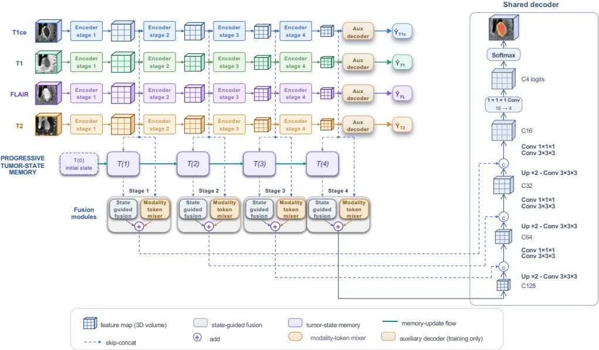
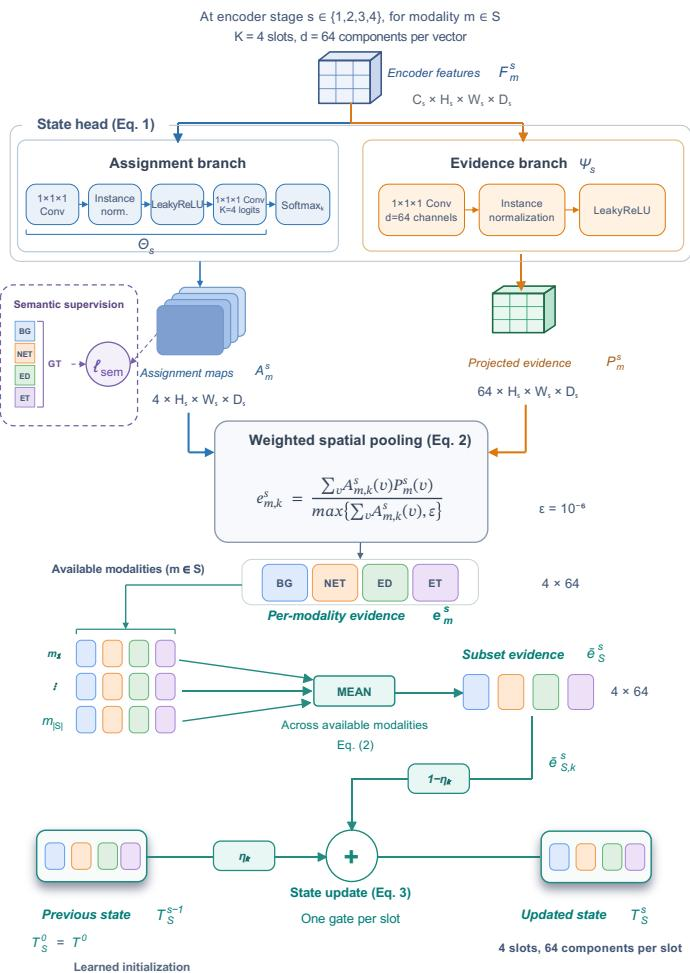
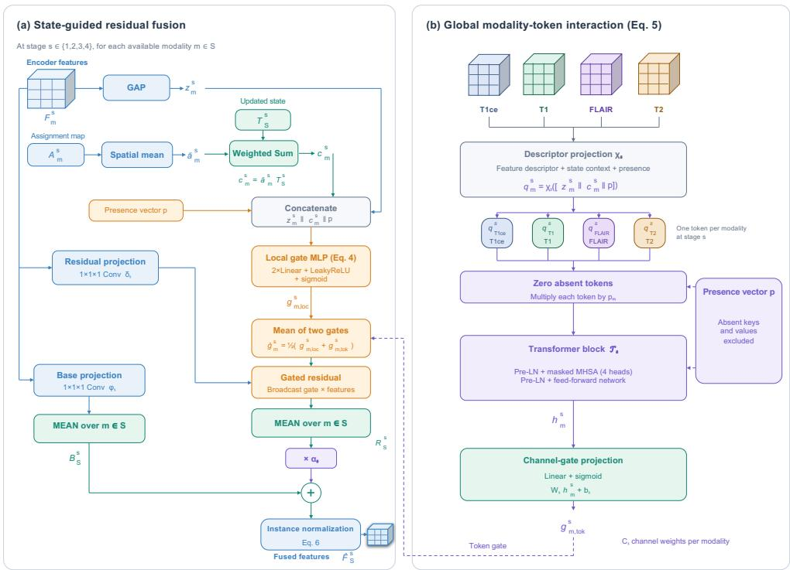
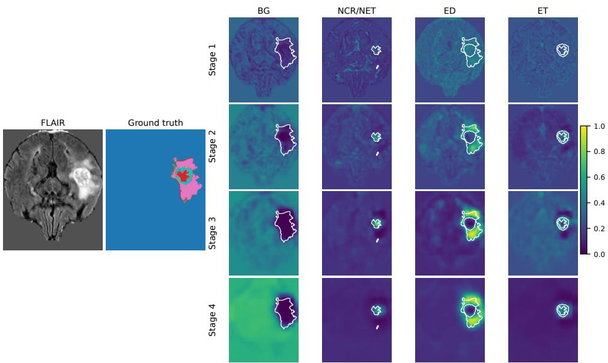
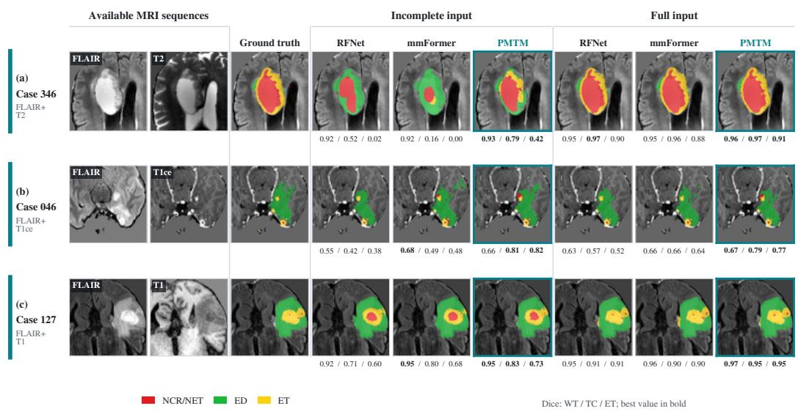

# Progressive multi-scale tumor-state memory for incomplete multimodal brain tumor segmentation

Milad Rostamiana, Mohammadreza Mohammadia, Mohsen Soryania,∗

aSchool of Computer Engineering, Iran University of Science and Technology (IUST), Hengam Street, Resalat Square, 13114-16846, Tehran, Iran

## Abstract

Brain tumor segmentation uses complementary magnetic resonance imaging (MRI) sequences, but some sequences may be unavailable in practice. Their absence changes the information available for segmenting diferent tumor regions. Fusion methods can support diferent input subsets. However, fusion at several scales does not by itself specify how tumor evidence is retained and updated to guide fusion at later stages. We propose a progressive multi-scale tumor-state memory network (PMTM) for segmentation from any non-empty subset of T1ce, T1, FLAIR, and T2. PMTM maintains a compact state for the current subject across the encoder stages. At each stage, we use assignment maps to pool spatial features into ordered evidence vectors for each available modality. We average these vectors across the available modalities, and a learned gate combines this evidence with the previous state. The updated state guides residual fusion at that stage and is used in the state update at the next stage. A modality-token mixer also models interactions among the available modalities at each stage. We apply semantic supervision to the assignment maps at all four stages. We evaluate PMTM on BraTS2018, BraTS2020, and BraTS2023 GLI across all 15 non-empty modality subsets. Averaged over the three tumor regions and the 15 subsets, PMTM achieves Dice scores of 75.31%, 77.54%, and 80.47% on BraTS2018, BraTS2020, and BraTS2023 GLI, respectively. These scores are higher than those of Robust-Seg, RFNet, and mmFormer in our experiments on each dataset. Component ablations and internal state analysis are performed on BraTS2020.

Keywords: Brain tumor segmentation, Incomplete multimodal learning, Missing MRI modalities, Multimodal fusion, Tumor-state memory

## 1. Introduction

Glioma segmentation on MRI supports diagnosis and treatment planning [1]. The tumor regions considered here are the whole tumor (WT), tumor core (TC), and enhancing tumor (ET) [2, 3]. To identify these regions, multimodal brain MRI commonly combines contrast-enhanced T1-weighted (T1ce), T1-weighted (T1), fluid-attenuated inversion recovery (FLAIR), and T2-weighted (T2) images [2, 3]. These sequences provide complementary information about the tumor regions. T1ce is especially informative for TC and ET, while FLAIR and T2 provide information about edema and WT [4, 5].

Many multimodal segmentation models are designed to receive a complete set of MRI sequences [6]. However, diferences in acquisition protocols, image corruption, resource constraints, and restrictions on contrast administration can leave one or more sequences unavailable [6]. The resulting loss of information afects tumor regions diferently [4, 5]. Segmentation from incomplete inputs therefore requires a fusion mechanism that works with the available subset and accounts for the information supplied by each remaining sequence.

Existing approaches address this problem in diferent ways. Latent aggregation constructs a common representation from diferent modality subsets [7, 8]. Region-aware fusion accounts for how each sequence contributes to individual tumor regions [4]. Transformer modules learn interactions between modality representations [9, 10]. Our earlier method, TG-BWSA, exchanges modality features between encoder stages through a shared adapter [11]. These mechanisms determine how the available features are combined. A related question is how evidence about tumor regions can be accumulated across encoder stages and used to guide fusion at later stages.

Memory mechanisms reuse information during feature extraction and decoding [12, 13]. In multimodal brain tumor segmentation, MSM-Seg uses memory to model relationships between modalities and across slices [14]. These studies motivate the use of retained context. The role of memory depends on what is stored and where the network uses it. Here, we investigate a tumor state built from the available MRI sequences that accumulates tumor evidence across encoder stages and directly guides modality fusion.

We propose PMTM, a progressive multi-scale tumor-state memory network. PMTM maintains a tumor state, an ordered set of feature vectors called state slots. At each encoder stage, assignment maps pool features from each available modality into evidence vectors. We average corresponding evidence vectors across the available modalities and use them to update the state. The updated state guides fusion at the current stage and is used in the state update at the next stage. Fusion uses the current modality features together with the state accumulated from preceding stages. At the beginning of each forward pass, the state is initialized from a learned tensor. State updates use evidence from the available sequences of the current subject.

The contributions of this work are summarized below.

1. We introduce a progressive tumor-state path for segmentation from incomplete multimodal MRI. Ordered state slots accumulate evidence from the available MRI sequences across all four encoder stages.

2. We apply semantic supervision to the assignment maps at all four encoder stages.

3. We introduce residual fusion guided by the updated tumor state. A modality-token mixer also models interactions among the available modalities at each encoder stage.

4. We evaluate PMTM on BraTS2018, BraTS2020, and BraTS2023 GLI across all 15 non-empty modality subsets. Component ablations on BraTS2020 assess the tumor-state path, cross-stage state propagation, semantic supervision, and modality-token interaction. Internal analyses examine the learned assignment maps and state slots.

## 2. Related work

## 2.1. Fusion in complete multimodal brain tumor segmentation

Methods for complete inputs difer in when MRI sequences are combined. Pereira et al. [15] processed the four sequences jointly with a patch-based CNN. Separate encoders allow fusion to adjust modality contributions after feature extraction. Zhou et al. [16] use attention and tumor-region context constraints, while Tri-Attention [17] weights modality and spatial features and models correlations between sequences.

Transformer fusion models dependencies between modality representations through attention. NestedFormer [18] uses intra-modality and crossmodality attention at higher levels and modality-sensitive gating at lower scales. Zhou et al. [19] combine modality-wise, spatial, and channel-wise feature fusion. These designs adjust how features are combined for complete inputs. With missing sequences, fusion must also accept diferent input subsets.

## 2.2. Incomplete multimodal brain tumor segmentation

Supporting diferent subsets first requires a representation that can be constructed from the available inputs. HeMIS [7] aggregates modalityspecific features through their mean and variance. U-HVED [8] instead combines distributions inferred from the available modalities in a probabilistic latent space for joint segmentation and modality completion. Beyond accepting diferent subsets, fusion can also adjust the contribution of the remaining modalities. RobustSeg [20] separates shared and modalityspecific representations and applies gated fusion. RFNet [4] makes fusion region-aware, accounting for diferences in the information each sequence provides about each tumor region. D2-Net [21] models modality and region relationships through dual disentanglement.

Training can provide additional information for incomplete inputs. ACN [22] couples complete and incomplete configurations through adversarial cotraining and representation alignment. LCKD [23] selects teacher modalities according to task performance, so supervision can difer between targets. W. Liu et al. [24] use complete-input predictions to guide partial-input predictions during post-training.

Self-supervised learning (SSL) addresses feature learning before supervised segmentation. M3AE [25] reconstructs masked modalities and image patches during pretraining. It also uses model inversion for modality completion and self-distillation during segmentation training. M3AE combines pretraining with knowledge transfer. UniME [26] combines a shared ViT pretrained through masked image modeling with multi-scale features from modality-specific CNN encoders. The pretrained representation provides global context, while the CNN encoders supply features at higher spatial resolutions.

Within the network, interaction modules determine how features exchange information. mmFormer [9] uses intra-modal and inter-modal transformers, while M2FTrans [10] incorporates modality masking into transformer fusion to handle diferent missing patterns. Feature interaction is also modeled with state-space blocks. LS3M [27] combines diferentiable sequence reordering with state-space blocks for local and long-range dependencies. CDMS [28] uses learnable consistency features and fusion at multiple scales. $\mathrm { L S ^ { 3 } M }$ focuses on spatial ordering, while CDMS incorporates consistency information into fusion.

Fusion can also receive conditioning information. MIFPN [29] derives prompts from modality-invariant features. MPDF-UNET [5] combines learned modality priors with input-dependent features and changes modalitycombination sampling during training. MGML [30] uses meta-parameterized fusion to construct soft targets from available modalities, together with consistency regularization.

TG-BWSA combines compressed modality features in a shared adapter and returns adapted features to each encoder stream [11]. It learns two scalar weights per modality and stage to combine the original and adapted features. These scalar weights remain fixed across test inputs. PMTM instead updates a tumor state from the available modalities and uses that state to guide fusion.

Alongside these fusion mechanisms, we examine how an explicit tumor state can accumulate evidence across encoder stages and guide fusion for diferent available modality subsets. This connects incomplete multimodal fusion to memory mechanisms in segmentation.

## 2.3. Memory mechanisms in medical image segmentation

Memory provides context whose role depends on what is stored and where it is reused. Memory-Net [12] propagates cell memories through hierarchically stacked gated convolutional units and across PET/CT encoder branches. HMDM-Net [13] retains deep semantic representations across decoder resolutions. Memory-Net reuses intermediate information during feature extraction, while HMDM-Net combines deep and shallow features during decoding.

Memory can also retain information across examples. Sim-MPNet [31] updates a prototype bank of category features associated with lesions or organs during training. The selective memory network [32] stores and retrieves representative global features across samples for 3D MRI segmentation. Both provide category or global context beyond the features of the current input. In multimodal brain tumor segmentation, MSM-Seg [14] organizes memory around modality and slice relationships. Its memory attention models correlations between modalities and dependencies across slices. The method also uses category-agnostic prompting and a modality-adaptive fusion decoder.

PMTM builds an ordered tumor state from the available sequences of the current subject, updates it across encoder stages, and uses it to guide

modality fusion at each stage.

## 3. Method

In this work, we develop PMTM for brain tumor segmentation from incomplete multimodal MRI. We first describe the overall network architecture, followed by the progressive tumor-state memory and state-guided fusion with modality-token interaction. We then present the modality sampling procedure and training objectives.

## 3.1. Network overview

Figure 1 shows the overall architecture. PMTM has four modality-specific encoders and a shared segmentation decoder. The encoders have the same architecture but independent parameters. Each encoder has four stages that produce feature maps at diferent spatial scales.

For the current subject, PMTM maintains a tumor state that stores evidence from the available MRI sequences. At each encoder stage, the available modality features update this state. Each stage has a fusion module with state-guided fusion and a modality-token mixer. The updated state guides feature fusion, and the mixer models interactions among the available modalities. The shared decoder combines the fused features from all four stages and predicts four segmentation classes.

During training, each modality branch also has an auxiliary decoder with the same architecture as the shared decoder but independent parameters. It takes the deepest features of its own encoder as input and uses the shallower scales through skip connections. Its prediction supervises that modality branch directly. The auxiliary decoders are discarded at inference.

Let M = (T1ce, T1, FLAIR, T2) denote the ordered set of $M \ = \ 4$ MRI modalities, and let $S \subseteq { \mathcal { M } }$ denote the non-empty subset available for a subject. Each modality-specific encoder $E _ { m }$ produces features $F _ { m } ^ { s } \in \mathbb { R } ^ { C _ { s } \times H _ { s } \times \dot { W } _ { s } \times D _ { s } }$ at stage $s \in \{ 1 , 2 , 3 , 4 \}$ . Only modalities in $S$ contribute to state construction and feature fusion.

## 3.2. Progressive tumor-state memory

The tumor state stores evidence from the available MRI sequences. The memory mechanism updates this state across encoder stages, allowing fusion to use both the current features and evidence retained from preceding stages.

  
Figure 1: Overview of PMTM. Four modality-specific encoders produce multiscale features. At each stage, evidence from the available modalities updates the tumor state, which guides fusion with modality-token interaction. The fused features from all four stages are passed to a shared decoder. Auxiliary decoders supervise each modality branch during training and are discarded at inference. The auxiliary skip connections and tokenmixer internals are omitted from the diagram.

Figure 2 shows three operations in each update. First, assignment maps pool each available modality’s features into an ordered set of evidence vectors. We then average corresponding vectors across the available modalities. Finally, a learned gate combines this evidence with the previous state.

## 3.2.1. Semantic evidence construction

The tumor state is an ordered set of K = 4 feature vectors, called state slots. Each vector has dimension d = 64. The assignment channels and state slots are intended to follow the class order BG, NCR/NET, ED, and ET. Here, BG is background, NCR/NET is the necrotic and non-enhancing tumor core, ED is peritumoral edema, and ET is enhancing tumor. We apply semantic supervision to the assignment maps as described in Section 3.4.

At stage s, a state head processes each available modality’s feature map. Its assignment branch produces a weight for each slot at every spatial location. Its evidence branch projects the features into the state space. The

  
Figure 2: Progressive tumor-state update at stage s. The state head has an assignment branch and an evidence branch (Eq. (1)). Weighted spatial pooling produces four 64- dimensional vectors per modality. The MEAN block averages corresponding vectors over m $\in S \left( \mathrm { E q . } \left( 2 \right) \right)$ ). Slot-specific gates combine this evidence with the previous state (Eq. (3)).

outputs are

$$
\begin{array} { r l } & { A _ { m } ^ { s } = \operatorname { S o f t m a x } _ { k } ( \Theta _ { s } ( F _ { m } ^ { s } ) ) \in [ 0 , 1 ] ^ { K \times H _ { s } \times W _ { s } \times D _ { s } } , } \\ & { P _ { m } ^ { s } = \Psi _ { s } ( F _ { m } ^ { s } ) \in \mathbb { R } ^ { d \times H _ { s } \times W _ { s } \times D _ { s } } . } \end{array}\tag{1}
$$

Here, $A _ { m } ^ { s }$ is the assignment map and $P _ { m } ^ { s }$ is the projected evidence tensor. The softmax operates over the $K$ assignment channels, so their weights sum to one at each spatial location.

Within a stage, the state head is shared across modality branches. Different stages have separate head parameters. Both branches use $1 \times 1 \times 1$ convolutions. The layer composition is given in Section 4.

We next use each assignment channel to pool the projected features into one evidence vector. Let v index the $N _ { s } = H _ { s } W _ { s } D _ { s }$ spatial locations. For slot k, the evidence within modality m and its average across the available modalities are

$$
\begin{array} { r l } & { \displaystyle { e _ { m , k } ^ { s } = \frac { \sum _ { v } A _ { m , k } ^ { s } ( v ) P _ { m } ^ { s } ( v ) } { \operatorname* { m a x } \{ \sum _ { v } A _ { m , k } ^ { s } ( v ) , \epsilon \} } , \qquad \epsilon = 1 0 ^ { - 6 } , } } \\ & { \displaystyle { \bar { e } _ { S , k } ^ { s } = \frac { 1 } { | S | } \sum _ { m \in S } e _ { m , k } ^ { s } } . } \end{array}\tag{2}
$$

Each assignment map therefore pools the projected features of its own modality. Only the resulting evidence vectors are averaged across the available modalities.

## 3.2.2. Progressive state update

We use these evidence vectors to update the previous state. The initial state is a learned tensor $T ^ { 0 } \in \mathbb { R } ^ { K \times d }$ . For each slot, a learned gate $\eta _ { k } = \sigma ( \widehat { \eta } _ { k } )$ weights the previous state and the current evidence. Here, $\sigma$ denotes the sigmoid function. With $T _ { S , k } ^ { 0 } = T _ { k } ^ { 0 }$ , the update is

$$
T _ { S , k } ^ { s } = \eta _ { k } T _ { S , k } ^ { s - 1 } + ( 1 - \eta _ { k } ) \bar { e } _ { S , k } ^ { s } , \qquad s \in \{ 1 , 2 , 3 , 4 \} .\tag{3}
$$

A larger $\eta _ { k }$ gives more weight to the previous state, while a smaller value gives more weight to the current evidence. Each slot has its own gate, shared across stages. The first stage updates the learned initial state. Each later stage updates the state produced by the preceding stage.

The updated state $T _ { S } ^ { s }$ is used immediately by the fusion module at stage s. At the beginning of every forward pass, the memory is initialized from $T ^ { 0 }$ The updated state is not carried between subjects.

## 3.3. State-guided fusion

At each encoder stage, the fusion module combines the available modality features through a base path and a gated residual path. The base path averages projected features from the available modalities. The residual path uses two channel gates to adjust each modality’s contribution.

The local gate uses a modality feature descriptor, a context vector read from the updated tumor state, and the modality availability pattern. The token gate uses interactions among the available modality tokens. We average the two gates to weight each modality’s residual features. The weighted residuals are then averaged over the available modalities, scaled, and added to the base feature. Figure 3 illustrates the local gate, modality-token mixer, and residual path.

  
Figure 3: State-guided fusion and modality-token interaction. Panel (a) shows the base path, local gate, residual averaging, scaling, and instance normalization (Eqs. (4) and (6)). Panel (b) shows descriptor projection, masked global interaction among modality tokens, and the token gates $\left( \mathrm { E q . \ ( 5 ) } \right)$ ). Local and token gates are averaged before weighting residual features.

## 3.3.1. State-guided residual fusion

We encode modality availability with a binary vector $ { \mathbf { p } } \in \{ 0 , 1 \} ^ { M }$ , where $p _ { m } = 1$ when modality m is available. The base feature $B _ { S } ^ { s }$ averages the projected features of the available modalities.

To compute the local gate, we first spatially pool $F _ { m } ^ { s }$ into a feature descriptor $z _ { m } ^ { s }$ . We also average the assignment map over spatial locations to obtain slot weights $\hat { a } _ { m } ^ { s }$ . These weights combine the updated state slots into a context vector $c _ { m } ^ { s }$ . We concatenate the feature descriptor, context vector, and presence vector and pass them to an MLP. These operations are written as

$$
\begin{array} { l l } { { \displaystyle B _ { S } ^ { s } = \frac { 1 } { | S | } \sum _ { m \in S } \phi _ { s } ( F _ { m } ^ { s } ) , } } \\ { { \displaystyle z _ { m } ^ { s } = \mathrm { G A P } ( F _ { m } ^ { s } ) , \qquad \bar { a } _ { m } ^ { s } = \frac { 1 } { N _ { s } } \sum _ { v } A _ { m } ^ { s } ( v ) , } } \\ { { \displaystyle z _ { m } ^ { s } = \bar { a } _ { m } ^ { s } T _ { S } ^ { s } , \qquad } } & { { \displaystyle g _ { m , \mathrm { l o c } } ^ { s } = \sigma ( \mathrm { M L P } _ { s } [ z _ { m } ^ { s } \| \boldsymbol { c } _ { m } ^ { s } \| \mathbf { p } ] ) . } } \end{array}\tag{4}
$$

Here, $\phi _ { s }$ is a $1 \times 1 \times 1$ channel projection. GAP denotes global average pooling, and ∥ denotes concatenation. The two-layer MLP is shared across modality branches within a stage. It produces $C _ { s }$ channel logits. The sigmoid converts these logits to the local gate $g _ { m , \mathrm { l o c } } ^ { s } \in ( 0 , 1 ) ^ { C _ { s } }$

All modalities read from the same updated state $T _ { S } ^ { s }$ . Their context vectors can difer because each modality uses its own slot weights $\hat { a } _ { m } ^ { s }$

## 3.3.2. Modality-token interaction

The modality-token mixer allows the available modality tokens to interact before residual fusion. This interaction is global across the available modalities within the same encoder stage. At each stage, we construct one token per modality from the feature descriptor, state context, and presence vector used by the local gate. A single transformer encoder block [33] processes the tokens. Its settings are given in Section 4. A shared projection then maps each output to a channel gate. The token and gate computations are

$$
\begin{array} { c } { q _ { m } ^ { s } = \chi _ { s } ( [ z _ { m } ^ { s } \| c _ { m } ^ { s } \| \mathbf { p } ] ) , } \\ { \{ h _ { m } ^ { s } \} _ { m = 1 } ^ { M } = \mathcal { T } _ { s } ( \{ q _ { m } ^ { s } \} _ { m = 1 } ^ { M } ; \mathbf { p } ) , } \\ { g _ { m , \mathrm { t o k } } ^ { s } = \sigma ( W _ { s } h _ { m } ^ { s } + b _ { s } ) . } \end{array}\tag{5}
$$

Here, $\chi _ { s }$ is a learned linear projection. It maps the concatenated descriptor of dimension $C _ { s } + d + M$ to a token $q _ { m } ^ { s } \in \mathbb { R } ^ { C _ { s } }$ . The transformer block $\mathcal { T } _ { s }$ produces an updated token $h _ { m } ^ { s } \in \mathbb { R } ^ { C _ { s } }$ . The learned parameters $W _ { s } \in \mathbb { R } ^ { C _ { s } \times C _ { s } }$ and $b _ { s } \in \mathbb { R } ^ { C _ { s } }$ map each updated token to channel logits. The sigmoid gives a gate $g _ { m , \mathrm { t o k } } ^ { s } \in ( 0 , 1 ) ^ { C _ { s } }$ . The subscript tok identifies the token gate; loc in

Eq. (4) identifies the local gate. Both projections are shared across modalities within a stage.

The mixer keeps M token positions in the fixed modality order. Before attention, each token is multiplied by its presence indicator $p _ { m }$ . A keypadding mask derived from p excludes absent modalities from the attention keys and values. Their output gates are also excluded from the residual average. Only the available modalities contribute to the interaction used for fusion.

## 3.3.3. Fusion output

We average the local and token gates to obtain the channel weights for each modality’s residual features. The gated residuals are then averaged over the available modalities and added to the base feature.

$$
\begin{array} { r l r } {  { \widehat { g } _ { m } ^ { s } = \frac { 1 } { 2 } ( g _ { m , \mathrm { l o c } } ^ { s } + g _ { m , \mathrm { t o k } } ^ { s } ) , } } \\ & { \displaystyle R _ { S } ^ { s } = \frac { 1 } { | S | } \sum _ { m \in S } \widehat { g } _ { m } ^ { s } \odot \delta _ { s } ( F _ { m } ^ { s } ) , } \\ & { \displaystyle \widehat { F } _ { S } ^ { s } = \operatorname { I N } _ { s } ( B _ { S } ^ { s } + \alpha _ { s } R _ { S } ^ { s } ) , } & { \alpha _ { s } = \sigma ( \widehat { \alpha } _ { s } ) . } \end{array}\tag{6}
$$

Here, $\delta _ { s }$ is a $1 \times 1 \times 1$ projection with parameters separate from the base projection $\phi _ { s }$ . The symbol ⊙ denotes multiplication along the channel dimension. The channel weights are broadcast over spatial locations. Each stage has its own learned residual scale $\alpha _ { s }$ . We apply instance normalization after adding the scaled residual to the base feature. The shared decoder receives the fused features $\widehat { F } _ { S } ^ { s }$ from all four stages.

## 3.4. Training objective

During training, we sample the available subset S uniformly for each example from the $2 ^ { M } - 1 = 1 5$ non-empty modality combinations. Let $Y ~ \in ~ \overline { { \{ 0 , 1 \} } } ^ { 4 \times H \times W \times D }$ denote the one-hot segmentation target and $\widehat { Y } _ { S }$ the class probabilities predicted from subset S.

Training supervises the shared decoder prediction, the auxiliary predictions from the available modalities, and the assignment maps at all four stages. The total objective is

$$
\mathcal { L } = \mathcal { L } _ { \mathrm { s e g } } + \lambda _ { \mathrm { a u x } } ( u ) \mathcal { L } _ { \mathrm { a u x } } + \lambda _ { \mathrm { s t a t e } } \mathcal { L } _ { \mathrm { s t a t e } } .\tag{7}
$$

The three terms are the segmentation loss $\mathcal { L } _ { \mathrm { s e g } } ,$ auxiliary loss $\mathcal { L } _ { \mathrm { a u x } }$ , and state loss $\mathcal { L } _ { \mathrm { s t a t e } }$

Here, $u \in \mathsf { \Gamma } ( 0 , 1 ]$ is the fraction of completed training. The objectives below are expressed for a single subject. The loss coeficients and auxiliary schedule are given in Section 4.

## 3.4.1. Segmentation and auxiliary objectives

The primary segmentation loss combines weighted cross-entropy, multiclass soft Dice, and a region loss. We define it as ${ \mathcal { L } } _ { \mathrm { s e g } } = { \mathcal { L } } _ { \mathrm { w c e } } + { \mathcal { L } } _ { \mathrm { d i c e } } +$ $\lambda _ { \mathrm { r e g i o n } } \mathcal { L } _ { \mathrm { r e g i o n } } .$ . These terms are evaluated using the shared decoder prediction $\widehat { Y } _ { S }$ and target Y. The cross-entropy and multiclass Dice terms operate on the four disjoint classes. For class $c ,$ the cross-entropy weight is $\begin{array} { r } { w _ { c } = 1 - N ^ { - 1 } \sum _ { v } Y _ { c } ( v ) } \end{array}$ , where $N = H W D$

The region loss operates on the BraTS regions WT, TC, and ET. WT combines NCR/NET, ED, and ET. TC combines $\mathrm { N C R } / \mathrm { N E T }$ and ET, and ET is the enhancing class itself. We use binary soft Dice for WT and TC. ET can occupy a small part of the tumor, so we use focal Tversky loss [34] for this region. We set the Tversky weights to penalize missed enhancing tumor more than false positives. The parameter values are given in Section 4.

For a generic four-class probability map $\widehat { Y }$ , the region objective is

$$
\begin{array} { r l } & { \mathcal { L } _ { \mathrm { r e g i o n } } ( \widehat { Y } , Y ) = \omega _ { \mathrm { W T } } \ell _ { \mathrm { B D } } ( \widehat { Y } _ { \mathrm { W T } } , Y _ { \mathrm { W T } } ) } \\ & { ~ + \omega _ { \mathrm { T C } } \ell _ { \mathrm { B D } } ( \widehat { Y } _ { \mathrm { T C } } , Y _ { \mathrm { T C } } ) } \\ & { ~ + \omega _ { \mathrm { E T } } \ell _ { \mathrm { F T } } ( \widehat { Y } _ { \mathrm { E T } } , Y _ { \mathrm { E T } } ) . } \end{array}\tag{8}
$$

Here, $\ell _ { \mathrm { B D } }$ denotes binary soft Dice loss and $\ell _ { \mathrm { F T } }$ denotes focal Tversky loss. Region probabilities and targets are obtained by summing the corresponding disjoint-class channels. The coeficients ωWT, ωTC, and ωET weight the three region terms. Their values and the focal Tversky parameters are reported in Section 4.

Let $\widehat { Y } _ { m } ^ { \mathrm { a u x } }$ denote the class probabilities predicted by the auxiliary decoder for modality m. The auxiliary objective averages the segmentation terms over the available modalities.

$$
\begin{array} { r } { \mathcal { L } _ { \mathrm { a u x } } = \displaystyle \frac { 1 } { | S | } \sum _ { m \in S } \Big [ \mathcal { L } _ { \mathrm { w c e } } ( \widehat { Y } _ { m } ^ { \mathrm { a u x } } , Y ) + \mathcal { L } _ { \mathrm { d i c e } } ( \widehat { Y } _ { m } ^ { \mathrm { a u x } } , Y ) } \\ { + \rho _ { \mathrm { a u x } } \lambda _ { \mathrm { r e g i o n } } \mathcal { L } _ { \mathrm { r e g i o n } } ( \widehat { Y } _ { m } ^ { \mathrm { a u x } } , Y ) \Big ] . } \end{array}\tag{9}
$$

Here, $\rho _ { \mathrm { a u x } }$ scales the region contribution relative to the primary segmentation objective. The coeficient $\lambda _ { \mathrm { a u x } } ( u )$ in Eq. (7) weights the entire auxiliary objective during training.

## 3.4.2. Semantic assignment

The state loss gives semantic supervision to the assignment maps, encouraging each channel to correspond to its intended class. At each stage, we area-average the segmentation target to the resolution of the assignment map. This produces local class proportions $Y ^ { s }$ . We renormalize the target channels to correct small floating-point deviations from a unit sum at each location.

For an assignment map A at stage s, the semantic loss for a single subject is

$$
\begin{array} { r l } { \ell _ { \mathrm { s e m } } ( A , Y ^ { s } ) = } & { - \frac { \sum _ { c , v } w _ { c } ^ { \mathrm { s e m } } Y _ { c } ^ { s } ( v ) \log \left( \operatorname* { m a x } \{ A _ { c } ( v ) , \epsilon \} \right) } { \operatorname* { m a x } \{ \sum _ { c , v } w _ { c } ^ { \mathrm { s e m } } Y _ { c } ^ { s } ( v ) , \epsilon \} } } \\ & { + \displaystyle \sum _ { c } \widetilde { w } _ { c } ^ { \mathrm { s e m } } \left( 1 - \frac { 2 \sum _ { v } A _ { c } ( v ) Y _ { c } ^ { s } ( v ) + \epsilon } { \sum _ { v } A _ { c } ( v ) + \sum _ { v } Y _ { c } ^ { s } ( v ) + \epsilon } \right) , } \end{array}\tag{10}
$$

where c indexes the four semantic classes, v indexes spatial locations at stage $s ,$ and $\epsilon = 1 0 ^ { - 6 }$ . The fixed class weights are $w _ { c } ^ { \mathrm { s e m } }$ . For the Dice term, we normalize them as $\widetilde { w } _ { c } ^ { \mathrm { s e m } } = w _ { c } ^ { \mathrm { s e m } } / \sum _ { i } w _ { j } ^ { \mathrm { s e m } }$ . The first term is cross-entropy normalized by the weighted target mass. The second term is class-weighted soft Dice loss. The semantic class weights are reported in Section 4.

We apply $\ell _ { \mathrm { s e m } }$ to the assignment map of each available modality and to their mean, $\begin{array} { r } { A _ { S } ^ { s } = | S | ^ { - 1 } \sum _ { m \in S } A _ { m } ^ { s } } \end{array}$ . The resulting state objective is

$$
{ \mathcal { L } } _ { \mathrm { s t a t e } } = { \frac { 1 } { 4 } } \sum _ { s = 1 } ^ { 4 } { \frac { \ell _ { \mathrm { s e m } } ( A _ { S } ^ { s } , Y ^ { s } ) + \sum _ { m \in S } \ell _ { \mathrm { s e m } } ( A _ { m } ^ { s } , Y ^ { s } ) } { | S | + 1 } } .\tag{11}
$$

Within each stage, the loss averages the |S| modality assignment terms and the term for their mean. The outer average gives equal weight to all four encoder stages.

## 4. Experiments

We evaluate PMTM on BraTS2018, BraTS2020, and BraTS2023 GLI across all 15 non-empty modality subsets. We first describe the datasets, evaluation protocol, and implementation details. We then compare PMTM with RobustSeg, RFNet, and mmFormer trained in this study and with pub lished BraTS2020 and BraTS2023 results [27, 30]. We also report component ablations, analyses of assignment maps and tumor states, and segmentation maps under complete and incomplete inputs.

## 4.1. Datasets and evaluation protocol

We use BraTS2018 and BraTS2020 [2, 3, 35], and the adult glioma task of the BraTS 2023 Challenge (BraTS2023 GLI) [36–38]. The training/validation/test splits contain 205/23/57, 219/50/100, and 875/125/251 subjects, respectively. For BraTS2020, we use the public subject lists from the oficial M2FTrans repository [10]; for BraTS2023 GLI, we use the public IM-Fuse subject lists [39]. Within each dataset, all methods trained in this study and component ablations use the same fixed subject-level partitions. Published results retain the training and evaluation protocols reported in their source studies.

We evaluate Dice for WT, TC, and ET under each of the 15 non-empty subsets of T1ce, T1, FLAIR, and T2. When the predicted and ground-truth regions are both empty, Dice is set to one. When only one is empty, Dice is set to zero. The overall score is Dice averaged equally over test subjects, the three tumor regions, and all 15 modality subsets. Dice scores are reported as percentages, and diferences between scores are reported in percentage points.

## 4.2. Implementation details

Each volume is cropped to a common foreground bounding box defined by the nonzero voxels of the four MRI sequences. The box is expanded to at least 128 voxels along each axis when necessary. Each sequence is standardized over its foreground voxels, with background values kept at zero.

PMTM training uses random $1 2 8 ^ { 3 }$ crops, rotations up to $1 0 ^ { \circ }$ , intensity scaling for each modality in [0.9, 1.1], and intensity shifts in $[ - 0 . 1 , 0 . 1 ]$ . Each spatial axis is independently flipped with probability 0.5. Rotations use linear interpolation for MRI volumes and nearest-neighbor interpolation for segmentation labels.

The four encoder stages have channel widths of 16, 32, 64, and 128. Each stage contains three $3 \times 3 \times 3$ convolutional blocks with instance normalization and LeakyReLU. The first block of stages 2–4 uses stride two. The decoder uses trilinear upsampling and skip concatenation. Its convolutional refinement layers have channel widths of 64, 32, and 16. $\mathrm { ~ A ~ } 1 \times 1 \times 1$ convolution maps the final 16 feature channels to four class logits. Softmax converts these logits to voxel-wise class probabilities. The auxiliary decoders use the same architecture, as described in Section 3.

The assignment branch $\Theta _ { s }$ uses a $1 \times 1 \times 1$ convolution, instance normalization, and LeakyReLU, followed by a second $1 \times 1 \times 1$ convolution that produces K logits. The evidence branch $\Psi _ { s }$ uses a $1 \times 1 \times 1$ convolution followed by instance normalization and LeakyReLU to produce $d = 6 4$ evidence channels. The modality-token mixer uses a single transformer encoder block with four attention heads, a feed-forward width of max $( 2 C _ { s } , 6 4 )$ GELU activation, pre-layer normalization, and zero dropout. Layer normalization is applied before the attention and feed-forward sublayers (Pre-LN). All LeakyReLU activations have a negative slope of 0.2.

PMTM is implemented in PyTorch and trained using Adam with AMS-Grad. The initial learning rate is $1 0 ^ { - 4 }$ and follows polynomial decay with power 0.9. Weight decay is $1 0 ^ { - 4 }$ , and the efective batch size is two. PMTM experiments use one NVIDIA RTX A6000 GPU with 48 GB memory.

In the experiments conducted in this study, all four methods are trained for 1000 epochs on BraTS2018 and BraTS2020 and for 200 epochs on BraTS2023 GLI. We select the checkpoint with the highest average validation Dice across all 15 modality subsets. The comparisons use method-specific crop sizes of $8 0 ^ { 3 }$ for RobustSeg and RFNet and $1 2 8 ^ { 3 }$ for mmFormer and PMTM. The sizes for the comparison methods follow their original input configurations.

For the objective in Section 3.4, we use $\lambda _ { \mathrm { r e g i o n } } = 0 . 3 5$ and $\lambda _ { \mathrm { s t a t e } } = 0 . 0 5$ The region weights $( \omega _ { \mathrm { W T } } , \omega _ { \mathrm { T C } } , \omega _ { \mathrm { E T } } )$ are $( 0 . 2 0 , 0 . 3 0 , 0 . 5 0 )$ . Focal Tversky loss uses $\alpha _ { \mathrm { F T } } = 0 . 3$ for false positives, $\beta _ { \mathrm { F T } } = 0 . 7$ for false negatives, and $\gamma _ { \mathrm { F T } } =$ 0.75. The loss is $( 1 - \mathrm { T I } ) ^ { \gamma _ { \mathrm { F T } } }$ , where TI is the soft Tversky index.

The auxiliary region multiplier is $\rho _ { \mathrm { a u x } } = 0 . 1 5 , \mathrm { s o } \rho _ { \mathrm { a u x } } \lambda _ { \mathrm { r e g i o n } } = 0 . 0 5 2 5$ . The semantic class weights are (0.25, 1, 1, 1) for BG, $\mathrm { N C R } / \mathrm { N E T }$ , ED, and ET. The auxiliary coeficient is 0.5 during the first 30% of training. It decreases linearly to 0.2 by 70% and then decreases linearly to 0.1 at the final epoch.

PMTM inference uses $1 2 8 ^ { 3 }$ sliding windows with 50% overlap. The tumor state is initialized from $T ^ { 0 }$ separately for each sliding window. Class probabilities are averaged in overlapping regions before applying argmax at each voxel. No test-time augmentation is applied.

## 4.3. Comparison with existing methods

We compare PMTM with RobustSeg [20], RFNet [4], and mmFormer [9]. Table 1 reports the results averaged over all 15 modality subsets on the three datasets. PMTM obtains the highest overall average Dice among the four methods on each dataset. Among the baselines, mmFormer has the highest overall average. The regional diferences relative to mmFormer are larger for TC and ET than for WT. We additionally report published results for

BraTS2020 and BraTS2023 GLI in Tables 3 and 5. The source column distinguishes our experiments from literature results. Published regional means are preserved, and their three-region averages are computed from those reported means. Published results use the training and evaluation settings reported in their original studies.

Table 1: Results on the three BraTS cohorts, averaged over all 15 non-empty modality subsets. Dice values are percentages; PMTM gains are percentage-point diferences. Crop denotes the side length, in voxels, of the cubic training input. Bold marks the highest score and underlining the second-highest distinct score within each dataset. Ties receive the same marking.
<table><tr><td>Dataset</td><td>Method</td><td>Epochs</td><td>Crop</td><td>WT</td><td>TC</td><td>ET</td><td>Avg.</td><td>PMTM gain</td></tr><tr><td rowspan="4">BraTS2018</td><td>RobustSeg</td><td>1000</td><td>80</td><td>84.55</td><td>69.11</td><td>51.28</td><td>68.32</td><td>+6.99</td></tr><tr><td>RFNet</td><td>1000</td><td>80</td><td>85.68</td><td>74.86</td><td>57.17</td><td>72.57</td><td>+2.74</td></tr><tr><td>mmFormer</td><td>1000</td><td>128</td><td>87.50</td><td>74.92</td><td>57.77</td><td>73.40</td><td>+1.91</td></tr><tr><td>Ours</td><td>1000</td><td>128</td><td>86.79</td><td>77.17</td><td>61.95</td><td>75.31</td><td></td></tr><tr><td rowspan="4">BraTS2020</td><td>RobustSeg</td><td>1000</td><td>80</td><td>84.34</td><td>73.60</td><td>55.60</td><td>71.18</td><td>+6.36</td></tr><tr><td>RFNet</td><td>1000</td><td>80</td><td>86.80</td><td>78.15</td><td>57.44</td><td>74.13</td><td>+3.41</td></tr><tr><td>mmFormer</td><td>1000</td><td>128</td><td>87.60</td><td>79.32</td><td>58.27</td><td>75.06</td><td>+2.48</td></tr><tr><td>Ours</td><td>1000</td><td>128</td><td>87.63</td><td>81.53</td><td>63.47</td><td>77.54</td><td></td></tr><tr><td rowspan="4">BraTS2023 GLI</td><td>RobustSeg</td><td>200</td><td>80</td><td>84.69</td><td>73.10</td><td>60.69</td><td>72.82</td><td>+7.65</td></tr><tr><td>RFNet</td><td>200</td><td>80</td><td>85.68</td><td>75.66</td><td>61.71</td><td>74.35</td><td>+6.12</td></tr><tr><td>mmFormer</td><td>200</td><td>128</td><td>87.45</td><td>79.42</td><td>66.21</td><td>77.69</td><td>+2.78</td></tr><tr><td>Ours</td><td>200</td><td>128</td><td>87.74</td><td>82.72</td><td>70.96</td><td>80.47</td><td></td></tr></table>

## 4.3.1. BraTS2018

On BraTS2018, PMTM obtains an average Dice of 75.31%, 1.91 percentage points higher than mmFormer. TC Dice is higher by 2.25 points and ET Dice by 4.18 points. WT Dice is lower by 0.71 points.

Table 2 reports the results for individual modality subsets. Among the four methods, PMTM has the highest three-region average (Avg.) in all 15 subsets. It has the highest ET Dice in all 15 subsets and the highest TC Dice in 14 subsets. mmFormer has the highest WT Dice in all 15 subsets and the highest TC Dice for FLAIR-only input.

Table 2 : BraTS 20 1 8 Dice ( % ) for all 1 5 non-empty modality subsets .
<table><tr><td rowspan=4 colspan=1>M</td><td rowspan=4 colspan=3>FLAIRT1ceT1T2</td><td rowspan=4 colspan=1></td><td rowspan=2 colspan=1>0●</td><td rowspan=2 colspan=1>●●</td><td rowspan=2 colspan=1>●o</td><td rowspan=2 colspan=1>C</td><td rowspan=2 colspan=1>●</td><td rowspan=2 colspan=1>●0</td><td rowspan=2 colspan=1>o0</td><td rowspan=2 colspan=1>●0</td><td rowspan=1 colspan=1>o</td><td rowspan=1 colspan=1>o</td><td rowspan=2 colspan=1>●0</td><td rowspan=2 colspan=1>oo</td><td rowspan=2 colspan=1>o●</td><td rowspan=4 colspan=1>00o</td><td rowspan=4 colspan=1>Mean</td></tr><tr><td rowspan=1 colspan=1>●</td><td rowspan=1 colspan=1>●</td></tr><tr><td rowspan=2 colspan=1>:</td><td rowspan=2 colspan=1>o●</td><td rowspan=2 colspan=1>:</td><td rowspan=2 colspan=1>O</td><td rowspan=2 colspan=1>oo</td><td rowspan=2 colspan=1>o●</td><td rowspan=2 colspan=1>(C</td><td rowspan=2 colspan=1>o</td><td rowspan=1 colspan=1>●</td><td rowspan=2 colspan=1>o</td><td rowspan=2 colspan=1>oo</td><td rowspan=2 colspan=1>●o</td><td rowspan=2 colspan=1>oo</td></tr><tr><td rowspan=1 colspan=1>O</td></tr><tr><td rowspan=4 colspan=1>WT</td><td rowspan=4 colspan=3>RobustSeg[20][RFNet [4]mmFormer [9]Ours</td><td rowspan=1 colspan=1>89.63</td><td rowspan=1 colspan=1>86.18</td><td rowspan=1 colspan=1>89.39</td><td rowspan=1 colspan=1>88.99</td><td rowspan=1 colspan=1>88.91</td><td rowspan=1 colspan=1>88.69</td><td rowspan=1 colspan=1>88.46</td><td rowspan=1 colspan=1>84.95</td><td rowspan=1 colspan=1>88.42</td><td rowspan=1 colspan=1>77.33</td><td rowspan=1 colspan=1>85.36</td><td rowspan=1 colspan=1>85.86</td><td rowspan=1 colspan=1>70.25</td><td rowspan=1 colspan=1>73.46</td><td rowspan=1 colspan=1>82.40</td><td rowspan=1 colspan=1>84.55</td></tr><tr><td rowspan=2 colspan=1>89.7790.95</td><td rowspan=1 colspan=1>87.45</td><td rowspan=1 colspan=1>89.84</td><td rowspan=1 colspan=1>89.14</td><td rowspan=1 colspan=1>88.95</td><td rowspan=1 colspan=1>89.01</td><td rowspan=1 colspan=1>88.69</td><td rowspan=1 colspan=1>86.69</td><td rowspan=1 colspan=1>87.91</td><td rowspan=1 colspan=1>79.63</td><td rowspan=1 colspan=1>86.42</td><td rowspan=1 colspan=1>86.82</td><td rowspan=1 colspan=1>74.05</td><td rowspan=1 colspan=1>75.93</td><td rowspan=1 colspan=1>84.83</td><td rowspan=1 colspan=1>85.68</td></tr><tr><td rowspan=1 colspan=1>88.47</td><td rowspan=1 colspan=1>90.95</td><td rowspan=1 colspan=1>90.84</td><td rowspan=1 colspan=1>90.39</td><td rowspan=1 colspan=1>90.48</td><td rowspan=1 colspan=1>90.49</td><td rowspan=1 colspan=1>88.16</td><td rowspan=1 colspan=1>90.26</td><td rowspan=1 colspan=1>80.88</td><td rowspan=1 colspan=1>88.16</td><td rowspan=1 colspan=1>89.42</td><td rowspan=1 colspan=1>78.08</td><td rowspan=1 colspan=1>78.19</td><td rowspan=1 colspan=1>86.73</td><td rowspan=1 colspan=1>87.50</td></tr><tr><td rowspan=1 colspan=1>90.66</td><td rowspan=1 colspan=1>87.49</td><td rowspan=1 colspan=1>90.64</td><td rowspan=1 colspan=1>90.30</td><td rowspan=1 colspan=1>90.24</td><td rowspan=1 colspan=1>90.16</td><td rowspan=1 colspan=1>90.07</td><td rowspan=1 colspan=1>87.11</td><td rowspan=1 colspan=1>89.92</td><td rowspan=1 colspan=1>79.87</td><td rowspan=1 colspan=1>87.21</td><td rowspan=1 colspan=1>88.82</td><td rowspan=1 colspan=1>76.42</td><td rowspan=1 colspan=1>77.08</td><td rowspan=1 colspan=1>85.89</td><td rowspan=1 colspan=1>86.79</td></tr><tr><td rowspan=3 colspan=1>TC</td><td rowspan=3 colspan=3>RobustSeg[20]RFNet [4]mmFormer[9]</td><td rowspan=1 colspan=1>81.02</td><td rowspan=1 colspan=1>80.49</td><td rowspan=1 colspan=1>80.88</td><td rowspan=1 colspan=1>64.51</td><td rowspan=1 colspan=1>81.22</td><td rowspan=1 colspan=1>68.68</td><td rowspan=1 colspan=1>61.28</td><td rowspan=1 colspan=1>62.31</td><td rowspan=1 colspan=1>60.80</td><td rowspan=1 colspan=1>78.88</td><td rowspan=1 colspan=1>80.36</td><td rowspan=1 colspan=1>53.68</td><td rowspan=1 colspan=1>48.00</td><td rowspan=1 colspan=1>76.98</td><td rowspan=1 colspan=1>57.60</td><td rowspan=1 colspan=1>69.11</td></tr><tr><td rowspan=1 colspan=1>82.09</td><td rowspan=1 colspan=1>82.56</td><td rowspan=1 colspan=1>81.55</td><td rowspan=1 colspan=1>70.97</td><td rowspan=1 colspan=1>81.35</td><td rowspan=1 colspan=1>80.54</td><td rowspan=1 colspan=1>70.20</td><td rowspan=1 colspan=1>69.77</td><td rowspan=1 colspan=1>68.80</td><td rowspan=1 colspan=1>80.83</td><td rowspan=1 colspan=1>81.74</td><td rowspan=1 colspan=1>65.03</td><td rowspan=1 colspan=1>60.45</td><td rowspan=1 colspan=1>79.70</td><td rowspan=1 colspan=1>67.32</td><td rowspan=1 colspan=1>74.86</td></tr><tr><td rowspan=1 colspan=1>81.23</td><td rowspan=1 colspan=1>81.37</td><td rowspan=1 colspan=1>81.72</td><td rowspan=1 colspan=1>70.10</td><td rowspan=1 colspan=1>81.59</td><td rowspan=1 colspan=1>81.91</td><td rowspan=1 colspan=1>69.40</td><td rowspan=1 colspan=1>68.24</td><td rowspan=1 colspan=1>70.31</td><td rowspan=1 colspan=1>79.95</td><td rowspan=1 colspan=1>81.62</td><td rowspan=1 colspan=1>66.46</td><td rowspan=1 colspan=1>63.25</td><td rowspan=1 colspan=1>79.96</td><td rowspan=1 colspan=1>66.75</td><td rowspan=1 colspan=1>74.92</td></tr><tr><td rowspan=1 colspan=1></td><td rowspan=1 colspan=3>Ours</td><td rowspan=1 colspan=1>83.29</td><td rowspan=1 colspan=1>83.80</td><td rowspan=1 colspan=1>83.16</td><td rowspan=1 colspan=1>73.79</td><td rowspan=1 colspan=1>83.79</td><td rowspan=1 colspan=1>83.46</td><td rowspan=1 colspan=1>72.36</td><td rowspan=1 colspan=1>72.17</td><td rowspan=1 colspan=1>71.54</td><td rowspan=1 colspan=1>83.23</td><td rowspan=1 colspan=1>83.60</td><td rowspan=1 colspan=1>66.27</td><td rowspan=1 colspan=1>63.43</td><td rowspan=1 colspan=1>82.86</td><td rowspan=1 colspan=1>70.87</td><td rowspan=1 colspan=1>77.17</td></tr><tr><td rowspan=5 colspan=1>ET</td><td rowspan=4 colspan=3>RobustSeg[20]</td><td rowspan=1 colspan=1>71.84</td><td rowspan=1 colspan=1>71.24</td><td rowspan=1 colspan=1>71.02</td><td rowspan=1 colspan=1>36.48</td><td rowspan=1 colspan=1>70.92</td><td rowspan=1 colspan=1>70.44</td><td rowspan=1 colspan=1>34.67</td><td rowspan=1 colspan=1>32.07</td><td rowspan=1 colspan=1>32.19</td><td rowspan=1 colspan=1>69.20</td><td rowspan=1 colspan=1>69.85</td><td rowspan=1 colspan=1>25.74</td><td rowspan=1 colspan=1>17.32</td><td rowspan=1 colspan=1>67.20</td><td rowspan=1 colspan=1>29.03</td><td rowspan=1 colspan=1>51.28</td></tr><tr><td rowspan=4 colspan=3>mmFormer[9]</td><td></td><td></td><td></td><td></td><td></td><td></td><td></td><td></td><td></td><td></td><td></td><td></td><td></td><td></td><td></td><td></td></tr><tr><td rowspan=1 colspan=1>FNet [4]</td><td></td><td></td><td></td><td></td><td></td><td></td><td></td><td></td><td></td><td></td><td></td><td></td><td></td><td></td><td></td><td></td></tr><tr><td rowspan=1 colspan=1>72.17</td><td rowspan=1 colspan=1>72.94</td><td rowspan=1 colspan=1>72.21</td><td rowspan=1 colspan=1>45.08</td><td rowspan=1 colspan=1>71.77</td><td rowspan=1 colspan=1>71.84</td><td rowspan=1 colspan=1>44.70</td><td rowspan=1 colspan=1>43.75</td><td rowspan=1 colspan=1>38.22</td><td rowspan=1 colspan=1>71.28</td><td rowspan=1 colspan=1>72.03</td><td rowspan=1 colspan=1>35.21</td><td rowspan=1 colspan=1>33.09</td><td rowspan=1 colspan=1>70.87</td><td rowspan=1 colspan=1>42.33</td><td rowspan=1 colspan=1>57.17</td></tr><tr><td rowspan=1 colspan=1>72.84</td><td rowspan=1 colspan=1>73.59</td><td rowspan=1 colspan=1>73.10</td><td rowspan=1 colspan=1>43.89</td><td rowspan=1 colspan=1>73.39</td><td rowspan=1 colspan=1>73.50</td><td rowspan=1 colspan=1>43.00</td><td rowspan=1 colspan=1>43.44</td><td rowspan=1 colspan=1>40.00</td><td rowspan=1 colspan=1>73.02</td><td rowspan=1 colspan=1>73.71</td><td rowspan=1 colspan=1>32.94</td><td rowspan=1 colspan=1>36.99</td><td rowspan=1 colspan=1>72.70</td><td rowspan=1 colspan=1>40.45</td><td rowspan=1 colspan=1>57.77</td></tr><tr><td rowspan=1 colspan=1></td><td rowspan=1 colspan=3>Ours</td><td rowspan=1 colspan=1>74.83</td><td rowspan=1 colspan=1>74.66</td><td rowspan=1 colspan=1>74.83</td><td rowspan=1 colspan=1>52.49</td><td rowspan=1 colspan=1>74.98</td><td rowspan=1 colspan=1>74.82</td><td rowspan=1 colspan=1>50.94</td><td rowspan=1 colspan=1>50.71</td><td rowspan=1 colspan=1>47.89</td><td rowspan=1 colspan=1>74.38</td><td rowspan=1 colspan=1>74.57</td><td rowspan=1 colspan=1>42.54</td><td rowspan=1 colspan=1>39.11</td><td rowspan=1 colspan=1>73.92</td><td rowspan=1 colspan=1>48.61</td><td rowspan=1 colspan=1>61.95</td></tr><tr><td rowspan=4 colspan=1>Avg.</td><td rowspan=1 colspan=3>RobustSeg[20]</td><td rowspan=1 colspan=1>80.83</td><td rowspan=1 colspan=1>79.30</td><td rowspan=1 colspan=1>80.43</td><td rowspan=1 colspan=1>63.33</td><td rowspan=1 colspan=1>80.35</td><td rowspan=1 colspan=1>75.94</td><td rowspan=1 colspan=1>61.47</td><td rowspan=1 colspan=1>59.78</td><td rowspan=1 colspan=1>60.47</td><td rowspan=1 colspan=1>75.14</td><td rowspan=1 colspan=1>78.52</td><td rowspan=1 colspan=1>55.09</td><td rowspan=1 colspan=1>45.19</td><td rowspan=1 colspan=1>72.55</td><td rowspan=1 colspan=1>56.34</td><td rowspan=1 colspan=1>68.32</td></tr><tr><td rowspan=2 colspan=3>[RFNet [4]mmFormer[9]</td><td rowspan=1 colspan=1>81.34</td><td rowspan=1 colspan=1>80.98</td><td rowspan=1 colspan=1>81.20</td><td rowspan=1 colspan=1>68.40</td><td rowspan=1 colspan=1>80.69</td><td rowspan=1 colspan=1>80.46</td><td rowspan=1 colspan=1>67.86</td><td rowspan=1 colspan=1>66.74</td><td rowspan=1 colspan=1>64.98</td><td rowspan=1 colspan=1>77.25</td><td rowspan=1 colspan=1>80.06</td><td rowspan=1 colspan=1>62.35</td><td rowspan=1 colspan=1>55.86</td><td rowspan=1 colspan=1>75.50</td><td rowspan=1 colspan=1>64.83</td><td rowspan=1 colspan=1>72.57</td></tr><tr><td rowspan=1 colspan=1>81.67</td><td rowspan=1 colspan=1>81.14</td><td rowspan=1 colspan=1>81.92</td><td rowspan=1 colspan=1>68.28</td><td rowspan=1 colspan=1>81.79</td><td rowspan=1 colspan=1>81.96</td><td rowspan=1 colspan=1>67.63</td><td rowspan=1 colspan=1>66.61</td><td rowspan=1 colspan=1>66.86</td><td rowspan=1 colspan=1>77.95</td><td rowspan=1 colspan=1>81.16</td><td rowspan=1 colspan=1>62.94</td><td rowspan=1 colspan=1>59.44</td><td rowspan=1 colspan=1>76.95</td><td rowspan=1 colspan=1>64.64</td><td rowspan=1 colspan=1>73.40</td></tr><tr><td rowspan=1 colspan=3>Ours</td><td rowspan=1 colspan=1>82.93</td><td rowspan=1 colspan=1>81.98</td><td rowspan=1 colspan=1>82.88</td><td rowspan=1 colspan=1>72.19</td><td rowspan=1 colspan=1>83.00</td><td rowspan=1 colspan=1>82.82</td><td rowspan=1 colspan=1>71.12</td><td rowspan=1 colspan=1>69.99</td><td rowspan=1 colspan=1>69.79</td><td rowspan=1 colspan=1>79.16</td><td rowspan=1 colspan=1>81.79</td><td rowspan=1 colspan=1>65.87</td><td rowspan=1 colspan=1>59.65</td><td rowspan=1 colspan=1>77.96</td><td rowspan=1 colspan=1>68.46</td><td rowspan=1 colspan=1>75.31</td></tr></table>

r = available modalit ❜ = missin modalit M denotes the tumor-re ion metric All results are from this stud References beside method names identif the ori inal methods Bold marks the highest score and underlining the second-highest distinct score among all methods shown . Ties receive the same marking . Avg . is the arithmetic mean of WT TC and ET for each subset Mean denotes the average over all 1 5 subsets

## 4.3.2. BraTS2020

On BraTS2020, PMTM obtains an average Dice of 77.54%, 2.48 percentage points higher than mmFormer. WT Dice is higher by 0.03 points, TC Dice by 2.21 points, and ET Dice by 5.20 points in our experiments.

Table 3 adds published results from Zou et al. [30] and Zhang et al. [27]. PMTM has an average Dice of 77.54%, compared with 77.19% for $\mathrm { L S ^ { 3 } M }$ and 76.53% for IM-Fuse + MGML in these sources. $\mathrm { L S ^ { 3 } M }$ has higher WT and ET Dice, while PMTM has higher TC Dice.

Table 3: BraTS2020 Dice (%) averaged over all 15 non-empty modality subsets. The Source column identifies experiments conducted in this study and published results. Bold marks the highest score and underlining the second-highest distinct score among all methods shown. Ties receive the same marking.
<table><tr><td>Method</td><td>Source</td><td>WT↑ TC ↑</td><td>ET↑</td><td>Avg. ↑</td></tr><tr><td>MMANet [40] PASSION [41] DMAF-Net [42] IM-Fuse [39] IM-Fuse + MGML [30]</td><td>[30] [30] [30] [30] [30]</td><td>82.64 76.99 84.28 71.37 84.71 71.98 87.08 79.01 87.55 79.36</td><td>56.39 53.92 54.30 61.70 62.67</td><td>72.01 69.86 70.33 75.93 76.53</td></tr><tr><td> $\mathrm { L S ^ { 3 } M }$  [27] RobustSeg [20]</td><td>[27] This study</td><td>88.22 79.76 84.34 73.60</td><td>63.60 55.60</td><td>77.19 71.18</td></tr><tr><td>RFNet [4] mmFormer [9] Ours</td><td>This study This study This study</td><td>86.80 78.15 87.60 79.32 87.63 81.53</td><td>57.44 58.27 63.47</td><td>74.13 75.06 77.54</td></tr></table>

Table 4 reports WT, TC, ET, and three-region averages for individual modality subsets, including the published results. Published WT, TC, and ET means are reproduced from the cited sources.

Table 4 : BraTS 2020 Dice ( % ) for all 1 5 non-empty modality subsets .
<table><tr><td rowspan=3 colspan=1>M</td><td rowspan=3 colspan=3>FLAIRT1ceT1T2</td><td rowspan=3 colspan=1></td><td rowspan=1 colspan=3>o●</td><td rowspan=1 colspan=1>：</td><td rowspan=1 colspan=1>●0</td><td rowspan=1 colspan=1>：</td><td rowspan=1 colspan=1>：</td><td rowspan=1 colspan=1>o</td><td rowspan=1 colspan=1>oo</td><td rowspan=1 colspan=1>o</td><td rowspan=1 colspan=1>O</td><td rowspan=1 colspan=1>0●</td><td rowspan=1 colspan=1>●o</td><td rowspan=1 colspan=1>Oo</td><td rowspan=1 colspan=1>O</td><td rowspan=3 colspan=1>0Ooo</td><td rowspan=3 colspan=1>Mean</td></tr><tr><td rowspan=2 colspan=3></td><td rowspan=1 colspan=1>o</td><td rowspan=1 colspan=1>●</td><td rowspan=1 colspan=1></td><td rowspan=1 colspan=1>o</td><td rowspan=1 colspan=1>o</td><td rowspan=1 colspan=1></td><td rowspan=1 colspan=1>C</td><td rowspan=1 colspan=1></td><td rowspan=1 colspan=1>o</td><td rowspan=1 colspan=1>o</td><td rowspan=1 colspan=1></td><td rowspan=1 colspan=1>o</td></tr><tr><td rowspan=1 colspan=1>●</td><td rowspan=1 colspan=1>●</td><td rowspan=1 colspan=1>o</td><td rowspan=1 colspan=1>o</td><td rowspan=1 colspan=1>C</td><td rowspan=1 colspan=1></td><td rowspan=1 colspan=1>o</td><td rowspan=1 colspan=1>o</td><td rowspan=1 colspan=1>•</td><td rowspan=1 colspan=1>o</td><td rowspan=1 colspan=1>o</td><td rowspan=1 colspan=1>o</td></tr><tr><td rowspan=2 colspan=1></td><td rowspan=2 colspan=3>MMANet[40]aPASSION[41]a</td><td rowspan=2 colspan=1>89.2589.74</td><td rowspan=2 colspan=3>86.3889.36</td><td rowspan=2 colspan=1>89.3788.00</td><td rowspan=2 colspan=1>87.9788.82</td><td rowspan=1 colspan=1>87.92</td><td rowspan=1 colspan=1>86.74</td><td rowspan=1 colspan=1>87.47</td><td rowspan=1 colspan=1>85.33</td><td rowspan=1 colspan=1>87.64</td><td rowspan=1 colspan=1>70.98</td><td rowspan=1 colspan=1>85.64</td><td rowspan=1 colspan=1>83.21</td><td rowspan=1 colspan=1>64.35</td><td rowspan=1 colspan=1>64.46</td><td rowspan=2 colspan=1>82.8883.58</td><td rowspan=2 colspan=1>82.6484.28</td></tr><tr><td rowspan=1 colspan=1>88.65</td><td rowspan=1 colspan=1>76.30</td><td rowspan=1 colspan=1>85.62</td><td rowspan=1 colspan=1>87.83</td><td rowspan=1 colspan=1>87.71</td><td rowspan=1 colspan=1>86.90</td><td rowspan=1 colspan=1>86.26</td><td rowspan=1 colspan=1>70.51</td><td rowspan=1 colspan=1>84.22</td><td rowspan=1 colspan=1>70.69</td></tr><tr><td rowspan=4 colspan=1>WT</td><td rowspan=1 colspan=3>DMAF-Net [42]a</td><td rowspan=1 colspan=1>89.60</td><td rowspan=1 colspan=3>89.91</td><td rowspan=1 colspan=1>88.27</td><td rowspan=1 colspan=1>89.53</td><td rowspan=1 colspan=1>88.30</td><td rowspan=1 colspan=1>77.57</td><td rowspan=1 colspan=1>85.86</td><td rowspan=1 colspan=1>88.25</td><td rowspan=1 colspan=1>87.60</td><td rowspan=1 colspan=1>86.90</td><td rowspan=1 colspan=1>86.67</td><td rowspan=1 colspan=1>72.92</td><td rowspan=1 colspan=1>84.94</td><td rowspan=1 colspan=1>70.64</td><td rowspan=1 colspan=1>83.64</td><td rowspan=1 colspan=1>84.71</td></tr><tr><td rowspan=3 colspan=3>IM-Fuse [39]aIM-Fuse + MGML [30]aLS3M [27]b</td><td rowspan=3 colspan=1>91.0291.2192.15</td><td rowspan=3 colspan=3>88.7989.1289.75</td><td rowspan=2 colspan=1>90.4490.61</td><td rowspan=2 colspan=1>90.7390.98</td><td rowspan=1 colspan=1>90.44</td><td rowspan=1 colspan=1>89.57</td><td rowspan=1 colspan=1>89.90</td><td rowspan=1 colspan=1>88.03</td><td rowspan=1 colspan=1>89.81</td><td rowspan=1 colspan=1>81.28</td><td rowspan=1 colspan=1>88.01</td><td rowspan=1 colspan=1>87.55</td><td rowspan=1 colspan=1>77.52</td><td rowspan=1 colspan=1>76.90</td><td rowspan=1 colspan=1>86.29</td><td rowspan=1 colspan=1>87.08</td></tr><tr><td rowspan=1 colspan=1>90.73</td><td rowspan=1 colspan=1>89.95</td><td rowspan=1 colspan=1>90.11</td><td rowspan=1 colspan=1>88.14</td><td rowspan=1 colspan=1>89.93</td><td rowspan=1 colspan=1>82.26</td><td rowspan=1 colspan=1>88.46</td><td rowspan=1 colspan=1>88.22</td><td rowspan=1 colspan=1>78.74</td><td rowspan=1 colspan=1>78.08</td><td rowspan=1 colspan=1>86.80</td><td rowspan=1 colspan=1>87.55</td></tr><tr><td rowspan=1 colspan=1>91.87</td><td rowspan=1 colspan=1>91.45</td><td rowspan=1 colspan=1>91.52</td><td rowspan=1 colspan=1>91.009</td><td rowspan=1 colspan=1>1.45</td><td rowspan=1 colspan=1>88.88</td><td rowspan=1 colspan=1>90.57</td><td rowspan=1 colspan=1>82.58</td><td rowspan=1 colspan=1>89.18</td><td rowspan=1 colspan=1>88.66</td><td rowspan=1 colspan=1>79.32</td><td rowspan=1 colspan=1>78.24</td><td rowspan=1 colspan=1>87.29</td><td rowspan=1 colspan=1>88.22</td></tr><tr><td rowspan=4 colspan=1></td><td rowspan=4 colspan=3>RobustSeg [20]RFNet [4]mmFormer [9]Ours</td><td rowspan=1 colspan=1>89.65</td><td rowspan=1 colspan=3>86.80</td><td rowspan=1 colspan=1>88.86</td><td rowspan=1 colspan=1>89.42</td><td rowspan=1 colspan=1>89.05</td><td rowspan=1 colspan=1>87.50</td><td rowspan=1 colspan=1>88.27</td><td rowspan=1 colspan=1>85.70</td><td rowspan=1 colspan=1>88.28</td><td rowspan=1 colspan=1>76.99</td><td rowspan=1 colspan=1>86.14</td><td rowspan=1 colspan=1>83.04</td><td rowspan=1 colspan=1>71.55</td><td rowspan=1 colspan=1>71.53</td><td rowspan=1 colspan=1>82.36</td><td rowspan=1 colspan=1>84.34</td></tr><tr><td rowspan=1 colspan=1>90.81</td><td rowspan=1 colspan=3>87.95</td><td rowspan=1 colspan=1>90.70</td><td rowspan=1 colspan=1>90.23</td><td rowspan=1 colspan=1>90.29</td><td rowspan=1 colspan=1>89.89</td><td rowspan=1 colspan=1>89.81</td><td rowspan=1 colspan=1>87.17</td><td rowspan=1 colspan=1>89.02</td><td rowspan=1 colspan=1>81.21</td><td rowspan=1 colspan=1>87.45</td><td rowspan=1 colspan=1>86.97</td><td rowspan=1 colspan=1>77.51</td><td rowspan=1 colspan=1>78.82</td><td rowspan=1 colspan=1>84.16</td><td rowspan=1 colspan=1>86.80</td></tr><tr><td rowspan=1 colspan=1>91.15</td><td rowspan=1 colspan=3>88.50</td><td rowspan=1 colspan=1>91.01</td><td rowspan=1 colspan=1>90.52</td><td rowspan=1 colspan=1>90.82</td><td rowspan=1 colspan=1>90.58</td><td rowspan=1 colspan=1>90.06</td><td rowspan=1 colspan=1>87.43</td><td rowspan=1 colspan=1>89.74</td><td rowspan=1 colspan=1>82.16</td><td rowspan=1 colspan=1>88.00</td><td rowspan=1 colspan=1>88.41</td><td rowspan=1 colspan=1>79.80</td><td rowspan=1 colspan=1>80.00</td><td rowspan=1 colspan=1>85.85</td><td rowspan=1 colspan=1>87.60</td></tr><tr><td rowspan=1 colspan=1>91.33</td><td rowspan=1 colspan=3>88.41</td><td rowspan=1 colspan=1>91.16</td><td rowspan=1 colspan=1>90.78</td><td rowspan=1 colspan=1>91.17</td><td rowspan=1 colspan=1>90.80</td><td rowspan=1 colspan=1>90.43</td><td rowspan=1 colspan=1>87.54</td><td rowspan=1 colspan=1>90.05</td><td rowspan=1 colspan=1>82.54</td><td rowspan=1 colspan=1>87.97</td><td rowspan=1 colspan=1>88.81</td><td rowspan=1 colspan=1>77.89</td><td rowspan=1 colspan=1>79.81</td><td rowspan=1 colspan=1>85.71</td><td rowspan=1 colspan=1>87.63</td></tr><tr><td rowspan=4 colspan=1></td><td rowspan=2 colspan=3>MMANet [40]aPASSION[41]a</td><td rowspan=2 colspan=1>86.6379.93</td><td rowspan=2 colspan=3>86.3979.60</td><td rowspan=2 colspan=1>85.6880.54</td><td rowspan=1 colspan=1>74.48</td><td rowspan=1 colspan=1>85.87</td><td rowspan=1 colspan=1>85.21</td><td rowspan=1 colspan=1>72.65</td><td rowspan=1 colspan=1>71.88</td><td rowspan=1 colspan=1>72.73</td><td rowspan=1 colspan=1>80.99</td><td rowspan=1 colspan=1>85.24</td><td rowspan=1 colspan=1>65.79</td><td rowspan=1 colspan=1>57.47</td><td rowspan=1 colspan=1>74.05</td><td rowspan=1 colspan=1>70.21</td><td rowspan=1 colspan=1>76.99</td></tr><tr><td rowspan=1 colspan=1>68.62</td><td rowspan=1 colspan=1>79.51</td><td rowspan=1 colspan=1>78.21</td><td rowspan=1 colspan=1>65.98</td><td rowspan=1 colspan=1>67.06</td><td rowspan=1 colspan=1>66.17</td><td rowspan=1 colspan=1>76.33</td><td rowspan=1 colspan=1>78.74</td><td rowspan=1 colspan=1>55.47</td><td rowspan=1 colspan=1>59.50</td><td rowspan=1 colspan=1>73.11</td><td rowspan=1 colspan=1>61.76</td><td rowspan=1 colspan=1>71.37</td></tr><tr><td rowspan=1 colspan=3>DMAF-Net [42]a</td><td rowspan=1 colspan=1>80.47</td><td rowspan=1 colspan=3>80.30</td><td rowspan=1 colspan=1>81.06</td><td rowspan=1 colspan=1>68.84</td><td rowspan=1 colspan=1>79.44</td><td rowspan=1 colspan=1>78.63</td><td rowspan=1 colspan=1>66.42</td><td rowspan=1 colspan=1>67.34</td><td rowspan=1 colspan=1>66.31</td><td rowspan=1 colspan=1>76.85</td><td rowspan=1 colspan=1>79.98</td><td rowspan=1 colspan=1>56.02</td><td rowspan=1 colspan=1>60.55</td><td rowspan=1 colspan=1>74.31</td><td rowspan=1 colspan=1>63.18</td><td rowspan=1 colspan=1>71.98</td></tr><tr><td rowspan=1 colspan=3>IM-Fuse [39]a</td><td rowspan=1 colspan=1>85.51</td><td rowspan=1 colspan=3>85.74</td><td rowspan=1 colspan=1>85.21</td><td rowspan=1 colspan=1>75.50</td><td rowspan=1 colspan=1>85.50</td><td rowspan=1 colspan=1>85.15</td><td rowspan=1 colspan=1>73.81</td><td rowspan=1 colspan=1>73.88</td><td rowspan=1 colspan=1>73.90</td><td rowspan=1 colspan=1>84.64</td><td rowspan=1 colspan=1>85.46</td><td rowspan=1 colspan=1>70.18</td><td rowspan=1 colspan=1>66.46</td><td rowspan=1 colspan=1>83.09</td><td rowspan=1 colspan=1>71.22</td><td rowspan=1 colspan=1>79.01</td></tr><tr><td rowspan=2 colspan=1>TC</td><td rowspan=2 colspan=3>IM-Fuse + MGML [30]aLS3M [27]b</td><td rowspan=1 colspan=1>85.46</td><td rowspan=1 colspan=3>85.52</td><td rowspan=1 colspan=1>84.34</td><td rowspan=1 colspan=1>75.82</td><td rowspan=1 colspan=1>85.41</td><td rowspan=1 colspan=1>85.17</td><td rowspan=1 colspan=1>74.66</td><td rowspan=1 colspan=1>73.90</td><td rowspan=1 colspan=1>74.70</td><td rowspan=1 colspan=1>84.84</td><td rowspan=1 colspan=1>85.78</td><td rowspan=1 colspan=1>71.20</td><td rowspan=1 colspan=1>67.29</td><td rowspan=1 colspan=1>83.44</td><td rowspan=1 colspan=1>71.89</td><td rowspan=1 colspan=1>79.36</td></tr><tr><td rowspan=1 colspan=1>85.86</td><td rowspan=1 colspan=3>85.83</td><td rowspan=1 colspan=1>85.84</td><td rowspan=1 colspan=1>76.87</td><td rowspan=1 colspan=1>86.05</td><td rowspan=1 colspan=1>86.32</td><td rowspan=1 colspan=1>76.87</td><td rowspan=1 colspan=1>74.32</td><td rowspan=1 colspan=1>75.25</td><td rowspan=1 colspan=1>84.09</td><td rowspan=1 colspan=1>85.18</td><td rowspan=1 colspan=1>71.98</td><td rowspan=1 colspan=1>66.67</td><td rowspan=1 colspan=1>83.61</td><td rowspan=1 colspan=1>72.30</td><td rowspan=1 colspan=1>79.76</td></tr><tr><td rowspan=4 colspan=1></td><td rowspan=2 colspan=3>RobustSeg [20][RFNet [4]</td><td rowspan=1 colspan=1>83.04</td><td rowspan=1 colspan=3>83.02</td><td rowspan=1 colspan=1>82.05</td><td rowspan=1 colspan=1>70.60</td><td rowspan=1 colspan=1>82.93</td><td rowspan=1 colspan=1>82.01</td><td rowspan=1 colspan=1>68.34</td><td rowspan=1 colspan=1>66.59</td><td rowspan=1 colspan=1>68.32</td><td rowspan=1 colspan=1>80.44</td><td rowspan=1 colspan=1>82.60</td><td rowspan=1 colspan=1>60.84</td><td rowspan=1 colspan=1>54.41</td><td rowspan=1 colspan=1>76.83</td><td rowspan=1 colspan=1>62.00</td><td rowspan=1 colspan=1>73.60</td></tr><tr><td rowspan=1 colspan=1>86.13</td><td rowspan=1 colspan=3>85.88</td><td rowspan=1 colspan=1>86.15</td><td rowspan=1 colspan=1>74.80</td><td rowspan=1 colspan=1>85.06</td><td rowspan=1 colspan=1>85.22</td><td rowspan=1 colspan=1>72.85</td><td rowspan=1 colspan=1>72.80</td><td rowspan=1 colspan=1>72.66</td><td rowspan=1 colspan=1>83.57</td><td rowspan=1 colspan=1>85.82</td><td rowspan=1 colspan=1>66.97</td><td rowspan=1 colspan=1>63.95</td><td rowspan=1 colspan=1>82.85</td><td rowspan=1 colspan=1>67.57</td><td rowspan=1 colspan=1>78.15</td></tr><tr><td rowspan=2 colspan=3>mmFormer [9]Ours</td><td rowspan=1 colspan=1>86.96</td><td rowspan=1 colspan=3>86.93</td><td rowspan=1 colspan=1>86.91</td><td rowspan=1 colspan=1>74.42</td><td rowspan=1 colspan=1>86.71</td><td rowspan=1 colspan=1>86.55</td><td rowspan=1 colspan=1>71.54</td><td rowspan=1 colspan=1>73.17</td><td rowspan=1 colspan=1>72.92</td><td rowspan=1 colspan=1>86.60</td><td rowspan=1 colspan=1>86.69</td><td rowspan=1 colspan=1>68.69</td><td rowspan=1 colspan=1>67.94</td><td rowspan=1 colspan=1>86.16</td><td rowspan=1 colspan=1>67.61</td><td rowspan=1 colspan=1>79.32</td></tr><tr><td rowspan=1 colspan=1>88.61</td><td rowspan=1 colspan=3>88.41</td><td rowspan=1 colspan=1>88.18</td><td rowspan=1 colspan=1>78.42</td><td rowspan=1 colspan=1>88.44</td><td rowspan=1 colspan=1>87.61</td><td rowspan=1 colspan=1>76.91</td><td rowspan=1 colspan=1>76.68</td><td rowspan=1 colspan=1>75.41</td><td rowspan=1 colspan=1>87.44</td><td rowspan=1 colspan=1>87.90</td><td rowspan=1 colspan=1>70.95</td><td rowspan=1 colspan=1>67.92</td><td rowspan=1 colspan=1>86.33</td><td rowspan=1 colspan=1>73.68</td><td rowspan=1 colspan=1>81.53</td></tr><tr><td rowspan=10 colspan=1>ET</td><td rowspan=3 colspan=3>MMANet [40]aPASSION[41]aDMAF-Net [42]a</td><td rowspan=1 colspan=1>72.43</td><td rowspan=1 colspan=3>71.81</td><td rowspan=1 colspan=1>71.98</td><td rowspan=1 colspan=1>44.60</td><td rowspan=1 colspan=1>71.94</td><td rowspan=1 colspan=1>70.43</td><td rowspan=1 colspan=1>44.23</td><td rowspan=1 colspan=1>43.58</td><td rowspan=1 colspan=1>41.50</td><td rowspan=1 colspan=1>68.87</td><td rowspan=1 colspan=1>71.86</td><td rowspan=1 colspan=1>36.40</td><td rowspan=1 colspan=1>28.22</td><td rowspan=1 colspan=1>66.07</td><td rowspan=1 colspan=1>41.91</td><td rowspan=1 colspan=1>56.39</td></tr><tr><td rowspan=1 colspan=1>69.77</td><td rowspan=1 colspan=3>68.97</td><td rowspan=1 colspan=1>69.90</td><td rowspan=1 colspan=1>42.94</td><td rowspan=1 colspan=1>69.27</td><td rowspan=1 colspan=1>69.58</td><td rowspan=1 colspan=1>40.66</td><td rowspan=1 colspan=1>40.85</td><td rowspan=1 colspan=1>38.09</td><td rowspan=1 colspan=1>68.27</td><td rowspan=1 colspan=1>67.86</td><td rowspan=1 colspan=1>28.47</td><td rowspan=1 colspan=1>31.25</td><td rowspan=1 colspan=1>66.71</td><td rowspan=1 colspan=1>37.12</td><td rowspan=1 colspan=1>53.92</td></tr><tr><td rowspan=1 colspan=1>69.45</td><td rowspan=1 colspan=3>69.06</td><td rowspan=1 colspan=1>70.11</td><td rowspan=1 colspan=1>43.35</td><td rowspan=1 colspan=1>69.50</td><td rowspan=1 colspan=1>70.37</td><td rowspan=1 colspan=1>41.66</td><td rowspan=1 colspan=1>40.33</td><td rowspan=1 colspan=1>38.20</td><td rowspan=1 colspan=1>68.62</td><td rowspan=1 colspan=1>68.02</td><td rowspan=1 colspan=1>30.37</td><td rowspan=1 colspan=1>31.64</td><td rowspan=1 colspan=1>66.97</td><td rowspan=1 colspan=1>36.86</td><td rowspan=1 colspan=1>54.30</td></tr><tr><td rowspan=1 colspan=3>[IM-Fuse [39]10</td><td rowspan=1 colspan=1>76.63</td><td rowspan=1 colspan=3>77.00</td><td rowspan=1 colspan=1>76.29</td><td rowspan=1 colspan=1>50.03</td><td rowspan=1 colspan=1>76.68</td><td rowspan=1 colspan=1>74.81</td><td rowspan=1 colspan=1>49.09</td><td rowspan=1 colspan=1>49.24</td><td rowspan=1 colspan=1>45.41</td><td rowspan=1 colspan=1>76.48</td><td rowspan=1 colspan=1>76.06</td><td rowspan=1 colspan=1>41.21</td><td rowspan=1 colspan=1>36.25</td><td rowspan=1 colspan=1>73.11</td><td rowspan=1 colspan=1>47.37</td><td rowspan=1 colspan=1>61.70</td></tr><tr><td rowspan=2 colspan=1>[IM-Fuse +LS3M [27]b</td><td rowspan=1 colspan=1>MGML [30]</td><td rowspan=1 colspan=1>a</td><td rowspan=1 colspan=1>77.72</td><td rowspan=1 colspan=3>79.48</td><td rowspan=1 colspan=1>77.33</td><td rowspan=1 colspan=1>51.68</td><td rowspan=1 colspan=1>75.56</td><td rowspan=1 colspan=1>76.11</td><td rowspan=1 colspan=1>49.17</td><td rowspan=1 colspan=1>49.01</td><td rowspan=1 colspan=1>46.76</td><td rowspan=1 colspan=1>77.84</td><td rowspan=1 colspan=1>77.25</td><td rowspan=1 colspan=1>41.36</td><td rowspan=1 colspan=1>37.77</td><td rowspan=1 colspan=1>73.90</td><td rowspan=1 colspan=1>49.23</td><td rowspan=1 colspan=1>62.67</td></tr><tr><td rowspan=1 colspan=1></td><td rowspan=1 colspan=1></td><td rowspan=1 colspan=1>80.94</td><td rowspan=1 colspan=3>81.53</td><td rowspan=1 colspan=1>80.51</td><td rowspan=1 colspan=1>51.53</td><td rowspan=1 colspan=1>80.75</td><td rowspan=1 colspan=1>79.17</td><td rowspan=1 colspan=1>51.53</td><td rowspan=1 colspan=1>47.04</td><td rowspan=1 colspan=1>45.07</td><td rowspan=1 colspan=1>79.49</td><td rowspan=1 colspan=1>78.69</td><td rowspan=1 colspan=1>40.34</td><td rowspan=1 colspan=1>36.57</td><td rowspan=1 colspan=1>77.68</td><td rowspan=1 colspan=1>45.30</td><td rowspan=1 colspan=1>63.60</td></tr><tr><td rowspan=2 colspan=3>RobustSeg [20]RFNet [4]</td><td rowspan=1 colspan=1>71.66</td><td rowspan=2 colspan=3>72.0174.04</td><td rowspan=2 colspan=1>71.3174.01</td><td rowspan=1 colspan=1>43.99</td><td rowspan=1 colspan=1>71.91</td><td rowspan=1 colspan=1>70.92</td><td rowspan=1 colspan=1>42.27</td><td rowspan=1 colspan=1>40.00</td><td rowspan=1 colspan=1>39.75</td><td rowspan=1 colspan=1>70.25</td><td rowspan=1 colspan=1>71.56</td><td rowspan=1 colspan=1>34.75</td><td rowspan=1 colspan=1>29.05</td><td rowspan=1 colspan=1>68.05</td><td rowspan=1 colspan=1>36.53</td><td rowspan=1 colspan=1>55.60</td></tr><tr><td rowspan=1 colspan=1>74.19</td><td rowspan=1 colspan=1>74</td><td rowspan=1 colspan=1>44.43</td><td rowspan=1 colspan=1>73.89</td><td rowspan=1 colspan=1>73.82</td><td rowspan=1 colspan=1>42.99</td><td rowspan=1 colspan=1>41.35</td><td rowspan=1 colspan=1>40.33</td><td rowspan=1 colspan=1>72.42</td><td rowspan=1 colspan=1>74.05</td><td rowspan=1 colspan=1>34.32</td><td rowspan=1 colspan=1>32.07</td><td rowspan=1 colspan=1>71.33</td><td rowspan=1 colspan=1>38.29</td><td rowspan=1 colspan=1>57.44</td></tr><tr><td rowspan=2 colspan=3>mmFormer [9]Ours</td><td rowspan=1 colspan=1>74.58</td><td rowspan=1 colspan=2>75.40</td><td rowspan=1 colspan=1>40</td><td></td><td rowspan=1 colspan=1>74.62</td><td rowspan=1 colspan=1>44.28</td><td rowspan=1 colspan=1>74.68</td><td rowspan=1 colspan=1>74.55</td><td rowspan=1 colspan=1>43.30</td><td rowspan=1 colspan=1>41.79</td><td rowspan=1 colspan=1>39.42</td><td rowspan=1 colspan=1>74.98</td><td rowspan=1 colspan=1>75.26</td><td rowspan=1 colspan=1>34.43</td><td rowspan=1 colspan=1>32.73</td><td rowspan=1 colspan=1>75.10</td><td rowspan=1 colspan=1>38.90</td><td rowspan=1 colspan=1>58.27</td></tr><tr><td rowspan=1 colspan=1>77.30</td><td rowspan=1 colspan=3>77.54</td><td rowspan=1 colspan=1>77.30</td><td rowspan=1 colspan=1>52.22</td><td rowspan=1 colspan=1>77.16</td><td rowspan=1 colspan=1>77.22</td><td rowspan=1 colspan=1>50.60</td><td rowspan=1 colspan=1>50.50</td><td rowspan=1 colspan=1>48.60</td><td rowspan=1 colspan=1>76.86</td><td rowspan=1 colspan=1>77.67</td><td rowspan=1 colspan=1>43.51</td><td rowspan=1 colspan=1>40.38</td><td rowspan=1 colspan=1>76.76</td><td rowspan=1 colspan=1>48.50</td><td rowspan=1 colspan=1>63.47</td></tr><tr><td rowspan=10 colspan=1>Avg.</td><td rowspan=2 colspan=3>MMANet [40]aPASSION[41]a</td><td rowspan=1 colspan=1>82.77</td><td rowspan=1 colspan=3>81.53</td><td rowspan=1 colspan=1>82.34</td><td rowspan=1 colspan=1>69.02</td><td rowspan=1 colspan=1>81.91</td><td rowspan=1 colspan=1>80.79</td><td rowspan=1 colspan=1>68.12</td><td rowspan=1 colspan=1>66.93</td><td rowspan=1 colspan=1>67.29</td><td rowspan=1 colspan=1>73.61</td><td rowspan=1 colspan=1>80.91</td><td rowspan=1 colspan=1>61.80</td><td rowspan=1 colspan=1>50.01</td><td rowspan=1 colspan=1>68.19</td><td rowspan=1 colspan=1>65.00</td><td rowspan=1 colspan=1>72.01</td></tr><tr><td rowspan=1 colspan=1>79.81</td><td rowspan=1 colspan=3>79.31</td><td rowspan=1 colspan=1>79.48</td><td rowspan=1 colspan=1>66.79</td><td rowspan=1 colspan=1>79.14</td><td rowspan=1 colspan=1>74.70</td><td rowspan=1 colspan=1>64.09</td><td rowspan=1 colspan=1>65.25</td><td rowspan=1 colspan=1>63.99</td><td rowspan=1 colspan=1>77.17</td><td rowspan=1 colspan=1>77.62</td><td rowspan=1 colspan=1>51.48</td><td rowspan=1 colspan=1>58.32</td><td rowspan=1 colspan=1>70.17</td><td rowspan=1 colspan=1>60.82</td><td rowspan=1 colspan=1>69.86</td></tr><tr><td rowspan=2 colspan=3>DMAF-Net [42]a[IM-Fuse [39]</td><td rowspan=1 colspan=4>t [42]a</td><td rowspan=1 colspan=2>79.84</td><td rowspan=1 colspan=1>79.76</td><td rowspan=1 colspan=1>79.81</td><td rowspan=1 colspan=1>67.24</td><td rowspan=1 colspan=1>79.08</td><td rowspan=1 colspan=1>75.52</td><td rowspan=1 colspan=1>64.65</td><td rowspan=1 colspan=1>65.31</td><td rowspan=1 colspan=1>64.04</td><td rowspan=1 colspan=1>77.46</td><td rowspan=1 colspan=1>78.22</td><td rowspan=1 colspan=1>53.10</td><td rowspan=1 colspan=1>59.04</td><td rowspan=1 colspan=1>70.64</td></tr><tr><td rowspan=1 colspan=1>84.39</td><td rowspan=1 colspan=3>83.84</td><td rowspan=1 colspan=1>83.98</td><td rowspan=1 colspan=1>72.09</td><td rowspan=1 colspan=1>84.21</td><td rowspan=1 colspan=1>83.18</td><td rowspan=1 colspan=1>70.93</td><td rowspan=1 colspan=1>70.38</td><td rowspan=1 colspan=1>69.71</td><td rowspan=1 colspan=1>80.80</td><td rowspan=1 colspan=1>83.18</td><td rowspan=1 colspan=1>66.31</td><td rowspan=1 colspan=1>60.08</td><td rowspan=1 colspan=1>77.70</td><td rowspan=1 colspan=1>68.29</td><td rowspan=1 colspan=1>75.93</td></tr><tr><td rowspan=2 colspan=3>IM-Fuse + MGML [30]aLS3M [27]b</td><td rowspan=1 colspan=1>84.80</td><td rowspan=1 colspan=3>84.71</td><td rowspan=1 colspan=1>84.09</td><td rowspan=1 colspan=1>72.83</td><td rowspan=1 colspan=1>83.90</td><td rowspan=1 colspan=1>83.74</td><td rowspan=1 colspan=1>71.31</td><td rowspan=1 colspan=1>70.35</td><td rowspan=1 colspan=1>70.46</td><td rowspan=1 colspan=1>81.65</td><td rowspan=1 colspan=1>83.83</td><td rowspan=1 colspan=1>66.93</td><td rowspan=1 colspan=1>61.27</td><td rowspan=1 colspan=1>78.47</td><td rowspan=1 colspan=1>69.31</td><td rowspan=1 colspan=1>76.53</td></tr><tr><td rowspan=1 colspan=1>86.32</td><td rowspan=1 colspan=3>85.70</td><td rowspan=1 colspan=1>86.07</td><td rowspan=1 colspan=1>73.28</td><td rowspan=1 colspan=1>86.11</td><td rowspan=1 colspan=1>85.50</td><td rowspan=1 colspan=1>73.28</td><td rowspan=1 colspan=1>70.08</td><td rowspan=1 colspan=1>70.30</td><td rowspan=1 colspan=1>82.05</td><td rowspan=1 colspan=1>84.35</td><td rowspan=1 colspan=1>66.99</td><td rowspan=1 colspan=1>60.85</td><td rowspan=1 colspan=1>79.84</td><td rowspan=1 colspan=1>68.30</td><td rowspan=1 colspan=1>77.19</td></tr><tr><td rowspan=1 colspan=3>RobustSeg [20]</td><td rowspan=1 colspan=1>81.45</td><td rowspan=1 colspan=3>80.61</td><td rowspan=1 colspan=1>80.74</td><td rowspan=1 colspan=1>68.00</td><td rowspan=1 colspan=1>81.30</td><td rowspan=1 colspan=1>80.14</td><td rowspan=1 colspan=1>66.29</td><td rowspan=1 colspan=1>64.10</td><td rowspan=1 colspan=1>65.45</td><td rowspan=1 colspan=1>75.89</td><td rowspan=1 colspan=1>80.10</td><td rowspan=1 colspan=1>59.54</td><td rowspan=1 colspan=1>51.67</td><td rowspan=1 colspan=1>72.14</td><td rowspan=1 colspan=1>60.30</td><td rowspan=1 colspan=1>71.18</td></tr><tr><td rowspan=3 colspan=3>RFNet [4][mmFormer [9]Ours</td><td rowspan=1 colspan=1>83.71</td><td rowspan=1 colspan=3>82.62</td><td rowspan=1 colspan=1>83.62</td><td rowspan=1 colspan=1>69.82</td><td rowspan=1 colspan=1>83.08</td><td rowspan=1 colspan=1>82.98</td><td rowspan=1 colspan=1>68.55</td><td rowspan=1 colspan=1>67.10</td><td rowspan=1 colspan=1>67.34</td><td rowspan=1 colspan=1>79.07</td><td rowspan=1 colspan=1>82.44</td><td rowspan=1 colspan=1>62.75</td><td rowspan=1 colspan=1>57.85</td><td rowspan=1 colspan=1>77.67</td><td rowspan=1 colspan=1>63.34</td><td rowspan=1 colspan=1>74.13</td></tr><tr><td rowspan=1 colspan=1>84.23</td><td rowspan=1 colspan=3>83.61</td><td rowspan=1 colspan=1>84.18</td><td rowspan=1 colspan=1>69.74</td><td rowspan=1 colspan=1>84.07</td><td rowspan=1 colspan=1>83.89</td><td rowspan=1 colspan=1>68.30</td><td rowspan=1 colspan=1>67.46</td><td rowspan=1 colspan=1>67.36</td><td rowspan=1 colspan=1>81.25</td><td rowspan=1 colspan=1>83.32</td><td rowspan=1 colspan=1>63.84</td><td rowspan=1 colspan=1>60.16</td><td rowspan=1 colspan=1>80.42</td><td rowspan=1 colspan=1>64.12</td><td rowspan=1 colspan=1>75.06</td></tr><tr><td rowspan=1 colspan=1>85.74</td><td rowspan=1 colspan=3>84.79</td><td rowspan=1 colspan=1>85.55</td><td rowspan=1 colspan=1>73.81</td><td rowspan=1 colspan=1>85.59</td><td rowspan=1 colspan=1>85.21</td><td rowspan=1 colspan=1>72.65</td><td rowspan=1 colspan=1>71.57</td><td rowspan=1 colspan=1>71.35</td><td rowspan=1 colspan=1>82.28</td><td rowspan=1 colspan=1>84.51</td><td rowspan=1 colspan=1>67.76</td><td rowspan=1 colspan=1>62.07</td><td rowspan=1 colspan=1>80.96</td><td rowspan=1 colspan=1>69.30|</td><td rowspan=1 colspan=1>77.54</td></tr></table>

r = available modality ; ❜ = missing modality. M denotes the tumor-region metric . Unmarked rows : this study. a Results from Zou et al . [30] . b Results from Zhang et al . [2 7] . References beside method names identify the original methods . Bold marks the highest score and underlining the second-highest distinct score among all methods shown . Ties receive the same marking. Avg. is the arithmetic mean of WT TC and ET for each subset . Published WT TC and ET means are reproduced from the cited sources .

## 4.3.3. BraTS2023 GLI

On BraTS2023 GLI, PMTM obtains an average Dice of 80.47%, 2.78 percentage points higher than mmFormer. WT Dice is higher by 0.29 points, TC Dice by 3.30 points, and ET Dice by 4.75 points in our experiments.

Table 5 also includes the BraTS2023 results reported in the experimental study of Zou et al. [30]. The published rows report IM-Fuse and IM-Fuse + MGML as evaluated in that study. PMTM has an average Dice of 80.47%, compared with 80.28% for IM-Fuse and 81.26% for IM-Fuse + MGML in that study. PMTM has higher ET Dice than these two reported results, but IM-Fuse + MGML has higher WT and TC Dice.

Table 5: BraTS2023 GLI Dice (%) averaged over all 15 non-empty modality subsets. The Source column identifies experiments conducted in this study and published results. Bold marks the highest score and underlining the second-highest distinct score among all methods shown. Ties receive the same marking.
<table><tr><td>Method</td><td>Source</td><td>WT↑ TC ↑</td><td>ET↑ Avg. ↑</td></tr><tr><td>IM-Fuse [39] IM-Fuse + MGML [30]</td><td>[30] [30]</td><td>89.69 81.74 90.47 83.01</td><td>69.41 80.28 70.30 81.26</td></tr><tr><td>RobustSeg [20]</td><td>This study</td><td>84.69 73.10</td><td>60.69 72.82</td></tr><tr><td>RFNet [4]</td><td>This study</td><td>85.68 75.66</td><td>61.71 74.35</td></tr><tr><td>mmFormer [9]</td><td>This study</td><td>87.45 79.42</td><td>66.21 77.69</td></tr><tr><td>Ours</td><td>This study</td><td>87.74 82.72</td><td>70.96 80.47</td></tr></table>

Table 6 reports the local and published results for individual modality subsets, grouped by WT, TC, ET, and three-region average. Among the four methods evaluated in this study, PMTM has the highest three-region average (Avg.) in all 15 subsets. It also has the highest TC and ET Dice in all 15 subsets within this group. Its WT Dice is the highest in 12 subsets. mmFormer has the highest WT Dice for FLAIR+T1, FLAIR-only, and T1ceonly input.

Table 6 : BraTS 2023 GLI Dice ( % ) for all 1 5 non-empty modality subsets .
<table><tr><td rowspan=3 colspan=1>M</td><td rowspan=3 colspan=3>FLAIRT1ceT1T2</td><td rowspan=1 colspan=1>：</td><td rowspan=1 colspan=1>o●</td><td rowspan=1 colspan=1>C</td><td rowspan=1 colspan=1>●o</td><td rowspan=1 colspan=1>：</td><td rowspan=1 colspan=1>：</td><td rowspan=1 colspan=1>●o</td><td rowspan=1 colspan=1>Oo</td><td rowspan=1 colspan=1>o</td><td rowspan=1 colspan=1>OC</td><td rowspan=1 colspan=1>O●</td><td rowspan=1 colspan=1>●o</td><td rowspan=1 colspan=1>oo</td><td rowspan=1 colspan=1>oC</td><td rowspan=1 colspan=1>0o</td><td rowspan=2 colspan=1>Mean</td></tr><tr><td rowspan=2 colspan=1></td><td rowspan=1 colspan=1></td><td rowspan=1 colspan=1>o</td><td rowspan=1 colspan=1>●</td><td rowspan=1 colspan=1>●</td><td rowspan=1 colspan=1>o</td><td rowspan=1 colspan=1>o</td><td rowspan=1 colspan=1></td><td rowspan=1 colspan=1></td><td rowspan=1 colspan=1>●</td><td rowspan=1 colspan=1>o</td><td rowspan=1 colspan=1>o</td><td rowspan=1 colspan=1>●</td><td rowspan=1 colspan=1>o</td><td rowspan=1 colspan=1>o</td></tr><tr><td rowspan=1 colspan=1></td><td rowspan=1 colspan=1></td><td rowspan=1 colspan=1>●</td><td rowspan=1 colspan=1>o</td><td rowspan=1 colspan=1>o</td><td rowspan=1 colspan=1>●</td><td rowspan=1 colspan=1></td><td rowspan=1 colspan=1>O</td><td rowspan=1 colspan=1>O</td><td rowspan=1 colspan=1></td><td rowspan=1 colspan=1>o</td><td rowspan=1 colspan=1>o</td><td rowspan=1 colspan=1>o</td><td rowspan=1 colspan=1>●</td><td rowspan=1 colspan=1></td></tr><tr><td rowspan=2 colspan=1></td><td rowspan=2 colspan=3>IM-Fuse[39]aIM-Fuse + MGML [30]a</td><td rowspan=1 colspan=1>93.62</td><td rowspan=1 colspan=1>91.46</td><td rowspan=1 colspan=1>93.11</td><td rowspan=1 colspan=1>92.55</td><td rowspan=1 colspan=1>92.73</td><td rowspan=1 colspan=1>91.33</td><td rowspan=1 colspan=1>92.15</td><td rowspan=1 colspan=1>89.47</td><td rowspan=1 colspan=1>91.74</td><td rowspan=1 colspan=1>84.76</td><td rowspan=1 colspan=1>89.89</td><td rowspan=1 colspan=1>89.48</td><td rowspan=1 colspan=1>82.01</td><td rowspan=1 colspan=1>82.22</td><td rowspan=1 colspan=1>88.94</td><td rowspan=1 colspan=1>89.69</td></tr><tr><td rowspan=1 colspan=1>94.45</td><td rowspan=1 colspan=1>92.12</td><td rowspan=1 colspan=1>93.81</td><td rowspan=1 colspan=1>93.34</td><td rowspan=1 colspan=1>93.43</td><td rowspan=1 colspan=1>91.92</td><td rowspan=1 colspan=1>92.71</td><td rowspan=1 colspan=1>90.49</td><td rowspan=1 colspan=1>92.48</td><td rowspan=1 colspan=1>85.73</td><td rowspan=1 colspan=1>90.81</td><td rowspan=1 colspan=1>90.95</td><td rowspan=1 colspan=1>82.60</td><td rowspan=1 colspan=1>82.83</td><td rowspan=1 colspan=1>89.42</td><td rowspan=1 colspan=1>90.47</td></tr><tr><td rowspan=4 colspan=1>WT</td><td rowspan=4 colspan=3>RobustSeg[20]RFNet [4]mmFormer [9]Ours</td><td rowspan=1 colspan=1>89.40</td><td rowspan=1 colspan=1>86.00</td><td rowspan=1 colspan=1>89.20</td><td rowspan=1 colspan=1>88.70</td><td rowspan=1 colspan=1>88.90</td><td rowspan=1 colspan=1>88.50</td><td rowspan=1 colspan=1>88.10</td><td rowspan=1 colspan=1>84.70</td><td rowspan=1 colspan=1>87.90</td><td rowspan=1 colspan=1>77.30</td><td rowspan=1 colspan=1>86.60</td><td rowspan=1 colspan=1>86.00</td><td rowspan=1 colspan=1>72.50</td><td rowspan=1 colspan=1>73.80</td><td rowspan=1 colspan=1>82.70</td><td rowspan=1 colspan=1>84.69</td></tr><tr><td rowspan=1 colspan=1>89.77</td><td rowspan=1 colspan=1>86.89</td><td rowspan=1 colspan=1>89.78</td><td rowspan=1 colspan=1>89.20</td><td rowspan=1 colspan=1>88.65</td><td rowspan=1 colspan=1>88.33</td><td rowspan=1 colspan=1>89.00</td><td rowspan=1 colspan=1>86.39</td><td rowspan=1 colspan=1>87.65</td><td rowspan=1 colspan=1>79.69</td><td rowspan=1 colspan=1>86.58</td><td rowspan=1 colspan=1>86.01</td><td rowspan=1 colspan=1>76.21</td><td rowspan=1 colspan=1>76.35</td><td rowspan=1 colspan=1>84.70</td><td rowspan=1 colspan=1>85.68</td></tr><tr><td rowspan=1 colspan=1>91.21</td><td rowspan=1 colspan=1>87.62</td><td rowspan=1 colspan=1>91.12</td><td rowspan=1 colspan=1>90.89</td><td rowspan=1 colspan=1>90.93</td><td rowspan=1 colspan=1>90.75</td><td rowspan=1 colspan=1>90.60</td><td rowspan=1 colspan=1>87.16</td><td rowspan=1 colspan=1>90.65</td><td rowspan=1 colspan=1>81.33</td><td rowspan=1 colspan=1>87.35</td><td rowspan=1 colspan=1>89.57</td><td rowspan=1 colspan=1>77.84</td><td rowspan=1 colspan=1>79.04</td><td rowspan=1 colspan=1>85.68</td><td rowspan=1 colspan=1>87.45</td></tr><tr><td rowspan=1 colspan=1>91.74</td><td rowspan=1 colspan=1>88.18</td><td rowspan=1 colspan=1>91.67</td><td rowspan=1 colspan=1>91.24</td><td rowspan=1 colspan=1>91.21</td><td rowspan=1 colspan=1>90.98</td><td rowspan=1 colspan=1>91.06</td><td rowspan=1 colspan=1>87.36</td><td rowspan=1 colspan=1>90.47</td><td rowspan=1 colspan=1>81.54</td><td rowspan=1 colspan=1>87.90</td><td rowspan=1 colspan=1>89.24</td><td rowspan=1 colspan=1>78.21</td><td rowspan=1 colspan=1>78.93</td><td rowspan=1 colspan=1>86.31</td><td rowspan=1 colspan=1>87.74</td></tr><tr><td rowspan=2 colspan=1></td><td rowspan=2 colspan=3>IM-Fuse [39]aIM-Fuse + MGML [30]a</td><td rowspan=2 colspan=1>89.5490.02</td><td rowspan=2 colspan=1>88.2289.73</td><td rowspan=1 colspan=1>87.31</td><td rowspan=1 colspan=1>78.64</td><td rowspan=1 colspan=1>87.77</td><td rowspan=1 colspan=1>87.22</td><td rowspan=1 colspan=1>76.65</td><td rowspan=1 colspan=1>76.02</td><td rowspan=1 colspan=1>77.03</td><td rowspan=1 colspan=1>86.64</td><td rowspan=1 colspan=1>87.93</td><td rowspan=1 colspan=1>74.91</td><td rowspan=1 colspan=1>69.31</td><td rowspan=1 colspan=1>84.88</td><td rowspan=1 colspan=1>74.01</td><td rowspan=1 colspan=1>81.74</td></tr><tr><td rowspan=1 colspan=1>88.95</td><td rowspan=1 colspan=1>79.33</td><td rowspan=1 colspan=1>89.14</td><td rowspan=1 colspan=1>88.43</td><td rowspan=1 colspan=1>78.25</td><td rowspan=1 colspan=1>77.65</td><td rowspan=1 colspan=1>78.61</td><td rowspan=1 colspan=1>88.09</td><td rowspan=1 colspan=1>88.63</td><td rowspan=1 colspan=1>75.83</td><td rowspan=1 colspan=1>70.22</td><td rowspan=1 colspan=1>86.73</td><td rowspan=1 colspan=1>75.54</td><td rowspan=1 colspan=1>83.01</td></tr><tr><td rowspan=4 colspan=1>TC</td><td rowspan=4 colspan=3>RobustSeg[20]RFNet [4]mmFormer[9]Ours</td><td rowspan=1 colspan=2>20</td><td rowspan=1 colspan=1>81.80</td><td rowspan=1 colspan=1>80.90</td><td rowspan=1 colspan=1>81.30</td><td rowspan=1 colspan=1>69.80</td><td rowspan=1 colspan=1>81.60</td><td rowspan=1 colspan=1>80.90</td><td rowspan=1 colspan=1>67.70</td><td rowspan=1 colspan=1>65.70</td><td rowspan=1 colspan=1>68.00</td><td rowspan=1 colspan=1>79.10</td><td rowspan=1 colspan=1>79.70</td><td rowspan=1 colspan=1>62.10</td><td rowspan=1 colspan=1>58.90</td><td rowspan=1 colspan=1>77.30</td></tr><tr><td rowspan=1 colspan=1>83.93</td><td rowspan=1 colspan=1>84.27</td><td rowspan=1 colspan=1>83.67</td><td rowspan=1 colspan=1>72.08</td><td rowspan=1 colspan=1>82.96</td><td rowspan=1 colspan=1>82.18</td><td rowspan=1 colspan=1>70.48</td><td rowspan=1 colspan=1>70.21</td><td rowspan=1 colspan=1>69.53</td><td rowspan=1 colspan=1>81.38</td><td rowspan=1 colspan=1>83.76</td><td rowspan=1 colspan=1>65.21</td><td rowspan=1 colspan=1>61.38</td><td rowspan=1 colspan=1>78.80</td><td rowspan=1 colspan=1>65.05</td><td rowspan=1 colspan=1>75.66</td></tr><tr><td rowspan=1 colspan=1>87.82</td><td rowspan=1 colspan=1>87.44</td><td rowspan=1 colspan=1>87.53</td><td rowspan=1 colspan=1>74.66</td><td rowspan=1 colspan=1>87.44</td><td rowspan=1 colspan=1>86.87</td><td rowspan=1 colspan=1>73.92</td><td rowspan=1 colspan=1>71.05</td><td rowspan=1 colspan=1>72.82</td><td rowspan=1 colspan=1>86.69</td><td rowspan=1 colspan=1>86.77</td><td rowspan=1 colspan=1>69.78</td><td rowspan=1 colspan=1>65.49</td><td rowspan=1 colspan=1>84.96</td><td rowspan=1 colspan=1>67.99</td><td rowspan=1 colspan=1>79.42</td></tr><tr><td rowspan=1 colspan=1>89.65</td><td rowspan=1 colspan=1>89.23</td><td rowspan=1 colspan=1>89.39</td><td rowspan=1 colspan=1>78.99</td><td rowspan=1 colspan=1>89.34</td><td rowspan=1 colspan=1>88.77</td><td rowspan=1 colspan=1>77.62</td><td rowspan=1 colspan=1>76.36</td><td rowspan=1 colspan=1>77.69</td><td rowspan=1 colspan=1>88.28</td><td rowspan=1 colspan=1>88.74</td><td rowspan=1 colspan=1>73.88</td><td rowspan=1 colspan=1>72.21</td><td rowspan=1 colspan=1>87.26</td><td rowspan=1 colspan=1>73.45</td><td rowspan=1 colspan=1>82.72</td></tr><tr><td rowspan=2 colspan=1></td><td rowspan=1 colspan=3>IM-Fuse [39]a</td><td rowspan=1 colspan=1>85.41</td><td rowspan=1 colspan=1>84.64</td><td rowspan=1 colspan=1>83.81</td><td rowspan=1 colspan=1>58.83</td><td rowspan=1 colspan=1>82.66</td><td rowspan=1 colspan=1>81.45</td><td rowspan=1 colspan=1>55.88</td><td rowspan=1 colspan=1>54.12</td><td rowspan=1 colspan=1>52.39</td><td rowspan=1 colspan=1>84.57</td><td rowspan=1 colspan=1>84.91</td><td rowspan=1 colspan=1>49.67</td><td rowspan=1 colspan=1>44.26</td><td rowspan=1 colspan=1>81.65</td><td rowspan=1 colspan=1>56.93</td><td rowspan=1 colspan=1>69.41</td></tr><tr><td rowspan=1 colspan=3>[IM-Fuse + MGML [30]a</td><td rowspan=1 colspan=1>86.21</td><td rowspan=1 colspan=1>85.46</td><td rowspan=1 colspan=1>84.39</td><td rowspan=1 colspan=1>59.53</td><td rowspan=1 colspan=1>83.18</td><td rowspan=1 colspan=1>82.41</td><td rowspan=1 colspan=1>56.83</td><td rowspan=1 colspan=1>55.27</td><td rowspan=1 colspan=1>53.36</td><td rowspan=1 colspan=1>85.54</td><td rowspan=1 colspan=1>85.73</td><td rowspan=1 colspan=1>51.46</td><td rowspan=1 colspan=1>45.02</td><td rowspan=1 colspan=1>82.59</td><td rowspan=1 colspan=1>57.53</td><td rowspan=1 colspan=1>70.30</td></tr><tr><td rowspan=4 colspan=1>ET</td><td rowspan=4 colspan=3>RobustSeg[20]RFNet [4]mmFormer [9]Ours</td><td rowspan=1 colspan=1>75.10</td><td rowspan=1 colspan=1>74.40</td><td rowspan=1 colspan=1>74.30</td><td rowspan=1 colspan=1>51.20</td><td rowspan=1 colspan=1>75.20</td><td rowspan=1 colspan=1>74.20</td><td rowspan=1 colspan=1>49.70</td><td rowspan=1 colspan=1>46.30</td><td rowspan=1 colspan=1>47.70</td><td rowspan=1 colspan=1>73.20</td><td rowspan=1 colspan=1>73.90</td><td rowspan=1 colspan=1>42.80</td><td rowspan=1 colspan=1>37.50</td><td rowspan=1 colspan=1>71.80</td><td rowspan=1 colspan=1>43.00</td><td rowspan=1 colspan=1>60.69</td></tr><tr><td rowspan=1 colspan=1>75.95</td><td rowspan=1 colspan=1>76.30</td><td rowspan=1 colspan=1>75.45</td><td rowspan=1 colspan=1>53.20</td><td rowspan=1 colspan=1>75.06</td><td rowspan=1 colspan=1>74.02</td><td rowspan=1 colspan=1>51.43</td><td rowspan=1 colspan=1>50.41</td><td rowspan=1 colspan=1>47.87</td><td rowspan=1 colspan=1>73.25</td><td rowspan=1 colspan=1>75.48</td><td rowspan=1 colspan=1>42.70</td><td rowspan=1 colspan=1>37.77</td><td rowspan=1 colspan=1>70.64</td><td rowspan=1 colspan=1>46.06</td><td rowspan=1 colspan=1>61.71</td></tr><tr><td rowspan=1 colspan=1>91</td><td rowspan=1 colspan=1>80.72</td><td rowspan=1 colspan=1>80.51</td><td rowspan=1 colspan=1>80.37</td><td rowspan=1 colspan=1>56.12</td><td rowspan=1 colspan=1>80.64</td><td rowspan=1 colspan=1>79.84</td><td rowspan=1 colspan=1>54.59</td><td rowspan=1 colspan=1>51.41</td><td rowspan=1 colspan=1>52.36</td><td rowspan=1 colspan=1>79.75</td><td rowspan=1 colspan=1>79.92</td><td rowspan=1 colspan=1>47.48</td><td rowspan=1 colspan=1>43.07</td><td rowspan=1 colspan=1>78.34</td><td rowspan=1 colspan=1>48.07</td><td rowspan=1 colspan=1>66.21</td></tr><tr><td rowspan=1 colspan=1>83.08</td><td rowspan=1 colspan=1>83.11</td><td rowspan=1 colspan=1>82.86</td><td rowspan=1 colspan=1>61.67</td><td rowspan=1 colspan=1>83.19</td><td rowspan=1 colspan=1>82.76</td><td rowspan=1 colspan=1>60.20</td><td rowspan=1 colspan=1>58.98</td><td rowspan=1 colspan=1>59.13</td><td rowspan=1 colspan=1>82.32</td><td rowspan=1 colspan=1>82.80</td><td rowspan=1 colspan=1>54.16</td><td rowspan=1 colspan=1>52.53</td><td rowspan=1 colspan=1>81.95</td><td rowspan=1 colspan=1>55.64</td><td rowspan=1 colspan=1>70.96</td></tr><tr><td rowspan=6 colspan=1>Avg.</td><td rowspan=2 colspan=3>IM-Fuse [39 aIM-Fuse + MGML [30]a</td><td rowspan=1 colspan=1>89.52</td><td rowspan=1 colspan=1>88.11</td><td rowspan=1 colspan=1>88.08</td><td rowspan=1 colspan=1>76.67</td><td rowspan=1 colspan=1>87.72</td><td rowspan=1 colspan=1>86.67</td><td rowspan=1 colspan=1>74.89</td><td rowspan=1 colspan=1>73.20</td><td rowspan=1 colspan=1>73.72</td><td rowspan=1 colspan=1>85.32</td><td rowspan=1 colspan=1>87.58</td><td rowspan=1 colspan=1>71.35</td><td rowspan=1 colspan=1>65.19</td><td rowspan=1 colspan=1>82.92</td><td rowspan=1 colspan=1>73.29</td><td rowspan=1 colspan=1>80.28</td></tr><tr><td rowspan=1 colspan=1>90.23</td><td rowspan=1 colspan=1>89.10</td><td rowspan=1 colspan=1>89.05</td><td rowspan=1 colspan=1>77.40</td><td rowspan=1 colspan=1>88.58</td><td rowspan=1 colspan=1>87.59</td><td rowspan=1 colspan=1>75.93</td><td rowspan=1 colspan=1>74.47</td><td rowspan=1 colspan=1>74.82</td><td rowspan=1 colspan=1>86.45</td><td rowspan=1 colspan=1>88.39</td><td rowspan=1 colspan=1>72.75</td><td rowspan=1 colspan=1>65.95</td><td rowspan=1 colspan=1>84.05</td><td rowspan=1 colspan=1>74.16</td><td rowspan=1 colspan=1>81.26</td></tr><tr><td rowspan=4 colspan=3>RobustSeg [20]RFNet [4]mmFormer [9]Ours</td><td rowspan=2 colspan=2></td><td rowspan=1 colspan=1>82.10</td><td rowspan=1 colspan=1>80.43</td><td rowspan=1 colspan=1>81.60</td><td rowspan=1 colspan=1>69.90</td><td rowspan=1 colspan=1>81.90</td><td rowspan=1 colspan=1>81.20</td><td rowspan=1 colspan=1>68.50</td><td rowspan=1 colspan=1>65.57</td><td rowspan=1 colspan=1>67.87</td><td rowspan=1 colspan=1>76.53</td><td rowspan=1 colspan=1>80.07</td><td rowspan=1 colspan=1>63.63</td><td rowspan=1 colspan=1>56.30</td><td rowspan=1 colspan=1>74.30</td><td rowspan=1 colspan=1>62.47</td></tr><tr><td rowspan=1 colspan=1>83.22</td><td rowspan=1 colspan=1>82.49</td><td rowspan=1 colspan=1>82.97</td><td rowspan=1 colspan=1>71.49</td><td rowspan=1 colspan=1>82.22</td><td rowspan=1 colspan=1>81.51</td><td rowspan=1 colspan=1>70.30</td><td rowspan=1 colspan=1>69.00</td><td rowspan=1 colspan=1>68.35</td><td rowspan=1 colspan=1>78.11</td><td rowspan=1 colspan=1>81.94</td><td rowspan=1 colspan=1>64.64</td><td rowspan=1 colspan=1>58.45</td><td rowspan=1 colspan=1>75.26</td><td rowspan=1 colspan=1>65.27</td><td rowspan=1 colspan=1>74.35</td></tr><tr><td rowspan=1 colspan=1></td><td rowspan=1 colspan=1>86.58</td><td rowspan=1 colspan=1>85.19</td><td rowspan=1 colspan=1>86.34</td><td rowspan=1 colspan=1>73.89</td><td rowspan=1 colspan=1>86.34</td><td rowspan=1 colspan=1>85.82</td><td rowspan=1 colspan=1>73.04</td><td rowspan=1 colspan=1>69.87</td><td rowspan=1 colspan=1>71.94</td><td rowspan=1 colspan=1>82.59</td><td rowspan=1 colspan=1>84.68</td><td rowspan=1 colspan=1>68.94</td><td rowspan=1 colspan=1>62.13</td><td rowspan=1 colspan=1>80.78</td><td rowspan=1 colspan=1>67.25</td><td rowspan=1 colspan=1>77.69</td></tr><tr><td rowspan=1 colspan=1>88.16</td><td rowspan=1 colspan=1>86.84</td><td rowspan=1 colspan=1>87.97</td><td rowspan=1 colspan=1>77.30</td><td rowspan=1 colspan=1>87.91</td><td rowspan=1 colspan=1>87.50</td><td rowspan=1 colspan=1>76.29</td><td rowspan=1 colspan=1>74.23</td><td rowspan=1 colspan=1>75.76</td><td rowspan=1 colspan=1>84.05</td><td rowspan=1 colspan=1>86.48</td><td rowspan=1 colspan=1>72.43</td><td rowspan=1 colspan=1>67.65</td><td rowspan=1 colspan=1>82.72</td><td rowspan=1 colspan=1>71.80</td><td rowspan=1 colspan=1>80.47</td></tr></table>

r = available modality ; ❜ = missing modality. M denotes the tumor-region metric . Unmarked rows : this study. a Results from Zou et al . [30] . References beside method names identify the original methods . Bold marks the highest score and underlining the second-highest distinct score among all methods shown . Ties receive the same marking . Avg . is the arithmetic mean of WT TC and ET for each subset . Mean ret ains the source-reported regional averages and their three-region mean .

## 4.3.4. Efect of modality availability on BraTS2020

We next examine how modality availability afects PMTM on BraTS2020. We group the 15 subsets in Table 4 by the number of available modalities. Average Dice increases from 70.02% with one modality to 77.93% with two, 82.43% with three, and 85.74% with all four. These averages cover diferent modality combinations. They do not imply that adding any sequence improves every regional score.

To examine the absence of a specific sequence, we compare complete input with input containing the other three sequences. Without T1ce, the available modalities are T1, FLAIR, and T2. TC Dice decreases from 88.61% to 78.42%, a drop of 10.19 percentage points. ET Dice decreases from 77.30% to 52.22%, a drop of 25.08 percentage points. Average Dice decreases from 85.74% to 73.81%.

Without FLAIR, the available modalities are T1ce, T1, and T2. WT Dice decreases from 91.33% to 88.41%, a drop of 2.92 percentage points. Average Dice decreases from 85.74% to 84.79%. ET Dice increases slightly from 77.30% to 77.54%.

We also group the incomplete subsets by whether T1ce is available. Average Dice is 84.13% across the seven subsets containing T1ce and 69.79% across the seven subsets without T1ce. The corresponding ET Dice values are 77.22% and 47.76%. These groups also difer in the number and identity of the other available sequences. Their diference therefore does not isolate the efect of removing T1ce.

## 4.4. Component ablation on BraTS2020

We evaluate four variants to examine the tumor-state path, cross-stage state propagation, semantic assignment supervision, and modality-token interaction. All variants use the same BraTS2020 subject-level partitions and evaluation protocol as the main comparison.

The variant without the tumor-state path removes it from all four stages. It combines the available modality features by averaging and feature projection. The segmentation loss and auxiliary supervision remain unchanged. We use the same training settings and budget as for the full PMTM model.

The local state memory variant retains state construction and stateguided fusion. It reinitializes the state at every stage, removing propagation between stages.

The remaining two variants remove semantic assignment supervision at all four stages or remove modality-token interaction from all fusion stages.

Table 7: Ablation results on BraTS2020, averaged over 100 subjects and all 15 modality subsets. Local state memory removes cross-stage state propagation. Dice values are percentages. Bold marks the highest score and underlining the second-highest distinct score among the variants.
<table><tr><td>Variant</td><td>WT</td><td>TC</td><td>ET</td><td>Avg.</td></tr><tr><td>w/o tumor-state path</td><td>86.74</td><td>78.44</td><td>59.02</td><td>74.73</td></tr><tr><td>Local state memory</td><td>87.31</td><td>80.49</td><td>62.08</td><td>76.63</td></tr><tr><td>w/o semantic assignment supervision</td><td>87.42</td><td>78.85</td><td>60.29</td><td>75.52</td></tr><tr><td>w/o modality-token interaction</td><td>87.58</td><td>81.25</td><td>63.01</td><td>77.28</td></tr><tr><td>Ours</td><td>87.63</td><td>81.53</td><td>63.47</td><td>77.54</td></tr></table>

Removing semantic supervision changes only the training objective, not the network architecture.

Table 7 reports an average Dice of 77.54% for PMTM with all components, matching Table 1. Removing the tumor-state path reduces average Dice to 74.73%, a decrease of 2.81 percentage points. WT Dice decreases by 0.89 points, TC by 3.09 points, and ET by 4.45 points.

Reinitializing the state at each stage reduces average Dice by 0.91 percentage points. WT Dice decreases by 0.32 points, TC by 1.04 points, and ET by 1.39 points.

Removing semantic assignment supervision reduces average Dice by 2.02 percentage points. WT Dice decreases by 0.21 points, TC by 2.68 points, and ET by 3.18 points.

Removing modality-token interaction reduces average Dice by 0.26 percentage points. WT Dice decreases by 0.05 points, TC by 0.28 points, and ET by 0.46 points.

## 4.5. Semantic assignment and tumor-state dynamics

The ablations measure changes in segmentation performance when components are removed. We next examine the assignment maps and state slots to describe the representations learned by PMTM across encoder stages.

## 4.5.1. Analysis protocol

We use the selected checkpoint to perform the internal state analysis on all 50 subjects in the BraTS2020 validation partition. The analysis includes complete input, FLAIR-only input, and T2-only input. State statistics are computed only for sliding windows containing at least one ground-truth tumor voxel.

At each of the four stages, we upsample the assignment maps using trilinear interpolation. We then average them over the overlapping windows used for segmentation. Applying argmax at each voxel gives hard assignment labels. WT combines NCR/NET, ED, and ET. TC combines NCR/NET and ET, while ET uses the enhancing class. We compute Dice for these three regions. We also measure the mean activation of each assignment channel for voxels belonging to each ground-truth class. Normalized entropy and mean maximum assignment probability describe how concentrated the assignments are.

We measure mean cosine similarity between diferent state slots within each stage. To examine slot correspondence across stages, we use stage 1 as the reference for stages 2–4. We report diagonal matching and a similarity margin. This margin is the similarity to the corresponding reference slot minus the largest similarity to a diferent reference slot. We also measure the relative magnitude of state updates. Finally, we compare corresponding slots obtained with complete and incomplete input using cosine similarity.

## 4.5.2. Assignment maps and state diagnostics

Figure 4 shows assignment probabilities for a representative BraTS2020 subject under complete input. The stage 1 maps retain anatomical texture and are more difuse than the later maps. The stage 4 responses are concentrated around the tumor. At the deeper stages, the BG channel is suppressed within the lesion, while the ED channel has a broader response. The NCR/NET and ET channels overlap within the tumor core. These maps show the internal assignments, not the final decoder segmentation.

Table 8 reports the quantitative diagnostics under complete input. Average assignment Dice increases from 10.25% at stage 1 to 58.75% at stage 4. The averages at stages 2 and 3 are similar. ET Dice decreases from 37.12% at stage 2 to 25.96% at stage 3, then reaches 41.50% at stage 4.

At stage 4, each ground-truth class has its highest conditional mean activation in the intended assignment channel. The margin over the next-highest channel is 0.47 for BG, 0.09 for NCR/NET, 0.52 for ED, and 0.04 for ET. The channels therefore show a preference for their intended classes, but their responses are not exclusive to those classes. The separation is smaller for NCR/NET and ET.

The assignments become more concentrated across stages. Normalized entropy decreases from 0.974 at stage 1 to 0.729 at stage 4. Mean maximum assignment probability increases from 0.334 to 0.648 over the same stages.

  
Figure 4: Assignment probabilities at encoder stages 1–4 for a representative BraTS2020 subject under complete input (axial slice z = 61). The FLAIR image and ground-truth segmentation are shown for reference. White contours mark the boundary of the corresponding ground-truth channel. The ordered assignment channels follow BG, NCR/NET, ED, and ET.

Table 8: Internal state diagnostics on all 50 subjects in the BraTS2020 validation partition under complete input. Assignment Dice values are percentages. For these Dice columns, bold and underlining mark the highest and second-highest distinct scores across stages. Identity matching uses the corresponding stage 1 slot as the reference.
<table><tr><td colspan="10"></td></tr><tr><td>Stage</td><td>WT</td><td>TC</td><td>ET</td><td> $\operatorname { A v g } .$ </td><td>Norm. entropy</td><td>Mean max probability</td><td>between different state slots</td><td>Identity match</td></tr><tr><td>1</td><td>15.22</td><td>8.18</td><td>7.36</td><td>10.25</td><td>0.974</td><td>0.334</td><td>-0.286</td><td></td></tr><tr><td>2</td><td>48.72</td><td>32.93</td><td>37.12</td><td>39.59</td><td>0.939</td><td>0.416</td><td>-0.215</td><td>1.000</td></tr><tr><td>3</td><td>55.85</td><td>37.79</td><td>25.96</td><td>39.87</td><td>0.883</td><td>0.461</td><td>-0.049</td><td>1.000</td></tr><tr><td>4</td><td>70.34</td><td>64.40</td><td>41.50</td><td>58.75</td><td>0.729</td><td>0.648</td><td>0.189</td><td>1.000</td></tr></table>

Mean cosine similarity between diferent state slots increases from -0.286 at stage 1 to 0.189 at stage 4. Identity matching relative to stage 1 is reported as 1.000 at stages 2–4. The corresponding similarity margins are 1.163, 1.074, and 0.938. The slots become more similar with depth, but they retain their correspondence to the stage 1 slots.

Under complete input, relative state-update magnitudes range from 0.20 to 0.26 across slots and stages. For FLAIR-only and T2-only input, mean cosine similarity to the corresponding complete-input slots ranges from approximately 0.9968 to 0.9999 across slots and stages.

## 4.6. Qualitative segmentation comparison

Figure 5 compares PMTM with RFNet and mmFormer for three BraTS2020 test subjects under complete and incomplete input. These cases are selected for illustration.

  
Figure 5: Segmentation maps for three BraTS2020 test subjects selected for illustration under incomplete and complete input. Cases 346, 046, and 127 refer to BraTS20 Training 346, BraTS20 Training 046, and BraTS20 Training 127. The incomplete subsets are FLAIR+T2 for case 346, T1ce+FLAIR for case 046, and T1+FLAIR for case 127. Red, green, and yellow denote NCR/NET, ED, and ET. Dice values below each prediction are reported on a zero-to-one scale in WT/TC/ET order. The highes displayed values within each input setting are shown in bold, including ties.

For case 346 with FLAIR+T2, RFNet and mmFormer predict little of the enhancing region. The PMTM prediction more closely matches the ground truth in TC and ET.

For case 046 with T1ce+FLAIR, PMTM obtains higher TC and ET Dice than mmFormer. Its WT Dice is slightly lower than that of mmFormer.

For case 127 with T1+FLAIR, PMTM obtains the highest TC and ET Dice among the three methods. PMTM and mmFormer both have a displayed WT Dice of 0.95.

With complete input, the predictions are generally more similar in these examples. Visible diferences in TC and ET remain for case 046.

## 5. Discussion

In our experiments, the gains over mmFormer are larger for TC and ET than for WT. However, segmentation performance still depends on the available MRI sequences. In BraTS2020, removing T1ce from the complete input mainly reduces TC and ET Dice. Removing FLAIR mainly reduces WT Dice. These observations are consistent with the diferent information supplied by the sequences [4, 5]. The memory can combine evidence from the remaining inputs, but the results do not establish that it recovers all information from a missing sequence.

The local state memory ablation retains state construction and stateguided fusion but removes propagation between stages. Its lower Dice suggests that evidence accumulated at earlier stages contributes to segmentation within this architecture. Removing semantic assignment supervision produces a larger decrease than using local state memory. Together, these comparisons support progressive state updates and supervised assignments in the evaluated BraTS2020 configuration. They do not establish how these components would interact in other architectures or under diferent training settings.

The assignment channels show preferences for their intended classes, but the NCR/NET and ET responses overlap. This overlap limits their interpretation as exclusive representations of individual tissue classes. Preserved slot correspondence across stages is consistent with an ordered state representation. The high cosine similarity between states obtained with complete input and with FLAIR-only or T2-only input indicates similar vector directions. It does not establish equivalent information content or segmentation performance.

## 5.1. Limitations

We evaluate PMTM using fixed subject-level splits within three BraTS cohorts. The experiments do not measure sensitivity to alternative splits or establish performance on external imaging protocols. We do not report variability across training seeds. Our experiments compare PMTM with RobustSeg, RFNet, and mmFormer. Additional methods are compared using published scores; these methods were not retrained in our experimental setup.

RobustSeg and RFNet use $8 0 ^ { 3 }$ crops, while mmFormer and PMTM use 1283 crops. The comparisons with RobustSeg and RFNet therefore do not separate diferences in architecture from diferences in input crop size. The comparison with mmFormer uses the same crop size.

Internal state analysis includes all 50 BraTS2020 validation subjects under complete, FLAIR-only, and T2-only input. The observed assignment preferences and slot correspondence should be interpreted within these settings. The experiments evaluate missing-modality subsets. They do not es tablish performance under other acquisition failures or on other tumor types.

## 6. Conclusion

We developed PMTM for brain tumor segmentation from incomplete multimodal MRI. The method accumulates tumor evidence across encoder stages and uses the updated state to guide modality fusion. We evaluated PMTM on BraTS2018, BraTS2020, and BraTS2023 GLI across all 15 non-empty modality subsets. Dice averaged over the three tumor regions and all 15 subsets is 75.31% on BraTS2018, 77.54% on BraTS2020, and 80.47% on BraTS2023 GLI. These averages are higher than those of RobustSeg, RFNet, and mm-Former in our experiments on each dataset.

The BraTS2020 ablations support the contributions of the tumor-state path, cross-stage propagation, and semantic assignment supervision within the evaluated configuration. Removing modality-token interaction gives the smallest average Dice decrease among the tested variants, at 0.26 percentage points. Internal analysis shows that assignments become more concentrated across stages and that state slots retain their correspondence. The NCR/NET and ET assignment responses still overlap.

## Declaration of competing interest

The authors declare that they have no known competing financial interests or personal relationships that could have appeared to influence the work reported in this paper.

## Funding

This research received no specific grant from funding agencies in the public, commercial, or not-for-profit sectors.

## Ethics and data use

This study used existing MRI data and segmentation annotations from the BraTS collections cited in Section 4. No new participant recruitment or image acquisition was performed for this study. Access and reuse are governed by the terms of the respective data providers.

## Data availability

The BraTS datasets are available through the challenge and data-access procedures of the collections cited in Section 4. The PMTM source code and fixed subject-level split identifiers are available at https://github.com/ milad67/PMTM. Access to the original MRI data remains subject to the terms of the respective data providers.

## References

[1] Jyothi, P., & Singh, A. R. (2023). Deep learning models and traditional automated techniques for brain tumor segmentation in MRI: A review. Artificial Intelligence Review, 56, 2923–2969.

[2] Menze, B. H., Jakab, A., Bauer, S., Kalpathy-Cramer, J., Farahani, K., Kirby, J., Burren, Y., Porz, N., Slotboom, J., Wiest, R., Lanczi, L., Gerstner, E., Weber, M.-A., Arbel, T., Avants, B. B., Ayache, N., Buendia, P., Collins, D. L., Cordier, N., . . . Van Leemput, K. (2015). The multimodal brain tumor image segmentation benchmark (BRATS). IEEE Transactions on Medical Imaging, 34 (10), 1993–2024. https:// doi.org/10.1109/TMI.2014.2377694

[3] Bakas, S., Akbari, H., Sotiras, A., Bilello, M., Rozycki, M., Kirby, J. S., Freymann, J. B., Farahani, K., & Davatzikos, C. (2017). Advancing the cancer genome atlas glioma MRI collections with expert segmentation labels and radiomic features. Scientific Data, 4, Article 170117. https: //doi.org/10.1038/sdata.2017.117

[4] Ding, Y., Yu, X., & Yang, Y. (2021). RFNet: Region-aware fusion network for incomplete multi-modal brain tumor segmentation. In Proceedings of the IEEE/CVF International Conference on Computer Vision (pp. 3975–3984).

[5] Xiao, Y., Fan, X., Liao, Y., Yang, C., & Zhao, Y. (2025). A 3D UNetbased fusion network for brain tumor segmentation with missing modalities. Neurocomputing, 657, Article 131642. https://doi.org/10.1016/ j.neucom.2025.131642

[6] Zhou, T., Ruan, S., & Hu, H. (2023). A literature survey of MR-based brain tumor segmentation with missing modalities. Computerized Medical Imaging and Graphics, 104, Article 102167.

[7] Havaei, M., Guizard, N., Chapados, N., & Bengio, Y. (2016). HeMIS: Hetero-modal image segmentation. In Medical Image Computing and Computer Assisted Intervention – MICCAI 2016 (pp. 469–477).

[8] Dorent, R., Joutard, S., Modat, M., Ourselin, S., & Vercauteren, T. (2019). Hetero-modal variational encoder-decoder for joint modality completion and segmentation. In Medical Image Computing and Computer Assisted Intervention – MICCAI 2019 (pp. 74–82).

[9] Zhang, Y., He, N., Yang, J., Li, Y., Wei, D., Huang, Y., Zhang, Y., He, Z., & Zheng, Y. (2022). mmFormer: Multimodal medical transformer for incomplete multimodal learning of brain tumor segmentation. In Medical Image Computing and Computer Assisted Intervention – MICCAI 2022 (pp. 107–117).

[10] Shi, J., Yu, L., Cheng, Q., Yang, X., Cheng, K.-T., & Yan, Z. (2024). M2FTrans: Modality-masked fusion transformer for incomplete multimodality brain tumor segmentation. IEEE Journal of Biomedical and Health Informatics, 28 (1), 379–390.

[11] Rostamian, M., Mohammadi, M., Konukoglu, E., & Soryani, M. (2026). Parameter-Eficient Multimodal Brain Tumor Segmentation With Stage-Wise Shared Adapters (arXiv:2610.18571) [Preprint]. arXiv. https:// arxiv.org/abs/2610.18571

[12] Wang, M., & Jiang, H. (2023). Memory-Net: Coupling feature maps extraction and hierarchical feature maps reuse for eficient and efective

PET/CT multi-modality image-based tumor segmentation. Knowledge-Based Systems, 265, Article 110399. https://doi.org/10.1016/j. knosys.2023.110399

[13] Zhang, Z., Xiang, B., Xie, C., & Yuan, F. (2026). High-resolution fusion Mamba and deep-feature memory for medical image segmentation. Pattern Recognition, 180, Article 114147. https://doi.org/10.1016/ j.patcog.2026.114147

[14] Luo, Y., Xu, Q., Huang, H., Ouyang, Y., He, X., Chen, Z., Duan, W., & Luo, J. (2026). Synergistic modality-and-slice memory framework for cross-modal 3D brain tumor segmentation (Version 2) [Preprint]. arXiv. https://arxiv.org/abs/2510.10679v2

[15] Pereira, S., Pinto, A., Alves, V., & Silva, C. A. (2016). Brain tumor segmentation using convolutional neural networks in MRI images. IEEE Transactions on Medical Imaging, 35 (5), 1240–1251.

[16] Zhou, T., Canu, S., & Ruan, S. (2020). Fusion based on attention mechanism and context constraint for multi-modal brain tumor segmentation. Computerized Medical Imaging and Graphics, 86, Article 101811.

[17] Zhou, T., Ruan, S., Vera, P., & Canu, S. (2022). A Tri-Attention fusion guided multi-modal segmentation network. Pattern Recognition, 124, Article 108417.

[18] Xing, Z., Yu, L., Wan, L., Han, T., & Zhu, L. (2022). NestedFormer: Nested modality-aware transformer for brain tumor segmentation. In Medical Image Computing and Computer Assisted Intervention – MIC-CAI 2022 (pp. 140–150).

[19] Zhou, T., Wang, Z., Liu, X., Liu, W., & Zhu, S. (2025). Learning deep feature representations for multi-modal MR brain tumor segmentation. Neurocomputing, 638, Article 130162. https://doi.org/10.1016/j. neucom.2025.130162

[20] Chen, C., Dou, Q., Jin, Y., Chen, H., Qin, J., & Heng, P. A. (2019). Robust multimodal brain tumor segmentation via feature disentanglement and gated fusion. In Medical Image Computing and Computer Assisted Intervention – MICCAI 2019 (pp. 447–456).

[21] Yang, Q., Guo, X., Chen, Z., Woo, P. Y. M., & Yuan, Y. (2022). D2-Net: Dual disentanglement network for brain tumor segmentation with missing modalities. IEEE Transactions on Medical Imaging, 41 (10), 2953– 2964.

[22] Wang, Y., Zhang, Y., Liu, Y., Lin, Z., Tian, J., Zhong, C., Shi, Z., Fan, J., & He, Z. (2021). ACN: Adversarial co-training network for brain tumor segmentation with missing modalities. In Medical Image Computing and Computer Assisted Intervention – MICCAI 2021 (pp. 410–420).

[23] Wang, H., Ma, C., Zhang, J., Zhang, Y., Avery, J., Hull, L., & Carneiro, G. (2023). Learnable cross-modal knowledge distillation for multi-modal learning with missing modality. In Medical Image Computing and Computer Assisted Intervention – MICCAI 2023 (pp. 216–226).

[24] Liu, W., Hou, J., Zhong, X., Zhan, H., Cheng, J., Fang, Y., & Yue, G. (2025). Improving multi-modal brain tumor segmentation via pretraining and knowledge distillation based post-training. Neurocomputing, 640, Article 130318. https://doi.org/10.1016/j.neucom.2025. 130318

[25] Liu, H., Wei, D., Lu, D., Sun, J., Wang, L., & Zheng, Y. (2023). M3AE: Multimodal representation learning for brain tumor segmentation with missing modalities. In Proceedings of the AAAI Conference on Artificial Intelligence (pp. 1657–1665).

[26] Song, P., Xue, X., Zhang, J., Wang, Z., Liu, J., Fu, S., Bao, F., & Yeo, S. Y. (2026). Uni-encoder meets multi-encoders: Representation before fusion for brain tumor segmentation with missing modalities. In Proceedings of the IEEE/CVF Conference on Computer Vision and Pattern Recognition (pp. 15627–15638).

[27] Zhang, Z., Lu, Y., Ma, F., Zhang, Y., Yue, H., & Sun, X. (2025). Incomplete multi-modal brain tumor segmentation via learnable sorting state space model. In Proceedings of the IEEE/CVF Conference on Computer Vision and Pattern Recognition (pp. 25982–25992).

[28] Liu, D., Zhang, X., Zhou, H., & Teo, K. L. (2025). Consistency-driven state-space model for incomplete multimodal MRI brain tumor segmentation. Meta-Radiology, 3 (4), Article 100185. https://doi.org/ 10.1016/j.metrad.2025.100185

[29] Diao, Y., Fang, H., Yu, H., Li, F., & Xu, Y. (2025). Multimodal invariant feature prompt network for brain tumor segmentation with missing modalities. Neurocomputing, 616, Article 128847. https://doi.org/ 10.1016/j.neucom.2024.128847

[30] Zou, Y., Liu, B., Zheng, C.-J., Geng, Y.-M., Li, S., Zuo, Q., Wang, S., Zhang, Y., & Hong, J. (2026). MGML: A plug-and-play meta-guided multi-modal learning framework for incomplete multimodal brain tumor segmentation. Neural Networks, 197, Article 108525. https://doi.org/ 10.1016/j.neunet.2025.108525

[31] Tang, H., Guo, Z., Wang, L., & Liu, C. (2025). Similarity memory prior is all you need for medical image segmentation. In Proceedings of the IEEE/CVF International Conference on Computer Vision (pp. 23009– 23018).

[32] Zhao, L., Bao, X., Xu, C., & Jia, Y. (2026). A selective memory network for medical image segmentation in 3D MRI. Biomedical Signal Processing and Control, 119, Article 109989. https://doi.org/10.1016/j. bspc.2026.109989

[33] Vaswani, A., Shazeer, N., Parmar, N., Uszkoreit, J., Jones, L., Gomez, A. N., Kaiser, L., & Polosukhin, I. (2017). Attention is all you need. In Advances in Neural Information Processing Systems (Vol. 30, pp. 5998–6008).

[34] Abraham, N., & Khan, N. M. (2019). A novel focal Tversky loss function with improved Attention U-Net for lesion segmentation. In 2019 IEEE 16th International Symposium on Biomedical Imaging (ISBI) (pp. 683– 687). https://doi.org/10.1109/ISBI.2019.8759329

[35] Bakas, S., Reyes, M., Jakab, A., Bauer, S., Rempfler, M., Crimi, A., et al. (2018). Identifying the best machine learning algorithms for brain tumor segmentation, progression assessment, and overall survival prediction in the BRATS challenge [Preprint]. arXiv. https://doi.org/ 10.48550/arXiv.1811.02629

[36] BraTS 2023 Challenge: Segmentation – adult glioma. (2023). Synapse. Retrieved September 8, 2026, from https://www.synapse.org/ Synapse:syn51156910/wiki/622351

[37] Baid, U., Ghodasara, S., Mohan, S., Bilello, M., Calabrese, E., Colak, E., Farahani, K., Kalpathy-Cramer, J., Kitamura, F. C., Pati, S., Prevedello, L. M., Rudie, J. D., Sako, C., Shinohara, R. T., Bergquist, T., Chai, R., Eddy, J., Elliott, J., Reade, W., . . . Bakas, S. (2021). The RSNA-ASNR-MICCAI BraTS 2021 benchmark on brain tumor segmentation and radiogenomic classification [Preprint]. arXiv. https://doi.org/10.48550/arXiv.2107.02314

[38] Baid, U., Ghodasara, S., Mohan, S., Bilello, M., Calabrese, E., Colak, E., Farahani, K., Kalpathy-Cramer, J., Kitamura, F. C., Pati, S., Prevedello, L., Rudie, J., Sako, C., Shinohara, R., Bergquist, T., Chai, R., Eddy, J., Elliott, J., Reade, W., . . . Bakas, S. (2023). RSNA-ASNR-MICCAI-BraTS-2021 dataset [Data set]. The Cancer Imaging Archive. https://doi.org/10.7937/jc8x-9874

[39] Pipoli, V., Saporita, A., Marchesini, K., Grana, C., Ficarra, E., & Bolelli, F. (2025). IM-Fuse: A Mamba-based fusion block for brain tumor segmentation with incomplete modalities. In Medical Image Computing and Computer Assisted Intervention – MICCAI 2025 (pp. 225–235). https://doi.org/10.1007/978-3-032-04984-1\_22

[40] Wei, S., Luo, C., & Luo, Y. (2023). MMANet: Margin-aware distillation and modality-aware regularization for incomplete multimodal learning. In Proceedings of the IEEE/CVF Conference on Computer Vision and Pattern Recognition (pp. 20039–20049).

[41] Shi, J., Shang, C., Sun, Z., Yu, L., Yang, X., & Yan, Z. (2024). PAS-SION: Towards efective incomplete multi-modal medical image segmentation with imbalanced missing rates. In Proceedings of the 32nd ACM International Conference on Multimedia (pp. 456–465). https: //doi.org/10.1145/3664647.3681543

[42] Lan, L., Li, H., Xia, Z., & Zhang, Y. (2025). DMAF-Net: An efective modality rebalancing framework for incomplete multi-modal medical image segmentation [Preprint]. arXiv. https://doi.org/10.48550/ arXiv.2506.11691