# RECAP: RECIPROCAL SPARSE ATTENTION AND HIERARCHICAL CACHING FOR EFFICIENT VIDEO DIFFUSION

Tiange Xu1∗ Kai Liu2∗ Linghe Kong2 Yulun Zhang2† 1University of Cambridge, 2Shanghai Jiao Tong University

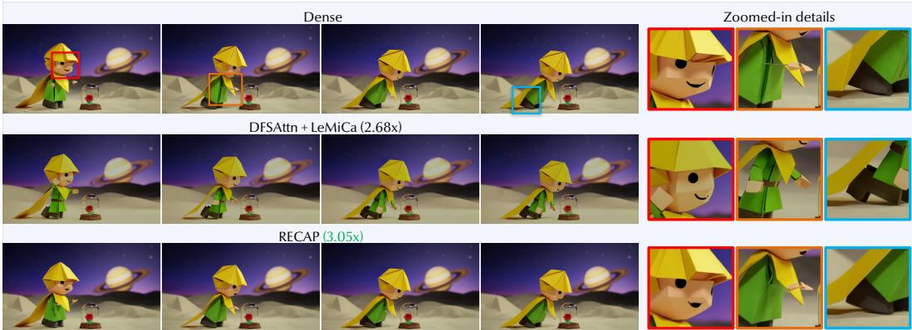  
Prompt: The Little Prince 2015 paper-puppet stop-motion story scenes. A tiny blond boy with folded golden paper hair black dot eyes..

Figure 1: Sample video and results on HunyuanVideo (720p, 5s). RECAP achieves a 3.05× speedup while outperforming all tested direct sparse–cache compositions in both fidelity and speed.

## ABSTRACT

Diffusion transformers generate high-quality videos but remain computationally expensive. Sparse attention and temporal caching reduce computation within and across denoising steps, respectively, offering a natural composition. However, predictions produced with sparse attention become sources for temporal reuse, coupling their errors along the sampling trajectory. We observe that improving the accuracy of these sources recovers fidelity without changing the reuse schedule, and that sparsification errors remain directionally aligned across nearby steps, suggesting that correction information can be shared rather than recomputed. These observations motivate RECAP, a training-free method that couples sparse attention with hierarchical caching through reciprocal correction, adaptively coordinated by online error feedback. Cached dense refinement corrects omitted interactions in current sparse estimates, while fresh sparse statistics track input changes and regulate the aging correction. The resulting predictions then renew the sources for whole-step prediction reuse, allowing prediction history to advance between dense refreshes. We evaluate RECAP on multiple video diffusion models against sparse-attention methods, caching methods, and their direct compositions. On HunyuanVideo at 720p 5-second generation, RECAP achieves a 3.05× speedup and outperforms all tested direct compositions in both fidelity and inference speed. Code is available at https://github.com/lyraxtg/RECAP.

## 1 INTRODUCTION

Diffusion transformers have emerged as a powerful architecture for visual generation (Peebles & Xie, 2023), but the quadratic complexity of attention and repeated transformer evaluations make inference expensive. Video generation is especially costly due to the length of its spatiotemporal token sequences (Yang et al., 2025b; Kong et al., 2024). Sparse attention reduces the interactions computed within each denoising step (Xi et al., 2025; Hu et al., 2026), while temporal caching reuses features or predictions across steps (Liu et al., 2025a). Since the two approaches save computation along different axes, a natural way to accelerate further is to compose them directly. In such a composition, however, sparse-attention predictions become the sources that caching reuses in later steps. Sparsification error therefore affects both the current sampler update and subsequent reused predictions, making the accuracy of these sources central to the speed–fidelity trade-off.

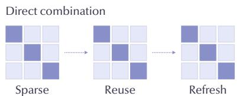  
(Sparse error persists)

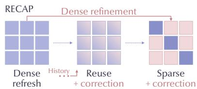  
Figure 2: Motivation of RECAP. Direct composition reuses sparse outputs, so sparse error persists. RECAP caches dense refinement to correct sparse steps, whose outputs renew the reuse history.

We study this coupling in direct compositions and make two observations. First, source accuracy matters for fidelity. When we replace the cached tensors with dense counterparts while keeping the reuse schedule and the sparse predictions used by the sampler, the deviation from the dense trajectory decreases. Computing every source densely, however, would forfeit the savings of sparse attention, so we ask whether correction can be shared across steps. Second, we find that sparsification errors remain strongly aligned across nearby denoising steps. This persistence suggests that a single dense correction can serve several sparse evaluations, whose corrected predictions then provide more accurate sources for temporal reuse. Sparse attention and caching should therefore correct each other rather than act independently, as Fig. 2 illustrates. Section 3.1 details both analyses.

Motivated by these observations, we propose RECAP, which connects sparse attention and a two-level cache hierarchy through reciprocal correction, as illustrated in Fig. 3. At the attention level, a cached dense refinement supplies the detail that the current sparse estimate leaves unresolved. As attention inputs evolve across steps, fresh sparse statistics in turn regulate how strongly this aging refinement is applied, so that cached and current information correct each other. At the prediction level, the corrected outputs renew a prediction cache, from which later steps are extrapolated without another transformer evaluation. Sparse computation thus links the two levels, and one dense refresh can support several sparse evaluations together with the prediction reuse that follows them.

This design also naturally supplies the feedback for adaptive online scheduling. Each computed prediction reveals the error of the extrapolation it replaces, and each dense refresh reveals the error of the refinement it renews. Since corrected sparse evaluations renew prediction history while reusing existing refinement, the two caches can be renewed at different rates. The prediction error thus decides when to compute a new prediction, and the refinement error decides whether this computation needs a dense refresh. Under a fixed budget, these decisions choose among prediction reuse, corrected sparse computation, and dense refresh, adapting the schedule to each sample without offline search.

## Our contributions are summarized as follows:

• We identify source accuracy and temporal persistence of sparsification error as key opportunities to improve sparse–cache composition. More accurate cache sources recover fidelity, while aligned errors across steps motivate sharing dense correction across sparse evaluations.

• We propose RECAP, which couples sparse attention with hierarchical caching through reciprocal correction. Cached dense refinement corrects sparse attention, corrected predictions renew the sources for whole-step reuse, and online error feedback decides when each cache is renewed.

• We evaluate RECAP on three video diffusion models, where it improves speed–fidelity tradeoffs over individual accelerators and direct sparse–cache compositions. On HunyuanVideo, it achieves a 3.05× speedup with higher fidelity than all tested compositions, as Fig. 1 shows.

## 2 RELATED WORK

Sparse attention. Sparse attention exploits spatial and temporal patterns (Xi et al., 2025; Zhang et al., 2025c; Li et al., 2025), or selects important interactions through content-dependent scores (Xia et al., 2025; Zhang et al., 2025a), token reordering (Yang et al., 2025a; Hu et al., 2026), and query–key clustering (Luo et al., 2026). Training-based approaches further learn sparse patterns (Zhang et al., 2025b; 2026). Instead of discarding omitted interactions, PISA approximates them with block means and shared first-order value compensation (Li et al., 2026), and COBS estimates block mass with second-order key statistics (Tian et al., 2026). Building on these approximations, RECAP corrects the remaining tail value and normalization mass with dense refinement cached from earlier steps.

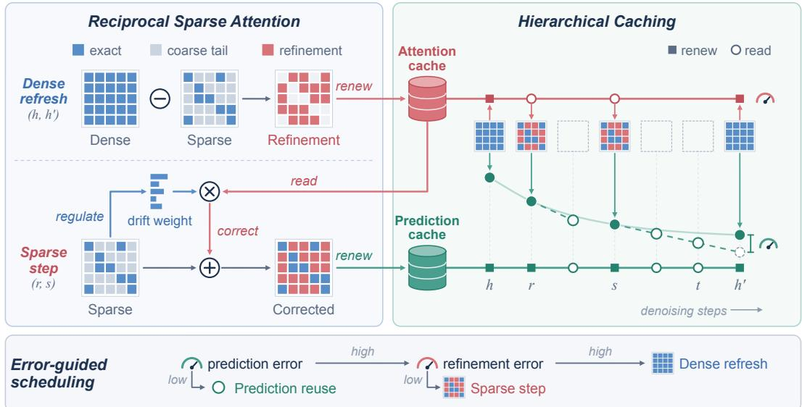  
Figure 3: Overview of RECAP. A dense refresh caches the refinement that sparse attention misses, and sparse steps apply it with a drift weight from fresh statistics. Corrected outputs renew the prediction cache used for reuse, and the two errors choose among reuse, a sparse step, and a dense refresh.

Temporal caching. Caching exploits similarity across denoising steps by reusing features or outputs (Ma et al., 2024b; Chen et al., 2024; Zhao et al., 2025). LeMiCa optimizes reuse offline (Gao et al., 2025), while other methods adapt reuse to online signals (Liu et al., 2025a; Kahatapitiya et al., 2025; Lv et al., 2026; Ma et al., 2025; Zhou et al., 2025). Further approaches include token-level reuse (Zou et al., 2025), feature extrapolation (Liu et al., 2025b; 2026a), guidance sharing (Lv et al., 2025), and learned routing (Ma et al., 2024a). RECAP uses current sparse statistics to regulate aging refinement and corrected sparse predictions to renew the sources for whole-step prediction reuse. Rather than deciding only when to reuse, RECAP also improves the predictions that are reused.

Combining sparse attention and temporal reuse. DiTFastAttn shares dense-minus-window attention residuals and attention outputs under an offline-selected schedule (Yuan et al., 2024). Re-ttention reuses normalization ratios and output residuals to reconstruct sparse attention (Chen et al., 2025). ASTRAEA uses evolutionary search to optimize per-timestep token budgets (Liu et al., 2026c), while LoSA reuses early-step attention block indices across subsequent denoising steps (Liu et al., 2026b). These methods act in one direction only, whereas RECAP corrects reciprocally and coordinates both cache levels by online error feedback. Appendix Sec. F discusses these distinctions further.

## 3 METHOD

## 3.1 MOTIVATION

Background. At denoising step t, a diffusion transformer predicts $p _ { t } = f _ { \theta } ( x _ { t } , t , c )$ from latent $x _ { t }$ and conditioning $c ,$ and the sampler advances as $\boldsymbol { x } _ { t + 1 } = \boldsymbol { \Psi } _ { t } ( \boldsymbol { x } _ { t } , p _ { t } )$ . Sparse attention reduces computation within each evaluation by omitting or approximating query-key interactions, while caching reuses earlier features or predictions across steps. These complementary savings make their combination a natural way to further accelerate sampling. However, sparse outputs also become sources for subsequent reuse, so sparsification error can affect both the current sampler update and later steps. This coupling motivates a closer examination of how the two mechanisms interact.

Composition error and source accuracy. We sweep the settings of DFSAttn, TeaCache, and their direct composition in Fig. 4a, finding that combining the two approximations need not cause a disproportionate loss of fidelity. If the two errors simply accumulated, the composed error would match the vector sum of the standalone errors. Instead, it falls below this sum in 103 of 104 configurations in Fig. 4b, revealing a favorable interaction between sparse attention and caching.

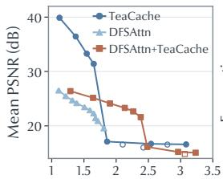  
Speedup over dense  
(a) Speed and fidelity

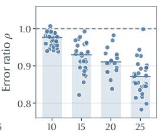  
Reused steps  
(b) Composition error

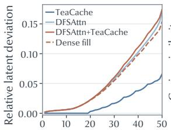  
Denoising step  
(c) Denoising trajectory

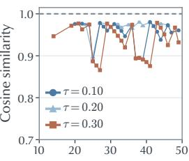  
Reuse step  
(d) Error persistence  
Figure 4: (a) Speed and fidelity of direct composition. (b) Composed error norm relative to the norm of summed standalone errors. (c) Latent deviation with dense cache filling under a fixed reuse schedule. (d) Cosine similarity of sparsification errors between source and reuse steps for different TeaCache thresholds τ. Details of these experiments are provided in Appendix Sec. C.1.

To reduce the remaining error, we focus on source accuracy, since sparse evaluations supply the sources of subsequent reuse. In DFSAttn with TeaCache, we replace cached tensors with dense counterparts computed on the same inputs, while retaining the sparse predictions for sampler updates and the reuse schedule. As Fig. 4c shows, this reduces latent deviation from the matched dense trajectory, demonstrating that more accurate cache sources can improve thefidelity ofthe composition.

Persistence of sparsification error. Computing every source densely, however, would forfeit the savings of sparse attention. We therefore ask whether correction can instead be shared across steps. Along dense trajectories, we compare sparse and dense predictions on identical inputs to isolate sparsification error from trajectory drift. Figure 4d shows that these errors remain strongly aligned across nearby steps for all thresholds, so a correction measured at the source step still points in the right direction at later steps. This suggests that a single dense correction can support multiple sparse evaluations by combining a fresh sparse estimate with cached detail that is costly to recompute.

Method overview. RECAP connects these insights through a two-level cache hierarchy, as illustrated in Fig. 3. The persistence of sparsification error motivates sharing dense correction across sparse evaluations, which we develop as attention-level refinement in Sec. 3.2. The resulting improved predictions then serve as more accurate sources for whole-step temporal reuse in Sec. 3.3. Finally, Sec. 3.4 coordinates renewal at both levels through online error feedback. At each step, RECAP either reuses an extrapolated prediction, performs corrected sparse computation, or refreshes densely.

## 3.2 ATTENTION-LEVEL CACHING FOR SPARSE RECONSTRUCTION

The source-accuracy findings in Sec. 3.1 motivate improving sparse predictions before reuse, and the temporal alignment of sparsification error suggests sharing correction across steps. Since this error originates in the omitted interactions, we realize both ideas at the attention level, where a fresh coarse estimate tracks changes in omitted attention and cached dense refinement supplies the discrepancy that this estimate leaves unresolved. Both are maintained separately for each layer and attention head.

Selected interactions and coarse tail. For scaled dot-product attention (Vaswani et al., 2017), we partition the keys for a query q into a selected set H and a tail $T$ omitted from exact computation. We select key blocks by pooled query-key scores and compute attention over H exactly. The omitted tail contributes both attention values and normalization mass, so reconstructing the full output requires estimating both. For either set A, let $o _ { A }$ be its normalized attention output and $\begin{array} { r } { \ell _ { A } = \log \sum _ { j \in A } \exp ( \beta q ^ { \top } k _ { j } ) } \end{array}$ its log-mass, where $\beta = d _ { k } ^ { - 1 / 2 }$ . The full output is

$$
o _ { t } = \frac { e ^ { \ell _ { H , t } } o _ { H , t } + e ^ { \ell _ { T , t } } o _ { T , t } } { e ^ { \ell _ { H , t } } + e ^ { \ell _ { T , t } } } .\tag{1}
$$

For the omitted tail, block means provide initial estimates of value and normalization mass, which we refine through two moment corrections. Key variance refines the log-mass through the second-order approximation of COBS (Tian et al., 2026), while pooled value-key covariance refines the value through the first-order compensation of PISA (Li et al., 2026). The logarithm of the summed block masses gives the coarse log-mass $\bar { \ell } _ { T , t } ,$ , while weighting block values by their normalized masses gives the coarse output $\bar { o } _ { T , t }$ . These statistics are recomputed at each sparse evaluation, allowing the estimate to track attention changes without evaluating every omitted query-key interaction.

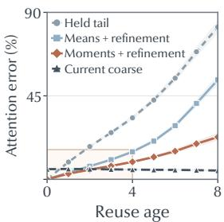  
(a) Across reuse ages

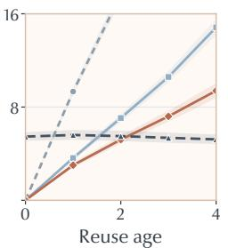  
(b) Early reuse

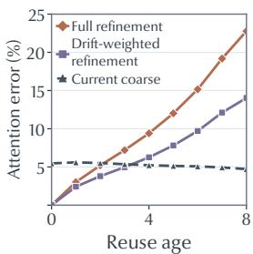  
(c) Drift attenuation

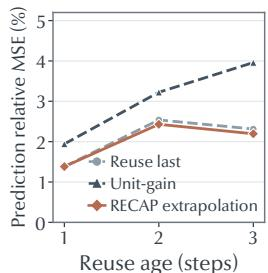  
(d) Prediction reuse  
Figure 5: Attention refinement and prediction reuse. (a, b) Reconstruction error growth with reuse age. (c) Drift weighting moderates error growth relative to full-strength refinement. (d) Fitted gain extrapolation compared with holding the latest prediction and unit-gain extrapolation.

Cached dense refinement. The coarse estimate leaves a discrepancy that a dense refresh can recover. At refresh h, we subtract the selected branch’s mass and unnormalized value contribution from those of full attention to obtain the exact tail output $_ { O T , h }$ and log-mass $\ell _ { T , h }$ . We cache their differences from the coarse estimates and add these residuals to fresh estimates at a later sparse evaluation t,

$$
\begin{array} { r l } & { \begin{array} { r l } { d _ { h } ^ { v } = o _ { T , h } - \bar { o } _ { T , h } , } & { \ d _ { h } ^ { \ell } = \ell _ { T , h } - \bar { \ell } _ { T , h } , } \\ { \widehat { o } _ { T , t } = \bar { o } _ { T , t } + d _ { h } ^ { v } , } & { \widehat { \ell } _ { T , t } = \bar { \ell } _ { T , t } + d _ { h } ^ { \ell } . } \end{array} } \end{array}\tag{2}
$$

Each layer retains its selected partition between dense refreshes, so that cached residuals and the current coarse estimates continue to describe the same set of omitted keys. The partition can then be re-selected at each dense refresh, together with the cached residuals, as attention evolves.

To see why this decomposition helps, write either tail quantity as $y _ { t } = \bar { y } _ { t } + d _ { t } ,$ so that the reconstruction error becomes $\widehat { y } _ { t } - y _ { t } = d _ { h } \dot { - } d _ { t }$ . The fresh estimate absorbs changes in the coarse component, leaving reconstruction error determined only by changes in the unresolved discrepancy. As Fig. 5a and Fig. 5b illustrate, updating the coarse component slows error growth relative to holding the entire tail fixed, while adding cached refinement further improves accuracy at early reuse ages.

Drift-weighted refinement. However, Fig. 5b also shows that the benefit of cached refinement diminishes with reuse age as attention inputs evolve. We therefore use the fresh coarse statistics to regulate the cached contribution, so that current sparse computation in turn corrects the cache when earlier refinement becomes less reliable. To quantify this drift, each dense refresh also stores the coarse log-mass $\bar { \ell } _ { T , i , h }$ alongside the residuals. For video query row i, the change $u _ { i , t } = \bar { \ell } _ { T , i , t } - \bar { \ell } _ { T , i , h }$ captures how far current tail statistics have moved from those at the refresh. We center this over the $N _ { q }$ video query rows within each sample and attention head to obtain the refinement weight

$$
\Delta _ { i , t } = u _ { i , t } - \frac { 1 } { N _ { q } } \sum _ { j = 1 } ^ { N _ { q } } u _ { j , t } , \qquad a _ { i , t } = e ^ { - | \Delta _ { i , t } | } .\tag{3}
$$

Centering removes the common log-mass shift already carried by the fresh estimate. The weight thus decreases only with row-specific deviations and introduces no tunable parameter. To keep value and mass consistent, the same weight blends their unnormalized contributions,

$$
\begin{array} { r l } & { \widetilde { Z } _ { T , t } = ( 1 - a _ { t } ) e ^ { \bar { \ell } _ { T , t } } + a _ { t } e ^ { \widehat { \ell } _ { T , t } } , } \\ & { \widetilde { N } _ { T , t } = ( 1 - a _ { t } ) e ^ { \bar { \ell } _ { T , t } } \bar { o } _ { T , t } + a _ { t } e ^ { \widehat { \ell } _ { T , t } } \widehat { o } _ { T , t } . } \end{array}\tag{4}
$$

The normalized output $\widetilde { \cal O } _ { T , t } = \widetilde { \cal N } _ { T , t } / \widetilde { Z } _ { T , + }$ t and log-mass $\widetilde { \ell } _ { T , t } = \log \widetilde { Z } _ { T , t }$ then merge with the selected branch through Eq. (1). As shown in Fig. 5c, this weighting moderates reconstruction error growth compared with applying refinement at full strength as the cached correction ages. Appendix Sec. A provides the mathematical details of the moment estimates, tail recovery, and blending.

## 3.3 PREDICTION-LEVEL CACHING FOR STEP REUSE

Since more accurate sources improve the fidelity of temporal reuse, the corrected sparse predictions from Sec. 3.2 naturally serve as better anchors. This motivates caching and extrapolating these improved outputs to advance subsequent sampler steps without another transformer evaluation.

Prediction extrapolation. To account for changes between steps, we estimate a local rate of change from the two most recent computed predictions at steps $r <$ s and extrapolate to a later step t,

$$
v _ { s } = \frac { p _ { s } - p _ { r } } { s - r } , \qquad \widehat { p } _ { t } = p _ { s } + \alpha _ { s } ( t - s ) v _ { s } ,\tag{5}
$$

where intervals count sampler steps and the scalar gain $\alpha _ { s }$ controls how strongly the observed change is carried forward. Because prediction changes may not continue at the same rate, we fit the gain online. At each computed step t with two preceding sources, we compare the observed change $y _ { t } = p _ { t } - p _ { s }$ with the unit-gain extrapolation $z _ { t } = ( t - s ) v _ { s }$ through a cumulative least-squares fit,

$$
\alpha _ { t } = \arg \operatorname* { m i n } _ { a \in \mathbb { R } } \sum _ { j \in \mathcal { C } _ { t } } \| y _ { j } - a z _ { j } \| _ { F } ^ { 2 } ,\tag{6}
$$

where $\mathcal { C } _ { t }$ contains computed steps through t with two preceding sources. During prediction reuse, the sampler advances with $\widehat { p } _ { t }$ while the transformer evaluation is skipped and both the prediction history and gain remain fixed. As Fig. 5d illustrates, the fitted gain reduces extrapolation error relative to unit gain and improves over simply holding the latest prediction at longer reuse ages. This comparison fixes prediction histories and latent inputs to isolate the effect of the extrapolation rule.

Prediction-source renewal. Each computed prediction updates both the anchor and the rate of change, so source accuracy directly affects both terms in Eq. (5). Corrected sparse evaluations renew these quantities while continuing to reuse existing attention refinement, allowing prediction history to advance between dense refreshes without requiring a new dense correction. A single dense refresh can therefore support several sparse evaluations and their subsequent prediction reuse. Restricting this renewal to dense refreshes substantially reduces fidelity, as Sec. 4.3 shows. Appendix Sec. B.1 derives the closed-form gain and shows how source errors are carried into reused predictions.

## 3.4 ERROR-GUIDED ONLINE SCHEDULING

The two levels of reuse in RECAP naturally supply the feedback needed to schedule them. Each computed prediction reveals the error of the extrapolation it replaces, and each dense refresh reveals the error of the refinement it renews. RECAP uses these errors to decide online when to compute a new prediction and whether this computation needs a dense refresh. The schedule therefore adapts to each sample as sampling proceeds, rather than relying on offline search or a fixed reuse pattern.

Prediction feedback decides when to compute. We compare each computed prediction $p _ { t }$ with its extrapolation $\widehat { p } _ { t }$ , normalizing by the elapsed steps since extrapolation error grows with the interval,

$$
e _ { \mathrm { p r e d } , t } = { \frac { \| p _ { t } - { \widehat { p } } _ { t } \| _ { F } } { \| p _ { t } \| _ { F } } } , \qquad \rho _ { \mathrm { p r e d } , t } = { \frac { e _ { \mathrm { p r e d } , t } } { t - s } } ,\tag{7}
$$

where s is the latest source step. A rate below $\tau _ { \mathrm { p r e d } }$ extends the next reuse interval, which is capped by spreading the remaining evaluations of a budget B evenly over the remaining steps. This cap shortens when the rate exceeds its running mean, which concentrates computation where predictions change quickly. The budget thus fixes how much is computed, while the feedback decides where.

Refinement feedback decides how to compute. Corrected sparse attention is used only while the cached refinement remains reliable, which requires a dense reference to verify. At each dense refresh h, we compare the dense attention output $O _ { l , h } ^ { \mathbf { \dot { D } } }$ of each layer l with the corrected sparse output $\widetilde { O } _ { l , h } ^ { \mathrm { o l d } }$ reconstructed from the old refinement. Pooling the layer errors before the residual update gives

$$
e _ { \mathrm { r e f } , h } = \left( \frac { \sum _ { l } \| \widetilde { O } _ { l , h } ^ { \mathrm { o l d } } - O _ { l , h } ^ { D } \| _ { F } ^ { 2 } } { \sum _ { l } \| O _ { l , h } ^ { D } \| _ { F } ^ { 2 } } \right) ^ { 1 / 2 } .\tag{8}
$$

Since sparsification error remains aligned across nearby steps, as Fig. 4d shows, this error indicates how long the new refinement can be trusted. A passing check extends its permitted age, whereas a failed check makes the next computed prediction dense. Between checks, drift weighting adjusts the cached contribution per query row, while the check decides when to renew the whole refinement.

Together, the two decisions yield the three actions in Fig. 3, namely prediction reuse, corrected sparse computation that renews only the prediction level, and a dense refresh that renews both cache levels. Each computed step thus supplies both a new source for reuse and the feedback that decides when the two caches are renewed. Appendix Sec. B gives the update rules and sampling algorithm.

Table 1: Main results on CogVideoX-1.5 and HunyuanVideo. Re-ttention exceeds GPU memory on HunyuanVideo and is therefore omitted. VBench Overall averages the six evaluated dimensions after per-dimension normalization. Best and second-best results are bold and underlined, respectively.
<table><tr><td rowspan="2">Method</td><td colspan="3">Fidelity</td><td colspan="5">Quality</td><td colspan="2">Efficiency</td></tr><tr><td>PSNR↑</td><td>SSIM↑</td><td>LPIPS↓</td><td>|CLIPIQA+↑</td><td>IQ↑</td><td>AQ↑</td><td>TF↑</td><td>Overall↑</td><td>| Latency↓ Speedup↑</td><td></td></tr><tr><td colspan="10">CogVideoX-1.5 (768× 1360, 81 frames)</td></tr><tr><td>Dense</td><td></td><td></td><td></td><td>0.489</td><td>64.05</td><td>61.33</td><td>97.06</td><td>83.31</td><td>1,106s</td><td>1.00×</td></tr><tr><td>TeaCache (CVPR′25)</td><td>31.13</td><td>0.9472</td><td>0.0475</td><td>0.472</td><td>63.16</td><td>60.95</td><td>97.06</td><td>83.06</td><td>664s</td><td>1.67×</td></tr><tr><td>SVG(ICML&#x27;25)</td><td>23.17</td><td>0.8044</td><td>0.1952</td><td>0.478</td><td>63.41</td><td>60.16</td><td>96.76</td><td>82.69</td><td>776s</td><td>1.43×</td></tr><tr><td>Re-ttention (NeurIPS&#x27;25)</td><td>22.42</td><td>0.7587</td><td>0.2557</td><td>0.373</td><td>57.67</td><td>56.38</td><td>96.98</td><td>81.16</td><td>837s</td><td>1.32×</td></tr><tr><td>LeMiCa (NeurIPS&#x27;25)</td><td>32.06</td><td>0.9631</td><td>0.0359</td><td>0.480</td><td>63.31</td><td>61.05</td><td>97.07</td><td>83.09</td><td>700s</td><td>1.58×</td></tr><tr><td>SVOO (ICML&#x27;26)</td><td>25.88</td><td>0.8532</td><td>0.1484</td><td>0.451</td><td>63.50</td><td>60.12</td><td>96.91</td><td>82.75</td><td>778s</td><td>1.42×</td></tr><tr><td>DFSAttn (ICML26)</td><td>26.13</td><td>0.8694</td><td>0.1266</td><td>0.480</td><td>63.32</td><td>60.58</td><td>96.88</td><td>82.85</td><td>685s</td><td>1.61×</td></tr><tr><td>NaviCache (ICML&#x27;26)</td><td>26.99</td><td>0.8788</td><td>0.1123</td><td>0.468</td><td>63.22</td><td>60.68</td><td>97.10</td><td>83.04</td><td>654s</td><td>1.69×</td></tr><tr><td>RECAP-SPEED</td><td>33.69</td><td>0.9675</td><td>0.0306</td><td>0.483</td><td>63.56</td><td>61.08</td><td>97.09</td><td>83.16</td><td>632s</td><td>1.75×</td></tr><tr><td>RECAP-QUALITY</td><td>35.80</td><td>0.9766</td><td>0.0223</td><td>0.486</td><td>63.79</td><td>61.28</td><td>97.06</td><td>83.23</td><td>681s</td><td>1.62×</td></tr><tr><td colspan="10">HunyuanVideo (720× 1280, 129 frames)</td></tr><tr><td>Dense</td><td></td><td></td><td></td><td>0.512</td><td>64.91</td><td>58.74</td><td>98.92</td><td>85.13</td><td>3,440s</td><td>1.00×</td></tr><tr><td>TeaCache (CVPR&#x27;25)</td><td>21.94</td><td>0.8376</td><td>0.2073</td><td>0.495</td><td>62.82</td><td>57.96</td><td>98.92</td><td>84.57</td><td>1,638s</td><td>2.10×</td></tr><tr><td>SVG (ICML&#x27;25)</td><td>21.13</td><td>0.8203</td><td>0.2458</td><td>0.490</td><td>63.76</td><td>58.26</td><td>98.76</td><td>84.51</td><td>1,641s</td><td>2.10×</td></tr><tr><td>LeMiCa (NeurIPS&#x27;25)</td><td>35.12</td><td>0.9730</td><td>0.0410</td><td>0.513</td><td>63.12</td><td>58.45</td><td>99.03</td><td>84.87</td><td>1,746s</td><td>1.97×</td></tr><tr><td>SVOO (ICML26)</td><td>27.68</td><td>0.9048</td><td>0.1218</td><td>0.505</td><td>64.11</td><td>58.40</td><td>98.91</td><td>84.85</td><td>1,831s</td><td>1.88×</td></tr><tr><td>DFSAttn (ICML&#x27;26)</td><td>30.67</td><td>0.9420</td><td>0.0624</td><td>0.504</td><td>64.14</td><td>58.45</td><td>98.80</td><td>84.78</td><td>1,697s</td><td>2.03×</td></tr><tr><td>NaviCache (ICML&#x27;26)</td><td>35.29</td><td>0.9720</td><td>0.0310</td><td>0.502</td><td>64.63</td><td>58.68</td><td>98.94</td><td>85.02</td><td>1,761s</td><td>1.95×</td></tr><tr><td>RECAP-SPEED</td><td>35.35</td><td>0.9744</td><td>0.0268</td><td>0.508</td><td>63.82</td><td>58.66</td><td>99.07</td><td>85.04</td><td>1,611s</td><td>2.14×</td></tr><tr><td>RECAP-QUALITY</td><td>36.71</td><td>0.9795</td><td>0.0189</td><td>0.513</td><td>64.27</td><td>58.73</td><td>98.96</td><td>85.08</td><td>1,727s</td><td>1.99×</td></tr></table>

## 4 EXPERIMENTS

## 4.1 EXPERIMENTAL SETUP

Models and baselines. We evaluate RECAP on CogVideoX-1.5-5B (Yang et al., 2025b), HunyuanVideo-13B (Kong et al., 2024), and Wan2.1-1.3B (Team Wan et al., 2025), each with 50 steps. Wan2.1 results are in Appendix Sec. E.1. Baselines include SVG (Xi et al., 2025), Rettention (Chen et al., 2025), SVOO (Luo et al., 2026), and DFSAttn (Hu et al., 2026) for sparse attention and TeaCache (Liu et al., 2025a), LeMiCa (Gao et al., 2025), and NaviCache (Lv et al., 2026) for caching. Pairing SVOO and DFSAttn with each caching baseline yields six direct compositions. Appendix Sec. D extends RECAP to FLUX.1-dev (Black Forest Labs, 2024) image generation. For image generation, we additionally compare with the caching method Spectrum (Han et al., 2026).

Evaluation metrics. We use optimized VBench prompts (Huang et al., 2024), with initial noise, guidance, and sampler settings matched across methods within each comparison. Fidelity to dense gen eration is measured using PSNR (Horé & Ziou, 2010), SSIM (Wang et al., 2004), and LPIPS (Zhang et al., 2018) on paired lossless frames. CLIP-IQA+ (Wang et al., 2023) and VBench (Huang et al., 2024) assess generation quality. For VBench, we average six quality dimensions after its official per-dimension normalization, as detailed in Appendix Sec. E.2. The main tables also report the individual imaging quality (IQ), aesthetic quality (AQ), and temporal flickering (TF) scores.

Implementation details. The main experiments on CogVideoX-1.5 and Wan2.1-1.3B are conducted on NVIDIA RTX 4090 GPUs, while those on HunyuanVideo use NVIDIA A800 GPUs. We use FlashAttention-2 (Dao, 2024) for dense refreshes, the Block Sparse Attention library (Guo et al., 2024) for selected interactions, and custom Triton kernels (Tillet et al., 2019) for coarse-tail estimation and refinement. RECAP requires no training or model fine-tuning. We select its computation budget and error tolerances using the lightweight parameter selection procedure in Appendix Sec. C.4. Appendix Sec. C provides the full parameter settings for each model and describes the memory optimizations.

## 4.2 COMPARISON WITH EXISTING METHODS

Quantitative results. Table 1 compares individual methods in the normal-speedup regime. RECAP-QUALITY improves PSNR over the strongest individual baseline by 3.74 dB on CogVideoX 1.5 and 1.42 dB on HunyuanVideo. RECAP-SPEED achieves the lowest latency in this comparison and reaches speedups of 1.75× and 2.14× over dense generation, respectively. Both settings outperform all individual baselines in fidelity and VBench Overall on both models. In the high-speed regime, Tab. 2 compares direct sparse–cache compositions. RECAP exceeds the highest-PSNR composition, DFSAttn with LeMiCa, by 3.78 dB and 1.18 dB on the two models, respectively. It also achieves the best SSIM, LPIPS, and VBench Overall scores alongside the lowest latency, with speedups of 2.67× and 3.05×. On CogVideoX-1.5, RECAP achieves the best result on every reported metric.

3.15× / 18.52  
3.42× / 24.44  
Table 2: Comparison with direct sparse–cache compositions, each configured to a similar speedup in the high-speed regime. Best and second-best results are bold and underlined, respectively.
<table><tr><td rowspan="2">Method</td><td colspan="3">Fidelity</td><td colspan="5">Quality</td><td colspan="2">Efficiency</td></tr><tr><td>PSNR↑</td><td>SSIM↑</td><td>LPIPS↓</td><td>|CLIPIQA+↑</td><td>IQ↑</td><td>AQ↑</td><td>TF↑</td><td>Overall↑ | Latency↓ Speedup↑</td><td></td><td></td></tr><tr><td colspan="9">CogVideoX-1.5 (768× 1360, 81 frames)</td><td></td></tr><tr><td>DFSAttn + TeaCache</td><td>15.89</td><td>0.5654</td><td>0.4245</td><td>0.422</td><td>61.59</td><td>58.32</td><td>95.93</td><td>81.55</td><td>446s</td><td>2.48×</td></tr><tr><td>DFSAttn + LeMiCa</td><td>21.57</td><td>0.7835</td><td>0.1934</td><td>0.437</td><td>63.43</td><td>60.76</td><td>95.91</td><td>82.30</td><td>440s</td><td>2.51×</td></tr><tr><td>DFSAttn + NaviCache</td><td>21.42</td><td>0.7648</td><td>0.2059</td><td>0.434</td><td>63.39</td><td>60.42</td><td>96.04</td><td>82.23</td><td>434s</td><td>2.54×</td></tr><tr><td>SVOO + TeaCache</td><td>15.77</td><td>0.5594</td><td>0.4206</td><td>0.419</td><td>62.79</td><td>56.69</td><td>95.83</td><td>81.41</td><td>439s</td><td>2.52×</td></tr><tr><td>SVOO + LeMiCa</td><td>21.14</td><td>0.7627</td><td>0.2043</td><td>0.430</td><td>63.34</td><td>60.34</td><td>96.07</td><td>82.32</td><td>438s</td><td>2.52×</td></tr><tr><td>SVOO + NaviCache</td><td>20.43</td><td>0.7047</td><td>0.2816</td><td>0.405</td><td>62.95</td><td>58.34</td><td>96.17</td><td>81.72</td><td>427s</td><td>2.59×</td></tr><tr><td>RECAP</td><td>25.35</td><td>0.8724</td><td>0.1421</td><td>0.439</td><td>63.61</td><td>60.86</td><td>96.30</td><td>82.64</td><td>415s</td><td>2.67×</td></tr></table>

HunyuanVideo (720×1280, 129frames)
<table><tr><td>DFSAttn + TeaCache</td><td>24.30</td><td>0.8701</td><td>0.1545</td><td>0.464</td><td>62.71</td><td>58.14</td><td>98.43</td><td>83.91</td><td>1,213s</td><td>2.83×</td></tr><tr><td>DFSAttn + LeMiCa</td><td>28.49</td><td>0.9146</td><td>0.0905</td><td>0.470</td><td>60.69</td><td>57.80</td><td>98.69</td><td>83.79</td><td>1,283s</td><td>2.68×</td></tr><tr><td>DFSAttn + NaviCache</td><td>28.46</td><td>0.9148</td><td>0.0875</td><td>0.464</td><td>62.18</td><td>58.14</td><td>98.48</td><td>83.80</td><td>1,350s</td><td>2.55×</td></tr><tr><td>SVOO + TeaCache</td><td>21.27</td><td>0.8092</td><td>0.2535</td><td>0.461</td><td>60.95</td><td>57.85</td><td>98.45</td><td>83.52</td><td>1,447s</td><td>2.38×</td></tr><tr><td>SVOO + LeMiCa</td><td>27.39</td><td>0.8999</td><td>0.1266</td><td>0.471</td><td>61.18</td><td>57.97</td><td>98.73</td><td>83.86</td><td>1,329s</td><td>2.59×</td></tr><tr><td>SVOO + NaviCache</td><td>27.16</td><td>0.8976</td><td>0.1280</td><td>0.467</td><td>62.31</td><td>58.35</td><td>98.64</td><td>83.97</td><td>1,560s</td><td>2.21×</td></tr><tr><td>RECAP</td><td>29.67</td><td>0.9392</td><td>0.0731</td><td>0.467</td><td>62.35</td><td>58.68</td><td>98.81</td><td>84.34</td><td>1,129s</td><td>3.05×</td></tr></table>

SVOO + LeMiCa

DFSAttn + TeaCache DFSAttn + NaviCache SVOO + TeaCache  
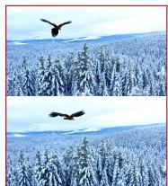  
Speedup / PSNR

RECAP  
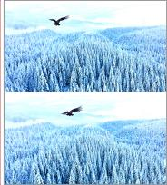  
2.42× / 16.71

  
2.45× / 19.93

  
2.47× / 17.50

  
2.48× / 17.83

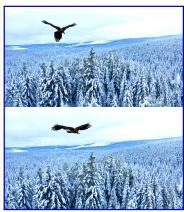  
2.57× / 21.89

Prompt: A majestic eagle soars gracefully above a vast, snow-covered forest, its powerful wings cutting through...  
  
Speedup / PSNR

  
2.85× / 21.88

  
2.51× / 26.78

  
2.37× / 22.15

  
2.55× / 26.65

  
3.09× / 29.25

Prompt: A cat wearing sunglasses at a pool. Realistic, Natural lighting, Casual  
  
Speedup / PSNR

  
3.21× / 18.13

  
3.27× / 20.37

  
3.38× / 20.95

  
Prompt: Dreamlike watercolor manga. Visitors stand before an enormous aquarium window, but clouds, miniature...  
Figure 6: Samples from CogVideoX-1.5 (top), HunyuanVideo (middle), and FLUX.1-dev (bottom). More image generation results are provided in Appendix Sec. D. Best viewed zoomed in.

Qualitative results. The samples in Fig. 6 show that RECAP agrees more closely with dense generation in both fine details and overall appearance. On CogVideoX-1.5, RECAP better preserves the eagle’s posture, the details of the snow-covered forest, and the overall color of the scene, whereas three of the four compositions shift it toward a saturated blue. On HunyuanVideo, it more faithfully reproduces the details of the cat’s face and the water, and renders the fur texture more clearly. On FLUX.1-dev, it is the only method that preserves both the rectangular window and the eight children. Additional comparisons across models and speedup regimes are provided in Appendix Sec. E.3.

Table 3: Ablation studies in the normal-speedup regime, with fast-regime results in Tab. 10. Latency is measured on one NVIDIA A800 GPU. Bold marks the best value within each comparison.
<table><tr><td>Variant</td><td>PSNR↑ SSIM↑ LPIPS↓</td></tr><tr><td>W/o refinement</td><td>34.57 0.9749 0.0303</td></tr><tr><td>Frozen state</td><td>30.12 0.9396 0.0747</td></tr><tr><td>RECAP</td><td>36.15 0.9817 0.0219</td></tr></table>

(a) Reconstruction components.
<table><tr><td></td><td>Same locations</td><td>Matched runtime</td></tr><tr><td>Variant</td><td>PSNR↑ SSIM↑ LPIPS↓ PSNR↑</td><td>SSIM↑ LPIPS↓</td></tr><tr><td>PISA</td><td>29.55 0.9351 0.0755</td><td>31.84 0.9549 0.0532</td></tr><tr><td>Re-ttention</td><td>26.93 0.8677 0.1329</td><td>28.68 0.8983 0.1036</td></tr><tr><td>RECAP</td><td>36.15 0.9817 0.0219</td><td>36.15 0.9817 0.0219</td></tr></table>

(b) Alternative reconstructions.

<table><tr><td>Variant</td><td>PSNR↑ SSIM↑ LPIPS↓</td></tr><tr><td>Dense-only history renewal</td><td>31.800.9623 0.0468</td></tr><tr><td>Uniform schedule</td><td>35.700.97960.0254</td></tr><tr><td>RECAP</td><td>36.15 0.9817 0.0219</td></tr><tr><td>(c) Prediction-history renewal and online scheduling.</td><td></td></tr><tr><td>Variant</td><td>PSNR↑SSIM↑LPIPS↓Latency</td></tr><tr><td>W/o prediction reuse</td><td>38.79 0.98780.0143 845.51s</td></tr><tr><td>RECAP (matched latency) RECAP</td><td>41.45 0.9934 0.0064 843.97s 36.15 0.9817 0.0219 619.69s</td></tr></table>

(d) Prediction reuse.

## 4.3 ABLATION STUDIES

We ablate each component of RECAP on CogVideoX-1.5, namely attention reconstruction, prediction reuse, and online scheduling. Each variant changes one component with all other settings fixed. Appendix Sec. E.4 repeats every ablation at the fast setting of Tab. 2, with the same conclusions.

Attention reconstruction. The reconstruction in Sec. 3.2 pairs fresh coarse estimates with cached dense refinement. Removing the refinement at the same computation locations lowers PSNR from 36.15 to 34.57 dB in Tab. 3a. Freezing the initial refinement and partition lowers it further to 30.12 dB. The refinement thus supplies detail missing from the coarse estimate and must be renewed during sampling. Adapted PISA (Li et al., 2026) and Re-ttention (Chen et al., 2025) change the cost of each sparse evaluation. Table 3b therefore compares them with our reconstruction both at the same locations and at matched runtime. RECAP leads in both, by 4.31 and 7.47 dB at matched runtime.

Prediction reuse. Section 3.3 extrapolates reused steps from a prediction history that corrected sparse evaluations also renew. Restricting this renewal to dense refreshes lowers PSNR from 36.15 to 31.80 dB in Tab. 3c, showing that corrected sparse evaluations are valuable reuse sources. Disabling reuse and computing all 50 steps raises PSNR to 38.79 dB, but latency grows from 619.69 to 845.51 s, so reuse saves 27% of runtime. At matched latency, RECAP instead reaches 41.45 dB in Tab. 3d.

Online scheduling. The scheduler in Sec. 3.4 places computed steps by prediction error, concentrating them where predictions change quickly. Spacing the same number of steps evenly lowers PSNR from 36.15 to 35.70 dB in Tab. 3c. Error-guided placement thus improves fidelity at no extra cost.

## 5 CONCLUSION

We presented RECAP, a training-free method that couples sparse attention and hierarchical caching through reciprocal correction instead of composing them directly. We showed that the accuracy of cache sources affects the fidelity of the composition and that sparsification errors persist across nearby steps. Building on these findings, RECAP maintains a two-level cache hierarchy. At the attention level, cached dense refinement corrects sparse attention, while fresh sparse statistics regulate how strongly this aging refinement is applied. At the prediction level, corrected predictions renew the sources for whole-step reuse. Online error feedback decides when to compute and when to refresh densely, so the schedule adapts to each sample without costly offline search. Across three video diffusion models, RECAP improves the speed–fidelity trade-off over individual accelerators and direct compositions, reaching a 3.05× speedup on HunyuanVideo with higher fidelity than all tested compositions.

## AI USE STATEMENT

In this work, we used generative AI tools for polishing language to improve clarity. We have not used generative AI tools to generate research ideas, conduct the reported experiments, or generate experimental results. We have reviewed all AI-assisted work, checking revisions for technical accuracy and consistency with our method and experimental evidence. We take responsibility for the final content of this work, including text, claims, or artifacts produced with the aid of generative AI.

## ETHICS STATEMENT

This research uses publicly available video-generation models and focuses on algorithmic improvements for inference acceleration. We identify no ethical concerns specific to the proposed acceleration method.

## REPRODUCIBILITY STATEMENT

Method details are provided in Sec. 3, Appendix Sec. A, and Appendix Sec. B. Experimental configurations and evaluation metrics are described in Sec. 4.1 and Appendix Sec. C. Code and video samples will be available at https://github.com/lyraxtg/RECAP.

## REFERENCES

Black Forest Labs. FLUX.1 [dev]. https://huggingface.co/black-forest-labs/ FLUX.1-dev, 2024. 7

Pengtao Chen, Mingzhu Shen, Peng Ye, Jianjian Cao, Chongjun Tu, Christos-Savvas Bouganis, Yiren Zhao, and Tao Chen. ∆-DiT: A training-free acceleration method tailored for diffusion transformers. arXiv preprint arXiv:2406.01125, 2024. 3

Ruichen Chen, Keith G. Mills, Liyao Jiang, Chao Gao, and Di Niu. Re-ttention: Ultra sparse visual generation via attention statistical reshape. In NeurIPS, 2025. 3, 7, 9

Tri Dao. FlashAttention-2: Faster attention with better parallelism and work partitioning. In ICLR, 2024. 7

Huanlin Gao, Ping Chen, Fuyuan Shi, Chao Tan, Zhaoxiang Liu, Fang Zhao, Kai Wang, and Shiguo Lian. LeMiCa: Lexicographic minimax path caching for efficient diffusion-based video generation. In NeurIPS, 2025. 3, 7

Junxian Guo, Haotian Tang, Shang Yang, Zhekai Zhang, Zhijian Liu, and Song Han. Block Sparse Attention. https://github.com/mit-han-lab/Block-Sparse-Attention, 2024. 7

Jiaqi Han, Juntong Shi, Puheng Li, Haotian Ye, Qiushan Guo, and Stefano Ermon. Adaptive spectral feature forecasting for diffusion sampling acceleration. In CVPR, 2026. 7

Alain Horé and Djemel Ziou. Image quality metrics: PSNR vs. SSIM. In ICPR, 2010. 7

Jie Hu, Zixiang Gao, Yutong He, and Kun Yuan. DFSAttn: Dynamic fine-grained sparse attention for efficient video generation. In ICML, 2026. 1, 2, 7

Ziqi Huang, Yinan He, Jiashuo Yu, Fan Zhang, Chenyang Si, Yuming Jiang, Yuanhan Zhang, Tianxing Wu, Qingyang Jin, Nattapol Chanpaisit, Yaohui Wang, Xinyuan Chen, Limin Wang, Dahua Lin, Yu Qiao, and Ziwei Liu. VBench: Comprehensive benchmark suite for video generative models. In CVPR, 2024. 7

Kumara Kahatapitiya, Haozhe Liu, Sen He, Ding Liu, Menglin Jia, Chenyang Zhang, Michael S. Ryoo, and Tian Xie. Adaptive caching for faster video generation with diffusion transformers. In ICCV, 2025. 3

Weijie Kong, Qi Tian, Zijian Zhang, Rox Min, Zuozhuo Dai, Jin Zhou, Jiangfeng Xiong, Xin Li, Bo Wu, Jianwei Zhang, Kathrina Wu, Qin Lin, Junkun Yuan, Yanxin Long, Aladdin Wang, Andong Wang, Changlin Li, Duojun Huang, Fang Yang, Hao Tan, Hongmei Wang, Jacob Song, Jiawang Bai, Jianbing Wu, Jinbao Xue, Joey Wang, Kai Wang, Mengyang Liu, Pengyu Li, Shuai Li, Weiyan Wang, Wenqing Yu, Xinchi Deng, Yang Li, Yi Chen, Yutao Cui, Yuanbo Peng, Zhentao Yu, Zhiyu He, Zhiyong Xu, Zixiang Zhou, Zunnan Xu, Yangyu Tao, Qinglin Lu, Songtao Liu, Dax Zhou, Hongfa Wang, Yong Yang, Di Wang, Yuhong Liu, Jie Jiang, and Caesar Zhong. HunyuanVideo: A systematic framework for large video generative models. arXiv preprint arXiv:2412.03603, 2024. 1, 7

Haopeng Li, Shitong Shao, Wenliang Zhong, Zikai Zhou, Lichen Bai, Hui Xiong, and Zeke Xie. PISA: Piecewise sparse attention is wiser for efficient diffusion transformers. arXiv preprint arXiv:2602.01077, 2026. 3, 4, 9

Xingyang Li, Muyang Li, Tianle Cai, Haocheng Xi, Shuo Yang, Yujun Lin, Lvmin Zhang, Songlin Yang, Jinbo Hu, Kelly Peng, Maneesh Agrawala, Ion Stoica, Kurt Keutzer, and Song Han. Radial attention: O(n log n) sparse attention with energy decay for long video generation. In NeurIPS, 2025. 2

Enhuai Liu, Yunke Wang, Changming Sun, and Chang Xu. D2Cache: Second-order delta caching for higher video diffusion acceleration. In CVPR, 2026a. 3

Enhuai Liu, Yunke Wang, Yutong Wang, Changming Sun, and Chang Xu. LoSA: Near-lossless sparse attention for training-free video diffusion acceleration. arXiv preprint arXiv:2608.12032, 2026b. 3

Feng Liu, Shiwei Zhang, Xiaofeng Wang, Yujie Wei, Haonan Qiu, Yuzhong Zhao, Yingya Zhang, Qixiang Ye, and Fang Wan. Timestep embedding tells: It’s time to cache for video diffusion model. In CVPR, 2025a. 1, 3, 7

Haosong Liu, Yuge Cheng, Wenxuan Miao, Zihan Liu, Aiyue Chen, Jing Lin, Yiwu Yao, Chen Chen, Jingwen Leng, Minyi Guo, and Yu Feng. Astraea: A token-wise acceleration framework for video diffusion transformers. In ICLR, 2026c. 3

Jiacheng Liu, Chang Zou, Yuanhuiyi Lyu, Junjie Chen, and Linfeng Zhang. From reusing to forecasting: Accelerating diffusion models with TaylorSeers. In ICCV, 2025b. 3

Jiayi Luo, Jiayu Chen, Jiankun Wang, Cong Wang, Hanxin Zhu, Qingyun Sun, Chen Gao, Zhibo Chen, and Jianxin Li. Attention sparsity is input-stable: Training-free sparse attention for video generation via offline sparsity profiling and online QK co-clustering. In ICML, 2026. 2, 7

Zhengyao Lv, Chenyang Si, Junhao Song, Zhenyu Yang, Yu Qiao, Ziwei Liu, and Kwan-Yee K. Wong. FasterCache: Training-free video diffusion model acceleration with high quality. In ICLR, 2025. 3

Zheqi Lv, Zhibo Zhu, Jinke Wang, Qi Tian, Shengyu Zhang, Zhengyu Chen, Chengxi Zang, Zhou Zhao, and Fei Wu. NaviCache: Test-time self-calibration caching for video generation. In ICML, 2026. 3, 7

Xinyin Ma, Gongfan Fang, Michael Bi Mi, and Xinchao Wang. Learning-to-Cache: Accelerating diffusion transformer via layer caching. In NeurIPS, 2024a. 3

Xinyin Ma, Gongfan Fang, and Xinchao Wang. DeepCache: Accelerating diffusion models for free. In CVPR, 2024b. 3

Zehong Ma, Longhui Wei, Feng Wang, Shiliang Zhang, and Qi Tian. MagCache: Fast video generation with magnitude-aware cache. In NeurIPS, 2025. 3

William Peebles and Saining Xie. Scalable diffusion models with transformers. In ICCV, 2023. 1

Team Wan, Ang Wang, Baole Ai, Bin Wen, Chaojie Mao, Chen-Wei Xie, Di Chen, Feiwu Yu, Haiming Zhao, Jianxiao Yang, Jianyuan Zeng, Jiayu Wang, Jingfeng Zhang, Jingren Zhou, Jinkai Wang, Jixuan Chen, Kai Zhu, Kang Zhao, Keyu Yan, Lianghua Huang, Mengyang Feng, Ningyi Zhang, Pandeng Li, Pingyu Wu, Ruihang Chu, Ruili Feng, Shiwei Zhang, Siyang Sun, Tao Fang,

Tianxing Wang, Tianyi Gui, Tingyu Weng, Tong Shen, Wei Lin, Wei Wang, Wei Wang, Wenmeng Zhou, Wente Wang, Wenting Shen, Wenyuan Yu, Xianzhong Shi, Xiaoming Huang, Xin Xu, Yan Kou, Yangyu Lv, Yifei Li, Yijing Liu, Yiming Wang, Yingya Zhang, Yitong Huang, Yong Li, You Wu, Yu Liu, Yulin Pan, Yun Zheng, Yuntao Hong, Yupeng Shi, Yutong Feng, Zeyinzi Jiang, Zhen Han, Zhi-Fan Wu, and Ziyu Liu. Wan: Open and advanced large-scale video generative models. arXiv preprint arXiv:2503.20314, 2025. 7

Alexander Tian, Aditya Ghai, Sanjit Neelam, Zaal Vasania, and Akshay Mishra. COBS: Cumulant order block sparse attention. arXiv preprint arXiv:2607.09052, 2026. 3, 4

Philippe Tillet, H. T. Kung, and David Cox. Triton: An intermediate language and compiler for tiled neural network computations. In MAPL, 2019. 7

Ashish Vaswani, Noam Shazeer, Niki Parmar, Jakob Uszkoreit, Llion Jones, Aidan N. Gomez, Łukasz Kaiser, and Illia Polosukhin. Attention is all you need. In NeurIPS, 2017. 4

Jianyi Wang, Kelvin C. K. Chan, and Chen Change Loy. Exploring CLIP for assessing the look and feel of images. In AAAI, 2023. 7

Zhou Wang, Alan C. Bovik, Hamid R. Sheikh, and Eero P. Simoncelli. Image quality assessment: From error visibility to structural similarity. TIP, 2004. 7

Haocheng Xi, Shuo Yang, Yilong Zhao, Chenfeng Xu, Muyang Li, Xiuyu Li, Yujun Lin, Han Cai, Jintao Zhang, Dacheng Li, Jianfei Chen, Ion Stoica, Kurt Keutzer, and Song Han. Sparse Video-Gen: Accelerating video diffusion transformers with spatial-temporal sparsity. In ICML, 2025. 1, 2, 7

Yifei Xia, Suhan Ling, Fangcheng Fu, Yujie Wang, Huixia Li, Xuefeng Xiao, and Bin Cui. Trainingfree and adaptive sparse attention for efficient long video generation. In ICCV, 2025. 2

Shuo Yang, Haocheng Xi, Yilong Zhao, Muyang Li, Jintao Zhang, Han Cai, Yujun Lin, Xiuyu Li, Chenfeng Xu, Kelly Peng, Jianfei Chen, Song Han, Kurt Keutzer, and Ion Stoica. Sparse VideoGen2: Accelerate video generation with sparse attention via semantic-aware permutation. In NeurIPS, 2025a. 2

Zhuoyi Yang, Jiayan Teng, Wendi Zheng, Ming Ding, Shiyu Huang, Jiazheng Xu, Yuanming Yang, Wenyi Hong, Xiaohan Zhang, Guanyu Feng, Da Yin, Yuxuan Zhang, Weihan Wang, Yean Cheng, Bin Xu, Xiaotao Gu, Yuxiao Dong, and Jie Tang. CogVideoX: Text-to-video diffusion models with an expert transformer. In ICLR, 2025b. 1, 7

Zhihang Yuan, Hanling Zhang, Pu Lu, Xuefei Ning, Linfeng Zhang, Tianchen Zhao, Shengen Yan, Guohao Dai, and Yu Wang. DiTFastAttn: Attention compression for diffusion transformer models. In NeurIPS, 2024. 3

Jintao Zhang, Chendong Xiang, Haofeng Huang, Jia Wei, Haocheng Xi, Jun Zhu, and Jianfei Chen. SpargeAttention: Accurate and training-free sparse attention accelerating any model inference. In ICML, 2025a. 2

Jintao Zhang, Haoxu Wang, Kai Jiang, Shuo Yang, Kaiwen Zheng, Haocheng Xi, Ziteng Wang, Hongzhou Zhu, Min Zhao, Ion Stoica, Joseph E. Gonzalez, Jianfei Chen, and Jun Zhu. SLA: Beyond sparsity in diffusion transformers via fine-tunable sparse–linear attention. In ICLR, 2026. 2

Peiyuan Zhang, Yongqi Chen, Haofeng Huang, Will Lin, Zhengzhong Liu, Ion Stoica, Eric P. Xing, and Hao Zhang. Faster video diffusion with trainable sparse attention. In NeurIPS, 2025b. 2

Peiyuan Zhang, Yongqi Chen, Runlong Su, Hangliang Ding, Ion Stoica, Zhengzhong Liu, and Hao Zhang. Fast video generation with sliding tile attention. In ICML, 2025c. 2

Richard Zhang, Phillip Isola, Alexei A. Efros, Eli Shechtman, and Oliver Wang. The unreasonable effectiveness of deep features as a perceptual metric. In CVPR, 2018. 7

Xuanlei Zhao, Xiaolong Jin, Kai Wang, and Yang You. Real-time video generation with pyramid attention broadcast. In ICLR, 2025. 3

Xin Zhou, Dingkang Liang, Kaijin Chen, Tianrui Feng, Xiwu Chen, Hongkai Lin, Yikang Ding, Feiyang Tan, Hengshuang Zhao, and Xiang Bai. Less is enough: Training-free video diffusion acceleration via runtime-adaptive caching. arXiv preprint arXiv:2507.02860, 2025. 3

Chang Zou, Xuyang Liu, Ting Liu, Siteng Huang, and Linfeng Zhang. Accelerating diffusion transformers with token-wise feature caching. In ICLR, 2025. 3