# REINFORCEMENT LEARNING WITH VISUALLY AT-TRIBUTABLE ON-POLICY SELF-DISTILLATION

Shiao Xie∗, Siyu Chen∗†, Jianwei Lv, Xiandong Li, Yujin Wang† Baidu Inc., China

ò Qwen3.5-4B ò Qwen3.5-9B

## ABSTRACT

Multimodal reinforcement learning with verifiable rewards (RLVR) provides reliable task-level supervision, yet offers limited guidance for localizing errors in visual reasoning. On-policy self-distillation (OPSD) complements this supervision with dense token-level corrections from a privileged teacher equipped with an evidence-centered visual view. However, the resulting corrections may conflate visual evidence with non-visual shifts induced by linguistic priors, response style, or the privileged view itself. We formalize this phenomenon as privilegedcorrection contamination: a token-level correction is contaminated when its update direction cannot be consistently attributed to the privileged visual evidence. Directly distilling contaminated corrections may therefore reinforce erroneous token-level updates. To address this issue, we propose reinforcement learning with visually attributable on-policy self-distillation, an evidence-consistent paradigm that augments task-level RLVR supervision with privileged token-level corrections grounded in visual evidence. We instantiate this paradigm with Visual-Attribution Gating (VAG), which uses the verifier-derived advantage as the optimization anchor and validates each privileged correction against the contrast between evidence-present and evidence-degraded teacher views. By admitting only corrections directionally supported by this visual contrast, VAG preserves visually grounded guidance while suppressing inconsistent residuals. Experiments across six visual reasoning benchmarks show that VAG consistently outperforms GRPO and OPSD methods, establishing new state-of-the-art average performance.

## 1 INTRODUCTION

Reinforcement learning with verifiable rewards (RLVR) has become an effective paradigm for improving multimodal reasoning by optimizing policies against automatically checkable outcomes (Guo et al., 2025; Yang et al., 2025). In GRPO (Shao et al., 2024), a verifier scores each rollout and group-relative normalization turns these rewards into an outcome advantage AORM shared by every token. Such supervision is reliable at the trajectory level, but coarse at the token level: the same advantage is assigned to every token, regardless of which visual decision determines the answer. Consequently, RLVR can distinguish successful trajectories from unsuccessful ones without localizing the visual reasoning errors within them.

On-policy distillation (OPD) (Agarwal et al., 2024; Gu et al., 2023; Song & Zheng, 2026) addresses this limitation by evaluating student-sampled trajectories with a teacher and supplying dense tokenlevel guidance. On-policy self-distillation (OPSD) (Zhao et al., 2026; Hubotter et al., 2026; Yang¨ et al., 2026) further avoids dependence on an external teacher by using the policy itself under privileged information as the teacher, which for multimodal reasoning can be a zoomed-in view that exposes task-relevant evidence (Yuan et al., 2026). The resulting teacher–student log-probability gap $\delta _ { t }$ provides a dense, token-level correction, yet it is not guaranteed to be attributable to the privileged visual evidence alone: it may also be contaminated by non-visual shifts induced by linguistic priors, response style, or the privileged view itself.

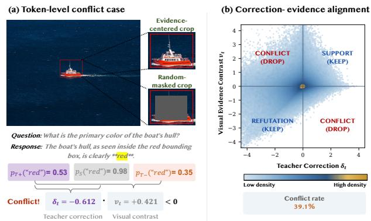

We formalize this contamination as privileged-correction contamination: the teacher–student correction mixes evidence-grounded guidance with residual effects that are not attributable to the visual evidence. Applying such a correction directly may reinforce a token even when the visual evidence argues against it, or suppress a token that the evidence supports.

To make this contamination concrete, Fig. 1 illustrates a single token-level diagnostic. For each generated token, we compare the teacher correction $\delta _ { t }$ with the visual contrast $v _ { t }$ between evidencecentered and random-masked teacher views, a probe of visual dependence introduced by OPD-V (Aniri et al., 2026). Fig. 1 (a) shows a conflicting case, in which the teacher suppresses a token $( \delta _ { t } ~ = ~ - 0 . 6 1 2 )$ that the visual contrast supports $( v _ { t } ~ = ~ + 0 . 4 2 1 )$ . Such a correction should be discarded rather than applied, since the student already assigns the token a higher probability than the teacher does (0.98 vs. 0.53): the teacher is lower here because the priv-

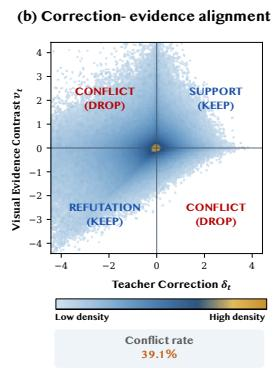  
Figure 1: Illustrative contamination diagnostic. (a) A token-level conflict case and (b) the correction-evidence alignment used to motivate attribution.

ileged view shifts its probabilities downward, not because the visual evidence refutes the token. Fig. 1 (b) summarizes the comparison over tokens by the signs of the two signals: agreeing signs indicate a correction consistent with the evidence, whereas opposite signs expose the two conflict cases, in which the teacher suppresses a visually supported token or promotes a visually refuted one. Measured with Qwen3.5-4B on our training data (§4.1), these conflicts affect 39.1% of the generated tokens. Exposing these conflicts, however, does not remove them. What the diagnostic calls for is visual attribution in a strict sense: an explicit mechanism that checks whether the direction of each correction agrees with the visual evidence.

Motivated by this diagnosis, we design Visual-Attribution Gating (VAG). Rather than distilling every privileged correction, VAG validates the direction of each one against the visual contrast: the correction $\delta _ { t }$ is admitted only when it agrees in sign with $v _ { t }$ , that is $v _ { t } \delta _ { t } ~ > ~ 0$ , which keeps both supporting and refuting corrections and removes only the conflicting residuals exposed by the diagnostic. Furthermore, VAG operates on top of RLVR rather than in place of it: the verifier-derived advantage remains the optimization anchor, and self-distillation contributes only the corrections that pass the gate. Taken together, we propose reinforcement learning with visually attributable on-policy self-distillation, a new evidence-consistent learning paradigm.

Fig. 2 compares our paradigm with representative on-policy learning paradigms for multimodal credit assignment along three properties: trajectory correctness, dense token correction, and visual attribution. RLVR (Fig. 2 (a)) supplies only the outcome advantage A , which anchors optimization to trajectory correctness but assigns the same scalar to every token. RLVR with distillation (Fig. 2 (b)) keeps this anchor and modulates each token by $\delta _ { t }$ without verifying where that correction comes from, so the privileged signal it distills may be contaminated (Lin et al., 2026; Yang et al., 2026). Visual contrastive distillation (Fig. 2 (c)) instead uses visual contrast $v _ { t }$ to select only visually sensitive tokens (Aniri et al., 2026). Yet this selection does not verify whether an update follows the visual evidence, so the corrections applied to the selected tokens remain contaminated, while the verifier-grounded anchor is lost as well.

VAG (Fig. 2 (d)) is the only paradigm that attains all three properties at once: it keeps $A _ { \mathrm { O R M } }$ as the anchor, preserves the dense correction $\delta _ { t } ,$ and admits that correction only when $v _ { t }$ supports its direction. This coverage comes at almost no cost. VAG needs no learned contamination estimator and no auxiliary distillation objective, and relative to a dual-view OPSD baseline that already evaluates both teacher views, it adds only an elementwise sign test and no additional teacher forward pass. Across six visual reasoning benchmarks, VAG consistently improves over matched GRPO and OPSD baselines and surpasses much larger open-source models (e.g., Qwen3.5-397B), leading closed-source models (e.g., GPT-5.4), and agentic “Thinking-with-Images” methods on tasks that require dense local evidence. On holdout tasks beyond the training distribution, it retains general visual understanding and reasoning ability, indicating that the gains do not come at the cost of forgetting, while controlled ablations isolate the contribution of the sign-agreement gate.

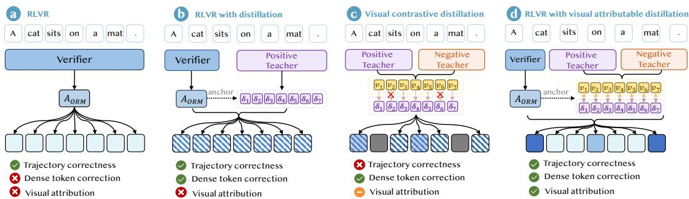  
Figure 2: Comparison of on-policy learning paradigms. (a) RLVR, (b) RLVR with distillation, (c) Visual contrastive distillation, and (d) RLVR with visual attributable distillation.

Our contributions are summarized as follows:

• We identify privileged-correction contamination, showing that dense teacher–student corrections are not necessarily aligned in direction with the visual evidence.

• We propose an evidence-consistent paradigm unifying RLVR and OPSD, in which the verifier-derived advantage anchors optimization, and design VAG to mitigate privilegedcorrection contamination by admitting a teacher correction only under sign agreement with a controlled visual contrast.

• Across six visual reasoning benchmarks, VAG consistently improves over matched GRPO and OPSD baselines and surpasses much larger open-source and leading closed-source models, while holdout evaluation shows no loss of general capability. Ablations further validate the proposed attribution mechanism.

## 2 RELATED WORK

## 2.1 ON-POLICY AND PRIVILEGED DISTILLATION

OPD supervises student-visited prefixes with a teacher, thereby reducing exposure bias while supplying dense token-level guidance (Gu et al., 2023; Agarwal et al., 2024; Song & Zheng, 2026). OPSD replaces the external teacher with the model itself conditioned on privileged context, such as verified solutions, reasoning traces, or environmental feedback (Zhao et al., 2026; Hubotter et al., 2026; He¨ et al., 2026; Jin et al., 2026). Because the student cannot access this context at inference time, the resulting teacher–student gap may conflate task-relevant knowledge with leakage or stylistic artifacts (Yang et al., 2026; Pan et al., 2026; Shen et al., 2026). In multimodal reasoning, privileged views instead expose localized evidence that global image processing tends to lose, and methods from region-to-image distillation to Vision-OPD transfer such evidence to a full-image model (Wei et al., 2026; Yuan et al., 2026). Subsequent work refines the selectivity of this supervision through view-based reweighting (Liu et al., 2026), trajectory gating (Sun et al., 2026), gradient decomposition (Yoon et al., 2026), modality balance (Aniri et al., 2026), and target reconstruction (Zhang et al., 2026), whereas VAG uses a signed visual contrast to determine whether a candidate teacher correction is admitted into policy optimization at all.

## 2.2 INTEGRATING RLVR WITH ON-POLICY DISTILLATION

RLVR anchors optimization to checkable outcomes, and GRPO realizes this without a learned critic by estimating group-relative advantages that are nevertheless shared by all tokens in a response (Shao et al., 2024). OPD supplies the missing token-level resolution, yet its preference need not agree with trajectory correctness, so the two signals are complementary but not automatically compatible. Existing integrations reconcile them by weighting the two objectives, restricting the teacher gap to modulating verifier-directed magnitudes, gating implicit OPD rewards by trajectory correctness, or contrasting privileged contexts (Hubotter et al., 2026; Yang et al., 2026; Lin et al.,¨

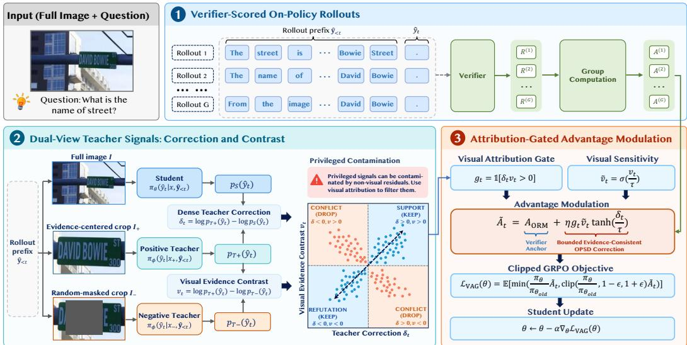  
Figure 3: Overview of the VAG framework. Stage 1: A verifier derives $A _ { \mathrm { O R M } }$ from on-policy roll outs. Stage 2: Dual-view teacher evaluation yields the distillation margin $\delta _ { t }$ and visual contrast $v _ { t } ;$ VAG retains same-sign corrections and discards conflicting ones. Stage 3: The retained correction modulates $A _ { \mathrm { O R M } }$ for the clipped GRPO update.

2026; Pan et al., 2026), while variants route samples or tokens between the two objectives, account for student uncertainty, or reverse teacher signals to encourage exploration (Li et al., 2026; Wang et al., 2026; Ke et al., 2026; Kim et al., 2026). VAG resolves this compatibility at the token level instead: a signed correction enters the verifier-anchored advantage only when its direction agrees with the visual evidence contrast, which preserves both visually supported promotion and visually justified suppression while falling back to outcome supervision whenever attribution fails.

## 3 METHOD

## 3.1 OVERVIEW

Given an image–question pair, VAG proceeds through the three-stage training loop illustrated in Fig. 3. In Stage 1 (Sec. 3.2), VAG derives a reliable trajectory-level advantage from on-policy rollouts sampled by the frozen student policy and scored by a task verifier. In Stage 2 (Sec. 3.3), the positive and negative teacher branches of the same Exponential Moving Average (EMA) model replay each student-generated prefix under an evidence-centered view and its random-masked counterpart, respectively. These evaluations yield a teacher–student correction $\delta _ { t }$ and a visual contrast $v _ { t } .$ , whose sign agreement retains evidence-consistent token-level supervision while filtering potentially contaminated corrections. In Stage 3 (Sec. 3.4), VAG weights each retained correction by its visual sensitivity and uses it to modulate, rather than replace, the verifier advantage. The resulting token-level advantage is then optimized using the clipped GRPO objective.

## 3.2 VERIFIER-SCORED ON-POLICY ROLLOUTS

Let q denote a question and I its corresponding full image, with the multimodal input denoted by $x = ( q , I )$ . At each training iteration, π denotes the student policy used for rollout collection. As shown in Stage 1 of Fig. 3, the student samples a group of G response trajectories as:

$$
\hat { \mathbf { y } } ^ { ( i ) } = \bigl ( \hat { y } _ { 1 } ^ { ( i ) } , \ldots , \hat { y } _ { T _ { i } } ^ { ( i ) } \bigr ) \sim \pi _ { \theta } ( \cdot \mid x ) , \qquad i = 1 , \ldots , G ,\tag{1}
$$

where $\hat { \mathbf { y } } ^ { ( i ) }$ is the i-th sampled response, $\hat { y } _ { t } ^ { ( i ) }$ is its token at position $t ,$ and $T _ { i }$ is its length. A task verifier assigns each rollout an outcome reward ${ \cal R } ^ { \left( i \right) } \in \{ 0 , 1 \}$ , from which we compute the groupnormalized advantage as:

$$
A _ { \mathrm { O R M } } ^ { ( i ) } = \frac { R ^ { ( i ) } - \mu _ { G } } { \sigma _ { G } } ,\tag{2}
$$

where $\mu _ { G }$ and $\sigma _ { G }$ denote the mean and standard deviation of the rewards within the rollout group, respectively. The scalar $A _ { \mathrm { O R M } } ^ { ( i ) }$ is shared by all tokens in rollout i. Although it provides a reliable trajectory-level learning signal, it does not identify which tokens contribute to the outcome.

## 3.3 DUAL-VIEW TEACHER SIGNALS: CORRECTION AND CONTRAST

Stage 1 provides a reliable outcome-level anchor but leaves token-level credit undetermined. OPSD closes this gap by letting a privileged teacher re-score the student’s own rollout token by token (Zhao et al., 2026), and we adopt this mechanism as our dense signal, instantiating the teacher with an evidence-centered view. Unlike prior OPSD, which distills every correction directly, we first ask whether a correction is directionally supported by the visual evidence, following the diagnostic in Sec. 1. As shown in Stage 2 of Fig. 3, both teachers are view-conditioned branches of a single EMA teacher $\pi _ { \phi }$ replaying the student’s trajectory: conditioning $\pi _ { \phi }$ on the evidence-preserving view yields the positive teacher, and conditioning it on the evidence-degraded view yields the negative teacher. Because the two branches share the student-generated prefix and differ only in the visual condition, all token-level quantities below are comparable. This yields two steps: form the privileged correction from the positive teacher, then probe its visual support with the negative teacher.

Dense Teacher Correction. The first step instantiates the positive branch. The evidencepreserving view $I _ { + }$ is a crop centered on the target detail relevant to the question, which gives the positive teacher input $x _ { + } = ( q , I _ { + } )$ . For each student-generated trajectory $\hat { \mathbf { y } } ^ { ( i ) }$ , the positive teacher re-evaluates every generated token $\hat { y } _ { t } ^ { ( i ) }$ conditioned on the same student-generated prefix $\hat { \mathbf { y } } _ { < t } ^ { ( i ) } = ( \hat { y } _ { 1 } ^ { ( i ) } , \dots , \hat { y } _ { t - 1 } ^ { ( i ) } )$ . We write the corresponding sampled-token probabilities as:

$$
p _ { S } ^ { ( i ) } ( \hat { y } _ { t } ) \triangleq \pi _ { \theta } \left( \hat { y } _ { t } ^ { ( i ) } \mid x , \hat { \mathbf { y } } _ { < t } ^ { ( i ) } \right) ,\tag{3}
$$

$$
p _ { T + } ^ { ( i ) } ( \hat { y } _ { t } ) \triangleq \pi _ { \phi } \left( \hat { y } _ { t } ^ { ( i ) } \ | \ x _ { + } , \hat { \mathbf { y } } _ { < t } ^ { ( i ) } \right) ,\tag{4}
$$

for the student and the positive teacher, respectively. The dense teacher correction is their log-ratio on the sampled token:

$$
\delta _ { t } ^ { ( i ) } = \mathrm { s g } \left[ \log p _ { T + } ^ { ( i ) } ( \hat { y } _ { t } ) - \log p _ { S } ^ { ( i ) } ( \hat { y } _ { t } ) \right] ,\tag{5}
$$

where $\mathrm { s g } [ \cdot ]$ denotes the stop-gradient operator. A positive $\delta _ { t } ^ { ( i ) }$ indicates that the positive teacher assigns the sampled token a higher probability than the student, and a negative value the opposite, so $\delta _ { t } ^ { \overline { { ( i ) } } }$ is precisely the dense signal that on-policy self-distillation would follow.

Taken on its own, however, $\delta _ { t } ^ { ( i ) }$ is exactly the quantity examined in Fig. 1: a non-zero teacher– student gap cannot be assumed to follow the direction of the privileged evidence. We therefore treat $\delta _ { t } ^ { ( i ) }$ as a candidate correction and, instead of assuming its visual support, make that support testable.

Visual Evidence Contrast. Following OPD-V (Aniri et al., 2026), we pair $I _ { + }$ with an evidencedegraded counterpart $I _ { - } ,$ obtained by occluding a randomly placed rectangular region of the zoomin image with black pixels, so that the visual evidence available to the teacher is weakened while the image resolution, the visual token grid, and the surrounding spatial context remain unchanged. Feeding $x _ { - } = ( q , I _ { - } )$ to the same teacher on the same prefix gives:

$$
p _ { T - } ^ { ( i ) } ( \hat { y } _ { t } ) \triangleq \pi _ { \phi } \left( \hat { y } _ { t } ^ { ( i ) } \mid x _ { - } , \hat { \mathbf { y } } _ { < t } ^ { ( i ) } \right) ,\tag{6}
$$

and because the two teacher evaluations share parameters, prefix, and realized token, and differ only in the target evidence, their log-ratio isolates the teacher’s response to that intervention:

$$
v _ { t } ^ { ( i ) } = \mathrm { s g } \left[ \log p _ { T + } ^ { ( i ) } ( \hat { y } _ { t } ) - \log p _ { T - } ^ { ( i ) } ( \hat { y } _ { t } ) \right] .\tag{7}
$$

A positive $v _ { t } ^ { ( i ) }$ indicates that the target evidence supports the sampled token, whereas a negative value indicates refutation, and $| v _ { t } ^ { ( i ) } |$ measures how strongly the token depends on that evidence.

Diagnosing Privileged Contamination. Pairing the two signals by sign partitions the generated tokens into the four quadrants shown in Stage 2 of Fig. 3. The two same-sign quadrants are directionally consistent: when $\delta _ { t } > 0$ and $v _ { t } > 0 ,$ , the teacher promotes a token whose probability the visual evidence also raises (support); when $\delta _ { t } < 0$ and $v _ { t } < 0$ , the teacher suppresses a token whose probability the evidence lowers (refutation). In both cases the candidate correction moves the student in the same direction as the visual intervention, so it can be treated as evidence-grounded credit. Notably, keeping the refutation quadrant is what allows suppressive corrections to survive rather than be discarded together with the conflicting ones.

The two opposite-sign quadrants are directionally conflicting. A correction with $\delta _ { t } > 0$ but $v _ { t } < 0$ would reinforce a token whose probability the visual evidence lowers, whereas $\delta _ { t } < 0$ with $v _ { t } > 0$ would suppress a token whose probability it raises. Since neither direction can be explained by the visual intervention, we regard these quadrants as observable instances of privileged-correction contamination and exclude them from the dense supervision. The four quadrants thus define a binary admissibility rule on candidate corrections, and what remains is to realize this rule as a token-level learning signal without discarding the verifier anchor of Stage 1.

## 3.4 ATTRIBUTION-GATED ADVANTAGE MODULATION

Stage 3 realizes the admissibility rule as a token-level advantage: the gate decides whether a candidate correction enters the update, the contrast magnitude decides how strongly it enters, and the outcome advantage of Stage 1 remains the anchor that determines the direction of the update. The visual attribution gate shown in Fig. 3 is formulated as:

$$
g _ { t } ^ { ( i ) } = \mathbb { 1 } \left[ \delta _ { t } ^ { ( i ) } v _ { t } ^ { ( i ) } > 0 \right] ,\tag{8}
$$

where $\mathbb { 1 } [ \cdot ]$ is the indicator function. This gate retains the support and refutation quadrants and rejects both conflict quadrants, together with the boundary cases that carry no directional information. We therefore convert the contrast into a bounded visual-sensitivity weight:

$$
\widetilde { v } _ { t } ^ { ( i ) } = \sigma \left( \frac { v _ { t } ^ { ( i ) } } { \tau } \right) \in ( 0 , 1 ) ,\tag{9}
$$

where $\sigma$ is the logistic sigmoid and $\tau > 0$ controls the sharpness of the transition, so that strongly evidence-dependent tokens receive more credit than marginally dependent ones instead of being weighted equally. The teacher correction is bounded in the same spirit, and the two are combined with the verifier anchor to form the modulated advantage:

$$
\widetilde { A } _ { t } ^ { ( i ) } = A _ { \mathrm { O R M } } ^ { ( i ) } + \eta g _ { t } ^ { ( i ) } \widetilde { v } _ { t } ^ { ( i ) } \operatorname { t a n h } \left( \frac { \delta _ { t } ^ { ( i ) } } { \tau } \right) ,\tag{10}
$$

where $\eta > 0$ controls the strength of the correction. The first term provides a trajectory-level verifier anchor, while the second redistributes credit at the token level only when the teacher correction is visually attributable. $\begin{array} { r } { \mathrm { I f } g _ { t } ^ { ( i ) } = 0 } \end{array}$ , the correction vanishes and $\widetilde { A } _ { t } ^ { ( i ) } = \boldsymbol { A } _ { \mathrm { O R M } } ^ { ( i ) } , \mathrm { s c }$ filtering a correction falls back to outcome supervision rather than removing the token from training.

The final stage of Fig. 3 optimizes the student policy using the modulated advantage. We first define the token-level importance ratio between the current policy $\pi _ { \theta }$ and the rollout policy $\pi _ { \theta _ { o l d } }$ as:

$$
\rho _ { t } ^ { ( i ) } ( \theta ) = \frac { \pi _ { \theta } ( \hat { y } _ { t } ^ { ( i ) } \mid x , \hat { \mathbf { y } } _ { < t } ^ { ( i ) } ) } { \pi _ { \theta _ { o l d } } ( \hat { y } _ { t } ^ { ( i ) } \mid x , \hat { \mathbf { y } } _ { < t } ^ { ( i ) } ) } .\tag{11}
$$

The training objective is the clipped GRPO surrogate averaged over rollouts and token positions:

$$
\mathcal { L } _ { \mathrm { V A G } } ( \theta ) = - \frac { 1 } { G } \sum _ { i = 1 } ^ { G } \frac { 1 } { T _ { i } } \sum _ { t = 1 } ^ { T _ { i } } \operatorname* { m i n } \Bigl ( \rho _ { t } ^ { ( i ) } ( \theta ) \widetilde { A } _ { t } ^ { ( i ) } , \mathrm { c l i p } \left( \rho _ { t } ^ { ( i ) } ( \theta ) , 1 - \varepsilon , 1 + \varepsilon \right) \widetilde { A } _ { t } ^ { ( i ) } \Bigr ) ,\tag{12}
$$

where $0 ~ < ~ \varepsilon ~ < ~ 1$ is the clipping radius. All teacher-derived signals, including $\delta _ { t } , \ v _ { t } .$ , and $g _ { t }$ are detached, so gradients flow to the student only through $\rho _ { t } ^ { ( i ) } ( \theta )$ . Consequently, VAG introduces neither additional trainable parameters nor an auxiliary objective; it operates entirely by reshaping the advantage that GRPO already optimizes.

Table 1: Comparison with single-forward-pass MLLMs and post-training methods across multimodal reasoning benchmarks. All entries report accuracy (%).
<table><tr><td>Model</td><td>Param.</td><td>V*</td><td>Zoom</td><td>HR-Bench HR-Bench MME-RW MME-RW 4K</td><td>8K</td><td>EN</td><td>CN</td><td>Avg.</td></tr><tr><td colspan="9">Closed-Source Models (Single Forward Pass)</td></tr><tr><td>GPT-5.2 (OpenAI, 2025a)</td><td></td><td></td><td>79.0650.89</td><td>81.12</td><td>78.38</td><td>72.60</td><td>68.80</td><td>71.81</td></tr><tr><td>GPT-5.4 (OpenAI, 2026)</td><td></td><td></td><td>76.96 52.66</td><td>84.00</td><td>77.88</td><td>74.20</td><td>70.93</td><td>72.77</td></tr><tr><td>Gemini 3.1 Pro (Google DeepMind, 2026a)</td><td></td><td></td><td>87.9661.18</td><td>89.63</td><td>86.88</td><td>76.53</td><td>73.31</td><td>79.25</td></tr><tr><td>Gemini 3.5 Flash (Google DeepMind, 2026b)</td><td>一</td><td></td><td>89.01 61.42</td><td>89.12</td><td>86.62</td><td>75.31</td><td>73.97</td><td>79.24</td></tr><tr><td colspan="9">Open-Source Baselines (Single Forward Pass)</td></tr><tr><td>DeepEyes (Zheng et al., 2025)</td><td></td><td></td><td></td><td>75.13</td><td>72.63</td><td>64.10</td><td>64.09</td><td>68.05</td></tr><tr><td>Thyme (Zhang et al., 2025a)</td><td>7B 7B</td><td></td><td>85.8646.51 82.2045.09</td><td>77.00</td><td>72.00</td><td>64.80</td><td>64.59</td><td>67.61</td></tr><tr><td>DeepEyesV2 (Hong et al., 2025)</td><td>7B</td><td></td><td>81.6844.97</td><td>77.88</td><td>73.75</td><td>64.90</td><td>65.07</td><td>68.04</td></tr><tr><td>SenseNova-MARS (Chng et al., 2025)</td><td>8B</td><td></td><td>92.15 47.81</td><td>83.13</td><td>78.38</td><td>67.90</td><td>68.90</td><td>73.05</td></tr><tr><td>MiMo-VL-RL (LLM-Core-Team Xiaomi, 2025)</td><td>7B</td><td></td><td>83.2545.68</td><td>73.50</td><td>69.38</td><td>62.73</td><td>55.89</td><td>65.07</td></tr><tr><td>ZwZ (Wei et al., 2026)</td><td>8B</td><td></td><td>87.96 56.69</td><td>83.63</td><td>81.75</td><td>66.57</td><td>68.09</td><td>74.12</td></tr><tr><td>MiniCPM-V-4.5 (Yu et al., 2025)</td><td>9B</td><td></td><td>70.6842.60</td><td>69.63</td><td>61.50</td><td>62.65</td><td>61.64</td><td>61.45</td></tr><tr><td>GLM-4.6V (Zhipu AI, 2026)</td><td>106B</td><td></td><td>86.91 50.06</td><td>82.13</td><td>78.88</td><td>65.57</td><td>65.62</td><td>71.53</td></tr><tr><td>Qwen3-VL-Instruct (Bai et al., 2025)</td><td>235B</td><td></td><td>91.1056.09</td><td>86.13</td><td>80.38</td><td>71.74</td><td>69.04</td><td>75.75</td></tr><tr><td>Qwen3.5-397B-A17B (Qwen Team, 2026)</td><td>397B</td><td></td><td>87.9657.16</td><td>89.38</td><td>85.50</td><td>74.82</td><td>69.82</td><td>77.44</td></tr><tr><td>Kimi-K2.6 (Moonshot AI, 2026)</td><td>1T</td><td>88.48</td><td>53.14</td><td>81.88</td><td>78.00</td><td>69.22</td><td>66.13</td><td>72.81</td></tr><tr><td colspan="9">Qwen3.5-4B Matched Post-Training Methods</td></tr><tr><td>Qwen3.5 (Qwen Team, 2026)</td><td>4B</td><td>80.63</td><td>49.82</td><td>73.50</td><td>67.50</td><td>55.78</td><td>58.56</td><td>64.30</td></tr><tr><td>SFT</td><td>4B</td><td>83.25</td><td>42.60</td><td>76.50</td><td>72.12</td><td>64.10</td><td>62.50</td><td>66.85</td></tr><tr><td>GRPO (Shao et al., 2024)</td><td>4B</td><td></td><td>85.3448.20</td><td>78.25</td><td>74.50</td><td>66.50</td><td>65.10</td><td>69.65</td></tr><tr><td>OPSD (Zhao et al., 2026)</td><td>4B</td><td>84.29</td><td>57.51</td><td>77.25</td><td>72.88</td><td>61.20</td><td>62.40</td><td>69.26</td></tr><tr><td>Vision-OPD (Yuan et al., 2026)</td><td>4B</td><td>89.01</td><td>65.33</td><td>82.25</td><td>81.25</td><td>74.50 68.50</td><td>70.26</td><td>77.10</td></tr><tr><td>VA-OPD (Liu et al., 2026) OPD-V (Aniri et al., 2026)</td><td>4B</td><td></td><td>86.91 51.20</td><td>80.12</td><td>77.50</td><td>76.31</td><td>67.10</td><td>71.88</td></tr><tr><td>VAG (Ours)</td><td>4B</td><td>94.76</td><td>65.92</td><td>85.75 87.62</td><td>83.25 84.62</td><td>76.56</td><td>74.06 75.60</td><td>80.01 81.33</td></tr><tr><td></td><td>4B</td><td>94.24</td><td>69.35</td><td></td><td></td><td></td><td></td><td></td></tr></table>

## 4 EXPERIMENT

## 4.1 EXPERIMENTAL SETUP

Implementation Details. We instantiate our method using Qwen3.5-4B (Qwen Team, 2026). The model is trained on a curated synthetic dataset comprising approximately 6.2K visual-reasoning examples derived from Vision-OPD (Yuan et al., 2026). During training, the privileged teacher is maintained as an EMA of the student parameters. For all experiments, the student samples G = 8 on-policy responses for each input. We use a training batch size of 48 and set the maximum response length to 1,024 tokens. All models undergo full-parameter training for one epoch and a 30-step warmup. All experiments are conducted using 8 NVIDIA H800 GPUs. Following the evaluation protocol of OPD-V (Aniri et al., 2026), we first perform deterministic answer matching, followed by a judge model that determines whether unresolved responses are correct by comparing them against the verified answer. For further details, see Appendices A and C.

## 4.2 BASELINES AND BENCHMARKS

Evaluation Benchmarks. We evaluate VAG on six visual question answering benchmarks that span fine-grained visual perception to broader multimodal problem solving. (1) V\* Bench (Wu & Xie, 2023) tests the localization and recognition of small targets in high-resolution, visually crowded scenes. (2) ZoomBench (Wei et al., 2026) examines whether models can recover subtle regional evidence from a full image. (3) HR-Bench 4K and (4) HR-Bench 8K (Wang et al., 2025) evaluate fine-grained perception at native 4K and 8K resolutions, respectively. These settings are particularly challenging because conventional image resizing may discard the small-scale details required to answer the questions correctly. (5) MME-RealWorld EN and (6) MME-RealWorld CN (Zhang et al., 2025b) provide the broadest setting, spanning diverse high-resolution tasks and real-world scenarios. To assess whether specializing in fine-grained perception sacrifices general multimodal ability, we further evaluate on four holdout benchmarks: (1) MMVP (Tong et al., 2024b), (2) CV-Bench (Tong et al., 2024a), (3) MMStar (Chen et al., 2024), and (4) POPE (Li et al., 2023).

Table 2: Comparisons on holdout tasks.
<table><tr><td>Method</td><td>MMVP</td><td>CV-Bench</td><td>MMStar</td><td>POPE</td><td>Avg</td></tr><tr><td>Qwen3.5-4B</td><td>76.67</td><td>87.13</td><td>78.53</td><td>88.28</td><td>82.65</td></tr><tr><td>SFT</td><td>78.33</td><td>85.70</td><td>68.40</td><td>87.48</td><td>79.98</td></tr><tr><td>GRPO</td><td>79.33</td><td>87.24</td><td>70.60</td><td>86.37</td><td>80.89</td></tr><tr><td>DAPO</td><td>79.33</td><td>86.95</td><td>72.27</td><td>86.62</td><td>81.29</td></tr><tr><td>OPSD</td><td>78.68</td><td>87.27</td><td>75.07</td><td>88.83</td><td>82.46</td></tr><tr><td>Vision-OPD</td><td>79.67</td><td>87.27</td><td>79.60</td><td>89.14</td><td>83.92</td></tr><tr><td>OPD-V</td><td>80.00</td><td>86.07</td><td>77.40</td><td>88.38</td><td>82.96</td></tr><tr><td>VAG (Ours)</td><td>84.67</td><td>87.91</td><td>79.93</td><td>88.72</td><td>85.31</td></tr></table>

Table 3: Ablation on hyperparameters τ and η.
<table><tr><td rowspan="2">Value</td><td rowspan="2"> $\mathbf { V } ^ { \ast }$ </td><td rowspan="2">Zoom</td><td colspan="2">HR-Bench</td><td colspan="2">MME-RW</td><td rowspan="2"> $\mathbf { A v } \mathbf { g }$ </td></tr><tr><td>4K</td><td>8K</td><td>EN</td><td>CN</td></tr><tr><td>0.1</td><td>94.24</td><td>69.35</td><td>87.62</td><td>84.62</td><td>76.56</td><td>75.60</td><td>81.33</td></tr><tr><td>T 0.2</td><td>91.62</td><td>65.68</td><td>84.12</td><td>82.75</td><td>76.91</td><td>77.52</td><td>79.77</td></tr><tr><td>0.5</td><td>87.43</td><td>56.69</td><td>80.25</td><td>78.62</td><td>73.23</td><td>69.82</td><td>74.34</td></tr><tr><td>0.1 η 0.2</td><td>94.24</td><td>69.35</td><td>87.62</td><td>84.62 77.88</td><td>76.56 70.25</td><td>75.60</td><td>81.33</td></tr><tr><td></td><td>86.91</td><td>58.82</td><td>79.50</td><td></td><td></td><td>69.98</td><td>73.89</td></tr><tr><td>0.5</td><td>84.82</td><td>59.88</td><td>80.12</td><td>75.12</td><td>69.23</td><td>69.17</td><td>73.06</td></tr></table>

Baselines. Following Vision-OPD (Yuan et al., 2026), we compare VAG against closed-source models (Google DeepMind, 2026a;b; OpenAI, 2025a; 2026), agentic and large-scale open-source MLLMs (Zheng et al., 2025; Zhang et al., 2025a; Hong et al., 2025; Chng et al., 2025; Bai et al., 2025; Qwen Team, 2026; Zhipu AI, 2026; Moonshot AI, 2026), and post-training baselines based on Qwen3.5-4B. The matched group includes the corresponding base models, SFT, GRPO, OPSD, Vision-OPD, VA-OPD (Liu et al., 2026), and OPD-V. All methods in this group are evaluated at the same model scale using the same training data and evaluation protocol.

## 4.3 MAIN RESULTS

Comparison with SOTA MLLMs. As shown in Table 1, VAG raises the Qwen3.5-4B average from 64.30% to 81.33% and exceeds OPD-V, the strongest matched baseline, by 1.32%.

It attains the best result on ZoomBench, HR-Bench, MME-RealWorld, and the overall average, ranking second only on $\mathbf { V } ^ { \ast }$ Bench. The margin over OPD-V is largest on ZoomBench (69.35% vs. 65.92%, +3.43%), a fine-grained benchmark that requires recovering subtle regional evidence from high-resolution images, which highlights the particular effectiveness of VAG for fine-grained perception and localization. VAG also exceeds substantially larger open-source and agentic models in average accuracy. Fig. 4 further reports the initial results on

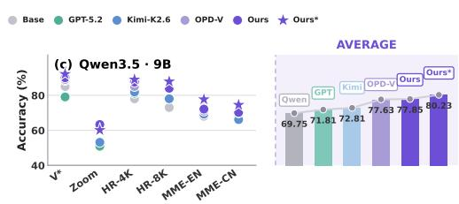  
Figure 4: Performance comparison on Qwen3.5-9B.

Qwen3.5-9B, where VAG (Ours) reaches 77.85% average accuracy and improves over the base model on all benchmarks. With response-length control, its average accuracy ${ ( \mathrm { O u r s } ^ { * } ) }$ further increases to 80.23%. We also evaluate VAG under the same evaluation protocol as Vision-OPD to ensure a fair comparison. Further results and detailed evaluation settings are provided in Appendix B.

Comparison with Post-Training Strategies. Within the matched group, VAG outperforms GRPO and OPSD by 11.68% and 12.07% on average, respectively. Notably, OPSD does not surpass GRPO (69.26% vs. 69.65%) despite providing denser supervision, indicating that unfiltered privileged corrections can offset their own benefit. Visual OPSD variants narrow this gap, yet VAG still improves over Vision-OPD by 4.23%, which demonstrates the benefit of verifying the visual attribution of token-level supervision rather than only strengthening or reweighting it.

Generalization to Holdout Tasks. Table 2 reports results on the four holdout benchmarks. VAG attains the best average accuracy (85.31%), improving over the vanilla model by 2.66% and over the strongest baseline by 1.39%. In contrast, SFT and GRPO fall below the vanilla average. VAG therefore avoids the specialization–forgetting tradeoff observed in alternative training strategies, indicating that attribution-gated supervision improves fine-grained perception without eroding general multimodal capability.

## 4.4 ABLATIONS AND ANALYSIS

Impact of $\eta$ and τ. Table 3 ablates the gate temperature τ and the modulation weight η. When varying τ we fix $\eta = 0 . 1 ;$ when varying η we fix $\tau = 0 . 1$ . Accuracy peaks at $\tau = 0 . 1 \colon$ larger temperatures flatten the gate, so visually supported and visually contradicted corrections are no longer separated. For $\eta ,$ 0.1 is large enough to modulate the outcome advantage yet small enough to avoid over-flipping its sign, whereas $\eta = 0 . 5$ degrades every benchmark. We therefore adopt $( \tau , \eta ) = ( 0 . 1 , 0 . { \bar { 1 } } )$ , shown in bold, for all remaining experiments.

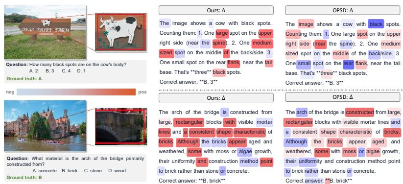  
Figure 5: Prediction and token-importance comparison. VAG produces the correct evidencegrounded prediction and concentrates credit on decision-relevant visual tokens.

Table 4: Advantage-modulation ablation.
<table><tr><td rowspan="2">Correction term</td><td rowspan="2"> $\mathrm { V } ^ { \ast }$ </td><td rowspan="2">Zoom</td><td colspan="2">HR-Bench</td><td colspan="2">MME-RW</td><td rowspan="2">Avg</td></tr><tr><td>4K</td><td>8K</td><td>EN</td><td>CN</td></tr><tr><td> $A _ { \mathrm { O R M } }$ </td><td>85.3448.2078.2574.5066.5065.10 69.65</td><td></td><td></td><td></td><td></td><td></td><td></td></tr><tr><td> $+ \eta \delta _ { t }$ </td><td></td><td></td><td></td><td></td><td></td><td>90.05 65.33 79.50 79.50 75.37 72.99 77.12</td><td></td></tr><tr><td> $+ \eta \widetilde { v } _ { t } \delta _ { t }$ </td><td></td><td></td><td></td><td></td><td></td><td>92.6766.0484.00 80.8874.63 74.5578.80</td><td></td></tr><tr><td>Ours</td><td></td><td></td><td></td><td></td><td></td><td>94.24 69.35 87.62 84.62 76.56 75.60 81.33</td><td></td></tr></table>

Table 5: Negative-view ablation.
<table><tr><td>Negative view</td><td> $\mathrm { V } ^ { \ast }$ </td><td colspan="3">Zoom HR-Bench</td><td colspan="2">MME-RW</td></tr><tr><td></td><td></td><td>4K</td><td>8K</td><td>EN</td><td>CN</td><td>Avg</td></tr><tr><td>No image</td><td></td><td></td><td></td><td></td><td>93.7263.2087.88 87.0076.8273.7580.40</td><td></td></tr><tr><td>Black image</td><td></td><td></td><td></td><td></td><td>94.7664.7382.50 81.8875.2671.9878.52</td><td></td></tr><tr><td>Blurred image Random mask</td><td>86.3959.8879.62 76.2569.8569.34 73.56</td><td></td><td>94.2469.3587.6284.6276.5675.6081.33</td><td></td><td></td><td></td></tr></table>

Modulation of Advantage. Table 4 isolates the contribution of each component of the modulated advantage under an identical training protocol. Holding all other settings fixed, we build it up from the outcome anchor $A _ { \mathrm { O R M } }$ (Eq. 2): we successively introduce the raw distillation margin $\delta _ { t } \left( \bar { \mathrm { E } } \mathbf { q } . 5 \right)$ the soft visual-sensitivity ve (Eq. 9), and the sign-consistent attribution gate $g _ { t }$ (Eq. 8) with bounded margin scaling, recovering the full form in Eq. 10. As reported in Table 4, the dense margin lifts the average from 69.65% to 77.12%, visual-sensitivity weighting further to 78.80%, and the full modulation to 81.33% (+11.68% over the outcome-only anchor), attaining the best score on every benchmark. Sensitivity weighting and sign-consistent attribution are thus complementary, jointly selecting reliable token-level corrections.

Negative Teacher View. Table 5 compares four evidence-degraded views under an identical training protocol. Random masking attains the best average accuracy (81.33%), ahead of the no-image (80.40%), black-image (78.52%), and blurred-image (73.56%) variants, indicating that $v _ { t }$ is most informative when the intervention removes local evidence while preserving spatial context. Its advantage concentrates on ZoomBench and MME-RealWorld CN, which depend most on resolving a small region, whereas the no-image variant remains competitive when the decisive evidence occupies a larger portion of the input.

Interpretation of VAG. Fig. 5 contrasts the token-level credit that VAG and vanilla OPSD assign to the same student rollout. For each token we visualize the correction term $\Delta _ { t }$ that modulates the update, defined as $\Delta _ { t } = \eta g _ { t } ^ { ( i ) } \widetilde { v } _ { t } ^ { ( i ) }$ tanh $( \delta _ { t } ^ { ( i ) } / \tau )$ for VAG and as $\Delta _ { t } = \delta _ { t } ^ { ( i ) }$ for OPSD, with the color scale running from negative (blue) to positive (red). In the counting example (top), whose rollout is incorrect, OPSD spreads non-zero credit over much of the response, including function words and a strongly negative weight on “black”. VAG instead concentrates credit on the tokens that enumerate and localize the spots (“upper”, “spine”, “flank”), while suppressing the erroneous count token “3”. In the material example (bottom), whose rollout is correct, VAG weights the chain of visual premises supporting the answer (“mortar lines”, “consistent shape”), whereas OPSD assigns comparable weight to weakly grounded tokens such as “aged” and “rather”. The attribution gate thus removes sign-inconsistent teacher residuals and yields a sparser, evidence-aligned credit map, irrespective of whether the rollout is right or wrong.

## 5 CONCLUSION

We introduce reinforcement learning with visually attributable on-policy self-distillation to mitigate privileged-correction contamination. Our Visual-Attribution Gating anchors optimization to verifier-derived trajectory advantages and accepts token-level corrections only when consistent with the contrast between evidence-present and evidence-degraded teacher views, preserving supportive and refuting visual evidence while suppressing inconsistent residuals. Across six public benchmarks, VAG consistently outperforms state-of-the-art methods, demonstrating that visual grounding verification unifies outcome verification, token-level self-distillation, and visual attribution for multimodal policy optimization.

## AI USE STATEMENT

In this work, we used generative AI tools only for language polishing of author-written text (e.g., grammar, wording, and readability) and for retrieval and discovery (e.g., finding related work). We did not use generative AI tools for research ideation, method design, code generation, experiments, data analysis, or the production of any results, figures, or other artifacts, all of which were carried out and verified by the authors. We have reviewed all AI-assisted edits to ensure that they preserve the intended technical meaning, and we take full responsibility for the final content of this work.

## REFERENCES

Rishabh Agarwal, Nino Vieillard, Yongchao Zhou, Piotr Stanczyk, Sabela Ramos Garea, Matthieu Geist, and Olivier Bachem. On-policy distillation of language models: Learning from selfgenerated mistakes. In The Twelfth International Conference on Learning Representations, 2024. URL https://arxiv.org/abs/2306.13649.

Aniri, Jinhe Bi, Peng Liao, Zengjie Jin, Volker Tresp, Fei Shen, Yunpu Ma, and Tat-Seng Chua. Opd-v: Visual on-policy self-distillation with modality balance, 2026. URL https://arxiv. org/abs/2608.05131.

Shuai Bai, Yuxuan Cai, Ruizhe Chen, Keqin Chen, Xionghui Chen, Zesen Cheng, Lianghao Deng, Wei Ding, Chang Gao, Chunjiang Ge, Wenbin Ge, Zhifang Guo, et al. Qwen3-VL technical report. arXiv preprint arXiv:2511.21631, 2025. URL https://arxiv.org/abs/2511. 21631.

Lin Chen, Jinsong Li, Xiaoyi Dong, Pan Zhang, Yuhang Zang, Zehui Chen, Haodong Duan, Jiaqi Wang, Yu Qiao, Dahua Lin, et al. Are we on the right way for evaluating large vision-language models? arXiv preprint arXiv:2403.20330, 2024.

Yong Xien Chng, Tao Hu, Wenwen Tong, Xueheng Li, Jiandong Chen, Haojia Yu, Jiefan Lu, Hewei Guo, Hanming Deng, Chengjun Xie, et al. Sensenova-mars: Empowering multimodal agentic reasoning and search via reinforcement learning. arXiv preprint arXiv:2512.24330, 2025.

Google DeepMind. Gemini 3.1 pro. Official model release, 2026a. URL https://deepmind. google/technologies/gemini/.

Google DeepMind. Gemini 3.5 flash. Model card, 2026b. https://deepmind.google/ models/model-cards/gemini-3-5-flash, accessed 2026-09-26.

Yuxian Gu, Li Dong, Furu Wei, and Minlie Huang. Minillm: On-policy distillation of large language models. arXiv preprint arXiv:2306.08543, 2023.

Daya Guo, Dejian Yang, Haowei Zhang, Junxiao Song, Peiyi Wang, Qihao Zhu, Runxin Xu, Ruoyu Zhang, Shirong Ma, Xiao Bi, et al. Deepseek-r1: Incentivizing reasoning capability in llms via reinforcement learning. arXiv preprint arXiv:2501.12948, 2025.

Yinghui He, Simran Kaur, Adithya Bhaskar, Yongjin Yang, Jiarui Liu, Narutatsu Ri, Liam Fowl, Abhishek Panigrahi, Danqi Chen, and Sanjeev Arora. Self-distillation zero: Self-revision turns binary rewards into dense supervision. arXiv preprint arXiv:2604.12002, 2026.

Jack Hong, Chenxiao Zhao, Chenglin Zhu, Weiheng Lu, Guohai Xu, and Xing Yu. DeepEyesV2: Toward agentic multimodal model. arXiv preprint arXiv:2511.05271, 2025. URL https:// arxiv.org/abs/2511.05271.

Jonas Hubotter, Frederike L¨ ubeck, Lejs Behric, Anton Baumann, Marco Bagatella, Daniel Marta,¨ Ido Hakimi, Idan Shenfeld, Thomas Kleine Buening, Carlos Guestrin, and Andreas Krause. Reinforcement learning via self-distillation. arXiv preprint arXiv:2601.20802, 2026. URL https://arxiv.org/abs/2601.20802.

Yiqiao Jin, Yiyang Wang, Lucheng Fu, Yijia Xiao, Yinyi Luo, Haoxin Liu, B Aditya Prakash, Josiah Hester, Jindong Wang, and Srijan Kumar. Unisd: Towards a unified self-distillation framework for large language models. arXiv preprint arXiv:2605.06597, 2026.

Junlong Ke, Zichen Wen, Weijia Li, Conghui He, and Linfeng Zhang. Respecting self-uncertainty in on-policy self-distillation for efficient llm reasoning. arXiv preprint arXiv:2605.13255, 2026.

Jeonghye Kim, Jiwon Jeon, Dongsheng Li, and Yuqing Yang. Rebellious student: Reversing teacher signals for reasoning exploration with self-distilled rlvr. arXiv preprint arXiv:2605.10781, 2026.

Gengsheng Li, Tianyu Yang, Junfeng Fang, Mingyang Song, Mao Zheng, Haiyun Guo, Dan Zhang, Jinqiao Wang, and Tat-Seng Chua. Unifying group-relative and self-distillation policy optimization via sample routing. arXiv preprint arXiv:2604.02288, 2026.

Yifan Li, Yifan Du, Kun Zhou, Jinpeng Wang, Xin Zhao, and Ji-Rong Wen. Evaluating object hallucination in large vision-language models. In Proceedings ofthe 2023 Conference on Empirical Methods in Natural Language Processing, pp. 292–305, Singapore, December 2023. Association for Computational Linguistics. doi: 10.18653/v1/2023.emnlp-main.20.

Wenze Lin, Jiale Zhao, Xitai Jiang, Songde Rao, Yining Li, Shenzhi Wang, Bingxiang He, and Gao Huang. On-policy distillation with verifiable reward. arXiv preprint arXiv:2608.24696, 2026. URL https://arxiv.org/abs/2608.24696.

Ruiqi Liu, Xiaolei Lv, Gengsheng Li, Ximo Zhu, Zhiheng Wang, Zhengbo Zhang, Junkai Chen, Zhiheng Li, Bo Li, Jun Gao, and Shu Wu. Visual-advantage on-policy distillation for visionlanguage models. arXiv preprint arXiv:2605.21924, 2026. URL https://arxiv.org/abs/ 2605.21924.

LLM-Core-Team Xiaomi. MiMo-VL technical report. arXiv preprint arXiv:2506.03569, 2025. URL https://arxiv.org/abs/2506.03569.

Moonshot AI. Kimi-K2.6. Official model release, 2026. URL https://www.moonshot.cn/.

OpenAI. GPT-5.2. Official model release, 2025a. URL https://openai.com/.

OpenAI. gpt-oss-120b & gpt-oss-20b model card, 2025b. URL https://arxiv.org/abs/ 2508.10925.

OpenAI. GPT-5.4. Official model release, 2026. URL https://openai.com/.

Leyi Pan, Shuchang Tao, Yunpeng Zhai, Lingzhe Zhang, Zhaoyang Liu, Bolin Ding, Aiwei Liu, and Lijie Wen. RLCSD: Reinforcement learning with contrastive on-policy self-distillation. arXiv preprint arXiv:2606.11709, 2026. URL https://arxiv.org/abs/2606.11709.

Qwen Team. Qwen3.5: Towards native multimodal agents. Technical report and official model release, 2026. URL https://qwen.ai/blog?id=qwen3.5.

Zhihong Shao, Peiyi Wang, Qihao Zhu, Runxin Xu, Junxiao Song, Xiao Bi, Haowei Zhang, Mingchuan Zhang, Y. K. Li, Y. Wu, and Daya Guo. DeepSeekMath: Pushing the limits of mathematical reasoning in open language models. arXiv preprint arXiv:2402.03300, 2024. URL https://arxiv.org/abs/2402.03300.

Guobin Shen, Xiang Cheng, Chenxiao Zhao, Lei Huang, Jindong Li, Dongcheng Zhao, and Xing Yu. Anti-self-distillation for reasoning rl via pointwise mutual information. arXiv preprint arXiv:2605.11609, 2026.

Mingyang Song and Mao Zheng. A survey of on-policy distillation for large language models. arXiv preprint arXiv:2604.00626, 2026.

Haoxiang Sun, Zhihang Yi, Langxuan Deng, Yuhao Zhou, Peiqi Jia, Jian Zhao, Li Yuan, Jiancheng Lv, and Tao Wang. V-Zero: Answer-label-free on-policy distillation with contrastive evidence gating for fine-grained visual reasoning. arXiv preprint arXiv:2606.25319, 2026. URL https: //arxiv.org/abs/2606.25319.

Shengbang Tong, Ellis Brown, Penghao Wu, Sanghyun Woo, Manoj Middepogu, Sai Charitha Akula, Jihan Yang, Shusheng Yang, Adithya Iyer, Xichen Pan, Ziteng Wang, Rob Fergus, Yann LeCun, and Saining Xie. Cambrian-1: A fully open, vision-centric exploration of multimodal llms. Advances in Neural Information Processing Systems (NeurIPS), 2024a.

Shengbang Tong, Zhuang Liu, Yuexiang Zhai, Yi Ma, Yann LeCun, and Saining Xie. Eyes wide shut? exploring the visual shortcomings of multimodal LLMs. arXiv preprint arXiv:2401.06209, 2024b.

Jiaxuan Wang, Xuan Ouyang, Zhiyu Chen, Yulan Hu, Zheng Pan, Xin Li, and Lan-Zhe Guo. Trace: Distilling where it matters via token-routed self on-policy alignment. arXiv preprint arXiv:2605.10194, 2026.

Wenbin Wang, Liang Ding, Minyan Zeng, Xiabin Zhou, Li Shen, Yong Luo, Wei Yu, and Dacheng Tao. Divide, conquer and combine: A training-free framework for high-resolution image perception in multimodal large language models. In Proceedings of the AAAI Conference on Artificial Intelligence, volume 39, pp. 7907–7915, 2025.

Lai Wei, Liangbo He, Jun Lan, Lingzhong Dong, Yutong Cai, Siyuan Li, Huijia Zhu, Weiqiang Wang, Linghe Kong, Yue Wang, Zhuosheng Zhang, and Weiran Huang. Zooming without zooming: Region-to-image distillation for fine-grained multimodal perception. arXiv preprint arXiv:2602.11858, 2026.

Penghao Wu and Saining Xie. V\*: Guided visual search as a core mechanism in multimodal LLMs. arXiv preprint arXiv:2312.14135, 2023.

An Yang, Anfeng Li, Baosong Yang, Beichen Zhang, Binyuan Hui, Bo Zheng, Bowen Yu, Chang Gao, Chengen Huang, Chenxu Lv, et al. Qwen3 technical report. arXiv preprint arXiv:2505.09388, 2025.

Chenxu Yang, Chuanyu Qin, Qingyi Si, Minghui Chen, Naibin Gu, Dingyu Yao, Zheng Lin, Weiping Wang, Jiaqi Wang, and Nan Duan. Self-distilled RLVR. arXiv preprint arXiv:2604.03128, 2026. URL https://arxiv.org/abs/2604.03128.

Hee Suk Yoon, Eunseop Yoon, Jaehyun Jang, SooHwan Eom, Ji Woo Hong, Mark Hasegawa-Johnson, Qi Dai, Chong Luo, and Chang D. Yoo. Decomposed on-policy distillation for visionlanguage reasoning: Steering gradients for visual grounding, 2026. URL https://arxiv. org/abs/2606.00564.

Tianyu Yu, Zefan Wang, Chongyi Wang, Fuwei Huang, Wenshuo Ma, Zhihui He, Tianchi Cai, Weize Chen, Yuxiang Huang, Yuanqian Zhao, et al. MiniCPM-V 4.5: Cooking efficient MLLMs via architecture, data, and training recipe. arXiv preprint arXiv:2509.18154, 2025. URL https: //arxiv.org/abs/2509.18154.

Qianhao Yuan, Jie Lou, Xing Yu, Hongyu Lin, Le Sun, Xianpei Han, and Yaojie Lu. Vision-OPD: Learning to see fine details for multimodal LLMs via on-policy self-distillation. arXiv preprint arXiv:2605.18740, 2026. URL https://arxiv.org/abs/2605.18740.

Kangning Zhang, Yixing Li, Shuai Shao, Qingyao Li, Zhengxi Lu, Zhiyuan Yao, Jianghao Lin, Wenxiang Jiao, Yuan Lu, Weiwen Liu, et al. Vad: Attributing visual evidence for target reconstruction in multimodal on-policy distillation. arXiv preprint arXiv:2607.28590, 2026.

Yi-Fan Zhang, Xingyu Lu, Shukang Yin, Chaoyou Fu, Wei Chen, Xiao Hu, Bin Wen, Kaiyu Jiang, Changyi Liu, Tianke Zhang, and Guorui Zhou. Thyme: Think beyond images. arXiv preprint arXiv:2508.11630, 2025a. URL https://arxiv.org/abs/2508.11630.

Yi-Fan Zhang, Huanyu Zhang, Haochen Tian, Chaoyou Fu, Shuangqing Zhang, Junfei Wu, Feng Li, Kun Wang, Qingsong Wen, Zhang Zhang, et al. Mme-realworld: Could your multimodal LLM challenge high-resolution real-world scenarios that are difficult for humans? In International Conference on Learning Representations, 2025b.

Siyan Zhao, Zhihui Xie, Mengchen Liu, Jing Huang, Guan Pang, Feiyu Chen, and Aditya Grover. Self-distilled reasoner: On-policy self-distillation for large language models. arXiv preprint arXiv:2601.18734, 2026. URL https://arxiv.org/abs/2601.18734.

Ziwei Zheng, Michael Yang, Jack Hong, Chenxiao Zhao, Guohai Xu, Le Yang, Chao Shen, and Xing Yu. DeepEyes: Incentivizing “thinking with images” via reinforcement learning. arXiv preprint arXiv:2505.14362, 2025. URL https://arxiv.org/abs/2505.14362.

Zhipu AI. GLM-4.6V. Official model release, 2026. URL https://www.zhipuai.cn/.

## A EVALUATION PROTOCOL FOR BENCHMARKS

To ensure that every method is compared under identical conditions, we adopt a single evaluation protocol and apply it uniformly to VAG and to all reproduced baselines. Table 7 lists the number of evaluation samples and the scoring rule used for each benchmark.

Following OPD-V (Aniri et al., 2026), scoring proceeds in two stages. We first apply deterministic answer matching, which resolves the majority of responses without any model in the loop. For the multiple-choice benchmarks, a response counts as correct if it matches either the answer text or the option letter, after normalizing surface variations such as capitalization, surrounding punctuation, and common answer prefixes. Only the responses that remain unresolved are passed to the second stage, where a Qwen3.5-series (Qwen Team, 2026) model acts as a binary Yes/No judge and decides whether the response is consistent with the verified answer.

Both stages are necessary for the benchmarks we evaluate. Responses on fine-grained perception tasks frequently state the correct answer inside a longer justification, which deterministic matching alone would count as wrong; delegating every response to the judge instead would introduce scoring variance unrelated to the method under evaluation. Calling the judge only on the unresolved responses therefore keeps most decisions exact while still absorbing benign paraphrasing. Since the same protocol, judge model, and prompts apply to every entry in Table 1, the reported differences reflect the trained policies rather than the evaluation.

## B EVALUATION OF THE RELEASED CHECKPOINT

The evaluation in our main table (Table 1) strictly follows the legacy evaluation protocol of OPD-V Aniri et al. (2026), in which the trained model itself serves as the judge. For a fair comparison, we further re-evaluate several released models under the evaluation protocol of Vision-OPD (Yuan et al., 2026), using GPT-OSS-120B (OpenAI, 2025b) as the judge model, and report the results in Table 6 below. As shown, our model achieves the best accuracy at both the 4B and 9B scales under this setting.

Table 6: Evaluation results under the Vision-OPD evaluation protocol.
<table><tr><td>Method</td><td>Size</td><td>V*</td><td>Zoom</td><td>HR-Bench 4K</td><td>HR-Bench 8K</td><td>MME-RW EN</td><td>MME-RW CN</td><td>Avg.</td></tr><tr><td>Vision-OPD (Yuan et al., 2026)</td><td>4B</td><td>89.53</td><td>59.53</td><td>82.25</td><td>81.00</td><td>74.97</td><td>70.71</td><td>76.33</td></tr><tr><td>OPD-V (Aniri et al., 2026)</td><td>4B</td><td>90.10</td><td>61.30</td><td>84.88</td><td>80.88</td><td>75.45</td><td>71.49</td><td>77.35</td></tr><tr><td>VAG (Ours)</td><td>4B</td><td>91.10</td><td>61.89</td><td>85.75</td><td>82.50</td><td>75.96</td><td>73.35</td><td>78.43</td></tr><tr><td>Vision-OPD (Yuan et al., 2026)</td><td>9B</td><td>90.10</td><td>64.97</td><td>87.12</td><td>84.88</td><td>73.51</td><td>70.44</td><td>78.50</td></tr><tr><td>OPD-V (Aniri et al., 2026)</td><td>9B</td><td>93.72</td><td>63.79</td><td>84.38</td><td>82.55</td><td>71.82</td><td>71.05</td><td>77.89</td></tr><tr><td>VAG (Ours)</td><td>9B</td><td>92.15</td><td>60.12</td><td>89.00</td><td>87.88</td><td>77.68</td><td>74.53</td><td>80.23</td></tr></table>

Table 7: Number of evaluation samples and scoring rule for each benchmark. All methods in Table 1 are evaluated with this identical protocol.
<table><tr><td>Benchmark</td><td>Samples</td><td>Scoring Rule</td></tr><tr><td>V* Bench</td><td>191</td><td>Rule-based answer matching is applied first; unresolved re- sponses are compared with the verified answer by a Yes/No judge.</td></tr><tr><td>ZoomBench</td><td>845</td><td>Generic answer matching handles normalized responses first; unresolved cases use the verified-answer Yes/No judge.</td></tr><tr><td>HR-Bench 4K</td><td>800</td><td>Multiple-choice matching checks direct answer matches and option-letter matches before the Yes/No judge handles unre-</td></tr><tr><td>HR-Bench 8K MME-RealWorld EN</td><td>800</td><td>solved responses. Multiple-choice matching follows the HR-Bench 4K rule.</td></tr><tr><td></td><td>23609</td><td>Multiple-choice matching and the Yes/No judge are applied to the English subset.</td></tr><tr><td>MME-RealWorld CN</td><td>5917</td><td>The Chinese subset uses the MME-RealWorld multiple-choice scoring rule.</td></tr></table>

## C TRAINING PROMPT EXAMPLE

Fig. 6 presents one complete training instance: the original image observed by the student, the two teacher images derived from it, and the textual prompt used in each pass.

The three image conditions differ only in the visual evidence they expose. The student receives the original, unmodified image and must therefore locate the relevant detail on its own. Both teacher images are constructed from this same image. The positive teacher receives the evidence-centered crop defined by the annotated bounding box, so the decisive detail occupies a far larger fraction of the visual field. The negative teacher receives the same crop after random masking, which weakens the local evidence while preserving the surrounding spatial context.

The textual prompt is assembled from a fixed set of fields: an image placeholder, the question, a visual focus instruction that directs the model to the annotated region, the answer choices, and an output-format instruction that requests only the option letter. The ground-truth answer is consumed by the verifier and is never shown to the model. Constraining the output format yields two additional benefits. First, it reduces the fraction of responses that require the Yes/No judge at evaluation time. Second, it leaves little room for stylistic variation between the teacher and student branches, so the gap $\delta _ { t }$ is less likely to reflect differences in wording instead of differences in visual evidence.

Because the question, answer choices, output-format instruction, and the student-generated prefix are identical across the three passes, the only controlled difference between the two teacher branches is the availability of the target evidence. This is what allows the visual contrast $v _ { t }$ in Eq. 7 to be interpreted as a statement about visual evidence rather than about prompt or sampling differences. Both teacher views are used only during training; at inference time the deployed policy observes the original image alone and requires no privileged input.

## D VAG ALGORITHM

Algorithm 1 states the full VAG training loop and makes explicit the order in which the outcome signal and the token-level signal are combined.

Each iteration begins with rollout collection. For each input $x = ( q , I )$ , the student samples $G$ onpolicy responses $\hat { \mathbf { y } } ^ { ( i ) }$ . The verifier assigns each response a reward $R ^ { ( i ) }$ , which is normalized within the group to obtain $A _ { \mathrm { O R M } } ^ { ( i ) }$ as in Eq. 2. This advantage is shared by all tokens of the response. The two teacher branches then replay each sampled response using the same student-generated prefix $\hat { \mathbf { y } } _ { < t } ^ { ( i ) }$ . The sampled-token probabilities $p _ { S } ^ { ( i ) } ( \hat { y } _ { t } ) , p _ { T + } ^ { ( i ) } ( \hat { y } _ { t } )$ , and $p _ { T - } ^ { ( i ) } ( \hat { y } _ { t } )$ are defined in Eqs. 3, 4, and 6, respectively.

From these probabilities, the algorithm computes the dense teacher correction $\delta _ { t } ^ { ( i ) }$ and visual evidence contrast $v _ { t } ^ { ( i ) }$ using the stop-gradient log-ratios in Eqs. 5 and 7. The attribution gate $g _ { t } ^ { ( i ) }$

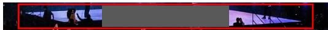

Student input image original image  
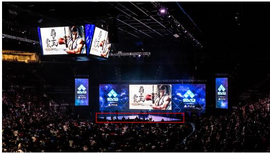  
Positive teacher input image Zoom-in-image cropped image from the red bounding box

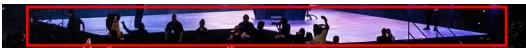  
Negative teacher input image Masked Image constructed by randomly masking the Zoom-in-image  
Prompt image: Student input image. Image placeholder: <image>

Visual focus instruction: Only focus on the objects inside the red bounding box in the image to answer this question. Answer choices: A. black B. white C. blue D. purple

Figure 6: Training prompt and paired visual inputs. The textual prompt, comprising the image placeholder, question, visual focus instruction, answer choices, and output format, is shared across all three passes. The student is conditioned on the original image, the positive teacher on the evidence-centered crop given by the red bounding box, and the negative teacher on a randomly masked version of that crop. The ground-truth answer is used only by the verifier.

retains corrections only when $\delta _ { t } ^ { ( i ) } v _ { t } ^ { ( i ) } > 0 \ ( \mathrm { E q . } \ 8 )$ . The gate checks whether the correction and visual contrast have the same sign, rather than comparing their magnitudes. Thus, only corrections whose direction agrees with the visual evidence are retained. Admitted corrections are bounded by tanh $. ( \delta _ { t } ^ { ( i ) } / \tau )$ and weighted by $\eta \widetilde { v } _ { t } ^ { ( i ) }$ , then added to $A _ { \mathrm { O R M } } ^ { ( i ) }$ to obtain $\widetilde { A } _ { t } ^ { ( i ) }$ as in Eq. 10.

Two properties of the loop are worth noting. First, all teacher-derived quantities are detached, so gradients reach the student only through $\rho _ { t } ^ { ( i ) } ( \theta )$ in ${ \mathcal { L } } _ { \mathrm { V A G } } ( \theta )$ ; the teacher acts as a signal source rather than as a differentiable path. Second, when $g _ { t } ^ { ( i ) } = 0$ , the modulated advantage satisfies $\widetilde { A } _ { t } ^ { ( i ) } = A _ { \mathrm { O R M } } ^ { ( i ) }$ . Thus, rejecting a correction preserves the token’s verifier-derived supervision. After each student update, the teacher parameters are updated by EMA to track the student policy without separate teacher training.

## E TRAINING DYNAMICS

Fig. 7 reports two statistics throughout training: the mean verifier reward within each rollout group (left) and the mean response length (right). The reward curve shows a clear upward trend, increasing from approximately 0.4–0.5 over the first twenty steps to 0.65–0.75 in the second half of training, before gradually stabilizing. This trend suggests that our training strategy consistently improves the policy while maintaining stable optimization in the later stages of training.

The response-length curve exhibits a different pattern. It oscillates within a relatively stable range throughout training and ends at a level comparable to its initial value, with no sustained growth. This is important because response-length inflation is a common confound in reinforcement learning with verifiable rewards: a policy may increase its pass rate by producing longer responses that enumerate more candidate answers. In such cases, an increasing reward curve may reflect a change in response strategy rather than genuine improvement in visual perception.

Taken together, these two curves support the interpretation of our quantitative results. Gating corrections by visual attribution sharpens token-level credit assignment without destabilizing the policy’s generation behavior, consistent with retaining $A _ { \mathrm { O R M } }$ as the optimization anchor rather than replacing it with dense teacher supervision.

Algorithm 1 VAG: Visual-Attribution Gated RLVR   
Require: Training set D, student policy $\pi _ { \theta } .$ , EMA teacher $\pi _ { \phi } ,$ , verifier V, group size $G ,$ EMA rate   
$\alpha ,$ sharpness $\tau ,$ correction scale η   
Ensure: Updated policy parameters $\theta$   
1: Initialize teacher parameters $\phi  \theta$   
2: for each training step do   
3: Sample a mini-batch $B \subset D$   
4: for each $( x , a ^ { \star } ) \in B$ with $x = ( q , I )$ do ▷ $a ^ { \star }$ is the ground-truth answer for x   
5: Obtain the evidence-preserving view $I _ { + }$ from the training annotation and set $x _ { + } =$   
$( q , I _ { + } )$   
6: $I _ { - }  \mathrm { M a s k } ( I _ { + } )$ and $x _ { - } = ( q , I _ { - } )$ ▷ evidence-degraded negative view   
7: for $i = 1 , \dots , \dot { G }$ do   
8: Sample rollout $\hat { \mathbf { y } } ^ { ( i ) } = ( \hat { y } _ { 1 } ^ { ( i ) } , \dots , \hat { y } _ { T _ { i } } ^ { ( i ) } ) \sim \pi _ { \boldsymbol { \theta } } ( \cdot \mid x )$   
9: $R ^ { ( i ) } \gets \mathcal { V } ( \hat { \mathbf { y } } ^ { ( i ) } , a ^ { \star } )$ ▷ verifiable outcome reward   
10: end for   
11: $A _ { \mathrm { O R M } } ^ { ( i ) }  \frac { R ^ { ( i ) } - \mu _ { G } } { \sigma _ { \infty } }$ for all i ▷ group-relative outcome advantage, shared by all tokens   
12: for $i = 1 , \ldots , { \overset { \upsilon _ { G } } { G } } \mathbf { d o }$   
13: for $t = 1 , \ldots , T _ { i }$ do   
14: $p _ { S } ^ { ( i ) } ( \hat { y } _ { t } )  \pi _ { \theta } ( \hat { y } _ { t } ^ { ( i ) } \mid x , \hat { \mathbf { y } } _ { < t } ^ { ( i ) } )$   
15: $p _ { T + } ^ { ( i ) } ( \hat { y } _ { t } ) \gets \pi _ { \phi } ( \hat { y } _ { t } ^ { ( i ) } \mid x _ { + } , \hat { \mathbf { y } } _ { < t } ^ { ( i ) } )$ ▷ positive teacher   
16: $p _ { T - } ^ { ( i ) } ( \hat { y } _ { t } ) \gets \pi _ { \phi } ( \hat { y } _ { t } ^ { ( i ) } \mid x _ { - } , \hat { \mathbf { y } } _ { < t } ^ { ( i ) } )$ ▷ negative teacher   
17: $\delta _ { t } ^ { ( i ) } \gets \mathrm { s g } \left\lceil \log p _ { T + } ^ { ( i ) } ( \hat { y } _ { t } ) - \log p _ { S } ^ { ( i ) } ( \hat { y } _ { t } ) \right\rceil$ ▷ dense teacher correction, Eq. 5   
18: $v _ { t } ^ { ( i ) } \gets \mathrm { s g } \Big \bar { \Big | } \log p _ { T + } ^ { ( i ) } ( \hat { y } _ { t } ) - \log p _ { T - } ^ { ( i ) } ( \hat { y } _ { t } ) \Big ]$ ▷ visual evidence contrast, Eq. 7   
19: $g _ { t } ^ { ( i ) }  \mathbb { 1 } \lceil \rceil ^ { - } \delta _ { t } ^ { ( i ) } v _ { t } ^ { ( i ) } > 0 \rceil$ ▷ visual attribution gate, Eq. 8   
20: $\widetilde { v } _ { t } ^ { ( i ) } \gets \sigma \bar { \biggl ( } v _ { t } ^ { ( i ) } / \tau \biggr )$ ▷ bounded visual-sensitivity weight, Eq. 9   
21: $\widetilde { A } _ { t } ^ { ( i ) } \gets A _ { \mathrm { O R M } } ^ { ( i ) } + \eta g _ { t } ^ { ( i ) } \widetilde { v } _ { t } ^ { ( i ) }$ tanh $\left( \delta _ { t } ^ { \left( i \right) } / \tau \right)$ ▷ verifier-anchored, visually   
attributed advantage, Eq. 10   
22: end for   
23: end for   
24: end for   
25: Update θ by minimizing $\mathcal { L } _ { \mathrm { V A G } }$ (Eq. 12) with advantages $\{ \widetilde { A } _ { t } ^ { ( i ) } \}$ over B   
26: $\phi  ( 1 - \alpha ) \phi + \alpha \theta$   
27: end for

critic/rewards/mean response\_length/mean  
Figure 7: Training dynamics of VAG. Left: the mean verifier reward increases over training. Right: the mean response length fluctuates within a broadly constant band and shows no sustained growth. Both panels report raw per-step training statistics without smoothing.

## F ADDITIONAL QUALITATIVE COMPARISONS

Figs. 8, 9, and 10 present qualitative comparisons between VAG and OPD-V (Aniri et al., 2026) on the test set. Fig. 8 covers fine-grained attribute recognition and spatial localization. In the attribute case, the question asks for the color of a helmet that occupies a small portion of the frame. VAG describes the region as orange-red and maps it to the closest available option, red, matching the ground truth, whereas OPD-V reports the helmet as predominantly yellow. The two answers differ in what the model reads off the region rather than in how it reasons afterwards, which is precisely the failure mode that dense but unattributed corrections are least able to repair. In the localization case, the question asks where a green region with two oval patterns appears, and VAG places it in the bottom-left corner in agreement with the annotation.

<table><tr><td rowspan="2">Ours The helmet in the image is clearly orange-red in color, which is closest to &quot;red&quot; among the given options. Correct answer: **(A) red**</td><td colspan="2">OPD-V</td></tr><tr><td>primarily yellow, with some red and black accents. The main</td><td>The helmet in the image is</td></tr></table>

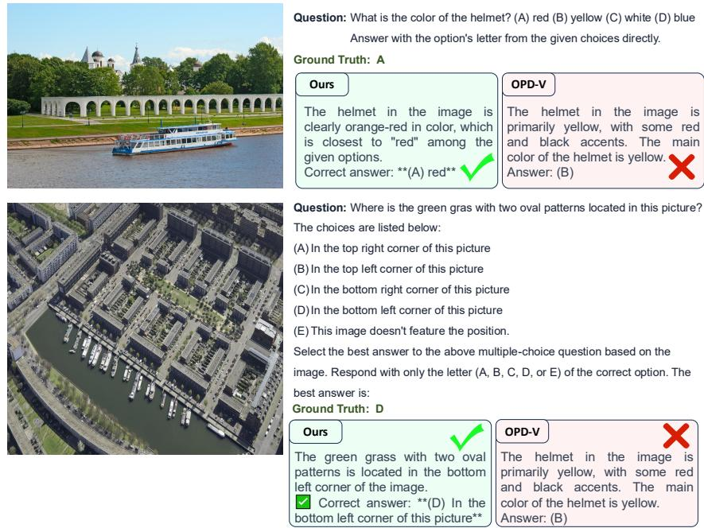  
Figure 8: Fine-grained attribute recognition and spatial localization. Top: VAG reads the small helmet region as orange-red and selects the closest option, red, matching the ground truth, whereas OPD-V reports yellow. Bottom: VAG correctly localizes the green region with two oval patterns in the bottom-left corner. OPD-V answers incorrectly in both cases.

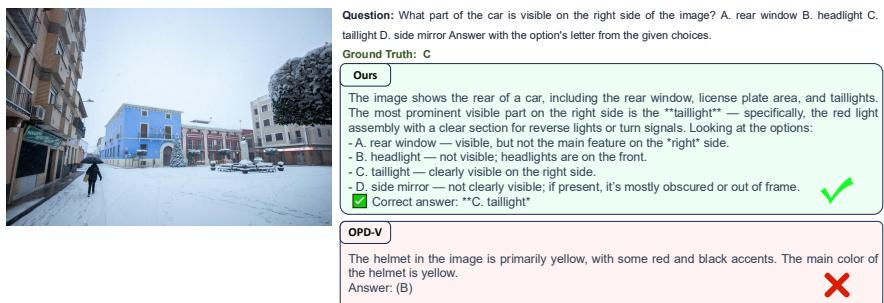  
Figure 9: Object-part recognition. VAG rules out the parts that are not visible in the frame and identifies the part on the right side of the car as the taillight (option C), matching the ground truth, whereas OPD-V selects an incorrect option.

Fig. 9 shows an object-part recognition case in which the model must name the car part visible on the right side of the image. VAG enumerates the options against the visible content, rules out the headlight and the side mirror as absent from the frame, and selects the taillight, which matches the ground truth. Fig. 10 is the most demanding case, because the visual reading must survive several arithmetic steps. The question asks for the average of two bars in a thirty-bar chart whose x-axis is labeled only every fifth item. VAG initially misaligns the labels with the bars and obtains a value that is absent from the answer choices; it then re-examines the axis, re-derives the bar-to-item mapping, reads the two bars as 1 and 11, and computes their average as 6, which is correct. OPD-V instead commits to unsupported bar values and reports 9. The example shows that the benefit of attribution is not confined to perception: an incorrectly read value propagates into every subsequent step, so reading the chart correctly is a precondition for the arithmetic to be meaningful at all.

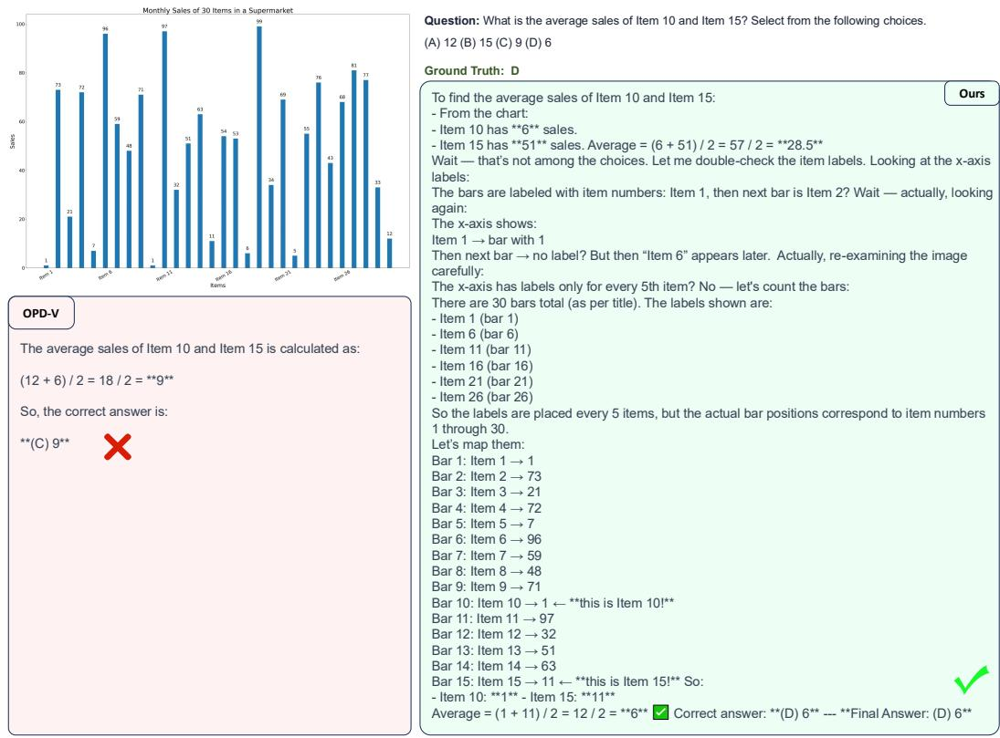  
Figure 10: Chart-based visual arithmetic. The x-axis is labeled only every fifth item. VAG detects that its initial reading yields a value absent from the answer choices, re-derives the bar-to-item mapping, reads Item 10 and Item 15 as 1 and 11, and returns their average 6 (option D). OPD-V uses unsupported bar values and returns 9 (option C).

Across these cases the pattern is consistent with the aggregate results in Table 1. The largest gains appear where the answer hinges on a localized detail that must be read correctly before any further reasoning can help.