# RISK DECOMPOSITION FOR HALLUCINATION-AWARE VIDEO SAMPLING

Chenyan Zheng1,\* Fan Wu2,\*,† Ruibo Li2 Jiaxing Li2 Minghao Yang3 Bang Zhang4 Guosheng Lin2,‡

1Zhejiang University 2Nanyang Technological University

3Tsinghua University 4Tongyi Lab, Alibaba Group

\*Equal contribution †Project lead ‡Corresponding author

https://github.com/wufan-cse/HA-Sampling

## ABSTRACT

Despite achieving high visual fidelity, video models still suffer from physical hallucinations, limiting their reliability as world simulators. Existing methods leverage model-internal or external signals to improve physical plausibility, but their roles and limitations require a unified explanation. We propose a two-dimensional physical-hallucination risk framework that defines low-density sampling risk and high-density drifting risk. The first risk captures generations assigned low likelihood by the video model, for example, a ball suddenly teleporting despite the model favoring continuous motion, while the second risk captures physical inconsistencies in high-likelihood generations, for example, a ball bouncing progressively higher without additional energy. Our analysis explains how modelinternal signals steer sampling toward higher-density regions of the learned distribution to address low-density sampling risk. However, higher model likelihood does not guarantee physical plausibility, motivating external guidance to address high-density drifting risk. Based on this framework, we develop Hallucination-Aware Sampler (HA-Sampler), which applies external physical guidance within latent refinement to generate physically plausible videos, and HA-Scorer, which derives a likelihood-based signal from the generator itself for evaluating generated videos using continuous normalizing flow (CNF), with coarse ODE integration and finite-difference divergence estimates. Experiments on Physics-IQ and VideoPhy benchmarks support our theoretical analysis and demonstrate that our methods outperform the compared sampling and scoring SOTA baselines.

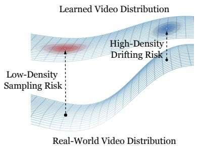

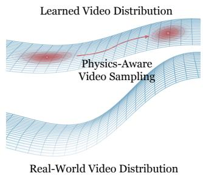

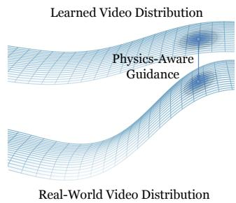  
Figure 1: Overview of our two-dimensional physics hallucination risk framework. Left: Lowdensity sampling risk captures generations assigned low likelihood by the video model, while highdensity drifting risk captures physical errors in high-likelihood generations. Middle: Model-internal physics-aware signals steer sampling toward higher-density regions of the learned distribution to reduce low-density sampling risk. Right: External physics-aware guidance helps correct the drifting between model-preferred generation and physical plausibility to address high-density drifting risk.

## 1 INTRODUCTION

Recent advances in visual fidelity and motion generation have highlighted the potential of video models as world simulators for downstream tasks, such as robotics (Yang et al., 2026). Such applications require accurate physical plausibility, yet physical hallucinations—such as disappearing objects and impossible interactions—undermine the reliability of generated videos (Bansal et al., 2025; Motamed et al., 2026). To address this, existing methods for video sampling can be categorized into two directions: one (Hassan et al., 2026; Yuan et al., 2026a) suggests that video models’ own preferences contain useful information about physical plausibility and leverage model-internal signals (Jang et al., 2026; Cho et al., 2026) for refining, while the other uses external signals (Yuan et al., 2026b; Interno et al., 2026) to guide generation and filter physically unreal samples.\`

However, these raise a fundamental question: how do model-internal and external signals address physical hallucinations? We propose a unified framework that defines two-dimensional risks of physical hallucination to study and understand this question, as shown in Figure 1 (left). Lowdensity sampling risk captures the tendency to generate samples with low likelihood under the video model. For example, a model that favors continuous ball motion may nevertheless generate a lowlikelihood trajectory in which the ball suddenly jumps from one location to another. On the contrary, high-density drifting risk captures physical inconsistencies in samples assigned high likelihood by the video model. For example, the model may favor a video of a ball bouncing progressively higher on a floor, despite no additional energy. The former reflects a deviation from the model’s own preferences, whereas the latter exposes a drifting between those preferences and physical plausibility.

In our framework, we analyze how model-internal and external signals address the two risk dimensions, respectively. Model-internal signals steer video sampling toward the model’s own preference region, which is higher-density regions of the learned video distribution, targeting the low-density sampling risk, as shown in Figure 1 (middle). However, these regions may drift from physical plausibility. External signal provides a physical guidance, forcing generations toward physically plausible videos from the model’s own preference, addressing high-density drifting risk, as shown in Figure 1 (right). Our theory reveals the improvement by either signal alone is not sufficient.

Furthermore, we propose a hallucination-aware video sampler (HA-Sampler), and scorer (HA-Scorer). HA-Sampler generates physically plausible samples by integrating external physical guidance into model-based refinement, targeting both dimensions of hallucination risk. HA-Scorer derives a likelihood-based signal from the generator itself for evaluating generated videos, using continuous normalizing flow (CNF), with coarse ordinary differential equation (ODE) integration and finite-difference divergence estimates. Our extensive experiments show that HA-Sampler and HA-Scorer surpass state-of-the-art (SOTA) baselines, improving the physical plausibility of generated videos and helping select more physically plausible candidates, respectively. Our contributions can be summarized as follows:

1. We are the first to introduce a unified physical-hallucination risk framework that defines low-density sampling risk and high-density drifting risk.

2. We identify and demonstrate that video model-internal signals contain useful information related to physical plausibility that helps mitigate the first type of risk, but these signals are not always effective. External guidance can complement internal signals when they fall short by solving the second type of risk.

3. Based on our framework, we propose a hallucination-aware sampler, HA-Sampler, and scorer, HA-Scorer, for generating and scoring physically plausible videos, respectively. Our experiments show that these two proposed methods achieve the SOTA performance.

## 2 RELATED WORK

## 2.1 VIDEO GENERATIVE MODELS

Recent video generative models have achieved substantial progress in visual fidelity, temporal coherence, and controllability (Team Wan et al., 2025; Blattmann et al., 2023; Chen et al., 2025; HaCohen et al., 2025). They are commonly studied under two settings: text-to-video (T2V) (Chen et al., 2023; Singer et al., 2022; Hong et al., 2022; Tian et al., 2024a), and image-to-video (I2V) (Blattmann et al., 2023; Team Wan et al., 2025; Hu et al., 2022; Yang et al., 2025; HaCohen et al., 2025; Wu et al., 2026). However, both T2V and I2V models still suffer from hallucination (Motamed et al., 2026; Li et al., 2025; Lin et al., 2025; Kang et al., 2025): generated videos are hard to preserve physical plausibility.

## 2.2 PHYSICS-AWARE VIDEO GENERATION

Model-internal guidance. Methods based on model-internal guidance (Bai et al., 2025a; Wu et al., 2024; Jang et al., 2026; Shaulov et al., 2025) aim to enable models to refine themselves without external signal or verification. For video diffusion models, FreeInit (Wu et al., 2024) refines the initial noise through an iterative denoise and re-noise procedure, which improves temporal consistency without training. Self-Refining Video Sampling (Jang et al., 2026) interprets flow-matching video generators as denoising autoencoders and proposes Predict-and-Perturb (P&P) steering the sampling trajectory toward more stable and self-consistent modes of the pretrained model. Tangential Amplifying Guidance (TAG) (Cho et al., 2026) amplifies the tangential component of each sampling update while preserving its radial component, steering samples toward regions of higher model density. Zigzag Diffusion Sampling (Bai et al., 2025a) proposes a sampling strategy that alternates denoising and inversion steps, allowing pretrained diffusion models to accumulate semantic information. FlowMo (Shaulov et al., 2025) improves motion coherence by extracting temporal representations from the model’s own predictions and reducing patch-wise temporal variance during sampling. However, reinforcing the model’s own preferences does not guarantee physical plausibility, as physically incorrect outcomes may still suffer from high model likelihood.

External guidance. Recent efforts on using external guidance introduce physical knowledge through additional supervision, pretrained models, or reward functions. PhysAlign (Xiong et al., 2026) uses simulation-derived annotations and video-feature alignment, while GeoPhys (Interno\` et al., 2026) assesses physical plausibility through the geometry of temporal feature trajectories from frozen image encoders. PhysRVG (Zhang et al., 2026) and PhyGDPO (Cai et al., 2025) improve physical consistency through physics-aware reinforcement learning and VLM-based preference optimization, respectively. VideoREPA (Zhang et al., 2025) transfers physical knowledge from video foundation models through relational alignment. At inference time, WMReward (Yuan et al., 2026b) uses a latent world model to score candidates and guide denoising. However, improving an external physical score does not necessarily increase model likelihood or reduce low-density sampling risk.

Hybrid strategies. Hybrid strategies coordinate model-internal signal with external guidance. Trust Sampling (Huang et al., 2024) monitors the model’s predicted noise magnitude to terminate external optimization when samples depart from its estimated state manifold. TFG (Ye et al., 2024) further unifies guidance and recurrence within a common algorithmic design space. However, beyond coordinating these mechanisms, our framework explicitly distinguishes low-density sampling risk from high-density drifting risk, explaining the complementary roles and limitations of model-internal and external signals in mitigating physical hallucinations.

## 3 METHODOLOGY

## 3.1 NOTATIONS

Let ${ \bf z } _ { 0 } = \mathcal { E } ( { \bf x } ) \in \mathcal { Z }$ be the latent of a clean video $\mathbf { x } \in \mathcal { X }$ , with frozen VAE encoder $\mathcal { E }$ and decoder G. Conditioned on $\mathbf { c } , q ^ { \star }$ and q denote real-video and training latent distributions, while $p _ { \theta }$ and $p _ { \theta , s }$ denote model distributions under ideal sampling and a practical sampler S. We use the data-to-noise flow-matching path $\mathbf { Z } _ { t } = ( 1 - t ) \mathbf { Z } _ { 0 } + t \mathbf { Z } _ { 1 } , t \in [ 0 , 1 ]$ ], with $\mathbf { Z } _ { 0 } \sim q ( \mathbf { \bar { \cdot } } \mid \mathbf { c } ) , \mathbf { Z } _ { 1 } \sim \mathcal { N } ( \mathbf { 0 } , \mathbf { I } )$ , and target velocity ${ \bf V } = { \bf Z } _ { 1 } - { \bf Z } _ { 0 }$ . Generation integrates the learned velocity field $v _ { \theta } ( \mathbf { z } _ { t } , t , \mathbf { c } )$ from $t = 1$ to $t = 0$ , with clean endpoint prediction $\hat { \mathbf { z } } _ { 0 \mid t } = \mathbf { z } _ { t } - t v _ { \theta } ( \mathbf { z } _ { t } , t , \mathbf { c } )$

## 3.2 PRELIMINARIES

Mode interpolation. In prior work (Aithal et al., 2024), the ϵ-hallucination set is defined below.

$$
H _ { \epsilon } ( q ^ { * } ) = \{ { \bf z } _ { 0 } : q ^ { * } ( { \bf z } _ { 0 } \mid { \bf c } ) \leq \epsilon \} .\tag{1}
$$

The parameter ϵ is taken to be vanishingly small. That is, if ${ \bf z } _ { 0 } \in \cal { H } _ { \epsilon } ( q )$ , it lies outside of the support of the real data distribution, which means that the generated video was a hallucination case. The complement of the hallucination set is the ϵ-support set denoted by $S _ { \epsilon } ( q ^ { * } )$ . Mode interpolation is a common phenomenon in diffusion models. This phenomenon occurs when the model generates samples that are interpolations of multiple modes in the ϵ-support set, such that the generated sample lies in the ϵ-hallucination set. For example, if $x , y \in S _ { \epsilon } ( \bar { q } ^ { * } )$ , then the model generates a sample $z = \alpha x + ( 1 - \alpha ) y$ for some $\alpha \in ( 0 , 1 )$ , and $z \in H _ { \epsilon } ( q ^ { * } )$

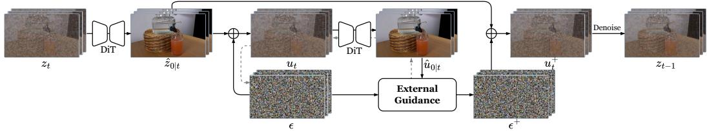  
(a) HA-Sampler.

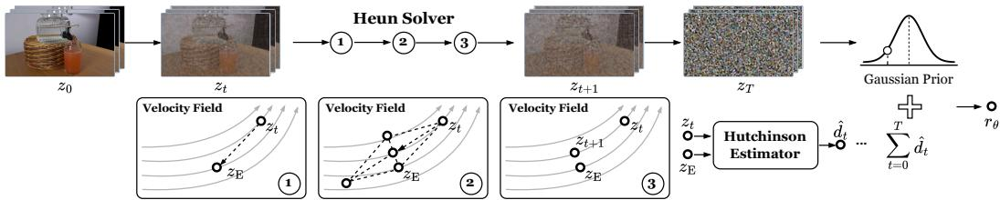  
(b) HA-Scorer.  
Figure 2: Overview of our methods. (a) HA-Sampler uses an external loss on the predicted clean video to guide the perturbation noise. The guided noise is combined with the original endpoint prediction before denoising continues. Grey dashed lines denote the flow of gradients. (b) HA-Scorer integrates the clean latent $\mathbf { z } _ { 0 }$ to the noise endpoint $\mathbf { z } _ { 1 }$ under the fixed base velocity field using a coarse Heun solver. Finite-difference Hutchinson estimator provides the divergence integral. In step $3 , z _ { t }$ and $z _ { t + 1 }$ fall on the same velocity line.

## 3.3 TWO-DIMENSIONAL RISK

Directly quantifying hallucination in video generation is challenging, as it would require access to the unknown real-world conditional distribution $q ^ { * }$ . We therefore aim to formulate a unified theoretical framework for characterizing hallucination risk in video models. Inspired by the prior definition of the ϵ-hallucination set, we define the δ-low-density region as

$$
D _ { \boldsymbol \theta , \delta } ( \mathbf { c } ) = \{ \mathbf { z _ { 0 } } : p _ { \boldsymbol \theta } ( \mathbf { z } _ { 0 } \mid \mathbf { c } ) \leq \delta \} .\tag{2}
$$

Here, we decompose the ϵ-hallucination set into two parts:

$$
H _ { \epsilon } ( q ^ { * } \mid \mathbf { c } ) = \left( H _ { \epsilon } ( q ^ { * } \mid \mathbf { c } ) \cap D _ { \theta , \delta } ( \mathbf { c } ) \right) \dot { \cup } \left( H _ { \epsilon } ( q ^ { * } \mid \mathbf { c } ) \cap \overline { { D _ { \theta , \delta } ( \mathbf { c } ) } } \right) : = H _ { \mathrm { I } } \dot { \cup } H _ { \mathrm { I I } } .\tag{3}
$$

This decomposition distinguishes two fundamentally different hallucination regimes according to whether the generated sample falls also into the low-density region in the model learned distribution. $H _ { \mathrm { I } }$ contains samples that have low-density in both $q ^ { * }$ and $p _ { \theta }$ . In contrast, $H _ { \mathrm { I I } }$ contains samples that are hallucinate under $q ^ { * }$ but remain well supported by $p _ { \theta }$ . Since $q ^ { * }$ is inaccessible in practice, neither subset can be directly identified. However, low-density under $p _ { \theta }$ is a necessary condition for membership in $H _ { \mathrm { I } }$ and can be assessed using the model itself. This motivates us to characterize two layers of hallucination risk arising from sampling in low-density model regions and from drifting away from the real-world distribution despite high model density.

## 3.3.1 LOW-DENSITY SAMPLING RISK

The first layer of hallucination risk is motivated by the decomposed set $H _ { \mathrm { I } }$ , which contains hallucinated samples that also fall into $D _ { \theta , \delta } ( \mathbf { c } )$ . Not every low-density sample is necessarily a hallucination. Nevertheless, mode interpolation provides an important mechanism through which generated samples may enter interpolated regions between learned modes (Aithal et al., 2024). Therefore, We treat low model density as an model internal indicator of hallucination risk.

Definition 1. (Low–Density Sampling Risk.) Let $p _ { \theta } ( \cdot \mid \mathbf { c } )$ denote the learned model distribution and $p _ { \theta , S } ( \cdot$ | c) the output distribution induced by a practical sampler $s .$ . We define the sample-wise low-density sampling risk as

$$
r _ { \theta } ( \mathbf { z } \mid \mathbf { c } ) = - \log p _ { \theta } ( \mathbf { z } \mid \mathbf { c } ) .\tag{4}
$$

Then, the low-density sampling risk of Sampler $s$ is defined as

$$
\begin{array} { r } { \mathcal { R } _ { \theta } ( S \mid \mathbf { c } ) = \mathbb { E } _ { \mathbf { z } \sim p _ { \theta , S } ( \cdot \mid \mathbf { c } ) } [ r _ { \theta } ( \mathbf { z } \mid \mathbf { c } ) ] = \mathbb { E } _ { \mathbf { z } \sim p _ { \theta , S } ( \cdot \mid \mathbf { c } ) } [ - \log p _ { \theta } ( \mathbf { z } \mid \mathbf { c } ) ] . } \end{array}\tag{5}
$$

In our definition, the risk of a generated sample increases as the sample drops to the low-density region under $p _ { \theta }$ . The sampler-wise risk measures the overall tendency to generate outputs that are weakly supported by the learned model.

## 3.3.2 HIGH-DENSITY DRIFTING RISK

Although reducing low-density sampling risk favors samples with higher density under $p _ { \theta }$ , it only indicates that the model is more familiar with these samples. It does not guarantee that these samples are consistent with real-world dynamics. The learned distribution $p _ { \theta }$ may still differ from the realworld physical distribution $q ^ { * }$ , creating a gap that we refer to as distribution drifting. We therefore introduce a second layer of risk to characterize this drift.

Definition 2. (High–Density Drifting Risk.) Let $\ell _ { \omega } ( \mathbf { x } , \mathbf { c } ) \geq 0$ denote an external drifting loss, where a larger value indicates greater inconsistency between video x and real-world dynamics. For a sample with density above δ under pθ, $\mathbf { z } _ { 0 }$ ∈/ $D _ { \theta , \delta } ( \mathbf { c } )$ , we define its sample-wise high-density drifting risk as

$$
\begin{array} { r } { r _ { \omega } ( \mathbf { z } _ { 0 } \mid \mathbf { c } ) = \ell _ { \omega } \big ( \mathcal { G } ( \mathbf { z } _ { 0 } ) , \mathbf { c } \big ) , \qquad \mathbf { z } _ { 0 } \not \in D _ { \theta , \delta } ( \mathbf { c } ) . } \end{array}\tag{6}
$$

The high-density drifting risk of sampler S is defined as the expected external loss conditioned on the generated sample lying in a region where its density under $p _ { \theta }$ exceeds δ:

$$
\begin{array} { r } { \mathcal { R } _ { \omega } ( S \mid \mathbf { c } ) = \mathbb { E } _ { \mathbf { z } _ { 0 } \sim p _ { \theta , S } ( \cdot \mid \mathbf { c } ) } \left[ r _ { \omega } ( \mathbf { z } _ { 0 } \mid \mathbf { c } ) \mid \mathbf { z } _ { 0 } \not \in D _ { \theta , \delta } ( \mathbf { c } ) \right] . } \end{array}\tag{7}
$$

This risk measures the average external loss among samples with relatively high density under $p _ { \theta }$ Conditioning on $\mathbf { z } _ { 0 } \notin D _ { \theta , \delta } ( \mathbf { c } )$ follows the scope of $H _ { \mathrm { I I } }$ and measures the average severity of this distribution drifting among samples with relatively high model density. It does not imply that samples in $D _ { \boldsymbol { \theta } , \delta } ( \mathbf { c } )$ do not have external loss. Since $q ^ { * }$ is inaccessible, the accuracy of this assessment depends on how well $\ell _ { \omega }$ captures this drift from real-world dynamics.

## 3.4 FROM TWO-DIMENSIONAL RISK TO PRACTICE

We use a first-order Euler solver as a reference sampler, denoted by $S _ { \mathrm { E } }$ . All sampler comparisons are conducted under the same condition c. Previous work has shown that latent refinement exhibits mode-seeking behavior (Jang et al., 2026), while gradient guidance uses an external reward to steer generation toward more physically plausible outcomes (Yuan et al., 2026b). Mathematically, we interpret latent refinement through its idealized low-temperature Langevin counterpart at a fixed noise level, while gradient guidance approximates a reward-reweighted target distribution. We provide a detailed mathematical analysis in $\mathsf { A p - }$ pendix A. Figure 3 shows that latent refinement used in P&P reduces low-density sampling risk in more cases than high-density drifting risk, while WMReward shows the reverse pattern. Under our framework, latent refinement addresses low-density sampling risk by favoring regions of higher model density, while gradient guidance provides a way to address high-density drifting through the external guidance. These complementary roles motivate the incorporation of gradient guidance into the refinement process to address both risks within each iteration.

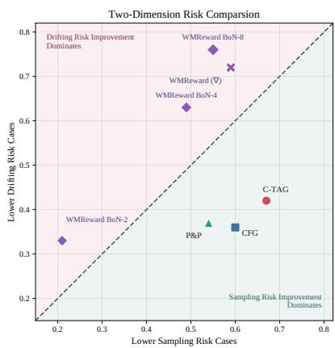  
Figure 3: Performance comparison across the two-dimensional risk. Each axis reports the fraction of 100 cases with lower corresponding risk than the Euler sampler.

## 3.4.1 HALLUCINATION-AWARE VIDEO SAMPLING

Building on our two-layer hallucination risk framework, we introduce HA-Sampler, a training-free sampler designed to address low-density sampling risk and high-density drifting risk within the same refinement process. At each iteration, gradient guidance adjusts the perturbation noise, and the generative model re-predicts the clean endpoint from the guided perturbation. The sampling procedure is illustrated in Figure $2 ( \mathrm { a } )$ . We further illustrate this design through two-dimensional toy experiments with circle- and star-shaped data distributions in Figure 4. We compare HA-Sampler with Euler sampling and baselines that target either low-density sampling risk or high-density drifting risk alone. In the displayed regions, our samples are more tightly concentrated around the training-data reference curves than those from Euler or either baseline.

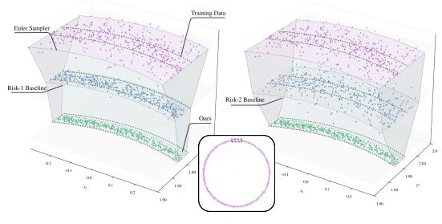

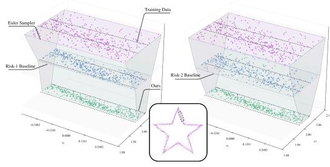  
Figure 4: Sampling results on 2D toy distributions. The stacked layers compare Euler sampler, P&P (risk-1 baseline), guidance based on the negative log-likelihood (NLL) under the true data distribution (risk-2 baseline), and HA-Sampler. The Euler sampler uses a large number of sampling steps to reduce discretization error. Purple reference curves indicate the training-data geometry.

<table><tr><td rowspan="2">Method</td><td colspan="4">Physics-IQ Metrics</td><td rowspan="2">Score ↑</td></tr><tr><td>Spatial IoU ↑</td><td>Spatiotemporal IoU ↑</td><td>Weighted Spatial IoU ↑</td><td>MSE Score ↑</td></tr><tr><td>SANA-Video2.0 (Chen et al., 2026)</td><td>0.2209</td><td>0.1986</td><td>0.1309</td><td>0.0630</td><td>15.33</td></tr><tr><td>CogVideoX-5B (Yang et al., 2025)</td><td>0.3686</td><td>0.3806</td><td>0.2286</td><td>0.2971</td><td>31.87</td></tr><tr><td>Wan2.2-TI2V-5B (Team Wan et al., 2025)</td><td>0.3295</td><td>0.2442</td><td>0.1727</td><td>0.3074</td><td>26.34</td></tr><tr><td>SkyReels-V2-I2V (Chen et al., 2025)</td><td>0.2717</td><td>0.2642</td><td>0.1917</td><td>0.1084</td><td>20.90</td></tr><tr><td>SkyReels-V2-I2V</td><td>0.2717</td><td>0.2642</td><td>0.1917</td><td>0.1084</td><td>20.90</td></tr><tr><td>+ P&amp;P (Jang et al., 2026)</td><td>0.2974</td><td>0.2685</td><td>0.2157</td><td>0.1365</td><td>22.95</td></tr><tr><td>+ WMReward (∇) (Yuan et al., 2026b)</td><td>0.2742</td><td>0.2640</td><td>0.1939</td><td>0.1100</td><td>21.05</td></tr><tr><td>+ HA-Sampler (ours)</td><td>0.3132</td><td>0.2750</td><td>0.2342</td><td>0.1289</td><td>23.78</td></tr><tr><td>Wan2.2-TI2V-5B</td><td>0.3295</td><td>0.2442</td><td>0.1727</td><td>0.3074</td><td>26.34</td></tr><tr><td>+ P&amp;P (Jang et al., 2026)</td><td>0.3796</td><td>0.2322</td><td>0.2109</td><td>0.2916</td><td>27.86</td></tr><tr><td>+ WMReward (∇) (Yuan et al., 2026b)</td><td>0.3310</td><td>0.2427</td><td>0.1732</td><td>0.3072</td><td>26.35</td></tr><tr><td>+ HA-Sampler (ours)</td><td>0.3927</td><td>0.2360</td><td>0.2243</td><td>0.2846</td><td>28.44</td></tr></table>

Table 1: Comparison of different samplers on Physics-IQ. We report the Physics-IQ Verified metrics and overall score. The lower blocks compare inference-time methods using Wan2.2-TI2V-5B and SkyReels-V2-I2V. ∇ denotes gradient guidance of WMReward.

Sampling procedure. At noise level t, we perform $K _ { t }$ refinement iterations, starting from the current predicted clean endpoint $\hat { \mathbf { z } } _ { 0 \mid t }$ . Each iteration samples perturbation noise ϵ to construct $\mathbf { u } _ { t }$ and predict its clean endpoint $\hat { \mathbf { u } } _ { 0 \mid t }$ . We compute the external loss $\mathcal { L } = \ell _ { \omega } ( \mathcal { G } ( \hat { \mathbf { u } } _ { 0 \mid t } ) , \mathbf { c } )$ and its gradient with respect to ϵ. After root mean square (RMS) normalization, we update the noise with step size $\eta _ { t }$ . We then construct ${ \mathbf { u } } _ { t } ^ { + }$ with the updated noise and re-evaluate the model to obtain $\hat { \mathbf { z } } _ { 0 \mid t } ^ { + } .$ , which becomes the input to the next iteration. Algorithm 1 in Appendix B presents one refinement iteration.

## 3.4.2 HALLUCINATION-AWARE SCORING

To estimate hallucination risk $r _ { \theta }$ in Definition 1, we integrate the fixed base ODE $\begin{array} { r } { \frac { \mathrm { d } \mathbf { z } _ { t } } { \mathrm { d } t } = v _ { \theta } ( \mathbf { z _ { t } } , t , \mathbf { c } ) } \end{array}$ from the clean latent $\mathbf { z } _ { 0 }$ to its noise endpoint $\mathbf { z } _ { 1 }$ . The continuous normalizing flow (CNF) changeof-variables formula (Chen et al., 2018) gives the following

$$
- \log p _ { \theta } ( \mathbf { z } _ { 0 } \mid \mathbf { c } ) = - \log \varphi ( \mathbf { z } _ { 1 } ) - \int _ { 0 } ^ { 1 } \nabla _ { \mathbf { z } _ { t } } \cdot \boldsymbol { v } _ { \theta } ( \mathbf { z } _ { t } , t , \mathbf { c } ) d t ,\tag{8}
$$

where $\varphi$ is the standard Gaussian density. The first term is the negative log-likelihood (NLL) under the Gaussian prior, whereas the integral accounts for volume changes along the flow. Computing the divergence is expensive for high-dimensional video latent. We estimate the divergence using Hutchinson’s estimator (Hutchinson, 1989), with forward finite differences to avoid backpropagation through the video model:

$$
\hat { d } _ { t } = \frac { 1 } { P } \sum _ { p = 1 } ^ { P } \mathbf { r } _ { p } ^ { \top } \mathbf { J } _ { \theta , t } \mathbf { r } _ { p } \approx \frac { 1 } { P \delta _ { t } } \sum _ { p = 1 } ^ { P } \mathbf { r } _ { p } ^ { \top } \left[ v _ { \theta } ( \mathbf { z } _ { t } + \delta _ { t } \mathbf { r } _ { p } , t , \mathbf { c } ) - v _ { \theta } ( \mathbf { z } _ { t } , t , \mathbf { c } ) \right] .\tag{9}
$$

<table><tr><td rowspan="2">Method</td><td colspan="4">Physics-IQ Metrics</td><td rowspan="2">Score ↑</td></tr><tr><td>Spatial ÍoU ↑</td><td>Spatiotemporal IoU ↑</td><td>Weighted Spatial IoU ↑</td><td>MSE Score ↑</td></tr><tr><td colspan="7">Base sampler</td></tr><tr><td>Random</td><td>0.3372</td><td>0.1828</td><td>0.2418</td><td>0.2936</td><td>26.38</td></tr><tr><td>Qwen3-VL (Bai et al., 2025b)</td><td>0.3449</td><td>0.2572</td><td>0.2161</td><td>0.3091</td><td>28.18</td></tr><tr><td>Gemma-4 (Gemma Team, 2026)</td><td>0.3380</td><td>0.2392</td><td>0.1847</td><td>0.3002</td><td>26.55</td></tr><tr><td>WMReward (Yuan et al., 2026b)</td><td>0.3175</td><td>0.1972</td><td>0.3647</td><td>0.3410</td><td>30.51</td></tr><tr><td>GeoPhys (Internò et al., 2026)</td><td>0.3278</td><td>0.1782</td><td>0.2307</td><td>0.2900</td><td>25.67</td></tr><tr><td>HA-Scorer (ours)</td><td>0.3515</td><td>0.2172</td><td>0.3312</td><td>0.3353</td><td>30.88</td></tr><tr><td colspan="6">P&amp;P sampler</td></tr><tr><td>Random</td><td>0.3647</td><td>0.2308</td><td>0.2001</td><td>0.2852</td><td>27.02</td></tr><tr><td>Qwen3-VL (Bai et al., 2025b)</td><td>0.3910</td><td>0.2368</td><td>0.2197</td><td>0.3020</td><td>28.74</td></tr><tr><td>Gemma-4 (Gemma Team, 2026)</td><td>0.3455</td><td>0.2257</td><td>0.1897</td><td>0.2888</td><td>26.24</td></tr><tr><td>WMReward (Yuan et al., 2026b)</td><td>0.3681</td><td>0.3025</td><td>0.2304</td><td>0.3246</td><td>30.64</td></tr><tr><td>GeoPhys (Internò et al., 2026)</td><td>0.3757</td><td>0.2049</td><td>0.2058</td><td>0.2925</td><td>26.97</td></tr><tr><td>HA-Scorer (ours)</td><td>0.3917</td><td>0.2384</td><td>0.2910</td><td>0.3349</td><td>31.40</td></tr><tr><td colspan="6"></td></tr><tr><td>Random</td><td>0.3681</td><td>HA-Sampler 0.2020</td><td>0.2325</td><td>0.2846</td><td>27.18</td></tr><tr><td>Qwen3-VL (Bai et al., 2025b)</td><td>0.3777</td><td>0.2385</td><td>0.2178</td><td>0.3057</td><td>28.49</td></tr><tr><td>Gemma-4 (Gemma Team, 2026)</td><td>0.3652</td><td>0.2354</td><td>0.2095</td><td>0.2958</td><td>27.65</td></tr><tr><td>WMReward (Yuan et al., 2026b)</td><td>0.3761</td><td>0.2303</td><td>0.3294</td><td>0.3315</td><td>31.68</td></tr><tr><td>GeoPhys (Internò et al., 2026)</td><td>0.3686</td><td>0.2011</td><td>0.2190</td><td>0.2907</td><td>26.98</td></tr><tr><td>HA-Scorer (ours)</td><td>0.3965</td><td>0.2443</td><td>0.3127</td><td>0.3364</td><td>32.25</td></tr></table>

Table 2: Results of scorer methods on Physics-IQ with Best-of-N generation. Random denotes selecting a candidate uniformly from the $N = 8$ candidates pool. Candidate generation uses Wan2.2-TI2V-5B.

Here, $\mathbf { J } _ { \theta , i }$ is the Jacobian of $v _ { \theta }$ with respect to $\mathbf { z } _ { t }$ . The random probes $\mathbf { r } _ { p }$ are sampled independently and reused across integration steps. The perturbation scale $\delta _ { t }$ is computed from $\delta _ { \mathrm { r e l } }$ and the latent root mean square. We use Heun’s second-order method (Karras et al., 2022) on a coarse time grid to compute the inversion trajectory and accumulate the finite-difference divergence estimates. We refer to this evaluation as HA-Scorer. An overview of HA-Scorer is shown in Figure 2 (b), with the complete procedure given in Algorithm 2 (Appendix B).

## 4 EXPERIMENTS

## 4.1 EXPERIMENTAL SETUP

Implementation details. We conducted all experiments on flow-matching-based video generative models, including Wan2.2-TI2V-5B and SkyReels-V2-I2V-1.3B. For VLM-based scoring, we use Qwen3-VL-8B-Instruct (Bai et al., 2025b) and Gemma-4-E4B-it (Gemma Team, 2026). Details of the scoring procedure and results with other VLMs are provided in Appendix D.1. In practice, we use the WMReward surprise score (Yuan et al., 2026b) as the external loss. For HA-Scorer, the default settings are $H = 8$ Heun steps, $P = 2$ Hutchinson probes, and a relative perturbation scale of $\delta _ { \mathrm { r e l } } = 0 . 0 1 2 5$ . We compare scoring methods using a best-of-N (BoN) protocol, where each method selects its top-ranked candidate from N = 8 video candidates generated per input condition. Comparisons with $N \in \{ 2 , 4 , 8 \}$ are provided in Appendix D.2 to examine how performance changes with the number of candidates. All experiments are conducted on the RTXA6000 platform.

Baselines and benchmarks. For sampling, we compare with the base model, P&P (Jang et al., 2026), and WMReward (∇) (Yuan et al., 2026b). We also include other physics-aware methods in the T2V evaluation. For candidate selection, we compare against WMReward (Yuan et al., 2026b), GeoPhys (Interno et al., 2026). We choose these baselines for their competitive and SOTA perfor-\` mance. We evaluate I2V generation on Physics-IQ (Radsch et al., 2026) using the Verified metrics¨ and T2V generation on VideoPhy (Bansal et al., 2025). Details are provided in Appendix C.

“...brown tennis ball rollsfrom the left straight out of the black tube and hits the olive greenfabric box...”

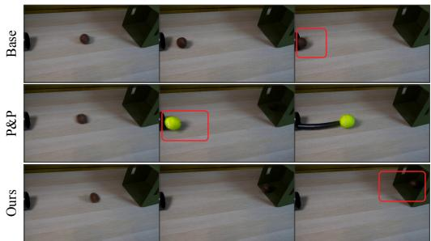

“...yellow rubber duck sits stationary on a light brown wooden table...”  
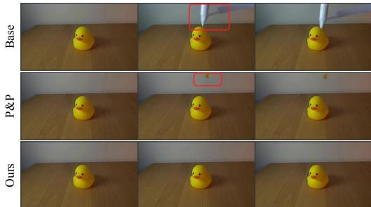  
Figure 5: Qualitative comparison of samplers on Physics-IQ. We compare sampling methods in a dynamic collision scene (left) and a static scene (right). HA-Sampler produces more physically plausible results than the base sampler and P&P in both cases.

<table><tr><td>Method</td><td>Solid-Solid ↑</td><td>Solid-Fluid ↑</td><td>Fluid–Fluid ↑</td><td>Overall ↑</td></tr><tr><td>General video models</td><td></td><td></td><td></td><td></td></tr><tr><td>Wan2.1-T2V-1.3B (Team Wan et al., 2025)</td><td>0.18</td><td>0.24</td><td>0.27</td><td>0.22</td></tr><tr><td>SanaVideo2.0 (Chen et al., 2026)</td><td>0.27</td><td>0.23</td><td>0.33</td><td>0.26</td></tr><tr><td>Wan2.2-TI2V-5B (Team Wan et al., 2025)</td><td>0.21</td><td>0.32</td><td>0.25</td><td>0.26</td></tr><tr><td>Physics-aware methods</td><td></td><td></td><td></td><td></td></tr><tr><td>DreamWorld (Tan et al., 2026)</td><td>0.16</td><td>0.29</td><td>0.31</td><td>0.24</td></tr><tr><td>VPT (Zheng et al., 2026)</td><td>0.17</td><td>0.24</td><td>0.33</td><td>0.22</td></tr><tr><td>P&amp;P (Jang et al., 2026)</td><td>0.22</td><td>0.23</td><td>0.33</td><td>0.24</td></tr><tr><td>WMReward (∇) (Yuan et al., 2026b)</td><td>0.21</td><td>0.32</td><td>0.24</td><td>0.26</td></tr><tr><td>HA-Sampler (ours)</td><td>0.27</td><td>0.30</td><td>0.35</td><td>0.30</td></tr></table>

Table 3: Comparison of different samplers on VideoPhy. We report category-wise and overall Physical Commonsense (PC). Higher scores are better. Our method uses Wan2.2-TI2V-5B as the base model. ∇ denotes gradient guidance of WMReward.

## 4.2 COMPARISON WITH EXISTING METHODS

## 4.2.1 QUANTITATIVE RESULTS

Sampler comparison. Table 1 compares inference-time sampling methods on Physics-IQ Benchmark. On Wan2.2-TI2V-5B, HA-Samplerachieves the highest overall score among compared samplers, exceeding the baseline by +2.10, and leads in Spatial IoU and Weighted Spatial IoU. On SkyReels-V2-I2V, our method also achieves the highest overall score, exceeding the baseline by +2.88. These results suggest that latent refinement and gradient guidance complement each other, producing consistent improvements over either method alone across both backbones. Table 3 reports results on VideoPhy. HA-Sampler achieves the highest overall PC score among the compared physics-aware methods. We further compare the two hallucination risks across samplers in Appendix E.

Scorer comparison. Table 2 compares scorer methods for best-of-N selection with N = 8 using Wan2.2-TI2V-5B. HA-Scorer achieves the highest overall score under all three samplers. Compared with random selection, HA-Scorer improves the overall score by +4.50, +4.38, and +5.07 under the base, P&P, and HA-Sampler, respectively. Our scorer also leads in Spatial IoU across all three samplers and ranks first in three of the four metrics under both P&P and HA-Sampler. These gains show that our scorer effectively selects more physically plausible videos and remains beneficial even when candidate generation is improved through HA-Sampler.

## 4.2.2 QUALITATIVE RESULTS

Sampler comparison. Figure 5 compares sampling methods in dynamic and static scenes. In the left case, the base sampler moves the ball back toward the tube, while P&P changes the ball’s color from brown to yellow and introduces an additional tube. HA-Sampler preserves the appearance of the original ball and generates a trajectory into the box. In the right case, both baselines introduce extraneous objects above the duck, whereas HA-Sampler preserves the stationary scene.

“...brown tennis ball rolls straight out ofthe black pipe and hits the rubber duck...”  
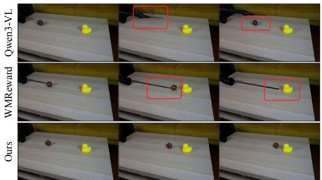

“...blue-black grabber tool releases the blue tennis ball above a pile ofgreen kinetic sand...”  
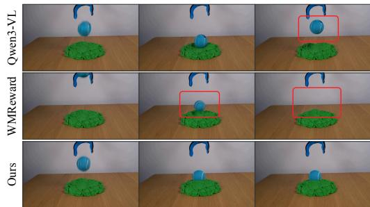  
Figure 6: Qualitative comparison of candidates selection on Physics-IQ. For each prompt, all scorer methods select from the same candidate pool generated by the base model. Each row shows three frames capturing key stages of motion in the video.

<table><tr><td rowspan="2">Setting</td><td colspan="4">Physics-IQ Metrics</td><td rowspan="2">Physics-IQ Score ↑</td><td rowspan="2">VideoPhy PC↑</td></tr><tr><td>Spatial IoU ↑</td><td>Spatiotemporal IoU ↑</td><td>Weighted Spatial IoU ↑</td><td>MSE Score ↑</td></tr><tr><td>w/o both</td><td>0.3295</td><td>0.2442</td><td>0.1727</td><td>0.3074</td><td>26.34</td><td>0.26</td></tr><tr><td>w/ Latent Refinement</td><td>0.3796</td><td>0.2322</td><td>0.2109</td><td>0.2916</td><td>27.86</td><td>0.24</td></tr><tr><td>w/ Physics Guidance</td><td>0.3252</td><td>0.2435</td><td>0.1680</td><td>0.3074</td><td>26.10</td><td>0.26</td></tr><tr><td>HA-Sampler (ours)</td><td>0.3927</td><td>0.2360</td><td>0.2243</td><td>0.2846</td><td>28.44</td><td>0.30</td></tr></table>

Table 4: Component ablation of HA-Sampler. We evaluate latent refinement and physics guidance individually and together; w/o both uses neither component. All settings use the same backbone, prompts, initial frames, and paired seeds, without candidate selection. The best and second-best results in each column are bold and underlined, respectively.

Scorer comparison. Figure 6 compares videos selected by different scorers from the same basemodel candidate pool for each prompt. In the left case, additional objects appear in the videos selected by Qwen3-VL and WMReward, and the ball also disappears in the video selected by WM-Reward. By contrast, HA-Scorer selects a video in which the ball remains visible and rolls toward the duck. In the right case, both Qwen3-VL and WMReward select videos in which the ball flies upward unnaturally. By contrast, HA-Scorer selects a video in which the ball lands on the sand and remains at rest. More qualitative results are provided in Appendix G.

## 4.3 ABLATION STUDIES

Table 4 evaluates the contributions of latent refinement and physics guidance. Removing either component lowers the overall Physics-IQ score and VideoPhy PC. Guidance alone performs similarly to the base sampler, whereas adding it to latent refinement raises the overall score. These results support the complementary roles of refinement and guidance, demonstrating the effectiveness of our sampling mechanism. Furthermore, our sensitivity analysis shows that HA-Scorer maintains stable performance across the tested hyperparameter settings; see Appendix F for details.

## 5 DISCUSSION

Our approach may improve physical plausibility at the expense of generation diversity. HA-Sampler and HA-Scorer favor high-density regions of the learned distribution, potentially suppressing rare but physically valid outputs. This trade-off may limit applications that require diverse video generation. Preserving the diversity of valid outputs while reducing physical hallucinations remains an important direction for future work. Furthermore, we discuss potential applications in synthetic-data generation for robotics and training guidance in Appendix H.

## 6 CONCLUSION

We proposed a unified framework that distinguishes low-density sampling risk from high-density drifting risk in video generation. Our analysis explains the complementary roles and limitations of model-internal and external signals: internal signals favor higher-likelihood generations, while external physical guidance helps address physical errors that the model itself assigns high likelihood. Based on this framework, we proposed HA-Sampler for video sampling and HA-Scorer for likelihood-based video evaluation. Experiments demonstrate improvements in generating and selecting physically plausible videos. Beyond inference-time sampling, these risk measures could help select synthetic training videos and assess video models during post-training.

## REFERENCES

Sumukh K Aithal, Pratyush Maini, Zachary Lipton, and J Zico Kolter. Understanding hallucinations in diffusion models through mode interpolation. Advances in neural information processing systems, 37:134614–134644, 2024.

Lichen Bai, Shitong Shao, Zikai Zhou, Zipeng Qi, Zhiqiang Xu, Haoyi Xiong, and Zeke Xie. Zigzag Diffusion Sampling: Diffusion models can self-improve via self-reflection. In International Conference on Learning Representations, 2025a. URL https://openreview.net/forum? id=MKvQH1ekeY.

Shuai Bai, Yuxuan Cai, Ruizhe Chen, Keqin Chen, Xionghui Chen, Zesen Cheng, Lianghao Deng, Wei Ding, Chang Gao, Chunjiang Ge, Wenbin Ge, Zhifang Guo, Qidong Huang, Jie Huang, Fei Huang, Binyuan Hui, Shutong Jiang, Zhaohai Li, Mingsheng Li, Mei Li, Kaixin Li, Zicheng Lin, Junyang Lin, Xuejing Liu, Jiawei Liu, Chenglong Liu, Yang Liu, Dayiheng Liu, Shixuan Liu, Dunjie Lu, Ruilin Luo, Chenxu Lv, Rui Men, Lingchen Meng, Xuancheng Ren, Xingzhang Ren, Sibo Song, Yuchong Sun, Jun Tang, Jianhong Tu, Jianqiang Wan, Peng Wang, Pengfei Wang, Qiuyue Wang, Yuxuan Wang, Tianbao Xie, Yiheng Xu, Haiyang Xu, Jin Xu, Zhibo Yang, Mingkun Yang, Jianxin Yang, An Yang, Bowen Yu, Fei Zhang, Hang Zhang, Xi Zhang, Bo Zheng, Humen Zhong, Jingren Zhou, Fan Zhou, Jing Zhou, Yuanzhi Zhu, and Ke Zhu. Qwen3-VL technical report. arXiv preprint arXiv:2511.21631, 2025b. doi: 10.48550/arXiv.2511.21631.

Hritik Bansal, Zongyu Lin, Tianyi Xie, Zeshun Zong, Michal Yarom, Yonatan Bitton, Chenfanfu Jiang, Yizhou Sun, Kai-Wei Chang, and Aditya Grover. VideoPhy: Evaluating physical commonsense for video generation. In International Conference on Learning Representations, 2025. URL https://proceedings.iclr.cc/paper\_files/paper/2025/hash/ fce2d8a485746f76aac7b5650db2679d-Abstract-Conference.html.

Andreas Blattmann, Tim Dockhorn, Sumith Kulal, Daniel Mendelevitch, Maciej Kilian, Dominik Lorenz, Yam Levi, Zion English, Vikram Voleti, Adam Letts, Varun Jampani, and Robin Rombach. Stable Video Diffusion: Scaling latent video diffusion models to large datasets. arXiv preprint arXiv:2311.15127, 2023.

Yuanhao Cai, Kunpeng Li, Menglin Jia, Jialiang Wang, Junzhe Sun, Feng Liang, Weifeng Chen, Felix Juefei-Xu, Chu Wang, Ali Thabet, Xiaoliang Dai, Xuan Ju, Alan Yuille, and Ji Hou. PhyGDPO: Physics-aware groupwise direct preference optimization for physically consistent text-to-video generation. arXiv preprint arXiv:2512.24551, 2025. doi: 10.48550/arXiv.2512. 24551.

Guibin Chen, Dixuan Lin, Jiangping Yang, Chunze Lin, Juncheng Zhu, Mingyuan Fan, Hao Zhang, Sheng Chen, Zheng Chen, Chengchen Ma, Weiming Xiong, Wei Wang, Nuo Pang, Kang Kang, Zhiheng Xu, Yuzhe Jin, Yupeng Liang, Yubing Song, Peng Zhao, Boyuan Xu, Di Qiu, Debang Li, Zhengcong Fei, Yang Li, and Yahui Zhou. SkyReels-V2: Infinite-length film generative model. arXiv preprint arXiv:2504.13074, 2025.

Haoxin Chen, Menghan Xia, Yingqing He, Yong Zhang, Xiaodong Cun, Shaoshu Yang, Jinbo Xing, Yaofang Liu, Qifeng Chen, Xintao Wang, Chao Weng, and Ying Shan. VideoCrafter1: Open diffusion models for high-quality video generation. arXiv preprint arXiv:2310.19512, 2023.

Junsong Chen, Jincheng Yu, Yitong Li, Shuchen Xue, Haozhe Liu, Jingyu Xin, Yuyang Zhao, Tian Ye, Zhangjie Wu, Zian Wang, Daquan Zhou, Ping Luo, Song Han, and Enze Xie. SANA-Video 2.0: Hybrid linear attention with attention residuals for efficient video generation, 2026. URL https://arxiv.org/abs/2607.21553.

Ricky T. Q. Chen, Yulia Rubanova, Jesse Bettencourt, and David K. Duvenaud. Neural ordinary differential equations. In Advances in Neural Information Processing Systems, volume 31, 2018. URL https://proceedings.neurips.cc/paper/2018/hash/ 69386f6bb1dfed68692a24c8686939b9-Abstract.html.

Hyunmin Cho, Donghoon Ahn, Susung Hong, Jee Eun Kim, Seungryong Kim, and Kyong Hwan Jin. TAG: Tangential amplifying guidance for hallucination-resistant sampling. In Forty-third International Conference on Machine Learning, 2026. URL https://openreview.net/ forum?id=1XJqPy2LhA.

Bradley Efron. Tweedie’s formula and selection bias. Journal of the American Statistical Association, 106(496):1602–1614, 2011.

Patrick Esser, Sumith Kulal, Andreas Blattmann, Rahim Entezari, Jonas Muller, Harry Saini, Yam¨ Levi, Dominik Lorenz, Axel Sauer, Frederic Boesel, Dustin Podell, Tim Dockhorn, Zion English, and Robin Rombach. Scaling rectified flow transformers for high-resolution image synthesis. In Proceedings of the 41st International Conference on Machine Learning, volume 235 of Proceedings of Machine Learning Research, pp. 12606–12633. PMLR, 2024. URL https://proceedings.mlr.press/v235/esser24a.html.

Gemma Team. Gemma 4 technical report, 2026. URL https://arxiv.org/abs/2607. 02770.

Yoav HaCohen, Nisan Chiprut, Benny Brazowski, Daniel Shalem, Dudu Moshe, Eitan Richardson, Eran Levin, Guy Shiran, Nir Zabari, Ori Gordon, Poriya Panet, Sapir Weissbuch, Victor Kulikov, Yaki Bitterman, Zeev Melumian, and Ofir Bibi. LTX-Video: Realtime video latent diffusion. arXiv preprint arXiv:2501.00103, 2025.

Mariam Hassan, Kaouther Messaoud, Wuyang Li, and Alexandre Alahi. Proprio: Latent selfscoring and inference-time refinement for physically plausible video generation. arXiv preprint arXiv:2605.28230, 2026. URL https://arxiv.org/abs/2605.28230.

Wenyi Hong, Ming Ding, Wendi Zheng, Xinghan Liu, and Jie Tang. Cogvideo: Large-scale pretraining for text-to-video generation via transformers. arXiv preprint arXiv:2205.15868, 2022.

Yaosi Hu, Chong Luo, and Zhenzhong Chen. Make it move: controllable image-to-video generation with text descriptions. In Proceedings of the IEEE/CVF Conference on Computer Vision and Pattern Recognition, pp. 18219–18228, 2022.

William Huang, Yifeng Jiang, Tom Van Wouwe, and C Karen Liu. Constrained diffusion with trust sampling. Advances in Neural Information Processing Systems, 37:93849–93873, 2024.

M. F. Hutchinson. A stochastic estimator of the trace of the influence matrix for Laplacian smoothing splines. Communications in Statistics - Simulation and Computation, 18(3):1059–1076, 1989. doi: 10.1080/03610918908812806.

Christian Interno, Alexander Pondaven, Habon Issa, Fabio Pizzati, Francesco Pinto, Markus Ol-\` hofer, Ivan Laptev, Philip Torr, Eero P. Simoncelli, Barbara Hammer, and David Klindt. Geo-Phys: The geometry of physical plausibility, 2026. URL https://arxiv.org/abs/2606. 20707.

Joel Jang, Seonghyeon Ye, Zongyu Lin, Jiannan Xiang, Johan Bjorck, Yu Fang, Fengyuan Hu, Spencer Huang, Kaushil Kundalia, Yen-Chen Lin, Loic Magne, Ajay Mandlekar, Avnish Narayan, You Liang Tan, Guanzhi Wang, Jing Wang, Qi Wang, Yinzhen Xu, Xiaohui Zeng, Kaiyuan Zheng, Ruijie Zheng, Ming-Yu Liu, Luke Zettlemoyer, Dieter Fox, Jan Kautz, Scott Reed, Yuke Zhu, and Linxi Fan. DreamGen: Unlocking generalization in robot learning through video world models. arXiv preprint arXiv:2505.12705, 2025. URL https://arxiv.org/abs/2505.12705.

Sangwon Jang, Taekyung Ki, Jaehyeong Jo, Saining Xie, Jaehong Yoon, and Sung Ju Hwang. Selfrefining video sampling. arXiv preprint arXiv:2601.18577, 2026. doi: 10.48550/arXiv.2601. 18577.

Bingyi Kang, Yang Yue, Rui Lu, Zhijie Lin, Yang Zhao, Kaixin Wang, Gao Huang, and Jiashi Feng. How far is video generation from world model: A physical law perspective, 2025. URL https://arxiv.org/abs/2411.02385.

Tero Karras, Miika Aittala, Timo Aila, and Samuli Laine. Elucidating the design space of diffusionbased generative models. In Advances in Neural Information Processing Systems, volume 35, 2022. URL https://proceedings.nips.cc/paper\_files/paper/2022/hash/ a98846e9d9cc01cfb87eb694d946ce6b-Abstract-Conference.html.

Dacheng Li, Yunhao Fang, Yukang Chen, Shuo Yang, Shiyi Cao, Justin Wong, Michael Luo, Xiaolong Wang, Hongxu Yin, Joseph E Gonzalez, et al. Worldmodelbench: Judging video generation models as world models. arXiv preprint arXiv:2502.20694, 2025.

Ruibo Li, Xiaofeng Yang, Ze Yang, Jiacheng Wei, Chunyan Miao, and Guosheng Lin. Adaptive piecewise distillation for efficient LiDAR data generation. In Proceedings ofthe AAAI Conference on Artificial Intelligence, volume 40, pp. 6360–6368, 2026. doi: 10.1609/aaai.v40i8.37563.

Minghui Lin, Xiang Wang, Yishan Wang, Shu Wang, Fengqi Dai, Pengxiang Ding, Cunxiang Wang, Zhengrong Zuo, Nong Sang, Siteng Huang, et al. Exploring the evolution of physics cognition in video generation: A survey. arXiv preprint arXiv:2503.21765, 2025.

Zhiqiu Lin, Deepak Pathak, Baiqi Li, Jiayao Li, Xide Xia, Graham Neubig, Pengchuan Zhang, and Deva Ramanan. Evaluating text-to-visual generation with image-to-text generation. In Computer Vision – ECCV 2024, pp. 366–384. Springer, 2024. doi: 10.1007/978-3-031-72673-6 20.

Xingchao Liu, Xiwen Zhang, Jianzhu Ma, Jian Peng, and Qiang Liu. InstaFlow: One step is enough for high-quality diffusion-based text-to-image generation. In The Twelfth International Conference on Learning Representations, 2024. URL https://proceedings.iclr.cc/paper\_files/paper/2024/hash/ 4dc37a7bc61057252ce043fa3b83aac2-Abstract-Conference.html.

Saman Motamed, Laura Culp, Kevin Swersky, Priyank Jaini, and Robert Geirhos. Do generative video models understand physical principles? In Proceedings of the IEEE/CVF Winter Conference on Applications of Computer Vision (WACV), pp. 948–958, March 2026.

Qwen Team. Qwen3.5: Towards native multimodal agents, February 2026. URL https://qwen. ai/blog?id=qwen3.5.

Tim Radsch, Yuki M. Asano, Hilde Kuehne, Stefan Bauer, Priyank Jaini, Robert Geirhos, and¨ Carsten T. Luth. Physics-IQ Verified, 2026. URL¨ https://arxiv.org/abs/2606. 18943.

Ariel Shaulov, Itay Hazan, Lior Wolf, and Hila Chefer. FlowMo: Variance-based flow guidance for coherent motion in video generation. In Advances in Neural Information Processing Systems, 2025. doi: 10.48550/arXiv.2506.01144. URL https://openreview.net/forum?id= PDgagkX9zj.

Uriel Singer, Adam Polyak, Thomas Hayes, Xi Yin, Jie An, Songyang Zhang, Qiyuan Hu, Harry Yang, Oron Ashual, Oran Gafni, et al. Make-a-video: Text-to-video generation without text-video data. arXiv preprint arXiv:2209.14792, 2022.

Boming Tan, Xiangdong Zhang, Ning Liao, Yuqing Zhang, Shaofeng Zhang, Xue Yang, Qi Fan, and Yanyong Zhang. DreamWorld: Unified world modeling in video generation, 2026. URL https://arxiv.org/abs/2603.00466.

Team Wan, Ang Wang, Baole Ai, Bin Wen, Chaojie Mao, Chen-Wei Xie, Di Chen, Feiwu Yu, Haiming Zhao, Jianxiao Yang, Jianyuan Zeng, Jiayu Wang, Jingfeng Zhang, Jingren Zhou, Jinkai Wang, Jixuan Chen, Kai Zhu, Kang Zhao, Keyu Yan, Lianghua Huang, Mengyang Feng, Ningyi Zhang, Pandeng Li, Pingyu Wu, Ruihang Chu, Ruili Feng, Shiwei Zhang, Siyang Sun, Tao Fang, Tianxing Wang, Tianyi Gui, Tingyu Weng, Tong Shen, Wei Lin, Wei Wang, Wei Wang, Wenmeng Zhou, Wente Wang, Wenting Shen, Wenyuan Yu, Xianzhong Shi, Xiaoming Huang, Xin Xu, Yan Kou, Yangyu Lv, Yifei Li, Yijing Liu, Yiming Wang, Yingya Zhang, Yitong Huang, Yong Li, You Wu, Yu Liu, Yulin Pan, Yun Zheng, Yuntao Hong, Yupeng Shi, Yutong Feng, Zeyinzi Jiang, Zhen

Han, Zhi-Fan Wu, and Ziyu Liu. Wan: Open and advanced large-scale video generative models. arXiv preprint arXiv:2503.20314, 2025. doi: 10.48550/arXiv.2503.20314.

Ye Tian, Ling Yang, Haotian Yang, Yuan Gao, Yufan Deng, Jingmin Chen, Xintao Wang, Zhaochen Yu, Xin Tao, Pengfei Wan, et al. Videotetris: Towards compositional text-to-video generation. Advances in Neural Information Processing Systems, 37:29489–29513, 2024a.

Yonglong Tian, Lijie Fan, Kaifeng Chen, Dina Katabi, Dilip Krishnan, and Phillip Isola. Learning vision from models rivals learning vision from data. In Proceedings of the IEEE/CVF Conference on Computer Vision and Pattern Recognition, pp. 15887–15898, 2024b. URL https://openaccess.thecvf.com/content/CVPR2024/html/ Tian\_Learning\_Vision\_from\_Models\_Rivals\_Learning\_Vision\_from\_ Data\_CVPR\_2024\_paper.html.

Brandon Trabucco, Kyle Doherty, Max Gurinas, and Ruslan Salakhutdinov. Effective data augmentation with diffusion models. In The Twelfth International Conference on Learning Representations, 2024. URL https://proceedings.iclr.cc/paper\_files/paper/2024/ hash/3f1351a10a3f904e6f3845a94275a909-Abstract-Conference.html.

Fan Wu, Jiacheng Wei, Ruibo Li, Yi Xu, Junyou Li, Deheng Ye, and Guosheng Lin. Ic-world: Incontext generation for shared world modeling. In European Conference on Computer Vision, pp. 483–501. Springer, 2026.

Tianxing Wu, Chenyang Si, Yuming Jiang, Ziqi Huang, and Ziwei Liu. FreeInit: Bridging initialization gap in video diffusion models. In Computer Vision – ECCV 2024, pp. 378–394. Springer Nature Switzerland, 2024. doi: 10.1007/978-3-031-72646-0 22.

Zhexiao Xiong, Yizhi Song, Liu He, Wei Xiong, Yu Yuan, Feng Qiao, and Nathan Jacobs. PhysAlign: Physics-coherent image-to-video generation through feature and 3d representation alignment. arXiv preprint arXiv:2603.13770, 2026. doi: 10.48550/arXiv.2603.13770.

Jiazhi Yang, Kunyang Lin, Jinwei Li, Wencong Zhang, Tianwei Lin, Longyan Wu, Zhizhong Su, Hao Zhao, Ya-Qin Zhang, Li Chen, Ping Luo, Xiangyu Yue, and Hongyang Li. RISE: Selfimproving robot policy with compositional world model. arXiv preprint arXiv:2602.11075, 2026. doi: 10.48550/arXiv.2602.11075. URL https://arxiv.org/abs/2602.11075.

Zhuoyi Yang, Jiayan Teng, Wendi Zheng, Ming Ding, Shiyu Huang, Jiazheng Xu, Yuanming Yang, Wenyi Hong, Xiaohan Zhang, Guanyu Feng, Da Yin, Yuxuan Zhang, Weihan Wang, Yean Cheng, Bin Xu, Xiaotao Gu, Yuxiao Dong, and Jie Tang. CogVideoX: Text-to-video diffusion models with an expert transformer. In International Conference on Learning Representations, 2025.

Haotian Ye, Haowei Lin, Jiaqi Han, Minkai Xu, Sheng Liu, Yitao Liang, Jianzhu Ma, James Zou, and Stefano Ermon. Tfg: Unified training-free guidance for diffusion models. Advances in Neural Information Processing Systems, 37:22370–22417, 2024.

Jianhao Yuan, Fabio Pizzati, Francesco Pinto, Lars Kunze, Ivan Laptev, Paul Newman, Philip Torr, and Daniele De Martini. LikePhys: Evaluating intuitive physics understanding in video diffusion models via likelihood preference. In International Conference on Learning Representations, 2026a. URL https://openreview.net/forum?id=6UJf6B8RZ8.

Jianhao Yuan, Xiaofeng Zhang, Felix Friedrich, Nicolas Beltran-Velez, Melissa Hall, Reyhane Askari-Hemmat, Xiaochuang Han, Nicolas Ballas, Michal Drozdzal, and Adriana Romero-Soriano. Inference-time physics alignment of video generative models with latent world models. arXiv preprint arXiv:2601.10553, 2026b. doi: 10.48550/arXiv.2601.10553.

Qiyuan Zhang, Biao Gong, Shuai Tan, Zheng Zhang, Yujun Shen, Xing Zhu, Yuyuan Li, Kelu Yao, Chunhua Shen, and Changqing Zou. PhysRVG: Physics-aware unified reinforcement learning for video generative models. arXiv preprint arXiv:2601.11087, 2026. doi: 10.48550/arXiv.2601. 11087.

Xiangdong Zhang, Jiaqi Liao, Shaofeng Zhang, Fanqing Meng, Xiangpeng Wan, Junchi Yan, and Yu Cheng. VideoREPA: Learning physics for video generation through relational alignment with foundation models. In Advances in Neural Information Processing Systems, 2025.

Guangting Zheng, Haojing Chen, Hao Li, Jingtao Zhang, Zhen Yang, Xiaosong Jia, Xue Yang, Shaofeng Zhang, and Yanyong Zhang. Enhancing video physical consistency via role-aware joint training and modality-decoupled denoising, 2026. URL https://arxiv.org/abs/2607. 04653.

## A MATHEMATICAL ANALYSIS

This section analyzes latent refinement and gradient guidance within our two-layer risk framework. We interpret latent refinement through an idealized low-temperature Langevin process and gradient guidance through distribution reweighting based on the external loss. These analyzes motivate combining the two mechanisms in HA-Sampler to address low-density sampling risk and high-density drifting risk.

(i) Latent Refinement. At a fixed noise level $t ,$ latent refinement predicts a clean endpoint and adds fresh Gaussian noise to return it to the same noise level. It repeats this prediction–perturbation cycle before advancing to the next denoising step (Jang et al., 2026). Under a Bayes-optimal endpoint predictor for the Gaussian noising process, Tweedie’s formula (Efron, 2011) gives

$$
\begin{array} { r } { \mathbf { z } _ { t } ^ { k + 1 } = \mathbf { z } _ { t } ^ { k } + \sigma _ { t } ^ { 2 } \nabla _ { \mathbf { z } _ { t } } \log p _ { \theta , t } ( \mathbf { z } _ { t } ^ { k } \mid \mathbf { c } ) + \sigma _ { t } \epsilon _ { k + 1 } , \qquad \epsilon _ { k + 1 } \sim \mathcal { N } ( \mathbf { 0 } , \mathbf { I } ) , } \end{array}\tag{10}
$$

where k indexes refinement iterations. The transition combines a step along the model score with a Gaussian perturbation. Its continuous Langevin counterpart has temperature $T = 1 / 2$ and stationary density

$$
\pi _ { t } ( \mathbf { z } _ { t } \mid \mathbf { c } ) = \frac { p _ { \theta , t } ( \mathbf { z } _ { t } \mid \mathbf { c } ) ^ { 2 } } { Z _ { t } ( \mathbf { c } ) } ,\tag{11}
$$

where $Z _ { t } ( \mathbf { c } )$ is the normalization constant. Squaring the density increases the relative weight of higher-density regions, and this distribution satisfies

$$
\begin{array} { r } { \mathbb { E } _ { \mathbf { z } _ { t } \sim \pi _ { t } ( \cdot | \mathbf { c } ) } \big [ - \log p _ { \theta , t } ( \mathbf { z } _ { t } \mid \mathbf { c } ) \big ] \leq \mathbb { E } _ { \mathbf { z } _ { t } \sim p _ { \theta , t } ( \cdot | \mathbf { c } ) } \big [ - \log p _ { \theta , t } ( \mathbf { z } _ { t } \mid \mathbf { c } ) \big ] . } \end{array}\tag{12}
$$

The expected negative log-density here is the noisy-marginal counterpart of the risk in Definition 1 which explains how latent refinement can reduce low-density sampling risk at a fixed noise level.

(ii) Gradient Guidance. Gradient guidance predicts a clean endpoint during denoising, decodes it into a video, and evaluates the drifting risk $r _ { \omega }$ through the external loss. The resulting gradient adjusts the sampling update toward outcomes that the evaluator considers more physically plausible (Yuan et al., 2026b). The ideal reweighted target associated with this risk is

$$
p _ { \theta , \lambda } ( \mathbf { z } _ { 0 } \mid \mathbf { c } ) = \frac { p _ { \theta } ( \mathbf { z } _ { 0 } \mid \mathbf { c } ) \exp [ - \lambda r _ { \omega } ( \mathbf { z } _ { 0 } \mid \mathbf { c } ) ] } { Z _ { \lambda } ( \mathbf { c } ) } ,\tag{13}
$$

where $\lambda \geq 0$ controls guidance strength and $Z _ { \lambda } ( \mathbf { c } )$ is the normalizing constant. The exponential factor increases the relative weight of samples with lower drifting risk. Let $p _ { \theta , \lambda , t }$ denote its marginal under the same noising process. The corresponding score is approximated as

$$
\nabla _ { \mathbf { z } _ { t } } \log p _ { \theta , \lambda , t } ( \mathbf { z } _ { t } \mid \mathbf { c } ) \approx \nabla _ { \mathbf { z } _ { t } } \log p _ { \theta , t } ( \mathbf { z } _ { t } \mid \mathbf { c } ) - \lambda \nabla _ { \mathbf { z } _ { t } } r _ { \omega } ( \hat { \mathbf { z } } _ { 0 \mid t } \mid \mathbf { c } ) .\tag{14}
$$

Prior work has reported limited gains in physical plausibility from gradient guidance alone in video generation (Yuan et al., 2026b). Our analysis suggests that guidance can be more effective when low-density sampling risk is reduced or kept under control.

## B ALGORITHMS

Algorithm 1 presents one refinement iteration of HA-Sampler, where gradient guidance updates the perturbation noise before the model re-predicts the clean endpoint. For Wan2.2-TI2V-5B, we use 20 denoising steps, with three refinement iterations at steps 1–2 and one at steps 3–6. For SkyReels-V2-I2V-1.3B, we use 50 denoising steps, with three refinement iterations at steps 3–7 and one at steps 8–17. Algorithm 2 details HA-Scorer, which estimates the negative log-likelihood per latent dimension using Heun integration and finite-difference divergence estimates.

Algorithm 1 HA-Sampler   
Input: Predicted clean endpoint $\hat { \mathbf { z } } _ { 0 \mid t } ,$ noise level t, guidance step size $\eta _ { t } .$ , velocity field $v _ { \theta } .$ , VAE   
decoder ${ \mathcal { G } } ,$ external loss $\ell _ { \omega } ,$ condition c.   
1: Sample $\mathbf { \epsilon } \gets \mathcal { N } ( \mathbf { 0 } , \mathbf { I } )$   
2: $\mathbf { u } _ { t } \gets ( 1 - t ) \hat { \mathbf { z } } _ { 0 | t } - t \epsilon$   
3: $\mathbf { v }  v _ { \theta } ( \mathbf { u } _ { t } , t , \mathbf { c } )$   
4: $\hat { \mathbf { u } } _ { 0 \mid t } \gets \mathbf { u } _ { t } - t \mathbf { v }$ ▷ Probe endpoint   
5: $\mathcal { L } \gets \ell _ { \omega } \big ( \mathcal { G } ( \hat { \mathbf { u } } _ { 0 \mid t } ) , \mathbf { c } \big )$   
6: $\mathbf { g }  \nabla _ { \epsilon } \dot { \mathcal { L } }$ ▷ Noise gradient   
7: $\mathbf { \bar { g } } _ { . }  \mathrm { R M S N o r m a l i z e } ( \mathbf { g } )$   
8: $\epsilon ^ { + }  \epsilon - \eta _ { t } \mathbf { g }$ ▷ Guided noise   
9: $\mathbf { u } _ { t } ^ { + }  ( 1 - t ) \hat { \mathbf { z } } _ { 0 \mid t } - t \epsilon ^ { + }$   
10: $\mathbf { v } ^ { + }  v _ { \theta } ( \mathbf { u } _ { t } ^ { + } , t , \mathbf { c } )$ ▷ Re-predict   
11: $\hat { \mathbf { z } } _ { 0 \mid t } ^ { + } \gets \mathbf { u } _ { t } ^ { + } - t \mathbf { v } ^ { + }$ ▷ Refined endpoint   
12: return $\hat { \mathbf { z } } _ { 0 \mid t } ^ { + } , \mathbf { u } _ { t } ^ { + } , \mathbf { v } ^ { + }$

Algorithm 2 HA-Scorer   
Input: Clean endpoint $\mathbf { z } _ { 0 } .$ , base velocity field $v _ { \theta } ,$ condition $\mathbf { c } ,$ time grid $0 = t _ { 0 } < \cdots < t _ { H } = 1$   
probe count $\bar { P , }$ relative perturbation scale $\delta _ { \mathrm { r e l } }$   
1: Sample independent probes $\mathbf { r } _ { 1 } , \ldots , \mathbf { r } _ { P }$ ▷ Fixed across steps   
2: $\mathbf { z } _ { t _ { 0 } } \gets \mathbf { z } _ { 0 } , A \gets 0 , D \gets \mathrm { d i m } ( \mathbf { z } _ { 0 } )$   
3: for $j = 0 , \ldots , H - 1$ do   
4: $h _ { j }  t _ { j + 1 } - t _ { j }$   
5: $( \mathbf { v } _ { j } , \hat { d } _ { j } ) \gets \mathrm { E v A L U A T E } ( \mathbf { z } _ { t _ { j } } , t _ { j } )$   
6: $\mathbf { z } _ { \mathrm { E } }  \mathbf { z } _ { t _ { j } } + h _ { j } \mathbf { v } _ { j }$ ▷ Euler predictor   
7: $( \mathbf { v } _ { j } ^ { \mathrm { E } } , \hat { d } _ { j } ^ { \mathrm { E } } ) \gets \mathrm { E v a L U A T E } ( \mathbf { z } _ { \mathrm { E } } , t _ { j + 1 } )$   
8: $\begin{array} { r } { A  \dot { A } + \frac { h _ { j } } { 2 } ( \hat { d } _ { j } + \hat { d } _ { j } ^ { \mathrm { E } } ) } \end{array}$ ▷ Divergence integral   
9: $\begin{array} { r } { \mathbf { z } _ { t _ { j + 1 } } \gets \mathbf { z } _ { t _ { j } } + \frac { h _ { j } } { 2 } ( \mathbf { v } _ { j } + \mathbf { v } _ { j } ^ { \mathrm { E } } ) } \end{array}$ ▷ Heun update   
10: $\begin{array} { r } { \hat { r } _ { \theta } \gets \frac { \| \mathbf z _ { t _ { H } } \| _ { 2 } ^ { 2 } } { 2 } + \frac { D } { 2 } \log ( 2 \pi ) - A } \end{array}$ ▷ Estimated NLL   
11: return $\hat { r } _ { \theta } ^ { \mathrm { ~ \tiny ~ \omega ~ } } / D$ ▷ NLL per dimension   
12: function EVALUATE(z, t)   
13: $\mathbf { v }  v _ { \theta } ( \mathbf { z } , t , \mathbf { c } )$   
14: $\delta  \delta _ { \mathrm { { r e l } } } \mathrm { { m a x } } \big ( \| \mathbf { z } \| _ { 2 } / \sqrt { D } , 0 . 1 \big )$   
15: $\begin{array} { r } { \hat { d } \gets \frac { 1 } { P \delta } \sum _ { p = 1 } ^ { P } \mathbf { r } _ { p } ^ { \top } \big [ v _ { \theta } ( \mathbf { z } + \delta \mathbf { r } _ { p } , t , \mathbf { c } ) - \mathbf { v } \big ] } \end{array}$ ▷ Forward FD   
16: return $\mathbf { v } , \hat { d }$

## C EXPERIMENTAL DETAILS

We describe the baselines, benchmarks, and evaluation metrics used in our experiments. Sampling methods and best-of-N video selection are evaluated separately.

## C.1 BASELINES

## C.1.1 SAMPLER BASELINES

Base model. The pretrained video generator uses the reference Euler sampler with the official classifier-free guidance (CFG) settings, without additional latent refinement or physics guidance.

P&P. (Jang et al., 2026) P&P interprets flow-matching video generators as denoising autoencoders and repeatedly predicts and perturbs latent states at a fixed noise level to favor stable model modes.

WMReward (∇). (Yuan et al., 2026b) We use its gradient-guidance variant, which guides sampling using prediction surprise from a pretrained latent world model as the external loss.

DreamWorld. (Tan et al., 2026) DreamWorld jointly models video latents with motion, spatial, and semantic features extracted by pretrained models. It uses constraint annealing during training and multi-source inner-guidance at inference.

VPT. (Zheng et al., 2026) VPT fine-tunes video generators with optical flow and entity-role maps, using modality-decoupled denoising and auxiliary loss annealing. It further applies cross-step autoguidance at inference to improve physical consistency.

## C.1.2 SCORER BASELINES

WMReward. (Yuan et al., 2026b) We use prediction surprise from its pretrained latent world model to rank candidate videos, selecting the candidate with the lowest surprise.

GeoPhys. (Interno et al., 2026) GeoPhys evaluates physical plausibility from the geometry of tem-\` poral feature trajectories extracted by frozen image encoders. We reimplement its scoring method with the recommended DINOv3 backbone.

VLM scorers. We evaluate Qwen3-VL-8B-Instruct (Bai et al., 2025b), Gemma-4-E4B-it (Gemma Team, 2026), and Qwen3.5-9B (Qwen Team, 2026). All three use the same binary answer-likelihood scoring procedure described in Appendix D.1.

For video selection, all scorers rank the same candidate pool for each condition, with random selection serving as the reference.

## C.2 METRICS

Spatial IoU. Compares temporally aggregated motion masks to measure whether motion occurs in the correct spatial regions.

Spatiotemporal IoU. Compares frame-wise motion masks to assess both spatial and temporal alignment.

Weighted Spatial IoU. Compares weighted motion maps to assess the location and magnitude of motion.

Mean Squared Error (MSE). Measures pixel-level differences between generated and reference continuations.

## C.3 BENCHMARKS

Physics-IQ Verified. We evaluate image-to-video generation using the Physics-IQ Verified metrics (Radsch et al., 2026). The benchmark compares generated continuations with recordings of ¨ real-world physical experiments. Its four underlying metrics are described below.

We use the Verified aggregation, which normalizes each metric by the physical variation of the corresponding sample, clips each normalized subscore to [0, 1], and averages equally across metrics and samples. The MSE score is transformed so that higher values indicate better performance.

VideoPhy. We evaluate text-to-video generation on the 344-prompt VideoPhy test split (Bansal et al., 2025). We report semantic adherence (SA), which measures agreement with the text prompt, and physical commonsense (PC), which assesses whether the generated interactions follow physical laws.

## D DETAILS OF BEST-OF-N SELECTION

## D.1 VLM SCORING AND SELECTION

Following (Jang et al., 2025), we provide the VLM with a generated video and its input description, and ask it to assess physical plausibility with a binary response: 1 for physically plausible and 0 otherwise. Following (Lin et al., 2024), we use the log-probability of the positive answer token 1 as the score and select the highest-scoring candidate. The prompt used for VLM scoring is provided below.

[Does the video show good physics dynamics and showcase   
a good alignment with the physical world for the prompt   
"description"? Please be a strict judge. If it breaks the   
laws of physics, please answer 0. Answer 0 for No or 1 for   
Yes. Reply only 0 or 1.]

We use Qwen3-VL-8B-Instruct (Bai et al., 2025b) as the primary VLM. We also evaluate Gemma-4-E4B-it (Gemma Team, 2026) and Qwen3.5-9B (Qwen Team, 2026), using the same scoring procedure and candidate pools. Table 5 compares best-of-N selection results across the three VLMs to examine how the evaluator choice affects the relative performance of the scorer methods. Across all three VLMs, the physical evaluation scores of the selected videos do not consistently improve as N increases. This suggests that these VLMs still struggle to reliably identify physical errors and select more physically plausible videos.

<table><tr><td>Sampler</td><td>BoN</td><td>Qwen3-VL</td><td>Gemma-4</td><td>Qwen3.5</td></tr><tr><td rowspan="3">Base sampler</td><td>2</td><td>27.73</td><td>26.48</td><td>27.27</td></tr><tr><td>4</td><td>28.64</td><td>26.61</td><td>28.12</td></tr><tr><td>8</td><td>28.18</td><td>26.55</td><td>29.42</td></tr><tr><td rowspan="3">P&amp;P sampler</td><td>2</td><td>28.33</td><td>27.08</td><td>28.69</td></tr><tr><td>4</td><td>28.42</td><td>26.08</td><td>28.71</td></tr><tr><td>8</td><td>28.74</td><td>26.24</td><td>28.22</td></tr><tr><td rowspan="3">HA-Sampler</td><td>2</td><td>28.59</td><td>28.57</td><td>29.09</td></tr><tr><td>4</td><td>28.16</td><td>26.66</td><td>29.21</td></tr><tr><td>8</td><td>28.49</td><td>27.65</td><td>29.17</td></tr></table>

Table 5: Comparison of VLM-based selection across candidate pool sizes. We report Physics-IQ Verified scores for candidates selected by different VLMs at $N \in \mathsf { \bar { \{ 2 , 4 , 8 \} } }$ . Higher scores indicate better performance. The highest score in each row is shown in bold.

## D.2 DETAILED RESULTS

Table 6 compare scorer methods with $N \in \{ 2 , 4 , 8 \}$ candidates generated by the base sampler, P&P, and HA-Sampler. HA-Scorer achieves the highest Physics-IQ Verified score in every setting, with scores increasing consistently across the tested candidate budgets for all three samplers. Combined with HA-Sampler, it achieves the best result in each budget.
<table><tr><td>Sampler</td><td>BoN</td><td>Random</td><td>WMReward</td><td>GeoPhys</td><td>Qwen3-VL</td><td>HA-Scorer (ours)</td></tr><tr><td rowspan="3">Base sampler</td><td>2</td><td>27.74</td><td>28.84</td><td>26.57</td><td>27.73</td><td>28.99</td></tr><tr><td>4</td><td>27.45</td><td>30.75</td><td>26.50</td><td>28.64</td><td>30.77</td></tr><tr><td>8</td><td>26.38</td><td>30.51</td><td>25.67</td><td>28.18</td><td>30.88</td></tr><tr><td rowspan="3">P&amp;P sampler</td><td>2</td><td>27.28</td><td>28.79</td><td>27.08</td><td>28.33</td><td>29.38</td></tr><tr><td>4</td><td>27.09</td><td>29.88</td><td>26.34</td><td>28.42</td><td>30.48</td></tr><tr><td>8</td><td>27.02</td><td>30.64</td><td>26.97</td><td>28.74</td><td>31.40</td></tr><tr><td rowspan="3">HA-Sampler (ours)</td><td>2</td><td>27.54</td><td>29.05</td><td>28.49</td><td>28.59</td><td>29.53</td></tr><tr><td>4</td><td>27.04</td><td>30.00</td><td>27.39</td><td>28.16</td><td>30.69</td></tr><tr><td>8</td><td>27.18</td><td>31.68</td><td>26.98</td><td>28.49</td><td>32.25</td></tr></table>

Table 6: Best-of-N results with different candidate pool sizes. We report Physics-IQ Verified scores for selection methods using $N \in \{ 2 , 4 , 8 \}$ candidates from each sampler. Random denotes uniform random selection. Higher scores indicate better performance. The best and second-best scores in each row are bold and underlined, respectively.

## E HALLUCINATION RISK ACROSS SAMPLERS

We compare both risk measures across samplers on 100 cases in Table 7 and Table 8. Low-density sampling risk is estimated by HA-Scorer on the final clean latents, while mean WMReward surprise is used as a proxy for high-density drifting risk.

Low-density sampling risk. C-TAG, P&P, CFG, and HA-Sampler all reduce the estimated risk relative to Euler without CFG, whereas WMReward (∇) increases it. Unlike WMReward (∇), HA-Sampler reduces low-density sampling risk while applying gradient guidance.

<table><tr><td rowspan="2">Sampler</td><td colspan="3">Risk Decomposition</td><td rowspan="2">△Risk/dim</td></tr><tr><td>Prior term</td><td>Volume term</td><td>Risk/dim ↓</td></tr><tr><td>Euler</td><td>1.10503</td><td>-2.54120</td><td>-1.43617</td><td>0.00000</td></tr><tr><td>C-TAG (λ = 1.25)</td><td>1.22623</td><td>-2.76701</td><td>-1.54079</td><td>-0.10462</td></tr><tr><td>P&amp;P</td><td>1.21343</td><td>-2.68283</td><td>-1.46940</td><td>-0.03323</td></tr><tr><td>CFG</td><td>1.21803</td><td>-2.70666</td><td>-1.48863</td><td>-0.05246</td></tr><tr><td>WMReward (∇)</td><td>1.22506</td><td>-2.21974</td><td>-0.99468</td><td>+0.44149</td></tr><tr><td>HA-Sampler (ours)</td><td>1.21706</td><td>-2.72160</td><td>-1.50454</td><td>-0.06837</td></tr></table>

Table 7: Low-density sampling risk on 100 cases. The prior and volume terms sum to the lowdensity sampling risk. All quantities are reported per latent dimension. ∆Risk is measured relative to the paired Euler baseline without classifier-free guidance. We use H = 8 Heun steps and $P = 2$ shared Hutchinson probes. ∇ denotes gradient guidance.

High-density drifting risk. Relative to the base sampler with CFG = 5, P&P slightly increases mean WMReward surprise, while WMReward (∇) and HA-Sampler reduce it. HA-Sampler achieves the lowest mean risk among the evaluated methods. Together, these results show that HA-Sampler reduces both low-density sampling risk and high-density drifting risk.

<table><tr><td>Sampler</td><td>Risk↓</td><td>∆Risk</td></tr><tr><td>Base  $( \mathrm { C F G } = 5 )$ </td><td>0.414941</td><td>0.000000</td></tr><tr><td>P&amp;P</td><td>0.415273</td><td>+0.000332</td></tr><tr><td>WMReward (∇)</td><td>0.414746</td><td>-0.000195</td></tr><tr><td>HA-Sampler (ours)</td><td>0.414180</td><td>-0.000761</td></tr></table>

Table 8: High-density drifting risk on 100 cases. We report mean WMReward surprise as a proxy for high-density drifting risk. ∆Risk is measured relative to the base sampler with $\mathrm { C F G } = 5$ . ∇ denotes gradient guidance.

## F HA-SCORER SENSITIVITY

## F.1 SENSITIVITY TO H AND p

Table 9 examines how the Heun step count H and Hutchinson probe count p affect HA-Scorer. More steps or probes reduce the mean absolute error (MAE) relative to the reference NLL estimates, while rank correlations with the reference estimates remain close to one across the tested settings. These results indicate that the rankings produced by HA-Scorer are relatively insensitive to H and p within the tested range. Table 10 further shows that varying H and P within the tested range has little effect on candidate selection or physical evaluation results.

<table><tr><td>H</td><td>NFE</td><td>MAE↓</td><td> $\rho \uparrow$ </td></tr><tr><td></td><td></td><td>100 cases</td><td></td></tr><tr><td>4</td><td>24</td><td>0.067996</td><td>0.99600</td></tr><tr><td>8</td><td>48</td><td>0.003014</td><td>0.99957 1.00000</td></tr><tr><td>16</td><td>96</td><td>Ref.</td><td></td></tr><tr><td></td><td></td><td>25 case subset</td><td></td></tr><tr><td>16</td><td>96</td><td>0.001210</td><td>1.00000</td></tr><tr><td>32</td><td>192</td><td>Ref.</td><td>1.00000</td></tr></table>

(a) Heun integration steps.

<table><tr><td>p</td><td>NFE</td><td>MAE↓</td><td>ρ↑</td></tr><tr><td>1 2</td><td>32</td><td>100 cases 0.000548</td><td>0.99994 0.99994</td></tr><tr><td>4</td><td>48 80</td><td>0.000322 Ref.</td><td>1.00000</td></tr><tr><td></td><td></td><td>25 case subset</td><td></td></tr><tr><td>4</td><td>80</td><td>0.000256</td><td>1.00000</td></tr><tr><td>8</td><td>144</td><td>Ref.</td><td>1.00000</td></tr></table>

(b) Hutchinson probe count.

Table 9: Sensitivity of HA-Scorer to integration steps and probe count. We evaluate the full 100-case set and a fixed stratified 25-case subset. We fix $p = 2$ in (a), H = 8 in (b), and $\delta _ { \mathrm { r e l } } =$ 0.0125 throughout. ρ denotes the Spearman rank correlation coefficient. NFE counts model forward evaluations per case.
<table><tr><td rowspan="2">(a) Probe count (H = 8) Sampler</td><td colspan="2">Physics-IQ Score ↑</td><td rowspan="2">∆Score</td><td rowspan="2">Agreement</td></tr><tr><td> $P = 1$ </td><td> $P = 2$ </td></tr><tr><td>Base sampler</td><td>30.88</td><td>30.88</td><td>+0.00</td><td>198/198</td></tr><tr><td>P&amp;P sampler</td><td>31.28</td><td>31.40</td><td>+0.12</td><td>197/198</td></tr><tr><td>HA-Sampler</td><td>32.25</td><td>32.25</td><td>+0.00</td><td>198/198</td></tr></table>

(b) Integration steps $( P = 1 )$
<table><tr><td rowspan="2">Sampler</td><td colspan="2">Physics-IQ Score ↑</td><td rowspan="2">∆Score</td><td rowspan="2">Agreement</td></tr><tr><td> $H = 4$ </td><td> $H = 8$ </td></tr><tr><td>HA-Sampler</td><td>32.17</td><td>32.25</td><td>+0.08</td><td>191/198</td></tr></table>

Table 10: Effect of estimation settings on HA-Scorer. We compare Physics-IQ Verified scores using different numbers of Heun steps (H) and Hutchinson probes (P). ∆Score is the change from the left setting to the right. Agreement counts prompts with the same selected candidate.

## F.2 SENSITIVITY TO $\delta _ { \mathrm { r e l } }$

Table 11 examines the sensitivity of HA-Scorer to $\delta _ { \mathrm { r e l } }$ by comparing forward finite-difference estimates with VJP-based estimates. The default setting produces rankings close to the VJP reference, while the smallest and largest tested perturbation scales lead to larger estimation errors.
<table><tr><td>Estimator / δrel</td><td>Mean Risk/dim</td><td>Bias vs. VJP</td><td>MAE↓</td><td>Pearson ↑</td><td>Spearman ↑</td><td>Kendall ↑</td><td>Mean rank shift↓</td></tr><tr><td>VJP</td><td>-1.48701</td><td></td><td></td><td></td><td></td><td></td><td></td></tr><tr><td colspan="8">Forward finite differences</td></tr><tr><td>0.0050</td><td>-1.51387</td><td>-0.02686</td><td>0.08914</td><td>0.95765</td><td>0.93638</td><td>0.80889</td><td>7.30</td></tr><tr><td>0.0100</td><td>-1.47179</td><td>+0.01523</td><td>0.02618</td><td>0.99493</td><td>0.99123</td><td>0.93374</td><td>2.52</td></tr><tr><td>0.0125</td><td>-1.46672</td><td>+0.02030</td><td>0.02890</td><td>0.99456</td><td>0.99191</td><td>0.93051</td><td>2.70</td></tr><tr><td>0.0250</td><td>-1.47240</td><td>+0.01461</td><td>0.01739</td><td>0.99846</td><td>0.99735</td><td>0.96485</td><td>1.40</td></tr><tr><td>0.0500</td><td>-1.40883</td><td>+0.07818</td><td>0.07818</td><td>0.99800</td><td>0.99740</td><td>0.96687</td><td>1.40</td></tr><tr><td>0.1000</td><td>-1.17969</td><td>+0.30732</td><td>0.30732</td><td>0.97516</td><td>0.97786</td><td>0.87475</td><td>4.54</td></tr></table>

Table 11: Finite-difference accuracy across perturbation scales. We compare forward finite differences with VJP-based estimates. $\delta _ { \mathrm { r e l } }$ denotes the relative perturbation scale. Bias and MAE are computed relative to VJP, while correlations and mean rank shift measure agreement across evaluated samples.

## G MORE QUALITATIVE RESULTS

## G.1 QUALITATIVE RESULTS ON PHYSICS-IQ

Figure 8 and Figure 9 compare our method with the baselines on Physics-IQ, focusing on generated motion and object interactions. Compared with the baselines, our method produces more physically plausible motion and object interactions in these examples. These observations are consistent with the quantitative results and support combining HA-Sampler for generation with HA-Scorer for candidate selection.

## G.2 QUALITATIVE RESULTS ON VIDEOPHY

Figure 7 compares T2V results with P&P and WMReward (∇). In the left case, HA-Sampler produces a cleaner contact between brush and canvas. In the right case, it produces a more natural interaction with the water surface. These results illustrate HA-Sampler has improvements in physical details. Additional qualitative comparisons on VideoPhy are provided in Figure 10.

“A brush sweeps blue paint across a canvas.”  
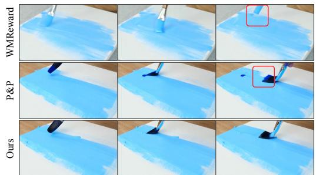

“Waterflowing outfrom a pipe.”  
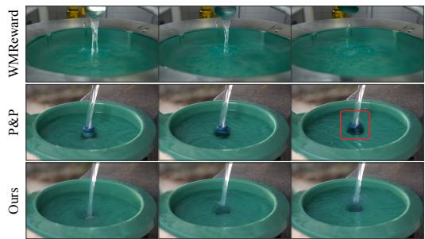  
Figure 7: Qualitative comparison of T2V generation on VideoPhy. For each prompt, we compare different samplers using three representative frames from each generated video. HA-Sampler improves physical plausibility in both cases and helps correct inconsistencies in the generated interactions.

## H APPLICATIONS

Reliable data generator. HA-Sampler supports more reliable synthetic-data generation for critical downstream tasks, such as robotics and autonomous driving. HA-Sampler improves the physical plausibility of generated motion and interactions, while HA-Scorer provides a physics-aware criterion for selecting candidate videos. Future work could extend our risk analysis to other rectified flow-based generative tasks (Esser et al., 2024; Liu et al., 2024; Li et al., 2026) to guide the generation of more reliable synthetic data for downstream tasks (Tian et al., 2024b; Trabucco et al., 2024).

Training-free signal for training. HA-Scorer could also provide a diagnostic signal for monitoring video models during training without training an additional evaluator. A possible protocol is to generate videos from successive checkpoints under fixed conditions and sampling settings, then score them using our HA-Scorer. The resulting likelihood-based risk could help track hallucinationrelated failure patterns and guide checkpoint selection.

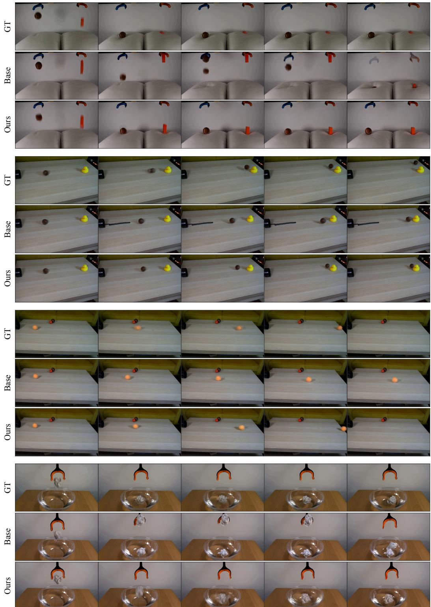  
Figure 8: Qualitative comparisons on Physics-IQ. Each example shows GT, Base, and Ours from top to bottom, with five frames arranged chronologically. Ours denotes videos generated with HA-Sampler and selected using HA-Scorer.

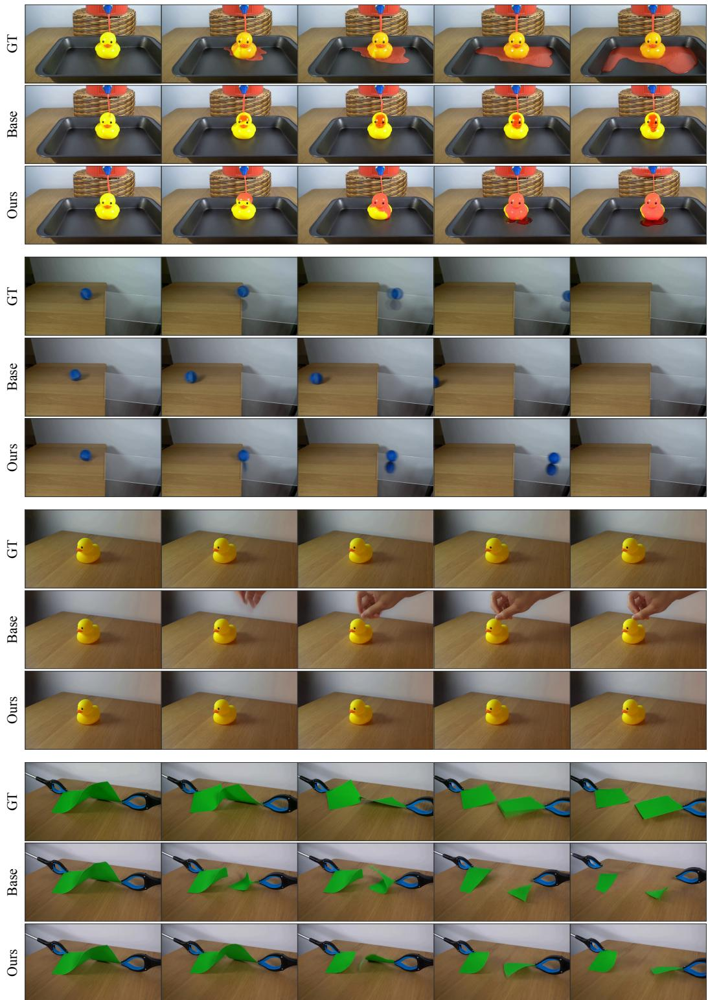  
Figure 9: Additional qualitative comparisons on Physics-IQ. The layout follows Figure 8.

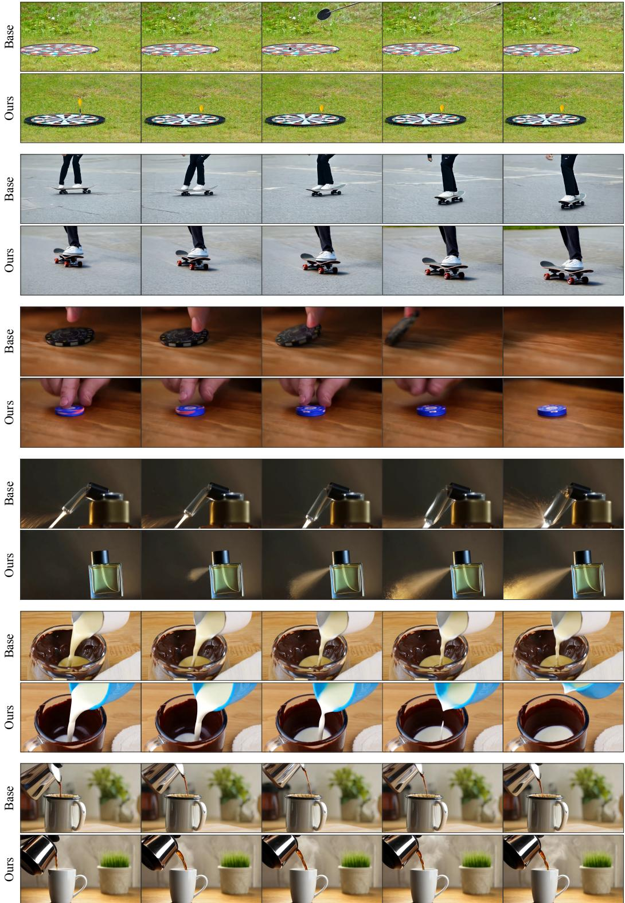  
Figure 10: Qualitative comparisons on VideoPhy. For each prompt, we show five frames from videos produced by the base model and HA-Sampler (Ours).