# ROAR-VAE: IMPROVING LATENT DIFFUSABILITYTHROUGH ROBUST PREDICTION

Yang Yue1 Fangyun Wei2 Yitong Wang2 Jinjing Zhao2 Henry Zheng1 Dong Chen2∗ Gao Huang1∗

1Tsinghua University 2Microsoft Research

yueyang22@mails.tsinghua.edu.cn doch@microsoft.com gaohuang@tsinghua.edu.cn

## ABSTRACT

An effective visual tokenizer must preserve image fidelity while producing latents that downstream diffusion models can learn efficiently. Prior work improves latent diffusability through semantic alignment or joint tokenizer–diffusion training. Revisiting REPA-E, a representative approach, we find that removing its diffusion objective and dedicated generative blocks while retaining semantic prediction from corrupted latents yields comparable downstream generation performance under a matched setting. This observation motivates a general principle of robust prediction: generation-relevant information should remain recoverable from corrupted latents. We instantiate this principle with two complementary objectives. RobustAlign predicts pretrained semantic features from corrupted latents to preserve high-level structure, while RobustRecon reconstructs the clean image to retain fine-grained spatial and appearance information. Together, they form Robust Alignment and Reconstruction VAE (RoAR-VAE). Our analysis suggests that robust prediction improves diffusability by making useful information more accessible in high-variance latent directions, which diffusion models tend to learn earlier. Empirically, RoAR-VAE improves average generation benchmark performance by 2.19 points over the strongest baseline tokenizer under the same training budget, while improving small-text reconstruction accuracy by 16.93 percentage points over FLUX.1-VAE. These results demonstrate that RoAR-VAE achieves a favorable balance between reconstruction fidelity and downstream generative learnability.

## 1 INTRODUCTION

Visual tokenizers define the representation on which latent diffusion models learn to generate images (Rombach et al., 2022; Esser et al., 2024). An effective tokenizer should preserve sufficient image information for faithful reconstruction, while organizing that information into a representation that a downstream diffusion model can learn efficiently. This latter property, often referred to as diffusability, can conflict with reconstruction fidelity: higher-capacity or weakly regularized latents may retain more visual detail yet be harder to model. Balancing reconstruction quality and diffusability is therefore a central challenge in visual tokenizer design.

Recent work improves latent diffusability through semantic supervision during VAE training (Yao et al., 2025; 2026) or joint optimization of the tokenizer and diffusion model (Heek et al., 2026; Duggal et al., 2026). A representative approach, REPA-E (Leng et al., 2025a), combines both ideas: as shown in Fig. 2(a), it jointly trains a VAE and a diffusion Transformer while aligning intermediate features with semantic targets from pretrained visual encoders (Yu et al., 2025; Oquab et al., 2024). However, only the semantic alignment objective directly updates the tokenizer encoder, while gradients from the diffusion objective are detached. This raises a natural question: what actually drives the diffusability improvement in REPA-E, joint diffusion training or semantic supervision? To isolate these factors, we simplify REPA-E by removing the diffusion objective and its dedicated generative blocks while retaining prediction of pretrained visual features from corrupted latents, yielding RobustAlign (Figure 2(b)). Under a matched evaluation, the resulting tokenizer achieves comparable downstream generation performance to the tokenizer trained with REPA-E (Table 1), indicating that noisy semantic prediction alone can provide an effective learning signal for shaping a diffusion-friendly latent space.

RobustAlign suggests a broader principle of robust prediction: generation-relevant information should remain predictable from heavily corrupted latents. By backpropagating this prediction objective through the corrupted latent, the tokenizer encoder is encouraged to organize target-relevant information so that it remains accessible under corruption. RobustAlign primarily supervises objectlevel structure and high-level visual content captured by pretrained features, but may underrepresent fine-grained spatial and appearance variations. We therefore introduce RobustRecon, which applies the same principle to the clean image itself, encouraging detailed image content to remain recoverable from corrupted latents. Combining the two objectives yields Robust Alignment and Reconstruction (RoAR) (Figure 2(c)). Both auxiliary objectives shape the encoder through corrupted latents, while the standard VAE reconstruction objective preserves faithful reconstruction from clean latents. The latent PCA visualizations in Figure 3 further illustrate their complementary effects: RobustAlign emphasizes object-level organization and foreground–background separation, RobustRecon exposes richer local variation, and their combination exhibits both forms of structure.

We further ask: why does robust prediction improve diffusability? Under Gaussian corruption, higher-variance latent directions retain a higher signal-to-noise ratio and are therefore more robust to noise. Training the encoder to recover clean targets from corrupted latents consequently encourages generation-relevant information to remain accessible in these dominant directions, potentially by strengthening the principal modes or by enriching the image information they encode, as suggested by the PCA visualizations in Fig. 3. Prior analyses further show that higher-variance covariance modes tend to be learned earlier by diffusion models (Wang & Pehlevan, 2025). Together, these observations suggest that robust prediction organizes useful information into prominent latent structure that can be acquired more readily by a downstream diffusion model.

Empirically, we train RoAR-VAE on ImageNet and evaluate reconstruction and downstream text-to-image generation, using a common diffusion backbone and dataset across tokenizers. RoAR-VAE achieves a favorable balance between reconstruction fidelity and generative learnability (Fig. 1): it attains the best performance across three text-to-image benchmarks, with an average score 2.19 points above the strongest included baseline. At the same time, it maintains high-fidelity reconstruction, achieving 32.88 dB PSNR and 0.0349 LPIPS at $2 5 6 ^ { \frac { \pi } { 2 } }$ resolution, while improving small-text reconstruction accuracy over FLUX.1-VAE by 16.93 percentage points (Table 3). Ablations further show that RobustAlign and RobustRecon

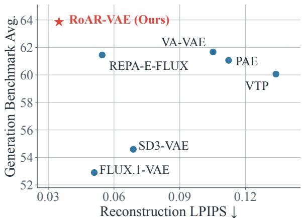  
Figure 1: Reconstruction versus generation. RoAR-VAE achieves a favorable trade-off, combining low reconstruction LPIPS with strong diffusability.

provide complementary gains, and that latent corruption is critical to downstream performance. These results support robust prediction as an effective principle for improving latent diffusability while retaining high reconstruction fidelity.

## 2 RELATED WORK

Improving diffusability of tokenizers. Latent diffusion separates perceptual compression from generative modeling (Rombach et al., 2022; Esser et al., 2024), motivating visual tokenizers that balance reconstruction fidelity with downstream learnability (Skorokhodov et al., 2025; Yue et al., 2026a). Pre-trained visual representations (Oquab et al., 2024) have improved latent diffusion through representation alignment in the denoiser (Yu et al., 2025; Singh et al., 2026) as well as regularization of the tokenizer (Leng et al., 2025a; Yao et al., 2025). Recent work builds tokenizers directly on frozen pre-trained encoders (Zheng et al., 2026), while subsequent approaches address the loss of fine-grained information when repurposing such encoders for generation (Chen et al., 2026a; Zhang et al., 2026; Yue et al., 2026b; Shi et al., 2026). A complementary line of work jointly optimizes the tokenizer and diffusion model (Vahdat et al., 2021; Heek et al., 2026; Duggal et al., 2026; Leng et al., 2025a) to better align latent representations with generative learning. Other approaches improve tokenizer representations through equivariance and perturbation-based regularization (Kouzelis et al., 2025; Chen et al., 2025; Yang et al., 2026; Liu et al., 2026).

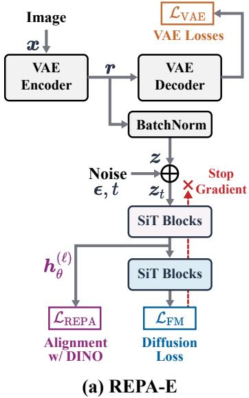

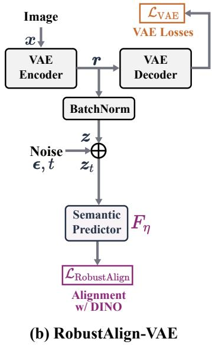

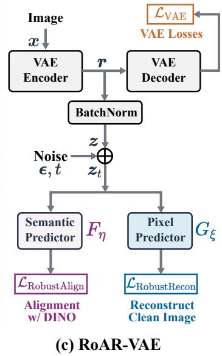  
Figure 2: From REPA-E to RoAR. (a) REPA-E jointly trains the tokenizer and diffusion model, but only semantic alignment backpropagates through corrupted latents to the tokenizer encoder. (b) RobustAlign-VAE isolates this semantic-prediction pathway by removing the diffusion objective and its associated modules. (c) RoAR further introduces RobustRecon, combining semantic and image reconstruction targets under latent corruption alongside the standard VAE objective on clean latents.

Learning dynamics of diffusion models. Training dynamics influence both what diffusion models learn and when. Wang & Pehlevan (2025) derive an inverse-variance learning timescale for tractable denoisers, showing that higher-variance covariance modes are learned earlier.

Our work revisits REPA-E (Leng et al., 2025a), a representative approach that combines semantic enhancement with joint tokenizer–diffusion training, and highlights robust prediction as an effective source of supervision for improving latent learnability. The spectral bias of diffusion dynamics offers a complementary explanation: robust prediction makes generation-relevant information more accessible in dominant latent modes, which downstream diffusion models tend to learn earlier.

## 3 METHOD

Overview. Our goal is to learn a VAE latent space that supports both faithful reconstruction and efficient downstream diffusion learning. We begin by revisiting REPA-E (§ 3.1) and isolate the supervision that directly shapes the tokenizer encoder. This leads to RobustAlign (§ 3.2), which predicts pretrained semantic features from corrupted latents without jointly training a full diffusion model. We then introduce RobustRecon (§ 3.3), which instead reconstructs the clean image from corrupted latents to preserve fine-grained spatial and appearance details that semantic features may underrepresent. Combining the two objectives yields RoAR-VAE. Finally, we discuss a possible explanation for the diffusability gains by making semantic and spatial information more accessible in dominant latent modes (§ 3.4).

Table 1: Controlled comparison with REPA-E. We train Vanilla-KL-VAE, REPA-E-Tokenizer, and RobustAlign-VAE using the same VAE architecture. For each tokenizer, we train a separate downstream text-to-image diffusion Transformer using the same backbone and training data, and report GenEval (Ghosh et al., 2023) performance after 4k, 8k, 16k, and 32k downstream optimization steps. Both REPA-E and RobustAlign substantially improve over the reconstruction-only Vanilla-KL baseline. Results are reported as mean ± standard deviation over four sampling seeds.
<table><tr><td>Method</td><td>4k</td><td>8k</td><td>16k</td><td>32k</td></tr><tr><td>T2I modeling w. Vanilla-KL-VAE</td><td> $1 1 . 7 4 { \pm } 0 . 3 0$ </td><td> $2 3 . 3 4 { \pm } 0 . 5 7 $ </td><td> $3 5 . 4 7 { \pm } 0 . 5 3 $ </td><td> $4 7 . 6 0 { \scriptstyle \pm 0 . 3 1 }$ </td></tr><tr><td>T2I modeling w. REPA-E-Tokenizer</td><td> $2 6 . 3 3 { \pm } 0 . 2 5 $ </td><td> $3 6 . 4 2 { \scriptstyle \pm 0 . 5 6 }$ </td><td> $4 9 . 4 6 { \pm } 0 . 3 1$ </td><td> $6 0 . 6 0 { \scriptstyle \pm 0 . 9 0 }$ </td></tr><tr><td>T2I modeling w. RobustAlign-VAE</td><td> $2 4 . 5 6 { \pm } 0 . 2 7$ </td><td> $3 9 . 4 7 { \scriptstyle \pm 0 . 7 0 }$ </td><td> $5 1 . 1 2 { \pm } 0 . 3 5 $ </td><td> $6 0 . 8 9 { \scriptstyle \pm 0 . 4 6 }$ </td></tr></table>

## 3.1 PRELIMINARIES

Visual tokenizer. Given an image x, the VAE encoder $E _ { \phi }$ produces a latent representation $\mathbf { \nabla } _ { \mathbf { { r } } } =$ $E _ { \phi } ( \pmb { x } )$ , from which the decoder $D _ { \psi }$ reconstructs x. The tokenizer is trained with the standard VAE objective $\mathcal { L } _ { \mathrm { V A E } }$ , which combines pixel reconstruction, perceptual, posterior regularization, and adversarial losses. Latent diffusion operates on the normalized representation $z = \mathrm { N o r m } ( r )$ , where Norm(·) normalizes the latent statistics.

End-to-end representation alignment (REPA-E). REPA-E (Leng et al., 2025a) jointly trains the autoencoder and diffusion model, as illustrated in Figure 2(a). Let $V _ { \theta }$ denote the diffusion Transformer (Ma et al., 2024; Peebles & Xie, 2023). Under the flow-matching formulation, the noisy latent and diffusion objective are

$$
\begin{array} { r } { z _ { t } = ( 1 - t ) z + t \epsilon , \quad \epsilon \sim \mathcal { N } ( 0 , I ) , \quad t \sim \mathcal { U } ( 0 , 1 ) , } \\ { \mathcal { L } _ { \mathrm { F M } } ( \theta ) = \| V _ { \theta } ( \mathrm { s g } ( z _ { t } ) , t ) - ( \epsilon - \mathrm { s g } ( z ) ) \| _ { 2 } ^ { 2 } , \qquad } \end{array}\tag{1}
$$

where ${ \boldsymbol { z } } _ { t }$ denotes the corrupted latent and sg(·) denotes the stop-gradient operator. REPA-E augments this generative objective with representation alignment (Yu et al., 2025), encouraging intermediate denoiser features to match pretrained visual representations, such as DINO features (Oquab et al., 2024):

$$
\begin{array} { r l } & { ~ \displaystyle z _ { t } ( \phi ) = ( 1 - t ) \cdot \mathrm { N o r m } ( E _ { \phi } ( \pmb { x } ) ) + t \epsilon , } \\ & { \displaystyle \mathcal { L } _ { \mathrm { R E P A } } ( \phi , \theta ) = \frac { 1 } { N } \sum _ { n = 1 } ^ { N } \left( 1 - \mathrm { S i m } \left( h _ { \theta } ^ { ( \ell ) } ( z _ { t } ( \phi ) , t ) ^ { [ n ] } , T ( \pmb { x } ) ^ { [ n ] } \right) \right) . } \end{array}\tag{2}
$$

Here, $z _ { t } ( \phi )$ denotes the corrupted latent as a differentiable function of the encoder parameters $\phi .$ The feature map $h _ { \theta } ^ { ( \ell ) } \in \mathbb { R } ^ { N \times d }$ denotes the MLP-projected intermediate features from the ℓ-th layer of the diffusion Transformer, n indexes the N image patches, $T ( { \pmb x } )$ denotes the pretrained visual target, and $\mathrm { S i m } ( \cdot , \cdot )$ is cosine similarity. The alignment loss therefore supervises both the diffusion parameters θ and the tokenizer encoder parameters $\phi ,$ while the standard VAE objective $\mathcal { L } _ { \mathrm { V A E } }$ is retained throughout training.

To account for changing latent statistics during joint training, REPA-E applies channelwise batch normalization without affine parameters. It tracks the running latent mean $\pmb { \mu }$ and variance $\sigma ^ { 2 }$ and normalizes $z = \operatorname { N o r m } ( r ) = ( r - \mu ) / s , s = { \sqrt { \sigma ^ { 2 } + \delta } }$ , where $\delta > 0$ ensures numerical stability.

A key detail of REPA-E is that the flow-matching loss does not backpropagate through the VAE encoder, as such gradients were found to cause latent variance collapse (Leng et al., 2025a). Specifically, the latent input to $\mathcal { L } _ { \mathrm { F M } }$ is gradient-detached, whereas $\mathcal { L } _ { \mathrm { { R E P A } } }$ remains differentiable through ${ \boldsymbol { z } } _ { t }$ to the encoder. Consequently, among the two diffusion-side objectives, only $\mathcal { L } _ { \mathrm { { R E P A } } }$ provides additional supervision to the VAE encoder.

## 3.2 ROBUST ALIGNMENT

Simplifying REPA-E. REPA-E improves the VAE while jointly training a diffusion model, even though the flow-matching loss itself does not update the VAE encoder. This joint training requires a full generator and also prevents caching latents for large-scale training. We therefore ask: is the improvement in diffusability driven by joint VAE–diffusion training, or by semantic prediction from corrupted VAE latents? To isolate these factors, we introduce RobustAlign, shown in Figure 2(b). RobustAlign-VAE removes the flow-matching objective and all network components used only for diffusion prediction, retaining only the standard VAE objective together with semantic prediction from corrupted latents. Specifically, an auxiliary semantic predictor $F _ { \eta }$ recovers pretrained teacher features $T ( \pmb { x } )$ from $z _ { t } \colon$

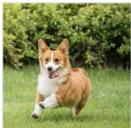

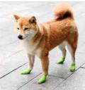

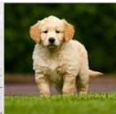  
(a) Original Image

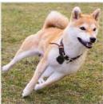

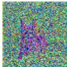

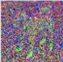

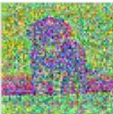  
(b) Vanilla KL-VAE

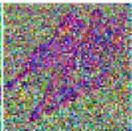

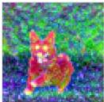

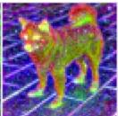

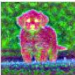  
(c) RobustAlign-VAE

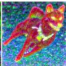

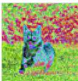

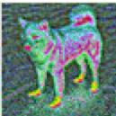

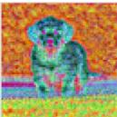

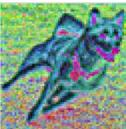  
(d) RobustRecon-VAE

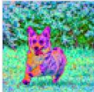

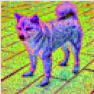

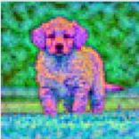  
(e) RoAR-VAE

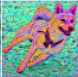  
Figure 3: PCA visualization of latent representations. For the input images in (a), we visualize the top three principal components of normalized spatial latent features from (b) KL-VAE, (c) RobustAlign-VAE, (d) RobustRecon-VAE, and (e) RoAR-VAE. RobustAlign emphasizes object-level organization, RobustRecon preserves richer local variation, and RoAR combines both properties. PCA is fitted jointly across the four images for each tokenizer.

$$
\mathcal { L } _ { \mathrm { R o b u s t A l i g n } } ( \phi , \eta ) = \frac { 1 } { N } \sum _ { n = 1 } ^ { N } \left( 1 - \mathrm { S i m } \left( F _ { \eta } ( z _ { t } ( \phi ) ) ^ { [ n ] } , T ( \pmb { x } ) ^ { [ n ] } \right) \right) .\tag{3}
$$

The resulting RobustAlign-VAE is trained with

$$
{ \mathcal { L } } _ { \mathrm { R o b u s t A l i g n - V A E } } = { \mathcal { L } } _ { \mathrm { V A E } } + \lambda _ { \mathrm { A } } { \mathcal { L } } _ { \mathrm { R o b u s t A l i g n } } .\tag{4}
$$

Table 1 compares the resulting tokenizer with REPA-E under matched downstream diffusion training1. RobustAlign-VAE performs comparably to REPA-E, indicating that semantic prediction from corrupted latents can recover the diffusability benefit without jointly training the full diffusion model.

Representation view. To examine how noisy semantic prediction changes the latent representation, Figure 3 visualizes the leading principal components of the latent space. Compared with the reconstruction-only baseline in Figure 3(b), RobustAlign in Figure 3(c) exhibits clearer objectlevel organization, with more coherent within-object regions and stronger foreground–background separation. This qualitative pattern is consistent with semantic prediction making target-relevant structure more accessible in dominant latent directions.

## 3.3 ROBUST RECONSTRUCTION AND THE ROAR FRAMEWORK

RobustAlign encourages semantically organized latent representations, but semantic targets may underrepresent fine-grained spatial and appearance details that are also important for downstream generation. As illustrated in Fig. 3(c), RobustAlign produces coherent object-level structure, yet local variations within an object, such as texture and boundaries, are less prominent. This motivates a complementary objective that encourages detailed image information to remain recoverable from corrupted latents.

RobustRecon: Preserving fine-grained details. As shown in Figure 2(c), RobustRecon introduces an auxiliary decoder $G _ { \xi }$ that predicts the clean image x directly from the corrupted latent ${ \boldsymbol { z } } _ { t }$

$$
\mathcal { L } _ { \mathrm { R o b u s t R e c o n } } ( \phi , \xi ) = \mathcal { L } _ { \mathrm { M A E } } \left( G _ { \xi } ( { z } _ { t } ( \phi ) ) , \pmb { x } \right) + \mathcal { L } _ { \mathrm { L P I P S } } \left( G _ { \xi } ( { z } _ { t } ( \phi ) ) , \pmb { x } \right) ,\tag{5}
$$

where the two terms measure pixel and perceptual reconstruction error, respectively (Zhang et al., 2018). $G _ { \xi }$ shares the architecture of the VAE decoder but uses independent parameters and is discarded after tokenizer training. Beyond standard posterior sampling in VAEs (Kingma & Welling, 2013), RobustRecon applies corruption over a broad range of noise levels, including latents with very low signal-to-noise ratios. The resulting objective backpropagates through ${ \boldsymbol { z } } _ { t }$ to the encoder, encouraging fine-grained image information to remain accessible under corruption. As shown in Fig. 3(d), RobustRecon exposes richer local spatial and appearance variations than RobustAlign, although its object-level foreground–background organization is less pronounced.

Overall framework. RobustAlign encourages noisy latents to preserve high-level semantic structure, whereas RobustRecon encourages them to retain fine-grained image details. We therefore combine the two objectives into RoAR-VAE, short for Robust Alignment and Reconstruction VAE, as illustrated in Fig. 2(c):

$$
\begin{array} { r } { \mathcal { L } _ { \mathrm { R o A R } } = \mathcal { L } _ { \mathrm { V A E } } + \lambda _ { \mathrm { A } } \mathcal { L } _ { \mathrm { R o b u s t A l i g n } } + \lambda _ { \mathrm { R } } \mathcal { L } _ { \mathrm { R o b u s t R e c o n } } , } \end{array}\tag{6}
$$

where $\lambda _ { \mathrm { A } }$ and $\lambda _ { \mathrm { R } }$ balance the two auxiliary objectives. Both objectives supervise the encoder through corrupted latents, but use complementary clean targets: pretrained semantic features for RobustAlign and the original image for RobustRecon. As shown in Figure 3(e), their combination yields latent representations that retain both coherent object-level organization and richer local structure, including clearer boundaries, textures, and intra-object variations.

## 3.4 DISCUSSION

Robust prediction promotes key information in dominant modes. Prior work suggests that higher-variance latent modes are learned more rapidly by diffusion models (Wang & Pehlevan, 2025), indicating that diffusability depends not only on what information is encoded, but also on how prominently it is represented. Both RobustAlign and RobustRecon follow the same robust prediction principle: clean targets must remain predictable from corrupted latents. Let $\nu _ { i }$ denote the variance of the normalized clean latent z along its i-th unit covariance eigenvector. Under the isotropic Gaussian corruption in equation 1, the signal and noise variances along this direction are $( 1 - \dot { t } ) ^ { 2 } \nu _ { i }$ and $t ^ { 2 }$ respectively, yielding

$$
\mathrm { S N R } _ { i } ( t ) = \frac { ( 1 - t ) ^ { 2 } \nu _ { i } } { t ^ { 2 } } , \qquad 0 < t < 1 .\tag{7}
$$

Thus, at a fixed corruption level, higher-variance modes retain more signal relative to the injected noise (Liu et al., 2026). Optimizing robust prediction thus encourages target-relevant semantics and spatial details to remain accessible in these dominant modes. This provides a possible explanation for the improved diffusability of the resulting latent representations.

## 4 EXPERIMENTS

## 4.1 EXPERIMENTAL SETUP

We briefly summarize the training and evaluation setup here; full implementation details are provided in Appendix A.

Tokenizer training. RoAR-VAE uses a convolutional architecture (Esser et al., 2021; Rombach et al., 2022) with 8× spatial downsampling, 32 latent channels, and approximately 84M parameters. For controlled comparison with prior tokenizer studies, we train exclusively on ImageNet (Deng et al., 2009) at $2 5 6 ^ { 2 }$ resolution. Training proceeds in two stages: (1) a 200k-step VAE warm-up using ${ \mathcal { L } } _ { \mathrm { V A E } } ,$ followed by (2) 250k steps of RoAR refinement with $\lambda _ { A } = 1 . 5$ and $\lambda _ { R } = 0 . 5$ . For RobustAlign, the semantic predictor $F _ { \eta }$ comprises an 8-layer Transformer (Ma et al., 2024) followed by an MLP projector. It is trained to predict the output features of a frozen DINOv2-B encoder (Oquab et al., 2024). For RobustRecon, the pixel predictor $G _ { \xi }$ is initialized from the stage-one VAE decoder $D _ { \psi }$ The corruption level is sampled uniformly as $t \stackrel { \triangledown } { \sim } \mathcal { U } ( 0 , 1 )$

Table 2: Reconstruction and downstream generation results. We report reconstruction metrics evaluated on the ImageNet validation set at 2562 resolution. Generation performance is evaluated at 32k downstream updates across three benchmarks: GenEval, GenEval2, and DPG-Bench. Avg. denotes the unweighted mean of the three generation scores.
<table><tr><td rowspan="2">Method</td><td colspan="4">Reconstruction</td><td colspan="4">Generation</td></tr><tr><td>rFID↓</td><td>PSNR↑</td><td>LPIPS↓</td><td>SSIM↑</td><td>GenEval</td><td>GenEval2</td><td>DPG-Bench</td><td>Avg.</td></tr><tr><td>SD3-VAE</td><td>0.2038</td><td>29.58</td><td>0.0688</td><td>0.8565</td><td>52.46</td><td>38.03</td><td>73.27</td><td>54.59</td></tr><tr><td>FLUX.1-VAE</td><td>0.1711</td><td>31.08</td><td>0.0510</td><td>0.8938</td><td>51.79</td><td>34.82</td><td>72.08</td><td>52.90</td></tr><tr><td>VA-VAE</td><td>0.2892</td><td>26.26</td><td>0.1052</td><td>0.7625</td><td>57.43</td><td>51.28</td><td>76.30</td><td>61.67</td></tr><tr><td>VTP</td><td>0.3457</td><td>25.75</td><td>0.1339</td><td>0.7383</td><td>53.79</td><td>50.31</td><td>76.08</td><td>60.06</td></tr><tr><td>PAE</td><td>0.2643</td><td>25.90</td><td>0.1123</td><td>0.7487</td><td>56.60</td><td>49.77</td><td>76.82</td><td>61.06</td></tr><tr><td>REPA-E-FLUX</td><td>0.1563</td><td>29.89</td><td>0.0546</td><td>0.8737</td><td>58.92</td><td>48.63</td><td>76.81</td><td>61.45</td></tr><tr><td>RoAR-VAE (Ours)</td><td>0.1309</td><td>32.88</td><td>0.0349</td><td>0.9258</td><td>62.22</td><td>51.79</td><td>77.56</td><td>63.86</td></tr><tr><td>FLUX.2-VAE</td><td>0.1085</td><td>31.52</td><td>0.0398</td><td>0.9052</td><td>60.04</td><td>51.28</td><td>76.88</td><td>62.73</td></tr></table>

32k  
120k  
32k  
120k  
32k  
120k  
32k  
120k  
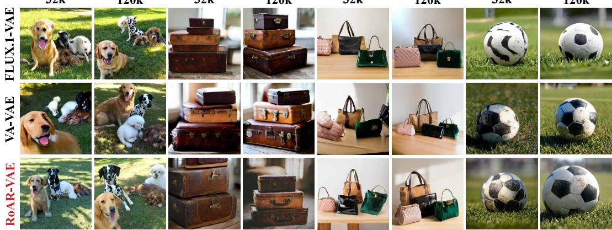  
Figure 4: Qualitative comparison of text-to-image generation. Rows compare FLUX.1-VAE, VA-VAE, and RoAR-VAE tokenizers; each subject is shown after 32k and 120k downstream updates.

Downstream generative modeling. To evaluate latent diffusability, we freeze each tokenizer and train the same text-conditioned diffusion Transformer from scratch on a filtered and recaptioned LAION dataset (Schuhmann et al., 2022) at 2562 resolution. We use an MMDiT backbone (Esser et al., 2024; Chen et al., 2026b) with 24 layers, a hidden dimension of 1024, and approximately 0.8B parameters, together with a frozen Qwen3-0.6B text encoder (Yang et al., 2025). For tokenizers with different downsampling factors, we adjust the patch size to keep the diffusion sequence length fixed.

Baselines. We compare against tokenizers from large-scale generative systems, including SD3- VAE (Esser et al., 2024) and FLUX.1-VAE (Labs, 2024), as well as recent methods targeting improved latent diffusability, including VA-VAE (Yao et al., 2025), VTP (Yao et al., 2026), PAE (Yue et al., 2026b), and REPA-E-FLUX (Leng et al., 2025b). We additionally report FLUX.2-VAE (Labs, 2025) as a reference, but exclude it from baseline comparisons because its tokenizer training data and training recipe are undisclosed.

Evaluation protocol. For reconstruction, we report rFID, PSNR, LPIPS, and SSIM on the ImageNet validation set at 2562 resolution, and evaluate text and facial detail preservation using TokBench (Wu et al., 2025). For generation, we train a downstream diffusion model for each tokenizer under the controlled setup above and evaluate on GenEval (Ghosh et al., 2023), GenEval2 (Kamath et al., 2025), and DPG-Bench (Hu et al., 2024). Each score is averaged over four independent sampling seeds, and we report the arithmetic mean across the three benchmarks as a summary metric.

VA-VAE  
Ground Truth  
Table 3: Text and face reconstruction on TokBench, using text accuracy (T-ACC), text normalized edit distance (T-NED), and face similarity (F-Sim), evaluated at an image resolution of 2562. Subscripts s and m denote metrics averaged over small-scale and all instances, respectively. Higher is better for every column. Bold denotes the best displayed value.
<table><tr><td rowspan="2">Method</td><td colspan="4">Text (%) ↑</td><td colspan="2">Face ↑</td></tr><tr><td>T-ACCs</td><td> $\mathrm { T } { \cdot } \mathrm { A C C } _ { m }$ </td><td>T-NEDs</td><td> $\mathrm { T } { \cdot } \mathrm { N E D } _ { m }$ </td><td>F-Sims</td><td>F-Simm</td></tr><tr><td>SD3-VAE</td><td>37.29</td><td>68.32</td><td>59.86</td><td>81.36</td><td>0.43</td><td>0.71</td></tr><tr><td>FLUX.1-VAE</td><td>52.07</td><td>76.57</td><td>71.41</td><td>86.96</td><td>0.53</td><td>0.77</td></tr><tr><td>VA-VAE</td><td>7.05</td><td>37.15</td><td>25.12</td><td>56.30</td><td>0.22</td><td>0.49</td></tr><tr><td>VTP</td><td>0.14</td><td>6.88</td><td>5.87</td><td>20.03</td><td>0.10</td><td>0.24</td></tr><tr><td>PAE</td><td>3.31</td><td>28.97</td><td>16.73</td><td>46.97</td><td>0.19</td><td>0.45</td></tr><tr><td>RoAR-VAE (Ours)</td><td>69.00</td><td>84.95</td><td>82.87</td><td>92.22</td><td>0.65</td><td>0.83</td></tr><tr><td>FLUX.2-VAE</td><td>67.33</td><td>83.80</td><td>81.90</td><td>91.54</td><td>0.63</td><td>0.83</td></tr></table>

PAE  
FLUX.1-VAE  
FLUX.2-VAE  
RoAR-VAE  
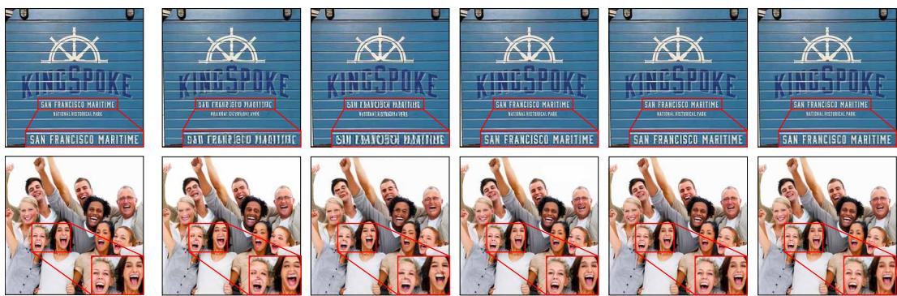  
Figure 5: Image reconstruction visualization. Columns show the original image and reconstructions from baseline tokenizers and RoAR-VAE. Images are selected from TokBench (Wu et al., 2025).

## 4.2 MAIN RESULTS

Reconstruction versus diffusion learnability. Table 2 compares RoAR-VAE with existing visual tokenizers in terms of reconstruction quality and downstream generation under a fixed 32k-step training budget. RoAR-VAE achieves a favorable balance between the two objectives, substantially improving reconstruction while maintaining strong downstream learnability. Compared with the reconstruction-oriented FLUX.1-VAE, RoAR-VAE improves PSNR by 1.80 dB and reduces LPIPS from 0.0510 to 0.0349, while outperforming the strongest competing learnability-enhanced tokenizer by 2.19 points on the average downstream benchmark score. RoAR-VAE also approaches the reconstruction and generation performance of FLUX.2-VAE, a strong industrial tokenizer with a similarly balanced reconstruction–generation trade-off.

Generated image quality. Figure 4 qualitatively compares downstream generation across different tokenizers. RoAR-VAE produces clearer object shapes and finer visual structure, including more distinct animal contours, sharper suitcase and bag textures, and more regular soccer-ball patterns. Compared with the reconstruction-driven FLUX.1-VAE, these results indicate faster acquisition of object appearance and structure under the same downstream training budget. VA-VAE also exhibits strong learnability, but its generations are noticeably smoother and contain fewer details, consistent with its weaker reconstruction performance relative to RoAR-VAE.

Fine-grained reconstruction. Table 3 further evaluates preservation of challenging text and facial details. RoAR-VAE achieves the best performance across all reported text and face reconstruction metrics. Despite being trained from scratch solely on ImageNet, it improves small-text accuracy over FLUX.1-VAE by 16.93 percentage points and increases small-face similarity from 0.53 to 0.65. Although VA-VAE, VTP, and PAE achieve competitive generation scores in Table 2, their weaker text and face reconstruction results reveal a substantial loss of fine-grained information. Figure 5 provides qualitative examples of these differences, highlighting distortions in textual and facial patterns introduced by the compared tokenizers.

Table 4: Ablation of robust prediction objectives and latent corruption. “Noisy Latent” indicates whether the auxiliary predictors receive noise-corrupted latents as input. Scores are measured after 32k downstream updates; Avg. denotes the mean over the three benchmarks.
<table><tr><td></td><td>Noisy Latent</td><td> $\mathcal { L } _ { \mathrm { { R o b u s t A l i g n } } }$ </td><td> $\mathcal { L } _ { \mathrm { R o b u s t R e c o n } }$ </td><td>GenEval</td><td>GenEval2</td><td>DPG-Bench</td><td>Avg.</td></tr><tr><td>①</td><td>x</td><td>x</td><td>x</td><td>47.60</td><td>33.68</td><td>70.22</td><td>50.50</td></tr><tr><td>②</td><td>√</td><td>x</td><td>√</td><td>57.63</td><td>45.20</td><td>75.32</td><td>59.38 (↑ 8.88)</td></tr><tr><td>③</td><td>√</td><td>√</td><td>x</td><td>60.89</td><td>51.11</td><td>75.48</td><td>62.49 (↑ 11.99)</td></tr><tr><td>4</td><td>√</td><td>√</td><td>√</td><td>62.22</td><td>51.79</td><td>77.56</td><td>63.86 (↑ 13.36)</td></tr><tr><td>5</td><td>x</td><td>√</td><td>√</td><td>57.54</td><td>44.01</td><td>73.86</td><td>58.47 (↓ 5.39)</td></tr></table>

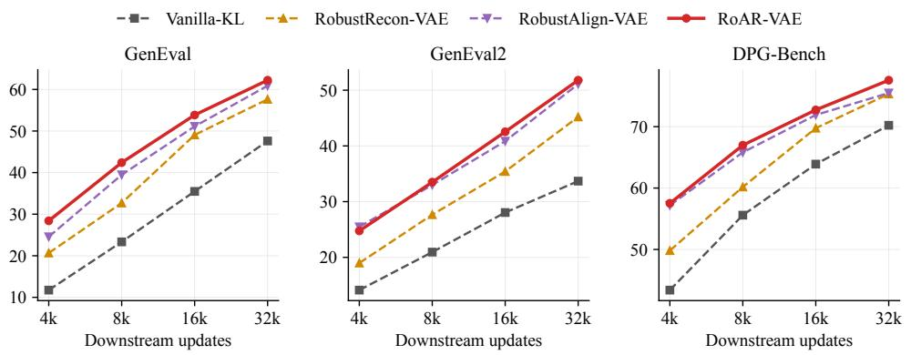  
Figure 6: Downstream learning curves. RoAR-VAE consistently outperforms using RobustAlign or RobustRecon alone across different training budgets.

## 4.3 ANALYSIS

Contribution of the objectives and latent corruption. Table 4 isolates the contributions of the two robust prediction objectives. Both RobustRecon (❷) and RobustAlign (❸) consistently improve over Vanilla-KL (❶) across all three benchmarks, increasing the average score from 50.50 to 59.38 and 62.49, respectively. Combining the two objectives (❹) further improves performance, reaching an average score of 63.86 and demonstrating the complementary benefits of semantic- and pixel-level robust prediction. Removing latent corruption (❺) substantially degrades the average score from 63.86 to 58.47, highlighting prediction from corrupted latents as a key component of the framework. Figure 6 further compares downstream performance throughout training: RoAR-VAE consistently outperforms either robust prediction objective used alone across different training budgets.

## Predictor design choices. Table 5 studies architectural

choices for the auxiliary predictors. For RobustAlign, replacing the Transformer-based semantic predictor $F _ { \eta }$ with a simple MLP causes a substantial performance drop, suggesting that a more expressive prediction pathway is beneficial for shaping diffusion-friendly latents. For RobustRecon, sharing parameters between the pixel predictor $G _ { \xi }$ and the clean reconstruction decoder $D _ { \psi }$ also slightly degrades performance, indicating that the two decoders serve distinct roles in the framework.

Table 5: Predictor architecture choices.
<table><tr><td rowspan=1 colspan=1>Variant</td><td rowspan=1 colspan=1>Avg. Score</td></tr><tr><td rowspan=1 colspan=1>RobustAlign w. simple MLP $F _ { \eta }$ RobustAlign-VAE</td><td rowspan=1 colspan=1>52.7062.49</td></tr><tr><td rowspan=1 colspan=1>RoAR w. shared $G _ { \xi }$ and $D _ { \psi }$ RoAR-VAE</td><td rowspan=1 colspan=1>62.1363.86</td></tr></table>

## 5 CONCLUSION

In this paper, we present RoAR-VAE, a visual tokenizer built on the principle of robust prediction. By revisiting and simplifying REPA-E, we identify prediction of clean targets from corrupted latents as an effective source of supervision for shaping diffusion-friendly representations. We realize this principle with RobustAlign for semantic structure and RobustRecon for fine-grained spatial and appearance details. Our analysis suggests that robust prediction encourages generation-relevant information to remain accessible in prominent latent modes that are more resistant to corruption and tend to be learned earlier by downstream diffusion models. Empirically, the two objectives provide complementary gains, allowing RoAR-VAE to improve downstream generative learnability while maintaining high-fidelity reconstruction. These results highlight robust prediction as a simple and effective principle for designing visual tokenizers that better balance reconstruction and generation.

## AI USE STATEMENT

We used generative AI tools for several research tasks that fall under the required disclosure categories, including assisting with implementation of the proposed method, cleaning and reformatting datasets and benchmark inputs, translation, providing feedback on research methodology and experimental design, and assisting with the interpretation of experimental results. We also used generative AI tools for recommended disclosure activities, including developing and editing research code, searching for and identifying relevant literature and research materials, summarizing related work, and drafting and editing portions of the manuscript for clarity and readability.

We did not use generative AI tools to generate synthetic datasets, develop the conceptual framework of the work, formulate or refine research hypotheses, formulate mathematical claims, provide ingredients for mathematical proofs, or write proofs. The proof-related categories are not applicable to this work.

All AI-assisted outputs were reviewed by the authors. AI-generated or AI-edited code was inspected, tested, and verified for correctness before use. The authors take full responsibility for the final content of the paper, including its methodology, experiments, analysis, claims, text, code, and other artifacts produced with the assistance of generative AI.

## ETHICS STATEMENT

This work evaluates reconstruction performance on a published image reconstruction benchmark (Wu et al., 2025) that includes human faces. However, the proposed visual tokenizer is a general-purpose information compressor and is neither trained specifically on human-centric datasets nor optimized for human-related attributes. For downstream visual generation systems built upon our tokenizer, we recommend adopting appropriate safeguards, such as watermarking and monitoring mechanisms, to mitigate potential misuse.

## REPRODUCIBILITY STATEMENT

We provide detailed descriptions of the proposed method, training objectives, network architectures, experimental setup, and hyperparameter configurations in Section 3 and Appendix A. The implementation code and trained models will be released.

## REFERENCES

Bowei Chen, Sai Bi, Hao Tan, He Zhang, Tianyuan Zhang, Zhengqi Li, Yuanjun Xiong, Jianming Zhang, and Kai Zhang. Aligning visual foundation encoders to tokenizers for diffusion models. In The Fourteenth International Conference on Learning Representations, 2026a. URL https: //openreview.net/forum?id=ajnBafpqmE.

Dong Chen, Fangyun Wei, Ziyu Wan, Dongdong Chen, Jiawei Zhang, Jinjing Zhao, Sirui Zhang, Yang Yue, Zhiyang Liang, Baining Guo, et al. Lens: Rethinking training efficiency for foundational text-to-image models. arXiv preprint arXiv:2605.21573, 2026b.

Hao Chen, Yujin Han, Fangyi Chen, Xiang Li, Yidong Wang, Jindong Wang, Ze Wang, Zicheng Liu, Difan Zou, and Bhiksha Raj. Masked autoencoders are effective tokenizers for diffusion models. In Forty-second International Conference on Machine Learning, 2025. URL https: //openreview.net/forum?id=dzwUOiBlQW.

Jia Deng, Wei Dong, Richard Socher, Li-Jia Li, Kai Li, and Li Fei-Fei. Imagenet: A large-scale hierarchical image database. In 2009 IEEE conference on computer vision and pattern recognition, pp. 248–255. Ieee, 2009.

Shivam Duggal, Xingjian Bai, Zongze Wu, Richard Zhang, Eli Shechtman, Antonio Torralba, Phillip Isola, and William T Freeman. End-to-end training for unified tokenization and latent denoising. arXiv preprint arXiv:2603.22283, 2026.

Patrick Esser, Robin Rombach, and Bjorn Ommer. Taming transformers for high-resolution image synthesis. In Proceedings of the IEEE/CVF conference on computer vision and pattern recognition, pp. 12873–12883, 2021.

Patrick Esser, Sumith Kulal, Andreas Blattmann, Rahim Entezari, Jonas Müller, Harry Saini, Yam Levi, Dominik Lorenz, Axel Sauer, Frederic Boesel, et al. Scaling rectified flow transformers for high-resolution image synthesis. In Forty-first international conference on machine learning, 2024.

Dhruba Ghosh, Hannaneh Hajishirzi, and Ludwig Schmidt. Geneval: An object-focused framework for evaluating text-to-image alignment. In Thirty-seventh Conference on Neural Information Processing Systems Datasets and Benchmarks Track, 2023. URL https://openreview. net/forum?id=Wbr51vK331.

Jonathan Heek, Emiel Hoogeboom, Thomas Mensink, and Tim Salimans. Unified latents (ul): How to train your latents. arXiv preprint arXiv:2602.17270, 2026.

Xiwei Hu, Rui Wang, Yixiao Fang, Bin Fu, Pei Cheng, and Gang Yu. Ella: Equip diffusion models with llm for enhanced semantic alignment. arXiv preprint arXiv:2403.05135, 2024.

Amita Kamath, Kai-Wei Chang, Ranjay Krishna, Luke Zettlemoyer, Yushi Hu, and Marjan Ghazvininejad. Geneval 2: Addressing benchmark drift in text-to-image evaluation. arXiv preprint arXiv:2512.16853, 2025.

Diederik P Kingma and Max Welling. Auto-encoding variational bayes. arXiv preprint arXiv:1312.6114, 2013.

Theodoros Kouzelis, Ioannis Kakogeorgiou, Spyros Gidaris, and Nikos Komodakis. EQ-VAE: Equivariance regularized latent space for improved generative image modeling. In Forty-second International Conference on Machine Learning, 2025. URL https://openreview.net/ forum?id=UWhW5YYLo6.

Black Forest Labs. Flux. https://github.com/black-forest-labs/flux, 2024.

Black Forest Labs. FLUX.2: Frontier Visual Intelligence. https://bfl.ai/blog/flux-2, 2025.

Xingjian Leng, Jaskirat Singh, Yunzhong Hou, Zhenchang Xing, Saining Xie, and Liang Zheng. Repa-e: Unlocking vae for end-to-end tuning with latent diffusion transformers. In 2025 IEEE/CVF International Conference on Computer Vision (ICCV), pp. 18262–18272. IEEE, 2025a.

Xingjian Leng, Jaskirat Singh, Ryan Murdock, Ethan Smith, Rebecca Li, Yunzhong Hou, Zhenchang Xing, Saining Xie, and Liang Zheng. Family of End-to-End Tuned VAEs for Supercharging T2I Diffusion Transformers. https://end2end-diffusion.github.io/repa-e-t2i/, 2025b.

Shizhan Liu, Xinran Deng, Zhuoyi Yang, Jiayan Teng, Xiaotao Gu, and Jie Tang. Delving into latent spectral biasing of video vaes for superior diffusability. In European Conference on Computer Vision, pp. 191–208. Springer, 2026.

Ilya Loshchilov and Frank Hutter. Decoupled weight decay regularization, 2019. URL https: //arxiv.org/abs/1711.05101.

Nanye Ma, Mark Goldstein, Michael S Albergo, Nicholas M Boffi, Eric Vanden-Eijnden, and Saining Xie. Sit: Exploring flow and diffusion-based generative models with scalable interpolant transformers. In European Conference on Computer Vision, pp. 23–40. Springer, 2024.

Maxime Oquab, Timothée Darcet, Théo Moutakanni, Huy V. Vo, Marc Szafraniec, Vasil Khalidov, Pierre Fernandez, Daniel Haziza, Francisco Massa, Alaaeldin El-Nouby, Mido Assran, Nicolas Ballas, Wojciech Galuba, Russell Howes, Po-Yao Huang, Shang-Wen Li, Ishan Misra, Michael Rabbat, Vasu Sharma, Gabriel Synnaeve, Hu Xu, Herve Jegou, Julien Mairal, Patrick Labatut, Armand Joulin, and Piotr Bojanowski. DINOv2: Learning robust visual features without supervision. Transactions on Machine Learning Research, 2024. ISSN 2835-8856. URL https://openreview.net/forum?id=a68SUt6zFt. Featured Certification.

William Peebles and Saining Xie. Scalable diffusion models with transformers. In 2023 IEEE/CVF International Conference on Computer Vision (ICCV), pp. 4172–4182. IEEE, 2023.

Robin Rombach, Andreas Blattmann, Dominik Lorenz, Patrick Esser, and Björn Ommer. Highresolution image synthesis with latent diffusion models. In 2022 IEEE/CVF conference on computer vision and pattern recognition (CVPR), pp. 10674–10685. ieee, 2022.

Christoph Schuhmann, Romain Beaumont, Richard Vencu, Cade Gordon, Ross Wightman, Mehdi Cherti, Theo Coombes, Aarush Katta, Clayton Mullis, Mitchell Wortsman, et al. Laion-5b: An open large-scale dataset for training next generation image-text models. Advances in neural information processing systems, 35:25278–25294, 2022.

Minglei Shi, Haolin Wang, Wenzhao Zheng, Ziyang Yuan, Xiaoshi Wu, Xintao Wang, Pengfei Wan, Jie Zhou, and Jiwen Lu. Latent diffusion model without variational autoencoder. In The Fourteenth International Conference on Learning Representations, 2026. URL https: //openreview.net/forum?id=kdpeJNbFyf.

Jaskirat Singh, Xingjian Leng, Zongze Wu, Liang Zheng, Richard Zhang, Eli Shechtman, and Saining Xie. What matters for representation alignment: Global information or spatial structure? In The Fourteenth International Conference on Learning Representations, 2026. URL https: //openreview.net/forum?id=y0UxFtXqXf.

Ivan Skorokhodov, Sharath Girish, Benran Hu, Willi Menapace, Yanyu Li, Rameen Abdal, Sergey Tulyakov, and Aliaksandr Siarohin. Improving the diffusability of autoencoders. In Forty-second International Conference on Machine Learning, 2025. URL https://openreview.net/ forum?id=2hEDcA7xy4.

Arash Vahdat, Karsten Kreis, and Jan Kautz. Score-based generative modeling in latent space. In M. Ranzato, A. Beygelzimer, Y. Dauphin, P.S. Liang, and J. Wortman Vaughan (eds.), Advances in Neural Information Processing Systems, volume 34, pp. 11287–11302. Curran Associates, Inc., 2021. URL https://proceedings.neurips.cc/paper\_files/paper/ 2021/file/5dca4c6b9e244d24a30b4c45601d9720-Paper.pdf.

Binxu Wang and Cengiz Pehlevan. An analytical theory of spectral bias in the learning dynamics of diffusion models. In The Thirty-ninth Annual Conference on Neural Information Processing Systems, 2025. URL https://openreview.net/forum?id=SDhOClkyqC.

Junfeng Wu, Dongliang Luo, Weizhi Zhao, Zhihao Xie, Yuanhao Wang, Junyi Li, Xudong Xie, Yuliang Liu, and Xiang Bai. Tokbench: Evaluating your visual tokenizer before visual generation. arXiv preprint arXiv:2505.18142, 2025.

An Yang, Anfeng Li, Baosong Yang, Beichen Zhang, Binyuan Hui, Bo Zheng, Bowen Yu, Chang Gao, Chengen Huang, Chenxu Lv, et al. Qwen3 technical report. arXiv preprint arXiv:2505.09388, 2025.

Jiawei Yang, Tianhong Li, Lijie Fan, Yonglong Tian, and Yue Wang. Latent denoising makes good tokenizers. In The Fourteenth International Conference on Learning Representations, 2026. URL https://openreview.net/forum?id=1jBsi98fVe.

Jingfeng Yao, Bin Yang, and Xinggang Wang. Reconstruction vs. generation: Taming optimization dilemma in latent diffusion models. In 2025 IEEE/CVF Conference on Computer Vision and Pattern Recognition (CVPR), pp. 15703–15712. IEEE, 2025.

Jingfeng Yao, Yuda Song, Yucong Zhou, and Xinggang Wang. Towards scalable pre-training of visual tokenizers for generation. In European Conference on Computer Vision, pp. 661–678. Springer Nature Switzerland Cham, 2026.

Sihyun Yu, Sangkyung Kwak, Huiwon Jang, Jongheon Jeong, Jonathan Huang, Jinwoo Shin, and Saining Xie. Representation alignment for generation: Training diffusion transformers is easier than you think. In The Thirteenth International Conference on Learning Representations, 2025. URL https://openreview.net/forum?id=DJSZGGZYVi.

Yang Yue, Fangyun Wei, Tianyu He, Jinjing Zhao, Zanlin Ni, Zeyu Liu, Jiayi Guo, Lei Shi, Yue Dong, Li Chen, Ji Li, Gao Huang, and Dong Chen. Insighttok: Improving text and face fidelity in discrete tokenization for autoregressive image generation. In The Second Workshop on Low-Level Vision Frontiers with Generative AI, Preference Optimization, Agentic Systems and World Models@ECCV2026, 2026a. URL https://openreview.net/forum?id=OkzatCMmnC.

Zhengrong Yue, Taihang Hu, Mengting Chen, Haiyu Zhang, Zihao Pan, Tao Liu, Zikang Wang, Jinsong Lan, Xiaoyong Zhu, Bo Zheng, et al. What matters for diffusion-friendly latent manifold? prior-aligned autoencoders for latent diffusion. arXiv preprint arXiv:2605.07915, 2026b.

Richard Zhang, Phillip Isola, Alexei A Efros, Eli Shechtman, and Oliver Wang. The unreasonable effectiveness of deep features as a perceptual metric. In 2018 IEEE/CVF conference on computer vision and pattern recognition, pp. 586–595. IEEE, 2018.

Shilong Zhang, He Zhang, Zhifei Zhang, Chongjian Ge, Shuchen Xue, Shaoteng Liu, Mengwei Ren, Soo Ye Kim, Yuqian Zhou, Qing Liu, Daniil Pakhomov, Kai Zhang, Zhe Lin, and Ping Luo. Both semantics and reconstruction matter: Making representation encoders ready for text-to-image generation and editing. In Forty-third International Conference on Machine Learning, 2026. URL https://openreview.net/forum?id=UmlXZ4t44h.

Boyang Zheng, Nanye Ma, Shengbang Tong, and Saining Xie. Diffusion transformers with representation autoencoders. In The Fourteenth International Conference on Learning Representations, 2026. URL https://openreview.net/forum?id=0u1LigJaab.

## A IMPLEMENTATION DETAILS

## A.1 TOKENIZER TRAINING

RoAR-VAE uses the standard convolutional autoencoder architecture adopted by latent diffusion models (Esser et al., 2021; Rombach et al., 2022), with an 8× spatial downsampling factor, 32 latent channels, and approximately 84M parameters. The encoder and decoder each contain four resolution stages with channel widths (128, 256, 512, 512) and two residual blocks per stage. All tokenizer training is performed on ImageNet (Deng et al., 2009) at $2 5 6 \times 2 5 6$ resolution.

Training proceeds in two stages. We first warm up the tokenizer for 200k optimization steps using the standard VAE objective $\mathcal { L } _ { \mathrm { V A E } }$ . The reconstruction objective uses unit weights for the L1 and LPIPS losses, together with a KL regularization weight of $\bar { 1 0 } ^ { - 6 }$ . Adversarial supervision is provided by a DINOv2-S (Oquab et al., 2024)-based discriminator. We then refine the tokenizer for an additional 250k steps using the RoAR objectives with $\lambda _ { \mathrm { A } } = 1 . 5$ and $\lambda _ { \mathrm { R } } = 0 . 5$ . The corruption level is sampled uniformly as $t \sim \mathcal { U } ( 0 , 1 )$

For RobustAlign, the semantic predictor $F _ { \eta }$ consists of an 8-layer Transformer (Ma et al., 2024) followed by an MLP projector that matches the dimensionality of the target features. We use features from a frozen DINOv2-B (Oquab et al., 2024) encoder as the semantic prediction target. For RobustRecon, the pixel predictor $G _ { \xi }$ is initialized from the VAE decoder $D _ { \psi }$ obtained after the warm-up stage and predicts the clean image from corrupted latents using L1 and LPIPS losses.

The complete RoAR framework is optimized with AdamW (Loshchilov & Hutter, 2019), using a batch size of 256 and a learning rate of $1 \times 1 0 ^ { - 5 }$

## A.2 DOWNSTREAM GENERATIVE MODELING

For each tokenizer, we freeze its parameters and train a text-conditioned diffusion Transformer from scratch on a filtered and recaptioned version of LAION (Schuhmann et al., 2022). All downstream models are trained at 256 × 256 resolution with a global batch size of 1,024. The diffusion backbone is an MMDiT (Esser et al., 2024; Chen et al., 2026b) with 24 Transformer layers, a hidden dimension of 1,024, 16 attention heads, and approximately 0.8B parameters. Text conditioning is provided by a frozen Qwen3-0.6B encoder (Yang et al., 2025). Because the compared tokenizers use different spatial compression factors, we adjust the latent patch size to maintain the same sequence length for the diffusion Transformer. Specifically, we use a $. 1 \times 1$ latent patch size for tokenizers with a downsampling factor of 16 and a $2 \times 2$ patch size for tokenizers with a downsampling factor of 8. This keeps the number of latent tokens processed by the downstream model consistent across tokenizer variants.

For RoAR-VAE, diffusion timesteps are sampled using shifted logit-normal sampling with exponential shifting and $\mu = 1 . 5$ . For each baseline tokenizer, we use its official or recommended timestep scheduler. All downstream models are optimized with AdamW (Loshchilov & Hutter, 2019), using $\beta _ { 1 } = 0 . 9 , \beta _ { 2 } = 0 . 9 9 9$ , a constant learning rate of $2 \times 1 0 ^ { - 4 }$ , and a caption dropout probability of 0.1. At inference time, we use an Euler sampler with 50 sampling steps and a classifier-free guidance weight of 5.0.

## A.3 EVALUATION DETAILS

Baselines. SD3-VAE (Esser et al., 2024) and FLUX.1-VAE (Labs, 2024) serve as reconstructionoriented baselines from large-scale text-to-image systems. VA-VAE (Yao et al., 2025) directly aligns latent representations with pretrained visual features using a margin-based similarity objective, while VTP (Yao et al., 2026) jointly optimizes reconstruction and visual representation learning. PAE (Yue et al., 2026b) builds on pretrained visual encoders and regularizes the latent manifold for improved downstream generation. REPA-E-FLUX (Leng et al., 2025b) jointly refines the tokenizer and diffusion model through representation alignment; in our evaluation, we use only the resulting tokenizer and retrain the downstream diffusion model from scratch. We additionally include FLUX.2-VAE (Labs, 2025) as a strong reference, since its tokenizer training data and recipe are undisclosed.

Reconstruction. We evaluate reconstruction on the ImageNet (Deng et al., 2009) validation set at 256 × 256 resolution and report reconstruction FID (rFID), PSNR, LPIPS, and SSIM. To further assess preservation of fine-grained content, we evaluate on TokBench (Wu et al., 2025), which contains challenging text- and face-centric images. For text reconstruction, TokBench reports exact recognition accuracy (T-ACC) and normalized edit distance (T-NED), with separate metrics for small text instances and all text instances. For face reconstruction, it measures cosine similarity between face-recognition embeddings (F-Sim), likewise reporting both small-face and overall results. These metrics complement standard image-level reconstruction measures by directly evaluating whether tokenizers preserve small, semantically important details.

Text-to-image generation. For each tokenizer, we train a downstream diffusion model following Appendix A.2. Unless otherwise stated, benchmark results are measured after 32k downstream optimization steps, enabling comparison of latent diffusability under a fixed training budget. We evaluate text–image alignment on three complementary benchmarks. GenEval (Ghosh et al., 2023) evaluates compositional generation involving object co-occurrence, spatial relations, counting, and colors, while GenEval2 (Kamath et al., 2025) extends this setting with broader coverage of visual concepts and higher compositionality. DPG-Bench (Hu et al., 2024) focuses on dense prompts containing multiple objects, detailed attributes, and complex relationships. Each reported score is averaged over four independent sampling seeds. We additionally report the arithmetic mean of the three benchmark scores, denoted Avg., as a compact summary.