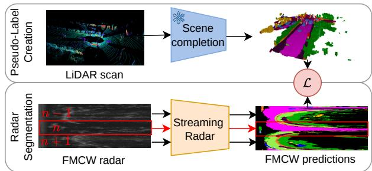
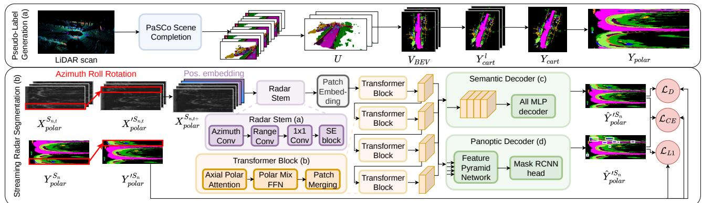
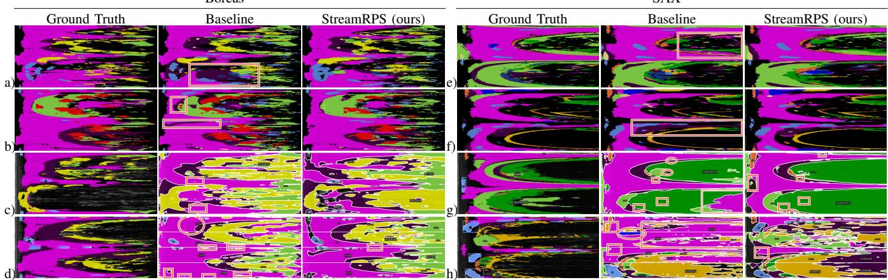

# Real-Time Radar Semantic and Panoptic Scene Understanding

Santosh Parit1,∗, Julia Hindel1,∗, Rohit Mohan1, Georgi Pramatarov2, Paul Newman2, Daniele De Martini2,† and Abhinav Valada1,†

Abstract— Robust scene understanding under varying environmental conditions is essential for safe autonomous driving. While cameras and LiDAR degrade in adverse weather and poor lighting, Frequency-Modulated Continuous-Wave (FMCW) spinning radar provides dependable 360° perception at extended ranges with minimal compute cost. However, real-time FMCW radar scene understanding is challenging due to complex signal returns, limited temporal resolution, and scarce annotated datasets. We introduce StreamRPS, a novel framework for streaming FMCW radar panoptic segmentation, comprising an automated label-generation pipeline via LiDAR scene completion and a real-time streaming network for semantic and panoptic segmentation. Our encoder-decoder streaming architecture comprises a radar-specific hierarchical Transformer encoder and task-specific decoders for semantic or panoptic prediction. Our encoder introduces a stem to capture range-dependent signatures, anisotropic patch embeddings to preserve angular resolution, and axial polar attention to separately model the periodic azimuth and bounded range axes. We further introduce azimuth roll rotation augmentation to simulate ego-vehicle rotation during training. Comprehensive experiments on the SAX and BOREAS datasets validate both our auto-labeling methodology and streaming segmentation network against established baselines. We outperform the strongest baseline by at least 1.4pp while processing sectors at over 400 FPS in a 4-sector streaming setting. We additionally provide manual annotations for 100 SAX radar scans, enabling independent evaluation of the entire framework.

## I. INTRODUCTION

Precise environmental perception is essential for autonomous vehicles to navigate safely [1]. This perception relies on sensor data from cameras, LiDAR, and radar, each offering distinct capabilities. However, cameras are sensitive to extreme lighting, and both cameras and LiDAR can suffer degraded performance in adverse weather, including rain, snow, and fog. In contrast, Frequency-Modulated Continuous-Wave (FMCW) radar offers greater resilience to these conditions, making it a promising modality for dense scene understanding. In particular, spinning FMCW radar provides 360◦ angular coverage from a single sensor while maintaining low data-transfer bandwidth and memory requirements [2].

Despite these sensing advantages, the complexity and noise characteristics of FMCW radar make manual annotation for training segmentation models prohibitively expensive [3]. Existing approaches therefore rely on camera [3], [4] or

  
Fig. 1: StreamRPS yields dense semantic and panoptic radar labels using a pre-trained LiDAR scene completion network. The streaming FMCW radar segmentation architecture is trained on generated label sectors and operates in real time to deliver semantic or panoptic scene understanding.

LiDAR [5] data for supervision. However, camera-based supervision is constrained by limited viewing angles, while sparse LiDAR measurements leave many regions of the radar grid unlabeled. To address these limitations, we leverage LiDAR scene completion to generate dense radar annotations. The resulting annotations cover 8-12 semantic classes, exceeding the 3-4 classes used in previous studies [3], [5]–[7].

Beyond dense supervision, effective radar segmentation requires architectures tailored to the sensor’s distinct measurement characteristics. Existing approaches address these requirements through specialized convolutional and attention mechanisms [8]–[10]. However, many of these methods rely on Doppler velocity information, which is often unavailable in spinning FMCW radar data. A further challenge stems from the reliance of existing spinning-radar segmentation approaches on complete 360◦ scans. At relatively low scan rates (4 Hz), waiting for a complete sweep delays predictions. Streaming-capable architectures instead process incoming angular sectors throughout scan acquisition, enabling scene updates before the sweep is complete. Furthermore, to the best of our knowledge, prior work has not explored panoptic segmentation for spinning FMCW radar. Panoptic segmentation distinguishes individual objects within semantic categories through instance-level identifiers [11], providing object-level information for motion forecasting and navigation decisions. We therefore propose a specialized streaming architecture that supports both semantic and panoptic scene understanding.

We present StreamRPS (Streaming Radar Panoptic Segmentation), a framework for generating dense radar annotations and enabling streaming semantic and panoptic scene understanding (Fig. 1). Our labeling pipeline leverages the pre-trained LiDAR scene completion network PaSCo [12] to infer dense scene geometry and semantics from sparse LiDAR observations. We align these predictions with the radar’s sequential acquisition through azimuth-based synchronization, then construct and refine instance annotations in polar radar coordinates. For streaming segmentation, we propose an encoder-decoder architecture comprising a radar-specific hierarchical Transformer encoder and task-specific decoders for semantic or panoptic prediction. Our encoder introduces a stem that combines positional information, directional filtering, and temporal feature weighting to capture rangedependent radar signatures. Anisotropic patch embeddings retain finer angular resolution, while axial polar attention distinguishes the periodic azimuth axis from the bounded range axis. We complement these encoder contributions with azimuth roll augmentation, which simulates ego-vehicle rotation through circular shifts during training.

We evaluate both the label-generation pipeline and the radar segmentation network on the SAX [13] and Boreas [14] datasets. For SAX, we additionally create ground-truth labels by manually annotating 350 LiDAR scans and projecting these annotations onto 100 radar scenes using sensor calibration. These annotations provide held-out ground truth independent of our automatically generated labels. StreamRPS achieves the highest semantic mIoU among the evaluated baselines across all tested sector configurations and the highest panoptic quality in the four-sector setting on both datasets. The network further maintains real-time inference in both full-scan and streaming settings.

In summary, our main contributions are:

• A novel auto-label generation pipeline for obtaining dense semantic and panoptic FMCW radar labels.

• A streaming FMCW radar segmentation network supporting both semantic and panoptic predictions, demonstrating state-of-the-art performance on the SAX and Boreas benchmarks.

• Manually curated annotations comprising 350 LiDAR frames and 100 calibrated radar scans from the SAX dataset.

• Public release of code and trained models upon acceptance.

## II. RELATED WORK

Radar Segmentation Label Generation: To reduce manual annotation effort, existing methods generate radar labels using camera data, LiDAR data, or both. CARRADA [3] associates mean-shift radar clusters with object categories using camera Mask R-CNN predictions and temporal tracking, yielding sparse annotations and dense object masks. RAMP-CNN [15] uses camera-based object detection and depth estimation to generate radar training labels. Heidbrink et al. [16] combine camera segmentation with LiDAR-based object localization for radar annotation. RADIal [7] uses synchronized camera, LiDAR, and high-definition radar data to annotate vehicles and free space. For spinning FMCW radar, RSS-Net [2] projects camera predictions onto LiDAR points and transfers their labels to radar using calibration and motion compensation.

LiDAR-only supervision has also been explored for spinning FMCW radar. Li et al. [5] use pre-trained 3D segmentation models, remove ground points, and group semantic labels into four categories. They refine predictions using DBSCAN clustering and SVD-based structural analysis before projection into radar coordinates. The structural analysis distinguishes building-like surfaces from vegetation to correct mislabeled points. Although these procedures improve label consistency, projection-based supervision can remain spatially incomplete. Our framework instead uses LiDAR scene completion to generate dense semantic and panoptic radar annotations across 8-12 categories.

2D Radar Semantic Segmentation: Spinning FMCW radars have been studied for localization and place recognition [17], [18], while semantic segmentation has received comparatively limited attention. Existing approaches include the U-Netbased method of Li et al. [5] and RSSNet [2], which combines an ASPP-based decoder with class weighting and temporal scan stacking to improve segmentation of small and dynamic objects. In contrast, extensive research has focused on non-spinning FMCW radars. Many approaches exploit complementary range-angle (RA) and range-Doppler (RD) representations. On CARRADA dataset [3], MVNet [10] uses dual encoder-decoder networks with shared latent features, while TMVA-Net [10] adds temporal aggregation through 3D convolutions. PeakConv [9] introduces peak-inspired convolutional receptive fields, which AdaPKC [19] adapts to varying radar responses. Transformer-based approaches include TransRSS [20], TransRadar [8] with adaptive directional attention and class-agnostic localization supervision, and TARSS-Net [21] with learned temporal relations. These methods collectively rely on Doppler information via RD representations. For the related task of panoptic segmentation, SemRaFiner [22] operates on sparse radar point clouds and also uses Doppler information. Extracting Doppler from spinning FMCW radar, however, remains challenging [18], creating a gap between the rich literature on non-spinning radars and the underexplored semantic understanding of spinning systems. We bridge this gap by establishing that high-quality panoptic and semantic segmentation is possible without Doppler. Critically, this is the first work to tackle panoptic segmentation for FMCW radar.

Streaming Segmentation for Spinning Sensors: While streaming segmentation has not yet been explored for spinning FMCW radar, prior work in LiDAR perception has investigated this direction. Han et al. [23] introduce streaming object detection, while STROBE [24] processes LiDAR packets using a bird’s-eye-view (BEV) convolutional backbone and multi-scale spatial memory. However, representing wedge-shaped sectors on Cartesian grids can introduce computation over empty regions. Thus, PolarStream [25] adopts polar coordinate representations. It uses polar pillars and multi-scale context padding from neighboring sectors for object detection and semantic segmentation. PARTNER [26] addresses polar feature distortion through attention-based realignment for 3D object detection, while PFCF [27] combines a Mamba-based polar streaming backbone with a sector-feature buffer and a Cartesian full-scan pathway. Building on these LiDAR streaming foundations, we present, to the best of our knowledge, the first streaming semantic and panoptic segmentation framework for spinning FMCW radar.

## III. TECHNICAL APPROACH

In this section, we present the methodology of Stream-RPS for generating dense semantic and panoptic radar annotations by leveraging a pre-trained LiDAR scene completion network. We also introduce a streaming-capable FMCW radar segmentation network that delivers semantic or panoptic predictions in real time, as shown in Fig. 2.

## A. Cross-Modal Dense Label Generation

We generate semantic and panoptic radar labels by leveraging cross-modal LiDAR supervision. Given a LiDAR point cloud $P \in \mathbb { R } ^ { K \times 4 }$ of $K$ points $( x , y , z , i )$ , we first produce a dense, scene-completed voxel grid using the LiDAR scene completion network PaSCo [12]. Specifically, PaSCo first applies a sparse 3D generative U-Net followed by a Mask2Former decoder [28] to produce panoptic scene completion (PSC) on occupied voxel regions. We direct readers to the original work for implementation details [12]. We employ PaSCo trained on SemanticKITTI [29], which generates voxel grids $D \in \mathbb { R } ^ { 2 5 6 \times 2 5 6 \times 3 2 }$ at 0.2m resolution. To achieve extended spatial coverage while maintaining consistent voxel granularity, we decompose the LiDAR point cloud into quadrants and perform scene completion on each independently. Quadrant tiling is performed in voxel space to avoid overlap, and the resulting voxels are merged into a unified grid $\mathbf { \bar { \Delta } }$ . We then convert these 3D voxel representations to Cartesian BEV labels $V _ { B E V }$ by collapsing along the z-axis and retaining, for each groundplane cell, the label at the highest occupied voxel.

Radar Projection and Alignment: We project $V _ { B E V }$ to radar coordinates via extrinsic calibration and nearestneighbor interpolation to obtain a label map for each LiDAR scan in radar’s Cartesian coordinate frame $Y _ { c a r t } ^ { l } . \mathrm { ~ A ~ }$ fundamental challenge in cross-modal supervision is temporal misalignment arising from differing sensor acquisition rates. Our FMCW radar operates at 4 Hz while LiDAR operates at 10 Hz, creating temporal inconsistencies, particularly for dynamic objects. We address this through an azimuth-based synchronization strategy that mirrors the radar’s rotating acquisition pattern. For each azimuth in a radar scan, we select the temporally nearest LiDAR scan $Y _ { c a r t } ^ { l } ,$ , effectively compositing $V _ { B E V }$ from multiple consecutive LiDAR frames to generate $Y _ { c a r t } .$ , a Cartesian label for every radar image.

Next, we convert the labels from Cartesian $Y _ { c a r t }$ to polar coordinates $Y _ { p o l a r } \in \mathbb { R } ^ { A \times R }$ via range/azimuth resolution mapping, matching the native polar representation $X _ { p o l a r }$ of the radar image. Here, azimuth A and range R map to the image height and width, respectively. We leverage polar representations for two reasons. First, prior radar segmentation work has shown that polar representations yield superior results compared to Cartesian bird’s-eye-view (BEV) representations [25]. Second, polar representations are particularly well suited to streaming: slicing along the azimuth (height) axis yields fully populated, rectangular slices. In contrast, slicing a Cartesian BEV scan produces sparse, wedge-shaped “cake slices,” where only a fraction of each slice contains valid data [25].

Although PSC provides instance-level panoptic annotations, we find them unreliable in the polar radar frame. When mapped to the sensor’s coordinate system, instances are often oversized because small errors in the per-pixel estimates inflate the projected labels on the radar grid. Further, an object straddling the $0 ^ { \circ } / 3 6 0 ^ { \circ }$ angular seam (e.g., spanning $3 5 0 ^ { \circ } { - } 1 0 ^ { \circ } )$ has its pixels split across the two ends of the angular range.

We derive panoptic labels by extracting instances from the polar semantic segmentation $Y _ { p o l a r }$ via connected-component analysis on same-class pixels. This can nonetheless produce fragmented or over-extended instances: a single object’s return may split into several spatially disjoint components, or a projection inaccuracy may merge it into a thin streak spanning much of the frame. We address fragmentation and over-extension by restricting each instance to its single largest connected component, discarding disconnected fragments without altering any retained pixel. Further, we discard instances with a pixel area below 25 or a bounding-box height below 4, which typically correspond to spurious, non-physical detections.

## B. Streaming Radar Segmentation

This section describes streaming radar segmentation on our generated dataset $\mathbb { D } \in ( X _ { p o l a r } , Y _ { p o l a r } )$ (Fig. 2b). We first slice $X _ { p o l a r }$ into sectors for streaming (Sec. III-B.1), followed by temporal frame aggregation to mitigate ghost objects (Sec. III-B.2). Then, we apply our novel azimuth roll augmentation which simulates ego-vehicle rotation during training (Sec. III-B.3). Finally, we propose an encoder-decoder architecture with a radar-specific hierarchical Transformer encoder and task-specific decoders (Sec. III-B.4).

1) Polar Coordinate Slicing: To leverage the continuous data streaming capability of FMCW radar, we process angular sectors sequentially during both training and inference, rather than accumulating complete 360◦ scans. Since azimuth corresponds to the image height in our polar representation, we simply partition each polar input into N sequential sectors, yielding $( \dot { X } _ { p o l a r } ^ { S _ { n } } , Y _ { p o l a r } ^ { S _ { n } } ) \dot { } \in \mathbb { R } ^ { A / N \times R }$

2) Temporal Frame Aggregation: We fuse t consecutive radar frames along the channel dimension, creating input $X _ { p o l a r } ^ { S _ { n , t } } \in \mathbb { R } ^ { A / N \times R \times t }$ . Since radar measurements suffer from multipath reflections, speckle noise, and sensor artifacts, temporal aggregation provides critical context to distinguish transient noise from structural information. We anchor $\check { Y } _ { p o l a r } ^ { S _ { n } }$ to the last frame of the temporal sequence.

3) Azimuth Roll Rotation Augmentation: Standard horizontal flipping is counterproductive for polar images due to range-dependent object representations. We instead introduce Azimuth Roll Rotation Augmentation, exploiting the periodic nature of the azimuthal axis to simulate ego-vehicle rotation via circular shifts along the image height. A random circular shift $s \sim \operatorname { U n i f o r m } [ 0 , A )$ is applied along the azimuthal axis, with pixel wraparound at image boundaries. During training, we apply this augmentation with probability p.

  
Fig. 2: StreamRPS employs PaSCo scene completion to create dense radar labels, which are converted to a polar representation. We then apply azimuth roll rotation to augment radar scans before processing radar sectors with our streaming network. Key novelties include our RadarStem and Axial Polar Attention. Semantic and panoptic decoders decode the resulting features. Cross-entropy, Dice, and L losses are applied per decoder, as appropriate.

4) Network Architecture: We design a tailored Mix Transformer radar-encoder for streaming polar inputs. Our encoder introduces a stem (RadarStem) that combines positional, directional, and temporal cues to capture range-dependent radar signatures. This is followed by anisotropic patch embeddings that retain angular resolution. Our novel axial polar attention then attends separately to the periodic azimuth axis and the bounded range axis, followed by a radar-adapted Mix-FFN. Finally, we append semantic and panoptic decoders. In contrast to the standard formulation of Mix Transformer [30], which assumes Cartesian image geometry and doesn’t model temporal continuity, our design captures the periodic azimuthal structure and streaming nature of polar radar sweeps.

RadarStem: Polar images are not translation invariant because objects’ representations depend on their range and azimuth from the ego-vehicle. We provide positional awareness by appending normalized embeddings [−1, 1] to the R and A axes, producing $X _ { p o l a r } ^ { S _ { n , t + } } \in \mathbb { R } ^ { A / N \times \bar { R } \times ( \dot { t } + 2 ) }$ . This ensures the model understands that identical features at different ranges have distinct physical implications. Radar artifacts also exhibit directional characteristics such as azimuthal smearing and range-dependent reflection profiles. Standard dense convolutions are isotropic, making them unsuitable for capturing these anisotropic patterns. We employ asymmetric factorized depthwise convolutions with parallel radar-aligned filters where a 1 × 5 kernel captures range profiles and a $5 \times 1$ kernel captures azimuthal smearing. This approach reduces parameters and computation while maintaining receptive field coverage and improving feature expressiveness. We compress the t + 2-channel representation to t channels via 1 × 1 convolution and a Squeeze-and-Excitation (SE) block [31]. The SE block applies channel-wise feature recalibration through global pooling and a bottleneck MLP. Since our channels encode temporal steps, this acts as a temporal attention mechanism, dynamically weighting the importance of historical versus current sweeps based on scene motion.

Patch Embeddings: To compensate for the directional asymmetry of polar FMCW scans, we adopt anisotropic patch embeddings in the initial encoder stage [32]. We substitute the standard $7 \times 7$ isotropic patch with a $3 \times 7$ rectangular patch (Azimuth × Range) and adjust the stride from $4 \times 4$ to $2 \times 4$ to match.

Axial Polar Attention: Standard self-attention mechanisms for dense prediction rely on aggressive 2D spatial reduction for efficiency and assume flat Cartesian geometry. However, this corrupts fine-grained radar signatures and ignores its inherent periodicity. We introduce Axial Polar Attention, a radar-tailored factorization that exploits the sensor’s geometric characteristics. Azimuth (Height) Attention computes selfattention along the angular axis with circular padding on Key and Value tensors, explicitly modeling the 360° periodicity and enabling seamless attention across the 0°/360° boundary. In contrast, Range (Width) Attention applies standard zero padding to respect radar’s fixed sensing bounds. This asymmetric padding strategy is novel to radar and fundamentally differs from standard axial attention. Crucially, both branches are computed in parallel, and their outputs are summed to yield the final representation. This preserves computational efficiency for real-time streaming.

Polar Mix-FFN: Positional information is implicitly encoded through convolutional zero-padding within the Mix-FFN layer of our encoder. Rather than the standard 3 × 3 convolution with uniform zero-padding, we apply asymmetric padding tailored to polar geometry: constant zero padding along the range axis to respect fixed sensing bounds, and circular padding along the azimuth axis to enforce angular periodicity. This wraps the image around the 0◦/360◦ boundary, ensuring convolutional receptive fields accurately capture physical adjacency across the sweep boundary. This is only physically meaningful for the first and last sector under slicing, where the sector edge coincides with the true azimuth wraparound. For middle sectors, circular padding instead serves as a simplifying approximation, since these boundaries do not correspond to a genuine angular discontinuity.

Semantic Decoder: For decoding, we employ an All-MLP design that avoids expensive handcrafted components by relying solely on MLP layers. This is feasible given our Transformer encoder’s large effective receptive field. The decoder unifies multi-level features, upsamples to $\textstyle { \frac { 1 } { 4 } }$ of the input resolution, concatenates them, and applies MLPs to generate the segmentation mask.

For panoptic segmentation, the hierarchical Transformer generates feature maps at four spatial resolutions, $F _ { 1 } , F _ { 2 } , F _ { 3 }$ and $F _ { 4 }$ , which we feed into a Feature Pyramid Network (FPN). For thing classes, we attach a Mask R-CNN head [33]. The semantic branch upsamples each feature map until it reaches a uniform $\textstyle { \frac { 1 } { 4 } }$ scale of the original resolution. The spatially aligned feature maps are summed element-wise, and a final linear projection predicts pixel-wise class probabilities across all class categories. Finally, we fuse the semantic and instance predictions using the same strategy as detailed in [34].

Losses: For semantic segmentation, we optimize

$$
\mathcal { L } _ { \mathrm { s e m } } = \alpha \mathcal { L } _ { C E } + \beta \mathcal { L } _ { D } ,\tag{1}
$$

combining class-weighted Cross-Entropy $\mathcal { L } _ { C E }$ and Dice loss $\mathcal { L } _ { D }$ . For panoptic segmentation, we use

$$
\mathcal { L } _ { \mathrm { p a n } } = \mathcal { L } _ { C E } ^ { \mathrm { s e m } } + \mathcal { L } _ { C E } ^ { \mathrm { i n s t } } + \mathcal { L } _ { L 1 } ,\tag{2}
$$

where $\mathcal { L } _ { C E } ^ { \mathrm { s e m } }$ is the semantic head’s Cross-Entropy loss, $\mathcal { L } _ { C E } ^ { \mathrm { i n s t } }$ combines box classification and mask Cross-Entropy losses, and $\mathcal { L } _ { L 1 }$ handles bounding box regression.

## IV. EXPERIMENTAL EVALUATION

We evaluate StreamRPS against nine baselines and provide a comprehensive ablation study to demonstrate the significance of our contributions. We first present an overview of the datasets used, followed by the experimental settings, performance results, and ablations.

## A. Datasets

We evaluate our approach on the SAX and Boreas datasets. SAX: The SAX dataset [13] was collected in the UK using a Navtech CTS350-X FMCW scanning radar operating at $4 \mathrm { H z } ,$ paired with a Velodyne HDL-64E LiDAR. The dataset comprises 20,875 radar scans with a maximum range of 163 m, each rendered as a $4 0 0 \times 3 7 6 8$ polar image. Since the LiDAR sensor matches SemanticKITTI, we directly apply PaSCo pretrained on SemanticKITTI within our auto-labeling approach. In addition to the generated labels, we hand-labeled 350 LiDAR scans with [36], yielding 100 annotated radar images spanning 12 classes: car, two-wheeled vehicle, other vehicle, person, rider, road, pavement, building, fence, vegetation, terrain, and pole.

Boreas: The Boreas dataset [14] was recorded in Canada with a Navtech CIR304-H scanning radar (4 Hz) alongside a 128-channel Velodyne Alpha-Prime LiDAR. Since its LiDAR intensity distribution differs from that of the HDL-64E used in SemanticKITTI, we normalize Boreas intensities to [0, 1] prior to auto-labeling. The selected dataset contains 16,450 radar scans from four randomly chosen days with moderateto-good weather conditions, each represented as a 400 × 3371 polar image and automatically annotated via auto-labeling into 8 classes: car, two-wheeled vehicle, person, obstacle, terrain, pole, pavement, and road. We merge the original lorry, truck, fence, and building classes into a single obstacle class because this sensor produces inconsistent LiDAR predictions.

## B. Experimental Settings

We divide each dataset into training, validation, and test sets using a 70%-15%-15% split, defined along distinct chronological and geographical regions to ensure an unbiased benchmark of generalization performance. We crop polar images to $4 0 0 \times 1 0 2 4$ , discarding the range beyond this point, as our LiDAR-based labels extend only to 1024. We use a temporal window of $t = 3$ scans, together with roll rotation augmentation applied with probability $p = 0 . 7$ and vertical flipping. Our Mix Transformer has feature dimensions $F _ { 1 }$ $F _ { 2 }$ $F _ { 3 } ,$ and $F _ { 4 }$ of 32, 64, 160, and 256. To address class imbalance, we set the loss weights $\alpha = 1$ and $\beta = 3$ . We train for 80k iterations using AdamW with a batch size of 16, weight decay of 0.01, an initial learning rate of $1 0 ^ { - 3 }$ for the backbone and $1 0 ^ { - 2 }$ for the segmentation head. We apply a 1500-iteration linear warm-up, followed by Multi-Step decay by a factor of 10 at iterations 60k and 72k. To benchmark the effectiveness of our proposed method, we evaluate segmentation accuracy using mean Intersection over Union (mIoU), and panoptic performance using Panoptic Quality (PQ), Segmentation Quality (SQ), and Recognition Quality (RQ) [11]. Additionally, we measure Frames Per Second (FPS) on an NVIDIA GeForce RTX 2080 Ti GPU.

## C. Quantitative Results

In Tab. I, we compare StreamRPS with three radar-specific architectures and three general semantic segmentation models on full scans $( N = 1 )$ and on sub-sectors of 2, 4, 8, 16, and 32 sectors per scan, using each method’s published code and settings. We modify radar-specific networks to use rangeazimuth data only. Mask2Former relies on a frozen DINOv2 backbone, while the remaining models are trained end-to-end. We guide the Cross-Entropy loss with pre-computed class weights to address class imbalance, and tune the learning rate and batch size to maximize performance for each model. We do not evaluate Mask2Former and SegFormer at 16 and 32 sectors, as the resulting sector heights fall below the minimum spatial dimensions supported by their published implementations, and supporting them would require method-specific transformations altering the native sector representation.

We observe that StreamRPS outperforms all baselines across all settings. While the margin at full-scan resolution is modest (0.06pp on Boreas and 0.79pp on SAX), the benefit of our method is particularly evident at 8 sectors, where we outperform the second-best method by 1.54pp on Boreas and 3pp on SAX. We attribute this to our axial polar attention and custom patch embedding, which remain effective even at smaller sector sizes. For SAX, performance is even maintained close to the full-scan level. We observe that all methods drop in performance as sector size decreases, since detecting objects becomes harder with insufficient context or only partial views. Nonetheless, StreamRPS remains robust, achieving above 21.8 mIoU even when processing sectors as small as $1 2 \times 1 0 2 4$ (32 sectors) which enables prediction rates of up to 128 Hz for a 4 Hz sensor. We further analyze the compute-efficiency of our method in comparison to the baselines in Sec. IV-E.

TABLE I: Streaming semantic segmentation performance on Boreas and SAX for full-scan (1) and streaming settings with varying numbers of sectors (2, 4, 8, 16, 32), in IoU [%]. objL: large object categories (car, other-vehicle / obstacle). objS: small object categories (motorcycle, person, pole). bkg: background/static (road, pavement, terrain, vegetation, building, fence).
<table><tr><td></td><td colspan="8">Boreas</td><td colspan="8">SAX</td></tr><tr><td>Method</td><td>1</td><td> $\mathrm { \mathbf { o b j } } _ { L }$ </td><td> $\mathrm { o b j } _ { S }$ </td><td>bkg</td><td>2</td><td>4</td><td>8</td><td>16 32</td><td>1</td><td> $\mathrm { \mathbf { o b j } } _ { L }$ </td><td>objs</td><td>bkg</td><td>2</td><td>4</td><td>8</td><td>16</td><td>32</td></tr><tr><td>TMVANet [10]</td><td>27.85</td><td>39.20</td><td>2.47</td><td>45.69</td><td>25.87</td><td>23.06</td><td>24.13</td><td>24.77 19.66</td><td>32.27</td><td>36.76</td><td>6.55</td><td>47.71</td><td>24.37</td><td>22.34</td><td>20.98</td><td>20.78</td><td>17.53</td></tr><tr><td>RSSNet [21]</td><td>23.56</td><td>27.45</td><td>1.83</td><td>42.70</td><td>22.26</td><td>19.30</td><td>18.63</td><td>17.42</td><td>11.98 31.02</td><td>35.43</td><td>5.35</td><td>47.16</td><td>27.59</td><td>23.05</td><td>25.55</td><td>26.33</td><td>20.14</td></tr><tr><td>TransRadar [8]</td><td>30.13</td><td>43.34</td><td>2.60</td><td>48.85</td><td>27.74</td><td>28.17</td><td>26.18</td><td>26.02 20.85</td><td>31.63</td><td>33.91</td><td>7.21</td><td>47.45</td><td>32.67</td><td>28.75</td><td>28.00</td><td>26.15</td><td>18.88</td></tr><tr><td>Mask2Former [28]</td><td>31.67</td><td>50.66</td><td>4.13</td><td>46.54</td><td>30.57</td><td>30.03</td><td>26.42</td><td></td><td>33.56</td><td>37.17</td><td>8.33</td><td>49.97</td><td>33.85</td><td>32.94</td><td>30.99</td><td></td><td></td></tr><tr><td>SegFormer [30]</td><td>29.53</td><td>39.60</td><td>2.85</td><td>49.49</td><td>29.53</td><td>29.39</td><td>28.55</td><td></td><td>30.88</td><td>36.81</td><td>5.76</td><td>46.29</td><td>29.83</td><td>30.24</td><td>30.17</td><td></td><td></td></tr><tr><td>MobileNetv3 [35]</td><td>24.86</td><td>29.89</td><td>2.04</td><td>44.32</td><td>24.67</td><td>23.22</td><td>20.38</td><td>18.93 19.20</td><td>28.35</td><td>29.95</td><td>4.39</td><td>44.47</td><td>29.56</td><td>24.50</td><td>29.00</td><td>27.14</td><td>16.48</td></tr><tr><td>StreamRPS(Ours)</td><td>31.73</td><td>43.71</td><td>4.3451.12</td><td></td><td>31.85</td><td>31.57</td><td>30.09</td><td>29.27</td><td>21.82</td><td>34.35 41.94</td><td>7.64</td><td>50.46</td><td>34.01</td><td>34.33</td><td>33.99</td><td>32.95</td><td>23.23</td></tr></table>

TABLE II: Streaming panoptic segmentation performance on Boreas and SAX datasets for full-scan (1) and streaming with 4 sectors. PQ: Panoptic Quality, $\mathrm { P Q } _ { \mathrm { s t } } \colon$ PQ for stuff classes, ${ \mathrm { \bar { P } Q } } _ { \mathrm { t h } } { \mathrm { : } }$ PQ for thing classes, SQ: Segmentation Quality, RQ: Recognition Quality.
<table><tr><td rowspan="3">Method</td><td colspan="6">Boreas</td><td colspan="3"></td><td colspan="6">SAX</td></tr><tr><td colspan="3">1</td><td colspan="3"></td><td colspan="3">4</td><td colspan="3">1</td><td colspan="3">4</td></tr><tr><td>PQ</td><td> $\mathrm { P Q } _ { \mathrm { s t } }$ </td><td> $\mathrm { P Q } _ { \mathrm { t h } }$ </td><td>SQ</td><td>RQ</td><td>PQ</td><td>SQ</td><td>RQ</td><td>PQ</td><td> $\mathrm { P Q } _ { \mathrm { s t } }$ </td><td> $\mathrm { P Q } _ { \mathrm { t h } }$ </td><td>SQ</td><td>RQ PQ</td><td>SQ</td><td>RQ</td></tr><tr><td>PanopticFPN [34]</td><td>18.94</td><td>22.57</td><td>12.88</td><td>59.59</td><td>27.94</td><td>20.23</td><td>55.29 29.30</td><td>13.09</td><td>19.22</td><td>4.51</td><td>55.47</td><td>19.48</td><td>13.44</td><td>57.44</td><td>19.67</td></tr><tr><td>Mask2Former [28]</td><td>18.94</td><td>27.17</td><td>5.22</td><td>47.35</td><td>27.63</td><td>21.53</td><td>48.69 30.57</td><td>15.45</td><td>22.58</td><td>5.48</td><td>55.94</td><td>22.69</td><td>14.40</td><td>62.06</td><td>20.97</td></tr><tr><td>OneFormer [37]</td><td>17.35</td><td>24.03</td><td>13.15</td><td>45.71</td><td>24.45</td><td>20.32</td><td>48.29 28.90</td><td>9.90</td><td>13.58</td><td>4.74</td><td>56.01</td><td>14.38</td><td>11.68</td><td>52.90</td><td>16.85</td></tr><tr><td>StreamRPS(Ours)</td><td>21.80</td><td>25.47</td><td>14.47</td><td>52.94</td><td>32.08</td><td>23.31</td><td>56.84 33.39</td><td>13.37</td><td>18.88</td><td>5.66</td><td>56.86</td><td>19.86</td><td>15.43</td><td>64.45</td><td>22.29</td></tr></table>

We further note that all methods achieve high scores on background classes such as road, pavement, terrain, vegetation, building, and fences on full scans (mIoU > 40), while small, thin objects $( \mathrm { o } \mathsf { b } \mathsf { j } _ { S } )$ such as two-wheeled vehicles, persons, and poles consistently score below 10 mIoU. We attribute this to their limited occurrence combined with the inherent difficulty of distinguishing small objects in radar, an imbalance that loss re-weighting alone could not resolve. Our axial attention’s dedicated modeling of range and azimuth generally benefits small-object categories, except on SAX, where Mask2Former’s per-instance queries and DINOv2 pretraining better preserve its especially fine-grained classes. Large objects $( \mathrm { o b j } _ { L } )$ perform reasonably well (30- 50 mIoU). However, Mask2Former outperforms StreamRPS on large objects on Boreas, as its global, query-based cross-attention captures long-range coherence that our more localized, compute-efficient design achieves only to a limited extent.

Next, we compare our method on panoptic segmentation against PanopticFPN, Mask2Former, and OneFormer. Our method achieves the best PQ in three of four settings. On Boreas, we outperform by at least 1.78pp PQ, driven primarily by improved RQ, i.e., better instance recognition, despite a slightly lower SQ at full-scan. We attribute this to our superior encoding of small objects via temporal consistency in our RadarStem and improved scene understanding through Axial Polar Attention. On SAX, our method outperforms on the four slicing setting but falls short of Mask2Former at full-scan, where it achieves equivalent thing-class PQ but a lower stuff-class PQ. We note that for most methods, PQ improves from one to four sectors, unlike semantic segmentation, which we attribute to improved performance on $\mathrm { P Q } _ { \mathrm { s t } }$ . The improvement in $\mathrm { P Q } _ { \mathrm { s t } }$ under slicing is largely an artifact of the metric. Under slicing, the same region splits into smaller instances, each more likely to be scored as a correct match, yielding a systematically higher $\mathrm { P Q } _ { \mathrm { s t } }$ without a genuine gain in segmentation quality.

## D. Inference Performance

Our reported inference speeds reflect network throughput measured with TensorRT and exclude sensor I/O and preand post-processing overhead. Tab. III reports inference speed (FPS), memory consumption, and latency percentiles. Mask2Former is significantly slower than the other tested methods in the full-scan and 4-sector streaming settings while SegFormer and StreamRPS achieve comparable inference speeds at full-scan resolution. In the 4-sector setting, however, SegFormer attains the highest throughput as its spatial reduction attention scales down more favorably at small inputs than our dual-branch axial attention, whose fixed overhead from circular padding is amortized less effectively at small sector sizes. Despite this, StreamRPS outperforms SegFormer by 4pp while remaining highly efficient in absolute terms, comfortably exceeding real-time requirements even at the fine streaming granularity. In terms of memory, Mask2Former requires over 9× as much as our method, with its peak usage dominated by engine size and largely independent of input resolution in our setup, whereas RSSNet, SegFormer, and StreamRPS all show reduced memory usage at smaller sector sizes. Across all methods, the tight spread between p50 and p99 latencies indicates stable, predictable inference times with minimal variation.

## E. Ablation Study

We ablate label generation, network components, and temporal window size on SAX for 1 and 4 sectors.

1) Training Label Generation: We show the influence of including PaSCo in our auto-labeling pipeline. Tab. IV compares training on auto-labels including PaSCo scene completion against sparse, pointwise labels predicted directly by its underlying backbone, WaffleIron [38]. We evaluate both approaches on our hand-labeled test set and the dense auto-label test set. Our proposed auto-labeling approach substantially outperforms WaffleIron on the hand-labeled test set, improving results by at least 1.46pp and showing that dense labels considerably improve prediction capabilities, while training with only a sparse signal hurts the network. Similarly, training on sparse WaffleIron labels generalizes poorly to the dense evaluation setting, with a gap of at least 9.2pp, highlighting the importance of dense supervision for robust performance across label granularities.

  
Fig. 3: Qualitative results of StreamRPS on SAX and Boreas. (a, e, c, g): full-scan (1 sector); (b, f, d, h): streaming (4 sectors). (a, b, e, f): Semantic Segmentation in comparison to SegFormer; (c, d, g, h): Panoptic Segmentation in comparison to Mask2Former. Errors are highlighted in white-red.

TABLE III: Ablation study on the Inference performance on NVIDIA GeForce RTX 2080 Ti GPU, reporting throughput (FPS), memory footprint (Mem.[MiB]), and latency percentiles (p50-p95) on the SAX dataset full-scan and four sectors.
<table><tr><td>Method</td><td>Sectors</td><td>IoU</td><td>FPS</td><td>Mem.</td><td>p50</td><td>p90</td><td>p99</td></tr><tr><td rowspan="2">RSSNet [2]</td><td>1</td><td>31.02</td><td>55.6</td><td>184</td><td>18.17</td><td>18.29</td><td>18.41</td></tr><tr><td>4</td><td>23.05</td><td>260.0</td><td>47</td><td>3.92</td><td>3.95</td><td>3.97</td></tr><tr><td rowspan="2">Mask2Former [28]</td><td>1</td><td>33.56</td><td>13.0</td><td>2080</td><td>77.15</td><td>78.02</td><td>78.30</td></tr><tr><td>4</td><td>32.94</td><td>46.4</td><td>2080</td><td>21.59</td><td>21.85</td><td>22.09</td></tr><tr><td rowspan="2">SegFormer [30]</td><td>1</td><td>30.88</td><td>145.8</td><td>299</td><td>7.06</td><td>7.10</td><td>7.14</td></tr><tr><td>4</td><td>30.24</td><td>782.3</td><td>38</td><td>1.34</td><td>1.35</td><td>1.36</td></tr><tr><td rowspan="2">StreamRPS (Ours)</td><td>1</td><td>34.35</td><td>130.8</td><td>290</td><td>7.91</td><td>7.96</td><td>8.02</td></tr><tr><td>4</td><td>34.33</td><td>421.9</td><td>74</td><td>2.44</td><td>2.46</td><td>2.48</td></tr></table>

TABLE IV: Performance comparison of different training data for Stream-RPS.
<table><tr><td>Training Label Generation</td><td>Hand-Labeled Test 1</td><td>4</td><td>1</td><td>Dense Auto-Label Test 4</td></tr><tr><td>WaffleIron [38]</td><td>29.07</td><td>28.76</td><td>25.06</td><td>23.59</td></tr><tr><td>PaSCo (Ours)</td><td>31.47</td><td>30.22</td><td>34.35</td><td>34.33</td></tr></table>

2) Effect of Network Component: The baseline SegFormer, processing a static single-channel polar radar image (triplicated across RGB), achieves an mIoU of 30.88 as shown in Tab. V. Naively stacking sequential frames $\{ \tau , \tau - 1 , \tau - 2 \}$ into a multi-channel input yields no improvement, suggesting the network struggles to disentangle overlapping spatial and temporal representations in sequential polar scans. Adding a learnable stem module before the Transformer backbone, which concatenates normalized range-azimuth grids [−1, 1] as spatial priors, improves results by 0.77 pp. Azimuth roll rotation, a radar-realistic augmentation, adds 1.71 pp. Switching to rectangular patch embeddings contributes a further 0.71 pp. Finally, our radar-specific axial attention yields the best overall result of 34.35 mIoU, confirming the benefit of tailoring attention to polar radar structure.

TABLE V: Ablation study on various components of StreamRPS on the SAX dataset full-scan.
<table><tr><td>Temporal Frame</td><td>Radar Stem</td><td>Azimuth Roll Aug.</td><td>Patch Embed.</td><td>Axial Polar Att.</td><td>1</td></tr><tr><td></td><td></td><td></td><td></td><td></td><td>30.88</td></tr><tr><td>√ √</td><td></td><td></td><td></td><td></td><td>30.84</td></tr><tr><td>√</td><td>√</td><td></td><td></td><td></td><td>31.61 33.32</td></tr><tr><td>√</td><td>√ √</td><td>√ √</td><td>√</td><td></td><td>34.03</td></tr><tr><td>√</td><td>√</td><td>√</td><td>√</td><td>√</td><td>34.35</td></tr></table>

TABLE VI: Ablation study on temporal frame aggregation of StreamRPS on SAX full-scan. τ denotes the timestamp of stacked radar frames.
<table><tr><td>{τ}</td><td> $\{ \tau , \tau { - } 1 , \tau { - } 2 \}$ </td><td> $\{ \tau , \dots , \tau ^ { - 4 } \}$ </td><td>一  $\{ \tau , \tau { - } 3 , \tau { - } 5 \}$ </td><td> $\{ \tau , \tau { - } 4 , \tau { - } 7 \}$ </td></tr><tr><td>32.05</td><td>34.35</td><td>33.04</td><td>32.63</td><td>32.17</td></tr></table>

3) Temporal Aggregation Window: We evaluate different temporal windows in Tab. VI. Both a smaller (t = 1) and larger temporal window (t = 5) decrease performance by at least 1.31 pp. Skipping intermediate frames decreases performance by at least 1.72pp compared to using close windows, which we attribute to close frames combined with our novel axial attention helping detect ghost objects.

## F. Qualitative Results

We present qualitative results for semantic and panoptic segmentation in Fig. 3. For semantic segmentation, we compare with SegFormer, whose comparable FPS highlights the resulting quality disparity, and for panoptic segmentation, with the strongest baseline, Mask2Former. Panels (a, e) show full-image predictions on Boreas and SAX, respectively, while (b, f) show 4-sector streaming splits on the same datasets. In (a, b, f), SegFormer confuses street and sidewalk, whereas StreamRPS predicts both classes correctly. Panel (b) further highlights the smooth transition between sectors achieved by StreamRPS, while in (e), our method correctly segments vegetation, whereas the baseline confuses it with sidewalk. For panoptic segmentation, we observe that Mask2Former commonly misses cars in (c, d) for Boreas while it commonly predicts street for sidewalk in (d) and building in (h). Further, both models struggle to detect small objects such as bicycle and person in (g). Additional qualitative results on Boreas under adverse weather conditions are provided in the multimedia material.

## V. CONCLUSION

We present StreamRPS, a novel approach to radar labeling and streaming segmentation. We first generate dense labels via LiDAR scene completion, yielding richer supervision for improved segmentation. We then introduce a lightweight, radarspecific transformer architecture for streaming semantic and panoptic segmentation, enabling fast sub-scan predictions. Our contributions include tailored augmentation, a radar-specific patch embedding and stem architecture, and a novel attention formulation that exploits range-azimuth polar representations. Experiments on the Boreas and SAX datasets show that our method outperforms others in both performance and compute requirements for panoptic and semantic segmentation across various sector sizes. This is the first work to address streaming and panoptic segmentation for FMCW radar. We hope our dataset, auto-labeling pipeline, and architecture will serve as a foundation for future research on real-time radar scene understanding.

## REFERENCES

[1] M. Luz, R. Mohan, T. Nurnberg, Y. Miron, D. Cattaneo, and A. Valada,¨ “Latent gaussian splatting for 4d panoptic occupancy tracking,” IEEE Robotics and Automation Letters, 2026.

[2] P. Kaul, D. de Martini, M. Gadd, and P. Newman, “Rss-net: Weaklysupervised multi-class semantic segmentation with fmcw radar,” in IEEE Intelligent Vehicles Symposium, 2020, pp. 431–436.

[3] A. Ouaknine, A. Newson, J. Rebut, F. Tupin, and P. Perez, “Carrada´ dataset: Camera and automotive radar with range- angle- doppler annotations,” in Int. Conf. on Pattern Recognition, 2021, pp. 5068–5075.

[4] M. Sheeny, E. De Pellegrin, S. Mukherjee, A. Ahrabian, S. Wang, and A. Wallace, “Radiate: A radar dataset for automotive perception in bad weather,” in Proc. IEEE Int. Conf. on Rob. and Auto., 2021, pp. 1–7.

[5] S. Li, Z. Hong, Y. Chen, L. Hu, and J. Qin, “Get it for free: Radar segmentation without expert labels and its application in odometry and localization,” IEEE Rob. and Auto. Let., vol. 10, no. 3, 2025.

[6] S. Fang, H. Zhu, D. Bisla, A. Choromanska, S. Ravindran, D. Ren, and R. Wu, “Erase-net: Efficient segmentation networks for automotive radar signals,” in Proc. IEEE Int. Conf. on Rob. and Auto., 2023.

[7] J. Rebut, A. Ouaknine, W. Malik, and P. Perez, “Raw high-definition´ radar for multi-task learning,” in Proc. IEEE Conf. Comput. Vis. Pattern Recog., June 2022, pp. 17 021–17 030.

[8] Y. Dalbah, J. Lahoud, and H. Cholakkal, “Transradar: Adaptivedirectional transformer for real-time multi-view radar semantic segmentation,” in Proc. of the IEEE/CVF Winter Conf. on Applications of Computer Vision, 2024, pp. 353–362.

[9] L. Zhang, X. Zhang, Y. Zhang, Y. Guo, Y. Chen, X. Huang, and Z. Ma, “Peakconv: Learning peak receptive field for radar semantic segmentation,” in Proc. IEEE Conf. Comput. Vis. Pattern Recog., 2023.

[10] A. Ouaknine, A. Newson, P. Perez, F. Tupin, and J. Rebut, “Multi-view´ radar semantic segmentation,” in Proc. Int. Conf. Comput. Vis., 2021, pp. 15 671–15 680.

[11] R. Mohan, J. Hindel, F. Drews, C. Glaser, D. Cattaneo, and A. Valada, ¨ “Open-set lidar panoptic segmentation guided by uncertainty-aware learning,” in Proc. IEEE Int. Conf. on Intel. Rob. and Syst., 2025, pp. 2224–2231.

[12] A.-Q. Cao, A. Dai, and R. De Charette, “Pasco: Urban 3d panoptic scene completion with uncertainty awareness,” in Proc. IEEE Conf. Comput. Vis. Pattern Recog., 2024, pp. 14 554–14 564.

[13] M. Gadd, D. de Martini, L. Marchegiani, P. Newman, and L. Kunze, “Sense–assess–explain (sax): Building trust in autonomous vehicles in challenging real-world driving scenarios,” in IEEE Intelligent Vehicles Symposium, 2020, pp. 150–155.

[14] K. Burnett, D. J. Yoon, Y. Wu, A. Z. Li, H. Zhang, S. Lu, J. Qian, W.-K. Tseng, A. Lambert, K. Y. Leung, A. P. Schoellig, and T. D. Barfoot, “Boreas: A multi-season autonomous driving dataset,” The Int.Journal of Robotics Research, vol. 42, no. 1-2, pp. 33–42, 2023.

[15] X. Gao, G. Xing, S. Roy, and H. Liu, “Ramp-cnn: A novel neural network for enhanced automotive radar object recognition,” IEEE Sensors Journal, vol. 21, no. 4, pp. 5119–5132, 2021.

[16] M. Heidbrink, O. Sura, V. K. Rangaraj, M. Reinecke, M. Hoffmann, and M. Vossiek, “Concept for automatic annotation of automotive radar data using ai-segmented camera and lidar reference data,” in European Radar Conference, 2024, pp. 292–295.

[17] A. Venon, Y. Dupuis, P. Vasseur, and P. Merriaux, “Millimeter wave fmcw radars for perception, recognition and localization in automotive applications: A survey,” IEEE Trans. on Intelligent Vehicles, vol. 7, no. 3, pp. 533–555, 2022.

[18] D. Lisus, K. Burnett, D. J. Yoon, R. Poulton, J. Marshall, and T. D. Barfoot, “Are doppler velocity measurements useful for spinning radar odometry?” IEEE Rob. and Auto. Let., vol. 10, no. 1, 2025.

[19] T. Li, L. Zhang, Y. Zhang, P. Pi, Z. Lu, Q. Liao, and Z. Ma, “Adapkc: Peakconv with adaptive peak receptive field for radar semantic segmentation,” Adv. Neural Inform. Process. Syst., vol. 37, pp. 136 545– 136 575, 2024.

[20] H. Zou, Z. Xie, J. Ou, and Y. Gao, “Transrss: Transformer-based radar semantic segmentation,” in Proc. IEEE Int. Conf. on Rob. and Auto., 2023, pp. 6965–6972.

[21] Y. Zhang, L. Zhang, ZijunHu, P. Pi, T. Li, Y. Chen, S. Peng, and Z. Ma, “TARSS-net: Temporal-aware radar semantic segmentation network,” in Adv. Neural Inform. Process. Syst., 2024.

[22] M. Zeller, D. C. Herraez, B. Ayan, J. Behley, M. Heidingsfeld, and C. Stachniss, “Semrafiner: Panoptic segmentation in sparse and noisy radar point clouds,” IEEE Robotics and Automation Letters, vol. 10, no. 2, pp. 923–930, 2024.

[23] W. Han, Z. Zhang, B. Caine, B. Yang, C. Sprunk, O. Alsharif, J. Ngiam, V. Vasudevan, J. Shlens, and Z. Chen, “Streaming object detection for 3-d point clouds,” in Proc. Eur. Conf. Comput. Vis., 2020, pp. 423–441.

[24] D. Frossard, S. D. Suo, S. Casas, J. Tu, and R. Urtasun, “Strobe: Streaming object detection from lidar packets,” in Proc. of the Conf. on Robot Learning, vol. 155, 2021, pp. 1174–1183.

[25] Q. Chen, S. Vora, and O. Beijbom, “Polarstream: Streaming object detection and segmentation with polar pillars,” in Adv. Neural Inform. Process. Syst., vol. 34, 2021, pp. 26 871–26 883.

[26] M. Nie, Y. Xue, C. Wang, C. Ye, H. Xu, X. Zhu, Q. Huang, M. B. Mi, X. Wang, and L. Zhang, “Partner: Level up the polar representation for lidar 3d object detection,” in Proc. Int. Conf. Comput. Vis., 2023.

[27] M. M. Zhang, G. Chou, and S. Mukhopadhyay, “Polar hierarchical mamba: Towards streaming lidar object detection with point clouds as egocentric sequences,” in Proc. of the IEEE/CVF Winter Conf. on Applications of Computer Vision, 2026.

[28] B. Cheng, I. Misra, A. G. Schwing, A. Kirillov, and R. Girdhar, “Masked-attention mask transformer for universal image segmentation,” in Proc. IEEE Conf. Comput. Vis. Pattern Recog., 2022.

[29] J. Behley, M. Garbade, A. Milioto, J. Quenzel, S. Behnke, C. Stachniss, and J. Gall, “SemanticKITTI: A Dataset for Semantic Scene Understanding of LiDAR Sequences,” in Proc. Int. Conf. Comput. Vis., 2019.

[30] E. Xie, W. Wang, Z. Yu, A. Anandkumar, J. M. Alvarez, and P. Luo, “Segformer: Simple and efficient design for semantic segmentation with transformers,” Adv. Neural Inform. Process. Syst., 2021.

[31] J. Hu, L. Shen, and G. Sun, “Squeeze-and-excitation networks,” in Proc. IEEE Conf. Comput. Vis. Pattern Recog., 2018, pp. 7132–7141.

[32] J. Hindel, R. Mohan, J. Bratulic, D. Cattaneo, T. Brox, and A. Valada,´ “Label-efficient lidar semantic segmentation with 2d-3d vision transformer adapters,” in Proc. IEEE Int. Conf. on Intel. Rob. and Syst., 2025, pp. 4115–4122.

[33] K. He, G. Gkioxari, P. Dollar, and R. Girshick, “Mask r-cnn,” in´ Proc. Int. Conf. Comput. Vis., 2017, pp. 2980–2988.

[34] A. Kirillov, R. Girshick, K. He, and P. Dollar, “Panoptic feature pyramid´ networks,” in Proc. IEEE Conf. Comput. Vis. Pattern Recog., 2019.

[35] A. G. Howard, M. Zhu, B. Chen, D. Kalenichenko, W. Wang, T. Weyand, M. Andreetto, and H. Adam, “Mobilenets: Efficient convolutional neural networks for mobile vision applications,” arXiv preprint arXiv:1704.04861, 2017.

[36] Segments.ai, “Segments.ai data labeling platform,” 2026. [Online]. Available: https://segments.ai

[37] J. Jain, J. Li, M. Chiu, A. Hassani, N. Orlov, and H. Shi, “OneFormer: One Transformer to Rule Universal Image Segmentation,” in Proc. IEEE Conf. Comput. Vis. Pattern Recog., 2023.

[38] G. Puy, A. Boulch, and R. Marlet, “Using a waffle iron for automotive point cloud semantic segmentation,” in Proc. Int. Conf. Comput. Vis., 2023.