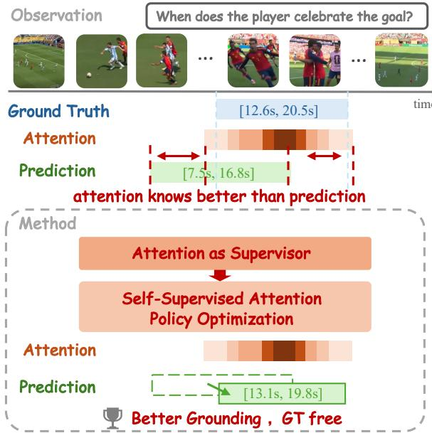
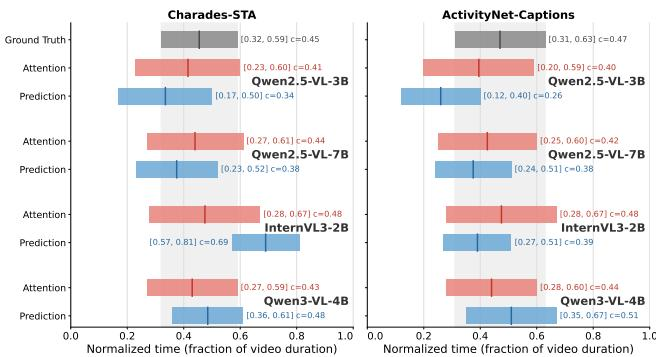
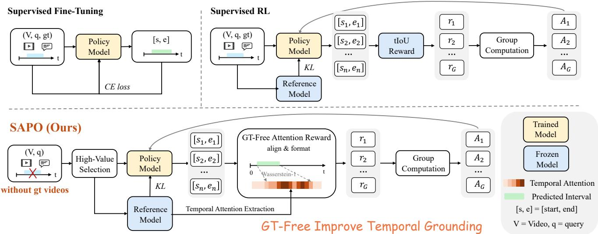
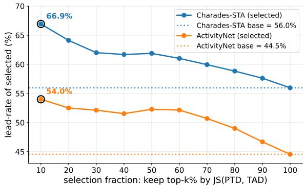
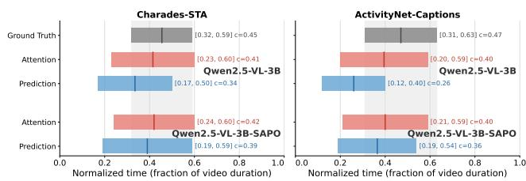
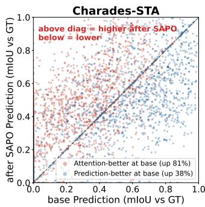
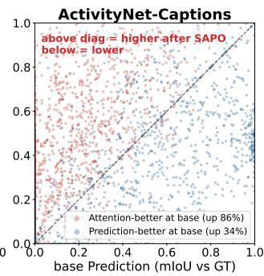
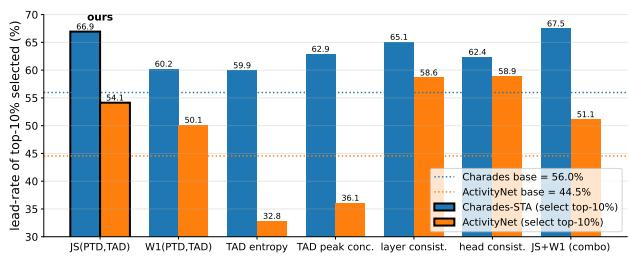
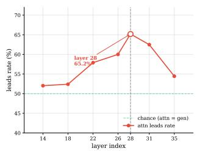
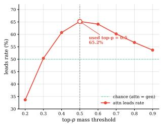

# SAPO: Self-Supervised Attention Policy Optimization for Improving Temporal Video Grounding in Vision–Language Models

Zixuan Chen1, Depeng Wang2, Wei Chen1, Ke Xu1, Ya Guo2, Huijia Zhu2∗, Tanfeng Sun1, Xinghao Jiang1∗

1Shanghai Jiao Tong University 2Ant Group

## Abstract

Video vision–language models (VLMs) have strong semantic understanding, yet remain unreliable at precise temporal grounding. Existing gains from explicitly aligning video frames with absolute time suggest that VLMs may already encode accurate temporal locations internally but lose precision when expressing them as timestamps. Our analysis across four VLMs and two grounding datasets confirms this hypothesis: attention intervals outperform predicted intervals on approximately 66% of valid examples. We term this discrepancy the temporal generation gap. Because precise temporal annotations are expensive, this finding motivates closing the gap to improve temporal grounding using only unlabeled video–query pairs. We propose Self-Supervised Attention Policy Optimization (SAPO), which uses internal temporal attention as self-supervision for Group Relative Policy Optimization and applies a ground-truth-free criterion to select high-value samples. SAPO consistently improves temporal grounding across multiple datasets and models spanning weak to strong initial grounding ability. Relative mIoU gains reach 33.7% on Qwen2.5-VL-3B and 5.4% on the strong Time-R1- 7B. The improvements transfer across datasets while preserving general video understanding.

## Introduction

Vision–language models (VLMs) have become a general interface for video understanding (Bai et al. 2025). Beyond recognizing what happens, a capable video VLM must also determine precisely when an event occurs. Temporal video grounding (TVG) directly evaluates this ability by requiring a model to localize the start and end times of an event described by a natural-language query. Despite their strong general video understanding, current VLMs remain substantially less reliable when generating precise timestamps.

Recent studies attribute much of this weakness to insufficient alignment between visual features and absolute time. Existing methods therefore inject frame-level temporal information through interleaved textual timestamps, timestamp overlays, or time-aligned position embeddings (Zhang et al. 2026; Huang et al. 2024; Wu et al. 2025; Bai et al. 2025). Their improvements establish that VLMs predict time more accurately when the correspondence between visual evidence and temporal coordinates is made explicit.

Given the substantial gains from explicitly mapping visual inputs to temporal coordinates, we ask whether a VLM already contains internal evidence for temporal localization but loses precision when generating timestamps. To investigate this question, we compare the model’s explicitly generated predicted interval with an attention interval decoded from its temporal attention over video tokens. We evaluate both intervals by their IoU with the ground-truth interval and count the proportion of examples for which the attention interval is more accurate. Across four VLMs, attention achieves a higher IoU than prediction on an average of 66.0% of examples on Charades-STA and 65.8% on ActivityNet-Captions. We term this systematic discrepancy the temporal generation gap: the model’s attention can localize the queried event more accurately than its explicit timestamp prediction, as illustrated in Figure 1.

  
Figure 1: Attention knows better than prediction. The attention-decoded interval $I _ { a }$ can localize the queried event more accurately than the generated interval $I _ { p } .$ . SAPO uses attention as supervisor to improve native timestamp prediction without temporal-boundary annotations during training.

Although attention does not provide perfectly accurate boundaries, its relative advantage reveals a useful source of internal temporal supervision. Since annotating precise start and end timestamps for video–query pairs is highly costly, this finding motivates us to exploit unlabeled video– query data and improve temporal grounding directly through attention-based self-supervision.

Based on this insight, we propose Self-Supervised Attention Policy Optimization (SAPO), which uses internal attention to construct RL rewards for timestamp generation. Each selected video–query pair is processed by a trainable policy and a frozen reference model initialized from the same VLM. The policy samples a group of timestamp intervals, while the reference extracts a stationary temporal-attention distribution. To avoid the sparse supervision of directly using interval IoU as the reward, SAPO projects each rollout interval onto the video timeline with a Gaussian kernel and measures its Wasserstein-1 distance to the reference attention distribution, yielding a dense temporal reward. Group-relative advantage estimation then updates the policy, with the reference model also providing KL regularization. SAPO thus transfers internal temporal evidence into native timestamp prediction without ground-truth boundaries for training.

Not all video–query pairs, however, contain equally useful attention supervision. We therefore explore how to identify a higher proportion of valuable training examples without ground truth. Among the examined criteria, top-k selection by Jensen–Shannon divergence between the prediction and attention distributions provides a lightweight solution and retrieves more high-value examples for RL than random sampling.

We evaluate SAPO on three benchmarks using both Qwen2.5-VL models and Time-R1-7B, a strong temporal grounding model, without temporal annotations during training. SAPO yields relative mIoU improvements of up to 33.7% on Qwen2.5-VL-3B and 5.4% on Time-R1-7B. Gains under cross-dataset training further demonstrate transfer across data domains, while the Video-MME accuracy of Qwen2.5-VL-3B remains close to the base model (58.0 vs. 57.4), indicating that SAPO largely preserves general video understanding. Further ablations verify the efects of highvalue sample selection and the individual training objectives. Our contributions aresummarized as follows:

• Across multiple VLMs and grounding datasets, we identify a temporal generation gap: internal temporal attention often localizes queried events more accurately than explicitly generated timestamps.

• We propose Self-Supervised Attention Policy Optimization (SAPO), which uses internal attention to improve temporal grounding through reinforcement learning without temporal-boundary annotations.

• Experiments across models, datasets, and training sources demonstrate consistent grounding improvements for both general-purpose VLMs and a strong temporal grounding model, together with cross-dataset transfer and largely preserved general video understanding.

## Related Work

Vision–Language Models. Recent VLMs combine visual encoders with large language models to support general image and video understanding (Bai et al. 2025; Li et al. 2024; Chen et al. 2024). Although these models exhibit strong semantic reasoning ability, precise temporal grounding remains challenging. Our work directly improves the temporal grounding ability of a VLM without changing its architecture or requiring temporal annotations.

Temporal Video Grounding. Temporal video grounding localizes the video segment described by a natural-language query. Conventional methods learn this task from annotated temporal intervals (Zhang et al. 2020; Lei, Berg, and Bansal 2021). Recent generative VLMs instead formulate grounding as native timestamp generation. They improve temporal grounding through architectural designs, temporally grounded instruction data and supervised fine-tuning (Huang et al. 2024; Ren et al. 2024; Wang et al. 2024; Zeng et al. 2025; Guo et al. 2025b; Wang et al. 2025a; Guo et al. 2025a; Hannan et al. 2025), or more efective post-training algorithms such as reinforcement learning and on-policy distillation (Wang et al. 2025b; Li et al. 2026). Despite their different approaches to exploiting supervision, these methods rely on annotated temporal targets.

Training-free methods avoid temporal annotations by constructing external workflows that match frame-level information from frozen models with the query (Lee et al. 2025; Zheng et al. 2024; Qu et al. 2024). Although they can produce temporal intervals without training, they do not improve the native grounding ability of the underlying VLM. SAPO differs from both supervised and training-free methods: it uses self-supervision from the model’s own attention to improve its native timestamp generation through policy optimization, without temporal annotations.

Model Mechanism Analysis. Prior studies inspect internal model states to understand how visual evidence is encoded before the final response (Zhao et al. 2024; Palit et al. 2023). They show that model outputs may not fully reflect the information available in intermediate representations. Following this perspective, we analyze temporal attention in generative VLMs and identify a gap between internal localization and explicit timestamp generation.

## Preliminary

Given an untrimmed video V and a natural-language query q, temporal video grounding aims to localize the temporal interval corresponding to the queried event. We distinguish three intervals: the ground-truth interval $I _ { g }$ (used only for evaluation and controlled analysis), the predicted interval $I _ { p }$ generated by the model, and the attention interval $I _ { a }$ decoded from its temporal attention. For each example, we determine which interval is more accurate by comparing $\mathrm { I o U } ( I _ { a } , I _ { g } )$ with IoU $( I _ { p } , I _ { g } )$

We conduct this analysis with four VLMs on all 3,720 Charades-STA examples and the same fixed random sample of 4,000 examples from the 17,505 ActivityNet examples. We obtain $I _ { a }$ from the last prompt token’s cross-modal attention to the video tokens. We average over attention heads, pool spatial tokens within each frame to obtain a normalized temporal profile $a ( t )$ , where $\textstyle \sum _ { t } a ( t ) = 1$ . We decode this profile by finding the shortest contiguous frame window whose cumulative attention mass reaches a threshold $\tau { : }$

<table><tr><td>Model</td><td>Data</td><td>Attn. wins†</td><td></td><td>Attn. mIoU Pred. mIoU</td></tr><tr><td rowspan="2">Qwen2.5-VL-3B</td><td>Charades</td><td>65.0</td><td>39.5</td><td>36.5</td></tr><tr><td>ActivityNet</td><td>71.0</td><td>32.8</td><td>24.6</td></tr><tr><td rowspan="2">Qwen2.5-VL-7B</td><td>Charades</td><td>62.0</td><td>46.1</td><td>43.6</td></tr><tr><td>ActivityNet</td><td>67.0</td><td>32.4</td><td>27.4</td></tr><tr><td rowspan="2">InternVL3-2B</td><td>Charades</td><td>79.0</td><td>39.2</td><td>15.2</td></tr><tr><td>ActivityNet</td><td>64.0</td><td>23.9</td><td>16.9</td></tr><tr><td rowspan="2">Qwen3-VL-4B</td><td>Charades</td><td>58.0</td><td>46.9</td><td>44.7</td></tr><tr><td>ActivityNet</td><td>61.0</td><td>43.5</td><td>41.3</td></tr></table>

Table 1: The temporal generation gap across models and datasets. Attn. wins† is the fraction of valid samples where $\mathrm { I o U } ( I _ { a } , I _ { g } ) > \mathrm { I o U } ( I _ { p } , I _ { g } )$ , excluding all-zero ties.All values are percentages.

  
Figure 2: Average temporal intervals visualize the generation gap. Each panel overlays the average ground-truth interval, the average predicted interval, and the average attention interval for one model–dataset pair. The attention interval is consistently closer to the ground-truth region than the explicit prediction.

$$
[ i ^ { * } , j ^ { * } ] = \arg \operatorname* { m i n } _ { 1 \leq i \leq j \leq T } ( j - i ) \quad \mathrm { s . t . } \quad \sum _ { t = i } ^ { j } a ( t ) \geq \tau ,\tag{1}
$$

where T is the number of sampled video frames and $\tau = 5 0 \%$ . We then map the frame indices $[ i ^ { * } , j ^ { * } ]$ to their corresponding timestamps to obtain $I _ { a }$ . The model-specific layers, sensitivity to the layer and threshold, and further extraction details are provided in the Appendix. Representing both attention and prediction as temporal intervals enables a direct comparison under the same IoU metric and avoids favoring attention merely because it is represented as a smooth distribution.

Table 1 provides quantitative evidence for a consistent temporal generation gap. Across all eight model–dataset combinations, the attention interval achieves higher mIoU than the predicted interval, and attention is more accurate on the majority of valid examples. The averaged intervals in Figure 2 exhibit the same pattern. This gap likely arises because temporal attention operates directly in video-token position space, whereas timestamp generation must further convert token positions into calibrated numerical seconds, introducing additional localization error. The availability of this efective internal supervision, together with the high cost of temporal boundary annotation, motivates us to improve timestamp generation through attention-based self-supervision without human-annotated boundaries.

## Method

Building on the preceding finding, we propose Self-Supervised Attention Policy Optimization (SAPO), which uses internal temporal attention as self-supervision to improve the native grounding ability of a VLM. As illustrated in Figure 3, for each unlabeled video–query pair, a trainable policy samples timestamp intervals, while a frozen reference model provides a stationary temporal attention distribution. SAPO measures their alignment as the rollout reward, estimates group-relative advantages, and updates the policy. We next describe the complete optimization procedure and the selection of high-value samples without ground truth. Implementation details are provided in the Appendix.

## Self-Supervised Attention Policy Optimization

Given an unlabeled sample $( V , q )$ , the policy π generates a group of rollouts $\{ \hat { y } _ { k } \} _ { k = 1 } ^ { K } ,$ , each containing a timestamp interval $I _ { \hat { y } _ { k } } = [ s _ { k } , e _ { k } ]$ . In parallel, the reference model $\pi _ { \theta _ { 0 } }$ produces a temporal attention profile over the video frames, which is corrected and normalized into $a \in \Delta ^ { T }$ . Decoding a with Eq. 1 gives the attention interval $I _ { a } .$ The frozen reference model therefore provides two related forms of temporal supervision: the continuous reference attention distribution a and its decoded attention interval $I _ { a }$ . The temporal distribution reward operates directly on $^ { a , }$ whereas the attentioninterval IoU reward operates on $I _ { a }$

Directly using interval IoU as the reward produces sparse feedback: when rollouts do not overlap with $I _ { a }$ , they all receive zero reward regardless of their temporal distance from the attended region. SAPO therefore converts each rollout interval into a continuous distribution $g ( I _ { \hat { y } } )$ using a Gaussian kernel and compares it with the corrected attention distribution a before threshold-based interval decoding. SAPO scores each rollout by

$$
\begin{array} { r l } & { r ( \hat { y } ) = \hspace - w _ { \mathrm { d i s t } } W _ { 1 } \big ( g ( I _ { \hat { y } } ) , a \big ) \hspace + w _ { \mathrm { I o U } } \mathrm { I o U } \big ( I _ { \hat { y } } , I _ { a } \big ) } \\ & { \hphantom { 0 0 0 0 0 0 0 } + \lambda _ { \mathrm { f m t } } r _ { \mathrm { f m t } } - \lambda _ { \mathrm { w i d t h } } p _ { \mathrm { w i d t h } } , } \end{array}\tag{2}
$$

where a provides attention-derived temporal supervision. (i) Temporal distribution reward. The first term measures agreement between the rollout-induced distribution and the reference attention distribution using the Wasserstein-1 distance. Because $W _ { 1 }$ increases with the temporal transport required to match $^ { a , }$ it provides graded feedback even for nonoverlapping rollouts. (ii) Attention-interval IoU reward. The second term measures temporal IoU between the generated interval and the interval $I _ { a }$ decoded from the reference attention distribution, providing a sparse interval-level complement to the distribution reward. (iii) Format-validity reward. $r _ { \mathrm { f m t } }$ rewards a well-formed interval $( 0 \leq s < e \leq \mathrm { d u r } )$ preventing malformed outputs. (iv) Interval-width regularization. $p _ { \mathrm { w i d t h } }$ penalizes near-full-video intervals to discourage a trivial duration-prior solution.

  
Figure 3: Conventional TVG training and our annotation-free alternative. Top: Conventional TVG post-training relies on ground-truth temporal boundaries, using them either as supervised targets for fine-tuning or as rewards for reinforcement learning. Bottom: SAPO instead derives self-supervision from the VLM’s internal temporal attention to improve the model’s temporal grounding ability without ground-truth boundaries.

For each video–query pair, we standardize the rewards within its rollout group to obtain group-relative advantages and optimize the policy with GRPO (Shao et al. 2024). The update increases the likelihood of intervals that align more closely with the temporal attention while applying the standard KL regularization. Repeating this process transfers the reference model’s internal temporal localization into the policy’s explicit timestamp generation.

## High-Value Sample Selection

The preceding objective can train on any unlabeled video– query pair, but not every sample provides equally useful attention supervision. If the base prediction already agrees with attention, there is little discrepancy for SAPO to correct; if prediction is more accurate than attention, the internal signal may not provide useful supervision. Determining which signal is more accurate normally requires ground-truth boundaries. We therefore seek a proxy that does not require ground truth and selects a higher proportion of samples on which attention provides the stronger localization signal. Given an unlabeled pool $\mathcal { D } = \{ ( V _ { i } , \bar { q } _ { i } ) \} _ { i = 1 } ^ { M }$ , we run the base model once to obtain the predicted interval $I _ { p , i }$ and reference attention distribution $a _ { i }$ for each sample. We convert $I _ { p , i }$ into a temporal distribution $p _ { i } = g ( I _ { p , i } )$ . Under a training budget of k samples, we score each sample by Jensen–Shannon divergence and select the top-k examples:

$$
d _ { i } = \mathrm { J S } ( p _ { i } \| a _ { i } ) , \qquad \mathcal { D } _ { \mathrm { s e l } } = \mathrm { T o p K } _ { ( V _ { i } , q _ { i } ) \in \mathcal { D } } ( d _ { i } , k ) .\tag{3}
$$

As shown in Figure 4, the attention lead rate, defined as the fraction of examples for which the attention interval is more accurate than the predicted interval, increases with JS divergence on both datasets. Unlike the conditional statistic in Table 1, this rate is computed over all samples: ties are retained in the denominator and counted as non-leads. The consistent trend indicates that prediction–attention divergence can serve as a ground-truth-free proxy for high-value samples. Because $d _ { i }$ requires no temporal boundaries, the same top-k rule can be applied directly to a new unlabeled dataset. Further comparisons with alternative selection criteria that do not use ground truth are reported in the experiments.

  
Figure 4: Attention lead rate increases monotonically with attention–prediction JS divergence. The rate is computed over all samples, with ties retained as non-leads.

Use of Ground Truth. Ground-truth boundaries are used only to validate the general diagnostic findings and to evaluate final grounding performance. Building on these findings, SAPO operates on training data with temporal boundaries removed; its sample selection, reward construction, and policy optimization require no ground truth.

<table><tr><td></td><td></td><td></td><td colspan="5">Charades-STA</td><td colspan="5">ActivityNet-Captions</td></tr><tr><td>Base</td><td>Method</td><td>train split</td><td>R@0.3</td><td>3R@0.5</td><td>R@0.7 mIoU</td><td></td><td>∆</td><td>R@0.3</td><td>R@0.5</td><td>R@0.7 mIoU</td><td></td><td>∆</td></tr><tr><td rowspan="4">Qwen2.5-VL-3B</td><td>Zero-shot</td><td></td><td>0.553</td><td>0.346</td><td>0.175</td><td>0.365</td><td></td><td>0.342</td><td>0.216</td><td>0.119</td><td>0.246</td><td></td></tr><tr><td>+ SAPO</td><td>Charades</td><td>0.664</td><td>0.392</td><td>0.158</td><td>0.415</td><td>+13.7%</td><td>0.409</td><td>0.241</td><td>0.126</td><td></td><td>0.281+14.2%</td></tr><tr><td>+ SAPO</td><td>ActivityNet</td><td>0.629</td><td>0.368</td><td>0.165</td><td>0.398</td><td>+9.0%</td><td>0.489</td><td>0.285</td><td>0.133</td><td>0.327</td><td>+32.9%</td></tr><tr><td>+ SAPO</td><td>Charades+ActivityNet</td><td>0.656</td><td>0.384</td><td>0.156</td><td>0.410</td><td>+12.3%</td><td>0.493</td><td>0.287</td><td>0.130</td><td></td><td>0.329+33.7%</td></tr><tr><td rowspan="4">Qwen2.5-VL-7B</td><td>Zero-shot</td><td></td><td>0.641</td><td>0.422</td><td>0.213</td><td>0.436</td><td></td><td>0.381</td><td>0.238</td><td>0.130</td><td>0.274</td><td></td></tr><tr><td>+ SAPO</td><td>Charades</td><td>0.671</td><td>0.443</td><td>0.218</td><td>0.459</td><td>+5.3%</td><td>0.410</td><td>0.252</td><td>0.134</td><td></td><td>0.292 +6.6%</td></tr><tr><td>+ SAPO</td><td>ActivityNet</td><td>0.658</td><td>0.434</td><td>0.215</td><td>0.451</td><td>+3.4%</td><td>0.522</td><td>0.303</td><td>0.142</td><td></td><td>0.348+27.0%</td></tr><tr><td>+ SAPO</td><td>Charades+ActivityNet</td><td>0.677</td><td>0.446</td><td>0.220</td><td>0.462</td><td>+6.0%</td><td>0.501</td><td>0.293</td><td>0.137</td><td></td><td>0.334+21.9%</td></tr><tr><td rowspan="4">Time-R1-7B</td><td>Zero-shot</td><td></td><td>0.815</td><td>0.578</td><td>0.270</td><td>0.525</td><td></td><td>0.646</td><td>0.457</td><td>0.255</td><td>0.448</td><td></td></tr><tr><td>+ SAPO</td><td>Charades</td><td>0.802</td><td>0.596</td><td>0.313</td><td>0.534</td><td>+1.7%</td><td>0.657</td><td>0.470</td><td>0.263</td><td>0.456</td><td>+1.8%</td></tr><tr><td>+ SAPO</td><td>ActivityNet</td><td>0.805</td><td>0.588</td><td>0.301</td><td>0.530</td><td>+1.0%</td><td>0.677</td><td>0.486</td><td>0.276</td><td>0.472</td><td>+5.4%</td></tr><tr><td>+ SAPO</td><td>Charades+ActivityNet</td><td>0.782</td><td>0.610</td><td>0.335</td><td>0.533</td><td>+1.5%</td><td>0.675</td><td>0.484</td><td>0.270</td><td>0.468</td><td>+4.5%</td></tr><tr><td colspan="2">Training-Free Methods</td><td></td><td></td><td></td><td></td><td></td><td></td><td></td><td></td><td></td><td></td><td></td></tr><tr><td rowspan="2"></td><td>ChatVTG</td><td></td><td>0.527</td><td>0.330</td><td>0.159</td><td>0.349</td><td></td><td>0.407</td><td>0.225</td><td>0.094</td><td>0.272</td><td></td></tr><tr><td>TFVTG</td><td></td><td>0.670</td><td>0.500</td><td>0.243</td><td>0.445</td><td></td><td>0.493</td><td>0.270</td><td>0.134</td><td>0.341</td><td></td></tr><tr><td></td><td>TAG</td><td></td><td>0.678</td><td>0.486</td><td>0.267</td><td>0.457</td><td></td><td>0.519</td><td>0.289</td><td>0.151</td><td>0.366</td><td></td></tr></table>

Table 2: SAPO consistently improves temporal grounding across base models and training sources.

## Experiments

## Experimental Setup

Base Models. We apply the same SAPO procedure to three base models: Qwen2.5-VL-3B and Qwen2.5-VL-7B (Bai et al. 2025), which represent general-purpose VLMs at two scales, and Time-R1-7B (Wang et al. 2025b), a state-of-theart model with strong temporal grounding performance.

Training Data. SAPO uses video–query pairs from the training splits ofCharades-STA (Gao et al. 2017) and ActivityNet-Captions (Krishna et al. 2017) after removing all temporal boundaries. Using the ground-truth-free criterion described in the Method, we select 2,000 high-value samples from one dataset for single-source training or 1,000 from each dataset for joint training, keeping the total budget fixed.

Benchmarks and Metrics. We evaluate temporal grounding on the held-out test splits of Charades-STA and ActivityNet-Captions under the standard train/test separation. To verify that temporal adaptation does not substantially impair general video understanding, we additionally report overall accuracy on Video-MME (Fu et al. 2024). Full training configurations, implementation details, and the Video-MME breakdown are provided in the Appendix.

Baselines. Our primary baselines are the zero-shot versions of the three base models, which enable controlled, paired comparisons under the same evaluation protocol. We also report ChatVTG (Qu et al. 2024), TFVTG (Zheng et al. 2024), and TAG (Lee et al. 2025) as training-free numerical references because they share the no-annotation condition. They are not strictly comparable, however, because they improve inference through external workflows rather than update the underlying model. To our knowledge, no existing TVG method provides a directly matched setting that updates a model using video–query pairs without temporal annotations. Unless otherwise specified, post-training analyses and ablations use the joint-data setting.

<table><tr><td rowspan="2">Model</td><td colspan="2">Video-MME</td></tr><tr><td>Acc.</td><td>∆</td></tr><tr><td>Qwen2.5-VL-3B-Instruct</td><td>58.0</td><td></td></tr><tr><td>+ SAPO trained on Charades</td><td>57.0</td><td>-1.7%</td></tr><tr><td>+ SAPO trained on ActivityNet</td><td>57.4</td><td>-1.0%</td></tr><tr><td>+ SAPO trained on Charades+ActivityNet</td><td>57.4</td><td>-1.0%</td></tr><tr><td>Time-R1-7B</td><td>60.1</td><td></td></tr><tr><td>+ SAPO trained on Charades</td><td>60.4</td><td>+0.5%</td></tr><tr><td>+ SAPO trained on ActivityNet</td><td>60.3</td><td>+0.3%</td></tr><tr><td>+ SAPO trained on Charades+ActivityNet</td><td>60.3</td><td>+0.3%</td></tr></table>

Table 3: General video understanding on Video-MME.

## Main Results

Table 2 shows that SAPO consistently improves both generalpurpose VLMs and the already strong Time-R1 model. The gains are therefore not limited to correcting a weak base model, but extend across model scales and initial grounding abilities. Single-source training also transfers to the other dataset, while joint training remains efective across evaluation domains. These results indicate that SAPO learns a transferable improvement to native timestamp generation rather than fitting a dataset-specific temporal prior, supporting its use when adapting a VLM to previously unseen unlabeled data. Published training-free results are included as numerical references, but are not directly comparable because they improve inference through external workflows rather than updating the model itself.

Table 3 further shows that SAPO preserves general video understanding while strengthening temporal grounding. Performance on Video-MME remains close to that of the corresponding base model across training sources.

Because SAPO requires neither ground-truth boundaries nor supervised targets, it also supports rapid adaptation directly on unlabeled target data. We construct a joint target pool by selecting 1,000 examples from each benchmark’s test split, apply SAPO without accessing their temporal annotations, and then evaluate the adapted model. Table 4 reports this explicitly transductive protocol alongside adaptation on the corresponding joint training pool. Target-set adaptation improves the model beyond standard training-split adaptation, showing that SAPO can be used in a practical test-time scenario: given a newly encountered unlabeled target set, the model first adapts to its video–query pairs and is then evaluated on that domain.

<table><tr><td></td><td colspan="2"></td><td colspan="2">Charades-STA ActivityNet-Captions</td></tr><tr><td>Setting</td><td>mIoU</td><td>∆</td><td>mIoU</td><td>∆</td></tr><tr><td>Base (zero-shot)</td><td>0.365</td><td></td><td>0.246</td><td></td></tr><tr><td>SAPO from train sets</td><td>0.410</td><td> $+ 1 2 . 3 \%$ </td><td>0.329</td><td> $+ 3 3 . 7 \%$ </td></tr><tr><td>SAPO from test sets</td><td>0.421</td><td> $+ 1 5 . 3 \%$ </td><td>0.341</td><td>+38.6%</td></tr></table>

Table 4: Standard and transductive adaptation with SAPO.

## In-Depth Analysis

We examine whether SAPO transfers internal localization evidence into native timestamps, closes the temporal generation gap, and changes attention accuracy, while also comparing it with direct attention decoding.

Does SAPO close the temporal generation gap? As shown in Table 5, SAPO substantially improves native timestamp prediction on both datasets and reduces the prediction– attention gap to within one mIoU point. The trained prediction slightly exceeds attention on Charades-STA and nearly matches it on ActivityNet-Captions, indicating that the original generation gap is efectively closed. Figure 5 provides complementary visual evidence: compared with the base model, the SAPO prediction aligns more closely with both the attention interval and the ground-truth event region.

Attention accuracy remains largely stable after SAPO, with only minor increases on both datasets that may arise because prediction and attention share model parameters; we therefore treat this change as a secondary efect.

How does SAPO compare with direct attention decoding? As shown in Table 5, the native SAPO prediction achieves higher aggregate accuracy than directly decoding its attention. To explain this seemingly counter-intuitive result, we partition queries using the initial model: frozen attention has higher ground-truth IoU in the attention-better group, while the remaining queries form theprediction-better group. Each point in Figure 6 compares one query’s initial and post-SAPO prediction IoUs, with the diagonal denoting no change. SAPO improves 81%/86% of attention-better queries and, despite optimizing toward attention, also improves 38%/34% of prediction-better queries on Charades-STA/ActivityNet-Captions. Thus, gains on most attentionbetter queries outweigh regressions while many predictionbetter cases are retained or further improved. Ground-truthfree selection further concentrates training on samples where attention is the stronger reference signal, allowing native predictions to exceed it in aggregate without doing so on every query.

Figure 5: SAPO moves the average predicted interval toward the ground-truth temporal region.  

  
Figure 6: SAPO preferentially improves samples whose base attention is more accurate than their base prediction.

SAPO also retains native timestamp generation at inference, unlike direct decoding, which requires white-box attention access, layer selection, correction, and temporal-window extraction for every test example.

## Ablation Studies

We ablate two main design choices: the selection of highvalue samples without ground truth and the reward for policy optimization. All experiments use the Qwen2.5-VL-3B base model and the joint training pool from Charades and ActivityNet.

Training Sample Selector. We first assess how top-k selection based on prediction–attention JS divergence afects downstream grounding performance. As shown in Table 6, random selection already improves the base model because the original unlabeled pool contains many attention-better examples. Under the same sample budget, JS selection yields consistently stronger downstream performance by increasing the proportion of such high-value examples. We also report a ground-truth oracle that selects only attention-better samples as an upper-bound reference; this diagnostic upper bound is not part of standard SAPO, which never accesses ground truth.

Selection Metric. Beyond the random comparison, we evaluate alternative ranking metrics that do not use ground truth under the same selection budget. Figure 7 shows that prediction–attention JS divergence produces a higher attention lead rate, indicating that it retrieves a sample set with a larger proportion of high-value examples. Together with the downstream gains in Table 6, this result supports JS divergence as an efective criterion for constructing informative RL data without ground truth.

<table><tr><td rowspan="2">Variant</td><td colspan="4">Predicted Interval: Charades-STA</td><td colspan="4">Predicted Interval: ActivityNet</td><td colspan="2">Attention Interval</td></tr><tr><td>R@0.3</td><td>R@0.5</td><td>R@0.7</td><td>mIoU</td><td>R@0.3</td><td>R@0.5</td><td>R@0.7</td><td>mIoU</td><td>Char. mIoU</td><td>Act. mIoU</td></tr><tr><td>Base</td><td>0.553</td><td>0.346</td><td>0.175</td><td>0.365</td><td>0.342</td><td>0.216</td><td>0.119</td><td>0.246</td><td>0.395</td><td>0.328</td></tr><tr><td>Attention pseudo-label + SFT</td><td>0.647</td><td>0.371</td><td>0.149</td><td>0.395</td><td>0.480</td><td>0.247</td><td>0.102</td><td>0.315</td><td>0.394</td><td>0.322</td></tr><tr><td>SAPO (Full)</td><td>0.656</td><td>0.384</td><td>0.156</td><td>0.410</td><td>0.493</td><td>0.287</td><td>0.130</td><td>0.329</td><td>0.401</td><td>0.335</td></tr><tr><td>1 w/o attention-derived rewards</td><td>0.492</td><td>0.312</td><td>0.159</td><td>0.330</td><td>0.226</td><td>0.113</td><td>0.054</td><td>0.163</td><td></td><td></td></tr><tr><td>2 w/o temporal distribution reward</td><td>0.597</td><td>0.362</td><td>0.161</td><td>0.378</td><td>0.406</td><td>0.249</td><td>0.122</td><td>0.277</td><td></td><td></td></tr><tr><td>3 w/o attention-interval IoU reward</td><td>0.616</td><td>0.352</td><td>0.145</td><td>0.388</td><td>0.471</td><td>0.295</td><td>0.114</td><td>0.312</td><td></td><td></td></tr><tr><td>4 replace  $W _ { 1 }$  with JS divergence</td><td>0.673</td><td>0.362</td><td>0.141</td><td>0.404</td><td>0.532</td><td>0.272</td><td>0.119</td><td>0.323</td><td></td><td></td></tr><tr><td>5 w/o interval-width regularization</td><td>0.687</td><td>0.335</td><td>0.129</td><td>0.403</td><td>0.534</td><td>0.276</td><td>0.116</td><td>0.325</td><td></td><td></td></tr></table>

Table 5: Ablation of SAPO. The first eight columns evaluate predicted intervals, while the last two report the mIoU of attention intervals. Variants 1–5 are discussed in the same order in the ablation analysis. Best and second-best results are marked in bold and underlined, respectively

<table><tr><td rowspan="2">Selector</td><td colspan="2">Charades-STA</td><td colspan="3">ActivityNet-Captions</td></tr><tr><td>R@0.5 mIoU</td><td>Δ</td><td colspan="3">R@0.5 mIoU</td></tr><tr><td>Base (no training)</td><td>0.346 0.365</td><td></td><td>0.216</td><td>0.246</td><td></td></tr><tr><td colspan="6">SAPO with different training-sample selectors</td></tr><tr><td>Random</td><td colspan="3">0.369  $\stackrel { - } { 0 . 3 } 9 6 \stackrel { - } { } + 8 . 5 \%$ </td><td>0.271</td><td> $0 . 3 1 2 ~ + 2 6 . 8 \%$ </td></tr><tr><td>JS divergence</td><td colspan="3">0.384  $\mathbf { 0 . 4 1 0 + 1 2 . 3 \% }$ </td><td>0.287</td><td> $0 . 3 2 9 + 3 3 . 7 \%$ </td></tr><tr><td>GT  $\cdot o r a c l e ^ { \dagger }$ </td><td colspan="3">0.386</td><td>0.292</td><td> $0 . 3 4 3 + 3 9 . 4 \%$ </td></tr><tr><td></td><td colspan="3"> $0 . 4 2 3 + { \cal I } 5 . 9 \%$ </td><td></td><td></td></tr></table>

Table 6: Downstream TVG performance under diferent training-set selection strategies. The variants difer only in the selected training samples; ∆ denotes the relative mIoU improvement over the base model.

  
Figure 7: Comparison of selection metrics.

Reward Components. Table 5 compares Full SAPO with five controlled variants that modify one aspect of the reward while keeping the training data and optimization settings fixed. We report mIoU together with recall at multiple IoU thresholds to assess boundary precision more comprehensively. The final two columns additionally track whether training changes the attention interval itself. Variant 1 removes both attention-derived rewards and performs below the base model, confirming that the gains of SAPO arise from attention-based self-supervision rather than generic format or width constraints.

SAPO uses attention supervision at two complementary levels. The temporal distribution reward aligns each rollout distribution with the full reference attention distribution through $W _ { 1 }$ , providing dense feedback that reflects temporal distance. The attention-interval IoU reward instead aligns the generated interval with the decoded attention interval, providing sparse boundary-level supervision. Variants 2 and 3 show that both components are efective. The larger degradation in Variant 2 further establishes the importance of dense supervision: interval IoU cannot distinguish non-overlapping rollouts, whereas distribution alignment still reflects their distances from the attended region. Variant 4 replaces $W _ { 1 }$ with JS. Although the two variants achieve similar mIoU, JS reduces recall at stricter IoU thresholds. Unlike JS, $W _ { 1 }$ preserves temporal geometry and provides distance-sensitive feedback for separated distributions, leading to more precise boundaries. Variant 5 exposes the role of width regularization. Without it, the model expands its predicted intervals to obtain coarse overlap, keeping mIoU similar while substantially degrading high-precision localization. The pseudolabel SFT baseline is instead constrained by the accuracy of its hard attention targets: its predicted intervals approach but remain below Full SAPO, and its attention accuracy remains essentially unchanged. In contrast, SAPO improves both predicted and attention intervals, indicating a joint adaptation mechanism beyond direct imitation of hard attention targets.

## Conclusion

We identify a temporal generation gap in video VLMs: attention intervals localize queried events more accurately than predicted intervals on approximately 66% of valid examples. This finding reveals internal temporal evidence that can supervise timestamp generation without humanannotated boundaries. Based on this insight, we propose SAPO, which uses temporal attention as self-supervision for group-relative policy optimization to improve native timestamp prediction. Across multiple models, datasets, and training sources, SAPO improves temporal grounding for both general-purpose VLMs and a strong temporal grounding model, transfers across datasets, and largely preserves general video understanding.

## References

Bai, S.; Chen, K.; Liu, X.; Wang, J.; et al. 2025. Qwen2.5-VL Technical Report. arXiv preprint arXiv:2502.13923.

Chen, Z.; Wang, W.; Cao, Y.; et al. 2024. Expanding Performance Boundaries of Open-Source Multimodal Models with Model, Data, and Test-Time Scaling. arXiv preprint arXiv:2412.05271.

Fu, C.; Dai, Y.; Luo, Y.; et al. 2024. Video-MME: The First-Ever Comprehensive Evaluation Benchmark of Multi-modal LLMs in Video Analysis. arXiv preprint arXiv:2405.21075.

Gao, J.; Sun, C.; Yang, Z.; and Nevatia, R. 2017. TALL: Temporal Activity Localization via Language Query. In Proceedings of the IEEE International Conference on Computer Vision (ICCV).

Guo, Y.; Liu, J.; Li, M.; Cheng, D.; Tang, X.; Sui, D.; Liu, Q.; Chen, X.; and Zhao, K. 2025a. VTG-LLM: Integrating Timestamp Knowledge into Video LLMs for Enhanced Video Temporal Grounding. In Proceedings of the AAAI Conference on Artificial Intelligence.

Guo, Y.; Liu, J.; Li, M.; Liu, Q.; Chen, X.; and Tang, X. 2025b. TRACE: Temporal Grounding Video LLM via Causal Event Modeling. In Proceedings ofthe International Conference on Learning Representations (ICLR).

Hannan, T.; Islam, M. M.; Gu, J.; Seidl, T.; and Bertasius, G. 2025. ReVisionLLM: Recursive Vision-Language Model for Temporal Grounding in Hour-Long Videos. In Proceedings of the IEEE/CVF Conference on Computer Vision and Pattern Recognition (CVPR), 19012–19022.

Huang, B.; Wang, X.; Chen, H.; Song, Z.; and Zhu, W. 2024. VTimeLLM: Empower LLM to Grasp Video Moments. In Proceedings of the IEEE/CVF Conference on Computer Vision and Pattern Recognition (CVPR).

Krishna, R.; Hata, K.; Ren, F.; Fei-Fei, L.; and Niebles, J. C. 2017. Dense-Captioning Events in Videos. In Proceedings of the IEEE International Conference on Computer Vision (ICCV).

Lee, J.-S.; Lee, S.; Ahn, J.; Choi, Y.; and Lee, J.-H. 2025. TAG: A Simple Yet Efective Temporal-Aware Approach for Zero-Shot Video Temporal Grounding. In Proceedings of the British Machine Vision Conference.

Lei, J.; Berg, T. L.; and Bansal, M. 2021. Detecting Moments and Highlights in Videos via Natural Language Queries. In Advances in Neural Information Processing Systems (NeurIPS).

Li, B.; Zhang, Y.; Guo, D.; Zhang, R.; Li, F.; Zhang, H.; Zhang, K.; Zhang, P.; Li, Y.; Liu, Z.; and Li, C. 2024. LLaVA-OneVision: Easy Visual Task Transfer. arXiv preprint arXiv:2408.03326.

Li, J.; Yin, H.; Xu, H.; Xu, B.; Tan, W.; He, Z.; Ju, J.; Luo, Z.; and Luan, J. 2026. Video-OPD: Eficient Post-Training of Multimodal Large Language Models for Temporal Video Grounding via On-Policy Distillation. arXiv preprint arXiv:2602.02994.

Palit, V.; Pandey, R.; Arora, A.; and Liang, P. P. 2023. Towards Vision-Language Mechanistic Interpretability: A Causal Tracing Tool for BLIP. In Proceedings of the

IEEE/CVF International Conference on Computer Vision Workshops, 2856–2861.

Qu, M.; Chen, X.; Liu, W.; Li, A.; and Zhao, Y. 2024. ChatVTG: Video Temporal Grounding via Chat with Video Dialogue Large Language Models. In Proceedings of the IEEE/CVF Conference on Computer Vision and Pattern Recognition Workshops (CVPRW), 1847–1856.

Ren, S.; Yao, L.; Li, S.; Sun, X.; and Hou, L. 2024. TimeChat: A Time-Sensitive Multimodal Large Language Model for Long Video Understanding. In Proceedings ofthe IEEE/CVF Conference on Computer Vision and Pattern Recognition (CVPR).

Shao, Z.; Wang, P.; Zhu, Q.; et al. 2024. DeepSeekMath: Pushing the Limits of Mathematical Reasoning in Open Language Models. arXiv preprint arXiv:2402.03300.

Wang, H.; Xu, Z.; Cheng, Y.; Diao, S.; Zhou, Y.; Cao, Y.; Wang, Q.; Ge, W.; and Huang, L. 2025a. Grounded-VideoLLM: Sharpening Fine-grained Temporal Grounding in Video Large Language Models. In Findings of the Associationfor Computational Linguistics: EMNLP.

Wang, Y.; Meng, X.; Liang, J.; Wang, Y.; Liu, Q.; and Zhao, D. 2024. HawkEye: Training Video-Text LLMs for Grounding Text in Videos. arXiv preprint arXiv:2403.10228.

Wang, Y.; Wang, Z.; Xu, B.; Du, Y.; Lin, K.; Xiao, Z.; Yue, Z.; Ju, J.; Zhang, L.; Yang, D.; Fang, X.; He, Z.; Luo, Z.; Wang, W.; Lin, J.; Luan, J.; and Jin, Q. 2025b. Time-R1: Post-Training Large Vision Language Model for Temporal Video Grounding. In Advances in Neural Information Processing Systems.

Wu, Y.; Hu, X.; Sun, Y.; Zhou, Y.; Zhu, W.; Rao, F.; Schiele, B.; and Yang, X. 2025. Number it: Temporal Grounding Videos like Flipping Manga. In Proceedings of the IEEE/CVF Conference on Computer Vision and Pattern Recognition (CVPR).

Zeng, X.; Li, K.; Wang, C.; Li, X.; Jiang, T.; Yan, Z.; Li, S.; Shi, Y.; Yue, Z.; Wang, Y.; Wang, Y.; Qiao, Y.; and Wang, L. 2025. TimeSuite: Improving MLLMs for Long Video Understanding via Grounded Tuning. In Proceedings of the International Conference on Learning Representations (ICLR).

Zhang, J.; Wang, T.; Ge, Y.; Ge, Y.; Li, X.; Shan, Y.; and Wang, L. 2026. TimeLens: Rethinking Video Temporal Grounding with Multimodal LLMs. In Proceedings of the IEEE/CVF Conference on Computer Vision and Pattern Recognition (CVPR), 10419–10429.

Zhang, S.; Peng, H.; Fu, J.; and Luo, J. 2020. Learning 2D Temporal Adjacent Networks for Moment Localization with Natural Language. In Proceedings of the AAAI Conference on Artificial Intelligence.

Zhao, Q.; Xu, M.; Gupta, K.; Asthana, A.; Zheng, L.; and Gould, S. 2024. The First to Know: How Token Distributions Reveal Hidden Knowledge in Large Vision-Language Models? arXiv preprint arXiv:2403.09037.

Zheng, M.; Cai, X.; Chen, Q.; Peng, Y.; and Liu, Y. 2024. Training-Free Video Temporal Grounding Using Large-Scale Pre-Trained Models. In Proceedings of the European Conference on Computer Vision, 20–37.

## Appendix

## Attention Extraction Protocol

Evaluation data. The temporal generation gap in Table 1 is measured on all 3,720 Charades-STA examples and a fixed random sample of 4,000 examples from the 17,505 ActivityNet examples. The identical subsets are used for all four VLMs. Ground-truth intervals are accessed only to compute the diagnostic IoU values; they are not used to extract attention, choose examples, or train standard SAPO. The explicitly marked GT-oracle ablation is reported only as an upper bound.

Diagnostic attention extraction. We take the last prompt token’s cross-modal attention to video tokens from a fixed mid-to-late layer, average it over attention heads, and pool the spatial visual tokens belonging to each frame. After removing the first-bin attention sink, we renormalize the resulting temporal profile. Its attention interval is the shortest contiguous window covering 50% of the cumulative attention mass, as defined in Eq. 1, and is then mapped from frame positions to seconds. We use ground-truth boundaries only in this offline mechanism analysis to measure diagnostic IoU. Table 7 lists the layer used for each model; the same layer is used on both datasets and throughout all experiments. Figure 8 reports sensitivity across middle-to-late layers and attentionmass thresholds.

Reference attention distribution. The reference attention distribution used during training follows the same last-token extraction, head averaging, spatial pooling, and intervaldecoding procedure. We additionally divide the temporal profile by a position prior estimated from the training pool without temporal boundaries to remove dataset-level temporal bias, and renormalize the result into a distribution $\bar { \boldsymbol { a } } \in \Delta ^ { T }$ . The attention interval $I _ { a }$ is the shortest contiguous window covering 50% of the corrected attention mass. The layer and threshold remain fixed throughout sample selection and SAPO adaptation. For each model architecture, we directly specify one representative middle-to-late layer without ranking candidate layers by ground-truth grounding accuracy. The same layer is then used across datasets; the sensitivity analysis below verifies that the diagnostic conclusion is stable across nearby middle-to-late layers.

<table><tr><td>Model Dataset</td><td>Layer</td></tr><tr><td>Qwen2.5-VL-3B Charades-STA Qwen2.5-VL-3B ActivityNet Qwen2.5-VL-7B Charades-STA Qwen2.5-VL-7B ActivityNet Qwen3-VL-4B Charades-STA Qwen3-VL-4B ActivityNet InternVL3-2B Charades-STA</td><td>L28 L28 L22 L22 L24</td></tr></table>

Table 7: Attention layers used for temporal interval decoding. A representative middle-to-late layer is specified without ground-truth layer selection and kept fixed across both datasets and all experiments.

  
(a) Layer sensitivity

  
(top-p = 0.5)  
(b) Threshold sensitivity (layer L28)  
Figure 8: Diagnostic sensitivity analysis for Qwen2.5-VL-3B on Charades-STA, shown as a representative example. We report the attention lead rate: the fraction of examples on which the attention interval attains a higher IoU with the ground truth than the model’s own predicted interval, excluding ties. (a) The lead rate remains stable across the examined middle-to-late layers. (b) The same conclusion holds across a range of attention-mass thresholds around the fixed value 0.5.

## Detailed Generation-Gap Analysis

Pre-SAPO group-wise attention–prediction analysis. To complement the aggregate results in Table 1, we partition each model–dataset pair according to whether temporal attention decoding (TAD) or predicted timestamp decoding (PTD) attains higher ground-truth IoU. Table 8 reports the TAD and PTD mIoU within the attention-better, predictionbetter, and all-zero tie groups.

Post-SAPO TAD–PTD group analysis. We further partition evaluation queries according to whether the trained policy’s temporal attention decoding (TAD) or predicted timestamp decoding (PTD) attains the higher IoU with the ground truth. Charades-STA uses the full test set, while ActivityNet-Captions uses the same fixed 4,000-query analysis subset as the preceding attention experiments. Table 9 reports the number and proportion of examples in each group together with the within-group mIoU of TAD and PTD.

Both attention-better and prediction-better examples remain substantial after SAPO. The large within-group margins show that the near-closed aggregate generation gap does not imply uniform agreement on every query; instead, the two signals retain complementary strengths across diferent examples.

## SAPO Reward and Sample Selection

Distributions. A predicted interval $[ s , e ]$ is turned into a temporal distribution $g ( [ s , e ] )$ by placing a Gaussian over the $\bar { T }$ uniform frame bins, centered at $( s \mathrm { + } e ) / 2$ with standard deviation 0.15 max(e−s, ∆), where $\Delta$ is the bin width, and then normalizing. The temporal distribution reward uses the one-dimensional Wasserstein-1 distance $W _ { 1 } ( p , q ) =$ $\begin{array} { r } { \frac { 1 } { T } \sum _ { i } | \mathrm { C D F } _ { p } ( i ) - \mathrm { C D F } _ { q } ( i ) | } \end{array}$ |, normalized to [0, 1]. Reward weights. We use $w _ { \mathrm { d i s t } } ~ = ~ 1 . 0$ for the temporal distribution reward, $w _ { \mathrm { I o U } } ~ = ~ 0 . 5$ for the attention-interval IoU reward, $\lambda _ { \mathrm { f m t } } = 0 . 1$ for the format-validity reward, and $\lambda _ { \mathrm { w i d t h } } ~ = ~ 0 . 5$ for interval-width regularization $p _ { \mathrm { w i d t h } } ~ =$ max(0, $( e - s ) / \mathrm { d u r } - 0 . 5 )$ . Malformed or unparseable outputs receive a fixed penalty of −1. Ground-truth timestamps are used only for diagnostic analyses, the oracle upper bound, and final evaluation. They never enter sample selection, reward construction, optimization, or model selection in the standard SAPO setting.

<table><tr><td colspan="2"></td><td colspan="2">Attention Better</td><td colspan="2">Prediction Better</td><td colspan="2">Tie (Both Zero)</td></tr><tr><td>Model</td><td>Dataset</td><td>TAD</td><td>PTD</td><td>TAD</td><td>PTD</td><td>TAD</td><td>PTD</td></tr><tr><td>Qwen2.5-VL-3B</td><td>Charades-STA</td><td>0.515</td><td>0.268</td><td>0.298</td><td>0.663</td><td>0.000</td><td>0.000</td></tr><tr><td>InternVL3-2B</td><td>Charades-STA</td><td>0.489</td><td>0.077</td><td>0.227</td><td>0.511</td><td>0.000</td><td>0.000</td></tr><tr><td>Qwen2.5-VL-7B</td><td>Charades-STA</td><td>0.587</td><td>0.346</td><td>0.368</td><td>0.689</td><td>0.000</td><td>0.000</td></tr><tr><td>Qwen3-VL-4B</td><td>Charades-STA</td><td>0.617</td><td>0.359</td><td>0.360</td><td>0.660</td><td>0.000</td><td>0.000</td></tr><tr><td>Qwen2.5-VL-3B</td><td>ActivityNet-Captions</td><td>0.412</td><td>0.124</td><td>0.270</td><td>0.656</td><td>0.000</td><td>0.000</td></tr><tr><td>InternVL3-2B</td><td>ActivityNet-Captions</td><td>0.374</td><td>0.087</td><td>0.171</td><td>0.437</td><td>0.000</td><td>0.000</td></tr><tr><td>Qwen2.5-VL-7B</td><td>ActivityNet-Captions</td><td>0.418</td><td>0.138</td><td>0.242</td><td>0.642</td><td>0.000</td><td>0.000</td></tr><tr><td>Qwen3-VL-4B</td><td>ActivityNet-Captions</td><td>0.600</td><td>0.300</td><td>0.275</td><td>0.682</td><td>0.000</td><td>0.000</td></tr></table>

Table 8: Pre-SAPO group-wise attention–prediction accuracy (mIoU). Queries are grouped by comparing the ground-truth IoU of TAD and PTD.
<table><tr><td>Dataset</td><td>Group</td><td>Samples</td><td>Share</td><td>TAD mIoU</td><td>PTD mIoU</td></tr><tr><td rowspan="3">Charades-STA</td><td>Attention better  $\mathrm { ( T A D > P T D ) }$ </td><td>1,682</td><td>45.2%</td><td>0.565</td><td>0.352</td></tr><tr><td>Prediction better (PTD &gt; TAD)</td><td>1,745</td><td>46.9%</td><td>0.310</td><td>0.535</td></tr><tr><td>Tie (TAD = PTD)</td><td>293</td><td>7.9%</td><td>0.000</td><td>0.000</td></tr><tr><td rowspan="3">ActivityNet-Captions</td><td>Attention better  $\mathrm { ( T A D > P T D ) }$ </td><td>1,689</td><td>42.2%</td><td>0.454</td><td>0.250</td></tr><tr><td>Prediction better  $\mathrm { ( P T D > T A D ) }$ </td><td>1,957</td><td>48.9%</td><td>0.293</td><td>0.457</td></tr><tr><td>Tie (TAD = PTD)</td><td>354</td><td>8.9%</td><td>0.000</td><td>0.000</td></tr></table>

Table 9: Post-SAPO attention–prediction group statistics. Queries are grouped by comparing the ground-truth IoU of TAD and PTD. TAD mIoU and PTD mIoU are computed within each group.

Algorithm 1: SAPO training   
1: Input: training pool D without temporal boundaries,   
policy θ, frozen reference $\theta _ { 0 }$   
2: run $\pi _ { \theta _ { 0 } }$ once; construct temporal attention a and com  
pute prediction–attention $\mathbf { J } \mathbf { S }$   
3: $\mathcal { D } _ { \mathrm { s e l } }$ ← samples with the highest JS divergence   
4: for each step do   
5: sample a batch from $\mathcal { D } _ { \mathrm { s e l } } ;$ draw a rollout group per   
query from $\pi _ { \theta }$   
6: read reference attention distribution a and interval $I _ { a }$   
from $\pi _ { \theta _ { 0 } }$   
7: score each rollout with the composite reward r   
8: update $\theta$ with group-relative advantage and KL to $\pi _ { \theta _ { 0 } }$   
9: end for

Selection. We rank the training pool without temporal boundaries by prediction–attention disagreement, measured as the Jensen–Shannon divergence between $g ( I _ { p } )$ and the corrected attention distribution a; larger values indicate higher training value. The main pool is constructed according to the data source. For single-source adaptation, we select 2,000 examples from Charades-STA or 2,000 examples from ActivityNet-Captions. For joint adaptation, we select 1,000 examples from each dataset, resulting in the same total budget of 2,000 examples. We use these budgets consistently whether candidates are drawn from the training split or, in the transductive setting, from the test split.

<table><tr><td>Setting Charades ActivityNet</td></tr><tr><td>Qwen2  $\mathrm { . 5 { \mathrm { - } } V L - 3 B + S A P O }$   $4 0 . 9 \pm 0 . 3$   $3 2 . 8 \pm 0 . 4$  Qwen2.5-VL-7B + SAPO  $4 6 . 1 \pm 0 . 2$   $3 3 . 3 \pm 0 . 4$ </td></tr><tr><td> $\mathrm { T i m e - R 1 - 7 B + S A P O }$   $5 3 . 2 \pm 0 . 2$   $4 6 . 7 \pm 0 . 3$ </td></tr><tr><td>SAPO from test sets  $4 2 . 0 \pm 0 . 3$   $3 3 . 9 \pm 0 . 4$ </td></tr><tr><td>Random selection  $3 9 . 5 \pm 0 . 3$   $3 1 . 1 \pm 0 . 4$ </td></tr><tr><td>JS selection  $4 0 . 9 \pm 0 . 3$   $3 2 . 8 \pm 0 . 4$  Oracle selection  $4 2 . 1 \pm 0 . 2$   $3 4 . 1 \pm 0 . 3$ </td></tr></table>

Table 10: Run-to-run stability (mIoU, mean ± std.).
<table><tr><td colspan="2">Model Video-MME Acc.</td></tr><tr><td>Qwen2.5-VL-3B</td><td>58.0</td></tr><tr><td>+ SAPO</td><td> $5 7 . 4 \pm 0 . 3$ </td></tr><tr><td>Time-R1-7B</td><td> $6 0 . 1$ </td></tr><tr><td>+ SAPO</td><td> $6 0 . 3 \pm 0 . 2$ </td></tr></table>

Table 11: General-ability stability across SAPO runs (accuracy, mean ± std.).

## Training Configuration

We train all base models with GRPO under the verl framework on five GPUs in a colocated actor/reference/rollout configuration, using sglang for rollout generation. The grounding prompt asks the model to output the start and end times of the queried event in seconds. Unless noted below, the three base models share the same optimizer settings: a learning rate of $1 \times 1 0 ^ { - 6 }$ , KL coeficient $\beta = 0 . 0 3$ to the frozen reference model, entropy coeficient 0.01, a maximum prompt length of 4,096, and two epochs. We monitor the SAPO training reward and select a checkpoint after the reward has converged. No ground-truth or labeled-validation metric is used for checkpoint selection.

<table><tr><td>Model</td><td>Overall Short Medium Long</td><td></td><td></td></tr><tr><td>Qwen2.5-VL-3B-Instruct</td><td>58.0</td><td>65.7 58.6</td><td>49.9</td></tr><tr><td>+ SAPO on Charades</td><td>57.0</td><td>65.2 57.2</td><td>48.7</td></tr><tr><td>+ SAPO on ActivityNet</td><td>57.4</td><td>65.7 57.8</td><td>48.7</td></tr><tr><td>+ SAPO on Charades+ActivityNet</td><td>57.4</td><td>66.2 57.2</td><td>48.7</td></tr><tr><td>Time-R1-7B</td><td>60.1</td><td>69.7</td><td>60.3 50.2</td></tr><tr><td>+ SAPO on Charades</td><td>60.4</td><td>69.9</td><td>60.4 51.0</td></tr><tr><td>+ SAPO on ActivityNet</td><td>60.3</td><td>70.0 60.4</td><td>50.6</td></tr><tr><td>+ SAPO on Charades+ActivityNet</td><td>60.3</td><td>70.0</td><td>60.4 50.3</td></tr></table>

Table 12: Full Video-MME results (accuracy, %).

For Qwen2.5-VL-3B-Instruct and Qwen2.5-VL-7B-Instruct, each step draws a training batch of 60 queries with a PPO mini-batch of 30 and samples eight rollouts per query at temperature 1.1, with a maximum response length of 48 tokens (the model emits a short [s, e] timestamp). The two scales share the same configuration and difer only in the frozen base model and its representative attention layer (Table 7).

For Time-R1-7B, which produces chain-of-thought before its answer, we use a training batch of 30 queries with a PPO mini-batch of 15, eight rollouts per query at temperature 1.0, and a maximum response length of 256 tokens to accommodate the longer reasoning trace. All other hyperparameters are identical to the shared settings above.

## Run-to-Run Stability

We repeat the principal SAPO settings with three random seeds. Table 10 reports mIoU as mean and standard deviation. The main-model rows use joint training-set adaptation, the transductive row uses the joint test-set pool, and the selection rows use the matched mixed-data budget from Table 6.

## General Video Understanding

The following tables report run-to-run stability and results by video duration for the Video-MME evaluation in the main paper.