# SAR2Net: Learning Spatially Anchored Representations for Retrieval-Guided Cross-Stain Alignment

Tianle Shen1 Fang Yan2 Xiaofan Zhang1\* 1Shanghai Jiao Tong University 2Shanghai Artificial Intelligence Laboratory

## Abstract

Achieving spatial alignment between whole-slide images (WSIs) across stains is essentialfor integrating morphology and molecular information, yet it remains challenging due to extreme resolution, tissue fragmentation, and large nonlinear deformations. Conventional registration pipelines depend on global pre-alignment and spatial consistency, which often collapse under such distortions. We present SAR2Net, a framework that learns spatially anchored representations and reformulates cross-stain alignment as a region-level feature retrieval problem. Instead of estimating explicit transformations, SAR2Net learns pointwise representations encoding the relative spatial relationships to tissue landmarks. Given landmarks and arbitrary coordinates, it predicts spatially anchored features that serve as deformation-invariant descriptors oftissue topology. A twostage retrievalframework then establishes correspondences between slides, even when global alignment is infeasible. Experiments on biopsy-oriented HE-IHC datasets show that SAR2Net achieves robust region-level alignment under severe tissue distortions, outperforming previous methods. Code is available at https://github.com/Shentl/SAR2Net.

## 1. Introduction

Histopathological examination is the gold standard for cancer diagnosis [6]. In pathology, tissue sections are stained using different dyes to reveal complementary biological information. Hematoxylin and eosin (HE) staining highlights tissue morphology, while immunohistochemistry (IHC) staining exposes molecular expression patterns. To jointly interpret morphological and molecular information, HE and IHC slides are typically prepared from adjacent sections of the same tissue, motivating the problem of crossstain correspondence in computational pathology.

Most existing approaches treat this problem as an image registration task, aiming to estimate a spatial transformation that aligns one slide with another. Given the gigapixel scale and stain heterogeneity of WSIs, registration is often performed in a multi-stage process, starting with coarse alignment at low magnification, followed by non-rigid refinement at higher resolutions. The methods typically rely on intensity-based optimization of similarity metrics (e.g. MI, NCC, NGF), or feature descriptors matching. Recent works combine both strategies in hybrid pipelines [11, 29], while others employ neural networks to directly predict transformation parameters [25, 28]. Such methods with hierarchical designs perform well when a consistent global correspondence exists between slides.

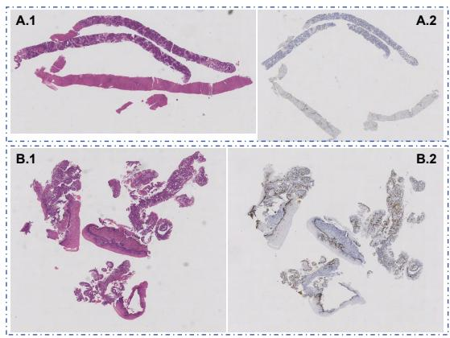  
Figure 1. Examples of biopsy slides. (A.1-A.2) HE and IHC slides of a core needle biopsy with tissue fractures and bending. (B.1- B.2) slides of a forceps biopsy with inter-block displacement.

However, all these methods rely on the assumption that a coarse pre-alignment can be successfully established first. This assumption often breaks down in histopathological slides with fragmented or heavily deformed tissue structures. In many biopsy-derived WSIs, tissues appear as multiple disconnected fragments or elongated strips that undergo bending, tearing, or nonlinear distortion during sectioning. As shown in Fig. 1, adjacent HE–IHC slides of such samples frequently exhibit inconsistent spatial layouts, missing regions, or non-overlapping tissue parts, making global alignment unreliable. These complex structural discontinuities are common [1] in real-world pathology data but are rarely represented in existing benchmarks. When large portions of tissue cannot be coarsely aligned, conventional registration pipelines typically collapse, yielding unstable or meaningless correspondences.

Interestingly, even when global alignment fails, local spatial relations often remain consistent within limited neighborhoods. Points that are close in the tissue tend to preserve their relative configuration despite large-scale deformation or tearing. This observation suggests that correspondence can be established by modeling point-wise relationships to nearby landmarks, rather than estimating a single global transformation. Furthermore, coarse region-level retrieval followed by local refinement allows the system to progressively narrow down corresponding areas, even under severe deformation.

Motivated by these insights, we introduce SAR2Net, a retrieval-guided framework that models geometric correspondence through learned spatial representations rather than explicit transformation prediction. SAR2Net encodes each point’s relative geometry with respect to automatically detected landmarks, which are treated as spatial anchors, forming representations that remain consistent across large cross-stain variations. Trained via contrastive learning on simulated coordinates without any image supervision, SAR2Net, coupled with a retrieval guided alignment pipeline, achieves robust region-level correspondence even under extreme deformations or tissue fragmentation, without requiring any pre-alignment.

Our contributions are threefold: (1) We introduce SAR2Net, a network that models local geometric relations between spatial anchors and query points. The spatially anchored representations generated by SAR2Net achieve strong cross-stain robustness. (2) We develop a two-stage retrieval pipeline that can establish region-level correspondences under extreme tissue distortion or fragment misalignment. (3) We demonstrate state-of-the-art performance on a biopsy-oriented cross-stain dataset, achieving reliable alignment in cases where traditional registration fails.

## 2. Related Work

Traditional WSI registration methods can be broadly categorized into intensity-based and feature-based approaches [9]. Intensity-based methods directly exploit pixel-level information by optimizing similarity metrics like Mutual Information (MI) [5, 8], Normalized Cross-Correlation (NCC) [16, 20, 21], and Normalized Gradient Fields (NGF) [17, 19]. In contrast, feature-based methods rely on the detection of salient local structures such as SIFT [14, 23, 27] and SURF [24, 31], followed by descriptor computation and sparse correspondence estimation. However, due to strong stain variations, tissue deformations, and discontinuous tissue regions between WSI pairs, traditional methods often fail to achieve robust alignment.

To overcome the limitations of traditional methods, recent studies have employed deep learning models to extract more robust feature descriptors. CNN-based methods [2, 3, 12] learn discriminative representations from histopathological images and combine them with conventional matching algorithms for registration [4]. Super-Point [7] further enables end-to-end keypoint detection and description, while SuperGlue [26] applies attention-based graph matching to establish reliable correspondences. The combination of SuperPoint and SuperGlue has been widely adopted in WSI registration. In addition, several pathologyspecific approaches [15, 18] detect nuclei as biologically meaningful keypoints to guide cross-stain alignment.

Beyond learning feature descriptors, some methods aim to directly estimate transformation parameters, generating coarse affine alignments that are subsequently refined by non-rigid deformation models. For instance, Wodzinski e al. [28] employed a ResNet [13] to predict affine transformation parameters, while Roy et al. [25] generates multiscale deformable vector fields using a FCN and additionally leverages a CycleGAN [32] to synthesize corresponding IHC slides from HE to assist registration. These parameter estimation approaches generally assume that slides can be roughly pre-aligned, which limits their applicability in cases with severe and complex tissue distortions.

Currently, the most robust WSI registration approaches often adopt hybrid strategies that combine robust feature matching, global alignment, and local deformation refinement. These multi-stage pipelines typically use descriptors like SuperPoint to perform initial registration, followed by non-rigid refinement. For example, after initial registration, VALIS [11] conducts patch-wise optimization and obtains a dense deformation field by smoothly combining the local transformations, while RegWSI [29] performs non-rigid registration by optimizing local NCC at multiple scales. Such hybrid strategies leverage both structural correspondences and intensity cues, achieving stable and accurate alignment across heterogeneous HE-IHC slide pairs.

However, all existing methods rely on the assumption that WSIs can be roughly pre-aligned. If large tissue regions in HE and IHC slides do not roughly overlap after initial affine alignment, subsequent refinement or learned models often lack a reliable starting point, leading to registration failure. Such cases, caused by severe distortions or misaligned multi-tissue arrangements, are common in realworld pathological datasets, yet current research rarely address this challenge. In this work, we propose a method that circumvents the reliance on coarse pre-alignment, enabling robust alignment even under these difficult conditions.

## 3. Methods

Our goal is to achieve robust cross-stain region alignment, even under large global deformations or tissue distortions in WSIs. To this end, we propose SAR2Net, a framework that learns spatially anchored representations capturing the local geometric relations between a query point $x \in \mathbb { R } ^ { 2 }$ and its surrounding anchors $A = \{ a _ { i } \in \mathbb { R } ^ { 2 } \} _ { i = 1 } ^ { K }$ , which remain consistent across slides. Our SAR2Net achieves robust region-level alignment across differently stained WSIs, without relying on image appearance or any pre-alignment.

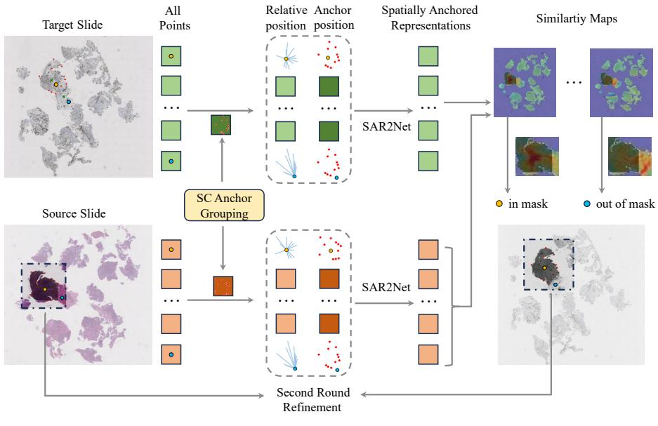

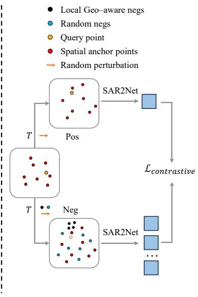  
(a) Inference Stage: Retrieval-Guided Alignment with SAR2Net  
(b) Training Stage  
Figure 2. Pipeline of SAR2Net. (a) Given source and target WSIs, we extract paired landmarks automatically as spatial anchors. As detailed in Sec. 3.3, for each source patch, nearby anchors are selected via Spatially Coherent Anchor Grouping. Then for all points in both slides, SAR2Net computes spatially anchored representations that encode their relative geometry to the anchors. Afterwards, region correspondence is obtained through feature retrieval. If the highest similarity falls inside the source mask, the corresponding target points are assigned to the aligned mask. The retrieved regions are refined by a second round refinement. (b) As described in Sec. 3.2, SAR2Net is trained via contrastive learning using purely synthetic point coordinates, combining random and local geometry–aware negative sampling.

In the following sections, we first describe the network architecture that constructs these representations ( Sec. 3.1). We then detail the contrastive training for SAR2Net with simulated points ( Sec. 3.2), followed by the retrieval guided region alignment pipeline that leverages these representations for cross-stain correspondence ( Sec. 3.3).

## 3.1. Model Architecture

SAR2Net aims to generate deformation-robust features that encode each position’s local spatial relationship to a set of anchor points. Given a variable number of anchors $A =$ $\{ a _ { i } \in \mathbb { R } ^ { 2 } \} _ { 1 = 1 } ^ { K }$ , whose spatial configuration is assumed to remain roughly consistent across paired slides, and a query point $\boldsymbol { x } \in \mathbb { R } ^ { 2 }$ , we first compute their relative positions $R =$ $\{ r _ { i } | r _ { i } = x - a _ { i } , i = 1 , . . . , K \}$ , and concatenate each $r _ { i }$ with its corresponding anchor coordinate $a _ { i }$ to form a position descriptor:

$$
p _ { i } = [ r _ { i } , a _ { i } ] \in \mathbb { R } ^ { 4 } .\tag{1}
$$

All descriptors $p _ { i }$ are passed through a MLP $\phi _ { \theta }$ that encodes local spatial relations into embeddings $h _ { i }$ with $d = 2 5 6 \colon$

$$
h _ { i } = \phi _ { \theta } ( p _ { i } ) \in \mathbb { R } ^ { d } .\tag{2}
$$

To encode the global spatial position of an arbitrary query point relative to a set of anchors, we aggregate spatial information from multiple anchors. Each anchor contributes differently based on its geometric relation to the query point: anchors closer to the query capture finegrained local variations, while distant anchors provide stable global constraints. Therefore, the resulting spatially anchored representation of point x can be formulated as a weighted spatial embedding within the anchor set:

$$
f ( x , A ) = \sum _ { i = 1 } ^ { K } \alpha _ { i } h _ { i } ,\tag{3}
$$

$$
\alpha _ { i } = \frac { \exp \left\{ W \left( \operatorname { t a n h } ( V h _ { i } ) \odot \operatorname { s i g m } ( U h _ { i } ) \right) \right\} } { \sum _ { j = 1 } ^ { K } \exp \left\{ W \left( \operatorname { t a n h } ( V h _ { j } ) \odot \operatorname { s i g m } ( U h _ { j } ) \right) \right\} } ,\tag{4}
$$

where $f ( \cdot , \cdot )$ is our SAR2Net parameterized by $U , V , W$ , ⊙ denotes element-wise multiplication.

## 3.2. Contrastive Learning of Spatial Geometry

SAR2Net is trained to learn spatially anchored representations that depend solely on point coordinates rather than image appearance, encoding the geometric relations between a query point and its surrounding anchors. Given K anchors $A = \{ a _ { i } \} _ { i = 1 } ^ { K }$ and a query point $x ,$ the network generates a representation $f ( x , A ) \in \mathbb { R } ^ { d }$ that captures the query’s relative spatial configuration within the anchor set.

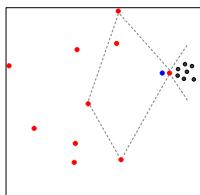  
(a)

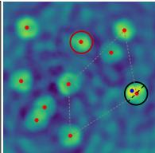  
(b)

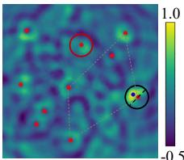  
(c)  
Figure 3. Local geometry–aware negative sampling. (a) Example of a query (blue) near anchors (red), with LGN samples (black). (b) Sim. map w/o LGN. (c) Sim. map w/ our convex-hull based LGN, enabling the model to capture local geometric relations. In (b-c), the black circle highlights a local neighborhood around the reference point that is very close to the query, while the red circle marks a neighborhood around an anchor that is far from the query.

To learn such spatial representations, we adopt a contrastive training scheme using only simulated point coordinates. In each training iteration, we randomly sample $K + 1$ points, where K points form the anchor set A and the left one point serves as the query x. A rigid transformation $T ( \cdot )$ is applied to generate a positive pair $( ( x , A ) , ( T ( x ) , T ( A ) ) )$ ), reflecting the same spatial structure. Negatives are constructed by applying $T ( \cdot )$ to the same anchor set A and resampling N negative query points $\{ x _ { j } ^ { - } \} _ { j = 1 } ^ { N }$ that satisfy $\| x _ { j } ^ { - } - T ( x ) \| > \delta _ { n e g } .$ , ensuring sufficient geometric separation.

When the query lies very close to an anchor, the model may focus excessively on anchor’s local neighborhood and neglect the overall anchor geometry. To address this, we employ local geometry–aware negative sampling (LGN). As illustrated in Fig. 3 (a), the nearest anchor is treated as a reference, and a local convex hull is formed with its neighboring anchors. Negative queries are then sampled symmetrically on the opposite side of the hull, maintaining similar distances to the reference. In Fig. 3 (b), without LGN, the model tends to produce high similarity around both the reference anchor (black circle) and other anchors (red circle), effectively learning only that the query is near an anchor. In Fig. 3 (c), with LGN, the high-similarity region in the black circle is constrained within the convex hull, while the similarity around the remaining anchors in the red circle is also suppressed. At this point, the model captures more local spatial geometric information.

Finally, a random uniform perturbation $\epsilon \sim \mathcal { U } ( - \sigma , \sigma )$ is added to all coordinates to improve robustness and spatial smoothness, which simulates the subtle nonlinear deformations commonly observed in real tissue sections. The network is trained with a standard InfoNCE loss.

## 3.3. Retrieval-Guided Region Alignment

Spatial Anchor Extraction To obtain spatially anchored representations, reliable spatial anchors are required as geometric reference points across stains. We treat paired landmarks from source and target images as spatial anchors. We extract them by directly applying pre-trained Super-Point and SuperGlue models on low-resolution slide thumbnails. The SuperPoint-SuperGlue framework is known for its excellent generalization ability, enabling robust correspondence across different histopathological slides.

However, both SuperPoint and SuperGlue lack rotation invariance, while tissue sections in WSIs may undergo various rotations. To address this, we rotate the source image by multiple angles and extract anchor points for each rotation. The rotation that yields the largest number of valid correspondences is selected, and its matched keypoints are used as the main anchor set $( A _ { s o u r c e } , A _ { t a r g e t } )$ where $A _ { s o u r c e } = \{ a _ { i } ^ { s } \} _ { i = 1 } ^ { K }$ and $A _ { t a r g e t } = \{ a _ { i } ^ { t } \} _ { i = 1 } ^ { K }$

Subsequently, anchor point pairs $( a _ { j } ^ { s } , a _ { j } ^ { s } )$ extracted from other rotation angles are added to the main anchor set if for all $i \in N$ , max $( \| a _ { j } ^ { s } - a _ { i } ^ { s } \| , \| a _ { j } ^ { t } - a _ { i } ^ { t } \| ) < \delta _ { m e r g e }$ . This step ensures that when multiple regions or significant distortions are present in the WSI, spatial anchors in different local areas with varying rotations are extracted accurately.

Spatially Coherent Anchor Grouping Our region-level alignment assumes that the spatial relationship between a query and its nearby anchors remains locally stable across stains. However, large tissue deformations and discontinuities in WSIs often break this assumption, making global anchor sets unreliable for correspondence.

To preserve spatial validity, we adopt a spatially coherent anchor grouping strategy. For each region to be aligned, we slide a window over the source slide and select up to K nearest anchors within the window and its surrounding neighborhood, ensuring locally valid geometric relations.

Still, anchors within the same window may not form a coherent structure, as some are mismatched, while others arise from separate tissue fragments or deformation patterns. To refine the grouping, we apply iterative geometric consensus using RANSAC [10] to cluster anchors that share a compatible local transformation, progressively discarding outliers until no valid model remains under the threshold $\delta _ { s p l i t }$ . Each resulting subset serves as a stable geometric basis for subsequent region-level alignment.

Region Retrieval and Alignment For each window, we compute spatially anchored representations for all points in both slides using same anchors. Region correspondence is then established through feature retrieval: for each target point, we map its similarity against all points in source slide and identify its top-k most similar source points. If these points are concentrated within the corresponding source window mask, the target point is assigned to that region.

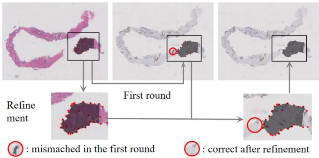  
Figure 4. Two-Stage Refinement. The second-stage refinement is operated on each region and its neighborhood obtained from the first-stage retrieval. The ◦ indicates mismatched areas from the first stage that are successfully corrected after refinement.

However, in some cases, the target region may have no true counterpart in the source slide due to tissue loss, fragmentation, or severe deformation. In such cases, the topk matches may still fall within nearby source areas but exhibit uniformly low similarity, leading to spurious correspondences. To prevent this, we introduce a similarity threshold $\delta _ { s i m }$ and only assign a region label when the maximum similarity exceeds this value. This filtering step effectively suppresses false matches and enhances the reliability of cross-stain region alignment.

Two-Stage Refinement After the first round of retrieval, our model has already established a reliable region-level correspondence. However, due to the large window size and sparse anchor distribution, local areas may still exhibit slight nonlinear deformations or boundary shifts, limiting alignment precision. To further refine local correspondence, we introduce a two-stage refinement strategy. Specifically, as illustrated in Fig. 4, each matched region from the first stage is treated as a new region of interest (ROI), within which additional anchors are extracted to form denser and more locally consistent anchor sets. The region alignment process is then re-applied within these refined ROIs. Built upon the initial region-level mapping, this hierarchical refinement progressively enhances alignment accuracy and stability under complex tissue deformations.

## 4. Dataset

## 4.1. Data collection and cleaning

We collect histopathology slides from Xijing Hospital. Approximately 35% of these slides exhibit severe tissue distortions or consisted of multiple disjoint tissue fragments, characteristics commonly observed in biopsy specimens. From the raw collection, we select 154 cases that contain both HE and IHC slides, ensuring that at least part of the tissue regions in each HE slide have corresponding areas in the IHC counterpart. In some cases, one HE slide is associated with multiple IHC slides (up to over ten). For cases with more than three corresponding IHC slides, we randomly select up to three to maintain data diversity and computational feasibility. In total, we obtain 370 HE–IHC slide pairs covering 79 different IHC staining types. Our dataset spans diverse tissues and cancer types, with 23.6% from breast, 15.7% from liver, and 14.6% from prostate.

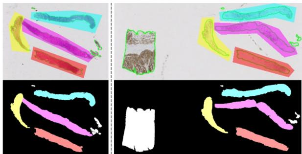  
Figure 5. Example of data annotation. The left and right slides are adjacent slides, where the right one exhibits severe distortion and has an additional control tissue. After segmenting the tissue foreground (green solid lines) and annotating the corresponding regions, four paired region masks were obtained.

## 4.2. Data Annotation

Considering that region-level alignment is often sufficient for diagnostic interpretation, we annotated our 370 HE–IHC pairs at the region level. We first performed automatic tissue–background segmentation to accelerate the subsequent annotation process. The segmentation was conducted using the tissue segmentation module from Trident [30], which is robust across various staining types and does not require manual parameter tuning as in traditional threshold-based approaches. After segmentation, we manually delineated corresponding tissue regions, ensuring that each annotated region was complete and consistently present in both HE and IHC slides. Fig. 5 illustrates examples of the annotated region correspondences.

## 5. Experiments and Results

## 5.1. Implementation Details

During training, we use simulated 2D coordinates to enable SAR2Net to learn spatial relationships between query and anchor points. The output embedding dimension d is 256. With a batch size of 256, the number of spatial anchors K is fixed within a batch but randomly sampled from $\{ 4 , \ldots , 1 0 \}$ across batches. For negative sampling, we set the minimum separation distance $\delta _ { n e g } ~ = ~ 2 0$ and draw N = 500 negative queries for each sample. To encourage the network to reason about local geometric boundaries, 10% of query points are sampled near anchors, for which additional negatives are placed symmetrically on the opposite side of the convex hull, as described in Sec. 3.2. For all sampled coordinates, a uniform perturbation $\epsilon \sim \mathcal { U } ( - 5 , 5 )$ is added to improve robustness. The model is trained with the Adam optimizer using a learning rate of $1 \times 1 0 ^ { - 4 }$ and the InfoNCE loss [22] with temperature $\tau = 0 . 3$

Table 1. Quantitative performance with mIoU, mDice, aw-IoU, and aw-Dice. Ours (single) means only the first round region retrieval and alignment is performed. Ours (second) means the second round refinement is performed.
<table><tr><td>Method</td><td>mIoU↑</td><td>mDice ↑</td><td>aw-IoU↑</td><td> $\mathrm { \ a w { - } D i c e \ } \uparrow$ </td></tr><tr><td>VALIS [11]</td><td>0.635</td><td>0.705</td><td>0.647</td><td>0.716</td></tr><tr><td>RegWSI [29]</td><td>0.691</td><td>0.786</td><td>0.699</td><td>0.794</td></tr><tr><td>Ours (single)</td><td>0.891</td><td>0.938</td><td>0.893</td><td>0.939</td></tr><tr><td>Ours (second)</td><td>0.899</td><td>0.942</td><td>0.901</td><td>0.944</td></tr></table>

During inference, spatial anchors are extracted using SuperPoint and SuperGlue with default settings. The source slide is rotated every $1 5 ^ { \circ }$ , and anchors detected across all rotations are merged with $\delta _ { m e r g e } \ : = \ : 5$ and split with $\delta _ { s p l i t } = 1 0$ . Region retrieval is then performed with sliding windows of size 100 and stride 50, each associated with up to 15 nearest anchors (or all available if $K _ { a n c h o r s } < 1 5$ in that area). A target point is assigned to a source region if any of its top-5 most similar source points lie within the region mask and the similarity exceeds $\delta _ { s i m } = 0 . 7$

## 5.2. Metrics

To systematically evaluate the region-alignment performance, we report the mean intersection over union (mIoU) and mean dice similarity coefficient (mDice). To mitigate bias from different region sizes, we also report areaweighted versions (aw-IoU, aw-Dice), where the metrics are averaged by region area before taking the mean.

In addition, we assess robustness using the success rate $\mathrm { S R } _ { \mathrm { I o U } } ^ { t }$ and $\mathrm { S R } _ { \mathrm { D i c e } } ^ { t } ,$ defined as the proportion of regions whose IoU or Dice exceeds a threshold t:

$$
\mathrm { S R } _ { \mathrm { M e t r i c } } ^ { t } = \frac { 1 } { M } \sum _ { k = 1 } ^ { M } \mathbf { 1 } \left[ \mathrm { M e t r i c } _ { k } \geq t \right] ,\tag{5}
$$

where Metrick denotes IoU or Dice of region k. The area under the success-rate curve (AUC) is also reported.

While mean-based metrics reflect average alignment accuracy, the success rate characterizes the proportion of wellaligned regions above varying thresholds, providing a more distribution-aware and robustness-oriented evaluation.

Table 2. Robustness Analysis with success rate (SR) over IoU and Dice. Ours (single) means only perform the first round region retrieval and alignment. Ours (second) represents that the second round refinement is performed.
<table><tr><td></td><td> $\mathrm { S R _ { I o U } ^ { 0 . 7 5 } \uparrow }$ </td><td> $\mathrm { S R } _ { \mathrm { I o U } } ^ { 0 . 8 5 }$  ←</td><td> $\mathrm { S R _ { D i c e } ^ { 0 . 7 5 } \uparrow }$ </td><td> $\operatorname { S R } _ { \mathrm { D i c e } } ^ { 0 . 8 5 } \uparrow$ </td></tr><tr><td>VALIS [11]</td><td>0.594</td><td>0.429</td><td>0.690</td><td>0.606</td></tr><tr><td>RegWSI [29]</td><td>0.545</td><td>0.324</td><td>0.740</td><td>0.574</td></tr><tr><td>Ours (single)</td><td>0.899</td><td>0.768</td><td>0.971</td><td>0.910</td></tr><tr><td>Ours (second)</td><td>0.939</td><td>0.812</td><td>0.974</td><td>0.946</td></tr></table>

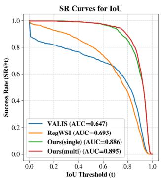  
(a)

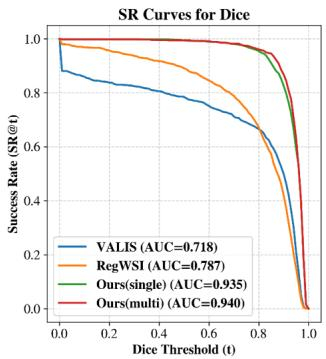  
(b)  
Figure 6. Visualization of the success rate curves. (a) Success rate curves over IoU thresholds. (b) Success rate curves over Dice thresholds. The AUC of the curves are reported on the figures.

## 5.3. Baseline

We compare our SAR2Net with two recent leading WSI alignment frameworks: VALIS [11] and RegWSI [29]. Both VALIS and RegWSI are fully automated, multi-stage WSI registration frameworks that perform feature-based rigid or affine initialization followed by intensity-based non-rigid refinement. We evaluate all methods on our biopsy dataset to assess their performance under severe tissue discontinuities and deformations.

## 5.4. Quantitative Comparisons

As shown in Tab. 1, our method achieves substantial improvements over existing approaches across all four metrics (mIoU, mDice, aw-IoU, and aw-Dice). This demonstrates that the proposed alignment framework is considerably more effective than traditional registration pipelines. Moreover, incorporating the second-round refinement yields additional and consistent gains over the single-round variant, confirming the effectiveness of our iterative retrieval-andrefinement strategy for correcting residual misalignments.

For previous methods such as VALIS and RegWSI, the area weighted metrics are slightly higher than the mean metrics, which is mainly driven by the correct alignment of a few large and easier-to-match regions. This indicates an imbalance in their alignment behavior: while large regions are aligned reasonably well, many medium and small regions remain poorly aligned. Such imbalance stems from the tendency of these registration frameworks to rely heavily on the initial alignment stage, which often prioritizes the global fit of larger regions at the expense of smaller ones. As a result, these methods struggle to maintain robustness once the geometric structure becomes locally complex.

In contrast, our method still exhibits a markedly larger advantage on the area weighted metrics and, more importantly, shows only minimal discrepancy between mean based metrics and area weighted metrics. This indicates that our alignment quality is uniformly high across regions of different sizes, rather than being biased toward large regions. Such closeness between the mean and area weighted metrics highlights the size-robustness of our framework and demonstrates that it maintains stable and reliable alignment performance for both large and small regions.

## 5.5. Robustness Analysis with Success Rate

As shown in Tab. 2, our method achieves substantially higher success rates than existing approaches across different IoU and Dice thresholds. This indicates that, compared with previous registration pipelines, our retrieval–alignment framework maintains a much larger proportion of highquality aligned regions, yielding more stable and robust performance overall. Moreover, the second-round refinement brings additional improvements across all SR metrics, particularly at higher thresholds, demonstrating its effectiveness in correcting the residual misalignments left by the first round and improving performance in difficult regions.

This trend is further corroborated by the success rate curves in Fig. 6. The AUC values shown in the figure reveal that our method consistently maintains higher SR curves across the entire range of thresholds, highlighting its advantage across regions of varying difficulty. In contrast, VALIS and RegWSI exhibit highly unstable behavior when reliable initial alignment is unavailable: many regions fall below even moderate IoU/Dice thresholds, and VALIS even collapses entirely on certain samples, underscoring the vulnerability of previous frameworks under large deformations and complex local structures. The gains from our second round refinement concentrate in the high threshold ranges, 0.7-0.9 for IoU and 0.8-0.9 for Dice, which aligns well with our design: the first round retrieval in SAR2Net establishes a strong global correspondence, while the second round refinement corrects fine-scale nonlinear distortions and boundary shifts remaining from the first round, thus increasing the proportion of high-quality matches.

Together, Tab. 2 and Fig. 6 demonstrate that our method not only achieves superior average overlap performance, but also delivers a more stable and consistent alignment quality distribution. It maintains reliable performance across regions of different sizes and difficulty levels, significantly outperforming existing WSI registration approaches.

Table 3. Ablation study on the presence of random perturbations (pertu), local geometry-aware negative sampling (LGN), and second-round refinement (sec).
<table><tr><td>w. pertu</td><td>w. LGN</td><td>w. sec</td><td>mIoU↑</td><td>mDice ↑</td><td>aw-IoU ↑</td></tr><tr><td>x</td><td>√</td><td>x</td><td>0.847</td><td>0.911</td><td>0.852</td></tr><tr><td>√</td><td>x</td><td>x</td><td>0.888</td><td>0.936</td><td>0.890</td></tr><tr><td>√</td><td>√</td><td>x</td><td>0.891</td><td>0.938</td><td>0.893</td></tr><tr><td>√</td><td>√</td><td>√</td><td>0.899</td><td>0.942</td><td>0.901</td></tr></table>

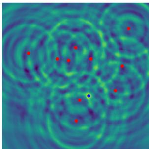  
(a)

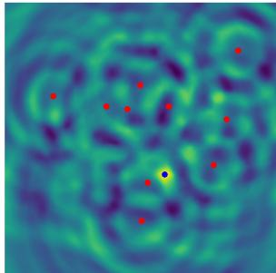  
(b)  
Figure 7. Ablation study on random perturbations. (a) Similarity map generated by SAR2Net trained without random perturbation, (b) Similarity map by SAR2Net trained with random perturbation, with the query point shown in blue and anchor points in red.

## 5.6. Ablation Study

We conduct a comprehensive ablation study to assess the contributions of three key components in SAR2Net: random perturbations (pertu), local geometry-aware negative sampling (LGN), and the second-round refinement (sec).

As shown in Tab. 3, random perturbations provide the most significant performance gains. Incorporating perturbations during training leads to large improvements in mIoU, mDice, and aw-IoU, indicating substantially enhanced robustness to large and nonlinear deformations. This observation is fully consistent with the success rate curves in Fig. 9: without perturbations , the SR curves drop sharply in the mid-to-high threshold ranges (e.g. 0.7–0.9), whereas the curves with perturbations remain consistently higher across all thresholds, demonstrating more reliable retrieval of the correct corresponding region.

The similarity maps in Fig. 7 further illustrate this effect. Without perturbations, the model exhibits clear concentric interference patterns, and the highlighted region collapses into a narrow neighborhood around the query–anchor distance, revealing an undesired tendency toward rigid matching. In contrast, when random perturbations are applied, the model still correctly identifies the corresponding position, but the activation becomes much smoother and more spatially flexible, better reflecting the nonlinear deformations commonly observed in real WSI pairs. This confirms that random perturbations effectively prevent the network from overfitting to rigid transformations and encourage the learning of more realistic geometric variations.

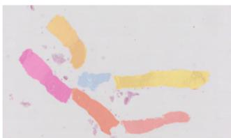

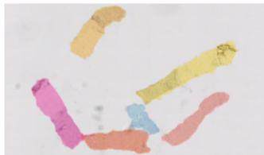

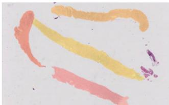

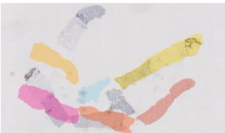

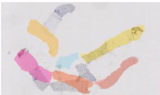

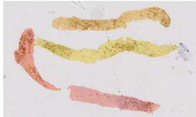

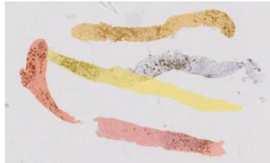

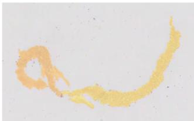

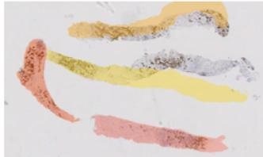

HE (source)  
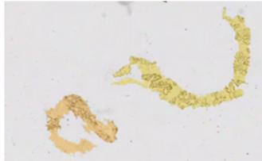  
SAR2Net

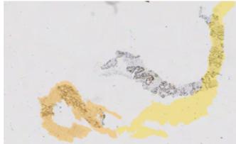  
RegWSI

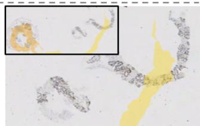  
VALIS

Figure 8. We visualize three representative cases exhibiting fragmented tissues or strong deformations. In the first row, each slide contains multiple tissue fragments that undergo distinct spatial displacements. The second row shows a sample with a tissue piece undergoing large distortion. The third row presents intra-block misalignment, where an additional control tissue on the left (shown in the VALIS result) further distracts the registration. Our method achieves robust spatial correspondence across stains despite these challenges.  
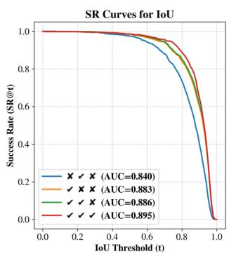  
(a)

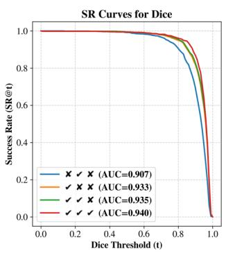  
(b)  
Figure 9. Success rate curves for ablation study. (a) Curves over IoU thresholds. (b) Curves over Dice thresholds. From left to right, each combination of ✓ and ✗ indicates whether random perturbations, Local Geometry-Aware Negative Sampling (LGN), and second-round refinement are enabled, respectively. The AUC of the curves are reported on the figures.

As for the local geometry-aware negative sampling, it plays a more localized and fine-grained role. Adding LGN leads to modest improvements in mIoU and mDice, while at the same time, the SR curves with and without LGN nearly overlap in Fig. 9. This indicates that LGN mainly enhances boundary-level geometric discrimination when the query lies close to certain anchors, but has limited influence on the overall large-region alignment.

Finally, incorporating the second-round refinement yields small yet consistent improvements in both average metrics and high-threshold SR values, leading to the best overall performance. This stage refines the residual misalignments left by the first round and adjusts boundary details, resulting in more precise final alignment.

## 6. Conclusion

We present SAR2Net, a framework that learns spatially anchored representations for cross-stain region alignment. By modeling the relative geometric relationships between query points and surrounding anchors, SAR2Net enables cross-slide correspondence without any pre-alignment. Through contrastive learning on simulated point coordinates, retrieval-guided region alignment, and multi-level refinement, our method remains robust to severe deformations and fragmented tissue. Experimental results demonstrate that SAR2Net consistently outperforms existing registration frameworks, offering a new perspective for multi-stain integration in computational pathology.

## References

[1] Hiroyuki Abe, Yusuke Kurose, Shusuke Takahama, Ayako Kume, Shu Nishida, Miyako Fukasawa, Yoichi Yasunaga, Tetsuo Ushiku, Youichiro Ninomiya, Akihiko Yoshizawa, et al. Development and multi-institutional validation of an artificial intelligence-based diagnostic system for gastric biopsy. Cancer Science, 113(10):3608–3617, 2022. 1

[2] Ruqayya Awan and Nasir Rajpoot. Deep autoencoder features for registration of histology images. In Annual Conference on Medical Image Understanding and Analysis, pages 371–378. Springer, 2018. 2

[3] Ruqayya Awan, Shan E Ahmed Raza, Johannes Lotz, Nick Weiss, and Nasir Rajpoot. Deep feature based cross-slide registration. Computerized Medical Imaging and Graphics, 104:102162, 2023. 2

[4] Hamid Reza Boveiri, Raouf Khayami, Reza Javidan, and Alireza Mehdizadeh. Medical image registration using deep neural networks: a comprehensive review. Computers & Electrical Engineering, 87:106767, 2020. 2

[5] Ali Can, Musodiq Bello, Harvey E Cline, Xiaodong Tao, Fiona Ginty, Anup Sood, Michael Gerdes, and Michael Montalto. Multi-modal imaging of histological tissue sections. In 2008 5th IEEE International Symposium on Biomedical Imaging: From Nano to Macro, pages 288–291. IEEE, 2008. 2

[6] Jun Cheng, Kun Huang, and Jun Xu. Computational pathology for precision diagnosis, treatment, and prognosis of cancer, 2023. 1

[7] Daniel DeTone, Tomasz Malisiewicz, and Andrew Rabinovich. Superpoint: Self-supervised interest point detection and description. In Proceedings of the IEEE conference on computer vision and pattern recognition workshops, pages 224–236, 2018. 2

[8] Joshua Doyle, Benjamin F Green, Margaret Eminizer, Daniel Jimenez-Sanchez, Steve Lu, Elizabeth L Engle, Haiying Xu, Aleksandra Ogurtsova, Jonathan Lai, Sigfredo Soto-Diaz, et al. Whole-slide imaging, mutual information registration for multiplex immunohistochemistry and immunofluorescence. Laboratory Investigation, 103(8):100175, 2023. 2

[9] Behnaz Elhaminia, Abdullah Alsalemi, Esha Nasir, Mostafa Jahanifar, Ruqayya Awan, Lawrence S Young, Nasir M Rajpoot, Fayyaz Minhas, and Shan E Ahmed Raza. From traditional to deep learning approaches in whole slide image registration: A methodological review. arXiv preprint arXiv:2502.19123, 2025. 2

[10] Martin A Fischler and Robert C Bolles. Random sample consensus: a paradigm for model fitting with applications to image analysis and automated cartography. Communications ofthe ACM, 24(6):381–395, 1981. 4

[11] Chandler D Gatenbee, Ann-Marie Baker, Sandhya Prabhakaran, Ottilie Swinyard, Robbert JC Slebos, Gunjan Mandal, Eoghan Mulholland, Noemi Andor, Andriy Marusyk, Simon Leedham, et al. Virtual alignment of pathology image series for multi-gigapixel whole slide images. Nature communications, 14(1):4502, 2023. 1, 2, 6

[12] Lin Ge, Xingyue Wei, Yayu Hao, Jianwen Luo, and Yan Xu. Unsupervised histological image registration using structural

feature guided convolutional neural network. IEEE Transactions on Medical Imaging, 41(9):2414–2431, 2022. 2

[13] Kaiming He, Xiangyu Zhang, Shaoqing Ren, and Jian Sun. Deep residual learning for image recognition. In Proceed ings ofthe IEEE conference on computer vision and pattern recognition, pages 770–778, 2016. 2

[14] Md Ziaul Hoque, Anja Keskinarkaus, Pia Nyberg, Taneli Mattila, and Tapio Seppanen. Whole slide image registra-¨ tion via multi-stained feature matching. Computers in Biol ogy and Medicine, 144:105301, 2022. 2

[15] Adith Jeyasangar, Abdullah Alsalemi, and Shan E Ahmed Raza. Nuclei-location based point set registration of multistained whole slide images. In Annual Conference on Med ical Image Understanding and Analysis, pages 372–386. Springer, 2024. 2

[16] Ashley L Kiemen, Alicia M Braxton, Mia P Grahn, Kyu Sang Han, Jaanvi Mahesh Babu, Rebecca Reichel, Ann C Jiang, Bridgette Kim, Jocelyn Hsu, Falone Amoa, et al. Coda: quantitative 3d reconstruction of large tissues at cellular resolution. Nature Methods, 19(11):1490–1499, 2022. 2

[17] Cher-Wei Liang, Ruey-Feng Chang, Pei-Wei Fang, and Chiao-Min Chen. Improving algorithm for the alignment of consecutive, whole-slide, immunohistochemical section im ages. Journal ofPathology Informatics, 12(1):29, 2021. 2

[18] Pangpang Liu, Fusheng Wang, George Teodoro, and Jun Kong. Histopathology image registration by integrated texture and spatial proximity based landmark selection and modification. In 2021 IEEE 18th International Symposium on Biomedical Imaging (ISBI), pages 1827–1830. IEEE, 2021. 2

[19] Johannes Lotz, Janine Olesch, Benedikt Muller, Thomas¨ Polzin, P Galuschka, JM Lotz, Stefan Heldmann, Hendrik Laue, Margarita Gonzalez-Vallinas, Arne Warth, et al. Patch-´ based nonlinear image registration for gigapixel whole slide images. IEEE Transactions on Biomedical Engineering, 63 (9):1812–1819, 2015. 2

[20] Bin Ma, Zhuang Lin, Simon Winkelbach, Werner Linden maier, and Kurt EJ Dittmar. Automatic registration of serial sections of mouse lymph node by using image-reg. Micron, 39(4):387–396, 2008. 2

[21] Daniel F Gonzalez Obando, Astri Frafjord, Inger Øynebraten, Alexandre Corthay, Jean-Christophe Olivo-˚ Marin, and Vannary Meas-Yedid. Multi-staining registration of large histology images. In 2017 IEEE 14th international symposium on biomedical imaging (ISBI 2017), pages 345–348. IEEE, 2017. 2

[22] Aaron van den Oord, Yazhe Li, and Oriol Vinyals. Representation learning with contrastive predictive coding. arXiv preprint arXiv:1807.03748, 2018. 6

[23] Mahsa Paknezhad, Sheng Yang Michael Loh, Yukti Choudhury, Valerie Koh Cui Koh, Timothy Tay Kwang Yong, Hui Shan Tan, Ravindran Kanesvaran, Puay Hoon Tan, John Yuen Shyi Peng, Weimiao Yu, et al. Regional registration of whole slide image stacks containing major histological arti facts. BMC bioinformatics, 21(1):558, 2020. 2

[24] Blair J Rossetti, Fusheng Wang, Pengyue Zhang, George Teodoro, Daniel J Brat, and Jun Kong. Dynamic registra-

tion for gigapixel serial whole slide images. In 2017 IEEE 14th International Symposium on Biomedical Imaging (ISBI 2017), pages 424–428. IEEE, 2017. 2

[25] Mousumi Roy, Fusheng Wang, George Teodoro, Shristi Bhattarai, Mahak Bhargava, T Subbanna Rekha, Ritu Aneja, and Jun Kong. Deep learning based registration of serial whole-slide histopathology images in different stains. Journal ofPathology Informatics, 14:100311, 2023. 1, 2

[26] Paul-Edouard Sarlin, Daniel DeTone, Tomasz Malisiewicz, and Andrew Rabinovich. Superglue: Learning feature matching with graph neural networks. In Proceedings of the IEEE/CVF conference on computer vision and pattern recognition, pages 4938–4947, 2020. 2

[27] Abubakr Shafique, Morteza Babaie, Mahjabin Sajadi, Adrian Batten, Soma Skdar, and Hamid R Tizhoosh. Automatic multi-stain registration of whole slide images in histopathology. In 2021 43rd Annual International Conference of the IEEE Engineering in Medicine & Biology Society (EMBC), pages 3622–3625. IEEE, 2021. 2

[28] Marek Wodzinski and Henning Muller. Deephistreg: Unsu- ¨ pervised deep learning registration framework for differently stained histology samples. Computer methods and programs in biomedicine, 198:105799, 2021. 1, 2

[29] Marek Wodzinski, Niccolo Marini, Manfredo Atzori, and\` Henning Muller. Regwsi: Whole slide image registration¨ using combined deep feature-and intensity-based methods: Winner of the acrobat 2023 challenge. Computer methods and programs in biomedicine, 250:108187, 2024. 1, 2, 6

[30] Andrew Zhang, Guillaume Jaume, Anurag Vaidya, Tong Ding, and Faisal Mahmood. Accelerating data processing and benchmarking of ai models for pathology. arXiv preprint arXiv:2502.06750, 2025. 5

[31] Jiehua Zhang, Zhang Li, and Qifeng Yu. Point-based registration for multi-stained histology images. In 2020 IEEE 5th International Conference on Image, Vision and Computing (ICIVC), pages 92–96. IEEE, 2020. 2

[32] Jun-Yan Zhu, Taesung Park, Phillip Isola, and Alexei A Efros. Unpaired image-to-image translation using cycleconsistent adversarial networks. In Proceedings of the IEEE international conference on computer vision, pages 2223– 2232, 2017. 2