# PIXELSR: PIXEL-SPACE ORTHOGONAL FLOW DE-COUPLING FOR REAL-WORLD IMAGE SUPER-RESOLUTION

Xiang Lv1, Kai Zhao2,†, Qiang Wang2, Qiao Mo2, Chao Zhou2, Mingwen Shao3,∗

1China University of Petroleum (East China) 2Kuaishou Technology

3Shenzhen University of Advanced Technology

† Project Lead and Main Advising ∗ Corresponding author

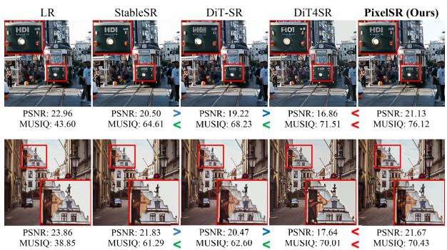  
(a) Qualitative Comparisons

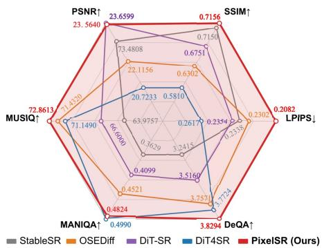  
(b) Quantitative Scores  
Figure 1: Fidelity–realism seesaw effect on ScreenSR. (a) Qualitatively, existing latent-space methods sacrifice structural fidelity for realism, leading to text distortions and hallucinations (see crops). (b) Quantitatively, higher perceptual quality (MANIQA↑, MUSIQ↑, DeQA↑) typically correlates with degraded fidelity (PSNR↑, SSIM↑, LPIPS↓). In contrast, our PixelSR successfully reconciles this trade-off, achieving superior performance in both dimensions.

## ABSTRACT

Latent diffusion models have recently achieved remarkable progress in Real-world Image Super-Resolution (Real-SR). However, existing methods consistently exhibit a persistent seesaw effect: enhancing perceptual realism compromises structural fidelity. This effect, we argue, is not intrinsic to diffusion models, but largely stems from the architectural constraints of prevailing two-stage frameworks. To address this challenge, we propose PixelSR, a novel single-stage Pixel Diffusion Transformer for Real-SR that operates directly in pixel space. Specifically, PixelSR consists of two core designs: Pixel-space Conditional Diffusion and Orthogonal Flow Decoupling. The former establishes an effective pixel-space restoration framework by integrating spatially aligned LR conditioning, visual semantic guidance, and lightweight texture refinement, thereby bypassing VAE compression and enabling end-to-end optimization directly in RGB space. Complementarily, the latter decomposes the asymmetric flow target into a low-rank semantic component and a noise-free orthogonal texture component. By routing these components to specialized branches, it achieves decoupled optimization with reduced mutual interference. Benefiting from these designs, our PixelSR restores perceptually realistic details while faithfully preserving structural content. Extensive experiments across multiple benchmarks demonstrate that PixelSR not only achieves competitive performance, but also effectively mitigates the fidelity–realism seesaw effect.

## 1 INTRODUCTION

Real-world Image Super-Resolution (Real-SR) aims to recover High-Resolution (HR) images from Low-Resolution (LR) observations undergoing complex and unknown degradations (Fang et al., 2025; Wu et al., 2026b). Recently, Latent Diffusion Models (LDMs) have dominated this task by performing denoising in the compressed latent space of a pre-trained VAE, substantially reducing computational and memory costs (Rombach et al., 2022; Sheng et al., 2024; Wu et al., 2024b).

Despite this efficiency, prior studies have highlighted fidelity limitations of latent representations, with text and high-frequency details susceptible to degradation even during VAE reconstruction alone (Yao et al., 2025; Medi1 & Rampini, 2026; Esser et al., 2024; Gupta et al., 2024). These limitations are particularly relevant to Real-SR, where LDMs typically exhibit a seesaw effect: improving perceptual realism often comes at the cost of fidelity to the LR, as illustrated in Figure 1. Qualitatively, this effect manifests as structural distortions, severe text degradation, and content hallucinations. Quantitatively, improvements in no-reference perceptual quality, as measured by MANIQA and MUSIQ, are consistently accompanied by lower PSNR and SSIM, indicating degraded reference-based fidelity.

We argue that this seesaw effect is not an insurmountable limit of diffusion models, but rather stems from two structural bottlenecks of the LDM paradigm: (1) pre-trained VAEs inevitably perform lossy reconstruction, discarding high-frequency details and fine-grained structures, which inherently limits the upper bound of structural fidelity; (2) the disjointed two-stage pipeline prevents end-to-end optimization, causing reconstruction and approximation errors to cascade and accumulate between latent generation and pixel decoding. These architectural limitations motivate a fundamental question: Can we bypass the latent bottleneck and perform Real-SR directly in the pixel space?

Emerging advancements in pixel-space diffusion have demonstrated the feasibility of generative modeling directly on raw pixels without relying on a pre-trained VAE. However, bypassing the VAE bottleneck alone does not automatically resolve the persistent fidelity–realism trade-off. In conventional flow matching, predicting the standard velocity target ${ \pmb v } : = { \pmb \epsilon } - { \pmb x } _ { 0 }$ couples full-dimensional noise with clean-image reconstruction, requiring a single network to simultaneously perform high level semantic generation and low-level texture recovery (Chen et al., 2026a). This task entangle ment is particularly problematic for Real-SR: the former role relies on generative priors to synthesize realistic content, whereas the latter demands strict pixel-level alignment with the LR observation. To solve this challenge, several methods attempt to ease this optimization burden through architectura bypasses or direct clean-image prediction (Hoogeboom et al., 2024; Li & He, 2026). Nevertheless, they either complicate the transformer recipe, suffer from numerical ill-conditioning, or fail to explicitly partition these conflicting roles within the denoising flow. Therefore, the key challenge of pixel-space Real-SR lies in how to orthogonally decouple these two roles within a unified, conditional framework, thereby reconciling the tension between perceptual realism and structural fidelity.

Based on the above analysis, we propose PixelSR, a novel single-stage pixel-space diffusion framework for Real-SR that aims to reconcile structural fidelity and perceptual realism, as displayed in Figure 2. Specifically, our PixelSR is built upon Pixel-space Conditional Diffusion (PCD), which integrates spatially aligned LR conditioning, visual semantic guidance, and lightweight texture refinement to perform end-to-end restoration directly in RGB space, thereby eliminating the need for lossy VAE encoding and decoding. To alleviate task entanglement in conventional flow matching, we further develop Orthogonal Flow Decoupling (OFD) by decomposing the asymmetric velocity $\pmb { u } _ { \mathrm { A } } : = \pmb { P } \pmb { \epsilon } - \pmb { x } _ { 0 }$ into a low-rank semantic component $P u _ { \mathrm { A } }$ and an orthogonal texture componen $( I - P ) u _ { \mathrm { A } }$ , enabling specialized optimization with reduced interference.

Our main contributions are summarized as follows:

• We present PixelSR, a single-stage end-to-end Pixel Diffusion Transformer for Real-SR. Its PCD framework adapts the original diffusion backbone to operate directly in pixel space, bypassing the lossy VAE bottleneck.

• We propose OFD to mitigate task entanglement in pixel-space flow matching. By decomposing asymmetric velocity target into a low-rank semantic and an orthogonal texture component, OFD assigns them to specialized modules to minimize optimization interference.

• Extensive experiments across multiple Real-SR benchmarks demonstrate that PixelSR delivers consistently strong performance across both fidelity- and perception-oriented metrics, effectively mitigating the fidelity–realism seesaw effect.

## 2 RELATED WORK

## 2.1 REAL-WORLD IMAGE SUPER-RESOLUTION

The methodology of Real-SR has evolved from fidelity-oriented reconstruction to perceptual detail generation. Early deep-learning approaches, including convolutional neural networks and vision Transformers (Dong et al., 2015; Liang et al., 2021), primarily optimize pixel-wise reconstruction objectives (e.g., $L _ { 1 }$ or $L _ { 2 }$ losses). Although these methods preserve structural integrity and achieve favorable distortion metrics, they inherently suffer from over-smoothing due to the regression-tothe-mean problem. To improve perceptual quality, generative adversarial networks (Wang et al., 2021; Zhang et al., 2021) are introduced by utilizing adversarial and perceptual losses to recover high-frequency textures under complex degradations. However, despite producing sharper details, they frequently produce unnatural visual artifacts.

More recently, diffusion models have emerged as a powerful alternative for realistic detail generation. While early approaches train conditional diffusion models specifically for SR (Saharia et al., 2023; Yue et al., 2023), recent methods increasingly adapt large-scale pre-trained text-to-image priors (Wang et al., 2024a; Duan et al., 2025). Despite their impressive perceptual quality, most of the latter operate in a VAE-compressed latent space, potentially losing fine-grained structures and separating latent prediction from final RGB reconstruction. To improve deployment efficiency, recent studies attempt to bypass or streamline the VAE stage via distillation (Wang et al., 2026; Chen et al., 2025). However, as post-hoc compression, they still fail to achieve genuine, pixel-space joint optimization. In contrast, our PixelSR establishes pixel-space flow modeling, seamlessly integrating restoration and reconstruction via explicit semantic–texture decoupling.

## 2.2 PIXEL-SPACE DIFFUSION MODELS

Early diffusion models operate directly in pixel space, typically using U-Net architectures with multi-scale features and skip connections to propagate high-dimensional signals (Ho et al., 2020). Subsequently, LDMs shift the diffusion process to VAE-compressed latent representations, substantially reducing computational and memory costs and thereby enabling more scalable training and generation (Rombach et al., 2022; Lipman et al., 2023).

Lately, however, the paradigm is shifting back toward pixel-space modeling to construct selfcontained, tokenizer-free generative frameworks. Specifically, these studies mainly address the high-dimensional prediction burden through architectural design or prediction-objective reformulation. For example, PixelDiT (Yu et al., 2026) and DiP (Chen et al., 2026c) augment Transformer backbones with pixel-level or U-Net-style decoders to facilitate fine-grained reconstruction. Alternatively, JiT (Li & He, 2026) adopts clean-image prediction $( \pmb { x } _ { 0 } { \cdot } \mathrm { p r e d i c t i o n } )$ under the low-dimensional manifold assumption, while AsymFlow (Chen et al., 2026a) restricts noise modeling to a low-rank subspace via an asymmetric velocity target $\mathbf { \pmb { u } } _ { \mathrm { \tiny A } }$ . Nevertheless, the monolithic targets of these methods still couple semantic generation with texture reconstruction in the same prediction space. Unlike these methods, our OFD explicitly factorizes prediction objectives into a low-rank semantic component and a noise-free orthogonal texture component for specialized optimization.

## 3 METHODOLOGY

## 3.1 PRELIMINARIES

Conditional Flow Matching. Let $\scriptstyle { \mathbf { { \mathit { x } } } } _ { 0 }$ denote a target HR image in pixel space and y its spatially aligned LR observation. Following Rectified Flow (Lipman et al., 2023), we adopt a linear proba bility path from the data distribution at $t = 0$ to a standard Gaussian distribution at $t = 1 \mathrm { : }$

$$
\pmb { x } _ { t } = ( 1 - t ) \pmb { x } _ { 0 } + t \epsilon , \qquad \epsilon \sim \mathcal { N } ( \mathbf { 0 } , \pmb { I } ) , \quad t \in [ 0 , 1 ] .\tag{1}
$$

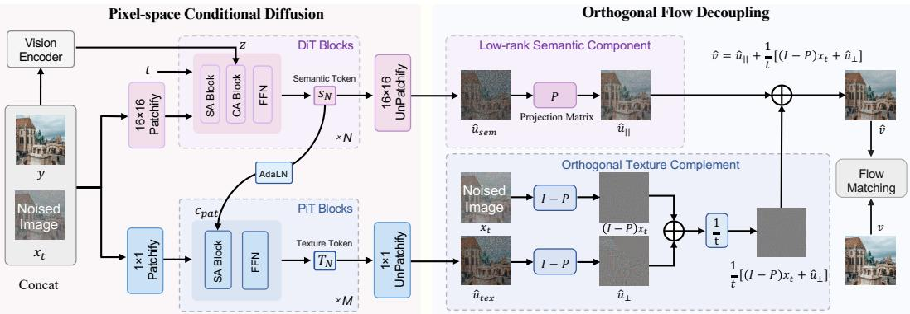  
Figure 2: Overview of the proposed PixelSR framework. PixelSR comprises Pixel-space Conditional Diffusion (PCD) and Orthogonal Flow Decoupling (OFD). Left: PCD performs end-toend RGB-space restoration using spatially aligned LR conditioning, visual semantic guidance, and lightweight pixel-level texture refinement. Right: OFD factorizes the asymmetric velocity target into a projected low-rank component and a deterministic orthogonal residual, which empirically exhibit semantic- and texture-dominant characteristics, respectively. Their predictions are assigned to specialized DiT and PiT branches and recombined into the full velocity for flow matching, enabling task-aligned optimization with reduced interference.

The associated velocity is:

$$
{ \pmb v } = \frac { \mathrm { d } { \pmb x } _ { t } } { \mathrm { d } t } = { \pmb \epsilon } - { \pmb x } _ { 0 } .\tag{2}
$$

Given a velocity estimate $\widehat { \pmb { v } } _ { \theta } ( \pmb { x } _ { t } , t , \pmb { y } )$ , Conditional Flow Matching minimizes:

$$
\begin{array} { r } { \mathcal { L } _ { \mathrm { C F M } } = \mathbb { E } _ { t , x _ { 0 } , y , \epsilon } \left[ \| \widehat { \pmb v } _ { \theta } - \pmb v \| _ { 2 } ^ { 2 } \right] . } \end{array}\tag{3}
$$

At inference, the learned velocity field is integrated from $t = 1 \mathrm { t o } t = 0$ , transforming Gaussian noise into an HR image conditioned on y.

Prediction Parameterizations. The flow matching loss and the direct network output need not lie in the same space. Under standard v-prediction, the network directly estimates:

$$
\widehat { \pmb { v } } _ { \theta } = \mathrm { N e t } _ { \theta } ( \pmb { x } _ { t } , t , \pmb { y } ) .\tag{4}
$$

However, predicting ${ \pmb v } = { \pmb \epsilon } - { \pmb x } _ { 0 }$ requires the network to preserve full-dimensional noise, which is challenging in pixel space. Motivated by the low-dimensional manifold hypothesis, $\scriptstyle { \pmb x } _ { 0 } \cdot$ -prediction instead outputs (Li & He, 2026):

$$
\widehat { \pmb { x } } _ { 0 } = \mathrm { N e t } _ { \theta } ( \pmb { x } _ { t } , t , \pmb { y } ) , \qquad \widehat { \pmb { v } } _ { \theta } = \frac { \pmb { x } _ { t } - \widehat { \pmb { x } } _ { 0 } } { t } .\tag{5}
$$

Although this avoids directly predicting full-dimensional noise, computing the flow matching loss in velocity space requires converting ${ \widehat { \pmb x } } _ { 0 }$ into vb, which becomes numerically ill-conditioned as t approaches zero.

Consequently, AsymFlow (Chen et al., 2026a) provides an intermediate parameterization by restricting the noise term to a low-rank subspace. For each D-dimensional patch token, let $\pmb { A } \doteq \mathbb { R } ^ { D \times r }$ $r < D$ , satisfy $A ^ { \mathsf { T } } A = I _ { r }$ . The corresponding orthogonal projector is defined as:

$$
P = A A ^ { \mathsf { T } } , \qquad P ^ { 2 } = P ,\tag{6}
$$

where P is shared across all patch tokens. AsymFlow defines the asymmetric velocity target as:

$$
\begin{array} { r } { \pmb { u } _ { \mathrm { A } } : = \pmb { P } \pmb { \epsilon } - \pmb { x } _ { 0 } . } \end{array}\tag{7}
$$

It recovers standard v-prediction when $P = I$ and clean-image prediction, up to a sign, when $\mathrm { ~ \bf ~ P ~ } = \mathrm { ~ \bf ~ 0 ~ }$ . Therefore, intermediate ranks balance low-rank noise prediction with full-dimensional clean-image prediction. Nevertheless, $\mathbf { \pmb { u } } _ { \mathrm { \tiny A } }$ remains a monolithic network output in AsymFlow.

To address this limitation, we first establish Pixel-space Conditional Diffusion (PCD) as an end-toend RGB restoration framework. Subsequently, we introduce Orthogonal Flow Decoupling (OFD) to factorize $\mathbf { \pmb { u } } _ { \mathrm { \tiny \mathrm { A } } }$ into complementary objectives for task-specialized optimization.

## 3.2 PIXEL-SPACE CONDITIONAL DIFFUSION

As the restoration backbone of PixelSR, PCD establishes a single-stage Pixel Diffusion Transformer for Real-SR. It adopts an augmented DiT backbone (Yao et al., 2025) and directly instantiates the conditional flow through x0-prediction in RGB space. To adapt the original generative backbone to Real-SR, we incorporate three complementary designs: spatially aligned LR conditioning, visual semantic guidance, and lightweight pixel-level texture refinement, as shown in Figure 2.

Spatially Aligned LR Conditioning. Given an LR observation $^ { y , }$ we first resize it to the target resolution determined by the upscaling factor, obtaining $\pmb { \widetilde { y } } \in \mathbb { R } ^ { B \times \check { C } \times H \times W }$ . Then, we construct the noisy state $\pmb { x } _ { t } \in \mathbb { R } ^ { B \times C \times H \times W }$ on the same spatial grid and concatenate them channel-wise:

$$
\pmb { h } _ { t } = \operatorname { C o n c a t } \left( \pmb { x } _ { t } , \widetilde { \pmb { y } } \right) \in \mathbb { R } ^ { B \times 2 C \times H \times W } .\tag{8}
$$

This pixel-aligned conditioning provides each noisy location with its corresponding LR evidence, imposing dense structural constraints throughout restoration. Subsequently, the resulting input is divided into non-overlapping $p \times p$ patches and embedded into DiT tokens:

$$
\pmb { f } _ { 0 } = \mathrm { P a t c h E m b e d } _ { p } ( \pmb { h } _ { t } ) \in \mathbb { R } ^ { B \times L \times D _ { \mathrm { D i T } } } ,\tag{9}
$$

where $D _ { \mathrm { D i T } }$ denotes the hidden dimension of the DiT backbone and $L ~ = ~ ( H / p ) ( W / p )$ is the number of patch tokens.

Visual Semantic Guidance. Spatially aligned LR pixels may provide insufficient semantic evidence under severe degradation. We therefore use a frozen pre-trained vision encoder to extract high-level representations:

$$
z = \Pi _ { \mathrm { v i s } } \left( E _ { \mathrm { v i s } } ( \pmb { y } ) \right) ,\tag{10}
$$

where $\Pi _ { \mathrm { v i s } }$ projects the visual features into the DiT conditioning space. We further inject z into each DiT block through cross-attention:

$$
\pmb { f } _ { n + 1 } = \mathrm { D i T } _ { n } \left( \pmb { f } _ { n } , t , z \right) , \qquad n = 0 , \dots , N - 1 .\tag{11}
$$

Accordingly, the concatenated LR input anchors spatial structures, while the visual embeddings provide complementary semantic guidance for severely degraded content.

Lightweight Texture Refinement. To complement patch-level semantics with fine-grained textures, we introduce a lightweight Pixel Decoder composed of PiT blocks (Yu et al., 2026). It operates on pixel-level tokens under the global guidance of the DiT backbone. Specifically, each $p \times p$ region of $\boldsymbol { h } _ { t }$ is represented as $p ^ { 2 }$ pixel tokens:

$$
\pmb { q } _ { 0 } = \mathrm { P i x e l E m b e d } _ { p } ( \pmb { h } _ { t } ) \in \mathbb { R } ^ { ( B L ) \times p ^ { 2 } \times D _ { \mathrm { P i T } } } ,\tag{12}
$$

where $D _ { \mathrm { P i T } }$ denotes the hidden dimension of the lightweight Pixel Decoder. After that, the final DiT features $f _ { N }$ are expanded into patch-wise conditions $c _ { \mathrm { p a t } }$ and injected into the corresponding PiT blocks through AdaLN:

$$
\pmb q _ { m + 1 } = \mathrm { P i T } _ { m } \left( \pmb q _ { m } , \pmb { c } _ { \mathrm { p a t } } \right) , \qquad m = 0 , \dots , M - 1 .\tag{13}
$$

This design further refines local textures under the global structural and semantic context provided by the DiT backbone.

Overall, the basic PCD predicts the complete clean image as $\widehat { \pmb { x } } _ { 0 } = \mathrm { P i x e l U n p a t c h i f y } ( \Phi _ { \mathrm { p i x } } ( \pmb { q } _ { M } ) )$ and optimizes it via Eqs. 3 and $^ { 5 , }$ establishing an effective framework for direct pixel-space restoration. However, its monolithic $\scriptstyle { \mathbf { { \mathit { x } } } } _ { 0 }$ target still couples semantic generation with texture reconstruction in the same prediction space. To this end, we next introduce OFD to explicitly decouple these heterogeneous objectives.

## 3.3 ORTHOGONAL FLOW DECOUPLING

As illustrated on the right of Figure 2, our OFD builds upon the asymmetric velocity target but goes beyond its monolithic prediction by explicitly factorizing and assigning its complementary components to task-specialized branches.

Orthogonal Target Factorization. Unlike AsymFlow, which predicts $\mathbf { \pmb { u } } _ { \mathrm { \tiny A } }$ as a unified target, OFD explicitly exposes its complementary projections. Using the projector properties in Eq. 6, we obtain:

$$
P u _ { \mathrm { A } } = P v , \quad ( I - P ) u _ { \mathrm { A } } = - ( I - P ) x _ { 0 } .\tag{14}
$$

The projected component $P u _ { \mathrm { A } }$ retains stochastic velocity prediction within the low-rank subspace, whereas its orthogonal complement $( I - P ) u _ { \mathrm { A } }$ is completely noise-free, reducing the objective in this subspace to a deterministic reconstruction of the clean-image residual. Moreover, these two components lie in mutually orthogonal subspaces, providing non-overlapping prediction objectives.

Semantic–Texture Interpretation. Although this factorization holds for any orthogonal projector, the functional roles of its subspaces depend on the projection basis P. We explore three constructions: a jointly learned basis, an SVD basis derived from pixel statistics, and a Procrustes basis aligned with pre-trained VAE latent tokens. The Procrustes basis performs best empirically, indicating that the compact semantic organization of VAE representations provides a useful prior for defining the low-rank subspace. Crucially, the VAE is used only to initialize the projector offline and is absent from PixelSR training and inference, providing an alignment starting point rather than imposing its frozen reconstruction bottleneck. Detailed derivations are provided in the Appendix ${ \bf A } . 3 .$ . Furthermore, as visualized in

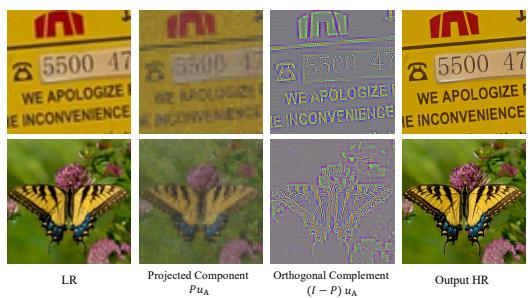  
Figure 3: Visualization of orthogonal target factorization. With the Procrustes-aligned projector, the projected component mainly retains global content and coarse structures, while its orthogonal complement emphasizes edges, text patterns, and high-frequency textures.

Figure 3, the projected component mainly preserves global content and coarse structures, whereas the orthogonal component concentrates on edges, textual patterns, and high-frequency textures. Therefore, we associate $P u _ { \mathrm { A } }$ with semantic generation and $( I - P ) u _ { \mathrm { A } }$ with texture reconstruction. Notably, the latter additionally provides noise-free supervision for recovering fine-grained details.

Task-Aligned Branch Assignment. Motivated by this physical correspondence, OFD assigns each decoupled objective to the network branch best suited to its characteristics. Specifically, the global-focused DiT backbone is tasked with semantic prediction $\widehat { \pmb { u } } _ { \mathrm { s e m } } ,$ while the local-focused Pixel Decoder targets texture prediction $\widehat { \pmb { u } } _ { \mathrm { t e x } } ,$ yielding:

$$
\begin{array} { r } { \widehat { \pmb u } _ { \parallel } = { \pmb P } \widehat { \pmb u } _ { \mathrm { s e m } } , \qquad \widehat { \pmb u } _ { \perp } = ( { \pmb I } - { \pmb P } ) \widehat { \pmb u } _ { \mathrm { t e x } } . } \end{array}\tag{15}
$$

Accordingly, this task-aligned separation successfully isolates their prediction spaces, mitigating optimization interference while allowing the Pixel Decoder to leverage noise-free supervision for high-fidelity texture reconstruction.

Full-Rank Velocity Recovery and Training. Required by Conditional Flow Matching, the two branch predictions are converted into full-rank velocity. From ${ \pmb x } _ { t } = { \pmb x } _ { 0 } + t { \pmb v }$ and Eq. 14, we derive:

$$
\widehat { \pmb v } = \widehat { \pmb u } _ { \parallel } + \frac { 1 } { t } \left[ ( \pmb I - \pmb P ) \pmb x _ { t } + \widehat { \pmb u } _ { \perp } \right] .\tag{16}
$$

Finally, we optimize $\widehat { \mathbf { \nabla } } _ { \pmb { v } }$ against the full-rank target v using standard loss in Eq. 3. Since the two prediction errors occupy orthogonal subspaces, their inner-product cross term vanishes, allowing both branches to be jointly trained without mixing their optimization signals. At inference, recovered velocity is directly integrated by a standard ODE solver without modifying the sampling procedure.

## 4 EXPERIMENTS

## 4.1 EXPERIMENT SETTINGS

Datasets. We train PixelSR on LSDIR (Li et al., 2023), DIV2K (Agustsson & Timofte, 2017), DIV8K (Gu et al., 2019), OutdoorSceneTraining (Wang et al., 2018), Flickr2K (Timofte et al., 2017), the first 10K images from FFHQ (Karras et al., 2019), and 50K high-quality images collected from the web. The LR–HR pairs are synthesized via the Real-ESRGAN pipeline (Wang et al., 2021).

Table 1: Quantitative comparison on LSDIR, RealSR, ScreenSR, and UGCSR. Red indicates the best performance, orange indicates the second-best performance, and yellow indicates the third-best performance. ↑: higher is better; ↓: lower is better.
<table><tr><td rowspan="2">Dataset</td><td rowspan="2">Method</td><td rowspan="2">Steps</td><td rowspan="2">Inference Time (s)</td><td colspan="4">Reference-based Metrics</td><td colspan="4">No-Reference Metrics</td><td rowspan="2">Rank↓</td></tr><tr><td>PSNR↑</td><td>SSIM↑</td><td>LPIPS↓</td><td>FID↓</td><td>NIQE↓</td><td>MUSIQ↑</td><td>MANIQA↑</td><td>DeQA↑</td></tr><tr><td rowspan="11">LSDIR</td><td>StableSR</td><td>200</td><td>5.75</td><td>20.4946</td><td>0.5227</td><td>0.3193</td><td>60.0564</td><td>4.6047</td><td>62.7178</td><td>0.3254</td><td>3.0055</td><td>9</td></tr><tr><td>DiffBIR</td><td>50</td><td>5.08</td><td>20.5132</td><td>0.4899</td><td>0.2651</td><td>58.4458</td><td>4.4425</td><td>73.2548</td><td>0.6209</td><td>4.1696</td><td>4</td></tr><tr><td>DiT4SR</td><td>40</td><td>5.26</td><td>19.2087</td><td>0.4804</td><td>0.2723</td><td>59.0254</td><td>4.2242</td><td>72.6805</td><td>0.5067</td><td>3.8741</td><td>8</td></tr><tr><td>VOSR</td><td>25</td><td>3.86</td><td>20.5993</td><td>0.5111</td><td>0.2386</td><td>46.4918</td><td>3.8768</td><td>72.9454</td><td>0.5194</td><td>4.0873</td><td>2</td></tr><tr><td>DiT-SR</td><td>15</td><td>1.84</td><td>21.1127</td><td>0.5490</td><td>0.2457</td><td>41.7907</td><td>4.2975</td><td>69.5674</td><td>0.4341</td><td>3.8280</td><td>6</td></tr><tr><td>OSEDiff</td><td>1</td><td>0.45</td><td>20.3920</td><td>0.5215</td><td>0.2703</td><td>59.5401</td><td>4.0240</td><td>72.3407</td><td>0.4586</td><td>3.8411</td><td>7</td></tr><tr><td>SinSR</td><td>1</td><td>0.32</td><td>20.9234 0.5375</td><td></td><td>0.2268</td><td>39.6452</td><td>4.6581</td><td>69.6398</td><td>0.4654</td><td>3.9294</td><td>3</td></tr><tr><td>CODSR</td><td>1</td><td>6.24</td><td>20.3326</td><td>0.5160</td><td>0.2499</td><td>53.3267</td><td>3.9177</td><td>73.2553</td><td>0.4705</td><td>3.8952</td><td>5</td></tr><tr><td>PixelSR (Ours)</td><td>25</td><td>4.45</td><td>20.6907</td><td>0.5270</td><td>0.2203</td><td>40.5007</td><td>4.2464</td><td>73.1895</td><td>0.5661</td><td>4.0936</td><td>1</td></tr><tr><td rowspan="11">RealSR</td><td>StableSR</td><td>200</td><td>5.79</td><td>24.3860</td><td>0.6777</td><td>0.3194</td><td>149.2795</td><td>6.2610</td><td>47.8669</td><td>0.2851</td><td>2.4946</td><td>9</td></tr><tr><td>DiffBIR</td><td>50</td><td>5.01</td><td>24.1268</td><td>0.6315</td><td>0.3680</td><td>129.6928</td><td>5.7679</td><td>69.4416</td><td>0.5595</td><td>3.8413</td><td>6</td></tr><tr><td>DiT4SR</td><td>40</td><td>5.20</td><td>22.9574</td><td>0.6537</td><td>0.3190</td><td>121.2180</td><td>5.9232</td><td>67.3697</td><td>0.4559</td><td>3.4006</td><td>8</td></tr><tr><td>VOSR</td><td>25</td><td>3.84</td><td>24.8590</td><td>0.7024</td><td>0.3040</td><td>135.6466</td><td>5.6586</td><td>69.8075</td><td>0.4944</td><td>3.5850</td><td>4</td></tr><tr><td>DiT-SR</td><td>15</td><td>1.84</td><td>25.2487</td><td>0.7328</td><td>0.2976</td><td>148.3538</td><td>5.5714</td><td>65.8281</td><td>0.4500</td><td>3.5583</td><td>5</td></tr><tr><td>OSEDiff</td><td>1</td><td>0.48</td><td>24.5348</td><td>0.7166</td><td>0.2972</td><td>123.1172</td><td>5.7055</td><td>69.1131</td><td>0.4710</td><td>3.6600</td><td>3</td></tr><tr><td>SinSR</td><td>1</td><td>0.32</td><td>25.5445</td><td>0.7217</td><td>0.3181</td><td>135.3449</td><td>6.2829</td><td>60.8381</td><td>0.4000</td><td>3.3745</td><td>7</td></tr><tr><td>CODSR</td><td>1</td><td>6.37</td><td>24.7344</td><td>0.7100</td><td>0.2789</td><td>115.6569</td><td>5.2396</td><td>70.4197</td><td>0.4689</td><td>3.6330</td><td>2</td></tr><tr><td>PixelSR (Ours)</td><td>25</td><td>4.48</td><td>25.3360</td><td>0.7166</td><td>0.2922</td><td>112.8905</td><td>5.5672</td><td>69.5941</td><td>0.5381</td><td>3.6116</td><td>1</td></tr><tr><td rowspan="11">ScreenSR</td><td>StableSR</td><td>200</td><td>5.71</td><td>23.4808</td><td>0.7150</td><td>0.2338</td><td>72.4313</td><td>4.5287</td><td>63.9757</td><td>0.3629</td><td>3.2415</td><td>8</td></tr><tr><td>DiffBIR</td><td>50</td><td>5.18</td><td>22.6359</td><td>0.6044</td><td>0.2339</td><td>60.3978</td><td>4.4604</td><td>71.6173</td><td>0.5998</td><td>4.0741</td><td>4</td></tr><tr><td>DiT4SR</td><td>40</td><td>5.27</td><td>20.7233</td><td>0.5810</td><td>0.2617</td><td>78.7023</td><td>4.1735</td><td>71.1490</td><td>0.4990</td><td>3.7724</td><td>8</td></tr><tr><td>VOSR</td><td>25</td><td>3.84</td><td>22.2853</td><td>0.6241</td><td>0.2167</td><td>67.5358</td><td>4.2239</td><td>72.4115</td><td>0.5190</td><td>4.0030</td><td>2</td></tr><tr><td>DiT-SR</td><td>15</td><td>1.86</td><td>23.6599</td><td>0.6751</td><td>0.2354</td><td>71.9429</td><td>4.4406</td><td>66.6000</td><td>0.4099</td><td>3.5160</td><td>7</td></tr><tr><td>OSEDiff</td><td>1</td><td>0.43</td><td>22.1156 0.6302</td><td></td><td>0.2302</td><td>74.9355</td><td>4.0782</td><td>71.4320</td><td>0.4521</td><td>3.7571</td><td>5</td></tr><tr><td>SinSR</td><td>1</td><td>0.32</td><td>23.4096</td><td>0.6619</td><td>0.2225</td><td>65.8214</td><td>4.6827</td><td>66.3274</td><td>0.4281</td><td>3.6553</td><td>5</td></tr><tr><td>CODSR</td><td>1</td><td>6.09</td><td>22.1222</td><td>0.6253</td><td>0.2123</td><td>67.5680</td><td>4.0608</td><td>72.4353</td><td>0.4705</td><td>3.8178</td><td>3</td></tr><tr><td>PixelSR (Ours)</td><td>25</td><td>4.48</td><td>23.5640</td><td>0.7156</td><td>0.2082</td><td>69.1307</td><td>4.3284</td><td>72.8613</td><td>0.4824</td><td>3.8294</td><td>1</td></tr><tr><td rowspan="8">UGCSR SinSR</td><td>StableSR DiffBIR</td><td>200</td><td>5.71</td><td>24.3958 0.7843</td><td></td><td>0.2056</td><td>75.4312</td><td>4.7718</td><td>70.8247</td><td>0.4715 0.6470</td><td>3.5726</td><td>4</td></tr><tr><td>DiT4SR</td><td>50 40</td><td>5.19 5.17</td><td>23.0754 0.6601 21.7385</td><td>0.6351</td><td>0.2243 0.2534</td><td>67.5485 84.8692</td><td>5.7892 4.6058</td><td>74.0110 72.9437</td><td>0.5088</td><td>4.0048 3.7754</td><td>3 9</td></tr><tr><td>VOSR</td><td>25</td><td>3.86</td><td>21.8930</td><td>0.6419</td><td>0.2609</td><td>106.5576</td><td>5.2074</td><td>74.7371</td><td>0.5451</td><td>3.9251</td><td>8</td></tr><tr><td>DiT-SR</td><td>15</td><td>1.87</td><td>23.9624</td><td>0.7187</td><td>0.2271</td><td>76.4899</td><td>5.0916</td><td>69.9280</td><td>0.4558</td><td>3.6601</td><td>6</td></tr><tr><td>OSEDiff</td><td>1</td><td>0.46</td><td>22.3983</td><td>0.6726</td><td>0.2314</td><td>86.6685</td><td>5.2381</td><td>73.5825</td></table>

For synthetic evaluation, we adopt the LSDIR validation split, center-cropping GT to $5 1 2 \times 5 1 2$ before synthesizing 128 × 128 LR inputs. For real-world evaluation, we utilize RealSR (Cai et al., 2019), ScreenSR (Wu et al., 2026a), and our newly constructed benchmark, UGCSR, which contains more contemporary content and complex degradations collected from real streaming-media pipelines (details in Appendix A.2). Specifically, we directly center-crop paired 512 × 512 patches from these benchmarks for evaluation.

Evaluation Metrics. We report reference-based metrics, including pixel-level PSNR and SSIM (Bakurov et al., 2022), perceptual LPIPS (Zhang et al., 2018), and distribution-level FID (Yu et al., 2021). Additionally, we employ the no-reference metrics NIQE (Mittal et al., 2012), MUSIQ (Ke et al., 2021), MANIQA (Yang et al., 2022), and DeQA (You et al., 2025).

To facilitate holistic comparison across multiple evaluation metrics, we compute the average rank of each method over all metrics:

$$
R _ { k } = { \frac { 1 } { | { \mathcal { M } } | } } \sum _ { m \in { \mathcal { M } } } { \mathrm { r a n k } } _ { k } ( m ) ,\tag{17}
$$

where M denotes the metric sets. The resulting average rank, reported as “Rank” in Table 1, is obtained by sorting $R _ { k }$ and serves as an aggregate summary of overall performance.

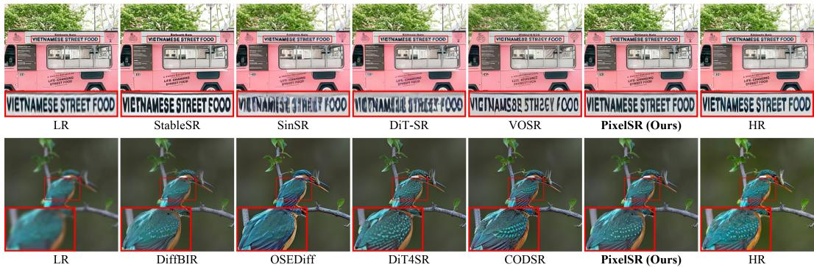  
Figure 4: Qualitative comparison on challenging real-world examples. PixelSR better preserves the text layout and feather structure while recovering fine-grained details consistent with the HR references, whereas several competing methods exhibit distorted characters, irregular textures, or over-smoothed results. Best viewed zoomed in.

Implementation Details. PixelSR is optimized end-to-end in pixel space. The patch-level backbone consists of $N = 2 8$ DiT blocks with hidden dimension $\bar { D _ { \mathrm { D i T } } } = \bar { 1 0 2 4 }$ , while the pixel-level decoder comprises M = 4 PiT blocks with hidden dimension $D _ { \mathrm { P i T } } = 3 2$ . We use a frozen pretrained DINOv2-B/14 (Oquab et al., 2023) as the visual semantic encoder $E _ { \mathrm { v i s } }$ . Following the rank analysis in AsymFlow (Chen et al., 2026a), we fix $r = 1 6$ across all experiments. This choice also matches the $2 \times 2 \times 4 = 1 6$ latent coefficients corresponding to each $1 6 \times 1 6$ RGB patch under an f8c4 VAE, facilitating dimensionally aligned Procrustes fitting. Please see Appendix A.1 for further implementation details.

## 4.2 COMPARISON WITH STATE-OF-THE-ART

Compared Methods. We compare PixelSR with recent diffusion-based Real-SR methods, including DiffBIR (Lin et al., 2024), StableSR (Wang et al., 2024a), OSEDiff (Wu et al., 2024a), SinSR (Wang et al., 2024b), DiT4SR (Duan et al., 2025), DiT-SR (Cheng et al., 2025), CODSR (Chen et al., 2026b), and VOSR (Wu et al., 2026a). All competing methods are evaluated using their officially released checkpoints and default inference settings. Notably, these methods operate in compressed latent spaces, whereas PixelSR performs restoration directly in RGB space.

Quantitative Comparisons. Table 1 reports the quantitative results on four benchmarks. Existing methods exhibit different preferences along the fidelity–realism spectrum. For example, SinSR and DiT-SR achieve competitive PSNR and SSIM on several benchmarks but are less favorable on perceptual-quality metrics. Conversely, DiffBIR, CODSR, and VOSR attain strong no-reference scores in certain cases, often accompanied by degraded reference-based fidelity. PixelSR achieves the best overall rank across the four benchmarks while maintaining competitive performance on both metric groups. In particular, it obtains substantial fidelity improvements on the challenging UGCSR benchmark without sacrificing perceptual quality. Together with the trade-off analysis in Figure 1, these results demonstrate that our PixelSR effectively alleviates the fidelity–realism seesaw effect.

Qualitative Comparisons. Figure 4 presents qualitative comparisons on challenging real-world cases. In the first example, competing methods distort character strokes or hallucinate incorrect layouts, whereas PixelSR preserves text structures consistent with the HR reference. In the second example, competing methods tend to produce over-smoothed or irregular feather patterns. PixelSR reconstructs finer and more natural textures without altering the bird’s appearance. These visual results further corroborate the quantitative evidence that our single-stage, end-to-end PixelSR better reconciles structural fidelity and perceptual realism.

Efficiency Comparisons. We evaluate all methods on a single NVIDIA H800 GPU using their official sampling settings. As reported in Table 1, PixelSR requires approximately 4.5 seconds per image, with runtime comparable to several multi-step latent diffusion baselines. This work focuses on restoration quality and the fidelity–perception trade-off, while integrating one-step distillation for further acceleration is left for future exploration.

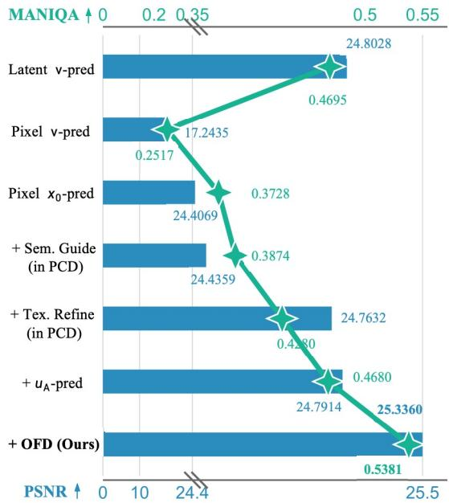  
(a) Quantitative Ablation

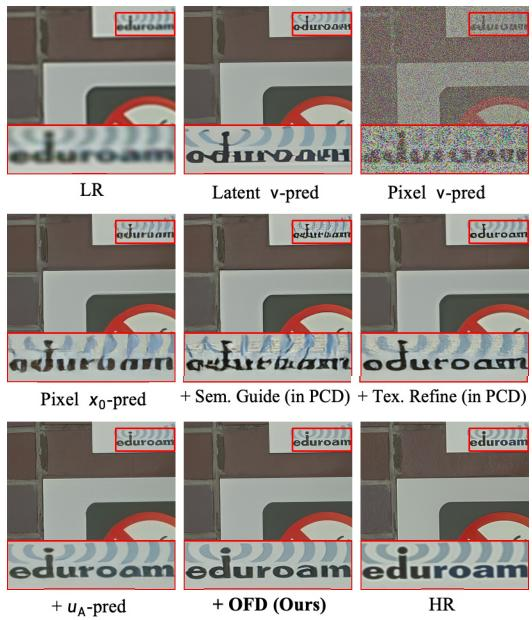  
(b) Qualitative Ablation  
Figure 5: Ablation of PixelSR components on RealSR. The bars and green curve report PSNR and MANIQA, respectively. Pixel-space $\scriptstyle { \pmb x } _ { 0 } \cdot$ -prediction provides a substantially stronger baseline than pixel-space v-prediction, while the successive PCD and OFD designs further improve fidelity and perceptual quality.

## 4.3 ABLATION STUDY

Effectiveness of Core Components. Figure 5 presents a progressive ablation from a standard latent DiT baseline to the complete PixelSR under a shared training protocol. Directly transferring v-prediction from latent to pixel space while retaining the DiT configuration causes a severe performance drop, highlighting the difficulty of predicting full-dimensional noise in RGB space. Replacing it with $\scriptstyle { \pmb x } _ { 0 } .$ -prediction yields a substantially stronger pixel-space baseline. On this basis, semantic guidance improves perceptual quality while preserving fidelity, and the PiT-based texture refinement further enhances local details, producing clear gains in both PSNR and MANIQA. Restricting noise prediction to a low-rank subspace through the asymmetric target $\mathbf { \pmb { u } } _ { \mathrm { \tiny A } }$ provides additional improvements. Finally, OFD assigns the complementary objectives to specialized branches, achieving the best PSNR and MANIQA among all variants. The qualitative progression further illustrates increasingly faithful text structures and sharper local details.

Analysis of Orthogonal Flow Decoupling. To isolate the contribution of OFD, we compare four flow formulations using the same PCD network, training settings, and parameter count. For the monolithic $\mathbf { \psi } \mathbf { v } - \mathbf { \psi } \mathbf { \psi } \mathbf { x } _ { 0 } - \mathbf { \psi }$ , and $\mathbf { \pmb { u } } _ { \mathrm { \tiny \mathrm { A } } }$ -prediction variants, the final PiT output directly predicts the complete target. OFD introduces no additional modules, but instead assigns the projected and orthogonal objectives to the DiT and PiT outputs, respectively. As shown in Table 2, x0-prediction substantially improves over standard v-prediction, while monolithic $\mathbf { \pmb { u } } _ { \mathrm { \tiny A } }$ -prediction provides further gains by restricting noise prediction to a low-rank subspace. OFD consistently performs best across all metrics. Since it differs from monolithic $\mathbf { \pmb { u } } _ { \mathrm { { A } } } .$ -prediction only in explicit factorization and branch assignment, the gains isolate the effectiveness of OFD rather than additional model capacity.

Table 2: Ablation of pixel-space flow formulations on LSDIR. All variants use the same PCD network and parameter count. OFD improves over monolithic $\mathbf { \pmb { u } } _ { \mathrm { \tiny A } }$ -prediction through explicit factorization and branch assignment.
<table><tr><td rowspan="2">Variant</td><td>Reference-based Metrics</td><td>No-Reference Metrics</td><td colspan="2"></td></tr><tr><td>PSNR ↑ SSIM ↑ LPIPS</td><td>MUSIQ ↑</td><td>MANIQA ↑ DeQA ↑</td><td></td></tr><tr><td>v-prediction</td><td>15.0173 0.0995 1.2483</td><td>26.5085</td><td>0.2176</td><td>1.5582</td></tr><tr><td>x0-prediction</td><td>19.5442 0.4822 0.2543</td><td>72.3934</td><td>0.4895</td><td>3.6563</td></tr><tr><td>uA-prediction</td><td>20.3088 0.5101 0.2251</td><td>72.4436</td><td>0.5495</td><td>3.9879</td></tr><tr><td>OFD (Ours)</td><td>20.6907 0.5270 0.2203</td><td>73.1895</td><td>0.5661</td><td>4.0936</td></tr></table>

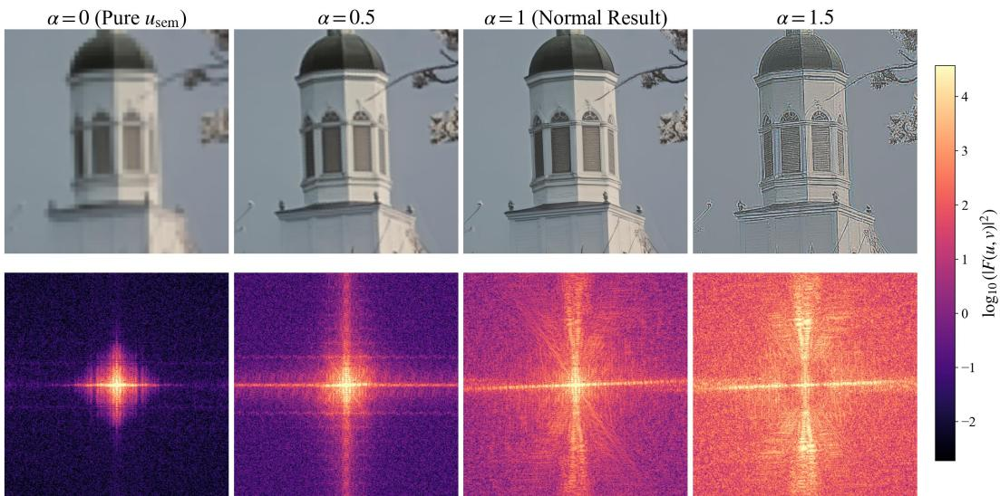  
Figure 6: Frequency analysis of OFD branch specialization. Restoration results (top) and corresponding power spectra (bottom) under increasing orthogonal scale α. Larger α progressively strengthens fine textures and mid-to-high-frequency responses, while $\alpha = 1$ denotes the default OFD output. All spectra share the same color scale.

We further probe the functional specialization of the two OFD branches by scaling the orthogonal texture contribution at validation time:

$$
\widehat { \pmb { v } } _ { \alpha } = \widehat { \pmb { u } } _ { \parallel } + \frac { \alpha } { t } \left[ ( \pmb { I } - \pmb { P } ) \pmb { x } _ { t } + \widehat { \pmb { u } } _ { \perp } \right] .\tag{18}
$$

Here, $\alpha = 0$ retains only the projected semantic component, whereas $\alpha = 1$ recovers the standard OFD formulation. As shown in Figure 6, increasing α preserves the global layout while progressively sharpening local structures and strengthening mid- and high-frequency responses; an excessive scale $( \alpha = 1 . 5 )$ produces over-sharpening artifacts. This controlled intervention provides frequency-domain evidence that the projected branch primarily maintains global structure, whereas the orthogonal branch supplies fine-grained textures. The scale analysis is used only for interpretation, and $\alpha = 1$ is fixed for all reported results.

## 5 CONCLUSION

In this paper, we rethink the fidelity–realism trade-off in Real-SR by challenging the prevailing latent diffusion paradigm. To bypass lossy VAE compression and cascading errors, we present PixelSR, a single-stage framework operating directly in RGB space. Crucially, to resolve task entanglement in pixel-space flow matching, we introduce Orthogonal Flow Decoupling, which mathematically decomposes asymmetric velocity prediction into semantic generation and deterministic texture recovery assigned to specialized sub-networks. Extensive experiments demonstrate that our PixelSR substantially alleviates the fidelity–realism seesaw effect and establishes a more favorable Pareto frontier. Beyond super-resolution, our work validates the viability of pixel diffusion without VAE encoding and decoding, providing a principled baseline for harmonizing generative priors with strict structural fidelity.

## AI USE STATEMENT

In this work, we used generative AI tools to polish the content. We did not use generative AI tools for data generation or concept design. We have reviewed all work completed with the assistance of AI. We take responsibility for the final content of this work, including text, claims or artifacts produced with the aid of generative AI.

## REPRODUCIBILITY STATEMENT

The code will be released after the paper is accepted.

## REFERENCES

Eirikur Agustsson and Radu Timofte. Ntire 2017 challenge on single image super-resolution: Dataset and study. In Proceedings of the IEEE conference on computer vision and pattern recognition workshops, pp. 126–135, 2017.

Illya Bakurov, Marco Buzzelli, Raimondo Schettini, Mauro Castelli, and Leonardo Vanneschi. Structural similarity index (ssim) revisited: A data-driven approach. Expert Systems with Applications, 189:116087, 2022.

Jianrui Cai, Hui Zeng, Hongwei Yong, Zisheng Cao, and Lei Zhang. Toward real-world single image super-resolution: A new benchmark and a new model. In Proceedings of the IEEE/CVF international conference on computer vision, pp. 3086–3095, 2019.

Bin Chen, Gehui Li, Rongyuan Wu, Xindong Zhang, Jie Chen, Jian Zhang, and Lei Zhang. Adversarial diffusion compression for real-world image super-resolution. In IEEE/CVF Conference on Computer Vision and Pattern Recognition, CVPR 2025, Nashville, TN, USA, June 11-15, 2025, pp. 28208–28220. Computer Vision Foundation / IEEE, 2025. doi: 10.1109/CVPR52734.2025. 02627.

Hansheng Chen, Jan Ackermann, Minseo Kim, Gordon Wetzstein, and Leonidas Guibas. Asymmetric flow models. arXiv preprint arXiv:2605.12964, 2026a.

Hao Chen, Junyang Chen, Jinshan Pan, and Jiangxin Dong. Bridging fidelity-reality with controllable one-step diffusion for image super-resolution. In Proceedings ofthe IEEE/CVF Conference on Computer Vision and Pattern Recognition, pp. 30584–30594, 2026b.

Zhennan Chen, Junwei Zhu, Xu Chen, Jiangning Zhang, Xiaobin Hu, Hanzhen Zhao, Chengjie Wang, Jian Yang, and Ying Tai. Dip: Taming diffusion models in pixel space. In Proceedings of the IEEE/CVF Conference on Computer Vision and Pattern Recognition, pp. 36136–36146, 2026c.

Kun Cheng, Lei Yu, Zhijun Tu, Xiao He, Liyu Chen, Yong Guo, Mingrui Zhu, Nannan Wang, Xinbo Gao, and Jie Hu. Effective diffusion transformer architecture for image super-resolution. In Proceedings of the AAAI conference on artificial intelligence, volume 39, pp. 2455–2463, 2025.

Mehdi Cherti, Romain Beaumont, Ross Wightman, Mitchell Wortsman, Gabriel Ilharco, Cade Gordon, Christoph Schuhmann, Ludwig Schmidt, and Jenia Jitsev. Reproducible scaling laws for contrastive language-image learning. In Proceedings of the IEEE/CVF conference on computer vision and pattern recognition, pp. 2818–2829, 2023.

Jia Deng, Wei Dong, Richard Socher, Li-Jia Li, Kai Li, and Li Fei-Fei. Imagenet: A large-scale hierarchical image database. In 2009 IEEE Computer Society Conference on Computer Vision and Pattern Recognition (CVPR 2009), 20-25 June 2009, Miami, Florida, USA, pp. 248–255. IEEE Computer Society, 2009. doi: 10.1109/CVPR.2009.5206848.

Chao Dong, Chen Change Loy, Kaiming He, and Xiaoou Tang. Image super-resolution using deep convolutional networks. CoRR, abs/1501.00092, 2015.

Zheng-Peng Duan, Jiawei Zhang, Xin Jin, Ziheng Zhang, Zheng Xiong, Dongqing Zou, Jimmy S Ren, Chunle Guo, and Chongyi Li. Dit4sr: Taming diffusion transformer for real-world image super-resolution. In Proceedings ofthe IEEE/CVF International Conference on Computer Vision, pp. 18948–18958, 2025.

Patrick Esser, Sumith Kulal, Andreas Blattmann, Rahim Entezari, Jonas Muller, Harry Saini, Yam¨ Levi, Dominik Lorenz, Axel Sauer, Frederic Boesel, et al. Scaling rectified flow transformers for high-resolution image synthesis. In Forty-first international conference on machine learning, 2024.

Yushun Fang, Yuxiang Chen, Shibo Yin, Qiang Hu, Jiangchao Yao, Ya Zhang, Xiaoyun Zhang, and Yanfeng Wang. One-step diffusion transformer for controllable real-world image superresolution. arXiv preprint arXiv:2511.17138, 2025.

Shuhang Gu, Andreas Lugmayr, Martin Danelljan, Manuel Fritsche, Julien Lamour, and Radu Timofte. Div8k: Diverse 8k resolution image dataset. In 2019 IEEE/CVF International Conference on Computer Vision Workshop (ICCVW), pp. 3512–3516. IEEE, 2019.

Agrim Gupta, Lijun Yu, Kihyuk Sohn, Xiuye Gu, Meera Hahn, Fei-Fei Li, Irfan Essa, Lu Jiang, and Jose Lezama. Photorealistic video generation with diffusion models. In´ European Conference on Computer Vision, pp. 393–411. Springer, 2024.

Jonathan Ho, Ajay Jain, and Pieter Abbeel. Denoising diffusion probabilistic models. In Hugo Larochelle, Marc’Aurelio Ranzato, Raia Hadsell, Maria-Florina Balcan, and Hsuan-Tien Lin (eds.), Advances in Neural Information Processing Systems 33: Annual Conference on Neural Information Processing Systems 2020, NeurIPS 2020, December 6-12, 2020, virtual, 2020.

Emiel Hoogeboom, Thomas Mensink, Jonathan Heek, Kay Lamerigts, Ruiqi Gao, and Tim Salimans. Simpler diffusion (sid2): 1.5 FID on imagenet512 with pixel-space diffusion. CoRR, abs/2410.19324, 2024. doi: 10.48550/ARXIV.2410.19324.

Tero Karras, Samuli Laine, and Timo Aila. A style-based generator architecture for generative adversarial networks. In Proceedings of the IEEE/CVF conference on computer vision and pattern recognition, pp. 4401–4410, 2019.

Junjie Ke, Qifei Wang, Yilin Wang, Peyman Milanfar, and Feng Yang. Musiq: Multi-scale image quality transformer. In Proceedings of the IEEE/CVF international conference on computer vision, pp. 5148–5157, 2021.

Tianhong Li and Kaiming He. Back to basics: Let denoising generative models denoise. In Proceedings of the IEEE/CVF Conference on Computer Vision and Pattern Recognition, pp. 36115– 36125, 2026.

Yawei Li, Kai Zhang, Jingyun Liang, Jiezhang Cao, Ce Liu, Rui Gong, Yulun Zhang, Hao Tang, Yun Liu, Denis Demandolx, et al. Lsdir: A large scale dataset for image restoration. In Proceedings of the IEEE/CVF Conference on Computer Vision and Pattern Recognition, pp. 1775–1787, 2023.

Jingyun Liang, Jiezhang Cao, Guolei Sun, Kai Zhang, Luc Van Gool, and Radu Timofte. Swinir: Image restoration using swin transformer. In IEEE/CVF International Conference on Computer Vision Workshops, ICCVW 2021, Montreal, QC, Canada, October 11-17, 2021, pp. 1833–1844. IEEE, 2021. doi: 10.1109/ICCVW54120.2021.00210.

Xinqi Lin, Jingwen He, Ziyan Chen, Zhaoyang Lyu, Bo Dai, Fanghua Yu, Yu Qiao, Wanli Ouyang, and Chao Dong. Diffbir: Toward blind image restoration with generative diffusion prior. In European conference on computer vision, pp. 430–448. Springer, 2024.

Yaron Lipman, Ricky T. Q. Chen, Heli Ben-Hamu, Maximilian Nickel, and Matthew Le. Flow matching for generative modeling. In The Eleventh International Conference on Learning Representations, ICLR 2023, Kigali, Rwanda, May 1-5, 2023. OpenReview.net, 2023.

Leland McInnes, John Healy, and James Melville. Umap: Uniform manifold approximation and projection for dimension reduction. arXiv preprint arXiv:1802.03426, 2018.

Tejaswini Medi1 and Arianna Rampini. Decoupling high and low frequencies for faithful image generation with fine. In Computer Vision–ECCV 2026: 19th European Conference, Malmo, Sweden,¨ September 8–12, 2026, Proceedings, Part LXXV, pp. 119. Springer Nature, 2026.

Anish Mittal, Rajiv Soundararajan, and Alan C Bovik. Making a “completely blind” image quality analyzer. IEEE Signal processing letters, 20(3):209–212, 2012.

Maxime Oquab, Timothee Darcet, Th´ eo Moutakanni, Huy Vo, Marc Szafraniec, Vasil Khalidov,´ Pierre Fernandez, Daniel Haziza, Francisco Massa, Alaaeldin El-Nouby, et al. Dinov2: Learning robust visual features without supervision. arXiv preprint arXiv:2304.07193, 2023.

Alec Radford, Jong Wook Kim, Chris Hallacy, Aditya Ramesh, Gabriel Goh, Sandhini Agarwal, Girish Sastry, Amanda Askell, Pamela Mishkin, Jack Clark, et al. Learning transferable visual models from natural language supervision. In International conference on machine learning, pp. 8748–8763. PmLR, 2021.

Robin Rombach, Andreas Blattmann, Dominik Lorenz, Patrick Esser, and Bjorn Ommer. High-¨ resolution image synthesis with latent diffusion models. In IEEE/CVF Conference on Computer Vision and Pattern Recognition, CVPR 2022, New Orleans, LA, USA, June 18-24, 2022, pp. 10674–10685. IEEE, 2022. doi: 10.1109/CVPR52688.2022.01042.

Chitwan Saharia, Jonathan Ho, William Chan, Tim Salimans, David J. Fleet, and Mohammad Norouzi. Image super-resolution via iterative refinement. IEEE Trans. Pattern Anal. Mach. Intell., 45(4):4713–4726, 2023. doi: 10.1109/TPAMI.2022.3204461.

Xuhan Sheng, Runyi Li, Bin Chen, Weiqi Li, Xu Jiang, and Jian Zhang. Realosr: Latent guidance boosts diffusion-based real-world omnidirectional image super-resolutions. arXiv preprint arXiv:2412.09646, 2024.

Radu Timofte, Eirikur Agustsson, Luc Van Gool, Ming-Hsuan Yang, and Lei Zhang. Ntire 2017 challenge on single image super-resolution: Methods and results. In Proceedings of the IEEE conference on computer vision and pattern recognition workshops, pp. 114–125, 2017.

Jianyi Wang, Zongsheng Yue, Shangchen Zhou, Kelvin C.K. Chan, and Chen Change Loy. Exploiting diffusion prior for real-world image super-resolution. 2024a.

Xintao Wang, Ke Yu, Chao Dong, and Chen Change Loy. Recovering realistic texture in image super-resolution by deep spatial feature transform. In Proceedings of the IEEE conference on computer vision and pattern recognition, pp. 606–615, 2018.

Xintao Wang, Liangbin Xie, Chao Dong, and Ying Shan. Real-esrgan: Training real-world blind super-resolution with pure synthetic data. In Proceedings of the IEEE/CVF international conference on computer vision, pp. 1905–1914, 2021.

Yan Wang, Shijie Zhao, Junlin Li, and Li Zhang. Eliminating VAE for fast and high-resolution generative detail restoration. CoRR, abs/2602.10630, 2026. doi: 10.48550/ARXIV.2602.10630. URL https://doi.org/10.48550/arXiv.2602.10630.

Yufei Wang, Wenhan Yang, Xinyuan Chen, Yaohui Wang, Lanqing Guo, Lap-Pui Chau, Ziwei Liu, Yu Qiao, Alex C Kot, and Bihan Wen. Sinsr: diffusion-based image super-resolution in a single step. In Proceedings of the IEEE/CVF conference on computer vision and pattern recognition, pp. 25796–25805, 2024b.

Rongyuan Wu, Lingchen Sun, Zhiyuan Ma, and Lei Zhang. One-step effective diffusion network for real-world image super-resolution. Advances in Neural Information Processing Systems, 37: 92529–92553, 2024a.

Rongyuan Wu, Tao Yang, Lingchen Sun, Zhengqiang Zhang, Shuai Li, and Lei Zhang. Seesr: Towards semantics-aware real-world image super-resolution. In Proceedings of the IEEE/CVF conference on computer vision and pattern recognition, pp. 25456–25467, 2024b.

Rongyuan Wu, Lingchen Sun, Zhengqiang Zhang, Xiangtao Kong, Jixin Zhao, Shihao Wang, and Lei Zhang. Vosr: A vision-only generative model for image super-resolution. In Proceedings of the IEEE/CVF Conference on Computer Vision and Pattern Recognition, pp. 16311–16321, 2026a.

Xue Wu, Jingwei Xin, Jun Hao, Hui Gao, Jie Li, Nannan Wang, and Xinbo Gao. One-step diffusionbased real-world image super-resolution with visual perception distillation. Neurocomputing, pp. 133066, 2026b.

Sidi Yang, Tianhe Wu, Shuwei Shi, Shanshan Lao, Yuan Gong, Mingdeng Cao, Jiahao Wang, and Yujiu Yang. Maniqa: Multi-dimension attention network for no-reference image quality assessment. In Proceedings of the IEEE/CVF conference on computer vision and pattern recognition, pp. 1191–1200, 2022.

Jingfeng Yao, Bin Yang, and Xinggang Wang. Reconstruction vs. generation: Taming optimization dilemma in latent diffusion models. In Proceedings of the Computer Vision and Pattern Recognition Conference, pp. 15703–15712, 2025.

Zhiyuan You, Xin Cai, Jinjin Gu, Tianfan Xue, and Chao Dong. Teaching large language models to regress accurate image quality scores using score distribution. In Proceedings of the Computer Vision and Pattern Recognition Conference, pp. 14483–14494, 2025.

Yanchun Yu, Weibin Zhang, and Yun Deng. Frechet inception distance (fid) for evaluating gans. China University ofMining Technology Beijing Graduate School, 3(11), 2021.

Yongsheng Yu, Wei Xiong, Weili Nie, Yichen Sheng, Shiqiu Liu, and Jiebo Luo. Pixeldit: Pixel diffusion transformers for image generation. In Proceedings of the IEEE/CVF Conference on Computer Vision and Pattern Recognition, pp. 14273–14282, 2026.

Zongsheng Yue, Jianyi Wang, and Chen Change Loy. Resshift: Efficient diffusion model for image super-resolution by residual shifting. In Alice Oh, Tristan Naumann, Amir Globerson, Kate Saenko, Moritz Hardt, and Sergey Levine (eds.), Advances in Neural Information Processing Systems 36: Annual Conference on Neural Information Processing Systems 2023, NeurIPS 2023, New Orleans, LA, USA, December 10 - 16, 2023, 2023.

Xiaohua Zhai, Basil Mustafa, Alexander Kolesnikov, and Lucas Beyer. Sigmoid loss for language image pre-training. In Proceedings of the IEEE/CVF international conference on computer vision, pp. 11975–11986, 2023.

Kai Zhang, Jingyun Liang, Luc Van Gool, and Radu Timofte. Designing a practical degradation model for deep blind image super-resolution. In 2021 IEEE/CVF International Conference on Computer Vision, ICCV 2021, Montreal, QC, Canada, October 10-17, 2021, pp. 4771–4780. IEEE, 2021. doi: 10.1109/ICCV48922.2021.00475.

Richard Zhang, Phillip Isola, Alexei A Efros, Eli Shechtman, and Oliver Wang. The unreasonable effectiveness of deep features as a perceptual metric. In Proceedings of the IEEE conference on computer vision and pattern recognition, pp. 586–595, 2018.

## A APPENDIX

## A.1 MORE IMPLEMENTATION DETAILS

Table 3 summarizes the detailed architectural specifications and training settings of our PixelSR. Unless otherwise specified, all experiments in both the main paper and the appendix adopt this default configuration.

Table 3: Implementation details of PixelSR.
<table><tr><td>Hyperparameter</td><td>PixelSR</td></tr><tr><td>Architecture</td><td></td></tr><tr><td>Restoration resolution</td><td> $5 1 2 ^ { 2 } \times 3$ </td></tr><tr><td>Conditional input dimension</td><td> $5 1 2 ^ { 2 } \times 6$ </td></tr><tr><td>Patch-level depth N</td><td>28</td></tr><tr><td>Pixel-level depth M</td><td>4</td></tr><tr><td>Hidden size  $D _ { \mathrm { D i T } }$ </td><td>1024</td></tr><tr><td>Patch-level attention heads</td><td>16</td></tr><tr><td>Pixel hidden size  $D _ { \mathrm { P i T } }$ </td><td>32</td></tr><tr><td>Pixel-level attention heads</td><td>8</td></tr><tr><td>Patch size p</td><td>16</td></tr><tr><td>Pixel tokens per patch</td><td>256</td></tr><tr><td>MLP ratio</td><td>4</td></tr><tr><td>#Params (M)</td><td>773.4</td></tr><tr><td>Visual Semantic Guidance Semantic encoder</td><td></td></tr><tr><td>Semantic encoder input</td><td>DINOv2-B/14 (Oquab et al., 2023)</td></tr><tr><td>Semantic injection</td><td> $4 4 8 ^ { 2 } \times 3$ </td></tr><tr><td></td><td>Cross-attention</td></tr><tr><td>Orthogonal Flow Decoupling</td><td></td></tr><tr><td>Projection rank r</td><td>16</td></tr><tr><td>Projection basis</td><td>Procrustes alignment</td></tr><tr><td>Minimum noise scale</td><td>0.05</td></tr><tr><td>Optimization</td><td></td></tr><tr><td>Training iterations</td><td></td></tr><tr><td></td><td>500K</td></tr><tr><td>Batch size</td><td>8</td></tr><tr><td>Optimizer</td><td>Adam</td></tr><tr><td>Adam coefficients  $( \beta _ { 1 } , \beta _ { 2 } )$ </td><td>(0.9, 0.95)</td></tr><tr><td>Learning rate</td><td> $5 \times 1 0 ^ { - 5 }$ </td></tr><tr><td>Weight decay</td><td> $1 \times 1 0 ^ { - 2 }$ </td></tr><tr><td>Learning-rate schedule</td><td></td></tr><tr><td>Gradient clipping</td><td>Constant</td></tr><tr><td>Mixed precision</td><td>1.0</td></tr><tr><td>EMA decay</td><td>BF16</td></tr><tr><td></td><td>0.9999</td></tr><tr><td>Timestep distribution</td><td>U(0, 1)</td></tr><tr><td>Random seed</td><td>42</td></tr><tr><td>Inference</td><td></td></tr><tr><td>Sampler</td><td>Euler-based ODE solver</td></tr><tr><td>Sampling steps</td><td>25</td></tr><tr><td>Restoration space</td><td>RGB pixel space</td></tr></table>

## A.2 UGCSR BENCHMARK DETAILS

Benchmark Construction and Content Diversity. UGCSR is a paired benchmark for evaluating real-world generative SR on contemporary user-generated content (UGC). It contains 230 spatially aligned LR–HR pairs obtained through real streaming-media processing pipelines. The original high-quality images are retained as HR references, while their platform-processed counterparts serve as realistic LR inputs. All pairs are cropped into 512 × 512 patches and used exclusively for evaluation.

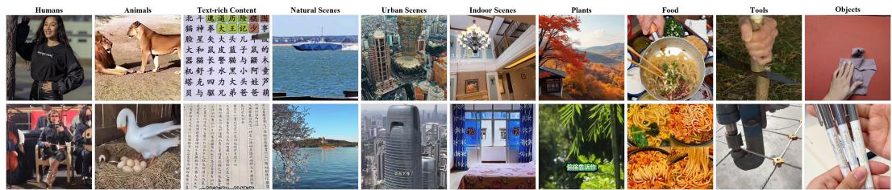  
Figure 7: Representative image matrix of UGCSR benchmark. The benchmark covers ten semantic categories: humans, animals, text-rich images, natural scenes, urban scenes, indoor scenes, plants, food, tools, and everyday objects. Two representative degraded images are shown for each category.

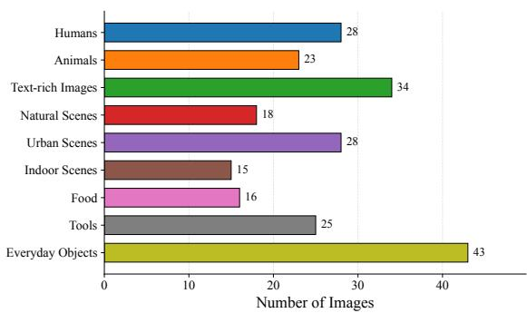  
(a) Category Distribution

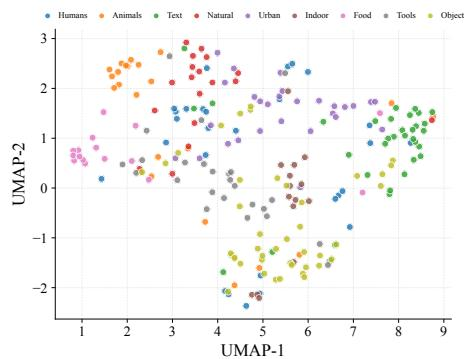  
(b) OpenCLIP Feature Distribution  
Figure 8: Objective semantic analysis of UGCSR. (a) Distribution of OpenCLIP zero-shot pseudolabels across nine semantic categories. (b) UMAP visualization of the OpenCLIP image features, where each point represents one HR image and colors indicate the corresponding Top-1 predicted categories.

UGCSR covers nine semantic categories, including humans, animals, text-rich images, natural scenes, urban scenes, indoor scenes, food, tools, and everyday objects. As illustrated in Figure 7, the samples exhibit diverse object scales, layouts, illumination conditions, and texture complexities. Unlike camera-captured benchmarks, UGCSR captures compound, content-dependent degradations introduced by practical media distribution, such as resolution adaptation, compression, transcoding, blur, ringing, aliasing, noise, and color variations.

Objective Semantic Analysis. To objectively assess the content diversity of UGCSR, we employ OpenCLIP (Radford et al., 2021; Cherti et al., 2023) to perform zero-shot classification on all 230 images using ten predefined semantic categories. Each image is assigned to the category whose text prototype has the highest cosine similarity with its normalized image feature. As shown in Figure 8(a), the resulting distribution covers humans, animals, text-rich images, natural scenes, urban scenes, indoor scenes, plants, food, tools, and everyday objects, demonstrating the broad content coverage of UGCSR.

We further project the OpenCLIP features into two dimensions using UMAP (McInnes et al., 2018), as shown in Figure 8(b). The locally clustered yet overlapping distribution further reflects the semantic diversity and non-exclusive nature of real-world UGC content.

Quality Assessment Analysis. Table 4 reports the mean and standard deviation of four noreference image quality metrics for both LR and HR images. UGCSR achieves the best HR scores on MUSIQ, MANIQA, and DeQA, together with a competitive NIQE score. Its relatively small standard deviations further indicate consistently high-quality references, supporting reliable paired evaluation.

Table 4: No-reference quality comparison of LR and HR images across real-world paired SR benchmarks. Results are reported as mean ± standard deviation. The best results among LR and HR images are highlighted in bold and underlined, respectively.
<table><tr><td rowspan="2">Metric</td><td colspan="2">RealSR</td><td colspan="2">ScreenSR</td><td colspan="2">UGCSR</td></tr><tr><td>LR</td><td>HR</td><td>LR</td><td>HR</td><td>LR</td><td>HR</td></tr><tr><td>MUSIQ↑</td><td> $2 9 . 5 9 7 \pm 6 . 3 3 5$ </td><td> $5 7 . 4 6 5 \pm 9 . 2 3 9$ </td><td> $4 1 . 2 2 0 \pm 1 2 . 3 2 1$ </td><td> $7 2 . 1 5 0 \pm 4 . 6 7 2$ </td><td> ${ \bf 6 9 . 7 5 3 \pm 9 . 7 4 7 }$ </td><td> ${ 7 5 . 1 7 5 \pm 3 . 1 9 6 }$ </td></tr><tr><td>MANIQA↑</td><td> $0 . 2 7 8 \pm 0 . 0 8 4$ </td><td> $0 . 3 2 9 \pm 0 . 0 9 3$ </td><td> $0 . 2 1 2 \pm 0 . 0 8 1$ </td><td> $0 . 5 6 5 \pm 0 . 0 6 1$ </td><td> ${ \bf 0 . 4 6 4 \pm 0 . 1 1 2 }$ </td><td> $0 . 5 8 8 \pm 0 . 0 5 6$ </td></tr><tr><td>DeQA↑</td><td> $1 . 7 2 1 \pm 0 . 1 8 6$ </td><td> $3 . 0 5 0 \pm 0 . 4 1 8$ </td><td> $2 . 3 4 1 \pm 0 . 4 0 3$ </td><td> $4 . 1 2 1 \pm 0 . 3 0 3$ </td><td> ${ \bf 3 . 5 5 9 \pm 0 . 5 3 7 }$ </td><td> $\underline { { 4 . 1 8 3 \pm 0 . 2 1 5 } }$ </td></tr><tr><td>NIQE↓</td><td> $1 8 . 2 1 5 \pm 2 8 . 3 5 1$ </td><td> $6 . 1 1 7 \pm 1 . 4 4 4$ </td><td> $6 . 9 6 8 \pm 1 . 2 4 8$ </td><td> $\underline { { 3 . 7 7 2 \pm 1 . 9 5 2 } }$ </td><td> $\mathbf { 4 . 7 9 7 \pm 1 . 8 4 1 }$ </td><td> $\overline { { 3 . 8 8 4 \pm 1 . 4 2 8 } }$ </td></tr></table>

Meanwhile, clear LR–HR quality gaps are observed across all four metrics, confirming the presence of perceptible degradations introduced by real media-processing pipelines. Compared with RealSR and ScreenSR, UGCSR retains higher-quality LR inputs, suggesting that it emphasizes realistic and relatively subtle degradations rather than severely corrupted observations.

## A.3 LOW-RANK PROJECTOR CONSTRUCTION

OFD relies on a rank-r orthogonal projector $\pmb { P } \in \mathbb { R } ^ { D \times D }$ to partition each D-dimensional pixel patch into two complementary subspaces. We parameterize P using an orthonormal basis $\pmb { \dot { A } } \in \mathbb { R } ^ { D \times r }$ satisfying:

$$
A ^ { \mathsf { T } } A = I _ { r } .\tag{19}
$$

The corresponding projector is defined as:

$$
P : = A A ^ { \mathsf { T } } .\tag{20}
$$

It satisfies $P ^ { \mathsf { T } } = P , P ^ { 2 } = P$ , and rank $( P ) = r$ . Moreover, the orthonormality constraint preserves the Gaussian distribution of projected pixel-space noise. Specifically, if $\epsilon \sim \mathcal { N } ( \mathbf { 0 } , I _ { D } )$ , then:

$$
A ^ { \mathsf { T } } \epsilon \sim { \mathcal { N } } ( \mathbf { 0 } , I _ { r } ) .\tag{21}
$$

We investigate three strategies for constructing the projector.

Learnable Projector $P \cdot$ The first strategy constructs P from a learnable orthonormal basis A, which is jointly optimized with PixelSR under the following constraint:

$$
A ^ { \mathsf { T } } A = I _ { r } .\tag{22}
$$

The resulting projector is:

$$
P _ { \mathrm { L e a r n } } : = A A ^ { \top } .\tag{23}
$$

This formulation allows the projected subspace to adapt directly to the restoration objective. However, the projector continuously changes during training and does not explicitly incorporate prior knowledge about the representation structure of natural images.

SVD-Based Projector $P \cdot$ The second strategy constructs a data-dependent projector from the principal directions of pixel patches. Specifically, we collect K normalized and vectorized RGB patches and stack them as:

$$
\begin{array} { r } { \pmb { X } = \left[ \pmb { x } _ { 1 } , \ldots , \pmb { x } _ { K } \right] ^ { \mathsf { T } } \in \mathbb { R } ^ { K \times D } . } \end{array}\tag{24}
$$

For a patch size of p, the pixel dimension is:

$$
D = 3 p ^ { 2 } .\tag{25}
$$

Applying singular value decomposition to the centered pixel matrix gives:

$$
\pmb { X } = \pmb { U } _ { x } \pmb { \Sigma } _ { x } \pmb { V } _ { x } ^ { \top } .\tag{26}
$$

The top-r right singular vectors define the principal pixel subspace:

$$
A _ { \mathrm { S V D } } : = V _ { x } [ : , 1 : r ] .\tag{27}
$$

The corresponding SVD-based projector is:

$$
\begin{array} { r } { P _ { \mathrm { S V D } } : = A _ { \mathrm { S V D } } A _ { \mathrm { S V D } } ^ { \top } . } \end{array}\tag{28}
$$

This construction retains the dominant variations of natural image patches without introducing an additional learned representation. Nevertheless, directions with large pixel variance are not necessarily aligned with the compact semantic organization required by OFD.

Procrustes-Aligned Projector P. To construct a semantically meaningful projector, we align each $p \times p$ RGB patch $\mathbf { \boldsymbol { x } } _ { i } \in \mathbb { R } ^ { D }$ with its corresponding VAE latent block $z _ { i } \in \mathbb { R } ^ { r }$ . Specifically, we use the f8c4 VAE from Stable Diffusion 2.1 (SD2.1) by default. With $p = 1 6 .$ , the dimensions are:

$$
D = 3 \times 1 6 ^ { 2 } = 7 6 8 , \qquad r = 2 \times 2 \times 4 = 1 6 .\tag{29}
$$

We stack the paired pixel and latent vectors as:

$$
\begin{array} { r } { \pmb { X } = \left[ \pmb { x } _ { 1 } , \ldots , \pmb { x } _ { K } \right] ^ { \mathsf { T } } \in \mathbb { R } ^ { K \times D } , } \end{array}
$$

$$
\begin{array} { r } { \pmb { Z } = \left[ \pmb { z } _ { 1 } , \ldots , \pmb { z } _ { K } \right] ^ { \mathsf { T } } \in \mathbb { R } ^ { K \times r } . } \end{array}\tag{30}
$$

Then, we seek a semi-orthogonal mapping that lifts the compact latent representation into the pixelpatch space:

$$
\pmb { A } ^ { * } : = \arg \operatorname* { m i n } _ { \pmb { A } ^ { \top } \pmb { A } = \pmb { I } _ { r } } \left\| \pmb { X } - \pmb { Z } \pmb { A } ^ { \top } \right\| _ { \mathrm { F } } ^ { 2 } .\tag{31}
$$

The objective in Eq. 31 can be rewritten as:

$$
\left\| \boldsymbol { X } - \boldsymbol { Z } \boldsymbol { A } ^ { \intercal } \right\| _ { \mathrm { F } } ^ { 2 } = \left\| \boldsymbol { X } \right\| _ { \mathrm { F } } ^ { 2 } + \left\| \boldsymbol { Z } \right\| _ { \mathrm { F } } ^ { 2 } - 2 \operatorname { T r } \left( \boldsymbol { A } ^ { \intercal } \boldsymbol { X } ^ { \intercal } \boldsymbol { Z } \right) .\tag{32}
$$

Since the first two terms are independent of A, the problem is equivalent to:

$$
A ^ { * } : = \arg \operatorname* { m a x } _ { A ^ { \top } A = I _ { r } } \operatorname { T r } \left( A ^ { \top } X ^ { \top } Z \right) .\tag{33}
$$

The thin SVD of the cross-covariance matrix is defined as:

$$
X ^ { \top } Z = U \Sigma V ^ { \top } ,\tag{34}
$$

where $U \in \mathbb { R } ^ { D \times r }$ and $V \in \mathbb { R } ^ { r \times r }$ . The closed-form Procrustes solution is:

$$
\mathbf { } A ^ { * } : = U V ^ { \top } .\tag{35}
$$

Therefore, the Procrustes-aligned projector used by OFD is:

$$
P _ { \mathrm { P r o c } } : = A ^ { * } A ^ { * \mathsf { T } } = U U ^ { \mathsf { T } } .\tag{36}
$$

Unlike the SVD-based projector, the Procrustes-aligned projector captures pixel-space directions correlated with compact VAE representations rather than dominant pixel variance. It performs best in our ablation study and is therefore adopted in OFD. Crucially, the projector P is computed offline and fixed, while the VAE is absent from PixelSR training and inference.

Ablation on Projection Strategies. Since the functional roles of the induced subspaces depend on the projection basis, we compare three rank-matched constructions of P under the same PCD architecture and training settings: a learnable orthonormal basis optimized with the restoration objective, an SVD basis derived from dominant pixel-patch variations, and a Procrustes basis aligned with corresponding pre-trained VAE tokens. As shown in Table 5, the Procrustes projector achieves the best results across all metrics, suggesting that the compact organization of VAE representations provides a useful prior for defining the low-rank subspace.

Furthermore, to examine whether restoration performance depends on the source VAE’s reconstruction quality, we compare alignment using SD2.1, SD3, and FLUX.2 VAEs, adapting the projectionlayer input dimensions to their respective latent representations. As shown in Table 5, the three variants achieve broadly comparable SR performance, with no source VAE consistently outperforming the others across all metrics. These results suggest that the benefit of Procrustes alignment is no specific to a particular VAE. This is consistent with the VAE’s limited role as an offline reference for constructing P: PixelSR models both P and I − P components directly in RGB space, rather than passing images through a VAE encoding–decoding bottleneck during restoration training or inference.

## A.4 ANALYSIS OF ORTHOGONAL FLOW DECOUPLING

To further examine the branch specialization induced by OFD, we visualize their feature distributions using t-SNE on 300 images from each of five ImageNet (Deng et al., 2009) categories, as shown in Figure 9. The semantic-branch features form compact, category-aware clusters, indicating their sensitivity to high-level content. In contrast, the texture-branch features exhibit a more dispersed distribution, consistent with the diverse local variations modeled by this branch. Together with the component visualizations in Figure 3 and Figure 6, these results further provide complementary evidence for the semantic–texture interpretation underlying OFD.

Table 5: Ablation of projector construction on ScreenSR. The first three rows compare projection strategies, while the additional rows examine different source VAEs for Procrustes alignment. All variants use the same training settings. Red and orange indicate the best and second-best performance, respectively.
<table><tr><td rowspan="2">Variant</td><td colspan="3">Reference-based Metrics</td><td colspan="3">No-Reference Metrics</td></tr><tr><td>PSNR↑</td><td>SSIM↑</td><td>LPIPS ↓</td><td>MUSIQ↑</td><td>MANIQA↑</td><td>DeQA↑</td></tr><tr><td>Learnable P</td><td>23.4996</td><td>0.7114</td><td>0.2222</td><td>71.8488</td><td>0.4687</td><td>3.7217</td></tr><tr><td>SVD-based P</td><td>23.5053</td><td>0.7010</td><td>0.2224</td><td>71.9188</td><td>0.4645</td><td>3.7063</td></tr><tr><td>Procrustes P (SD2.1)</td><td>23.5640</td><td>0.7156</td><td>0.2082</td><td>72.8613</td><td>0.4824</td><td>3.8294</td></tr><tr><td>Procrustes P (SD3)</td><td>23.5583</td><td>0.7160</td><td>0.2132</td><td>72.8709</td><td>0.4816</td><td>3.8146</td></tr><tr><td>Procrustes P (FLUX.2)</td><td>23.5661</td><td>0.7168</td><td>0.2099</td><td>72.8436</td><td>0.4809</td><td>3.8318</td></tr></table>

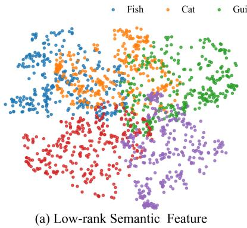

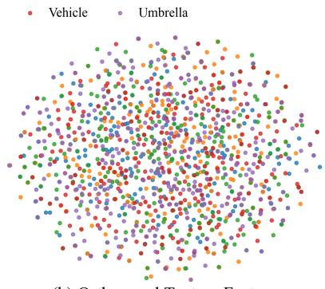  
(b) Orthogonal Texture Feature  
Figure 9: t-SNE visualization of semantic and texture features. We sample 300 images from each of five ImageNet categories and visualize features from the two PixelSR branches. Semantic features form compact category-aware clusters, while texture features are more dispersed due to diverse local details, supporting the effectiveness of our OFD.

## A.5 ADDITIONAL ABLATION RESULTS

We investigate the effect of different pre-trained semantic encoders by replacing DINOv2 with CLIP (Radford et al., 2021) and SigLIP (Zhai et al., 2023) while keeping all other settings unchanged. A reported in Table 6, DINOv2 achieves the best overall performance, indicating that its dense visua representations provide more effective semantic guidance for PixelSR. Therefore, we adopt DINOv2 as the default semantic encoder.

Table 6: Ablation on different semantic encoders on RealSR. All variants use the same PCD framework and settings. Red indicates the best performance.
<table><tr><td>Encoder</td><td>PSNR ↑</td><td>SSIM↑</td><td>LPIPS↓</td><td>MUSIQ↑</td><td>MANIQA ↑</td><td>DeQA↑</td></tr><tr><td>CLIP</td><td>25.2911</td><td>0.7161</td><td>0.2924</td><td>68.4463</td><td>0.5056</td><td>3.2331</td></tr><tr><td>SigLIP</td><td>25.1778</td><td>0.7099</td><td>0.2967</td><td>68.7191</td><td>0.5168</td><td>3.2396</td></tr><tr><td>DINOv2</td><td>25.3360</td><td>0.7166</td><td>0.2922</td><td>69.5941</td><td>0.5381</td><td>3.6116</td></tr></table>

## A.6 ADDITIONAL QUALITATIVE RESULTS

Figure 10 and Figure 11 present additional qualitative comparisons on challenging real-world cases. Competing methods often suffer from over-smoothed textures, distorted structures, inaccurate text restoration, or unrealistic hallucinations. In contrast, our PixelSR preserves consistent structure while recovering clearer text and finer, more natural textures. These visual results further corroborate the quantitative evidence that our single-stage, end-to-end PixelSR better reconciles structural fidelity and perceptual realism.

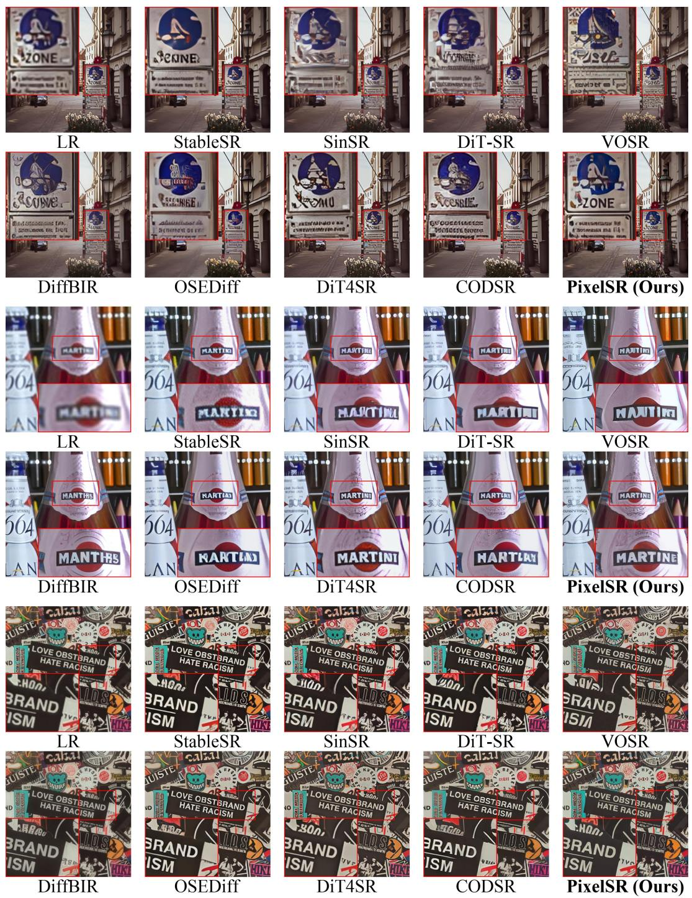  
Figure 10: Qualitative comparison on challenging real-world examples. PixelSR better preserves the original text layout and character structures while recovering fine-grained image details, whereas several competing methods exhibit distorted characters, irregular textures, or over-smoothed results. Best viewed zoomed in.

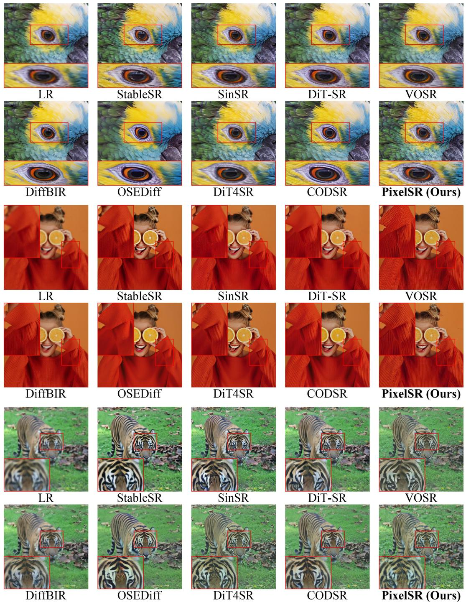  
Figure 11: Qualitative comparison on challenging real-world examples. PixelSR better preserves high-frequency textures and fine structural details, whereas competing methods often produce oversmoothed surfaces, irregular patterns, or artificial artifacts. Best viewed zoomed in.