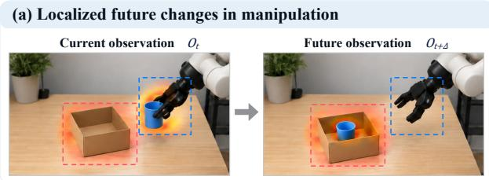
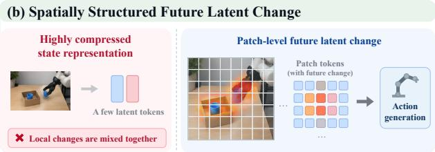
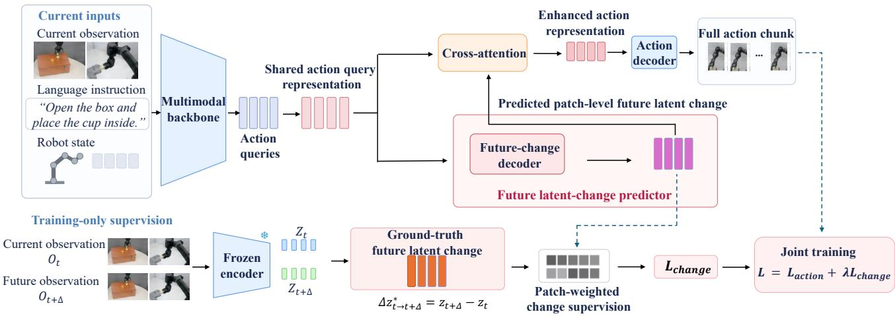
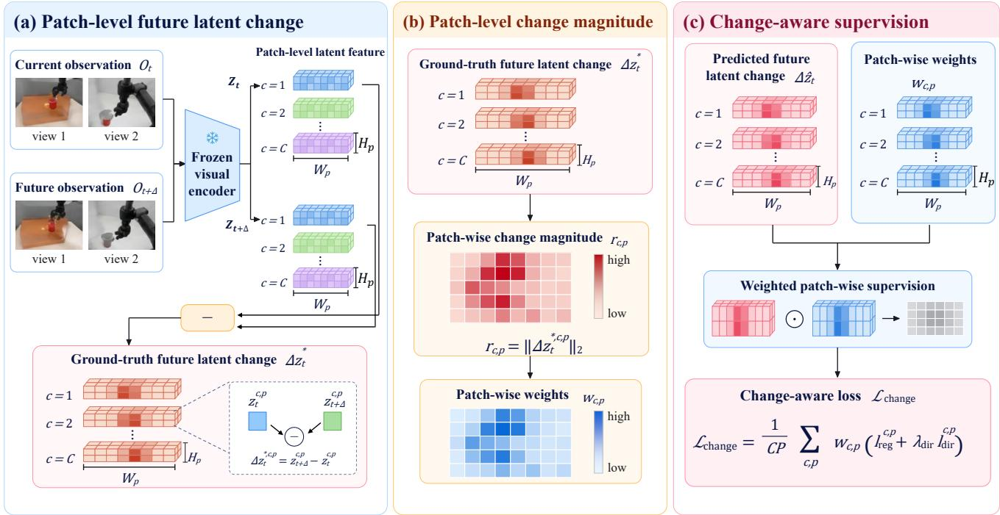
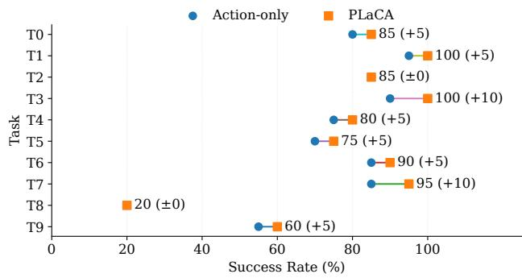

# PLaCA: Learning Patch-Level Future Latent Change for Action Generation

Zhan Yi Yuchen Wang Chao Li Lei Hong Boyuan Yang∗

School of Robotics and Automation, Nanjing University

Suzhou, Jiangsu, China

njuyizhan@smail.nju.edu.cn, wyc nju@smail.nju.edu.cn, lichao nju@smail.nju.edu.cn,

leihong@smail.nju.edu.cn, yby@nju.edu.cn

Corresponding author.

## Abstract

Vision-Language-Action (VLA) models generate robot actions from visual observations and language instructions, but effective manipulation also requires anticipating how the environment will change. Existing world-action models explore future image prediction and latent dynamics modeling. However, generating complete future images can be computationally expensive, while highly compressed latent representations may obscure local changes. To address these challenges, we propose PLaCA, a world-to-action framework built around future latent change. PLaCA directly predicts spatially structured patch-level future latent change from the current multimodal input, preserving local information about expected environmental changes. We introduce patch-level change-aware supervision to emphasize regions undergoing larger changes and a future-toaction interface that explicitly incorporates predicted future latent change into action generation. Experiments on LIBERO-Long show that PLaCA achieves a 79.0% success rate, improving upon the Action-only baseline by 5.0 percentage points. On CALVIN, PLaCA improves the average sequence length from 2.784 to 3.564. These improvements are achieved while updating only 2.95% of the model parameters during the second training stage, demonstrating the effectiveness offuture latent change modelingfor downstream robotic manipulation.

## 1. Introduction

Vision-Language-Action (VLA) models typically generate robot actions from current visual observations and language instructions [7, 15, 30]. However, in manipulation tasks such as grasping, pushing, and placing, effective action generation requires more than understanding the current environment. A policy must also consider how its actions may change object positions, contact relations, and local environmental states. To incorporate such future information, recent studies have explored integrating world modeling with VLA policies, motivating the development of worldaction modeling (WAM) [10, 40].

Existing approaches represent future information in different ways. Some predict future images or videos [8, 55], while others model future states or temporal dynamics in latent space [2, 16]. Recent studies have further explored compact latent motion representations [29, 46, 47]. Latentspace modeling has become a widely adopted approach in world modeling and robot learning [2, 16, 46]. While pixellevel future prediction provides rich visual details, generating complete future images often involves reconstructing substantial redundant visual content, leading to additional computational costs [44, 46]. In contrast, latent-space modeling avoids explicit pixel-level reconstruction, yet choosing an appropriate future representation for robotic manipulation remains an important question. For action generation, it may not be necessary to recover the complete future state or all intermediate dynamics. Instead, a policy may benefit from information about how the environment is expected to change.

Recent work has shown that differences between latent states can capture information related to robot motion. StaMo [29] learns highly compressed latent state representations and uses the latent displacement between states to represent robot motion. It also explores latent motion prediction for world modeling. However, latent representations differ in how they preserve spatial information. As illustrated in Fig. 1(a), when a robot places an object into a box, the changes are mainly concentrated around the robot arm and the object, while much of the background remains unchanged. Highly compressed state representations can encode such changes, but they do not explicitly preserve the correspondence between spatial locations and their latent changes. In contrast, retaining the patch-level spatial structure allows future changes at different image locations to be represented separately, as shown in Fig. 1(b). Moreover, the magnitude of future change can vary considerably across patches, while uniform patch supervision does not specifically emphasize regions undergoing larger changes. This motivates our first research question: How can we preserve the spatial structure of future latent change and learn local changes more effectively by accounting for their different magnitudes?

  
Figure 1. Motivation for spatially structured future latent change. (a) In robotic manipulation, future changes are often concentrated around the robot arm and manipulated objects, while much of the background remains unchanged. (b) Highly compressed state representations do not explicitly preserve the spatial locations of these changes, whereas patch-level future latent change retains their spatial structure and provides future information for action generation.

Another important question is how future modeling can be effectively coupled with action generation. Prior work has explored different approaches, including jointly learning future prediction and action policies within shared architectures [40, 46], using predicted future images or video plans to guide downstream control [14, 52], and leveraging learned latent or interaction dynamics for action inference [37, 41]. These studies provide different ways of using future information to inform robotic behavior. For the spatially structured future latent change considered in this work, the predicted representation preserves local information about expected environmental changes across image regions. This motivates investigating how such spatially organized predictions can be incorporated into action representations to support action generation. We therefore pose our second research question: How can predicted future latent change be effectively used to support action generation?

To address these questions, we propose PLaCA, a world-to-action framework built around future latent change. PLaCA directly predicts spatially structured patchlevel future latent change from the current multimodal input and employs patch-level change-aware supervision to emphasize regions with larger changes. We further introduce a future-to-action interface that incorporates the predicted future latent change into the action representation, allowing it to directly contribute to full action-chunk generation.

We evaluate PLaCA on LIBERO-Long, achieving a 79.0% task success rate. Ablation studies demonstrate that preserving fine-grained spatial structure, employing change-aware supervision, and incorporating predicted future latent change into action generation through the futureto-action interface contribute to improved downstream manipulation success rates.

Our main contributions are summarized as follows:

• We investigate patch-levelfuture latent change modeling, which directly predicts future latent change from the current multimodal input while preserving its spatial structure, providing local future information for action generation.

• We propose patch-level change-aware supervision, which adjusts the supervision weights according to the magnitude of ground-truth future latent change. Ablation results show that this approach improves closed-loop manipulation performance compared with uniform patch supervision.

• We design an explicit future-to-action interface that incorporates the final predicted future latent change into the action representation, allowing future information to directly contribute to full action-chunk generation.

## 2. Related Work

## 2.1. World-Action Modeling

Vision-Language-Action (VLA) models unify visual observations, language instructions, and robot actions within end-to-end policies, extending large-scale vision-language models toward general-purpose robotic control [6, 7, 12, 15, 24, 30, 57]. While conventional VLAs primarily focus on predicting continuous actions or action sequences from current multimodal observations [5, 22, 38, 42, 43], recent studies have increasingly incorporated future modeling, enabling policies to reason not only about what to do but also about what may happen after an action is executed [10, 14, 52, 56]. This trend has gradually extended VLA research from direct observation-to-action mapping toward joint modeling of environmental dynamics and robot behavior.

One line of work models future environmental changes through image or video prediction [44], while other approaches jointly learn future modeling and action generation [10, 56]. WorldAgen performs future-state prediction and action prediction within a unified Transformer, allowing world modeling and policy learning to share internal representations [40]. CoT-VLA uses predicted future images as intermediate visual guidance for subsequent action generation [52]. DynBridge learns interaction dynamics that connect future interaction modeling with robot control [41], while Motus further integrates latent action modeling, world modeling, and action generation into a unified framework, using shared latent representations to characterize the relationship between robot behavior and environmental changes [4]. DreamVLA combines dynamic-regionguided future information with spatial and semantic cues for action generation [51], while Mantis learns latent visual foresight with a separate prediction head [48]. Collectively, these studies reflect a growing trend in which future modeling is increasingly coupled with action generation through shared or explicitly connected representations. We focus on directly predicting spatially structured future latent change and incorporating its predicted tokens into the action representation through gated cross-attention.

## 2.2. Latent Dynamics

Future image and video prediction provides a detailed description of environmental changes, but generating full future frames can be computationally expensive [8, 55]. Recent studies have therefore explored latent state, latent motion, and latent action representations for future modeling and robot control [9] [2, 3, 16, 49].

One line of work focuses on representing dynamics in latent space. CoWVLA separates structural and motion information and learns a continuous latent motion chain to represent temporal evolution [46]. CoMo learns continuous latent motion by combining temporal differences with contrastive learning [47]. StaMo takes a different approach by learning highly compressed latent state representations from individual observations. It shows that differences between these states contain robot motion information and can support action decoding. StaMo further uses state and motion representations as prediction targets for VLA world modeling and explores latent-motion cotraining [29]. These studies explore different ways to capture temporal changes in latent space, including continuous motion representations and differences between compact latent states.

Another line of work investigates how latent dynamics can support action generation. VideoWorld learns discrete latent codes that represent future visual changes and uses the predicted codes together with visual information for inverse dynamics-based action decoding [37]. Latent Bridge instead predicts continuous feature changes to update latent representations, allowing the policy to reduce repeated VLM computation during action generation [31]. These approaches illustrate different ways of using learned latent dynamics to support action generation.

Our work focuses on learning spatially structured future latent change and using the predicted representation for ac-

tion generation.

## 3. Method

## 3.1. Overview

We consider robotic manipulation conditioned on multimodal context. At time step t, the current observation is $O _ { t } ~ = ~ \{ O _ { t } ^ { c } \} _ { c = 1 } ^ { C }$ , where C is the number of camera views. The language instruction, robot state, and available observation-action history are denoted by $\ell , s _ { t } .$ , and $\mathcal { H } _ { t } ,$ respectively. Together, they form the multimodal input $\mathcal { X } _ { t } =$ $( O _ { t } , \ell , s _ { t } , \mathcal { H } _ { t } )$ . Our goal is to predict a full action chunk $A _ { t } = \{ a _ { t } , \dots , a _ { t + H - 1 } \} \in \mathbb { R } ^ { H \times d _ { a } }$ , where H is the action horizon and $d _ { a }$ is the action dimension [11, 25, 53]. We use $H = 3$ and set the future prediction horizon to $\Delta = 3 .$ aligning the future observation with the state reached after executing the action chunk.

As shown in Fig. 2, our framework consists of a shared multimodal backbone, a future-change decoder, and a future-to-action interface. The shared backbone $B _ { \theta }$ processes the multimodal input together with action-query tokens $Q ^ { a }$ to obtain an initial action representation $H _ { t } ^ { ( 0 ) }$ [39, 45]. A residual adapter produces the shared action-query representation [19, 42]:

$$
\begin{array} { r l } & { H _ { t } ^ { ( 0 ) } = { \mathcal { B } } _ { \theta } ( { \mathcal { X } } _ { t } , Q ^ { a } ) , } \\ & { ~ H _ { t } ^ { a } = H _ { t } ^ { ( 0 ) } + \alpha ~ \mathrm { A d a p t e r } ( H _ { t } ^ { ( 0 ) } ) , } \end{array}\tag{1}
$$

where α is a zero-initialized learnable scalar. The same representation $H _ { t } ^ { a }$ is used for future latent change prediction and action generation.

The overall prediction process is formulated as

$$
\begin{array} { r l } & { \widehat { \Delta \boldsymbol Z } _ { t } = \mathcal { D } _ { f } ( \boldsymbol Q ^ { f } , \boldsymbol H _ { t } ^ { a } ) , } \\ & { \quad \widetilde { \boldsymbol H } _ { t } ^ { a } = \mathcal { F } _ { \phi } ( \boldsymbol H _ { t } ^ { a } , \widehat { \Delta \boldsymbol Z } _ { t } ) , } \\ & { \quad \widehat { \boldsymbol A } _ { t } = \mathcal { D } _ { a } ( \widetilde H _ { t } ^ { a } ) , } \end{array}\tag{2}
$$

where $\mathcal { D } _ { f }$ denotes the future-change decoder, $Q ^ { f }$ denotes learnable change queries, ${ \mathcal { F } } _ { \phi }$ is the future-to-action interface, and $\mathcal { D } _ { a }$ is the action decoder. The predicted future latent change $\widehat { \Delta Z } _ { t }$ provides both a future prediction target during training and conditioning information for action generation.

## 3.2. Patch-Level Future Latent Change Modeling

We model future information as changes between the current and future latent states while preserving their patchlevel spatial structure. Instead of representing the change using a single global feature, we predict a separate latent change vector for each patch location in every camera view. Ground-Truth Future Latent Change. As illustrated in Fig. 3(a), we construct the ground-truth future latent change from the current observation $O _ { t }$ and future observation $O _ { t + \Delta }$ . A frozen visual encoder $E _ { \mathrm { v i s } }$ extracts patch-level latent state representations [13, 17]. For the p-th patch of camera view $c ,$ we define :

  
Figure 2. Overview of our world-to-action framework. The shared multimodal backbone produces action-query representations, from which a future-change decoder predicts patch-level future latent change. During training, a frozen visual encoder provides change-aware supervision using current and future observations. The predicted future latent change is then incorporated into the action representation through a gated future-to-action interface to generate the full action chunk. Future observations are not required during inference.

$$
\begin{array} { r l } & { \quad z _ { t } ^ { c , p } = E _ { \mathrm { v i s } } ( O _ { t } ^ { c } ) _ { p } , } \\ & { \quad z _ { t + \Delta } ^ { c , p } = E _ { \mathrm { v i s } } ( O _ { t + \Delta } ^ { c } ) _ { p } , } \\ & { \quad \Delta z _ { t } ^ { * , c , p } = z _ { t + \Delta } ^ { c , p } - z _ { t } ^ { c , p } . } \end{array}\tag{3}
$$

Collecting the differences across all camera views and patch locations yields $\Delta Z _ { t } ^ { * } ~ \in ~ \mathbb { R } ^ { C \times P \times d _ { z } }$ , where $P =$ $H _ { p } W _ { p }$ denotes the number of patches per view, $H _ { p }$ and $W _ { p }$ are the height and width of the patch grid, and $d _ { z }$ is the latent feature dimension.

We use a frozen MAE ViT encoder [13, 17] to construct these targets. Unlike the compact visual tokens supplied to the policy backbone, the supervision targets retain the complete patch grid without spatial pooling. Each difference is computed between features at the same image patch location, preserving the spatial organization of the latent representation.

Future Latent Change Prediction. To predict this representation, we introduce $Q ^ { f } \in \mathbb { R } ^ { ( C P ) \times d }$ as learnable change queries, with each query assigned to a camera view and patch location. Here, d denotes the hidden dimension of the future-change decoder. A Transformer-based futurechange decoder uses these queries [23, 39] to attend to the shared action-query representation $H _ { t } ^ { a }$ , aggregating information from the current multimodal context.

The decoder outputs are projected into the visual latent

space to obtain

$$
\begin{array} { r } { \widehat { \Delta { Z } } _ { t } = { \mathcal { D } } _ { f } \bigl ( Q ^ { f } , H _ { t } ^ { a } \bigr ) \in \mathbb { R } ^ { C \times P \times d _ { z } } . } \end{array}\tag{4}
$$

The predicted vectors retain their camera and patch indices and are supervised at the corresponding spatial locations. Importantly, the decoder directly predicts the continuous future latent change rather than first reconstructing a future latent state. This prediction is subsequently used by the future-to-action interface.

## 3.3. Patch-Level Change-Aware Supervision

Future latent change is generally distributed unevenly across image regions. While some patches undergo substantial changes, others remain relatively stable over the prediction horizon. To account for these differences, we introduce patch-level change-aware supervision that assigns larger relative weights to patches with greater ground-truth changes. Figure 3(b) illustrates how patch-wise change magnitudes are used to determine the supervision weights.

For each patch, we measure its change magnitude as $r _ { c , p } = \| \Delta z _ { t } ^ { * , \bar { c } , p } \| _ { 2 }$ and compute the mean magnitude within each sample:

$$
\bar { r } = \frac { 1 } { C P } \sum _ { c , p } r _ { c , p } .\tag{5}
$$

We then construct normalized supervision weights:

$$
\begin{array} { r l } & { \widetilde { w } _ { c , p } = \mathrm { c l i p } \left( 1 + \eta \left( \frac { r _ { c , p } } { \operatorname* { m a x } \left( \bar { r } , \epsilon \right) } - 1 \right) , w _ { \mathrm { m i n } } , w _ { \mathrm { m a x } } \right) , } \\ & { w _ { c , p } = \frac { \widetilde { w } _ { c , p } } { \operatorname* { m a x } \left( \frac { 1 } { C P } \sum _ { c ^ { \prime } , p ^ { \prime } } \widetilde { w } _ { c ^ { \prime } , p ^ { \prime } } , \epsilon \right) } . } \end{array}\tag{6}
$$

Here, η controls the strength of change-aware weighting. We use $\eta = 0 . 7 5 , w _ { \mathrm { m i n } } = 0 . 2 5$ , and $w _ { \mathrm { m a x } } = 4$ , with $\epsilon =$ $1 0 ^ { - 8 }$ for numerical stability. The weights are normalized after clipping to maintain a mean of one. All patches remain supervised, including those with small changes.

We combine a SmoothL1 regression loss with a cosine directional loss to supervise the predicted future latent change. For each patch, these are defined as

$$
\begin{array} { l } { { \ell _ { \mathrm { r e g } } ^ { c , p } = \displaystyle \frac { 1 } { d _ { z } } \sum _ { j = 1 } ^ { d _ { z } } \mathrm { S m o o t h L 1 } \left( \widehat { \Delta z } _ { t , j } ^ { c , p } , \Delta z _ { t , j } ^ { * , c , p } \right) , } } \\ { { \ell _ { \mathrm { d i r } } ^ { c , p } = 1 - \displaystyle \cos \left( \widehat { \Delta z } _ { t } ^ { c , p } , \Delta z _ { t } ^ { * , c , p } \right) , } } \end{array}\tag{7}
$$

where cosine similarity is computed with numerically stabilized vector norms. The weighted future latent change objective is

$$
\mathcal { L } _ { \mathrm { c h a n g e } } = \frac { 1 } { C P } \sum _ { c , p } w _ { c , p } \left( \ell _ { \mathrm { r e g } } ^ { c , p } + \lambda _ { \mathrm { d i r } } \ell _ { \mathrm { d i r } } ^ { c , p } \right) ,\tag{8}
$$

where $\lambda _ { \mathrm { d i r } } = 0 . 2$ . As illustrated in Fig. 3(c), the patchwise weights adjust the contributions of the regression and directional losses. These weights are used only during training and are not required during inference.

## 3.4. Future-to-Action Interface

Predicting future latent change provides information about the expected environmental changes. To make this information available to the action-generation pathway, we introduce a future-to-action interface that conditions the action representation on the predicted patch-level future latent change.

Future-Change Conditioning. We use the final predicted change vectors $\widehat { \Delta Z } _ { t }$ , rather than the hidden features of the future-change decoder, as the input to the interface. After flattening the camera and patch dimensions, a learnable projection $\mathcal { P } _ { \phi }$ maps the predicted change into the action feature space:

$$
F _ { t } = \mathcal { P } _ { \phi } \left( \widehat { \Delta Z _ { t } } \right) \in \mathbb { R } ^ { \left( C P \right) \times d } .\tag{9}
$$

We then use cross-attention to incorporate the predicted future latent change into the action representation [1, 39]. The shared action-query representation $H _ { t } ^ { a }$ serves as the Query, while $F _ { t }$ serves as the Key and Value:

$$
U _ { t } = \mathrm { L N } \left( \mathrm { M H A } \left( Q = H _ { t } ^ { a } , K = F _ { t } , V = F _ { t } \right) \right) .\tag{10}
$$

This allows each action query to aggregate information from the predicted patch-level future latent change.

Gated Residual Integration. To control the contribution of predicted future information, we employ a learnable scalar gate $\beta$ and update the action representation through residual fusion [1]:

$$
\begin{array} { c } { { \widetilde { H } _ { t } ^ { a } = H _ { t } ^ { a } + \beta U _ { t } , } } \\ { { \widehat { A } _ { t } = \mathcal { D } _ { a } ( \widetilde { H } _ { t } ^ { a } ) . } } \end{array}\tag{11}
$$

The gate $\beta$ is initialized to zero and learned jointly with the other trainable modules. It is independent of the residualadapter coefficient α in Eq. (1).

The resulting action representation is decoded into the full action chunk. Thus, the predicted future latent change contributes directly to action generation through a separate conditioning pathway, rather than serving only as an auxiliary prediction target.

## 3.5. Joint Learning and Initialization

We adopt a two-stage training strategy. First, we train an action-only policy using behavioral cloning [11, 32, 53] to establish an observation-to-action mapping. We then initialize the joint model from this policy and introduce the futurechange decoder and future-to-action interface. During the second stage, the visual and language encoders and the original backbone weights remain frozen, while lightweight backbone adapters, future-modeling modules, the interface, and action-generation modules are optimized.

Action Generation Objective. We supervise the predicted full action chunk using SmoothL1 loss for arm actions and binary cross-entropy for gripper states:

$$
\begin{array} { r } { \mathcal { L } _ { \mathrm { a c t i o n } } = \mathcal { L } _ { \mathrm { a r m } } ^ { \mathrm { S m o o t h L 1 } } + \lambda _ { g } \mathcal { L } _ { \mathrm { g r i p p e r } } ^ { \mathrm { B C E } } , } \end{array}\tag{12}
$$

where $\lambda _ { g }$ controls the contribution of the gripper loss.

Training samples contain two consecutive action chunks [34, 53] associated with observation endpoints $O _ { 0 } .$ $O _ { 3 } ,$ , and $O _ { 6 }$ . Predicted future latent change from both chunks is incorporated into their respective action representations. Both chunks receive action supervision, while direct future latent change supervision is applied to the latest chunk, which corresponds to the action chunk executed during closed-loop inference. Specifically, we use $\Delta Z _ { 3 } ^ { * } = E _ { \mathrm { v i s } } ( O _ { 6 } ) - E _ { \mathrm { v i s } } ( O _ { 3 } )$ as the prediction target.

Joint Optimization. The complete second-stage training objective is

$$
\mathcal { L } _ { \mathrm { t o t a l } } = \mathcal { L } _ { \mathrm { a c t i o n } } + \lambda _ { \mathrm { c h a n g e } } \mathcal { L } _ { \mathrm { c h a n g e } } ,\tag{13}
$$

where $\lambda _ { \mathrm { c h a n g e } }$ controls the contribution of future latent change supervision.

The future-change decoder receives direct supervision from $\mathcal { L } _ { \mathrm { c h a n g e } }$ . Because its predictions are incorporated into the action-generation pathway without detachment, the action objective can also update the future-change decoder as the gate β learns a nonzero value. During inference, the model predicts future latent change and generates the full action chunk using only the available multimodal context, without access to future observations.

  
Figure 3. Patch-level future latent change and change-aware supervision. (a) A frozen visual encoder extracts patch-level features from current and future observations. Their differences at corresponding patch locations define the ground-truth future latent change ∆Z∗, preserving the spatial structure across camera views. (b) The magnitude of each ground-truth change vector is used to compute patch-wise supervision weights, assigning larger relative weights to patches with greater changes. (c) The predicted future latent change ∆dZt is supervised against $\Delta Z _ { t } ^ { * }$ using weighted regression and directional losses. All patches contribute to the training objective with different weights.

## 4. Experiments

We evaluate PLaCA on two robotic manipulation benchmarks, LIBERO-Long and CALVIN, and compare its performance with representative methods. We further conduct ablation studies to examine the contributions of patch-level spatial structure, change-aware supervision, and the futureto-action interface.

## 4.1. Experimental Setup

Benchmarks and Datasets. LIBERO-Long [25, 28, 35] consists of 10 long-horizon manipulation tasks. We use 50 expert demonstrations per task, totaling 500 trajectories, with 450 for training and 50 for validation. All variants share the same trajectory-level split. Each task is evaluated with 20 closed-loop rollouts, yielding 200 episodes per model.

CALVIN [33] evaluates long-horizon languageconditioned robotic manipulation across different environments. We adopt the ABC→D setting, training on environments A, B, and C and evaluating on the unseen environment D. We evaluate 1,000 task sequences, each containing five consecutive subtasks, and report the Average Sequence Length (ASL).

Implementation Details. We build PLaCA on a Qwenbased Transformer backbone [39, 45] with frozen MAE visual and CLIP language encoders [17, 36]. Following the two-stage training procedure described in Sec. 3, all futuremodeling variants are initialized from the same Action-only checkpoint. During the second stage, the pretrained backbone weights remain frozen, with rank-8 LoRA [19] applied to the last six Transformer layers. The future-change decoder, future-to-action interface, and action-generation modules are jointly optimized.

## 4.2. Evaluation on Simulation Benchmarks

Results on LIBERO-Long. We evaluate PLaCA on the LIBERO-Long benchmark, which consists of 10 longhorizon manipulation tasks involving object grasping and placement, container manipulation, and multi-stage task execution. We evaluate all 10 tasks with 20 closed-loop rollouts per task, resulting in 200 episodes in total. We report the average task success rate.

Table 1. Comparison on LIBERO-Long. Params denotes the reported model size. Results from prior methods are taken from their respective papers. † PDF uses a 7B OpenVLA backbone with an additional 9M trainable parameters.
<table><tr><td>Method</td><td>Params (B)</td><td>LIBERO-Long ↑</td></tr><tr><td>OpenVLA [24]</td><td>7.0</td><td>53.7</td></tr><tr><td>UniAct [54]</td><td>0.5</td><td>46.5</td></tr><tr><td>UniAct + ACT Head [53, 54]</td><td>~0.5</td><td>70.0</td></tr><tr><td>RoboMonkey [26]</td><td>~14</td><td>56.5</td></tr><tr><td>PDF [50]</td><td>7.0†</td><td>59.0</td></tr><tr><td>Dita (OXE) [18]</td><td>0.334</td><td>63.8</td></tr><tr><td>Dita (DROID) [18]</td><td>0.334</td><td>77.9</td></tr><tr><td>ThinkAct [20]</td><td>7.0</td><td>70.9</td></tr><tr><td>MolmoAct [27]</td><td>7.0</td><td>77.2</td></tr><tr><td>Fast-ThinkAct [21]</td><td>3.0</td><td>79.4</td></tr><tr><td>PLaCA (Ours)</td><td>0.395</td><td>79.0</td></tr></table>

As shown in Table 1, PLaCA achieves a success rate of 79.0% on LIBERO-Long, outperforming the reported results of several representative methods, including Dita, ThinkAct, MolmoAct,and PDF, while achieving performance comparable to Fast-ThinkAct (79.4%). Notably, PLaCA contains only 394.83M parameters, of which 11.66M (2.95%) are trainable during the second training stage. By directly predicting spatially structured future latent change and using it for action generation, PLaCA incorporates future information without generating complete future images or intermediate motion sequences. This design provides a practical way to incorporate future modeling within a relatively small model, achieving competitive closed-loop performance with a limited number of trainable parameters.

Compared with the Action-only policy built on the same base architecture, PLaCA improves the average success rate from 74.0% to 79.0%, a gain of 5.0 percentage points. The contributions of individual components are further examined through ablation studies in Sec. 4.3.

Per-Task Performance. To examine the performance across different manipulation tasks, Fig. 4 compares the pertask success rates of the Action-only policy and PLaCA on all 10 LIBERO-Long tasks.

PLaCA improves the success rate on 8 of the 10 tasks and maintains the same performance on the remaining two tasks. In particular, PLaCA achieves a 100% success rate on Tasks 1 and 3. However, Task 8, which requires placing two moka pots on the stove, remains challenging, with a success rate of 20%.

Results on CALVIN. To further assess PLaCA on sequential robotic manipulation, we evaluate its performance on CALVIN under the ABC→D setting. As shown in Table 2, PLaCA achieves an ASL of 3.564, outperforming the Action-only baseline (2.784) by 0.780. This result demonstrates that PLaCA also improves sequential task execution in an unseen environment.

  
Figure 4. Per-task success rates on LIBERO-Long. Comparison between the Action-only baseline and PLaCA across all 10 tasks, with 20 closed-loop rollouts per task.

Table 2. Results on CALVIN ABC→D. ASL denotes the average number of consecutively completed subtasks per five-task sequence.
<table><tr><td>Method</td><td>ASL ↑</td></tr><tr><td>Action-only</td><td>2.784</td></tr><tr><td>PLaCA (Ours)</td><td>3.564</td></tr></table>

Table 3. Ablation studies of PLaCA on LIBERO-Long. Patch Grid denotes the spatial resolution of the future latent representation. Uniform and Change-aware indicate the patch-wise supervision weighting scheme. F2A denotes the future-to-action interface.
<table><tr><td>Variant</td><td>Patch Grid</td><td>Supervision</td><td>F2A</td><td>Success ↑</td></tr><tr><td>Action-only</td><td></td><td></td><td></td><td>74.0</td></tr><tr><td>Action-only (+40 epochs)</td><td></td><td></td><td></td><td>72.5</td></tr><tr><td>PLaCA (7 × 7)</td><td> $7 \times 7$ </td><td>Change-aware</td><td>√</td><td>77.5</td></tr><tr><td>Patch-change → Action</td><td> $1 4 \times 1 4$ </td><td>Uniform</td><td>√</td><td>76.0</td></tr><tr><td>Future-change auxiliary</td><td> $1 4 \times 1 4$ </td><td>Change-aware</td><td></td><td>76.5</td></tr><tr><td>Absolute future latent</td><td> $1 4 \times 1 4$ </td><td>Change-aware</td><td>√</td><td>74.5</td></tr><tr><td>PLaCA (Ours)</td><td>14 × 14</td><td>Change-aware</td><td>√</td><td>79.0</td></tr></table>

## 4.3. Ablation Studies

We conduct ablation studies on LIBERO-Long to examine three key designs in PLaCA: patch-level future latent change modeling, patch-level change-aware supervision, and the future-to-action interface. All variants are evaluated on the same 10 tasks with 20 closed-loop rollouts per task. The results are summarized in Table 3.

Effect of Additional Training. To examine whether performance gains arise from additional training, we continue training the Action-only policy for 40 epochs from the same checkpoint, matching the second-stage training duration of PLaCA. The extended Action-only baseline achieves 72.5%, compared with 74.0% for the original baseline and 79.0% for PLaCA. This indicates that the improvement is attributable to future latent change modeling rather than additional training alone.

Patch-Level Future Latent Change Modeling. We examine this design from two perspectives: the prediction target and spatial structure. First, we replace future latent change with absolute future latent as the prediction target, while retaining the same future-to-action interface and training configuration. Directly predicting absolute future latent achieves 74.5%, 4.5 percentage points below PLaCA (79.0%), demonstrating the benefit of explicitly modeling future latent change.

Second, we investigate spatial structure by varying the patch grid resolution, preserving patch-wise representations and supervision rather than removing them altogether. Reducing the grid from 14 × 14 to 7 × 7 decreases the success rate from 79.0% to 77.5%, suggesting that retaining richer local spatial change information benefits action generation. Effect of Patch-Level Change-Aware Supervision. Replacing change-aware supervision with uniform patch weighting reduces the success rate from 79.0% to 76.0%. This demonstrates the benefit of adjusting supervision weights according to local future latent change magnitudes, enabling more effective learning of future environmental changes.

Effect of the Future-to-Action Interface. Using future latent change prediction only as an auxiliary training objective achieves 76.5%. Explicitly incorporating the predicted future latent change into action generation through the future-to-action interface improves the success rate to 79.0%, confirming the effectiveness of directly coupling future modeling with action generation.

## 5. Conclusion

In this paper, we propose PLaCA, a world-to-action framework built around future latent change, aiming to make future modeling more directly contribute to robot action generation. By preserving fine-grained spatial structure, employing change-aware supervision, and explicitly incorporating predicted future latent change into action generation, PLaCA establishes a direct connection between future modeling and action generation. Experiments on LIBERO-Long and CALVIN demonstrate improved downstream manipulation performance, while ablation studies further validate the effectiveness of the proposed designs. Notably, PLaCA achieves performance improvements by updating only a small fraction of model parameters during the second training stage, suggesting that future modeling can effectively enhance action generation with limited parameter updates. Overall, our results highlight spatially structured future latent change as an effective representation for connecting future modeling with robot action generation.

## References

[1] Jean-Baptiste Alayrac, Jeff Donahue, Pauline Luc, Antoine Miech, Iain Barr, et al. Flamingo: a visual language model for few-shot learning. In Advances in Neural Information Processing Systems (NeurIPS), 2022. 5

[2] Mido Assran, Adrien Bardes, David Fan, Quentin Garrido, Russell Howes, et al. V-jepa 2: Self-supervised video models enable understanding, prediction and planning. arXiv preprint arXiv:2506.09985, 2025. 1, 3

[3] Adrien Bardes, Quentin Garrido, Jean Ponce, Xinlei Chen, Michael Rabbat, Yann LeCun, Mahmoud Assran, and Nicolas Ballas. Revisiting feature prediction for learning visual representations from video. arXiv preprint arXiv:2404.08471, 2024. 3

[4] Hongzhe Bi, Hengkai Tan, Shenghao Xie, Zeyuan Wang, Shuhe Huang, Haitian Liu, Ruowen Zhao, Yao Feng, Chen dong Xiang, Yinze Rong, Hongyan Zhao, Hanyu Liu, Zhizhong Su, Lei Ma, Hang Su, and Jun Zhu. Motus: A unified latent action world model. In Proceedings of the IEEE/CVF Conference on Computer Vision and Pattern Recognition (CVPR), pages 35101–35113, 2026. 3

[5] Johan Bjorck, Fernando Castaneda, Nikita Cherniadev, et al. Gr00t n1: An open foundation model for generalist humanoid robots. arXiv preprint arXiv:2503.14734, 2025. 2

[6] Kevin Black, Noah Brown, Danny Driess, Adnan Esmail, Michael Robert Equi, Chelsea Finn, Niccolo Fusai, Lachy Groom, Karol Hausman, Brian Ichter, Szymon Jakubczak, Tim Jones, Liyiming Ke, Sergey Levine, Adrian Li-Bell, Mohith Mothukuri, Suraj Nair, Karl Pertsch, Lucy Xiaoyang Shi, Laura Smith, James Tanner, Quan Vuong, Anna Walling, Haohuan Wang, and Ury Zhilinsky. π0: A visionlanguage-action flow model for general robot control. In Proceedings ofRobotics: Science and Systems (RSS), 2025. 2

[7] Anthony Brohan, Noah Brown, Justice Carbajal, Yevgen Chebotar, Joseph Dabis, Chelsea Finn, et al. Rt-1: Robotics transformer for real-world control at scale. In Proceedings ofRobotics: Science and Systems (RSS), 2023. 1, 2

[8] Jake Bruce, Michael D Dennis, Ashley Edwards, Jack Parker-Holder, Yuge Shi, et al. Genie: Generative interactive environments. In Proceedings of the International Conference on Machine Learning (ICML), 2024. 1, 3

[9] Qingwen Bu, Yanting Yang, Jisong Cai, Shenyuan Gao, Guanghui Ren, Maoqing Yao, Ping Luo, and Hongyang Li. Learning to act anywhere with task-centric latent actions. In Proceedings of Robotics: Science and Systems (RSS), 2025. 3

[10] Jun Cen, Chaohui Yu, Hangjie Yuan, Yuming Jiang, Siteng Huang, Jiayan Guo, Xin Li, Yibing Song, Hao Luo, Fan Wang, Deli Zhao, and Hao Chen. WorldVLA: Towards autoregressive action world model. arXiv preprint arXiv:2506.21539, 2025. 1, 2

[11] Cheng Chi, Siyuan Feng, Yilun Du, Zhenjia Xu, Eric Cousineau, Benjamin Burchfiel, and Shuran Song. Diffusion policy: Visuomotor policy learning via action diffusion. In

Proceedings of Robotics: Science and Systems (RSS), 2023. 3, 5

[12] Open X-Embodiment Collaboration et al. Open xembodiment: Robotic learning datasets and rt-x models. In IEEE International Conference on Robotics and Automation (ICRA), 2024. 2

[13] Alexey Dosovitskiy, Lucas Beyer, Alexander Kolesnikov, Dirk Weissenborn, Xiaohua Zhai, et al. An image is worth 16x16 words: Transformers for image recognition at scale. In International Conference on Learning Representations (ICLR), 2021. 4

[14] Yilun Du, Mengjiao Yang, Pete Florence, Fei Xia, Ayzaan Wahid, et al. Video language planning. In International Conference on Learning Representations (ICLR), 2024. 2

[15] Dibya Ghosh, Homer Rich Walke, Karl Pertsch, Kevin Black, Oier Mees, et al. Octo: An open-source generalist robot policy. In Proceedings of Robotics: Science and Systems (RSS), 2024. 1, 2

[16] Danijar Hafner, Jurgis Pasukonis, Jimmy Ba, and Timothy Lillicrap. Mastering diverse control tasks through world models. Nature, 2025. 1, 3

[17] Kaiming He, Xinlei Chen, Saining Xie, Yanghao Li, Piotr Dollar, and Ross Girshick. Masked autoencoders are scalable vision learners. In Proceedings ofthe IEEE/CVF Conference on Computer Vision and Pattern Recognition (CVPR), 2022. 4, 6

[18] Zhi Hou, Tianyi Zhang, Yuwen Xiong, Haonan Duan, Hengjun Pu, Ronglei Tong, Chengyang Zhao, Xizhou Zhu, Yu Qiao, Jifeng Dai, and Yuntao Chen. Dita: Scaling diffusion transformer for generalist vision-language-action policy. In Proceedings of the IEEE/CVF International Conference on Computer Vision (ICCV), pages 7686–7697, 2025. 7

[19] Edward J Hu, Yelong Shen, Phillip Wallis, Zeyuan Allen-Zhu, Yuanzhi Li, Shean Wang, Lu Wang, and Weizhu Chen. Lora: Low-rank adaptation of large language models. In International Conference on Learning Representations (ICLR), 2022. 3, 6

[20] Chi-Pin Huang, Yueh-Hua Wu, Min-Hung Chen, Yu-Chiang Frank Wang, and Fu-En Yang. Thinkact: Visionlanguage-action reasoning via reinforced visual latent planning. arXiv preprint arXiv:2507.16815, 2025. 7

[21] Chi-Pin Huang, Yunze Man, Zhiding Yu, Min-Hung Chen, Jan Kautz, Yu-Chiang Frank Wang, and Fu-En Yang. Fastthinkact: Efficient vision-language-action reasoning via verbalizable latent planning. In Proceedings of the IEEE/CVF Conference on Computer Vision and Pattern Recognition (CVPR), pages 5070–5081, 2026. 7

[22] Physical Intelligence, Kevin Black, Noah Brown, et al. π0.5: a vision-language-action model with open-world generalization. arXiv preprint arXiv:2504.16054, 2025. 2

[23] Andrew Jaegle, Sebastian Borgeaud, Jean-Baptiste Alayrac, Carl Doersch, Catalin Ionescu, et al. Perceiver io: A general architecture for structured inputs and outputs. In International Conference on Learning Representations (ICLR), 2022. 4

[24] Moo Jin Kim, Karl Pertsch, Siddharth Karamcheti, Ted Xiao, Ashwin Balakrishna, Suraj Nair, Rafael Rafailov, Ethan P.

Foster, Pannag R. Sanketi, Quan Vuong, Thomas Kollar, Benjamin Burchfiel, Russ Tedrake, Dorsa Sadigh, Sergey Levine, Percy Liang, and Chelsea Finn. OpenVLA: An opensource vision-language-action model. In Proceedings of the Conference on Robot Learning (CoRL), pages 2679–2713, 2024. 2, 7

[25] Moo Jin Kim, Chelsea Finn, and Percy Liang. Fine-tuning vision-language-action models: Optimizing speed and success. In Proceedings of Robotics: Science and Systems (RSS), 2025. 3, 6

[26] Jacky Kwok, Christopher Agia, Rohan Sinha, Matt Foutter, Shulu Li, Ion Stoica, Azalia Mirhoseini, and Marco Pavone. Robomonkey: Scaling test-time sampling and verification for vision-language-action models. In Proceedings of the Conference on Robot Learning (CoRL), 2025. 7

[27] Jason Lee, Jiafei Duan, Haoquan Fang, Yuquan Deng, et al. Molmoact: Action reasoning models that can reason in space. arXiv preprint arXiv:2508.07917, 2025. 7

[28] Bo Liu, Yifeng Zhu, Chongkai Gao, Yihao Feng, Qiang Liu, Yuke Zhu, and Peter Stone. Libero: Benchmarking knowledge transfer for lifelong robot learning. In Advances in Neu ral Information Processing Systems, 2023. 6

[29] Mingyu Liu, Jiuhe Shu, Hui Chen, Zeju Li, Canyu Zhao, Jiange Yang, Shenyuan Gao, Hao Chen, and Chunhua Shen. StaMo: Unsupervised learning of generalizable robot motion from compact state representation. In Proceedings of the IEEE/CVF Conference on Computer Vision and Pattern Recognition (CVPR), pages 35014–35024, 2026. 1, 3

[30] Songming Liu, Lingxuan Wu, Bangguo Li, Hengkai Tan, Huayu Chen, Zhengyi Wang, Ke Xu, Hang Su, and Jun Zhu. Rdt-1b: A diffusion foundation model for bimanual manip ulation. In International Conference on Learning Representations (ICLR), 2025. 1, 2

[31] Yudong Liu, Yuan Li, Zijia Tang, Yuxi Zheng, Yueqian Lin, Qinsi Wang, Yi Li, Shuangjun Liu, Shuai Zhang, Taotao Jing, Dashan Gao, Ning Bi, Jingwei Sun, Yiran Chen, and Hai Li. Latent bridge: Feature delta prediction for efficient dual-system vision-language-action model inference. arXiv preprint arXiv:2605.02739, 2026. 3

[32] Jiahua Ma, Yiran Qin, Yixiong Li, Xuanqi Liao, Yulan Guo, and Ruimao Zhang. Cdp: Towards robust autoregressive visuomotor policy learning via causal diffusion. In Proceed ings ofthe Conference on Robot Learning (CoRL), 2025. 5

[33] Oier Mees, Lukas Hermann, Erick Rosete-Beas, and Wolfram Burgard. CALVIN: A benchmark for languageconditioned policy learning for long-horizon robot manipulation tasks. IEEE Robotics and Automation Letters, 7(3): 7327–7334, 2022. 6

[34] Karl Pertsch, Kyle Stachowicz, Brian Ichter, Danny Driess, Suraj Nair, Quan Vuong, Oier Mees, Chelsea Finn, and Sergey Levine. Fast: Efficient action tokenization for visionlanguage-action models. In Proceedings of Robotics: Sci ence and Systems (RSS), 2025. 5

[35] Delin Qu, Haoming Song, Qizhi Chen, Yuanqi Yao, Xinyi Ye, Jiayuan Gu, Zhigang Wang, Yan Ding, Bin Zhao, Dong Wang, and Xuelong Li. Spatialvla: Exploring spatial representations for visual-language-action models. In Proceed ings ofRobotics: Science and Systems (RSS), 2025. 6

[36] Alec Radford, Jong Wook Kim, Chris Hallacy, Aditya Ramesh, Gabriel Goh, Sandhini Agarwal, et al. Learning transferable visual models from natural language supervision. In Proceedings ofthe International Conference on Machine Learning (ICML), 2021. 6

[37] Zhongwei Ren, Yunchao Wei, Xun Guo, Yao Zhao, Bingyi Kang, Jiashi Feng, and Xiaojie Jin. VideoWorld: Exploring knowledge learning from unlabeled videos. In Proceedings of the IEEE/CVF Conference on Computer Vision and Pattern Recognition (CVPR), pages 29029–29039, 2025. 2, 3

[38] Mustafa Shukor, Dana Aubakirova, Francesco Capuano, Pepijn Kooijmans, et al. Smolvla: A vision-language-action model for affordable and efficient robotics. arXiv preprint arXiv:2506.01844, 2025. 2

[39] Ashish Vaswani, Noam Shazeer, Niki Parmar, Jakob Uszkoreit, Llion Jones, Aidan N Gomez, Lukasz Kaiser, and Illia Polosukhin. Attention is all you need. In Advances in Neural Information Processing Systems (NeurIPS), 2017. 3, 4, 5, 6

[40] Chi Wan, Kangrui Wang, Yuan Si, Pingyue Zhang, and Manling Li. WorldAgen: Unified state-action prediction with test-time world model training. In Proceedings of the AAAI Conference on Artificial Intelligence (AAAI), pages 18584– 18592, 2026. 1, 2

[41] Alex Wang, Zhiwei Dong, Qicheng Bai, Chenshi Zhang, Yujie Yi, Guang Dai, Yong Liu, and Mengmeng Wang. Dyn-Bridge: Bridging imagination and control through interaction dynamics for robot manipulation. In Proceedings of the IEEE/CVF Conference on Computer Vision and Pattern Recognition (CVPR), pages 22423–22432, 2026. 2, 3

[42] Yihao Wang, Pengxiang Ding, Lingxiao Li, Can Cui, et al. Vla-adapter: An effective paradigm for tiny-scale visionlanguage-action model. In Proceedings of the AAAI Conference on Artificial Intelligence (AAAI), 2026. 2, 3

[43] Junjie Wen, Yichen Zhu, Jinming Li, Minjie Zhu, Kun Wu, Zhiyuan Xu, Ning Liu, Ran Cheng, Chaomin Shen, Yaxin Peng, Feifei Feng, and Jian Tang. Tinyvla: Towards fast, data-efficient vision-language-action models for robotic ma nipulation. IEEE Robotics and Automation Letters, 2025. 2

[44] Jialong Wu, Shaofeng Yin, Ningya Feng, Xu He, Dong Li, Jianye Hao, and Mingsheng Long. ivideogpt: Interactive videogpts are scalable world models. In Advances in Neural Information Processing Systems (NeurIPS), 2024. 1, 2

[45] An Yang, Baosong Yang, Binyuan Hui, Bo Zheng, et al. Qwen2 technical report. arXiv preprint arXiv:2407.10671, 2024. 3, 6

[46] Fuxiang Yang, Donglin Di, Lulu Tang, Xuancheng Zhang, Lei Fan, Hao Li, Wei Chen, Tonghua Su, and Baorui Ma. Chain of world: World model thinking in latent motion. In Proceedings of the IEEE/CVF Conference on Computer Vision and Pattern Recognition (CVPR), pages 6675–6684, 2026. 1, 2, 3

[47] Jiange Yang, Yansong Shi, Haoyi Zhu, Mingyu Liu, Kaijing Ma, Yating Wang, Gangshan Wu, Tong He, and Limin Wang. CoMo: Learning continuous latent motion from internet videos for scalable robot learning. In Proceedings of the IEEE/CVF Conference on Computer Vision and Pattern Recognition (CVPR), pages 42352–42363, 2026. 1, 3

[48] Yi Yang, Xueqi Li, Yiyang Chen, Jin Song, Yihan Wang, Zipeng Xiao, Jiadi Su, You Qiaoben, Pengfei Liu, and Zhijie Deng. Mantis: A versatile vision-language-action model with disentangled visual foresight. In Proceedings of the IEEE/CVF Conference on Computer Vision and Pattern Recognition (CVPR), pages 42505–42515, 2026. 3

[49] Seonghyeon Ye, Joel Jang, Byeongguk Jeon, Se June Joo, Jianwei Yang, Baolin Peng, Ajay Mandlekar, Reuben Tan, Yu-Wei Chao, Bill Yuchen Lin, Lars Liden, Kimin Lee, Jian feng Gao, Luke Zettlemoyer, Dieter Fox, and Minjoon Seo. Latent action pretraining from videos. In International Con ference on Learning Representations (ICLR), 2025. 3

[50] Zehua Zang, Xi Wang, Fuchun Sun, Xiao Xu, Lixiang Liu, Jiahuan Zhou, and Jiangmeng Li. Test-time perturbation tuning with delayed feedback for vision-language-action models. In Proceedings of the IEEE/CVF Conference on Com puter Vision and Pattern Recognition, pages 8110–8119, 2026. 7

[51] Wenyao Zhang, Hongsi Liu, Zekun Qi, Yunnan Wang, Xin Qiang Yu, Jiazhao Zhang, Runpei Dong, Jiawei He, He Wang, Zhizheng Zhang, Li Yi, Wenjun Zeng, and Xin Jin. DreamVLA: A vision-language-action model dreamed with comprehensive world knowledge. In Advances in Neural Information Processing Systems (NeurIPS), 2025. 3

[52] Qingqing Zhao, Yao Lu, Moo Jin Kim, Zipeng Fu, Zhuoyang Zhang, et al. Cot-vla: Visual chain-of-thought reasoning for vision-language-action models. In Proceedings of the IEEE/CVF Conference on Computer Vision and Pattern Recognition (CVPR), pages 1702–1713, 2025. 2, 3

[53] Tony Z Zhao, Vikash Kumar, Sergey Levine, and Chelsea Finn. Learning fine-grained bimanual manipulation with low-cost hardware. In Proceedings ofRobotics: Science and Systems (RSS), 2023. 3, 5, 7

[54] Jinliang Zheng, Jianxiong Li, Dongxiu Liu, Yinan Zheng, Zhihao Wang, Zhonghong Ou, Yu Liu, Jingjing Liu, Ya-Qin Zhang, and Xianyuan Zhan. Universal actions for enhanced embodied foundation models. In Proceedings of the IEEE/CVF Conference on Computer Vision and Pattern Recognition (CVPR), pages 22508–22519, 2025. 7

[55] Siyuan Zhou, Yilun Du, Jiaben Chen, Yandong Li, Dit-Yan Yeung, and Chuang Gan. Robodreamer: Learning composi tional world models for robot imagination. In Proceedings of the International Conference on Machine Learning (ICML), 2024. 1, 3

[56] Chuning Zhu, Raymond Yu, Siyuan Feng, Benjamin Burch fiel, Paarth Shah, and Abhishek Gupta. Unified world models: Coupling video and action diffusion for pretraining on large robotic datasets. In Proceedings of Robotics: Science and Systems (RSS), 2025. 2

[57] Brianna Zitkovich, Tianhe Yu, Sichun Xu, Peng Xu, Ted Xiao, Fei Xia, Jialin Wu, Paul Wohlhart, Stefan Welker, Ayzaan Wahid, Quan Vuong, Vincent Vanhoucke, Huong Tran, Radu Soricut, Anikait Singh, Jaspiar Singh, Pierre Sermanet, Pannag R. Sanketi, Grecia Salazar, Michael S. Ryoo, Krista Reymann, Kanishka Rao, Karl Pertsch, Igor Mordatch, Henryk Michalewski, Yao Lu, Sergey Levine, Lisa Lee, Tsang-Wei Edward Lee, Isabel Leal, Yuheng Kuang, Dmitry Kalashnikov, Ryan Julian, Nikhil J. Joshi,

Alex Irpan, Brian Ichter, Jasmine Hsu, Alexander Herzog, Karol Hausman, Keerthana Gopalakrishnan, Chuyuan Fu, Pete Florence, Chelsea Finn, Kumar Avinava Dubey, Danny Driess, Tianli Ding, Krzysztof Marcin Choromanski, Xi Chen, Yevgen Chebotar, Justice Carbajal, Noah Brown, Anthony Brohan, Montserrat Gonzalez Arenas, and Kehang Han. RT-2: Vision-language-action models transfer web knowledge to robotic control. In Proceedings of the Conference on Robot Learning (CoRL), pages 2165–2183, 2023.