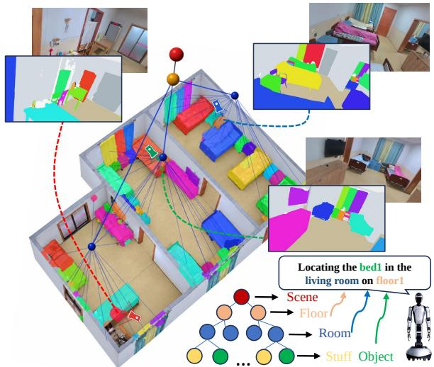
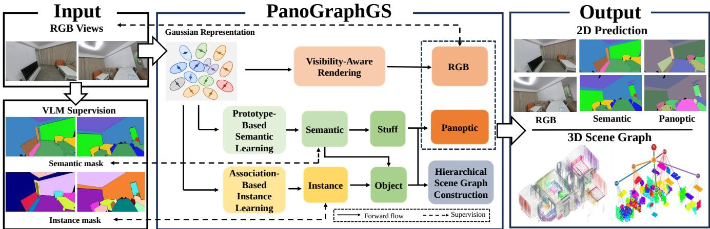
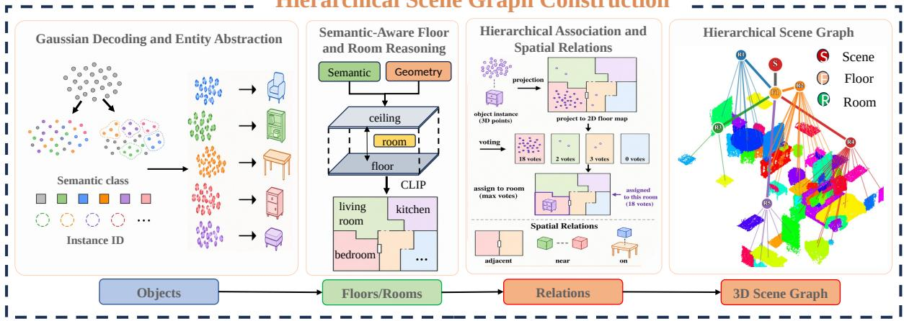
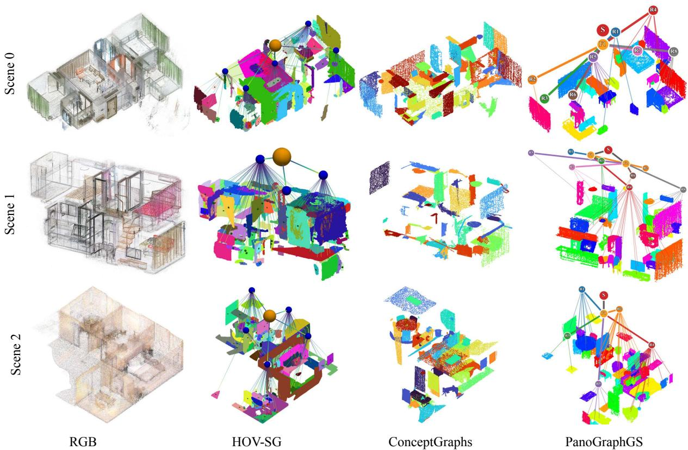
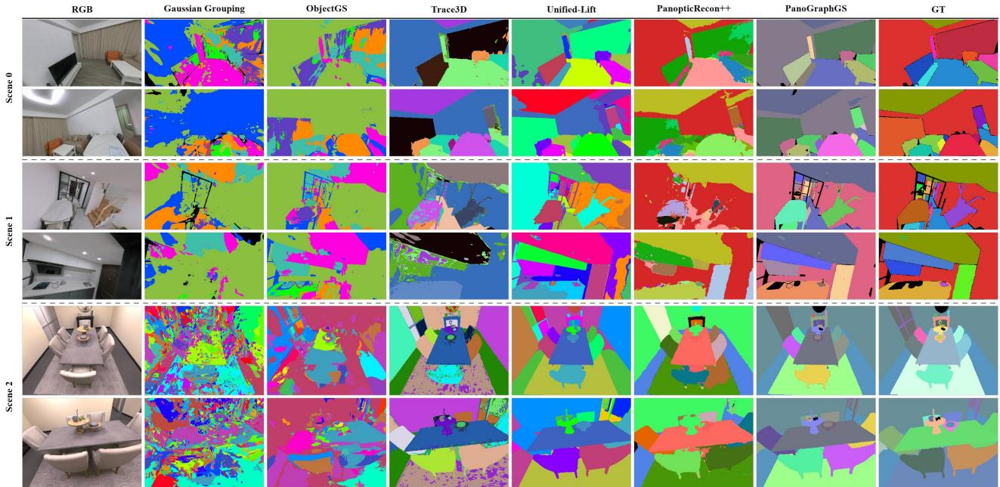

# PanoGraphGS: Unifying Panoptic Segmentation and Hierarchical 3D Scene Graphs with Gaussian Splatting

Jinghan Gao∗, Siyu Wang∗, Dongyu Feng, Yiyuan Pan, Rong Xiong

Abstract— 3D scene graphs support language-guided navigation by organizing physical entities and their containment and spatial relations into hierarchical maps. Building such structured maps requires a scene representation that consistently distinguishes semantic regions and object instances across viewpoints. To this end, we present PanoGraphGS, a unified framework that integrates panoptic 3D Gaussian representation learning with hierarchical 3D scene graph construction. The framework learns semantic and instance features on shared Gaussian geometry. Prototype-based semantic learning and association-based instance learning produce consistent panoptic predictions across viewpoints. The learned representation supports novel-view panoptic segmentation and direct Gaussianlevel panoptic decoding. A semantic-aware scene graph module further recovers a floor-room-stuff-object hierarchy with containment and spatial relations. We further release NaviGS, a real-world dataset for panoramic scene understanding. The dataset provides 3DGS, mesh, RGB, semantic, and depth data. For 3D scene graph identification, PanoGraphGS outperforms the strongest evaluated baseline in object-node accuracy by more than 50% points on average across Replica and NaviGS. PanoGraphGS also achieves state-of-the-art performance among the evaluated methods in 2D panoptic segmentation. These results demonstrate the effectiveness of PanoGraphGS in both hierarchical 3D scene understanding and 2D panoptic segmentation. The project website is available at: https: //github.com/gaojh0333/PanoGraphGS.

## I. INTRODUCTION

Panoptic 3D scene reconstruction is fundamental to language-guided robotic navigation. Successful navigation requires embodied agents to recognize semantic categories, maintain persistent instance identities, and reason about spatial organization in a globally consistent map. Such tasks require reasoning over nested containment and spatial relations. A 3D scene graph formalizes this organization by representing physical entities as nodes and their containment and spatial relations as edges [1], [2]. 3D Dynamic Scene Graphs [3], Hydra [4], and HOV-SG [5], have advanced structured spatial mapping. However, these pipelines commonly rely on per-pixel RGB-D observations or depthderived geometry. Incomplete or noisy depth can degrade object-extent estimation, cross-view association, room partitioning, and spatial-relation inference. Moreover, existing methods typically construct scene graphs and dense panoptic representations separately, requiring an additional stage to associate panoptic predictions with graph entities.

These limitations motivate a unified 3D representation that preserves geometry, semantic categories, and persistent instance identities while being learned directly from multiview RGB observations. 3D Gaussian Splatting (3DGS) [7] provides such a representation through explicit, spatially anchored Gaussian primitives and differentiable rendering. Visibility-aware rendering lifts multi-view semantic and instance supervision into a shared 3D field. The learned features can be rendered for novel-view panoptic prediction or decoded directly from Gaussians for 3D entity abstraction. Unified-Lift [8] learns Gaussian- and objectlevel representations from multi-view segmentation cues. More recently, GaussianGraph [9] extends 3DGS toward scene graph generation by clustering Gaussian primitives and associating them with CLIP features and spatial relations extracted from 2D foundation models. However, its reasoning mainly focuses on object-level spatial relations and relies on high-dimensional vision–language features for semantic association, while clustering may discard fine-grained spatial information. Explicit identification, matching, and hierarchical association across the floor-room-stuff-object hierarchy remain unaddressed. Consequently, dense panoptic prediction and hierarchical scene organization remain loosely integrated. Establishing globally consistent panoptic predictions within a Gaussian representation therefore presents two challenges. First, viewpoint-dependent visibility and occlusion produce nonuniform multi-view supervision. Second, the same physical object may receive different viewlocal pseudo-instance identifiers across views, causing conflicting identity supervision without cross-view association. Gaussian-level labels also do not explicitly encode the floorroom-stuff-object hierarchy or its containment and spatial relations. Recovering this structure requires joint reasoning over Gaussian semantics, persistent instance identities, and reconstructed geometry.

  
Fig. 1. Results of PanoGraphGS. PanoGraphGS is the first method to construct floor–room–stuff–object scene graphs for language-guided robotic navigation, improving object accuracy while reducing stuff interference. It also enables cross-frame consistent panoptic segmentation with persistent instance identities.

  
Fig. 2. Overview of PanoGraphGS. From multi-view RGB inputs and SAM3-generated masks [6] to a shared panoptic Gaussian representation, panoptic predictions, and hierarchical 3D scene graph construction. The center illustrates joint semantic and instance learning on shared Gaussian geometry.

To address these challenges, we propose PanoGraphGS, an end-to-end framework that integrates panoptic 3D Gaussian representation learning with hierarchical 3D scene graph construction. PanoGraphGS jointly learns semantic and instance features anchored to shared Gaussian geometry. The semantic branch combines residual feature projection and category prototypes with confidence-weighted supervision, while the instance branch associates view-local pseudo-labels with persistent Gaussian instance identities to ensure consistent object correspondence across views. As illustrated in Fig. 1, the resulting panoptic Gaussian representation supports both panoptic segmentation and direct Gaussian-level decoding. The semantic-aware hierarchical reasoning module combines structural semantics with Gaussian geometry to recover the floor-room-stuff-object hierarchy and its containment and spatial relations, enabling structured spatial queries such as locating the bed1 in the living room on floor1. CLIP [10] is further used to assign functional categories to rooms. Our main contributions are:

• We propose Prototype-Based Semantic Learning, which jointly optimizes 2D rendered and 3D Gaussian features in a unified semantic space, overcoming the limitation of optimizing features in only the 2D or 3D domain.

• We propose Association-Based Instance Learning, which associates view-local instance masks with persistent identities for cross-frame consistent panoptic prediction, with confidence-aware supervision reducing the impact of unreliable labels.

• We propose a semantic-aware hierarchical 3D scene graph construction method that organizes learned panoptic Gaussians into a floor-room-stuff-object hierarchy without additional training or RGB-D inputs.

• We achieve state-of-the-art performance in both 2D panoptic segmentation and 3D scene graph construction.

## II. RELATED WORK

## A. 3D Gaussian Segmentation

3DGS-based segmentation has progressed from open-vocabulary semantics and instance grouping to panoptic understanding. Open-vocabulary methods embed vision–language features into 3D Gaussian primitives. LangSplat [11] learns language-aligned Gaussian features, while OpenGaussian [12] and OVGaussian [13] extend this paradigm to point-level open-vocabulary segmentation. Mask-lifting methods transfer 2D masks and instance information into Gaussian representations. Gaussian Grouping [14] learns identity-aware Gaussian features for object grouping, while Unified-Lift [8] combines Gaussian- and object-level representations with association learning for 3D instance segmentation. More recently, PLGS [15] jointly learns semantic and instance attributes from multi-view supervision, and PanoSLAM [16] integrates panoptic Gaussian learning with sequential RGB-D mapping. Similarly, PanoGS [17] combines open-vocabulary semantics with instance segmentation, while PanopticSplatting [18] introduces query-guided cross-view label refinement for panoptic segmentation. Despite these advances, existing methods mainly focus on novel-view panoptic prediction, with feature optimization restricted to either the 2D or 3D domain. In contrast, PanoGraphGS jointly optimizes 2D and 3D features, enabling both panoptic segmentation and direct Gaussian-level decoding.

## B. Hierarchical 3D Scene Graphs

Armeni et al. [1] first organize buildings, rooms, and objects into a multi-layer graph, while 3DSSG [2] learns object relations from indoor reconstructions. 3DDGS [3] integrate geometry with objects, places, and agents, Hydra [4] enables online hierarchical mapping, and HOV-SG [5] introduces an open-vocabulary floor-room-object hierarchy. Gaussian-Graph [9] novelly constructs structured scene graphs directly from Gaussians. However, these approaches commonly rely on per-pixel RGB-D observations for geometry and primarily focus on object-level recognition. In contrast, PanoGraphGS leverages learned semantic and instance features together with Gaussian geometry to recover a hierarchical floor-roomstuff-object scene graph with explicit containment and spatial relations without training.

  
Fig. 3. Hierarchical 3D scene graph construction from panoptic Gaussians.

## III. METHOD

## A. Overall

As illustrated in Figure 2, we employ SAM3-generated [6] masks from posed RGB images as supervision, which may contain noisy labels and inconsistent instance IDs across frames. We first augment the Gaussians with semantic and instance features (Section III-B). We jointly optimize the appearance, semantic, and instance branches. The prototypebased semantic learning predicts semantic categories (Section III-C), while the association-based instance learning aligns view-local instance masks with persistent instance identities (Section III-D). The joint supervision strategy is described (Section III-E). During panoptic decoding, stuff predictions are obtained from the semantic branch, whereas object predictions combine semantic and instance. The resulting panoptic Gaussian representation supports novelview 2D panoptic segmentation and direct Gaussian-level panoptic decoding. Finally, the semantic-aware hierarchical scene graph construction module organizes the learned panoptic Gaussians into a floor–room–stuff–object hierarchy with containment and spatial relations (Section III-F).

## B. 3DGS Enhancement

Following 3DGS [7], the scene is represented by anisotropic Gaussians $\mathcal { G } = \{ g _ { i } \} _ { i = 1 } ^ { N }$ . Each Gaussian $g _ { i }$ is parameterized by a 3D mean $\mu _ { i } ,$ scale ${ \bf s } _ { i } ,$ rotation $\mathbf { R } _ { i } ,$ , opacity $\alpha _ { i } ,$ and view-dependent color coefficients $\mathbf { c } _ { i } ,$ together with independent semantic and instance features $\mathbf { F } _ { i } ^ { \mathrm { s e m } } , \mathbf { \bar { F } } _ { i } ^ { \mathrm { i n s } } \in \mathbb { R } ^ { D }$ $( D = 6 4 )$ . The two feature fields share Gaussian support and visibility but use separate prediction heads. Here, i indexes Gaussians, $p$ indexes pixels, $b \ \in \ \{ \mathrm { s e m } , \mathrm { i n s } \}$ denotes the feature branch, and $c , r ,$ , and k denote a semantic category, a view-local pseudo-instance identifier, and a persistent global instance identity, respectively. RGB and branch-specific features are rendered with the same visibility-aware alpha compositing. For Gaussians ordered from front to back at pixel $p ,$ the compositing weights and rendered outputs are:

$$
w _ { i , p } = \alpha _ { i , p } \prod _ { j < i } ( 1 - \alpha _ { j , p } ) ,\tag{1}
$$

$$
\hat { \mathbf { C } } _ { p } = \sum _ { i } w _ { i , p } \mathbf { c } _ { i , p } , \mathbf { f } _ { p } ^ { b } = \sum _ { i } w _ { i , p } \mathbf { F } _ { i } ^ { b } , b \in \{ \mathrm { s e m } , \mathrm { i n s } \} ,\tag{2}
$$

where $\alpha _ { i , p } = \alpha _ { i } \mathcal { K } _ { i } ( p )$ is the opacity, $\mathcal { K } _ { i } ( \boldsymbol { p } )$ is the projected Gaussian kernel at $p ,$ and $\mathbf { c } _ { i , p }$ is the view-dependent color of $g _ { i }$ . The outputs $\hat { \mathbf { C } } _ { p }$ and $\mathbf { f } _ { p } ^ { b }$ denote the rendered RGB color and feature of branch $b ,$ respectively. This shared rendering lifts multi-view 2D supervision to Gaussian-level features.

## C. Prototype-Based Semantic Learning

The semantic branch maintains a learnable prototype $\mathbf { q } _ { c } \in$ $\mathbb { R } ^ { D }$ for each semantic category c. Each $\mathbf { q } _ { c }$ is randomly initialized. We introduce a residual-projection MLP shared between rendered 2D pixel features and 3D Gaussian-level features. This MLP unifies image-space semantic supervision with Gaussian-level semantic decoding and lifts 2D panoptic information into 3D. The discrepancy between the two spaces can produce noisy semantic predictions when 2D supervision is directly transferred to 3D Gaussian representations. This design mitigates the discrepancy. Specifically, the residual projection maps the rendered semantic feature $\mathbf { f } _ { p } ^ { \mathrm { s e m } }$ to an embedding. Its similarity to each prototype determines the semantic logit:

$$
\begin{array} { r l } & { \tilde { \mathbf { f } } _ { p } ^ { \mathrm { s e m } } = \mathbf { f } _ { p } ^ { \mathrm { s e m } } + \mathrm { M L P } _ { \mathrm { s e m } } ( \mathbf { f } _ { p } ^ { \mathrm { s e m } } ) , } \\ & { \mathbf { z } _ { p } ^ { \mathrm { s e m } } = \mathcal { N } \Big ( \mathrm { L N } \Big ( \tilde { \mathbf { f } } _ { p } ^ { \mathrm { s e m } } \Big ) \Big ) , } \\ & { \ell _ { p , c } ^ { \mathrm { s e m } } = ( \mathbf { z } _ { p } ^ { \mathrm { s e m } } ) ^ { \top } \mathcal { N } ( \mathbf { q } _ { c } ) , } \end{array}\tag{3}
$$

where $\mathrm { M L P _ { s e m } }$ is a two-layer semantic projection, LN is layer normalization, and $\mathcal { N } ( \mathbf { x } )$ is $\ell _ { 2 }$ normalization, $\tilde { \mathbf { f } } _ { p } ^ { \mathrm { s e m } }$ is the residual-projected feature, $\mathbf { z } _ { p } ^ { \mathrm { s e m } }$ is its normalized embedding, and $\ell _ { p , c } ^ { \mathrm { s e m } }$ is the logit for category $c .$ For Gaussian-level semantic decoding, $\mathbf { f } _ { p } ^ { \mathrm { s e m } }$ is replaced with $\mathbf { F } _ { i } ^ { \mathrm { s e m } }$ in Eq. (3). This allows rendered and Gaussian-level features to share the same classifier. Both the semantic embedding and class prototypes are $\ell _ { 2 } { \mathrm { - n o r m a l i z e d } }$

  
Fig. 4. 3D scene graph visualization on NaviGS and Replica.

## D. Association-Based Instance Learning

SAM3-generated instance labels are inconsistent across views. The same physical object may receive different identifiers and is thus treated as a pseudo-label. To address this ambiguity, the instance branch maintains K learnable global instance prototypes $\mathbf { u } _ { k _ { k = 1 } } ^ { K }$ and associates view-local instance regions with persistent global identities. Given the rendered instance feature $\mathbf { f } _ { p } ^ { \mathrm { i n s } }$ , the global instance logits and probabilities are defined as:

$$
\ell _ { p , k } ^ { \mathrm { i n s } } = \mathbf { u } _ { k } ^ { \top } \mathbf { f } _ { p } ^ { \mathrm { i n s } } , \qquad P _ { p , k } ^ { \mathrm { i n s } } = \mathrm { s o f t m a x } ( \ell _ { p } ^ { \mathrm { i n s } } ) _ { k } ,\tag{4}
$$

For a view-local pseudo-instance r, pixelwise probabilities are aggregated over its region to define the association cost:

$$
A _ { r , k } = - \sum _ { p : y _ { p } ^ { \mathrm { i n s } } = r } P _ { p , k } ^ { \mathrm { i n s } } ,\tag{5}
$$

and the one-to-one assignment between local pseudoinstances and global instance identities is determined by

$$
\pi _ { v } ^ { * } = \arg \operatorname* { m i n } _ { \pi _ { v } } \sum _ { r \in \mathcal { R } _ { v } } A _ { r , \pi _ { v } ( r ) } ,\tag{6}
$$

where $\mathbf { u } _ { k }$ is the learnable prototype of global instance identity k, $y _ { p } ^ { \mathrm { i n s } }$ is the view-local pseudo-instance supervision at pixel $p , \mathcal { R } _ { v }$ is the set of pseudo-instance identifiers in view $v ,$ and $\pi _ { v } ^ { * }$ is the optimal one-to-one local-to-global association. The Hungarian algorithm [19] solves this assignment. The resulting association aligns view-local pseudo-labels with persistent Gaussian instance identities, rather than directly matching pairs of camera views. Gaussian-level instance identities are decoded with the same prototype scores by replacing $\mathbf { f } _ { p } ^ { \mathrm { i n s } }$ with $\mathbf { F } _ { i } ^ { \mathrm { i n s } }$ in Eq. (4).

## E. End-to-end Learning

To jointly optimize the appearance, semantic, and instance branches, we introduce a unified objective combining appearance, semantic, and instance supervision. It is formulated as:

$$
\begin{array} { r } { \mathcal { L } _ { \mathrm { j o i n t } } = \mathcal { L } ^ { \mathrm { r g b } } + \mathcal { L } ^ { \mathrm { s e m } } + \mathcal { L } ^ { \mathrm { i n s } } , } \end{array}\tag{7}
$$

where $\mathcal { L } ^ { \mathrm { r g b } } , \mathcal { L } ^ { \mathrm { s e m } }$ , and ${ \mathcal { L } } ^ { \mathrm { i n s } }$ denote the appearance, semantic, and instance losses, respectively, constraining appearance consistency and semantic and instance supervision on the shared representation.

Appearance loss. Following standard 3DGS, the appearance loss combines L1 loss and $L _ { S S I M }$ to balance pixel-wise appearance reconstruction and structural similarity:

$$
\mathcal { L } ^ { \mathrm { r g b } } = ( 1 - \mu ) L 1 + \mu L _ { S S I M }\tag{8}
$$

where $\mu = 0 . 2$

Confidence-weighted mechanism. To mitigate unreliable semantic and instance supervision near object boundaries and occlusions, we introduce a confidence-aware weighting mechanism for pixel-wise supervision. For each task t ∈ sem, ins, let $\mathcal { P } _ { k } ^ { t }$ denote pixels assigned to category or instance k in a training view. We compute a task-specific feature center $\mathbf { m } _ { k } ^ { t }$ and a dispersion-dependent temperature $\tau _ { k } ^ { t } .$ The confidence of pixel $p$ for task t is defined as

$$
\begin{array} { r l } & { \mathbf { m } _ { c } ^ { \mathrm { s e m } } = \displaystyle \frac { 1 } { | \mathcal { P } _ { c } | } \sum _ { p \in \mathcal { P } _ { c } } \mathcal { N } ( \mathbf { f } _ { p } ^ { \mathrm { s e m } } ) , } \\ & { \gamma _ { p } ^ { \mathrm { s e m } } = \displaystyle \frac { \exp ( \mathcal { N } ( \mathbf { f } _ { p } ^ { \mathrm { s e m } } ) ^ { \top } \mathbf { m } _ { y _ { p } ^ { \mathrm { s e m } } } ^ { \mathrm { s e m } } / \tau _ { y _ { p } ^ { \mathrm { s e m } } } ) } { \sum _ { c \in \mathcal { C } _ { v } } \exp ( \mathcal { N } ( \mathbf { f } _ { p } ^ { \mathrm { s e m } } ) ^ { \top } \mathbf { m } _ { c } ^ { \mathrm { s e m } } / \tau _ { c } ) + \epsilon } , } \end{array}\tag{9}
$$

where $y _ { p } ^ { t }$ denotes the supervision label at pixel $p ,$ and $\mathcal { C } _ { v } ^ { t }$ denotes the set of semantic categories or instance identities present in view v. The temperature $\tau _ { k } ^ { t }$ adjusts confidence according to the within-class or within-instance feature dispersion. The confidence $\gamma _ { p } ^ { t }$ measures supervision reliability relative to competing categories or instance identities in the current view. It suppresses unreliable samples in both the semantic and instance objectives. The task- and class/instancedependent factor $\tau _ { k } ^ { t }$ is used only for confidence weighting. It is not involved in the semantic or instance classifiers.

TABLE I  
HIERARCHICAL SCENE GRAPH COMPARISON ON REPLICA AND NAVIGS DATASETS.
<table><tr><td rowspan="2">Method</td><td colspan="3">Replica</td><td colspan="3">NaviGS</td></tr><tr><td>Floor Acc. (%)</td><td>Room Acc. (%)</td><td>Object Acc. (%)</td><td>Floor Acc. (%)</td><td>Room Acc. (%)</td><td>Object Acc. (%)</td></tr><tr><td>KeySG [20]</td><td>100.00</td><td>22.50</td><td>17.27</td><td>90.00</td><td>35.00</td><td>5.25</td></tr><tr><td>HOV-SG [5]</td><td>100.00</td><td>87.50</td><td>21.72</td><td>90.00</td><td>66.67</td><td>14.57</td></tr><tr><td>OP3DSG [21]</td><td></td><td></td><td>35.91</td><td></td><td></td><td>16.97</td></tr><tr><td>BBQ [22]</td><td>一</td><td>一</td><td>33.08</td><td>一</td><td></td><td>26.25</td></tr><tr><td>ConceptGraphs [23]</td><td>7</td><td>一</td><td>39.32</td><td></td><td></td><td>30.50</td></tr><tr><td>PanoGraphGS (Ours)</td><td>100.00</td><td>100.00</td><td>89.90</td><td>100.00</td><td>100.00</td><td>98.36</td></tr></table>

Semantic loss. The semantic objective is

$$
\mathcal { L } ^ { \mathrm { s e m } } = \mathcal { L } _ { \mathrm { c l s } } ^ { \mathrm { s e m } } + \lambda _ { \mathrm { c o n } } \mathcal { L } _ { \mathrm { c o n } } ^ { \mathrm { s e m } } + \lambda _ { \mathrm { c l u } } \mathcal { L } _ { \mathrm { c l u } } ^ { \mathrm { s e m } } + \lambda _ { \mathrm { r e g } } \mathcal { L } _ { \mathrm { r e g } } ^ { \mathrm { s e m } } .\tag{10}
$$

where $\lambda _ { \mathrm { c o n } } ~ = ~ \lambda _ { \mathrm { r e g } } ~ = ~ 1 0 ^ { - 6 }$ and $\lambda _ { \mathrm { c l u } } ~ = ~ 0 . 1$ . The terms $\mathcal { L } _ { \mathrm { c l s } } ^ { \mathrm { s e m } } , \mathcal { L } _ { \mathrm { c o n } } ^ { \mathrm { s e m } } , \mathcal { L } _ { \mathrm { c l u } } ^ { \mathrm { s e m } }$ , and $\mathcal { L } _ { \mathrm { r e g } } ^ { \mathrm { s e m } }$ denote confidence-weighted classification, region-level contrastive learning, prototype alignment, and feature-norm regularization, respectively. The classification term uses label-smoothed cross-entropy [24]. Confidence-weighted defined in Eq. (9) reduces the influence of unreliable pseudo-labels and improves robustness to noisy supervision [25]. Region-level contrastive term follows supervised contrastive learning [26] and encourages coherent features within the same semantic regions. Prototype alignment promotes consistency between reliable semantic embeddings and category prototypes [27]. Feature-norm regularization stabilizes shared embedding space.

Instance loss. Analogous to the semantic branch, the instance objective uses confidence-aware supervision and region-level contrastive learning on rendered instance features. View-local instance regions provide supervision, while the association in Eq. (6) maps them to persistent global identities for instance classification and prototype alignment. The resulting instance objective ${ \mathcal { L } } ^ { \mathrm { i n s } }$ follows the same fourterm formulation as the semantic objective.

## F. Hierarchical Scene Graph Construction

As showned in Fig. 3, the panoptic Gaussian representation is organized into a hierarchical 3D scene graph following a floor-room-stuff-object hierarchy. Floor and room nodes capture spatial structure, while stuff and object nodes represent structural semantics and persistent instance identities, respectively. Node attributes are grounded in the learned panoptic features and Gaussian geometry, with directed edges encoding hierarchical containment and spatial relations.

Gaussian Decoding and Entity Abstraction. The Gaussian representation is first decoded into semantic and instance-aware entities.

$$
\mathcal { G } = \{ ( \mathbf { x } _ { i } , \hat { s } _ { i } , \hat { u } _ { i } ) \} _ { i = 1 } ^ { N } ,\tag{11}
$$

where $\mathbf { x } _ { i }$ denotes the 3D position of the i-th Gaussian, and $\hat { s } _ { i }$ and $\hat { u } _ { i }$ denote its predicted semantic category and persistent instance identity, respectively. For an object with instance identity k, its supporting Gaussian set is defined as

$$
\mathcal { G } _ { k } ^ { o b j e c t } = \{ i \mid \hat { u } _ { i } ) = k \} ,\tag{12}
$$

whereas structural stuff entities are obtained by grouping Gaussians according to their semantic categories:

$$
\mathcal { G } _ { c } ^ { s t u f f } = \{ i \mid \hat { s } _ { i } ) = c \} ,\tag{13}
$$

Thus, the dense Gaussian representation is abstracted into a compact set of entities V:

$$
\mathcal { V } _ { \mathrm { p a n } } = \mathcal { G } _ { c } ^ { s t u f f } \cup \mathcal { V } _ { \mathrm { o b j e c t } } ,\tag{14}
$$

where each entity retains its semantic identity and geometric support from the underlying Gaussians.

Semantic-Aware Floor and Room Reasoning. The floorroom hierarchy is inferred by jointly exploiting semantic predictions and the spatial distribution of the corresponding Gaussians. Specifically, floor and ceiling semantics provide the primary evidence for identifying floor regions, with the space between the corresponding floor and ceiling Gaussians defining a floor and their vertical separation determining its height. The vertical distribution of these supporting Gaussians further provides complementary geometric cues. The floor reasoning process is formulated as

$$
\left\{ \mathcal { G } _ { \mathrm { f l o o r } } ^ { s t u f f } , \mathcal { G } _ { \mathrm { c e i l i n g } } ^ { s t u f f } \right\} \to \mathcal { V } _ { \mathrm { f l o o r } } ,\tag{15}
$$

Within each identified floor, structural semantic categories and their spatial organization are used to delineate room-level regions, with walls, doors, and windows providing explicit semantic boundary cues for room partitioning:

$$
\mathcal { V } _ { \mathrm { H o o r } } \xrightarrow { \mathcal { G } _ { \mathrm { w a l l } } ^ { s t u f f } , \mathcal { G } _ { \mathrm { d o o r } } ^ { s t u f f } , \mathcal { G } _ { \mathrm { w i n d o w } } ^ { s t u f f } , \cdots } \mathcal { V } _ { \mathrm { r o o m } } ,\tag{16}
$$

For each room, RGB observations are rendered from camera poses within the corresponding room and used with CLIP [10] to assign a functional semantic label:

$$
\hat { y } _ { r } ^ { \mathrm { r o o m } } = \underset { c \in \mathcal { C } _ { \mathrm { r o o m } } } { \arg \operatorname* { m a x } } S ( r , c ) ,\tag{17}
$$

where $S ( r , c )$ denotes the aggregated semantic similarity between the observations associated with room r and candidate functional category $c ,$ which provides functional information while preserving the geometry of the room.

Hierarchical Association and Spatial Relations. We first associate the extracted objects with their corresponding rooms through voting. For each object e, we count its supporting 3D points within the bounding box of each candidate room r. The room receiving the most votes is selected:

TABLE II  
COMPARISON OF PANOGRAPHGS WITH STATE-OF-THE-ART ALGORITHMS ON SCANNET++, REPLICA AND NAVIGS BENCHMARKS PANOPTIC SEGMENTATION. THE BEST AND SECOND-BEST RESULTS ARE INDICATED IN BOLD AND UNDERLINED, RESPECTIVELY.
<table><tr><td rowspan="2">Model</td><td colspan="2">ScanNet++</td><td colspan="2">Replica</td><td colspan="2">NaviGS</td></tr><tr><td>mIoU</td><td>mBIoU</td><td>mIoU</td><td>mBIoU</td><td>mIoU</td><td>mBIoU</td></tr><tr><td>Gaussian Grouping [14]</td><td>15.67</td><td>13.03</td><td>23.94</td><td>16.98</td><td>56.91</td><td>35.86</td></tr><tr><td>ObjectGS [28]</td><td>8.91</td><td>6.41</td><td>12.22</td><td>5.39</td><td>43.77</td><td>26.69</td></tr><tr><td>Trace3D [29]</td><td>30.22</td><td>27.54</td><td>54.90</td><td>48.50</td><td>67.51</td><td>44.75</td></tr><tr><td>Unified-Lift [8]</td><td>38.10</td><td>35.92</td><td>63.91</td><td>59.69</td><td>78.48</td><td>57.84</td></tr><tr><td>PanopticRecon++ [30]</td><td>31.93</td><td>29.31</td><td>54.32</td><td>43.51</td><td>49.36</td><td>25.58</td></tr><tr><td>PanoGraphGS (Ours)</td><td>41.06</td><td>37.89</td><td>76.73</td><td>70.51</td><td>83.19</td><td>64.39</td></tr></table>

$$
r ( e ) = \arg \operatorname* { m a x } _ { r \in \mathcal { V } _ { \mathrm { r o o m } } } \left. \left\{ \mathbf { x } _ { i } \in \mathcal { G } _ { e } \mid \mathbf { x } _ { i } \in \mathrm { B B o x } ( r ) \right\} \right. ,\tag{18}
$$

where $\mathcal { G } _ { e }$ denotes the set of 3D Gaussians supporting object $e ,$ and BBox(r) represents the bounding box of room $^ { r } \cdot$ This point-level voting strategy assigns each object to the room containing the largest portion of its 3D support.

The extracted entities are finally organized into a hierarchical scene graph $\boldsymbol { \mathcal { S } } = ( \boldsymbol { \mathcal { V } } , \boldsymbol { \mathcal { E } } )$ , where the edge set $\mathcal { E }$ comprises hierarchical containment and spatial relations:

$$
\mathcal E = \mathcal E _ { \mathrm { c o n t a i n } } \cup \mathcal E _ { \mathrm { s p a t i a l } } ,\tag{19}
$$

Specifically, the containment relations establish the hierarchical structure of the scene:

$$
\begin{array} { r } { \mathcal { E } _ { \mathrm { c o n t a i n } } = \{ ( f , r ) \ : | \ : r \subset f \} \cup \{ ( r , e ) \ : | \ : r = r ( e ) , \ : e \in \mathcal { V } _ { \mathrm { o b j e c t } } \} . } \end{array}\tag{20}
$$

where $r \subset f$ denotes that room r is spatially contained within floor $f .$ The spatial relations $\mathcal { E } _ { \mathrm { s p a t i a l } }$ further describe the topological and geometric organization among entities within the same hierarchical level. Consequently, the final graph preserves both the metric grounding of the Gaussian representation and its high-level semantic structure, without introducing an additional learned graph predictor.

## IV. EXPERIMENTS

We first compare PanoGraphGS on 3D scene graph construction and 2D panoramic segmentation, with qualitative visualizations provided for both, followed by ablation studies of its key components.

## A. Experimental Setup

Datasets. We evaluate on two public datasets, Scan-Net++ [31] and Replica [32]. In addition, we release NaviGS, a real-world dataset comprising RGB and semantic scenes. NaviGS is acquired using two fisheye cameras and a handheld LiDAR device. LiDAR-assisted acquisition provides accurate camera poses and a sparse point cloud for Gaussian initialization. Both scene collections provide 3DGS models, meshes, RGB, camera poses, and depth; semantic scenes additionally include scene graphs. To evaluate hierarchical scene graph construction, we select multi-room layouts from Replica and NaviGS that support evaluation of the floor-room-stuff-object hierarchy.

Evaluation Metrics. Scene graph performance is evaluated by floor-, room-, and object-level accuracy. All compared methods use the same SAM3-generated segmentation masks as supervision. Since OP3DSG, BBQ, and Concept-Graphs do not support floor-room recognition, they are evaluated only at the object level. For KeySG, HOV-SG, and PanoGraphGS, floor, room, and object recognition are manually verified under a hierarchical criterion: a room is correct only when its floor and room identities and semantic category are correctly identified, while an object is correct only when its floor, room, and object identities are all correct. Panoptic segmentation is evaluated using mIoU for region overlap and mBIoU for object and structural boundaries. For instance-only methods such as Unified-Lift, these metrics are computed after per-image optimal instance matching without semantic categories. For panoptic methods, including PanopticRecon++ and PanoGraphGS, a match is correct only when both instance identity and semantic category are correctly predicted, yielding a stricter criterion.

Implementation Details. Training and evaluation are performed on an RTX 5880 GPU using Python and PyTorch. Each scene is optimized for 30,000 iterations with Adam at a learning rate of $2 . 5 \times 1 0 ^ { - 3 }$ . The number of semantic prototypes is determined by the categories present in each scene, whereas the instance branch maintains K = 256 prototypes, sufficient for all evaluated scenes.

## B. Comparative Evaluation

3D scene graph evaluation. Table I compares PanoGraphGS with representative scene graph methods, while Fig 4 shows qualitative comparisons on multiroom scenes from Replica and NaviGS. All compared methods rely on per-pixel RGB-D observations, whereas PanoGraphGS constructs scene graphs without depth input or depth projection. PanoGraphGS achieves strong floor, room, and object recognition, with object-node accuracy exceeding existing methods by more than 50% and reaching 98.36% on NaviGS. Compared with HOV-SG [5], which also supports the floor-room-stuff-object hierarchy, PanoGraphGS achieves higher floor and room recognition accuracy, reducing cross-floor and cross-room association errors and improving object recognition. The 100% floor accuracy of HOV-SG on Replica does not demonstrate multi-floor reasoning, as the evaluated scenes contain no multi-floor layouts. These results highlight the effectiveness of our Semantic-Aware Floor and Room Reasoning module, which combines structural semantics with geometric cues rather than relying primarily on point-cloud density, distance thresholds, or watershed-based segmentation. HOV-SG also generates numerous false-positive stuff nodes. For example, in Scene 1, it identifies only one floor and incorrectly labels walls and ceilings as objects. This further demonstrates the effectiveness of our Prototype-Based Semantic Learning in distinguishing semantic categories. Compared with ConceptGraphs [23], a strong object recognition method, PanoGraphGS substantially reduces missed detections, background false positives, and object fragmentation. As shown in Scene 0, ConceptGraphs produces fragmented and noisy predictions and divides a single sofa into three objects, whereas PanoGraphGS correctly identifies it as one sofa, highlighted in yellow. This demonstrates the effectiveness of Association-Based Instance Learning in associating observations of the same physical object with a persistent instance identity. Overall, PanoGraphGS achieves the best scene graph performance among the evaluated methods without depth projection. These results demonstrate the effectiveness of integrating panoptic Gaussian representation learning with hierarchical 3D scene graph construction for accurate scene-level structural reasoning without depth-based geometric projection.

  
Fig. 5. Panoptic segmentation visualization on NaviGS and Replica dataset.

2D panoptic evaluation. Table II presents the quantitative comparison, while Figure 5 provides qualitative results. Compared with Unified-Lift [8], the strongest baseline, PanoGraphGS achieves the best mIoU and mBIoU across all three datasets. Unified-Lift produces instance segmentation but lacks semantic labels for panoptic understanding. For example, Unified-Lift assigns different instance IDs to three wall regions in Scene 2. In contrast, PanoGraphGS jointly predicts semantic categories and persistent instance identities, producing complete panoptic segmentation with more consistent identities across viewpoints. Compared with PanopticRecon++ [30], the state-of-the-art panoptic segmentation method, PanoGraphGS substantially improves both quantitative accuracy and visual quality, producing more complete regions, more stable object identities, and clearer object and structural boundaries. These results further demonstrate the effectiveness of the residual projection MLP shared by rendered 2D pixel features and 3D Gaussian-level features; this design addresses the limitation of conventional semantic Gaussian methods whose learning modules typically operate on either 2D or 3D features.

TABLE III  
ABLATION STUDY ON REPLICA.
<table><tr><td></td><td>Confidence Weighted</td><td>Instance Association</td><td>Semantic Prototypes</td><td>Object Acc. (%)</td><td>2D mIoU</td><td>2D mBIoU</td></tr><tr><td>EXP0</td><td>X</td><td>X</td><td>X</td><td>53.20</td><td>59.34</td><td>48.19</td></tr><tr><td>EXP1</td><td>√</td><td>×</td><td>√</td><td>55.31</td><td>63.84</td><td>54.10</td></tr><tr><td>EXP2</td><td>√</td><td>√</td><td>X</td><td>80.42</td><td>70.23</td><td>61.00</td></tr><tr><td>EXP3</td><td>X</td><td>√</td><td>√</td><td>86.33</td><td>68.97</td><td>59.53</td></tr><tr><td>EXP4</td><td>√</td><td>√</td><td>√</td><td>89.90</td><td>76.73</td><td>70.51</td></tr></table>

## C. Ablation Study

We evaluate the effectiveness of the individual components of PanoGraphGS on the public Replica dataset, which contains multi-room layouts. The comprehensive results are reported in Table III. With the introduction of the semantic branch, EXP1 achieves a 2.11% improvement in object accuracy over EXP0, demonstrating the effectiveness of jointly optimizing shared features across the 2D and 3D domains and enhancing semantic discrimination across views. EXP2 further validates the necessity of the instance branch, achieving the largest performance improvement of 27.22% in object accuracy. Compared with EXP0, it substantially reduces false positives and missed detections caused by inconsistent annotations and supervision across frames, highlighting the importance of aligning view-local instance IDs with persistent identities to maintain consistent instance regions and boundaries across views. EXP4 further introduces the Confidence-weighted Mechanism on top of EXP3, improving object accuracy by 3.57%. Its gains are even more pronounced in 2D panoptic segmentation, with improvements of 7.76% and 10.98% in mIoU and mBIoU, respectively. These results demonstrate that the confidence-weighted mechanism suppresses noisy supervision and stabilizes labels near region boundaries at the semantic level, while filtering unreliable identity targets and reducing conflicts around instance boundaries at the instance level.

## V. CONCLUSION

In this study, we present PanoGraphGS, a unified framework integrating panoptic 3D Gaussian representation learning with hierarchical 3D scene graph construction. Prototypebased semantic learning jointly optimizes shared 2D and 3D features to mitigate noisy semantic supervision, while association-based instance learning aligns view-local masks with persistent object identities. The learned panoptic Gaussian field supports novel-view 2D panoptic segmentation and direct Gaussian-level decoding, while Semantic-Aware hierarchical 3D scene graph construction enables a semantically and geometrically grounded floor-room-stuff-object hierarchy. Extensive experiments show that PanoGraphGS achieves state-of-the-art performance among the evaluated methods in both 2D panoptic segmentation and 3D scene graph construction. We further release NaviGS with RGB and semantic scene data for panoramic scene understanding. PanoGraphGS nevertheless has several limitations. Open-plan spaces such as open kitchens lack explicit spatial boundaries, making room delineation challenging. Moreover, the current scene graph construction operates offline, and we will investigate online feed-forward scene graph construction for incremental scene understanding during continuous observations.

## REFERENCES

[1] I. Armeni, Z.-Y. He, J. Gwak, A. R. Zamir, M. Fischer, J. Malik, and S. Savarese, “3D scene graph: A structure for unified semantics, 3D space, and camera,” in Proceedings of the IEEE/CVF International Conference on Computer Vision (ICCV), October 2019, pp. 5664– 5673.

[2] J. Wald, H. Dhamo, N. Navab, and F. Tombari, “Learning 3D semantic scene graphs from 3D indoor reconstructions,” in Proceedings of the IEEE/CVF Conference on Computer Vision and Pattern Recognition (CVPR), June 2020, pp. 3961–3970.

[3] A. Rosinol, A. Gupta, M. Abate, J. Shi, and L. Carlone, “3D dynamic scene graphs: Actionable spatial perception with places, objects, and humans,” in Proceedings of Robotics: Science and Systems, 2020.

[4] N. Hughes, Y. Chang, and L. Carlone, “Hydra: A real-time spatial perception system for 3D scene graph construction and optimization,” in Proceedings of Robotics: Science and Systems, 2022.

[5] A. Werby, C. Huang, M. Buchner, A. Valada, and W. Burgard, “Hi- ¨ erarchical open-vocabulary 3D scene graphs for language-grounded robot navigation,” in Proceedings of Robotics: Science and Systems, 2024.

[6] N. Carion, L. Gustafson, Y.-T. Hu, S. Debnath, R. Hu, D. Suris, C. Ryali, K. V. Alwala, H. Khedr, A. Huang, J. Lei, T. Ma, B. Guo, A. Kalla, M. Marks, J. Greer, M. Wang, P. Sun, R. Radle, T. Afouras,¨ E. Mavroudi, K. Xu, T.-H. Wu, Y. Zhou, L. Momeni, R. Hazra, S. Ding, S. Vaze, F. Porcher, F. Li, S. Li, A. Kamath, H. K. Cheng, P. Dollar, N. Ravi, K. Saenko, P. Zhang, and C. Feichtenhofer, “Sam¨ 3: Segment anything with concepts,” 2025.

[7] B. Kerbl, G. Kopanas, T. Leimkuhler, and G. Drettakis, “3D gaussian¨ splatting for real-time radiance field rendering,” ACM Transactions on Graphics, vol. 42, no. 4, pp. 139:1–139:14, 2023.

[8] R. Zhu, S. Qiu, Z. Liu, K.-H. Hui, Q. Wu, P.-A. Heng, and C.-W. Fu, “Rethinking end-to-end 2D to 3D scene segmentation in gaussian splatting,” in Proceedings of the IEEE/CVF Conference on Computer Vision and Pattern Recognition (CVPR), June 2025, pp. 3656–3665.

[9] X. Wang, D. Yang, Y. Gao, Y. Yue, Y. Yang, and M. Fu, “GaussianGraph: 3D gaussian-based scene graph generation for open-world scene understanding,” in 2025 IEEE/RSJ International Conference on Intelligent Robots and Systems (IROS), 2025, pp. 4091–4098.

[10] A. Radford, J. W. Kim, C. Hallacy, A. Ramesh, G. Goh, S. Agarwal, G. Sastry, A. Askell, P. Mishkin, J. Clark, G. Krueger, and I. Sutskever, “Learning transferable visual models from natural language supervision,” in Proceedings of the 38th International Conference on Machine Learning, ser. Proceedings of Machine Learning Research, vol. 139. PMLR, 2021, pp. 8748–8763. [Online]. Available: https://proceedings.mlr.press/v139/radford21a.html

[11] M. Qin, W. Li, J. Zhou, H. Wang, and H. Pfister, “LangSplat: 3D language gaussian splatting,” in Proceedings of the IEEE/CVF Conference on Computer Vision and Pattern Recognition (CVPR), June 2024, pp. 20 051–20 060.

[12] Y. Wu, J. Meng, H. Li, C. Wu, Y. Shi, X. Cheng, C. Zhao, H. Feng, E. Ding, J. Wang, and J. Zhang, “OpenGaussian: Towards point-level 3D gaussian-based open vocabulary understanding,” in Advances in Neural Information Processing Systems, vol. 37, 2024. [Online]. Available: https://proceedings.neurips.cc/paper files/paper/2024/hash/ 21f7b745f73ce0d1f9bcea7f40b1388e-Abstract-Conference.html

[13] R. Chen, X. Sun, Z. Wang, Y. Liu, J. Wang, L. Kong, J. Deng, M. Gong, L. Pan, W. Wang, and T. Liu, “OVGaussian: Generalizable 3D gaussian segmentation with open vocabularies,” arXiv preprint arXiv:2501.00326, 2025. [Online]. Available: https: //arxiv.org/abs/2501.00326

[14] M. Ye, M. Danelljan, F. Yu, and L. Ke, “Gaussian grouping: Segment and edit anything in 3D scenes,” in Computer Vision – ECCV 2024, ser. Lecture Notes in Computer Science, vol. 15087. Cham: Springer Nature Switzerland, 2025, pp. 162–179.

[15] Y. Wang, X. Wei, M. Lu, and G. Kang, “PLGS: Robust panoptic lifting with 3D gaussian splatting,” IEEE Transactions on Image Processing, vol. 34, pp. 3377–3388, 2025.

[16] R. Chen, Z. Wang, J. Wang, Y. Ma, M. Gong, W. Wang, and T. Liu, “PanoSLAM: Panoptic 3D scene reconstruction via gaussian SLAM,” arXiv preprint arXiv:2501.00352, 2025.

[17] H. Zhai, H. Li, Z. Li, X. Pan, Y. He, and G. Zhang, “PanoGS: Gaussian-based panoptic segmentation for 3D open vocabulary scene understanding,” in Proceedings of the IEEE/CVF Conference on Computer Vision and Pattern Recognition (CVPR), June 2025, pp. 14 114–14 124.

[18] Y. Xie, X. Yu, C. Jiang, S. Mao, S. Zhou, R. Fan, R. Xiong, and Y. Wang, “PanopticSplatting: End-to-end panoptic gaussian splatting,” in 2025 IEEE/RSJ International Conference on Intelligent Robots and Systems (IROS), 2025, pp. 4067–4074.

[19] H. W. Kuhn, “The hungarian method for the assignment problem,” Naval Research Logistics Quarterly, vol. 2, no. 1–2, pp. 83–97, 1955.

[20] A. Werby, D. Rotondi, F. Scaparro, and K. O. Arras, “KeySG: Hierarchical keyframe-based 3D scene graphs,” arXiv preprint arXiv:2510.01049, 2025.

[21] Y. Kim and U.-H. Kim, “OP3DSG: Open-vocabulary part-aware 3D scene graph generation for real-world environments,” in Proceedings of the European Conference on Computer Vision (ECCV), 2026.

[22] S. Linok, T. Zemskova, S. Ladanova, R. Titkov, D. A. Yudin, M. Monastyrny, and A. Valenkov, “Beyond bare queries: Openvocabulary object grounding with 3D scene graph,” in Proceedings of the IEEE International Conference on Robotics and Automation (ICRA), 2025, pp. 13 582–13 589.

[23] Q. Gu, A. Kuwajerwala, S. Morin, K. M. Jatavallabhula, B. Sen, A. Agarwal, C. Rivera, W. Paul, K. Ellis, R. Chellappa, C. Gan, C. M. de Melo, J. B. Tenenbaum, A. Torralba, F. Shkurti, and L. Paull, “Conceptgraphs: Open-vocabulary 3D scene graphs for perception and planning,” in Proceedings of the IEEE International Conference on Robotics and Automation (ICRA), 2024, pp. 5021–5028.

[24] C. Szegedy, V. Vanhoucke, S. Ioffe, J. Shlens, and Z. Wojna, “Rethinking the inception architecture for computer vision,” in Proceedings of the IEEE Conference on Computer Vision and Pattern Recognition, 2016, pp. 2818–2826.

[25] S. Reed, H. Lee, D. Anguelov, C. Szegedy, D. Erhan, and A. Rabinovich, “Training deep neural networks on noisy labels with boot-

strapping,” in International Conference on Learning Representations Workshop, 2015.

[26] P. Khosla, P. Teterwak, C. Wang, A. Sarna, Y. Tian, P. Isola, A. Maschinot, C. Liu, and D. Krishnan, “Supervised contrastive learning,” in Advances in Neural Information Processing Systems, vol. 33, 2020, pp. 18 661–18 673.

[27] J. Snell, K. Swersky, and R. Zemel, “Prototypical networks for fewshot learning,” in Advances in Neural Information Processing Systems, vol. 30, 2017.

[28] R. Zhu, M. Yu, L. Xu, L. Jiang, Y. Li, T. Zhang, J. Pang, and B. Dai, “ObjectGS: Object-aware scene reconstruction and scene understanding via gaussian splatting,” in Proceedings of the IEEE/CVF International Conference on Computer Vision (ICCV), October 2025, pp. 8350–8360. [Online]. Available: https://openaccess.thecvf.com/content/ICCV2025/html/ Zhu ObjectGS Object-aware Scene Reconstruction and Scene Understanding via Gaussian Splatting ICCV 2025 paper.html

[29] H. Shen, J. Ni, Y. Chen, W. Li, M. Pei, and S. Huang, “Trace3D: Consistent segmentation lifting via gaussian instance tracing,” in Proceedings of the IEEE/CVF International Conference on Computer Vision (ICCV), October 2025, pp. 6656–6666. [Online]. Available: https://openaccess.thecvf.com/ content/ICCV2025/html/Shen Trace3D Consistent Segmentation Lifting via Gaussian Instance Tracing ICCV 2025 paper.html

[30] X. Yu, Y. Xie, Y. Liu, H. Lu, R. Xiong, Y. Liao, and Y. Wang, “Leverage cross-attention for end-to-end open-vocabulary panoptic reconstruction,” arXiv preprint arXiv:2501.01119, 2025. [Online]. Available: https://arxiv.org/abs/2501.01119

[31] C. Yeshwanth, Y.-C. Liu, M. Nießner, and A. Dai, “ScanNet++: A high-fidelity dataset of 3D indoor scenes,” in Proceedings of the IEEE/CVF International Conference on Computer Vision (ICCV), October 2023, pp. 12–22. [Online]. Available: https: //arxiv.org/abs/2308.11417

[32] J. Straub, T. Whelan, L. Ma, Y. Chen, E. Wijmans, S. Green, J. J. Engel, R. Mur-Artal, C. Ren, S. Verma, A. Clarkson, M. Yan, B. Budge, Y. Yan, X. Pan, J. Yon, Y. Zou, K. Leon, N. Carter, J. Briales, T. Gillingham, E. Mueggler, L. Pesqueira, M. Savva, D. Batra, H. M. Strasdat, R. De Nardi, M. Goesele, S. Lovegrove, and R. Newcombe, “The replica dataset: A digital replica of indoor spaces,” arXiv preprint arXiv:1906.05797, 2019. [Online]. Available: https://arxiv.org/abs/1906.05797