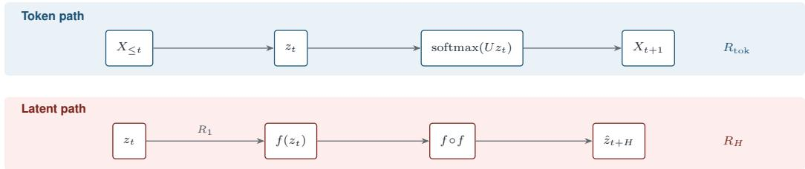
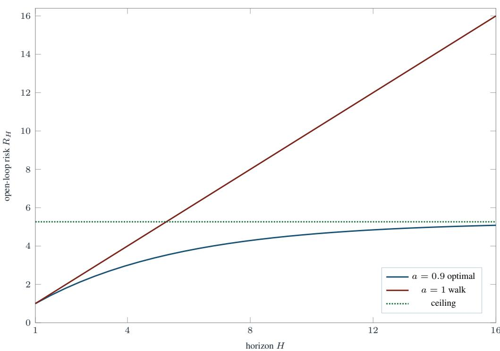

# Predictive Latents for Autoregressive Language Models: Possibility, Gauge, and Obstruction

Yuzhou Hong Zhejiang Sci-Tech University hongyuzhou@zstu.edu.cn

## Abstract

Autoregressive language models are trained by next-token cross-entropy, yet several recent systems also iterate a hidden state without emitting a token: continuous thoughts, pause steps, and recurrent depth. This note separates three risks on one latent process. The token risk $R _ { \mathrm { t o k } }$ scores a readout. The teacher-forced latent risk $R _ { 1 }$ scores a one-step map that sees the true hidden state. The open-loop risk $R _ { H }$ scores the same map after it has been iterated on its own outputs. If the Bayes nexttoken posterior is a function of a k-dimensional statistic with full-rank covariance, a width-k latent, a linear least-squares transition, and a refit unembedding match the Bayes token predictor. The statistic is identified only up to an invertible gauge: whitening the residual stream does not change the token law once the unembedding is refit. The matching obstructions are sharp. A constant latent drives $R _ { 1 }$ to zero while token cross-entropy falls back to the marginal entropy. A perfect token predictor can still hide a null-space walk whose open-loop error grows linearly in the horizon. A small next-latent loss does not certificate next-token prediction, and a small next-token loss does not certificate free latent rollout, unless a rank or injectivity condition is stated with the number.

## 1 Introduction

Next-token prediction is the training loss of modern language models [Bengio et al., 2003, Vaswani et al., 2017, Radford et al., 2019, Brown et al., 2020, Hoffmann et al., 2022, Touvron et al., 2023a, Grattafiori et al., 2024]. Read information-theoretically, that loss is compression of the token process [Shannon, 1948, Cover and Thomas, 2006, Deletang et al. ´ , 2024]. The residual stream is where the computation is written [Elhage et al., 2021, Geva et al., 2022, Belrose et al., 2023]. Chain-of-thought spells intermediate steps as tokens [Wei et al., 2022, Kojima et al., 2022]. A newer family keeps the step inside the vector: continuous thoughts feed the hidden state back as the next embedding [Hao et al., 2024], pause tokens and quiet rationales buy extra computation beside the answer [Goyal et al., 2024, Zelikman et al., 2024], and recurrent-depth models unroll a latent block at test time [Geiping et al., 2025, Dehghani et al., 2019].

Question. When is a next-latent map on an LLM hidden state a sufficient object for next-token prediction, and when does a small latent loss fail to control either the token distribution or a free rollout of the latent?

Contributions. (i) Token risk, teacher-forced latent risk, and open-loop latent risk are defined on one process (Section 3). (ii) A finite-dimensional predictive sufficient statistic is enough for Bayes token prediction, and linear least squares identifies it up to an invertible gauge (Section 4). (iii) Whitening the residual stream does not change the token law after the unembedding is refit (Section 5). (iv) Two obstructions: latent collapse, and a null-space walk that the unembedding cannot see (Section 6). (v) A Lipschitz bound on free latent rollout, with a matching linear lower bound (Section 7). Proofs are in the appendix.

  
Figure 1: The two scores on one hidden state. The top row reads $z _ { t }$ out to the next token and never leaves the data prefix. The bottom row iterates f on its own outputs. $R _ { 1 }$ is only the first arrow of the bottom row.

## 2 Related work

Autoregressive language models. Neural language models estimate a conditional distribution over the next token [Bengio et al., 2003, Mikolov et al., 2010]. Transformers implement that conditional with self-attention [Vaswani et al., 2017, Dai et al., 2019, Su et al., 2024, Dao et al., 2022], and scale reliably with data and compute [Kaplan et al., 2020, Hoffmann et al., 2022, Brown et al., 2020, Touvron et al., 2023a,b, Grattafiori et al., 2024, Jiang et al., 2023, Raffel et al., 2020]. Bidirectional masked models are a different conditional [Devlin et al., 2019]. Instruction tuning and preference optimization change the target distribution, not the fact that the reported loss is a token loss [Ouyang et al., 2022, Rafailov et al., 2023]. Analyses of the residual stream treat the hidden state as the place where the next-token computation is written [Elhage et al., 2021, Olsson et al., 2022, Geva et al., 2021, 2022, Belrose et al., 2023, Meng et al., 2022, Todd et al., 2024]. In-context learning has been explained as Bayesian inference and as implicit gradient descent on a latent task [Xie et al., 2022, Akyurek et al.¨ , 2023, von Oswald et al., 2023, Saunshi et al., 2021]. Those accounts already assume a latent that is sufficient for the next token. This paper asks when a predictive loss on that latent recovers the token conditional, and when it does not.

Predictive representations outside language. Joint-embedding architectures predict a future representation rather than pixels [LeCun, 2022, Assran et al., 2023, Bardes et al., 2024, Assran et al., 2025, Balestriero and LeCun, 2025, Garrido et al., 2024]. The same one-step idea appears for patch embeddings and for time series [Xu et al., 2025, Chemeris et al., 2026], and in masked, bootstrap, and contrastive training [He et al., 2022, Baevski et al., 2022, Grill et al., 2020, Chen et al., 2020, Caron et al., 2021, Oquab et al., 2024]. Those objectives are context for the latent loss $R _ { 1 }$ . The claims below are about the residual stream of a language model.

Latent computation inside language models. Chain-of-thought externalizes intermediate steps as tokens [Wei et al., 2022, Kojima et al., 2022]. Coconut keeps those steps in the residual stream and feeds the hidden state back as an embedding [Hao et al., 2024]. Pause tokens and Quiet-STaR buy extra computation around the token channel [Goyal et al., 2024, Zelikman et al., 2024]. Recurrentdepth models unroll a latent block for a variable number of steps at test time [Geiping et al., 2025, Dehghani et al., 2019]. Each of these procedures is an open-loop or partially open-loop iteration on a vector. The risk that training usually logs is still a token cross-entropy on the steps that do emit a symbol. Section 7 is the statement that those two numbers are different.

World models and imagined rollout. Latent imagination iterates a learned transition and scores a return, not a one-step residual [Ha and Schmidhuber, 2018, Sutton, 1990, Hafner et al., 2020, 2021, 2023, Schrittwieser et al., 2020]. The same gap appears when a language model iterates a hidden state. The theorems below are the language-model form of that gap: no action channel is required for $R _ { 1 }$ and $R _ { H }$ to diverge.

## 3 Setup

Let $( X _ { t } ) _ { t \in \mathbb { Z } }$ be a stationary process on a finite alphabet $\mathcal { X }$ with $| \mathcal { X } | = V < \infty .$ , and let $\mathcal { F } _ { t } = \sigma ( X _ { s }$ $s \leq t )$ . Write $\pi _ { t } \in \Delta ^ { V - 1 }$ for the Bayes posterior,

$$
\pi _ { t } ( x ) = \mathbb { P } ( X _ { t + 1 } = x \mid { \mathcal F } _ { t } ) ,
$$

and write $R _ { \star } = \mathbb { E } [ H ( \pi _ { t } ) ] = H ( X _ { t + 1 } \mid { \mathcal F } _ { t } )$ for the Bayes token cross-entropy [Shannon, 1948, Cover and Thomas, 2006].

Definition 1 (Latent and three risks). An encoder produces a latent $z _ { t } ~ \in ~ \mathbb { R } ^ { d }$ that is $\mathcal { F } _ { t } .$ measurable. A linear unembedding $U \in \mathbb { R } ^ { V \times d }$ induces

$$
R _ { \mathrm { t o k } } ( U ) = \mathbb { E } \left[ - \log \operatorname { s o f t m a x } ( U z _ { t } ) _ { X _ { t + 1 } } \right] .
$$

A measurable map $f : \mathbb { R } ^ { d }  \mathbb { R } ^ { d }$ has teacher-forced latent risk

$$
R _ { 1 } ( f ) = \mathbb { E } \left. f ( z _ { t } ) - z _ { t + 1 } \right. ^ { 2 }
$$

and open-loop risk $R _ { H } ( f ) = \mathbb { E } \left. \hat { z } _ { t + H } - z _ { t + H } \right. ^ { 2 }$ , where $\hat { z } _ { t } = z _ { t }$ and $\hat { z } _ { t + k + 1 } = f ( \hat { z } _ { t + k } )$

Teacher forcing feeds the encoded prefix. Open-loop rollout feeds $f$ its own outputs. Continuous thoughts and recurrent-depth steps are open-loop iterations of this kind on a subset of positions [Hao et al., 2024, Geiping et al., 2025]. Figure 1 draws the split.

Assumption 2 (Moments). $z _ { t }$ is square-integrable, $R _ { 1 } ( f ) < \infty$ for every $f$ under discussion, and Cov $\left( z _ { t } \right)$ exists.

Remark 3 (What is not claimed). We do not claim that $R _ { 1 }$ should replace $R _ { \mathrm { t o k } }$ as a pretraining loss. Next-token cross-entropy remains a consistent estimator of the conditional token law under standard conditions [Bengio et ${ \mathrm { { \bar { a l } } } } . , 2 0 0 3 ,$ Deletang et al.´ , 2024]. The claim is about certificates: which implications between $R _ { \mathrm { t o k } } , R _ { 1 }$ , and $R _ { H }$ are valid.

## 4 Possibility

A predictive latent is useful for an LLM when the next-token posterior is a function of a short vector, and when next-latent regression recovers that vector’s transition.

Definition 4 (Predictive sufficient statistic). A statistic $T _ { t } \in \mathbb { R } ^ { k }$ , measurable w.r.t. $\mathcal { F } _ { t } ,$ , is predictive sufficient if there exists a measurable h with $\pi _ { t } = h ( T _ { t } )$ almost surely.

This is sufficiency for the next token, not for the whole future σ-algebra. It is the language-model form of a conditional predictive statistic: dimensions of the past that do not move $\pi _ { t }$ are irrelevant to $R _ { \mathrm { t o k } }$ [Tishby et al., 2000, Alemi et al., 2017, Shwartz-Ziv and Tishby, 2017].

Theorem 5 (Width-k possibility). Suppose $T _ { t } \in \mathbb { R } ^ { k }$ is predictive sufficient and $\mathrm { C o v } ( T _ { t } ) \mathrm { i s }$ positive definite.

1. The encoder $z _ { t } = T _ { t }$ admits a (possibly nonlinear) readout with $R _ { \mathrm { t o k } } = R _ { \star }$ . No encoder of any width can obtain a smaller token risk.

2. If $T _ { t + 1 } = F T _ { t } + \varepsilon _ { t + 1 }$ with $\mathbb { E } [ \varepsilon _ { t + 1 } \mid \mathcal { F } _ { t } ] = 0$ and $\mathbb { E } [ \varepsilon _ { t + 1 } \varepsilon _ { t + 1 } ^ { \top } ] = \Sigma$ , the unique linear minimizer of $R _ { 1 }$ is $f _ { \star } ( T ) = F T$ , and $R _ { 1 } ( f _ { \star } ) = \operatorname { t r } ( \Sigma )$

3. If $T _ { t } ^ { \prime } = G T _ { t }$ for some $G \in \operatorname { G L } ( k )$ , then $T ^ { \prime }$ is predictive sufficient, $\mathrm { C o v } ( T ^ { \prime } )$ is positive definite, and the linear minimizer is $f _ { \star } ^ { \prime } ( T ^ { \prime } ) { = } ^ { \star } G F G ^ { - 1 } T ^ { \prime }$ . A readout of $\mathrm { \Sigma } ^ { \prime }$ that inverts G and then applies h attains $R _ { \star }$

Sketch. Part (1) is the definition of sufficiency together with the fact that $\pi _ { t }$ attains $R _ { \star }$ . Part (2) is the normal equation for vector least squares; full rank of the covariance gives uniqueness. Part (3) is the change-of-basis formula for that normal equation. The appendix writes the algebra.

Theorem 6 (Linear image of the posterior). Suppose $\overline { { z _ { t } = A \pi _ { t } } }$ and there exists $B$ such that $B A \pi = \pi$ for every $\pi$ in the simplex. Then $z _ { t }$ is predictive sufficient of dimension at most $d ,$ the readout $\pi _ { t } = B z _ { t }$ attains $R _ { \star }$ , and any measurable readout of a non-injective image of $z _ { t }$ cannot improve on $R _ { \star }$

Theorem 6 is the situation the tuned lens approximates empirically: an affine map from a hidden state to logits, refit per layer, recovers a token distribution that the residual stream already computes [Belrose et al., 2023, Geva et al., 2022, Elhage et al., 2021]. The theorem says when that recovery is exact. It does not say that every layer of a trained transformer satisfies the hypothesis.

Corollary 7 (Information lower bound). If $I ( z _ { t } ; X _ { t + 1 } ) \le R _ { \star } - \eta$ is impossible—more directly, if the Bayes risk of predicting $X _ { t + 1 }$ from $z _ { t }$ exceeds $R _ { \star } -$ then no readout of $z _ { t }$ attains $R _ { \star }$ . Equivalently, predictive sufficiency fails whenever $\pi _ { t }$ is not $z _ { t }$ -measurable.

The corollary is the obstruction that an information bottleneck can impose on purpose [Tishby et al., 2000, Alemi et al., 2017]. Compressing away coordinates that still move $\pi _ { t }$ is not free.

Example 8 (Bigram). Let $X _ { t + 1 }$ be a function of $X _ { t }$ only, on an alphabet of size V, with distinct rows of the transition matrix. Then $T _ { t } = X _ { t }$ is predictive sufficient with $k \leq V - 1$ after a one-hot embedding, and $k = 1$ is enough only if the rows lie on a line. A next-latent loss on a 1-dimensional projection is Bayes for the token problem if and only if that line condition holds.

## 5 Gauge of the residual stream

A whitening, a rotation, or a stop-gradient on the target changes the coordinates of z without changing the token conditional, once the unembedding is allowed to follow.

Proposition 9 (Cosine is squared error on the sphere). If $\| u \| = \| v \| = 1$ , then $\begin{array} { r } { \frac { 1 } { 2 } \left\| u - v \right\| ^ { 2 } = 1 - \left. u , v \right. } \end{array}$ . On an encoder that already emits unit vectors, negative cosine similarity and $R _ { 1 }$ have the same minimizers over $f .$

Proposition 10 (Marginal penalties do not select ${ \mathrm { ~ } } f ) ,$ . Fix the law of $\left( z _ { t } , z _ { t + 1 } \right)$ . Over maps $f , \mathbb { E } \left\| f ( z _ { t } ) - \mathrm { s g } ( z _ { t + 1 } ) \right\| ^ { 2 }$ has the same minimizers as $R _ { 1 }$ . The penalty $\left\| \mathrm { C o v } ( z _ { t } ) - I \right\| _ { F } ^ { 2 }$ does not depend on $f .$

Stop-gradient matters for the encoder update, where it blocks a symmetric collapse [Grill et al., 2020, Chen and He, 2021]. It is not an extra constraint on the transition once embeddings are treated as data. A penalty on $\operatorname { C o v } ( z _ { t } )$ is a constraint on the marginal of the residual stream [Balestriero and LeCun, 2025].

Theorem 11 (Unembedding gauge). Let $G \in \operatorname { G L } ( d ) , z _ { t } ^ { \prime } = G z _ { t }$ , and $U ^ { \prime } = U G ^ { - 1 }$ . Then softmax $( U ^ { \prime } z _ { t } ^ { \prime } ) \dot { = } \mathrm { s o f t m a x } ( U z _ { t } )$ almost surely, so $R _ { \mathrm { t o k } } ( { \dot { U ^ { \prime } } } ) \stackrel { } { = } R _ { \mathrm { t o k } } ( U )$ . If f minimizes $R _ { 1 }$ for z in a linear class, the conjugate $f ^ { \prime } ( z ^ { \prime } ) = G f ( \bar { G } ^ { - 1 } z ^ { \prime } )$ minimizes $R _ { 1 }$ for $z ^ { \prime }$

Thus a whitening of the residual stream, or an isotropy penalty that is exactly realized by an invertible reparameterization, does not change the token predictor after the unembedding is refit. Reporting a change in $R _ { 1 }$ under a gauge change, without refitting $U ,$ , does not measure a change in $R _ { \mathrm { t o k } }$

## 6 Obstructions

Theorem 12 (Collapse). Suppose $z _ { t } = c$ almost surely for a constant $\overline { { c \in \mathbb { R } ^ { d } } }$ . Then $f \equiv c$ attains $R _ { 1 } ( f ) = 0$ and $R _ { H } ( f ) = 0$ . Every readout of $z _ { t }$ satisfies $R _ { \mathrm { t o k } } \geq H ( X _ { t + 1 } )$ , with equality at the marginal distribution of $X _ { t + 1 }$ . The gap $H ( X _ { t + 1 } ) - R ,$ equals $I ( X _ { t + 1 } ; \mathcal { F } _ { t } )$ and can be arbitrarily close to log $V$ while $R _ { 1 } = 0$

Constant embeddings are minimizers of symmetric predictive losses unless an asymmetric constraint is imposed [Grill et al., 2020, Chen and He, 2021, Balestriero and LeCun, 2025]. Theorem 12 records the token-level cost of that minimizer: the latent certificate is perfect and the language model is an unconditional unigram.

Theorem 13 (Non-measurable posterior). If $\overline { { \pi _ { t } } }$ is not almost surely a function of $\overline { { z _ { t } , } }$ then every measurable readout of $z _ { t }$ has token risk strictly above $R _ { \star }$ The excess risk is $\mathbb { E } [ { \mathrm { K L } } ( \pi _ { t } \mathbf { \bar { \pi } } \mathbf { \bar { \pi } } ) ] { \bar { \pi } } ( z _ { t } ) ) ]$ , where $\bar { \pi } ( z ) = \mathbb { E } [ \pi _ { t } \mid z _ { t } = z ]$

Histories that the encoder ties together cannot be untied by a deeper unembedding. This is the LLM form of an encoder that drops a control-relevant bit: here the “control” is the next-token posterior. Probes that only read a collapsed coordinate inherit the excess KL [Belrose et al., 2023, Saunshi et $\mathrm { { a l . } }$ 2021].

Theorem 14 (Token Bayes with a bad rollout). Let ${ \boldsymbol { z } } _ { t } ~ = ~ ( T _ { t } , s _ { t } )$ with $\boldsymbol { T _ { t } }$ predictive sufficient, $s _ { t + 1 } = s _ { t } + \varepsilon _ { t + 1 } , \mathbb { E } [ \varepsilon _ { t + 1 } \mid \mathcal { F } _ { t } ] = 0 , \mathbb { E } \left\| \varepsilon _ { t + 1 } \right\| ^ { 2 } = \rho ,$ and $\varepsilon _ { t + 1 }$ independent of $^ { \cdot } T .$ . Let U ignore the s-block, and let $\bar { f } ( T , s ) = \bar { ( } F _ { \star } T , s )$ where $F _ { \star }$ is the linear minimizer on $T$ from Theorem 5. Then a readout of $\dot { T } _ { t }$ attains $R _ { \mathrm { t o k } } = R _ { \star }$ , while the open-loop risk of this $f$ on the whole latent satisfies $R _ { H } ( f ) = H \rho _ { \ l }$

A language model can be Bayes for the next token and still drift in a null direction of the unembedding when the hidden state is iterated. Free latent generation—continuous thoughts, extra recurrent depth— sees that direction [Hao et al., 2024, Geiping et al., 2025]. Token cross-entropy on teacher-forced positions does not.

## 7 Open-loop horizon

Assumption 15 (Lipschitz transition). $\| f ( z ) - f ( z ^ { \prime } ) \| \leq L \| z - z ^ { \prime } \|$ for all $z , z ^ { \prime } .$

Theorem 16 (Propagation). Under Assumptions 2 and 15,

$$
\begin{array} { r } { \sqrt { R _ { k + 1 } ( f ) } \leq L \sqrt { R _ { k } ( f ) } + \sqrt { \mathbb { E } \left. f ( z _ { t + k } ) - z _ { t + k + 1 } \right. ^ { 2 } } . } \end{array}\tag{1}
$$

If the one-step residual is at most $\rho$ at every time,

$$
\begin{array} { r } { \sqrt { R _ { H } ( f ) } \le \left\{ \begin{array} { l l } { H \sqrt { \rho } , } & { L = 1 , } \\ { \sqrt { \rho } \cfrac { L ^ { H } - 1 } { L - 1 } , } & { L \ne 1 . } \end{array} \right. } \end{array}
$$

If $L < 1$ , then sup $\begin{array} { r } { \ u _ { H } R _ { H } ( f ) \le \rho / ( 1 - L ) ^ { 2 } } \end{array}$

Theorem 17 (Linear lower bound). There exist a latent process and a 1-Lipschitz $f$ with $R _ { 1 } ( f ) = \rho$ and $\mathop { R _ { H } } ( f ) = H \rho$ for every $\stackrel { \cdot } { H } \geq 1$ . The factor H in Theorem 16 is therefore sharp at $L = 1$

Proposition 18 (From latent error to token total variation). Suppose softmax $( U z )$ is ℓ-Lipschitz from $( \mathbb { R } ^ { d } , \lVert \cdot \rVert )$ into $( \Delta , \lVert \cdot \rVert _ { 1 } )$ Then the expected total variation between the teacher-forced token law softmax $\left( U z _ { t + H } \right)$ and the open-loop law softmax $\left( U \hat { z } _ { t + H } \right)$ is at most $( \ell / 2 ) \sqrt { R _ { H } ( f ) }$

On any set where the logits $U z$ stay bounded, softmax is Lipschitz, so the proposition applies to a residual stream that is not exploding [Elhage et al., 2021, Khalil, 2002]. It does not apply uniformly on all of $\mathbb { R } ^ { d } ;$ : softmax saturates, and a large latent error can move probability by at most 1.

Where language-model procedures sit. Teacher-forced next-token training scores $R _ { \mathrm { t o k } }$ on the true prefix [Radford et al., 2019, Brown et al., 2020]. Continuous thoughts and recurrent depth iterate the latent and only sometimes decode [Hao et al., 2024, Geiping et al., 2025]. Theorem 16 says the decoded law after H latent steps is controlled by $R _ { 1 }$ only through the Lipschitz factor of $f .$ If that factor is near 1, a horizon of the length used for continuous thoughts multiplies the one-step residual. If the factor exceeds 1, the bound is exponential, and Theorem $\mathrm { \bar { 1 } 7 \mathrm { \bar { s } } }$ linear example shows that one cannot remove the horizon factor in general.

Example 19 (Scalar autoregressive latent). Take $z _ { t + 1 } = a z _ { t } + \varepsilon _ { t + 1 }$ with $\vert a \vert < 1 , \mathbb { E } [ \varepsilon _ { t + 1 } \ \vert$ $\mathcal { F } _ { t } ] = \bar { 0 }$ , and $\mathbb { E } \dot { [ \varepsilon _ { t + 1 } ^ { 2 } ] } = \sigma ^ { 2 }$ . The least-squares map is $f _ { \star } ( z ) = a z$ , and $R _ { 1 } ( f _ { \star } ) = \sigma ^ { 2 }$ . The open-loop error is the accumulated innovation $\textstyle \sum _ { j = 0 } ^ { H - 1 } a ^ { j } \varepsilon _ { t + H - j }$ , so

  
Figure 2: Open-loop risk when the one-step residual is already 1. The optimal linear map $( a = 0 . 9 )$ rises toward 5.26. The unit-Lipschitz walk $( a = 1 )$ keeps growing.

Table 1: Which small number implies which conclusion. The side condition is required for the implication.
<table><tr><td>Small number Conclusion</td><td></td><td>Side condition</td></tr><tr><td> $R _ { 1 }$ </td><td> $R _ { \mathrm { t o k } }$  near  $R _ { \star }$ </td><td>sufficiency, Thm. 5</td></tr><tr><td> $R _ { 1 } = 0$ </td><td>token Bayes</td><td>fails under collapse, Thm. 12</td></tr><tr><td> $R _ { \mathrm { t o k } } = R _ { \star }$ </td><td>small  $R _ { H }$ </td><td>fails in a null direction, Thm. 14</td></tr><tr><td> $R _ { 1 }$ </td><td>small  $R _ { H }$  for all H</td><td> $L < 1$  , Thm. 16</td></tr><tr><td>isotropy of z</td><td>a new token law</td><td>none; it is a gauge, Thm. 11</td></tr></table>

$$
R _ { H } ( f _ { \star } ) = \sigma ^ { 2 } \frac { 1 - a ^ { 2 H } } { 1 - a ^ { 2 } } .
$$

For $a = 0 . 9$ and $\sigma ^ { 2 } = 1$ , one has $R _ { 1 } = 1 , R _ { 8 } \approx 4 . 2 9$ , and $R _ { 1 6 } \approx 5 . 0 8$ , while the stationary ceiling is $\sigma ^ { 2 } / ( 1 - a ^ { 2 } ) \approx 5 . 2 6$ . Figure 2 plots that curve against the unit-Lipschitz walk. The one-step residual is already optimal. The growth is the pushed-forward noise, not a training failure. If instead $f ( z ) = z$ (the unit-Lipschitz predictor of Theorem 17) and $a = 1$ , then $R _ { H } = \breve { H } \sigma ^ { 2 }$ , so eight latent steps cost eight times the one-step residual. A continuous-thought block of that length [Hao et al., 2024] sits in this range: teacher-forced $R _ { 1 }$ understates the open-loop displacement by the factor $( 1 - \dot { a } ^ { 2 H } ) / ( 1 - a ^ { 2 } )$

## 8 What the theorems allow

A latent can replace the token loss. If a practitioner exhibits a k-dimensional $T _ { t }$ with $\pi _ { t } = h ( T _ { t } )$ and a full-rank covariance, Theorem 5 allows them to train a linear next-latent map and a readout, and to claim Bayes token risk. The integer k is part of the claim. Hidden-state probes that recover the next token are evidence toward the hypothesis, not a proof that it holds for the trained network [Belrose et al., 2023, Geva et al., 2022].

A latent loss is a token loss only after a readout exists. On the sphere, Proposition 9 identifies cosine similarity with $R _ { 1 }$ . Without a map from the latent to a distribution over the vocabulary, $R _ { 1 }$ is not a language-model loss. Attaching a linear head and invoking Theorem 6 is the step that makes it one. A covariance penalty survives that step only as a gauge (Theorem 11, Proposition 10).

Free latent steps need an open-loop number. A continuous-thought block of length H [Hao et al., 2024] or a recurrent depth H [Geiping et al., 2025] is an open-loop trajectory. Table 1 says a teacher-forced token loss on the symbols before and after the block does not bound the latent drift inside the block. The bound that does apply is Theorem 16, and it needs L or a measured $R _ { H }$

Compression is allowed only along the kernel of $\pi _ { t }$ . Coordinates of the past that do not move the next-token posterior may be dropped (Definition $^ { 4 , }$ , Corollary 7). Coordinates that do move it may not (Theorem 13). An information-bottleneck penalty is compatible with Bayes token prediction only when its bottleneck leaves a predictive sufficient statistic intact [Tishby et al., 2000, Alemi et al., 2017, Shwartz-Ziv and Tishby, 2017].

## 9 Discussion

Squared loss versus cross-entropy. $R _ { 1 }$ is a squared residual because that is the population criterion whose minimizer is the conditional mean of $z _ { t + 1 }$ . Token risk is a cross-entropy because the observation is discrete. Proposition 9 is the bridge between a cosine comparison and squared error: after normalization they agree. Nothing here extends automatically to a KL between full conditionals over future strings. Multi-token predictive sufficiency is stronger than one-step sufficiency and is not implied by Theorem 5.

Nonlinear transitions. Part (2) of Theorem 5 uses a linear $f .$ For a nonlinear conditional mean, $R _ { 1 }$ still selects $\mathbb { E } [ z _ { t + 1 } \mid z _ { t } ]$ in an unrestricted nonparametric class, but the open-loop iterate of that mean is not the multi-step conditional mean. Theorem 16 is the replacement bound: it needs Lipschitz regularity and does not restore equality [Khalil, 2002].

Context length. The encoder may read a window rather than the full past, as in transformer language models with a finite context [Vaswani et al., 2017, Dai et al., 2019]. Predictive sufficiency is then sufficiency relative to that window. If the Bayes posterior depends on tokens outside the window, Theorem 13 applies with $z _ { t }$ equal to the window state.

Actions. We did not put an action channel in f. Standard language-model pretraining has none [Radford et al., 2019]. Tool use adds one; the horizon statements extend verbatim to an action-conditioned Lipschitz map, with $R _ { 1 }$ evaluated along the action sequence. That extension is not needed for the obstructions in Section $^ { 6 . }$

## 10 Conclusion

Next-token language models and next-latent predictors share a prefix and a one-step arrow, and they score different objects. A finite-dimensional predictive statistic is enough for both: linear least squares recovers its transition up to gauge, and a refit unembedding recovers the Bayes token law. The same diagram contains the failures. A collapsed latent makes $R _ { 1 }$ vanish while token cross-entropy falls back to the marginal. A Bayes token predictor can still wander in the kernel of the unembedding, so free latent rollout—continuous thought, recurrent depth—is not certified by teacher-forced perplexity [Hao et al., 2024, Geiping et al., 2025]. The certificate that matches the claim is the pair $( \grave { R } _ { \mathrm { t o k } } , \grave { R } _ { H } )$ , together with the rank of the latent that is alleged to be sufficient.

## References

Ekin Akyurek, Dale Schuurmans, Jacob Andreas, Tengyu Ma, and Denny Zhou. What learning ¨ algorithm is in-context learning? investigations with linear models. In International Conference on Learning Representations, 2023.

Alexander A. Alemi, Ian Fischer, Joshua V. Dillon, and Kevin Murphy. Deep variational information bottleneck. In International Conference on Learning Representations, 2017.

Mahmoud Assran, Quentin Duval, Ishan Misra, Piotr Bojanowski, Pascal Vincent, Michael Rabbat, Yann LeCun, and Nicolas Ballas. Self-supervised learning from images with a joint-embedding predictive architecture. In IEEE/CVF Conference on Computer Vision and Pattern Recognition, 2023.

Mahmoud Assran, Adrien Bardes, David Fan, Quentin Garrido, Russell Howes, Mojtaba Komeili, Matthew Muckley, Ammar Rizvi, Claire Roberts, Koustuv Sinha, Artem Zholus, Sergio Arnaud, Abha Gejji, Ada Martin, Francois Robert Hogan, Daniel Dugas, Piotr Bojanowski, Vasil Khalidov, Patrick Labatut, Francisco Massa, Marc Szafraniec, Kapil Krishnakumar, Yong Li, Xiaodong Ma, Sarath Chandar, Franziska Meier, Yann LeCun, Michael Rabbat, and Nicolas Ballas. V-JEPA 2: Self-supervised video models enable understanding, prediction and planning. arXiv preprint arXiv:2506.09985, 2025.

Alexei Baevski, Wei-Ning Hsu, Qiantong Xu, Arun Babu, Jiatao Gu, and Michael Auli. data2vec: A general framework for self-supervised learning in speech, vision and language. Proceedings of Machine Learning Research, 2022.

Randall Balestriero and Yann LeCun. LeJEPA: Provable and scalable self-supervised learning without the heuristics. arXiv preprint arXiv:2511.08544, 2025.

Adrien Bardes, Quentin Garrido, Jean Ponce, Xinlei Chen, Michael Rabbat, Yann LeCun, Mahmoud Assran, and Nicolas Ballas. Revisiting feature prediction for learning visual representations from video. Transactions on Machine Learning Research, 2024.

Nora Belrose, Zach Furman, Logan Smith, Danny Halawi, Igor Ostrovsky, Lev McKinney, Stella Biderman, and Jacob Steinhardt. Eliciting latent predictions from transformers with the tuned lens. arXiv preprint arXiv:2303.08112, 2023.

Yoshua Bengio, Rejean Ducharme, Pascal Vincent, and Christian Jauvin. A neural probabilistic´ language model. Journal of Machine Learning Research, 3:1137–1155, 2003.

Tom Brown, Benjamin Mann, Nick Ryder, Mallika Subbiah, Jared D. Kaplan, Prafulla Dhariwal, Arvind Neelakantan, Pranav Shyam, Girish Sastry, Amanda Askell, Sandhini Agarwal, Ariel Herbert-Voss, Gretchen Krueger, Tom Henighan, Rewon Child, Aditya Ramesh, Daniel Ziegler, Jeffrey Wu, Clemens Winter, Chris Hesse, Mark Chen, Eric Sigler, Mateusz Litwin, Scott Gray, Benjamin Chess, Jack Clark, Christopher Berner, Sam McCandlish, Alec Radford, Ilya Sutskever, and Dario Amodei. Language models are few-shot learners. In Advances in Neural Information Processing Systems, 2020.

Mathilde Caron, Hugo Touvron, Ishan Misra, Herve J ´ egou, Julien Mairal, Piotr Bojanowski, and ´ Armand Joulin. Emerging properties in self-supervised vision transformers. In IEEE/CVF International Conference on Computer Vision, 2021.

Alexander Chemeris, Ming Jin, and Randall Balestriero. LeNEPA: No-augmentation next-latent prediction for time-series representation learning. arXiv preprint arXiv:2607.00958, 2026.

Ting Chen, Simon Kornblith, Mohammad Norouzi, and Geoffrey Hinton. A simple framework for contrastive learning of visual representations. In International Conference on Machine Learning, 2020.

Xinlei Chen and Kaiming He. Exploring simple Siamese representation learning. In IEEE/CVF Conference on Computer Vision and Pattern Recognition, 2021.

Thomas M. Cover and Joy A. Thomas. Elements of Information Theory. Wiley, 2 edition, 2006.

Zihang Dai, Zhilin Yang, Yiming Yang, Jaime Carbonell, Quoc V. Le, and Ruslan Salakhutdinov. Transformer-XL: Attentive language models beyond a fixed-length context. In Association for Computational Linguistics, 2019.

Tri Dao, Daniel Y. Fu, Stefano Ermon, Atri Rudra, and Christopher Re. FlashAttention: Fast and´ memory-efficient exact attention with IO-awareness. In Advances in Neural Information Processing Systems, 2022.

Mostafa Dehghani, Stephan Gouws, Oriol Vinyals, Jakob Uszkoreit, and Łukasz Kaiser. Universal transformers. In International Conference on Learning Representations, 2019.

Gregoire Del´ etang, Anian Ruoss, Paul-Am´ eury Duquenne, Elliot Catt, Tim Genewein, Christopher´ Mattern, Jordi Grau-Moya, Li Kevin Wenliang, Matthew Aitchison, Laurent Orseau, Marcus Hutter, and Joel Veness. Language modeling is compression. In International Conference on Learning Representations, 2024.

Jacob Devlin, Ming-Wei Chang, Kenton Lee, and Kristina Toutanova. BERT: Pre-training of deep bidirectional transformers for language understanding. In North American Chapter of the Associationfor Computational Linguistics, 2019.

Nelson Elhage, Neel Nanda, Catherine Olsson, Tom Henighan, Nicholas Joseph, Ben Mann, Amanda Askell, Yuntao Bai, Anna Chen, Tom Conerly, Nova DasSarma, Dawn Drain, Deep Ganguli, Zac Hatfield-Dodds, Danny Hernandez, Andy Jones, Jackson Kernion, Liane Lovitt, Kamal Ndousse, Dario Amodei, Tom Brown, Jack Clark, Jared Kaplan, Sam McCandlish, and Chris Olah. A mathematical framework for transformer circuits. Transformer Circuits Thread, 2021.

Quentin Garrido, Mahmoud Assran, Nicolas Ballas, Adrien Bardes, Laurent Najman, and Yann LeCun. Learning and leveraging world models in visual representation learning. arXiv preprint arXiv:2403.00504, 2024.

Jonas Geiping, Sean McLeish, Neel Jain, John Kirchenbauer, Siddharth Singh, Brian R. Bartoldson, Bhavya Kailkhura, Abhinav Bhatele, and Tom Goldstein. Scaling up test-time compute with latent reasoning: A recurrent depth approach. arXiv preprint arXiv:2502.05171, 2025.

Mor Geva, Roei Schuster, Jonathan Berant, and Omer Levy. Transformer feed-forward layers are key-value memories. In Empirical Methods in Natural Language Processing, 2021.

Mor Geva, Avi Caciularu, Kevin Wang, and Yoav Goldberg. Transformer feed-forward layers build predictions by promoting concepts in the vocabulary space. In Empirical Methods in Natural Language Processing, 2022.

Sachin Goyal, Ziwei Ji, Ankit Singh Rawat, Aditya Krishna Menon, Sanjiv Kumar, and Vaishnavh Nagarajan. Think before you speak: Training language models with pause tokens. In International Conference on Learning Representations, 2024.

Aaron Grattafiori, Abhimanyu Dubey, Abhinav Jauhri, Abhinav Pandey, Abhishek Kadian, Ahmad Al-Dahle, Aiesha Letman, Akhil Mathur, Alan Schelten, Alex Vaughan, et al. The Llama 3 herd of models. arXiv preprint arXiv:2407.21783, 2024.

Jean-Bastien Grill, Florian Strub, Florent Altche, Corentin Tallec, Pierre H. Richemond, Elena´ Buchatskaya, Carl Doersch, Bernardo Avila Pires, Zhaohan Daniel Guo, Mohammad Gheshlaghi Azar, Bilal Piot, Koray Kavukcuoglu, Remi Munos, and Michal Valko. Bootstrap your own´ latent: A new approach to self-supervised learning. In Advances in Neural Information Processing Systems, 2020.

David Ha and Jurgen Schmidhuber. World models.¨ arXiv preprint arXiv:1803.10122, 2018.

Danijar Hafner, Timothy Lillicrap, Jimmy Ba, and Mohammad Norouzi. Dream to control: Learning behaviors by latent imagination. In International Conference on Learning Representations, 2020.

Danijar Hafner, Timothy Lillicrap, Mohammad Norouzi, and Jimmy Ba. Mastering Atari with discrete world models. In International Conference on Learning Representations, 2021.

Danijar Hafner, Jurgis Pasukonis, Jimmy Ba, and Timothy Lillicrap. Mastering diverse domains through world models. arXiv preprint arXiv:2301.04104, 2023.

Shibo Hao, Sainbayar Sukhbaatar, DiJia Su, Xian Li, Zhiting Hu, Jason Weston, and Yuandong Tian. Training large language models to reason in a continuous latent space. arXiv preprint arXiv:2412.06769, 2024.

Kaiming He, Xinlei Chen, Saining Xie, Yanghao Li, Piotr Dollar, and Ross Girshick. Masked ´ autoencoders are scalable vision learners. In IEEE/CVF Conference on Computer Vision and Pattern Recognition, 2022.

Jordan Hoffmann, Sebastian Borgeaud, Arthur Mensch, Elena Buchatskaya, Trevor Cai, Eliza Rutherford, Diego de Las Casas, Lisa Anne Hendricks, Johannes Welbl, Aidan Clark, Tom Hennigan, Eric Noland, Katie Millican, George van den Driessche, Bogdan Damoc, Aurelia Guy, Simon Osindero, Karen Simonyan, Erich Elsen, Jack W. Rae, Oriol Vinyals, and Laurent Sifre. Training compute-optimal large language models. arXiv preprint arXiv:2203.15556, 2022.

Albert Q. Jiang, Alexandre Sablayrolles, Arthur Mensch, Chris Bamford, Devendra Singh Chaplot, Diego de las Casas, Florian Bressand, Gianna Lengyel, Guillaume Lample, Lucile Saulnier, Lelio Renard Lavaud, Marie-Anne Lachaux, Pierre Stock, Teven Le Scao, Thibaut Lavril, Thomas´ Wang, Timothee Lacroix, and William El Sayed. Mistral 7B.´ arXiv preprint arXiv:2310.06825, 2023.

Jared Kaplan, Sam McCandlish, Tom Henighan, Tom B. Brown, Benjamin Chess, Rewon Child, Scott Gray, Alec Radford, Jeffrey Wu, and Dario Amodei. Scaling laws for neural language models. arXiv preprint arXiv:2001.08361, 2020.

Hassan K. Khalil. Nonlinear Systems. Prentice Hall, 3 edition, 2002.

Takeshi Kojima, Shixiang Shane Gu, Machel Reid, Yutaka Matsuo, and Yusuke Iwasawa. Large language models are zero-shot reasoners. In Advances in Neural Information Processing Systems, 2022.

Yann LeCun. A path towards autonomous machine intelligence. OpenReview, 2022. version 0.9.2.

Kevin Meng, David Bau, Alex Andonian, and Yonatan Belinkov. Locating and editing factual associations in GPT. In Advances in Neural Information Processing Systems, 2022.

Toma´s Mikolov, Martin Karafi ˇ at, Luk ´ a´s Burget, Jan ˇ Cernock ˇ y, and Sanjeev Khudanpur. Recurrent ´ neural network based language model. In Interspeech, 2010.

Catherine Olsson, Nelson Elhage, Neel Nanda, Nicholas Joseph, Nova DasSarma, Tom Henighan, Ben Mann, Amanda Askell, Yuntao Bai, Anna Chen, Tom Conerly, Dawn Drain, Deep Ganguli, Zac Hatfield-Dodds, Danny Hernandez, Scott Johnston, Andy Jones, Jackson Kernion, Liane Lovitt, Kamal Ndousse, Dario Amodei, Tom Brown, Jack Clark, Jared Kaplan, Sam McCandlish, and Chris Olah. In-context learning and induction heads. Transformer Circuits Thread, 2022.

Maxime Oquab, Timothee Darcet, Th´ eo Moutakanni, Huy Vo, Marc Szafraniec, Vasil Khalidov,´ Pierre Fernandez, Daniel Haziza, Francisco Massa, Alaaeldin El-Nouby, Mahmoud Assran, Nicolas Ballas, Wojciech Galuba, Russell Howes, Po-Yao Huang, Shang-Wen Li, Ishan Misra, Michael Rabbat, Vasu Sharma, Gabriel Synnaeve, Hu Xu, Herve J´ egou, Julien Mairal, Patrick Labatut, Ar-´ mand Joulin, and Piotr Bojanowski. DINOv2: Learning robust visual features without supervision. Transactions on Machine Learning Research, 2024.

Long Ouyang, Jeff Wu, Xu Jiang, Diogo Almeida, Carroll L. Wainwright, Pamela Mishkin, Chong Zhang, Sandhini Agarwal, Katarina Slama, Alex Ray, John Schulman, Jacob Hilton, Fraser Kelton, Luke Miller, Maddie Simens, Amanda Askell, Peter Welinder, Paul Christiano, Jan Leike, and Ryan Lowe. Training language models to follow instructions with human feedback. In Advances in Neural Information Processing Systems, 2022.

Alec Radford, Jeffrey Wu, Rewon Child, David Luan, Dario Amodei, and Ilya Sutskever. Language models are unsupervised multitask learners. OpenAI Technical Report, 2019.

Rafael Rafailov, Archit Sharma, Eric Mitchell, Christopher D. Manning, Stefano Ermon, and Chelsea Finn. Direct preference optimization: Your language model is secretly a reward model. In Advances in Neural Information Processing Systems, 2023.

Colin Raffel, Noam Shazeer, Adam Roberts, Katherine Lee, Sharan Narang, Michael Matena, Yanqi Zhou, Wei Li, and Peter J. Liu. Exploring the limits of transfer learning with a unified text-to-text transformer. Journal ofMachine Learning Research, 21(140):1–67, 2020.

Nikunj Saunshi, Sadhika Malladi, and Sanjeev Arora. A mathematical exploration of why language models help solve downstream tasks. In International Conference on Learning Representations, 2021.

Julian Schrittwieser, Ioannis Antonoglou, Thomas Hubert, Karen Simonyan, Laurent Sifre, Simon Schmitt, Arthur Guez, Edward Lockhart, Demis Hassabis, Thore Graepel, Timothy Lillicrap, and David Silver. Mastering Atari, Go, chess and shogi by planning with a learned model. Nature, 588: 604–609, 2020.

Claude E. Shannon. A mathematical theory of communication. Bell System Technical Journal, 27(3): 379–423, 1948.

Ravid Shwartz-Ziv and Naftali Tishby. Opening the black box of deep neural networks via information. In arXiv preprint arXiv:1703.00810, 2017.

Jianlin Su, Murtadha Ahmed, Yu Lu, Shengfeng Pan, Wen Bo, and Yunfeng Liu. Roformer: Enhanced transformer with rotary position embedding. Neurocomputing, 568:127063, 2024.

Richard S. Sutton. Integrated architectures for learning, planning, and reacting based on approximating dynamic programming. International Conference on Machine Learning, 1990.

Naftali Tishby, Fernando C. Pereira, and William Bialek. The information bottleneck method. arXiv preprint physics/0004057, 2000.

Eric Todd, Millicent L. Li, Arnab Sen Sharma, Aaron Mueller, Byron C. Wallace, and David Bau. Function vectors in large language models. In International Conference on Learning Representations, 2024.

Hugo Touvron, Thibaut Lavril, Gautier Izacard, Xavier Martinet, Marie-Anne Lachaux, Timothee´ Lacroix, Baptiste Roziere, Naman Goyal, Eric Hambro, Faisal Azhar, Aurelien Rodriguez, Armand\` Joulin, Edouard Grave, and Guillaume Lample. LLaMA: Open and efficient foundation language models. arXiv preprint arXiv:2302.13971, 2023a.

Hugo Touvron, Louis Martin, Kevin Stone, Peter Albert, Amjad Almahairi, Yasmine Babaei, Nikolay Bashlykov, Soumya Batra, Prajjwal Bhargava, Shruti Bhosale, Dan Bikel, Lukas Blecher, Cristian Canton Ferrer, Moya Chen, Guillem Cucurull, David Esiobu, Jude Fernandes, Jeremy Fu, Wenyin Fu, Brian Fuller, Cynthia Gao, Vedanuj Goswami, Naman Goyal, Anthony Hartshorn, Saghar Hosseini, Rui Hou, Hakan Inan, Marcin Kardas, Viktor Kerkez, Madian Khabsa, Isabel Kloumann, Artem Korenev, Punit Singh Koura, Marie-Anne Lachaux, Thibaut Lavril, Jenya Lee, Diana Liskovich, Yinghai Lu, Yuning Mao, Xavier Martinet, Todor Mihaylov, Pushkar Mishra, Igor Molybog, Yixin Nie, Andrew Poulton, Jeremy Reizenstein, Rashi Rungta, Kalyan Saladi, Alan Schelten, Ruan Silva, Eric Michael Smith, Ranjan Subramanian, Xiaoqing Ellen Tan, Binh Tang, Ross Taylor, Adina Williams, Jian Xiang Kuan, Puxin Xu, Zheng Yan, Iliyan Zarov, Yuchen Zhang, Angela Fan, Madian Kambadur, Sharan Narang, Aurelien Rodriguez, Robert Stojnic, Sergey Edunov, and Thomas Scialom. Llama 2: Open foundation and fine-tuned chat models. arXiv preprint arXiv:2307.09288, 2023b.

Ashish Vaswani, Noam Shazeer, Niki Parmar, Jakob Uszkoreit, Llion Jones, Aidan N. Gomez, Łukasz Kaiser, and Illia Polosukhin. Attention is all you need. In Advances in Neural Information Processing Systems, 2017.

Johannes von Oswald, Eyvind Niklasson, Ettore Randazzo, Joao Sacramento, Alexander Mordvintsev,˜ Andrey Zhmoginov, and Max Vladymyrov. Transformers learn in-context by gradient descent. In International Conference on Machine Learning, 2023.

Jason Wei, Xuezhi Wang, Dale Schuurmans, Maarten Bosma, Brian Ichter, Fei Xia, Ed H. Chi, Quoc V. Le, and Denny Zhou. Chain-of-thought prompting elicits reasoning in large language models. In Advances in Neural Information Processing Systems, 2022.

Sang Michael Xie, Aditi Raghunathan, Percy Liang, and Tengyu Ma. An explanation of in-context learning as implicit Bayesian inference. In International Conference on Learning Representations, 2022.

Sihan Xu, Ziqiao Ma, Wenhao Chai, Xuweiyi Chen, Weiyang Jin, Joyce Chai, Saining Xie, and Stella X. Yu. Next-embedding prediction makes strong vision learners. arXiv preprint arXiv:2512.16922, 2025.

Eric Zelikman, Georges Harik, Yijia Shao, Varuna Jayasiri, Nick Haber, and Noah D. Goodman. Quiet-STaR: Language models can teach themselves to think before speaking. arXiv preprint arXiv:2403.09629, 2024.

## A Proofs

## A.1 Theorem 5

Part (1). By Definition $4 , \pi _ { t } = h ( T _ { t } )$ . The predictor that outputs $h ( T _ { t } )$ has conditional crossentropy $H ( \pi _ { t } )$ at each time, hence risk $R _ { \star }$ . For any encoder and any readout, the conditional law of $X _ { t + 1 }$ given the latent is a mean of $\pi _ { t }$ (or a garbling of it). Cross-entropy is at least the entropy of that conditional law, so the risk is at least $R _ { \star }$ [Cover and Thomas, 2006].

Part (2). Consider $f ( T ) = W T$ with $W \in \mathbb { R } ^ { k \times k }$ . Expand

$$
\begin{array} { r } { R _ { 1 } ( W ) = \mathbb { E } \left\| W T _ { t } - T _ { t + 1 } \right\| ^ { 2 } = \mathrm { t r } \big ( W C _ { 0 } W ^ { \top } - W C _ { 1 } ^ { \top } - C _ { 1 } W ^ { \top } + C _ { + } \big ) , } \end{array}
$$

where $C _ { 0 } = \mathbb { E } [ T _ { t } T _ { t } ^ { \top } ] , C _ { 1 } = \mathbb { E } [ T _ { t + 1 } T _ { t } ^ { \top } ]$ , and $C _ { + } = \mathbb { E } [ T _ { t + 1 } T _ { t + 1 } ^ { \top } ]$ . The gradient in $W$ vanishes at $W C _ { 0 } = C _ { 1 }$ . Positive-definiteness of $C _ { 0 } = \mathrm { C o v } ( T _ { t } ) + \mathbb { E } [ T _ { t } ] \mathbb { E } [ T _ { t } ] ^ { \top }$ follows from positive-definiteness of the covariance after centering; if the mean is nonzero, $C _ { 0 }$ remains positive definite whenever $\operatorname { C o v } ( T _ { t } )$ is. Thus $W _ { \star } = C _ { 1 } C _ { 0 } ^ { - 1 }$ is the unique critical point and the unique minimizer. Under $T _ { t + 1 } = F T _ { t } + \varepsilon _ { t + 1 }$ with $\mathbb { E } [ \varepsilon _ { t + 1 } ~ | ~ \mathcal { F } _ { t } ] = 0$ , one has $C _ { 1 } = F C _ { 0 }$ , so $W _ { \star } = \bar { F }$ . The residual is $\varepsilon _ { t + 1 }$ and $R _ { 1 } ( f _ { \star } ) = \mathbb { E } \left\| \varepsilon _ { t + 1 } \right\| ^ { 2 } = \operatorname { t r } ( \Sigma )$

Part (3). $T _ { t } ^ { \prime } ~ = ~ G T _ { t }$ with $G$ invertible. Then $\pi _ { t } ~ = ~ h ( G ^ { - 1 } T _ { t } ^ { \prime } ) $ , so $T ^ { \prime }$ is predictive sufficient. $\mathrm { C o v } ( T _ { t } ^ { \prime } ) = \dot { G } \mathrm { C o v } ( T _ { t } ) G ^ { \top }$ is positive definite. The population minimizer transforms as

$$
W _ { \star } ^ { \prime } = \mathbb { E } [ T _ { t + 1 } ^ { \prime } { T _ { t } ^ { \prime } } ^ { \top } ] \mathbb { E } [ T _ { t } ^ { \prime } { T _ { t } ^ { \prime } } ^ { \top } ] ^ { - 1 } = ( G F C _ { 0 } G ^ { \top } ) ( G C _ { 0 } G ^ { \top } ) ^ { - 1 } = G F G ^ { - 1 } ,
$$

which is the claim. The readout $h ( G ^ { - 1 } T _ { t } ^ { \prime } )$ attains $R _ { \star }$ by Part (1).

## A.2 Theorem 6

$B A \pi _ { t } = \pi _ { t }$ shows that $\pi _ { t }$ is a function of $z _ { t } = A \pi _ { t } ,$ , so z is predictive sufficient and the linear readout $B z _ { t }$ attains $R _ { \star }$ . No readout attains a smaller risk, by the same argument as Theorem 5(1).

## A.3 Corollary 7

The Bayes risk of predicting $X _ { t + 1 }$ from $z _ { t }$ equals $\mathbb { E } [ H ( { \bar { \pi } } ( z _ { t } ) ) ]$ , where $\bar { \pi } ( z ) = \mathbb { E } [ \pi _ { t } \mid z _ { t } = z ]$ . This quantity equals $R _ { \star }$ if and only if $\pi _ { t } = \bar { \pi } ( z _ { t } )$ almost surely, $\mathrm { i } . \mathrm { e } . , \pi _ { t }$ is zt-measurable. Otherwise the risk of every readout is at least $\mathbb { E } [ H ( \bar { \pi } ( z _ { t } ) ) ] > R _ { \star }$

## A.4 Proposition 9

For unit vectors,

$$
\left\| u - v \right\| ^ { 2 } = \left\| u \right\| ^ { 2 } + \left\| v \right\| ^ { 2 } - 2 \left. u , v \right. = 2 - 2 \left. u , v \right. .
$$

Dividing by $2$ gives the identity. The two losses differ by the additive constant 1 on the unit sphere, so they have the same argmin over $f$

## A.5 Proposition 10

Stop-gradient does not change the value of the random variable $z _ { t + 1 }$ inside the expectation when the law of $( z _ { t } , z _ { t + 1 } )$ is held fixed. The two criteria are therefore the same function of $f .$ . The Frobenius penalty depends on the law of $z _ { t }$ only.

## A.6 Theorem 11

$U ^ { \prime } z _ { t } ^ { \prime } = U G ^ { - 1 } G z _ { t } = U z _ { t } ,$ , so the logits agree and so do the softmax distributions and the token risks. For the transition, substitute $z = G ^ { - 1 } z ^ { \prime }$ into a linear minimizer $\boldsymbol { f } ( \boldsymbol { z } ) = \boldsymbol { W } \boldsymbol { z }$ of the original problem. The conjugate $f ^ { \prime } ( z ^ { \prime } ) ~ = ~ G W G ^ { - 1 } z ^ { \prime }$ is exactly the minimizer produced by the change-of-basis computation in Theorem 5(3).

## A.7 Theorem 12

If $z _ { t } = z _ { t + 1 } = c ,$ , then $f \equiv c$ gives residual 0, and the open-loop trajectory stays at $c ,$ so $R _ { H } = 0$ A readout of a constant latent is a single distribution $p \in \Delta ^ { V - 1 }$ . Its risk is $\begin{array} { r } { \dot { \mathbb E } [ - \log p ( X _ { t + 1 } ) ] = } \end{array}$ $H ( X _ { t + 1 } ) + \operatorname { K L } ( \operatorname { L a w } ( X _ { t + 1 } ) \parallel p )$ , which is minimized at the marginal and then equals $H ( X _ { t + 1 } )$ The identity $H ( X _ { t + 1 } ) - H ( \ddot { X } _ { t + 1 } \mid \mathcal { F } _ { t } ) = I ( X _ { t + 1 } ; \mathcal { F } _ { t } )$ is the chain rule [Cover and Thomas, 2006]. For a deterministic bigram on V symbols with uniform stationary distribution, $R _ { \star } = 0$ and $H ( X _ { t + 1 } ) = \log V$

## A.8 Theorem 13

Any readout induces a conditional distribution $q ( \cdot \mid z _ { t } )$ . Taking the expectation of the cross-entropy and using the conditional Jensen inequality for the convex map $p \mapsto - \log q$ gives

$$
\begin{array} { r } { R _ { \mathrm { t o k } } ( q ) \geq \mathbb E \bigl [ - \sum _ { x } \pi _ { t } ( x ) \log q ( x \mid z _ { t } ) \bigr ] \geq \mathbb E \bigl [ - \sum _ { x } \bar { \pi } ( z _ { t } ) ( x ) \log \bar { \pi } ( z _ { t } ) ( x ) \bigr ] , } \end{array}
$$

and the gap from E $\left. { H ( \pi _ { t } ) } \right]$ to the middle expression, when $q = \bar { \pi }$ , equals $\mathbb { E } [ \mathrm { K L } ( \pi _ { t } \parallel \bar { \pi } ( z _ { t } ) ) ]$ . The KL is strictly positive on a set of positive probability precisely when $\pi _ { t }$ is not $\bar { \pi } ( z _ { t } )$ almost surely, because $\mathrm { K L } ( p \bar { | | } q ) = 0$ if and only if $\dot { p } = q$

## A.9 Theorem 14

The T-block is predictive sufficient, so a readout of $T _ { t }$ attains $R _ { \star }$ by Theorem $5 ( 1 )$ , and U that ignores s can realize that readout on the first block. The open-loop map leaves s unchanged: $\hat { s } _ { t + H } = s _ { t }$ while

$$
s _ { t + H } = s _ { t } + \sum _ { j = 1 } ^ { H } \varepsilon _ { t + j } .
$$

Independence of the increments and $\mathbb { E } \left. \varepsilon \right. ^ { 2 } = \rho$ give

$$
\mathbb { E } \left\| \hat { z } _ { t + H } - z _ { t + H } \right\| ^ { 2 } = \mathbb { E } \bigg \| \sum _ { j = 1 } ^ { H } \varepsilon _ { t + j } \bigg \| ^ { 2 } = H \rho ,
$$

where the T-block contributes 0 because $f$ uses the true linear minimizer and, in the construction, we evaluate the s-component only. If the $\dot { T } \mathrm { \cdot }$ -block is itself noisy, its contribution is nonnegative and the lower bound $H \rho$ still holds for the s-component alone. The statement in the main text uses a noise-free $T$ transition so that the whole-vector risk equals $H \rho$

## A.10 Theorem 16

Write the error $e _ { k } = \hat { z } _ { t + k } - z _ { t + k }$ . Then

$$
\begin{array} { r l } & { e _ { k + 1 } = f ( \widehat { z } _ { t + k } ) - z _ { t + k + 1 } } \\ & { \qquad = f ( \widehat { z } _ { t + k } ) - f ( z _ { t + k } ) + f ( z _ { t + k } ) - z _ { t + k + 1 } . } \end{array}
$$

Lipschitz continuity yields $\| f ( \widehat { z } _ { t + k } ) - f ( z _ { t + k } ) \| \leq L \| e _ { k } \|$ . Minkowski’s inequality in $L ^ { 2 }$ gives

$$
\sqrt { \mathbb { E } \left. e _ { k + 1 } \right. ^ { 2 } } \leq L \sqrt { \mathbb { E } \left. e _ { k } \right. ^ { 2 } } + \sqrt { \mathbb { E } \left. f ( z _ { t + k } ) - z _ { t + k + 1 } \right. ^ { 2 } } ,
$$

which is (1). Let $\rho _ { k } = \mathbb { E } \left\| f ( z _ { t + k } ) - z _ { t + k + 1 } \right\| ^ { 2 } \leq \rho$ and $a _ { k } = \sqrt { R _ { k } ( f ) }$ , with $a _ { 0 } = 0$ because $\hat { z } _ { t } = z _ { t }$ . Then $a _ { k + 1 } \leq L a _ { k } + { \sqrt { \rho } } .$ . Unrolling,

$$
a _ { H } \leq \sqrt { \rho } \sum _ { j = 0 } ^ { H - 1 } L ^ { j } ,
$$

which is the closed form in the statement. If $L < 1$ , the infinite sum is $1 / ( 1 - L )$ , so $R _ { H } \leq \rho / ( 1 { - } L ) ^ { 2 }$

## A.11 Theorem 17

Take $d = 1 , z _ { t + 1 } = z _ { t } + \varepsilon _ { t + 1 }$ with $\begin{array} { r } { \mathbb E [ \varepsilon _ { t + 1 } \ | \mathcal F _ { t } ] = 0 , \mathbb E [ \varepsilon _ { t + 1 } ^ { 2 } ] = \rho . } \end{array}$ , and independent increments. The map $f ( z ) = z$ is 1-Lipschitz and has $R _ { 1 } ( f ) = \rho .$ The same calculation as in Appendix $\mathrm { A . 9 }$ gives $\bar { R _ { H } ( f ) } \dot { = } H \rho$

## A.12 Proposition 18

Let $p =$ softmax $\left( U z _ { t + H } \right)$ and $\hat { p } = \mathrm { s o f t m a x } ( U \hat { z } _ { t + H } )$ . Lipschitz continuity gives $\begin{array} { r } { \| p - \hat { p } \| _ { 1 } ~ \le ~ } \end{array}$ $\ell \left\| z _ { t + H } - \hat { z } _ { t + H } \right\|$ . Total variation is half the $\ell _ { 1 }$ distance, so

$$
\mathbb { E } [ \mathrm { T V } ( p , \hat { p } ) ] \leq \frac { \ell } { 2 } \mathbb { E } \left. z _ { t + H } - \hat { z } _ { t + H } \right. \leq \frac { \ell } { 2 } \sqrt { \mathbb { E } \left. z _ { t + H } - \hat { z } _ { t + H } \right. ^ { 2 } } = \frac { \ell } { 2 } \sqrt { R _ { H } ( f ) } ,
$$

where the second step is Jensen’s inequality for the square root, or equivalently Cauchy–Schwarz on the expectation of the norm.

## A.13 A note on the sphere constraint inside $R _ { 1 }$

If the encoder is constrained to the unit sphere, the conditional least-squares problem of Theorem $5 ( 2 )$ is replaced by a constrained problem. Proposition 9 says the cosine objective equals that constrained squared loss. The gauge group shrinks from $\operatorname { G L } ( d )$ to the orthogonal group, because only orthogonal maps preserve the sphere and the Euclidean residual simultaneously. Theorem 11 still applies to every $G$ in that subgroup: the unembedding absorbs $G ^ { - 1 }$ . Isotropy penalties whose minimizers are orthogonal whitenings sit inside this subgroup when the latent is already full rank [Balestriero and LeCun, 2025, Chemeris et al., 2026].