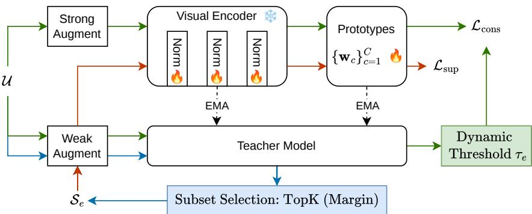
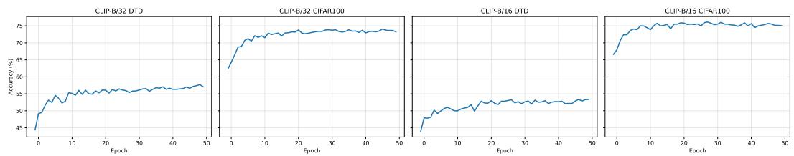
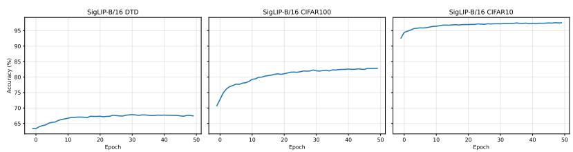

# Progressive Subset Selection and Cascaded Consistency for Unsupervised Vision–Language Model Adaptation

Hao Yan, Guanghui Wang Department of Computer Science Toronto Metropolitan University Toronto, ON, Canada haoyan6@cmail.carleton.ca, wangcs@torontomu.ca

## Abstract

Pretrained Vision-Language Models (PVLMs) achieve strong zero-shot recognition but often suffer performance degradation under target-domain shift. Unsupervised adaptation provides a practical way to improve target-domain performance without labeled data, but it remains challenging because pseudo-labels generated by the model can be unreliable and no labeled validation set is available for model selection or early stopping. We propose a simple framework for unsupervised PVLM adaptation that combines progressive margin-based subset selection with cascaded consistency learning. The subset selection strategy constructs a classbalanced pseudo-labeled set using prediction margins and gradually expands it during training, enabling adaptation to start from reliable supervision anchors before incorporating broader target-domain data. Cascaded consistency learning further exploits unlabeled samples by using temporally smoothed teacher predictions on weakly augmented views to supervise student predictions on strongly augmented views, with confidence filtering to reduce the influence of uncertain pseudo-labels. To preserve the pretrained embedding structure, the framework updates only normalization parameters in the visual encoder and class prototypes initialized from text prompts. Experiments across multiple recognition benchmarks with both CLIP and SigLIP backbones show consistent improvements over zeroshot baselines and competitive performance against recent unsupervised PVLM adaptation methods. These results suggest that progressive pseudo-label selection and teacher-guided consistency provide an effective and lightweight strategy for adapting PVLM classifiers without labeled target data.

## 1 Introduction

Pretrained vision-language models (PVLMs), such as CLIP [Radford et al., 2021], achieve strong zero-shot recognition by aligning images and text in a shared embedding space. With natural language prompts as class descriptions, these models can recognize diverse categories without task-specific training [Radford et al., 2021, Jia et al., 2021, Li et al., 2022]. However, their performance often drops when target data differ from the pretraining distribution [Radford et al., 2021, Shu et al., 2022]. This motivates adaptation methods that use either limited labeled data through prompt learning [Zhou et al., 2022b,a] or unlabeled target data through unsupervised adaptation [Mirza et al., 2023, Ali et al., 2025].

Unsupervised adaptation is attractive when labels are unavailable, but it is difficult because training relies on pseudo-labels generated by the model itself [Lee et al., 2013, Arazo et al., 2020]. Under domain shift, these pseudo-labels can be noisy, especially early in training. Optimizing directly on unreliable pseudo-labels may reinforce incorrect predictions and cause unstable adaptation [Arazo et al., 2020]. This issue is important for PVLMs because zero-shot classifiers are built from image– text similarity, and high-confidence predictions may still be wrong when the target visual distribution shifts. Since labeled validation data is unavailable, unsupervised adaptation also lacks reliable model selection or early stopping. A practical method should therefore improve target-domain performance while limiting the effect of noisy pseudo-labels. This motivates a conservative adaptation strategy that starts from more reliable predictions and gradually incorporates broader target-domain supervision.

To address this challenge, we propose a simple framework for unsupervised PVLM adaptation that combines progressive margin-based subset selection with cascaded consistency learning. First, we select a class-balanced subset of high-confidence pseudo-labeled samples using prediction margins and progressively expand this subset during training. This allows the model to begin adaptation from reliable supervision anchors before incorporating more target samples. Second, we use cascaded consistency learning, where an exponential-moving-average teacher provides predictions on weakly augmented views to supervise student predictions on strongly augmented views. A confidence threshold filters uncertain teacher predictions, reducing the impact of noisy pseudo-labels. Together, these two components separate reliable direct supervision from broader consistency regularization over the full unlabeled target set.

The proposed framework combines ideas that are widely used in semi-supervised learning and domain adaptation, including pseudo-label filtering, progressive self-training, EMA teachers, and weak-tostrong consistency. Our contribution is to adapt and couple these mechanisms for unsupervised PVLM adaptation, where pseudo-labels are produced by a zero-shot image–text classifier under domain shift and no labeled validation data is available. To avoid disrupting the pretrained embedding space, we update only normalization parameters in the visual encoder and class prototypes initialized from text prompts.

Experiments on multiple benchmark datasets show that the proposed method consistently improves over zero-shot baselines across both CLIP and SigLIP backbones. Compared with recent unsupervised PVLM adaptation methods, the method achieves competitive performance and performs particularly well on datasets with larger zero-shot domain gaps, such as FGVCAircraft and DTD. While it does not outperform all prior methods on every dataset, the results suggest that progressive pseudo-label subset selection and cascaded consistency provide an effective strategy for adapting PVLM classifiers without labeled target data.

Our contributions are summarized as follows:

• We propose a simple framework for unsupervised vision-language model adaptation that combines progressive margin-based subset selection with cascaded consistency learning.

• We introduce a progressive pseudo-labeled subset selection strategy that constructs classbalanced supervision anchors using margin-based confidence estimation.

• We develop a cascaded consistency learning mechanism that combines temporally stabilized teacher predictions, weak-to-strong consistency, and confidence filtering to reduce noisy supervision.

• We evaluate the framework across CLIP and SigLIP architectures, showing consistent improvements over zero-shot baselines and competitive performance against recent unsupervised PVLM adaptation methods.

## 1.1 Related Work

## 1.1.1 Pretrained Vision–Language Models

Pretrained vision–language models (PVLMs) learn aligned visual and textual representations from large-scale image–text pairs [Asfour et al., 2026]. CLIP [Radford et al., 2021] shows that contrastive image–text pretraining enables strong zero-shot recognition by matching image features with textual class descriptions. Subsequent models improve this paradigm through larger datasets, stronger architectures, or alternative training objectives, including ALIGN [Jia et al., 2021], OpenCLIP [Cherti et al., 2023], EVA-CLIP [Sun et al., 2023], and SigLIP [Zhai et al., 2023]. SigLIP replaces the softmax contrastive objective with a sigmoid-based loss, making it useful for evaluating whether adaptation methods generalize beyond CLIP-style models. Despite their strong zero-shot ability, PVLMs can degrade under distribution shift, motivating adaptation methods for target domains.

## 1.1.2 Adaptation of Vision–Language Models

A common way to adapt PVLMs is prompt learning, which optimizes task-specific prompts while keeping most of the pretrained model fixed. CoOp [Zhou et al., 2022b] and CoCoOp [Zhou et al., 2022a] learn continuous prompts from labeled examples, while later methods explore improved prompt representations and knowledge-guided prompting [Yao et al., 2023, Li et al., 2025, Liu et al., 2025]. These methods are effective but require labeled data.

Unsupervised PVLM adaptation aims to improve target-domain performance without labeled target samples. CuPL [Pratt et al., 2023] uses language models to generate richer class descriptions for zero-shot recognition. UPL [Huang et al., 2022] and POUF [Tanwisuth et al., 2023] optimize prompts or fine-tune models using unlabeled data. Pseudo-label-based methods such as LaFTer [Mirza et al., 2023] and DPA [Ali et al., 2025] adapt PVLMs using model predictions as supervision, with DPA improving pseudo-label reliability through distribution-aware prototype alignment. More recent approaches also study unsupervised knowledge distillation and test-time adaptation, including PromptKD [Li et al., 2024], KDPL [Mistretta et al., 2024], and TPT [Shu et al., 2022].

## 1.1.3 Pseudo-Label Learning and Consistency Regularization

Pseudo-labeling uses model predictions as supervision for unlabeled data [Lee et al., 2013], but noisy pseudo-labels can cause confirmation bias and unstable training [Arazo et al., 2020]. To reduce this risk, prior work often filters pseudo-labels using confidence, uncertainty, entropy, or margin-based criteria. Consistency regularization is another common strategy, encouraging predictions to remain stable under input perturbations. Mean Teacher [Tarvainen and Valpola, 2017] uses an exponentialmoving-average teacher to generate stable targets, while FixMatch [Sohn et al., 2020] combines confidence filtering with weak-to-strong augmentation consistency.

Our method builds on these established ideas and adapts them to unsupervised PVLM adaptation. In this setting, pseudo-labels come from a zero-shot image–text classifier under domain shift, and no labeled validation set is available for checkpoint selection. We therefore select class-balanced pseudo-labeled anchors using prediction margins, progressively expand the selected subset, and combine these anchors with EMA teacher-guided weak-to-strong consistency. The contribution is not margin filtering or teacher-student consistency alone, but their combination as a conservative adaptation procedure for PVLM classifiers with unlabeled target data.

## 2 Proposed Method

We present a simple framework for unsupervised adaptation of pretrained vision-language models. The framework is model-agnostic and applies to a wide range of pretrained vision-language models (PVLMs) that learn aligned image-text embedding spaces. As illustrated in Figure 1, the method has two complementary components: progressive margin-based subset selection and cascaded consistency learning. The first component constructs a reliable pseudo-labeled subset by selecting class-balanced samples with large prediction margins and progressively expanding the subset during training to increase supervision coverage. The second component exploits the full unlabeled dataset through cascaded consistency that combines temporally stabilized teacher predictions with crossview consistency under stochastic augmentations. Together, they form a self-reinforcing loop: reliable pseudo-labeled anchors stabilize early adaptation, while consistency regularization improves representation quality and further enhances pseudo-label reliability.

Rather than introducing margin filtering or teacher-student consistency as isolated new techniques, our goal is to adapt and combine these established mechanisms for the specific setting of unsupervised PVLM adaptation, where pseudo-labels are produced by a zero-shot image-text classifier under domain shift. To preserve the pretrained embedding geometry and maintain stable optimization under noisy supervision, we adopt a lightweight adaptation strategy that updates only normalization parameters of the visual encoder and class prototypes derived from text prompts.

  
Figure 1: Overview of the proposed unsupervised vision-language model adaptation framework. The teacher model selects a class-balanced pseudo-labeled subset based on prediction margins. The student is trained with supervised learning on the selected subset and cascaded consistency learning on unlabeled data via weak and strong augmentations. The teacher parameters are updated as an exponential moving average of the student parameters, producing stabilized pseudo-labels that progressively improve subset selection and consistency learning.

## 2.1 Preliminaries and Adaptation Framework

We consider unsupervised adaptation of a pretrained vision-language model (PVLM) to a target domain without labeled supervision. Modern PVLMs, such as CLIP and SigLIP, consist of two encoders trained on large-scale image-text pairs: a visual encoder and a textual encoder that project images and text prompts into a shared d-dimensional embedding space. We denote an input image by x and a text prompt by t. The visual encoder $\mathcal { V } ( \cdot )$ maps x to $\bar { \mathbf { v } } = \gamma ( \mathbf { x } ) \in \mathbb { R } ^ { d }$ , and the textual encoder $\tau ( \cdot )$ maps t to $\mathbf { e } = \mathcal { T } ( \mathbf { t } ) \in \mathbb { R } ^ { d }$ . During pretraining, these models align image and text embeddings in a shared representation space using similarity-based objectives:

$$
\sin ( \mathbf { x } , \mathbf { t } ) = \alpha \frac { \mathbf { v } } { \| \mathbf { v } \| _ { 2 } } \cdot \frac { \mathbf { e } } { \| \mathbf { e } \| _ { 2 } } .\tag{1}
$$

Here α is a learned temperature/scale that controls the magnitude of similarity logits. This induces a metric structure where semantically aligned image-text pairs exhibit high cosine similarity.

For a downstream classification task with $C$ categories, each class $c \in \{ 1 , \ldots , C \}$ is described by multiple textual prompts to reduce prompt sensitivity and capture semantic variability. Let $\{ \mathbf { t } _ { c , m } \} _ { m = 1 } ^ { M }$ denote the prompts for class c. We compute the normalized embedding of each prompt and average them to form a class prototype:

$$
\mathbf { w } _ { c } = \frac { 1 } { M } \sum _ { m = 1 } ^ { M } \frac { \mathcal { T } ( \mathbf { t } _ { c , m } ) } { \| \mathcal { T } ( \mathbf { t } _ { c , m } ) \| _ { 2 } } .\tag{2}
$$

Averaging normalized prompt embeddings mitigates variance from prompt wording and yields a robust semantic prototype. After initialization, $\mathbf { \bar { \{ w } }  _ { c } \mathbf  \} _ { c = 1 } ^ { C }$ are treated as learnable parameters and updated by gradient descent; the text encoder is not used thereafter. When multiple prompt sets are available, the same prompt construction is used consistently for the zero-shot model and the adapted model to isolate the effect of adaptation.

We build a cosine classifier on top of the visual encoder using cosine similarity between image features and class prototypes. Let $\bar { \mathcal { V } } _ { \boldsymbol { \theta } _ { v } } ( \cdot )$ denote the visual encoder with parameters $\theta _ { v }$ . For an input image x, we compute a normalized visual feature

$$
\bar { \bf v } = \frac { \mathcal { V } _ { \boldsymbol { \theta } _ { v } } ( { \bf x } ) } { \| \mathcal { V } _ { \boldsymbol { \theta } _ { v } } ( { \bf x } ) \| _ { 2 } } .
$$

The overall classifier parameters are $\boldsymbol { \theta } = \{ \theta _ { v } , \{ \mathbf { w } _ { c } \} _ { c = 1 } ^ { C } \}$ , including the visual encoder parameters and class prototypes. The cosine classifier produces logits $\mathbf { z } = f _ { \theta } ( \mathbf { \bar { x } } ) \in \mathbb { R } ^ { C }$ , where the c-th logit is

$$
f _ { \boldsymbol { \theta } } ( \mathbf { x } ) _ { c } = \alpha \bar { \mathbf { v } } ^ { \top } \bar { \mathbf { w } } _ { c } , \qquad \bar { \mathbf { w } } _ { c } = \frac { \mathbf { w } _ { c } } { \| \mathbf { w } _ { c } \| _ { 2 } } .\tag{3}
$$

We keep α fixed during adaptation. This cosine classifier preserves the geometric structure of the pretrained embedding space while enabling task-specific discrimination through prototype refinement.

Let $\mathcal { U } = \{ \mathbf { x } _ { i } \} _ { i = 1 } ^ { N }$ denote an unlabeled target dataset from a shifted distribution. The goal of unsupervised adaptation is to improve performance of $f _ { \theta }$ on this target domain without access to labeled target samples. In contrast to supervised fine-tuning, unsupervised adaptation lacks labeled validation data for model selection or early stopping, making training sensitive to noisy pseudo-labels and prone to confirmation bias and late-stage degradation.

To preserve the pretrained geometry and ensure efficient adaptation, we adopt a lightweight update strategy: we update only the affine parameters of normalization layers within $\mathcal { V } _ { \boldsymbol { \theta } _ { \imath } }$ and the class prototypes $\{ \mathbf { w } _ { c } \} _ { c = 1 } ^ { C }$ , while keeping the remaining encoder weights fixed. Updating normalization layers adjusts feature statistics to better match the target distribution, and refining prototypes adapts decision boundaries with minimal disruption. This design is conservative: it limits the number of trainable parameters and reduces the risk that noisy pseudo-labels will substantially distort the pretrained representation.

To stabilize pseudo-label generation, we employ a student-teacher framework with identical architectures. We maintain a student model $f _ { \theta }$ and a teacher model $f _ { \theta ^ { \prime } }$ , where the teacher parameters are updated as an exponential moving average of the student parameters:

$$
\theta ^ { \prime }  \mu \theta ^ { \prime } + ( 1 - \mu ) \theta ,\tag{4}
$$

where $\mu \in [ 0 , 1 )$ controls temporal smoothing. By aggregating historical student states, the teacher produces stabilized predictions that reduce pseudo-label variance. These predictions are used for progressive subset selection and consistency learning. We use the teacher only as a temporally smoothed target generator; gradients are applied to the student model.

## 2.2 Progressive Margin-Based Subset Selection

A central challenge in unsupervised adaptation is pseudo-label reliability. Since target labels are unavailable, training signals come from model predictions, which can be noisy, especially early in adaptation. Using all pseudo-labeled samples can introduce substantial label noise, leading to confirmation bias and unstable optimization. This issue is particularly pronounced for PVLMs under domain shift, where visual representations may deviate from the pretrained embedding space.

To mitigate this problem, we construct a subset of high-confidence pseudo-labeled samples and use it as supervised anchors. Rather than selecting samples solely by predicted probability, we rank them by prediction margin, which measures the separation between the most likely and competing classes. The motivation is that the maximum probability can be poorly calibrated under domain shift, whereas the margin directly measures the relative separation between the top predicted class and its nearest competitor in the prototype classifier. Given an unlabeled image x, the teacher model produces logits

$$
{ \bf z } = f _ { \boldsymbol { \theta } ^ { \prime } } ( { \bf x } ) \in \mathbb { R } ^ { C } ,\tag{5}
$$

and the pseudo-label is

$$
\hat { y } = \arg \operatorname* { m a x } _ { c } z _ { c } .\tag{6}
$$

We define the prediction margin as

$$
m ( { \bf x } ) = z _ { ( 1 ) } - z _ { ( 2 ) } ,\tag{7}
$$

where $z _ { ( 1 ) }$ and $z _ { ( 2 ) }$ are the largest and second-largest logits. Since the classifier uses cosine similarity between normalized image features and class prototypes, the margin reflects separation between competing prototypes; larger margins typically indicate more reliable pseudo-labels. We do not assume that large margins guarantee correctness, especially under severe domain shift. Instead, we use margins as a conservative ranking criterion and combine them with class-balanced selection and progressive expansion to reduce the effect of overconfident errors.

Margin-based ranking alone can yield imbalanced supervision across classes. If some classes produce consistently higher-confidence predictions, they may dominate the selected subset and bias adaptation. We therefore enforce class-balanced selection. For each class $c ,$ we collect samples with ${ \hat { y } } = c ,$ rank them by $m ( \mathbf { x } )$ , and select the top $K _ { e }$ at epoch e. To reduce early error propagation, we progressively expand the subset size:

$$
K _ { e } = \mathrm { m i n } ( K _ { \mathrm { m a x } } , K _ { 0 } + e \Delta K ) ,\tag{8}
$$

where $K _ { 0 }$ is the initial subset size, $\Delta K$ is the per-epoch increment, and $K _ { \mathrm { m a x } }$ is the maximum. This schedule restricts early training to the most confident samples and increases coverage as pseudo-label quality improves. If fewer than $K _ { e }$ samples are predicted as class $c ,$ all available samples for that class are selected. This avoids forcing class balance when the teacher does not predict enough samples for a class.

Formally, the selected pseudo-labeled subset for class c is

$$
S _ { e } ^ { ( c ) } = \mathrm { T o p K } _ { K _ { e } } \left( \left\{ ( { \bf x } , \hat { y } ) \vert \hat { y } = c \right\} ; m ( { \bf x } ) \right) ,\tag{9}
$$

and the overall subset is

$$
S _ { e } = \bigcup _ { c = 1 } ^ { C } S _ { e } ^ { ( c ) } .\tag{10}
$$

The student is trained on $S _ { e }$ using a supervised classification loss. We denote by $\ell ( { \mathbf { z } } , y )$ the persample loss, which keeps the objective compatible with different PVLM architectures (cross-entropy for CLIP, binary cross-entropy for SigLIP):

$$
\mathcal { L } _ { \mathrm { s u p } } = \frac { 1 } { | S _ { e } | } \sum _ { ( \mathbf { x } , \hat { y } ) \in S _ { e } } \ell ( f _ { \theta } ( \mathbf { x } ) , \hat { y } ) .\tag{11}
$$

Importantly, pseudo-labels for subset construction are generated by the teacher rather than the student. Since $\theta ^ { \prime }$ is an EMA of $\theta ,$ the teacher predictions are typically more stable, improving both margin estimation and subset selection. Overall, progressive margin-based subset selection provides reliable supervision anchors while controlling error propagation. This component is intended to control which pseudo-labels are trusted for direct supervised training, rather than to use every target sample as if it were labeled.

## 2.3 Cascaded Consistency Learning

Progressive subset selection provides reliable anchors but covers only a small portion of the target data, especially early in adaptation. To leverage the full unlabeled dataset $u ,$ we enforce cascaded consistency on all samples using a dynamic confidence threshold to filter unreliable teacher pseudolabels. While consistency learning encourages prediction invariance under perturbations, single-stage consistency based on student predictions can amplify pseudo-label noise and destabilize training. This is particularly problematic in unsupervised adaptation, where labeled validation data is unavailable for early stopping.

We introduce cascaded consistency learning, which integrates temporal stabilization from the teacher with cross-view consistency across stochastic augmentations. The term “cascaded” refers to two sequential supervision stages: first, the EMA teacher produces a temporally smoothed target from a weakly augmented view; second, this target supervises the student on a strongly augmented view. This separates target generation from student optimization and avoids using instantaneous student predictions as their own direct targets. The key idea is to generate pseudo-labels using teacher predictions on weak views and supervise student predictions on strong views, which reduces pseudo-label variance and stabilizes adaptation.

Given $\mathbf { x } \in \mathcal { U } .$ , we generate a weak view $\mathbf { x } ^ { w }$ and a strong view $\mathbf { x } ^ { s }$ . The weak view uses standard evaluation-style preprocessing with mild stochastic augmentation, while the strong view applies stronger image perturbations following the FixMatch-style augmentation protocol described in the implementation details. The teacher produces per-class probabilities from the weak view,

$$
\mathbf { p } ^ { t } = g ( f _ { \theta ^ { \prime } } ( \mathbf { x } ^ { w } ) ) \in [ 0 , 1 ] ^ { C } ,\tag{12}
$$

where $g ( \mathbf { z } ) = \operatorname { s o f t m a x } ( \mathbf { z } )$ for CLIP and $g ( \mathbf { z } ) = \mathrm { s i g m o i d } ( \mathbf { z } )$ for SigLIP. The teacher pseudo-label is

$$
\hat { y } ^ { t } = \arg \operatorname* { m a x } _ { c } p _ { c } ^ { t } ,\tag{13}
$$

and we measure confidence by

$$
\gamma ( \mathbf { x } ) = \operatorname* { m a x } _ { c } p _ { c } ^ { t } .\tag{14}
$$

To avoid enforcing unreliable supervision, we introduce a dynamic confidence threshold $\tau _ { e }$ and retain pseudo-labels only when $\gamma ( \mathbf { x } ) \geq \tau _ { e }$ . We use a progressively relaxed schedule: early in training

we apply a stricter threshold to suppress noisy pseudo-labels, and later relax it as the model adapts. Specifically,

$$
\tau _ { e } = \tau _ { \mathrm { s t a r t } } + \operatorname* { m i n } \biggl ( 1 , \frac { e } { E _ { \mathrm { w a r m } } } \biggr ) ( \tau _ { \mathrm { e n d } } - \tau _ { \mathrm { s t a r t } } ) ,\tag{15}
$$

where $\tau _ { \mathrm { s t a r t } }$ and $\tau _ { \mathrm { e n d } }$ are the initial and final thresholds and $E _ { \mathrm { w a r m } }$ is the linear annealing length. This complements progressive subset expansion by gradually incorporating more supervision as pseudo-label reliability improves. In our implementation, $\tau _ { \mathrm { s t a r t } } > \tau _ { \mathrm { e n d } }$ , so the threshold is relaxed over training. This conservative-to-permissive schedule is designed to suppress noisy consistency targets in early epochs while increasing unlabeled-data usage later.

The student produces logits from the strong view $f _ { \theta } ( \mathbf { x } ^ { s } ) \in \mathbb { R } ^ { C }$ . We enforce weak-to-strong agreement for all $\mathbf { x } \in \mathcal { U }$ (including samples in $ { \boldsymbol { S } } _ { e } )$ via

$$
\mathcal { L } _ { \mathrm { c o n s } } = \mathbb { E } _ { { \mathbf { x } } \sim \mathcal { U } } \mathbb { 1 } [ \gamma ( { \mathbf { x } } ) \geq \tau _ { e } ] ~ \ell ( f _ { \theta } ( { \mathbf { x } } ^ { s } ) , \hat { \boldsymbol { y } } ^ { t } ) .\tag{16}
$$

Because the teacher is an EMA of the student, its predictions are more stable than instantaneous student outputs. Compared to single-stage consistency, the proposed cascade reduces pseudo-label variance and mitigates oscillatory training behavior. The supervised subset loss and the consistency loss play different roles: Lsup provides direct optimization on selected high-margin anchors, while Lcons regularizes predictions over the broader unlabeled set.

The overall training objective is

$$
\operatorname* { m i n } _ { \theta } \mathcal { L } = \mathcal { L } _ { \mathrm { s u p } } + \lambda \mathcal { L } _ { \mathrm { c o n s } } ,\tag{17}
$$

where λ controls the strength of consistency regularization. Together with progressive subset selection, cascaded consistency forms a self-reinforcing loop: reliable anchors stabilize early adaptation, and consistency learning exploits all unlabeled data and improves pseudo-label quality over time. We keep λ fixed across datasets to avoid dataset-specific tuning in the unlabeled setting.

At each epoch, the EMA teacher evaluates all samples in U and constructs a class-balanced pseudolabeled subset $S _ { e }$ using progressive margin-based selection, where the per-class subset size $K _ { e }$ increases over training. The student is then optimized using Equation 17, with mini-batches from $S _ { e }$ providing supervised signals and mini-batches from U enforcing confidence filtered weak-to-strong consistency with threshold $\tau _ { e } .$ After each update, the teacher parameters are updated by exponential moving average. The overall procedure is summarized in Algorithm 1 in the appendix A.1. This epoch-level subset construction requires teacher inference over the unlabeled target set. We report this cost in the implementation and efficiency analysis rather than treating the method as overhead-free.

## 3 Experiments

## 3.1 Experimental Setup

Datasets. We evaluate the proposed method on several widely used benchmark datasets for vision–language model evaluation, including DTD [Cimpoi et al., 2014], FGVCAircraft [Maji et al., 2013], OxfordPets [Parkhi et al., 2012], CIFAR10 [Krizhevsky et al., 2009], CIFAR100 [Krizhevsky et al., 2009], and Food101 [Bossard et al., 2014]. These datasets cover diverse visual recognition tasks such as fine-grained classification, texture recognition, and object recognition. Importantly, they exhibit varying levels of zero-shot performance for pretrained vision–language models, ranging from low-accuracy datasets (FGVCAircraft and DTD) to medium-accuracy datasets (CIFAR100 and Food101) and high-accuracy datasets (OxfordPets and CIFAR10). Detailed dataset statistics and official split information are provided in the supplementary material.

Following the common evaluation protocol for pretrained vision-language models, all target datasets are treated as fully unlabeled during adaptation. No labeled target data is used for training or model selection, and the test sets are used only for final evaluation.

PVLMs. We evaluate our method using several pretrained vision-language models, including CLIP [Radford et al., 2021] and SigLIP [Zhai et al., 2023] architectures. In particular, experiments are conducted using CLIP ViT-B/32, CLIP ViT-B/16, and SigLIP ViT-B/16 models to verify the generality of the proposed framework across different PVLM architectures. Unlike CLIP, SigLIP is trained with a sigmoid-based contrastive objective, so results on SigLIP help test whether the proposed method depends on CLIP-specific logit behavior.

Table 1: Comparison with existing unsupervised PVLM adaptation methods using CLIP ViT-B/32. Accuracy (%) on six benchmark datasets. Baseline adaptation results are taken from published DPA comparisons.
<table><tr><td>Methods</td><td>FGVCAircraft</td><td>DTD</td><td>CIFAR100</td><td>Food101</td><td>OxfordPets</td><td>CIFAR10</td></tr><tr><td>CLIP [Radford et al., 2021]</td><td>18.9</td><td>44.4</td><td>62.3</td><td>83.3</td><td>87.5</td><td>88.3</td></tr><tr><td>UPL [Huang et al., 2022]</td><td>17.1</td><td>45.4</td><td>67.4</td><td>84.3</td><td>83.8</td><td>91.3</td></tr><tr><td>POUF [Tanwisuth et al., 2023]</td><td>19.8</td><td>47.0</td><td>68.9</td><td>84.0</td><td>89.5</td><td>92.5</td></tr><tr><td>LaFTer [Mirza et al., 2023]</td><td>19.9</td><td>50.3</td><td>69.8</td><td>82.5</td><td>84.9</td><td>94.6</td></tr><tr><td>DPA [Ali et al., 2025]</td><td>20.7</td><td>55.7</td><td>76.5</td><td>84.8</td><td>90.7</td><td>96.0</td></tr><tr><td>Ours</td><td>22.9</td><td>57.7</td><td>74.1</td><td>84.8</td><td>90.3</td><td>96.0</td></tr></table>

Table 2: Comparison with existing unsupervised PVLM adaptation methods using CLIP ViT-B/16. Accuracy (%) on the same six benchmark datasets. Food101 for ViT-B/16 is not reported by some baselines
<table><tr><td>Methods</td><td>FGVCAircraft</td><td>DTD</td><td>CIFAR100</td><td>Food101</td><td>OxfordPets</td><td>CIFAR10</td></tr><tr><td>CLIP [Radford et al., 2021]</td><td>24.9</td><td>43.9</td><td>66.6</td><td>87.7</td><td>89.0</td><td>90.1</td></tr><tr><td>UPL [Huang et al., 2022]</td><td>22.5</td><td>45.9</td><td>70.4</td><td></td><td>88.0</td><td>92.9</td></tr><tr><td>POUF [Tanwisuth et al., 2023]</td><td>24.4</td><td>48.6</td><td>66.3</td><td></td><td>91.8</td><td>92.3</td></tr><tr><td>LaFTer [Mirza et al., 2023]</td><td>22.4</td><td>54.8</td><td>76.3</td><td></td><td>85.3</td><td>96.5</td></tr><tr><td>DPA [Ali et al., 2025]</td><td>25.1</td><td>50.7</td><td>78.1</td><td></td><td>93.2</td><td>96.4</td></tr><tr><td>Ours</td><td>26.2</td><td>53.4</td><td>76.1</td><td>89.3</td><td>93.5</td><td>97.2</td></tr></table>

For each dataset, class descriptions are constructed using multiple hand-written textual prompts from CuPL [Pratt et al., 2023], and class prototypes are initialized by averaging normalized embeddings of prompts corresponding to each class. The same prompt set is used for the zero-shot baseline and for our adapted model, so the reported gains over zero-shot reflect the effect of adaptation rather than a change in prompting. Since some comparison results are taken from prior work, differences in prompt sets or implementation details may affect direct cross-method comparison; we therefore interpret comparisons with published baselines as indicative rather than fully controlled.

Baselines. We compare our method with zero-shot PVLM baselines and representative unsupervised adaptation methods. CLIP [Radford et al., 2021] and SigLIP [Zhai et al., 2023] directly apply pretrained vision–language models with textual prompts and no target-domain adaptation. UPL [Huang et al., 2022], POUF [Tanwisuth et al., 2023], LaFTer [Mirza et al., 2023], and DPA [Ali et al., 2025] adapt PVLMs using unlabeled target data and serve as representative unsupervised adaptation baselines. Implementation details are attached in the appendix A.2

## 3.2 Main Results

We compare the proposed method with several representative approaches for unsupervised adaptation of pretrained vision-language models, including UPL, POUF, LaFTer, and DPA. Classification accuracy is reported on six benchmark datasets using CLIP ViT-B/32 and CLIP ViT-B/16 models. The results are summarized in Table 1 and Table 2. Following common practice, results for the comparison methods are taken directly from the DPA paper to ensure fair and consistent evaluation.

As shown in Table 1 and Table 2, the proposed method consistently improves over the CLIP zeroshot baseline. The gains are especially clear on datasets with lower zero-shot accuracy, such as FGVCAircraft and DTD. For example, with CLIP ViT-B/32, our method improves FGVCAircraft from 18.9% to 22.9% and DTD from 44.4% to 57.7%, suggesting that progressive subset selection and cascaded consistency are effective under larger domain shifts.

Compared with existing unsupervised adaptation methods, our approach achieves competitive or superior performance on most datasets. For CLIP ViT-B/32, it obtains the best results on FGVCAircraft and DTD and matches the best results on Food101 and CIFAR10. For CLIP ViT-B/16, it achieves the highest accuracy on FGVCAircraft, Food101, OxfordPets, and CIFAR10. However, it does not uniformly outperform DPA; DPA remains stronger on CIFAR100 for both CLIP backbones and on

Table 3: Additional results using SigLIP ViT-B/16. Accuracy (%) on six benchmark datasets.
<table><tr><td>Method</td><td>FGVCAircraft</td><td>DTD</td><td>CIFAR100</td><td>Food101</td><td>OxfordPets</td><td>CIFAR10</td><td>Avg</td></tr><tr><td>SigLIP [Zhai et al., 2023]</td><td>43.9</td><td>63.4</td><td>70.8</td><td>89.4</td><td>94.2</td><td>92.5</td><td>75.7</td></tr><tr><td>Ours</td><td>47.4</td><td>67.9</td><td>82.9</td><td>91.6</td><td>95.2</td><td>97.6</td><td>80.4 (+4.7)</td></tr></table>

DTD for ViT-B/16. This suggests that distribution-aware prototype alignment may be beneficial when many semantically related classes produce ambiguous pseudo-labels.

Overall, the results show that the proposed method provides a simple and effective strategy for unsupervised PVLM adaptation. It consistently improves the corresponding zero-shot models and remains competitive with recent unsupervised adaptation methods, while also revealing cases where stronger pseudo-label calibration or distribution-aware alignment may further improve performance.

## 3.3 Generalization across PVLM Architectures

In addition to the CLIP-based experiments, we evaluate the proposed method on SigLIP ViT-B/16 [Zhai et al., 2023] to verify whether the framework generalizes across PVLM architectures. SigLIP is trained using a sigmoid-based contrastive objective and exhibits different logit characteristics compared with CLIP. Evaluating on SigLIP therefore tests whether the proposed adaptation framework is limited to CLIP-style contrastive models.

As shown in Table 3, the proposed method improves SigLIP on all six datasets, increasing the average accuracy from 75.7% to 80.4% (+4.7 points). The gains are especially large on CIFAR100 (+12.1), CIFAR10 (+5.1), DTD (+4.5), and FGVCAircraft (+3.5). These results suggest that the proposed framework is not limited to CLIP, since it can also adapt a PVLM trained with a different image-text objective. We emphasize that this experiment is intended to evaluate cross-architecture applicability relative to the corresponding SigLIP baseline; it is not a controlled comparison with prior unsupervised adaptation methods on SigLIP. More results about ablation study and training stability analysis are included in the appendix A.3 and A.4.

## 4 Conclusion

We presented a simple framework for unsupervised adaptation of pretrained vision–language models by combining progressive margin-based subset selection with cascaded consistency learning. The method selects class-balanced high-margin pseudo-labeled samples as supervision anchors, gradually expands the selected subset, and uses confidence-filtered EMA teacher predictions to exploit unlabeled target data through weak-to-strong consistency. By updating only normalization parameters and class prototypes, the framework preserves most pretrained parameters while adapting to target domains. Experiments across multiple benchmarks with CLIP and SigLIP show consistent improvements over zero-shot baselines and competitive performance against recent unsupervised PVLM adaptation methods. Future work will explore broader benchmarks, controlled comparisons with more recent baselines, and adaptive schedules for pseudo-label selection and confidence filtering.

## Acknowledgment

This work was partly supported by the Natural Sciences and Engineering Research Council of Canada (NSERC) Discovery Grants and DND/NSERC Discovery Grant Supplements under grant nos RGPIN-2026-05645 and DGDND-2026-05645.

## References

Eman Ali, Sathira Silva, and Muhammad Haris Khan. Dpa: Dual prototypes alignment for unsupervised adaptation of vision-language models. In IEEE/CVF Winter Conference on Applications of Computer Vision (WACV), 2025.

Eric Arazo, Diego Ortego, Paul Albert, Noel E O’Connor, and Kevin McGuinness. Pseudo-labeling and confirmation bias in deep semi-supervised learning. In International Joint Conference on Neural Networks (IJCNN), 2020.

Alaa Asfour, Christopher Indris, Leihan Chen, Tejas Vyas, and Guanghui Wang. Distilling 3d spatial reasoning into a lightweight vision-language model with cot. arXiv preprint arXiv:2605.09719, 2026.

Lukas Bossard, Matthieu Guillaumin, and Luc Van Gool. Food-101–mining discriminative components with random forests. In European Conference on Computer Vision (ECCV), 2014.

Mehdi Cherti, Romain Beaumont, Ross Wightman, Mitchell Wortsman, Gabriel Ilharco, Cade Gordon, Christoph Schuhmann, Ludwig Schmidt, and Jenia Jitsev. Reproducible scaling laws for contrastive language-image learning. In IEEE/CVF Conference on Computer Vision and Pattern Recognition (CVPR), 2023.

Mircea Cimpoi, Subhransu Maji, Iasonas Kokkinos, Sammy Mohamed, and Andrea Vedaldi. Describing textures in the wild. In IEEE/CVF Conference on Computer Vision and Pattern Recognition (CVPR), 2014.

Tony Huang, Jack Chu, and Fangyun Wei. Unsupervised prompt learning for vision-language models. arXiv preprint arXiv:2204.03649, 2022.

Chao Jia, Yinfei Yang, Ye Xia, Yi-Ting Chen, Zarana Parekh, Hieu Pham, Quoc Le, Yun-Hsuan Sung, Zhen Li, and Tom Duerig. Scaling up visual and vision-language representation learning with noisy text supervision. In International Conference on Machine Learning (ICML), 2021.

Alex Krizhevsky, Geoffrey Hinton, et al. Learning multiple layers of features from tiny images. 2009.

Dong-Hyun Lee et al. Pseudo-label: The simple and efficient semi-supervised learning method for deep neural networks. In Workshop on challenges in representation learning, ICML, 2013.

Junnan Li, Dongxu Li, Caiming Xiong, and Steven Hoi. Blip: Bootstrapping language-image pretraining for unified vision-language understanding and generation. In International Conference on Machine Learning (ICML), 2022.

Kaidong Li, Tianxiao Zhang, Kuan-Chuan Peng, and Guanghui Wang. Pf3det: A prompted foundation feature assisted visual lidar 3d detector. In 2025 IEEE/CVF Conference on Computer Vision and Pattern Recognition Workshops (CVPRW), pages 3778–3787. IEEE, 2025.

Zheng Li, Xiang Li, Xinyi Fu, Xin Zhang, Weiqiang Wang, Shuo Chen, and Jian Yang. Promptkd: Unsupervised prompt distillation for vision-language models. In IEEE/CVF Conference on Computer Vision and Pattern Recognition (CVPR), 2024.

Jun Liu, Ziqian Lu, Hao Luo, Zheming Lu, and Yangming Zheng. Progressive multi-prompt learning for vision-language models. IEEE Transactions on Circuits and Systems for Video Technology, 2025.

Subhransu Maji, Esa Rahtu, Juho Kannala, Matthew Blaschko, and Andrea Vedaldi. Fine-grained visual classification of aircraft. arXiv preprint arXiv:1306.5151, 2013.

Muhammad Jehanzeb Mirza, Leonid Karlinsky, Wei Lin, Horst Possegger, Mateusz Kozinski, Rogerio Feris, and Horst Bischof. Lafter: Label-free tuning of zero-shot classifier using language and unlabeled image collections. In Advances in Neural Information Processing Systems (NeurIPS), 2023.

Marco Mistretta, Alberto Baldrati, Marco Bertini, and Andrew D Bagdanov. Improving zero-shot generalization of learned prompts via unsupervised knowledge distillation. In European Conference on Computer Vision (ECCV), 2024.

Omkar M Parkhi, Andrea Vedaldi, Andrew Zisserman, and CV Jawahar. Cats and dogs. In IEEE/CVF Conference on Computer Vision and Pattern Recognition (CVPR), 2012.

Sarah Pratt, Ian Covert, Rosanne Liu, and Ali Farhadi. What does a platypus look like? generating customized prompts for zero-shot image classification. In IEEE/CVF International Conference on Computer Vision (ICCV), 2023.

Alec Radford, Jong Wook Kim, Chris Hallacy, Aditya Ramesh, Gabriel Goh, Sandhini Agarwal, Girish Sastry, Amanda Askell, Pamela Mishkin, Jack Clark, et al. Learning transferable visual models from natural language supervision. In International Conference on Machine Learning (ICML), 2021.

Manli Shu, Weili Nie, De-An Huang, Zhiding Yu, Tom Goldstein, Anima Anandkumar, and Chaowei Xiao. Test-time prompt tuning for zero-shot generalization in vision-language models. In Advances in Neural Information Processing Systems (NeurIPS), 2022.

Kihyuk Sohn, David Berthelot, Nicholas Carlini, Zizhao Zhang, Han Zhang, Colin A Raffel, Ekin Dogus Cubuk, Alexey Kurakin, and Chun-Liang Li. Fixmatch: Simplifying semi-supervised learning with consistency and confidence. Advances in Neural Information Processing Systems (NeurIPS), 2020.

Quan Sun, Yuxin Fang, Ledell Wu, Xinlong Wang, and Yue Cao. Eva-clip: Improved training techniques for clip at scale. arXiv preprint arXiv:2303.15389, 2023.

Korawat Tanwisuth, Shujian Zhang, Huangjie Zheng, Pengcheng He, and Mingyuan Zhou. Pouf: Prompt-oriented unsupervised fine-tuning for large pre-trained models. In International Conference on Machine Learning (ICML), 2023.

Antti Tarvainen and Harri Valpola. Mean teachers are better role models: Weight-averaged consistency targets improve semi-supervised deep learning results. In Advances in Neural Information Processing Systems (NeurIPS), 2017.

Thomas Wolf, Lysandre Debut, Victor Sanh, Julien Chaumond, Clement Delangue, Anthony Moi, Pierric Cistac, Tim Rault, Rémi Louf, Morgan Funtowicz, et al. Transformers: State-of-the-art natural language processing. In Conference on Empirical Methods in Natural Language Processing (EMNLP), 2020.

Hantao Yao, Rui Zhang, and Changsheng Xu. Visual-language prompt tuning with knowledge-guided context optimization. In IEEE/CVF Conference on Computer Vision and Pattern Recognition (CVPR), 2023.

Xiaohua Zhai, Basil Mustafa, Alexander Kolesnikov, and Lucas Beyer. Sigmoid loss for language image pre-training. In IEEE/CVF International Conference on Computer Vision (ICCV), 2023.

Kaiyang Zhou, Jingkang Yang, Chen Change Loy, and Ziwei Liu. Conditional prompt learning for vision-language models. In IEEE/CVF Conference on Computer Vision and Pattern Recognition (CVPR), 2022a.

Kaiyang Zhou, Jingkang Yang, Chen Change Loy, and Ziwei Liu. Learning to prompt for visionlanguage models. International Journal ofComputer Vision (IJCV), 2022b.

## A Appendix

## A.1 Algorithm

The overall procedure is summarized in Algorithm 1.

Algorithm 1: Progressive Subset Selection with Cascaded Consistency   
Input: Unlabeled dataset U, training epochs E, initial subset size $K _ { 0 } ,$ subset increment $\Delta K$   
maximum subset size $K _ { \mathrm { m a x } } .$ , threshold schedule $( \tau _ { \mathrm { s t a r t } } , \tau _ { \mathrm { e n d } } , E _ { \mathrm { w a r m } } )$ , consistency weight λ,   
EMA momentum $\mu$   
Output: Adapted student model $f _ { \theta }$   
Initialize student model $f _ { \theta }$ and teacher model $f _ { \theta ^ { \prime } } \gets f _ { \theta } ;$   
for epoch $e = 0 , \ldots , E - 1$ do   
Update subset size $K _ { e } \gets \operatorname* { m i n } ( K _ { \mathrm { m a x } } , K _ { 0 } + e \Delta K ) ;$   
Compute $\tau _ { e }$ from the threshold schedule;   
$/ /$ Progressive subset selection using the teacher   
Compute teacher logits $\mathbf { z } = f _ { \theta ^ { \prime } } ( \mathbf { x } )$ for $\mathbf { x } \in \mathcal { U } ;$   
Compute pseudo-label $\hat { y } = \arg \operatorname* { m a x } _ { c } z _ { c }$ and margin $m ( \mathbf { x } )$ for each $\mathbf { x } \in \mathcal { U } ;$   
Select class-balanced pseudo-labeled subset $S _ { e }$ via $\mathrm { T o p } { \cdot } K _ { e }$ margin ranking;   
for each training iteration do   
Sample a labeled batch $\{ ( \mathbf { x } _ { i } , \hat { y } _ { i } ) \}$ from $S _ { e }$   
Sample an unlabeled batch $\{ \mathbf { x } _ { j } \}$ from $u ;$   
$/ /$ Supervised update on pseudo-labeled anchors   
Compute supervised loss $\mathcal { L } _ { \mathrm { s u p } }$ on $\{ ( \mathbf { x } _ { i } , \hat { y } _ { i } ) \}$   
$/ /$ Cascaded consistency: teacher weak → student strong   
Generate weak and strong augmentations $( \mathbf { x } _ { j } ^ { w } , \mathbf { x } _ { j } ^ { s } ) ;$   
Compute teacher probabilities $\begin{array} { r } { \mathbf { p } _ { j } ^ { t } = g ( f _ { \theta ^ { \prime } } ( \bar { \mathbf { x } _ { j } ^ { w } } ) ) ; } \end{array}$   
Obtain teacher pseudo-label $\hat { y } _ { j } ^ { t } = \arg \operatorname* { m a x } _ { c } \bar { p } _ { j , c } ^ { t }$ and confidence $\gamma _ { j } = \operatorname* { m a x } _ { c } p _ { j , c } ^ { t } ;$   
Compute consistency loss ${ \mathcal { L } } _ { \mathrm { c o n s } }$ using $\mathbb { 1 } [ \gamma _ { j } \ge \tau _ { e } ] \ell ( f _ { \theta } ( \mathbf { x } _ { j } ^ { s } ) , \hat { y } _ { j } ^ { t } )$   
$/ /$ Optimize student and update teacher   
Update student parameters $\theta$ using $\begin{array} { r } { \mathcal { L } = \mathcal { L } _ { \mathrm { s u p } } + \lambda \mathcal { L } _ { \mathrm { c o n s } } ; } \end{array}$   
Update teacher parameters $\theta ^ { \prime }  \mu \theta ^ { \prime } + ( 1 - \stackrel { . } { \mu } ) \theta ;$   
return adapted model $f _ { \theta }$

## A.2 Implementation Details

We adopt pretrained CLIP and SigLIP models from the HuggingFace Transformers library [Wolf et al., 2020]. After initializing class prototypes using textual prompts, the textual encoder is discarded and a cosine classifier is constructed on top of the visual encoder.

To ensure stable and efficient adaptation, we follow a lightweight training strategy. Specifically, only the affine parameters of normalization layers in the visual encoder and the class prototypes are updated, while all other parameters of the pretrained model remain frozen. The logit scale parameter inherited from the pretrained model is also kept fixed. For progressive subset selection, the initial number of selected samples per class is set to $\mathrm { { \bar { \cal K } } } _ { 0 } = 5$ , and the subset size increases by $\Delta K = 5$ per epoch until reaching a maximum of $K _ { \operatorname* { m a x } } = 1 0 0$ . Pseudo-labels are generated using the teacher model, and samples are ranked based on prediction margins within each class. For cascaded consistency learning, the confidence threshold is scheduled linearly from $\tau _ { \mathrm { s t a r t } } = 0 . 9 8 \mathrm { t o } \tau _ { \mathrm { e n d } } = 0 . 9 5$ during the first $E _ { \mathrm { w a r m } } = 1 0$ epochs, after which the threshold remains fixed. The consistency loss weight is set to $\lambda = 1 . 0$ . The consistency weight is fixed across datasets for the same reason as the subset schedule: no labeled validation data is assumed for dataset-specific tuning.

Training is performed for $E = 5 0$ epochs using the AdamW optimizer with a learning rate of $1 \times 1 0 ^ { - 4 }$ . The exponential moving average momentum used for updating the teacher model is set to $\mu = 0 . 9 9$ . The batch size for unlabeled samples is 128 and the batch size for pseudo-labeled samples is 16. During training, weak and strong augmentations follow the standard FixMatch [Sohn et al., 2020] augmentation strategy. All hyperparameters are selected empirically using simple settings and are kept fixed across all datasets. Since unsupervised adaptation does not provide labeled validation data for model selection, we avoid extensive hyperparameter tuning and instead adopt straightforward configurations that work consistently across different tasks.

Table 4: Ablation study on the progressive subset expansion schedule (K) and the confidence threshold schedule (τ) in cascaded consistency learning. Accuracy is reported in %.
<table><tr><td>Subset Schedule (K)</td><td>Threshold (τ)</td><td>FGVCAircraft</td><td>DTD</td><td>OxfordPets</td></tr><tr><td>Fixed</td><td>0.95</td><td>21.4</td><td>55.8</td><td>89.3</td></tr><tr><td>Progressive</td><td>0.95</td><td>21.3</td><td>57.1</td><td>89.4</td></tr><tr><td>Progressive</td><td>0.95 → 0.90</td><td>21.8</td><td>58.4</td><td>89.9</td></tr><tr><td>Progressive</td><td>0.98 → 0.95</td><td>22.9</td><td>57.7</td><td>90.3</td></tr></table>

## A.3 Ablation Study

To better understand the contributions of key components in our framework, we conduct ablation studies on the subset expansion schedule and the confidence threshold schedule. Results are reported on DTD, FGVCAircraft, and OxfordPets using CLIP ViT-B/32. The results are summarized in Table 4.

Effect of progressive subset expansion. We first evaluate the effect of the subset expansion strategy used in progressive margin-based subset selection. Specifically, we compare a fixed subset size with a progressive schedule that gradually increases the number of selected samples per class during training. Using a progressive schedule consistently improves performance compared with using a fixed subset size. For example, on DTD, the progressive schedule improves accuracy from 55.8% to 57.1%, demonstrating that progressively expanding the pseudo-labeled subset allows the model to incorporate more reliable supervision as training proceeds. This observation supports the design motivation of progressive subset selection: early training should rely on a small set of high-confidence samples, while later stages can safely incorporate additional pseudo-labeled data.

Effect of the confidence threshold schedule. We further study the impact of the confidence threshold used in cascaded consistency learning. Instead of using a fixed threshold, we evaluate schedules that gradually relax the threshold during training. Introducing a threshold schedule leads to consistent improvements. For instance, using a schedule from 0.95 to 0.90 improves DTD performance from 57.1% to 58.4%, indicating that progressively incorporating more unlabeled samples helps improve representation adaptation once the model becomes more reliable. We also observe that a stricter initial threshold (0.98 → 0.95) leads to the best performance on FGVCAircraft and OxfordPets, suggesting that starting with highly confident pseudo-labels is beneficial for finegrained datasets where early pseudo-label noise can significantly affect training stability.

## A.4 Training Stability Analysis

Unsupervised adaptation lacks labeled validation data for model selection or early stopping, making training stability an important practical consideration. We therefore analyze the training dynamics of the proposed method by tracking test accuracy across adaptation epochs. This analysis is used only to understand optimization behavior; test labels are not used for training, checkpoint selection, or hyperparameter tuning.

Figure 2 shows the training curves for CLIP ViT-B/32 and CLIP ViT-B/16 on DTD and CIFAR100. Across these settings, the proposed method improves over the zero-shot initialization and exhibits smooth convergence without severe late-stage degradation. The gains are more pronounced on DTD, where the zero-shot performance is relatively low, suggesting that progressive subset selection can provide useful supervision anchors when the initial classifier is imperfect but still contains reliable high-margin predictions. On CIFAR100, the improvements are more moderate, which is consistent with the main results and suggests that datasets with many semantically related classes may remain challenging for margin-based pseudo-label selection.

Figure 2: Training stability of the proposed method. Test accuracy is shown across training epochs starting from the zero-shot initialization for CLIP ViT-B/32 and CLIP ViT-B/16 on DTD and CI-FAR100.  
  
Figure 3: Training stability of the proposed method using SigLIP ViT-B/16. Test accuracy across training epochs starting from the zero-shot initialization on DTD, CIFAR100, and CIFAR10.

Figure 3 further reports training curves for SigLIP ViT-B/16 on DTD, CIFAR100, and CIFAR10. Similar to the CLIP results, the adapted model improves over the zero-shot initialization and remains stable throughout training. This indicates that the observed training behavior is not limited to CLIPstyle contrastive models, but also appears when adapting SigLIP, which uses a different image–text training objective.

Overall, these results suggest that the proposed combination of progressive subset selection and cascaded consistency can produce stable adaptation trajectories across different PVLM backbones. However, because the curves only report our method, they should be interpreted as evidence that the proposed training procedure itself does not suffer from severe oscillation or late-stage degradation in the evaluated settings. They do not establish that our method is more stable than all prior adaptation methods. A stronger comparative stability analysis would require baseline training curves, multi-seed error bands, and best-versus-final checkpoint gaps.

## NeurIPS Paper Checklist

## 1. Claims

Question: Do the main claims made in the abstract and introduction accurately reflect the paper’s contributions and scope?

Answer: [Yes]

Justification: The main claims made in the abstract and introduction accurately reflect the paper’s contributions and scope.

Guidelines:

• The answer [N/A] means that the abstract and introduction do not include the claims made in the paper.

• The abstract and/or introduction should clearly state the claims made, including the contributions made in the paper and important assumptions and limitations. A [No] or [N/A] answer to this question will not be perceived well by the reviewers.

• The claims made should match theoretical and experimental results, and reflect how much the results can be expected to generalize to other settings.

• It is fine to include aspirational goals as motivation as long as it is clear that these goals are not attained by the paper.

## 2. Limitations

Answer: [Yes]

Justification: The paper discussed the limitations of the work performed by the authors.

Guidelines:

• The answer [N/A] means that the paper has no limitation while the answer [No] means that the paper has limitations, but those are not discussed in the paper.

• The authors are encouraged to create a separate “Limitations” section in their paper.

• The paper should point out any strong assumptions and how robust the results are to violations of these assumptions (e.g., independence assumptions, noiseless settings, model well-specification, asymptotic approximations only holding locally). The authors should reflect on how these assumptions might be violated in practice and what the implications would be.

• The authors should reflect on the scope of the claims made, e.g., if the approach was only tested on a few datasets or with a few runs. In general, empirical results often depend on implicit assumptions, which should be articulated.

• The authors should reflect on the factors that influence the performance of the approach. For example, a facial recognition algorithm may perform poorly when image resolution is low or images are taken in low lighting. Or a speech-to-text system might not be used reliably to provide closed captions for online lectures because it fails to handle technical jargon.

• The authors should discuss the computational efficiency of the proposed algorithms and how they scale with dataset size.

• If applicable, the authors should discuss possible limitations of their approach to address problems of privacy and fairness.

• While the authors might fear that complete honesty about limitations might be used by reviewers as grounds for rejection, a worse outcome might be that reviewers discover limitations that aren’t acknowledged in the paper. The authors should use their best judgment and recognize that individual actions in favor of transparency play an important role in developing norms that preserve the integrity of the community. Reviewers will be specifically instructed to not penalize honesty concerning limitations.

## 3. Theory assumptions and proofs

Question: For each theoretical result, does the paper provide the full set of assumptions and a complete (and correct) proof?

Answer: [N/A]

Justification: The paper does not include theoretical results.

## Guidelines:

• The answer [N/A] means that the paper does not include theoretical results.

• All the theorems, formulas, and proofs in the paper should be numbered and crossreferenced.

• All assumptions should be clearly stated or referenced in the statement of any theorems.

• The proofs can either appear in the main paper or the supplemental material, but if they appear in the supplemental material, the authors are encouraged to provide a short proof sketch to provide intuition.

• Inversely, any informal proof provided in the core of the paper should be complemented by formal proofs provided in appendix or supplemental material.

• Theorems and Lemmas that the proof relies upon should be properly referenced.

## 4. Experimental result reproducibility

Question: Does the paper fully disclose all the information needed to reproduce the main experimental results of the paper to the extent that it affects the main claims and/or conclusions of the paper (regardless of whether the code and data are provided or not)?

Answer: [Yes]

Justification: The paper fully disclose all the information needed to reproduce the main experimental results of the paper.

Guidelines:

• The answer [N/A] means that the paper does not include experiments.

• If the paper includes experiments, a [No] answer to this question will not be perceived well by the reviewers: Making the paper reproducible is important, regardless of whether the code and data are provided or not.

• If the contribution is a dataset and/or model, the authors should describe the steps taken to make their results reproducible or verifiable.

• Depending on the contribution, reproducibility can be accomplished in various ways. For example, if the contribution is a novel architecture, describing the architecture fully might suffice, or if the contribution is a specific model and empirical evaluation, it may be necessary to either make it possible for others to replicate the model with the same dataset, or provide access to the model. In general. releasing code and data is often one good way to accomplish this, but reproducibility can also be provided via detailed instructions for how to replicate the results, access to a hosted model (e.g., in the case of a large language model), releasing of a model checkpoint, or other means that are appropriate to the research performed.

• While NeurIPS does not require releasing code, the conference does require all submissions to provide some reasonable avenue for reproducibility, which may depend on the nature of the contribution. For example

(a) If the contribution is primarily a new algorithm, the paper should make it clear how to reproduce that algorithm.

(b) If the contribution is primarily a new model architecture, the paper should describe the architecture clearly and fully.

(c) If the contribution is a new model (e.g., a large language model), then there should either be a way to access this model for reproducing the results or a way to reproduce the model (e.g., with an open-source dataset or instructions for how to construct the dataset).

(d) We recognize that reproducibility may be tricky in some cases, in which case authors are welcome to describe the particular way they provide for reproducibility. In the case of closed-source models, it may be that access to the model is limited in some way (e.g., to registered users), but it should be possible for other researchers to have some path to reproducing or verifying the results.

## 5. Open access to data and code

Question: Does the paper provide open access to the data and code, with sufficient instructions to faithfully reproduce the main experimental results, as described in supplemental material?

Answer: [Yes]

Justification: The data is public and the code will be made public upon acceptance.

## Guidelines:

• The answer [N/A] means that paper does not include experiments requiring code.

• Please see the NeurIPS code and data submission guidelines (https://neurips.cc/ public/guides/CodeSubmissionPolicy) for more details.

• While we encourage the release of code and data, we understand that this might not be possible, so [No] is an acceptable answer. Papers cannot be rejected simply for not including code, unless this is central to the contribution (e.g., for a new open-source benchmark).

• The instructions should contain the exact command and environment needed to run to reproduce the results. See the NeurIPS code and data submission guidelines (https: //neurips.cc/public/guides/CodeSubmissionPolicy) for more details.

• The authors should provide instructions on data access and preparation, including how to access the raw data, preprocessed data, intermediate data, and generated data, etc.

• The authors should provide scripts to reproduce all experimental results for the new proposed method and baselines. If only a subset of experiments are reproducible, they should state which ones are omitted from the script and why.

• At submission time, to preserve anonymity, the authors should release anonymized versions (if applicable).

• Providing as much information as possible in supplemental material (appended to the paper) is recommended, but including URLs to data and code is permitted.

## 6. Experimental setting/details

Question: Does the paper specify all the training and test details (e.g., data splits, hyperparameters, how they were chosen, type of optimizer) necessary to understand the results?

Answer: [Yes]

Justification: The paper specified all the training and test details.

Guidelines:

• The answer [N/A] means that the paper does not include experiments.

• The experimental setting should be presented in the core of the paper to a level of detail that is necessary to appreciate the results and make sense of them.

• The full details can be provided either with the code, in appendix, or as supplemental material.

## 7. Experiment statistical significance

Question: Does the paper report error bars suitably and correctly defined or other appropriate information about the statistical significance of the experiments?

Answer: [Yes]

Justification: The experimental results are averaged over 3 runs with different random seeds. Guidelines:

• The answer [N/A] means that the paper does not include experiments.

• The authors should answer [Yes] if the results are accompanied by error bars, confidence intervals, or statistical significance tests, at least for the experiments that support the main claims of the paper.

• The factors of variability that the error bars are capturing should be clearly stated (for example, train/test split, initialization, random drawing of some parameter, or overall run with given experimental conditions).

• The method for calculating the error bars should be explained (closed form formula, call to a library function, bootstrap, etc.)

• The assumptions made should be given (e.g., Normally distributed errors).

• It should be clear whether the error bar is the standard deviation or the standard error of the mean.

• It is OK to report 1-sigma error bars, but one should state it. The authors should preferably report a 2-sigma error bar than state that they have a 96% CI, if the hypothesis of Normality of errors is not verified.

• For asymmetric distributions, the authors should be careful not to show in tables or figures symmetric error bars that would yield results that are out of range (e.g., negative error rates).

• If error bars are reported in tables or plots, the authors should explain in the text how they were calculated and reference the corresponding figures or tables in the text.

## 8. Experiments compute resources

Question: For each experiment, does the paper provide sufficient information on the computer resources (type of compute workers, memory, time of execution) needed to reproduce the experiments?

Answer: [Yes]

Justification: The experiments can be conducted on standard GPU, for example, NVIDIA RTX 3090 or H100.

Guidelines:

• The answer [N/A] means that the paper does not include experiments.

• The paper should indicate the type of compute workers CPU or GPU, internal cluster, or cloud provider, including relevant memory and storage.

• The paper should provide the amount of compute required for each of the individual experimental runs as well as estimate the total compute.

• The paper should disclose whether the full research project required more compute than the experiments reported in the paper (e.g., preliminary or failed experiments that didn’t make it into the paper).

## 9. Code of ethics

Question: Does the research conducted in the paper conform, in every respect, with the NeurIPS Code of Ethics https://neurips.cc/public/EthicsGuidelines?

Answer: [Yes]

Justification: The research conducted in the paper conforms, in every respect, with the NeurIPS Code of Ethics.

Guidelines:

• The answer [N/A] means that the authors have not reviewed the NeurIPS Code of Ethics.

• If the authors answer [No], they should explain the special circumstances that require a deviation from the Code of Ethics.

• The authors should make sure to preserve anonymity (e.g., if there is a special consideration due to laws or regulations in their jurisdiction).

## 10. Broader impacts

Question: Does the paper discuss both potential positive societal impacts and negative societal impacts of the work performed?

Answer: [Yes]

Justification: The paper discussed both potential positive societal impacts and negative societal impacts of the work performed.

Guidelines:

• The answer [N/A] means that there is no societal impact of the work performed.

• If the authors answer [N/A] or [No], they should explain why their work has no societal impact or why the paper does not address societal impact.

• Examples of negative societal impacts include potential malicious or unintended uses (e.g., disinformation, generating fake profiles, surveillance), fairness considerations (e.g., deployment of technologies that could make decisions that unfairly impact specific groups), privacy considerations, and security considerations.

• The conference expects that many papers will be foundational research and not tied to particular applications, let alone deployments. However, if there is a direct path to any negative applications, the authors should point it out. For example, it is legitimate to point out that an improvement in the quality of generative models could be used to generate Deepfakes for disinformation. On the other hand, it is not needed to point out that a generic algorithm for optimizing neural networks could enable people to train models that generate Deepfakes faster.

• The authors should consider possible harms that could arise when the technology is being used as intended and functioning correctly, harms that could arise when the technology is being used as intended but gives incorrect results, and harms following from (intentional or unintentional) misuse of the technology.

• If there are negative societal impacts, the authors could also discuss possible mitigation strategies (e.g., gated release of models, providing defenses in addition to attacks, mechanisms for monitoring misuse, mechanisms to monitor how a system learns from feedback over time, improving the efficiency and accessibility of ML).

## 11. Safeguards

Question: Does the paper describe safeguards that have been put in place for responsible release of data or models that have a high risk for misuse (e.g., pre-trained language models, image generators, or scraped datasets)?

Answer: [N/A]

Justification: [N/A]

Guidelines:

• The answer [N/A] means that the paper poses no such risks.

• Released models that have a high risk for misuse or dual-use should be released with necessary safeguards to allow for controlled use of the model, for example by requiring that users adhere to usage guidelines or restrictions to access the model or implementing safety filters.

• Datasets that have been scraped from the Internet could pose safety risks. The authors should describe how they avoided releasing unsafe images.

• We recognize that providing effective safeguards is challenging, and many papers do not require this, but we encourage authors to take this into account and make a best faith effort.

## 12. Licenses for existing assets

Question: Are the creators or original owners of assets (e.g., code, data, models), used in the paper, properly credited and are the license and terms of use explicitly mentioned and properly respected?

Answer: [Yes]

Justification: The creators or original owners of assets (e.g., code, data, models), used in the paper, are properly credited and the license and terms of use are explicitly mentioned and properly respected.

Guidelines:

• The answer [N/A] means that the paper does not use existing assets.

• The authors should cite the original paper that produced the code package or dataset.

• The authors should state which version of the asset is used and, if possible, include a URL.

• The name of the license (e.g., CC-BY 4.0) should be included for each asset.

• For scraped data from a particular source (e.g., website), the copyright and terms of service of that source should be provided.

• If assets are released, the license, copyright information, and terms of use in the package should be provided. For popular datasets, paperswithcode.com/datasets has curated licenses for some datasets. Their licensing guide can help determine the license of a dataset.

• For existing datasets that are re-packaged, both the original license and the license of the derived asset (if it has changed) should be provided.

• If this information is not available online, the authors are encouraged to reach out to the asset’s creators.

## 13. New assets

Question: Are new assets introduced in the paper well documented and is the documentation provided alongside the assets?

Answer: [N/A]

Justification: The paper does not release new assets.

Guidelines:

• The answer [N/A] means that the paper does not release new assets.

• Researchers should communicate the details of the dataset/code/model as part of their submissions via structured templates. This includes details about training, license, limitations, etc.

• The paper should discuss whether and how consent was obtained from people whose asset is used.

• At submission time, remember to anonymize your assets (if applicable). You can either create an anonymized URL or include an anonymized zip file.

## 14. Crowdsourcing and research with human subjects

Question: For crowdsourcing experiments and research with human subjects, does the paper include the full text of instructions given to participants and screenshots, if applicable, as well as details about compensation (if any)?

Answer: [N/A]

Justification: The paper does not involve crowdsourcing nor research with human subjects. Guidelines:

• The answer [N/A] means that the paper does not involve crowdsourcing nor research with human subjects.

• Including this information in the supplemental material is fine, but if the main contribution of the paper involves human subjects, then as much detail as possible should be included in the main paper.

• According to the NeurIPS Code of Ethics, workers involved in data collection, curation, or other labor should be paid at least the minimum wage in the country of the data collector.

## 15. Institutional review board (IRB) approvals or equivalent for research with human subjects

Question: Does the paper describe potential risks incurred by study participants, whether such risks were disclosed to the subjects, and whether Institutional Review Board (IRB) approvals (or an equivalent approval/review based on the requirements of your country or institution) were obtained?

Answer: [N/A]

Justification: The paper does not involve crowdsourcing nor research with human subjects. Guidelines:

• The answer [N/A] means that the paper does not involve crowdsourcing nor research with human subjects.

• Depending on the country in which research is conducted, IRB approval (or equivalent) may be required for any human subjects research. If you obtained IRB approval, you should clearly state this in the paper.

• We recognize that the procedures for this may vary significantly between institutions and locations, and we expect authors to adhere to the NeurIPS Code of Ethics and the guidelines for their institution.

• For initial submissions, do not include any information that would break anonymity (if applicable), such as the institution conducting the review.

## 16. Declaration of LLM usage

Question: Does the paper describe the usage of LLMs if it is an important, original, or non-standard component of the core methods in this research? Note that if the LLM is used only for writing, editing, or formatting purposes and does not impact the core methodology, scientific rigor, or originality of the research, declaration is not required.

Answer: [N/A]

Justification: LLMs are used only for writing, editing, or formatting purposes.

Guidelines:

• The answer [N/A] means that the core method development in this research does not involve LLMs as any important, original, or non-standard components.

• Please refer to our LLM policy in the NeurIPS handbook for what should or should not be described.