# PsycheMME: A Psychology-Informed Benchmark for Social Understanding and Interaction in Videos

Heran Hu<sup>1,2</sup>, Yuhang Dong<sup>1</sup>, Zhucun Xue<sup>1</sup>, Kaiwei Chen<sup>1</sup>, Yong Liu<sup>1</sup>, Jiangning Zhang<sup>1</sup>

<sup>1</sup>Zhejiang University, APRIL Lab, <sup>2</sup>China University of Geosciences

Understanding human needs and selecting responses require distinct judgments that aggregate accuracy can obscure. We introduce PsycheMME, a video benchmark informed by psychology, with eight capabilities spanning grounding, states, needs, interaction decisions, memory, and risk. Drawing on Social Information Processing and the Perception-Action Cycle, this organization separates human understanding from response selection. We construct 1,000 questions from 630 episodes through independent answering with proposed references withheld and expert review. Our Reasoning-Verified protocol weights answer credit by the support and logical consistency of explicit rationales against annotated cues. Across 17 models, Timing has the lowest Verified scores and credit retention, with weaker support judgments for correct Timing answers. Models with similar Need scores still difer in answer completeness on open questions. Input controls and SFT/GRPO examine context de pendence and adaptation. Evaluating answers alongside rationales locates where models fail across understanding, response selection, and justification.

Date: October 21, 2026 Correspondence: 186368@zju.edu.cn   
Code: https://github.com/psychemme/PsycheMME   
C Data: https://huggingface.co/datasets/psychemme/PsycheMME Project: https://psychemme.github.io/


## 1 Introduction

Multimodal Foundation Models have expanded from image and text understanding to video and audio [1, 65]. Their evaluation spans video understanding and increasingly examines people in egocentric and social settings [7, 15, 27, 37, 39]. Here, recognizing actions is not enough: models must interpret social cues, infer psychological states and needs, and make interaction judgments appropriate to the context [40, 50]. Inferring latent states from observable cues is a central problem in social cognition [49]. We ask: Can multimodal foundation models understand human states and needs from observable cues and make appropriate interaction judgments?

Existing benchmarks and embodied systems address aspects of this question, from perception and social reasoning [34, 40] to personalization and embodied decision making [18, 32, 67, 72]. Broader benchmarks [45, 50] still difer in capability definitions and assessment criteria, making failures dificult to compare. Aggregate accuracy leaves two diagnostic questions unanswered: where do models struggle between social observation and response selection, and when do they select the right option without adequate cue support?

Key Observation. A correct answer does not guarantee a well supported explanation. Figure 6 shows a correct response strategy justified with cues from the wrong time window, alongside errors in timing, preference use, and need interpretation (Sections 3.2 and 3.5).

Challenge 1: Understanding and response selection (Section 3.2). Evaluation must assess state inference alongside timing, language, and action choices, with memory and boundaries as context.

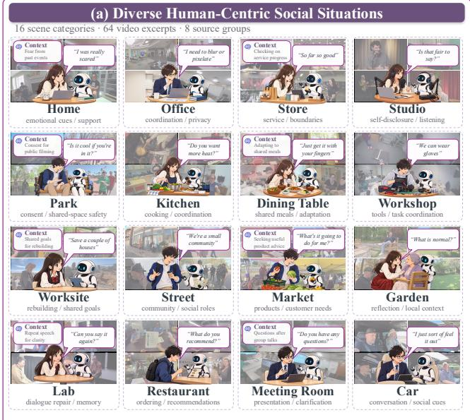

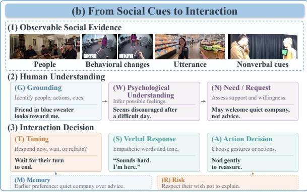

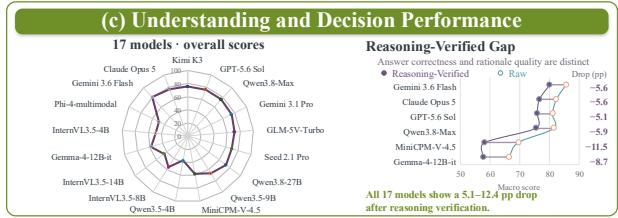  
Figure 1 Overview of PsycheMME. (a) Social situations involving people across 16 scene categories. (b) Eight diagnostic capabilities covering social cues, psychological understanding, interaction decisions, memory, and risk. (c) Overall results for 17 models, showing performance diferences and gaps after rationale verification.

Challenge 2: Psychological constructs and observable cues (Section 3.3). Mental states and support needs are latent. Questions must anchor interpretations in observable visual and conversational cues without unsupported attribution.

Challenge 3: Cue support beyond option matching (Section 3.5). Assessment must check cue support and logical consistency of explicit rationales, even when the selected option is correct.

To address these challenges, we introduce PsycheMME, a benchmark informed by psychology for multimodal evaluation of human understanding and interaction. Drawing on Social Information Processing [13] and the Perception-Action Cycle [21], we define eight diagnostic dimensions spanning perceptual grounding, psychological understanding, needs, interaction decisions, memory, and risk (Challenge 1). Independent answering with proposed references withheld and expert review ground psychological QA in observed cues (Challenge 2). Reasoning-Verified assesses answer correctness, rationale coverage, Evidence Support, and Logical Integrity, separating response success from justification quality (Challenge 3).

Our main contributions are as follows:

• A diagnostic benchmark informed by psychology. PsycheMME contains 1,000 questions from 630 episodes across eight capabilities: understanding (G, W, N), response selection (T, S, A), and contextual regulation (M, R).

• Independent curation and rationale scoring. Agent roles isolate independent answering from reference proposals, followed by unanimous expert review. Reasoning-Verified assesses explicit rationales for cue support and logical coherence alongside answer correctness.

• Diagnostic findings across 17 MLLMs. Weak or contradicted support labels occur in 49.74% of correct Timing answers, while open Need full credit rates difer by 40 percentage points between Gemini 3.6 Flash and Claude Opus 5. Voting, input, history, and SFT/GRPO analyses examine answer selection and adaptation.

## 2 Related Work

Table 1 Comparison with Existing Multimodal Benchmarks of Human Understanding and Interaction.
<table><tr><td>Benchmark</td><td>Videos/Clips</td><td>Prompt</td><td>Ego</td><td>G</td><td>W</td><td>N</td><td>T</td><td>S</td><td>A</td><td>M</td><td>R</td></tr><tr><td>HumanVideo-MME [7]</td><td>1,200</td><td>8,700</td><td>X</td><td>√</td><td>√</td><td>X</td><td>x</td><td>X</td><td>X</td><td>X</td><td>X</td></tr><tr><td>Social Genome [40]</td><td>272</td><td>1,486</td><td>X</td><td>√</td><td>√</td><td>x</td><td>X</td><td>X</td><td>X</td><td>X</td><td>X</td></tr><tr><td>Human Behavior Atlas [45]</td><td>35,046</td><td>101,964</td><td>X</td><td>●</td><td>√</td><td>x</td><td>X</td><td>X</td><td>X</td><td>X</td><td>X</td></tr><tr><td>HumanSense [50]</td><td></td><td>3,882</td><td>X</td><td>√</td><td>√</td><td>●</td><td>x</td><td>√</td><td>√</td><td>●</td><td>X</td></tr><tr><td>SIV-Bench [34]</td><td>2,792</td><td>5,455</td><td>X</td><td>√</td><td>√</td><td>X</td><td>X</td><td>X</td><td>X</td><td>X</td><td>X</td></tr><tr><td>R3-Bench [43]</td><td>312</td><td>4,840+316</td><td>X</td><td>√</td><td>√</td><td>●</td><td>X</td><td>X</td><td>X</td><td>x</td><td>X</td></tr><tr><td>ToM-Video [23]</td><td>4,666</td><td>41,206</td><td>X</td><td>√</td><td>√</td><td>●</td><td>X</td><td>X</td><td>X</td><td>X</td><td>X</td></tr><tr><td>MindPower [72]</td><td>590</td><td>590</td><td>X</td><td>√</td><td>√</td><td>√</td><td>x</td><td>X</td><td>√</td><td>X</td><td>X</td></tr><tr><td>SHREC [35]</td><td>~400</td><td></td><td>X</td><td>√</td><td>√</td><td>X</td><td>√</td><td>V</td><td>●</td><td>√</td><td>√</td></tr><tr><td>EgoPro-Bench [54]</td><td>2,400</td><td></td><td>√</td><td>X</td><td>√</td><td>√</td><td>√</td><td>√</td><td>X</td><td>V</td><td>X</td></tr><tr><td>RobotEQ-Video [9]</td><td>2,036</td><td></td><td>√</td><td>X</td><td>●</td><td>●</td><td>X</td><td>X</td><td>√</td><td>X</td><td>√</td></tr><tr><td>SocialReasonBench [29]</td><td>532</td><td>532</td><td>X</td><td>X</td><td>√</td><td>X</td><td>X</td><td>X</td><td>x</td><td>X</td><td>X</td></tr><tr><td>PsycheMME</td><td>630</td><td>1,000</td><td></td><td></td><td></td><td></td><td></td><td></td><td>√</td><td></td><td></td></tr></table>

Notes. G: Grounding; W: Psychological Understanding; N: Need; T: Interaction Timing; S: Verbal Response; A: Embodied Action; M: Memory; R: Risk. ✓ explicit; restricted; ✗ unestablished evaluation. Counts use each source’s reported video/clip/episode and question/instance units. ToM-Video reports 4,666 clips from 1,487 source videos. Human Behavior Atlas counts include all training, validation, and test samples across text, audio, and video. Criteria: Appendix A.

## 2.1 Multimodal Foundation Models

Multimodal Foundation Models extend learning from images and text [1] to video, audio, and reasoning over long contexts [62, 65]. Magma further connects multimodal understanding to action [66]. Beyond scene perception, PersonaVLM explores personalized memory, MindPower connects reasoning about human states to embodied actions, and FAMER addresses implicit user desires through communication and memory [42, 63, 72]. These systems motivate evaluation of how social observations, personal history, and inferred needs inform response choices.

## 2.2 Multimodal Benchmarks of Human Understanding and Interaction

Multimodal benchmarks assess understanding and interaction. PCA-Bench evaluates how perception and cognition inform action, localizing errors within this chain [10]; Human Behavior Atlas integrates psychological and social tasks [45]; HumanSense covers perception, contextual understanding, and empathetic responses [50]. Social Genome evaluates reasoning traces grounded in multimodal social cues [40]. Other benchmarks assess video understanding [12, 39, 48], embodied decision making [68], egocentric memory and assistance [15, 64, 67], human perception [7, 37], and social interaction and reasoning [23, 29, 30, 34, 35, 43]. EgoPro-Bench and LiveProBench examine interaction timing [19, 54], while related eforts assess social appropriateness [9], implicit norms [73], and embodied safety [69]. PsycheMME brings these judgments into a shared setting for video QA, distinguishing response timing, content, and action while assessing the support for explicit explanations.

## 2.3 Evaluation Informed by Psychology

Models of afect, Theory of Mind (ToM), and social cognition in direct interaction inform the assessment of human states [49, 56, 60]. Social Information Processing (SIP) links cue encoding and interpretation to goal clarification and response selection [13]. Research on empathy, interpersonal emotion regulation, and matching support to circumstances informs response assessment [14, 16, 71]. FANToM, EmoBench, and ToMBench adapt psychological constructs for model evaluation [11, 31, 58]. These perspectives inform PsycheMME’s task definitions; its rubric for cue support and logic links answer credit to contextually supported explanations. LLM judges and evaluation with rubrics assess open responses using explicit criteria [36, 74].

Prefers solving problems together.

Initial proposal Offer to work together.

## 3 Methodology

## 3.1 Task Formulation

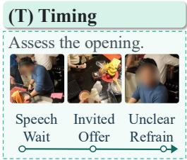

## (S) Verbal Response

Candidate replies Initial offer “That sounds hard. Want to look together?”

After refusal “Sure. Let me know if you need me.”

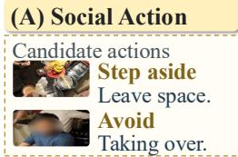

Empathetic Interaction from an Egocentric View  
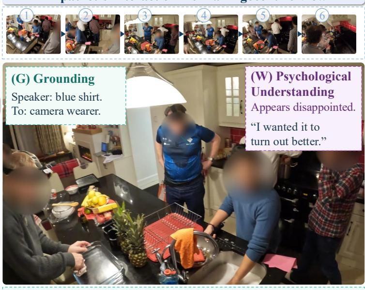  
(N) Need Inference  
Reassurance may help.  
Hands-on help is not requested.

## (M) Memory


After the offer “Let me try first.”

Candidate decision Respect the refusal. Do not take over.

Figure 2 Illustrative scenarios and capabilities in PsycheMME. The benchmark spans human understanding, interaction decisions, memory, and social constraints. The illustrated scene is adapted from CASTLE [55].

PsycheMME evaluates how models perceive social cues, infer mental states, and select responses in recorded interactions. Each question targets an observation, interpretation, or response choice grounded in the supplied context. Given multimodal observations X, question $q ,$ and optional interaction history $h ,$ the model predicts

$$
( \hat { y } , \hat { \rho } ) = f _ { \theta } ( X , q , h ) ,\tag{1}
$$

where $\hat { y }$ is the answer and $\hat { \rho }$ contains structured rationales associated with eight capabilities: Grounding (G), Psychological Understanding (W), Need (N), Timing (T), Verbal Response (S), Action (A), Memory (M), and Risk (R) (Section 3.2).

## 3.2 Capability Taxonomy Informed by Psychology

Social Information Processing [13] and the Perception-Action Cycle [21] motivate three diagnostic domains (Fig. 2): human understanding (G, W, N), interaction decisions (T, S, A), and context and constraints (M, R). Detailed definitions and requirements for observed cues appear in Appendix B.

Perceptually Grounded Mentalizing. Social Grounding (G) associates speech, gaze, gestures, and actions with participants and interaction relations. Psychological Understanding (W) uses multimodal cues and context to infer psychological states, possible causes, and changes. Need Inference (N) identifies desired support, distinguishing explicit requests, inferred needs, and willingness to receive help [4, 14].

Situated Empathic Responding. Interaction Timing and Attunement (T) judges whether and when to respond, wait, listen, or refrain [59]. Empathic Verbal Responding (S) selects response content, strategy, and tone [14, 16, 71]. Embodied Social Action (A) selects physical or nonverbal behavior appropriate to the person’s state, need, and context.

Contextual and Normative Modulation. Interaction and Profile Memory (M) applies prior exchanges and individual preferences to current judgments [42]. Risk, Boundary, and Autonomy Regulation (R) assesses potential harm, drawing on embodied safety evaluation [69], and additionally considers consent, boundaries, and autonomy in proposed interventions [5, 57].

## 3.3 Scalable Benchmark Construction

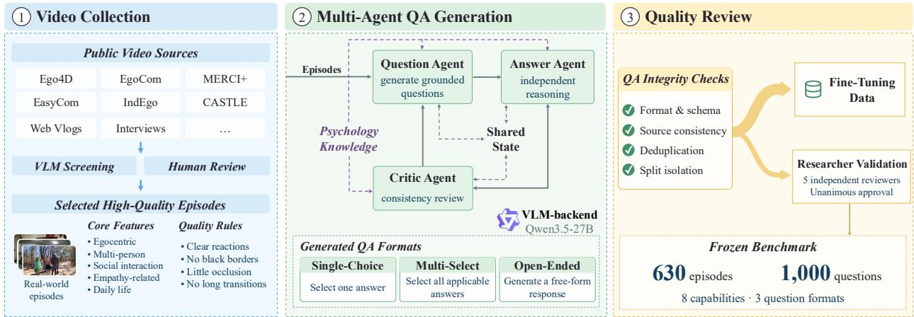  
Figure 3 Question construction framework of PsycheMME. Video curation, independent agent answers with proposed answers withheld, verification, iterative refinement, and human quality control.

Video Collection. We collect videos of social interactions from six public datasets (Ego4D [27], EgoCom [44], MERCI+ (the extended MERCI release [2]), CASTLE [55], EasyCom [17], and IndEgo [8]) and public vlogs, interviews, and recordings of daily life. Human screening assisted by VLMs retains clips with observable social cues and adequate visual quality.

Multi-Agent QA Generation. The question construction framework in Fig. 3 combines question generation, independent answering, verification, and refinement. Separating question proposal from independent answering reduces the risk of accepting a proposal based on its own justification. The Question Agent proposes a question, candidate answer, options where applicable, and supporting cues. The Answer Agent examines the video again using only the question, options, and public context, without access to the proposed answer, cues, or private rationale. It independently answers or flags ambiguity and insuficient support. The Critic Agent checks both paths for answerability, cue support, and logical coherence. Proposal defects return to the Question Agent; reasoning defects trigger another examination. Psychology Knowledge guides the agents construct alignment and inference boundaries; items failing after two refinement rounds are discarded. A Shared State with access control based on agent roles enforces information isolation and tracks verification feedback, refinement history, and taxonomy coverage to guide generation toward underrepresented capabilities (Appendix C.2).

Quality Review. For benchmark construction, five researchers with psychology backgrounds independently review question validity, answer correctness, and psychological consistency. Only unanimously approved items enter the frozen benchmark. Data for fine tuning are separately filtered and kept disjoint from benchmark items.

## 3.4 Benchmark Composition and Statistics

PsycheMME contains 1,000 questions from 630 episodes across eight capabilities: 890 choice questions and 110 open questions. Choice questions include selection of one or several options; option letters identify candidates within each question. Uneven capability counts motivate macro averaging; distributions appear in Fig. 4 and Appendix C.1.

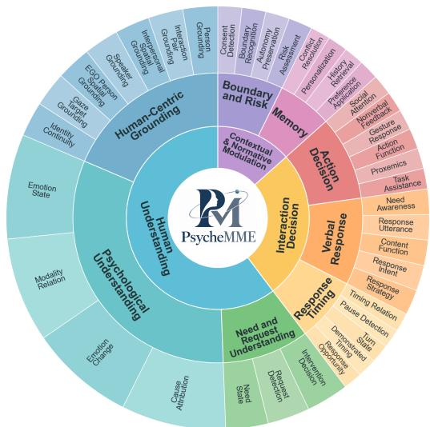  
(a) Taxonomy

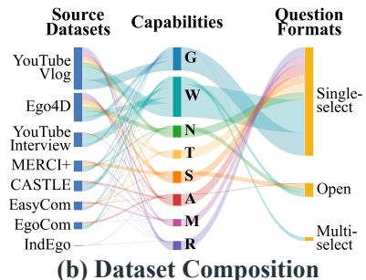

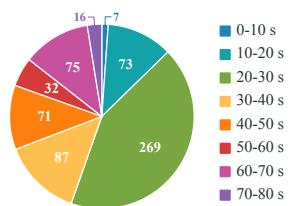  
(c) Video Duration

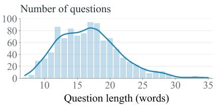  
(d) Question Length

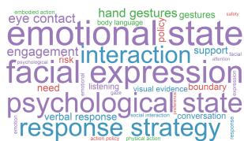  
(e) Keywords  
Figure 4 PsycheMME statistics. (a) Eight capabilities and their subcategories. (b) Question distribution across source groups, capabilities, and formats. (c) Distribution of video durations. (d) Distribution of question lengths in words. (e) Frequent keywords in benchmark questions.

## 3.5 Evaluation Protocol

We report Raw Answer and Reasoning-Verified scores. Choice answers match the reference option or complete option set exactly; a fixed semantic judge evaluates open answers. Reasoning-Verified additionally considers rationale coverage, support from reference cues, and logical integrity:

$$
s _ { i } = a _ { i } c _ { i } e _ { i } \ell _ { i } / \lambda ^ { 2 } ,\tag{2}
$$

where $a _ { i } \in [ 0 , 1 ]$ denotes answer correctness, $c _ { i } \in \{ 0 , 1 \}$ indicates an informative rationale, and $e _ { i } , \ell _ { i } \in [ 0 , \lambda ]$ measure support from reference cues and logical integrity, respectively. With $\lambda = 1 . 2$ , full Verified credit requires a correct answer, an informative rationale, strong cue support, and fully coherent logic $( e _ { i } = \ell _ { i } = 1 . 2 )$ Normal support and acceptable logic $( e _ { i } = \ell _ { i } = 1 . 0 ) $ receive $1 / 1 . 4 4 \approx 6 9 . 4 4 \%$ credit. The rubric grades justification quality beyond answer correctness. Both metrics are macro averages across eight capabilities (Appendices D.4 and D.5).

## 3.6 SFT and GRPO on PsycheMME

We apply SFT followed by GRPO to Qwen3.5-4B using LoRA [28] on the language backbone, with the visual encoder and multimodal aligner frozen. SFT trains for one epoch on 3,657 video QA examples with 32 sampled frames, ASR, and available interaction history. Targets contain the answer and one annotated observation; other rationale fields are null. Training uses AdamW [38].

GRPO [61] starts from SFT and samples eight responses per question from 2,842 single-choice examples. Its binary reward requires a correct answer that satisfies the specified response requirements:

$$
r ( o ) = \mathbf { 1 } [ \mathrm { c o r r e c t } ( o ) ] \cdot \mathbf { 1 } [ \mathrm { v a l i d } ( o ) ] ,\tag{3}
$$

We use clipped GRPO with advantages normalized within each group and KL regularization against the fixed SFT reference, excluding groups with zero variance following the filtering criterion used in DAPO [70]. Training performs 32 updates over 256 distinct questions. Reasoning verification is used only for evaluation; details appear in Appendix E.

## 4 Experiments

## 4.1 Experimental Setup

Models and Protocol. We evaluate 17 frozen MLLMs: 8 proprietary and 9 open-weight models (Table 2), on the same 1,000 questions without adaptation to the benchmark. A common input policy uses each model’s supported media interface: native video and native audio take priority, with sampled frames (1 FPS, at most 64) and ASR as the respective fallbacks. Memory questions include relevant history. Input details and separately evaluated SFT/GRPO checkpoints appear in Appendices D.1 and E.

Metrics and Scoring. Models produce an answer and structured rationales. Raw Answer measures correctness; Reasoning-Verified additionally considers rationale coverage, cue support, and logical integrity. Both use macro averaging across eight capabilities. Closed answers use deterministic matching; Qwen3.8- 27B judges open answers and rationales. Scoring and paired bootstrap procedures over episodes appear in Appendix D.5.

## 4.2 Main Results

Table 2 Main results on PsycheMME (%). We report 17 frozen models and two adapted checkpoints. Raw and Ver. are macro scores across eight capabilities; capability columns report Verified scores. Colors mark the top five scores in each column and model group. Bold names mark the adapted Qwen3.5-4B checkpoints.
<table><tr><td rowspan="2">Model</td><td colspan="2">Overall</td><td colspan="3">Understanding</td><td colspan="3">Interaction</td><td colspan="2">Contextual</td></tr><tr><td>Raw</td><td>Ver.</td><td>G</td><td>W</td><td>N</td><td>T</td><td>S</td><td>A</td><td>M</td><td>R</td></tr><tr><td colspan="9">Proprietary Models</td><td></td></tr><tr><td>Gemini 3.6 Flash [26]</td><td>85.68</td><td>80.03</td><td>91.76</td><td>79.68</td><td>69.97</td><td>47.81</td><td>79.32</td><td>89.58</td><td>90.92</td><td>91.21</td></tr><tr><td>Claude Opus 5 [3]</td><td>82.34</td><td>76.71</td><td>89.31</td><td>77.80</td><td>69.10</td><td>40.70</td><td>79.18</td><td>86.24</td><td>86.56</td><td>84.82</td></tr><tr><td>GPT-5.6 Sol [46]</td><td>81.09</td><td>75.98</td><td>92.13</td><td>78.75</td><td>67.28</td><td>32.99</td><td>74.86</td><td>84.25</td><td>91.11</td><td>86.47</td></tr><tr><td>Qwen3.8-Max [53]</td><td>81.48</td><td>75.59</td><td>90.87</td><td>77.61</td><td>69.17</td><td>39.33</td><td>72.84</td><td>82.46</td><td>84.48</td><td>87.94</td></tr><tr><td>Kimi K3 [33]</td><td>80.60</td><td>75.35</td><td>91.52</td><td>76.11</td><td>60.62</td><td>38.82</td><td>79.38</td><td>84.28</td><td>85.17</td><td>86.87</td></tr><tr><td>Gemini 3.1 Pro [25]</td><td>81.36</td><td>74.33</td><td>91.30</td><td>76.26</td><td>60.29</td><td>44.71</td><td>68.22</td><td>76.80</td><td>90.49</td><td>86.57</td></tr><tr><td>GLM-5V-Turbo [24]</td><td>78.40</td><td>71.19</td><td>89.18</td><td>76.72</td><td>61.82</td><td>34.23</td><td>68.14</td><td>79.87</td><td>76.23</td><td>83.37</td></tr><tr><td>Seed 2.1 Pro [6]</td><td>76.37</td><td>69.67</td><td>88.53</td><td>76.87</td><td>53.24</td><td>32.93</td><td>63.27</td><td>78.09</td><td>82.42</td><td>81.98</td></tr><tr><td colspan="9">Open-weight Models</td><td></td></tr><tr><td colspan="9">Model Size &gt; 8B</td></tr><tr><td>Qwen3.8-27B [51]</td><td>79.97</td><td>72.74</td><td>90.93</td><td>80.53</td><td>66.96</td><td>28.58</td><td>68.87</td><td>83.01</td><td>77.77</td><td>85.27</td></tr><tr><td>Qwen3.5-9B [52]</td><td>76.54</td><td>66.45</td><td>90.24</td><td>76.86</td><td>54.66</td><td>29.13</td><td>62.63</td><td>73.45</td><td>68.14</td><td>76.52</td></tr><tr><td>Gemma-4-12B-it [22]</td><td>66.41</td><td>57.75</td><td>79.48</td><td>71.19</td><td>46.41</td><td>13.49</td><td>49.43</td><td>62.32</td><td>65.07</td><td>74.58</td></tr><tr><td>InternVL3.5-14B [62]</td><td>52.24</td><td>44.68</td><td>63.36</td><td>56.63</td><td>19.90</td><td>15.63</td><td>34.05</td><td>45.10</td><td>59.53</td><td>63.22</td></tr><tr><td colspan="9">4B &lt; Model Size ≤ 8B</td><td></td><td></td></tr><tr><td>MiniCPM-V4.5 [47]</td><td>69.65</td><td>58.13</td><td>81.26</td><td></td><td>33.81</td><td></td><td></td><td></td><td></td><td></td></tr><tr><td>InternVL3.5-8B [62]</td><td>67.41</td><td>55.41</td><td>72.30</td><td>70.63 64.39</td><td>35.38</td><td>24.32</td><td>50.08</td><td>62.45</td><td>65.40</td><td>77.13 68.67</td></tr><tr><td>Phi-4-multimodal [41]</td><td>61.03</td><td>48.63</td><td>52.50</td><td>50.32</td><td>22.14</td><td>20.65 20.85</td><td>50.37 45.96</td><td>59.32 58.17</td><td>72.20 64.63</td><td>74.44</td></tr><tr><td colspan="9">Model Size ≤ 4B</td><td></td><td></td></tr><tr><td>Qwen3.5-4B (SFT+GRPO)</td><td>73.19</td><td>52.62</td><td>83.43</td><td>67.75</td><td>37.64</td><td>17.24</td><td>47.68</td><td>60.82</td><td>46.53</td><td>59.86</td></tr><tr><td>Qwen3.5-4B (SFT)</td><td>72.58</td><td>52.13</td><td>82.73</td><td>67.83</td><td>36.92</td><td>15.16</td><td>48.02</td><td>59.38</td><td>47.45</td><td>59.59</td></tr><tr><td>InternVL3.5-4B [62]</td><td>61.30</td><td>48.97</td><td>72.46</td><td>60.06</td><td>26.90</td><td>21.61</td><td>37.44</td><td>47.00</td><td>63.74</td><td>62.54</td></tr><tr><td>Qwen3.5-4B [52]</td><td>47.68</td><td>37.71</td><td>60.70</td><td>46.49</td><td>34.18</td><td>23.17</td><td>24.02</td><td>35.85</td><td>33.61</td><td>43.66</td></tr></table>

Table 2 shows that Gemini 3.6 Flash leads overall (85.68/80.03 Raw/Verified), while Qwen3.8-27B leads open-weight models (79.97/72.74). Figure 5 summarizes capability profiles and verification losses.

(1) Timing is difficult to answer and justify. Timing has the lowest Verified score and credit retention (Verified/Raw) for all 17 models; the retention pattern persists on single-choice questions. Even among 569 correct Timing responses, 283 receive weak or contradicted Evidence Support labels (49.74%), compared with

7.62% of other correct single-choice responses. The diference is 42.12 percentage points (95% CI [33.37, 51.50];   
Appendix G).

(2) Similar Need scores accompany different answer completeness. Gemini 3.6 Flash and Claude Opus 5 have similar Need Verified scores (69.97/69.10). Flash leads on choice questions (81.31/70.95 Verified), whereas Claude leads on open questions (78.57/57.14 Raw).

On the 35 open Need questions, Flash and Claude receive full credit on 28.57/68.57% of items, despite similar rates of nonzero credit (85.71/88.57%). This diference of 40.00 percentage points in full credit accounts for 20.00 of their 21.43 point Raw gap under the 0/0.5/1 rubric. Across all 110 open questions, 38 receive full answer credit from both models; Flash has higher mean Verified credit on these questions (97.15 versus 90.42). Answer completeness and rationale quality thus favor diferent models (Appendix G).

(3) Complementary answers do not ensure reliable consensus. On Timing, the eight proprietary models ofer 91.67% oracle coverage, compared with 66.67% accuracy for the best model; plurality voting reaches only 57.64% with uniform tie breaking. At least five models select the same wrong option on 21 questions; 18 nevertheless contain a correct candidate. Shared wrong choices can outvote correct minority candidates. Voting details and paired intervals appear in Appendix H.

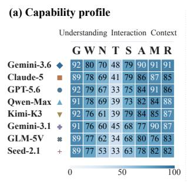

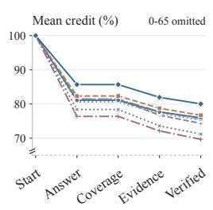

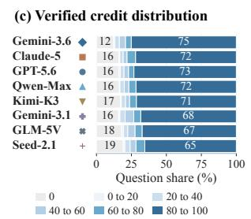

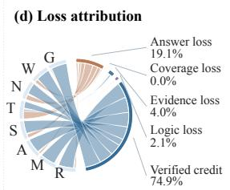  
Figure 5 Performance breakdown. Performance by capability, verification stages, score distributions, and loss attribution.

In Figure 6, Gemini uses cues from the wrong time window to justify a correct strategy; GPT selects a later intervention boundary. Claude misses a stated preference; Qwen substitutes a diferent goal.

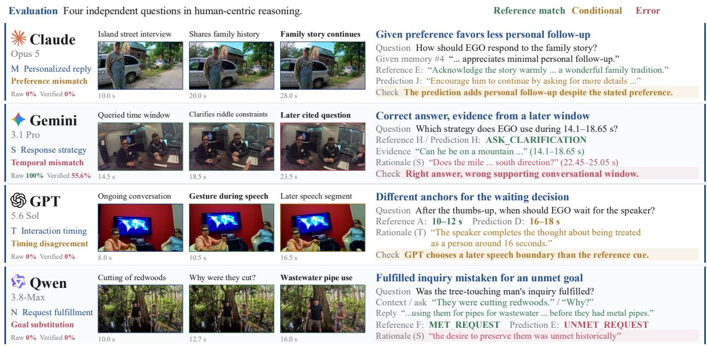  
Figure 6 Illustrative model responses in PsycheMME. The cases illustrate preference mismatch, temporal cue mismatch, disagreement about interaction timing, and goal substitution.

Table 3 Ablation studies on PsycheMME (%). Green indicates gains over Question-only; ∆ denotes gains over baselines. (Appendix I).
<table><tr><td></td><td colspan="2">Qwen3.5-9B</td><td colspan="2">MiniCPM-V4.5</td></tr><tr><td>Input</td><td>Raw</td><td>Ver.</td><td>Raw</td><td>Ver.</td></tr><tr><td colspan="5">Modality controls</td></tr><tr><td>Question-only</td><td>64.04</td><td>57.05</td><td>57.22</td><td>49.93</td></tr><tr><td>ASR-only</td><td>67.04</td><td>57.75</td><td>60.05</td><td>49.36</td></tr><tr><td>Visual-only</td><td>73.44</td><td>65.50</td><td>65.67</td><td>55.56</td></tr><tr><td>Full</td><td>76.54+12.50</td><td>66.45+9.40</td><td>69.65+12.43</td><td>58.13+8.20</td></tr><tr><td>∆ vs. ASR-only</td><td>+9.50</td><td>+8.70</td><td>+9.60</td><td>+8.77</td></tr><tr><td>∆ vs. Visual-only</td><td>+3.10</td><td>+0.95</td><td>+3.98</td><td>+2.57</td></tr><tr><td colspan="5">Frame control</td></tr><tr><td>Single-image</td><td>72.28</td><td>61.78</td><td>66.16</td><td>54.99</td></tr></table>

Table 4 Memory intervention (%). Green superscripts show gains over No History (points); Mismatched History averages three seeds.
<table><tr><td>History Condition</td><td>Raw↑</td><td>Ver. ↑</td></tr><tr><td>No History</td><td>42.50</td><td>25.28</td></tr><tr><td>Mismatched History</td><td>45.00</td><td>23.87</td></tr><tr><td>Matched History</td><td>82.50 +40.00</td><td>74.55 +49.27</td></tr></table>

Table 5 Human baseline (%). Five annotators independently answer 300 randomly sampled questions.
<table><tr><td>Annotators</td><td>Questions</td><td>Micro ↑</td><td>Macro ↑</td></tr><tr><td>5</td><td>300</td><td>85.27</td><td>84.82</td></tr></table>

## 4.3 Ablations and Validity Analysis

Multimodal Cues. Full video and ASR improve Raw scores over Question-only by 12.50/12.43 points for Qwen3.5-9B/MiniCPM-V4.5 (Table 3). Visual-only retains most Full accuracy; adding ASR gives another 3.10/3.98 points. Removing video (ASR-only) reduces Grounding by 30.65/45.16 Raw points. Using a single midpoint image reduces Qwen’s Grounding by 12.63 points and Timing by 8.33 points (Appendix I).

Historical Context. On 40 Memory questions, matched history raises Qwen3.5-9B Raw/Verified from 42.50/25.28 to 82.50/74.55, while mismatched history averages 45.00/23.87 (Table 4). The gains depend on relevant history; results for each seed appear in Appendix J.

Task Adaptation. Qwen3.5-4B improves from 47.68/37.71 Raw/Verified macro scores to 72.58/52.13 after SFT and 73.19/52.62 after SFT+GRPO (Table 2). Gains vary by capability: SFT raises Grounding and Risk Raw scores by 27.96/27.40 points, but Timing falls from 40.28 to 31.94 and recovers only to 34.72 after GRPO (Table 13). GRPO adds 0.61 Raw and 0.49 Verified points, leaving a gap of 20.57 points between Raw and Verified. These results leave temporal grounding and rationale quality unresolved.

Human Baseline. Five annotators independently answer 300 randomly sampled questions (1,500 responses), achieving 85.27% Raw micro and 84.82% macro accuracy (Table 5). Timing accuracy is 79.43% on this sample (Appendix K).

Human-Judge Agreement. Five psychology experts independently review 300 randomly sampled Judge cases: 1,352 of 1,500 assessments endorse the presented decisions (90.13%; Appendix L). Weight sensitivity analysis supports the Timing retention finding (Appendix G.4).

## 5 Conclusion

PsycheMME unifies eight capabilities informed by psychology in a benchmark of 1,000 questions grounded in video. Its evaluation protocol assesses answers alongside support from reference cues and the logical integrity of explicit rationales. Across 17 models, Timing remains dificult, similar Need scores accompany diferences in answer completeness, and voting can override correct minority answers. Input and history controls re veal contextual dependence. These findings describe behavior by capability and justification quality beyond aggregate accuracy. The resulting diagnostics support comparisons of human understanding and interaction judgments while exposing how answer completeness and rationale support shape reported performance. The benchmark can guide future improvements in answer completeness, temporal grounding, and response selection informed by context.

## Limitations

PsycheMME evaluates human-centered reasoning in recorded social interactions; real-time interactive settings remain unevaluated. While the benchmark covers diverse scenarios, its evaluation remains bounded by the represented social and cultural contexts. Future work could expand contextual and cultural diversity, explore streaming and interactive evaluation, and incorporate more fine-grained human assessments of explanation quality.

## References

[1] Jean-Baptiste Alayrac, Jef Donahue, Pauline Luc, Antoine Miech, Iain Barr, Yana Hasson, Karel Lenc, et al. Flamingo: A visual language model for few-shot learning. In Advances in Neural Information Processing Systems, pages 23716–23736, 2022. https://proceedings.neurips.cc/paper\_files/paper/2022/hash/ 960a172bc7fbf0177ccccbb411a7d800-Abstract-Conference.html. 1, 3

[2] Mohammed Althubyani, Zhijin Meng, et al. MERCI: A multimodal dataset for personalised and emotionallyaware dialogues. In International Conference on Content-Based Multimedia Indexing, 2025. https://www. cbmi2025.org/papers/188/. 5, 19

[3] Anthropic. System card: Claude Opus 5. Anthropic, July 2026. https://www.anthropic.com/ claude-opus-5-system-card. 7

[4] Niall Bolger, Adam Zuckerman, and Ronald C. Kessler. Invisible support and adjustment to stress. Journal of Personality and Social Psychology, 79(6):953–961, 2000. doi: 10.1037/0022-3514.79.6.953. 4

[5] Penelope Brown and Stephen C. Levinson. Politeness: Some universals in language usage. Cambridge University Press, 1987. doi: 10.1017/CBO9780511813085. 5

[6] ByteDance Seed Team. Seed2.1: A next-generation agent for real-world productivity. ByteDance Seed, 2026. https://seed.bytedance.com/en/seed2\_1. 7

[7] Yuxuan Cai, Jiangning Zhang, Zhenye Gan, Qingdong He, Xiaobin Hu, Junwei Zhu, Yabiao Wang, Chengjie Wang, Zhucun Xue, Chaoyou Fu, Xinwei He, and Xiang Bai. HumanVideo-MME: Benchmarking MLLMs for human-centric video understanding. arXiv preprint arXiv:2507.04909, 2025. https://arxiv.org/abs/2507.04909. 1, 3

[8] Vivek Chavan, Yasmina Imgrund, Tung Dao, Sanwantri Bai, Bosong Wang, Ze Lu, Oliver Heimann, and Jörg Krüger. IndEgo: A dataset of industrial scenarios and collaborative work for egocentric assistants. In Advances in Neural Information Processing Systems, Datasets and Benchmarks Track, 2025. https://arxiv.org/abs/2511. 19684. 5, 19

[9] Xinyi Che, Zheng Lian, Kuofei Fang, Xuehao Wang, Xinghai Gao, Junqing Wu, Chuyu Wu, Liyi Liu, Yanhan Huang, Keyi Xie, Haomin Ouyang, Jinyang Wu, Fan Zhang, Runhao Zeng, Xun Yang, and Bin He. RobotEQ-Video: A video-centric benchmark for social proactive intelligence with world-state taxonomy. arXiv preprint arXiv:2609.21371, 2026. https://arxiv.org/abs/2609.21371. 3

[10] Liang Chen, Yichi Zhang, Shuhuai Ren, Haozhe Zhao, Zefan Cai, Yuchi Wang, Peiyi Wang, Xiangdi Meng, Tianyu Liu, and Baobao Chang. PCA-bench: Evaluating multimodal large language models in perceptioncognition-action chain. In Findings of the Association for Computational Linguistics: ACL 2024, pages 1086–1104. Association for Computational Linguistics, 2024. doi: 10.18653/v1/2024.findings-acl.64. https://aclanthology. org/2024.findings-acl.64/. 3

[11] Zhuang Chen, Jincenzi Wu, Jinfeng Zhou, Bosi Wen, Guanqun Bi, Gongyao Jiang, Yaru Cao, Mengting Hu, Yunghwei Lai, Zexuan Xiong, and Minlie Huang. ToMBench: Benchmarking theory of mind in large language models. In Annual Meeting of the Association for Computational Linguistics, pages 15959–15983, 2024. https: //aclanthology.org/2024.acl-long.847/. 3

[12] Sijie Cheng, Zhicheng Guo, Jingwen Wu, Kechen Fang, Peng Li, Huaping Liu, and Yang Liu. EgoThink: Evaluating first-person perspective thinking capability of vision-language models. In IEEE/CVF Conference on Computer Vision and Pattern Recognition, pages 14291–14302, 2024. https://openaccess.thecvf.com/content/CVPR2024/html/Cheng\_EgoThink\_Evaluating\_First-Person\_ Perspective\_Thinking\_Capability\_of\_Vision-Language\_Models\_CVPR\_2024\_paper.html. 3

[13] Nicki R. Crick and Kenneth A. Dodge. A review and reformulation of social information-processing mechanisms in children’s social adjustment. Psychological Bulletin, 115(1):74–101, 1994. doi: 10.1037/0033-2909.115.1.74. https://doi.org/10.1037/0033-2909.115.1.74. 2, 3, 4, 17

[14] Carolyn E. Cutrona and Julie A. Suhr. Controllability of stressful events and satisfaction with spouse support behaviors. Communication Research, 19(2):154–174, 1992. doi: 10.1177/009365092019002002. https://doi.org/ 10.1177/009365092019002002. 3, 4, 18

[15] Ronghao Dang, Yuqian Yuan, Wenqi Zhang, Yifei Xin, Boqiang Zhang, Long Li, Liuyi Wang, Qinyang Zeng, Xin Li, and Lidong Bing. ECBench: Can multi-modal foundation models understand the egocentric world? a holis tic embodied cognition benchmark. In IEEE/CVF Conference on Computer Vision and Pattern Recognition,

pages 24593–24602, 2025. https://openaccess.thecvf.com/content/CVPR2025/html/Dang\_ECBench\_Can\_ Multi-modal\_Foundation\_Models\_Understand\_the\_Egocentric\_World\_A\_CVPR\_2025\_paper.html. 1, 3

[16] Mark H. Davis. Measuring individual diferences in empathy: Evidence for a multidimensional approach. Journal of Personality and Social Psychology, 44(1):113–126, 1983. doi: 10.1037/0022-3514.44.1.113. https://doi.org/10. 1037/0022-3514.44.1.113. 3, 4, 17

[17] Jacob Donley, Vladimir Tourbabin, Jung-Suk Lee, Mark Broyles, Hao Jiang, Jie Shen, Maja Pantic, Vamsi Krishna Ithapu, and Ravish Mehra. EasyCom: An augmented reality dataset to support algorithms for easy communication in noisy environments. arXiv preprint arXiv:2107.04174, 2021. https://arxiv.org/abs/2107.04174. 5, 19

[18] Danny Driess, Fei Xia, Mehdi S. M. Sajjadi, Corey Lynch, Aakanksha Chowdhery, Brian Ichter, Ayzaan Wahid, et al. PaLM-E: An embodied multimodal language model. In International Conference on Machine Learning, pages 8469–8488, 2023. https://proceedings.mlr.press/v202/driess23a.html. 1

[19] Kaixuan Du, Xin Wan, Hang Zhang, Meng Cao, Dai Guan, Ming Chen, and YuKun Wang. LiveProBench: Can streaming video models really interact like humans? arXiv preprint arXiv:2609.12658, 2026. https://arxiv.org/ abs/2609.12658. 3

[20] Yilun Du, Shuang Li, Antonio Torralba, Joshua B. Tenenbaum, and Igor Mordatch. Improving factuality and reasoning in language models through multiagent debate. In International Conference on Machine Learning, volume 235, pages 11733–11763. PMLR, 2024. https://proceedings.mlr.press/v235/du24e.html. 19

[21] Joaquín M. Fuster. Upper processing stages of the perception-action cycle. Trends in Cognitive Sciences, 8(4): 143–145, 2004. doi: 10.1016/j.tics.2004.02.004. https://doi.org/10.1016/j.tics.2004.02.004. 2, 4, 17

[22] Gemma Team. Gemma 4 technical report. arXiv preprint arXiv:2607.02770, 2026. https://arxiv.org/abs/2607. 02770. 7

[23] Geumado. ToM-Video: A theory-of-mind video benchmark with spatio-temporal grounded reasoning. GitHub project repository, 2026. https://github.com/Geumado/ToM-Video. Repository maintained by Geumado. Ac cessed 13 October 2026. 3

[24] GLM-5V-Turbo Team. GLM-5V-Turbo: Toward a native foundation model for multimodal agents. arXiv preprint arXiv:2604.26752, 2026. https://arxiv.org/abs/2604.26752. 7

[25] Google DeepMind. Gemini 3.1 Pro: Model card. Google DeepMind, February 2026. https://deepmind.google/ models/model-cards/gemini-3-1-pro/. 7

[26] Google DeepMind. Gemini 3.6 Flash: Model card. Google DeepMind, July 2026. https://deepmind.google/ models/model-cards/gemini-3-6-flash/. 7

[27] Kristen Grauman, Andrew Westbury, Eugene Byrne, Zachary Chavis, Antonino Furnari, Rohit Girdhar, Jackson Hamburger, et al. Ego4D: Around the world in 3,000 hours of egocentric video. In IEEE/CVF Conference on Computer Vision and Pattern Recognition, pages 18995–19012, 2022. https://openaccess.thecvf.com/content/CVPR2022/html/Grauman\_Ego4D\_Around\_the\_World\_in\_ 3000\_Hours\_of\_Egocentric\_Video\_CVPR\_2022\_paper.html. 1, 5, 19

[28] Edward J. Hu, Yelong Shen, Phillip Wallis, Zeyuan Allen-Zhu, Yuanzhi Li, Shean Wang, Lu Wang, and Weizhu Chen. LoRA: Low-rank adaptation of large language models. In International Conference on Learning Representations, 2022. https://openreview.net/forum?id=nZeVKeeFYf9. 6

[29] Zheyu Huang, Zijing Shi, Haozhe Luo, Huadong Tang, Mingyu Liu, Meng Fang, and Ling Chen. SocialReasonBench: A Video-QA benchmark for social reasoning with counterfactual narrative videos. arXiv preprint arXiv:2608.30716, 2026. https://arxiv.org/abs/2608.30716. 3, 17

[30] Chuanyang Jin, Yutong Wu, Jing Cao, Jiannan Xiang, Yen-Ling Kuo, Zhiting Hu, Tomer Ullman, Antonio Torralba, Joshua Tenenbaum, and Tianmin Shu. MMToM-QA: Multimodal theory of mind question answering. In Annual Meeting of the Association for Computational Linguistics, pages 16077–16102, 2024. https://aclanthology. org/2024.acl-long.851/. 3

[31] Hyunwoo Kim, Melanie Sclar, Xuhui Zhou, Ronan Le Bras, Gunhee Kim, Yejin Choi, and Maarten Sap. FANToM: A benchmark for stress-testing machine theory of mind in interactions. In Conference on Empirical Methods in Natural Language Processing, pages 14397–14413, 2023. https://aclanthology.org/2023.emnlp-main.890/. 3

[32] Moo Jin Kim, Karl Pertsch, Siddharth Karamcheti, Ted Xiao, Ashwin Balakrishna, Suraj Nair, Rafael Rafailov, Ethan P. Foster, Pannag R. Sanketi, Quan Vuong, Thomas Kollar, Benjamin Burchfiel, Russ Tedrake, Dorsa Sadigh, Sergey Levine, Percy Liang, and Chelsea Finn. OpenVLA: An open-source vision-language-action model. In Conference on Robot Learning, volume 270 of Proceedings of Machine Learning Research, pages 2679–2713. PMLR, 2025. https://proceedings.mlr.press/v270/kim25c.html. 1

[33] Kimi Team. Kimi K3: Open frontier intelligence. arXiv preprint arXiv:2607.24653, 2026. https://arxiv.org/abs/ 2607.24653. 7

[34] Fanqi Kong, Weiqin Zu, Xinyu Chen, Yaodong Yang, Song-Chun Zhu, and Xue Feng. SIV-Bench: A video benchmark for social interaction understanding and reasoning. In Findings of the Association for Computational Linguistics: ACL 2026, pages 37379–37403, 2026. doi: 10.18653/v1/2026.findings-acl.1863. https://aclanthology. org/2026.findings-acl.1863/. 1, 3

[35] Dong Won Lee, Yubin Kim, Sooyeon Jeong, Denison Guvenoz, Parker Malachowsky, Louis-Philippe Morency, Cynthia Breazeal, and Hae Won Park. Social Human Robot Embodied Conversation (SHREC) Dataset: Benchmarking foundational models’ social reasoning. In Robotics: Science and Systems, 2026. doi: 10.15607/RSS.2026. XXII.113. https://doi.org/10.15607/RSS.2026.XXII.113. 3

[36] Yang Liu, Dan Iter, Yichong Xu, Shuohang Wang, Ruochen Xu, and Chenguang Zhu. G-Eval: NLG evaluation using GPT-4 with better human alignment. In Conference on Empirical Methods in Natural Language Processing, pages 2511–2522. Association for Computational Linguistics, 2023. doi: 10.18653/v1/2023.emnlp-main.153. https: //aclanthology.org/2023.emnlp-main.153/. 3

[37] Yuansen Liu, Haiming Tang, Jinlong Peng, Jiangning Zhang, Xiaozhong Ji, Qingdong He, Donghao Luo, Zhenye Gan, Junwei Zhu, Yunhang Shen, Chaoyou Fu, Chengjie Wang, Xiaobin Hu, and Shuicheng Yan. Human-MME: A holistic evaluation benchmark for human-centric multimodal large language models. In International Conference on Learning Representations, pages 101698–101736, 2026. https://proceedings.iclr.cc/paper\_files/paper/2026/ hash/a69d7f3a1340d55c720e572742439eaf-Abstract-Conference.html. 1, 3

[38] Ilya Loshchilov and Frank Hutter. Decoupled weight decay regularization. In International Conference on Learning Representations, 2019. https://openreview.net/forum?id=Bkg6RiCqY7. 6

[39] Karttikeya Mangalam, Raiymbek Akshulakov, and Jitendra Malik. EgoSchema: A diagnostic benchmark for very long-form video language understanding. In Advances in Neural Information Processing Systems, pages 46212–46244, 2023. https://proceedings.neurips.cc/paper\_files/paper/2023/hash/ 90ce332af156b910b002ce4e6880dec-Abstract-Datasets\_and\_Benchmarks.html. 1, 3

[40] Leena Mathur, Marian Qian, Paul Pu Liang, and Louis-Philippe Morency. Social genome: Grounded social reasoning abilities of multimodal models. In Conference on Empirical Methods in Natural Language Processing, pages 24868–24891, 2025. https://aclanthology.org/2025.emnlp-main.1264/. 1, 3

[41] Microsoft. Phi-4-Mini technical report: Compact yet powerful multimodal language models via mixture-of-loras. arXiv preprint arXiv:2503.01743, 2025. https://arxiv.org/abs/2503.01743. 7

[42] Chang Nie, Chaoyou Fu, Yifan Zhang, Haihua Yang, and Caifeng Shan. PersonaVLM: Long-term personalized multimodal LLMs. In IEEE/CVF Conference on Computer Vision and Pattern Recognition, pages 15000–15009, 2026. https://openaccess.thecvf.com/content/CVPR2026/html/Nie\_PersonaVLM\_Long-Term\_ Personalized\_Multimodal\_LLMs\_CVPR\_2026\_paper.html. 3, 5, 18

[43] Lixing Niu, Jiapeng Li, Xingping Yu, Xinyi Dong, Shu Wang, Ruining Feng, Bo Wu, Ping Wei, Yisen Wang, and Lifeng Fan. Read the room: Video social reasoning with mental-physical causal chains. In International Confer ence on Learning Representations, pages 6643–6666, 2026. https://proceedings.iclr.cc/paper\_files/paper/2026 hash/0ba10e63a87590a9364f33b9040e4301-Abstract-Conference.html. Introduces the R<sup>3</sup>-Bench benchmark. 3

[44] Curtis G. Northcutt, Shengxin Zha, Steven Lovegrove, and Richard Newcombe. EgoCom: A multi-person multi modal egocentric communications dataset. IEEE Transactions on Pattern Analysis and Machine Intelligence, 45 (6):6783–6793, 2023. doi: 10.1109/TPAMI.2020.3025105. https://doi.org/10.1109/TPAMI.2020.3025105. 5, 19

[45] Keane Ong, Wei Dai, Carol Li, Dewei Feng, Hengzhi Li, Jingyao Wu, Jiaee Cheong, Rui Mao, Gianmarco Mengaldo, Erik Cambria, and Paul Pu Liang. Human behavior atlas: Benchmarking unified psychological and social behavior understanding. In International Conference on Learning Representations, pages 44215–44246, 2026. https://openreview.net/forum?id=ZKE23BBvlQ. 1, 3, 17

[46] OpenAI. GPT-5.6 system card. OpenAI, July 2026. https://deploymentsafety.openai.com/gpt-5-6. 7

[47] OpenBMB. MiniCPM-V 4.5: Model card. https://huggingface.co/openbmb/MiniCPM-V-4\_5, 2025. Accessed 13 October 2026. 7

[48] Chiara Plizzari, Alessio Tonioni, Yongqin Xian, Achin Kulshrestha, and Federico Tombari. Omnia de EgoTempo: Benchmarking temporal understanding of multi-modal LLMs in egocentric videos. In IEEE/CVF Conference on Computer Vision and Pattern Recognition, pages 24129– 24138, 2025. https://openaccess.thecvf.com/content/CVPR2025/html/Plizzari\_Omnia\_de\_EgoTempo\_ Benchmarking\_Temporal\_Understanding\_of\_Multi-Modal\_LLMs\_in\_CVPR\_2025\_paper.html. 3

[49] David Premack and Guy Woodruf. Does the chimpanzee have a theory of mind? Behavioral and Brain Sciences, 1(4):515–526, 1978. doi: 10.1017/S0140525X00076512. https://doi.org/10.1017/S0140525X00076512. 1, 3, 18

[50] Zheng Qin, Ruobing Zheng, Yabing Wang, Tianqi Li, Yi Yuan, Jingdong Chen, and Le Wang. HumanSense: From multimodal perception to empathetic context-aware responses through reasoning MLLMs. Proceedings of the AAAI Conference on Artificial Intelligence, 40(30):24973–24981, 2026. doi: 10.1609/aaai.v40i30.39685. https://ojs.aaai.org/index.php/AAAI/article/view/39685. 1, 3, 17

[51] Qwen Team. Qwen3.8-27B: Model card. Qwen, August 2026. https://huggingface.co/Qwen/Qwen3.8-27B. Accessed 13 October 2026. 7

[52] Qwen Team. Qwen3.5: Towards native multimodal agents. Qwen, February 2026. https://qwen.ai/blog?id= qwen3.5. 7

[53] Qwen Team. Qwen3.8-Max: A new bar for coding and cowork. Qwen, August 2026. https://qwen.ai/blog?id= qwen3.8. 7

[54] Dongchuan Ran, Linyu Ou, Xueheng Li, Wenwen Tong, Chenxu Guo, Hewei Guo, Kaibing Wang, and Lewei Lu. EgoPro-Bench: Benchmarking personalized proactive interaction in egocentric video streams. arXiv preprint arXiv:2605.07299, 2026. https://arxiv.org/abs/2605.07299. 3

[55] Luca Rossetto et al. The CASTLE 2024 dataset: Advancing the art of multimodal understanding. In Proceedings of the 33rd ACM International Conference on Multimedia, pages 12629–12635, 2025. doi: 10.1145/3746027. 3758199. https://doi.org/10.1145/3746027.3758199. 4, 5, 19

[56] James A. Russell. A circumplex model of afect. Journal of Personality and Social Psychology, 39(6):1161–1178, 1980. doi: 10.1037/h0077714. https://doi.org/10.1037/h0077714. 3

[57] Richard M. Ryan and Edward L. Deci. Self-determination theory and the facilitation of intrinsic motivation, social development, and well-being. American Psychologist, 55(1):68–78, 2000. doi: 10.1037/0003-066X.55.1.68. 5

[58] Sahand Sabour, Siyang Liu, Zheyuan Zhang, June Liu, Jinfeng Zhou, Alvionna Sunaryo, Tatia Lee, Rada Mihalcea, and Minlie Huang. EmoBench: Evaluating the emotional intelligence of large language models. In Annual Meeting of the Association for Computational Linguistics, pages 5986–6004, 2024. https://aclanthology.org/2024. acl-long.326/. 3

[59] Harvey Sacks, Emanuel A. Scheglof, and Gail Jeferson. A simplest systematics for the organization of turntaking for conversation. Language, 50(4):696–735, 1974. doi: 10.2307/412243. https://doi.org/10.2307/412243. 4, 18

[60] Leonhard Schilbach, Bert Timmermans, Vasudevi Reddy, Alan Costall, Gary Bente, Tobias Schlicht, and Kai Vogeley. Toward a second-person neuroscience. Behavioral and Brain Sciences, 36(4):393–414, 2013. doi: 10. 1017/S0140525X12000660. 3

[61] Zhihong Shao, Peiyi Wang, Qihao Zhu, Runxin Xu, Junxiao Song, Xiao Bi, Haowei Zhang, Mingchuan Zhang, Y. K. Li, Y. Wu, and Daya Guo. DeepSeekMath: Pushing the limits of mathematical reasoning in open language models. arXiv preprint arXiv:2402.03300, 2024. https://arxiv.org/abs/2402.03300. 6

[62] Weiyun Wang, Zhangwei Gao, Lixin Gu, Hengjun Pu, Long Cui, et al. InternVL3.5: Advancing open-source multimodal models in versatility, reasoning, and eficiency. arXiv preprint arXiv:2508.18265, 2025. https://arxiv. org/abs/2508.18265. 3, 7

[63] Yuanfei Wang, Xinju Huang, Fangwei Zhong, Yaodong Yang, Yizhou Wang, Yuanpei Chen, and Hao Dong. Communication-eficient desire alignment for proactive embodied human-agent interaction. In Proceedings of the 64th Annual Meeting of the Association for Computational Linguistics (Volume 1: Long Papers), pages 14094–14108. Association for Computational Linguistics, 2026. doi: 10.18653/v1/2026.acl-long.641. https:// aclanthology.org/2026.acl-long.641/. 3

[64] Junbin Xiao, Shenglang Zhang, Pengxiang Zhu, and Angela Yao. Ego-grounding for personalized questionanswering in egocentric videos. In IEEE/CVF Conference on Computer Vision and Pattern Recognition, pages 40537–40547, 2026. https://openaccess.thecvf.com/content/CVPR2026/html/Xiao\_Ego-Grounding\_ for\_Personalized\_Question-Answering\_in\_Egocentric\_Videos\_CVPR\_2026\_paper.html. 3

[65] Jin Xu, Zhifang Guo, Jinzheng He, Hangrui Hu, Ting He, Shuai Bai, Keqin Chen, Jialin Wang, Yang Fan, Kai Dang, Bin Zhang, Xiong Wang, Yunfei Chu, and Junyang Lin. Qwen2.5-Omni technical report. arXiv preprint arXiv:2503.20215, 2025. https://arxiv.org/abs/2503.20215. 1, 3

[66] Jianwei Yang, Reuben Tan, Qianhui Wu, Ruijie Zheng, Baolin Peng, Yongyuan Liang, Yu Gu, Mu Cai, Seonghyeon Ye, Joel Jang, Yuquan Deng, and Jianfeng Gao. Magma: A foundation model for multimodal AI agents. In IEEE/CVF Conference on Computer Vision and Pattern Recognition, pages 14203–14214, 2025. https://openaccess.thecvf.com/content/CVPR2025/html/Yang\_Magma\_A\_Foundation\_Model\_for\_ Multimodal\_AI\_Agents\_CVPR\_2025\_paper.html. 3

[67] Jingkang Yang, Shuai Liu, Hongming Guo, Yuhao Dong, Xiamengwei Zhang, Sicheng Zhang, Pengyun Wang, et al. EgoLife: Towards egocentric life assistant. In IEEE/CVF Conference on Computer Vision and Pattern Recognition, pages 28885–28900, 2025. https://openaccess.thecvf.com/content/CVPR2025/html/Yang\_ EgoLife\_Towards\_Egocentric\_Life\_Assistant\_CVPR\_2025\_paper.html. 1, 3

[68] Rui Yang, Hanyang Chen, Junyu Zhang, Mark Zhao, Cheng Qian, Kangrui Wang, Qineng Wang, et al. Embodied-Bench: Comprehensive benchmarking multi-modal large language models for vision-driven embodied agents. In International Conference on Machine Learning, pages 70576–70631, 2025. https://proceedings.mlr.press/v267/ yang25f.html. 3

[69] Zonghao Ying, Le Wang, Yisong Xiao, Jiakai Wang, Yuqing Ma, Jinyang Guo, Zhenfei Yin, Mingchuan Zhang, Aishan Liu, and Xianglong Liu. AGENTSAFE: Benchmarking the safety of embodied agents on hazardous instructions. In IEEE/CVF Conference on Computer Vision and Pattern Recognition, pages 37664– 37673, 2026. https://openaccess.thecvf.com/content/CVPR2026/html/Ying\_AGENTSAFE\_Benchmarking\_ the\_Safety\_of\_Embodied\_Agents\_on\_Hazardous\_Instructions\_CVPR\_2026\_paper.html. 3, 5, 18

[70] Qiying Yu, Zheng Zhang, Ruofei Zhu, Yufeng Yuan, Xiaochen Zuo, Yu Yue, Weinan Dai, Tiantian Fan, Gaohong Liu, Lingjun Liu, Xin Liu, et al. DAPO: An open-source LLM reinforcement learning system at scale. arXiv preprint arXiv:2503.14476, 2025. https://arxiv.org/abs/2503.14476. 6

[71] Jamil Zaki and W. Craig Williams. Interpersonal emotion regulation. Emotion, 13(5):803–810, 2013. doi: 10.1037/a0033839. https://doi.org/10.1037/a0033839. 3, 4, 17

[72] Ruoxuan Zhang, Qiyun Zheng, Zhiyu Zhou, Ziqi Liao, Siyu Wu, Jian-Yu Jiang-Lin, Bin Wen, Hongxia Xie, Jianlong Fu, and Wen-Huang Cheng. MindPower: Enabling theory-of-mind reasoning in VLMbased embodied agents. In IEEE/CVF Conference on Computer Vision and Pattern Recognition, pages 29631–29641, 2026. https://openaccess.thecvf.com/content/CVPR2026/html/Zhang\_MindPower\_Enabling\_ Theory-of-Mind\_Reasoning\_in\_VLM-based\_Embodied\_Agents\_CVPR\_2026\_paper.html. 1, 3

[73] Shiyun Zhao, Xinwei Song, Tianyu Guo, Xiaomeng Gao, Mingyuan Liu, Xu Han, Yuanyuan Zhang, Zhenliang Zhang, Xue Feng, and Bo Dai. NormAct: Benchmarking embodied agents’ proactive compliance with unspoken social norms. arXiv preprint arXiv:2606.27826, 2026. https://arxiv.org/abs/2606.27826. 3

[74] Lianmin Zheng, Wei-Lin Chiang, Ying Sheng, Siyuan Zhuang, Zhanghao Wu, Yonghao Zhuang, Zi Lin, Zhuohan Li, Dacheng Li, Eric P. Xing, Hao Zhang, Joseph E. Gonzalez, and Ion Stoica. Judging LLM-as-a-judge with MT-bench and chatbot arena. In Advances in Neural Information Processing Systems, volume 36, 2023. https://papers.neurips.cc/paper\_files/paper/2023/hash/ 91f18a1287b398d378ef22505bf41832-Abstract-Datasets\_and\_Benchmarks.html. 3

## Appendix Contents

Section / item Reference Page   
A Benchmark Comparison Criteria 17   
B Psychological Foundations and Capability Definitions 17   
C Benchmark Construction and Quality Review 19   
Question construction and review Figure 7 20   
Benchmark composition by source Table 6 20   
Capability and question format counts Table 7 20   
Construction agent roles Table 8 21   
Human question review criteria Table 9 22   
D Experimental and Evaluation Protocol 21   
Evaluation and scoring procedure Figure 8 23   
Response fields and answer representations Table 10 23   
Rationale labels and scoring multipliers Table 11 24   
Examples of Verified credit Table 12 24   
E SFT and GRPO on PsycheMME 25   
SFT and GRPO comparison Figure 9 27   
Base, SFT, and GRPO results Table 13 27   
F Complete Foundation Model Results 26   
Verified capability profiles Figure 10 28   
Raw scores by capability with confidence intervals Table 14 29   
Verified scores by capability with confidence intervals Table 15 30   
Overall confidence intervals Table 16 27   
G Conditional Rationale and Stratified Analysis 28   
Verification of correct single-choice answers Table 17 30   
Need scores and open answer completeness Table 18 31   
Open answer credit and answer length Table 19 31   
Scoring weights and aggregation sensitivity Table 20 32   
Scores by question format Table 21 32   
Scores by source Table 22 32   
Scores by duration and question subset Table 23 32   
H Complementary Answers and Voting 31   
Answer overlap and plurality voting Table 24 33   
Multimodal Cues and Input Controls 33   
Modality and single image controls Figure 11 34   
Modality ablations Table 25 33   
Historical Context and Memory Controls 34   
History context controls Figure 12 35   
History interventions Table 26 34   
K Human Baseline 35   
Human answer accuracy by annotator Table 27 36   
Human answer accuracy by capability Table 28 36   
L Human-Judge Agreement 36   
Expert endorsement of Judge decisions Table 29 36   
Human-Judge Agreement by capability Table 30 37   
M Analysis Scope and Reproducibility 37   
Sample sizes and evaluation units Table 31 37

## A Benchmark Comparison Criteria

Table 1 compares the evaluation settings reported by existing multimodal benchmarks of human understanding and interaction. We distinguish three levels of coverage: ✓ indicates explicit evaluation through dedicated tasks or scoring criteria; • indicates restricted evaluation through specific subtasks or components; and ✗ indicates a reported setting without dedicated evaluation of that capability.

The eight dimensions follow the capability taxonomy defined in our benchmark. Coverage requires a task or scoring criterion that addresses the corresponding target judgment. Interaction timing concerns when to respond; embodied action selection concerns which action to take; and memory evaluation requires judgments that use relevant historical information.

HumanSense receives restricted Memory coverage because its Psychological Chat task conditions response selection on prior multiple dialogue turns [50]. SocialReasonBench’s task on moral dilemmas predicts majority player choices rather than normative appropriateness, so it does not establish Risk coverage [29]. Human Behavior Atlas evaluates afect, intent, social reasoning, and nonverbal communication. We mark Grounding as restricted to interpreting behavioral cues; its tasks do not require a unified assessment of intervention timing, action selection, or boundaries [45].

We assign coverage based on the reported task definitions and evaluation protocols. The Ego column indicates the use of egocentric observations. Videos/Clips and Prompt counts retain the units reported by the respective papers and are interpreted within each benchmark’s source and task scope.

## B Psychological Foundations and Capability Definitions

This section expands the eight capabilities in Sec. 3.2, specifying their theoretical foundations, target judgments, and requirements for observed cues. Schematic interaction examples illustrate the distinctions between these judgments.

## B.1 Theoretical Foundations and the Eight Capabilities

The taxonomy connects social observation to contextual response selection. Social Information Processing distinguishes cue encoding and interpretation from goal clarification and response selection [13]; the Perception-Action Cycle describes how perception and temporally organized information inform action [21]. We operationalize these principles through judgments with explicit targets and requirements for observed cues.

Perceptually Grounded Mentalizing distinguishes observable cues, psychological interpretations, and support needs. Situated Empathic Responding distinguishes intervention timing, verbal response, and physical or nonverbal action, informed by empathy and interpersonal emotion regulation [16, 71]. Contextual and Normative Modulation addresses historical information and constraints afecting either domain.

The eight capabilities separate six judgment targets and two forms of contextual modulation. G, W, and N address what is observed, how the person’s state is interpreted, and what support is needed; T, S, and A address when to respond, what to say, and what action to take. M and R specify how relevant history and consent or safety constraints shape those judgments. A question’s requested judgment and contextual requirements determine its capability assignment, enabling diagnosis at each of these points in social understanding and response selection. $\mathrm { G / W / N / T / S / A / M / R }$ denote Grounding, Understanding, Need, Timing, Response, Action, Memory, and Risk throughout.

## B.2 Capability Definitions

## B.2.1 Perceptually Grounded Mentalizing

This domain relates observable interaction structure to human states and needs through cues about each person and the supplied context.

Social Grounding (G). Grounding identifies participants, observable behavior, and interaction relations: who speaks, who is addressed, and whose gesture or action is described. Speech, expression, gaze, and movement provide cues specific to each person; turn structure and spatial context distinguish speakers, addressees, and targets. Associating a cue with the correct participant establishes what was observed. Explaining the person’s underlying state instead belongs to Understanding.

Psychological Understanding (W). Understanding concerns psychological states and their possible causes or changes during an interaction. Theory of Mind motivates the distinction between observed behavior and attributed mental states [49]. Judgments integrate dialogue, behavior, and context to interpret converging or conflicting cues. The target is an interpretation of the person’s state supported by observed cues within the supplied interaction.

Need Inference (N). Need identifies what a person wants to change, what support may be relevant, and whether they would accept it. Requests, hesitation, refusal, repeated dificulty, and afective reactions inform these judgments. Distinguishing practical help, acknowledgment, or space requires cues indicating what support the person wants. N thus distinguishes possible support needs from willingness to receive help; T, S, and A address when and how to respond.

## B.2.2 Situated Empathic Responding

This domain evaluates intervention opportunity, verbal content, and behavioral form as distinct aspects of response appropriateness.

Interaction Timing and Attunement (T). Timing judges whether to respond now, continue listening, wait, or refrain. Conversational turn-taking motivates attention to ongoing speech and participation [59]; PsycheMME also considers activity, urgency, pauses, and changes across the interaction. Turn structure and current activity establish whether a pause ofers an appropriate intervention opportunity.

Empathic Verbal Responding (S). Response selects what to say and how to say it when a verbal intervention is appropriate. Content, strategy, and tone should fit the person’s state, need, and context, consistent with research on matching support to stressful circumstances [14]. Suitable responses include acknowledgment, validation, clarification, advice, or a restrained reply. S evaluates the fit of response content, strategy, and tone to the situation, complementing N’s support need and T’s intervention opportunity.

Embodied Social Action (A). Action selects appropriate physical or nonverbal behavior, including gaze, gesture, interpersonal distance, assistance, approach, retreat, and handover. Judgments combine the person’s state and need with physical and social context. Recognizing an action already performed belongs to G; choosing a subsequent action belongs to A. The evaluation target is the appropriateness of the behavioral choice.

## B.2.3 Contextual and Normative Modulation

Memory provides continuity across interactions; Risk constrains otherwise feasible or helpful responses.

Interaction and Profile Memory (M). Memory uses relevant supplied history to interpret the current person and situation. Interaction memory includes prior events, utterances, requests, refusals, and outcomes; profile memory includes individual preferences, habits, boundaries, and choices, connecting to personalized multimodal reasoning [42]. Available history establishes individual preferences and constraints. These categories organize the historical information supplied to Memory questions.

Risk, Boundary, and Autonomy Regulation (R). Risk addresses harm, consent, personal boundaries, and autonomy. Embodied evaluation focused on safety motivates attention to action consequences [69]; PsycheMME also considers expressed preferences and refusals. Constraints may require changing, delaying, or abandoning an intervention. N identifies support needs; R checks the proposed intervention against consent and other relevant constraints.

## B.3 Examples of Capability Distinctions

Observation, state, need, and timing. Someone frowns while attempting a task and says, Let me finish explaining before you help. G identifies the actor and speaker; W interprets the supported state; N identifies support needs; T favors listening before intervening.

Recognition and response selection. For an ofered object, identifying the giver and recipient targets G; choosing an acknowledgment targets S; deciding whether to accept or step back targets A. Response choices also depend on requests and refusals.

History and present constraints. If history records a preference for verbal guidance, M applies it while S and A select a fitting response. A present refusal invokes R, making current consent decisive for the proposed intervention.

## B.4 Cue Grounding and Diagnostic Interpretation

Expressions, utterances, and actions may support multiple psychological accounts. Valid interpretations fit the supplied situation; responses require cues supporting their timing, content, and form. Requests and refusals establish willingness to receive support, while relevant history establishes individual preferences.

The capability definitions are implemented through questions with specified targets, reference cues, and explicit review criteria. Five researchers with psychology backgrounds independently review question validity, reference correctness, and psychological consistency; benchmark inclusion requires unanimous approval (Appendix C.4). Table 9 specifies the cue requirements and review criteria for each capability.

Capability profiles summarize performance on these target judgments under the shared scoring protocol in Sec. 3.5 and Appendix D.5. They locate diferences in observation, psychological interpretation, support inference, response selection, use of history, and respect for consent and safety constraints.

## C Benchmark Construction and Quality Review

## C.1 Source Composition and Cue Preparation

PsycheMME contains 630 video episodes from eight source groups (Table 6). An episode may support several questions, yielding 1,000 questions in total: 890 choice questions and 110 open questions. These statistics describe the final benchmark after screening and quality review. Capability counts and question format distributions appear in Table 7.

The video sources include Ego4D [27], EgoCom [44], MERCI+ [2], CASTLE [55], EasyCom [17], and IndEgo [8].

Episode selection prioritizes social relevance, observable behavioral cues, and adequate video quality. Each question identifies a target person, interaction, and relevant time window, with its reference answer grounded in the source cues. For example, speaker labels require visual corroboration before they can establish a person’s identity; psychological causes and preferences likewise require contextual support. These criteria implement the requirements for cue grounding in Appendix B.4.

## C.2 Question Construction with Independent Answering

Question construction separates proposing a reference answer from independently answering the question (Fig. 7). The Question Agent proposes a question, candidate answer, applicable options, and supporting cues. The Answer Agent then examines the same video using only the question, options, and public context. With the proposed answer and its supporting rationale withheld, this agent provides an independent answer or identifies ambiguity and insuficient observable support.

The Critic Agent evaluates answerability, cue support, and logical coherence by comparing the proposed and independent answers, following the use of multiple answers in multiagent reasoning [20]. Psychology

Table 6 Final benchmark composition by source. Episodes are distinct within each source; Choice and Open denote choice and open questions. Counts sum to 630 episodes and 1,000 questions.
<table><tr><td>Source</td><td>Episodes</td><td>Questions</td><td>Choice</td><td>Open</td></tr><tr><td>CASTLE</td><td>61</td><td>87</td><td>84</td><td>3</td></tr><tr><td>EasyCom</td><td>40</td><td>70</td><td>66</td><td>4</td></tr><tr><td>Ego4D</td><td>142</td><td>230</td><td>196</td><td>34</td></tr><tr><td>EgoCom</td><td>38</td><td>60</td><td>48</td><td>12</td></tr><tr><td>IndEgo</td><td>8</td><td>8</td><td>8</td><td>0</td></tr><tr><td>MERCI+</td><td>67</td><td>91</td><td>66</td><td>25</td></tr><tr><td>YouTube Interview</td><td>83</td><td>117</td><td>104</td><td>13</td></tr><tr><td>YouTube Vlog</td><td>191</td><td>337</td><td>318</td><td>19</td></tr><tr><td>Total</td><td>630</td><td>1,000</td><td>890</td><td>110</td></tr></table>

Table 7 Composition of the PsycheMME benchmark: 1,000 questions from 630 episodes. G/W/N/T/S/A/M/R denote the capabilities defined in Appendix B; Choice and Open denote question formats.
<table><tr><td>Cap.</td><td>n</td><td>Choice</td><td>Open</td></tr><tr><td>G</td><td>186</td><td>184</td><td>2</td></tr><tr><td>W</td><td>320</td><td>287</td><td>33</td></tr><tr><td>N</td><td>97</td><td>62</td><td>35</td></tr><tr><td>T</td><td>72</td><td>72</td><td>0</td></tr><tr><td>S</td><td>97</td><td>64</td><td>33</td></tr><tr><td>A</td><td>94</td><td>87</td><td>7</td></tr><tr><td>M</td><td>61</td><td>61</td><td>0</td></tr><tr><td>R</td><td>73</td><td>73</td><td>0</td></tr><tr><td>Total</td><td>1000</td><td>890</td><td>110</td></tr></table>

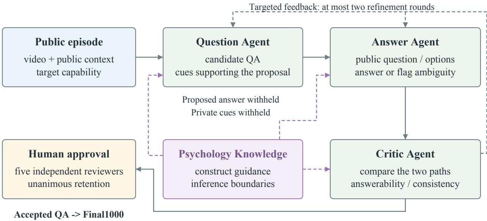  
Shared State records feedback, revision history, and capability coverage.

Figure 7 Question construction and review. The Answer Agent independently examines the episode without access to the proposed answer or its supporting cues. Psychology Knowledge guides the three agents’ judgments, and critic feedback supports up to two rounds of refinement. Final inclusion requires unanimous human approval.

Knowledge guides all three agents in aligning questions with the target construct and distinguishing observable cues from inferred states, needs, and actions. Candidate acceptance combines cue support, logical coherence, alignment with the target capability, and agreement between answers.

Table 8 Roles of the three construction agents. Psychology Knowledge guides their interpretation of the target constructs. The Answer Agent receives only the video, question, options, and public context.
<table><tr><td>Agent</td><td>Inputs</td><td>Assessment</td><td>Output</td></tr><tr><td>Question Agent</td><td>bility</td><td>Video, public context, target capa- Observed cues support the Candidate question, an- question and reference</td><td>swer, options, and sup- porting cues</td></tr><tr><td>Answer Agent</td><td>context</td><td>Video, question, options, public Answerability without the Independent answer or proposed reference or its identified ambiguity supporting cues</td><td></td></tr><tr><td>Critic Agent</td><td>Proposed and independent answers, Cue support, logical coher- Quality assessment and source cues</td><td>ence, construct alignment </td><td>refinement suggestions</td></tr></table>

## C.3 Iterative Question Refinement

Critic feedback determines whether a candidate needs a clearer question or a renewed examination of the cues. Ambiguous referents, unsupported premises, and defects in answer options prompt question revision; reasoning errors prompt another independent answer. Every revised question is answered again without revealing the proposed reference. Candidates that remain unresolved after two refinement rounds are discarded.

Shared State coordinates feedback and tracks capability coverage during construction. Coverage guides further question generation toward underrepresented capabilities, while the same answerability and criteria for cue support apply to every candidate.

## C.4 Human Quality Review

As described in Section 3.3, all benchmark items require unanimous approval from five researchers with psychology backgrounds. Reviewers check question validity, reference correctness, and psychological consistency using the capability definitions and cue requirements in Table 9.

## D Experimental and Evaluation Protocol

## D.1 Models and Analysis Cohorts

The foundation comparison evaluates 17 models: eight proprietary models and nine open-weight models. The open-weight group contains Qwen3.8-27B, Qwen3.5-9B, Qwen3.5-4B Base, InternVL3.5-14B/8B/4B, Gemma-4-12B-it, Phi-4-multimodal, and MiniCPM-V4.5. The proprietary group comprises Claude Opus 5, Gemini 3.1 Pro, Gemini 3.6 Flash, GLM-5V-Turbo, GPT-5.6 Sol, Kimi K3, Qwen3.8-Max, and Seed 2.1 Pro. Table 2 reports these models and two adapted checkpoints. Qwen3.5-4B’s SFT and GRPO variants are examined separately in Appendix E.

## D.2 Model Inputs and Response Format

The evaluation set contains 1,000 questions from 630 episodes: 890 choice questions and 110 open questions. The G/W/N/T/S/A/M/R counts are 186/320/97/72/97/94/61/73. We prioritize native video and native audio independently, according to the evaluated model interface. Sampled frames are the fallback for video, using 1 FPS with at most 64 frames; available ASR transcripts are the fallback for audio. Native inputs are used wherever the corresponding input path is supported and available.

Gemini receives native video and audio; Claude and GPT use sampled frames with ASR transcripts; GLM, Qwen-Max, and Seed receive native video with ASR. Kimi primarily uses native video with ASR, supplemented by sampled frames when needed. The three diagnostic open-weight models are evaluated using ASR transcripts where available.

Common input policy and paired controls. Input formats follow the media interfaces supported by each model. The policy preserves native video and audio where available and standardizes the fallbacks through a common frame sampling rule and the available ASR transcripts. All models answer the same benchmark questions under a shared response schema and scoring rubric, using the same reference answers. Table 2 reports performance under this protocol. The paired controls in Appendix I examine modality availability and visual coverage on the same questions; Appendix J examines relevant history while holding the video, question, and remaining inputs fixed.

Table 9 Criteria for expert question review by capability. Each target judgment requires support from the available episode and public context.
<table><tr><td>Capability</td><td>Required cues</td><td>Review criterion</td></tr><tr><td>G</td><td>A uniquely grounded speaker, addressee, person, or interpersonal relation</td><td>Corroborate the target person&#x27;s visible identity us- ing speech, behavior, and interaction relations.</td></tr><tr><td>W</td><td>Observable cues supporting a psychological state or its stated cause</td><td>Distinguish situated psychological interpretation from clinical diagnosis; check the support for each stated cause.</td></tr><tr><td>N</td><td>An explicit request, refusal, or contextual basis Check whether the available cues indicate willing- for the inferred support need</td><td>ness to receive the proposed support.</td></tr><tr><td>T</td><td>Turn structure, ongoing activity, urgency, or a supported opportunity to respond</td><td>Assess the intervention opportunity against turn structure, current activity, and urgency.</td></tr><tr><td>S</td><td>Response content and tone suitable for the sup- Assess the fit of content, strategy, and tone to the ported state, need, and context</td><td>person&#x27;s state, need, and context.</td></tr><tr><td>A</td><td>A feasible physical or nonverbal response consis- Distinguish recognition of observed behavior from tent with the interaction</td><td>selection of an appropriate next action.</td></tr><tr><td>M</td><td>Relevant history available in the supplied context Ground personal preferences and prior interactions</td><td>in the supplied history.</td></tr><tr><td>R</td><td>Cues concerning consent, refusal, boundaries, au- Check consent, expressed refusals, personal bound- tonomy, or possible harm</td><td>aries, and consequences before endorsing interven- tion.</td></tr></table>

Models provide an answer and eight rationale fields, G, W, N, T, S, A, M, and R. Unused fields may be null; rationale coverage requires at least one informative explanation rather than completion of every field. Qwen3.5-9B uses temperature 0, a 768-token output limit, disabled thinking, and responses formatted as JSON. InternVL3.5-8B uses temperature 0, the same output limit, and one image tile per frame. Qwen3.5- 4B Base uses greedy BF16 inference under the input and scoring protocol in Appendix E. The Judge is Qwen3.8-27B.

## D.3 Evaluation Instructions and Response Format

Models answer questions using native video and native audio where supported, with sampled frames and ASR transcripts as the respective fallback inputs (Appendix D.2). They also receive answer options and relevant public context. Reference answers and private cue annotations are provided only to the evaluator after inference (Fig. 8).

The response format uses one JSON object with the keys answer, G, W, N, T, S, A, M, and R. Choice answers use an option ID when one option is required, or an array of option IDs when several are required. Open answers use concise natural language. Choice answers must match the reference option or complete option set exactly: missing a correct option or selecting an extra option receives zero answer credit.

Each capability field contains a short judgment contributing to the answer, or JSON null when unused. At least one informative rationale is required; empty and null fields do not provide rationale coverage.

The following example illustrates a choice response requiring one option. When several options are required, the answer is an array such as ["A", "C"]; for open questions, it is concise natural language.

```jsonl
{"answer": "A",
"G": "Brief grounded observation.",
"W": null, "N": null, "T": null,
"S": null, "A": null,
"M": null, "R": null}
```

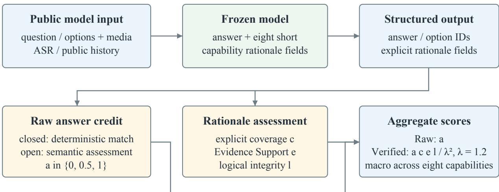  
Private references and cue annotations enter scoring only; models do not receive them.

Figure 8 Evaluation and scoring procedure. Reference answers and cue annotations are provided only to the evaluator. Answer correctness and rationale quality are assessed separately before computing Verified credit.  
Table 10 Structured response fields and answer representations. The eight rationale fields are short explicit judgments; unused fields are JSON null.
<table><tr><td>Field / task</td><td>Required representation</td></tr><tr><td>answer: choice</td><td>Option ID for one required option, e.g., &quot;A&quot;; array for several, e.g., [&quot;A&quot;, &quot;C&quot;]</td></tr><tr><td>answer: open</td><td>Concise answer in natural language</td></tr><tr><td>G/W/N/T/S/A/M/R</td><td>Short relevant judgment or JSON null</td></tr></table>

## D.4 Judge Instructions and Rubric

The Judge receives the question, applicable options, reference answer, textual descriptions of reference cues, and the model’s answer and rationales. It assesses explanation support against these cues and checks logical consistency. Reasoning-Verified measures the quality of explicit justifications relative to annotated reference cues and the final answer. Multiple psychological interpretations are accepted when supported by the available cues.

Answer correctness and rationale quality are assessed separately. Open answers receive semantic credit in {0, 0.5, 1}: full credit for a correct answer, partial credit for a materially correct but incomplete answer, and zero for incorrect or unsupported answers or responses that do not address the question.

Evidence Support concerns whether the explanation’s observations and inferences are grounded in the reference cue annotations. Logical Integrity concerns whether the active rationale fields are mutually compatible and support the final answer. An internally consistent explanation may lack support from observed cues, while grounded statements may combine into an inconsistent conclusion. Rationale coverage is evaluated separately. The Judge assigns Evidence Support and Logical Integrity labels with a short explanation for each assessment.

Table 12 illustrates how answer credit, rationale coverage, and the two quality labels determine Verified credit.

## D.5 Scoring and Statistical Estimation

Raw credit $a _ { q }$ evaluates choice answers through exact matching of the selected option or complete option set, and assigns semantic credit in {0, 0.5, 1} for open questions. Malformed or unparseable answers and responses without an answer receive zero credit and remain in the evaluation denominator. Verified credit

Table 11 Interpretation of rationale labels and their scoring multipliers. Evidence Support and Logical Integrity are separate judgments.
<table><tr><td>bel</td><td>Support / logic la- Interpretation of Evidence Support</td><td>Interpretation of Logical Integrity</td><td>Weight</td></tr><tr><td>ent</td><td>Strong / fully coher- Relevant claims are well supported by Active judgments jointly support the an- frozen cue annotations.</td><td>swer without contradiction.</td><td>1.2</td></tr><tr><td>Normal / accept- able</td><td>sions or specificity.</td><td>Support is adequate, with limited omis- The explanation is consistent and ade- quate, with minor gaps.</td><td>1.0</td></tr><tr><td>Weak / weak</td><td>lacks adequate support from observed inadequately justified.</td><td>A material inference or supporting link A material reasoning link is incomplete or</td><td>0.8</td></tr><tr><td>tradictory</td><td>cues. Contradicted / con- A material claim conflicts with the sup- Active judgments contradict one another plied cues.</td><td>or the final answer.</td><td>0.5</td></tr><tr><td>evaluable</td><td>Insufficient / un- No evaluable support is available for the No evaluable logical explanation is explicit rationale.</td><td>present.</td><td>0.0</td></tr></table>

Table 12 Arithmetic examples of Reasoning-Verified credit for individual questions. Each row specifies $( a , c , e , \ell )$ ; the final column is $1 0 0 a c e \ell / \lambda ^ { 2 }$ , with $\lambda = 1 . 2$
<table><tr><td>Case</td><td>a</td><td>C</td><td>e</td><td>l Verified (%)</td></tr><tr><td>Full support</td><td>1</td><td>1</td><td>1.2</td><td>1.2 100.00</td></tr><tr><td>Normal / acceptable</td><td>1</td><td>1</td><td>1.0 1.0</td><td>69.44</td></tr><tr><td>Weak support</td><td>1</td><td>1</td><td>0.8 1.2</td><td>66.67</td></tr><tr><td>Contradictory logic</td><td>1</td><td>1</td><td>1.2 0.5</td><td>41.67</td></tr><tr><td>Missing rationale</td><td>1</td><td>0</td><td>0</td><td>0 0.00</td></tr><tr><td>Incorrect answer</td><td>0</td><td>1</td><td>1.2 1.2</td><td>0.00</td></tr></table>

combines answer correctness with rationale quality:

$$
v _ { q } = a _ { q } c _ { q } e _ { q } \ell _ { q } / \lambda ^ { 2 } , \quad \lambda = 1 . 2 ,\tag{4}
$$

where $c _ { q }$ indicates whether an informative rationale is present, and $e _ { q }$ and $\ell _ { q }$ represent Evidence Support and Logical Integrity. The gap between Raw and Verified scores measures the reduction in answer credit under the rationale rubric.

Rubric Weights and Normalization. Evidence Support labels strong/normal/weak/contradicted receive $1 . 2 / 1 . 0 / 0 . 8 / 0 . 5 ;$ fully coherent/acceptable/weak/contradictory logic labels receive the same multipliers (Table 11). Insuficient evidence, unevaluable logic, and absent rationales receive zero Verified credit. The evaluable labels have weights in [0.5, λ], with λ = 1.2 as the maximum in each dimension; including unevaluable labels gives $e _ { q } , \ell _ { q } \in [ 0 , \lambda ]$

The multipliers center on 1.0 for normal cue support and acceptable logic, with symmetric steps of 0.2 distinguishing strong (1.2) and weak (0.8) judgments and a steeper discount (0.5) for contradictions. Dividing $e _ { q } \ell _ { q }$ by λ<sup>2</sup> yields 1 when both dimensions receive their strongest labels. Since $a _ { q } , c _ { q } \in [ 0 , 1 ]$ , this also ensures $0 \leq v _ { q } \leq a _ { q } \leq 1$ . A correct answer with an informative rationale, normal Evidence Support, and acceptable Logical Integrity earns $1 / 1 . 4 4 \approx 6 9 . 4 4 \%$ credit. Alternative Soft and Strict weights preserve the ordering of the three diagnostic models (Appendix G.4).

Aggregation and Credit Retention. Macro scores on the full benchmark give equal weight to the eight capabilities C, for either Raw $( x = a )$ or Verified $( x = v )$ credit:

$$
\operatorname { M a c r o } ( x _ { m } ) = { \frac { 1 0 0 } { 8 } } \sum _ { k \in \mathcal { C } } { \frac { 1 } { n _ { k } } } \sum _ { q \in k } x _ { m q } .\tag{5}
$$

Micro scores instead average questions within the named subset. For model m and capability k, credit retention is

$$
\rho _ { m k } = \frac { \sum _ { q \in k } v _ { m q } } { \sum _ { q \in k } a _ { m q } } .\tag{6}
$$

It measures the proportion of earned answer credit retained after verification. For binary answer credit, it equals the mean verification weight among correct answers. Pooled retention similarly divides total Verified credit by total Raw credit. Conditional Evidence Support and Logical Integrity frequencies characterize the reasons for reduced credit.

Paired Episode Bootstrap. Confidence intervals resample episodes while retaining their questions and pairing across models or conditions. We use 10,000 draws with seed 42 and report percentile 95% confidence intervals. Paired diferences are recomputed within each draw; undefined draws are excluded where applicable. Intervals capture episode sampling variation; post hoc comparisons are exploratory and unadjusted unless otherwise specified.

Stage Credit and Loss Attribution. The successive stages in Fig. 5(b,d) correspond to a, ac, ace˜, and $v = a c { \tilde { e } } { \tilde { \ell } } .$ where $\tilde { e } = e / \lambda$ and $\tilde { \ell } = \ell / \lambda$ . Their successive losses are 1 − a, a(1 − c), ac(1 − e˜), and $a c \tilde { e } ( 1 - \tilde { \ell } )$ . Together with v, they sum to one for each response. Evidence Support precedes Logical Integrity in this sequential credit decomposition, making their allocated losses dependent on their order. Stage credit uses capability macro weights; distribution bins weight questions equally.

## E SFT and GRPO on PsycheMME

## E.1 SFT and GRPO Training Configurations

Both adaptation stages update LoRA parameters in the language backbone of Qwen3.5-4B while freezing the visual encoder and multimodal aligner. LoRA is applied to the linear projections in the language model with rank 8, scaling $\alpha = 3 2$ , and dropout 0.05.

SFT trains on 3,657 video QA examples for one epoch (458 updates). Each example contains 32 sampled frames with a maximum image dimension of 256 pixels, ASR, and public history where available. Targets contain the answer and one annotated observation; unused rationale fields are null. The loss is computed over assistant tokens. Training uses BF16, fused AdamW, a constant learning rate of $5 \times 1 0 ^ { - 6 }$ , weight decay 0.1, no warmup, a batch size of one with eight gradient accumulation steps, and a maximum sequence length of 4,096 tokens.

GRPO starts from the SFT checkpoint and uses it as a fixed reference. Its training pool contains 2,842 singlechoice examples with the same 32-frame representation. For each question, eight responses are sampled at temperature 1.0 and $\mathrm { t o p } { - } p = 0 . 9$ , with at most 768 completion tokens. The binary reward in Eq. 3 requires both exact answer correctness and compliance with the response requirements. Evidence Support and Logical Integrity scores are used only for evaluation.

The GRPO objective uses rewards normalized within each group, clipping ϵ = 0.2, and KL regularization with $\beta = 0 . 0 3$ against the fixed SFT reference. Training uses a constant learning rate of $5 \times 1 0 ^ { - 7 }$ , no warmup, and seed 42. Groups with constant rewards or truncated responses are excluded. Each update uses eight distinct questions and 64 sampled responses, giving 32 updates over 256 distinct questions.

## E.2 Checkpoints and Evaluation Scope

The adaptation comparison evaluates Qwen3.5-4B Base, SFT at step 458, and GRPO at step 32 on the same 1,000 benchmark questions. Evaluation uses 1 FPS with at most 64 frames, without the reduction in image size used during training, together with greedy BF16 inference and a 768-token output limit. All three models use the same rules for scoring answers and Qwen3.8-27B rationale Judge.

Raw/Verified macro scores are 47.68/37.71 for Base, 72.58/52.13 for SFT, and 73.19/52.62 for GRPO (Table 13). Figure 9 shows the overall scores and Raw profiles across the eight capabilities. SFT improves several capabilities, but Timing remains below the Base score after both adaptation stages. This comparison does not isolate the efects of temporal sampling from the training objectives.

## E.3 Training and Evaluation Data

To prevent data leakage, we exclude benchmark questions and video episodes from training. We further split the data by source video and remove clips that share the same source with the development and held-out sets. This ensures that the SFT training data does not overlap with the benchmark or checkpoint screening set.

Checkpoint screening and final evaluation use independent question sets: the screening set is used for model selection, and the evaluation set is used to report the results in Table 13. This adaptation comparison is separate from the 17-model foundation evaluation.

## F Complete Foundation Model Results

## F.1 Capability Profiles

Tables 14 and 15 report capability scores for all 17 foundation models with 95% confidence intervals from bootstrapping episodes. All eight proprietary models exceed 88% Verified in Grounding, while Need, Timing, and Action show wider diferences across models. Gemini 3.6 exceeds Gemini Pro by 5.70 Verified macro points (95% CI [3.57, 7.84]), but the diference is uneven: 0.46 in G, 9.67 in N, 11.10 in S, and 12.78 in A The relative advantage in A versus G is 12.32 points ([5.40, 19.67]), indicating diferent capability profiles rather than a uniform improvement.

Kimi and GPT have nearly identical Verified macro scores, 75.35 and 75.98 (paired diference -0.63; [−2.97, 1.67]). Diferences between Kimi and GPT are +4.52 in S and −6.66 in N; their relative diference in S versus N is 11.18 ([1.26, 21.41]). The individual S and N intervals include zero. GPT exceeds Gemini Pro in overall point estimate but is lower in T by 11.73 points ([−21.24, −2.23]).

Figure 10 visualizes the Verified profiles for 16 foundation models; Qwen3.5-4B is shown separately in Figure 9.

## F.2 Confidence Intervals

Table 16 reports confidence intervals for the overall Raw and Verified scores. All scores use the full 1,000- question denominator.

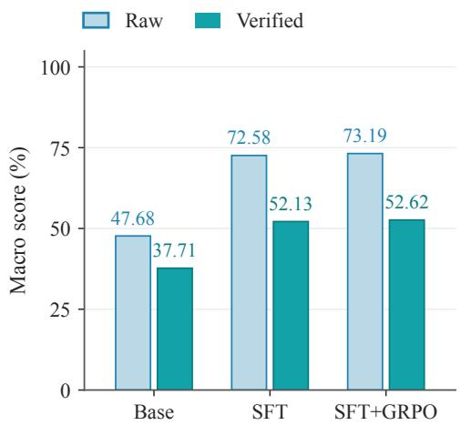

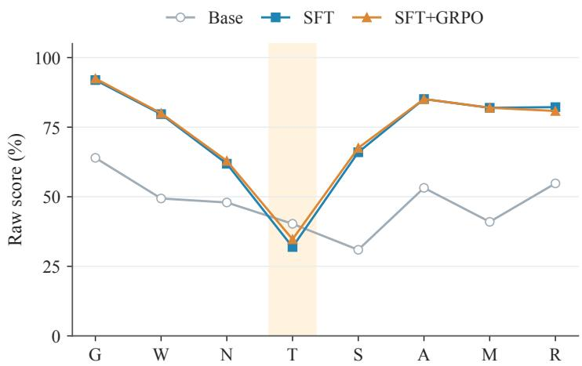  
Figure 9 Qwen3.5-4B adaptation on the same 1,000 PsycheMME questions with greedy decoding. Left: overall Raw and Verified macro scores for Base, SFT at step 458, and SFT+GRPO at step 32. Right: Raw scores across the eight capabilities, with Response Timing shaded. Capability abbreviations follow Table 13.

Table 13 Base, SFT, and GRPO results on PsycheMME (%, 1,000 questions per model). Overall Raw and Ver. denote raw accuracy and Verified scores, respectively, averaged equally over the eight capabilities. Capability columns report Raw scores. Blue shading indicates score magnitude; bold denotes the highest observed value in each column, including ties.
<table><tr><td>Model</td><td colspan="2">Overall</td><td colspan="3">Understanding</td><td colspan="3">Interaction</td><td colspan="2">Contextual</td></tr><tr><td></td><td>Raw</td><td>Ver.</td><td>G</td><td>W</td><td>N</td><td>T</td><td>S</td><td>A</td><td>M</td><td>R</td></tr><tr><td>Base (Qwen3.5-4B)</td><td>47.68</td><td>37.71</td><td>63.98</td><td>49.38</td><td>47.94</td><td>40.28</td><td>30.93</td><td>53.19</td><td>40.98</td><td>54.79</td></tr><tr><td>SFT (step 458)</td><td>72.58</td><td>52.13</td><td>91.94</td><td>79.69</td><td>61.86</td><td>31.94</td><td>65.98</td><td>85.11</td><td>81.97</td><td>82.19</td></tr><tr><td>GRPO (step 32)</td><td>73.19</td><td>52.62</td><td>92.47</td><td>80.00</td><td>62.89</td><td>34.72</td><td>67.53</td><td>85.11</td><td>81.97</td><td>80.82</td></tr></table>

Table 16 Overall 95% confidence intervals from bootstrapping episodes (%). All models are evaluated on 1,000 questions.
<table><tr><td>Model</td><td>Raw CI</td><td>Verified CI</td></tr><tr><td>Claude Opus 5 Gemini 3.1 Pro</td><td>[79.75, 84.83] [78.68, 83.96]</td><td>[74.15, 79.22] [71.75, 76.89]</td></tr><tr><td>Gemini 3.6 Flash GLM-5V-Turbo</td><td>[83.42, 87.84]</td><td>[77.71, 82.27]</td></tr><tr><td></td><td>[75.58, 81.11]</td><td>[68.42, 73.94]</td></tr><tr><td>GPT-5.6 Sol</td><td>[78.53, 83.59]</td><td>[73.46, 78.45]</td></tr><tr><td>Kimi K3</td><td>[77.94, 83.16]</td><td></td></tr><tr><td>Qwen3.8-Max</td><td></td><td>[72.76, 77.85]</td></tr><tr><td></td><td>[78.95, 83.99]</td><td>[73.04, 78.11]</td></tr><tr><td>Seed 2.1 Pro</td><td>[73.53, 79.17]</td><td>[66.97, 72.35]</td></tr><tr><td>Qwen3.8-27B</td><td>[77.26, 82.60]</td><td>[70.10, 75.33]</td></tr><tr><td>Qwen3.5-9B</td><td></td><td></td></tr><tr><td>InternVL3.5-14B</td><td>[73.53, 79.43]</td><td>[63.58, 69.22] [41.60, 47.67]</td></tr><tr><td></td><td>[48.83, 55.45]</td><td></td></tr><tr><td>Gemma-4-12B-it</td><td>[63.30, 69.42]</td><td>[54.81, 60.65]</td></tr><tr><td>InternVL3.5-8B</td><td>[64.45, 70.29]</td><td>[52.65, 58.19]</td></tr><tr><td>Phi-4-multimodal</td><td>[57.84, 64.21]</td><td>[45.76, 51.52]</td></tr><tr><td>InternVL3.5-4B</td><td></td><td></td></tr><tr><td></td><td>[58.13, 64.46]</td><td>[46.00, 51.94]</td></tr><tr><td>MiniCPM-V4.5</td><td>[66.55, 72.67]</td><td>[55.29, 60.97]</td></tr><tr><td>Qwen3.5-4B</td><td>[43.96, 51.42]</td><td>[34.52, 40.92]</td></tr></table>

<table><tr><td rowspan=1 colspan=1>Gemini 3.6 Flash</td><td rowspan=1 colspan=1>91.8</td><td rowspan=1 colspan=1>79.7</td><td rowspan=1 colspan=1>70.0</td><td rowspan=1 colspan=1>47.8</td><td rowspan=1 colspan=1>79.3</td><td rowspan=1 colspan=1>89.6</td><td rowspan=1 colspan=1>90.9</td><td rowspan=1 colspan=1>91.2</td></tr><tr><td rowspan=1 colspan=1>Claude Opus 5</td><td rowspan=1 colspan=1>89.3</td><td rowspan=1 colspan=1>77.8</td><td rowspan=1 colspan=1>69.1</td><td rowspan=1 colspan=1>40.7</td><td rowspan=1 colspan=1>79.2</td><td rowspan=1 colspan=1>86.2</td><td rowspan=1 colspan=1>86.6</td><td rowspan=1 colspan=1>84.8</td></tr><tr><td rowspan=1 colspan=1>GPT-5.6 Sol</td><td rowspan=1 colspan=1>92.1</td><td rowspan=1 colspan=1>78.7</td><td rowspan=1 colspan=1>67.3</td><td rowspan=1 colspan=1>33.0</td><td rowspan=1 colspan=1>74.9</td><td rowspan=1 colspan=1>84.2</td><td rowspan=1 colspan=1>91.1</td><td rowspan=1 colspan=1>86.5</td></tr><tr><td rowspan=1 colspan=1>Qwen3.8-Max</td><td rowspan=1 colspan=1>90.9</td><td rowspan=1 colspan=1>77.6</td><td rowspan=1 colspan=1>69.2</td><td rowspan=1 colspan=1>39.3</td><td rowspan=1 colspan=1>72.8</td><td rowspan=1 colspan=1>82.5</td><td rowspan=1 colspan=1>84.5</td><td rowspan=1 colspan=1>87.9</td></tr><tr><td rowspan=1 colspan=1>Kimi K3</td><td rowspan=1 colspan=1>91.5</td><td rowspan=1 colspan=1>76.1</td><td rowspan=1 colspan=1>60.6</td><td rowspan=1 colspan=1>38.8</td><td rowspan=1 colspan=1>79.4</td><td rowspan=1 colspan=1>84.3</td><td rowspan=1 colspan=1>85.2</td><td rowspan=1 colspan=1>86.9</td></tr><tr><td rowspan=1 colspan=1>Gemini 3.1 Pro</td><td rowspan=1 colspan=1>91.3</td><td rowspan=1 colspan=1>76.3</td><td rowspan=1 colspan=1>60.3</td><td rowspan=1 colspan=1>44.7</td><td rowspan=1 colspan=1>68.2</td><td rowspan=1 colspan=1>76.8</td><td rowspan=1 colspan=1>90.5</td><td rowspan=1 colspan=1>86.6</td></tr><tr><td rowspan=1 colspan=1>GLM-5V-Turbo</td><td rowspan=1 colspan=1>89.2</td><td rowspan=1 colspan=1>76.7</td><td rowspan=1 colspan=1>61.8</td><td rowspan=1 colspan=1>34.2</td><td rowspan=1 colspan=1>68.1</td><td rowspan=1 colspan=1>79.9</td><td rowspan=1 colspan=1>76.2</td><td rowspan=1 colspan=1>83.4</td></tr><tr><td rowspan=1 colspan=1>Seed 2.1 Pro</td><td rowspan=1 colspan=1>88.5</td><td rowspan=1 colspan=1>76.9</td><td rowspan=1 colspan=1>53.2</td><td rowspan=1 colspan=1>32.9</td><td rowspan=1 colspan=1>63.3</td><td rowspan=1 colspan=1>78.1</td><td rowspan=1 colspan=1>82.4</td><td rowspan=1 colspan=1>82.0</td></tr><tr><td rowspan=1 colspan=1>Qwen3.8-27B</td><td rowspan=1 colspan=1>90.9</td><td rowspan=1 colspan=1>80.5</td><td rowspan=1 colspan=1>67.0</td><td rowspan=1 colspan=1>28.6</td><td rowspan=1 colspan=1>68.9</td><td rowspan=1 colspan=1>83.0</td><td rowspan=1 colspan=1>77.8</td><td rowspan=1 colspan=1>85.3</td></tr><tr><td rowspan=1 colspan=1>Qwen3.5-9B</td><td rowspan=1 colspan=1>90.2</td><td rowspan=1 colspan=1>76.9</td><td rowspan=1 colspan=1>54.7</td><td rowspan=1 colspan=1>29.1</td><td rowspan=1 colspan=1>62.6</td><td rowspan=1 colspan=1>73.4</td><td rowspan=1 colspan=1>68.1</td><td rowspan=1 colspan=1>76.5</td></tr><tr><td rowspan=1 colspan=1>MiniCPM-V4.5</td><td rowspan=1 colspan=1>81.3</td><td rowspan=1 colspan=1>70.6</td><td rowspan=1 colspan=1>33.8</td><td rowspan=1 colspan=1>24.3</td><td rowspan=1 colspan=1>50.1</td><td rowspan=1 colspan=1>62.4</td><td rowspan=1 colspan=1>65.4</td><td rowspan=1 colspan=1>77.1</td></tr><tr><td rowspan=1 colspan=1>Gemma-4-12B-it</td><td rowspan=1 colspan=1>79.5</td><td rowspan=1 colspan=1>71.2</td><td rowspan=1 colspan=1>46.4</td><td rowspan=1 colspan=1>13.5</td><td rowspan=1 colspan=1>49.4</td><td rowspan=1 colspan=1>62.3</td><td rowspan=1 colspan=1>65.1</td><td rowspan=1 colspan=1>74.6</td></tr><tr><td rowspan=1 colspan=1>InternVL3.5-8B</td><td rowspan=1 colspan=1>72.3</td><td rowspan=1 colspan=1>64.4</td><td rowspan=1 colspan=1>35.4</td><td rowspan=1 colspan=1>20.7</td><td rowspan=1 colspan=1>50.4</td><td rowspan=1 colspan=1>59.3</td><td rowspan=1 colspan=1>72.2</td><td rowspan=1 colspan=1>68.7</td></tr><tr><td rowspan=1 colspan=1>InternVL3.5-4B</td><td rowspan=1 colspan=1>72.5</td><td rowspan=1 colspan=1>60.1</td><td rowspan=1 colspan=1>26.9</td><td rowspan=1 colspan=1>21.6</td><td rowspan=1 colspan=1>37.4</td><td rowspan=1 colspan=1>47.0</td><td rowspan=1 colspan=1>63.7</td><td rowspan=1 colspan=1>62.5</td></tr><tr><td rowspan=1 colspan=1>Phi-4-multimodal</td><td rowspan=1 colspan=1>52.5</td><td rowspan=1 colspan=1>50.3</td><td rowspan=1 colspan=1>22.1</td><td rowspan=1 colspan=1>20.9</td><td rowspan=1 colspan=1>46.0</td><td rowspan=1 colspan=1>58.2</td><td rowspan=1 colspan=1>64.6</td><td rowspan=1 colspan=1>74.4</td></tr><tr><td rowspan=1 colspan=1>InternVL3.5-14B</td><td rowspan=1 colspan=1>63.4</td><td rowspan=1 colspan=1>56.6</td><td rowspan=1 colspan=1>19.9</td><td rowspan=1 colspan=1>15.6</td><td rowspan=1 colspan=1>34.0</td><td rowspan=1 colspan=1>45.1</td><td rowspan=1 colspan=1>59.5</td><td rowspan=1 colspan=1>63.2</td></tr></table>

Figure 10 Verified scores (%) for 16 foundation models on 1,000 PsycheMME questions, sorted by Verified macro score within each model group. G: Grounding; W: Psychological Understanding; N: Need; T: Response Timing; S: Verbal Response; A: Action Decision; M: Memory; R: Boundary and Risk. All cells share a 0 to 100 color scale; the gold outline marks Response Timing.

## G Conditional Rationale and Stratified Analysis

## G.1 Timing: Answer Credit and Evidence Support

Timing has the lowest Verified score and credit retention for all 17 frozen models. Its 72 questions are all single-choice and come from 72 episodes. Restricting every capability to single-choice questions preserves the pattern of lowest retention for 17/17 models; the pattern of lowest Verified scores holds for 16/17. Thus, Timing’s dificulty is reflected in both the absolute score and the credit retained after rationale verification.

Table 17 conditions on full answer credit and holds answer format fixed. Across the 17 models, 569 correct Timing responses retain 64.40% of answer credit (95% CI from bootstrapping episodes [58.64, 69.59]). Weak/contradicted Evidence Support labels occur in 283/569 responses (49.74%), compared with 837/10,988 (7.62%) for other correct single-choice responses: a diference of 42.12 points ([33.37, 51.50]). Weak/contradic tory logic occurs in 182/569 (31.99%) versus 561/10,988 (5.11%), a diference of 26.88 points ([19.29, 35.27]).

All 182 Timing responses with weak/contradictory logic also have weak/contradicted Evidence Support labels; 101 have only the adverse Evidence Support label, and 286 have neither adverse label. This overlap indicates that the two judgments often identify problems in the same explanation. Within the eight proprietary models, the diference in Evidence Support labels remains 35.60 points ([25.79, 46.23]): 123/316 correct Timing responses versus 187/5,633 other correct single-choice responses.

Table 14 Raw scores by capability and model (%), with 95% confidence intervals from the episode bootstrap.
<table><tr><td rowspan=1 colspan=22>Model                       G          W          N          T           S          A           M          R</td></tr><tr><td rowspan=2 colspan=22>91.94       79.84       76.80       54.17      82.47      89.36       95.08       89.04Claude Opus 5   [87.89,95.65]              [68.75,84.27]                                         [89.09,100.00][81.69,95.65]</td></tr><tr><td rowspan=1 colspan=5>65] [75.54,83.93] [68</td><td rowspan=1 colspan=13></td><td rowspan=1 colspan=1>[89.09,100.00] [81.69,95.65]</td></tr><tr><td rowspan=2 colspan=3>93.55Gemini 3.1 Pro   [90.00,96.</td><td rowspan=1 colspan=5>79.22</td><td rowspan=1 colspan=9>67.53      66.67       71.</td><td rowspan=1 colspan=3>65      83.51</td><td rowspan=1 colspan=1></td><td rowspan=1 colspan=1>98.36       90.41</td></tr><tr><td rowspan=1 colspan=5>80][74.93,83.43][58.</td><td rowspan=1 colspan=5>85,76.04][55.26,</td><td rowspan=1 colspan=4>77.27][62.73,</td><td rowspan=1 colspan=1>79.</td><td rowspan=1 colspan=2>91][75.82,90.</td><td rowspan=1 colspan=1>53]</td><td rowspan=1 colspan=1>[94.44,100.00][83.10,96.77]</td></tr><tr><td rowspan=2 colspan=3>93.82Gemini 3.6 Flash [90.24,96.</td><td rowspan=1 colspan=5>82.19</td><td rowspan=1 colspan=5>76.29       66.</td><td rowspan=1 colspan=4>67      82.</td><td rowspan=1 colspan=1>99</td><td rowspan=1 colspan=2>93.62</td><td rowspan=1 colspan=1></td><td rowspan=1 colspan=1>96.72       93.15</td></tr><tr><td rowspan=1 colspan=5>94][78.08,86.08] [69.</td><td rowspan=1 colspan=5>07,83.33] [55.71,</td><td rowspan=1 colspan=4>77.22] [76.09,</td><td rowspan=1 colspan=1>89.</td><td rowspan=1 colspan=2>24][88.64,97.</td><td rowspan=1 colspan=2>89][91.30,100.00][86.75,98.53]</td></tr><tr><td rowspan=1 colspan=3>91.67</td><td rowspan=1 colspan=5>79.38</td><td rowspan=1 colspan=9>71.13      50.00      73.</td><td rowspan=1 colspan=1>20</td><td rowspan=1 colspan=3>87.23</td><td rowspan=1 colspan=1>86.89      87.67</td></tr><tr><td rowspan=1 colspan=1>GLM-5V-Turbo</td><td rowspan=1 colspan=2>[87.50,95.</td><td rowspan=1 colspan=5>41][75.16,83.39] [62.</td><td rowspan=1 colspan=9>78,79.25] [38.46,61.73][64.36,</td><td rowspan=1 colspan=1>81.</td><td rowspan=1 colspan=3>25][80.21,93.55]</td><td rowspan=1 colspan=1>[77.05,95.38][79.73,94.67]</td></tr><tr><td rowspan=2 colspan=1>GPT-5.6 Sol</td><td rowspan=1 colspan=1>93</td><td rowspan=1 colspan=1>82</td><td rowspan=1 colspan=1></td><td rowspan=1 colspan=2>80</td><td rowspan=1 colspan=1>.62</td><td rowspan=1 colspan=1></td><td rowspan=1 colspan=9>72.16       48.61       78.</td><td rowspan=1 colspan=3>87      87.23</td><td rowspan=1 colspan=1></td><td rowspan=1 colspan=1>98.36       89.04</td></tr><tr><td rowspan=1 colspan=1>[90.22</td><td rowspan=1 colspan=1>,97.</td><td rowspan=1 colspan=1>01]</td><td rowspan=1 colspan=2>[76.45,</td><td rowspan=1 colspan=1>84.63]</td><td rowspan=1 colspan=1>[63.</td><td rowspan=1 colspan=10>83,80.21] [36.99,60.27][70.89,85.</td><td rowspan=1 colspan=2>94][80.00,93.</td><td rowspan=1 colspan=1>48]</td><td rowspan=1 colspan=1>[94.44,100.00] [81.48,95.59]</td></tr><tr><td rowspan=2 colspan=1>Kimi K3</td><td rowspan=1 colspan=1>92</td><td rowspan=1 colspan=1>74</td><td rowspan=1 colspan=1></td><td rowspan=1 colspan=2>77</td><td rowspan=1 colspan=1>50</td><td rowspan=1 colspan=1></td><td rowspan=1 colspan=1>68</td><td rowspan=1 colspan=4>51.</td><td rowspan=1 colspan=1>39</td><td rowspan=1 colspan=2></td><td rowspan=1 colspan=1>83.</td><td rowspan=1 colspan=1>51</td><td rowspan=1 colspan=2>87.77</td><td rowspan=1 colspan=1></td><td rowspan=1 colspan=1>93.44      90.41</td></tr><tr><td rowspan=1 colspan=1>[88.83</td><td rowspan=1 colspan=1>,96.</td><td rowspan=1 colspan=1>26]</td><td rowspan=1 colspan=2>[73.05,</td><td rowspan=1 colspan=1>81.75]</td><td rowspan=1 colspan=1>[59.</td><td rowspan=1 colspan=1>18,7</td><td rowspan=1 colspan=4>6.58][39.73,</td><td rowspan=1 colspan=1>62.6</td><td rowspan=1 colspan=2>5][76.</td><td rowspan=1 colspan=1>11,</td><td rowspan=1 colspan=1>90.</td><td rowspan=1 colspan=2>10][81.05,93.</td><td rowspan=1 colspan=1>89]</td><td rowspan=1 colspan=1>[86.67,98.57][83.13,96.67]</td></tr><tr><td rowspan=1 colspan=1></td><td rowspan=1 colspan=1>91</td><td rowspan=1 colspan=1>94</td><td rowspan=1 colspan=1></td><td rowspan=1 colspan=2>79</td><td rowspan=1 colspan=1>22</td><td rowspan=1 colspan=1></td><td rowspan=1 colspan=5>76.29      52.</td><td rowspan=1 colspan=1>78</td><td rowspan=1 colspan=3>77.</td><td rowspan=1 colspan=1>84</td><td rowspan=1 colspan=2>88.30</td><td rowspan=1 colspan=1></td><td rowspan=1 colspan=1>95.08       90.41</td></tr><tr><td rowspan=1 colspan=1>Qwen3.8-Max</td><td rowspan=1 colspan=1>[87.88,</td><td rowspan=1 colspan=1>95.</td><td rowspan=1 colspan=1>45]</td><td rowspan=1 colspan=2>[74.84,</td><td rowspan=1 colspan=1>83.33]</td><td rowspan=1 colspan=1>[68.</td><td rowspan=1 colspan=5>50,83.64] [40.85,</td><td rowspan=1 colspan=1>64.4</td><td rowspan=1 colspan=3>1][69.19,</td><td rowspan=1 colspan=1>85.</td><td rowspan=1 colspan=2>65] [81.67,94.</td><td rowspan=1 colspan=1>44]</td><td rowspan=1 colspan=1>[89.16,100.00] [83.13,96.67]</td></tr><tr><td rowspan=2 colspan=1>Seed 2.1 Pro</td><td rowspan=1 colspan=1>91</td><td rowspan=1 colspan=1>67</td><td rowspan=1 colspan=1></td><td rowspan=1 colspan=2>80</td><td rowspan=1 colspan=1>78</td><td rowspan=1 colspan=1></td><td rowspan=1 colspan=5>59.28       48.</td><td rowspan=1 colspan=1>61</td><td rowspan=1 colspan=1></td><td rowspan=1 colspan=1></td><td rowspan=1 colspan=1>69.</td><td rowspan=1 colspan=1>07</td><td rowspan=1 colspan=2>85.11</td><td rowspan=1 colspan=1></td><td rowspan=1 colspan=1>90.16      86.30</td></tr><tr><td rowspan=1 colspan=1>[87.57,</td><td rowspan=1 colspan=1>95.</td><td rowspan=1 colspan=1>48]</td><td rowspan=1 colspan=2>[76.70,</td><td rowspan=1 colspan=1>84.80]</td><td rowspan=1 colspan=1>[50.</td><td rowspan=1 colspan=3>00,68.24]</td><td rowspan=1 colspan=2>[36.92,</td><td rowspan=1 colspan=1>60.2</td><td rowspan=1 colspan=1>9]</td><td rowspan=1 colspan=1>[60</td><td rowspan=1 colspan=1>.00,</td><td rowspan=1 colspan=1>77.</td><td rowspan=1 colspan=1>62]</td><td rowspan=1 colspan=1>[77.72,91.</td><td rowspan=1 colspan=1>95]</td><td rowspan=1 colspan=1>[80.95,97.92] [78.08,93.75]</td></tr><tr><td></td><td rowspan=1 colspan=1>93</td><td rowspan=1 colspan=1>55</td><td rowspan=1 colspan=1></td><td rowspan=1 colspan=2>82</td><td rowspan=1 colspan=1>34</td><td rowspan=1 colspan=1></td><td rowspan=1 colspan=2>75.26</td><td rowspan=1 colspan=1></td><td rowspan=1 colspan=1></td><td rowspan=1 colspan=1>45.</td><td rowspan=1 colspan=1>83</td><td rowspan=1 colspan=1></td><td rowspan=1 colspan=1></td><td rowspan=1 colspan=1>74.</td><td rowspan=1 colspan=1>74</td><td rowspan=1 colspan=1></td><td rowspan=1 colspan=1>87.77</td><td rowspan=1 colspan=1></td><td rowspan=1 colspan=1>88.52      91.78</td></tr><tr><td rowspan=1 colspan=1>Qwen3.8-27B</td><td rowspan=1 colspan=1>[90.00</td><td rowspan=1 colspan=1>,96.</td><td rowspan=1 colspan=1>74]</td><td rowspan=1 colspan=2>[78.39,</td><td rowspan=1 colspan=1>86.17]</td><td rowspan=1 colspan=1>[67.</td><td rowspan=1 colspan=2>16,83.0</td><td rowspan=1 colspan=2>1][34.</td><td rowspan=1 colspan=1>25,</td><td rowspan=1 colspan=1>57.1</td><td rowspan=1 colspan=1>4]</td><td rowspan=1 colspan=1>[66</td><td rowspan=1 colspan=1>.82,</td><td rowspan=1 colspan=1>82.</td><td rowspan=1 colspan=1>18]</td><td rowspan=1 colspan=1>[81.01,94.</td><td rowspan=1 colspan=1>02]</td><td rowspan=1 colspan=1>[78.18,96.77][85.06,97.33]</td></tr><tr><td></td><td rowspan=1 colspan=1>93</td><td rowspan=1 colspan=1>55</td><td rowspan=1 colspan=1></td><td rowspan=1 colspan=2>70</td><td rowspan=1 colspan=1>84</td><td rowspan=1 colspan=1></td><td rowspan=1 colspan=2>69.59</td><td rowspan=1 colspan=2></td><td rowspan=1 colspan=1>48.</td><td rowspan=1 colspan=1>61</td><td rowspan=1 colspan=2></td><td rowspan=1 colspan=1>72.</td><td rowspan=1 colspan=1>16</td><td rowspan=1 colspan=1></td><td rowspan=1 colspan=1>80.32</td><td rowspan=1 colspan=1></td><td rowspan=1 colspan=1>81.97      86.30</td></tr><tr><td rowspan=1 colspan=1>Qwen3.5-9B</td><td rowspan=1 colspan=1>[89.95</td><td rowspan=1 colspan=1>,96.</td><td rowspan=1 colspan=1>80]</td><td rowspan=1 colspan=2>[75.47,</td><td rowspan=1 colspan=1>84.01]</td><td rowspan=1 colspan=1>[60.</td><td rowspan=1 colspan=2>78,78.1</td><td rowspan=1 colspan=1>9]</td><td rowspan=1 colspan=1>[36.</td><td rowspan=1 colspan=1>59,</td><td rowspan=1 colspan=1>60.</td><td rowspan=1 colspan=2>27][63</td><td rowspan=1 colspan=1>.59,</td><td rowspan=1 colspan=1>80.</td><td rowspan=1 colspan=1>00]</td><td rowspan=1 colspan=1>[72.15,88.</td><td rowspan=1 colspan=1>04]</td><td rowspan=1 colspan=1>[70.59,91.67][78.05,93.65]</td></tr><tr><td></td><td></td><td></td><td></td><td rowspan=1 colspan=2>62</td><td rowspan=1 colspan=1>50</td><td rowspan=1 colspan=1></td><td rowspan=1 colspan=2>29.38</td><td rowspan=1 colspan=1></td><td rowspan=1 colspan=1></td><td rowspan=1 colspan=1>36</td><td rowspan=1 colspan=1>11</td><td rowspan=1 colspan=2></td><td rowspan=1 colspan=1>36.</td><td rowspan=1 colspan=1>60</td><td rowspan=1 colspan=2>54.26</td><td rowspan=1 colspan=1></td><td rowspan=1 colspan=1>63.93       67.12</td></tr><tr><td rowspan=1 colspan=1>InternVL3.5-14B</td><td rowspan=1 colspan=1>[61.29</td><td rowspan=1 colspan=1>,74</td><td rowspan=1 colspan=1>.61]</td><td rowspan=1 colspan=2>[57.28,</td><td rowspan=1 colspan=1>67.61]</td><td rowspan=1 colspan=1>[21.</td><td rowspan=1 colspan=3>23,37.89]</td><td rowspan=1 colspan=1>[25.</td><td rowspan=1 colspan=1>32,</td><td rowspan=1 colspan=1>47.</td><td rowspan=1 colspan=2>56][27</td><td rowspan=1 colspan=1>.00,</td><td rowspan=1 colspan=1>46.</td><td rowspan=1 colspan=1>15]</td><td rowspan=1 colspan=1>[44.59,64.</td><td rowspan=1 colspan=1>09]</td><td rowspan=1 colspan=1>[51.22,75.51][56.25,77.63]</td></tr><tr><td rowspan=1 colspan=1></td><td rowspan=1 colspan=1>84.</td><td rowspan=1 colspan=1>95</td><td rowspan=1 colspan=1></td><td rowspan=1 colspan=2>75.</td><td rowspan=1 colspan=1>94</td><td rowspan=1 colspan=1></td><td rowspan=1 colspan=3>57.73</td><td rowspan=1 colspan=1></td><td rowspan=1 colspan=1>25.</td><td rowspan=1 colspan=1>00</td><td rowspan=1 colspan=2></td><td rowspan=1 colspan=1>57.</td><td rowspan=1 colspan=1>73</td><td rowspan=1 colspan=1></td><td rowspan=1 colspan=1>72.34</td><td rowspan=1 colspan=1></td><td rowspan=1 colspan=1>75.41       82.19</td></tr><tr><td rowspan=1 colspan=1>Gemma-4-12B-it</td><td rowspan=1 colspan=1>[79.65,</td><td rowspan=1 colspan=1>89.</td><td rowspan=1 colspan=1>89]</td><td rowspan=1 colspan=2>[71.31,</td><td rowspan=1 colspan=1>80.28]</td><td rowspan=1 colspan=1>[48.</td><td rowspan=1 colspan=2>45,66.8</td><td rowspan=1 colspan=1>5]</td><td rowspan=1 colspan=1>[15.</td><td rowspan=1 colspan=1>28,</td><td rowspan=1 colspan=1>35.</td><td rowspan=1 colspan=2>14][48</td><td rowspan=1 colspan=1>.02,</td><td rowspan=1 colspan=1>67.</td><td rowspan=1 colspan=1>00]</td><td rowspan=1 colspan=1>[63.07,81.</td><td rowspan=1 colspan=1>13]</td><td rowspan=1 colspan=1>[63.64,86.30][73.13,90.41]</td></tr><tr><td></td><td rowspan=1 colspan=1>70</td><td rowspan=1 colspan=1>8</td><td rowspan=1 colspan=1></td><td rowspan=1 colspan=1></td><td rowspan=1 colspan=1>70</td><td rowspan=1 colspan=1>47</td><td rowspan=1 colspan=1></td><td rowspan=1 colspan=2>52.58</td><td rowspan=1 colspan=1></td><td rowspan=1 colspan=1></td><td rowspan=1 colspan=1>33.</td><td rowspan=1 colspan=1>33</td><td rowspan=1 colspan=3>61.</td><td rowspan=1 colspan=1>86</td><td rowspan=1 colspan=1></td><td rowspan=1 colspan=1>70.74</td><td rowspan=1 colspan=1></td><td rowspan=1 colspan=1>86.89      83.56</td></tr><tr><td rowspan=1 colspan=1>InternVL3.5-8B</td><td rowspan=1 colspan=1>[74.01,</td><td rowspan=1 colspan=1>85.</td><td rowspan=1 colspan=1>43]</td><td rowspan=1 colspan=1>[65.</td><td rowspan=1 colspan=2>54,75.31]</td><td rowspan=1 colspan=1>[43.</td><td rowspan=1 colspan=2>96,61.0</td><td rowspan=1 colspan=1>0]</td><td rowspan=1 colspan=2>[22.62,</td><td rowspan=1 colspan=1>44.</td><td rowspan=1 colspan=3>44] [52.36,</td><td rowspan=1 colspan=1>70.6</td><td rowspan=1 colspan=1>2]</td><td rowspan=1 colspan=1>[61.58,79.</td><td rowspan=1 colspan=1>61]</td><td rowspan=1 colspan=1>[78.05,94.55] [74.67,91.80]</td></tr><tr><td rowspan=1 colspan=1></td><td rowspan=1 colspan=1>66</td><td rowspan=1 colspan=1>19</td><td rowspan=1 colspan=1></td><td rowspan=1 colspan=1></td><td rowspan=1 colspan=2>60.47</td><td rowspan=1 colspan=1></td><td rowspan=1 colspan=2>31.96</td><td rowspan=1 colspan=1></td><td rowspan=1 colspan=2>43</td><td rowspan=1 colspan=1>06</td><td rowspan=1 colspan=3>61</td><td rowspan=1 colspan=1>86</td><td rowspan=1 colspan=1></td><td rowspan=1 colspan=1>71.28</td><td rowspan=1 colspan=1></td><td rowspan=1 colspan=1>75.41       78.08</td></tr><tr><td rowspan=1 colspan=1>Phi-4-multimodal</td><td rowspan=1 colspan=1>[59.22,</td><td rowspan=1 colspan=1>72.7</td><td rowspan=1 colspan=1>8]</td><td rowspan=1 colspan=3>[55.38,65.65]</td><td rowspan=1 colspan=1>[23.</td><td rowspan=1 colspan=6>40,40.56] [31.43,54.4</td><td rowspan=1 colspan=3>3] [52.25,</td><td rowspan=1 colspan=1>71.</td><td rowspan=1 colspan=1>18]</td><td rowspan=1 colspan=1>[62.02,80.</td><td rowspan=1 colspan=1>37]</td><td rowspan=1 colspan=1>[64.06,86.27]</td></tr><tr><td rowspan=1 colspan=1></td><td rowspan=1 colspan=1>84</td><td rowspan=1 colspan=1>14</td><td rowspan=1 colspan=1></td><td rowspan=1 colspan=3>70.16</td><td rowspan=1 colspan=1></td><td rowspan=1 colspan=2>42.78</td><td rowspan=1 colspan=4>36.11</td><td rowspan=1 colspan=3>45.</td><td rowspan=1 colspan=1>88</td><td rowspan=1 colspan=1></td><td rowspan=1 colspan=1>62.77</td><td rowspan=1 colspan=1></td><td rowspan=1 colspan=1>70.49</td></tr><tr><td rowspan=1 colspan=1>InternVL3.5-4B</td><td rowspan=1 colspan=1>[78.89</td><td rowspan=1 colspan=1>,89.</td><td rowspan=1 colspan=1>27]</td><td rowspan=1 colspan=3>[65.23,75.00]</td><td rowspan=1 colspan=1>[34.</td><td rowspan=1 colspan=2>02,51.5</td><td rowspan=1 colspan=4>8] [25.00,47.2</td><td rowspan=1 colspan=3>2] [36.63,</td><td rowspan=1 colspan=1>55.</td><td rowspan=1 colspan=1>00]</td><td rowspan=1 colspan=1>[52.83,72.</td><td rowspan=1 colspan=1>53]</td><td rowspan=1 colspan=1>[59.62,81.08][68.35,87.14]</td></tr><tr><td rowspan=2 colspan=1>MiniCPM-V4.5</td><td></td><td></td><td></td><td rowspan=1 colspan=3>78.12</td><td rowspan=1 colspan=1></td><td rowspan=1 colspan=2>47.42</td><td rowspan=1 colspan=4>43.06</td><td rowspan=1 colspan=3>57.</td><td rowspan=1 colspan=1>73</td><td rowspan=1 colspan=2>76.60</td><td rowspan=1 colspan=1></td><td rowspan=1 colspan=1>81.97       84.93</td></tr><tr><td rowspan=1 colspan=1>[82.35</td><td rowspan=1 colspan=1>,91</td><td rowspan=1 colspan=4>.85][73.77,82.32]</td><td rowspan=1 colspan=1>[38.</td><td rowspan=1 colspan=2>46,56.</td><td rowspan=1 colspan=1>38]</td><td rowspan=1 colspan=3>[31.67,54.</td><td rowspan=1 colspan=3>55][48.26,</td><td rowspan=1 colspan=1>66.</td><td rowspan=1 colspan=3>86][67.89,84.66]</td><td rowspan=1 colspan=1>[69.70,92.45][76.39,92.73]</td></tr><tr><td></td><td rowspan=1 colspan=1>63</td><td rowspan=1 colspan=1></td><td rowspan=1 colspan=4>49.38</td><td rowspan=1 colspan=1></td><td rowspan=1 colspan=2>47.94</td><td rowspan=1 colspan=1></td><td rowspan=1 colspan=3>40.28</td><td rowspan=1 colspan=3>30.</td><td rowspan=1 colspan=1>93</td><td rowspan=1 colspan=3>53.19</td><td rowspan=1 colspan=1>40.98      54.79</td></tr><tr><td rowspan=1 colspan=1>Qwen3.5-4B</td><td rowspan=1 colspan=1>[57.07</td><td rowspan=1 colspan=5>,70.67] [44.01,54.90]</td><td rowspan=1 colspan=1>[38.</td><td rowspan=1 colspan=6>83,57.22] [29.03,51.</td><td rowspan=1 colspan=3>69] [22.22,</td><td rowspan=1 colspan=5>39.71] [43.23,63.25]  [26.32,56.86] [43.08,66.67]</td></tr></table>

## G.2 Need Answer Completeness

Claude and Gemini have similar aggregate Need Verified scores, 69.10 and 69.97, but their ordering difers between choice and open questions (Table 18). Claude trails Gemini by 10.36 points on 62 choice questions (95% CI [−20.94, −0.31]) and leads by 15.95 points on 35 open questions ([4.36, 26.74]). These subsets difer in both question content and answer requirements.

On the same 35 open Need questions, Gemini receives 5/20/10 judgments assigning zero, partial, or full credit; Claude receives 4/7/24. Their rates of nonzero credit are 85.71/88.57%, while rates of full credit are 28.57/68.57%. The rubric permits an exact decomposition:

$$
\mathbb { E } [ a ] = 0 . 5 P ( a > 0 ) + 0 . 5 P ( a = 1 ) .\tag{7}
$$

Claude’s Raw advantage of 21.43 points comprises 1.43 points from coverage with nonzero credit and 20.00 from coverage with full credit. The diference in full credit is 40.00 points ([18.42, 60.87]). Seventeen questions move from Gemini partial to Claude full credit, compared with three in the reverse direction. The decomposition identifies answer completeness as the main source of the Raw gap.

## G.3 Answer Completeness and Rationale Support

Table 19 separates credit for open answers from length of the final answer. Claude averages 52.3 words, compared with Gemini’s 16.2; their open Raw scores are 76.36 and 67.27.

Among the 110 open questions, 38 receive full answer credit from both Claude and Gemini. On these jointly correct questions, their mean Verified credits are 90.42 and 97.15, respectively. Comparing jointly correct answers distinguishes completeness of the final answer from rationale quality.

Table 15 Verified scores by capability and model (%), with 95% confidence intervals from the episode bootstrap.
<table><tr><td>Model</td><td>G</td><td>W</td><td>N</td><td>T</td><td>S</td><td>A</td><td>M</td><td></td></tr><tr><td>Claude Opus 5</td><td>89.31 [85.25,93.14]</td><td>77.80 [73.35,81.97]</td><td>69.10 [60.99,77.02]</td><td>40.70 [30.98,50.52]</td><td>79.18 [71.15,86.72]</td><td>86.24 [79.70,92.15]</td><td>86.56 [79.45,93.57]</td><td>84.82 [77.20,91.78]</td></tr><tr><td>Gemini 3.1 Pro</td><td>91.30 [87.47,94.82]</td><td>76.26 [72.01,80.50]</td><td>60.29 [51.65,68.84]</td><td>44.71 [35.77,53.49]</td><td>68.22 [59.22,76.84]</td><td>76.80 [69.16,83.91]</td><td>90.49 [84.00,96.14]</td><td>86.57 [78.99,93.24]</td></tr><tr><td>Gemini 3.6 Flash</td><td>91.76 [88.02,95.11]</td><td>79.68 [75.56,83.63]</td><td>69.97 [62.36,77.55]</td><td>47.81 [38.13,57.45]</td><td>79.32 [72.05,86.16]</td><td>89.58 [83.99,94.62]</td><td>90.92 [84.31,96.13]</td><td>91.21 [84.47,96.88]</td></tr><tr><td>GLM-5V-Turbo</td><td>89.18 [84.93,93.09]</td><td>76.72 [72.49,80.78]</td><td>61.82 [53.35,70.16]</td><td>34.23 [25.17,43.43]</td><td>68.14 [59.22,76.27]</td><td>79.87 [72.71,86.66]</td><td>76.23 [64.51,86.73]</td><td>83.37 [75.32,90.71]</td></tr><tr><td>GPT-5.6 Sol</td><td>92.13 [88.41,95.47]</td><td>78.75 [74.52,82.80]</td><td>67.28 [58.73,75.56]</td><td>32.99 [24.05,42.11]</td><td>74.86 [66.73,82.36]</td><td>84.25 [77.10,90.65]</td><td>91.11 [84.07,97.02]</td><td>86.47 [78.71,93.28]</td></tr><tr><td>Kimi K3</td><td>91.52 [87.60,95.13]</td><td>76.11 [71.63,80.39]</td><td>60.62 [51.89,69.07]</td><td>38.82 [28.92,48.54]</td><td>79.38 [71.62,86.31]</td><td>84.28 [77.37,90.63]</td><td>85.17 [77.57,92.08]</td><td>86.87 [79.55,93.31]</td></tr><tr><td>Qwen3.8-Max</td><td>90.87 [86.80,94.49]</td><td>77.61 [73.21,81.77]</td><td>69.17 [61.13,76.74]</td><td>39.33 [29.58,49.19]</td><td>72.84 [64.08,80.86]</td><td>82.46 [75.42,88.98]</td><td>84.48 [76.62,91.83]</td><td>87.94 [80.62,94.32]</td></tr><tr><td>Seed 2.1 Pro</td><td>88.53 [84.27,92.60]</td><td>76.87 [72.73,80.88]</td><td>53.24 [44.28,62.13]</td><td>32.93 [23.95,42.46]</td><td>63.27 [54.27,71.82]</td><td>78.09 [70.74,85.13]</td><td>82.42 [73.06,90.96]</td><td>81.98 [73.57,89.66]</td></tr><tr><td>Qwen3.8-27B</td><td>90.93 [87.19,94.40]</td><td>80.53 [76.46,84.43]</td><td>66.96 [58.66,75.05]</td><td>28.58 [20.34,37.13]</td><td>68.87 [60.78,76.59]</td><td>83.01 [75.95,89.52]</td><td>77.77 [67.09,87.73]</td><td>85.27 [78.14,91.67]</td></tr><tr><td>Qwen3.5-9B</td><td>90.24 [86.41,93.86]</td><td>76.86 [72.51,81.10]</td><td>54.66 [46.32,62.78]</td><td>29.13 [21.11,37.16]</td><td>62.63 [53.85,70.87]</td><td>73.45 [65.10,81.29]</td><td>68.14 [56.45,78.92]</td><td>76.52 [68.04,84.25]</td></tr><tr><td>InternVL3.5-14B</td><td>63.36 [56.67,69.91]</td><td>56.63 [51.62,61.59]</td><td>19.90 [13.59,26.60]</td><td>15.63 [10.40,21.18]</td><td>34.05 [24.70,43.50]</td><td>45.10 [36.22,54.49]</td><td>59.53 [46.31,71.92]</td><td>63.22 [52.53,73.68]</td></tr><tr><td>Gemma-4-12B-it</td><td>79.48 [74.12,84.62]</td><td>71.19 [66.56,75.65]</td><td>46.41 [37.97,54.88]</td><td>13.49 [7.82,19.57]</td><td>49.43 [40.52,58.19]</td><td>62.32 [53.53,70.86]</td><td>65.07 [52.75,77.17]</td><td>74.58 [65.61,83.09]</td></tr><tr><td>InternVL3.5-8B</td><td>72.30 [66.50,77.95]</td><td>64.39 [59.56,69.13]</td><td>35.38 [28.74,42.35]</td><td>20.65 [13.52,28.42]</td><td>50.37 [41.59,58.77]</td><td>59.32 [50.99,67.60]</td><td>72.20 [61.99,82.48]</td><td>68.67 [60.04,77.10]</td></tr><tr><td>Phi-4-multimodal</td><td>52.50 [46.11,58.91]</td><td>50.32 [45.40,55.34]</td><td>22.14 [15.50,29.05]</td><td>20.85 [14.47,27.54]</td><td>45.96 [37.42,54.32]</td><td>58.17 [49.12,67.09]</td><td>64.63 [52.47,76.26]</td><td>74.44 [64.69,83.70]</td></tr><tr><td>InternVL3.5-4B</td><td>72.46 [66.80,77.81]</td><td>60.06 [55.26,64.74]</td><td>26.90 [20.36,33.68]</td><td>21.61 [14.07,29.38]</td><td>37.44 [28.78,46.41]</td><td>47.00 [38.29,55.57]</td><td>63.74 [51.08,76.30]</td><td>62.54 [52.94,71.94]</td></tr><tr><td>MiniCPM-V4.5</td><td>81.26 [76.13,86.03]</td><td>70.63 [66.31,74.79]</td><td>33.81 [26.69,41.14]</td><td>24.32 [16.99,32.11]</td><td>50.08 [41.17,59.08]</td><td>62.45 [54.25,70.42]</td><td>65.40 [53.53,76.81]</td><td>77.13 [68.28,85.37]</td></tr><tr><td>Qwen3.5-4B</td><td>60.70 [53.98,67.23]</td><td>46.49 [41.21,51.94]</td><td>34.18 [26.60,41.90]</td><td>23.17 [15.95,30.83]</td><td>24.02 [16.73,31.61]</td><td>35.85 [27.88,44.11]</td><td>33.61 [20.47,47.54]</td><td>43.66 [33.09,54.56]</td></tr></table>

Table 17 Conditional verification across all 17 frozen models, restricted to correct single-choice answers. n counts individual model responses to questions. Retention is mean Verified credit given Raw = 1; adverse Evidence Support-/Logical Integrity labels include weak and contradicted/contradictory. Rates are percentages.
<table><tr><td>Cap.</td><td>n</td><td>Retention</td><td>Weak support</td><td>Weak logic</td></tr><tr><td>G</td><td>2686</td><td>94.97</td><td>5.96</td><td>3.91</td></tr><tr><td>W</td><td>3728</td><td>95.30</td><td>4.24</td><td>3.00</td></tr><tr><td>N</td><td>672</td><td>84.78</td><td>18.30</td><td>14.58</td></tr><tr><td>T</td><td>569</td><td>64.40</td><td>49.74</td><td>31.99</td></tr><tr><td>S</td><td>800</td><td>92.72</td><td>6.50</td><td>5.12</td></tr><tr><td>A</td><td>1197</td><td>89.59</td><td>11.19</td><td>7.35</td></tr><tr><td>M</td><td>866</td><td>88.57</td><td>12.47</td><td>8.78</td></tr><tr><td>R</td><td>1039</td><td>92.41</td><td>9.82</td><td>3.95</td></tr></table>

Table 18 Need scores by question format (%), followed by credit counts on the same 35 open questions.
<table><tr><td rowspan="2">Model</td><td colspan="2">Choice</td><td colspan="2">Open</td></tr><tr><td>Raw</td><td>Ver.</td><td>Raw</td><td>Ver.</td></tr><tr><td>Claude Opus 5</td><td>75.81</td><td>70.95</td><td>78.57</td><td>65.83</td></tr><tr><td>Gemini 3.1 Pro</td><td>79.03</td><td>72.51</td><td>47.14</td><td>38.65</td></tr><tr><td>Gemini 3.6 Flash</td><td>87.10</td><td>81.31</td><td>57.14</td><td>49.88</td></tr><tr><td>GLM-5V-Turbo</td><td>74.19</td><td>63.94</td><td>65.71</td><td>58.06</td></tr><tr><td>GPT-5.6 Sol</td><td>74.19</td><td>71.38</td><td>68.57</td><td>60.00</td></tr><tr><td>Kimi K3</td><td>66.13</td><td>62.15</td><td>71.43</td><td>57.90</td></tr><tr><td>Qwen3.8-Max</td><td>79.03</td><td>73.53</td><td>71.43</td><td>61.43</td></tr><tr><td>Seed 2.1 Pro</td><td>59.68</td><td>54.77</td><td>58.57</td><td>50.52</td></tr></table>

<table><tr><td>Open Need</td><td>Raw = 0 Raw = 0.5 Raw = 1</td><td></td><td></td><td></td></tr><tr><td>Gemini 3.6 Flash</td><td>5</td><td>20</td><td></td><td>10</td></tr><tr><td>Claude Opus 5</td><td>4</td><td></td><td>7</td><td>24</td></tr></table>

Table 19 Diagnostics for open answers on 110 questions. Raw and Verified are micro means (%), including partial answer credit. Words denotes the word count of the final answer field.
<table><tr><td>Model</td><td>Raw</td><td>Ver.</td><td>Words</td><td>Full</td><td>Partial</td></tr><tr><td>Claude Opus 5</td><td>76.36</td><td>64.83</td><td>52.3</td><td>72</td><td>24</td></tr><tr><td>Gemini 3.1 Pro</td><td>49.09</td><td>42.31</td><td>14.7</td><td>28</td><td>52</td></tr><tr><td>Gemini 3.6 Flash</td><td>67.27</td><td>60.18</td><td>16.2</td><td>51</td><td>46</td></tr><tr><td>GLM-5V-Turbo</td><td>63.18</td><td>54.14</td><td>18.5</td><td>49</td><td>41</td></tr><tr><td>GPT-5.6 Sol</td><td>70.00</td><td>62.71</td><td>19.6</td><td>59</td><td>36</td></tr><tr><td>Kimi K3</td><td>69.09</td><td>59.02</td><td>26.2</td><td>59</td><td>34</td></tr><tr><td>Qwen3.8-Max</td><td>66.36</td><td>57.30</td><td>21.7</td><td>56</td><td>34</td></tr><tr><td>Seed 2.1 Pro</td><td>57.73</td><td>47.82</td><td>15.8</td><td>41</td><td>45</td></tr></table>

## G.4 Paired Rationale and Weight Sensitivity

Qwen3.8-27B and Qwen3.5-9B jointly receive full answer credit on 721 questions from 480 episodes. Their mean verification weights are 95.11 and 92.26, with a paired diference of 2.84 points ([1.66, 4.05]). The paired diference measures rationale quality on jointly correct answers. Alternative Soft and Strict weights retain the ordering Qwen3.5-9B > MiniCPM > InternVL (Table 20); the underlying Judge labels remain fixed. For all 17 frozen models, Timing remains the capability with the lowest retention under the current product, mean or minimum of normalized quality factors, weights using only support or only logic, and a binary threshold requiring at least normal support and acceptable logic. Requiring both strongest labels preserves the pattern for 16/17.

## G.5 Question Format, Source, and Duration

Table 21 reports micro scores for 890 choice questions and 110 open questions. The choice group combines all questions answered by selecting options under the same exact matching rule (Appendix D.5).

We also group questions by source and video duration (Tables 22 and 23). Qwen’s Raw micro score is 87.69 on YouTube Vlog and 67.52 on YouTube Interview. Sources difer in task composition; IndEgo contains only eight questions. Duration groups contain 555/303/142 questions at ≤ 30/30-60/> 60 seconds. Table 23 also reports the 110 open questions.

## H Complementary Answers and Voting

Among 72 T single-choice questions, 15 are answered correctly by all eight proprietary models and six are answered incorrectly by all. The best Raw score from a single model is 48/72 (66.67%), whereas selecting an existing correct answer with the reference yields 66/72 (91.67%; Table 24). The oracle using reference answers bounds recoverable answer coverage. For each question, each selected option ID casts one vote. Plurality selects the option with the most votes. When r options tie, expected answer credit is 1/r if the correct option is among them and zero otherwise. Across all 72 Timing questions, including three with tied highest votes, expected plurality accuracy is 41.5/72 (57.64%) under uniform tie breaking.

Table 20 Verified macro scores under alternative weights (%). Soft uses 1.1/1.0/0.9/0.7; Strict uses 1.2/1.0/0.6/0.3; each is normalized by its maximum product. The second panel counts frozen models whose Timing retention is lowest under alternative aggregations.
<table><tr><td>Model</td><td>Soft</td><td>Main</td><td>Strict</td></tr><tr><td>Qwen3.5-9B</td><td>70.36</td><td>66.45</td><td>64.73</td></tr><tr><td>MiniCPM-V4.5</td><td>62.63</td><td>58.13</td><td>55.91</td></tr><tr><td>InternVL3.5-8B</td><td>60.17</td><td>55.41</td><td>53.32</td></tr></table>

<table><tr><td>Aggregation Timing lowest</td></tr><tr><td>Current product 17/17</td></tr><tr><td>Mean of normalized factors 17/17</td></tr><tr><td>Minimum normalized factor 17/17</td></tr><tr><td>Support only 17/17</td></tr><tr><td>Logic only 17/17</td></tr><tr><td>Both at least normal/acceptable 17/17</td></tr><tr><td>Both strongest 16/17</td></tr></table>

Table 21 Micro scores by question format (%). Choice and open groups contain 890 and 110 questions, respectively.
<table><tr><td>Model</td><td>Choice Raw</td><td>Choice Ver. Open Raw</td><td>Open Ver.</td></tr><tr><td>Claude Opus 5</td><td>83.48</td><td>80.08</td><td>76.36 64.83</td></tr><tr><td>Gemini 3.1 Pro</td><td>85.51</td><td>80.31</td><td>49.09 42.31</td></tr><tr><td>Gemini 3.6 Flash</td><td>87.75</td><td>83.70</td><td>67.27 60.18</td></tr><tr><td>GLM-5V-Turbo</td><td>82.02</td><td>76.96</td><td>63.18 54.14</td></tr><tr><td>GPT-5.6 Sol</td><td>83.60</td><td>80.21</td><td>70.00 62.71</td></tr><tr><td>Kimi K3</td><td>82.47</td><td>79.46</td><td>69.09 59.02</td></tr><tr><td>Qwen3.8-Max</td><td>83.82</td><td>80.19</td><td>66.36 57.30</td></tr><tr><td>Seed 2.1 Pro</td><td>81.24</td><td>76.21</td><td>57.73 47.82</td></tr><tr><td>Qwen3.5-9B</td><td>81.80</td><td>74.83</td><td>56.82 44.58</td></tr><tr><td>InternVL3.5-8B</td><td>72.13</td><td>62.31</td><td>43.18 30.83</td></tr><tr><td>MiniCPM-V4.5</td><td>76.85</td><td>67.12</td><td>41.36 30.49</td></tr></table>

Table 22 Micro scores by source (Raw/Verified, %) for the three diagnostic models.
<table><tr><td>Source</td><td>n</td><td>Qwen</td><td>InternVL</td><td>MiniCPM</td></tr><tr><td>CASTLE</td><td>87</td><td>73.56/69.56</td><td>63.22/57.96</td><td>68.39/62.35</td></tr><tr><td>EasyCom</td><td>70</td><td>69.29/57.07</td><td>65.71/57.02</td><td>63.57/53.54</td></tr><tr><td>Ego4D</td><td>230</td><td>75.22/65.35</td><td>62.17/51.50</td><td>63.70/52.80</td></tr><tr><td>EgoCom</td><td>60</td><td>85.00/78.47</td><td>70.83/61.11</td><td>77.50/65.71</td></tr><tr><td>IndEgo</td><td>8</td><td>62.50/41.06</td><td>62.50/53.12</td><td>75.00/54.51</td></tr><tr><td>MERCI+</td><td>91</td><td>81.87/73.07</td><td>74.73/61.92</td><td>70.88/63.28</td></tr><tr><td>YouTube Interview</td><td>117</td><td>67.52/64.13</td><td>63.68/53.87</td><td>68.80/59.94</td></tr><tr><td>YouTube Vlog</td><td>337</td><td>87.69/80.82</td><td>75.82/65.11</td><td>83.53/73.08</td></tr></table>

Table 23 Strata defined by metadata: micro Raw/Verified scores (%). Open denotes the open question subset.
<table><tr><td>Subset</td><td>n</td><td>Qwen</td><td>InternVL</td><td>MiniCPM</td></tr><tr><td>Open</td><td>110</td><td>56.82/44.58</td><td>43.18/30.83</td><td>41.36/30.49</td></tr><tr><td>≤ 30 s</td><td>555</td><td>76.49/69.78</td><td>65.59/56.24</td><td>70.45/62.13</td></tr><tr><td>30-60 s</td><td>303</td><td>82.51/74.45</td><td>72.61/61.17</td><td>76.07/65.11</td></tr><tr><td>&gt; 60 s</td><td>142</td><td>81.69/71.93</td><td>74.30/64.10</td><td>76.06/62.57</td></tr></table>

The Oracle gain over Gemini is +25.00 points (95% CI [15.58, 35.48]): 18 of Gemini’s 24 incorrect answers have a correct answer from another model. The Plurality diference from Gemini is −9.03 points ([−20.00, 1.54]), with the interval spanning zero. At least five of eight models choose the same wrong option on 21 questions, 18 of which still have a correct candidate. Strict majority voting (at least five agreeing models, otherwise abstention with zero credit) reaches 36/72 (50.00%). These contrasts distinguish candidate coverage from successful selection.

On the 69 T questions without a tie for the most votes, plurality accuracy is 59.42%, below Gemini’s 68.12% on the same questions. Model disagreement contains recoverable information, but simple voting does not reliably identify the correct response.

Table 24 Answer overlap and plurality voting for eight proprietary models on single-choice questions. Best, Oracle, and Vote are Raw percentages. Vote uses uniform tie breaking; Oracle identifies any correct existing answer with the reference and is an upper bound.
<table><tr><td>Cap.</td><td>n</td><td>All correct</td><td>All wrong</td><td>Best</td><td>Oracle</td><td>Vote</td></tr><tr><td>all</td><td>858</td><td>595</td><td>20</td><td>90.91</td><td>97.67</td><td>89.97</td></tr><tr><td>G</td><td>181</td><td>145</td><td>1</td><td>95.58</td><td>99.45</td><td>96.59</td></tr><tr><td>W</td><td>258</td><td>200</td><td>4</td><td>92.25</td><td>98.45</td><td>92.96</td></tr><tr><td>N</td><td>62</td><td>24</td><td>2</td><td>87.10</td><td>96.77</td><td>82.66</td></tr><tr><td>T</td><td>72</td><td>15</td><td>6</td><td>66.67</td><td>91.67</td><td>57.64</td></tr><tr><td>S</td><td>64</td><td>43</td><td>3</td><td>90.62</td><td>95.31</td><td>85.94</td></tr><tr><td>A</td><td>87</td><td>60</td><td>2</td><td>95.40</td><td>97.70</td><td>94.83</td></tr><tr><td>M</td><td>61</td><td>50</td><td>0</td><td>98.36</td><td>100.00</td><td>96.72</td></tr><tr><td>R</td><td>73</td><td>58</td><td>2</td><td>93.15</td><td>97.26</td><td>93.15</td></tr></table>

## I Multimodal Cues and Input Controls

## I.1 Modality Ablations

We compare four input conditions on the same 1,000 questions: Full, Question-only, ASR-only, and Visualonly. Question-only uses the question and answer options; ASR-only supplies transcripts without video frames; Visual-only supplies frames without ASR. Table 25 reports macro scores and diferences relative to Full. Figure 11 summarizes these conditions together with the single image control below.

Full exceeds Question-only by 12.50 Raw points for Qwen and 12.43 for MiniCPM. Visual-only reaches 73.44 and 65.67, respectively, while Full reaches 76.54 and 69.65. The corresponding increases over Visual-only are 3.10 and 3.98 points.

Table 25 Modality macro scores (%) and Raw changes relative to each model’s Full input (pp).
<table><tr><td>Model</td><td>Input</td><td>Raw</td><td></td><td>Ver. ∆ Raw</td></tr><tr><td rowspan="3">Qwen3.5-9B</td><td>Full</td><td>76.54</td><td>66.45</td><td></td></tr><tr><td>Question-only</td><td>64.04</td><td>57.05</td><td>-12.50</td></tr><tr><td>ASR-only</td><td>67.04</td><td>57.75</td><td>-9.50</td></tr><tr><td rowspan="5">MiniCPM-V4.5</td><td>Visual-only</td><td>73.44</td><td>65.50</td><td>-3.10</td></tr><tr><td>Full</td><td>69.65</td><td>58.13</td><td></td></tr><tr><td>Question-only</td><td>57.22</td><td>49.93</td><td>-12.43</td></tr><tr><td>ASR-only</td><td>60.05</td><td>49.36</td><td>-9.60</td></tr><tr><td>Visual-only</td><td>65.67</td><td>55.56</td><td>-3.98</td></tr></table>

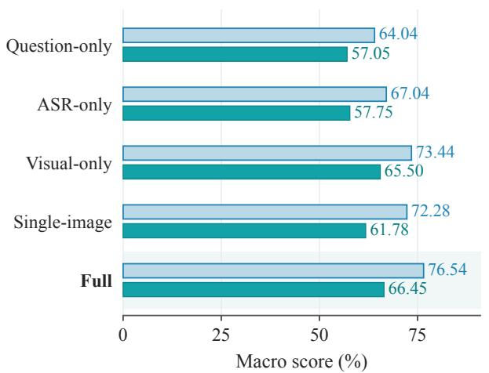

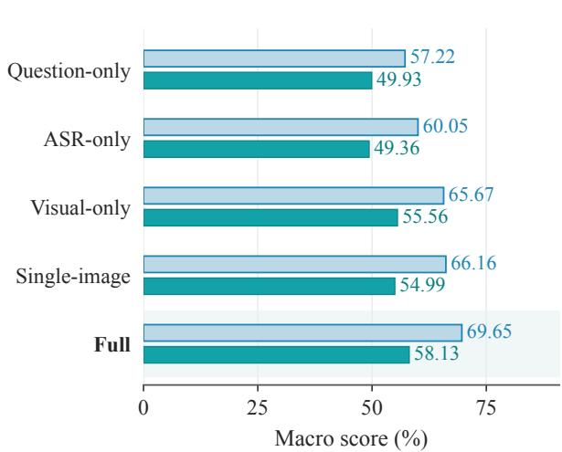  
Figure 11 Input controls for Qwen3.5-9B (left) and MiniCPM-V4.5 (right) on the same 1,000 PsycheMME questions. Paired bars show Raw and Verified macro scores. Full supplies video and ASR; Question-only supplies neither; ASRonly omits frames; Visual-only omits ASR. Single-image replaces the video frames with one midpoint image while retaining ASR. The Full condition is shaded for reference.

Input benefits for each capability. Full exceeds ASR-only in G Raw by 30.65 points for Qwen and 45.16 for MiniCPM. Full exceeds Visual-only in Qwen N by 10.31 and MiniCPM S by 13.40 points.

## I.2 Single Images

The comparison using a single image replaces the sampled video frames with one midpoint image while keeping the remaining inputs fixed. Qwen Raw decreases by 4.26 macro points (95% CI [−6.31, −2.26]), including 12.63 points in G and 6.41 in W. Its T score decreases by 8.33 points ([−18.57, 1.56]). MiniCPM Raw decreases by 3.49 macro points ([−5.65, −1.31]). The aggregate losses indicate a benefit from broade visual coverage.

## J Historical Context and Memory Controls

The history intervention evaluates Qwen on 40 Memory single-choice questions from 24 episodes. Matched History supplies the relevant history for each question; No History omits it; Mismatched History substitutes another history using seeds 42, 2026, and 3407. The video, question, and remaining inputs are held fixed.

Matched History achieves 82.50 Raw and 74.55 Verified, compared with 42.50/25.28 for No History. The paired gains are 40.00 Raw points (95% CI [26.32, 53.66]) and 49.27 Verified points ([35.80, 61.97]). Mis matched History averages 45.00/23.87 across the three seeds (Table 26). Figure 12 compares these conditions and their confidence intervals.

Table 26 History interventions for Qwen on 40 Memory single-choice questions from 24 episodes. Raw and Verified are micro scores (%); mismatched histories are sampled using three random seeds.
<table><tr><td>Condition</td><td>Seed</td><td>n</td><td>Raw</td><td>Ver.</td></tr><tr><td>Matched history</td><td>-</td><td>40</td><td>82.50</td><td>74.55</td></tr><tr><td>No history</td><td>1</td><td>40</td><td>42.50</td><td>25.28</td></tr><tr><td>Mismatched history</td><td>42</td><td>40</td><td>45.00</td><td>24.64</td></tr><tr><td>Mismatched history</td><td>2026</td><td>40</td><td>42.50</td><td>22.05</td></tr><tr><td>Mismatched history</td><td>3407</td><td>40</td><td>47.50</td><td>24.91</td></tr><tr><td>Mean with mismatched history</td><td>3 seeds</td><td>40</td><td>45.00</td><td>23.87</td></tr></table>

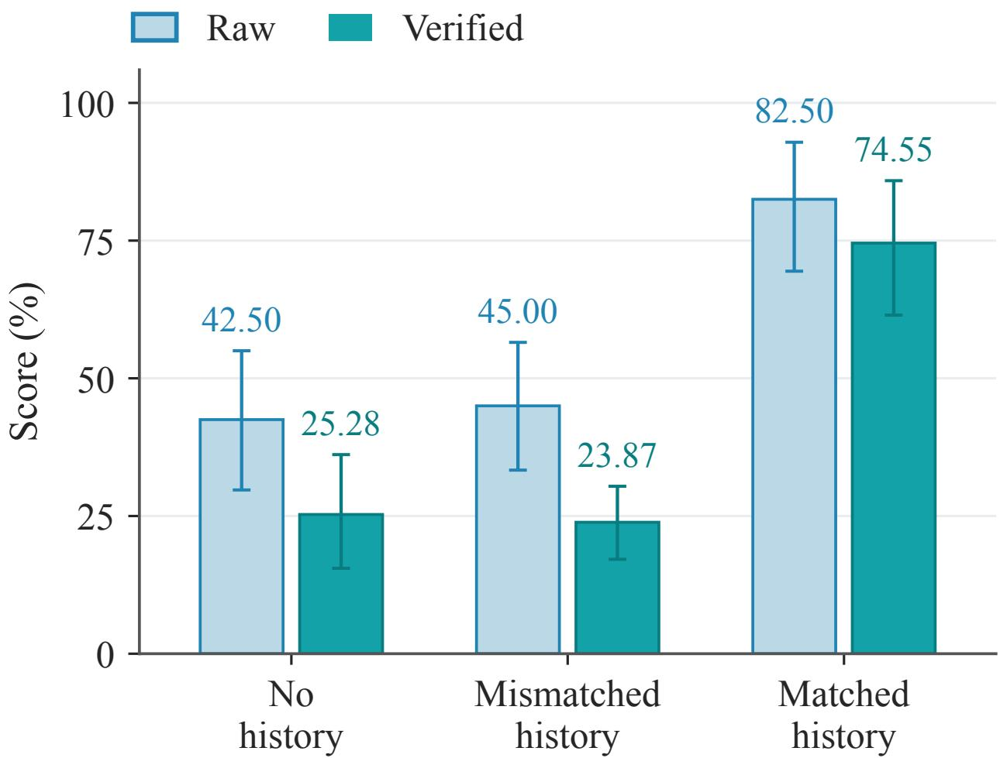  
Figure 12 History controls for Qwen3.5-9B on the same 40 Memory questions from 24 episodes. Bars show Raw and Verified scores with 95% intervals from bootstrapping episodes. Mismatched History averages seeds 42, 2026, and 3407; its interval is computed for that mean.

Relative to No History, Mismatched History changes Raw by +2.50 points ([−2.86, 9.40]) and Verified by −1.41 ([−9.13, 5.66]).

## K Human Baseline

## K.1 Question Answering Protocol

Five annotators independently answer 300 randomly sampled benchmark questions spanning all eight capabilities, providing one response per annotator for each question (1,500 responses). Answers are scored against the benchmark references. This experiment measures human answer accuracy.

## K.2 Aggregation and Reporting

Raw micro accuracy pools all 1,500 responses: 1,279 are correct, giving 85.27%. Raw macro accuracy averages the pooled accuracy within each of the eight capabilities, giving 84.82%. Table 27 reports individual and pooled results; Table 28 reports the capability breakdown.

Table 27 Human answer accuracy. Five annotators independently answer 300 randomly sampled questions; micro pools responses, and macro averages the eight capability accuracies.
<table><tr><td>Annotator</td><td>Responses</td><td>Correct</td><td>Raw (%)</td></tr><tr><td>A</td><td>300</td><td>260</td><td>86.67</td></tr><tr><td>B</td><td>300</td><td>253</td><td>84.33</td></tr><tr><td>C</td><td>300</td><td>259</td><td>86.33</td></tr><tr><td>D</td><td>300</td><td>254</td><td>84.67</td></tr><tr><td>E</td><td>300</td><td>253</td><td>84.33</td></tr><tr><td>Pooled micro</td><td>1,500</td><td>1,279</td><td>85.27</td></tr><tr><td>Capability macro</td><td>-</td><td>-</td><td>84.82</td></tr></table>

Table 28 Human accuracy by capability. n counts distinct questions; every question receives five independent answers.
<table><tr><td>Capability</td><td>n</td><td>Correct / responses</td><td>Raw (%)</td></tr><tr><td>G</td><td>47</td><td>216/235</td><td>91.91</td></tr><tr><td>W</td><td>36</td><td>149/180</td><td>82.78</td></tr><tr><td>N</td><td>31</td><td>125/155</td><td>80.65</td></tr><tr><td>T</td><td>35</td><td>139/175</td><td>79.43</td></tr><tr><td>S</td><td>43</td><td>187/215</td><td>86.98</td></tr><tr><td>A</td><td>39</td><td>166/195</td><td>85.13</td></tr><tr><td>M</td><td>32</td><td>132/160</td><td>82.50</td></tr><tr><td>R</td><td>37</td><td>165/185</td><td>89.19</td></tr><tr><td>Micro</td><td>300</td><td>1,279/1,500</td><td>85.27</td></tr><tr><td>Macro</td><td>-</td><td>-</td><td>84.82</td></tr></table>

## L Human-Judge Agreement

We measure Human-Judge Agreement through expert endorsement of the presented Judge decisions. Five psychology experts independently review 300 randomly sampled Judge cases spanning all eight capabilities, yielding 1,500 assessments. Each expert examines the Judge’s labels and justifications against the reference cues and records whether they agree with the presented decision.

Experts endorse the Judge’s decisions in 1,352 assessments (90.13%). The mean agreement rate across the eight capabilities is 89.79%. Table 29 reports individual and pooled agreement, and Table 30 reports results by capability.

Table 29 Human-Judge Agreement in 1,500 expert reviews of 300 randomly sampled Judge cases. Agreement denotes endorsement of the presented decision.
<table><tr><td>Expert</td><td>Reviews</td><td>Endorsed</td><td>Rate (%)</td></tr><tr><td>A</td><td>300</td><td>275</td><td>91.67</td></tr><tr><td>B</td><td>300</td><td>266</td><td>88.67</td></tr><tr><td>C</td><td>300</td><td>272</td><td>90.67</td></tr><tr><td>D</td><td>300</td><td>268</td><td>89.33</td></tr><tr><td>E</td><td>300</td><td>271</td><td>90.33</td></tr><tr><td>Pooled micro</td><td>1,500</td><td>1,352</td><td>90.13</td></tr><tr><td>Capability macro</td><td>-</td><td>-</td><td>89.79</td></tr></table>

Table 30 Human-Judge Agreement by capability. n counts distinct cases; every case receives five independent expert reviews.
<table><tr><td>Capability</td><td>n</td><td>Endorsed / reviews</td><td>Rate (%)</td></tr><tr><td>G</td><td>48</td><td>230/240</td><td>95.83</td></tr><tr><td>W</td><td>38</td><td>170/190</td><td>89.47</td></tr><tr><td>N</td><td>32</td><td>144/160</td><td>90.00</td></tr><tr><td>T</td><td>33</td><td>146/165</td><td>88.48</td></tr><tr><td>S</td><td>42</td><td>196/210</td><td>93.33</td></tr><tr><td>A</td><td>36</td><td>164/180</td><td>91.11</td></tr><tr><td>M</td><td>36</td><td>158/180</td><td>87.78</td></tr><tr><td>R</td><td>35</td><td>144/175</td><td>82.29</td></tr><tr><td>Micro</td><td>300</td><td>1,352/1,500</td><td>90.13</td></tr><tr><td>Macro</td><td>-</td><td></td><td>89.79</td></tr></table>

## M Analysis Scope and Reproducibility

## M.1 Sample Sizes and Evaluation Units

Scores on the full benchmark use all 1,000 questions. Additional analyses use the question, episode, response, or review as their unit of observation. Table 31 summarizes these sample sizes. Uncertainty estimation based on episodes retains the dependence among questions from the same video and pairs the compared conditions.

Table 31 Counting units and analysis scope.
<table><tr><td>Analysis</td><td>Unit</td><td>Size</td></tr><tr><td>Full evaluation</td><td>Question / episode</td><td>1000 / 630</td></tr><tr><td>Conditional rationale</td><td>Individual model response Depends on capability</td><td></td></tr><tr><td>Proprietary Timing overlap</td><td>Single-choice question</td><td>72</td></tr><tr><td>Memory intervention</td><td>Question / episode</td><td>40  / 24</td></tr><tr><td>Human baseline</td><td>Question / response</td><td>300 / 1500</td></tr><tr><td>Human-Judge agreement</td><td>Judge case / review</td><td>300 / 1500</td></tr></table>

## M.2 Materials for Reproduction

Recomputation requires the benchmark questions, model predictions, Judge assessments, and evaluation configurations. Scores for individual questions follow the rubric in Appendix D.5. Each comparison uses the specified question subset, baseline condition, and episode bootstrap procedure.