# RACE: LEARNING MULTIMODAL SEARCH THROUGH REFERENTIAL ABSTRACTION AND COMPOSITIONAL EVIDENCE

Eric Tao1,\* Minhao Sun2,\* Liyan Liu1,\* Zhijing Wu2 Xiaohan Yu1 Lang Mei1 Li Huang1 Chao Feng1 Jinchao Ma1 Sichen Kang1 Siyu Mo1 Chong Chen1,†

1Huawei 2Beijing Institute of Technology

\*Equal contribution. †Corresponding author.

## ABSTRACT

Training multimodal search agents requires tasks that make visually grounded search necessary for determining the answer. Textual identity clues and unused target evidence allow shortcuts in synthetic questions, weakening supervision for visual search and evidence integration. We propose RACE, an image-conditioned task synthesis framework that constructs dependencies from images to targets and from target-specific evidence to answers. Referential Abstraction (RA) replaces identity-revealing text with specific visual references or ambiguous relational references resolved by searching among depicted candidates. Compositional Evidence (CE) links retrieved facts about multiple entities in one image or entities from different images into joint questions whose answers require every designated contribution. Both operations also apply to images found during search, allowing new visual observations to determine subsequent search targets or supply answer evidence. Fine-tuning Qwen3.5-27B on only 12K teacher-generated trajectories from RACE raises average accuracy across ten multimodal benchmarks from 53.5 to 56.0, a relative improvement of approximately 4.7% over the matched base agent. Our code, data, and model will be publicly available.

## 1 INTRODUCTION

Multimodal deep search requires agents to resolve targets in images, search for information about them, and combine evidence. When search reveals further targets in new images, resolving these references determines what to investigate next. Recent systems support multi-turn exploration, search guided by intermediate images, and concurrent search across entities (Huang et al., 2026b; Zhang et al., 2026b; Li et al., 2026). Synthetic-data pipelines link evidence across search steps or entities to construct challenging questions, then collect successful teacher trajectories for fine-tuning. Task structure governs whether answering these questions requires visual target resolution and joint evidence use.

Our central insight is that task synthesis should make visually grounded search necessary for determining the answer. This requires a dependency from images to targets and from target-specific evidence to the answer. Textual identity clues let a solver bypass the first dependency by recovering the target without the image (Figure 1(a)). A question can mention two targets while using evidence from just one (Figure 1(b)). These shortcuts bypass visual target resolution or joint evidence use. In the composed example, resolving the ambiguous reference assigns the two women’s facts to a directed comparison, whose answer requires both contributions (Figure 1(c)).

We introduce RACE (Referential Abstraction and Compositional Evidence), a framework that constructs these dependencies jointly from real images and retrieved evidence. Referential Abstraction (RA) ties target resolution to the image through specific visual references or ambiguous relational references verified by search. For ambiguous relational references, construction searches every candidate, supports one match, rules out alternatives, and screens the reference for text-only identity leakage.

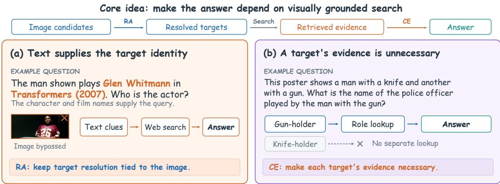

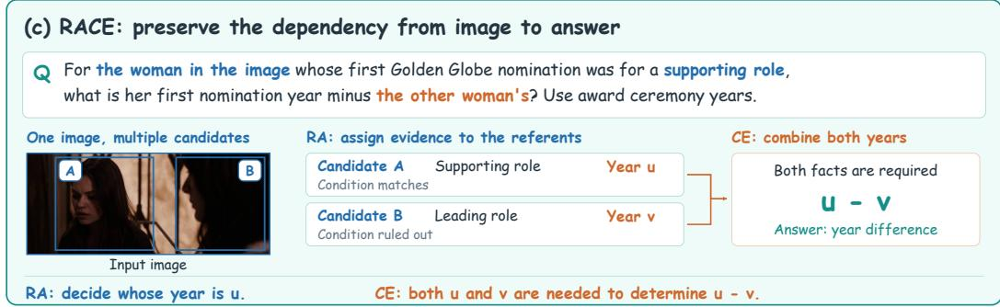  
Figure 1: Making visually grounded search necessary. (a) Textual identity clues allow the target to be identified without the image. (b) The question uses the gun-holder’s evidence while leaving the knife-holder’s evidence unused. (c) RA resolves the relational reference and assigns the two candidates’ years to u and v; CE combines both years to answer the directed comparison u − v. Arrows denote information dependencies.

Compositional Evidence (CE) makes the answer depend on every selected target’s evidence. It connects retrieved facts through supported relations to construct a joint question about multiple entities in one image or one entity from each of several images. The facts must jointly determine one answer, while removing any designated contribution leaves it undetermined. RA therefore establishes whose evidence is relevant, and CE specifies how those contributions determine the answer. This also supports multi-image questions in which every image supplies a necessary contribution.

The two operations recur as text and image searches reveal further targets or evidence, linking visual target resolution to subsequent search and the final answer. A teacher solves the resulting tasks using only their images and questions. We retain only trajectories whose final answers are judged correct against the reference answers for supervised fine-tuning (SFT).

We make three contributions:

• We frame task synthesis around making visually grounded search necessary for the answer. This perspective unifies identity leakage and unused entity evidence as breaks in the dependency from images, through targets and their evidence, to answers.

• We introduce RACE, which constructs this dependency through Referential Abstraction and Compositional Evidence: the former ties target resolution to images, while the latter makes every selected target’s evidence necessary for joint questions within or across images.

• We show that SFT on only 12K synthesized trajectories raises Qwen3.5-27B’s average accuracy from 53.5 to 56.0 across ten benchmarks (Table 1) and increases visual-tool use beyond the first round on all four primary benchmarks.

## 2 RELATED WORK

## 2.1 MULTIMODAL DEEP SEARCH AGENTS

Multimodal search agents learn to use image and text tools through supervised training or reinforcement learning (RL) (Geng et al., 2025; Wu et al., 2025; Narayan et al., 2025; Zhang et al., 2026c). OpenSearch-VL develops fine-grained visual tools (Chen et al., 2026), Vision-DeepResearch supports multi-turn, multi-entity, and multi-scale retrieval (Huang et al., 2026b), and HyperEyes optimizes parallel grounding and search (Li et al., 2026). Other methods address visual evidence reuse (Du et al., 2026), context compression by rendering historical text observations as images (Liu et al., 2026), reasoning over retrieved images (Zhang et al., 2026d), and adaptive task generation (Huang et al., 2026a). DeepVoyager-VL combines intermediate visual dependencies with selective acquisition of visual evidence for long-horizon search (Zhang et al., 2026b). RACE focuses on how task structure determines the reasoning taught by successful trajectories. It couples visual target discrimination with joint evidence use when constructing tasks for teacher supervision.

## 2.2 DATASETS AND BENCHMARKS

Knowledge-based VQA evaluates knowledge beyond image content (Marino et al., 2019; Schwenk et al., 2022) and fine-grained entity information (Chen et al., 2023). MMSearch and Vision-DeepResearch Benchmark evaluate multimodal retrieval and grounding (Jiang et al., 2024; Zeng et al., 2026). We evaluate on MMSearch-Plus, MM-BrowseComp, BrowseComp-V3, and VisBrowse Bench, which emphasize provenance, multimodal browsing, and visual evidence verification (Tao et al., 2025; Li et al., 2025; Zhang et al., 2026a;e). To generate training data for these agents, existing synthesis pipelines introduce images into textual tasks or knowledge paths (Geng et al., 2025; Chen et al., 2026), construct questions from complex images (Huang et al., 2026b), and incorporate visual detail steps or webpage images (Zhang et al., 2026d; Du et al., 2026). Structured approaches use scene graphs (Hudson & Manning, 2019; Yang et al., 2026) and image-rooted evidence hypergraphs (Yao et al., 2026). DeepVoyager-VL composes event-graph programs with necessary intermediate visual evidence and minimal constraint sets for answer determination (Zhang et al., 2026b), while HyperEyes constructs mosaic questions that require information from every selected entity (Li et al., 2026). RACE formulates synthesis over visually grounded targets, with separate conditions for unique reference resolution and each target’s necessary contribution to a joint answer. Coupling these conditions makes the reasoning requirements explicit at the target level, within scenes, across images, and throughout search.

## 3 METHOD

RACE synthesizes tasks around required dependencies from images to targets and from target-specific evidence to answers (Figure 2). Referential Abstraction ties target resolution to image-grounded references. Compositional Evidence makes each selected target’s evidence necessary for the joint answer. Ambiguous references are resolved through evidence retrieved for the depicted candidates. Grounding and dependency feedback guide revisions within these operations, including when search introduces new images. Teacher trajectories with correct final answers provide supervision for SFT

## 3.1 IMAGE-CONDITIONED TASK SYNTHESIS

We start from real images to link target identification in natural scenes to verifiable external evidence. Sources include social-media photographs, Bilibili video frames, and MovieNet film imagery (Huang et al., 2020). Questions and reference answers are generated from grounded targets and retrieved evidence. For unannotated images, lightweight filtering, visual analysis, and retrieval establish target identities. MovieNet annotations provide identity-to-image correspondences. Both routes supply grounded candidates and identity provenance to the generator.

For input images $\mathcal { I } = \{ I _ { 1 } , \ldots , I _ { m } \}$ , let $E _ { i }$ denote the candidates in image $I _ { i } .$ . The generator selects source targets $S \subseteq \textstyle \bigcup _ { i } E _ { i } .$ , constructs references $R = \{ \rho _ { e } : e \in S \}$ , explores textual and visual evidence $\breve { F } .$ , and defines an information requirement $c .$ These inputs determine the generated question

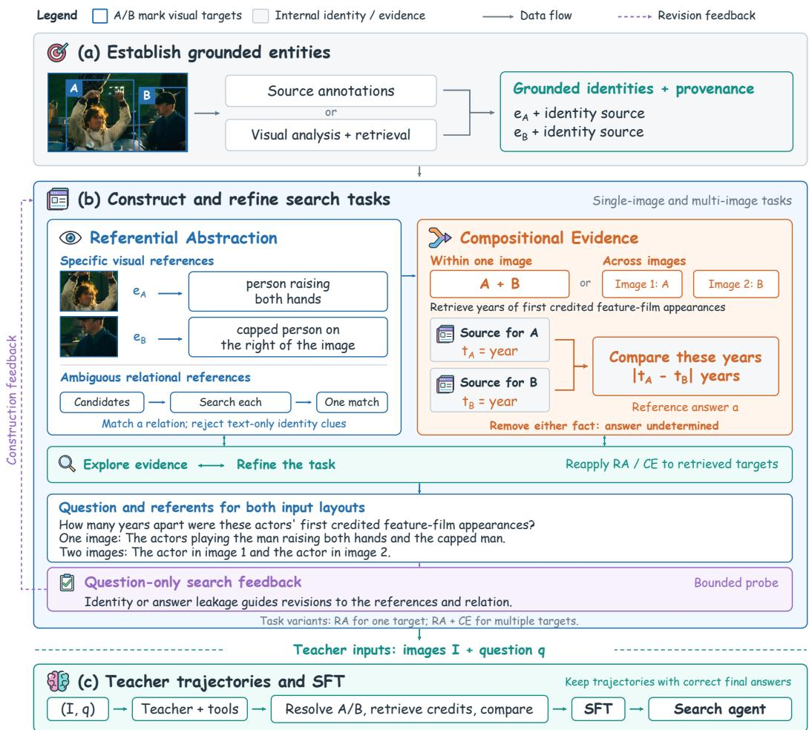  
Figure 2: RACE task synthesis and training. (a) Source annotations or visual analysis and retrieval establish target identities and provenance. (b) RA expresses targets through specific visual or ambiguous relational references. CE combines evidence from multiple targets within or across images. The example compares the years of the actors’ first credited feature-film appearances, yielding $\left| t _ { A } - t _ { B } \right|$ . Evidence exploration and question-only search feedback refine the task. (c) The teacher receives $( \boldsymbol { \mathcal { T } } , \boldsymbol { q } )$ and uses tools to solve the task; trajectories with correct final answers are retained for SFT.

and reference answer through

$$
\begin{array} { r } { ( q , a ) = G ( \mathbb { Z } , S , R , c , F ) , \qquad T = ( \mathbb { Z } , q , a ) , } \end{array}\tag{1}
$$

where q is the question and a its reference answer. Evidence exploration and question construction can alternate as supported requirements emerge. Search begins from the source targets and can reveal intermediate targets along the resulting evidence paths. Solver inputs are $( \boldsymbol { \mathcal { T } } , \boldsymbol { q } ) ;$ ; synthesis records store target identities, reference correspondences, construction evidence, and the reference answer. A question-only search probe tests whether the question reveals target identities or answers. The configurations, refinement procedure, and synthesis algorithm are detailed in Appendix C.

## 3.2 REFERENTIAL ABSTRACTION

RA supports two forms of reference for candidates E(V) in an initial or retrieved image V. For $\rho = \left( \nu , \phi \right)$ , ν specifies visible cues and ϕ is an optional condition checked against retrieved candidate

evidence $F _ { e }$ . Define the candidate set and resolved matches as

$$
\begin{array} { c } { { \displaystyle { \mathcal { C } ( V , \nu ) = \{ e \in E ( V ) : e \left| = \nu \nu \right\} } , } } \\ { { \displaystyle { \mathcal { M } ( V , \rho ; F ) = \{ e \in \mathcal { C } ( V , \nu ) : \phi ( e ; F _ { e } ) = 1 \} } . } } \end{array}\tag{2}
$$

Both forms require a unique match: $\mathcal { M } ( V , \rho ; F ) = \{ e ^ { \star } \}$

Specific visual references. Here $\phi \equiv 1$ and $\mathcal C ( V , \nu ) = \{ e ^ { \star } \}$ : appearance, position, order, spatial relations, or occlusion locate the target before retrieval. Examples include “the third person from the left,” “the person to the left of the one in blue,” and “the person partly hidden behind the post.”

Ambiguous relational references. Here $| { \mathcal { C } } ( V , \nu ) | > 1$ , and $\phi$ selects among visually plausible candidates using retrieved relations or histories. For example, “the man in the image who appeared in a crime film in year $y '$ requires checking the candidates’ filmographies. Construction must search every candidate, support one match, and rule out all alternatives; unresolved cases are rejected. The condition must remain non-unique outside the image; a question-only search probe checks for identity or answer leakage.

RA excludes direct identity disclosures and pairs the resolved reference with a supported information request. Its candidate searches establish the referent; CE combines facts about resolved targets into a joint answer.

## 3.3 COMPOSITIONAL EVIDENCE

Compositional Evidence constructs joint questions from retrieved facts about multiple targets. For source images $I _ { 1 } , \ldots , I _ { m }$ , the selected targets are

$$
S _ { i } \subseteq E _ { i } , \qquad S = \bigcup _ { i = 1 } ^ { m } S _ { i } , \qquad | S | \geq 2 .\tag{3}
$$

Within-image composition uses $m = 1$ and $\left| S _ { 1 } \right| \geq 2$ . Cross-image composition uses $m \geq 2$ and $S _ { i } = \{ e _ { i } \}$ , with a distinct grounded target from each image and $| \{ i : S _ { i } \neq \emptyset \} | \ge 2 .$ . The generator searches each target and records its facts, sources, and image provenance. It then connects the evidence through compatible quantities, shared relations, or intersecting constraints. If no supported joint relation can be constructed, the target or image selection is revised or discarded.

Let $z _ { 1 } , \ldots , z _ { k }$ denote the selected evidence contributions, with each target supplying at least one. CE constructs

$$
a = c ( z _ { 1 } , \ldots , z _ { k } ) , \qquad k \geq 2 .\tag{4}
$$

For example, the years of two actors’ first credited feature-film appearances support a year-difference question whether they are referenced in one image or separate images. The generated question refers to every required target and image, and the recorded solution links each contribution to the answer.

Let $[ k ] = \{ 1 , \dots , k \}$ and let ${ \mathcal { D } } _ { c } ( U )$ denote answers consistent with the question and designated facts indexed by $U \subseteq [ k ]$ . The construction requires joint sufficiency and individual necessity:

$$
\mathscr { V } _ { c } ( [ k ] ) = \{ a \} , \qquad | \mathscr { V } _ { c } ( [ k ] \setminus \{ j \} ) | > 1 \quad \mathrm { f o r e v e r y ~ } j \in [ k ] .\tag{5}
$$

All designated facts determine one answer; removing any one leaves it undetermined under the constructed requirement. Each image must supply necessary evidence through its target, so removing an image’s contributions must also leave the answer undetermined. CE checks source support and recorded dependencies, revising or rejecting unsupported relations and redundant contributions. Shortcut probes test additional solution paths within a search budget (Appendix C). Both configurations also apply to targets introduced by retrieved images.

## 3.4 APPLYING THE OPERATIONS DURING SEARCH

A retrieved image can supply answer evidence or determine the next search target. To obtain answer evidence, the generator retrieves an image J associated with a target and identifies a relevant visual attribute $v ( J )$ , such as a color, spatial configuration, or inscription. The question identifies J through

its relation to the target and asks the solver to acquire the attribute. Its value can answer the question directly or contribute to a joint answer through

$$
a = v ( J ) \qquad { \mathrm { o r } } \qquad a = c { \bigl ( } v ( J ) , z _ { 2 } , \ldots , z _ { k } { \bigr ) } .\tag{6}
$$

When a retrieved scene determines the next search target, the generator applies Referential Abstraction again. A reference $\rho _ { W }$ selects a target W in an input image. Retrieval supplies a scene J, in which a reference $\rho _ { W ^ { \prime } }$ selects a further target $W ^ { \prime }$ for subsequent search:

$$
W \xrightarrow { \mathrm { r e t r i e v e } } J \xrightarrow { \rho _ { W ^ { \prime } } } W ^ { \prime } \xrightarrow { \mathrm { s e a r c h } } z ( W ^ { \prime } ) .\tag{7}
$$

The retrieved fact $z ( W ^ { \prime } )$ can answer a single-target question or contribute to a composed answer $a = c ( z ( W ^ { \prime } ) , z _ { 2 } , \dots , z _ { k } )$ . The reference in J specifies which depicted entity supplies the next information requirement. The operations also assess whether each required image can be located from preceding evidence and what it establishes for the answer or a later step. As requirements expand, an earlier answer can become an intermediate fact. A retrieved image can serve both roles, and information from several newly observed targets can be composed.

## 3.5 TEACHER TRAJECTORIES AND SUPERVISED FINE-TUNING

Qwen3.7-Plus solves retained tasks with search tools, receiving only their images and questions. For N retained tasks $T _ { n } = ( { \cal T } _ { n } , q _ { n } , a _ { n } )$ , teacher execution and trajectory selection give

$$
\tau _ { n } \sim \pi _ { \mathrm { T } } ( \cdot \mid \mathcal { T } _ { n } , q _ { n } ) , \qquad \mathcal { D } = \{ ( \mathcal { T } _ { n } , q _ { n } , \tau _ { n } ) : g _ { \mathrm { t r a j } } ( \tau _ { n } , a _ { n } ) = 1 \} .\tag{8}
$$

Here $g _ { \mathrm { t r a j } } ( \tau _ { n } , a _ { n } ) = 1$ requires a protocol-valid trajectory whose final answer is judged correct against $a _ { n }$ . Each trajectory records assistant outputs and tool observations in execution order, capturing how visual references guide retrieval and how evidence supports the answer. We train Qwen3.5-27B on 12K synthesized trajectories in one SFT stage. For trajectory tokens $u _ { 1 } , \ldots , u _ { L }$ we minimize the loss over assistant-output positions $\boldsymbol { \mathcal { A } } ( \tau )$

$$
\mathcal { L } _ { \mathrm { S F T } } ( \theta ) = - \mathbb { E } _ { ( \mathcal { T } , q , \tau ) \sim \mathcal { D } } \left[ \sum _ { \boldsymbol { t } \in A ( \tau ) } \log p _ { \theta } ( u _ { t } \mid \mathcal { T } , q , u _ { < t } ) \right] .\tag{9}
$$

Tool observations provide context, while assistant tool calls and responses provide supervised outputs.   
The questions and demonstrations in D carry the construction requirements into training.

## 4 EXPERIMENTS

We evaluate RACE under a shared student model and interaction environment. We first compare answer accuracy before and after SFT, then analyze how training changes tool use and visual revisiting.

## 4.1 EXPERIMENTAL SETUP

Training and evaluation. We train Qwen3.5-27B in one SFT stage using only 12K trajectories generated by Qwen3.7-Plus from our synthesized tasks. Assistant tool calls and responses are supervised, while tool observations provide context. The primary evaluation covers MMSearch-Plus (Tao et al., 2025), MM-BrowseComp (Li et al., 2025), BrowseComp-V3 (Zhang et al., 2026a), and VisBrowse-Bench (Zhang et al., 2026e). These benchmarks assess fine-grained visual-cue use, multimodal retrieval and reasoning, and evidence acquisition and verification during browsing. We report final-answer accuracy under each benchmark’s scoring protocol, separately from behavioral measures. Evaluation sets are specified in Appendix A. Supplementary comparisons cover BrowseComp-VL, VDR, MMSearch, SimpleVQA (Cheng et al., 2025), LiveVQA (Fu et al., 2025), and FVQA (Wang et al., 2016) (Table 1). Avg. weights all ten benchmarks equally and is reported only for rows with complete aggregate scores.

Comparisons. Baselines include frontier API models, large backbones, and agents trained for multimodal search. Our Qwen3.5-27B base and SFT agents share test sets, tool access, decoding settings, inference budgets, and scoring settings. Published agents, including Vision-DeepResearch (Huang et al., 2026b), retain their reported model sizes and training regimes. Score sources and evaluation variants are recorded in Appendix A.

Table 1: Search accuracy and factual generalization (%, ↑). Results cover four primary search benchmarks and six supplementary benchmarks. Models are grouped by role. The final block compares Qwen3.5-27B before and after SFT under matched settings. Avg. is the unweighted mean over all ten benchmarks.
<table><tr><td></td><td colspan="6">Multimodal search</td><td colspan="4">Factual generalization</td><td></td></tr><tr><td>Model / setting</td><td>MM-</td><td>BC MS+ BC-V3 VisB BC-VL VDR Search VQA VQA FVQA Avg.</td><td></td><td></td><td></td><td></td><td></td><td></td><td>MM Simple Live</td><td></td><td></td></tr><tr><td colspan="10">Frontier API and large-backbone references</td></tr><tr><td>Qwen3.5-397B-A17B</td><td></td><td>46.042.1</td><td>31.052.7</td><td></td><td>49.4</td><td></td><td>78.3</td><td>76.4</td><td>85.2</td><td>77.1</td><td></td></tr><tr><td>Qwen3.7-Plus</td><td></td><td>37.1 46.3</td><td></td><td>42.3 59.8</td><td>55.630.2</td><td></td><td>80.7</td><td>77.7</td><td>84.6</td><td></td><td>79.7 59.4</td></tr><tr><td>Qwen3.8-Max</td><td></td><td>53.2 59.1</td><td></td><td>56.3 66.9</td><td></td><td>33.2</td><td>84.0</td><td>83.8</td><td>88.8</td><td>85.6</td><td></td></tr><tr><td>Gemini-3.1-Pro</td><td></td><td>48.7 51.5</td><td></td><td>50.0 62.1</td><td>65.9</td><td>40.8</td><td>86.1</td><td>81.0</td><td>87.3</td><td></td><td>84.0 65.7</td></tr><tr><td colspan="10">Specialized multimodal search agents (30B-32B)</td></tr><tr><td>WebWatcher-32B</td><td></td><td></td><td>8.7</td><td></td><td>27.0</td><td></td><td>55.3</td><td></td><td>59.058.7</td><td></td><td></td></tr><tr><td>SenseNova-MARS-32B</td><td></td><td></td><td></td><td></td><td></td><td></td><td>74.3</td><td>74.1</td><td>60.8</td><td>72.6</td><td></td></tr><tr><td>Vision-DeepResearch-30B-A3B</td><td></td><td>28.5</td><td></td><td></td><td>53.7 37.8</td><td></td><td>69.6</td><td></td><td>77.6</td><td>74.2</td><td></td></tr><tr><td>OpenSearch-VL-30B-A3B</td><td></td><td></td><td></td><td></td><td>41.1 33.5</td><td></td><td>68.7</td><td>74.9</td><td>67.4</td><td>73.2</td><td></td></tr><tr><td>REDSearcher-MM-RL-30B-A3B</td><td></td><td>23.5 26.6</td><td></td><td></td><td>57.2</td><td></td><td>72.9</td><td></td><td>79.3</td><td></td><td></td></tr><tr><td>Skywork-R1V4-30B-A3B</td><td></td><td></td><td></td><td></td><td>38.4</td><td></td><td>66.1</td><td></td><td></td><td>67.2</td><td></td></tr><tr><td>MM-DeepResearch-32B</td><td></td><td></td><td></td><td></td><td>43.0</td><td></td><td>69.0</td><td>67.6</td><td>68.0</td><td>70.1</td><td></td></tr><tr><td>LMM-Searcher-30B-A3B (30 turns)</td><td></td><td>22.332.9</td><td></td><td>42.0</td><td></td><td></td><td>71.0</td><td></td><td></td><td></td><td></td></tr><tr><td>same model, 100 turns</td><td></td><td>30.1 34.8</td><td></td><td>48.3</td><td></td><td></td><td>72.3</td><td></td><td></td><td></td><td></td></tr><tr><td>SimpleSearch-VL-30B-A3B</td><td></td><td>34.4</td><td></td><td></td><td>55.9</td><td></td><td>83.6</td><td></td><td>79.6 81.1</td><td>79.0</td><td></td></tr></table>

<table><tr><td colspan="10">Our study with the Qwen3.5-27B backbone under identical settings</td></tr><tr><td>Qwen3.5-27B (base agent)</td><td>31.337.6</td><td></td><td>31.748.5</td><td>47.9</td><td>24.4</td><td>79.3</td><td>74.5</td><td>84.5</td><td>75.7 53.5</td></tr><tr><td>RACE-27B (ours)</td><td>33.5 40.2</td><td></td><td>36.7 51.5</td><td>54.2</td><td>27.4</td><td>78.7</td><td>75.5</td><td>85.0</td><td>76.8 56.0</td></tr><tr><td>∆</td><td>+2.2 +2.6</td><td></td><td>+5.0 +3.0</td><td>+6.3 +3.0</td><td></td><td>-0.6</td><td>+1.0</td><td>+0.5</td><td>+1.1 +2.5</td></tr></table>

Notes. Sources and evaluation settings are detailed in Appendix A. Abbreviations are MM-BC (MM-BrowseComp), MS+ (MMSearch-Plus), BC-V3 (BrowseComp-V3), VisB (VisBrowse-Bench), and BC-VL (BrowseComp-VL). Avg. is the unweighted mean of all ten aggregate scores. Published scores retain their source-specific evaluation settings. Here — denotes unavailable scores. LMM-Searcher uses Thinking initialization and the MS+ single-image subset. Turn budgets are listed b row. ∆ denotes SFT minus matched base-agent performance, computed from displayed scores, in percentage points.

## 4.2 MAIN RESULTS

RACE consistently improves performance over the base agent. SFT improves Qwen3.5-27B on all four primary benchmarks by 2.2-5.0 percentage points, averaging 3.2 points under matched evaluation settings (Table 1). Accuracy improves on nine of the ten evaluated benchmarks.

Gains are larger on search-oriented benchmarks. The largest improvements occur on BrowseComp-VL and BrowseComp-V3, at 6.3 and 5.0 points, respectively, compared with 0.5- 1.1 points on SimpleVQA, LiveVQA, and FVQA (Table 1). On MMSearch, accuracy decreases by 0.6 points.

## 4.3 TRAINING-DATA COMPARISON

RACE supervision outperforms the compared open-source training mixture. With the same Qwen3.5-27B backbone, SFT on only 12K RACE trajectories exceeds SFT on only 28K opensource trajectories by 0.4-3.0 percentage points across all four primary benchmarks (Table 2). The 28K open-source training mixture combines data from OpenSearch-VL, Vision-DeepResearch, and REDSearcher-MM.

## 4.4 TRAINING-TRAJECTORY CHARACTERISTICS

Visual tools comprise image search, text-to-image search, and image cropping; calls within one assistant message form a tool round.

RACE trajectories more often use multiple input images. At least two images occur in the initial input of 41.2% of RACE trajectories, compared with at most 28.9% across the three training-source baselines (Figure 3).

Table 2: Training-data comparison (%, ↑). Each SFT variant uses only the indicated training data.
<table><tr><td>Training setting</td><td>MM-BC MS+ BC-V3 VisB</td></tr><tr><td>Qwen3.5-27B (Agentic)</td><td>31.3 37.6 31.7 48.5</td></tr><tr><td>Open-source only (28K)</td><td>32.1 37.9 36.3 48.5</td></tr><tr><td>Ours only (12K)</td><td>33.5 40.2 36.7 51.5</td></tr></table>

Figure 3: Multi-image input. Trajectory proportions across training sources.

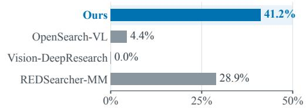

Visual calls occur more often after the first round. Visual-tool use extended beyond the first round in 34.6% of Ours trajectories, compared with 6.0%, 5.6%, and 1.7% for OpenSearch-VL, Vision-DeepResearch, and REDSearcher-MM, respectively (Figure 4(c)). This higher rate persisted within each of four round-count ranges (Appendix B.4).

Visual-web-visual sequences are more frequent. A visual call followed by web search or page fetching and another visual call occurred in 28.8% of Ours trajectories, compared with 4.8%, 4.5%, and 1.4% for the same baselines (Figure 4(b)). This visual-web-visual pattern follows serialized call order and allows intervening calls. Ours also had a larger share of trajectories with multiple visual calls (Figure 4(a)) and used more distinct tool types per trajectory on average: 3.16 versus 2.86-2.93 (Figure 4(c)). Metric definitions and supplementary visual-span statistics are provided in Appendices B.1 and B.5.

## 4.5 EVALUATION-TIME SEARCH BEHAVIOR

SFT increases visual-call share and total tool use. After SFT, the student used visual tools beyond the first round more often on all four held-out benchmarks, with increases of 12.5-19.5 points (Figure 5(c)). Visual-call share, the within-trajectory fraction of visual calls averaged across trajectories, also increased on every benchmark, by 5.4-12.3 points (Figure 5(b)). These changes accompanied an increase of 3.0-20.4 tool calls per trajectory, largest on MM-BrowseComp (Figure 5(a)).

Visual use after the first round increases across task structures. Across 790 matched question pairs grouped by dependency depth, checklist length, and input-image count, the SFT agent has higher point estimates of post-first-round visual use in all nine strata (Tables 4-6). On MMSearch-Plus, the difference is 24.1 points for two-image questions and 5.7 points for questions with three or more images. Paired 95% confidence intervals include zero in three strata (Figure 6, Appendix B.2).

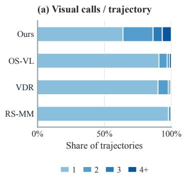

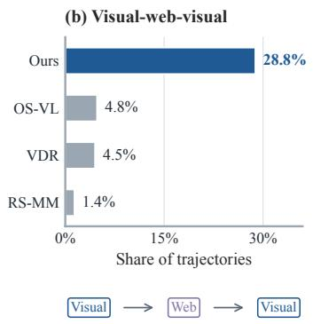

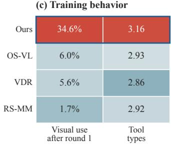

Figure 4: Training trajectory distributions and behavior. (a) Visual calls per trajectory. (b) Proportion of trajectories containing a visual-web-visual pattern: a visual call, web search or page fetching, and another visual call in serialized order, with intervening calls allowed. (c) The proportion of trajectories with visual calls after the first tool round and mean number of distinct tool types. Colors are standardized within each metric, and the blue outline marks Ours. Abbreviations: OS-VL, OpenSearch-VL; VDR, Vision-DeepResearch; RS-MM, REDSearcher-MM.  
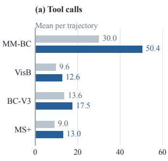

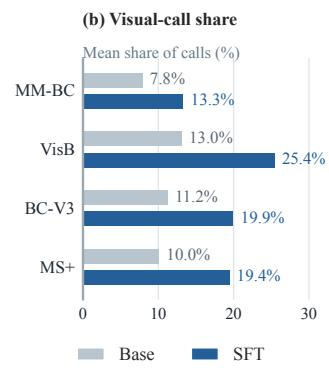

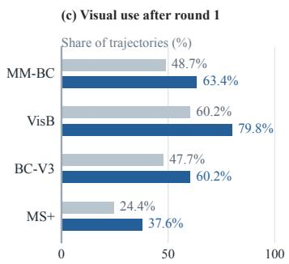  
Figure 5: Evaluation-time search behavior before and after SFT. Gray and blue bars give baseagent and SFT-agent point estimates, respectively. (a) Mean tool calls per trajectory. (b) Mean within-trajectory fraction of tool calls that use visual tools. (c) Fraction of trajectories that use visual tools after the first tool round. Panels (b) and (c) show percentages. Abbreviations: MM-BC, MM-BrowseComp; VisB, VisBrowse-Bench; BC-V3, BrowseComp-V3; MS+, MMSearch-Plus.

## 5 CONCLUSION

We introduced RACE, an image-conditioned task synthesis framework that constructs dependencies from images to targets and from their evidence to answers. Referential Abstraction ties target resolution to image-grounded references, and Compositional Evidence connects the resolved targets evidence to a joint answer that requires every designated contribution. Both operations apply to initial and retrieved images, so new observations can establish further targets or contribute answer evidence. Grounding and dependency feedback refine the two operations during synthesis, with question-only probes identifying additional shortcuts. Fine-tuning Qwen3.5-27B on only 12K teacher-generated trajectories raises average accuracy across ten multimodal benchmarks from 53.5 to 56.0, a gain of 2.5 points over the matched base agent.

## AI USE STATEMENT

Generative AI assisted task synthesis and manuscript preparation, including drafting, language editing, and reference lookup. In the synthesis pipeline, models ground visual targets, construct questions and reference answers, and support quality checks and shortcut probes (Section 3 and Appendix C). Qwen3.7-Plus generates the search trajectories used for supervised fine-tuning. The authors take responsibility for the manuscript, synthesized data, and reported findings.

## ETHICS STATEMENT

The use and redistribution of RACE’s images and web evidence must respect source licenses, platform terms, and the privacy of identifiable people. Synthetic questions, reference answers, and trajectories carry risks of factual error and bias from source material and generative models. Construction checks cover task grounding, answer support, and shortcuts. Applications involving personal information or consequential decisions require privacy and safety review.

## REPRODUCIBILITY STATEMENT

Section 3 and Appendix C describe the synthesis procedure, screening, and SFT objective. Section 4.1 and Appendix A specify the evaluated models, benchmark sets, score sources, and decoding settings and iteration limits from archived runs. Appendix B documents trajectory selection, behavioral metrics, and uncertainty estimation. We plan to release the synthesis and analysis code, prompts, and redistributable task and trajectory data, together with the data and scripts underlying the reported tables and figures. Re-running synthesis and evaluation requires the corresponding models, image assets, and search services; web content, retrieval responses, and hosted models vary over time.

## REFERENCES

Shuang Chen, Kaituo Feng, Hangting Chen, Wenxuan Huang, Dasen Dai, Quanxin Shou, Yunlong Lin, Xiangyu Yue, Shenghua Gao, and Tianyu Pang. OpenSearch-VL: An Open Recipe for Frontier Multimodal Search Agents, 2026. URL https://arxiv.org/abs/2605.05185. arXiv:2605.05185.

Yang Chen, Hexiang Hu, Yi Luan, Haitian Sun, Soravit Changpinyo, Alan Ritter, and Ming-Wei Chang. Can Pre-trained Vision and Language Models Answer Visual Information-Seeking Questions?, 2023. URL https://arxiv.org/abs/2302.11713.

Xianfu Cheng, Wei Zhang, Shiwei Zhang, Jian Yang, Xiangyuan Guan, Xianjie Wu, Xiang Li, Ge Zhang, Jiaheng Liu, Yuying Mai, Yutao Zeng, Zhoufutu Wen, Ke Jin, Baorui Wang, Weixiao Zhou, Yunhong Lu, Hangyuan Ji, Tongliang Li, Wenhao Huang, and Zhoujun Li. SimpleVQA: Multimodal Factuality Evaluation for Multimodal Large Language Models. In Proceedings ofthe IEEE/CVF International Conference on Computer Vision (ICCV), pp. 4637-4646, October 2025. URL https://openaccess.thecvf.com/content/ICCV2025/html/Cheng\_ SimpleVQA\_Multimodal\_Factuality\_Evaluation\_for\_Multimodal\_Large\_ Language\_Models\_ICCV\_2025\_paper.html.

Yong Xien Chng, Tao Hu, Wenwen Tong, Xueheng Li, Jiandong Chen, Haojia Yu, Jiefan Lu, Hewei Guo, Hanming Deng, Chengjun Xie, Gao Huang, Dahua Lin, and Lewei Lu. SenseNova-MARS: Empowering Multimodal Agentic Reasoning and Search via Reinforcement Learning, 2025. URL https://arxiv.org/abs/2512.24330.

Zheng Chu, Xiao Wang, Jack Hong, Huiming Fan, Yuqi Huang, Yue Yang, Guohai Xu, Chenxiao Zhao, Cheng Xiang, Shengchao Hu, Dongdong Kuang, Ming Liu, Bing Qin, and Xing Yu. REDSearcher: A Scalable and Cost-Efficient Framework for Long-Horizon Search Agents, 2026. URL https://arxiv.org/abs/2602.14234.

Ming Dai, Zhihong Lu, Jinjie Gu, Jiedong Zhuang, Yefeng Liu, Wankou Yang, Jian Wang, and Chunhua Shen. SimpleSearch-VL: A Simple Recipe for Multimodal Agentic Deep Search, 2026. URL https://arxiv.org/abs/2606.31504.

Yifan Du, Zikang Liu, Jinbiao Peng, Jie Wu, Junyi Li, Jinyang Li, Wayne Xin Zhao, and Ji-Rong Wen. Towards Long-horizon Agentic Multimodal Search, 2026. URL https://arxiv.org/ abs/2604.12890v1. arXiv:2604.12890v1.

Mingyang Fu, Yuyang Peng, Benlin Liu, Yao Wan, and Dongping Chen. LiveVQA: Live Visual Knowledge Seeking, 2025. URL https://arxiv.org/abs/2504.05288v1.

Xinyu Geng, Peng Xia, Zhen Zhang, Xinyu Wang, Qiuchen Wang, Ruixue Ding, Chenxi Wang, Jialong Wu, Yida Zhao, Kuan Li, Yong Jiang, Pengjun Xie, Fei Huang, and Jingren Zhou.

WebWatcher: Breaking New Frontiers of Vision-Language Deep Research Agent, 2025. URL https://arxiv.org/abs/2508.05748v1. arXiv:2508.05748v1.

Qingqiu Huang, Yu Xiong, Anyi Rao, Jiaze Wang, and Dahua Lin. Movienet: A holistic dataset for movie understanding. In The European Conference on Computer Vision (ECCV), 2020.

Shijue Huang, Hangyu Guo, Guanting Dong, Chenxin Li, Junting Lu, Xinyu Geng, Zhaochen Su, Zhenyu Li, Shuang Chen, Hongru Wang, and Yi R. Fung. Towards On-Policy Data Evolution for Visual-Native Multimodal Deep Search Agents, 2026a. URL https://arxiv.org/abs/ 2605.10832. arXiv:2605.10832.

Wenxuan Huang, Yu Zeng, Qiuchen Wang, Zhen Fang, Shaosheng Cao, Zheng Chu, Qingyu Yin, Shuang Chen, Zhenfei Yin, Lin Chen, Zehui Chen, Xu Tang, Yao Hu, Shaohui Lin, Philip Torr, Feng Zhao, and Wanli Ouyang. Vision-DeepResearch: Incentivizing DeepResearch Capability in Multimodal Large Language Models, 2026b. URL https://arxiv.org/abs/2601. 22060. arXiv:2601.22060.

Drew A. Hudson and Christopher D. Manning. GQA: A New Dataset for Real-World Visual Reasoning and Compositional Question Answering, 2019. URL https://arxiv.org/abs/ 1902.09506. arXiv:1902.09506.

Dongzhi Jiang, Renrui Zhang, Ziyu Guo, Yanmin Wu, Jiayi Lei, Pengshuo Qiu, Pan Lu, Zehui Chen, Chaoyou Fu, Guanglu Song, Peng Gao, Yu Liu, Chunyuan Li, and Hongsheng Li. MMSearch: Benchmarking the Potential of Large Models as Multi-modal Search Engines, 2024. URL https: //arxiv.org/abs/2409.12959.

Guankai Li, Jiabin Chen, Yi Xu, Xichen Zhang, and Yuan Lu. HyperEyes: Dual-Grained Efficiency-Aware Reinforcement Learning for Parallel Multimodal Search Agents, 2026. URL https: //arxiv.org/abs/2605.07177v2. arXiv:2605.07177v2.

Shilong Li, Xingyuan Bu, Wenjie Wang, Jiaheng Liu, Jun Dong, Haoyang He, Hao Lu, Haozhe Zhang, Chenchen Jing, Zhen Li, Chuanhao Li, Jiayi Tian, Chenchen Zhang, Tianhao Peng, Yancheng He, Jihao Gu, Yuanxing Zhang, Jian Yang, Ge Zhang, Wenhao Huang, Wangchunshu Zhou, Zhaoxiang Zhang, Ruizhe Ding, and Shilei Wen. MM-BrowseComp: A Comprehensive Benchmark for Multimodal Browsing Agents, 2025. URL https://arxiv.org/abs/2508.13186v1. arXiv:2508.13186v1.

Yikun Liu, Yuan Liu, Haicheng Wang, Zhongyin Zhao, Le Tian, Xiao Zhou, Jiangchao Yao, Yanfeng Wang, and Weidi Xie. POINTS-Seeker: An Open Recipe for Multimodal Search Agents with Visual Memory Management, 2026. URL https://arxiv.org/abs/2604.14029.

Kenneth Marino, Mohammad Rastegari, Ali Farhadi, and Roozbeh Mottaghi. OK-VQA: A Visual Question Answering Benchmark Requiring External Knowledge, 2019. URL https://arxiv. org/abs/1906.00067.

Kartik Narayan, Yang Xu, Tian Cao, Kavya Nerella, Vishal M. Patel, Navid Shiee, Peter Grasch, Chao Jia, Yinfei Yang, and Zhe Gan. DeepMMSearch-R1: Empowering Multimodal LLMs in Multimodal Web Search, 2025. URL https://arxiv.org/abs/2510.12801.

Dustin Schwenk, Apoorv Khandelwal, Christopher Clark, Kenneth Marino, and Roozbeh Mottaghi. A-OKVQA: A Benchmark for Visual Question Answering using World Knowledge, 2022. URL https://arxiv.org/abs/2206.01718.

Xijia Tao, Yihua Teng, Xinxing Su, Xinyu Fu, Jihao Wu, Chaofan Tao, Ziru Liu, Haoli Bai, Rui Liu, and Lingpeng Kong. MMSearch-Plus: Benchmarking Provenance-Aware Search for Multimodal Browsing Agents, 2025. URL https://arxiv.org/abs/2508.21475.

Peng Wang, Qi Wu, Chunhua Shen, Anton van den Hengel, and Anthony Dick. FVQA: Fact-based Visual Question Answering, 2016. URL https://arxiv.org/abs/1606.05433.

Jinming Wu, Zihao Deng, Wei Li, Yiding Liu, Bo You, Bo Li, Zejun Ma, and Ziwei Liu. MMSearch-R1: Incentivizing LMMs to Search, 2025. URL https://arxiv.org/abs/2506.20670.

Zhiwei Yang, Yuanchen Wu, Nan Zhang, Yucong Meng, Ke Yan, and Shouhong Ding. Scene Graph Thinking: Reinforcing Structured Visual Reasoning for Multimodal Large Language Models, 2026. URL https://arxiv.org/abs/2607.05716. arXiv:2607.05716.

Huanjin Yao, Qixiang Yin, Min Yang, Ziwang Zhao, Yibo Wang, Haotian Luo, Jingyi Zhang, and Jiaxing Huang. MM-DeepResearch: A Simple and Effective Multimodal Agentic Search Baseline, 2026. URL https://arxiv.org/abs/2603.01050. arXiv:2603.01050.

Yu Zeng, Wenxuan Huang, Zhen Fang, Shuang Chen, Yufan Shen, Yishuo Cai, Xiaoman Wang, Zhenfei Yin, Lin Chen, Zehui Chen, Shiting Huang, Yiming Zhao, Xu Tang, Yao Hu, Philip Torr, Wanli Ouyang, and Shaosheng Cao. Vision-DeepResearch Benchmark: Rethinking Visual and Textual Search for Multimodal Large Language Models, 2026. URL https://arxiv.org/ abs/2602.02185.

Huanyao Zhang, Jiepeng Zhou, Bo Li, Bowen Zhou, Yanzhe Shan, Haishan Lu, Zhiyong Cao, Jiaoyang Chen, Yuqian Han, Zinan Sheng, Zhengwei Tao, Hao Liang, Jialong Wu, Yang Shi, Yuanpeng He, Jiaye Lin, Qintong Zhang, Guochen Yan, Runhao Zhao, Zhengpin Li, Xiaohan Yu, Lang Mei, Chong Chen, Wentao Zhang, and Bin Cui. BrowseComp-V3: A Visual, Vertical, and Verifiable Benchmark for Multimodal Browsing Agents, 2026a. URL https://arxiv.org/ abs/2602.12876.

Huanyao Zhang, Jiepeng Zhou, Runhao Zhao, Yanzhe Shan, Jiaoyang Chen, Bowen Zhou, Bo Li, Fang Wang, Jialong Wu, Zhengwei Tao, Lang Mei, Xiaohan Yu, Liyan Liu, Chong Chen, and Wentao Zhang. DeepVoyager-VL: Incentivizing Vision-in-the-Loop Search for Long-Horizon Multimodal Agents, 2026b. URL https://arxiv.org/abs/2608.01827. arXiv:2608.01827.

Ruiyang Zhang, Qianguo Sun, Chao Song, Yiyan Qi, and Zhedong Zheng. VSearcher: Long-Horizon Multimodal Search Agent via Reinforcement Learning, 2026c. URL https://arxiv.org/ abs/2603.02795.

Yifan Zhang, Liang Hu, Haofeng Sun, Peiyu Wang, Yichen Wei, Shukang Yin, Jiangbo Pei, Wei Shen, Peng Xia, Yi Peng, Tianyidan Xie, Eric Li, Yang Liu, Xuchen Song, and Yahui Zhou. Skywork-R1V4: Toward Agentic Multimodal Intelligence through Interleaved Thinking with Images and DeepResearch, 2025. URL https://arxiv.org/abs/2512.02395.

Zhengbo Zhang, Changtao Miao, Jinbo Su, Zhaowen Zhou, Chunxia Zhang, Xukai Wang, Ruiqi Liu, Kaiyuan Zheng, Jiansheng Cai, Bo Zhang, Zhe Li, Shiming Xiang, and Ying Yan. Visual-Seeker: Towards Visual-Native Multimodal Agentic Search via Active Visual Reasoning, 2026d. URL https://arxiv.org/abs/2606.15231. arXiv:2606.15231.

Zhengbo Zhang, Jinbo Su, Zhaowen Zhou, Changtao Miao, Yuhan Hong, Qimeng Wu, Yumeng Liu, Feier Wu, Yihe Tian, Yuhao Liang, Zitong Shan, Wanke Xia, Yi-Fan Zhang, Bo Zhang, Zhe Li, Shiming Xiang, and Ying Yan. VisBrowse-Bench: Benchmarking Visual-Native Search for Multimodal Browsing Agents, 2026e. URL https://arxiv.org/abs/2603.16289v1. arXiv:2603.16289v1.

## A EXPERIMENTAL PROTOCOLS

The main agent is trained exclusively on 12K synthesized trajectories.

## A.1 TRAINING AND EVALUATION CONFIGURATION

Teacher trajectories. Each synthesized task contains images, a question, and a supported reference answer. Qwen3.7-Plus solves each task with search tools. Its input consists of the images and question; the reference answer and synthesis records support construction and verification. Only protocol-valid trajectories whose final answers are judged correct against the reference answers are retained.

Supervised fine-tuning. We train Qwen3.5-27B in one SFT stage on the 12K retained trajectories.   
The objective minimizes negative log-likelihood over assistant tool calls and responses (Equation 9).   
The supervised positions are the assistant-output tokens, conditioned on tool observations.

Table 3: Training setup and archived evaluation settings. Decoding settings and iteration limits refer to the archived runs used for behavioral analysis.
<table><tr><td>Field</td><td>Specification</td></tr><tr><td>Teacher and student</td><td>Qwen3.7-Plus and Qwen3.5-27B</td></tr><tr><td>Main training data</td><td>12K synthesized trajectories only</td></tr><tr><td>Training stage and supervision</td><td>One SFT stage over assistant tool calls and responses</td></tr><tr><td>Trajectory-run decoding settings</td><td>temperature = 0.7,top-p = 0.9</td></tr><tr><td>Trajectory-run iteration limits</td><td>MM-BC (100), MS+ (20), BC-V3 (20), VisB (15)</td></tr><tr><td>Primary benchmark questions</td><td>MM-BC (224), MS+ (311), BC-V3 (300), VisB (169), using full sets</td></tr></table>

Benchmark versions and scoring. The base and SFT agents use the original 224-question MM-BrowseComp release (Li et al., 2025) and the full evaluation sets of MMSearch-Plus (311 questions), BrowseComp-V3 (300), and VisBrowse-Bench (169) (Tao et al., 2025; Zhang et al., 2026a;e). MMSearch-Plus includes single-image and multi-image questions. Both agents use the same questions and scoring settings, with final-answer accuracy measured under each benchmark’s protocol. BrowseComp-VL, VDR, MMSearch, SimpleVQA (Cheng et al., 2025), LiveVQA (Fu et al., 2025), and FVQA (Wang et al., 2016) provide supplementary comparisons. Avg. in Table 1 is the unweighted mean over all ten benchmarks and requires complete aggregate scores. The training-data comparison reports the four primary scores (Table 2). The mean gain in Section 4.2 weights these benchmarks equally. Published results retain their original protocol labels. Averages use the same ten benchmarks; missing scores are marked with —.

Score sources. We report our evaluations of Qwen3.5-397B-A17B, Qwen3.7-Plus, and Qwen3.8- Max. Our Gemini-3.1-Pro evaluations cover MM-BrowseComp, MMSearch, and FVQA. Web-Watcher, SenseNova-MARS, Vision-DeepResearch, OpenSearch-VL, and MM-DeepResearch use their reported agent scores (Geng et al., 2025; Chng et al., 2025; Huang et al., 2026b; Chen et al., 2026; Yao et al., 2026), as do Skywork-R1V4, REDSearcher-MM-RL, and SimpleSearch-VL (Zhang et al., 2025; Chu et al., 2026; Dai et al., 2026). LMM-Searcher uses Thinking initialization with separate 30- and 100-turn settings. Its MMSearch-Plus scores cover the single-image subset (Du et al., 2026). Seven Gemini-3.1-Pro scores (MS+, BC-V3, VisB, BC-VL, VDR, SimpleVQA, and LiveVQA) come from the agentic-workflow evaluation of Zhang et al. (2026b). That compilation also supplies WebWatcher’s BC-V3 score.

Archived inference runs. The base and SFT runs used for behavioral analysis share the perbenchmark decoding settings and iteration limits in Table 3. Both agents use the same system prompt.

## B DATASET AND BEHAVIORAL ANALYSIS

## B.1 METRIC COMPUTATION AND AGGREGATION

Tool normalization. Tool aliases are mapped to web search, web fetching and summarization, image search, text-to-image search, and image cropping. For the measures in Sections 4.4 and 4.5, calls within an assistant message are counted individually and retain their serialized order.

Per-trajectory statistics. Tool-call count is the total number of calls C, and visual-call share is the number of visual calls divided by C for $C > 0 .$ . Tool diversity counts the distinct tool types used. Reported means average the defined per-trajectory values within each population.

Trajectory indicators. Post-first-round visual use indicates whether a trajectory contains a visual call after its first tool round. For the visual-web-visual pattern in Section 4.4, we test whether serialized call indices $i < j < k$ exist such that calls i and k use visual tools and call j uses web search or page fetching and summarization. Each trajectory contributes a binary indicator, regardless of how many times the pattern occurs; trajectories without visual calls contribute zero. For the supplementary visual-search-fetch pattern in Appendix B.2, the three ordered calls correspond to a visual tool, web search, and page fetching. Both indicators use tool types and serialized call order, allowing intervening calls and calls within one assistant message. Multi-image input indicates at least two image placeholders in the initial user message. We report each indicator as the proportion of trajectories satisfying it.

## B.2 TASK-STRATIFIED SEARCH BEHAVIOR

Population and task strata. We match evaluation trajectories by benchmark and query identifier, retaining one saved successful execution per model and question. Each bin therefore contains the same questions for both models. Selection uses execution status, independently of answer correctness. BrowseComp- $. \mathrm { v ^ { 3 } }$ contributes 284 pairs, grouped by the longest dependency chain in its annotated subgoal graph, counting nodes. The depth bins are $2 { - } 3 \mathrm { ~ } ( n \stackrel { - } { = } 1 0 7 ) , 4 { - } 5 \mathrm { ~ } ( n \stackrel { - } { = } 1 2 3 )$ , and 6 or more $( n = 5 4 )$ . MM-BrowseComp contributes 195 displayed pairs with $\underline { { { 2 } } } ~ ( n = 6 3 ) , 3 ~ ( n = 7 6 )$ , or at least $4 \left( n = 5 6 \right)$ checklist items. The seven pairs with one item are omitted. MMSearch-Plus contributes 311 pairs with $1 ( n = 2 2 2 ) , 2 ( n = 5 4 )$ , or at least $3 \ : ( n = 3 5 )$ input images. These labels come from benchmark metadata, independently of agent tool use. VisBrowse supplies domain labels, so task stratification uses the three benchmarks with structural annotations.

Table 4: BrowseComp-V3 search behavior (%). Base versus trained by dependency depth.
<table><tr><td></td><td colspan="2">Post-first-round visual use</td><td colspan="2">Visual-search -fetch</td></tr><tr><td>Dependency depth</td><td>Base</td><td>Trained</td><td>Base</td><td>Trained</td></tr><tr><td>2-3</td><td>43.9</td><td>57.0</td><td>61.7</td><td>95.3</td></tr><tr><td>4-5</td><td>46.3</td><td>61.0</td><td>52.0</td><td>93.5</td></tr><tr><td>6+</td><td>57.4</td><td>64.8</td><td>51.9</td><td>92.6</td></tr></table>

Table 5: MM-BrowseComp search behavior (%). Base versus trained by checklist length.
<table><tr><td></td><td colspan="2">Post-first-round visual use</td><td colspan="2">Visual-search -fetch</td></tr><tr><td>Checklist items</td><td>Base</td><td>Trained</td><td>Base</td><td>Trained</td></tr><tr><td>2</td><td>57.1</td><td>77.8</td><td>42.9</td><td>74.6</td></tr><tr><td>3</td><td>43.4</td><td>55.3</td><td>51.3</td><td>71.1</td></tr><tr><td>4+</td><td>46.4</td><td>62.5</td><td>53.6</td><td>75.0</td></tr></table>

Table 6: MMSearch-Plus search behavior (%). Base versus trained by input-image count.
<table><tr><td></td><td colspan="2">Post-first-round visual use</td><td colspan="2">Visual-search -fetch</td></tr><tr><td>Input images</td><td>Base</td><td>Trained</td><td>Base</td><td>Trained</td></tr><tr><td>1</td><td>22.5</td><td>34.2</td><td>42.3</td><td>83.3</td></tr><tr><td>2</td><td>27.8</td><td>51.9</td><td>44.4</td><td>98.1</td></tr><tr><td>3+</td><td>31.4</td><td>37.1</td><td>34.3</td><td>88.6</td></tr></table>

Tables 4-6 compare matched questions. Visual use follows the first tool round. Ordered visual-search-fetch allows intervening calls. Sampling and uncertainty estimation are described in Appendix B.2.

Post-first-round visual use. Post-first-round visual use had positive SFT-base point differences in all nine strata (Tables 4-6). Paired 95% intervals included zero for dependency depth 6 or more in BrowseComp-V3, three checklist items in MM-BrowseComp, and three or more images in MMSearch-Plus (Figure 6). For MMSearch-Plus, the difference was 24.1 points with two images and 5.7 points with three or more; the latter had a paired 95% interval of [−17.1, 28.6] points.

Supplementary call pattern. The visual-search-fetch pattern occurred in 92.6-95.3% of trainedagent trajectories on BrowseComp-V3, compared with 51.9-61.7% for the base agent (Table 4). Occurrence was also higher in every MM-BrowseComp and MMSearch-Plus stratum, with paired differences of 19.7-31.7 and 41.0-54.3 points, respectively (Tables 5 and 6). Paired 95% intervals excluded zero in all nine strata (Figure 6).

Uncertainty estimation. For each bin, we compute model-specific proportions and their paired difference. Percentile bootstrap 95% intervals use 4,000 resamples (seed 20260924). Difference intervals resample within-question SFT-base differences to preserve pairing. Pointwise intervals quantify variation across resampled questions within the retained runs.

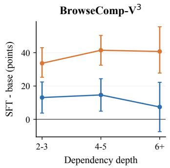

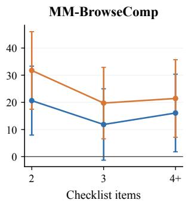

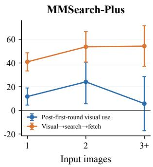  
Figure 6: Paired differences across task strata. SFT minus base-agent trajectory proportions, in points, for the question pairs in Tables 4-6. Error bars are pointwise paired-bootstrap 95% intervals. The horizontal line marks zero.

## B.3 VISUAL STRUCTURE OF TRAINING DATA

The trajectory analysis compares the analyzed Ours trajectories with 10,752 OpenSearch-VL, 1,393 Vision-DeepResearch, and 16,053 REDSearcher-MM trajectories. Each trajectory contributes once, with generation and filtering settings retained from its source.

The analyzed Ours trajectories exceed the highest baseline rate by 12.2 points for multi-image input (Figure 3).

## B.4 CONTINUED VISUAL USE ACROSS INTERACTION LENGTHS

We compute continued visual-use rates within four tool-round ranges of 1-5, 6-10, 11-15, and 16 or more. Rates are reported separately for each source and range. Ours exceeds the highest baseline rate by 16.8, 34.3, 32.2, and 26.1 points, respectively (Figure 7).

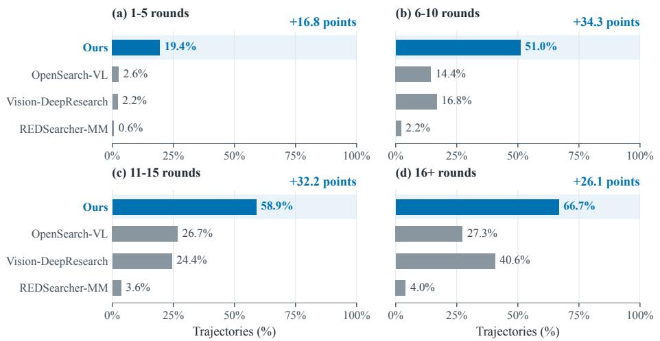  
Figure 7: Continued visual use across interaction lengths. Bars give the proportion of trajectories with a visual-tool call after the first round, within each round-count range. All panels share a scale. Blue bars denote Ours, and blue annotations give the difference from the highest baseline rate.

## B.5 SUPPLEMENTARY VISUAL-SPAN STATISTICS

Normalized visual span measures the separation between the first and last visual calls relative to the entire tool-call sequence. For a trajectory with C tool calls and first and last visual-call indices $i _ { \mathrm { { f i r s t } } }$ and $i _ { \mathrm { l a s t } }$ , it is

$$
S = \frac { i _ { \mathrm { l a s t } } - i _ { \mathrm { f i r s t } } } { \operatorname* { m a x } ( C - 1 , 1 ) } .
$$

A single visual call gives $S = 0 ;$ , and visual calls at both ends of a sequence with $C > 1$ give $S = 1$ The proportions and means in Figure 8 use trajectories with at least one visual call.

The first and last visual calls spanned more than half the tool-call sequence in 21.8% of Ours trajectories with visual calls, compared with 1.0-3.8% for the baselines. Mean normalized visual span was 22.5% for Ours, 4.7% for OpenSearch-VL, 4.9% for Vision-DeepResearch, and 1.0% for REDSearcher-MM.

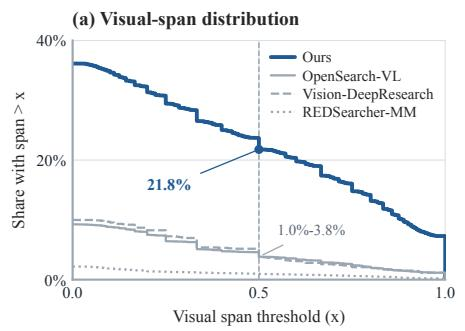

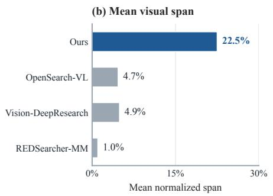  
Figure 8: Supplementary visual-span statistics for training trajectories. (a) Proportion of trajectories whose normalized visual span exceeds each threshold x; higher curves indicate more trajectories with widely separated visual calls. (b) Mean normalized visual span for each source. Both panels summarize trajectories with at least one visual call; a single visual call has span zero. Baseline names follow Table 1.

## C TASK SYNTHESIS DETAILS

Referential Abstraction and Compositional Evidence support single-target, within-image, and crossimage tasks (Table 7). Grounded construction, iterative refinement, and teacher execution form the synthesis and training procedure in Algorithm 1.

Source images include Weibo and X/Twitter photographs, Bilibili video frames, and MovieNet film imagery. Each candidate has a source image and a description locating it in the scene. Candidate coverage for ambiguous relational references includes every entity matching the coarse visual description. MovieNet identity annotations can pair frames containing the same person. Cross-image target selection follows Equation 3. Reference objects provide visual context, while search targets initiate retrieval and intermediate entities can emerge during exploration. The task specifies required information; the solver chooses the order of identification and retrieval.

Table 7: Task configurations. Referential Abstraction constructs target references, and Compositional Evidence adds joint information requirements. The same configurations apply to targets in retrieved images.
<table><tr><td>Construction</td><td>Target configuration</td><td>Required behavior</td></tr><tr><td>Single-target abstraction</td><td>One target among the candidates in an image</td><td>Resolve a specific visual or ambiguous relational reference, then retrieve the requested information.</td></tr><tr><td>Within-image composition</td><td>Multiple required targets in one image</td><td>Retrieve evidence for each target and derive an answer requiring all designated contributions.</td></tr><tr><td>Cross-image composition</td><td>One required target per image across multiple images</td><td>Resolve each image&#x27;s target and combine its evidence with the other images&#x27; contributions.</td></tr></table>

Reference construction. Specific visual references use appearance, occlusion cues, or positional phrases computed from normalized bounding boxes: a $3 \times 3$ grid, left-to-right order within a row, or row membership. Each retained phrase distinguishes its target within the scene; reference neighbors supply spatial context. For an ambiguous relational reference $\rho = \left( \nu , \phi \right)$ , the construction record must cover every candidate in $\mathcal { C } ( V , \nu )$ before selecting a unique match. For each candidate, it must record source evidence and whether the condition is satisfied, ruled out, or unresolved. Candidates with missing evidence receive the unresolved status. Retention requires one supported match and supported exclusion of all alternatives; otherwise the generator revises the condition, retrieves further evidence, or discards the task. Conditions concerning awards, roles, genres, or periods of activity are chosen after examining candidate evidence and are screened for text-only identity leakage.

Target and image constructors. When enabled, the within-image multi-anchor constructor selects two grounded targets. Cross-image construction grounds one target in each of two images and rejects pairs lacking either identity. The two identities seed separate opening searches. The generator receives both images and the combined evidence, then constructs a relation supported by both targets facts. Both images remain attached to the final question, with one image placeholder next to each corresponding reference. A same-entity route also pairs two views for reference resolution. Scene records store the selected targets, image associations, spatial cues, and routing decisions. Evidence records store the query, source URL, title, acquisition turn, and modality.

Evidence and image necessity. CE selects the contributions required by the joint question from the retrieved evidence and records their target and image provenance. For every designated contribution $z _ { j } .$ , the construction record must explain why the remaining contributions no longer determine a unique answer. For a required image $I _ { i } ,$ the same check removes all contributions rooted in its target. For example, the difference between the years of two actors’ first credited feature-film appearances requires both years, whether the actors appear in one image or two. The generator revises or rejects image pairs with unsupported relations, duplicate evidence, or redundant target contributions. It stores each necessity judgment and its rationale in the construction record.

Algorithm 1 Image-conditioned task synthesis and agent training   
Require: Image collections, generator G, teacher $\pi _ { \mathrm { T } } ,$ student π   
1: $\mathcal { D }  \mathcal { D }$   
2: for each source image collection $\mathcal { T } \mathbf { d o }$   
3: Ground candidate entities $E _ { i }$ in each source image $I _ { i }$   
4: Choose S from one or multiple images and ground each selected target   
5: Explore supporting text and visual evidence $\overline { { F } }$   
6: Apply RA to construct specific visual or ambiguous relational references $R$   
7: For ambiguous references, search all candidates and verify a unique supported match   
8: For joint tasks, use CE to connect supported facts through a relation c   
9: Check that removing any required fact or image leaves the answer undetermined   
10: Apply abstraction and composition as needed to targets in retrieved images   
11: Specify whether each retrieved image supplies answer evidence or a further search clue   
12: Generate or expand $( q , a )$ from $( \boldsymbol { \mathcal { T } } , \boldsymbol { \bar { S } } , \boldsymbol { R } , \boldsymbol { \hat { c } } , \boldsymbol { F } )$   
13: Probe for solver shortcuts and combine feedback with RA/CE construction criteria   
14: if feedback identifies an unresolved reference, support, dependency, or shortcut issue then   
15: Reapply RA/CE to revise $( R , c , F )$ and reassess $( q , a )$ , or discard   
16: end if   
17: if a valid task is retained then   
18: Execute $( \boldsymbol { \mathcal { T } } , \boldsymbol { q } )$ with πT to obtain trajectory $\tau$   
19: $\mathbf { i f } g _ { \mathrm { t r a j } } ( \tau , a ) \dot { = } 1$ then   
20: Add $( \mathcal { T } , q , \tau )$ to $\mathcal { D }$   
21: end if   
22: end if   
23: end for   
24: Train π on D using Equation 9

Construction feedback. RA refines references using scene cues and candidate evidence; CE refines relations using source support and the recorded dependencies. The generator returns a question, answer, visual step, and ordered reasoning steps with dependency links. For each input image, it also generates a rationale assessing whether the question would still identify the target or determine the answer after removing that image and its referring clause. Static checks enforce one image placeholder per attached image and reject identity or answer leakage. A question-only probe generates search queries from q and retrieves web evidence. A judge compares its output with the reference answer and grounded identities to flag answer recovery, identity recovery, or substantial candidate narrowing. Detected failures guide revisions to the references, evidence, or relation, followed by renewed checks. Wording revisions preserve the supported answer; changes to the information requirement trigger new evidence and answer checks. Let $g _ { \mathrm { r e f } } , g _ { \mathrm { s u p } } , g _ { \mathrm { d e p } }$ denote verdicts on reference grounding, answer support, and evidence and image necessity, and let $\mathbf { \hat { \boldsymbol { b } } } ( { \boldsymbol { T } } )$ indicate a detected shortcut. The retention criterion is

$$
{ \mathcal { T } } _ { \mathrm { k e e p } } = \{ T : g _ { \mathrm { r e f } } ( T ) = g _ { \mathrm { s u p } } ( T ) = g _ { \mathrm { d e p } } ( T ) = 1 , \ b ( T ) = 0 \} .\tag{10}
$$

Here $b ( T ) = 0$ denotes a probe run that detects no shortcut within its search budget.