# RLSplat: Resource-Linear Budget Control for Feed-forward 3D Gaussian Splatting

Injae Kim KAIST injae.kim@kaist.ac.kr

Sehyung Kim Korea University skim129@kaist.ac.kr

Minseok Joo Korea University wlgkcjf87@korea.ac.kr

Minseong Bae KAIST bms2002@kaist.ac.kr

Jihwan Park KAIST jseven7071@kaist.ac.kr

Hyunwoo J. Kim∗ KAIST hyunwoojkim@kaist.ac.kr

## Abstract

Feed-forward 3D Gaussian Splatting (FF3DGS) reconstructs 3D scenes from images in a single forward pass, making it well-suited to applications that must operate within limited resource budgets. To further improve its practicality, recent budget-controllable FF3DGS methods allow the number of Gaussians to be adjusted at inference, so that the output meets a given storage limit or renderinglatency constraint. However, these methods overlook the cost of inference itself: to produce a representation with the target number of Gaussians, they first predict a dense set of Gaussians and then prune or select from it, requiring nearly constant latency and peak memory regardless of the budget. We therefore propose RLSplat, a resource-linear budget-controllable FF3DGS framework whose representation size, inference latency, and peak memory all decrease linearly as the Gaussian budget is reduced. Instead of pruning or selection, RLSplat learns a Gaussian allocation policy that distributes the budget across local scene regions, so that exactly the requested number of Gaussians is generated. These Gaussians are then refined through resource-linear Gaussian decoding, in which each Gaussian attends only to nearby Gaussians found via an efficient hierarchical neighbor search, so that the decoding cost decreases linearly with fewer Gaussians. In zeroshot evaluation, RLSplat outperforms prior budget-controllable methods at every budget, surpassing the strongest baseline even with 4× fewer Gaussians, while running up to 4.1× faster with 9.6× less peak memory at low budgets. Code is available at https://github.com/mlvlab/RLSplat.

## 1 Introduction

3D Gaussian Splatting (3DGS) (Kerbl et al., 2023) has become a leading representation for photorealistic, real-time novel view synthesis, supporting applications from AR/VR (Qian et al., 2024; Jiang et al., 2024) to robotics (Keetha et al., 2024; Matsuki et al., 2024) and digital content creation (Tang et al., 2024; Chen et al., 2024b). Its explicit form further allows it to serve as a 3D scene representation for downstream models, such as 3D vision-language models (Li et al., 2025; Thai et al., 2025). Since per-scene optimization of 3DGS takes minutes to hours and requires many calibrated views, feed-forward 3DGS (FF3DGS) methods instead predict Gaussians in a single forward pass (Charatan et al., 2024; Chen et al., 2024a), and recent variants even operate directly on uncalibrated images (Jiang et al., 2025). Owing to this fast and readily available reconstruction, FF3DGS has become a practical choice for applications that build 3D scene representations on the fly.

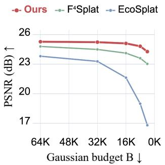  
(a) Budget-controllability

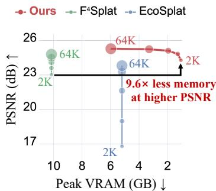  
(b) Less memory, higher PSNR

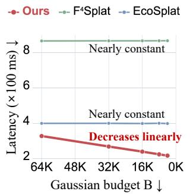  
(c) Inference cost-controllability  
Figure 1: Budget-controllable quality, memory, and latency trade-offs. (a) RLSplat achieves the highest PSNR across the evaluated total Gaussian budgets B. (b) At the 2K budget, RLSplat uses 9.6× less peak VRAM than F4Splat while attaining higher PSNR. (c) As B is reduced, RLSplat’s inference latency decreases approximately linearly, whereas the latencies of F4Splat and EcoSplat remain nearly constant. In axis tick labels, 1K = 1,024.

Early FF3DGS methods (Charatan et al., 2024; Chen et al., 2024a; Ye et al., 2025) simplify the problem by allocating a fixed number of Gaussians to each input pixel, which allows the feed-forward network to be trained effectively. However, this pixel-aligned design produces many redundant Gaussians, since Gaussians from overlapping views become increasingly redundant as more views are added. To address this redundancy, query-based methods (An et al., 2026; Itkin et al., 2026) decode a fixed set of learnable query tokens into Gaussians. Yet neither approach can adjust the number of Gaussians without retraining. This lack of controllability makes it difficult to adapt to the diverse resource budgets encountered in real-world deployment. To address this, recent works have proposed Gaussian budget-controllable methods. Given a Gaussian budget B, EcoSplat (Park et al., 2026) first predicts one Gaussian per pixel and keeps the B Gaussians with the highest opacity. F4Splat (Kim et al., 2026) instead predicts Gaussians at multiple scales and selects the B Gaussians. However, these methods overlook the computational cost of inference itself. Both methods first predict a much larger set of candidate Gaussians before reducing them to B, so their inference latency and peak memory remain nearly constant regardless of the budget, as shown in Fig. 1(b) and (c).

We therefore propose RLSplat, a budget-controllable FF3DGS framework that is resource-linear: both its representation size and inference cost scale linearly with the budget B. Given uncalibrated images and a budget B, a geometry backbone encodes the images into anchor tokens, each representing a local 3D region of the scene. To obtain a compact representation, we formulate Gaussian generation as an allocation problem rather than pruning or selection: we predict how many Gaussians to assign to each anchor’s region, summing to B. Since these discrete allocations are non-differentiable and can only be evaluated by rendering the resulting Gaussians, we model this prediction as a Gaussian allocation policy and train it with policy optimization, using Group Sequence Policy Optimiza tion (GSPO) (Zheng et al., 2025) with rendering quality as the reward. Given the allocation, each anchor token spawns as many Gaussian tokens as its allocated count, yielding a total of B Gaussian tokens. To efficiently decode these tokens into the final Gaussians, we introduce a resource-linear decoder. It refines each Gaussian token through local cross-attention over its $K _ { \mathrm { g s } }$ nearest Gaussian tokens, which we find with an efficient hierarchical neighbor search. Whereas global self-attention over all B tokens costs $\mathcal { O } ( B ^ { 2 } )$ , each token here attends to only $K _ { \mathrm { g s } }$ neighbors, so the decoding cost is $\mathcal { O } ( B K _ { \mathrm { g s } } )$ and scales linearly with the Gaussian budget (Fig. 1(c)). As a result, RLSplat achieves higher quality than prior budget-controllable methods at every budget (Fig. 1(a)), while its peak memory and latency decrease with the budget. At 2K Gaussians, it achieves higher PSNR than F4Splat while using 9.6× less peak memory (Fig. 1(b)) and running 4.1× faster (Fig. 1(c)).

In summary, our contributions are as follows:

• We identify that existing budget-controllable FF3DGS methods control only the size of the output, not the cost of producing it, and introduce RLSplat, a resource-linear FF3DGS framework in which the number of Gaussians, inference latency, and peak memory all decrease linearly as the budget B is reduced.

• We formulate Gaussian generation as an allocation problem and learn a Gaussian allocation policy via policy optimization that places exactly B Gaussians where the scene needs them, together with a resource-linear decoder whose cost decreases linearly as the budget decreases through local cross-attention and an efficient hierarchical neighbor search.

• RLSplat consistently outperforms prior budget-controllable methods across all budgets. At a budget of 2K Gaussians, it improves PSNR by 0.9 dB over F4Splat while using 9.6× less peak memory and running 4.1× faster.

## 2 Related Work

Feed-Forward 3D Gaussian Splatting. 3D Gaussian Splatting (3DGS) (Kerbl et al., 2023) represents a scene with explicit Gaussian primitives and achieves real-time rendering, but requires timeconsuming per-scene optimization from many calibrated views. Feed-forward 3DGS (FF3DGS) methods instead predict Gaussians in a single forward pass, from a single image (Szymanowicz et al., 2024) or from a few posed views (Charatan et al., 2024; Chen et al., 2024a; Xu et al., 2025; Zhang et al., 2024). Building on 3D foundation models (Wang et al., 2024; Leroy et al., 2024; Wang et al., 2025), recent methods further remove the need for known camera poses (Ye et al., 2025; Smart et al., 2024; Huang & Mikolajczyk, 2025; Jiang et al., 2025). Most of these methods predict one Gaussian per pixel or per voxel, so the number of Gaussians is determined by the input resolution and the number of views rather than by the scene content. This leads to redundant Gaussians in overlapping and textureless regions, and the number of Gaussians cannot be specified directly.

Compact and Gaussian budget-controllable FF3DGS. For per-scene 3DGS, many works aim to represent a scene with fewer Gaussians without sacrificing quality, either by pruning redundant Gaussians (Fan et al., 2024; Lee et al., 2024; Papantonakis et al., 2024) or by deciding where to place Gaussians under a fixed or constrained budget during densification (Fang & Wang, 2024; Mallick et al., 2024; Kheradmand et al., 2024). These methods, however, rely on iterative per-scene optimization. In FF3DGS, C3G (An et al., 2026) and GlobalSplat (Itkin et al., 2026) decode a fixed set of learnable query tokens into compact sets of Gaussians, whose size is determined by the architecture. EcoSplat (Park et al., 2026) and F4Splat (Kim et al., 2026) instead accept a target count at inference, by keeping the Gaussians with the highest budget-conditioned opacity and by selecting one of multiple scales per region, respectively; both derive the output from a dense set of candidates. ZipSplat (Veicht et al., 2026), developed concurrently with our work, controls the number of Gaussians by clustering visual tokens at inference. In contrast, we learn to allocate exactly the requested number of Gaussians and decode only those, so that our inference cost scales with the budget.

Policy optimization. Policy gradient methods (Williams, 1992; Schulman et al., 2017) optimize non-differentiable, discrete decisions from a scalar reward, and have been applied to generative vision models, e.g., to align diffusion models with reward functions (Black et al., 2024). Grouprelative variants such as GRPO (Shao et al., 2024) and GSPO (Zheng et al., 2025) remove the need for a learned value function by normalizing rewards within a group of samples, and have become standard for fine-tuning large language models. In particular, GSPO defines the importance ratio from the likelihood of the whole sequence rather than of individual tokens, and clips it at the sequence level. We adopt this approach to learn Gaussian allocation, treating an allocation as a sequence of B Gaussians and using rendering quality as the reward.

## 3 Method

We present RLSplat, a feed-forward 3DGS framework whose Gaussian count and inference cost are both controlled by a single budget B. Rather than pruning or selecting from a dense set of Gaussians, RLSplat formulates Gaussian generation as allocation: a Gaussian allocation policy decides how many Gaussians each local region of the scene receives (Sec. 3.2), and a resource-linear decoder generates the allocated Gaussians and efficiently refines them with local cross-attention (Sec. 3.3). We begin with an overview (Sec. 3.1) and conclude with the training procedure (Sec. 3.4).

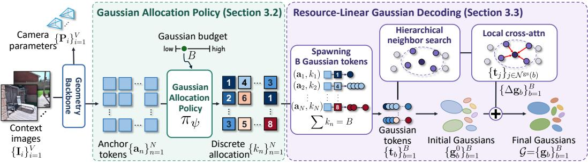  
Figure 2: Overview of RLSplat. Given uncalibrated context images, the geometry backbone predicts camera parameters and extracts anchor tokens $\left\{ \mathbf { a } _ { n } \right\}$ representing local 3D regions. The Gaussian allocation policy distributes the budget B across anchors, assigning $k _ { n }$ Gaussians to each anchor with $\textstyle \sum k _ { n } = { \dot { B } }$ . Each anchor then spawns $k _ { n }$ Gaussian tokens, which are decoded into B Gaussians and locally refined using hierarchical neighbor search.

## 3.1 Overview of RLSplat

Given V uncalibrated context images $\{ \mathbf { I } _ { i } \} _ { i = 1 } ^ { V }$ and a target Gaussian budget $B ,$ RLSplat $\mathbf { F } _ { \theta }$ predicts a set of 3D Gaussians $\mathcal { G }$ along with the context camera parameters $\{ \mathbf { P } _ { i } \} _ { i = 1 } ^ { \overline { { V } } } \colon$

$$
( \mathcal { G } , \{ \mathbf { P } _ { i } \} _ { i = 1 } ^ { V } ) = \mathbf { F } _ { \boldsymbol { \theta } } \left( \{ \mathbf { I } _ { i } \} _ { i = 1 } ^ { V } , B \right) , \qquad \mathcal { G } = \{ \mathbf { g } _ { b } \} _ { b = 1 } ^ { B } .\tag{1}
$$

Here, the 3DGS attribute $\mathbf { g } _ { b }$ consists of a 3D center, opacity, scale, rotation, and color coefficients.

As illustrated in Fig. 2, a geometry backbone (Burzio et al., 2026) encodes the images into N anchor tokens $\{ \mathbf { a } _ { n } \} _ { n = 1 } ^ { N }$ These anchors serve as the foundational sites from which the 3D Gaussians are spawned. To use the limited budget effectively, RLSplat adaptively distributes the B Gaussians across these anchors. Specifically, a Gaussian allocation policy assesses the local significance of each anchor to predict a discrete allocation k $\in \mathbb { Z } _ { > 0 } ^ { N }$ that strictly sums to the budget $( \sum k _ { n } = B )$ and we optimize this policy via reinforcement learning (Sec. 3.2). Next, a resource-linear decoder instantiates exactly $k _ { n }$ Gaussian tokens at each anchor. It predicts an initial state for each Gaussian and efficiently processes them via a refinement module to produce the final set of B Gaussians. This decoder’s computational footprint scales linearly with the requested budget, as described in Sec. 3.3.

## 3.2 Gaussian Allocation Policy

To achieve a compact and high-fidelity representation, Gaussians must be densely allocated to the anchors that encode geometrically complex local 3D regions. We formulate this discrete allocation task as a reinforcement learning problem, parameterizing a policy $\pi _ { \psi } ( \mathbf { k } | \{ \mathbf { a } _ { n } \} _ { n = 1 } ^ { N } , B )$ that maps the anchor tokens and target budget to a discrete allocation $\mathbf { k } = \{ k _ { n } \} _ { n = 1 } ^ { N }$ . Specifically, the policy model predicts allocation proportions $\mathbf { p } = \mathrm { \bar { \{ p _ { n } \} } } _ { n = 1 } ^ { \bar { N } }$ , where $p _ { n }$ represents the expected fraction of the Gaussian budget assigned to anchor $n .$ . The allocation process is modeled as drawing trials from a multinomial distribution, such that $\mathbf { k } \sim \operatorname { M u l t } ( B , \mathbf { p } )$

To optimize $\pi _ { \psi }$ over these non-differentiable discrete allocations, we leverage Group Sequence Policy Optimization (GSPO) (Zheng et al., 2025). At each training step, we draw a group of $C$ rollouts, i.e., candidate allocations ${ \bf k } ^ { ( c ) } \sim \pi _ { \mathrm { o l d } } = \mathrm { M u l t } ( B , \mathrm { s g } ( { \bf p } ) )$ for $c \in \{ 1 , \ldots , C \}$ , from the current policy with gradients stopped by $\operatorname { s g } ( \cdot )$ . For each rollout $c ,$ we first generate the 3DGS representation $\mathcal G ^ { ( c ) }$ . We then render an image ${ \hat { \mathbf { I } } } ^ { ( c ) }$ from $\mathcal G ^ { ( c ) }$ at novel target views, computing the reconstruction loss $\mathcal { L } _ { \mathrm { r e c o n } } ^ { ( c ) }$ against the ground-truth I without gradient tracking. This loss directly serves as the reward signal for rendering quality, defined as $R _ { c } = - \mathcal { L } _ { \mathrm { r e c o n } } ^ { ( c ) }$ . Thanks to the highly efficient rasterization of 3DGS, evaluating multiple rollouts introduces minimal training overhead. We then compute the group-relative advantage $\hat { A } _ { c }$ by standardizing the rewards within the group:

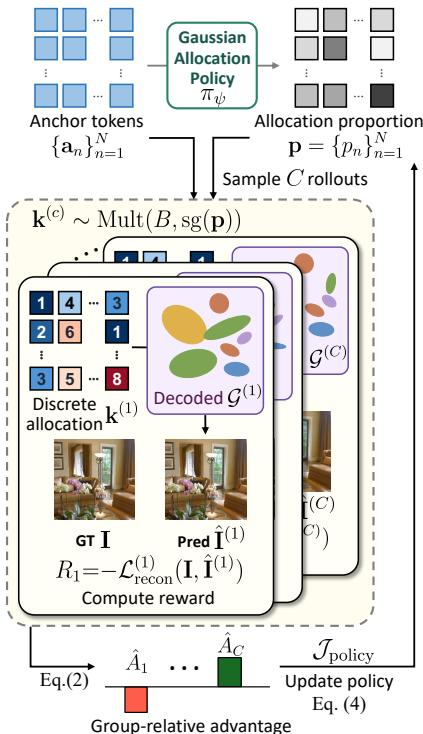  
Figure 3: Policy optimization.

$$
\hat { A } _ { c } = \frac { R _ { c } - \mathrm { m e a n } \left( \{ R _ { c ^ { \prime } } \} _ { c ^ { \prime } = 1 } ^ { C } \right) } { \mathrm { s t d } \left( \{ R _ { c ^ { \prime } } \} _ { c ^ { \prime } = 1 } ^ { C } \right) } .\tag{2}
$$

Following the GSPO framework, we view the allocation of Gaussians as a sequence of length B and compute a length-normalized importance ratio $s _ { c }$ for each rollout:

$$
s _ { c } = \left( \frac { \pi _ { \psi } ( \mathbf { k } ^ { ( c ) } ) } { \pi _ { \mathrm { o l d } } ( \mathbf { k } ^ { ( c ) } ) } \right) ^ { \frac { 1 } { B } } = \exp \left( \frac { 1 } { B } \sum _ { n = 1 } ^ { N } k _ { n } ^ { ( c ) } \log \frac { p _ { n } } { \mathrm { s g } ( p _ { n } ) } \right) .\tag{3}
$$

The policy is then updated by maximizing the clipped objective

$$
\mathcal { I } _ { \mathrm { p o l i c y } } = \mathbb { E } \left[ \frac { 1 } { C } \sum _ { c = 1 } ^ { C } \operatorname* { m i n } \left( s _ { c } \hat { A } _ { c } , \ \mathrm { c l i p } \left( s _ { c } , 1 - \epsilon , 1 + \epsilon \right) \hat { A } _ { c } \right) \right] ,\tag{4}
$$

where ϵ is the clipping range, and the expectation is taken over scenes, budgets, and rollout groups. At inference time, we bypass stochastic sampling and deterministically convert the expected counts Bp into an integer allocation whose counts sum exactly to B. Details of the rounding procedure are provided in Sec. B.

## 3.3 Resource-Linear Gaussian Decoding

Given a Gaussian allocation $\mathbf { k } = \{ k _ { n } \} _ { n = 1 } ^ { N }$ , the resource-linear decoder spawns exactly B Gaussian tokens from the anchors and decodes them into the final Gaussians at a cost linear in $B .$ We describe the token spawning, the local refinement with hierarchical neighbor search, and the regularizers that keep this search accurate.

Gaussian token spawning. For each anchor ${ \bf a } _ { n } ,$ , a token generator instantiates $k _ { n }$ distinct Gaussian tokens, each conditioned on its slot index within the anchor (Sec. D):

$$
\{ \mathbf { t } _ { b } \} _ { b = 1 } ^ { B } = \mathrm { T o k e n G e n } \big ( \{ ( \mathbf { a } _ { n } , k _ { n } ) \} _ { n = 1 } ^ { N } \big ) .\tag{5}
$$

We denote by $n _ { b }$ the anchor that spawned token b. A head then predicts an initial Gaussian $\mathbf { g } _ { b } ^ { 0 } =$ Head $\left( \mathbf { t } _ { b } \right)$ from each token, including its initial center $\mu _ { b } ^ { 0 }$

Local refinement with hierarchical neighbor search. Since the initial tokens lack spatial context, they must attend to neighboring Gaussians to refine their parameters. To avoid the prohibitive $\mathcal { O } ( B ^ { 2 } )$ cost of global attention, we employ a local cross-attention mechanism over L layers. Anchors with $k _ { n } ~ = ~ 0$ are excluded from the hierarchical neighbor search. For each remaining anchor n, we compute the centroid ${ \bar { \pmb { \mu } } } _ { n }$ of its initial Gaussians:

$$
\bar { \mu } _ { n } = \frac { 1 } { k _ { n } } \sum _ { b : n = n } \mu _ { b } ^ { 0 } .\tag{6}
$$

To find neighbors efficiently, we search hierarchically: we find the $K _ { \mathrm { a n c } }$ nearest anchors, and then search for the $K _ { \mathrm { g s } }$ nearest Gaussian tokens only among the Gaussians belonging to these local anchors:

$$
\begin{array} { r l } & { \mathcal { N } ^ { \mathrm { a n c } } ( n ) = \mathrm { K N N } _ { K _ { \mathrm { a n c } } } \big ( \bar { \pmb { \mu } } _ { n } ; \{ \bar { \pmb { \mu } } _ { m } : k _ { m } > 0 \} \big ) , } \\ & { \quad \mathcal { N } ^ { \mathrm { g s } } ( b ) = \mathrm { K N N } _ { K _ { \mathrm { g s } } } \big ( \pmb { \mu } _ { b } ^ { 0 } ; \{ \pmb { \mu } _ { j } ^ { 0 } : n _ { j } \in \mathcal { N } ^ { \mathrm { a n c } } ( n _ { b } ) \} \big ) . } \end{array}\tag{7}
$$

By restricting the search space, we keep the neighbor querying highly efficient. Both neighbor sets are computed once using the detached initial positions and shared across all L layers. Each token $\mathbf { t } _ { b }$ is then refined by L layers of cross-attention over its neighbors, each followed by a feed-forward layer:

$$
\mathbf { t } _ { b } \gets \mathbf { t } _ { b } + \mathrm { C r o s s A t t n } \big ( \mathbf { t } _ { b } , \{ \mathbf { t } _ { j } \} _ { j \in \mathcal { N } ^ { \mathrm { g s } } ( b ) } \big ) .\tag{8}
$$

Finally, a residual head predicts a correction $\Delta \mathbf { g } _ { b }$ from $\mathbf { t } _ { b } .$ , giving $\mathbf { g } _ { b } = \mathbf { g } _ { b } ^ { 0 } + \Delta \mathbf { g } _ { b }$

Locality regularizers. For this hierarchical search to be valid, a Gaussian’s true spatial neighbors must actually reside within its parent’s anchor neighborhood $\mathcal { N } ^ { \mathrm { a n c } } ( n _ { b } )$ . We enforce this using two

regularizers. First, a Voronoi loss keeps each Gaussian closer to its own parent anchor’s centroid ${ \bar { \pmb { \mu } } } _ { n _ { b } }$ than to any neighboring anchor’s centroid ${ \bar { \pmb { \mu } } } _ { m }$ :

$$
\mathcal { L } _ { \mathrm { v o r } } = \frac { 1 } { B } \sum _ { b = 1 } ^ { B } \sum _ { m \in \mathcal { N } ^ { \mathrm { a n c } } ( n _ { b } ) } \operatorname* { m a x } \left( 0 , \ \lVert \pmb { \mu _ { b } ^ { 0 } } - \bar { \pmb { \mu } } _ { n _ { b } } \rVert - \lVert \pmb { \mu _ { b } ^ { 0 } } - \bar { \pmb { \mu } } _ { m } \rVert \right) .\tag{9}
$$

Second, an offset loss constrains the residual correction $\Delta \pmb { \mu } _ { b }$ to limit Gaussian drift:

$$
\mathcal { L } _ { \mathrm { o f f s e t } } = \frac { 1 } { B } \sum _ { b = 1 } ^ { B } \operatorname* { m a x } \bigg ( 0 , \frac { \| \Delta \pmb { \mu } _ { b } \| } { d _ { n _ { b } } } - \delta \bigg ) ^ { 2 } ,\tag{10}
$$

where $d _ { n }$ is the local anchor spacing, defined as the median distance from µ¯n to its Kanc nearest anchors, and $\delta = 0 . 5$ is a margin limiting Gaussian movement relative to the local anchor scale.

## 3.4 Training

We train RLSplat in two stages: base training trains the geometry backbone and decoder with random allocations, and policy training introduces the Gaussian allocation policy and fine-tunes the entire model with policy optimization.

Objectives. To supervise view synthesis, we apply a reconstruction loss ${ \mathcal { L } } _ { \mathrm { r e c o n } } .$ combining pixelwise MSE and LPIPS between the rendered and ground-truth target views. For geometric alignment, a camera loss $\mathcal { L } _ { \mathrm { c a m } }$ supervises the translation, rotation, and field-of-view of the predicted context cameras. Additionally, a projection loss $\mathcal { L } _ { \mathrm { p r o j } }$ reprojects each anchor’s Gaussians toward their source image patch. Incorporating a cheirality penalty to prevent Gaussians from landing behind the camera, $\mathcal { L } _ { \mathrm { p r o j } }$ effectively ties an anchor’s allocation to a specific scene region and prevents arbitrary drift. These terms are combined with the locality regularizers $( \mathcal { L } _ { \mathrm { v o r } }$ and ${ \mathcal L } _ { \mathrm { o f f s e t } } )$ previously introduced in Sec. 3.3. Finally, during the policy training stage, we activate the policy loss ${ \mathcal { L } } _ { \mathrm { p o l i c y } } = - { \mathcal { I } } _ { \mathrm { p o l i c y } }$ (Eq. (4)) to optimize the discrete allocations via GSPO. The overall training objectives are detailed in Sec. E.

Two-stage training. We train RLSplat in two stages. In base training, we train the encoder and decoder with random allocations, and sample budgets over the full supported range. This exposes the decoder to widely varying per-anchor counts, so that it learns to render diverse allocations before the policy is introduced. In policy training, we add the policy head, initialized to output uniform probabilities (Sec. B), and fine-tune the entire model with the policy loss $\mathcal { L } _ { \mathrm { p o l i c y } } .$ Since base training involves no policy, there is no reference policy to regularize toward, and unlike typical RL finetuning, we do not apply a KL penalty. During this stage, budgets are sampled with a skew toward the lower end of the range, where the choice of allocation matters most for rendering quality.

## 4 Experiments

Datasets and evaluation. We train on RealEstate10K (RE10K) (Zhou et al., 2018) with $V \in$ {2, 3, 4, 6, 8, 12, 24} uncalibrated context views. To assess generalization, we evaluate the RE10Ktrained model zero-shot on ACID (Liu et al., 2021) (249 test scenes), which consists of aerial footage of coastal and natural scenes. We follow the evaluation protocol of $\mathrm { F } ^ { 4 }$ Splat (Kim et al., 2026) at a resolution of $2 5 6 \times 2 5 6$ and report PSNR, SSIM, and LPIPS together with the number of Gaussians (#GS). To measure inference cost, we report the latency and peak VRAM of Gaussian generation, excluding data loading, pose alignment, and rendering. All methods are run on a single RTX A6000 with a batch size of one. For each budget, we discard the first scene as warm-up, reset the peakmemory counter before each timed run, and report the mean over the test scenes.

Baselines. We mainly compare with budget-controllable methods, EcoSplat (Park et al., 2026) and F4Splat (Kim et al., 2026), which take a target Gaussian count as input at inference time. We evaluate all methods at the same requested Gaussian budgets, with particular focus on the low-budget regime. For a broader comparison, we also include budget-fixed methods, which place Gaussians uniformly, either one per pixel (NoPoSplat (Ye et al., 2025), SPFSplat (Huang & Mikolajczyk, 2025)) or one per voxel (AnySplat (Jiang et al., 2025)). Their Gaussian count is therefore determined by the input resolution and the number of views, or by the voxel size, rather than chosen by the user.

Table 1: Budget-controllable methods on ACID (zero-shot from RE10K). Each method is evaluated at the same requested budget of 4K, 2K, and 1K Gaussians per context view; #GS is the resulting total per scene (1K = 1024). Best per column within each budget in bold.
<table><tr><td rowspan="2">Method</td><td colspan="4">8 views</td><td colspan="4">16 views</td><td colspan="4">24 views</td></tr><tr><td>#GS↓</td><td>LPIPS↓</td><td>SSIM↑</td><td>PSNR↑</td><td>#GS↓</td><td>LPIPS↓</td><td>SSIM↑</td><td>PSNR↑</td><td>#GS↓</td><td>LPIPS↓</td><td>SSIM↑</td><td>PSNR↑</td></tr><tr><td>EcoSplat</td><td>32K</td><td>0.300</td><td>0.669</td><td>23.29</td><td>64K</td><td>0.282</td><td>0.689</td><td>23.86</td><td>96K</td><td>0.284</td><td>0.688</td><td>23.81</td></tr><tr><td>F4Splat</td><td>32K</td><td>0.240</td><td>0.718</td><td>24.50</td><td>64K</td><td>0.218</td><td>0.743</td><td>25.09</td><td>96K</td><td>0.211</td><td>0.753</td><td>25.31</td></tr><tr><td>RLŚplat</td><td>32K</td><td>0.211</td><td>0.756</td><td>25.24</td><td>64K</td><td>0.196</td><td>0.778</td><td>25.75</td><td>96K</td><td>0.192</td><td>0.787</td><td>25.94</td></tr><tr><td>EcoSplat</td><td>16K</td><td>0.357</td><td>0.621</td><td>21.63</td><td>32K</td><td>0.324</td><td>0.654</td><td>22.63</td><td>48K</td><td>0.320</td><td>0.660</td><td>22.73</td></tr><tr><td>F4Splat</td><td>16K</td><td>0.269</td><td>0.694</td><td>24.12</td><td>32K</td><td>0.242</td><td>0.720</td><td>24.72</td><td>48K</td><td>0.233</td><td>0.731</td><td>24.95</td></tr><tr><td>RLŚplat</td><td>16K</td><td>0.224</td><td>0.749</td><td>25.11</td><td>32K</td><td>0.205</td><td>0.773</td><td>25.63</td><td>48K</td><td>0.198</td><td>0.782</td><td>25.82</td></tr><tr><td>EcoSplat</td><td>8K</td><td>0.456</td><td>0.533</td><td>18.99</td><td>16K</td><td>0.412</td><td>0.575</td><td>20.03</td><td>24K</td><td>0.402</td><td>0.587</td><td>20.28</td></tr><tr><td>F4Splat</td><td>8K</td><td>0.307</td><td>0.664</td><td>23.61</td><td>16K</td><td>0.276</td><td>0.690</td><td>24.21</td><td>24K</td><td>0.263</td><td>0.702</td><td>24.45</td></tr><tr><td>RLSplat</td><td>8K</td><td>0.254</td><td>0.734</td><td>24.82</td><td>16K</td><td>0.226</td><td>0.760</td><td>25.38</td><td>24K</td><td>0.215</td><td>0.771</td><td>25.58</td></tr></table>

Table 2: Budget-fixed methods on ACID (zero-shot from RE10K). These methods emit a fixed, dense set of Gaussians determined by the input. RLSplat outperforms them on all metrics while using substantially fewer Gaussians. Best per column in bold.
<table><tr><td rowspan="2">Method</td><td colspan="4">8 views</td><td colspan="4">16 views</td><td colspan="4">24 views</td></tr><tr><td>#GS↓</td><td>LPIPS↓</td><td>SSIM↑</td><td>PSNR↑</td><td>#GS↓</td><td>LPIPS↓</td><td>SSIM↑</td><td>PSNR↑</td><td>#GS↓</td><td>LPIPS↓</td><td>SSIM↑</td><td>PSNR↑</td></tr><tr><td>NoPoSplat</td><td>512K</td><td>0.268</td><td>0.672</td><td>22.84</td><td>1024K</td><td>0.294</td><td>0.644</td><td>22.14</td><td>1536K</td><td>0.307</td><td>0.630</td><td>21.78</td></tr><tr><td>SPFSplat</td><td>512K</td><td>0.215</td><td>0.736</td><td>24.89</td><td>1024K</td><td>0.214</td><td>0.743</td><td>25.07</td><td>1536K</td><td>0.218</td><td>0.744</td><td>25.00</td></tr><tr><td>AnySplat</td><td>470K</td><td>0.248</td><td>0.696</td><td>23.30</td><td>885K</td><td>0.236</td><td>0.720</td><td>23.88</td><td>1259K</td><td>0.234</td><td>0.727</td><td>24.04</td></tr><tr><td>RLSplat</td><td>32K</td><td>0.211</td><td>0.756</td><td>25.24</td><td>32K</td><td>0.205</td><td>0.773</td><td>25.63</td><td>24K</td><td>0.215</td><td>0.771</td><td>25.58</td></tr></table>

Implementation details. In the base training stage, we train the geometry backbone and Gaussian decoder with random allocations for 40,000 steps. In the subsequent policy training stage, we train for an additional 5,000 steps. During training, the Gaussian budget is sampled from [2048, 16384V], where V is the number of input views. Unless otherwise noted, we use $K _ { \mathrm { a n c } } { = } K _ { \mathrm { g s } } { = } 1 6$ for Gaussian decoding in all experiments. Details are provided in Secs. E and F.

## 4.1 Novel-view Synthesis Results

Table 1 compares RLSplat with budget-controllable methods at matched budgets of 1K, 2K, and 4K Gaussians per context view. RLSplat achieves the best LPIPS, SSIM, and PSNR at every budget and view count. Importantly, its advantage becomes increasingly pronounced as the Gaussian budget decreases. For example, with 8 context views, the PSNR advantage over F4Splat grows from 0.74 dB at 4K Gaussians per view to 0.99 dB at 2K and 1.22 dB at 1K. This trend is consistent across 16 and 24 context views, demonstrating that RLSplat preserves reconstruction quality particularly well under tight representation budgets. This robustness is consistent with how the final B Gaussians are decoded: the baselines predict a dense set of Gaussians and then prune or select from it, whereas RLSplat directly decodes the requested number of Gaussians and refines them through resourcelinear decoding.

For a broader comparison, Table 2 includes budget-fixed methods whose output size is determined by the input. Despite using substantially fewer Gaussians, RLSplat outperforms all of these methods on LPIPS, SSIM, and PSNR across all view counts. In particular, with 24 context views, RLSplat achieves 25.58 dB PSNR using only 24K Gaussians, compared with 25.00 dB for SPFSplat using 1536K Gaussians, corresponding to 64× fewer Gaussians.

Fig. 4 shows how each method uses the same total budget of 8K Gaussians on RE10K. In the highlighted stair region, EcoSplat and F4Splat retain 2,521 and 3,026 Gaussians, respectively, whereas RLSplat allocates 5,388 Gaussians to the thin, high-frequency structure. The tile-wise allocation maps further show that RLSplat concentrates its budget around the stair balusters while spending fewer Gaussians on the comparatively smooth wall. This targeted allocation leads to substantially better reconstruction of the thin structures: the local PSNR of the highlighted region increases from 17.79 dB for EcoSplat and 20.00 dB for F4Splat to 23.51 dB for RLSplat . The improvement is also reflected in the full-view PSNR (21.82, 23.42, and 26.51 dB, respectively). These results illustrate that the learned allocation policy uses a fixed Gaussian budget more effectively by concentrating capacity where fine geometric and appearance details require it.

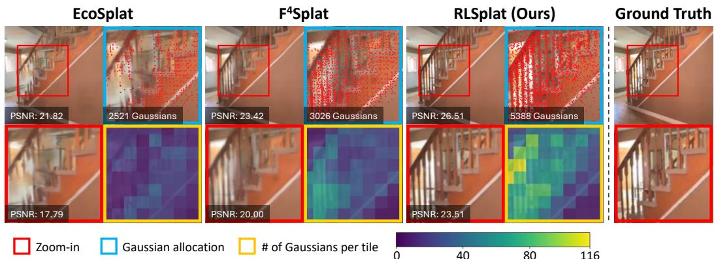  
Figure 4: Qualitative comparison under the same Gaussian budget. All methods use 8K Gaussians on RE10K. For each method, we show the rendered view and PSNR, a zoomed region and its local PSNR, the Gaussian centers in the highlighted region (red), and a 16×16 tile-wise map of the number of Gaussians. RLSplat places more Gaussians around the thin stair balusters (5,388 vs. 3,026 for F4Splat and 2,521 for EcoSplat), preserving the fine structure that the baselines blur.

## 4.2 Ablation Studies and Analysis

Unless otherwise noted, all experiments in this section are evaluated on ACID with 8 views at a total budget of B=8,192 (1,024 Gaussians per view). Ablations that require retraining use the shortened schedules in Sec. F.

Architecture and objectives. Table 3 ablates the locality regularizers, the projection loss, and the local refinement module. These variants change the base training; each is trained from scratch with the shortened pretraining schedule of Sec. F. Removing the offset loss lowers PSNR by 0.53 dB, as refinement then moves Gaussians far from the initial positions from which their neighborhoods are computed. Removing the Voronoi loss as well causes a much larger drop of 2.51 dB, since Gaussians also leave their anchor’s cell and the hierarchical search

Table 3: Architecture and loss ablations. †Without the projection loss, the model fails to reconstruct the scene.
<table><tr><td>Variant</td><td>LPIPS ↓</td><td>SSIM ↑</td><td>PSNR ↑</td></tr><tr><td>w/o  $\scriptstyle { \mathcal { L } } _ { \mathrm { o f f s e t } }$ </td><td>0.394</td><td>0.630</td><td>22.31</td></tr><tr><td>w/o  $\mathcal { L } _ { \mathrm { o f f s e t } } , \mathcal { L } _ { \mathrm { v o r } }$ </td><td>0.479</td><td>0.547</td><td>20.33</td></tr><tr><td>w/o  $\mathcal { L } _ { \mathrm { p r o j } } \dag$ </td><td>0.731</td><td>0.007</td><td>5.80</td></tr><tr><td>w/o local refinement</td><td>0.425</td><td>0.607</td><td>21.88</td></tr><tr><td>Full model</td><td>0.353</td><td>0.643</td><td>22.84</td></tr></table>

no longer retrieves their true neighbors. Without the projection loss, training fails entirely, since nothing ties an anchor’s Gaussians to the image region it was encoded from. Removing the local refinement module lowers PSNR by 0.96 dB, since each Gaussian is then predicted from its own token alone and cannot be made consistent with its neighbors.

Allocation policy. Table 4 compares our Gaussian allocation policy with learning-free alternatives, all fine-tuned from the same base-trained model: a uniform split and an edge-based heuristic that allocates Gaussians in proportion to the Sobel gradient magnitude of the image. The policy-based allocation achieves the best result on all three metrics. Fig. 5 shows where this gain comes from. At the same total budget, the policy places fewer Gaussians than uniform allocation in a low-texture wall region with comparable rendering quality, and spends the saved budget on the textured floor, where it

Table 4: Allocation strategy ablation. †Base model trained with random allocations, before fine-tuning.
<table><tr><td>Variant</td><td>LPIPS ↓</td><td>SSIM↑</td><td>PSNR ↑</td></tr><tr><td>Base†</td><td>0.277</td><td>0.708</td><td>24.18</td></tr><tr><td>Uniform</td><td>0.271</td><td>0.720</td><td>24.53</td></tr><tr><td>Edge-based</td><td>0.268</td><td>0.727</td><td>24.76</td></tr><tr><td>Policy</td><td>0.253</td><td>0.734</td><td>24.83</td></tr></table>

recovers the checkerboard pattern that uniform allocation blurs. Fig. 6 visualizes the learned allocation over whole views. Across views, the policy moves budget away from the near-textureless view; within a view, it concentrates Gaussians on complex structures such as the bed and the building facade, while nearly emptying flat walls, floor, and water.

Gaussian local refinement. Table 5 compares our hierarchical neighbor search with an exact search over all B Gaussians at 65,536 Gaussians, using $K _ { \mathrm { a n c } } { = } 1 6$ anchor neighbors and $K _ { \mathrm { g s } } { = } 1 6$ Gaussian neighbors. The hierarchical search is $2 7 \times$ faster (8.1 ms vs. 219.6 ms) and reduces the end-to-end

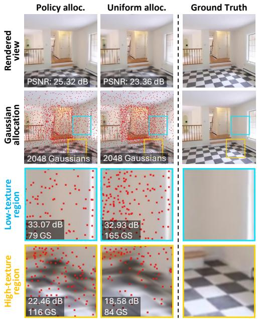  
Figure 5: Effect of the policy allocation. At the same budget, the policy assigns fewer Gaussians than uniform allocation to the low-texture region (79 vs. 165) at similar PSNR, and more to the high-texture region (116 vs. 84), improving detail reconstruction.

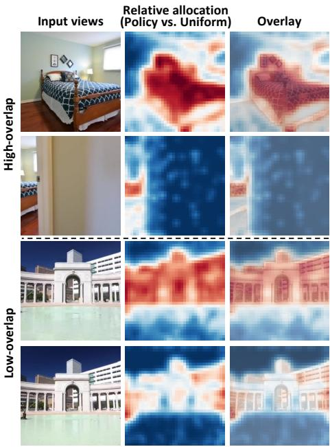  
Figure 6: Learned allocation policy. Two RE10K scenes, each with two input views and 1024 Gaussians per view on average. Maps show expected anchor allocation relative to uniform (red: more, blue: fewer), smoothed for display.

latency from 595.0 ms to 388.0 ms. With the Voronoi loss, the hierarchical search retrieves exactly the same $K _ { \mathrm { g s } }$ nearest neighbors as the exact search for 99.0% of the Gaussians, whereas without it this rate drops to 60.2%, as Gaussians drift out of their anchor’s cell. Fig. 7 varies the number of neighbors $K _ { \mathrm { g s } }$ at inference while keeping $K _ { \mathrm { a n c } }$ fixed. For every $K _ { \mathrm { g s } } ,$ peak VRAM decreases linearly with B, and a larger $K _ { \mathrm { g s } }$ improves quality at the cost of memory. As the budget grows, the quality gap between different $K _ { \mathrm { g s } }$ narrows, while the memory cost of a larger $K _ { \mathrm { g s } }$ increases. Since $K _ { \mathrm { g s } }$ can be changed without retraining, users can choose a smaller value at large budgets to save memory with little loss in quality, and a larger $K _ { \mathrm { g s } }$ at small budgets where it matters most.  
Table 5: Neighbor search cost. Comparison of exact and hierarchical neighbor search at 65,536 Gaussians, reporting both search latency and endto-end generation latency.
<table><tr><td rowspan="2">Neighbor search</td><td colspan="2">Latency (ms) ↓</td></tr><tr><td></td><td>Search End-to-end</td></tr><tr><td>Exact</td><td>220.8</td><td>539.2</td></tr><tr><td>Hierarchical (ours)</td><td>8.1</td><td>328.3</td></tr></table>

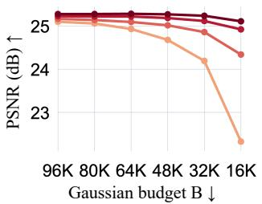

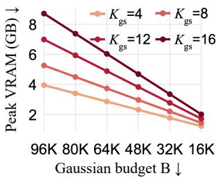  
Figure 7: Gaussian-neighbor ablation. $K _ { \mathrm { g s } }$ is varied at inference with a single trained model; $K _ { \mathrm { a n c } } { = } \mathrm { \breve { 1 } 6 }$ is fixed.

## 5 Conclusion

We presented RLSplat, a budget-controllable feed-forward 3DGS framework whose inference cost scales linearly with the requested number of Gaussians B. A Gaussian allocation policy, trained with GSPO, distributes exactly B Gaussians across anchors, and a resource-linear decoder refines them through local cross-attention with a hierarchical neighbor search. On ACID, RLSplat achieves the best rendering quality among budget-controllable methods at every tested budget. Its latency and peak memory decrease linearly with B, and it matches or exceeds the quality of the baselines at a fraction of their memory and latency.

## References

Honggyu An, Jaewoo Jung, Mungyeom Kim, Chaehyun Kim, Minkyeong Jeon, Jisang Han, Kazumi Fukuda, Takuya Narihira, Hyunah Ko, Junsu Kim, et al. Learning compact 3d representations with 2k gaussians. In CVPR, 2026.

Jonathan T Barron, Ben Mildenhall, Matthew Tancik, Peter Hedman, Ricardo Martin-Brualla, and Pratul P Srinivasan. Mip-nerf: A multiscale representation for anti-aliasing neural radiance fields. In ICCV, 2021.

Kevin Black, Michael Janner, Yilun Du, Ilya Kostrikov, and Sergey Levine. Training diffusion models with reinforcement learning. In ICLR, 2024.

Alessandro Burzio, Tobias Fischer, Sven Elflein, Qunjie Zhou, Riccardo de Lutio, Jiawei Ren, Jiahui Huang, Shengyu Huang, Marc Pollefeys, Laura Leal-Taixe, et al. D ´ \’ej\a view: Looping transformers for multi-view 3d reconstruction. arXiv preprint arXiv:2605.30215, 2026.

David Charatan, Sizhe Lester Li, Andrea Tagliasacchi, and Vincent Sitzmann. pixelsplat: 3d gaussian splats from image pairs for scalable generalizable 3d reconstruction. In CVPR, 2024.

Yuedong Chen, Haofei Xu, Chuanxia Zheng, Bohan Zhuang, Marc Pollefeys, Andreas Geiger, Tat-Jen Cham, and Jianfei Cai. Mvsplat: Efficient 3d gaussian splatting from sparse multi-view images. In ECCV, 2024a.

Zilong Chen, Feng Wang, Yikai Wang, and Huaping Liu. Text-to-3d using gaussian splatting. In CVPR, 2024b.

Zhiwen Fan, Kevin Wang, Kairun Wen, Zehao Zhu, Dejia Xu, Zhangyang Wang, et al. Lightgaussian: Unbounded 3d gaussian compression with 15x reduction and 200+ fps. NeurIPS, 2024.

Guangchi Fang and Bing Wang. Mini-splatting: Representing scenes with a constrained number of gaussians. In ECCV, 2024.

Ranran Huang and Krystian Mikolajczyk. No pose at all: Self-supervised pose-free 3d gaussian splatting from sparse views. In ICCV, 2025.

Roni Itkin, Noam Issachar, Yehonatan Keypur, Xingyu Chen, Anpei Chen, and Sagie Benaim. Globalsplat: Efficient feed-forward 3d gaussian splatting via global scene tokens. In ECCV, 2026.

Lihan Jiang, Yucheng Mao, Linning Xu, Tao Lu, Kerui Ren, Yichen Jin, Xudong Xu, Mulin Yu, Jiangmiao Pang, Feng Zhao, et al. Anysplat: Feed-forward 3d gaussian splatting from unconstrained views. ACM Trans. Graphics, 2025.

Ying Jiang, Chang Yu, Tianyi Xie, Xuan Li, Yutao Feng, Huamin Wang, Minchen Li, Henry Lau, Feng Gao, Yin Yang, et al. Vr-gs: A physical dynamics-aware interactive gaussian splatting system in virtual reality. In ACM SIGGRAPH, 2024.

Nikhil Keetha, Jay Karhade, Krishna Murthy Jatavallabhula, Gengshan Yang, Sebastian Scherer, Deva Ramanan, and Jonathon Luiten. Splatam: Splat, track & map 3d gaussians for dense rgb-d slam. In CVPR, 2024.

Bernhard Kerbl, Georgios Kopanas, Thomas Leimkuhler, and George Drettakis. 3d gaussian splat-¨ ting for real-time radiance field rendering. ACM Trans. Graphics, 2023.

Shakiba Kheradmand, Daniel Rebain, Gopal Sharma, Weiwei Sun, Yang-Che Tseng, Hossam Isack, Abhishek Kar, Andrea Tagliasacchi, and Kwang Moo Yi. 3d gaussian splatting as markov chain monte carlo. NeurIPS, 2024.

Injae Kim, Chaehyeon Kim, Minseong Bae, Minseok Joo, and Hyunwoo J. Kim. F4splat: Feedforward predictive densification for feed-forward 3d gaussian splatting. In ECCV, 2026.

Joo Chan Lee, Daniel Rho, Xiangyu Sun, Jong Hwan Ko, and Eunbyung Park. Compact 3d gaussian representation for radiance field. In CVPR, 2024.

Vincent Leroy, Yohann Cabon, and Jer´ ome Revaud. Grounding image matching in 3d with mast3r.ˆ In ECCV, 2024.

Yue Li, Qi Ma, Runyi Yang, Huapeng Li, Mengjiao Ma, Bin Ren, Nikola Popovic, Nicu Sebe, Ender Konukoglu, Theo Gevers, et al. Scenesplat: Gaussian splatting-based scene understanding with vision-language pretraining. In ICCV, 2025.

Andrew Liu, Richard Tucker, Varun Jampani, Ameesh Makadia, Noah Snavely, and Angjoo Kanazawa. Infinite nature: Perpetual view generation of natural scenes from a single image. In ICCV, 2021.

Saswat Subhajyoti Mallick, Rahul Goel, Bernhard Kerbl, Markus Steinberger, Francisco Vicente Carrasco, and Fernando De La Torre. Taming 3dgs: High-quality radiance fields with limited resources. In SIGGRAPH Asia, 2024.

Hidenobu Matsuki, Riku Murai, Paul H. J. Kelly, and Andrew J. Davison. Gaussian splatting slam. In CVPR, 2024.

Panagiotis Papantonakis, Georgios Kopanas, Bernhard Kerbl, Alexandre Lanvin, and George Drettakis. Reducing the memory footprint of 3d gaussian splatting. Proc. ACM Comput. Graphics Comput. Syst., 2024.

Jongmin Park, Minh-Quan Viet Bui, Juan Luis Gonzalez Bello, Jaeho Moon, Jihyong Oh, and Munchurl Kim. Ecosplat: Efficiency-controllable feed-forward 3d gaussian splatting from multiview images. In CVPR, 2026.

Shenhan Qian, Tobias Kirschstein, Liam Schoneveld, Davide Davoli, Simon Giebenhain, and Matthias Nießner. Gaussianavatars: Photorealistic head avatars with rigged 3d gaussians. In CVPR, 2024.

John Schulman, Filip Wolski, Prafulla Dhariwal, Alec Radford, and Oleg Klimov. Proximal policy optimization algorithms. arXiv preprint arXiv:1707.06347, 2017.

Zhihong Shao, Peiyi Wang, Qihao Zhu, Runxin Xu, Junxiao Song, Xiao Bi, Haowei Zhang, Mingchuan Zhang, Y. K. Li, Y. Wu, and Daya Guo. DeepSeekMath: Pushing the limits of mathematical reasoning in open language models. arXiv preprint arXiv:2402.03300, 2024.

Brandon Smart, Chuanxia Zheng, Iro Laina, and Victor Adrian Prisacariu. Splatt3r: Zero-shot gaussian splatting from uncalibrated image pairs. arXiv preprint arXiv:2408.13912, 2024.

Stanislaw Szymanowicz, Christian Rupprecht, and Andrea Vedaldi. Splatter image: Ultra-fast single-view 3d reconstruction. In CVPR, 2024.

Jiaxiang Tang, Jiawei Ren, Hang Zhou, Ziwei Liu, and Gang Zeng. Dreamgaussian: Generative gaussian splatting for efficient 3d content creation. In ICLR, 2024.

Anh Thai, Songyou Peng, Kyle Genova, Leonidas Guibas, and Thomas Funkhouser. Splattalk: 3d vqa with gaussian splatting. In ICCV, 2025.

Alexander Veicht, Sunghwan Hong, Daniel Bar´ ath, and Marc Pollefeys. Zipsplat: Fewer gaussians,´ better splats. arXiv preprint arXiv:2606.05102, 2026.

Jianyuan Wang, Minghao Chen, Nikita Karaev, Andrea Vedaldi, Christian Rupprecht, and David Novotny. Vggt: Visual geometry grounded transformer. In CVPR, 2025.

Shuzhe Wang, Vincent Leroy, Yohann Cabon, Boris Chidlovskii, and Jerome Revaud. Dust3r: Geometric 3d vision made easy. In CVPR, 2024.

Ronald J. Williams. Simple statistical gradient-following algorithms for connectionist reinforcement learning. Machine Learning, 1992.

Haofei Xu, Songyou Peng, Fangjinhua Wang, Hermann Blum, Daniel Barath, Andreas Geiger, and Marc Pollefeys. Depthsplat: Connecting gaussian splatting and depth. In CVPR, 2025.

Botao Ye, Sifei Liu, Haofei Xu, Xueting Li, Marc Pollefeys, Ming-Hsuan Yang, and Songyou Peng. No pose, no problem: Surprisingly simple 3d gaussian splats from sparse unposed images. In ICLR, 2025.

Kai Zhang, Sai Bi, Hao Tan, Yuanbo Xiangli, Nanxuan Zhao, Kalyan Sunkavalli, and Zexiang Xu. Gs-lrm: Large reconstruction model for 3d gaussian splatting. In ECCV, 2024.

Chujie Zheng, Shixuan Liu, Mingze Li, Xiong-Hui Chen, Bowen Yu, Chang Gao, Kai Dang, Yuqiong Liu, Rui Men, An Yang, Jingren Zhou, and Junyang Lin. Group sequence policy optimization. arXiv preprint arXiv:2507.18071, 2025.

Tinghui Zhou, Richard Tucker, John Flynn, Graham Fyffe, and Noah Snavely. Stereo magnification: Learning view synthesis using multiplane images. ACM Trans. Graphics, 2018.

## A Limitations and Future Work

Image encoding remains a fixed cost independent of $B ,$ which bounds the achievable speed-up at small budgets. We also evaluate at a resolution of $2 5 6 \times 2 5 6$ and in a single cross-dataset setting. RLSplat controls both the size of the representation and the cost of producing it. It can therefore serve as a 3D scene representation for downstream tasks that have their own resource limits, such as 3D vision-language models and robot learning. Evaluating it on such tasks is a natural next step.

## B Allocation Policy Details

Policy head. The policy head predicts a logit $l _ { n }$ for each anchor token, and the allocation probabilities are obtained as $\mathrm { { \bf p } } ^ { \prime } = \mathrm { s o f t m a x } ( 1 )$ with $\mathbf { \bar { l } } = \{ l _ { n } \} _ { n = 1 } ^ { N }$ . The head is $\mathrm { L N } ( d ) \to \mathrm { L i n e a r } ( \bar { d , } h ) \to$ SiLU → Linear(h, 1), applied per anchor token. The last linear layer is zero-initialized, so p starts uniform.

Budget conditioning. The head is modulated by FiLM parameters $( \gamma , \eta )$ . They are predicted from a single scalar, the log-ratio of the requested budget to the number of anchors, $\dot { u } = \bar { \log _ { 2 } } ( B / N )$ , by Linear $( 1 , h ) \to \mathrm { S i L U } \to \mathrm { L i n e a r } ( h , \bar { 2 d } )$ . The modulation is applied after the layer norm: hidden hidden ⊙ $\left( 1 + \operatorname { t a n h } \gamma ( u ) \right) + \pmb \eta ( u )$ . The last layer of the FiLM generator is also zero-initialized. The ratio $B / N$ is floored at $1 / 6 4$ so that u stays finite for very small budgets.

Policy initialization at the start of policy training. The policy head does not exist during base training. It is created with zero-initialized output layers when policy training begins, so it outputs exactly 0 for every anchor and p is uniform at the first policy-training step. Base training’s random allocation already covers this regime, so the transition introduces no distribution shift for the decoder.

Deterministic integer allocation. At inference, and for the reconstruction loss during policy training, the expected counts $B \mathbf { p }$ are converted into an integer allocation ${ \bf k } ^ { \star }$ by systematic rounding with a fixed phase. Anchors are laid out on a line in a fixed (view, patch-raster) order, anchor n owning the interval $[ B P _ { n - 1 } , B P _ { n } )$ with $\begin{array} { r } { P _ { n } = \sum _ { m \leq n } p _ { m } } \end{array}$ and $P _ { 0 } = 0$ . We place $B$ points at $\varphi , \varphi + 1 , \ldots , \varphi + B - 1$ with $\textstyle \varphi = { \frac { 1 } { 2 } }$ and count those that fall inside each interval:

$$
\begin{array} { r } { k _ { n } ^ { \star } \ = \ \left\lceil B P _ { n } - \varphi \right\rceil - \left\lceil B P _ { n - 1 } - \varphi \right\rceil . } \end{array}\tag{11}
$$

This rule has three properties we rely on: (i) the counts sum to exactly B, since the telescoping sum equals $\lceil B - { \frac { 1 } { 2 } } \rceil - \dot { \lceil - { \frac { 1 } { 2 } } \rceil } = B ; { \mathrm { ( i i ) } }$ every count is either $\left\lfloor B p _ { n } \right\rfloor \mathbf { o r } \left\lceil B \mathbf { \dot { p } } _ { n } \right\rceil$ , since an interval of length $B p _ { n }$ contains that many unit-spaced points; and (iii) an anchor with $p _ { n } = 0$ receives no Gaussian. With a uniformly random phase, Eq. (11) is systematic resampling and satisfies $\mathbb { E } [ k _ { n } ] = B p _ { n }$ , the mean of the multinomial rollouts. Fixing $\varphi$ makes it deterministic. It needs a single cumulative sum, so it takes $\mathcal { O } ( N )$ time, involves no sorting and has no ties to break. We compute it in double precision and renormalize $P _ { N }$ to one.

## C GSPO Training Details

GSPO hyperparameters. Table 6 ablates the two hyperparameters of the rollouts: the group size C and the rollout temperature τ . $\mathrm { W i t h } \tau \ne 1$ , the rollouts are drawn from the tempered proposal q rather than from p, and the ratio is no longer one. The policy is robust to both hyperparameters: all settings are within 0.11 dB PSNR of each other. $C = 5$ performs best, and $\tau = 1 . 0$ , which samples from the policy itself, outperforms both tempered variants. We use $C = 5$ and $\tau = 1 . 0$ 0 throughout.

Settled hyperparameters. Policy training uses $C = 5$ rollouts and policy loss weight $\lambda _ { \mathrm { p o l i c y } } =$ 1.0; the entropy and KL weights are both 0, and no minimum per-anchor count is enforced. Base training (Sec. 3.4) trains the encoder and decoder without an allocation head at all, so there is no pretrained policy to serve as a KL reference at the start of policy training. The policy instead starts from the zero-initialized, uniform head described above.

Table 6: GSPO hyperparameters. Group size C and rollout temperature τ . The first row is our default.
<table><tr><td>C</td><td>T</td><td>LPIPS ↓</td><td>SSIM ↑</td><td>PSNR ↑</td></tr><tr><td>5</td><td>1.0</td><td>0.268</td><td>0.722</td><td>24.68</td></tr><tr><td>3</td><td>1.0</td><td>0.273</td><td>0.717</td><td>24.57</td></tr><tr><td>7</td><td>1.0</td><td>0.269</td><td>0.720</td><td>24.63</td></tr><tr><td>5</td><td>0.8</td><td>0.271</td><td>0.718</td><td>24.60</td></tr><tr><td>5</td><td>1.2</td><td>0.270</td><td>0.719</td><td>24.61</td></tr></table>

## D Decoder Details

Gaussian token construction. For anchor n with $k _ { n }$ allocated Gaussians, token $r \in \{ 0 , \ldots , k _ { n } -$ 1} has relative position $\rho _ { n , r } = ( r + \frac { 1 } { 2 } ) / k _ { n } \in ( 0 , 1 )$ , so the tokens of any anchor tile the unit interval regardless of $k _ { n }$ . We use a mip-NeRF-style (Barron et al., 2021) integrated positional encoding $\mathrm { P } \bar { \mathrm { E } } ( \rho , k )$ that averages Fourier features over the token’s bin of width $1 / k _ { n }$ , which suppresses the frequencies that would otherwise alias between nearby values of $k _ { n }$ . The token is

$$
\begin{array} { r } { \mathbf { t } _ { n , r } ^ { 0 } = \mathbf { a } _ { n } + \left( 1 + \operatorname { t a n h } \alpha _ { n } \right) \odot \mathrm { M L P } \left( \mathrm { P E } ( \rho _ { n , r } , k _ { n } ) \right) + \beta _ { n } , \qquad ( \alpha _ { n } , \beta _ { n } ) = \mathrm { L i n e a r } \left( \mathrm { L N } ( \mathbf { a } _ { n } ) \right) , } \end{array}\tag{12}
$$

with the FiLM layer zero-initialized. All B tokens across a batch are packed into one sequence, so no computation is spent on padding.

Neighbor search. Anchor centroids ${ \bar { \pmb { \mu } } } _ { n }$ are the mean initial centers of each anchor’s tokens. ${ \mathcal { N } } ^ { \mathrm { a n c } } ( n )$ , the $K _ { \mathrm { a n c } } { = } 1 6$ nearest anchors to n (including n itself), is found once by a K-nearestneighbor search over the detached centroids and shared by all $L = 2$ decoder layers. A Gaussian’s neighbor set $\mathcal { N } ^ { \mathrm { g s } } ( b )$ is the $K _ { \mathrm { g s } }$ nearest Gaussian tokens, by detached Euclidean distance, among the tokens belonging to $\mathcal { N } ^ { \mathrm { a n c } } ( n _ { b } )$

Residual head. The initial-Gaussian head and the residual head share the same architecture, $\mathrm { L N } \to \mathrm { L i n e a r } ( d , 2 5 6 ) \to \mathrm { S i L U } \to \mathrm { L i n e a r } ( 2 5 6 , 1 1 + 3 d _ { \mathrm { s h } } )$ , predicting a center offset (3), an opacity logit (1), scales (3), a quaternion (4), and spherical-harmonic color coefficients. The residual head is zero-initialized, and its center output is scaled by $\alpha _ { \mu }$

## E Training Details

Context views are loaded at $2 5 6 \times 2 5 6$ and bilinearly upsampled to 504 × 504 immediately before the backbone, while target views, losses, and evaluation remain at $2 5 6 \times 2 5 6$ . The DVLT (Burzio et al., 2026) backbone runs 12 inference steps. Each training step draws the number of context views V from the divisors of 24, $V \in \{ 2 , 3 , 4 , 6 , \bar { 8 } , 1 2 , 2 4 \}$ , and sets the batch size to $2 4 / V ,$ , so that every step processes 24 context views in total regardless of V.

Base training. The encoder and decoder are trained for 40K steps with allocations drawn uniformly at random, which exposes the decoder to a wide range of per-anchor counts before any policy is learned. The per-sample budget is sampled from a Beta distribution over $[ 2 0 4 8 , 1 6 3 8 4 V ]$ We use AdamW with a learning rate of $1 0 ^ { - 4 } ~ ( \dot { 0 } . 1 \times$ for the backbone), 1,000 warm-up steps, and cosine decay on 4 GPUs. The loss weights are 1.0 for MSE, 0.05 for VGG-LPIPS, 0.1 for the reprojection term and 0.05 for the cheirality term of $\mathcal { L } _ { \mathrm { p r o j } }$ , and 1.0 for ${ \mathcal { L } } _ { \mathrm { v o r } }$ . The offset loss $\mathcal { L } _ { \mathrm { o f f s e t } }$ is weighted $\lambda _ { \mathrm { o f f s e t } } = 0 . 0 1$

Policy training. Starting from the pretrained model, all parameters are fine-tuned for 5K steps with $C = 5$ rollouts per step and a rollout temperature of $\tau = 1 . 0 $ ; the render used for the reconstruction loss is produced from the deterministic allocation of Sec. 3.2. The learning rate is reduced to $1 0 ^ { - 5 }$ ， with a 30× multiplier on the allocation head, and $\mathcal { L } _ { \mathrm { o f f s e t } }$ is disabled. The policy loss ${ \mathcal { L } } _ { \mathrm { p o l i c y } }$ is weighted 1.0. Each sample’s budget is drawn independently from Beta(1, 4) over the same range, which biases training toward low budgets where allocation matters most. The total budget of a step is capped, so that peak memory is bounded independently of the per-sample maximum.

## F Ablation Protocol

Each ablation changes a single component relative to its reference, except for the variant that removes both locality regularizers. Pretraining ablations (Table 3) are trained from scratch for 5K steps, one eighth of the full schedule, with all step-dependent schedules (cosine horizon, optimizer warm-up, view-sampler warm-up, and validation and checkpoint intervals) scaled by the same factor. We compare the full recipe with variants that remove the local refinement module, the projection loss (both its reprojection and cheirality terms), the offset loss, or both the offset and Voronoi losses. The neighbor match rate without the Voronoi loss is measured with the same schedule. Allocation ablations (Tables 4 and 6) fine-tune for 1K steps from a single shared pretrained checkpoint and vary the group size $C \in \{ 3 , 5 , 7 \}$ , the temperature $\tau \in \{ 0 . 8 , \bar { 1 } . 0 , 1 . 2 \}$ , and the allocation rule, replacing the learned policy with a uniform split or a learning-free Sobel-energy heuristic. Since a shorter run anneals on its own cosine schedule, each variant is trained for its own horizon rather than truncated from a longer run. All ablations are evaluated on ACID with 8 context views (249 scenes). Allocation ablations are evaluated at $B / V = 1 0 2 4$

## G Allocation Policy Visualizations

Figs. 8 to 10 extend Fig. 6 to twelve RE10K two-view test scenes, all at an average of 1024 Gaussians per view. For each anchor we show its expected allocation relative to a uniform split, $p _ { n } N _ { \astrosun }$ , where N is the number of anchors over both views; 1× corresponds to about 0.8 Gaussians per anchor at this budget. This is the policy’s output before the budget is rounded to integer counts. The corner label is the fraction of the total budget that goes to that view. We show the raw per-anchor maps next to the smoothed maps used in the main paper (Gaussian filter, σ=1 anchor, applied to $\log _ { 2 }$ of the map), so the smoothing can be checked for artifacts: it only removes anchor-level noise and leaves the spatial pattern unchanged.

## H Additional Qualitative Comparison

Figs. 11 to 13 compare RLSplat with F4Splat and EcoSplat as the Gaussian budget is reduced from 128K to 32K. As the budget decreases, the baselines progressively blur or lose thin, high-frequency structures such as stair balusters, railings, window frames, and foliage, while RLSplat retains these details at every budget. This is consistent with Table 1, where RLSplat exhibits substantially less quality degradation than the baselines as the budget decreases. Unlike the baselines, which reduce a dense set of candidates, RLSplat allocates the budget where the scene needs it and decodes only those Gaussians, preserving fine details even under the tightest budgets.

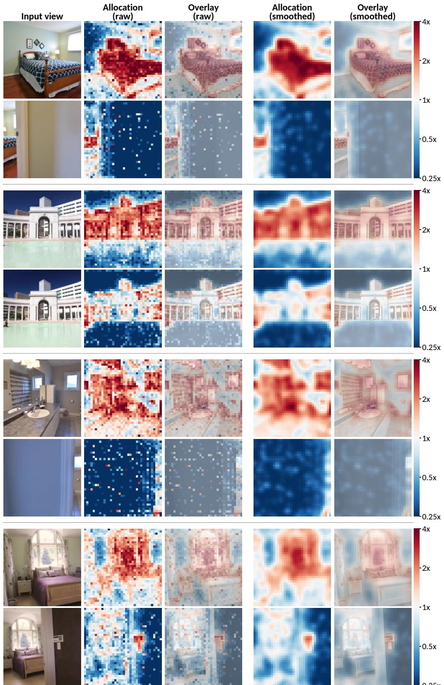  
0.25xFigure 8: More allocation policies (1/3). Raw (left pair) and smoothed (right pair) allocation maps on a log scale (0.25× to 4×; red: more, blue: fewer). In these indoor scenes the policy shifts budget toward the view with more structure and away from near-blank walls and doorways.

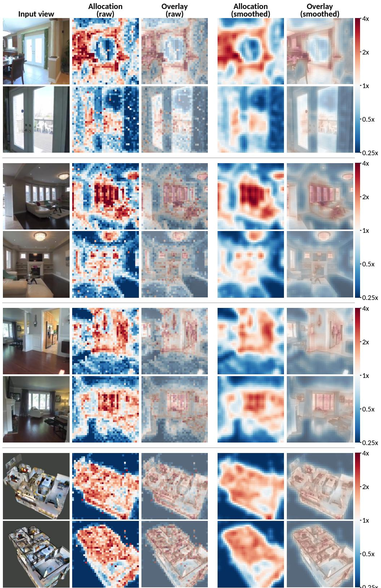  
Figure 9: More allocation policies (2/3). Same layout as Fig. 8. Budget moves away from dark or under-exposed regions, such as the arch frame and the darkened hillside, and concentrates on the lit part of the scene or on the object.

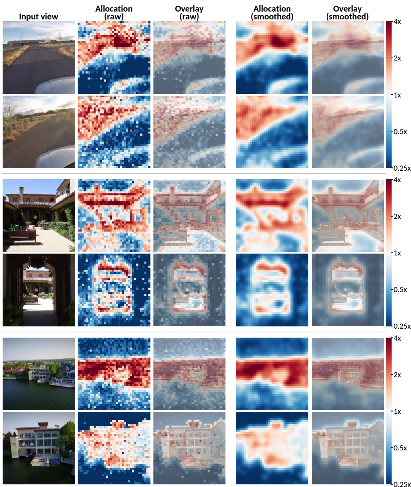  
Figure 10: More allocation policies (3/3). Same layout as Fig. 8. When the two views are nearly identical, the budget stays close to an even split between them, and the policy acts within each view instead: it empties water and sky and spends the budget on buildings, vegetation and shorelines.

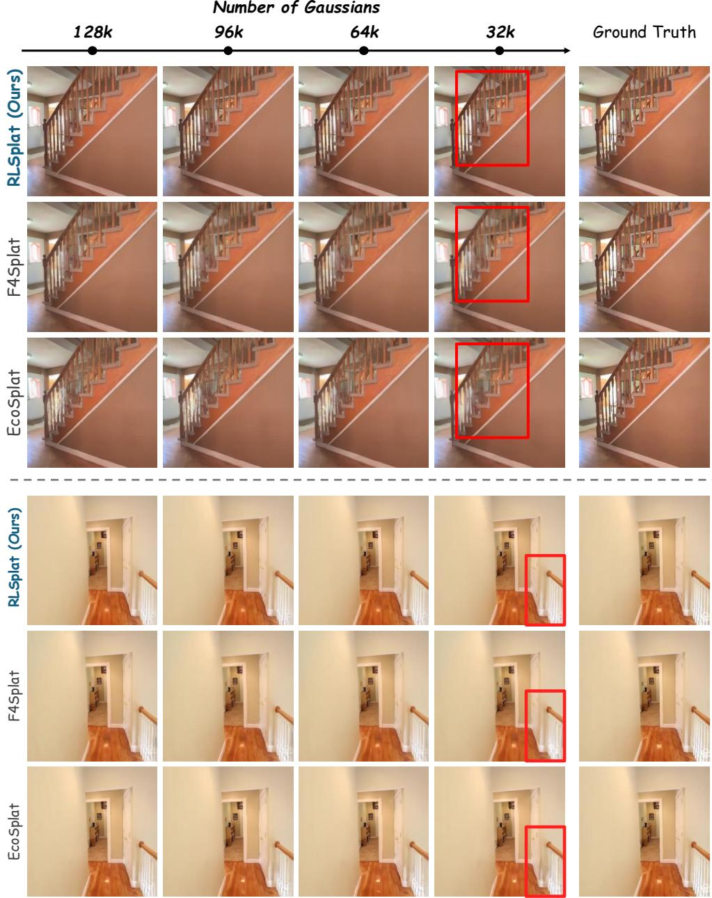  
Figure 11: Qualitative comparison across Gaussian budgets (1/3).

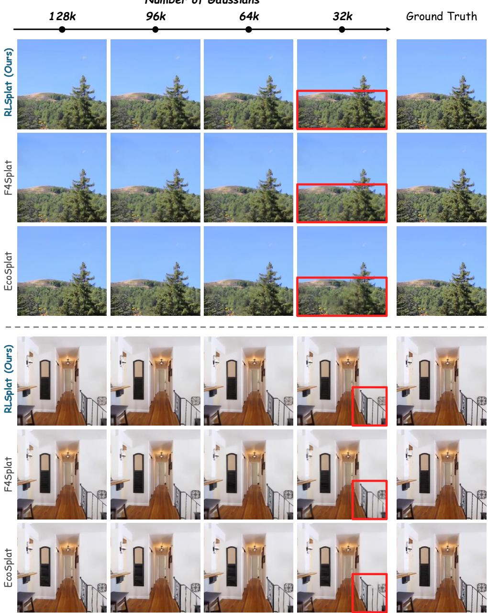  
Figure 12: Qualitative comparison across Gaussian budgets (2/3).

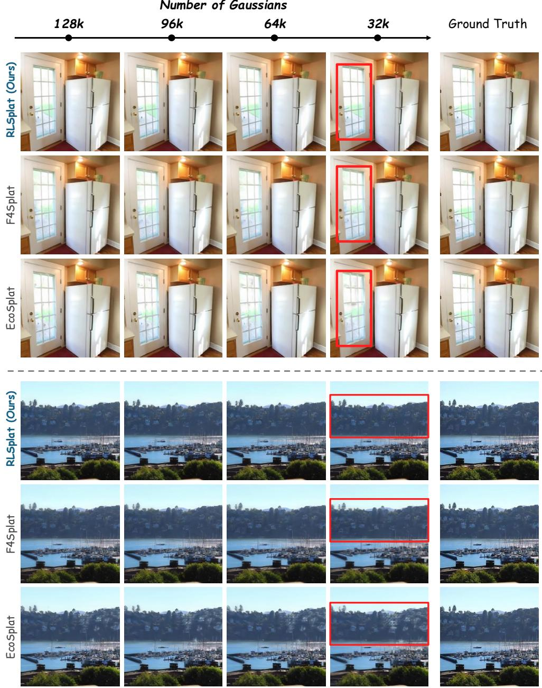  
Figure 13: Qualitative comparison across Gaussian budgets (3/3).