# ROBOJUDGE: MULTIMODAL LANGUAGE MODELS AS JUDGES FOR EMBODIED VIDEO GENERATION

Siyuan Ma1,\*,† Yu Qi3,\* Cheng Ye4,\* Ruotian Peng2,5 Xinyi Xu3 Zitiantao Lin3 Zedong Cai6 Yijian Huang6 Weiyang Liu1 Siyuan Wang1,‡ Yandong Wen2,‡

1The Chinese University of Hong Kong 2Westlake University 3Northeastern University 4University of California, San Diego 5Zhejiang University 6Independent \*Equal contribution †Project lead ‡Corresponding author

## ABSTRACT

Video generation models are promising foundations for embodied world models, but only if their generated rollouts are physically valid and faithful to task instructions. Multimodal large language models (MLLMs) are increasingly used to judge these properties, yet their agreement with human judgments on embodied videos has not been systematically evaluated. To address this gap, we introduce ROBOJUDGE-BENCH, a benchmark for evaluating MLLMs as judges of embodied video generation. The benchmark measures two fundamental dimensions, Physical Adherence and Instruction Alignment, across 800 humanannotated videos from 8 source corpora and 10 video generators, spanning grippers, human hands, and dexterous hands. Experiments reveal uneven alignment between existing judges and human ratings: general-purpose MLLMs show lower agreement on physical adherence, while specialized video judges designed for general-domain physical reasoning do not consistently transfer to embodied scenarios. Motivated by these findings, we construct ROBOJUDGE-TRAIN, comprising 12K videos annotated with 25K human-verified scores and modelassisted rationales for Physical Adherence and Instruction Alignment. We finetune a 9B MLLM on this dataset with supervised learning followed by reinforcement learning, yielding ROBOJUDGE-9B. Among the model judges evaluated on ROBOJUDGE-BENCH, ROBOJUDGE-9B achieves the highest overall agreement, reaching a Pearson correlation of 0.719 with a statistically significant 0.089 gain over Gemini-3.7-Flash, the best-performing proprietary baseline in our evaluation. Training on ROBOJUDGE-TRAIN also yields gains on external benchmarks, including VideoPhy2 and Physion-Eval. We further use ROBOJUDGE-9B as a downstream evaluator to benchmark video generation models according to Physical Adherence and Instruction Alignment.

Project page: https://spherelab.ai/RoboJudge

## 1 INTRODUCTION

Recent advances in video generation have positioned generative models as a promising foundation for embodied world models (Li et al., 2025; Yue et al., 2025; Shang et al., 2026; Jiang et al., 2026; Li et al., 2026b). Unlike general video generators, embodied world models must predict how the physical world evolves under robot actions or task instructions, providing imagined rollouts for planning and policy learning. These rollouts therefore need to be not only visually plausible, but also physically valid and instruction-consistent, creating a pressing need for reliable evaluation.

Evaluating embodied generated videos is particularly challenging because they require fine-grained assessment of physical interactions and task-level correctness, while open-ended task execution makes reference-based similarity intrinsically unreliable. Pixel, perceptual, and representation metrics capture visual or semantic similarity to reference trajectories (Huynh-Thu & Ghanbari, 2008; Bakurov et al., 2022; Zhang et al., 2018; Radford et al., 2021; Caron et al., 2021; Bardes et al.,

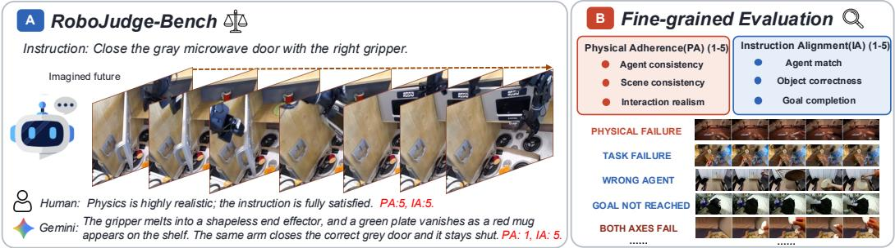

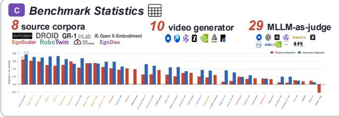

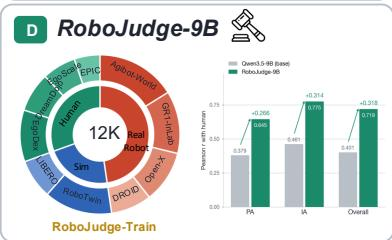  
Figure 1: Overview of ROBOJUDGE. (A) We propose ROBOJUDGE-BENCH, which evaluates MLLMs as judges of embodied videos. (B) Physical Adherence and Instruction Alignment serve as the two core evaluation dimensions for embodied judge models. (C) We benchmark 29 existing model judges, (D) and construct ROBOJUDGE-TRAIN, a 12K-video dataset for judge training, and fine-tune ROBOJUDGE-9B, which achieves the strongest overall agreement among model judges.

2024), but cannot disentangle physical and task-level failures. MLLM-based judges offer stronger multimodal reasoning (Zheng et al., 2023; Chen et al., 2024), yet general-purpose MLLMs lack embodied-specific calibration (Qi et al., 2026b). Meanwhile, specialized video judges target generaldomain quality or physical commonsense (He et al., 2024; 2025; Bansal et al., 2025; Lin et al., 2026), rather than fine-grained manipulation dynamics, contact relationships, and task completion.

To address this gap, we introduce ROBOJUDGE-BENCH, a benchmark for evaluating MLLMs as judges of embodied world model rollouts along two critical axes: Physical Adherence (PA) and Instruction Alignment (IA). Specifically, PA covers agent consistency, scene consistency, and interaction realism; IA covers agent match, object correctness, and goal completion. The benchmark comprises 800 rollouts with instructions from 8 embodied source corpora and videos generated by 10 video generation models, spanning parallel-jaw grippers, dexterous hands, and human hands across indoor and outdoor activities. Each sample is annotated with 1–5 human ratings for PA and IA, together with detailed rationales under a cross-review protocol.

Evaluation against 29 model-judge baselines and 8 non-MLLM metrics reveals gaps between existing judges and human judgments. Frontier models show lower agreement on physical adherence: GPT-5.5 (OpenAI, 2026) reaches r = 0.49 on PA. Specialized video judges reach at most r = 0.42 on PA and 0.59 on IA, while non-MLLM baselines show limited sensitivity to fine-grained physical correctness. Failure analysis identifies cases in which existing judges overlook interaction failures and physical hallucinations.

Motivated by these findings, we construct ROBOJUDGE-TRAIN, a large-scale embodied-video judge-training dataset comprising 12K videos annotated with 25K human-verified scores and modelassisted rationales for PA and IA. We fine-tune a 9B MLLM from Qwen3.5-9B using supervised learning followed by reinforcement learning, yielding ROBOJUDGE-9B. Among the model judges evaluated on ROBOJUDGE-BENCH, the resulting ROBOJUDGE-9B achieves the highest overall agreement, reaching a Pearson r of 0.719 compared with 0.401 for its base model. Training on ROBOJUDGE-TRAIN also yields gains on VideoPhy2 (Bansal et al., 2026) and Physion-Eval (Zhang et al., 2026). We further use ROBOJUDGE-9B as a downstream evaluator to benchmark video generation models using the same PA and IA criteria. These capabilities also suggest broader downstream potential for online physical rollout evaluation and agentic embodied video generation. In summary, our contributions are three-fold:

1. ROBOJUDGE-BENCH. A benchmark designed for judges of embodied video generation: 800 human-annotated rollouts from 8 corpora and 10 video generators, spanning grippers, dexterous hands, and human hands in simulated and real environments, rated on physical adherence and instruction alignment.

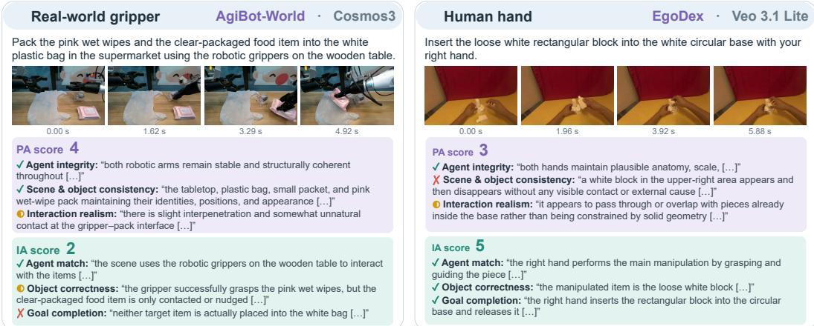  
Figure 2: Examples from ROBOJUDGE-BENCH. Each example shows the task instruction, sampled video frames, and human ratings with supporting evidence for Physical Adherence (PA) and Instruction Alignment (IA). Left: a gripper-robot video preserves most physical properties but fails to complete the packing task (PA: 4; IA: 2). Right: a human-hand video completes the requested insertion despite object-consistency and interaction artifacts (PA: 3; IA: 5). The examples illustrate why physical plausibility and task completion require separate assessment.

2. A systematic study of existing judges. We compare against 29 model-judge baselines and 8 non-MLLM metrics and characterize gaps with human judgments, with failures concentrated on fine-grained interaction errors and physical hallucinations.

3. ROBOJUDGE-TRAIN and ROBOJUDGE-9B. We construct a training dataset for embodied video judges, comprising 12K embodied videos spanning 14 generators and real demonstrations, with 25K human-verified scores and model-assisted rationales, together with a 9B judge fine-tuned from Qwen3.5-9B via SFT and RL. It achieves the highest overall agreement among the evaluated model judges and shows gains on OOD benchmarks. As a downstream use case, we apply it to rank video generation models using the same PA and IA criteria.

## 2 RELATED WORK

Embodied MLLM benchmarks also diagnose atomic perception, reasoning, and planning capabilities (Qi et al., 2026b).

Benchmarks for Video Generative Models. Video-generation benchmarks have gradually moved beyond perceptual quality toward physical and embodied evaluation. General benchmarks evaluate visual quality, text-video alignment, and physical commonsense (Liu et al., 2024; Huang et al., 2025; 2024; He et al., 2024; Bansal et al., 2025; 2026; Meng et al., 2025; Lin et al., 2026; Qi et al., 2026a). Recent embodied and world-model benchmarks further test instruction following, physical adherence, and task-level behavior in generated rollouts (Li et al., 2025; Yue et al., 2025; Fan et al., 2026; Shang et al., 2026; Jiang et al., 2026). These benchmarks primarily measure generated videos or generative models themselves. In contrast, our work studies whether thejudges used for embodied video evaluation are reliable.

Video Quality Evaluation Metrics. Video evaluation metrics have also expanded in scope. Classical metrics measure pixel-level or perceptual similarity (Huynh-Thu & Ghanbari, 2008; Bakurov et al., 2022; Zhang et al., 2018), while FVD compares video feature distributions at the dataset level (Unterthiner et al., 2018). Learned representations such as CLIP, DINO, and V-JEPA provide semantic or temporal features, and optical-flow estimators such as RAFT support motion-based measures (Radford et al., 2021; Caron et al., 2021; Bardes et al., 2024; Teed & Deng, 2020). These metrics capture useful signals, but they do not explicitly judge physical validity or task completion. Recent MLLM-based evaluators add language-conditioned video judgments, including VideoScore,

Table 1: Comparison of representative datasets for evaluating MLLMs as world model judges. Numbers in parentheses indicate the number of embodied videos.
<table><tr><td>Dataset</td><td>Bench Size</td><td>Training Size</td><td>Domain</td><td></td><td></td><td>Real Sim. Embodiments</td><td></td><td>Data Sources Video Generators Embodied Rubrics</td><td></td></tr><tr><td>VideoPhy2</td><td>3,397 (11)</td><td>3K</td><td>General</td><td></td><td>一</td><td></td><td>一</td><td>7</td><td>x</td></tr><tr><td>Physion-Eval</td><td>880 (204)</td><td>11k</td><td>General</td><td>V</td><td>x</td><td>Human</td><td>1</td><td>5</td><td>x</td></tr><tr><td>RoboGaze</td><td>382 (382)</td><td></td><td>Embodied</td><td>√</td><td>√</td><td>Dex.</td><td>3</td><td>1</td><td>√</td></tr><tr><td>RoboJudge</td><td>800 (800)</td><td>12K</td><td>Embodied</td><td>√</td><td>√</td><td>Human&amp;Dex.&amp;Grip.</td><td>8</td><td>10</td><td>√</td></tr></table>

<table><tr><td>Statistic</td><td>Number</td></tr><tr><td>Total test videos - gripper robot - dexterous humanoid</td><td>800 464 (58.0%) 121 (15.1%)</td></tr><tr><td>- human hand - simulated / real</td><td>215 (26.9%) 131 / 669</td></tr><tr><td>Source corpora Video generators</td><td>8 10</td></tr><tr><td>Sub-scores per PA / IA Score scale</td><td>3 1-5</td></tr><tr><td>Mean PA / IA</td><td>3.03 / 3.24</td></tr><tr><td></td><td></td></tr><tr><td></td><td></td></tr><tr><td></td><td></td></tr><tr><td></td><td></td></tr><tr><td>Max instruction words</td><td></td></tr><tr><td></td><td></td></tr><tr><td></td><td>37</td></tr><tr><td></td><td></td></tr><tr><td></td><td></td></tr><tr><td></td><td></td></tr><tr><td></td><td></td></tr><tr><td></td><td></td></tr><tr><td></td><td></td></tr><tr><td></td><td></td></tr><tr><td></td><td></td></tr><tr><td></td><td>17.9</td></tr><tr><td>Avg instruction words</td><td></td></tr><tr><td></td><td></td></tr><tr><td></td><td></td></tr><tr><td></td><td></td></tr><tr><td></td><td></td></tr><tr><td></td><td></td></tr><tr><td></td><td></td></tr><tr><td></td><td></td></tr><tr><td></td><td></td></tr><tr><td></td><td></td></tr><tr><td></td><td></td></tr><tr><td></td><td></td></tr><tr><td></td><td></td></tr><tr><td></td><td></td></tr><tr><td></td><td></td></tr><tr><td></td><td></td></tr><tr><td></td><td></td></tr><tr><td></td><td></td></tr><tr><td></td><td></td></tr><tr><td></td><td></td></tr><tr><td></td><td></td></tr><tr><td></td><td></td></tr><tr><td></td><td></td></tr><tr><td></td><td></td></tr><tr><td></td><td></td></tr><tr><td></td><td></td></tr><tr><td></td><td></td></tr><tr><td></td><td></td></tr></table>

(a) Key statistics.

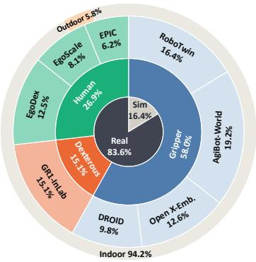  
(b) Data distribution.

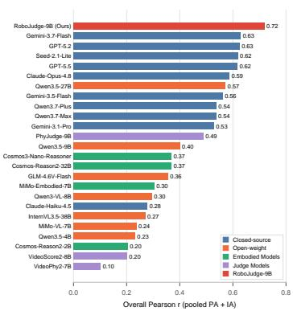  
(c) Judge model ranking.  
Figure 3: Statistics of ROBOJUDGE-BENCH. (a) Key statistics of the test set. (b) Videos by embodiment (inner ring) and source corpus (outer ring). (c) Judge model ranking by pooled Overall Pearson correlation across PA and IA.

VideoScore2, VideoPhy2, VideoCon, PhyJudge, and WBench (He et al., 2024; 2025; Bansal et al., 2026; 2024; Lin et al., 2026; Ying et al., 2026). However, they are primarily designed for generaldomain video quality, physical plausibility, or world-model evaluation, rather than joint embodied physical adherence and instruction alignment.

Judge Model Benchmarks. A parallel line of work studies multimodal models as judges, with an emphasis on human agreement, reliability, bias, and calibration (Zheng et al., 2023; Chiang et al., 2024; Kim et al., 2024a;b; Chen et al., 2024; 2025; Panickssery et al., 2024). Existing video judge benchmarks cover video quality, physical reasoning, preference, feedback, and artifact judgments, but mostly in general-domain videos (He et al., 2025; Bansal et al., 2026; Liu et al., 2025; Song et al., 2025; Tang et al., 2026). Physion-Eval includes egocentric human videos, and RoboGaze studies generated robot-manipulation videos (Zhang et al., 2026; Nguyen et al., 2026). However, they remain limited in embodiment, source, and generator diversity, as summarized in Table 1.

In contrast, ROBOJUDGE-BENCH tests judge reliability rather than generator quality alone, using 800 embodied videos from 8 source corpora and 10 video generators, spanning human hands, dexterous hands, and robot grippers. It provides paired human references for Physical Adherence and Instruction Alignment. ROBOJUDGE-TRAIN further supplies human-verified dimensional score and model-assisted rationales for training our dedicated judge, ROBOJUDGE-9B.

## 3 ROBOJUDGE-BENCH

## 3.1 OVERVIEW

ROBOJUDGE-BENCH is a benchmark for evaluating MLLMs as judges of generated embodiedmanipulation videos. Rather than evaluating video generators directly, it benchmarks the judges: each instance pairs an instruction and a generated video with human annotations along two embodied-specific axes, Physical Adherence and Instruction Alignment, and judge performance is measured by agreement with these human ratings. Figure 2 illustrates the two evaluation axes with annotated examples in which physical plausibility and task completion receive different scores. As shown in Figure 3, the benchmark contains 800 generated videos drawn from 8 source corpora, spanning diverse embodiments as well as both real-world and simulated settings. The videos are generated by 10 models with varying capabilities, yielding a broad spectrum of generation quality and human scores across the full rating range.

## 3.2 EVALUATION DIMENSIONS

Each judge rates each generated video along two complementary axes, each decomposed into three fine-grained rubric aspects that serve as the primitive units of annotation. Physical Adherence (PA) evaluates whether a video is physically plausible and visually consistent, independent of the instruction, so a rollout that executes the wrong action can still receive full PA marks if its dynamics obey real-world physics. Its aspects proceed outward from the agent: agent consistency (the gripper or hand remains structurally coherent and temporally stable), scene consistency (the background and objects persist without unrealistic deformation, disappearance, duplication, or sudden displacement), and interaction realism (contact, grasping, object motion, and force response follow plausible dynamics). Instruction Alignment (IA) assesses whether the video faithfully executes and completes the manipulation instruction, conditioned on the text and the initial frame, and its aspects follow a verification sequence of who acts, on what, and to what end: agent match (the specified agent or end-effector performs the action), object correctness (the action targets the correct object with the instructed attributes, such as identity and color), and goal completion (the target end-state is fully reached rather than merely approached). Together, the two axes distinguish physical plausibility from task completion, which can diverge across current generators.

## 3.3 DATA CURATION

We curate benchmark source clips from seven real-world embodied-manipulation corpora, including robot-manipulation corpora such as AgiBot-World (Bu et al., 2025), DROID (Khazatsky et al., 2024), GR1-InLab (Wu et al., 2024), and Open X-Embodiment (Collaboration et al., 2024), as well as egocentric human-manipulation corpora such as EgoDex (Hoque et al., 2026), EgoScale (Zheng et al., 2026), and EPIC-KITCHENS (Damen et al., 2022). We additionally include RoboTwin (Mu et al., 2025) as a simulated manipulation corpus, given its widespread use for robot-policy evaluation. From each clip, we extract an initial-frame–instruction pair. Because raw instructions are often underspecified, we use GPT-5.5 to draft refined instructions and ask human annotators to verify and correct them against the initial frame. Following common practice (Shang et al., 2026; Yue et al., 2025), we derive generation prompts using five prompt-prefix templates and five rewriting templates, yielding ten diverse prompt variants per clip (Appendix D). We use 14 proprietary and open-source video generators to construct the full data pool (Appendix C). Before human annotation, we select 800 videos from 10 of these generators for ROBOJUDGE-BENCH; ROBOJUDGE-TRAIN additionally includes videos from the remaining four.

We recruit 20 graduate-level annotators, who complete four alignment rounds, each on 100 practice videos, before production labeling; their agreement improves over the course of training (Appendix A, Table 5). For the test set, which serves as the human reference for evaluating judges, each item is first labeled by one annotator and then independently cross-reviewed by another. An expert adjudicates the two assessments to determine the final ground-truth label. Detailed guidelines and quality-control criteria are provided in Appendix A. Thus, ROBOJUDGE-BENCH uses expert-adjudicated human labels for evaluation, while ROBOJUDGE-TRAIN uses human-verified model-assisted labels for scalable supervision.

## 4 ROBOJUDGE-9B

## 4.1 TRAINING DATA CURATION

We construct ROBOJUDGE-TRAIN using the same video-generation pipeline as ROBOJUDGE-BENCH, while avoiding data leakage by using source clips that are disjoint from those used to construct the benchmark. We expand the source pool with additional corpora, including LIBERO (Liu et al., 2023) and DreamDojo-HV (Gao et al., 2026), resulting in 12,351 training videos: 11,520 generated videos from 14 generators and 831 verified successful real demonstrations paired with their corresponding instructions. Each video receives separate annotations along the two evaluation axes, Physical Adherence (PA) and Instruction Alignment (IA), yielding 24,702 axis-level training samples in total.

We annotate the expanded training set with the same human annotator pool using a human-in-theloop labeling pipeline. Specifically, three closed-source MLLMs (Gemini-3.5-Flash, GPT-5.5, and Seed-2.1-Lite) first provide candidate PA and IA scores. Their predictions are averaged to produce draft scores, which are subsequently reviewed and revised by human annotators. Annotators also provide brief evidence notes to justify their final scores. Finally, GPT-5.5 rewrites the human-authored evidence notes into structured reasoning traces conditioned on the human-verified scores. These annotations and model-assisted reasoning traces are used as supervision for training ROBOJUDGE-9B.

## 4.2 MODEL TRAINING

We initialize ROBOJUDGE-9B from Qwen3.5-9B and train it with a two-stage strategy consisting of supervised fine-tuning (SFT) followed by reinforcement learning (RL).

Supervised Fine-Tuning. We first perform full-parameter supervised fine-tuning on ROBOJUDGE-TRAIN, starting from the pretrained Qwen3.5-9B checkpoint. We train for one epoch and use the resulting SFT checkpoint to initialize the subsequent RL stage.

Reinforcement Learning. We further optimize the SFT model with Group Relative Policy Optimization (GRPO). We directly optimize the exact-score agreement objective. For each generated response, the reward is defined as

$$
R _ { \mathrm { a c c } } = { \left\{ \begin{array} { l l } { 1 , } & { { \mathrm { i f ~ t h e ~ p r e d i c t e d ~ s c o r e ~ e x a c t l y ~ m a t c h e s ~ t h e ~ r e f e r e n c e } } , } \\ { 0 , } & { { \mathrm { o t h e r w i s e } } . } \end{array} \right. }\tag{1}
$$

Starting from the SFT checkpoint, we train for 200 RL steps. The resulting checkpoint is used as ROBOJUDGE-9B. We provide training details in Appendix G.

## 5 EXPERIMENTS AND RESULTS

## 5.1 EVALUATED MODELS AND BASELINES

We compare ROBOJUDGE-9B against 29 model-judge baselines on ROBOJUDGE-BENCH, including 10 closed-source MLLMs, 7 open-weight MLLMs, 7 specialized embodied MLLMs, and 5 specialized judge models. General-purpose and embodied MLLMs use the unified ROBOJUDGE-BENCH prompt, while specialized judge models use their original prompts. We additionally include 8 non-MLLM metrics, following metric families from VBench (Huang et al., 2024), Eval-Crafter (Liu et al., 2024), and WorldArena (Shang et al., 2026). Full evaluation protocols are provided in Appendix B.

## 5.2 EVALUATION METRICS

After collecting judgments from each model, we quantify alignment with human annotations along the two axes of our benchmark using three metrics. (1) Pearson correlation. Following LLMas-a-Judge (Zheng et al., 2023) and MLLM-as-a-Judge (Chen et al., 2024), we take the Pearson correlation (Pearson, 1895) between model scores and human ratings as our primary metric. (2) Exact-match accuracy (Acc). We report agreement with human ratings at the item level by measuring the fraction of items whose predicted score equals the human score. (3) Mean squared error. We report the mean squared error (MSE) between predicted and human scores, which, unlike correlation-based metrics, is sensitive to a systematic shift in a judge’s scoring scale.

## 5.3 RESULTS AND ANALYSIS

Table 2 shows that existing judges struggle most with physical adherence and that non-MLLM metrics and specialized video judges align poorly with human judgments on embodied videos. Among model judges, RoboJudge-9B performs best, reaching $r = 0 . 7 1 9$ overall, with $r = 0 . 6 4 5$ on PA and $r = 0 . 7 7 5$ on IA; paired cluster-bootstrap analysis confirms robust gains in IA and overall agreement (Appendix E.1). We compare conventional non-MLLM metrics in Figure 5, while Figure 9 in Appendix E.3 plots correlation against MSE.

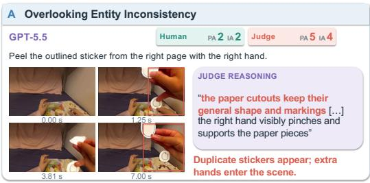

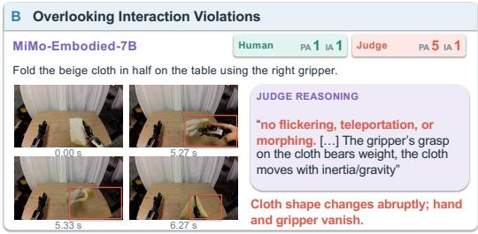

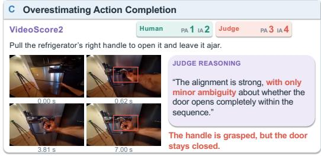

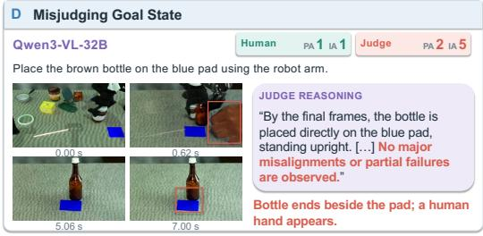  
Figure 4: Qualitative failure cases of existing judges on ROBOJUDGE-BENCH. Each panel compares human and judge Physical Adherence (PA) and Instruction Alignment (IA) scores with sampled frames and judge reasoning. (A) GPT-5.5 misses duplicated stickers and extra hands. (B) MiMo-Embodied-7B misses abrupt cloth deformation and vanishing manipulators. (C) VideoScore2 credits task completion although the refrigerator door stays closed. (D) Qwen3-VL-32B reports successful placement although the bottle lands beside the target pad. These failures span entity consistency, interaction realism, action completion, and goal-state verification.

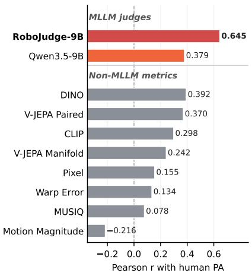  
Figure 5: Pearson correlation (r) with human-rated Physical Adherence (PA) for non-MLLM similarity metrics and MLLM-as-judges.

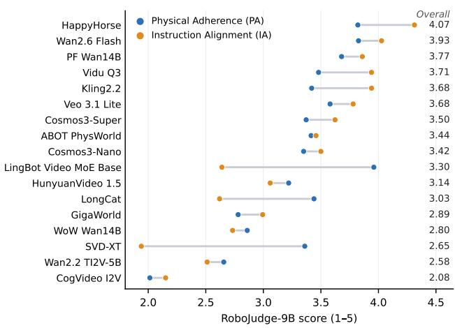  
Figure 6: Downstream application: ranking video generation models with ROBOJUDGE-9B. Models are sorted by Overall (mean of PA and IA); full scores are in Table 8.

Non-MLLM metrics remain weak proxies for physical judgment. As shown in Figure 5, non-MLLM metrics correlate only moderately with human PA ratings: MUSIQ and pixel consistency are weak (r = 0.078 and 0.155), while DINO and V-JEPA Paired Similarity reach r = 0.392 and 0.370. Both remain below ROBOJUDGE-9B, showing that visual quality and representation similarity are insufficient for embodied physical plausibility.

Table 2: Judge performance on ROBOJUDGE-BENCH. r is Pearson correlation with human ratings, and Acc is exact-match accuracy. Overall r and MSE pool PA and IA as axis-level score predictions, while Overall Acc is the average of PA and IA Acc. The best value in each column is shown in bold.
<table><tr><td rowspan="2">Judge</td><td colspan="3">Physical Adherence</td><td colspan="3">Instruction Alignment</td><td colspan="3">Overall</td></tr><tr><td>r↑</td><td>Acc↑</td><td>MSE↓</td><td>r↑</td><td>Acc↑</td><td>MSE↓</td><td>r ↑</td><td>Acc↑</td><td>MSE↓</td></tr><tr><td>Random Baseline</td><td>0.000</td><td>0.200</td><td>3.349</td><td>0.000</td><td>0.200</td><td>3.631</td><td>0.000</td><td>0.200</td><td>3.490</td></tr><tr><td colspan="10">Closed-Source MLLMs</td></tr><tr><td>Gemini-3.7-Flash (Google DeepMind, 2026c)</td><td>0.611</td><td>0.245</td><td>1.949</td><td>0.709</td><td>0.341</td><td>0.916</td><td>0.630</td><td>0.293</td><td>1.433</td></tr><tr><td>Gemini-3.5-Flash (Google DeepMind, 2026b)</td><td>0.594</td><td>0.304</td><td>1.527</td><td>0.535</td><td>0.384</td><td>1.400</td><td>0.562</td><td>0.344</td><td>1.463</td></tr><tr><td>Gemini-3.1-Pro (Google DeepMind, 2026a)</td><td>0.451</td><td>0.296</td><td>1.505</td><td>0.584</td><td>0.321</td><td>1.395</td><td>0.529</td><td>0.309</td><td>1.450</td></tr><tr><td>GPT-5.5 (OpenAI, 2026)</td><td>0.489</td><td>0.334</td><td>1.359</td><td>0.733</td><td>0.481</td><td>0.786</td><td>0.618</td><td>0.407</td><td>1.073</td></tr><tr><td>GPT-5.2 (OpenAI, 2025)</td><td>0.499</td><td>0.366</td><td>1.159</td><td>0.722</td><td>0.477</td><td>0.851</td><td>0.626</td><td>0.422</td><td>1.005</td></tr><tr><td>Claude-Opus-4.8 (Anthropic, 2026)</td><td>0.505</td><td>0.339</td><td>1.282</td><td>0.655</td><td>0.340</td><td>1.468</td><td>0.587</td><td>0.339</td><td>1.375</td></tr><tr><td>Claude-Haiku-4.5 (Anthropic, 2025)</td><td>0.179</td><td>0.246</td><td>2.639</td><td>0.357</td><td>0.333</td><td>2.442</td><td>0.278</td><td>0.289</td><td>2.541</td></tr><tr><td>Qwen3.7-Max (Qwen Team, 2026b)</td><td>0.553</td><td>0.239</td><td>2.466</td><td>0.539</td><td>0.365</td><td>2.055</td><td>0.537</td><td>0.302</td><td>2.261</td></tr><tr><td>Qwen3.7-Plus (Qwen Team, 2026c)</td><td>0.548</td><td>0.244</td><td>2.450</td><td>0.546</td><td>0.375</td><td>2.016</td><td>0.538</td><td>0.309</td><td>2.233</td></tr><tr><td>Seed-2.1-Lite (ByteDance Seed Team, 2026)</td><td>0.590</td><td>0.385</td><td>0.935</td><td>0.694</td><td>0.445</td><td>1.120</td><td>0.619</td><td>0.415</td><td>1.028</td></tr><tr><td colspan="10">Open-weight MLLMs</td></tr><tr><td>Qwen3.5-27B (Qwen Team, 2026a)</td><td>0.431</td><td>0.303</td><td>1.664</td><td>0.676</td><td>0.375</td><td>1.345</td><td>0.573</td><td>0.339</td><td>1.505</td></tr><tr><td>Qwen3.5-9B (Qwen Team, 2026a)</td><td>0.379</td><td>0.223</td><td>3.011</td><td>0.461</td><td>0.347</td><td>2.314</td><td>0.401</td><td>0.285</td><td>2.663</td></tr><tr><td>Qwen3.5-4B (Qwen Team, 2026a)</td><td>0.063</td><td>0.154</td><td>4.513</td><td>0.383</td><td>0.331</td><td>2.620</td><td>0.232</td><td>0.242</td><td>3.566</td></tr><tr><td>Qwen3-VL-8B (Bai et al., 2025)</td><td>0.292</td><td>0.161</td><td>3.776</td><td>0.341</td><td>0.279</td><td>3.094</td><td>0.295</td><td>0.220</td><td>3.435</td></tr><tr><td>GLM-4.6V-Flash (V Team et al., 2025)</td><td>0.253</td><td>0.163</td><td>3.845</td><td>0.440</td><td>0.289</td><td>3.058</td><td>0.356</td><td>0.226</td><td>3.451</td></tr><tr><td>InternVL3.5-38B (Wang et al., 2025)</td><td>0.204</td><td>0.127</td><td>4.691</td><td>0.375</td><td>0.308</td><td>3.044</td><td>0.271</td><td>0.218</td><td>3.867</td></tr><tr><td>MiMo-VL-7B (Xiaomi LLM-Core Team, 2025)</td><td>0.069</td><td>0.138</td><td>4.710</td><td>0.362</td><td>0.262</td><td>3.412</td><td>0.237</td><td>0.200</td><td>4.061</td></tr><tr><td colspan="10">Specialized Embodied MLLMs</td></tr><tr><td>Cosmos3-Nano-Reasoner (NVIDIA, 2026)</td><td>0.256</td><td>0.155</td><td>4.244</td><td>0.524</td><td>0.381</td><td>2.049</td><td>0.369</td><td>0.268</td><td>3.146</td></tr><tr><td>Cosmos-Reason2-32B (NVIDIA, 2025)</td><td>0.261</td><td>0.161</td><td>3.735</td><td>0.484</td><td>0.364</td><td>2.330</td><td>0.369</td><td>0.263</td><td>3.033</td></tr><tr><td>Cosmos-Reason2-2B (NVIDIA, 2025)</td><td>0.085</td><td>0.125</td><td>4.895</td><td>0.309</td><td>0.245</td><td>3.586</td><td>0.205</td><td>0.185</td><td>4.241</td></tr><tr><td>MiMo-Embodied-7B (Hao et al., 2025)</td><td>0.209</td><td>0.119</td><td>4.736</td><td>0.447</td><td>0.300</td><td>2.807</td><td></td><td>0.304 0.209</td><td>3.776</td></tr><tr><td>RynnBrain-1.1-9B (Li et al., 2026a)</td><td>0.051</td><td>0.115</td><td>5.077</td><td>0.196</td><td>0.251</td><td>4.025</td><td>0.129</td><td>0.183</td><td>4.551</td></tr><tr><td>RoboBrain2.5-8B (Tan et al., 2026)</td><td>0.042</td><td>0.128</td><td>4.952</td><td>0.197</td><td>0.259</td><td>3.761</td><td>0.122</td><td>0.193</td><td>4.357</td></tr><tr><td>Orca-4B (Wang et al., 2026)</td><td>0.108</td><td>0.145</td><td>4.447</td><td>0.096</td><td>0.244</td><td>3.242</td><td>0.059</td><td>0.194</td><td>3.845</td></tr><tr><td colspan="10">Specialized Judge Models</td></tr><tr><td>VideoScore2-8B (He et al., 2025)</td><td>0.195</td><td>0.311</td><td>1.455</td><td></td><td>0.191 0.255</td><td>1.725</td><td>0.202</td><td>0.283</td><td>1.590</td></tr><tr><td>VideoPhy2-7B (Bansal et al., 2026)</td><td>0.152</td><td>0.290</td><td>1.866</td><td>0.147</td><td>0.291</td><td>1.732</td><td>0.103</td><td>0.291</td><td>1.799</td></tr><tr><td>VideoCon-7B (Bansal et al., 2024)</td><td>0.095</td><td>0.150</td><td>4.079</td><td>0.055</td><td>0.164</td><td>4.633</td><td>0.077</td><td>0.157</td><td>4.356</td></tr><tr><td>WBench-30B-A3B (Ying et al., 2026)</td><td>0.412</td><td>0.319</td><td>1.197</td><td></td><td></td><td></td><td></td><td></td><td></td></tr><tr><td>PhyJudge-9B (Lin et al., 2026)</td><td>0.417</td><td>0.314</td><td>1.429</td><td>0.585</td><td>0.376</td><td>1.072</td><td>0.489</td><td>0.345</td><td>1.252</td></tr><tr><td>RoboJudge-9B (ours)</td><td>0.645</td><td>0.434</td><td>0.806</td><td>0.775</td><td>0.512</td><td>0.688</td><td>0.719</td><td>0.473</td><td>0.747</td></tr></table>

Existing judges struggle more with physical adherence. Before task-specific training, the best IA correlation $( r \ = \ 0 . 7 3 3 )$ is well above the best PA correlation $( r ~ = ~ \mathrm { \bar { 0 } } . 6 1 1 )$ , and specialized embodied MLLMs remain at $r \leq 0 . 2 6 1$ on PA. Figure 4 shows why: judges often miss entity and interaction inconsistencies (A–B), or infer task completion from incorrect final states (C–D).

Existing embodied VLMs and specialized judges do not transfer well to embodied video evaluation. Existing embodied MLLMs and specialized video judges show limited agreement with human ratings. RoboBrain2.5-8B and RynnBrain-1.1-9B are near random on PA $( r \leq 0 . 0 7 )$ , while VideoPhy2, VideoScore2, and VideoCon reach at most $r = 0 . 2 0$ . PhyJudge is stronger $( r = 0 . 4 1 7 )$ but still trails RoboJudge-9B (r = 0.645).

RoboJudge reduces directional scoring bias. Beyond correlation, several baselines show clear directional bias, while ROBOJUDGE-9B is more balanced on both PA and IA, suggesting better calibration to human scores (Appendix E).

Table 3: Training-stage ablation of ROBOJUDGE-9B. Acc is exact-match accuracy.
<table><tr><td>Model</td><td colspan="3">PA</td><td colspan="3">IA</td><td colspan="3">Overall</td></tr><tr><td></td><td>r ↑</td><td>Acc↑</td><td>MSE↓</td><td>r ↑</td><td>Acc↑</td><td>MSE↓</td><td>r ↑</td><td>Acc↑</td><td>MSE↓</td></tr><tr><td>Qwen3.5-9B</td><td>0.379</td><td>0.223</td><td>3.011</td><td>0.461</td><td>0.347</td><td>2.314</td><td>0.401</td><td>0.285</td><td>2.663</td></tr><tr><td>+ SFT</td><td>0.624</td><td>0.405</td><td>0.913</td><td>0.766</td><td>0.471</td><td>0.671</td><td>0.700</td><td>0.438</td><td>0.792</td></tr><tr><td>+ SFT + RL (RoboJudge-9B)</td><td>0.645</td><td>0.434</td><td>0.806</td><td>0.775</td><td>0.512</td><td>0.688</td><td>0.719</td><td>0.473</td><td>0.747</td></tr></table>

## 5.4 ABLATION STUDY

Frame Rate. We ablate the video sampling rate at 2, 4, and 8 FPS for GPT-5.5 and Qwen3.5-9B. GPT-5.5 shows no monotonic benefit from denser sampling: its overall correlation is 0.620, 0.618, and 0.620 at 2, 4, and 8 FPS, respectively. Qwen3.5-9B improves from 0.363 at 2 FPS to 0.401 at 4 FPS, while 8 FPS yields no further gain. We therefore use 4 FPS as the common default setting, which captures the improvement of the open-weight model without the additional visual-token cost of 8 FPS. By construction, the 4 FPS rows reproduce the corresponding main-table results (full results in Table 9, Appendix G.3).

Training Stages. We further ablate the contributions of supervised fine-tuning (SFT) and reinforcement learning (RL). SFT substantially improves the base Qwen3.5-9B on both PA and IA, demonstrating the effectiveness of ROBOJUDGE-TRAIN for task-specific supervision. Building on SFT, RL further improves the overall correlation and Acc, increasing the overall r from 0.700 to 0.719. We therefore use the SFT+RL model as our final ROBOJUDGE-9B; full results are reported in Table 3.

## 5.5 GENERALIZATION STUDY

As shown in Table 4, training on ROBOJUDGE-TRAIN substantially improves the judge’s performance on both external OOD benchmarks, despite the distribution shift and differences in evaluation prompts. On VideoPhy2, both SFT and SFT+RL substantially improve over the Qwen3.5-9B base model, with the SFT+RL model reaching Pearson correlations of 0.346 and 0.572 on PC and SA, respectively. On Physion-Eval, the SFT model achieves a Youden’s J of 0.105, substantially outperforming the base model (0.056). These results demonstrate that the judgment capability

Table 4: OOD evaluation on VideoPhy2 and Physion-Eval. Training on ROBOJUDGE-TRAIN improves performance across all evaluated OOD metrics over the Qwen3.5-9B base model. J is Youden’s J.
<table><tr><td rowspan="2">Model</td><td>VideoPhy2</td><td>Physion-Eval</td></tr><tr><td>PC r↑ SA r↑</td><td>J↑</td></tr><tr><td>Qwen3.5-9B</td><td>0.179 0.412</td><td>0.056</td></tr><tr><td>+ SFT</td><td>0.299 0.552</td><td>0.105</td></tr><tr><td>+ SFT + RL (Ours)</td><td>0.346 0.572</td><td>0.093</td></tr></table>

learned from ROBOJUDGE-TRAIN transfers beyond the training distribution and remains effective under substantial distribution shifts.

## 5.6 DOWNSTREAM APPLICATION: VIDEO GENERATION LEADERBOARD

Beyond measuring judge quality, a human-aligned judge enables a practical downstream use: benchmarking embodied video generation models without collecting new human ratings. We apply ROBOJUDGE-9B with the same PA and IA rubric to 17 video generation models on a shared set of 50 prompts (Figure 6; full scores in Table 8, Appendix E.2). PA and IA reveal distinct strengths across generators. HappyHorse and Wan2.6 Flash score highly on both, whereas LingBot Video MoE Base, LongCat, and SVD-XT receive relatively high PA but much lower IA: they produce physically plausible motion while failing the instructed task. A single overall score would hide this difference, so embodied video generation should be evaluated along both PA and IA dimensions.

Beyond offline benchmarking, ROBOJUDGE-9B’s human-aligned scores may guide online physical rollout selection in embodied planning (e.g., Best-of-N). The model may further support quality assessment in agentic embodied video generation.

## 6 CONCLUSION

We introduced ROBOJUDGE-BENCH, a benchmark for evaluating whether MLLMs can judge embodied video generation along physical adherence and instruction alignment. Our study shows that existing judges, including frontier MLLMs and specialized video evaluators, remain poorly aligned with human judgments on embodied physical interactions. To address this gap, we constructed ROBOJUDGE-TRAIN and trained ROBOJUDGE-9B, which achieves the strongest overall agreement among model judges on ROBOJUDGE-BENCH and transfers to external physical-reasoning benchmarks. These results highlight the value of human-calibrated PA and IA supervision for embodied video evaluation. Together, these capabilities suggest broader downstream potential across online physical rollout evaluation and agentic embodied video generation.

## REFERENCES

Anthropic. Claude haiku 4.5 system card. Anthropic System Card, 2025. URL https://assets.anthropic.com/m/99128ddd009bdcb/original/ Claude-Haiku-4-5-System-Card.pdf.

Anthropic. Claude opus 4.8 system card. Anthropic System Card, 2026. URL https: //anthropic.com/claude-opus-4-8-system-card.

Mahmoud Assran, Adrien Bardes, David Fan, Quentin Garrido, Russell Howes, Mojtaba Komeili, Matthew Muckley, Ammar Rizvi, Claire Roberts, Koustuv Sinha, Artem Zholus, Sergio Arnaud, Abha Gejji, Ada Martin, Francois Robert Hogan, Daniel Dugas, Piotr Bojanowski, Vasil Khalidov, Patrick Labatut, Francisco Massa, Marc Szafraniec, Kapil Krishnakumar, Yong Li, Xiaodong Ma, Sarath Chandar, Franziska Meier, Yann LeCun, Michael Rabbat, and Nicolas Ballas. V-JEPA 2: Self-supervised video models enable understanding, prediction and planning. arXiv preprint arXiv:2506.09985, 2025.

Shuai Bai, Yuxuan Cai, Ruizhe Chen, et al. Qwen3-vl technical report. arXiv preprint arXiv:2511.21631, 2025.

Illya Bakurov, Marco Buzzelli, Raimondo Schettini, Mauro Castelli, and Leonardo Vanneschi. Structural similarity index (ssim) revisited: A data-driven approach. Expert Systems with Applications, 189:116087, 2022.

Hritik Bansal, Yonatan Bitton, Idan Szpektor, Kai-Wei Chang, and Aditya Grover. Videocon: Robust video-language alignment via contrast captions. In Proceedings of the IEEE/CVF Conference on Computer Vision and Pattern Recognition, pp. 13927–13937, 2024.

Hritik Bansal, Zongyu Lin, Tianyi Xie, Zeshun Zong, Michal Yarom, Yonatan Bitton, Chenfanfu Jiang, Yizhou Sun, Kai-Wei Chang, and Aditya Grover. VideoPhy: Evaluating physical commonsense for video generation. In International Conference on Learning Representations, 2025.

Hritik Bansal, Clark Peng, Yonatan Bitton, Roman Goldenberg, Aditya Grover, and Kai-Wei Chang. VideoPhy-2: A challenging action-centric physical commonsense evaluation in video generation. In International Conference on Learning Representations, 2026.

Adrien Bardes, Quentin Garrido, Jean Ponce, Xinlei Chen, Michael Rabbat, Yann LeCun, Mido Assran, and Nicolas Ballas. Revisiting feature prediction for learning visual representations from video. Transactions on Machine Learning Research, 2024. ISSN 2835-8856. URL https: //openreview.net/forum?id=QaCCuDfBk2.

Qingwen Bu, Jisong Cai, Li Chen, Xiuqi Cui, Yan Ding, Siyuan Feng, Xindong He, Xu Huang, et al. AgiBot World Colosseo: A large-scale manipulation platform for scalable and intelligent embodied systems. In 2025 IEEE/RSJ International Conference on Intelligent Robots and Systems (IROS), pp. 3549–3556. IEEE, 2025.

ByteDance Seed Team. Seed2.1 officially released: Advancing ai productivity. ByteDance Seed, 2026. URL https://seed.bytedance.com/en/blog/ seed2-1-officially-released-advancing-ai-productivity.

Mathilde Caron, Hugo Touvron, Ishan Misra, Herve J´ egou, Julien Mairal, Piotr Bojanowski, and´ Armand Joulin. Emerging properties in self-supervised vision transformers. In ICCV, pp. 9650– 9660, 2021.

Dongping Chen, Ruoxi Chen, Shilin Zhang, Yaochen Wang, Yinuo Liu, Huichi Zhou, Qihui Zhang, Yao Wan, Pan Zhou, and Lichao Sun. MLLM-as-a-judge: Assessing multimodal LLM-as-ajudge with vision-language benchmark. In Proceedings of the 41st International Conference on Machine Learning, volume 235 of Proceedings of Machine Learning Research, pp. 6562–6595. PMLR, 2024. URL https://proceedings.mlr.press/v235/chen24h.html.

Zhaorun Chen, Zichen Wen, Yichao Du, Yiyang Zhou, Chenhang Cui, Siwei Han, Jen Weng, Chaoqi Wang, Zhengwei Tong, Leria Huang, Canyu Chen, Haoqin Tu, Qinghao Ye, Zhihong Zhu, Yuqing Zhang, Jiawei Zhou, Zhuokai Zhao, Rafael Rafailov, Chelsea Finn, and Huaxiu Yao. MJ-Bench: Is your multimodal reward model really a good judge for text-to-image generation? In Advances in Neural Information Processing Systems, volume 38, 2025. doi: 10.52202/085713-2081. Datasets and Benchmarks Track.

Wei-Lin Chiang, Lianmin Zheng, Ying Sheng, Anastasios Nikolas Angelopoulos, Tianle Li, Dacheng Li, Banghua Zhu, Hao Zhang, Michael Jordan, Joseph E. Gonzalez, and Ion Stoica. Chatbot arena: An open platform for evaluating LLMs by human preference. In Proceedings of the 41st International Conference on Machine Learning, volume 235 of Proceedings of Machine Learning Research, pp. 8359–8388. PMLR, 2024. URL https://proceedings. mlr.press/v235/chiang24b.html.

Open X-Embodiment Collaboration, Abby O’Neill, Abdul Rehman, Abhiram Maddukuri, Abhishek Gupta, Anish Padalkar, Alexander Lee, Acorn Pooley, Abhinav Gupta, Ajay Mandlekar, et al. Open x-embodiment: Robotic learning datasets and rt-x models. In 2024 IEEE International Conference on Robotics and Automation (ICRA), pp. 6892–6903, 2024. doi: 10.1109/ICRA57147.2024.10611477.

Dima Damen, Hazel Doughty, Giovanni Maria Farinella, Antonino Furnari, Evangelos Kazakos, Jian Ma, Davide Moltisanti, Jonathan Munro, Toby Perrett, Will Price, and Michael Wray. Rescaling egocentric vision: Collection, pipeline and challenges for epic-kitchens-100. International Journal ofComputer Vision, 130:33–55, 2022. doi: 10.1007/s11263-021-01531-2.

Chun-Kai Fan, Xiaowei Chi, Xiaozhu Ju, Hao Li, Yong Bao, Yu-Kai Wang, Lizhang Chen, Zhiyuan Jiang, Kuangzhi Ge, Ying Li, et al. Wow, wo, val!: a comprehensive embodied world model evaluation turing test. arXiv preprint arXiv:2601.04137, 2026.

Gunnar Farneback. Two-frame motion estimation based on polynomial expansion. In¨ Scandinavian Conference on Image Analysis, pp. 363–370, 2003.

Shenyuan Gao, William Liang, Kaiyuan Zheng, Ayaan Malik, Seonghyeon Ye, Sihyun Yu, Wei-Cheng Tseng, Yuzhu Dong, Kaichun Mo, Chen-Hsuan Lin, Qianli Ma, Seungjun Nah, Loic Magne, Jiannan Xiang, Yuqi Xie, Ruijie Zheng, Dantong Niu, You Liang Tan, K.R. Zentner, George Kurian, Suneel Indupuru, Pooya Jannaty, Jinwei Gu, Jun Zhang, Jitendra Malik, Pieter Abbeel, Ming-Yu Liu, Yuke Zhu, Joel Jang, and Linxi Fan. Dreamdojo: A generalist robot world model from large-scale human videos. arXiv preprint arXiv:2602.06949, 2026.

Google DeepMind. Gemini 3.1 pro. Google DeepMind Model Card, 2026a. URL https:// deepmind.google/models/model-cards/gemini-3-1-pro/.

Google DeepMind. Gemini 3.5 flash. Google DeepMind Model Card, 2026b. URL https: //deepmind.google/models/model-cards/gemini-3-5-flash/.

Google DeepMind. Gemini 3.7 flash. Google DeepMind Model Card, 2026c. URL https: //deepmind.google/models/model-cards/gemini-3-7-flash/.

Xiaoshuai Hao, Lei Zhou, Zhijian Huang, et al. Mimo-embodied: X-embodied foundation model technical report. arXiv preprint arXiv:2511.16518, 2025.

Xuan He, Dongfu Jiang, Ge Zhang, Max Ku, Achint Soni, Sherman Siu, Haonan Chen, Abhranil Chandra, Ziyan Jiang, Aaran Arulraj, Kai Wang, Quy Duc Do, Yuansheng Ni, Bohan Lyu, Yaswanth Narsupalli, Rongqi Fan, Zhiheng Lyu, Bill Yuchen Lin, and Wenhu Chen. VideoScore: Building automatic metrics to simulate fine-grained human feedback for video generation. In Proceedings of the 2024 Conference on Empirical Methods in Natural Language Processing, pp. 2105–2123. Association for Computational Linguistics, 2024. doi: 10.18653/v1/2024. emnlp-main.127.

Xuan He, Dongfu Jiang, Ping Nie, Minghao Liu, Zhengxuan Jiang, Mingyi Su, Wentao Ma, Junru Lin, Chun Ye, Yi Lu, Keming Wu, Benjamin Schneider, Quy Duc Do, Zhuofeng Li, Yiming Jia, Yuxuan Zhang, Guo Cheng, Haozhe Wang, Wangchunshu Zhou, Qunshu Lin, Yuanxing Zhang, Ge Zhang, Wenhao Huang, and Wenhu Chen. Videoscore2: Think before you score in generative video evaluation. arXiv preprint arXiv:2509.22799, 2025.

Ryan Hoque, Peide Huang, David J. Yoon, Mouli Sivapurapu, and Jian Zhang. Egodex: Learning dexterous manipulation from large-scale egocentric video. In International Conference on Learning Representations (ICLR), 2026.

Ziqi Huang, Yinan He, Jiashuo Yu, Fan Zhang, Chenyang Si, Yuming Jiang, Yuanhan Zhang, Tianxing Wu, Qingyang Jin, Nattapol Chanpaisit, Yaohui Wang, Xinyuan Chen, Limin Wang, Dahua Lin, Yu Qiao, and Ziwei Liu. Vbench: Comprehensive benchmark suite for video generative models. In CVPR, pp. 21807–21818, 2024.

Ziqi Huang, Fan Zhang, Xiaojie Xu, Yinan He, Jiashuo Yu, Ziyue Dong, Qianli Ma, Nattapol Chanpaisit, Chenyang Si, Yuming Jiang, et al. Vbench++: Comprehensive and versatile benchmark suite for video generative models. IEEE Transactions on Pattern Analysis and Machine Intelli gence, 2025.

Quan Huynh-Thu and Mohammed Ghanbari. Scope of validity of PSNR in image/video quality assessment. Electronics Letters, 44(13):800–801, 2008. doi: 10.1049/el:20080522.

Feng Jiang, Yang Chen, Kyle Xu, Yuchen Liu, Haifeng Wang, Zhenhao Shen, Jasper Lu, Shengze Huang, Yuanfei Wang, Chen Xie, et al. RoboWM-Bench: A benchmark for evaluating world models in robotic manipulation. arXiv preprint arXiv:2604.19092, 2026.

Junjie Ke, Qifei Wang, Yilin Wang, Peyman Milanfar, and Feng Yang. Musiq: Multi-scale image quality transformer. In ICCV, pp. 5148–5157, 2021.

Alexander Khazatsky, Karl Pertsch, Suraj Nair, Ashwin Balakrishna, Sudeep Dasari, Siddharth Karamcheti, Soroush Nasiriany, Mohan Kumar Srirama, Lawrence Yunliang Chen, Kirsty Ellis, et al. DROID: A large-scale in-the-wild robot manipulation dataset. In Proceedings ofRobotics: Science and Systems, Delft, Netherlands, July 2024. doi: 10.15607/RSS.2024.XX.120.

Seungone Kim, Jamin Shin, Yejin Cho, Joel Jang, Shayne Longpre, Hwaran Lee, Sangdoo Yun, Seongjin Shin, Sungdong Kim, James Thorne, and Minjoon Seo. Prometheus: Inducing finegrained evaluation capability in language models. In International Conference on Learning Representations, 2024a.

Seungone Kim, Juyoung Suk, Shayne Longpre, Bill Yuchen Lin, Jamin Shin, Sean Welleck, Graham Neubig, Moontae Lee, Kyungjae Lee, and Minjoon Seo. Prometheus 2: An open source language model specialized in evaluating other language models. In Proceedings of the 2024 Conference on Empirical Methods in Natural Language Processing, pp. 4334–4353. Association for Computational Linguistics, 2024b. doi: 10.18653/v1/2024.emnlp-main.248.

Dacheng Li, Yunhao Fang, Yukang Chen, Shuo Yang, Shiyi Cao, Justin Wong, Michael Luo, Xiaolong Wang, Hongxu Yin, Joseph E. Gonzalez, Ion Stoica, Song Han, and Yao Lu. WorldModel-Bench: Judging video generation models as world models. In Advances in Neural Information Processing Systems, volume 38, 2025. doi: 10.52202/085713-1834. Datasets and Benchmark Track.

Kehan Li, Bohan Hou, Minghao Zhu, Tianyi Zhang, Zesen Cheng, Zhikai Wang, Sicong Leng, Xin Li, Xiao Lin, Biying Yao, Minghua Zeng, Jiangpin Liu, Ronghao Dang, Jiayan Guo, Siteng

Huang, Haoyu Zhao, Heng Ping, Yaxi Zhao, Tong Zhao, Kexiang Wang, Tong Lu, Shengke Xue, Jiahao Tang, Yulei Wang, Zejing Wang, Jianwei Gao, Shijian Lu, Chengju Liu, Jianfei Yang, Mingxiu Chen, and Deli Zhao. Rynnbrain 1.1: Towards more capable and generalizable embodied foundation model. arXiv preprint arXiv:2607.17977, 2026a.

Lin Li, Qihang Zhang, Yiming Luo, Shuai Yang, Ruilin Wang, Fei Han, Mingrui Yu, Zelin Gao, Nan Xue, Xing Zhu, et al. Causal world modeling for robot control. arXiv preprint arXiv:2601.21998, 2026b.

Juyi Lin, Arash Akbari, Yumei He, Lin Zhao, Haichao Zhang, Arman Akbari, Xingchen Xu, Zoe Y. Lu, Enfu Nan, Hokin Deng, Edmund Yeh, Sarah Ostadabbas, Yun Fu, Jennifer Dy, Pu Zhao, and Yanzhi Wang. Phyground: Benchmarking physical reasoning in generative world models. arXiv preprint arXiv:2605.10806, 2026.

Bo Liu, Yifeng Zhu, Chongkai Gao, Yihao Feng, Qiang Liu, Yuke Zhu, and Peter Stone. Libero: Benchmarking knowledge transfer in lifelong robot learning. In Advances in Neural Information Processing Systems, volume 36, 2023.

Yaofang Liu, Xiaodong Cun, Xuebo Liu, Xintao Wang, Yong Zhang, Haoxin Chen, Yang Liu, Tieyong Zeng, Raymond Chan, and Ying Shan. Evalcrafter: Benchmarking and evaluating large video generation models. In CVPR, pp. 22139–22149, 2024.

Yuanxin Liu, Rui Zhu, Shuhuai Ren, Jiacong Wang, Haoyuan Guo, Xu Sun, and Lu Jiang. Uve: Are mllms unified evaluators for ai-generated videos? In Advances in Neural Information Processing Systems, volume 38, 2025. Datasets and Benchmarks Track.

Fanqing Meng, Jiaqi Liao, Xinyu Tan, Quanfeng Lu, Wenqi Shao, Kaipeng Zhang, Yu Cheng, Dianqi Li, and Ping Luo. Towards world simulator: Crafting physical commonsense-based benchmark for video generation. In Proceedings of the 42nd International Conference on Machine Learning, volume 267 of Proceedings of Machine Learning Research, pp. 43781–43806. PMLR, 2025. URL https://proceedings.mlr.press/v267/meng25c.html.

Yao Mu, Tianxing Chen, Zanxin Chen, Shijia Peng, Zhiqian Lan, Zeyu Gao, Zhixuan Liang, Qiaojun Yu, Yude Zou, Mingkun Xu, Lunkai Lin, Zhiqiang Xie, Mingyu Ding, and Ping Luo. Robotwin: Dual-arm robot benchmark with generative digital twins. In Proceedings of the Computer Vision and Pattern Recognition Conference, 2025.

Minh-Loi Nguyen, Nghiem Tuong Diep, Hung Khang Nguyen, Minh Le, Doanh Le Thien, Hoang H Tran, Dung D Le, Vu N Duong, Daniel Sonntag, An Thai Le, et al. Robogaze: Evaluating robot world models via structured vision-language analysis. arXiv preprint arXiv:2606.28385, 2026.

NVIDIA. Cosmos-Reason2: Physical ai common sense and embodied reasoning models. NVIDIA Cosmos, 2025. URL https://docs.nvidia.com/cosmos/latest/ reason2/index.html.

NVIDIA. Cosmos 3: Omnimodal world models for physical ai. arXiv preprint arXiv:2606.02800, 2026. URL https://research.nvidia.com/labs/cosmos-lab/cosmos3/ technical-report.pdf.

OpenAI. Introducing gpt-5.2. OpenAI, 2025. URL https://openai.com/index/ introducing-gpt-5-2/.

OpenAI. Introducing gpt-5.5. OpenAI, 2026. URL https://openai.com/index/ introducing-gpt-5-5/.

Arjun Panickssery, Samuel R. Bowman, and Shi Feng. LLM evaluators recognize and favor their own generations. In Advances in Neural Information Processing Systems, volume 37, 2024. doi: 10.52202/079017-2197.

Karl Pearson. Note on regression and inheritance in the case of two parents. Proceedings of the Royal Society ofLondon, 58:240–242, 1895.

Yu Qi, Xinyi Xu, Ziyu Guo, Siyuan Ma, Renrui Zhang, Xinyan Chen, Ruichuan An, Ruofan Xing, Jiayi Zhang, Haojie Huang, et al. Mme-cof-pro: Evaluating reasoning coherence in video generative models with text and visual hints. arXiv preprint arXiv:2603.20194, 2026a.

Yu Qi, Haibo Zhao, Ziyu Guo, Siyuan Ma, Ziyan Chen, Yaokun Han, Renrui Zhang, Zitiantao Lin, Shiji Xin, Yijian Huang, Kai Cheng, Peiheng Wang, Jiazheng Liu, Jiayi Zhang, Yizhe Zhu, Wenqing Wang, Yiran Qin, Xupeng Zhu, Haojie Huang, and Lawson L. S. Wong. BEAR: Benchmarking and enhancing multimodal language models for atomic embodied capabilities. In International Conference on Machine Learning, 2026b.

Qwen Team. Qwen3.5: Towards native multimodal agents. https://qwen.ai/blog?id= qwen3.5, 2026a. Qwen Official Blog.

Qwen Team. Qwen3.7: The agent frontier. Qwen Official Blog, 2026b. URL https://qwen. ai/blog?id=qwen3.7.

Qwen Team. Qwen3.7-Plus: Multimodal agent intelligence. Qwen Official Blog, 2026c. URL https://qwen.ai/blog?id=qwen3.7-plus.

Alec Radford, Jong Wook Kim, Chris Hallacy, Aditya Ramesh, Gabriel Goh, Sandhini Agarwal, Girish Sastry, Amanda Askell, Pamela Mishkin, Jack Clark, Gretchen Krueger, and Ilya Sutskever. Learning transferable visual models from natural language supervision. In ICML, pp. 8748–8763, 2021.

Yu Shang, Yinzhou Tang, Yiding Ma, Zhuohang Li, Lei Jin, Weikang Su, Xin Jin, Zhaolu Wang, Ziyou Wang, Xin Zhang, et al. Worldarena 2.0: Extending embodied world model benchmarking on modality, functionality and platform. arXiv preprint arXiv:2605.17912, 2026.

Tingyu Song, Tongyan Hu, Guo Gan, and Yilun Zhao. Vf-eval: Evaluating multimodal llms for generating feedback on aigc videos. In Proceedings ofthe 63rd Annual Meeting ofthe Association for Computational Linguistics (Volume 1: Long Papers), pp. 21126–21146, 2025.

Huajie Tan, Enshen Zhou, Zhiyu Li, Yijie Xu, Yuheng Ji, Xiansheng Chen, Cheng Chi, Pengwei Wang, Huizhu Jia, Yulong Ao, Mingyu Cao, Sixiang Chen, Zhe Li, Mengzhen Liu, Zixiao Wang, Shanyu Rong, Yaoxu Lyu, Zhongxia Zhao, Peterson Co, Yibo Li, Yi Han, Shaoxuan Xie, Guocai Yao, Songjing Wang, Leiduo Zhang, Xi Yang, Yance Jiao, Donghai Shi, Kunchang Xie, Shaokai Nie, Chunlei Men, Yonghua Lin, Zhongyuan Wang, Tiejun Huang, and Shanghang Zhang. Robobrain 2.5: Depth in sight, time in mind. arXiv preprint arXiv:2601.14352, 2026.

Yuqi Tang, Yang Shi, Zhuoran Zhang, Qixun Wang, Xuehai Bai, Yue Ding, Ruizhe Chen, Bohan Zeng, Xinlong Chen, Xuanyu Zhu, Bozhou Li, Yuran Wang, Yifan Dai, Chengzhuo Tong, Xinyu Liu, Yiyan Ji, Yujie Wei, Yuhao Dong, Shilin Yan, Fengxiang Wang, Yi-Fan Zhang, Haotian Wang, Yuanxing Zhang, and Pengfei Wan. Artifact-bench: Evaluating mllms on detecting and assessing the artifacts of ai-generated videos. arXiv preprint arXiv:2605.18984, 2026.

Zachary Teed and Jia Deng. Raft: Recurrent all-pairs field transforms for optical flow. In ECCV, pp. 402–419, 2020.

Thomas Unterthiner, Sjoerd Van Steenkiste, Karol Kurach, Raphael Marinier, Marcin Michalski, and Sylvain Gelly. Towards accurate generative models of video: A new metric & challenges. arXiv preprint arXiv:1812.01717, 2018.

V Team, Wenyi Hong, Wenmeng Yu, Xiaotao Gu, and ... GLM-4.5V and GLM-4.1V-Thinking: Towards versatile multimodal reasoning with scalable reinforcement learning, 2025. URL https://arxiv.org/abs/2507.01006.

Weiyun Wang et al. Internvl3.5: Advancing open-source multimodal models in versatility, reasoning, and efficiency. arXiv preprint arXiv:2508.18265, 2025.

Yihao Wang, Yuheng Ji, Mingyu Cao, Yanqing Shen, Runze Xiao, Huaihai Lyu, Senwei Xie, Euan Liu, Klara Tian, Tianfeng Long, Yichi Zhang, Zhengliang Cai, Ruike Chen, Jifan Zhao, Ruochuan Shi, Zihan Tang, Jing Lyu, Wenxing Tan, Ningbo Zhang, Yangtao Hu, Yuming Gao, Xiansheng Chen, Junkai Zhao, Congsheng Xu, Boan Zhu, Ziqi Wang, Yupu Feng, Qiongqiong Zhang, Yingli

Zhao, Yulong Ao, Shaoxuan Xie, You Liu, Guocai Yao, Leiduo Zhang, Xiaodan Liu, Yunyan Zhang, Yance Jiao, Xinyan Yang, Jiaxing Wei, Xu Liu, Tengfei Pan, Shaokai Nie, Chunlei Men, Sen Cui, Xiaojie Jin, Hongyang Li, Jianlan Luo, Yao Mu, Yunchao Wei, Jun Yan, Hang Zhao, Xiaolong Zheng, Jiaming Li, Yonghua Lin, Tiejun Huang, Zhongyuan Wang, and Pengwei Wang. Orca: The world is in your mind. arXiv preprint arXiv:2606.30534, 2026.

Hongtao Wu, Ya Jing, Chilam Cheang, Guangzeng Chen, Jiafeng Xu, Xinghang Li, Minghuan Liu, Hang Li, and Tao Kong. Unleashing large-scale video generative pre-training for visual robot manipulation. In International Conference on Learning Representations, 2024.

Xiaomi LLM-Core Team. Mimo-vl technical report, 2025.

Kaining Ying, Hengrui Hu, Siyu Ren, Jiamu Li, Fengjiao Chen, Ziwen Wang, Xuezhi Cao, Xunliang Cai, and Henghui Ding. Wbench: A comprehensive multi-turn benchmark for interactive video world model evaluation. arXiv preprint arXiv:2605.25874, 2026.

Hu Yue, Siyuan Huang, Yue Liao, Shengcong Chen, Pengfei Zhou, Liliang Chen, Maoqing Yao, and Guanghui Ren. EWMBench: Evaluating scene, motion, and semantic quality in embodied world models. arXiv preprint arXiv:2505.09694, 2025.

Qin Zhang, Peiyu Jing, Hong-Xing Yu, Fangqiang Ding, Fan Nie, Weimin Wang, Yilun Du, James Zou, Jiajun Wu, and Bing Shuai. Physion-eval: Evaluating physical realism in generated video via human reasoning. arXiv preprint arXiv:2603.19607, 2026.

Richard Zhang, Phillip Isola, Alexei A Efros, Eli Shechtman, and Oliver Wang. The unreasonable effectiveness of deep features as a perceptual metric. In 2018 IEEE/CVF conference on computer vision and pattern recognition, pp. 586–595. IEEE, 2018.

Lianmin Zheng, Wei-Lin Chiang, Ying Sheng, Siyuan Zhuang, Zhanghao Wu, Yonghao Zhuang, Zi Lin, Zhuohan Li, Dacheng Li, Eric P. Xing, Hao Zhang, Joseph E. Gonzalez, and Ion Stoica. Judging LLM-as-a-judge with MT-Bench and chatbot arena. In Advances in Neural Information Processing Systems, 2023.

Ruijie Zheng, Dantong Niu, Yuqi Xie, Jing Wang, Mengda Xu, Yunfan Jiang, Fernando Castaneda,˜ Fengyuan Hu, You Liang Tan, Letian Fu, Trevor Darrell, Furong Huang, Yuke Zhu, Danfei Xu, and Linxi Fan. Egoscale: Scaling dexterous manipulation with diverse egocentric human data, 2026. URL https://arxiv.org/abs/2602.16710.

## Appendix

A Annotation Protocol and Interface 17   
A.1 Annotator Training and Calibration 18   
A.2 Model-Assisted Training Annotation 18   
A.3 Annotation Interface 18   
B Evaluation Protocol 18   
B.1 General and Embodied VLMs . 18   
B.2 Specialized VLM Judges 20   
B.3 Non-VLM Metrics . 21   
C Data Statistics 24   
D Video Prompt Engineering 24   
D.1 Instruction Rewriting 24   
D.2 Prompt Prefixing . 26   
E Additional Analysis 27   
E.1 Statistical Confidence 27   
E.2 Video Generation Leaderboard 27   
E.3 Judge Agreement Landscape 28   
F Additional Examples of ROBOJUDGE-BENCH 28   
G Experimental Details 30   
G.1 Computation . 30   
G.2 Training Log . 30   
G.3 Frame-Rate Ablation 30

## A ANNOTATION PROTOCOL AND INTERFACE

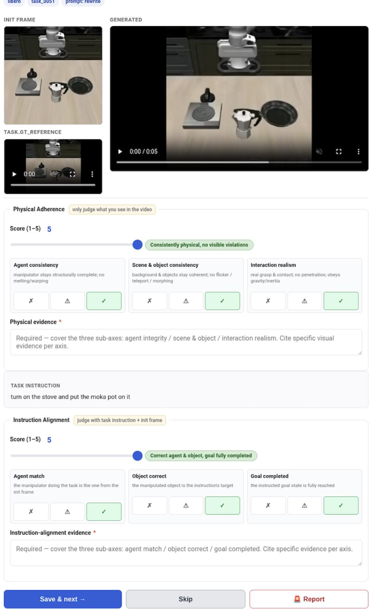  
Figure 7: Annotation interface. Annotators score each generated video on physical adherence and instruction alignment, complete the corresponding diagnostic checklists, and write evidence for their decisions.

## A.1 ANNOTATOR TRAINING AND CALIBRATION

Before production annotation began, annotators completed four alignment rounds, each based on a pool of 100 practice videos, for both physical adherence (PA) and instruction alignment (IA). Each round used the same checklist as the main annotation: annotators assigned a 1–5 axis score, filled the three 0–2 diagnostic checklist items for that axis, and wrote short evidence comments. PA judgments were made without access to the task instruction, while IA judgments were conditioned on the instruction and initial frame. Annotation reviewers compared the submissions against the rubric definitions in Sec. 3.2, gave feedback on disagreements, and used later rounds to verify that annotators applied the score scale and diagnostic checklist consistently.

Table 5: Annotator alignment across four training rounds, each based on 100 practice videos. Metrics aggregate pairwise comparisons of annotators’ primary PA and IA scores.
<table><tr><td>Round</td><td>Exact</td><td>Within ±1</td><td>Mean abs. diff.</td></tr><tr><td>1</td><td>32.8%</td><td>76.2%</td><td>0.98</td></tr><tr><td>2</td><td>39.0%</td><td>78.1%</td><td>0.97</td></tr><tr><td>3</td><td>38.3%</td><td>81.2%</td><td>0.85</td></tr><tr><td>4</td><td>52.9%</td><td>92.1%</td><td>0.58</td></tr></table>

As shown in Table 5, exact agreement increases from 32.8% to 52.9%, while agreement within one point rises from 76.2% to 92.1%; the mean absolute difference correspondingly decreases from 0.98 to 0.58. These trends indicate progressively tighter application of the scoring rubric before production annotation. For benchmark ground-truth construction, one annotator first assigns each item’s scores and supporting evidence, and a second annotator independently cross-reviews the complete annotation. An expert then adjudicates the two assessments and determines the final label.

## A.2 MODEL-ASSISTED TRAINING ANNOTATION

The training split was annotated with a model-assisted workflow. Three closed-source MLLMs (Gemini-3.5-Flash, GPT-5.5, and Seed-2.1-Lite) first generated candidate PA/IA scores and checklist labels. We averaged their scores to form an initial label proposal. Human annotators then reviewed the proposed labels in the annotation interface, corrected numeric scores or checklist labels when the pre-annotation missed or overstated a violation, and wrote brief evidence notes citing the relevant visual evidence. GPT-5.5 then rewrote these human-authored notes into structured reason ing traces conditioned on the human-verified scores (Sec. 4.1). This workflow reduced the cost of covering the large training pool, while the supervision used for ROBOJUDGE-9B reflected human revisions rather than raw model outputs.

## A.3 ANNOTATION INTERFACE

Figure 7 shows the basic annotation page used by human annotators. The page presents the generated video and reference context, collects the PA and IA axis scores, asks for the six diagnostic checklist labels, and records free-text evidence for the annotator’s decision. Model identity is hidden from annotators during labeling to reduce generator-specific bias.

## B EVALUATION PROTOCOL

This appendix specifies the evaluation protocols used for all model judges and non-MLLM metric baselines. We separate the protocol into three parts: the unified prompt and video-input setting for general and embodied VLMs, the original protocols used by specialized VLM judges, and the implementation of non-MLLM metrics.

## B.1 GENERAL AND EMBODIED VLMS

General-purpose VLMs and embodied VLMs are evaluated under a unified ROBOJUDGE-BENCH setting. For each generated video, the runner provides the model with a structured video input sampled at 4 fps with at most 32 uniformly sampled frames. All models in this group receive the same prompt and are required to return the same JSON fields for Physical Adherence and Instruction Alignment, ensuring that differences in scores reflect judge behavior rather than prompt or outputformat changes.

## B.1.1 PHYSICAL ADHERENCE

## System prompt.

You are a strict, calibrated evaluator of the PHYSICAL REALISM of   
AI-generated embodied / robot-manipulation videos (a robot   
arm/gripper or   
a human hand acting on objects). You are shown uniformly-sampled   
frames of   
one generated video in temporal order. Judge the physics of the   
video   
itself. Be conservative: reserve 5 for clearly flawless physics   
and 1 for   
clearly broken physics.

## User prompt.

Task: Judge the PHYSICAL REALISM of this AI-generated robot /   
embodied-manipulation video, from the video alone (ignore any task   
instruction).

Criteria (your reasoning must address each; you may also note   
other   
issues):   
1. Agent integrity - the arm/gripper/hand stays structurally   
complete and   
consistent (no melting, fused/extra fingers, warping).   
2. Scene & object consistency - background and objects stay   
temporally   
stable (no flicker, teleport, morphing, appear/disappear).   
3. Interaction realism - contacts obey physics (grasps close and   
bear   
weight, no interpenetration, motion respects gravity/inertia).   
Score (integer 1-5): 1 = gross violations throughout;   
2 = major violations; 3 = noticeable local inconsistencies;   
4 = minor issues only; 5 = no visible violation.   
Reason first, then score. Output JSON only:   
{"reasoning": "<assess agent integrity, scene & object   
consistency, and   
interaction realism, each with concrete visual evidence>",   
"physical\_adherence": <1-5>}

## B.1.2 INSTRUCTION ALIGNMENT

## System prompt.

You are a strict, calibrated evaluator of whether an AI-generated embodied-manipulation video correctly performs a given task instruction.

You are shown the instruction and uniformly-sampled frames of one generated video in temporal order; the FIRST frame is the initial scene

the video was conditioned on. Judge task execution, not raw visual

quality. Be conservative: reserve 5 for full, correct task   
completion and   
1 for unrelated videos.   
User prompt.   
Task: Judge whether this AI-generated video performs the   
instructed   
manipulation task. The first frame is the initial scene the video   
was   
conditioned on.   
Instruction: "{instruction}"   
Criteria (your reasoning must address each; you may also note   
other   
issues):   
1. Agent match - the task is done by the SAME manipulator shown in   
the   
first frame (not a different/new agent).   
2. Object correctness - the manipulated object is the   
instruction's target   
object.   
3. Goal completion - the instructed goal is actually achieved by   
the end   
(not merely approached).   
Score (integer 1-5): 1 = unrelated or task not performed;   
2 = major misalignment; 3 = partial completion;   
4 = minor shortfalls only; 5 = full, correct completion.   
Reason first, then score. Output JSON only:   
{{"reasoning": "<assess agent match, object correctness, and goal   
completion, each with concrete evidence>",   
"instruction\_alignment": <1-5>}}   
B.2 SPECIALIZED VLM JUDGES   
Specialized VLM judges are evaluated on the same ROBOJUDGE-BENCH test set, but unlike genera   
and embodied VLMs, they are run with their original model-specific scoring interfaces and prompt   
whenever those interfaces are available. This preserves the intended usage of each judge and avoid   
forcing specialized evaluators into the unified JSON prompt in Appendix B.1. We evaluate th

• VideoScore2 (He et al., 2025) uses a deliberative video-scoring procedure. We use its native 1–5 physical/common-sense consistency and text-to-video alignment scores as PA and IA, respectively.

• VideoPhy2 (Bansal et al., 2026) focuses on physical commonsense and temporal consistency. We use its native 1–5 physical commonsense and semantic-adherence scores as PA and IA, respectively.

• VideoCon (Bansal et al., 2024) evaluates video-language consistency through contrastive scoring. We use its physical-commonsense score as PA and semantic-adherence score as IA, mapping each native score s ∈ [0, 1] to 1 + round(4s).

• PhyJudge (Lin et al., 2026) evaluates physical reasoning in generative world-model videos. We use the mean of its physical trustworthiness and persistence scores as PA, and its semanticadherence score as IA.

• WBench (Ying et al., 2026) provides a visual-quality evaluator for interactive video world models. We map its visual-quality score to Physical Adherence (PA). Because WBench does not evaluate instruction following, we do not report Instruction Alignment (IA) or overall results for this model.

## B.3 NON-VLM METRICS

We provide implementation details for the non-MLLM metric baselines reported in Sec. 5.1. These metrics quantify complementary aspects of image quality, temporal consistency, motion characteristics, and video-representation similarity without performing MLLM-based semantic judgment.

All metrics are evaluated on the ROBOJUDGE-BENCH test set and aligned with human annotations through the canonical $\mathrm { i } \ t \in \mathrm { m } _ { - } \mathrm { i } \mathrm { d }$ . Unless otherwise specified, each metric produces one scalar value for each generated video. For raw distance- or error-based metrics, we reverse the score direction when computing correlations such that larger values consistently correspond to higher quality or stronger consistency.

The model-based baselines use the checkpoints configured in our evaluation pipeline: CLIP ViT-B/32 (Radford et al., 2021), DINO ViT-B/16 (Caron et al., 2021), MUSIQ-SPAQ (Ke et al., 2021), RAFT-Things (Teed & Deng, 2020), and a V-JEPA 2 ViT-G checkpoint (Assran et al., 2025) (vjepa2-vitg-fpc64-384-ssv2).

Uniform Random. We include a uniform random predictor as a trivial reference. For each benchmark item, a score is independently sampled from the five-point rating space,

$$
{ \hat { s } } \sim \operatorname { U n i f o r m } \{ 1 , 2 , 3 , 4 , 5 \} ,\tag{2}
$$

for both Physical Adherence (PA) and Instruction Alignment (IA). The resulting predictions are evaluated using the same agreement metrics as the learned judges. For a fixed five-class human label, the expected exact-match probability of the uniform predictor is $1 / 5 = 0 . 2$

Image Quality with MUSIQ. We use MUSIQ (Ke et al., 2021) as a no-reference image-quality estimator, following its use for imaging-quality evaluation in VBench (Huang et al., 2024). Our implementation uses the MUSIQ-SPAQ checkpoint.

For a video

$$
V = \{ I _ { t } \} _ { t = 1 } ^ { T } ,\tag{3}
$$

MUSIQ predicts a technical-quality score $q ( I _ { t } )$ independently for each sampled frame. The videolevel image-quality score is the temporal average

$$
S _ { \mathrm { M U S I Q } } ( V ) = \frac { 1 } { T } \sum _ { t = 1 } ^ { T } q ( I _ { t } ) .\tag{4}
$$

Following the VBench preprocessing protocol, frames are resized while preserving aspect ratio when necessary, with the longer side capped at 512 pixels, and pixel intensities are normalized before inference. A larger value indicates higher predicted frame-level technical quality. MUSIQ evaluates individual-frame appearance and does not explicitly model temporal consistency, physical plausibility, or task completion.

Pixel Frame Consistency. We construct a simple pixel-space temporal baseline. Videos are decoded at 8 fps, resized to $2 5 6 \times 2 5 6$ , and converted to grayscale. Let

$$
G _ { t } \in [ 0 , 2 5 5 ] ^ { H \times W }\tag{5}
$$

denote the processed frame at time t. For every pair of adjacent frames, we compute the mean absolute pixel difference

$$
d _ { t } ^ { \mathrm { p i x } } = \frac { 1 } { H W } \left. G _ { t + 1 } - G _ { t } \right. _ { 1 } .\tag{6}
$$

The video-level frame difference is

$$
D _ { \mathrm { p i x } } ( V ) = \frac { 1 } { T - 1 } \sum _ { t = 1 } ^ { T - 1 } d _ { t } ^ { \mathrm { p i x } } .\tag{7}
$$

A lower value indicates stronger local frame consistency. For correlation analysis, we reverse the metric direction so that larger values correspond to stronger consistency. Affine rescaling does not change either Pearson or Spearman correlation.

This metric is closely related to frame-difference-based temporal evaluation used in video benchmarks such as VBench (Huang et al., 2024). It captures low-level visual stability and may penalize legitimate camera or object motion even when the underlying dynamics are physically valid.

CLIP Frame Consistency. We use CLIP (Radford et al., 2021) ViT-B/32 features to measure global appearance consistency across a generated video, following the feature-consistency formulation used for background consistency in VBench (Huang et al., 2024).

For each frame $I _ { t } ,$ the CLIP image encoder produces an L2-normalized feature vector

$$
\mathbf { c } _ { t } = \frac { f _ { \mathrm { C L I P } } ( I _ { t } ) } { \Vert f _ { \mathrm { C L I P } } ( I _ { t } ) \Vert _ { 2 } } .\tag{8}
$$

For every frame $t > 1$ , we compute its similarity to both the immediately preceding frame and the first frame:

$$
s _ { t } ^ { \mathrm { p r e v } } = \operatorname* { m a x } \left( 0 , \mathbf { c } _ { t - 1 } ^ { \top } \mathbf { c } _ { t } \right) ,\tag{9}
$$

$$
s _ { t } ^ { \mathrm { f i r s t } } = \operatorname* { m a x } \left( 0 , \mathbf { c } _ { 1 } ^ { \top } \mathbf { c } _ { t } \right) .\tag{10}
$$

The frame-level consistency score is

$$
s _ { t } ^ { \mathrm { C L I P } } = \frac { s _ { t } ^ { \mathrm { p r e v } } + s _ { t } ^ { \mathrm { f i r s t } } } { 2 } ,\tag{11}
$$

and the video-level score is

$$
S _ { \mathrm { C L I P } } ( V ) = \frac { 1 } { T - 1 } \sum _ { t = 2 } ^ { T } s _ { t } ^ { \mathrm { C L I P } } .\tag{12}
$$

A higher score indicates stronger global visual consistency over time. Although this protocol is commonly referred to as background consistency in VBench, the feature extractor operates on the complete frame rather than an explicitly segmented background region.

DINO Frame Consistency. We analogously use DINO (Caron et al., 2021) ViT-B/16 features, following the subject-consistency formulation of VBench (Huang et al., 2024). Let

$$
\mathbf { d } _ { t } = \frac { f _ { \mathrm { D I N O } } ( I _ { t } ) } { \Vert f _ { \mathrm { D I N O } } ( I _ { t } ) \Vert _ { 2 } }\tag{13}
$$

denote the normalized DINO representation of frame $I _ { t }$

For every $t > 1$ , the frame-level score is

$$
s _ { t } ^ { \mathrm { D I N O } } = \frac { 1 } { 2 } \left[ \operatorname* { m a x } \left( 0 , { \bf d } _ { t - 1 } ^ { \top } { \bf d } _ { t } \right) + \operatorname* { m a x } \left( 0 , { \bf d } _ { 1 } ^ { \top } { \bf d } _ { t } \right) \right] ,\tag{14}
$$

and the video-level score is

$$
S _ { \mathrm { D I N O } } ( V ) = \frac { 1 } { T - 1 } \sum _ { t = 2 } ^ { T } s _ { t } ^ { \mathrm { D I N O } } .\tag{15}
$$

Comparing each frame with both its immediate predecessor and the initial frame captures short-term continuity while also penalizing longer-term identity or appearance drift.

Optical-Flow Motion Magnitude. To characterize the amount of motion in a generated video, we estimate dense optical flow using RAFT (Teed & Deng, 2020), following the flow-based motion evaluation adopted in EvalCrafter (Liu et al., 2024). We use the RAFT-Things checkpoint.

For consecutive frames $\left( I _ { t } , I _ { t + 1 } \right)$ , RAFT predicts a dense two-dimensional flow field

$$
\mathbf { F } _ { t } ( x , y ) = ( u _ { t } ( x , y ) , v _ { t } ( x , y ) ) .\tag{16}
$$

The mean motion magnitude for a frame pair is

$$
m _ { t } = \frac { 1 } { H W } \sum _ { x , y } \sqrt { u _ { t } ( x , y ) ^ { 2 } + v _ { t } ( x , y ) ^ { 2 } } ,\tag{17}
$$

and the video-level motion magnitude is

$$
S _ { \mathrm { m o t i o n } } ( V ) = \frac { 1 } { T - 1 } \sum _ { t = 1 } ^ { T - 1 } m _ { t } .\tag{18}
$$

Motion magnitude has no intrinsic higher-is-better interpretation. A large value indicates more apparent motion, but the motion may be either physically plausible or erroneous. We therefore retain the original metric direction when computing correlations with human ratings.

Optical-Flow Warp Error. We additionally compute a motion-compensated temporal consistency metric using dense Farneback optical flow (¨ Farneback¨ , 2003). The preprocessing follows the Pixel baseline: videos are decoded at 8 fps, resized to $2 5 6 \times 2 5 6$ , and converted to grayscale.

For two adjacent grayscale frames, we estimate

$$
\mathbf { F } _ { t } ^ { \mathrm { F B } } = \mathrm { F a r n e b a c k } \left( G _ { t } , G _ { t + 1 } \right) ,\tag{19}
$$

and warp $G _ { t }$ toward $G _ { t + 1 }$ using the estimated flow:

$$
\widetilde { G } _ { t + 1 } = \mathcal { W } \left( G _ { t } , \mathbf { F } _ { t } ^ { \mathrm { F B } } \right) ,\tag{20}
$$

where W(·) denotes dense image warping.

The residual photometric error is

$$
e _ { t } = \frac { 1 } { H W } \left. \widetilde { G } _ { t + 1 } - G _ { t + 1 } \right. _ { 1 } ,\tag{21}
$$

and the video-level warp error is

$$
E _ { \mathrm { w a r p } } ( V ) = { \frac { 1 } { T - 1 } } \sum _ { t = 1 } ^ { T - 1 } e _ { t } .\tag{22}
$$

A lower residual indicates that the observed transition is better explained by a coherent motion field. For correlation analysis, we reverse the metric direction such that larger values correspond to stronger motion-compensated temporal consistency.

V-JEPA Paired Similarity. We construct a representation-level similarity metric using the V-JEPA 2 video encoder configured in our evaluation pipeline. For each generated rollout ${ \breve { V } } _ { i } ^ { \mathrm { g e n } }$ , we identify the corresponding real reference trajectory $V _ { i } ^ { \mathrm { g t } }$ from the same source dataset, task, and episode.

The generated and reference videos are processed using the same temporal sampling and featureextraction pipeline to obtain video-level embeddings

$$
\begin{array} { r } { \mathbf { z } _ { i } ^ { \mathrm { g e n } } = f _ { \mathrm { V J E P A 2 } } \left( V _ { i } ^ { \mathrm { g e n } } \right) , \qquad \mathbf { z } _ { i } ^ { \mathrm { g t } } = f _ { \mathrm { V J E P A 2 } } \left( V _ { i } ^ { \mathrm { g t } } \right) . } \end{array}\tag{23}
$$

The primary paired metric is cosine similarity:

$$
S _ { \mathrm { p a i r } } ( i ) = \frac { { \left( { \bf z } _ { i } ^ { \mathrm { g e n } } \right) } ^ { \top } { \bf z } _ { i } ^ { \mathrm { g t } } } { \left\| { \bf z } _ { i } ^ { \mathrm { g e n } } \right\| _ { 2 } \left\| { \bf z } _ { i } ^ { \mathrm { g t } } \right\| _ { 2 } } .\tag{24}
$$

A larger value indicates that the generated rollout is closer to its paired real trajectory in the learned spatiotemporal representation space.

We additionally compute feature mean-squared error as an auxiliary diagnostic:

$$
E _ { \mathrm { p a i r } } ( i ) = \frac { 1 } { D } \left. \mathbf { z } _ { i } ^ { \mathrm { g e n } } - \mathbf { z } _ { i } ^ { \mathrm { g t } } \right. _ { 2 } ^ { 2 } ,\tag{25}
$$

where D is the embedding dimension. Since cosine similarity and feature MSE provide closely related representation-level signals, the main comparison reports the cosine-based Paired Similarity.

V-JEPA Manifold Similarity. Paired Similarity requires a corresponding real reference trajectory. We therefore additionally construct an unpaired representation-level metric that measures the proximity of each generated video to the feature distribution of real embodied videos.

For manifold evaluation, each video is uniformly sampled to 16 frames and resized to $1 2 8 \times 1 2 8$ before feature extraction. If multiple benchmark items correspond to the same real source trajectory, that ground-truth video contributes only once to the reference feature set. :contentReference[oaicite:2]index=2

Let

$$
\mathcal { Z } _ { \mathrm { r e a l } } = \left\{ \mathbf { z } _ { 1 } ^ { \mathrm { g t } } , \ldots , \mathbf { z } _ { M } ^ { \mathrm { g t } } \right\}\tag{26}
$$

denote the set of unique real-video embeddings. We estimate the empirical mean

$$
\boldsymbol { \mu } = \frac { 1 } { M } \sum _ { j = 1 } ^ { M } \mathbf { z } _ { j } ^ { \mathrm { g t } }\tag{27}
$$

and covariance

$$
\boldsymbol { \Sigma } = \frac { 1 } { M - 1 } \sum _ { j = 1 } ^ { M } \left( \mathbf { z } _ { j } ^ { \mathrm { g t } } - \boldsymbol { \mu } \right) \left( \mathbf { z } _ { j } ^ { \mathrm { g t } } - \boldsymbol { \mu } \right) ^ { \top } .\tag{28}
$$

To improve numerical stability, we regularize the covariance as

$$
\widetilde \pmb { \Sigma } = \pmb { \Sigma } + 1 0 ^ { - 3 } \mathbf { I } ,\tag{29}
$$

and use its Moore–Penrose pseudo-inverse. For a generated-video representation $\mathbf { z } _ { i } ^ { \mathrm { g e n } }$ , the raw manifold distance is the regularized Mahalanobis distance

$$
d _ { i } = \sqrt { \left( \mathbf { z } _ { i } ^ { \mathrm { g e n } } - \pmb { \mu } \right) ^ { \top } \widetilde { \pmb { \Sigma } } ^ { \dagger } \left( \mathbf { z } _ { i } ^ { \mathrm { g e n } } - \pmb { \mu } \right) } .\tag{30}
$$

A smaller Mahalanobis distance indicates greater proximity to the real-video feature manifold. For correlation analysis, we reverse the metric direction so that larger values correspond to stronger manifold similarity.

Unlike distribution-level video metrics, this construction produces one score for every generated rollout and can therefore be compared directly with the corresponding human PA and IA ratings at the item level.

## C DATA STATISTICS

## D VIDEO PROMPT ENGINEERING

We provide the complete prompt-engineering procedure used to transform source manipulation instructions into prompts for video generation. Given an initial frame and an instruction, the actual model input is constructed as

‘‘The attached image is the first frame of a {kind}   
manipulation video.’’   
+ rewrite template   
+ ‘‘If the instruction conflicts with the image,   
prioritize the image.’’   
+ ‘‘Output ONLY the rewritten prompt.’’   
+ ‘‘Instruction: ’’ + original instruction,

where {kind} is either robot or human. The initial frame is provided as the image input to the rewriting model.

## D.1 INSTRUCTION REWRITING

We use five rewriting templates for each manipulation type. All templates impose a 100-word upper bound (approximately 128 tokens) and encourage the rewritten prompt to preserve the object name from the original instruction.

Table 6: Video sources of ROBOJUDGE-TRAIN and ROBOJUDGE-BENCH. The training set contains 11,520 generated videos from 14 generators and 831 verified successful real demonstrations paired with their corresponding instructions; the latter are assigned PA=5 and IA=5. The test set contains 800 videos from 10 of these generators; “–” indicates a generator not included in the test set.
<table><tr><td>Video Generation Model / Source</td><td>Train</td><td>Test</td></tr><tr><td>CogVideo I2V</td><td>2,099</td><td>96</td></tr><tr><td>GigaWorld</td><td>1,550</td><td>105</td></tr><tr><td>WoW Wan14B</td><td>1,533</td><td>122</td></tr><tr><td>ABOT PhysWorld</td><td>1,473</td><td>94</td></tr><tr><td>Cosmos3-Nano</td><td>1,033</td><td>107</td></tr><tr><td>Wan2.2 TI2V-5B</td><td>971</td><td>110</td></tr><tr><td>Wan2.6 Flash</td><td>781</td><td>69</td></tr><tr><td>PF Wan14B</td><td>551</td><td>一</td></tr><tr><td>Vidu Q3</td><td>280</td><td>一</td></tr><tr><td>LingBot Video MoE Base</td><td>277</td><td>一</td></tr><tr><td>Veo 3.1 Lite</td><td>274</td><td>35</td></tr><tr><td>HunyuanVideo 1.5</td><td>248</td><td></td></tr><tr><td>HappyHorse</td><td>231</td><td>36</td></tr><tr><td>Kling2.2</td><td>219</td><td>26</td></tr><tr><td>Generated videos</td><td>11,520</td><td>800</td></tr><tr><td>GT real videos</td><td>831</td><td></td></tr><tr><td>Total videos</td><td>12,351</td><td>800</td></tr><tr><td colspan="3">Axis-level training samples: 12,351 PA + 12,351 IA = 24,702</td></tr></table>

## D.1.1 ROBOT REWRITING TEMPLATES

1. Rewrite the instruction as a concise text-to-video prompt (<=100 words, ˜128 token hard cap) describing the robot/gripper performing the task action on the locked object (use the object name from the instruction verbatim), through to the completion state. Plain narrative. Keep scene description minimal - focus on what the robot is doing.

2. Rewrite the instruction as a text-to-video prompt (<=100 words, ˜128 token hard cap) breaking the task into reach -> grasp -> execute -> release/complete on the locked object (object name verbatim), ending in the completion state. Mention scene only briefly if needed for grounding.

3. Rewrite the instruction as an imperative text-to-video prompt (<=100 words, ˜128 token hard cap) commanding the robot/gripper to execute the task on the locked object (object name verbatim) and finish in the completion state. Use action verbs. Stay action-centric; keep environmental detail spare.

4. Rewrite the instruction as a text-to-video prompt (<=100 words, ˜128 token hard cap) starting with the action verb, unfolding what the robot/gripper does to the locked object (object name verbatim) through to completion. Keep background mentions brief.

5. Rewrite the instruction as a text-to-video prompt (<=100 words, ˜128 token hard cap) decomposing into approach -> contact -> completion sub-actions performed by the robot/gripper on the locked object (object name verbatim), ending at the final state. Restrain scene/background detail.

## D.1.2 HUMAN REWRITING TEMPLATES

1. Rewrite the instruction as a concise text-to-video prompt (<=100 words, ˜128 token hard cap) describing the person’s hand performing the task action on the locked object (use the object name from the instruction verbatim), through to the completion state. Plain narrative. Keep scene description minimal - focus on what the hand is doing.

2. Rewrite the instruction as a text-to-video prompt (<=100 words, ˜128 token hard cap) breaking the task into reach -> grasp -> execute -> release/complete on the locked object (object name verbatim), ending in the completion state. Mention scene only briefly if needed for grounding.

3. Rewrite the instruction as an imperative text-to-video prompt (<=100 words, ˜128 token hard cap) commanding the person’s hand to execute the task on the locked object (object name verbatim) and finish in the completion state. Use action verbs. Stay action-centric; keep environmental detail spare.

4. Rewrite the instruction as a text-to-video prompt (<=100 words, ˜128 token hard cap) starting with the action verb, unfolding what the person’s hand does to the locked object (object name verbatim) through to completion. Keep background mentions brief.

5. Rewrite the instruction as a text-to-video prompt (<=100 words, ˜128 token hard cap) decomposing into approach -> contact -> completion sub-actions performed by the person’s hand on the locked object (object name verbatim), ending at the final state. Restrain scene/background detail.

## D.2 PROMPT PREFIXING

As an alternative to instruction rewriting, we prepend a fixed contextual prefix to the original instruction. The prefix is selected according to the manipulation type and is not passed through the rewriting model.

## D.2.1 ROBOT PREFIXES

1. In a fixed robotic workspace, a rigid and physically consistent embodied robotic arm with high stability and no deformation proceeds to

2. In a controlled robotic workspace, a stable rigid robotic arm with no deformation begins to

3. Within a fixed embodied manipulation setup, a physically consistent robotic arm proceeds to

4. In a robotic workspace, a stable robotic arm

5. A rigid, physically plausible robotic arm in the fixed workspace proceeds to

## D.2.2 HUMAN PREFIXES

1. In a first-person egocentric video, a real human hand starts to

2. From an egocentric point of view, the person’s hand naturally proceeds to

3. In a real-world first-person scene, a human hand begins to

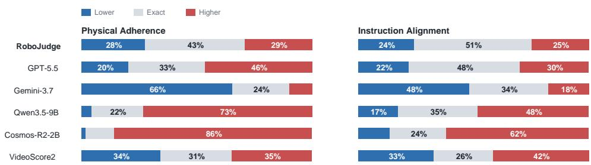  
Figure 8: Directional scoring bias relative to human ratings. RoboJudge is balanced around human scores, while baselines tend to over-score or under-score.

Table 7: Paired cluster-bootstrap comparisons between ROBOJUDGE-9B and the strongest model baseline for each metric. ∆r denotes RoboJudge-9B minus the comparison model.
<table><tr><td>Metric</td><td>Strongest baseline</td><td>∆r</td><td>95% CI</td></tr><tr><td>PA</td><td>Gemini-3.7-Flash</td><td>+0.034</td><td>[-0.011, 0.078]</td></tr><tr><td>IA</td><td>GPT-5.5</td><td>+0.044</td><td>[0.010, 0.078]</td></tr><tr><td>Overall</td><td>Gemini-3.7-Flash</td><td>+0.089</td><td>[0.061, 0.119]</td></tr></table>

4. From a head-mounted camera, the person’s bare hand starts to  
5. In an egocentric recording of a person, their hand proceeds to

For prefix-based prompts, the original instruction is appended directly after the selected prefix without an additional rewriting step. Thus, prompt variants preserve the original task semantics while introducing controlled variation in the description of the acting entity and visual context.

## E ADDITIONAL ANALYSIS

Figure 8 shows that several baselines have clear directional bias: on PA, Qwen3.5-9B and Cosmos-R2-2B over-score 73.3% and 85.8% of examples, while Gemini-3.7 under-scores 65.5%. RoboJudge is more balanced on both PA (29.1% higher vs. 27.5% lower) and IA (24.8% vs. 24.2%).

## E.1 STATISTICAL CONFIDENCE

We assess the robustness of RoboJudge-9B’s gains using a paired cluster bootstrap with 10,000 replicates (random seed 20260926). We treat the 558 source clips, identified by source corpus, task, and episode, as clusters and jointly resample all generated videos derived from each clip. Sampling is stratified by the eight source corpora, and each replicate uses the same sampled clips for RoboJudge-9B and the comparison model. We report percentile 95% confidence intervals for the difference in Pearson correlation. Overall correlation follows the definition in Table 2, pooling PA and IA axis-level predictions.

RoboJudge-9B improves over the strongest baseline in all three point estimates. The bootstrap intervals confirm robust gains in IA and overall agreement, while RoboJudge-9B also achieves the highest observed PA correlation.

## E.2 VIDEO GENERATION LEADERBOARD

Table 8 reports the full ROBOJUDGE-9B scores of the video generation models ranked in Figure 6 and discussed in Sec. 5.6.

Table 8: RoboJudge-9B evaluation results on generated videos. PA denotes Physical Adherence, IA denotes Instruction Alignment, and Overall is the average of PA and IA.
<table><tr><td>Video Generation Model</td><td>PA↑</td><td>IA↑</td><td>Overall ↑</td></tr><tr><td>HappyHorse</td><td>3.821</td><td>4.313</td><td>4.067</td></tr><tr><td>Wan2.6 Flash</td><td>3.827</td><td>4.027</td><td>3.927</td></tr><tr><td>PF Wan14B</td><td>3.680</td><td>3.860</td><td>3.770</td></tr><tr><td>Vidu Q3</td><td>3.480</td><td>3.940</td><td>3.710</td></tr><tr><td>Kling2.2</td><td>3.420</td><td>3.940</td><td>3.680</td></tr><tr><td>Veo 3.1 Lite</td><td>3.580</td><td>3.780</td><td>3.680</td></tr><tr><td>Cosmos3-Super</td><td>3.372</td><td>3.623</td><td>3.497</td></tr><tr><td>ABOT PhysWorld</td><td>3.415</td><td>3.458</td><td>3.437</td></tr><tr><td>Cosmos3-Nano</td><td>3.350</td><td>3.500</td><td>3.425</td></tr><tr><td>LingBot Video MoE Base</td><td>3.960</td><td>2.640</td><td>3.300</td></tr><tr><td>HunyuanVideo 1.5</td><td>3.220</td><td>3.060</td><td>3.140</td></tr><tr><td>LongCat</td><td>3.440</td><td>2.620</td><td>3.030</td></tr><tr><td>GigaWorld</td><td>2.781</td><td>2.994</td><td>2.887</td></tr><tr><td>WoW Wan14B</td><td>2.860</td><td>2.733</td><td>2.797</td></tr><tr><td>SVD-XT</td><td>3.360</td><td>1.940</td><td>2.650</td></tr><tr><td>Wan2.2 TI2V-5B</td><td>2.656</td><td>2.512</td><td>2.584</td></tr><tr><td>CogVideo I2V</td><td>2.014</td><td>2.151</td><td>2.082</td></tr></table>

## E.3 JUDGE AGREEMENT LANDSCAPE

Figure 9 plots each judge’s mean Pearson correlation with human PA and IA ratings against its mean squared error, complementing Table 2 in Sec. 5.3.

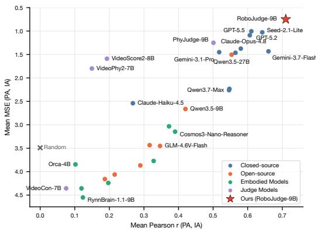  
Figure 9: Judge agreement with human ratings on ROBOJUDGE-BENCH.

## F ADDITIONAL EXAMPLES OF ROBOJUDGE-BENCH

We present additional examples from ROBOJUDGE-BENCH across diverse embodiments, source datasets, and video generation models. Each example shows representative video frames, PA/IA scores, and the corresponding fine-grained rationales.

GR1-InLab · Wan2.2

## Dexterous hand

Pick up the yellow corn with the right robotic gripper from the wooden table.

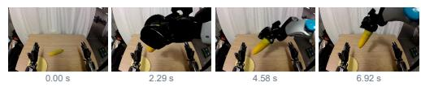

## PA score 4

✓ Agent integrity: “the visible robot arms and hands keep a coherent shape, scale,   
and articulated structure throughout the sequence […]”   
✓ Scene & object consistency: “the tabletop, curtain, plate, and corn remain   
visually consistent in appearance and position […]”   
✗ Interaction realism: “its black fingers visibly penetrate through the cob rather   
than wrapping around it with believable contact […]”

## IA score 2

✗ Agent match: “that gripper remains essentially idle while a different, previously unseen robotic arm enters from the side […]”

✓ Object correctness: “the manipulated item is the yellow corn on the table […]” ✗ Goal completion: “although the corn is lifted, it is lifted by the wrong agent, so the instructed task is not fulfilled […]”

## Human hand

EgoDex · Abot-PhysWorld

Pour liquid from the BOLD PEAK bottle into the gray cup on the green tablecloth.

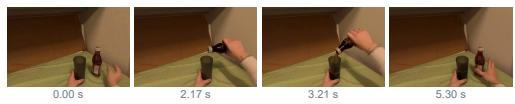

## PA score 4

◐ Agent integrity: “the hand remains recognizable, with minor shape instability during the bottle grasp […]”   
✓ Scene & object consistency: “the bottle, gray cup, and green tablecloth remai visually stable […]”   
✗ Interaction realism: “the pouring interaction is recognizable, though the liquid flow appears slightly abrupt and visually inconsistent […]

## IA score 5

✓ Agent match: “the person’s hand performs the requested pouring action […]”   
✓ Object correctness: “the BOLD PEAK bottle and gray receiving cup match the   
instruction […]”   
✓ Goal completion: “the bottle is lifted and tilted over the cup in the intended   
pouring sequence […]”

RoboTwin · Wan2.6 Flash

## Simulated gripper

Grab the mouse with two buttons and a scroll wheel from the left side of the wooden table with the right gripper and drop it on the Black mat.

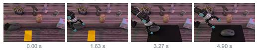

## PA score 2

✓ Agent integrity: “the robotic arm maintains a coherent structure, with consistent   
joints, gripper fingers, and turquoise pads […]”   
✗ Scene & object consistency: “yellow rectangular object present on the tabletop   
disappears without cause, and a large black mouse pad suddenly appears […]”   
✓ Interaction realism: “the gripper approaches and contacts the mouse in a   
plausible way […]”

## IA score 4

✓ Agent match: “The robotic gripper enters from the left and uses the specified   
gripper to grasp and move the object […]”   
✓ Object correctness: “It selects the gray computer mouse on the left side of the   
wooden table […]”

◐ Goal completion: “the black mat appears only midway through the video […]”

## Human hand

EgoScale · HappyHorse

Pull the white tube completely out of the clear plastic packaging using both hands.

PA score 5   
✓ Agent integrity: “both hands remain anatomically coherent throughout the   
extraction […]”   
✓ Scene & object consistency: “the white tube, clear package, and tabletop retain   
stable identities […]”   
✓ Interaction realism: “the hands maintain plausible contact while the tube slides   
out of the package […]”   
IA score 5   
✓ Agent match: “the person uses both hands to hold the package and pull the tube   
[…]”   
✓ Object correctness: “the manipulated objects are the specified white tube and   
clear packaging […]”   
✓ Goal completion: “the white tube is fully separated from the package by the final   
frame […]”

## Figure 10: Additional qualitative examples from ROBOJUDGE-BENCH, covering diverse embodiments, source datasets, generation models, and PA/IA score combinations. Each case includes fine-grained rationales for the corresponding PA and IA judgments.

## Dexterous hand

GR1-InLab · Kling

Handover the yellow corn from the right robotic hand to the left above the yellow plate, then release it.

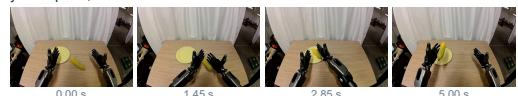

## PA score 4

## IA score 5

✓ Agent match: “the right and left robotic hands perform their specified roles […]” ✓ Object correctness: “the transferred object is the yellow corn named in the instruction […]”

✓ Goal completion: “the corn is transferred toward the left hand above the yellow plate […]”

## Simulated gripper

RoboTwin · GigaWorld

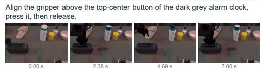

## PA score 4

## IA score 4

✓ Agent match: “the instructed robotic gripper performs the action […]”   
✓ Object correctness: “it targets the top-center button of the dark grey alarm clock   
[…]”   
◐ Goal completion: “the button is pressed, but a clear final release is not   
maintained […]”

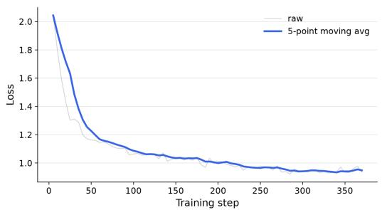  
Figure 11: SFT Training Loss. Training loss throughout the SFT stage.

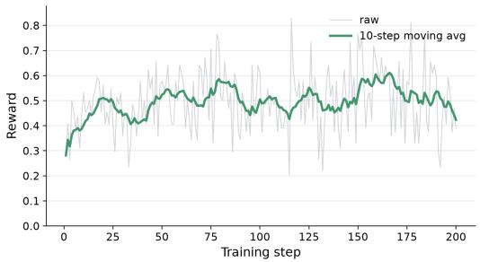  
Figure 12: GRPO Training Reward. Training reward throughout the GRPO stage.

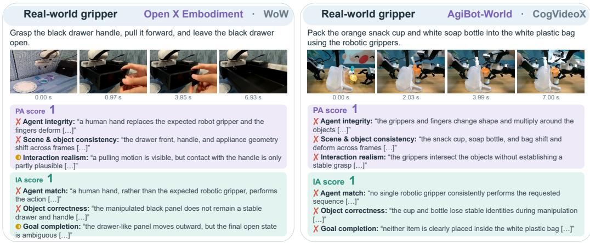  
Figure 10 (continued): Additional qualitative examples from ROBOJUDGE-BENCH.

## G EXPERIMENTAL DETAILS

## G.1 COMPUTATION

We use 4 NVIDIA H20 GPUs for training ROBOJUDGE-9B. The SFT stage takes approximately 2 hours to complete one epoch. The subsequent GRPO stage is initialized from the SFT checkpoint and takes approximately 12 hours to reach 200 training steps.

For SFT, we perform full-parameter fine-tuning with a global batch size of 64 and a learning rate of $1 \times 1 0 ^ { - 5 }$ . For GRPO, we use a per-device batch size of 2 with gradient accumulation of 8 and 8 generations per prompt, corresponding to 64 prompts and 512 sampled completions per update. We use a learning rate of $\mathrm { \bar { 1 } } \times 1 0 ^ { - 6 }$ and a maximum completion length of 512 tokens.

## G.2 TRAINING LOG

## G.3 FRAME-RATE ABLATION

Table 9 reports the full frame-rate ablation summarized in Sec. 5.4. The 4 FPS entries are the same canonical evaluations reported in the main results table.

Table 9: Frame-rate (FPS) ablation on ROBOJUDGE-BENCH. Acc is exact-match accuracy. The 4 FPS rows reuse the corresponding main-table results because 4 FPS is the default evaluation setting.
<table><tr><td rowspan="2">Judge</td><td rowspan="2">FPS</td><td colspan="3">PA</td><td colspan="3"> $\mathbf { L A }$ </td><td colspan="3">Overall</td></tr><tr><td> $r \uparrow$ </td><td>Acc↑</td><td>MSE↓</td><td> $r \uparrow$ </td><td>Acc↑</td><td>MSE↓</td><td> $r \uparrow$ </td><td> $\operatorname { A c c } \uparrow$ </td><td>MSE↓</td></tr><tr><td rowspan="3">GPT-5.5</td><td>2</td><td>0.483</td><td>0.344</td><td>1.339</td><td>0.735</td><td>0.484</td><td>0.792</td><td>0.620</td><td>0.414</td><td>1.066</td></tr><tr><td>4</td><td>0.489</td><td>0.334</td><td>1.359</td><td>0.733</td><td>0.481</td><td>0.786</td><td>0.618</td><td>0.407</td><td>1.073</td></tr><tr><td>8</td><td>0.483</td><td>0.351</td><td>1.335</td><td>0.738</td><td>0.500</td><td>0.775</td><td>0.620</td><td>0.426</td><td>1.055</td></tr><tr><td rowspan="3">Qwen3.5-9B</td><td>2</td><td>0.316</td><td>0.214</td><td>3.422</td><td>0.429</td><td>0.355</td><td>2.522</td><td>0.363</td><td>0.285</td><td>2.972</td></tr><tr><td>4</td><td>0.379</td><td>0.223</td><td>3.011</td><td>0.461</td><td>0.347</td><td>2.314</td><td>0.401</td><td>0.285</td><td>2.663</td></tr><tr><td>8</td><td>0.379</td><td>0.214</td><td>3.058</td><td>0.461</td><td>0.346</td><td>2.320</td><td>0.401</td><td>0.280</td><td>2.689</td></tr></table>