# RayCo4D: Ray-Conditioned Continuous Motion Model for Monocular 4D Dynamic Reconstruction

Yuanxiang Ni1 Xianliang Huang2,† Ruihan Hou3 Feng Xie4 Hao Zhang5,\*

1 Southern University of Science and Technology, Shenzhen, China 2 Fudan University, Shanghai, China

3 East China University of Science and Technology, Shanghai, China 4 Beijing Technology and Business University, Beijing, China 5 Shenzhen Institutes of Advanced Technology, Chinese Academy of Sciences, Shenzhen, China Corresponding author: h.zhang10@siat.ac.cn † Project leader: huangxl21@m.fudan.edu.cn

[ Project Page ] [ Code ]

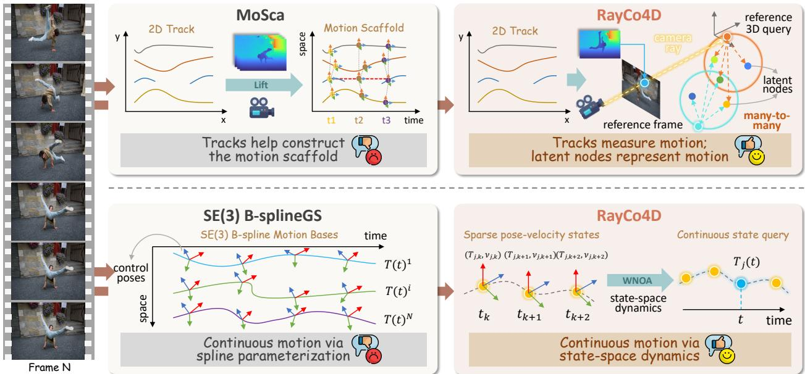  
Figure 1. RayCo4D versus prior track-driven methods. Top: MoSca [18] initializes motion support from lifted tracks; RayCo4D treats tracks as ray-conditioned measurements of shared latent nodes, without one-to-one track–node binding. Bottom: SE(3) B-splineGS [41] utilizes continuous motion with spline trajectories, whereas RayCo4D models it using sparse SE(3) pose-velocity states with a WNOA prior for continuous-time queries.

## Abstract

Reconstructing dynamic 3D scenes from monocular video requires inferring motion from noisy and intermittently visible observations. Long-range tracks provide valuable geometric constraints, but integrating their fragmented temporal coverage into shared, continuous motion remains challenging. We introduce RayCo4D, a ray-conditioned continuous motion model for monocular 4D reconstruction that explicitly separates visual measurements from latent 3D motion states. Each track is associated with a reference-time 3D query constrained to its camera ray, and its image and depth observations constrain shared latent motion nodes through local many-to-many associations. Each node maintains an SE(3) pose and

body-frame velocity at sparse support times. A white-noise-on-acceleration process prior couples neighboring states and defines continuous-time interpolation, allowing observations across visibility intervals to jointly constrain the same latent state sequence. The inferred shared motion is transferred to Gaussian primitives through dual-quaternion blending, while reference-anchored local SE(3) residuals capture fine-scale non-rigid deformation beyond the shared scafold. Experiments on diverse monocular dynamic scenes show that RayCo4D achieves competitive novel-view synthesis quality, improves structural and temporal consistency under rapid motion and incomplete tracks, and supports continuous-time rendering.

## 1 Introduction

Reconstructing 3D scenes from images is an important step toward persistent and renderable representations of the physical world [9, 24, 42]. Such representations can support applications, such as 3D content creation [10, 20, 34, 37], robot perception [11, 12, 25], and dynamic scene understanding [18, 28, 43]. In monocular dynamic reconstruction, only one viewpoint is available at each instant, leaving scene geometry, camera motion, and non-rigid deformation jointly under-constrained. Occlusions, motion blur, and tracking failures further fragment the cross-frame evidence available for motion estimation.

Recent methods build on the explicit representation and eficient rendering of 3D Gaussian Splatting [15], using long-range tracks [13] and monocular depth to constrain dynamic scene reconstruction. An important modeling choice is how these geometric cues relate to the underlying motion states. MoSca [18] initializes motion-node trajectories from lifted tracks, while SE(3) B-splineGS [41] initializes continuous spline control poses from lifted tracklets. Shape of Motion [28] uses tracks to supervise shared SE(3) motion bases, illustrating the value of pooling observations through a common motion representation. For incomplete tracks, the central challenge is to combine measurements across visibility intervals into locally shared motion states with coherent continuous-time evolution.

Our central perspective is that image tracks are measurements oflatent 3D motion, rather than the motion states themselves. Based on this perspective, we introduce RayCo4D, a ray-conditioned continuous motion model for monocular 4D reconstruction. Fig. 1 summarizes its two central design choices: ray-conditioned measurement–state modeling and continuous pose–velocity state estimation. Using camera and depth estimates from Depth Anything 3 [19], we constrain each track with a reference-time 3D query and use its visible observations to estimate the shared motion. Track geometry helps initialize a compact motion support, but subsequent optimization does not maintain a dedicated motion state for each track. Instead, each query is associated with a local neighborhood of motion nodes. A track can constrain multiple nodes, while each node aggregates observations from multiple tracks and timestamps. This many-to-many association allows track observations with diferent visibility intervals to contribute to a shared motion representation.

To estimate this shared motion continuously, each node maintains an SE(3) pose and body-frame velocity at sparse support times. We connect consecutive states using a white-noise-on-acceleration (WNOA) process prior from continuous-time state estimation [3]. The process prior couples neighboring pose–velocity states and defines consistent interpolation between support times. Track and depth measurements constrain node transformations at their observation times. As a result, observations from diferent frames and visibility intervals contribute to the same latent state sequence. Intervals without direct observations remain connected through the process model. Temporal continuity enters both the motion representation and its estimation.

To obtain renderable dynamic geometry, we propagate the node transformations to Gaussian primitives through dual-quaternion blending. This shared scafold provides a common motion structure, but cannot capture every fine-scale non-rigid deformation. We therefore augment each dynamic Gaussian with a local SE(3) residual expressed in its reference configuration. The residual transform is exactly the identity at the Gaussian’s reference time, ensuring that it introduces no local correction at that anchor. Together with regularization on residual magnitude and variation, this design encourages local corrections to complement, rather than replace, the shared motion. RayCo4D thus combines continuous shared motion with reference-anchored local refinement in a hierarchical dynamic representation.

Our main contributions are summarized as follows: (1) We introduce a ray-conditioned measurement–state formulation in which 2D tracks and camera–depth geometry constrain shared latent motion nodes through manyto-many associations, decoupling track identity from motion-state identity. (2) We formulate shared motion using sparse continuous-time SE(3) pose-velocity states, with WNOA process factors coupling neighboring supports and defining interpolation for measurement evaluation and rendering. (3) We develop a hierarchical Gaussian motion representation that combines shared node transport with reference-anchored local SE(3) residuals, capturing coherent structural motion and fine-scale non-rigid deformation. (4) Experiments demonstrate competitive novel-view synthesi and improved structural and temporal consistency under fast motion and incomplete tracks, together with continuous-time rendering within the reconstructed interval.

## 2 Related Work

Structured Motion for Dynamic Gaussian Splatting. Time-conditioned Gaussian deformation is used to model dynamic scenes [32, 35, 38]. Structured representations introduce shared motion across primitives: Shape of Motion [28] fits shared SE(3) motion bases using track and depth supervision, while MoSca [18] initializes sparse motion nodes from lifted tracks and propagates their transformations to Gaussians. OriGS [33], RiGS [31], and USPLAT4D [8] further introduce orientation fields, motion-type decomposition, and uncertainty-guided motion graphs, respectively. Building on shared motion representations, RayCo4D connects ray-conditioned track measurements to latent nodes through local many-to-many associations and augments their motion with reference-anchored Gaussian-level corrections.

Continuous Motion and State-Space Modeling. SplineGS [21] represents Gaussian positions with cubic Hermite splines, while SE(3) B-splineGS [41] models position and orientation using cumulative SE(3) B-splines initialized from lifted tracklets. Spline-based motion models are also used for dynamic scene reconstruction in autonomous driving [36]. GP-4DGS [16] uses variational Gaussian processes to model correlated deformations and their uncertainty. Related dynamical formulations include prediction–observation fusion over Gaussian states in Gaussians on their Way [5], learned velocity fields in EvoGS [2], and latent ODE dynamics in ODE-GS [27]. RayCo4D adopts a WNOA prior from continuous-time state estimation [3, 4] to jointly estimate shared node poses and body velocities at sparse support times. The same pose-velocity model defines temporal process factors and continuous motion queries, allowing ray-based observations to constrain a common latent state sequence. Additional discussion is provided in Appendix A.

## 3 Method

Given a monocular video $\{ I _ { f } \} _ { f = 0 } ^ { F - 1 }$ , RayCo4D reconstructs a dynamic Gaussian scene by separating visual measurements from shared continuous motion states (Fig. 2). The inputs comprise 2D tracks with visibility and confidence, camera and depth estimates, and epipolar cues derived from RAFT [26] optical flow. Our representation consists of a sparse set of latent motion nodes, reference-time Gaussian geometry, and per-Gaussian local motion corrections. Through ray-conditioned queries, tracks constrain the motion nodes, whose transformations also drive the Gaussian scene. We formulate ray-conditioned measurements, continuous pose–velocity dynamics, and reference-anchored local corrections.

## 3.1 Ray-Conditioned Motion Measurements

Long-range tracks connect observations across time, but their visibility, confidence, and depth support vary across frames. The goal is to convert these fragmented observations into geometric constraints on a compact, shared motion field. RayCo4D anchors each track to a camera ray in a reliable reference frame and associates its 3D query with nearby latent motion nodes. The resulting node-induced motion is then evaluated against image and depth measurements.

Ray-constrained queries (RCQ). To couple a 2D track with the 3D motion field, we first assign it a reference location in world space. For each track �, let ${ \bf u } _ { i , f }$ denote its observed pixel coordinate at frame $f ,$ and $r _ { i }$ a visible reference frame selected based on observation reliability. We represent the reference-time track geometry as a 3D query ${ \bf q } _ { i }$ , whose position is constrained and optimized along the corresponding camera ray:

$$
\begin{array} { r l } { z _ { i } = z _ { \operatorname* { m i n } } + ( d _ { i } ^ { 0 } - z _ { \operatorname* { m i n } } ) \exp ( \eta _ { i } ) , \qquad \mathbf { q } _ { i } } & { { } = \mathbf { c } _ { r _ { i } } + z _ { i } \mathbf { R } _ { r _ { i } } ^ { c } \mathbf { K } _ { r _ { i } } ^ { - 1 } \widetilde { \mathbf { u } } _ { i r _ { i } } , } \end{array}\tag{1}
$$

where u denotes homogeneous pixel coordinates, $z _ { \mathrm { m i n } } > 0$ is a depth floor, and $\eta _ { i }$ is an optimizable scalar initialized to zero. Here, ${ \bf c } _ { r _ { i } } , { \bf R } _ { r _ { i } } ^ { c }$ , and ${ \bf K } _ { r _ { i } }$ denote the world-space camera center, camera-to-world rotation, and intrinsics at frame $r _ { i } ,$ respectively. The initial depth $d _ { i } ^ { 0 }$ is taken from a reliable depth observation. For tracks without valid depth, it is initialized from a front-facing motion node whose projection is close to the reference pixel. The unnormalized ray in Eq. (1) preserves the camera-axis depth convention. Importantly, $\eta _ { i }$ adjusts reference geometry and it does not parameterize time-varying track motion.

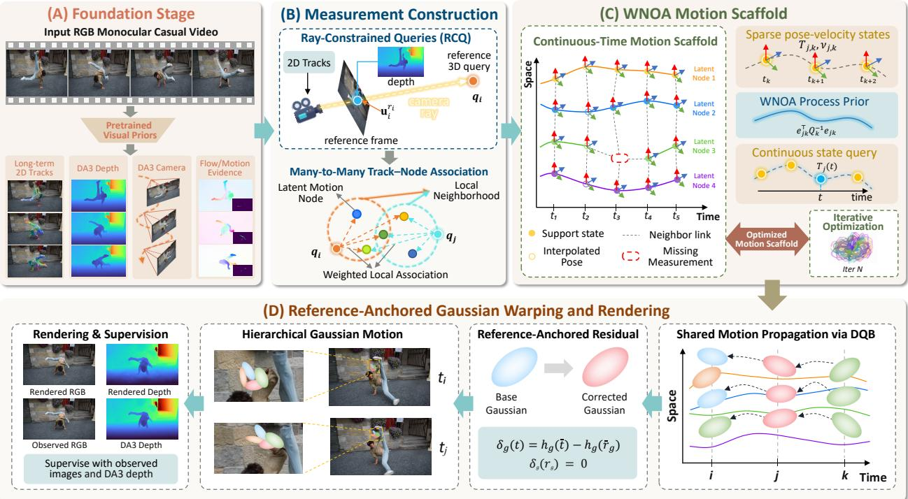  
Figure 2. Overview of RayCo4D. Given a monocular video, RayCo4D constructs ray-conditioned 3D queries from 2D tracks and camera-depth estimates to constrain shared latent motion nodes. Sparse SE(3) pose–velocity states are coupled by a WNOA prior to model continuous motion. The inferred motion is propagated to Gaussians via dual-quaternion blending, while reference-anchored local residuals capture fine-grained non-rigid deformation for dynamic rendering and optimization.

Measurement–state decoupling (MSD). Let $\mathbf { T } _ { j } ( t ) = [ \mathbf { R } _ { j } ( t ) , \mathbf { p } _ { j } ( t ) ] \in \mathrm { S E } ( 3 )$ denote the continuous pose of latent node $j .$ . For each query, we select its � nearest nodes at the reference time and compute normalized radial weights:

$$
\begin{array} { r l } { N _ { i } = \mathrm { K N N } _ { j } \big ( \mathbf { q } _ { i } , \mathbf { p } _ { j } ( r _ { i } ) \big ) , \qquad a _ { i j } } & { { } = \cfrac { \exp \left( - \| \mathbf { q } _ { i } - \mathbf { p } _ { j } ( r _ { i } ) \| _ { 2 } ^ { 2 } / ( 2 \sigma _ { j } ^ { 2 } ) \right) } { \sum _ { \ell \in N _ { i } } \exp \left( - \| \mathbf { q } _ { i } - \mathbf { p } _ { \ell } ( r _ { i } ) \| _ { 2 } ^ { 2 } / ( 2 \sigma _ { \ell } ^ { 2 } ) \right) } , \qquad j \in N _ { i } , } \end{array}\tag{2}
$$

where $\sigma _ { j }$ controls the spatial influence of node $j .$ Candidate neighborhoods are periodically refreshed as geometry changes, while the weights are recomputed from the current query and node positions. Queries in the same moving region consequently have overlapping node support, allowing their observations to jointly shape the local motion.

We combine the relative transformations of these nodes using dual-quaternion blending (DQB) [14]. The predicted world-space position of track � at time � is:

$$
\widehat { \mathbf { x } } _ { i } ( t ) = \mathrm { D Q B } \Big ( \big \{ a _ { i j } , \mathbf { T } _ { j } ( t ) \mathbf { T } _ { j } ( r _ { i } ) ^ { - 1 } \big \} _ { j \in \mathcal { N } _ { i } } \Big ) \cdot \mathbf { q } _ { i } ,\tag{3}
$$

where · denotes the rigid action on a 3D point. Each observation constrains a local blend of node states, allowing shared nodes to aggregate evidence across tracks and time. This decouples track identity from latent motion-state identity.

Measurement factors. Let $O _ { u }$ denote visible track observations and $O _ { d } \subseteq O _ { u }$ those with valid depth. Keeping the observed coordinates, visibility, and confidence fixed, we constrain the predicted query positions with the confidence-weighted reprojection loss:

$$
\mathcal { L } _ { \mathrm { 2 D } } = \frac { 1 } { Z _ { u } } \sum _ { ( i , f ) \in O _ { u } } c _ { i f } \rho _ { 2 } \Bigg ( \frac { \pi _ { f } ( \widehat \mathbf { x } _ { i } ( f ) ) - \mathbf { u } _ { i f } } { \sigma _ { u } } \Bigg ) , \qquad Z _ { u } = \sum _ { ( i , f ) \in O _ { u } } c _ { i f } .\tag{4}
$$

Here $c _ { i f }$ is track confidence, $\pi _ { f }$ is camera projection, $\sigma _ { u }$ is the image-space noise scale, and $\rho _ { 2 }$ averages a componentwise smooth ${ \bf - } \ell _ { 1 }$ penalty. Observations in $O _ { d }$ also contribute a relative camera-axis depth loss weighted by track confidence and depth reliability, denoted ${ \mathcal { L } } _ { \mathrm { d e p t h } } ;$ visible observations without depth still contribute to Eq. (4).

## 3.2 Continuous-Time Latent Motion with WNOA

The measurement factors above reveal motion at a sparse set of observation times. The latent motion representation must ensure temporal coherence and provide node transformations at arbitrary times. RayCo4D therefore represents each node with sparse SE(3) pose–velocity states and connects adjacent supports using a white-noise-on-acceleration (WNOA) process. The same continuous model is used for measurement evaluation, Gaussian motion, and subframe rendering.

Sparse pose–velocity states. At each support time, we represent each node by its pose and body-frame velocity to capture both configuration and local motion. For support times $0 = \tau _ { 0 } < \dots < \tau _ { S - 1 } = F - 1$ , we define:

$$
X = \left\{ \mathbf { s } _ { j k } = ( \mathbf { T } _ { j k } , \pmb { \nu } _ { j k } ) \right\} _ { j , k } , \qquad \mathbf { T } _ { j k } \in \mathrm { S E } ( 3 ) , \quad \pmb { \nu } _ { j k } \in \mathbb { R } ^ { 6 } .\tag{5}
$$

where $\mathbf { T } _ { j k } = \mathbf { T } _ { j } ( \tau _ { k } )$ and $\nu _ { j k }$ is the body-frame velocity. We order the translational components before the angular components and use the convention $\dot { \mathbf { T } } _ { j } ( t ) = \mathbf { T } _ { j } ( t ) \nu _ { j } ( t ) ^ { \wedge }$ . The support times are sampled at a fixed frame stride and include both sequence endpoints. Both pose and velocity are jointly optimized using visual measurements.

WNOA process model. The sparse states require a temporal relation that determines how motion evolves between consecutive supports. We impose a locally linear WNOA prior on SE(3) [1]. For the interval $[ \tau _ { k } , \tau _ { k + 1 } ]$ , let $\Delta _ { k } = \tau _ { k + 1 } - \tau _ { k } , \pmb { \xi } _ { i k } ^ { + } = \mathrm { L o g } \big ( \mathbf { T } _ { i k } ^ { - 1 } \mathbf { T } _ { j , k + 1 } \big ) ^ { \vee }$ denote the relative endpoint pose in the tangent space centered at $\mathbf { T } _ { j k }$ . Because the endpoint body velocities live in diferent local frames, we express the terminal velocity in the same tangent space using $\widetilde { \nu } _ { j , k + 1 } = \mathbf { J } _ { r } ( \pmb { \xi } _ { i k } ^ { + } ) ^ { - 1 } \pmb { \nu } _ { j , k + 1 }$ , where ${ \bf J } _ { r }$ is the right Jacobian of SE(3).

WNOA models the local acceleration as zero-mean white noise. Its mean evolution follows constant velocity, while its covariance describes how deviations from that motion accumulate over the interval. The resulting neighboring-state factor is:

$$
\mathbf { e } _ { j k } = \left[ \xi _ { j k } ^ { + } - \Delta _ { k } \nu _ { j k } \right] , \qquad \mathcal { L } _ { \mathrm { W N O A } } \quad = \frac { 1 } { 3 M ( S - 1 ) } \sum _ { j = 1 } ^ { M } \sum _ { k = 0 } ^ { S - 2 } \mathbf { e } _ { j k } ^ { \top } \mathbf { Q } _ { k } ^ { - 1 } \mathbf { e } _ { j k } .\tag{6}
$$

Here, � denotes the number of latent motion nodes. The two blocks of $\mathbf { e } _ { j k }$ measure the endpoint pose discrepancy relative to the initial-velocity prediction and the velocity change in common local coordinates, respectively. The analytic covariance $\mathbf { Q } _ { k }$ contains position, velocity, and cross-covariance blocks that scale respectively with $\Delta _ { k } ^ { 3 } / 3 , \Delta _ { k }$ , and $\Delta _ { k } ^ { 2 } / 2$ This time-dependent scaling permits larger motion variation across longer intervals while maintaining tighter coupling between nearby supports. We use separate spectral densities for translational and rotational acceleration and normalize translation using the spatial scale of the motion scafold. The complete state-space derivation and the explicit form of $\mathbf { Q } _ { k }$ are given in Appendix Sec. C.

Continuous state evaluation. Track measurements and Gaussian rendering generally occur between support times, so the model must provide a pose at every queried timestamp. For $t \in \left[ \tau _ { k } , \tau _ { k + 1 } \right]$ and $s = ( t - \tau _ { k } ) / \Delta _ { k }$ , the conditional mean of the WNOA process reduces to cubic Hermite interpolation in the local tangent space:

$$
\begin{array} { r } { \overline { { \xi } } _ { j k } ( t ) = h _ { 1 0 } ( s ) \Delta _ { k } \nu _ { j k } + h _ { 0 1 } ( s ) \xi _ { j k } ^ { + } + h _ { 1 1 } ( s ) \Delta _ { k } \widetilde { \nu } _ { j , k + 1 } , \qquad \mathbf { T } _ { j } ( t ) = \mathbf { T } _ { j k } \exp \left( \overline { { \xi } } _ { j k } ( t ) ^ { \wedge } \right) , } \end{array}\tag{7}
$$

where $h _ { 1 0 } , h _ { 0 1 }$ , and $h _ { 1 1 }$ are the standard cubic Hermite basis functions detailed in Appendix Sec. C.3. Eq. (7) matches the endpoint poses and body velocities in the local chart. Measurements from diferent tracks jointly refine the continuous node trajectories used for Gaussian motion.

## 3.3 Hierarchical Gaussian Reconstruction

RayCo4D propagates continuous node motion to Gaussian primitives and introduces reference-anchored local corrections for each primitive. Shared motion captures coherent structure-level dynamics, while local corrections model fine-scale non-rigid deformation. Both components are jointly optimized with Gaussian geometry and appearance under visual and geometric supervision.

Shared motion propagation. Each Gaussian � is stored at a reference time $r _ { g }$ with reference pose ${ \bf P } _ { g } ^ { \mathrm { r e f } } = [ { \bf R } _ { g } ^ { \mathrm { r e f } } , \mu _ { g } ^ { \mathrm { r e f } } ]$ We associate its reference center $\mu _ { g } ^ { \mathrm { r e f } }$ with a local node set $N _ { g }$ using the geometric weighting rule in Eq. (2). These geometric weights provide the initial Gaussian-to-node binding. During photometric fitting, Gaussian-specific logit ofsets $b _ { g j }$ refine these weights:

$$
\begin{array} { r } { \overline { { a } } _ { g j } = \mathrm { s o f t m a x } _ { j \in \mathcal { N } _ { g } } \left( \log a _ { g j } ^ { \mathrm { g e o } } + b _ { g j } \right) , \qquad \mathbf { A } _ { g } ( t ) = \mathrm { D Q B } \left( \left\{ \overline { { a } } _ { g j } , \mathbf { T } _ { j } ( t ) \mathbf { T } _ { j } ( r _ { g } ) ^ { - 1 } \right\} _ { j \in \mathcal { N } _ { g } } \right) , } \end{array}\tag{8}
$$

where $\mathbf { A } _ { g } ( t ) \in \mathrm { S E } ( 3 )$ is the shared transformation induced by the continuous node trajectories. The ofsets are initialized to zero and activated after the early shared-motion fitting stage. Candidate nodes are refreshed as the scene structure evolves, while the binding for each forward evaluation is computed from the Gaussian’s reference geometry. Nearby Gaussians therefore retain overlapping node support and inherit a spatially coherent motion field.

Anchored residual motion (ARM). We equip each dynamic Gaussian with a lightweight local motion curve ${ \bf h } _ { g }$ $[ 0 , 1 ] \to { \mathbb { R } } ^ { 6 }$ , represented by a small set of cubic Hermite controls. For $\bar { t } = t / \operatorname* { m a x } ( F - 1 , 1 )$ and $\bar { r } _ { g } = r _ { g } / \mathrm { m a x } ( F - 1 , 1 )$ anchored residual motion (ARM) is defined as:

$$
\delta _ { g } ( t ) = \mathbf { h } _ { g } ( \bar { t } ) - \mathbf { h } _ { g } ( \bar { r } _ { g } ) , \qquad \mathbf { E } _ { g } ( t ) = \mathrm { E x p } \Big ( \big [ \mathbf { D } _ { \ell } \delta _ { g } ( t ) \big ] ^ { \wedge } \Big ) , \qquad \mathbf { D } _ { \ell } = \mathrm { d i a g } ( \ell \mathbf { I } _ { 3 } , \mathbf { I } _ { 3 } ) ,\tag{9}
$$

where ℓ is the spatial unit of the motion scafold. The translational components of the curve are expressed in scafold units, and the rotational components are expressed in radians. By construction, $\delta _ { g } ( r _ { g } ) = \mathbf { 0 }$ and $\mathbf { E } _ { g } ( r _ { g } ) = \mathbf { I }$ for any control values. The residual is expressed in the Gaussian’s own reference coordinate frame and applied before shared motion transport:

$$
\mathbf { P } _ { g } \left( t \right) = \mathbf { A } _ { g } \left( t \right) \mathbf { P } _ { g } ^ { \mathrm { r e f } } \mathbf { E } _ { g } \left( t \right) .\tag{10}
$$

In Eq. (10), ${ \bf E } _ { g } ( t )$ first adjusts the primitive in its local reference frame, $\mathbf { P } _ { g } ^ { \mathrm { r e f } }$ places it in the reference scene, and ${ \bf A } _ { g } ( t )$ transports it through the shared continuous motion. The two identity conditions at $r _ { g }$ preserve the stored reference pose: ${ \bf P } _ { g } ( r _ { g } ) = { \bf P } _ { g } ^ { \mathrm { r e f } }$ . Ray-conditioned track factors supervise the shared node motion encoded by ${ \bf A } _ { g } ( t )$ , while image and surface losses act on the composed Gaussian pose ${ \bf P } _ { g } ( t )$ . Once the scafold has stabilized, we enable the local controls and regularize their magnitude, curvature, and neighborhood consistency. The full Hermite parameterization and regularization terms are provided in Appendix Sec. D.2.

Dynamic rendering and optimization. For ${ \bf P } _ { g } ( t ) = [ { \bf R } _ { g } ( t ) , \mu _ { g } ( t ) ]$ , the translation and rotation determine the Gaussian center and orientation at time �. Each primitive additionally maintains its learned scale, opacity, and spherical-harmonic appearance parameters. Dynamic Gaussians and a time-independent static Gaussian component are rendered jointly with diferentiable Gaussian splatting [15]. Since both $\mathbf { T } _ { j } ( t )$ and ${ \bf E } _ { g } ( t )$ admit continuous-time evaluation, the reconstructed scene can be rendered at any real-valued time inside the observed interval. We optimize the scene using the grouped objective:

$$
\begin{array} { r } { \mathcal { L } = \mathcal { L } _ { \mathrm { s c e n e } } + \lambda _ { u } \mathcal { L } _ { \mathrm { 2 D } } + \lambda _ { d } \mathcal { L } _ { \mathrm { d e p t h } } + \lambda _ { W } \mathcal { L } _ { \mathrm { W N O A } } + \lambda _ { A } \mathcal { L } _ { \mathrm { A R A P } } + \mathcal { L } _ { \mathrm { l o c a l } } + \mathcal { L } _ { \mathrm { c a l } } + \lambda _ { \mathrm { w a r p } } \mathcal { L } _ { \mathrm { w a r p } } . } \end{array}\tag{11}
$$

Here, $\mathcal { L } _ { \mathrm { s c e n e } }$ collects the enabled image reconstruction, rendered-depth, surface-correspondence, and coverage/ownership terms applied to the final rendered scene. The measurement losses $\mathcal { L } _ { 2 \mathrm { D } }$ and ${ \mathcal { L } } _ { \mathrm { d e p t h } }$ connect the original track observations to the shared node states, and ${ \mathcal { L } } _ { \mathrm { W N O A } }$ couples those states across support times. The ARAP term preserves the spatial structure of the motion scafold [18], while $\mathcal { L } _ { \mathrm { l o c a l } }$ regularizes the per-Gaussian residual curves. When enabled, $\mathcal { L } _ { \mathrm { c a l } }$ regularizes camera-pose and depth corrections relative to the input estimates, while ${ \mathcal { L } } _ { \mathrm { w a r p } }$ evaluates adjacent-frame appearance using predicted Gaussian motion. Appendix D.5 provides the expanded definitions of the local and calibration terms. RayCo4D progressively optimizes the shared motion before introducing the more flexible Gaussian-level variables. Lifted tracks initialize the motion scafold, with short gaps completed only when constructing candidate node paths.

## 4 Experiments

## 4.1 Experimental Setup

Implementation details. We use DA3 [19] for camera and depth initialization, BootsTAPIR [6] for long-range tracks, and RAFT [26] for epipolar and adjacent-frame flow-consistency cues. We optimize with Adam [17] on a single RTX PRO 6000 Blackwell. Motion-scafold and reference-query depth optimization takes 4,000 iterations, followed by 8,000 iterations of Gaussian warm-up, joint scene–motion refinement, and structure-frozen fitting. The motion scafold remains fixed during Gaussian warm-up. Gaussian binding corrections, local residuals, and optional camera–depth calibration are activated by stage. Pose–velocity supports are placed every two frames, including both sequence endpoints. The training stages and parameter activation schedule are described in Appendix D.7.

Table 1. Novel-view synthesis and component ablations. DyCheck metrics are computed within the co-visible regions, while NVIDIA metrics follow the standard held-out-view protocol. The lower block reports component ablations on both datasets; underlines mark the best baseline.
<table><tr><td rowspan="2">Method</td><td colspan="3">DyCheck</td><td colspan="3">NVIDIA</td></tr><tr><td>mPSNR↑</td><td>mSSIM↑</td><td>mLPIPS↓</td><td>PSNR↑</td><td>SSIM↑</td><td>LPIPS↓</td></tr><tr><td>MoSca [18]</td><td>19.86</td><td>0.702</td><td>0.298</td><td>25.89</td><td>0.839</td><td>0.079</td></tr><tr><td>Shape of Motion [28]</td><td>18.63</td><td>0.674</td><td>0.321</td><td>24.89</td><td>0.732</td><td>0.113</td></tr><tr><td>OriGS [33]</td><td>19.97</td><td>0.707</td><td>0.307</td><td>26.53</td><td>0.850</td><td>0.068</td></tr><tr><td>RiGS [31]</td><td>18.89</td><td>0.689</td><td>0.354</td><td>25.24</td><td>0.793</td><td>0.098</td></tr><tr><td>SE(3) B-splineGS [41]</td><td>20.53</td><td>0.713</td><td>0.276</td><td>26.78</td><td>0.848</td><td>0.063</td></tr><tr><td>USPLAT4D [8]</td><td>20.64</td><td>0.721</td><td>0.263</td><td>26.99</td><td>0.853</td><td>0.059</td></tr><tr><td>RayCo4D (w/o MSD)</td><td>19.62</td><td>0.691</td><td>0.313</td><td>26.61</td><td>0.845</td><td>0.062</td></tr><tr><td>RayCo4D (w/o RCQ)</td><td>19.78</td><td>0.699</td><td>0.299</td><td>26.72</td><td>0.851</td><td>0.057</td></tr><tr><td>RayCo4D (w/o WNOA factor)</td><td>19.94</td><td>0.703</td><td>0.283</td><td>26.77</td><td>0.854</td><td>0.055</td></tr><tr><td>RayCo4D (w/o ARM)</td><td>20.79</td><td>0.738</td><td>0.247</td><td>27.77</td><td>0.868</td><td>0.049</td></tr><tr><td>RayCo4D (Full)</td><td>20.97</td><td>0.743</td><td>0.241</td><td>27.94</td><td>0.872</td><td>0.045</td></tr></table>

Datasets and metrics. We evaluate novel-view synthesis on DyCheck [7] and NVIDIA [39]. DyCheck provides spatially separated iPhone views with limited overlap; NVIDIA provides held-out synchronized camera views from monocular training sequences. We report peak signal-to-noise ratio (PSNR), structural similarity (SSIM) [30], and learned perceptual image patch similarity (LPIPS) [40]. On DyCheck, we report mPSNR, mSSIM, and mLPIPS over co-visible regions; NVIDIA follows its standard held-out-view protocol. We also evaluate motion correspondence on DyCheck using PCK-T, comparing projected 3D motion queries with target-frame point observations. On NVIDIA, we assess reconstruction at intermediate timestamps withheld during training. DAVIS [23] supplies qualitative tests of rapid motion, occlusion, and non-rigid deformation, as synchronized novel-view ground truth is unavailable. Dataset and evaluation details are given in Appendix D.9.

Baselines. We compare with six methods: the shared-motion approaches MoSca [18] and Shape of Motion [28], the continuous-time baseline SE(3) B-splineGS [41], and OriGS [33], RiGS [31], and USPLAT4D [8]. Additional baseline details are provided in Appendix D.8.

## 4.2 Comparison with the State of the Art

Quantitative comparison. Tab. 1 compares RayCo4D with six representative baselines on DyCheck and NVIDIA. RayCo4D achieves the best results across all reported metrics on both datasets. Compared with USPLAT4D, the strongest baseline, RayCo4D improves DyCheck mPSNR by 0.33 dB and mSSIM by 0.022, while reducing mLPIPS by 0.022 (8.4%). On NVIDIA, it achieves larger gains in PSNR (+0.95 dB) and perceptual quality, reducing LPIPS by 0.014 (23.7%), alongside a 0.019 improvement in SSIM. These consistent improvements across fidelity, structural similarity, and perceptual metrics demonstrate the efectiveness of RayCo4D under both evaluation protocols.

Qualitative comparison. Fig. 3 presents qualitative comparisons on DyCheck, NVIDIA, and DAVIS. On DyCheck and NVIDIA, RayCo4D produces sharper object boundaries and more faithful fine details, with reduced blurring and ghosting in dynamic regions. The magnified regions highlight improvements around moving human silhouettes, object contours, and fine structures, where competing methods often exhibit motion artifacts or loss of detail. On DAVIS, RayCo4D further maintains coherent object shapes and clearer boundaries under rapid motion, partial occlusion, and non-rigid deformation. These results complement the quantitative evaluation and illustrate the method’s performance on challenging real-world dynamic scenes.

GT  
MoSca  
OriGS  
RiGS  
Usplat4d  
Ours  
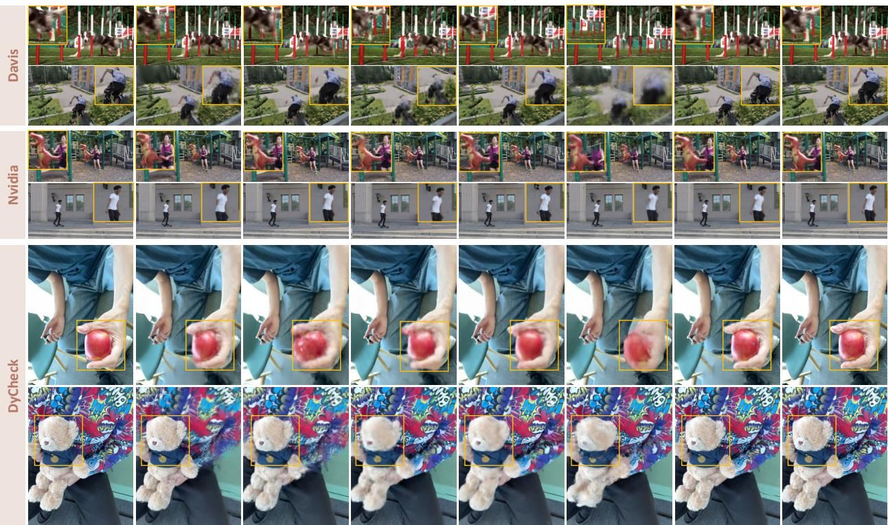  
Figure 3. Qualitative comparisons on DyCheck, NVIDIA, and DAVIS. Ground-truth held-out views are shown for DyCheck and NVIDIA; DAVIS provides qualitative comparisons under rapid motion, occlusion, and non-rigid deformation.

Eficiency comparison. In terms of eficiency, RayCo4D requires 86 minutes on 200-frame DyCheck sequences, including 36 minutes for preprocessing and 50 minutes for training. Its overall runtime is comparable to the evaluated baselines. Appendix D.10 details the timing protocol and provides the complete per-method preprocessing and training breakdown in Tab. 7.

Failure cases. RayCo4D may struggle when motion changes abruptly during long observation gaps or when geometric estimates are unreliable. These challenges can lead to motion errors, geometric inconsistencies, and visible reconstruction artifacts, as shown in Appendix Sec. E.2.

## 4.3 Dissecting RayCo4D: Measurements, Dynamics, and Local Motion

We evaluate component contributions through quantitative ablations on DyCheck and NVIDIA. All ablations use the same input observations, initialization, training budget, and evaluation protocol as the full model, with only the indicated component modified.

What drives reconstruction quality? Tab. 1 evaluates four design choices. w/o MSD replaces the many-to-many measurement–state association with track-specific motion support; w/o RCQ optimizes reference queries freely in R3 instead of along their camera rays; w/o WNOA factor removes the process coupling between neighboring pose–velocity states; and w/o ARM disables the reference-anchored local residual. Removing MSD causes the largest mPSNR/PSNR drops: 1.35 dB on DyCheck and 1.33 dB on NVIDIA, with a 37.8% increase in NVIDIA LPIPS relative to the full model. The less distinct horse limb boundaries in Fig. 4 further illustrate the importance of shared motion support. Removing RCQ or the WNOA factor lowers mPSNR/PSNR by more than 1 dB on both datasets and increases NVIDIA LPIPS by

26.7% and 22.2%, respectively. Their visual efects are complementary: removing RCQ blurs the dancer’s extended limbs, whereas removing the WNOA factor blurs the umbrella’s outline and colored panel boundaries. Together, these results support the roles of ray constraints and temporal coupling in recovering coherent shared geometry. Removing ARM has a smaller efect on whole-image fidelity, reducing mPSNR/PSNR by 0.18/0.17 dB on DyCheck/NVIDIA, but still increases mLPIPS/LPIPS by 2.5%/8.9%. The sharper limb contours in the jumping example with ARM illustrate its contribution to localized deformation beyond the shared motion scafold.

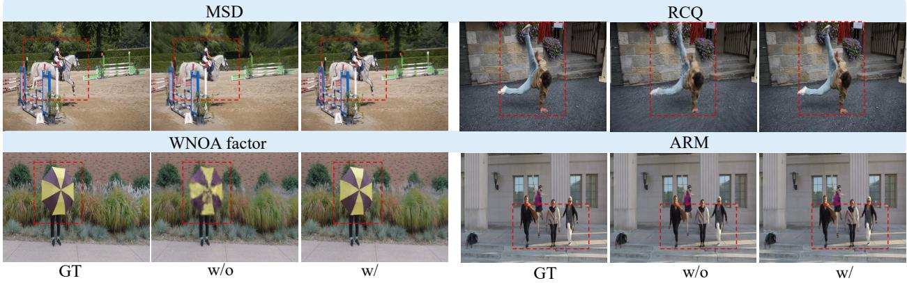  
Figure 4. Qualitative ablations on NVIDIA and DAVIS. Comparisons with the full model illustrate the efects of individual components on structural coherence and fine-scale deformation.

Motion correspondence. Tab. 2 evaluates motion correspondence on DyCheck by projecting reconstructed 3D motion queries into target frames. RayCo4D achieves a PCK-T of 0.840, yielding relative improvements of 1.0% over SE(3) B-splineGS and 2.2% over MoSca. These gains suggest that the shared motion representation more accurately transports scene points across frames, comple-

Table 2. Motion correspondence on DyCheck (PCK-T↑). Best result is highlighted in bold.
<table><tr><td>MoSca (Lei et al., 2025)</td><td>OriGS (Wu et al., 2025)</td><td>SE(3) B-splineGS (Żhang et al., 2026)</td><td>RayCo4D</td></tr><tr><td>0.822</td><td>0.826</td><td>0.832</td><td>0.840</td></tr></table>

menting the rendering results with evidence of improved motion correspondence. This finding is consistent with the role of shared latent states in integrating track observations across diferent visibility intervals

Intermediate-time reconstruction. Tab. 3 evaluates NVIDIA intermediate frames withheld from image, track, and depth supervision during training. Under the same temporal subsampling protocol, RayCo4D outperforms SE(3) B-splineGS by 1.11 dB in PSNR, increases SSIM by 1.9%, and reduces LPIPS by 25.9%. These gains indicate improved reconstruction at unobserved timestamps, particularly in perceptual quality.

Table 3. Intermediate-time reconstruction on NVIDIA. Best result is highlighted in bold.
<table><tr><td>Method</td><td>PSNR↑</td><td>SSIM↑</td><td>LPIPS↓</td></tr><tr><td>SE(3) B-splineGS</td><td>25.76</td><td>0.835</td><td>0.081</td></tr><tr><td>[41]</td><td></td><td></td><td></td></tr><tr><td>RayCo4D</td><td>26.87</td><td>0.851</td><td>0.060</td></tr></table>

## 5 Conclusion

We presented RayCo4D, a ray-conditioned continuous motion model for monocular 4D reconstruction. RayCo4D utilizes 2D tracks together with camera-depth geometry to constrain shared latent motion nodes through local many-to many associations. Sparse SE(3) pose–velocity states, coupled by a white-noise-on-acceleration process prior, form continuous node trajectories that integrate evidence across diferent visibility intervals. The inferred motion is propagated to dynamic Gaussians through dual-quaternion blending, while reference-anchored local SE(3) corrections capture fine-grained non-rigid deformation. Experiments on DyCheck and NVIDIA scenes demonstrate competitive novel-view synthesis quality and improved novel-view synthesis, motion correspondence, and intermediate-time reconstruction. Our results validate that separating visual measurements from latent motion states provides a coherent and robust foundation for monocular 4D reconstruction.

## References

[1] Sean Anderson and Timothy D Barfoot. Full steam ahead: Exactly sparse gaussian process regression for batch continuous-time trajectory estimation on se (3). In 2015 IEEE/RSJ International Conference on Intelligent Robots and Systems (IROS), pp. 157–164. IEEE, 2015.

[2] Arnold Caleb Asiimwe and Carl Vondrick. EvoGS: 4D gaussian splatting as a learned dynamical system, 2025. URL https://arxiv.org/abs/2512.19648.

[3] Timothy D. Barfoot. State Estimation for Robotics. Cambridge University Press, 2 edition, 2024. doi: 10.1017/9781009299909.

[4] Timothy D. Barfoot, Chi Hay Tong, and Simo Sarkk¨ a. Batch continuous-time trajectory estimation as exactly¨ sparse gaussian process regression. In Proceedings ofRobotics: Science and Systems, 2014. doi: 10.15607/RSS. 2014.X.001.

[5] Junli Deng, Ping Shi, Yihao Luo, and Qipei Li. Gaussians on their way: Wasserstein-constrained 4D gaussian splatting with state-space modeling. Computer Graphics Forum, 44(7):e70271, 2025. doi: 10.1111/cgf.70271.

[6] Carl Doersch, Pauline Luc, Yi Yang, Dilara Gokay, Skanda Koppula, Ankush Gupta, Joseph Heyward, Ignacio Rocco, Ross Goroshin, Joao Carreira, and Andrew Zisserman. BootsTAP: Bootstrapped training for tracking-any-˜ point. arXiv preprint arXiv:2402.00847, 2024.

[7] Hang Gao, Ruilong Li, Shubham Tulsiani, Bryan Russell, and Angjoo Kanazawa. Monocular dynamic view synthesis: A reality check. In Advances in Neural Information Processing Systems, volume 35, pp. 33768–33780, 2022.

[8] Fengzhi Guo, Chih-Chuan Hsu, Sihao Ding, and Cheng Zhang. Uncertainty matters in dynamic gaussian splatting for monocular 4D reconstruction. In International Conference on Learning Representations, 2026.

[9] Jiaxin Guo, Tongfan Guan, Wenzhen Dong, Wenzhao Zheng, Wenting Wang, Yue Wang, Yeung Yam, and Yun-Hui Liu. SaLon3R: Structure-aware long-term feedforward 3D reconstruction from unposed images. International Journal ofComputer Vision, 134:383, 2026. doi: 10.1007/s11263-026-02965-2.

[10] Zebin He, Mingxin Yang, Shuhui Yang, Zeqiang Lai, Xiangyu Yue, Chunchao Guo, and Wenhan Luo. MaterialMVP++: High-quality material generation with neural bump estimation via multi-view PBR difusion. IEEE Transactions on Pattern Analysis and Machine Intelligence, pp. 1–18, 2026. doi: 10.1109/TPAMI.2026.3742072.

[11] Xianliang Huang, Chen Xiao, Yuanxiang Ni, Guanming Liu, Mingkai Liu, Dikai Fan, Xiao Liu, and Hao Zhang. Semantic-guided progressive object removal with gaussian splatting. arXiv preprint arXiv:2607.04144, 2026.

[12] Yueru Jia, Jiaming Liu, Sixiang Chen, Chenyang Gu, Zhilve Wang, Longzan Luo, Xiaoqi Li, Pengwei Wang, Zhongyuan Wang, Renrui Zhang, et al. Lift3d policy: Lifting 2d foundation models for robust 3d robotic manipulation. In 2025 IEEE/CVF Conference on Computer Vision and Pattern Recognition (CVPR), pp. 17347–17358. IEEE, 2025.

[13] Nikita Karaev, Ignacio Rocco, Benjamin Graham, Natalia Neverova, Andrea Vedaldi, and Christian Rupprecht. Cotracker: It is better to track together. In European conference on computer vision, pp. 18–35. Springer, 2024.

[14] Ladislav Kavan, Steven Collins, Jiˇr´ı Zˇ ara, and Carol O’Sullivan. Skinning with dual quaternions. In´ Proceedings of the 2007 Symposium on Interactive 3D Graphics and Games, pp. 39–46, 2007.

[15] Bernhard Kerbl, Georgios Kopanas, Thomas Leimk¨uhler, and George Drettakis. 3D gaussian splatting for real-time radiance field rendering. ACM Transactions on Graphics, 42(4):139:1–139:14, 2023. doi: 10.1145/3592433.

[16] Mijeong Kim, Jungtaek Kim, and Bohyung Han. GP-4DGS: Probabilistic 4D gaussian splatting from monocular video via variational gaussian processes. In Proceedings ofthe IEEE/CVF Conference on Computer Vision and Pattern Recognition, pp. 33394–33403, 2026.

[17] Diederik P. Kingma and Jimmy Ba. Adam: A method for stochastic optimization. In International Conference on Learning Representations, 2015.

[18] Jiahui Lei, Yijia Weng, Adam W. Harley, Leonidas Guibas, and Kostas Daniilidis. Mosca: Dynamic gaussian fusion from casual videos via 4d motion scafolds. In Proceedings ofthe IEEE/CVF Conference on Computer Vision and Pattern Recognition, pp. 6165–6177, 2025.

[19] Haotong Lin, Sili Chen, Junhao Liew, Donny Y Chen, Zhenyu Li, Guang Shi, Jiashi Feng, and Bingyi Kang. Depth anything 3: Recovering the visual space from any views. arXiv preprint arXiv:2511.10647, 2025.

[20] Yuanxiang Ni, Xianliang Huang, Chenhang Ma, Chen Xiao, Yuewen Ma, Ruxin Wang, and Hao Zhang. Cogeo-gs: Concept-driven and geometry-aware multi-object removal in 3d scenes. arXiv preprint arXiv:2608.26656, 2026.

[21] Jongmin Park, Minh-Quan Viet Bui, Juan Luis Gonzalez Bello, Jaeho Moon, Jihyong Oh, and Munchurl Kim. SplineGS: Robust motion-adaptive spline for real-time dynamic 3D gaussians from monocular video. In Proceedings ofthe IEEE/CVF Conference on Computer Vision and Pattern Recognition, pp. 26866–26875, 2025.

[22] Jongmin Park, Jeonghwan Yun, Minh-Quan Viet Bui, and Munchurl Kim. WebSpline: Structure-informed splines for real-time 3D gaussians from monocular videos, 2026. URL https://arxiv.org/abs/2606.02096.

[23] Federico Perazzi, Jordi Pont-Tuset, Brian McWilliams, Luc Van Gool, Markus Gross, and Alexander Sorkine-Hornung. A benchmark dataset and evaluation methodology for video object segmentation. In Proceedings ofthe IEEE Conference on Computer Vision and Pattern Recognition, pp. 724–732, 2016.

[24] Zhijian Shu, Cheng Lin, Tao Xie, Wei Yin, Ben Li, Zhiyuan Pu, Weize Li, Yao Yao, Xun Cao, Xiaoyang Guo, and Xiao-Xiao Long. LiteVGGT: Boosting vanilla VGGT via geometry-aware cached token merging. In Proceedings ofthe IEEE/CVF Conference on Computer Vision and Pattern Recognition, pp. 36422–36432, 2026.

[25] Chan Hee Song, Valts Blukis, Jonathan Tremblay, Stephen Tyree, Yu Su, and Stan Birchfield. Robospatial: Teaching spatial understanding to 2d and 3d vision-language models for robotics. In 2025 IEEE/CVF Conference on Computer Vision and Pattern Recognition (CVPR), pp. 15768–15780. IEEE, 2025.

[26] Zachary Teed and Jia Deng. RAFT: Recurrent all-pairs field transforms for optical flow. In European Conference on Computer Vision, 2020.

[27] Daniel Wang, Patrick Rim, Tian Tian, Dong Lao, Alex Wong, and Ganesh Sundaramoorthi. ODE-GS: Latent ODEs for dynamic scene extrapolation with 3D gaussian splatting. In International Conference on Learning Representations, 2026.

[28] Qianqian Wang, Vickie Ye, Hang Gao, Weijia Zeng, Jake Austin, Zhengqi Li, and Angjoo Kanazawa. Shape of motion: 4D reconstruction from a single video. In Proceedings ofthe IEEE/CVF International Conference on Computer Vision, pp. 9660–9672, 2025.

[29] Xuezhen Wang, Li Ma, Yulin Shen, Zeyu Wang, and Pedro V. Sander. RetimeGS: Continuous-time reconstruction of 4D gaussian splatting. In Proceedings ofthe IEEE/CVF Conference on Computer Vision and Pattern Recognition, pp. 7340–7350, 2026.

[30] Zhou Wang, Alan C Bovik, Hamid R Sheikh, and Eero P Simoncelli. Image quality assessment: from error visibility to structural similarity. IEEE Transactions on Image Processing, 13(4):600–612, 2004.

[31] Chenyu Wu, Wanhua Li, Zhu-Tian Chen, and Hanspeter Pfister. RiGS: Rigid-aware 4D gaussian splatting from a single monocular video, 2026. URL https://arxiv.org/abs/2605.23672.

[32] Guanjun Wu, Taoran Yi, Jiemin Fang, Lingxi Xie, Xiaopeng Zhang, Wei Wei, Wenyu Liu, Qi Tian, and Xinggang Wang. 4D gaussian splatting for real-time dynamic scene rendering. In Proceedings of the IEEE/CVF Conference on Computer Vision and Pattern Recognition, pp. 20310–20320, 2024.

[33] Junyi Wu, Jiachen Tao, Haoxuan Wang, Gaowen Liu, Ramana Rao Kompella, and Yan Yan. Orientation-anchored hyper-gaussian for 4D reconstruction from casual videos. In Advances in Neural Information Processing Systems, volume 38, pp. 159962–159985, 2025. doi: 10.52202/085713-4826.

[34] Rundi Wu, Ruiqi Gao, Ben Poole, Alex Trevithick, Changxi Zheng, Jonathan T Barron, and Aleksander Holynski. Cat4d: Create anything in 4d with multi-view video difusion models. In Proceedings ofthe IEEE/CVF Conference on Computer Vision and Pattern Recognition, pp. 26057–26068, 2025.

[35] Jiawei Xu, Zexin Fan, Jian Yang, and Jin Xie. Grid4D: 4D decomposed hash encoding for high-fidelity dynamic gaussian splatting. In Advances in Neural Information Processing Systems, volume 37, 2024.

[36] Jiawei Xu, Kai Deng, Zexin Fan, Shenlong Wang, Jin Xie, and Jian Yang. AD-GS: Object-aware B-Spline gaussian splatting for self-supervised autonomous driving. In Proceedings of the IEEE/CVF International Conference on Computer Vision, pp. 24770–24779, 2025.

[37] Jinbo Yan, Rui Peng, Zhiyan Wang, Luyang Tang, Jiayu Yang, Jie Liang, Jiahao Wu, and Ronggang Wang. Instant gaussian stream: Fast and generalizable streaming of dynamic scene reconstruction via gaussian splatting. In 2025 IEEE/CVF Conference on Computer Vision and Pattern Recognition (CVPR), pp. 16520–16531. IEEE, 2025.

[38] Ziyi Yang, Xinyu Gao, Wen Zhou, Shaohui Jiao, Yuqing Zhang, and Xiaogang Jin. Deformable 3D gaussians for high-fidelity monocular dynamic scene reconstruction. In Proceedings ofthe IEEE/CVF Conference on Computer Vision and Pattern Recognition, pp. 20331–20341, 2024.

[39] Jae Shin Yoon, Kihwan Kim, Orazio Gallo, Hyun Soo Park, and Jan Kautz. Novel view synthesis of dynamic scenes with globally coherent depths from a monocular camera. In Proceedings of the IEEE/CVF Conference on Computer Vision and Pattern Recognition, pp. 5336–5345, 2020.

[40] Richard Zhang, Phillip Isola, Alexei A Efros, Eli Shechtman, and Oliver Wang. The unreasonable efectiveness of deep features as a perceptual metric. In Proceedings of the IEEE Conference on Computer Vision and Pattern Recognition, pp. 586–595, 2018.

[41] Xuankai Zhang, Junjin Xiao, Shangwei Huang, Wei-shi Zheng, and Qing Zhang. Learning explicit continuou motion representation for dynamic gaussian splatting from monocular videos. In Proceedings ofthe IEEE/CVF Conference on Computer Vision and Pattern Recognition, pp. 33291–33300, 2026.

[42] Jingke Zhou, Chenhang Ma, Zhizhou Zhong, Mingkai Liu, Zhuang Zhou, Binghua Su, Bo Cai, Xianliang Huang, et al. Think locally, refine globally for memory-eficient 3d reconstruction. arXiv preprint arXiv:2609.21437, 2026.

[43] Zijie Zhu, Weiren Cai, Yizhou Wang, Zhenjie Yang, Yide Liu, Jiahao Chen, and Guanqi He. MINT: A unified model for world-space camera and hand motion estimation from scalable egocentric pipeline supervision. arXiv preprint arXiv:2609.04958, 2026. URL https://arxiv.org/abs/2609.04958.

## Supplementary Material

This supplementary material provides additional details and results for RayCo4D. Sections A and B present additional related work and notation. Section C derives the WNOA formulation and its continuous-time interpolation. Section D describes hierarchical Gaussian reconstruction, training, evaluation protocols, and runtime. Sections E and F present additional experimental results, challenging cases, and scene-wise qualitative comparisons.

## A Additional Related Work

Spatial structure and motion sharing. Recent structured representations address diferent aspects of dynamic scene complexity. OriGS [33] uses a Global Orientation Field to organize region-specific deformations. RiGS [31] separates static, rigid, and transient Gaussians to accommodate motion at diferent temporal scales. USPLAT4D [8] constructs a spatio-temporal motion graph using per-Gaussian uncertainty, propagating reliable motion cues toward weakly observed regions. RayCo4D organizes spatial sharing through local track–node associations: reference queries retain their geometric parameters, while shared node states encode time-varying motion.

Spline trajectories and local refinement. Beyond SplineGS [21] and SE(3) B-splineGS [41], WebSpline [22] initializes a Structural Proxy Graph from 2D tracks to regularize per-Gaussian Hermite trajectories. RetimeGS [29] defines continuous-time Gaussian behavior for temporal retiming and intermediate-time rendering. RayCo4D also uses cubic Hermite expressions, at two distinct levels: the WNOA conditional mean interpolates shared pose–velocity states in a local SE(3) chart, and per-Gaussian Hermite curves parameterize reference-anchored local corrections. The shared process factors and local residual constraints determine how these temporal representations are estimated and combined.

Probabilistic and dynamical formulations. GP-4DGS [16] models spatio-temporal deformation correlations through variational Gaussian processes, supporting uncertainty estimation and temporal extrapolation. Gaussians on their Way [5] treats Gaussian means and covariances as dynamic states and fuses motion predictions with deformation observations. EvoGS [2] integrates a learned velocity field, while ODE-GS [27] evolves latent states derived from reconstructed Gaussian trajectories through a Neural ODE. RayCo4D places its WNOA prior on sparse shared SE(3) pose–velocity states. Ray-conditioned measurements constrain these states through local associations, and their continuous transformations drive the dense Gaussian representation.

## B Notation

Tab. 4 summarizes the main symbols. Time $t \in [ 0 , F - 1 ]$ is measured in frame units, with noninteger values denoting subframe times. All rigid transformations act on column vectors: $\mathbf { T } \cdot \mathbf { x } = \mathbf { R } \mathbf { x } + \mathbf { p }$ for $\mathbf { T } = [ \mathbf { R } , \mathbf { p } ] \in \mathrm { S E } ( 3 )$ , and transformation products act from right to left. Twists are ordered as translation followed by rotation, with body velocity defined by ${ \dot { \mathbf { T } } } ( t ) = \mathbf { T } ( t ) \nu ( t ) ^ { \wedge }$ . The operators $( \cdot ) ^ { \wedge }$ and $( \cdot ) ^ { \vee }$ convert between six-dimensional vectors and $\mathfrak { s e } ( 3 )$ matrices; Exp and Log denote the group exponential and local logarithm.

For camera-to-world pose $\mathbf { C } _ { f } = [ \mathbf { R } _ { f } ^ { c } , \mathbf { c } _ { f } ]$ and intrinsics $\mathbf { K } _ { f }$ , the image projection and camera-axis depth of a world point x are

$$
\begin{array} { r l } & { \pi _ { f } ( \mathbf { x } ) = \pi \Big ( \mathbf { K } _ { f } ( \mathbf { R } _ { f } ^ { c } ) ^ { \top } ( \mathbf { x } - \mathbf { c } _ { f } ) \Big ) , } \\ & { z _ { f } ( \mathbf { x } ) = \mathbf { e } _ { 3 } ^ { \top } ( \mathbf { R } _ { f } ^ { c } ) ^ { \top } ( \mathbf { x } - \mathbf { c } _ { f } ) , } \end{array}\tag{12}
$$

where $\pi ( [ x , y , z ] ^ { \top } ) = [ x / z , y / z ] ^ { \top }$ and $\mathbf { e } _ { 3 } = [ 0 , 0 , 1 ] ^ { \top }$ . Depth denotes the camera-axis coordinate rather than Euclidean distance to the camera center.

## C Full WNOA Formulation

This section provides the complete formulation of the continuous-time white-noise-on-acceleration process used in RayCo4D. Twists are ordered as translation followed by rotation, body velocities satisfy ${ \dot { \mathbf { T } } } ( t ) = \mathbf { T } ( t ) \nu ( t ) ^ { \wedge }$ , and time is measured in video-frame units.

Table 4. Main notation used in RayCo4D. Symbols are grouped by their roles in the representation.
<table><tr><td>Symbol</td><td>Meaning</td></tr><tr><td>Indices and time</td><td></td></tr><tr><td> $f , i , j , g , k$ </td><td>Frame, track, motion-node, Gaussian, and support-time indices.</td></tr><tr><td> $F , M , S$ </td><td>Numbers of video frames, motion nodes, and temporal supports.</td></tr><tr><td> $t , \tau _ { k } , \Delta _ { k }$ </td><td>Query time, support time, and interval  $\Delta _ { k } = \tau _ { k + 1 } - \tau _ { k }$ </td></tr><tr><td> $r _ { i } , r _ { g }$ </td><td>Reference times of track i and Gaussian g.</td></tr><tr><td>i</td><td>Normalized time  $t / \operatorname* { m a x } ( F - 1 , 1 )$  for local motion curves.</td></tr><tr><td>Measurements and associations</td><td></td></tr><tr><td> $\mathbf { C } _ { f } , \mathbf { K } _ { f }$ </td><td>Camera-to-world pose and camera intrinsics</td></tr><tr><td> ${ \bf u } _ { i f } , c _ { i f }$ </td><td>Observed track pixel and its confidence.</td></tr><tr><td> $\widetilde { \mathbf { u } } _ { i f }$ </td><td>Homogeneous pixel coordinate  $[ \mathbf { u } _ { i f } ^ { \top } , 1 ] ^ { \top }$ </td></tr><tr><td> $O _ { u } , O _ { d }$ </td><td>Visible observations and the subset with valid depth.</td></tr><tr><td> ${ \bf q } _ { i } , \widehat { { \bf x } } _ { i } ( t )$ </td><td>Reference query in world space and its predicted position at t.</td></tr><tr><td> $d _ { i } ^ { 0 } , z _ { i } , \eta _ { i }$ </td><td>Initial query depth, optimized camera-axis depth, and scalar depth parameter.</td></tr><tr><td> $N _ { i } , a _ { i j }$ </td><td>Track-to-node neighborhood and normalized association weight.</td></tr><tr><td> $K , \sigma _ { j }$ </td><td>Number of neighboring nodes and node influence radius.</td></tr><tr><td>Continuous shared motion</td><td></td></tr><tr><td> $\mathbf { T } _ { j } ( t )$ </td><td>Continuous rigid pose of motion node  $j .$ </td></tr><tr><td> $\mathbf { T } _ { j k } , \nu _ { j k }$ </td><td>Node pose and body-frame velocity at  $\tau _ { k } .$ </td></tr><tr><td> $\xi _ { j k } ( t )$ </td><td>Local pose coordinate Log  $( \mathbf { T } _ { j k } ^ { - 1 } \mathbf { T } _ { j } ( t ) ) ^ { \vee } .$ </td></tr><tr><td> ${ \bf J } _ { r }$ </td><td>Right Jacobian of  ${ \mathrm { S E } } ( 3 )$ </td></tr><tr><td> $\mathbf { e } _ { j k }$ </td><td>Neighboring-state  $\mathrm { W N O A }$  residual in  $\mathbb { R } ^ { 1 2 } .$ </td></tr><tr><td> $\mathbf { Q } _ { c } , \mathbf { Q } _ { k }$ </td><td>Acceleration spectral-density matrix and integrated process covariance over  $\Delta _ { k }$ </td></tr><tr><td> $\ell$ </td><td>Characteristic spatial scale of the motion scaffold.</td></tr><tr><td>Hierarchical Gaussian motion</td><td></td></tr><tr><td> ${ \bf P } _ { g } ^ { \mathrm { r e f } } , { \bf P } _ { g } ( t )$ </td><td>Reference Gaussian pose and composed pose at time t.</td></tr><tr><td> $N _ { g } , \overline { { a } } _ { g j }$ </td><td>Gaussian-to-node neighborhood and normalized binding weight</td></tr><tr><td> $a _ { g j } ^ { \mathrm { g e o } } , b _ { g j }$ </td><td>Geometric binding weight and learnable logit offset.</td></tr><tr><td> $\mathrm { D Q B }$ </td><td>Dual-quaternion blending of rigid transformations.</td></tr><tr><td> ${ \bf A } _ { g } ( t ) , { \bf E } _ { g } ( t )$ </td><td>Shared motion transform and reference-anchored local residual.</td></tr><tr><td> ${ \bf h } _ { g } , \delta _ { g } ( t )$ </td><td>Local motion curve and anchored increment  $\mathbf { h } _ { g } ( \bar { t } ) - \mathbf { h } _ { g } ( \bar { r } _ { g } )$ </td></tr><tr><td> $\mathbf { D } _ { \ell }$ </td><td>Translation-scaling matrix  $\mathrm { d i a g } ( \ell \mathbf { I } _ { 3 } , \mathbf { I } _ { 3 } )$ </td></tr></table>

## C.1 Local Coordinates on SE(3)

Consider node � over the support interval $[ \tau _ { k } , \tau _ { k + 1 } ]$ . We define a local tangent-space trajectory centered at the left endpoint:

$$
\begin{array} { r } { \pmb { \xi } _ { j k } ( t ) = \mathrm { L o g } \Big ( \mathbf { T } _ { j k } ^ { - 1 } \mathbf { T } _ { j } ( t ) \Big ) ^ { \vee } . } \end{array}\tag{13}
$$

The derivative of this local coordinate is related to the body-frame velocity through the right Jacobian:

$$
\dot { \xi } _ { j k } ( t ) = \mathbf { J } _ { r } \big ( \xi _ { j k } ( t ) \big ) ^ { - 1 } \nu _ { j } ( t ) .\tag{14}
$$

At the left endpoint, $\pmb { \xi } _ { j k } ( \tau _ { k } ) = \mathbf { 0 }$ , and hence

$$
\dot { \xi } _ { j k } ( \tau _ { k } ) = \nu _ { j k } .\tag{15}
$$

At the right endpoint, define

$$
\begin{array} { r } { \boldsymbol { \xi } _ { j k } ^ { + } = \mathrm { L o g } \left( \mathbf { T } _ { j k } ^ { - 1 } \mathbf { T } _ { j , k + 1 } \right) ^ { \vee } , } \end{array}
$$

$$
\begin{array} { r } { \widetilde { \nu } _ { j , k + 1 } = \mathbf { J } _ { r } ( \pmb { \xi } _ { j k } ^ { + } ) ^ { - 1 } \pmb { \nu } _ { j , k + 1 } . } \end{array}\tag{16}
$$

The transformed velocity $\widetilde \nu _ { j , k + 1 }$ is the derivative of the local coordinate at the right endpoint. It allows both endpoint velocities to be compared in the same tangent space.

## C.2 Linear WNOA Process in the Local Chart

We concatenate local pose and velocity into the state

$$
\gamma _ { j k } ( t ) = \left[ \sum _ { \dot { \xi } _ { j k } ( t ) } \right] \in \mathbb { R } ^ { 1 2 } .\tag{17}
$$

The WNOA process assumes

$$
\ddot { \xi } _ { j k } ( t ) = \mathbf { w } ( t ) , \qquad \mathbb { E } [ \mathbf { w } ( t ) \mathbf { w } ( t ^ { \prime } ) ^ { \top } ] = \mathbf { Q } _ { c } \delta ( t - t ^ { \prime } ) ,\tag{18}
$$

which gives the linear time-invariant stochastic diferential equation

$$
{ \dot { \gamma } } _ { j k } ( t ) = \underbrace { \left[ \mathbf { 0 } \quad \mathbf { I } _ { 6 } \right] } _ { \mathbf { A } } \gamma _ { j k } ( t ) + \underbrace { \left[ \mathbf { 0 } \right] } _ { \mathbf { L } } \mathbf { w } ( t ) .\tag{19}
$$

For a time interval of length �, the state-transition matrix is

$$
\Phi ( \delta ) = \exp ( \mathbf { A } \delta ) = \left[ \begin{array} { c c } { \mathbf { I } _ { 6 } } & { \delta \mathbf { I } _ { 6 } } \\ { \mathbf { 0 } } & { \mathbf { I } _ { 6 } } \end{array} \right] .\tag{20}
$$

Integrating the white acceleration noise gives the process covariance

$$
\begin{array} { l } { { \displaystyle { \bf Q } ( \delta ) = \int _ { 0 } ^ { \delta } { \bf \Phi } { \bf { \Phi } } \ { \bf { \Phi } } ( \delta - s ) { \bf L } { \bf Q } _ { c } { \bf L } ^ { \top } { \bf \Phi } { \bf { \Phi } } ( \delta - s ) ^ { \top } \mathrm { d } s } \ ~ } \\ { { \displaystyle ~ = \left[ \frac { \delta ^ { 3 } } { 3 } { \bf Q } _ { c } \quad \frac { \delta ^ { 2 } } { 2 } { \bf Q } _ { c } \right] . } \ ~ } \end{array}\tag{21}
$$

We use separate acceleration spectral densities for translation and rotation:

$$
\mathbf { Q } _ { c } = \mathrm { d i a g } \left( q _ { p } \ell ^ { 2 } \mathbf { I } _ { 3 } , q _ { R } \mathbf { I } _ { 3 } \right) ,\tag{22}
$$

where ℓ is the characteristic spatial scale of the motion scafold. Equivalently, translational pose and velocity residuals can be normalized by ℓ before applying the density $q _ { p }$

The endpoint states in the local chart are

$$
\gamma _ { j k } ^ { - } = \left[ \begin{array} { c c } { { { \bf 0 } } } \\ { { \nu _ { j k } } } \end{array} \right] , \qquad \gamma _ { j k } ^ { + } = \left[ \begin{array} { c c } { { \xi _ { j k } ^ { + } } } \\ { { \widetilde { \nu } _ { j , k + 1 } } } \end{array} \right] .\tag{23}
$$

For $\Delta _ { k } = \tau _ { k + 1 } - \tau _ { k }$ , the transition residual becomes

$$
\begin{array} { r } { \mathbf { e } _ { j k } = \boldsymbol { \gamma } _ { j k } ^ { + } - \boldsymbol { \Phi } ( \Delta _ { k } ) \boldsymbol { \gamma } _ { j k } ^ { - } } \\ { = \left[ \boldsymbol { \xi } _ { j k } ^ { + } - \Delta _ { k } \boldsymbol { \nu } _ { j k } \right] . } \end{array}\tag{24}
$$

The corresponding process objective is

$$
\mathcal { L } _ { \mathrm { W N O A } } = \frac { 1 } { 3 M ( S - 1 ) } \sum _ { j = 1 } ^ { M } \sum _ { k = 0 } ^ { S - 2 } \mathbf { e } _ { j k } ^ { \intercal } \mathbf { Q } ( \Delta _ { k } ) ^ { - 1 } \mathbf { e } _ { j k } .\tag{25}
$$

Equivalent implementation form. Let

$$
\mathbf { e } _ { j k } ^ { p } = \pmb { \xi } _ { j k } ^ { + } - \Delta _ { k } \pmb { \nu } _ { j k } , \qquad \mathbf { e } _ { j k } ^ { \nu } = \widetilde { \nu } _ { j , k + 1 } - \pmb { \nu } _ { j k } .\tag{26}
$$

The full covariance-weighted quadratic can be evaluated without explicitly forming $\mathbf { Q } ( \Delta _ { k } ) ^ { - 1 }$ . For translation, the equivalent energy is

$$
\mathscr { E } _ { j k } ^ { \mathrm { t r a n s } } = \frac { 1 2 } { q _ { p } \Delta _ { k } ^ { 3 } } \left\| \frac { \mathbf { e } _ { j k , 1 ; 3 } ^ { p } - \frac { \Delta _ { k } } { 2 } \mathbf { e } _ { j k , 1 ; 3 } ^ { v } } { \ell } \right\| _ { 2 } ^ { 2 } + \frac { 1 } { q _ { p } \Delta _ { k } } \left\| \frac { \mathbf { e } _ { j k , 1 ; 3 } ^ { v } } { \ell } \right\| _ { 2 } ^ { 2 } ,\tag{27}
$$

and the rotational energy is

$$
\mathcal { E } _ { j k } ^ { \mathrm { r o t } } = \frac { 1 2 } { q _ { R } \Delta _ { k } ^ { 3 } } \left\| \mathbf { e } _ { j k , 4 : 6 } ^ { p } - \frac { \Delta _ { k } } { 2 } \mathbf { e } _ { j k , 4 : 6 } ^ { \nu } \right\| _ { 2 } ^ { 2 } + \frac { 1 } { q _ { R } \Delta _ { k } } \left\| \mathbf { e } _ { j k , 4 : 6 } ^ { \nu } \right\| _ { 2 } ^ { 2 } .\tag{28}
$$

Equations (27) and (28) are algebraically equivalent to the quadratic form in Eq. (25).

## C.3 Continuous-Time Conditional Mean

For a query time $t \in \left[ \tau _ { k } , \tau _ { k + 1 } \right]$ , let

$$
\delta = t - \tau _ { k } , \quad \quad \Delta _ { k } = \tau _ { k + 1 } - \tau _ { k } , \quad \quad s = \frac { \delta } { \Delta _ { k } } .\tag{29}
$$

The conditional mean of the linear WNOA process can be written as

$$
\begin{array} { r l } & { \overline { { \gamma } } _ { j k } ( t ) = \Phi ( \delta ) \gamma _ { j k } ^ { - } } \\ & { \qquad + \mathbf { Q } ( \delta ) \Phi ( \Delta _ { k } - \delta ) ^ { \top } \mathbf { Q } ( \Delta _ { k } ) ^ { - 1 } \left( \gamma _ { j k } ^ { + } - \Phi ( \Delta _ { k } ) \gamma _ { j k } ^ { - } \right) . } \end{array}\tag{30}
$$

For WNOA, the pose component of Eq. (30) reduces to cubic Hermite interpolation. The basis functions are

$$
\begin{array} { l l } { { h _ { 0 0 } ( s ) = 2 s ^ { 3 } - 3 s ^ { 2 } + 1 , } } & { { h _ { 1 0 } ( s ) = s ^ { 3 } - 2 s ^ { 2 } + s , } } \\ { { } } & { { h _ { 0 1 } ( s ) = - 2 s ^ { 3 } + 3 s ^ { 2 } , } } \end{array}\tag{31}
$$

Because the local pose at the left endpoint is zero, the ℎ00 term vanishes, giving

$$
\overline { { \xi } } _ { j k } ( t ) = h _ { 1 0 } ( s ) \Delta _ { k } \pmb { \nu } _ { j k } + h _ { 0 1 } ( s ) \pmb { \xi } _ { j k } ^ { + } + h _ { 1 1 } ( s ) \Delta _ { k } \widetilde { \pmb { \nu } } _ { j , k + 1 } .\tag{32}
$$

The continuous pose is then recovered on the group:

$$
\mathbf { T } _ { j } ( t ) = \mathbf { T } _ { j k } \operatorname { E x p } \left( \overline { { \xi } } _ { j k } ( t ) ^ { \wedge } \right) .\tag{33}
$$

For completeness, diferentiating the Hermite curve gives

$$
\begin{array} { r } { \dot { \overline { { \xi } } } _ { j k } ( t ) = \displaystyle \frac { 1 } { \Delta _ { k } } \Big [ h _ { 1 0 } ^ { \prime } ( s ) \Delta _ { k } \nu _ { j k } + h _ { 0 1 } ^ { \prime } ( s ) \xi _ { j k } ^ { + } } \\ { + h _ { 1 1 } ^ { \prime } ( s ) \Delta _ { k } \widetilde { \nu } _ { j , k + 1 } \Big ] , } \end{array}\tag{34}
$$

and the corresponding body velocity is

$$
\begin{array} { r } { \pmb { \nu } _ { j } ( t ) = \mathbf { J } _ { r } \left( \overline { { \pmb { \xi } } } _ { j k } ( t ) \right) \dot { \overline { { \xi } } } _ { j k } ( t ) . } \end{array}\tag{35}
$$

This construction satisfies

$$
\begin{array} { r } { \mathbf T _ { j } ( \tau _ { k } ) = \mathbf T _ { j k } , \quad \mathbf T _ { j } ( \tau _ { k + 1 } ) = \mathbf T _ { j , k + 1 } , } \end{array}
$$

$$
\nu _ { j } ( \tau _ { k } ) = \nu _ { j k } , \quad \nu _ { j } ( \tau _ { k + 1 } ) = \nu _ { j , k + 1 } .\tag{36}
$$

Thus, the process factor and the continuous pose query are derived from the same pose–velocity state model.

## D Additional Details of Hierarchical Gaussian Reconstruction

## D.1 Gaussian-to-Node Binding

For Gaussian �, let $\mu _ { g } ^ { \mathrm { r e f } }$ be its reference center and $N _ { g }$ its � nearest motion nodes at reference time $r _ { g }$ . The geometric binding weights are

$$
a _ { g j } ^ { \mathrm { g e o } } = \frac { \exp \left( - \| \pmb { \mu } _ { g } ^ { \mathrm { r e f } } - \pmb { \mathbf { p } } _ { j } ( r _ { g } ) \| _ { 2 } ^ { 2 } / ( 2 \sigma _ { j } ^ { 2 } ) \right) } { \sum _ { \ell \in { \cal N } _ { g } } \exp \left( - \| \pmb { \mu } _ { g } ^ { \mathrm { r e f } } - \pmb { \mathbf { p } } _ { \ell } ( r _ { g } ) \| _ { 2 } ^ { 2 } / ( 2 \sigma _ { \ell } ^ { 2 } ) \right) } .\tag{37}
$$

Photometric fitting introduces the Gaussian-specific ofsets $b _ { g j } \colon$

$$
\overline { { a } } _ { g j } = \frac { a _ { g j } ^ { \mathrm { g e o } } \exp ( b _ { g j } ) } { \sum _ { \ell \in N _ { g } } a _ { g \ell } ^ { \mathrm { g e o } } \exp ( b _ { g \ell } ) } .\tag{38}
$$

The ofsets are initialized to zero, so $\overline { { a } } _ { g j } = a _ { g j } ^ { \mathrm { g e o } }$ at the beginning of optimization.

For each node, define the relative transformation from the Gaussian reference time to query time �:

$$
\Delta \mathbf { T } _ { g j } ( t ) = \mathbf { T } _ { j } ( t ) \mathbf { T } _ { j } ( r _ { g } ) ^ { - 1 } .\tag{39}
$$

The shared Gaussian transform is obtained by dual-quaternion blending [14]:

$$
\begin{array} { r } { \mathbf { A } _ { g } ( t ) = \mathrm { D Q B } \left( \left\{ \overline { { a } } _ { g j } , \Delta \mathbf { T } _ { g j } ( t ) \right\} _ { j \in N _ { g } } \right) . } \end{array}\tag{40}
$$

Because $\Delta \mathbf { T } _ { g j } ( r _ { g } ) = \mathbf { I }$ for every �, the blended transformation also satisfies $\mathbf { A } _ { g } ( r _ { g } ) = \mathbf { I }$

## D.2 Local Hermite Motion Parameterization

Each Gaussian stores � − 1 learnable six-dimensional controls. We prepend a fixed zero control:

$$
\begin{array} { r } { \mathbf { c } _ { g , 0 } = \mathbf { 0 } , \qquad \mathbf { c } _ { g , 1 } , \ldots , \mathbf { c } _ { g , L - 1 } \in \mathbb { R } ^ { 6 } . } \end{array}\tag{41}
$$

For normalized time $u \in [ 0 , 1 ]$ , define

$$
k = \operatorname* { m i n } ( \lfloor ( L - 1 ) u \rfloor , L - 2 ) , \qquad s = ( L - 1 ) u - k .\tag{42}
$$

Let

$$
k ^ { - } = \operatorname* { m a x } ( k - 1 , 0 ) , \qquad k ^ { + } = \operatorname* { m i n } ( k + 2 , L - 1 ) .
$$

The endpoint tangents for segment � are computed from adjacent control diferences:

$$
\begin{array} { r } { \mathbf { m } _ { g , k } = \frac { \mathbf { c } _ { g , k + 1 } - \mathbf { c } _ { g , k ^ { - } } } { k + 1 - k ^ { - } } , } \\ { \mathbf { m } _ { g , k + 1 } = \frac { \mathbf { c } _ { g , k ^ { + } } - \mathbf { c } _ { g , k } } { k ^ { + } - k } . } \end{array}\tag{43}
$$

Using the cubic Hermite bases

$$
\begin{array} { l l } { { h _ { 0 0 } ( s ) = 2 s ^ { 3 } - 3 s ^ { 2 } + 1 , } } & { { h _ { 1 0 } ( s ) = s ^ { 3 } - 2 s ^ { 2 } + s , } } \\ { { } } & { { h _ { 0 1 } ( s ) = - 2 s ^ { 3 } + 3 s ^ { 2 } , } } \end{array}\tag{44}
$$

the local curve is

$$
\begin{array} { r l } & { \mathbf { h } _ { g } ( u ) = h _ { 0 0 } ( s ) \mathbf { c } _ { g , k } + h _ { 1 0 } ( s ) \mathbf { m } _ { g , k } } \\ & { \qquad + \mathop { h _ { 0 1 } } ( s ) \mathbf { c } _ { g , k + 1 } + h _ { 1 1 } ( s ) \mathbf { m } _ { g , k + 1 } . } \end{array}\tag{45}
$$

For video time �, RayCo4D evaluates the diference

$$
\delta _ { g } ( t ) = \mathbf { h } _ { g } \left( { \frac { t } { \operatorname* { m a x } ( F - 1 , 1 ) } } \right) - \mathbf { h } _ { g } \left( { \frac { r _ { g } } { \operatorname* { m a x } ( F - 1 , 1 ) } } \right) .\tag{46}
$$

The subtraction makes the residual exactly zero at the Gaussian’s own reference time for every possible set of control values. After scaling the translational part by the scafold spatial unit ℓ, the local transform is

$$
\mathbf { E } _ { g } ( t ) = \mathrm { E x p } \Big ( \left[ \mathrm { d i a g } ( \ell \mathbf { I } _ { 3 } , \mathbf { I } _ { 3 } ) \delta _ { g } ( t ) \right] ^ { \wedge } \Big ) .\tag{47}
$$

## D.3 Local Motion Regularization

The weighted local-motion regularizer is

$$
\mathcal { L } _ { \mathrm { l o c a l } } = \lambda _ { m } \mathcal { L } _ { \mathrm { m a g } } + \lambda _ { c } \mathcal { L } _ { \mathrm { c u r v } } + \lambda _ { n } \mathcal { L } _ { \mathrm { n b r } } .\tag{48}
$$

Control magnitude. The magnitude term limits the overall capacity of the local correction:

$$
\mathcal { L } _ { \mathrm { m a g } } = \frac { 1 } { 6 G ( L - 1 ) } \sum _ { g = 1 } ^ { G } \sum _ { k = 1 } ^ { L - 1 } \| \mathbf { c } _ { g , k } \| _ { 2 } ^ { 2 } .\tag{49}
$$

Control curvature. Temporal smoothness is encouraged through second diferences of the control sequence:

$$
\mathcal { L } _ { \mathrm { c u r v } } = \frac { 1 } { 6 G ( L - 2 ) } \sum _ { g = 1 } ^ { G } \sum _ { k = 1 } ^ { L - 2 } \| \mathbf { c } _ { g , k + 1 } - 2 \mathbf { c } _ { g , k } + \mathbf { c } _ { g , k - 1 } \| _ { 2 } ^ { 2 } .\tag{50}
$$

For $L = 2$ , this term is set to zero. It acts as a smoothness prior on the control sequence.

Neighborhood consistency. Local-motion neighborhoods are constructed in a common scene configuration. We first transport every Gaussian to

$$
t _ { \star } = \lfloor F / 2 \rfloor
$$

using the shared motion only:

$$
\mathbf { P } _ { g } ^ { 0 } ( t ) = \mathbf { A } _ { g } ( t ) \mathbf { P } _ { g } ^ { \mathrm { r e f } } .\tag{51}
$$

For each Gaussian, we retain up to five nearest neighbors in this common configuration. The edge weight between Gaussians � and ℎ is

$$
\beta _ { g h } = \exp \left( - \frac { \| \pmb { \mu } _ { g } ^ { 0 } ( t _ { \star } ) - \pmb { \mu } _ { h } ^ { 0 } ( t _ { \star } ) \| _ { 2 } ^ { 2 } } { 2 \ell ^ { 2 } } \right) \frac { | N _ { g } \cap N _ { h } | } { K } .\tag{52}
$$

The first factor favors spatially close Gaussians, and the second factor measures the overlap of their shared-node support. For an adjacent-frame interval $[ a , b ]$ , define the local control incremen

$$
\Delta { \bf h } _ { g } ^ { a , b } = { \bf h } _ { g } \left( \frac { b } { \operatorname* { m a x } ( F - 1 , 1 ) } \right) - { \bf h } _ { g } \left( \frac { a } { \operatorname* { m a x } ( F - 1 , 1 ) } \right) .\tag{53}
$$

Let $\mathbf { R } _ { g } ^ { 0 } ( t )$ be the Gaussian orientation produced by shared motion at the sampled scene time �. We express the increment in a common world orientation as

$$
\mathbf { d } _ { g } ( t ) = \mathrm { d i a g } \left( \mathbf { R } _ { g } ^ { 0 } ( t ) , \mathbf { R } _ { g } ^ { 0 } ( t ) \right) \Delta \mathbf { h } _ { g } ^ { a , b } .\tag{54}
$$

The neighborhood term is

$$
\mathcal { L } _ { \mathrm { n b r } } = \frac { \sum _ { ( g , h ) } \beta _ { g h } \| \mathbf { d } _ { g } ( t ) - \mathbf { d } _ { h } ( t ) \| _ { 2 } ^ { 2 } } { 6 \sum _ { ( g , h ) } \beta _ { g h } } .\tag{55}
$$

In implementation, this objective is estimated from sampled center Gaussians and their cached neighbors.

## D.4 Dynamic Gaussian Parameters

Write the composed Gaussian pose as

$$
\mathbf { P } _ { g } ( t ) = [ \mathbf { R } _ { g } ( t ) , \mu _ { g } ( t ) ] .
$$

For a learned time-independent scale vector $\mathbf { s } _ { g } \in \mathbb { R } _ { > 0 } ^ { 3 }$ , the world-space covariance is

$$
\pmb { \Sigma } _ { g } ( t ) = \mathbf { R } _ { g } ( t ) \mathrm { d i a g } ( \mathbf { s } _ { g } ^ { 2 } ) \mathbf { R } _ { g } ( t ) ^ { \top } .\tag{56}
$$

The center and covariance vary through the hierarchical motion, while scale, opacity, and spherical-harmonic coeficients are learned as Gaussian attributes shared across scene times. The dynamic and static Gaussian sets are concatenated before diferentiable rasterization.

## D.5 Training Objective and Auxiliary Terms

The main objective is reproduced here for completeness:

$$
\begin{array} { r l } & { \mathcal { L } = \mathcal { L } _ { \mathrm { s c e n e } } + \lambda _ { u } \mathcal { L } _ { \mathrm { 2 D } } + \lambda _ { d } \mathcal { L } _ { \mathrm { d e p t h } } + \lambda _ { W } \mathcal { L } _ { \mathrm { W N O A } } + \lambda _ { A } \mathcal { L } _ { \mathrm { A R A P } } } \\ & { \qquad + \mathcal { L } _ { \mathrm { l o c a l } } + \mathcal { L } _ { \mathrm { c a l } } + \lambda _ { \mathrm { w a r p } } \mathcal { L } _ { \mathrm { w a r p } } . } \end{array}\tag{57}
$$

The scene objective combines RGB reconstruction, rendered depth, rendered track correspondence, coverage, ownership, and binding-ofset regularization. RGB supervision uses pixel-averaged $\ell _ { 1 }$ error plus 0.1(1 − SSIM). The RGB, rendered-depth, correspondence, and binding-ofset terms have weights 1, 0.01, 0.005, and 0.01, respectively; track coverage, ownership coverage, and ownership classification each use 0.1. Ownership classification is linearly annealed to zero during joint fitting.

Adjacent-frame appearance transport. For adjacent frames $f$ and $f ^ { \prime } { } _ { ; }$ , the predicted Gaussian poses define a local image transport $\mathcal { W } _ { f  f ^ { \prime } }$ . The target image is sampled at the transported coordinates, yielding the appearance consistency term

$$
\mathcal { L } _ { \mathrm { w a r p } } = \mathrm { L B M e a n } ( \| I _ { f ^ { \prime } } ( \mathcal { W } _ { f  f ^ { \prime } } ( \mathbf { p } ) ) - I _ { f } ( \mathbf { p } ) \| _ { 1 } , \omega ( \mathbf { p } ) ) ,\tag{58}
$$

where LBMean denotes layer-balanced averaging and � combines static/dynamic ownership with externally estimated correspondence-validity support. Predicted alpha and depth determine image coverage and occlusion at the transported location. A companion coverage term encourages suficient Gaussian support at valid transported pixels.

Camera calibration. When camera refinement is enabled, the camera-to-world pose is written as

$$
{ \bf C } _ { f } = \mathrm { E x p } ( \epsilon _ { f } ^ { \wedge } ) { \bf C } _ { f } ^ { 0 } , \qquad \epsilon _ { 0 } = { \bf 0 } ,\tag{59}
$$

where ${ \bf C } _ { f } ^ { 0 }$ is the input pose. Intrinsics remain fixed. The camera regularizers are

$$
\begin{array} { r } { \mathscr { L } _ { \mathrm { c a m } } = \frac { \sum _ { f = 1 } ^ { F - 1 } \| \epsilon _ { f } \| _ { 2 } ^ { 2 } } { 6 ( F - 1 ) } , } \\ { \mathscr { L } _ { \mathrm { c a m - s m o o t h } } = \frac { \sum _ { f = 0 } ^ { F - 2 } \| \epsilon _ { f + 1 } - \epsilon _ { f } \| _ { 2 } ^ { 2 } } { 6 ( F - 1 ) } . } \end{array}\tag{60}
$$

Depth calibration. We optimize a scalar log-depth correction $s _ { f }$ per frame, centered across the sequence:

$$
\begin{array} { r } { \displaystyle \kappa _ { f } = s _ { f } - \frac { 1 } { F } \sum _ { h = 0 } ^ { F - 1 } s _ { h } , } \\ { \displaystyle D _ { f } ^ { \mathrm { c o r r } } ( \mathbf { u } ) = D _ { f } ( \mathbf { u } ) \exp ( \kappa _ { f } ) . } \end{array}\tag{61}
$$

The optional spatial correction grid is fixed to zero. The calibration objective combines penalties on these corrections with the camera regularizers and static-track constraints:

$$
\begin{array} { r } { \mathcal { L } _ { \mathrm { c a l } } = \lambda _ { \mathrm { c a m } } \mathcal { L } _ { \mathrm { c a m } } + \lambda _ { \mathrm { c a m - s m o o t h } } \mathcal { L } _ { \mathrm { c a m - s m o o t h } } + \lambda _ { \mathrm { d e p - c a l } } \mathcal { L } _ { \mathrm { d e p - c a l } } + \lambda _ { \mathrm { s t a t i c } } \mathcal { L } _ { \mathrm { s t a t i c } } . } \end{array}\tag{62}
$$

Here, $\mathcal { L } _ { \mathrm { d e p - c a l } }$ penalizes squared log-depth corrections at valid depth observations, weighted by depth reliability; $\mathcal { L } _ { \mathrm { s t a t i c } }$ is the confidence-weighted smooth- ${ \bf \nabla } \cdot \ell _ { 1 }$ reprojection error of fixed static landmarks and updates only the camera corrections.

Loss weights. We set $( \lambda _ { u } , \lambda _ { d } , \lambda _ { W } , \lambda _ { A } ) = ( 1 , 1 , 0 . 1 , 0 . 1 )$ and $( \lambda _ { m } , \lambda _ { c } , \lambda _ { n } ) = ( 0 . 0 0 1 , 0 . 0 1 , 0 . 0 1 )$ . The camera prior, camera smoothness, depth-calibration prior, and static landmark weights are 0.001, 0.0001, 0.1, and 0.01, respectively. The depth-calibration prior is evaluated on both sampled ray observations and the rendered source frame. Appearance transport and its companion coverage term use weights 0.05 and 0.1.

## D.6 Optimization Schedule

Tab. 5 summarizes the four stages. After motion warm-up, step indices below refer to the separate 8,000-step scene-fitting stage, starting at zero. Gaussian binding ofsets, camera–depth calibration, local Hermite controls, and appearance transport are enabled at steps 1,000, 2,000, 2,500, and 3,000, respectively. Gaussian parameters are updated every step; node states, query depths, and active calibration variables are updated every five steps after Gaussian warm-up,

Table 5. Training stages. Iterations are counted separately for each row.
<table><tr><td>Stage</td><td>Iterations</td><td>Optimized variables</td></tr><tr><td>Motion warm-up</td><td>4,000</td><td>Node states and query depths</td></tr><tr><td>Gaussian</td><td>1,000</td><td>Gaussian geometry and</td></tr><tr><td>warm-up</td><td></td><td>appearance</td></tr><tr><td>Joint fitting</td><td>6,000</td><td>Scene, motion, and calibration</td></tr><tr><td>Final fitting</td><td>1,000</td><td>Continuous variables; fixed structure</td></tr></table>

including the final stage. Gaussian structure control is active at steps 1,000–5,999; node adaptation is restricted to joint fitting. Ownership is initialized before Gaussian fitting, corrected once at step 3,000, and then fixed.

## D.7 Additional Implementation Details

Initialization and representation. Lifted tracks initialize motion nodes through spatial coverage sampling; the node count depends on the scene. Missing positions are interpolated linearly between observations and extended from the nearest endpoint outside the observed span. These filled positions are used only for initialization and are not marked as measured support. Pose–velocity supports are placed every two frames, including both endpoints; initial rotations are identities and body velocities are estimated from neighboring support poses. We use $K = 1 6$ candidate nodes, scafold scale $\ell = 0 . 0 2$ in normalized scene units, $q _ { P } = q _ { R } = 1$ , and � = 8 local Hermite controls. Initialization uses at most 80,000 static depth samples, 80,000 dynamic track seeds, and 40,000 additional dynamic depth samples.

Sampling and updates. Each motion update samples up to 16,384 visible observations with replacement. Motion regularization uses a contiguous window of up to 16 support states and up to 1,024 sampled nodes; this is a minibatch size, not the total node count. Track candidates are refreshed every 100 motion-warm-up steps. During scene fitting, binding refreshes occur at initialization, step 3,000, and as required by node-structure changes. Layer supervision is evaluated every two steps and appearance transport every four steps, with their losses scaled by the respective intervals.

Optimization. We use Adam with the learning rates in Tab. 6. During motion warm-up, node and query-depth rates follow a cosine decay to 5% of their initial values; scene fitting starts these groups at 10% of their initial warm-up rates. From scene-fitting step 2,000, Gaussian position rates decay exponentially to $1 . 6 \times 1 0 ^ { - 6 }$ , and camera and depth-scale rates to one tenth of their initial values. The other rates remain constant.

## D.8 Baseline Details

We compare against methods covering the main motion representations used in recent monocular dynamic reconstruction. MoSca [18] constructs a sparse motion scafold from lifted tracks and propagates node transformations to dynamic Gaussians. Shape of Motion [28] represents scene dynamics using shared SE(3) motion bases constrained by long-range tracks and monocular geometry. SE(3) B-splineGS [41] parameterizes continuous motion using SE(3) B-spline control trajectories, providing the most direct comparison to our WNOA pose–velocity formulation. OriGS [33] and RiGS [31] are included for their treatment of complex local deformation and multi-timescale motion, respectively. USPLAT4D [8] evaluates reconstruction under incomplete and unreliable observations, including occlusion

## D.9 Detail Datasets and Evaluation Protocols

DyCheck Dataset. The DyCheck Dataset [7] contains casually captured monocular videos of dynamic scenes together with spatially separated evaluation views. It is particularly challenging because the training and evaluation cameras often observe only partially overlapping scene regions. We follow the standard seven-scene protocol at 2× resolution. Novel-view synthesis metrics are computed within the provided co-visibility masks, yielding mPSNR, mSSIM, and mLPIPS.

We evaluate motion correspondence on DyCheck using the percentage of correctly transferred keypoints (PCK-T), following the DyCheck protocol [7] as in OriGS [33] and SE(3) B-splineGS [41]. All methods use the same query points, target frames, visibility masks, and distance threshold. RayCo4D propagates reference queries through its shared motion field and projects them into the target camera; only observations visible in both frames are evaluated.

Table 6. Initial learning rates. Node and query-depth entries refer to motion warm-up; their scene-fitting rates are scaled by 0.1.
<table><tr><td>Parameter group</td><td>Learning rate</td></tr><tr><td>Reference-query depths</td><td> $1 0 ^ { - 2 }$ </td></tr><tr><td>Node translation, rotation, and body velocity</td><td> $3 \times 1 0 ^ { - 3 }$ </td></tr><tr><td>Gaussian position Gaussian rotation / scale / opacity</td><td> $1 . 6 \times 1 0 ^ { - 4 }$   $1 0 ^ { - 3 } / 5 \times 1 0 ^ { - 3 } / 5 \times 1 0 ^ { - 2 }$ </td></tr><tr><td>SH coefficients: constant / higher-order</td><td> $2 . 5 \times 1 0 ^ { - 3 } / 1 . 2 5 \times 1 0 ^ { - 4 }$ </td></tr><tr><td>Gaussian binding offsets</td><td> $1 0 ^ { - 2 }$ </td></tr><tr><td>Local Hermite controls</td><td> $1 0 ^ { - 3 }$ </td></tr><tr><td>Camera translation and rotation corrections</td><td></td></tr><tr><td>Per-frame log-depth scales</td><td> $3 \times 1 0 ^ { - 5 }$   $1 0 ^ { - 3 }$ </td></tr></table>

NVIDIA Dynamic Scene Dataset. The NVIDIA Dynamic Scene Dataset [39] consists of synchronized multi-camera recordings of dynamic scenes. Following prior monocular dynamic reconstruction methods, we construct each training sequence from a single moving-camera video and reserve the remaining synchronized views for evaluation. We report PSNR, SSIM, and LPIPS between the rendered and ground-truth test images using the standard image resolution and evaluation split.

DAVIS. DAVIS [23] contains in-the-wild monocular videos with challenging non-rigid motion, occlusion, motion blur, and complex object interactions. We use DAVIS to qualitatively assess reconstruction stability on scenes outside controlled multi-view capture settings. Because DAVIS does not provide synchronized images from held-out cameras, we do not report quantitative novel-view synthesis results on this dataset.

Continuous-time evaluation. Selected intermediate frames are excluded from image, track, and depth supervision. All compared methods use the same observed frames and held-out timestamps. We render the corresponding camera views and report PSNR, SSIM, and LPIPS on NVIDIA (Tab. 3); Fig. 5 additionally shows qualitative results on DAVIS and DyCheck.

## D.10 Runtime Comparison

Tab. 7 reports average wall-clock times for 200-frame sequences from DyCheck at the 2× resolution setting. Pre. denotes preprocessing, and Train. denotes reconstruction training. For RayCo4D, training includes motion-scafold optimization and the three scene-fitting stages in Tab. 5.

USPLAT4D [8] uses MoSca-generated Gaussian priors [18]; its 60-minute Pre. entry includes the cost of generating this initialization.

RayCo4D takes 86 minutes in total, compared with 88–107 minutes for Shape of Motion, OriGS, RiGS, and SE(3) B-splineGS. Its 50-minute training stage is also shorter than the 56–77 minutes required by these four methods. MoSca has a lower total runtime of 60 minutes. USPLAT4D takes 80 minutes in total, including 60 minutes for preprocessing and 20 minutes for training. Together with the DyCheck results in Tab. 1, these timings characterize the trade-of between reconstruction quality

## E Additional Experimental Results

Table 7. Average runtime on DyCheck (min).
<table><tr><td>Method</td><td>Pre. Train.</td></tr><tr><td>MoSca [18]</td><td>20 40</td></tr><tr><td>Shape of Motion [28]</td><td>35 63</td></tr><tr><td>OriGS [33]</td><td>30 77</td></tr><tr><td>RiGS [31]</td><td>37 56</td></tr><tr><td>SE(3) B-splineGS [41]</td><td>27 61</td></tr><tr><td>USPLAT4D [8]</td><td>60 20</td></tr><tr><td>RayCo4D</td><td>36 50</td></tr></table>

## E.1 Continuous-Time Reconstruction

Fig. 5 complements the NVIDIA results in Tab. 3 with qualitative comparisons on DAVIS, NVIDIA, and DyCheck, following Sec. D.9.

GT  
SE(3) B-splineGS  
Ours  
GT  
SE(3) B-splineGS  
Ours  
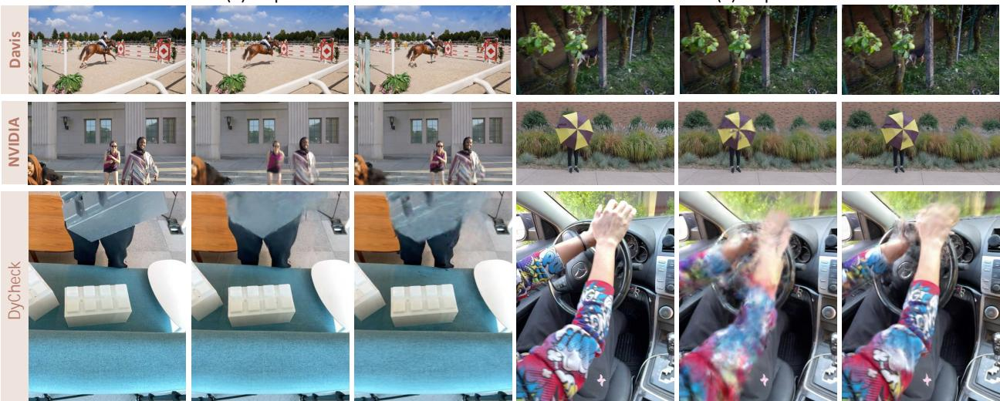  
Figure 5. Continuous-time reconstruction on DAVIS, NVIDIA, and DyCheck. GT denotes intermediate frames excluded from image, track, and depth supervision. All renderings match the GT timestamps and camera views.

## E.2 Challenging Cases and Limitations

Long intervals without reliable observations leave the intervening motion ambiguous. If motion changes abruptly within such an interval, the locally smooth WNOA prior may yield inaccurate intermediate motion.

The measurement–state formulation separates motion-node identity from individual tracks, but the latent states still rely on geometric observations. Large errors in tracks, estimated camera poses, or monocular depths can therefore distort the recovered motion and geometry. Future work could model measurement uncertainty, adapt temporal support to motion changes, and use stronger scene-level priors for poorly observed intervals. Fig. 6 shows examples of remaining reconstruction errors.

GT  
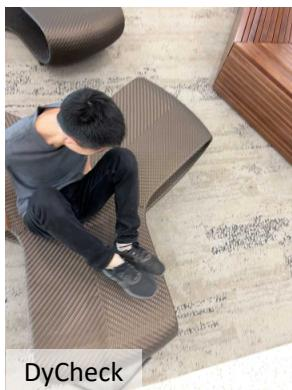

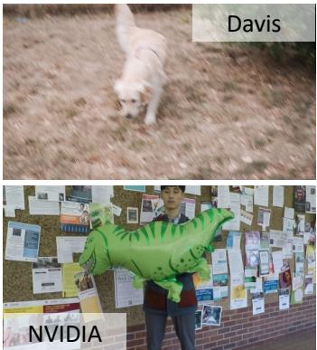

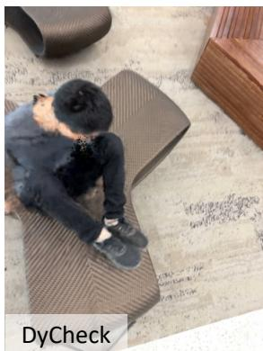

Ours  
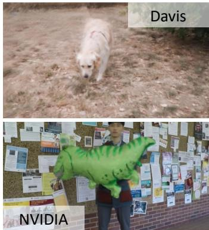  
Figure 6. Challenging reconstruction examples on DyCheck, DAVIS, and NVIDIA. GT denotes held-out real frames excluded from training; RayCo4D renderings use the corresponding timestamps and camera views.

## F Additional Qualitative Comparisons

Figs. 7–12 provide scene-wise qualitative comparisons of the full RayCo4D model and the baselines on DAVIS, NVIDIA, and DyCheck, supplementing Fig. 3 in the main paper.

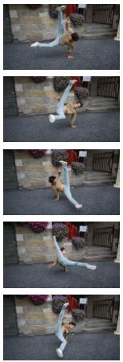  
GT

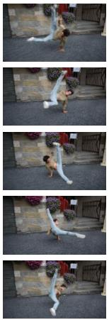  
MoSca

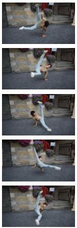  
OriGS

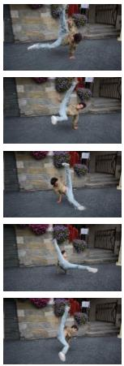  
RiGS

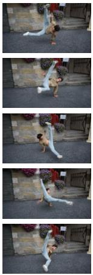  
SE(3) B-splineGS

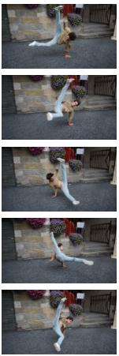  
Usplat4d

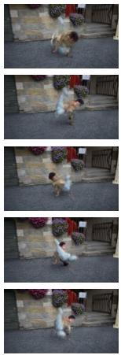  
Shape-of-motion

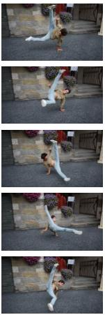  
Ours

Figure 7. Qualitative reconstruction comparison on the “Breakdance-flare” scene of DAVIS [23].  
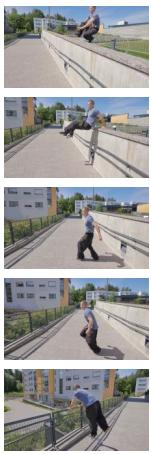  
GT

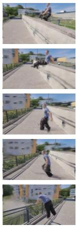  
MoSca

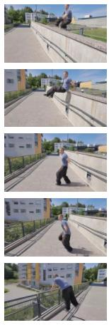  
OriGS

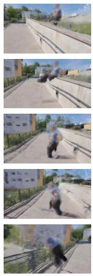  
RiGS

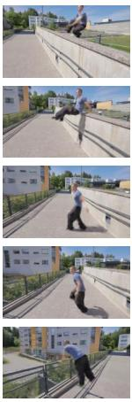  
SE(3) B-splineGS

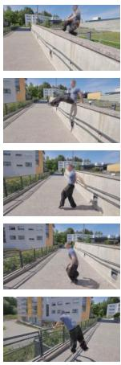  
Usplat4d

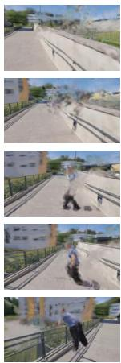  
Shape-of-motion

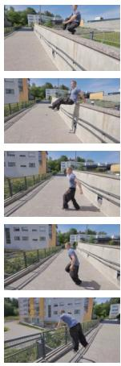  
Ours

Figure 8. Qualitative reconstruction comparison on the “Parkour” scene of DAVIS [23].  
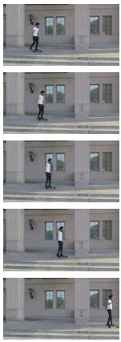  
GT

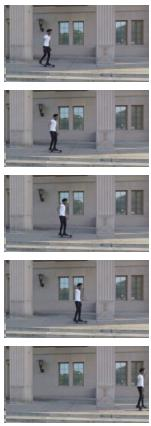  
MoSca

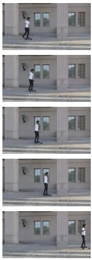  
OriGS

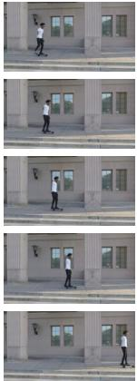  
RiGS

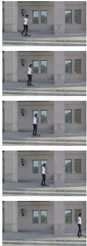  
SE(3) B-splineGS

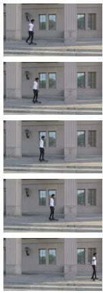  
Usplat4d

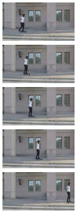  
Shape-of-motion

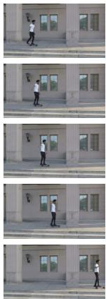  
Ours

Figure 9. Visual comparison of novel-view synthesis on the “Skating” scene of the NVIDIA dataset [39].

OriGS

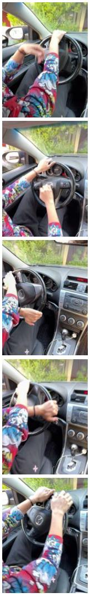

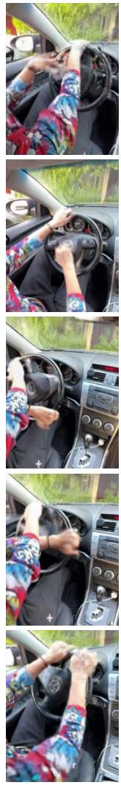

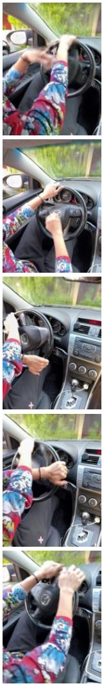

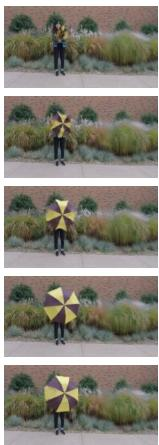  
Shape-of-motion  
MoSca  
GT

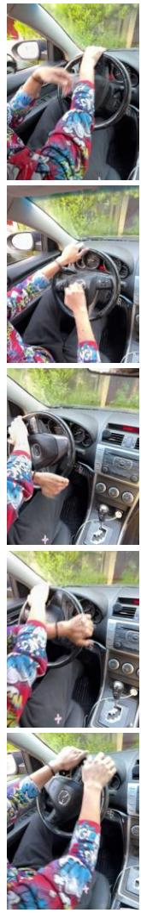  
SE(3) B-splineGS  
Ours

Figure 10. Visual comparison of novel-view synthesis on the “Wheel” scene of the DyCheck dataset [7].  
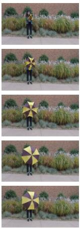  
Usplat4d  
GT

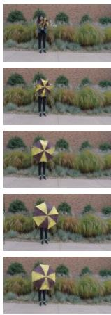  
RiGS  
MoSca

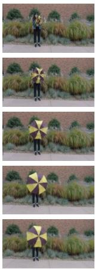  
OriGS

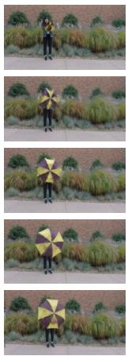  
RiGS  
SE(3) B-splineGS  
Usplat4d  
Shape-of-motion

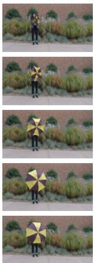  
Ours

Figure 11. Visual comparison of novel-view synthesis on the “Umbrella” scene of the NVIDIA dataset [39].

Shape-of-motion Ours

OriGS

GT  
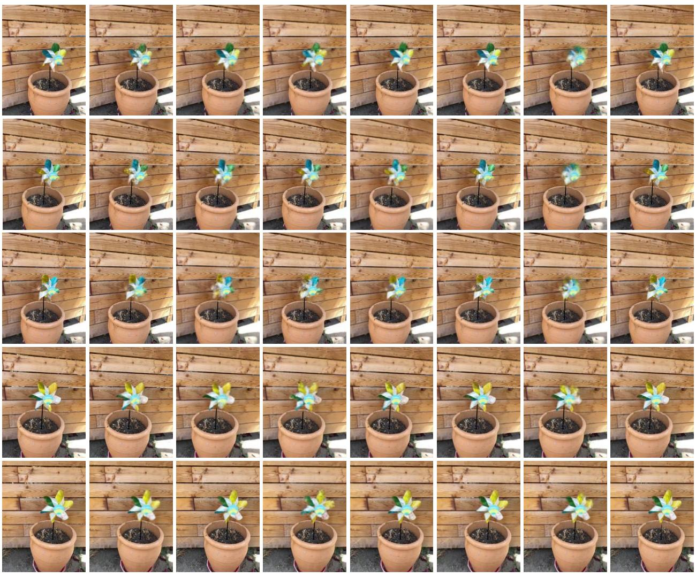  
RiGS  
Usplat4d  
SE(3) B-splineGS

Figure 12. Visual comparison of novel-view synthesis on the “Paper-windmill” scene of the DyCheck dataset [7].