# Recast the Past: Stable Long Video Generation with Full Context Memory

Yukuo Ma1,2, Cong Liu2, Junke Wang1, Junqi Liu2, Haibin Huang2, Zuxuan Wu†1, Xuelong Li†2

1Fudan University, 2Institute of Artificial Intelligence (TeleAI), China Telecom †Corresponding authors.

Long-horizon video generation requires retaining an ever-expanding history, but conditioning on its growing token sequence is costly. Existing methods restrict or compress historical context, potentially losing information needed for future generation. This work proposes ReCam, which groups local spatiotemporal blocks of historical latents into vectors and projects them directly into the highdimensional hidden space of a Difusion Transformer. The model learns to use the resulting memory tokens through native self-attention, reducing token count while retaining block-level access to the full history. To mitigate temporal drift during autoregressive rollout, we further introduce dualpointer denoising with separate noise schedules for recent context and target frames. Among the evaluated methods, ReCam achieves the highest VBench-Long overall score of 80.1 and competitive static-scene revisitation performance on R2M-Bench. It also leads on all four consistency metrics for of-screen subject reappearance, including clothing consistency of 4.09 versus 3.03 for the best baseline.

Keywords: Long video generation; video memory; difusion transformers; temporal consistency Github: https://github.com/scottykma/Recam Date: October 16, 2026

## 1 Introduction

Advances in autoregressive video models have enabled streaming and interactive generation for applications such as world modeling [Parker-Holder et al., 2025, Sun et al., 2025, Team et al., 2026, Wang et al., 2026c, Gao et al., 2026a], embodied intelligence [Ye et al., 2026, Kim et al., 2026, Li et al., 2026a], and creative content generation [Gao et al., 2025, Wan et al., 2025, Teng et al., 2025]. These applications shift the focus from generating locally plausible short clips to maintaining long-term memory over extended tempora horizons (e.g., world models must maintain consistent scene states across interactions, whereas embodied agents must retain information from earlier observations to support subsequent decisions).

Given that relevant information may vary across temporal positions and denoising stages [Yu et al., 2026a], efective long-term memory requires access to such evidence throughout the accumulated history. However, naively retaining the complete history incurs substantial computational and memory costs for videos ranging from ten seconds to one minute, which is a practical range for these applications. Existing methods can be broadly categorized along two design dimensions (Fig. 1): how historical information is retrieved and how it is preserved. Selecting historical frames or sparsifying attention reduces conditioning cost by restricting the observations or interactions available to the generator [Yu et al., 2025, Cai et al., 2026, Jia et al., 2026]. Yet, the resulting selection may not fully capture the historical evidence needed, leaving relevant cues inaccessible even when they remain in the history. Other methods encode history into compact embeddings or mediate access through a limited set of query tokens [Zhang et al., 2025, Yu et al., 2026a]. These designs can retain full-history coverage, yet may discard fine-grained details needed when a scene is revisited or a subject reappears.

These limitations motivate a method that allows video models to leverage the full history during autoregressive rollout directly. Our key insight is that a coarse read does not require a coarse historical representation. We reduce the historical token count by retrieving at a coarser granularity while retaining full-history coverage. Each local spatiotemporal block of historical latents is flattened into a vector and projected into the high-dimensional hidden space of a Difusion Transformer. The resulting memory representations are learned jointly with the video model and processed through native self-attention. This allows local detail to be encoded within each memory token, giving the model access to every historical block through a shorter token sequence.

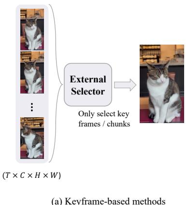  
(a) Keyframe-based methods

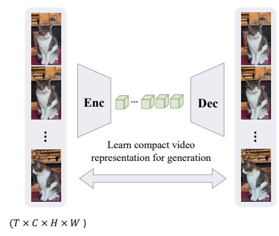  
(b) Compression-based methods

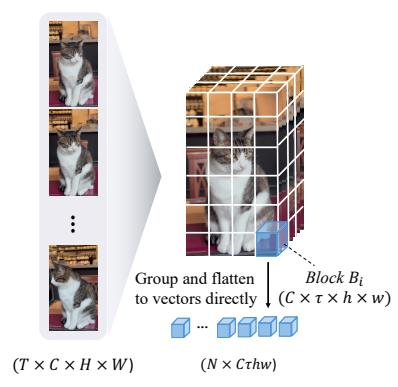  
(c) Ours  
Figure 1 A coarse read on fine-grained history. We compare our method with other representative methods. Keyframe-based approaches, such as CaM [Yu et al., 2025], typically employ an external rule-based selector to retrieve a subset of frames as memory. In contrast, compression-based methods [Zhang et al., 2025] encode history into a compact representation through a separate reconstruction stage. Diferent from these approaches, ReCam allows the video model itself to learn how to represent history and how to retrieve it via its native attention mechanism.

Nevertheless, efective use of history requires more than access: errors in generated frames can propagate to subsequent predictions [Ning et al., 2024, Zhang and Agrawala, 2025, Ma et al., 2026]. To mitigate this drift, we introduce dual-pointer denoising, which assigns separate noise schedules to recent context frames and current target frames. At inference, context frames start from pure noise and follow a faster denoising trajectory, providing temporal cues while reducing the influence of errors in previously generated context.

Building on these designs, we propose ReCam, which enables stable and consistent long-video generation. Our contributions are summarized as follows:

• Full-context memory. We introduce ReCam, a simple yet efective method that allows each token to encode a larger amount of spatiotemporal content, enabling end-to-end training for long-video generation and yielding a native long-term memory mechanism.

• Dual-pointer denoising. We assign separate denoising trajectories to recent context frames and current target frames, providing temporal cues while masking prediction errors in the context frames.

• Empirical evaluation. Extensive experiments on complementary benchmarks show that ReCam achieves the highest overall VBench-Long score among the evaluated methods [Huang et al., 2024], competitive performance on static-scene revisitation [Gu et al., 2026], and the best results across all four metrics for of-screen subject reappearance [Chen et al., 2026a, Shi et al., 2026]. These results support the efectiveness of ReCam as a native long-term memory mechanism.

## 2 Method

ReCam combines a learned representation of accumulated video history with dual-pointer denoising of recent context. We first describe how historical latents are turned into memory tokens and accessed through native self-attention, then explain how recent context is incorporated during training and autoregressive rollout

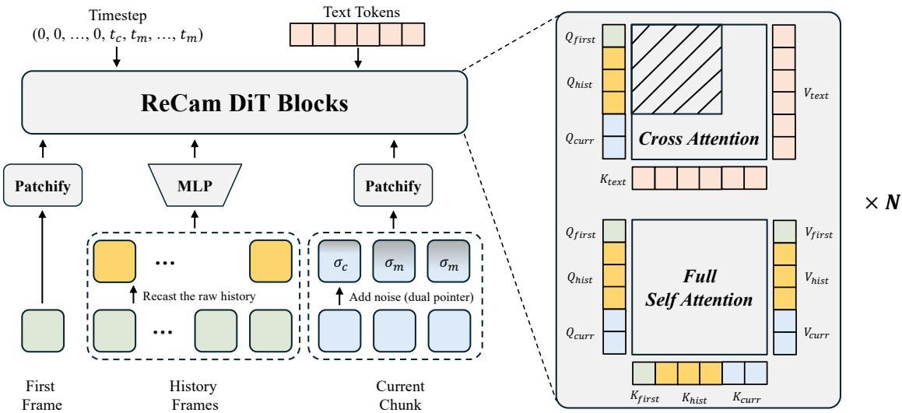  
Figure 2 Overview of ReCam. Historical latents are grouped into local spatiotemporal blocks and projected into memory tokens by a lightweight MLP. The first frame remains a clean visual anchor. Native self-attention connects the historical memory and current chunk, while text cross-attention is applied only to the current chunk.

## 2.1 A Coarse Read on Fine-Grained History

We reduce the number of historical tokens by grouping local spatiotemporal content into larger read units. Each unit is represented in the high-dimensional hidden space of the DiT, allowing the model to learn how to encode and use local detail while retaining access to the full history.

Recasting the history. Let $F _ { H } \in \mathbb { R } ^ { C \times T \times H \times W }$ denote the T accumulated historical latent frames. We partition $F _ { H }$ into local spatiotemporal blocks $\{ B _ { i } \} _ { i = 1 } ^ { N _ { b } }$ , where $B _ { i } \in \mathbb { R } ^ { C \times \tau \times h \times w }$ . Each block is flattened into a vector vec $( B _ { i } ) \in \mathbb { R } ^ { C \tau h w }$ and projected by a lightweight MLP $f _ { \phi } \colon$

$$
m _ { i } = f _ { \phi } ( \operatorname { v e c } ( B _ { i } ) ) , \qquad m _ { i } \in \mathbb { R } ^ { d } .\tag{1}
$$

Here, d is the hidden dimension of the DiT. The default block shape is $( C , \tau , h , w ) = ( 1 6 , 2 , 8 , 8 )$ , which packs 128 spatiotemporal positions into a 2048-dimensional vector. This is smaller than the hidden dimension of a large DiT, such as 5120 in Wan-14B. The projection therefore avoids imposing an additional low-dimensional memory bottleneck.

Attention with memory tokens. As shown in Fig. 2, memory tokens are concatenated in temporal order before the current-chunk tokens and processed through native DiT self-attention. We assign 3D RoPE coordinates to preserve the spatiotemporal ordering of the packed history. Memory tokens use negative temporal coordinates; native DiT tokens, including the noisy context, retain their original positional encodings with temporal coordinates starting from zero.

Coordinates are defined on the native DiT patch grid, whose patch size is (1, 2, 2) in latent space. For a block indexed by $( n , i , j )$ along the temporal, height, and width dimensions, we use

$$
\pi _ { n , i , j } = \left( - T + n \tau , i \frac { h } { 2 } , j \frac { w } { 2 } \right) ,\tag{2}
$$

where the spatial coordinates match the first native patch in the block. With the historical memory already determined, text cross-attention is applied only to the current-chunk tokens.

## 2.2 Dual-Pointer Denoising for Stable Rollout

Alongside long-term memory, we retain recent frames as short-term context to provide appearance and motion cues. However, reusing generated context can propagate prediction errors across chunks. Dualpointer denoising mitigates this drift while retaining useful temporal guidance.

Separate noise schedules. Reusing fully clean generated context can amplify prediction errors during rollout [Zou et al., 2026]. We keep the original first frame as a clean visual anchor and instead provide a noisy view of the recent context at each denoising step:

$$
\tilde { O } ^ { ( k ) } = \left( 1 - \sigma _ { \mathrm { c } } ^ { ( k ) } \right) O + \sigma _ { \mathrm { c } } ^ { ( k ) } \epsilon , \qquad \epsilon \sim \mathcal { N } ( \mathbf { 0 } , \mathbf { I } ) ,\tag{3}
$$

where O denotes the recent context. Context and current-chunk noise levels follow the same shifted-linear schedule family [Esser et al., 2024], but use diferent shifts. Given the base schedule $\bar { \sigma } ^ { ( k ) } = 1 - k / K$ over K denoising steps, we set

$$
\sigma _ { j } ^ { ( k ) } = \frac { s _ { j } \bar { \sigma } ^ { ( k ) } } { 1 + ( s _ { j } - 1 ) \bar { \sigma } ^ { ( k ) } } , \qquad j \in \{ \mathrm { c } , \mathrm { m } \} ,\tag{4}
$$

where $s _ { \mathrm { c } }$ and $s _ { \mathrm { m } }$ control the context and current chunk, respectively. Setting $s _ { \mathrm { c } } \leq s _ { \mathrm { m } }$ ensures $\sigma _ { \mathrm { c } } ^ { ( k ) } \leq \sigma _ { \mathrm { m } } ^ { ( k ) }$ so the context is no noisier than the current chunk and can guide its generation. With the default $s _ { \mathrm { c } } = 2$ the context starts from pure noise and remains noisy through much of the schedule, limiting the influence of errors in the reused frames. The schedule restores the clean context as denoising ends.

An input-level shortcut for noisy context. Noisy context introduces additional denoising states and can make optimization harder [Yuan et al., 2026]. We expose the context denoising direction through paired noisy views, allowing the model to focus its prediction objective on the current chunk. For clean context $O ,$ the flow-matching target is $v _ { \mathrm { c t x } } ^ { \ast } = \epsilon - O$ , where $\epsilon \sim \mathcal { N } ( \mathbf { 0 } , \mathbf { I } )$ . During training, we construct two views with shared noise at level $\sigma _ { \mathrm { c } } \leq \sigma _ { \mathrm { m } } \colon$

$$
\tilde { O } _ { \mathrm { c } } = \left( 1 - \sigma _ { \mathrm { c } } \right) O + \sigma _ { \mathrm { c } } \epsilon , \qquad \tilde { O } _ { \mathrm { m } } = \left( 1 - \sigma _ { \mathrm { m } } \right) O + \sigma _ { \mathrm { m } } \epsilon .\tag{5}
$$

Under the linear flow path, these two pointers satisfy

$$
\tilde { O } _ { \mathrm { m } } - \tilde { O } _ { \mathrm { c } } = \left( \sigma _ { \mathrm { m } } - \sigma _ { \mathrm { c } } \right) \left( \epsilon - O \right) = \left( \sigma _ { \mathrm { m } } - \sigma _ { \mathrm { c } } \right) v _ { \mathrm { c t x } } ^ { * } .\tag{6}
$$

When the noise levels difer, this relation allows the context denoising direction to be inferred from the paired views and their noise levels. It provides an input-level shortcut aligned with the v-prediction parameterization in flow matching: the model can directly access the context velocity and focus on denoising the current chunk, without having to learn to reconstruct O. At inference, the model also does not try to reconstruct a clean $O ;$ instead, it directly consumes the noisy context, thereby circumventing the accumulated generation errors that a clean O would contain. We concatenate both views and their noise levels along the channel dimension and feed them into the DiT. The $\sigma _ { \mathrm { m } }$ channel is optional because the conditioning timestep $t _ { \mathrm { m } }$ already encodes its value. No additional prediction loss is imposed on the context $\tilde { O } _ { \mathrm { c } }$

## 2.3 Training

We train the model to denoise the current chunk conditioned on the preceding video history. Let $z _ { 0 }$ denote the current chunk and H the conditioning inputs from Secs. 2.1 and 2.2. We construct $z _ { \sigma } = ( 1 - \sigma ) z _ { 0 } + \sigma \epsilon _ { : }$ with $\epsilon \sim \mathcal { N } ( \mathbf { 0 } , \mathbf { I } )$ , and optimize the standard flow-matching objective:

$$
\mathcal { L } _ { \mathrm { F M } } = \mathbb { E } \left[ \| v _ { \theta } ( z _ { \sigma } , \sigma \mid \mathcal { H } ) - ( \epsilon - z _ { 0 } ) \| _ { 2 } ^ { 2 } \right] .\tag{7}
$$

The loss is computed only over the current chunk. Historical tokens and auxiliary context channels serve as conditioning inputs. For each sample, we randomly select a generation window and a history length. The immediately preceding segment is encoded into latent space as historical context. We progressively increase the maximum history length from 10 to 30 seconds. The first frame remains a clean anchor, while the remaining historical latents are converted into memory tokens and fed directly into the DiT, bypassing native patchification. During training, the first latent frame of the current chunk is reserved as short-term context for dual-pointer denoising. At inference, the last latent frame of the previous chunk serves this role, creating a one-latent-frame overlap between consecutive chunks.

Table 1 VBench-Long evaluation results. We report the VBench-Long metrics on videos generated at 480p, 30 seconds. Higher values are better for all dimensions.
<table><tr><td>Method</td><td>#Params</td><td>Total Score</td><td>Subject Consistency</td><td>Background Consistency</td><td>Motion Smoothness</td><td>Dynamic Degree</td><td>Imaging Quality</td><td>Aesthetic Quality</td></tr><tr><td>MAGI-1 [Teng et al., 2025]</td><td>24B</td><td>78.5</td><td>98.2</td><td>97.2</td><td>99.4</td><td>21.4</td><td>66.4</td><td>55.9</td></tr><tr><td>FramePack [Zhang and Agrawala, 2025]</td><td>13B</td><td>79.5</td><td>98.7</td><td>99.2</td><td>99.5</td><td>16.8</td><td>70.9</td><td>61.3</td></tr><tr><td>SkyReels-V2 [Chen et al., 2025]</td><td>14B</td><td>79.2</td><td>96.0</td><td>96.0</td><td>99.0</td><td>53.2</td><td>64.8</td><td>56.2</td></tr><tr><td>MMPL [Xiang et al., 2025]</td><td>14B</td><td>78.8</td><td>96.2</td><td>95.3</td><td>98.8</td><td>49.2</td><td>66.4</td><td>55.8</td></tr><tr><td>LongLive 2.0 [Chen et al., 2026b]</td><td>5B</td><td>76.5</td><td>92.3</td><td>92.5</td><td>99.1</td><td>25.1</td><td>70.0</td><td>59.8</td></tr><tr><td>Helios [Yuan et al., 2026]</td><td>14B</td><td>78.6</td><td>97.6</td><td>97.3</td><td>99.1</td><td>28.6</td><td>66.4</td><td>59.3</td></tr><tr><td>ReCam (Ours)</td><td>14B</td><td>80.1</td><td>98.1</td><td>97.2</td><td>98.5</td><td>36.4</td><td>70.0</td><td>62.5</td></tr></table>

Optional camera control. For camera-controlled tasks such as scene revisitation, we follow Yu et al. [2026b] and inject camera trajectories through fused-PRoPE. We apply PRoPE [Li et al., 2026b] after the original DiT RoPE and before self-attention, without adding learnable parameters. During training and inference, only the trajectory of the current generation window is provided, expressed as relative poses with respect to its first frame. Historical consistency must therefore be learned without an explicit geometry-based memory. Please see Appendix A for more details.

## 3 Experiments

## 3.1 Experimental Setup

We initialize ReCam from the high-noise expert of Wan2.2-I2V-A14B and generate 480p videos at 16 fps, adding 40 pixel frames per autoregressive step. Training uses a global batch size of 64 and three stages of 10,000 steps, with maximum history lengths of 10, 20, and 30 seconds. We use AdamW with learning rates of 10−5, 10−6, and $1 0 ^ { - 6 }$ across the three stages. Default inference uses 40 Euler steps and classifier-free guidance.

Training data. We train on an internal corpus of 2 million general-purpose videos lasting 5–60 seconds, mostly sourced from the web and covering diverse real-world scenarios. No manually constructed memory labels, such as revisit segments identified by FOV overlap, are used. For static-scene revisitation only, we additionally train on SpatialVID-HQ [Wang et al., 2026a] to acquire camera control. Appendix B provides further details.

Evaluation settings. We evaluate overall long-video quality and two forms of historical recall. The protocols and metric definitions are detailed in Appendix C.

(1) Long-horizon generation. The oficial VBench-Long I2V suite [Huang et al., 2024] evaluates 30-second videos at 480p across six dimensions of consistency, motion, and visual quality.

(2) Static-scene revisitation. We use 100 reference scenes from R2M-Bench [Gu et al., 2026] to test whether previously observed content is recovered when the camera returns. MemoryGain (MG) and the Normalized Memory Ratio (NMR) calibrate revisit consistency against controls from the same rollout across appearance fidelity, scene identity, and object identity.

(3) Of-screen subject reappearance. Following the MSVBench protocol [Shi et al., 2026], we evaluate 64 histories covering 40 subjects and 10 backgrounds. Each history ends after the subject leaves the frame, and generation must recover that subject upon reappearance. In half of the histories, the subject first appears after the initial frame; in every history, it is absent for the final five seconds. We measure face, character, background, and clothes consistency against the reference history.

Table 2 Static-scene revisitation on R2M-Bench. MemoryGain (MG, top) and Normalized Memory Ratio (NMR, bottom); higher is better for both
<table><tr><td>Method</td><td></td><td colspan="3">Appearance Fidelity</td><td colspan="3">Scene Identity</td><td colspan="2">Object Identity</td></tr><tr><td></td><td>#Params</td><td>PSNR</td><td>SSIM</td><td>LPIPS</td><td>DINO-sim</td><td>BoQ-sim</td><td>MVPR-sim</td><td>App. Persist</td><td>Sem. Persist</td></tr><tr><td>HY-WorldPlay [Sun et al., 2025]</td><td>8B</td><td>2.626</td><td>0.060</td><td>0.158</td><td>0.287</td><td>0.340</td><td>0.157</td><td>0.096</td><td>0.026</td></tr><tr><td>Sana-WM [Zhu et al., 2026]</td><td>2.6B</td><td>0.534</td><td>0.014</td><td>0.022</td><td>0.039</td><td>0.019</td><td>0.012</td><td>0.004</td><td>0.002</td></tr><tr><td>LingBot-World-Fast [Gao et al., 2026a]</td><td>18B</td><td>1.021</td><td>0.028</td><td>0.057</td><td>0.194</td><td>0.207</td><td>0.162</td><td>0.069</td><td>0.019</td></tr><tr><td>LingBot-World-2-Fast [Gao et al., 2026b]</td><td>18B</td><td>1.349</td><td>0.037</td><td>0.095</td><td>0.216</td><td>0.232</td><td>0.117</td><td>0.064</td><td>0.014</td></tr><tr><td>ReCam (Ours)</td><td>14B</td><td>1.691</td><td>0.045</td><td>0.104</td><td>0.286</td><td>0.288</td><td>0.212</td><td>0.087</td><td>0.026</td></tr></table>

<table><tr><td>Method</td><td></td><td colspan="3">Appearance Fidelity</td><td colspan="3">Scene Identity</td><td colspan="2">Object Identity</td></tr><tr><td></td><td>#Params</td><td>PSNR</td><td>SSIM</td><td>LPIPS</td><td>DINO-sim</td><td>BoQ-sim</td><td>MVPR-sim</td><td>App. Persist</td><td>Sem. Persist</td></tr><tr><td>HY-WorldPlay [Sun et al., 2025]</td><td>8B</td><td>0.618</td><td>0.452</td><td>0.576</td><td>0.896</td><td>0.800</td><td>0.877</td><td>0.711</td><td>0.897</td></tr><tr><td>Sana-WM [Zhu et al., 2026]</td><td>2.6B</td><td>0.151</td><td>0.116</td><td>0.096</td><td>0.120</td><td>0.040</td><td>0.041</td><td>0.025</td><td>0.034</td></tr><tr><td>LingBot-World-Fast [Gao et al., 2026a]</td><td>18B</td><td>0.225</td><td>0.202</td><td>0.230</td><td>0.451</td><td>0.388</td><td>0.522</td><td>0.414</td><td>0.563</td></tr><tr><td>LingBot-World-2-Fast [Gao et al., 2026b]</td><td>18B</td><td>0.380</td><td>0.322</td><td>0.404</td><td>0.588</td><td>0.505</td><td>0.559</td><td>0.427</td><td>0.475</td></tr><tr><td>ReCam (Ours)</td><td>14B</td><td>0.457</td><td>0.493</td><td>0.444</td><td>0.653</td><td>0.518</td><td>0.666</td><td>0.468</td><td>0.634</td></tr></table>

Table 3 Of-screen subject reappearance. For each consistency metric, we report the mean metric over all cases (All), the cases where the subject is visible in the first frame (Present), and the cases where it is absent from the first frame (Absent). Bold indicates the best result in each column.
<table><tr><td>Method</td><td colspan="3">Face↓</td><td colspan="3">Character↓</td><td colspan="3">Background↓</td><td colspan="3">Clothes ↑</td></tr><tr><td></td><td>All Present</td><td></td><td>Absent</td><td></td><td>All Present Absent</td><td></td><td>All Present</td><td></td><td>Absent</td><td>All Present</td><td>Absent</td><td></td></tr><tr><td>FramePack-F1 [Zhang and Agrawala, 2025]</td><td>0.578</td><td>0.400</td><td>0.745</td><td>12.54</td><td>9.82</td><td>14.700.043</td><td></td><td>0.028</td><td>0.054</td><td>2.44</td><td>3.95</td><td>1.25</td></tr><tr><td>Helios [Yuan et al., 2026]</td><td>0.748</td><td>0.657</td><td>0.771</td><td>13.91</td><td>12.64</td><td>14.52 0.063</td><td></td><td>0.105</td><td>0.043</td><td>1.82</td><td>2.69</td><td>1.41</td></tr><tr><td>LongLive 2.0 [Chen et al., 2026b]</td><td>0.626</td><td>0.553</td><td>0.710</td><td>13.18</td><td>13.03</td><td>13.34 0.239</td><td></td><td>0.254</td><td>0.219</td><td>2.25</td><td>2.73</td><td>1.73</td></tr><tr><td>Sana-WM Streaming [Zhu et al., 2026]</td><td>0.642</td><td>0.624</td><td>0.682</td><td>11.67</td><td>10.86</td><td>12.92 0.073</td><td></td><td>0.069</td><td>0.078</td><td>2.39</td><td>2.84</td><td>1.73</td></tr><tr><td>LingBot-World-Fast [Gao et al., 2026a]</td><td>0.591</td><td>0.578</td><td>0.606</td><td>10.84</td><td>10.83</td><td></td><td>10.860.079</td><td>0.071</td><td>0.085</td><td>3.03</td><td>3.03</td><td>3.04</td></tr><tr><td>LingBot-World-2-Fast [Gao et al., 2026b]</td><td>0.654</td><td>0.601</td><td>0.703</td><td>12.07</td><td>11.30</td><td>12.89</td><td>0.114</td><td>0.075</td><td>0.130</td><td>1.58</td><td>1.69</td><td>1.47</td></tr><tr><td>ReCam (Ours)</td><td>0.561</td><td>0.499</td><td>0.644</td><td>9.90</td><td>9.90</td><td></td><td>9.91 0.028</td><td>0.018</td><td>0.042</td><td>4.09</td><td>4.50</td><td>3.57</td></tr></table>

## 3.2 Comparison with Existing Methods

Long-horizon generation. All methods generate 30-second videos at 480p under the VBench-Long I2V protocol, except Helios, which uses its training resolution of 368p because performance degrades at other resolutions. In Tab. 1, ReCam achieves the highest overall score of 80.1 among the evaluated methods, supporting its efectiveness across visual quality and long-term consistency.

Static-scene revisitation. Table 2 compares ReCam with raw historical KV-cache models (LingBot-World-Fast and LingBot-World-2-Fast [Gao et al., 2026a,b]), FOV-based retrieval (HY-WorldPlay [Sun et al., 2025]), and recurrent state-space memory (Sana-WM [Zhu et al., 2026]) under the same R2M-Bench protocol. Without an explicit geometry-based memory or manually constructed revisit supervision, ReCam remains competitive: it achieves the highest MG on MVPR-sim (0.212), ties for the highest MG on Sem.Persist (0.026), and obtains the highest NMR on SSIM (0.493).

The remaining gap is most visible against HY-WorldPlay on NMR. We observe minor viewpoint and position shifts, motion instability, and occasional degradation on second or third revisits. Limited cameracontrol and revisit data may contribute to these failures. The results show that learned historical memory transfers to scene revisitation, while leaving room for improvement in camera accuracy and repeated-return consistency.

Of-screen subject reappearance. We compare ReCam with six baselines using identical histories and reappearance targets (Tab. 3). FramePack supports only 19 context latents, corresponding to less than five seconds, so we use its oficial FramePack-F1 continuation strategy, which retains the first frame and a sliding window of recent frames.

  
A long-haired girl in a purple top holds a bright pink flower near her nose and looks down at it in front of flowering bushes. The close-up captures small movements of her head and hands as she smells the flower.

  
A blue hatchback drives along a paved road lined with tall forest trees. The camera tracks the car from the front and side as patches of sunlight and shadow pass over the vehicle and road

  
A large metallic ring sculpture stands at the far end of a rectangular reflecting pool in a paved plaza between tall glass-fronted buildings. The still water reflects the sculpture and surrounding architecture, with benches lining …

The camera pans through a bright modern interior, passing red seating, tall potted palms, a circular pendant light, and wooden cabinetry. Floor-to-ceiling windows reveal a city skyline, while daylight reflects off the polished …

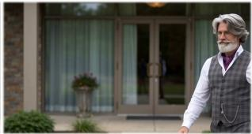

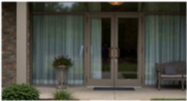

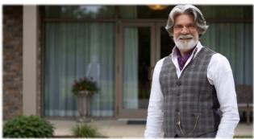  
A gray-haired, bearded man wearing a white shirt and a plaid waistcoat walks into view in front of a residential porch and smiles. He passes out of frame before appearing again.

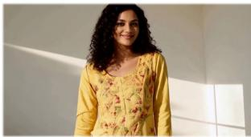

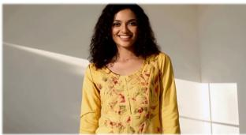  
A curly-haired woman wearing a yellow floral top smiles in front of a sunlit white wall. She approaches the camera, exits to the right, and then reappears.

Figure 3 Qualitative results. From top to bottom: long-horizon generation, static-scene revisitation, and of-screen subject reappearance.

Table 4 Ablation studies. (a) History block shape and MLP bottleneck dimension. (b) Context design: VBench changes between the first and last two-second windows $( \Delta = \mathrm { l a s t - f i r s t } )$ ; negative values indicate degradation. Bold marks the best result per column.  
(a) History granularity
<table><tr><td>Shape MLP  $( C , \tau , h , w )$ </td><td>dim. VBench ↑ Face↓ Character↓</td></tr><tr><td>(16, 2, 4, 4) 512</td><td>79.36 0.577 10.165</td></tr><tr><td>(16, 2, 8, 8) 2048</td><td>80.01 0.695</td></tr><tr><td>(16,4, 8, 8) 4096</td><td>9.918 80.60 0.662 10.352</td></tr><tr><td>(16, 16, 4, 4) 4096</td><td>80.50 0.650</td></tr><tr><td>(16, 2, 8, 8) 128</td><td>78.92 0.633 10.928</td></tr></table>

(b) Context design and temporal drift
<table><tr><td>Context</td><td>Subject Background Imaging Aesthetic ∆↑</td><td>∆↑</td><td>∆↑</td><td>∆↑</td></tr><tr><td></td><td></td><td>+0.0009</td><td>-0.0100</td><td>-0.0367</td></tr><tr><td>Clean Single</td><td>+0.0010 -0.0062</td><td></td><td>-0.0027 -0.0093</td><td>-0.0422</td></tr><tr><td>Dual</td><td>+0.0015</td><td></td><td>+0.0011-0.0044</td><td>-0.0315</td></tr></table>

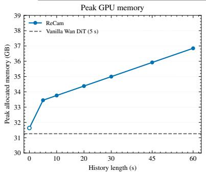

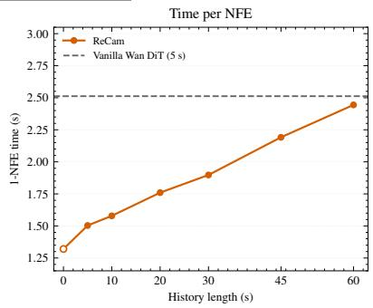  
(a) History-length scaling

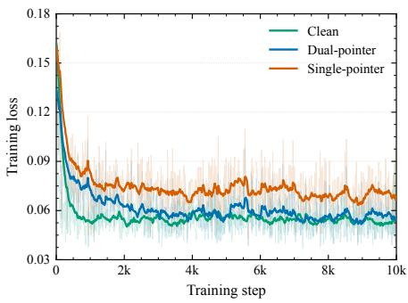  
(b) Training loss

Figure 4 Eficiency and optimization. (a) Peak GPU memory and forward-pass time on one H100. (b) Dual-pointer loss approaches clean-context loss and remains below single-pointer loss.  
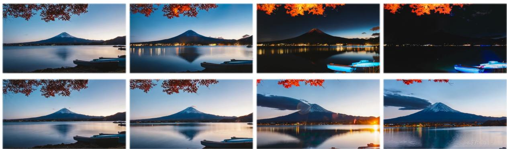  
A snow-capped mountain rises across a calm lake, with red autumn leaves overhead and small boats in …  
Figure 5 Anti-drifting via dual-pointer denoising. Generated frames from clean context (top) and dual-pointer denoising (bottom), with time progressing from left to right

ReCam leads on all four metrics over the full evaluation set, including clothes consistency of 4.09 versus 3.03 for the best baseline. The split results reveal where historical access matters most. When the subject is absent from the first frame, ReCam leads on character, background, and clothes consistency, while LingBot-World-Fast leads on face consistency. FramePack-F1 has a slight advantage on face and character consistency when the subject is initially visible, but its face distance increases from 0.400 to 0.745 when the subject is initially absent, exceeding the 0.68 same-identity threshold for the VGG-face cosine distance we use. In the initially absent cases, identity evidence lies outside both the first frame and the recent context. Full-history coverage keeps these intermediate observations available at generation time. The results therefore support retaining access to temporally distant subject information instead of relying only on fixed anchor frames or recent observations.

## 3.3 Ablation Studies

We examine history eficiency, granularity, and context denoising. Unless otherwise specified, variants use the same resolution of 640 × 368, a maximum history of 20 seconds, and 10K training steps. Evaluation uses fixed subsets of VBench and the of-screen subject reappearance benchmark.

Eficiency with longer history. We measure GPU memory usage and single-forward-pass time across history lengths on one H100 GPU with FlashAttention-3 [Shah et al., 2024]. In Fig. 4(a), a one-minute history requires memory comparable to the standard 480p, five-second short-video configuration and has a shorter forward time. This measured scaling supports end-to-end training and inference with extended historical context.

History granularity. Table 4(a) varies the history block shape and MLP bottleneck dimension. At the same nominal history-token budget, (16, 4, 8, 8) and (16, 16, 4, 4) produce similar overall VBench scores, with minor diferences in memory metrics. Reducing the MLP bottleneck to 128 dimensions lowers VBench and character consistency, supporting the value of suficient projection capacity. Finer spatial grouping, from (16, 2, 8, 8) to (16, 2, 4, 4), improves face consistency when the subject is absent from the first frame. However, it requires approximately four times as many history tokens and does not improve the overall VBench score. We use (16, 2, 8, 8) as the default balance between eficiency and generation quality.

Clean context, single pointer, or dual pointer? We compare clean context, single-pointer denoising (adding noise to context tokens), and dual-pointer denoising using changes in VBench metrics between the first and last two-second windows. Dual-pointer denoising performs best on all four reported metrics (Tab. 4(b)). Clean context also maintains stable subject and background consistency, suggesting that native long-video training already helps limit error accumulation.

The training curves in Fig. 4(b) show that dual-pointer denoising and clean context reach similar final losses, both below single-pointer denoising. This is consistent with the paired-view shortcut making noisy context easier to use during optimization.

Figure 5 illustrates the diference during rollout. Both variants exhibit color drift, but small shifts accumulate under clean context until the scene becomes excessively dark. With dual-pointer denoising, the drift is less pronounced in the final chunk, illustrating reduced error propagation across chunks.

## 4 Related Work

Autoregressive video generation and temporal drift. Autoregressive video models support streaming [Yuan et al., 2026], generative transmission [Shao and Li, 2025, An et al., 2026], and interactive applications [Yang et al., 2025, Chen et al., 2026b], but conditioning on generated history can propagate prediction errors. Prior work addresses this through more robust context conditioning, error-aware training, and planning. Noise perturbation uses scheduled noise levels for historical and newly generated frames to improve tolerance to imperfect context [Chen et al., 2024, Song et al., 2025]. Error-aware training instead simulates erroneous histories [Yuan et al., 2026] or feeds model predictions back as context [Huang et al., 2025, Liu et al., 2025].

Planning methods generate farther-ahead frames or organize the rollout globally to limit the accumulation of local errors [Ma et al., 2026, Zhang and Agrawala, 2025]. Recent error-blocking work uses the same noise strength for historical and newly generated frames to restrict error propagation [Zou et al., 2026]. Our dual-pointer design uses separate context and target noise schedules, together with paired context views that expose the denoising direction. The prediction objective remains focused on the current chunk.

Historical access and memory representation. Long-term memory must balance the cost of reading history with the information retained for future generation. Keyframe- and view-based methods retrieve frame-level observations using temporal or spatial cues, including FOV overlap, camera pose, and surfel associations [Yu et al., 2025, Li et al., 2025, Xiao et al., 2025]. Explicit 3D memories, such as point clouds and depth-guided latent caches, preserve scene structure across viewpoints [Zhao et al., 2025, Wang et al., 2026b]. These approaches organize historical access around selected observations or geometric structure.

Other methods reduce the memory footprint through packed frame contexts, compact history embeddings, recurrent states, or learned query interfaces [Zhang and Agrawala, 2025, Zhang et al., 2025, Po et al., 2025, Peng et al., 2026, Yu et al., 2026a]. Sparse attention reduces reading cost through chunk routing or token grouping [Cai et al., 2026, Jia et al., 2026]. ReCam packs local spatiotemporal blocks into high-dimensional tokens and exposes all blocks to native self-attention. The block representations are learned jointly with video generation, combining full-history coverage with a shorter conditioning sequence.

## 5 Conclusion

We introduced ReCam, which learns long-term video memory by packing local spatiotemporal history into high-dimensional tokens processed through native self-attention. This design reduces historical token count while preserving full-history coverage, allowing the video model to jointly learn how historical information is represented and used. Dual-pointer denoising complements this memory mechanism by assigning separate noise schedules to recent context and target frames to mitigate error propagation during autoregressive rollout. ReCam achieves the highest overall VBench-Long score of 80.1 among the evaluated methods and leads on all four consistency metrics for of-screen subject reappearance, while remaining competitive on scene revisitation. These results demonstrate that efective long-term memory can be learned from general-purpose video data.

Reliable memory use in out-of-domain settings remains an open challenge. Future work will explore more demanding revisitation scenarios, diverse downstream applications, and learning from in-context demonstrations.

## References

Hongjun An, Wenhan Hu, Sida Huang, Siqi Huang, Ruanjun Li, Yuanzhi Liang, Jiawei Shao, Yiliang Song, Zihan Wang, Cheng Yuan, et al. Ai flow: Perspectives, scenarios, and approaches. Vicinagearth, page 1, 2026.

Shuai Bai, Yuxuan Cai, Ruizhe Chen, Keqin Chen, Xionghui Chen, Zesen Cheng, Lianghao Deng, Wei Ding, Chang Gao, Chunjiang Ge, et al. Qwen3-vl technical report. arXiv preprint arXiv:2511.21631, 2025.

Shengqu Cai, Ceyuan Yang, Lvmin Zhang, Yuwei Guo, Junfei Xiao, Ziyan Yang, Yinghao Xu, Zhenheng Yang, Alan Yuille, Leonidas Guibas, et al. Mixture of contexts for long video generation. In International Conference on Learning Representations, volume 2026, pages 92075–92093, 2026.

Boyuan Chen, Diego Mart´ı Mons´o, Yilun Du, Max Simchowitz, Russ Tedrake, and Vincent Sitzmann. Difusion forcing: Next-token prediction meets full-sequence difusion. Advances in Neural Information Processing Systems, 37:24081–24125, 2024.

Guibin Chen, Dixuan Lin, Jiangping Yang, Chunze Lin, Junchen Zhu, Mingyuan Fan, Hao Zhang, Sheng Chen, Zheng Chen, Chengcheng Ma, et al. Skyreels-v2: Infinite-length film generative model. arXiv preprint arXiv:2504.13074, 2025.

Kaijin Chen, Dingkang Liang, Xin Zhou, Yikang Ding, Xiaoqiang Liu, Pengfei Wan, and Xiang Bai. Out of sight but not out of mind: Hybrid memory for dynamic video world models. arXiv preprint arXiv:2603.25716, 2026a.

Yukang Chen, Luozhou Wang, Wei Huang, Shuai Yang, Bohan Zhang, Yicheng Xiao, Ruihang Chu, Weian Mao, Qixin Hu, Shaoteng Liu, et al. Longlive-2.0: An nvfp4 parallel infrastructure for long video generation. arXiv preprint arXiv:2605.18739, 2026b.

Patrick Esser, Sumith Kulal, Andreas Blattmann, Rahim Entezari, Jonas M¨uller, Harry Saini, Yam Levi, Dominik Lorenz, Axel Sauer, Frederic Boesel, Dustin Podell, Tim Dockhorn, Zion English, and Robin

Rombach. Scaling rectified flow transformers for high-resolution image synthesis. In Forty-first International Conference on Machine Learning, ICML 2024, Vienna, Austria, July 21-27, 2024, 2024.

Stephanie Fu, Netanel Tamir, Shobhita Sundaram, Lucy Chai, Richard Zhang, Tali Dekel, and Phillip Isola. Dreamsim: Learning new dimensions of human visual similarity using synthetic data. arXiv preprint arXiv:2306.09344, 2023.

Yu Gao, Haoyuan Guo, Tuyen Hoang, Weilin Huang, Lu Jiang, Fangyuan Kong, Huixia Li, Jiashi Li, Liang Li, Xiaojie Li, et al. Seedance 1.0: Exploring the boundaries of video generation models. arXiv preprint arXiv:2506.09113, 2025.

Zelin Gao, Qiuyu Wang, Yanhong Zeng, Jiapeng Zhu, Ka Leong Cheng, Yixuan Li, Hanlin Wang, Yinghao Xu, Shuailei Ma, Yihang Chen, Jie Liu, Yansong Cheng, Yao Yao, Jiayi Zhu, Yihao Meng, Kecheng Zheng, Qingyan Bai, Jingye Chen, Zehong Shen, Yue Yu, Xing Zhu, Yujun Shen, and Hao Ouyang. Advancing open-source world models. CoRR, 2026a.

Zelin Gao, Qiuyu Wang, Jiapeng Zhu, Jingye Chen, Zichen Liu, Qingyan Bai, Jiahao Wang, Yufeng Yuan, Hanlin Wang, Yichong Lu, Ka Leong Cheng, Haojie Zhang, Jian Gao, Tianrui Feng, Yuzheng Liu, Yao Yao, Yinghao Xu, Xing Zhu, Yujun Shen, and Hao Ouyang. Infinite worlds with versatile interactions. arXiv preprint arXiv:2607.07534, 2026b.

Qiwen Gu, Bingjie Gao, Rui Chen, Geng Li, Jifan Li, Qishuai Wen, Li Niu, Jing Tang, Xiangxiang Chu, and Junqiao Zhao. R2m-bench: Evaluating revisit memory via relative consistency in interactive video world models. arXiv preprint arXiv:2608.27328, 2026.

Xun Huang, Zhengqi Li, Guande He, Mingyuan Zhou, and Eli Shechtman. Self forcing: Bridging the traintest gap in autoregressive video difusion. CoRR, 2025.

Ziqi Huang, Fan Zhang, Xiaojie Xu, Yinan He, Jiashuo Yu, Ziyue Dong, Qianli Ma, Nattapol Chanpaisit, Chenyang Si, Yuming Jiang, Yaohui Wang, Xinyuan Chen, Ying-Cong Chen, Limin Wang, Dahua Lin, Yu Qiao, and Ziwei Liu. Vbench++: Comprehensive and versatile benchmark suite for video generative models. arXiv preprint arXiv:2411.13503, 2024.

Weinan Jia, Yuning Lu, Mengqi Huang, Hualiang Wang, Binyuan Huang, Nan Chen, Jidong Jiang, Zhendong Mao, et al. Moga: Mixture-of-groups attention for end-to-end long video generation. In International Conference on Learning Representations, volume 2026, pages 115944–115964, 2026.

Moo Jin Kim, Yihuai Gao, Tsung-Yi Lin, Yen-Chen Lin, Yunhao Ge, Grace Lam, Percy Liang, Shuran Song, Ming-Yu Liu, Chelsea Finn, and Jinwei Gu. Cosmos policy: Fine-tuning video models for visuomotor control and planning. CoRR, 2026.

Alexander Kirillov, Eric Mintun, Nikhila Ravi, Hanzi Mao, Chloe Rolland, Laura Gustafson, Tete Xiao, Spencer Whitehead, Alexander C Berg, Wan-Yen Lo, et al. Segment anything. In 2023 IEEE/CVF international conference on computer vision (ICCV), pages 3992–4003. IEEE, 2023.

Lin Li, Qihang Zhang, Yiming Luo, Shuai Yang, Ruilin Wang, Fei Han, Mingrui Yu, Zelin Gao, Nan Xue, Xing Zhu, Yujun Shen, and Yinghao Xu. Causal world modeling for robot control. CoRR, 2026a.

Ruilong Li, Brent Yi, Junchen Liu, Hang Gao, Yi Ma, and Angjoo Kanazawa. Cameras as relative positional encoding. Advances in Neural Information Processing Systems, 38:15984–16009, 2026b.

Runjia Li, Philip Torr, Andrea Vedaldi, and Tomas Jakab. Vmem: Consistent interactive video scene generation with surfel-indexed view memory. In IEEE/CVF International Conference on Computer Vision, ICCV 2025, Honolulu, HI, USA, October 19-25, 2025, pages 25690–25699. IEEE, 2025.

Kunhao Liu, Wenbo Hu, Jiale Xu, Ying Shan, and Shijian Lu. Rolling forcing: Autoregressive long video difusion in real time. arXiv preprint arXiv:2509.25161, 2025.

Shilong Liu, Zhaoyang Zeng, Tianhe Ren, Feng Li, Hao Zhang, Jie Yang, Qing Jiang, Chunyuan Li, Jianwei Yang, Hang Su, et al. Grounding dino: Marrying dino with grounded pre-training for open-set object detection. In European conference on computer vision, pages 38–55. Springer, 2024.

Yukuo Ma, Cong Liu, Junke Wang, Junqi Liu, Haibin Huang, Zuxuan Wu, Chi Zhang, and Xuelong Li. Tempomaster: Eficient long video generation via next-frame-rate prediction. In Proceedings of the IEEE/CVF Conference on Computer Vision and Pattern Recognition, pages 30414–30424, 2026.

MiniMax. MiniMax H3. GitHub repository, 2026. URL https://github.com/MiniMax-AI/MiniMax-H3.

Mang Ning, Mingxiao Li, Jianlin Su, Albert Ali Salah, and Itir Onal Ertugrul. Elucidating the exposure bias ¨ in difusion models. In The Twelfth International Conference on Learning Representations, ICLR 2024, Vienna, Austria, May 7-11, 2024, 2024.

Maxime Oquab, Timoth´ee Darcet, Th´eo Moutakanni, Huy Vo, Marc Szafraniec, Vasil Khalidov, Pierre Fernandez, Daniel Haziza, Francisco Massa, Alaaeldin El-Nouby, et al. Dinov2: Learning robust visual features without supervision. arXiv preprint arXiv:2304.07193, 2023.

Jack Parker-Holder, Shlomi Fruchter, et al. Genie 3: A new frontier for world models. Google DeepMind Blog, 2025.

Zhan Peng, Jie Ma, Huiqiang Sun, Chong Gao, Zhijie Xue, Zhiyu Pan, Zhiguo Cao, Jun Liang, and Jing Li. Compression and retrieval: Implicit memory retrieval for video world models. CoRR, 2026.

Ryan Po, Yotam Nitzan, Richard Zhang, Berlin Chen, Tri Dao, Eli Shechtman, Gordon Wetzstein, and Xun Huang. Long-context state-space video world models. In IEEE/CVF International Conference on Computer Vision, ICCV 2025, Honolulu, HI, USA, October 19-25, 2025, pages 8733–8744. IEEE, 2025.

Alec Radford, Jong Wook Kim, Chris Hallacy, Aditya Ramesh, Gabriel Goh, Sandhini Agarwal, Girish Sastry, Amanda Askell, Pamela Mishkin, Jack Clark, Gretchen Krueger, and Ilya Sutskever. Learning transferable visual models from natural language supervision. In Proceedings of the 38th International Conference on Machine Learning, ICML 2021, 18-24 July 2021, Virtual Event, 2021.

Jay Shah, Ganesh Bikshandi, Ying Zhang, Vijay Thakkar, Pradeep Ramani, and Tri Dao. Flashattention-3: Fast and accurate attention with asynchrony and low-precision. Advances in Neural Information Processing Systems, 37:68658–68685, 2024.

Jiawei Shao and Xuelong Li. Ai flow at the network edge. IEEE Network, pages 330–336, 2025.

Haoyuan Shi, Yunxin Li, Nanhao Deng, Zhenran Xu, Xinyu Chen, Longyue Wang, Baotian Hu, and Min Zhang. Msvbench: Towards human-level evaluation of multi-shot video generation. In Findings of the Association for Computational Linguistics: ACL 2026, pages 24034–24058, 2026.

Kiwhan Song, Boyuan Chen, Max Simchowitz, Yilun Du, Russ Tedrake, and Vincent Sitzmann. Historyguided video difusion. CoRR, 2025.

Wenqiang Sun, Haiyu Zhang, Haoyuan Wang, Junta Wu, Zehan Wang, Zhenwei Wang, Yunhong Wang, Jun Zhang, Tengfei Wang, and Chunchao Guo. Worldplay: Towards long-term geometric consistency for real-time interactive world modeling. CoRR, 2025.

DreamX Team, Yancheng Bai, Rui Chen, Xiangxiang Chu, Rujing Dang, Hao Dou, Bingjie Gao, Qiwen Gu, Siyu Hong, Jiachen Lei, Geng Li, Jifan Li, Ruimin Lin, Qingfeng Shi, Bingze Song, Lei Sun, Jing Tang, Ruitian Tian, Jun Wang, Jiahong Wu, Pengfei Zhang, Shen Zhang, and Jiashu Zhu. Dreamx-world 1.0: A general-purpose interactive world model. CoRR, 2026.

Hansi Teng, Hongyu Jia, Lei Sun, Lingzhi Li, Maolin Li, Mingqiu Tang, Shuai Han, Tianning Zhang, WQ Zhang, Weifeng Luo, et al. Magi-1: Autoregressive video generation at scale. arXiv preprint arXiv:2505.13211, 2025.

Team Wan, Ang Wang, Baole Ai, Bin Wen, Chaojie Mao, Chen-Wei Xie, Di Chen, Feiwu Yu, Haiming Zhao, Jianxiao Yang, Jianyuan Zeng, Jiayu Wang, Jingfeng Zhang, Jingren Zhou, Jinkai Wang, Jixuan Chen, Kai Zhu, Kang Zhao, Keyu Yan, Lianghua Huang, Mengyang Feng, Ningyi Zhang, Pandeng Li, Pingyu Wu, Ruihang Chu, Ruili Feng, Shiwei Zhang, Siyang Sun, Tao Fang, Tianxing Wang, Tianyi Gui, Tingyu Weng, Tong Shen, Wei Lin, Wei Wang, Wei Wang, Wenmeng Zhou, Wente Wang, Wenting Shen, Wenyuan Yu, Xianzhong Shi, Xiaoming Huang, Xin Xu, Yan Kou, Yangyu Lv, Yifei Li, Yijing Liu, Yiming Wang, Yingya Zhang, Yitong Huang, Yong Li, You Wu, Yu Liu, Yulin Pan, Yun Zheng, Yuntao Hong, Yupeng Shi, Yutong Feng, Zeyinzi Jiang, Zhen Han, Zhi-Fan Wu, and Ziyu Liu. Wan: Open and advanced large-scale video generative models. arXiv preprint arXiv:2503.20314, 2025.

Jiahao Wang, Yufeng Yuan, Rujie Zheng, Youtian Lin, Jian Gao, Lin-Zhuo Chen, Yajie Bao, Chang Zeng, Yanxi Zhou, Xiao-Xiao Long, et al. Spatialvid: A large-scale video dataset with spatial annotations. In Proceedings of the IEEE/CVF Conference on Computer Vision and Pattern Recognition, pages 42592– 42603, 2026a.

Qiuheng Wang, Yukai Shi, Jiarong Ou, Rui Chen, Ke Lin, Jiahao Wang, Boyuan Jiang, Haotian Yang, Mingwu Zheng, Xin Tao, et al. Koala-36m: A large-scale video dataset improving consistency between fine-grained conditions and video content. In 2025 IEEE/CVF Conference on Computer Vision and Pattern Recognition (CVPR), pages 8428–8437. IEEE, 2025.

Weijie Wang, Haoyu Zhao, Yifan Yang, Feng Chen, Zeyu Zhang, Yefei He, Zicheng Duan, Donny Y. Chen, Yuqing Yang, and Bohan Zhuang. Latent spatial memory for video world models. CoRR, 2026b.

Zile Wang, Zexiang Liu, Jiaxing Li, Kaichen Huang, Baixin Xu, Fei Kang, Mengyin An, Peiyu Wang, Biao Jiang, Yichen Wei, Yidan Xietian, Jiangbo Pei, Liang Hu, Boyi Jiang, Hua Xue, Zidong Wang, Haofeng Sun, Wei Li, Wanli Ouyang, Xianglong He, Yang Liu, Yangguang Li, and Yahui Zhou. Matrix-game 3.0: Real-time and streaming interactive world model with long-horizon memory. CoRR, 2026c.

Xunzhi Xiang, Yabo Chen, Guiyu Zhang, Zhongyu Wang, Zhe Gao, Quanming Xiang, Gonghu Shang, Junqi Liu, Haibin Huang, Yang Gao, et al. Macro-from-micro planning for high-quality and parallelized autoregressive long video generation. arXiv preprint arXiv:2508.03334, 2025.

Zeqi Xiao, Yushi Lan, Yifan Zhou, Wenqi Ouyang, Shuai Yang, Yanhong Zeng, and Xingang Pan. Worldmem: Long-term consistent world simulation with memory. In Danielle Belgrave, Cheng Zhang, Laura N. Montoya, Hsuan-Tien Lin, Razvan Pascanu, Piotr Koniusz, Marzyeh Ghassemi, Nancy Chen, Iv´an Vladimir Meza Ru´ız, and Arturo Loaiza-Bonilla, editors, Advances in Neural Information Processing Systems, 2025.

Shuai Yang, Wei Huang, Ruihang Chu, Yicheng Xiao, Yuyang Zhao, Xianbang Wang, Muyang Li, Enze Xie, Yingcong Chen, Yao Lu, et al. Longlive: Real-time interactive long video generation. arXiv preprint arXiv:2509.22622, 2025.

Seonghyeon Ye, Yunhao Ge, Kaiyuan Zheng, Shenyuan Gao, Sihyun Yu, George Kurian, Suneel Indupuru, You Liang Tan, Chuning Zhu, Jiannan Xiang, Ayaan Malik, Kyungmin Lee, William Liang, Nadun Ranawaka, Jiasheng Gu, Yinzhen Xu, Guanzhi Wang, Fengyuan Hu, Avnish Narayan, Johan Bjorck, Jing Wang, Gwanghyun Kim, Dantong Niu, Ruijie Zheng, Yuqi Xie, Jimmy Wu, Qi Wang, Ryan Julian, Danfei Xu, Yilun Du, Yevgen Chebotar, Scott Reed, Jan Kautz, Yuke Zhu, Linxi ”Jim” Fan, and Joel Jang. World action models are zero-shot policies. CoRR, 2026.

Jiwen Yu, Jianhong Bai, Yiran Qin, Quande Liu, Xintao Wang, Pengfei Wan, Di Zhang, and Xihui Liu. Context as memory: Scene-consistent interactive long video generation with memory retrieval. In Taku Komura, Michael Wimmer, and Hongbo Fu, editors, Proceedings of the SIGGRAPH Asia 2025 Conference Papers, SA Conference Papers 2025, Hong Kong, December 15-18, 2025, pages 19:1–19:11. ACM, 2025.

Jiwen Yu, Jianxiong Gao, Jianhong Bai, Yiran Qin, Kaiyi Huang, Quande Liu, Xintao Wang, Pengfei Wan, Kun Gai, and Xihui Liu. Memlearner: Learning to query context memory for video world models. CoRR, 2026a.

Wei Yu, Runjia Qian, Yumeng Li, Liquan Wang, Songheng Yin, Sri Siddarth Chakaravarthy P, Dennis Anthony, Yang Ye, Yidi Li, Weiwei Wan, and Animesh Garg. Mosaicmem: Hybrid spatial memory for controllable video world models. CoRR, 2026b.

Weihao Yu, Pan Zhou, Shuicheng Yan, and Xinchao Wang. Inceptionnext: When inception meets convnext. In 2024 IEEE/CVF Conference on Computer Vision and Pattern Recognition (CVPR), pages 5672–5683. IEEE, 2024.

Shenghai Yuan, Yuanyang Yin, Zongjian Li, Xinwei Huang, Xiao Yang, and Li Yuan. Helios: Real real-time long video generation model. arXiv preprint arXiv:2603.04379, 2026.

Lvmin Zhang and Maneesh Agrawala. Packing input frame context in next-frame prediction models for video generation. CoRR, 2025.

Lvmin Zhang, Shengqu Cai, Muyang Li, Chong Zeng, Beijia Lu, Anyi Rao, Song Han, Gordon Wetzstein, and Maneesh Agrawala. Tinyhistory: Lightweight video history embeddings via two-stage context learning. arXiv preprint arXiv:2512.23851, 2025.

Jinjing Zhao, Fangyun Wei, Zhening Liu, Hongyang Zhang, Chang Xu, and Yan Lu. Spatia: Video generation with updatable spatial memory. CoRR, 2025.

Haoyi Zhu, Haozhe Liu, Yuyang Zhao, Tian Ye, Junsong Chen, Jincheng Yu, Tong He, Song Han, and Enze Xie. Sana-wm: Eficient minute-scale world modeling with hybrid linear difusion transformer. arXiv preprint arXiv:2605.15178, 2026.

Kai Zou, Dian Zheng, Hongbo Liu, Tiankai Hang, Bin Liu, and Nenghai Yu. Hiar: Eficient autoregressive long video generation via hierarchical denoising. arXiv preprint arXiv:2603.08703, 2026.

## Appendix

## A Camera Control

For the static-scene revisitation evaluation, we adapt ReCam using 36k video clips from SpatialVID-HQ [Wang et al., 2026a], paired with text captions and camera poses.

Pose preprocessing. SpatialVID-HQ provides sparse camera poses as quaternions and translations in world-to-camera coordinates. We convert them to camera-to-world coordinates, interpolate the poses to the sampled frames, and associate one camera pose with each temporal latent using the last source frame in the corresponding temporal group (with a VAE temporal stride of $^ { 4 , }$ we sample every 4th frame). During both training and inference, camera-to-world poses are expressed relative to the first frame of the current chunk. For a window of $F$ temporal latents, the camera input is represented as an $F \times 1 2$ array containing the first three rows of each relative camera-to-world matrix in row-major order.

Fused-PRoPE. We implement camera conditioning through fused-PRoPE [Yu et al., 2026b] within the existing self-attention operation. We use fixed normalized focal lengths $\bar { f } _ { x } = \bar { f } _ { x } / W = 0 . 5 0 5 0 \bar { 5 }$ and $\bar { f } _ { y } =$ $f _ { y } / H = 0 . 9 3 7 9 5$ at $W \times H = 8 3 2 \times 4 4 8$ . Let the diagonal matrix $\mathbf { K } = \mathrm { d i a g } ( \bar { f } _ { x } , \bar { f } _ { y } , 1 , 1 )$ denote the projection transform. Let $\mathbf { C } _ { i }$ denote the relative camera-to-world matrix for the frame containing token i. We form the projection and its inverse as

$$
\mathbf { P } _ { i } = \mathbf { K } \mathbf { C } _ { i } ^ { - 1 } , \qquad \mathbf { P } _ { i } ^ { - 1 } = \mathbf { C } _ { i } \mathbf { K } ^ { - 1 } .\tag{8}
$$

The same per-frame matrices are shared by all spatial patch tokens in that frame. Each $4 \times 4$ transform is applied independently to consecutive groups of four feature channels. Writing this repeated transform as $\mathcal { P } _ { i } = I _ { d / 4 } \otimes \mathbf { P } _ { i }$ for feature width $d ,$ we first apply the standard 3D RoPE to the queries and keys to preserve the pretrained DiT’s spatiotemporal modeling capabilities. We then apply PRoPE directly to the resulting queries and keys, denoted by $q _ { i }$ and $k _ { i }$ , together with the values $v _ { i } { \cdot }$

$$
\widetilde { q } _ { i } = \mathcal { P } _ { i } ^ { \top } q _ { i } , \qquad \widetilde { k } _ { i } = \mathcal { P } _ { i } ^ { - 1 } k _ { i } , \qquad \widetilde { v } _ { i } = \mathcal { P } _ { i } ^ { - 1 } v _ { i } .\tag{9}
$$

We then perform a single self-attention operation using $\widetilde { q } _ { i } , \widetilde { k } _ { i }$ , and $\widetilde { v } _ { i }$ . For its output ${ \widetilde { o } } _ { i } ,$ we apply $o _ { i } = \mathcal { P } _ { i } \widetilde { o } _ { i }$ before the existing output projection.

Note that the camera-training clips have a median duration of 12.35 seconds and a maximum duration of 15.04 seconds, both shorter than those in the preceding training stages. Nevertheless, we find that the camera-control capability generalizes to 30-second generation, thanks to the prior provided by PRoPE.

## B Training Data

General-purpose video corpus. We train ReCam on an internal corpus of 2 million distinct videos, totaling approximately 8000 hours. The corpus consists primarily of web-sourced footage from commercial stock-video collections (e.g., iStock), supplemented by other supplied datasets, public stock-video websites (e.g., Pexels and Mixkit), and publicly available video datasets (e.g., Koala-36M [Wang et al., 2025]). Videos have a median duration of 13.15 seconds, and nearly all last between 5 and 60 seconds. Fig. 6(a) summarizes the duration distribution. We further provide a qualitative overview of the training video content by visualizing the distribution of caption keywords as a word cloud in Fig. 6(b).

Data preparation and sampling. We filter the source videos using several quality signals, including aesthetics, motion magnitude, sharpness, image quality, and text overlays. The videos are resampled to 16 fps, resized while preserving their aspect ratio, and center-cropped to 832 × 448 pixels. We then use Qwen3-VL-30B-A3B [Bai et al., 2025] to generate dense captions for temporal segments of five seconds each. Training examples are sampled at the caption-segment level. For each example, the target generation window lies within the selected caption segment, while the visual history is drawn from the immediately preceding portion of the same video. Although this history may span multiple earlier caption segments, only the caption of the target segment is provided to the model, which also aligns with our attention mechanism. Specifically, to improve training stability, we mix in image-to-video samples at a 10% ratio, which corresponds to the case of zero history length.

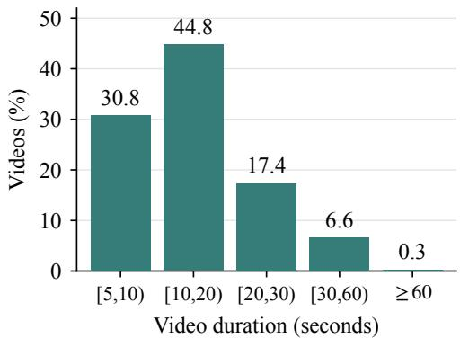  
(a) Duration distribution

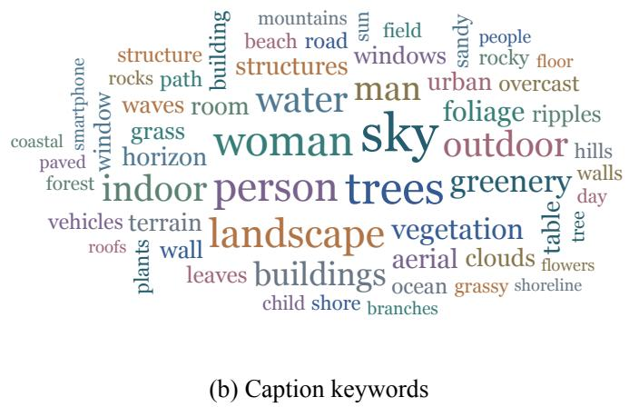  
Figure 6 Overview of the general-purpose video corpus. (a) Percentage of videos in each duration interval. (b) Word cloud of the 60 most frequent words in the captions after filtering out template terms such as “captures” and “environment”.

No use of any memory supervision. We do not use manually constructed memory labels, such as annotations identifying scene revisits through field-of-view overlap or specifying which past frames to retrieve. Historical observations serve only as conditioning inputs, and the flow-matching loss is computed only on the current generation chunk. The model therefore learns to represent and use its history through the video denoising objective, without an additional loss supervising memory retrieval.

## C Evaluation Details

For VBench-Long, we use the oficial evaluation protocol without modification [Huang et al., 2024]. Below, we detail the protocols for static-scene revisitation and of-screen subject reappearance.

## C.1 Static-Scene Revisitation

Inputs and camera trajectory. We use the 100 reference images and their accompanying text prompts from R2M-Bench [Gu et al., 2026]. In our experiments, we found that the original trajectories in R2M-Bench are overly complex for our method and some baselines (e.g., Sana-WM and LingBot-World-Fast), sometimes leading to degraded generation quality and camera trajectory adherence. To fairly evaluate memory capability, we construct a 30-second trajectory that rotates left by 90◦ over the first 7.5 seconds, right by 180◦ over the next 15 seconds, and left by 90◦ over the final 7.5 seconds, finally returning to the initial orientation. Before scoring, videos from all methods are resized while preserving their aspect ratio and center-cropped to 832 × 480 pixels, with their frame counts unchanged. This common evaluation resolution allows pixel-level metrics to be computed under the same spatial preprocessing.

Frame-pair construction. We evaluate three sets of frame pairs within each generated video. Revisit pairs connect temporally separated frames with matching camera orientations and positions. Gap-matched frame pairs are sampled to match the temporal separations of revisit pairs and serve as a baseline for measuring frame similarity at comparable temporal gaps. Short-range pairs measure local consistency, with temporal gaps between 2 and max(6, 0.02T) frames for a video of T frames. Following the original setting, we randomly sample 100 pairs per set.

Evaluation metrics. We report eight metrics from R2M-Bench: PSNR, SSIM, LPIPS, DINO similarity, BoQ similarity, MVPR similarity, object appearance persistence, and object semantic persistence. The first six metrics compare frames at the image level. The last two metrics characterize object persistence: object appearance persistence measures the visual similarity between matched objects, while object semantic persistence measures how strongly the matched detections support the semantic concepts of the anchor objects.

For each frame pair, we detect anchor objects in the earlier frame using GroundingDINO [Liu et al., 2024] with a fixed vocabulary of object concepts, using box and text thresholds of 0.25 and 0.20, respectively, and a non-maximum suppression threshold of 0.6. We retain at most 20 anchors and discard objects whose area is less than 0.2% of the image. SAM2 provides a mask for each object, from which we extract a DINOv2 [Oquab et al., 2023] descriptor. In the later frame, we independently detect up to 5 candidates for each anchor concept and compute their masks and descriptors.

For an anchor u and a candidate c, we compute an appearance score for object appearance persistence:

$$
a _ { u , c } = \mathrm { c l a m p } _ { [ 0 , 1 ] } \left( \frac { 1 + \cos ( d _ { u } , d _ { c } ) } { 2 } \right) ,\tag{10}
$$

where $d _ { u }$ and $d _ { c }$ are their DINOv2 descriptors. For object semantic persistence, the semantic score combines the candidate’s GroundingDINO detection confidence $b _ { c }$ with CLIP similarity [Radford et al., 2021] between its image feature $g _ { c }$ and the text feature $t _ { \ell _ { u } }$ of the anchor’s concept $\ell _ { u } \colon$

$$
s _ { u , c } = \textstyle { \frac { 1 } { 2 } } \mathrm { c l a m p } _ { [ 0 , 1 ] } ( b _ { c } ) + \textstyle { \frac { 1 } { 2 } } \mathrm { c l a m p } _ { [ 0 , 1 ] } \left( \frac { 1 + \cos ( g _ { c } , t _ { \ell _ { u } } ) } { 2 } \right) .\tag{11}
$$

For each anchor, we select the candidate maximizing $0 . 7 a _ { u , c } + 0 . 3 s _ { u , c }$ and accept the match only if this combined score is at least 0.5.

Let N be the total number of anchor objects, M the set of anchors with accepted matches, and $c _ { u } ^ { * }$ the selected candidate for a matched anchor. The two persistence scores are

$$
\mathrm { A p p P e r s i s t } = \frac { 1 } { N } \sum _ { u \in \cal { M } } a _ { u , c _ { u } ^ { * } } , \qquad \mathrm { S e m P e r s i s t } = \frac { 1 } { N } \sum _ { u \in \cal { M } } s _ { u , c _ { u } ^ { * } } .\tag{12}
$$

If no anchor is detected $( N = 0 )$ , both persistence scores are set to zero, and the frame pair is retained in the evaluation.

Memory gain and normalization. For a given metric and video $v \in \mathcal V$ , let $R _ { v } , \ B _ { v }$ , and $S _ { v }$ denote its mean scores over revisit, gap-matched, and short-range pairs, respectively. We define

$$
\mathrm { M G } _ { v } = i ( R _ { v } - B _ { v } ) , \qquad \mathrm { D R } _ { v } = i ( S _ { v } - B _ { v } ) ,\tag{13}
$$

where $i = 1$ for higher-is-better measures and $i = - 1$ for LPIPS. MemoryGain (MG) measures the improvement on revisit pairs over the gap-matched baseline. The dynamic range (DR) measures how much local consistency exceeds this baseline. The Normalized Memory Ratio (NMR) is then computed on the average of MGs and DRs:

$$
\mathrm { N M R } = \frac { \mathrm { m e a n } _ { v \in \mathcal { V } } \mathrm { M G } _ { v } } { \mathrm { m e a n } _ { v \in \mathcal { V } } \mathrm { D R } _ { v } + \epsilon } .\tag{14}
$$

We report MG and NMR separately for each of the eight measures.

## C.2 Of-Screen Subject Reappearance

Benchmark construction. We collect subject and background reference images from Pexels and generate candidate histories with MiniMax-H3-Ref2V [MiniMax, 2026]. We then manually filter the generated histories to obtain 64 high-quality cases covering 40 subjects and 10 backgrounds.

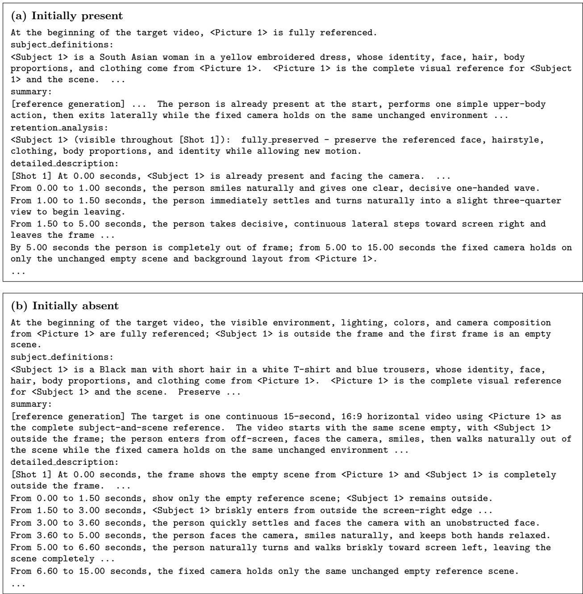  
Figure 7 Example history-generation prompts with the subject (a) initially present and (b) initially absent. Ellipses indicate omitted text.

The history for evaluation. We use 50 sampling steps at a native resolution of $9 6 0 \times 5 4 4$ and resize the outputs to $1 2 8 0 \times 7 2 0$ . We generate 15-second videos to serve as historical context for the baselines. We present two prompt templates: one for cases where the subject appears in the first frame and one for cases where the subject does not appear in the first frame (Fig. 7).

Note that we supply the same source histories to all methods, but the amount of history accessible through their continuation interfaces difers. Specifically, ReCam and the two LingBot-World variants access the full 15-second history. LongLive 2.0 retains the first 29 pixel frames and the last 96 pixel frames, while FramePack-F1 and Helios retain the initial frame and the most recent 73 pixel frames.

Evaluation metrics. We compare the generated continuation with the reference history using four metrics from MSVBench [Shi et al., 2026]. We first apply GroundingDINO [Liu et al., 2024] and SAM [Kirillov et al., 2023] to detect people in each frame and group consecutive detections into intervals of subject visibility.

For face and character consistency, we select one interval of subject visibility from the reference history and one from the generated continuation, then uniformly sample 10 frames from each interval. We compare every sampled history frame with every sampled continuation frame, yielding $1 0 \times 1 0 = 1 0 0$ pairs without temporal alignment.

For face consistency, we detect faces using DeepFace’s OpenCV detector and extract VGG-Face embeddings. Given a history embedding $f _ { i } ^ { H }$ and a continuation embedding $f _ { j } ^ { G }$ , we compute their cosine distance and average over all pairs:

$$
d _ { i j } ^ { \mathrm { f a c e } } = 1 - \frac { ( f _ { i } ^ { H } ) ^ { \mathsf { T } } f _ { j } ^ { G } } { \| f _ { i } ^ { H } \| _ { 2 } \| f _ { j } ^ { G } \| _ { 2 } } , \qquad D _ { \mathrm { f a c e } } = \frac { 1 } { 1 0 0 } \sum _ { i = 1 } ^ { 1 0 } \sum _ { j = 1 } ^ { 1 0 } d _ { i j } ^ { \mathrm { f a c e } } .\tag{15}
$$

For character consistency, we crop the largest detected person in each sampled frame and extract a wholeperson appearance embedding using InceptionNeXt [Yu et al., 2024]. Given history and continuation embeddings $\bar { z } _ { i } ^ { H }$ and $z _ { j } ^ { G }$ , we compute their Euclidean distance and average over the same frame pairs:

$$
d _ { i j } ^ { \mathrm { c h a r } } = \lVert z _ { i } ^ { H } - z _ { j } ^ { G } \rVert _ { 2 } , \qquad D _ { \mathrm { c h a r } } = \frac { 1 } { 1 0 0 } \sum _ { i = 1 } ^ { 1 0 } \sum _ { j = 1 } ^ { 1 0 } d _ { i j } ^ { \mathrm { c h a r } } .\tag{16}
$$

For background consistency, we select one person-free frame from each video. From the history, we take the frame at the midpoint of the empty interval following the selected interval of subject visibility. From the continuation, we take the earliest available empty frame before the subject reappears. We compute and report the DreamSim [Fu et al., 2023] perceptual distance between these two frames.

For clothes consistency, we select one frame from each video and crop the largest detected person in each frame. We provide both crops, together with the subject’s textual description, to Gemini-3.1-pro-preview. The judge first verifies that the subject is present in both images, then rates the consistency of clothing and colors on a scale from 1 to 5, accounting for changes in viewpoint and lighting. Higher scores indicate greater consistency. Note that cases in which the subject is not generated in the continuation are excluded from the afected metrics, since the corresponding measurements cannot be defined.

## D On the context noise schedule

During training, we sample the context and current-chunk noise levels jointly. Let $\begin{array} { r } { r _ { s } ( u ) = \frac { s u } { 1 + ( s - 1 ) u } } \end{array}$ denote the shift transform. We draw

$$
z _ { 1 } , z _ { 2 } \stackrel { \mathrm { i . i . d . } } { \sim } \mathcal { N } ( 0 , 1 ) , \qquad S _ { i } = r _ { s _ { \mathrm { t r a i n } } } ( \mathrm { s i g m o i d } ( z _ { i } ) ) , \qquad s _ { \mathrm { t r a i n } } = 2 . 5 .\tag{17}
$$

The two noise levels are then assigned as

$$
( \sigma _ { \mathrm { c } } , \sigma _ { \mathrm { m } } ) = \left\{ \begin{array} { l l } { \left( \operatorname* { m i n } ( S _ { 1 } , S _ { 2 } ) , \operatorname* { m a x } ( S _ { 1 } , S _ { 2 } ) \right) , } & { \mathrm { w i t h ~ p r o b a b i l i t y ~ } 0 . 9 , } \\ { ( H , H ) , } & { H \sim \mathcal { U } ( 0 . 9 5 , 1 ) , } \end{array} \right.\tag{18}
$$

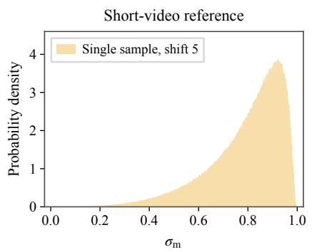

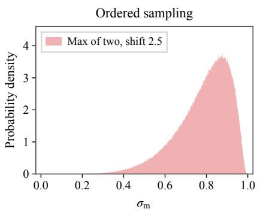

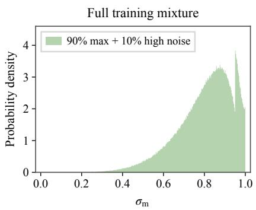  
Figure 8 Probability densities of the training noise level. The reference uses a single shifted logit-normal sample with shift 5. Our min/max branch takes the larger of two samples with shift 2.5; the full training mixture additionally includes 10% uniform samples from [0.95, 1].

Since the original logit-normal distribution assigns relatively little probability mass to the high-noise region, we introduce the second branch to sample additional high-noise training examples. However, taking the maximum of two samples shifts the current-chunk distribution toward higher noise levels. To compensate for this efect, we set $s _ { \mathrm { t r a i n } } = 2 . 5$ , thereby keeping its distribution close to that of the single-sample reference under the commonly used shift-5 configuration for five-second clips at 832 × 448 resolution. Fig. 8 compares their probability densities, showing both the min/max branch and the full training mixture.

We further evaluate how the context noise shift afects generation quality at inference time. Fixing the current-chunk shift at $s _ { \mathrm { m } } = 5 ,$ we compare context shifts $s _ { \mathrm { c } } \in \{ 0 , 0 . 1 , 0 . 5 , 1 , 2 , 5 \}$ . Here, $s _ { \mathrm { c } } ~ = ~ 0$ denotes a fully clean context throughout denoising, while $s _ { \mathrm { c } } = 5$ keeps the context noise level identical to that of the current chunk at every denoising step. Fig. 9 illustrates the corresponding schedules with a normalized denoising progress.

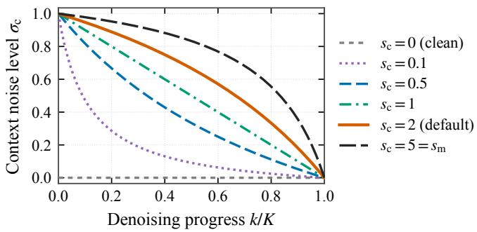  
Table 5 Temporal drift with $s _ { \mathrm { m } } = 5 .$ . ∆ = last $2 \mathrm { s } -$ first ${ \mathrm { 2 } } { \mathrm { s } } ,$ averaged over videos; negative values indicate degradation. Bold marks the best result per column.

<table><tr><td>Subject Background Imaging Aesthetic  $s _ { \mathrm { c } }$  ∆↑</td><td>∆↑</td><td>∆↑</td><td>△↑</td></tr><tr><td>0</td><td>-0.0038</td><td>-0.0012 -0.0346 -0.0002-0.0121</td><td>-0.0554 -0.0565</td></tr><tr><td></td><td>0.1 +0.0001  $\mathbf { 0 . 5 + 0 . 0 0 1 9 }$ </td><td>+0.0024-0.0214</td><td>-0.0445</td></tr><tr><td>1</td><td>-0.0017</td><td>-0.0002-0.0011</td><td>-0.0491</td></tr><tr><td>2 5 +0.0014</td><td>+0.0011</td><td>0.0000-0.0012 +0.0020-0.0012</td><td>-0.0335 -0.0262</td></tr></table>

Figure 9 Context noise schedules with $s _ { \mathrm { m } } ~ = ~ 5$ . Larger $s _ { \mathrm { c } }$ keeps the context noisier; $s _ { \mathrm { c } } = 0$ is clean and $s _ { \mathrm { c } } = 5$ matches the current-chunk schedule.

Tabs. 5 and 6 report temporal drift and overall VBench scores, respectively. We observe that small context noise shifts (0 and 0.1) expose a cleaner context too early, which introduces prediction errors into more denoising steps and degrades the temporal drift metric. This is consistent with our design hypothesis. As the context noise shift increases, the generated videos become increasingly static, as reflected by a lower dynamic degree (from 47.73 to 42.33). This finding echoes Zou et al. [2026]: a noisier history may make it harder for the model to determine the motion structure of newly generated frames in early denoising steps, leading to static videos. A moderate shift, such as 1 or 2, achieves the best trade-of between these two extremes, yielding the highest VBench scores and the most favorable temporal drift metrics. We therefore adopt $s _ { \mathrm { c } } = 2$ as the default setting in our experiments.

Table 6 Efect of the context noise shift on VBench scores. The current-chunk shift is fixed at $s _ { \mathrm { m } } = 5$ . Bold marks the best result per column.
<table><tr><td>Context shift Sc</td><td>Total Score</td><td>Subject Consistency</td><td>Background Consistency</td><td>Motion Smoothness</td><td>Dynamic Degree</td><td>Imaging Quality</td><td>Aesthetic Quality</td></tr><tr><td>0</td><td>79.59</td><td>97.40</td><td>96.81</td><td>98.02</td><td>47.73</td><td>69.50</td><td>57.69</td></tr><tr><td>0.1</td><td>79.78</td><td>97.58</td><td>96.92</td><td>98.11</td><td>46.88</td><td>70.07</td><td>57.92</td></tr><tr><td>0.5</td><td>79.91</td><td>97.72</td><td>97.04</td><td>98.22</td><td>46.31</td><td>69.88</td><td>58.43</td></tr><tr><td>1</td><td>80.01</td><td>97.58</td><td>96.99</td><td>98.19</td><td>46.31</td><td>70.77</td><td>58.37</td></tr><tr><td>2</td><td>79.97</td><td>97.73</td><td>97.01</td><td>98.22</td><td>44.89</td><td>70.68</td><td>58.65</td></tr><tr><td>5</td><td>79.89</td><td>97.79</td><td>97.05</td><td>98.32</td><td>42.33</td><td>70.71</td><td>59.03</td></tr></table>

## E Additional Qualitative Results

We provide additional examples of of-screen subject reappearance, static-scene revisitation, and image-tovideo generation.

## E.1 Of-Screen Subject Reappearance

Case 1: White top  
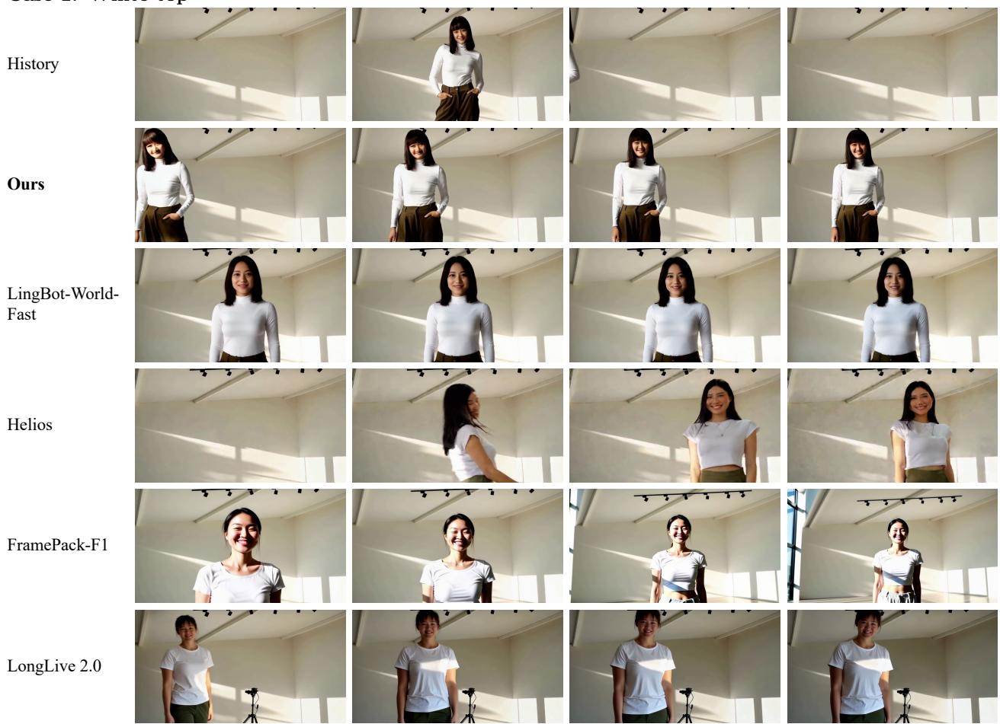  
Continued on the next page.

Figure 10: Case 1: White top (continued)  
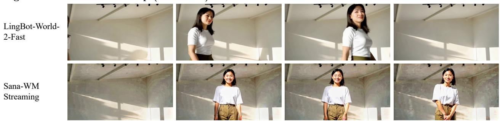  
The East Asian woman in a white top and olive trousers naturally enters the scene from the screen left at a relaxed everyday pace.

Case 2: Tan sweater and eyeglasses  
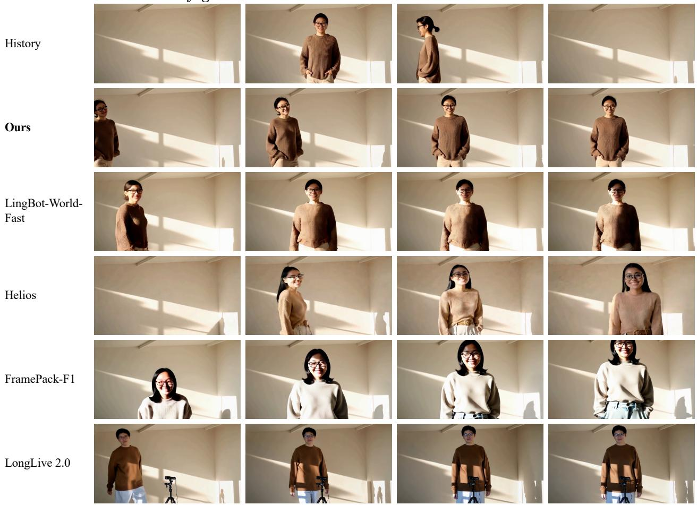  
Continued on the next page.

Figure 10: Case 2: Tan sweater and eyeglasses (continued)  
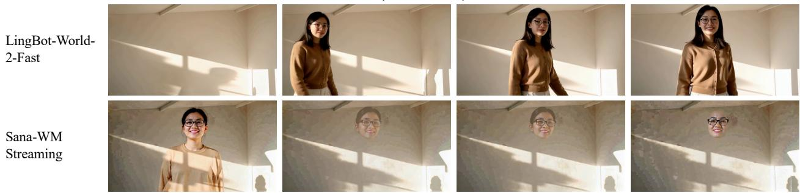  
The Southeast Asian woman with eyeglasses in a tan sweater and light trousers naturally enters the scene from the screen left at a relaxed everyday pace.

Case 3: Formal suit  
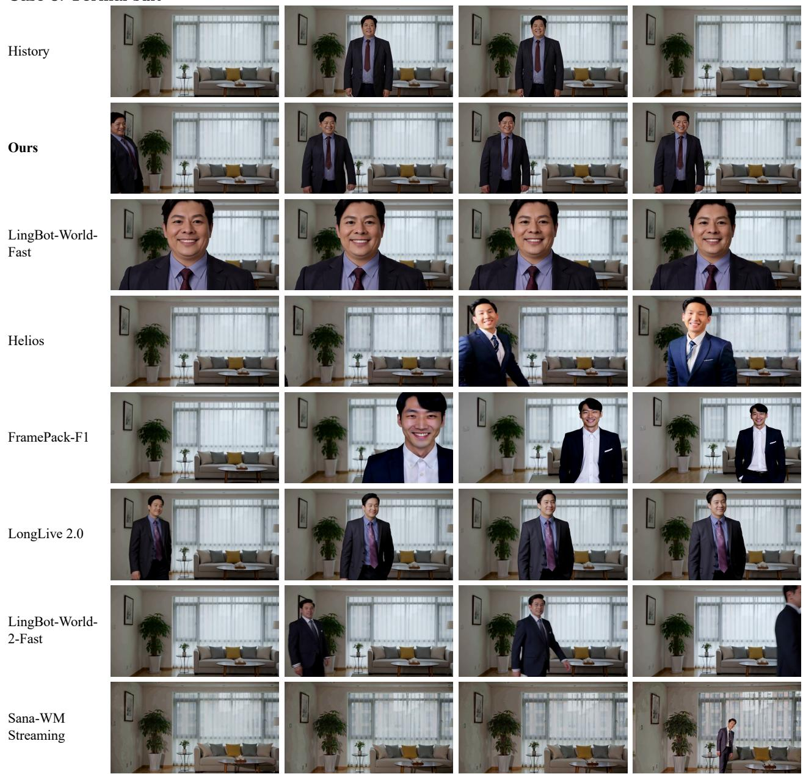  
The East Asian man in a formal suit and tie naturally enters the scene from the screen left at a relaxed everyday pace.

Case 4: Yellow dress, piano  
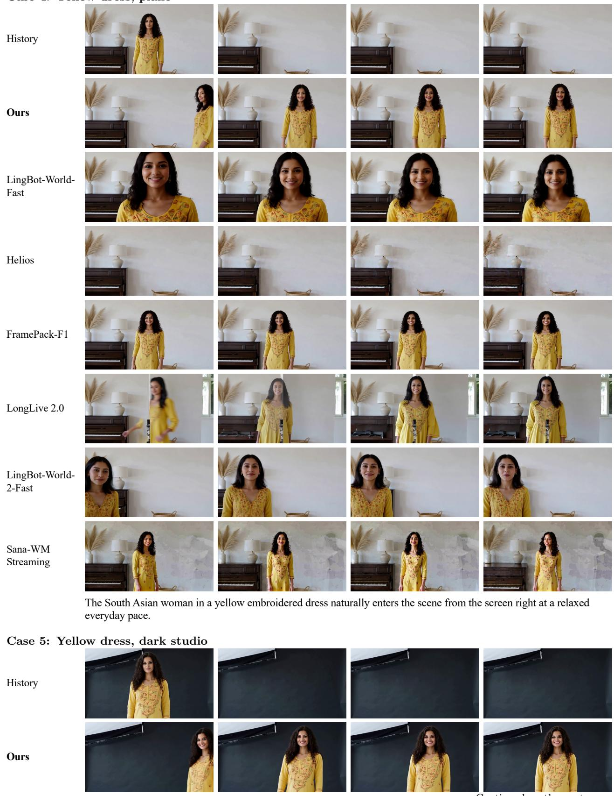  
Continued on the next page.

Figure 10: Case 5: Yellow dress, dark studio (continued)  
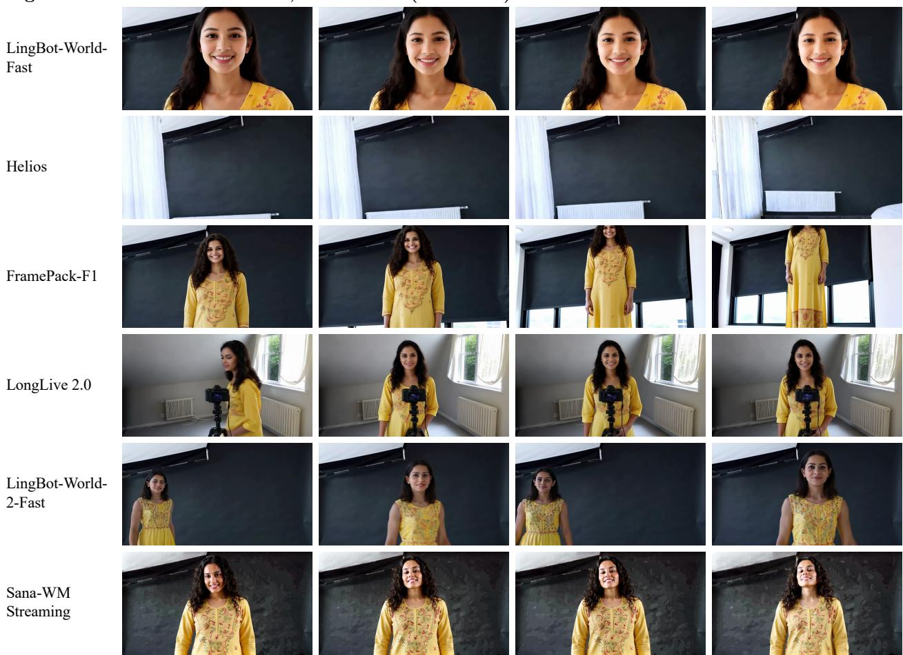  
The South Asian woman in a yellow embroidered dress naturally enters the scene from the screen right at a relaxed everyday pace.

Case 6: Burgundy sweater  
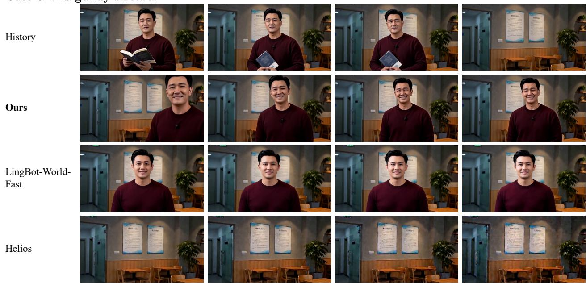  
Continued on the next page.

Figure 10: Case 6: Burgundy sweater (continued)  
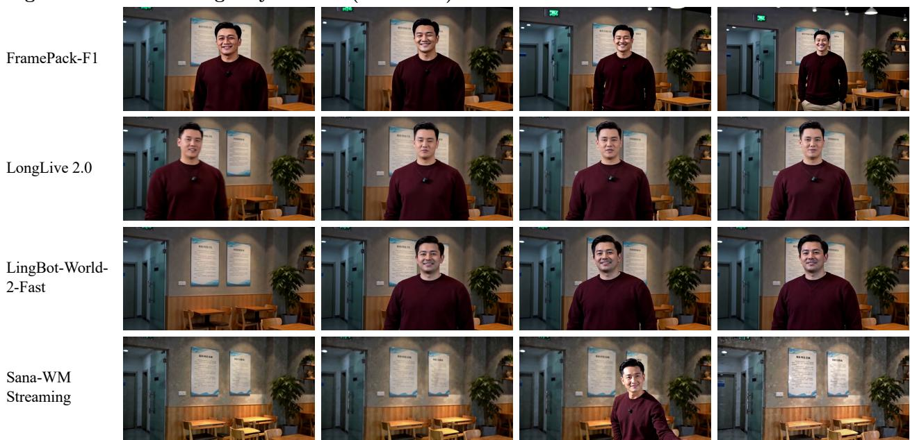  
The man in a burgundy sweater naturally enters the scene from the screen right at a relaxed everyday pace.  
Figure 10 Of-screen subject reappearance across six cases. Each case shows the shared history above ReCam and all six baselines. Zoom in to compare the returning subject’s face, clothing and motion with the history.

## E.2 Static-Scene Revisitation

Fig. 11 shows ReCam and all four camera-controlled baselines across three scenes. For every method, the four columns use frames at 5, 10, 20, and 25 seconds, respectively, from its generated video. Under the prescribed trajectory in Appendix C, the 5/10-second pair shares a target yaw of $- 6 0 ^ { \circ }$ , while the 20/25-second pair shares a target yaw of $+ 6 0 ^ { \circ }$ . Each row therefore contains two revisit comparisons: columns 1 and $\mathcal { Q } \ \left( - 6 0 ^ { \circ } \right)$ , and columns 3 and $\ 4 \ : \ : ( + 6 0 ^ { \circ } )$

Case 1: Lakeside  
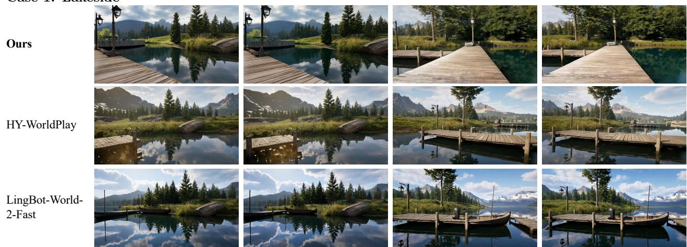  
Continued on the next page.

Figure 11: Case 1: Lakeside (continued)  
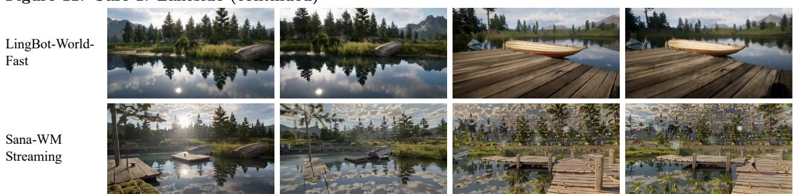  
A serene lakeside clearing, small dock, overturned rowboat, one lantern post, mountain reflections, open natural layout, realistic, suitable for revisit comparison

Case 2: Library  
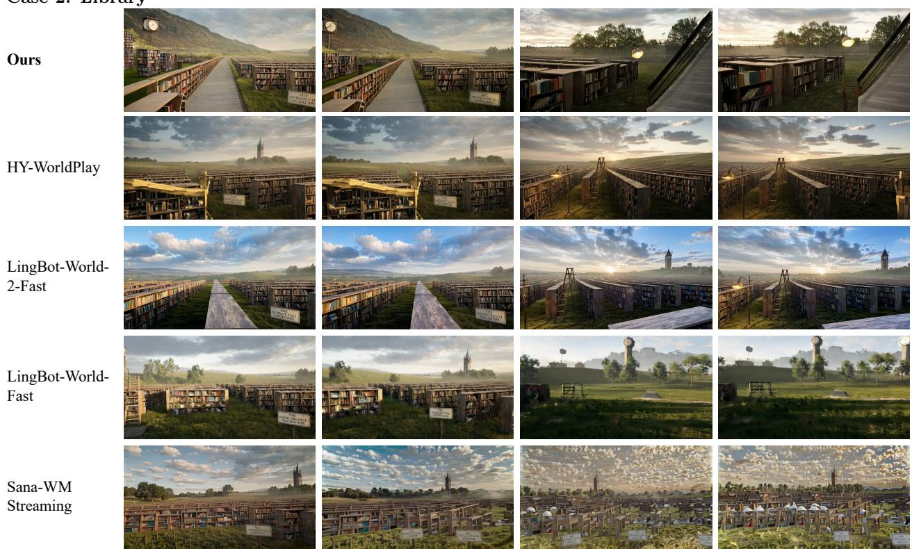  
A vast library field, bookshelves arranged like crop rows, one reading lamp, a ladder, distant clock tower, surreal open intellectual landscape, clear visual reference points

Case 3: Snowy ballroom  
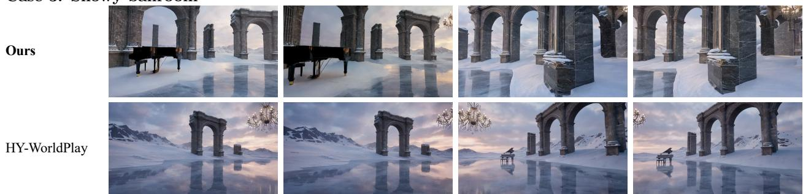  
Continued on the next page.

Figure 11: Case 3: Snowy ballroom (continued)  
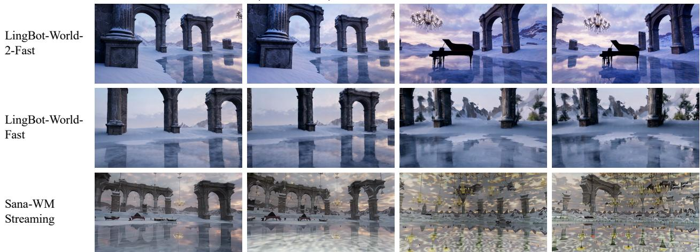  
A snowy ballroom without walls, one chandelier hanging in the air, a grand piano, mirrored floor, open horizon, elegant surreal emptiness, strong landmarks  
Figure 11 Static-scene revisitation across the lakeside, library, and snowy ballroom. Columns show 5, 10, 20, and 25 seconds for every method. Compare columns $1 / 2$ and $3 / 4$ for persistence of scene layout and object appearance after returning to the same target camera pose.

## E.3 Long-Horizon Video Generation

Fig. 12 shows additional VBench image-to-video examples from ReCam, covering people, everyday activities, landscapes, and animals.

Image-to-video examplesThree women wearing patte

  
A woman in a yellow dress sits beside a ukulele, with her hands pressed together in front of her face.girl in a red patterned dre s holds a metal handra l inside a bus as sunlight streams through the win

  
Three women wearing patterned headscarves sit on the sunlit steps of a green building.An lderly woman wearing a colorful headscarf smiles with her hands pressed together.

  
A girl in a red patterned dress holds a metal handrail inside a bus as sunlight streHot water pours from a metal kettle into a paper filter filled with coffee grounds.

  
An elderly woman wearing a colorful headscarf smiles wi co orful plant bud opens against a dark teal background.

  
Mountains and bright flowers surround a winding lake under a blue sky.

  
Boats drift across golden water at sunset beneath silhouetted branches.

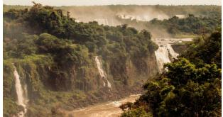

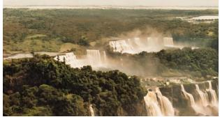  
Mountains and bright flowers surround a winding lake under a blue skBr ad waterfalls descend through a forested landscape filled with mi t.

  
Boats drift across golden water at sunset beneath silhouetted branches.A giant panda sit in fro t of a wooden wall, holding and chewing a stalk of bamboo.

  
Continued on the next page.

Figure 12: Image-to-video examples (continued)A giant panda sits in front of a wooden wall, holding and  
  
A great white shark swims through blue water as patterns of sunlight move across its body.  
Figure 12 Additional results on VBench. All videos are 480p, 30s.