# Reliability-Aware Reconstruction of V-Shaped Surfaces with a Low-Cost Multi-Zone SPAD Sensor

Yohanssen Pratama1

1 Institute for International Strategy and Emerging Technologies, Tokyo International University, 1-13-1 Matoba-Kita, Kawagoe, 350-1197, Japan

Abstract—Low-cost multi-zone single-photon avalanche diode (SPAD) sensors provide compact time-of-flight measurements but are limited by sparse sampling and unreliable depth estimates near geometric discontinuities. This letter presents a reliability-aware reconstruction framework for V-shaped surfaces using two complementary TMF8821 acquisition configurations. Point-wise reliability is learned from sensor confidence, transient peak amplitude, and peak sharpness, and is incorporated into a graph-based depth optimization. The reconstructed geometry is evaluated by robust two-plane fitting and a perpendicular cross-section. Experiments on 60◦, 90◦, and 120◦ targets reduce the mean V-angle error from 11.21◦ to 9.66◦ (13.8%). For the representative 90◦ target, the combined point-to-plane RMSE decreases from 14.56 mm to 13.65 mm.

Index Terms—Single-photon avalanche diode (SPAD), surface reconstruction, time-of-flight (ToF) sensing, reliability-aware optimization, transient measurements, V-shaped surfaces.

## I. INTRODUCTION

Time-of-flight (ToF) sensing is widely used for three-dimensional (3-D) perception. Single-photon avalanche diode (SPAD) sensors are attractive because of their single-photon sensitivity and high temporal resolution [1], [2]. Computational single-photon imaging has further demonstrated recovery of depth and reflectivity from sparse photon measurements by exploiting spatial and transient information [3]–[5].

Accurate reconstruction remains difficult near sharp depth transitions, where mixed returns can produce erroneous or “flying” measurements [6]. This is especially relevant for V-shaped surfaces, whose two planar faces meet at a sharp fold. Compact multi-zone dToF sensors such as the TMF8821 integrate SPAD detection, TDC circuitry, histogram processing, and distance/confidence output in a low-cost module [7]; however, their sparse spatial sampling limits direct surface recovery.

This letter proposes a reliability-aware reconstruction framework that aggregates two complementary acquisition configurations and learns point-wise reliability from confidence, transient peak amplitude, and peak sharpness. Reliability-weighted graph optimization refines the measured depth while preserving transient and local geometric consistency. The main contribution is the use of transientderived, learnable reliability to guide geometric refinement of sparse low-cost SPAD measurements. Experiments on 60◦, 90◦, and 120◦ V-shaped targets reduce the mean angular error from 11.21◦ to 9.66◦ (13.8%).

## II. RELIABILITY-AWARE SPAD SURFACE RECONSTRUCTION

The proposed framework reconstructs V-shaped surfaces from sparse multi-zone SPAD measurements by jointly exploiting depth and transient information. Measurements acquired under two sensor configurations are first aggregated into a common point set. Transientderived features are then used to estimate the reliability of each depth measurement. Finally, the measured depth is refined through a graph-based optimization that balances measurement fidelity, local geometric consistency, and transient peak-position consistency. The overall processing pipeline is shown in Fig. 1.

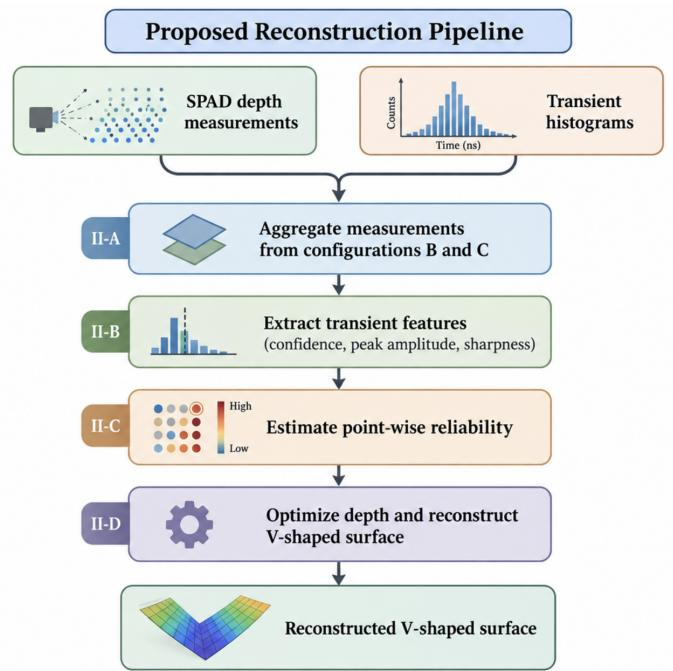  
Fig. 1. Overview of the proposed reliability-aware V-shaped surface reconstruction pipeline.

## A. Multi-Configuration SPAD Acquisition

The measurement setup employs a TMF8821 multi-zone direct time-of-flight (dToF) sensor to acquire both depth and transient photon histograms from the target surface. The sensor is operated using two custom acquisition configurations, denoted as Configurations B and C, to provide complementary spatial sampling of the scene. Both configurations are defined over a 16×10 logical sampling grid and are executed sequentially using 20 measurement masks. Each acquisition frame uses one measurement per mask after a 5-ms settling interval.

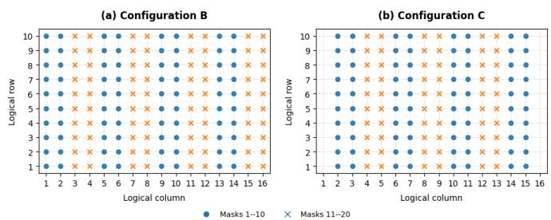  
Fig. 2. Spatial sampling patterns of the custom TMF8821 configurations: (a) Configuration B and (b) horizontally shifted Configuration C.

Measurements with confidence below 75 or nonpositive range are discarded before reconstruction.

Configuration B covers the complete $1 6 \times 1 0$ grid, whereas Configuration C applies a one-column horizontal shift to provide complementary measurements under a different sampling pattern. The two configurations therefore observe the same target geometry with different spatial support. Valid measurements from both configurations are aggregated into a common point set before reliability estimation and depth optimization. The two sampling patterns are shown in Fig. 2.

Each valid sample provides range, confidence, and a temporal histogram. Before optimization, samples below the 20th confidence percentile or 15th photon-count percentile, above the 90th FWHM percentile, farther than 12 mm from the local median depth, or within the most isolated 10% of samples are removed.

After FoV calibration, each reported distance $z _ { i }$ is embedded in the Cartesian parameterization used for reconstruction according to

$$
\begin{array} { r } { x _ { i } = z _ { i } \tan ( \alpha _ { i } ) , } \\ { y _ { i } = z _ { i } \tan ( \beta _ { i } ) , } \end{array}\tag{1}
$$

where the horizontal and vertical viewing angles are given by

$$
\begin{array} { l } { \displaystyle \alpha _ { i } = \left( c _ { i } - \frac { N _ { c } - 1 } { 2 } \right) \frac { \Phi _ { x } } { N _ { c } - 1 } , } \\ { \displaystyle \beta _ { i } = \left( r _ { i } - \frac { N _ { r } - 1 } { 2 } \right) \frac { \Phi _ { y } } { N _ { r } - 1 } . } \end{array}\tag{2}
$$

Here, $r _ { i }$ and $c _ { i }$ are the row and column indices, $N _ { r } = 1 0 , N _ { c } = 1 6$ and $\Phi _ { x } , \Phi _ { y }$ are the calibrated fields of view. The same $4 1 ^ { \circ } \times 5 2 ^ { \circ }$ calibration is used for all final 3-D reconstructions and plane fitting.

## B. Transient Feature Extraction and Reliability Estimation

Each SPAD measurement provides a temporal photon histogram in addition to the estimated range. Rather than treating all depth samples equally, the proposed method derives a reliability value from three complementary measurement cues: sensor confidence, transient peak amplitude, and peak sharpness.

After background subtraction, peak amplitude is log-transformed and robustly normalized, while sharpness is defined as one minus the normalized FWHM of the dominant transient peak. The normalized feature vector for point � is

$$
\mathbf { f } _ { i } = [ C _ { i } , ~ P _ { i } , ~ S _ { i } ] ^ { T } ,\tag{3}
$$

where $C _ { i } , \ P _ { i } ,$ and $S _ { i }$ represent confidence, peak amplitude, and peak sharpness, respectively. Measurement reliability is defined as

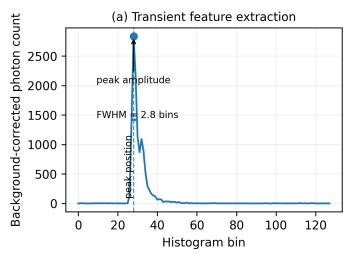

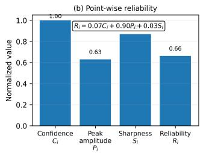  
Fig. 3. Transient feature extraction and point-wise reliability: (a) representative transient histogram and (b) normalized features and learned reliability $R _ { i }$

$$
R _ { i } = w _ { C } C _ { i } + w _ { P } P _ { i } + w _ { S } S _ { i } ,\tag{4}
$$

subject to

$$
w _ { C } + w _ { P } + w _ { S } = 1 , \qquad w _ { C } , w _ { P } , w _ { S } \geq 0 .\tag{5}
$$

The weights are optimized jointly with the reconstructed depth rather than manually fixed. Fig. 3 illustrates the transient features and resulting point-wise reliability.

For the representative 90◦ experiment, the learned coefficients are $( w _ { C } , w _ { P } , w _ { S } ) \ = \ ( 0 . 0 6 9 , 0 . 9 0 3 , 0 . 0 2 8 )$ , indicating a dominant peak-amplitude contribution in this scene.

## C. Reliability-Aware Depth Optimization

Let $z _ { i } ^ { \mathrm { { o b s } } }$ and $z _ { i }$ denote the observed and optimized depths of point �, respectively. The reconstructed depth is obtained by minimizing

$$
\begin{array} { r } { \mathcal { L } = \lambda _ { d } \mathcal { L } _ { \mathrm { d a t a } } + \lambda _ { s } \mathcal { L } _ { \mathrm { s m o o t h } } + \lambda _ { p } \mathcal { L } _ { \mathrm { p e a k } } + \lambda _ { w p } \mathcal { L } _ { w p } + \lambda _ { r m } \mathcal { L } _ { r m } . } \end{array}\tag{6}
$$

The reliability-weighted data term is

$$
\mathcal { L } _ { \mathrm { d a t a } } = \frac { 1 } { N } \sum _ { i } R _ { i } \rho \left( z _ { i } - z _ { i } ^ { \mathrm { o b s } } \right) ,\tag{7}
$$

where $\rho ( t ) = \sqrt { t ^ { 2 } + \epsilon ^ { 2 } }$ is the Charbonnier penalty; thus lowerreliability samples can move farther from their observations.

Spatial consistency is imposed using a �-nearest-neighbor graph,

$$
\mathcal { L } _ { \mathrm { s m o o t h } } = \frac { 1 } { \vert \mathcal { E } \vert } \sum _ { ( i , j ) \in \mathcal { E } } g _ { i j } \rho ( z _ { i } - z _ { j } ) ,\tag{8}
$$

where $g _ { i j }$ is the transient-aware graph weight. $\mathcal { L } _ { \mathrm { p e a k } }$ matches normalized optimized depth to normalized peak position, $\mathcal { L } _ { w p }$ penalizes deviation of the learned reliability coefficients from (0.4, 0.4, 0.2), and $\mathcal { L } _ { r m }$ preserves their initial mean reliability.

## D. V-Shaped Surface Geometry Estimation

For quantitative evaluation, the reconstructed point cloud is separated into the two dominant planar surfaces of the V-shaped target. Candidate planes are estimated using robust fitting, with local point density and spatial connectivity used to suppress sparse outliers.

The initial plane hypotheses follow a RANSAC-style robust modelfitting strategy [8], after which density and connectivity criteria favor spatially coherent support across each V-shaped face.

Each reconstructed plane is represented as

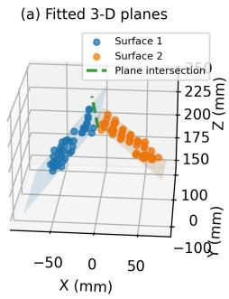

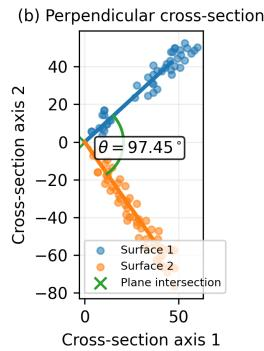  
Fig. 4. V-shaped geometry estimation: (a) fitted 3-D planes and (b) perpendicular cross-section for the opening angle �.

$$
a x + b y + c z + d = 0 ,\tag{9}
$$

with normal vector $\mathbf { n } = [ a , b , c ] ^ { T }$ . The intersection direction of the two planes is

$$
\mathbf { l } = \mathbf { n } _ { 1 } \times \mathbf { n } _ { 2 } .\tag{10}
$$

A cross-sectional plane perpendicular to l is then used to obtain the two surface directions. The V opening angle is computed from

$$
\theta = \cos ^ { - 1 } \left( \frac { \mathbf { d } _ { 1 } ^ { T } \mathbf { d } _ { 2 } } { \lVert \mathbf { d } _ { 1 } \rVert \lVert \mathbf { d } _ { 2 } \rVert } \right) ,\tag{11}
$$

where $\mathbf { d } _ { 1 }$ and $\mathbf { d } _ { 2 }$ denote the two oriented surface directions in the cross-section. The geometry is illustrated in Fig. 4.

## III. EXPERIMENTS AND RESULTS

## A. Experimental Setup

Experiments were conducted using a TMF8821 multi-zone SPAD ToF sensor. Three V-shaped targets with ground-truth opening angles of 60◦, 90◦, and 120◦ were evaluated. For each target, transient measurements were acquired using two sensor configurations and processed using identical reconstruction parameters.

The sensor field of view was calibrated to $4 1 ^ { \circ } \times 5 2 ^ { \circ }$ and kept fixed for all experiments. No ground-truth angle information was used during reconstruction or plane estimation. The setup and sensor module are shown in Fig. 5.

All targets use 500 iterations with $( \lambda _ { d } , \lambda _ { s } , \lambda _ { p } , \lambda _ { w p } , \lambda _ { r m } ) =$ (1.0, 0.8, 0.03, 0.02, 0.10) and depth/weight learning rates of 0.05/0.002; no target-specific tuning is used.

## B. V-Angle Reconstruction Accuracy

The opening angle was estimated from the fitted 3-D planes using the perpendicular cross-section of Section II-D. Table 1 summarizes the estimates and absolute errors before and after optimization.

The optimization reduces the angular error for all three targets, with the mean error decreasing from 11.21◦ to 9.66◦ (13.8%). The 120◦ target remains the most challenging case under sparse spatial sampling. Fig. 6 shows the corresponding perpendicular cross-sections before and after optimization.

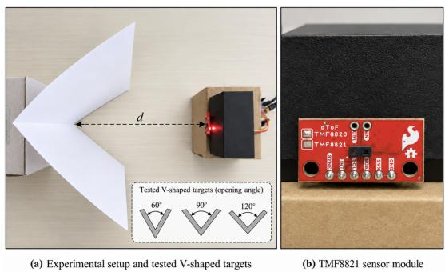  
Fig. 5. Experimental setup: (a) TMF8821-to-target arrangement and (b) TMF8821 multi-zone dToF sensor module.

TABLE 1. V-angle reconstruction accuracy before and after optimization.
<table><tr><td>GT</td><td>Before optimization Est.</td><td>Error</td><td>After optimization Est. Error</td></tr><tr><td>60° 90°</td><td>66.42°</td><td>6.42°</td><td>65.21° 5.21°</td></tr><tr><td>120°</td><td>98.91° 138.29°</td><td>8.91° 18.29°</td><td>97.45° 7.45° 136.31° 16.31°</td></tr><tr><td>Mean</td><td>一</td><td>11.21°</td><td>一 9.66°</td></tr></table>

## C. Geometric Reconstruction Quality

The 90◦ target is used as a representative example of local planar conformity. Fig. 7 compares the calibrated 3-D reconstruction and fitted planes before and after optimization.

Geometric error is quantified by the point-to-plane RMSE,

$$
\mathrm { R M S E } _ { \mathrm { p l a n e } } = \sqrt { \frac { 1 } { N } \sum _ { i = 1 } ^ { N } d _ { i } ^ { 2 } , }\tag{12}
$$

where �� is the perpendicular point-to-plane distance; multipeak boundary measurements are excluded. The combined RMSE decreases from 14.56 mm to 13.65 mm (6.24%). Surface 1 decreases from 19.06 mm to 18.76 mm, while Surface 2 decreases from 8.95 mm to 6.48 mm, indicating improved local planar conformity.

## D. Effect of Multi-Configuration Acquisition

To isolate the contribution of complementary spatial sampling, the 90◦ target is additionally evaluated using Configuration B alone, the aggregated B+C measurements before optimization, and the aggregated B+C measurements after the proposed optimization. As shown in Fig. 8, this comparison separates the effect of increased spatial support from the subsequent reliability-aware depth refinement.

Table 2 summarizes the same 90◦ ablation numerically. Using the second acquisition configuration increases the retained spatial support from 93 to 176 points and reduces the angular error from 12.32◦ to 8.91◦. The proposed reliability-aware optimization further reduces the error to 7.45◦.

## IV. CONCLUSION

A reliability-aware framework for V-shaped surface reconstruction using a low-cost multi-zone SPAD sensor was presented. Across 60◦, 90◦, and 120◦ targets, the mean V-angle error decreased from 11.21◦ to 9.66◦ (13.8%); for the representative 90◦ target, point-to-plane RMSE decreased from 14.56 mm to 13.65 mm. The results demonstrate the benefit of transient-derived reliability for sparse SPAD reconstruction.

V-Angle Reconstruction Accuracy Perpendicular cross-section before and after optimization

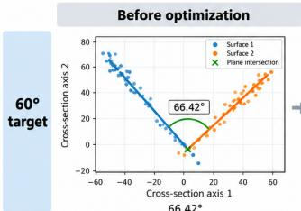

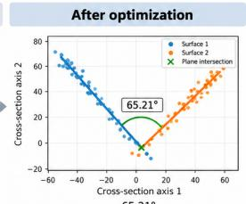

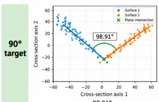

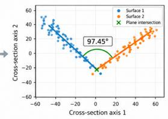

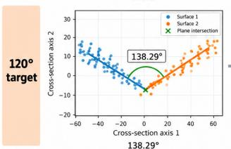

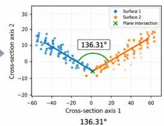

Fig. 6. V-angle reconstruction before and after optimization for 60◦, 90◦, and 120◦ targets.  
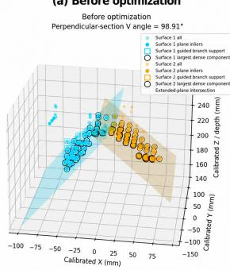

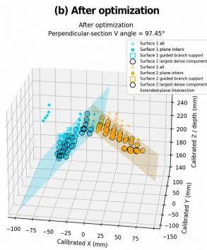  
Fig. 7. Geometric reconstruction quality for the 90◦ V-shaped target before and after reliability-aware optimization.

## REFERENCES

[1] C. Bruschini, H. Homulle, I. M. Antolovic, S. Burri, and E. Charbon, “Single-photon avalanche diode imagers in biophotonics: Review and outlook,” Light: Science & Applications, vol. 8, p. 87, 2019.

[2] S. Scholes, G. Mora-Martín, F. Zhu, I. Gyongy, P. Soan, and J. Leach, “Fundamenta limits to depth imaging with single-photon detector array sensors,” Scientific Reports, vol. 13, p. 176, 2023.

[3] A. Kirmani, D. Venkatraman, D. Shin, A. Colaco, F. N. C. Wong, J. H. Shapiro, and V. K. Goyal, “First-photon imaging,” Science, vol. 343, no. 6166, pp. 58–61, 2014.

[4] D. Shin, F. Xu, D. Venkatraman, R. Lussana, F. Villa, F. Zappa, V. K. Goyal, F. N. C. Wong, and J. H. Shapiro, “Photon-efficient imaging with a single-photon camera,” Nature Communications, vol. 7, p. 12046, 2016.

[5] Y. Altmann, X. Ren, A. McCarthy, G. S. Buller, and S. McLaughlin, “Robust bayesian target detection algorithm for depth imaging from sparse single-photon data,” IEEE Transactions on Computational Imaging, vol. 2, no. 4, pp. 456–467, 2016.

[6] I. Chugunov, S.-H. Baek, Q. Fu, W. Heidrich, and F. Heide, “Mask-tof: Learning microlens masks for flying pixel correction in time-of-flight imaging,” in Proceedings

Multi-Configuration Ablation for the 90° V-shaped Target  
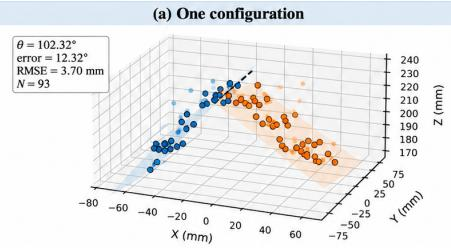

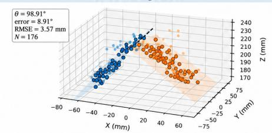

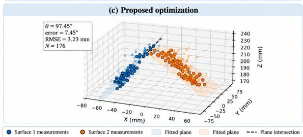  
Fig. 8. Ablation on the 90◦ target: (a) one configuration before optimization, (b) two aggregated configurations before optimization, and (c) two configurations after the proposed reliability-aware optimization.

TABLE 2. Multi-configuration ablation on the $9 0 ^ { \circ }$ target.
<table><tr><td>Method</td><td>Points</td><td>Est. angle</td><td>Error</td></tr><tr><td>Config. B only</td><td>93</td><td>102.32°</td><td>12.32°</td></tr><tr><td>B+C raw</td><td>176</td><td>98.91°</td><td>8.91°</td></tr><tr><td>B+C proposed</td><td>176</td><td>97.45°</td><td>7.45°</td></tr></table>

of the IEEE/CVF Conference on Computer Vision and Pattern Recognition, 2021, pp. 9116–9126.

[7] ams OSRAM, TMF8820/21/28 Multizone Time-of-Flight Sensor, ams OSRAM, product datasheet.

[8] M. A. Fischler and R. C. Bolles, “Random sample consensus: A paradigm for model fitting with applications to image analysis and automated cartography,” Communications of the ACM, vol. 24, no. 6, pp. 381–395, 1981.