# S larRenderer: Few-Step Generative Reference Rendering

Guian Fang1, Shengju Qian2, Dongyue Lu1, Junchao Huang<sup>3,</sup> <sup>4</sup>, Lutao Jiang5 Xin Wang2, Yiren Song1, Li Jiang<sup>3,</sup> <sup>4</sup>, Mike Zheng Shou1 <sup>1</sup>NUS, <sup>2</sup>LIGHTSPEED, <sup>3</sup>CUHK(SZ), <sup>4</sup>SLAI, <sup>5</sup>HKUST(GZ)

€ Project Page: enderfga.cn/SolarRenderer

§ GitHub: github.com/Enderfga/SolarRenderer

õ Dataset: huggingface.co/datasets/Enderfga/SolarRenderer-Data

ó Weights: huggingface.co/Enderfga/SolarRenderer

Figure 1 SolarRenderer renders structure of any kind into realistic video. Each wedge pairs a structure (inner ring) with its rendering, and seven of the ten structure types are unseen in training. Readers can click and play the animation using Adobe Acrobat.

## Abstract

Game engines and coding agents can specify the layout, motion, and camera of a scene, yet turning such coarse structure into realistic video requires a renderer that follows the structure and completes the appearance it leaves open. Existing renderers are tied to the representation of one engine, need tens of denoising steps or a costly distillation of their own, and learn from conditions that are not aligned with their target videos. We present SolarRenderer, a structure-conditioned video renderer that adapts a frozen MiniMax-H3 33B backbone with two lightweight LoRAs. Structural videos enter the native reference pathway of the backbone at the positions of the frames they describe, without a type identifier and described only in plain text, so that a single control LoRA follows arbitrary structural representations. Starting from a pretrained four-step LoRA, structure-guided distribution matching renders in four steps, 12.3 times faster than 50-step sampling, while preserving the learned control. A block-causal variant extends the same design to streaming and renders 768p video in real time. To train the model, we build a frame-aligned corpus of 136K clips from game engines, simulators, and YouTube videos. Experiments on an in-distribution test set and a generalization benchmark of 16 structural representations show that SolarRenderer achieves state-of-the-art results across both, and generalizes to 11 unseen representations, including pose skeletons, drawings, and point clouds.

## 1 Introduction

Video generation models now produce realistic footage from a text prompt or a single image. However, visual realism alone does not ensure consistent 3D geometry, physically plausible dynamics, or temporal coherence (Huang et al., 2024; Bansal et al., 2025; Lu et al., 2026a; Ying et al., 2026; Lu et al., 2026c). In game development, film previsualization, and agent-driven content creation, creators often specify the scene layout, object motion, and camera trajectory in advance. Designers block out scenes, animators key character motion, and coding agents script camera paths. These structural priors turn the task into rendering: producing realistic video that follows the specified scene and its evolution. With geometry and dynamics specified by these priors, the video model can focus on appearance synthesis, reducing the scope for structural and temporal drift. Recent systems therefore link executable world state to video generation through proxy videos (Chen et al., 2026b) or engine bufers (Zhan et al., 2026; Lin et al., 2026a), so that the engine determines scene evolution and a video model renders it.

Building such a renderer still faces three problems. First, control is tied to a fixed set of representations. Engine-driven renderers are built around the one representation their engine exports, such as white-box frames (Zhan et al., 2026), semantic maps (Lu et al., 2026d), proxy videos (Chen et al., 2026b), or full G-bufers (Lin et al., 2026a), and general controllable generators attach a branch per condition (Zhang et al., 2023; NVIDIA, 2025) or label the type of each input (Mao et al., 2026), so a new engine or a new kind of proxy calls for a new model. Second, rendering is slow. A large video backbone needs tens of denoising steps, and distilling a structure-conditioned model of this size from scratch is costly (Lin et al., 2026a), which keeps such renderers far from interactive use. Third, training pairs are rarely aligned frame by frame. Conditions estimated from real videos carry estimator errors and difer from engine proxies (Xu et al., 2026), and engine-paired data so far come from a single engine.

We present SolarRenderer, which adapts a frozen MiniMax-H3 33B Ref2VA backbone (MiniMax, 2026) and addresses the three problems in turn (Figure 2). For omni-structure control, structural videos enter the native reference pathway of the backbone, each structural latent takes the RoPE (Su et al., 2021) position of the target frame it describes, and no reference carries a type identifier, as each representation is described in plain text instead, so that a single control LoRA (Hu et al., 2022) follows block-outs, semantic maps, shaded geometry, and body meshes alike. For fast rendering, we post-train a pretrained four-step LoRA of the same backbone with structure-guided distribution matching, which extends distribution matching distillation (Yin et al., 2024b) with a teacher extrapolated along the structural condition, so that the model renders in four steps, 12.3 times faster than 50-step sampling while preserving the learned control. A block-causal variant of the same design further streams 768p video in real time. For frame-aligned supervision, we collect 136K clips from eight sources whose structure is exported by game engines and simulators or fitted to YouTube videos, so that each structural frame matches its target frame in both content and timing.

We evaluate SolarRenderer on an in-distribution test set with ground-truth videos and on a generalization benchmark that covers 16 structural representations, 11 of them unseen in training. The results show that our four-step model outperforms existing acceleration LoRAs and the oficial backbone, surpasses existing structure-conditioned renderers, and achieves a new state of the art in structure-conditioned video rendering. Notably, our method shows strong generalization to unseen structure. It faithfully renders pose skeletons, pencil storyboards, children’s crayon drawings, wireframes, and point clouds, none of which appears in training. Our contributions are fourfold:

• We present a renderer that handles any structural representation with a single control LoRA through the native reference pathway, without type identifiers or added branches.

• We propose structure-guided distribution matching, which post-trains a pretrained four-step LoRA so that our model renders in four steps while preserving its structural control.

• We build a frame-aligned paired corpus of 136K clips from game engines, simulators, and YouTube videos, in which every structural frame is aligned with its target frame.

• Our method achieves state-of-the-art results on an in-distribution test set and a generalization benchmark of 16 structural representations, including 11 unseen in training, and its causal variant renders 768p video in real time.

## 2 Related Work

RenderingEngineandAgentStateintoVideo. World modeling encompasses 3D and 4D scene generation (Kong et al., 2025) and interactive proxies that provide feedback for agent learning (Yang et al., 2026b). Recent systems let a game engine, a simulator, or a coding agent decide what happens in a scene and let a video model render it. Most of them train a renderer on one structural representation exported by their engine, such as white-box frames (Zhan et al., 2026; Gomez-Nogales et al., 2026), semantic maps (Lu et al., 2026d), depth and normal maps (Chi et al., 2026), projected 3D boxes (Huang et al., 2026b), or the proxy video of a code world model (Chen et al., 2026b; Liao and Liu, 2026), and several distill the renderer to a few streaming steps for real-time use (VAST-AI-Research, 2026; Lu et al., 2026d). A related branch renders from full G-bufers that also carry materials and lighting (Zeng et al., 2026; Lin et al., 2026a; Huang et al., 2026c; Liang et al., 2025). Other works avoid paired proxy data, either by learning from posed RGB-D video (Xu et al., 2026) or by showing proxy renders to a frozen model during the early denoising steps only (Liang et al., 2026). However, each renderer is built around the representation of its own engine, so a new engine or a new kind of proxy calls for a new renderer. SolarRenderer follows many kinds of structure with a single control LoRA, including structure it has never seen.

Structure-Conditioned Video Generation. Controllable video generation commonly injects conditions in one of two ways. Branch-based methods attach a trainable copy or added control blocks to the backbone, from ControlNet (Zhang et al., 2023) to multi-condition variants on video backbones (Alibaba PAI, 2026; NVIDIA, 2025; NVIDIA et al., 2025; Jiang et al., 2025). Sequence-based methods place condition tokens next to the target tokens and read them with full attention, often through a small LoRA (Tan et al., 2025; Ju et al., 2025; Fang et al., 2025; Mao et al., 2026; Tang et al., 2026; Gao et al., 2026). Further works steer generation through warped noise, 3D tracking videos, reference videos, predicted LoRAs, or jointly generated intrinsic channels (Burgert et al., 2025; Gu et al., 2025; Bian et al., 2026; Wu et al., 2026; Xi et al., 2025; Lu et al., 2026b), and training-free methods condition an existing model through structured first frames or a ControlNet-style world model (Li et al., 2025; Wang et al., 2025b). However, these methods add parameters for control, label the type of each condition, or are trained on a fixed set of condition kinds. SolarRenderer passes an untyped structural video through the native reference pathway of the backbone with one LoRA, so that the same model also follows structure unseen in training.

Few-Step Distillation and Acceleration Adapters. Few-step video generation is usually obtained in two ways. One distills a multi-step teacher into a few-step student by distribution matching (Yin et al., 2024b,a; Liu et al., 2026; Wang et al., 2026c; Yu et al., 2026; Huang et al., 2025; Zhao et al., 2026) or consistency and flow-map distillation (Zheng et al., 2026; Gu et al., 2026). The other trains a plug-in acceleration LoRA once on a base model and attaches it to models derived from the same base (Luo et al., 2023; Lin and Yang, 2024; Yang et al., 2026a; Hao AI Lab, 2026), with recent work making such LoRAs transferable between base and distilled models (Li et al., 2026b; Wang et al., 2026b). For conditional models, several works distill the conditional model itself or re-tune its control module after distillation (Wang et al., 2026a; Li et al., 2026a; Sun et al., 2026), and MotionEcho (Rong et al., 2025) restores motion control at inference with guidance from the slow teacher. However, distilling a large control model from scratch is costly, and a generic few-step adapter attached unchanged lowers the visual quality and first-frame fidelity of the control model. SolarRenderer post-trains a four-step LoRA on the frozen control model, with a distribution-matching teacher extrapolated toward its structure-conditioned prediction.

## 3 SolarRenderer: Native Reference Rendering

SolarRenderer turns a pretrained video backbone into a renderer by adding only lightweight adapters. In this section, we formulate the rendering task and outline the design (Section 3.1), describe how structural references are aligned with the target and described in text (Section 3.2), and present the two-stage training of control and acceleration (Section 3.3), followed by its causal streaming extension (Section 3.4).

## 3.1 Problem Formulation and Overview

Structure-Conditioned Rendering. Let $V = ( v _ { 1 } , \dots , v _ { T } )$ be a target video and $\boldsymbol { S } = ( s _ { 1 } , \dots , s _ { T } )$ a structural video rendered from the same camera at the same timestamps. Depending on the source, S is a grey block-out, a semantic map, a depth map, object masks with skeletons, or a body mesh. Given S, an optional first frame $I ,$ and a text description $c ,$ SolarRenderer models

$$
p _ { \theta } ( V \mid S , I , c ) ,\tag{1}
$$

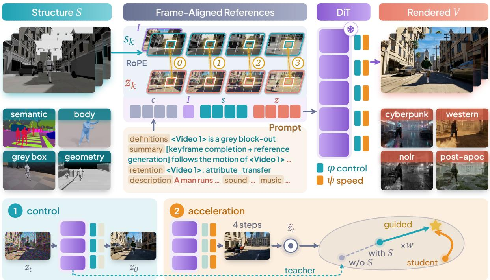  
Figure 2 SolarRenderer reads any structural video through the native reference pathway of a frozen DiT. The sequence of the single-stream DiT holds text, the optional first frame I, structural latents s , and noisy latents z , each s taking the RoPE position (t, h, w) of z<sub>k</sub> and I index 0. <sup>1</sup> The control LoRA ϕ is trained by flow matching. <sup>2</sup> The acceleration LoRA ψ is distilled toward the teacher with S, extrapolated by w from the one without S.

where S or I may be absent while c is always provided. This yields four input combinations, namely <sup>1</sup> structure with a first frame, <sup>2</sup> structure alone, <sup>3</sup> a first frame alone, and <sup>4</sup> text alone. The structural video specifies the scene state, including the layout, geometry, character bodies, motion, and camera of every frame, but leaves materials, illumination, and tiny structures undetermined. Rendering is therefore a constrained completion problem, in which the output must agree with S wherever S is informative, while I, c, and the pretrained prior supply the remaining appearance.

Design Overview. A large video backbone already provides a strong appearance prior, so SolarRenderer keeps the backbone frozen and adds only lightweight adapters (Figure 2). Structural references enter through the native reference pathway with target-aligned positions, and fixed sentences in the prompt describe each reference. A control LoRA follows these references, and an acceleration LoRA from the same backbone enables few-step rendering.

## 3.2 Frame-Aligned Reference Conditioning

Native Reference Pathway. A renderer must match every structural frame with the target frame it describes. Instead of attaching a ControlNet branch (Zhang et al., 2023) or concatenating channels, both of which introduce parameters trained from scratch, we feed the structural video and the optional first frame through the reference pathway of the backbone (MiniMax, 2026). This pathway packs text, reference videos, audio, and the target video into one full-attention sequence (Figure 2), so the control adapter can inherit the pretrained ability to read reference videos. We refer to the tokens of the supplied references as reference tokens and to those of the generated video as target tokens. Yet native reference tokens occupy a separate temporal segment before the clip and their own spatial grid, so the zero-shot backbone uses a structural video as a loose reference and copies it or changes the camera instead of following the structure.

Frame-Aligned Positional Encoding. Since rotary position embedding (Su et al., 2021) makes attention depend on the relative ofset between tokens, we supply the missing correspondence through positions. Each reference token receives the RoPE coordinates of the target token it describes. The k-th structural latent frame shares the temporal index and spatial grid of the k-th target latent frame, and the first frame is encoded as a static clip at index 0 (Figure 2). Tokens at the same position remain distinguishable through their timesteps, as reference tokens keep the near-clean value that the backbone assigns to <sup>z̃</sup>reference inputs while target tokens carry the current noise level. This extends shared positions for aligned image conditions (Tan et al., 2025) to temporally aligned video and, like in-context control of video models without structural changes (Fang et al., 2025), requires no additional module.

Untyped References with Fixed Descriptions. Structural representations from diferent sources constrain diferent aspects of the target (Section 4.1). We keep reference tokens untyped in the sequence, without a type identifier or a modality embedding, so the adapter infers what a reference constrains from the structural video itself. The prompt additionally describes each representation with two fixed sentences, a definition of what it shows and a rule that names the attributes to follow and the visual properties that must not appear. For a scene block-out:

<Video 1> is an untextured grey block-out of the scene, rendered from the same camera as the target video, giving   
the layout, the large geometry, the characters’ bodies, their motion and the camera of every frame.   
<Video 1> (frame-by-frame layout, geometry, motion and camera): attribute\_transfer - the layout, large shapes,   
character bodies, motion and camera are followed exactly; small objects, materials, colours and lighting are not given   
by <Video 1> and are the target video’s own; the grey look of <Video 1> is not shown.

The same representation always receives the same sentences. Open-vocabulary text describes each representation, so a new format needs only a new description, with no added parameters or retraining.

## 3.3 Decoupled Two-Stage Training

SolarRenderer should render with few sampling steps while retaining the control learned at full steps. Training both objectives together does not achieve this, because whenever the acceleration objective can update the control adapter, it also alters how the structure is followed. Distilling a few-step student from scratch is costly at this scale and prone to instability (Lin et al., 2026a). We therefore decouple control and acceleration into two stages on one frozen backbone, which also preserves its visual prior and keeps it compatible with adapters trained on the same weights.

Stage 1: Control Adaptation. We train a control LoRA (Hu et al., 2022) with the flow-matching objective. Each adapted linear layer adds a low-rank update to its frozen pretrained weight $W _ { 0 } .$

$$
W = W _ { 0 } + \Delta W _ { \mathrm { c t r l } } , \qquad \Delta W _ { \mathrm { c t r l } } = \frac { \alpha } { r } B A ,\tag{2}
$$

where only the factors B and A of rank r are trained and $\alpha / r$ scales the update. The adapter is applied to the attention and feed-forward projections of every block. Since the backbone is a single-stream transformer, the same adapted projections process reference and target tokens, so one adapter learns both to interpret the structure and to render from it. With a clean target latent $z _ { \mathrm { 0 } }$ , Gaussian noise ϵ, and noise coordinate t, the objective (Lipman et al., 2023) is

$$
z _ { t } = ( 1 - t ) z _ { 0 } + t \epsilon , \qquad \mathcal { L } _ { \mathrm { F M } } = \mathbb { E } _ { z _ { 0 } , \epsilon , t , c , S , I } \left\| f _ { \theta _ { 0 } , \phi } \big ( z _ { t } , t , c , R ( S , I ) \big ) - ( \epsilon - z _ { 0 } ) \right\| _ { 2 } ^ { 2 } ,\tag{3}
$$

where $\theta _ { 0 }$ denotes the frozen backbone, $\phi$ the control adapter, and $R ( S , I )$ the available references. The loss is computed on the target video tokens only.

Stage 2: Acceleration Adaptation. Because the backbone stays frozen, a pretrained four-step LoRA of the same backbone composes directly with the control adapter. We start from the rank-128 four-step LoRA of DMAD (Yu et al., 2026), which predicts a clean sample at every step and re-noises it for the next. It initializes the first 128 ranks of a rank-384 LoRA whose remaining ranks start at zero update, so training starts from DMAD’s update with room to grow, and we compose it as

$$
W = W _ { 0 } + \Delta W _ { \mathrm { c t r l } } + \Delta W _ { \mathrm { a c c } } .\tag{4}
$$

The composition already follows the structure, but the acceleration adapter was distilled for the backbone alone and has never seen the control model. The control adapter $\phi$ determines what is rendered from the structure, whereas the acceleration adapter ψ determines how four denoising steps reach the result. We therefore update only ψ from its pretrained weights and keep ϕ frozen, so that the control is preserved.

Structure-Guided Distribution Matching. The teacher is the fixed Stage-1 full-step model, and a separate LoRA trained on student samples models the current student distribution. We update $\psi$ with the distribution-matching gradient (Yin et al., 2024b,a)

$$
\begin{array} { r } { \nabla _ { \psi } \mathcal { L } _ { \mathrm { D M D } } = \mathbb { E } \left[ \left( \frac { \partial G _ { \phi , \psi } } { \partial \psi } \right) ^ { \top } w ( t ) \left( s _ { \mathrm { f a k e } } ( \widetilde { z } _ { t } , t , \mathcal { C } ) - s _ { \mathrm { t e a c h e r } } ( \widetilde { z } _ { t } , t , \mathcal { C } ) \right) \right] , } \end{array}\tag{5}
$$

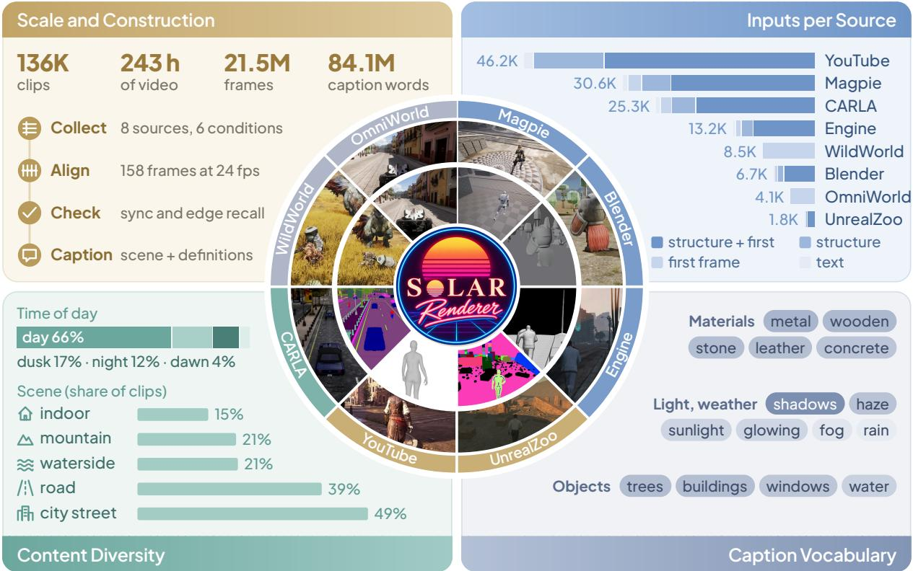  
Figure 3 The training corpus combines 136K clips from eight sources. Each sector of the ring shows one source, with the condition on the inner ring (the first frame for WildWorld and OmniWorld) and the ground-truth frame of the same clip on the outer ring. The panels give the scale and construction steps of the data, the clips of each source by input combination, the time of day and scenes named in the captions, and the most frequent words of the captions across all training clips.

where $G _ { \phi , \psi }$ is the four-step generator, $\mathcal { C } = ( c , R ( S , I ) )$ , and $\widetilde { z } _ { t }$ is a re-noised student sample. Since full-step sampling of the backbone is blurry, the composed student is already sharper than its teacher, and plain distribution matching pulls it back toward this blur: the adapted student ends below its own starting point (Section 5.3). We therefore amplify the structural signal of the teacher. With ${ \hat { z } } _ { 0 } ( { \mathcal { C } } )$ the clean prediction of the teacher and $\hat { z } _ { 0 } ( \mathcal { C } _ { \mathcal { D } } )$ its prediction after the tokens of the structural video are removed from the reference sequence, the teacher score is computed from

$$
\hat { z } _ { 0 } ^ { w } = \hat { z } _ { 0 } ( \mathcal { C } ) + ( w - 1 ) \big ( \hat { z } _ { 0 } ( \mathcal { C } ) - \hat { z } _ { 0 } ( \mathcal { C } _ { \varnothing } ) \big ) .\tag{6}
$$

In $\mathcal { C } _ { \emptyset }$ the first frame and the prompt are kept unchanged. The diference isolates what the structural video contributes, such as contours, layout, and character positions, so with w > 1 the student is pushed toward a target that is sharper and more decisive than the teacher itself. Setting w = 1 recovers plain distribution matching. The extrapolation follows classifier-free guidance (Ho and Salimans, 2021), which distribution matching applies to the text condition of the teacher (Yin et al., 2024a; Liu et al., 2026). Here it acts on the structural condition alone. The fake-score model is a separate rank-128 LoRA initialized at <sub>fi</sub>the teacher, updated five times per generator update with learning rates of $2 \times 1 0 ^ { - 6 }$ and $1 0 ^ { - 5 }$ for the fake-score model and the generator. We set $w = 1 . 5$ and run 800 iterations, each one fake-score update, at the cost of one additional teacher forward pass per generator update (Section A.1).

## 3.4 Causal Streaming Extension

To generate video incrementally, we extend the same two-stage design to block-causal attention. The clip is split into blocks of at most five latent frames. We adapt the bidirectional control LoRA with teacher forcing so that each block attends to the prompt, the first frame, the structure of itself and the five preceding blocks, and the clean frames of the five preceding blocks, never to a later block. We then freeze this causal control LoRA and post-train a separate acceleration LoRA, initialized from the bidirectional four-step LoRA, on the student’s own block-by-block rollouts, with the bidirectional control model as the structure-guided teache $( w = 1 . 5 )$ . Each rollout is generated without gradients and replayed as one teacher-forced sequence, so that the gradient reaches both how each block is generated and how it serves as context for later blocks. At inference, we merge the acceleration LoRA into the backbone, keep the control LoRA attached, sample each block in four steps, and update the fixed-window key–value cache before outputting the block immediately. With a streaming VAE decoder (Chen et al., 2026a) that decodes each block without future latents, the causal model renders 768p video in real time at up to 28 FPS.

## 4 Engine-Aligned Paired Data

A renderer learns to follow structure only from pairs in which the target video actually follows the structure. Conditions estimated from real videos, such as predicted depth or segmentation, carry the errors of the estimator and difer from the engine proxies that the renderer receives at test time. We therefore collect pairs whose condition is exported by an engine or fitted to the target, and use a pair as structural supervision only when its condition matches the target in time and carries enough structure. We then describe the data sources (Section 4.1), the checks that decide how each source is used (Section 4.2), and the construction of prompts (Section 4.3).

## 4.1 Data Sources

The training set contains 136K samples, about 243 hours of video. Every clip is a 158-frame window at 24 fps and 768p resolution. The data cover diverse sources and control types (Figure 3), listed below with the condition each one supplies.

• Magpie (Zhan et al., 2026) records human-played Unreal Engine gameplay across many scenes at 60 fps, together with a synchronized grey block-out of the scene. The block-out gives the layout, the large geometry, the bodies and motion of the characters, and the camera of every frame, while materials and lighting are left to the model.

• CARLA (Dosovitskiy et al., 2017) provides urban and rural driving. Among the bufers that the simulator exports, we use semantic segmentation, which paints every class in one flat colour and thus specifies the class layout of the scene without its appearance.

• Engine recordings consist of frames together with depth, object masks, camera poses, and skeletons on shared timestamps. We render the depth as grey shading, with distant regions and the sky set to black, so that it conveys the shape of the scene near the camera.

• Blender renders of animated scenes are paired with the white-box of their scene, which describes the scene layout and the motion of the main character.

• UnrealZoo (Zhong et al., 2025) provides Unreal Engine 5 environments in first- and third-person views. Its condition combines object masks and skeletons, with one colour per object and the skeleton of each character drawn on top.

• YouTube videos (Ju et al., 2024) provide clips for body-motion conditioning. We keep videos with a clear protagonist, fit the SMPL body (Loper et al., 2015) of the protagonist with GVHMR (Shen et al., 2024) using camera and depth from VGGT (Wang et al., 2025a) and Depth Anything 3 (Lin et al., 2026b), and render it from the target camera as a grey body on a white background. This SMPL body video gives the position, pose, and motion of the protagonist, while the environment and clothing come from the first frame and text.

• WildWorld (Li et al., 2026c), a public dataset of Monster Hunter Wilds gameplay, and OmniWorld (Zhou et al., 2026), which collects footage of AAA games such as Cyberpunk 2077, contribute rich game appearance. Their structural annotations follow the frames less closely, so we use them as appearance data and supply only a first frame.

## 4.2 Data Checks

A condition can fail in two ways. It can be ofset from the target in time or space, or it can be aligned yet too coarse to describe the target. We therefore run two checks on every source.

Temporal and Spatial Agreement. For timing, we correlate the motion of each condition with that of its target over a range of frame ofsets. The ofset at which the correlation peaks shows whether the two are synchronized, and clips whose peak is not at zero ofset are removed. For space, we measure the recall of the condition edges in the target frame and compare it with the recall of the horizontally mirrored condition. A condition that matches its target recovers clearly more edges than its mirror, so clips without this margin are removed as spatially misaligned. Further filters remove near-duplicates, dark or low-contrast clips, and clips whose condition covers too little of the frame. Finally, we manually inspect samples from every source before it enters training.

Table 1 Comparison with existing methods. Gemini Elo ratings for the four judge questions and the automatic score (Auto.) on both test sets. The causal variant is rated only against ours. Methods that lose every comparison on a question share one rating. Bold and underlined italics mark the best and second-best values.
<table><tr><td></td><td colspan="6">Generalization benchmark</td><td colspan="5">In-distribution test set</td></tr><tr><td>Method</td><td>Steps</td><td>Overall</td><td>Quality</td><td>Structure First fr.</td><td></td><td>Auto.</td><td>Overall</td><td>Quality</td><td>Structure</td><td>First fr.</td><td>Auto.</td></tr><tr><td>Baselines</td><td></td><td></td><td></td><td></td><td></td><td></td><td></td><td></td><td></td><td></td><td></td></tr><tr><td>Official backbone (2026)</td><td>50</td><td>1075</td><td>1086</td><td>627</td><td>1153</td><td>69.8</td><td>651</td><td>586</td><td>554</td><td>660</td><td>64.8</td></tr><tr><td>Ours (Stage 1)</td><td>50</td><td>1389</td><td>1339</td><td>1276</td><td>1395</td><td>71.6</td><td>1299</td><td>1196</td><td>1308</td><td>1346</td><td>66.2</td></tr><tr><td>Structure-conditioned renderers</td><td></td><td></td><td></td><td></td><td></td><td></td><td></td><td></td><td></td><td></td><td></td></tr><tr><td>Wan2.2-VACE-Fun (2025)</td><td>50</td><td>389</td><td>489</td><td>763</td><td>377</td><td>65.2</td><td>651</td><td>586</td><td>554</td><td>660</td><td>63.0</td></tr><tr><td>PAI ControlNet-Union (2026)</td><td>40</td><td>1221</td><td>1228</td><td>1083</td><td>1150</td><td>69.4</td><td>1189</td><td>1304</td><td>1187</td><td>1029</td><td>64.6</td></tr><tr><td>Cosmos-Transfer2.5 (2025)</td><td>35</td><td>389</td><td>368</td><td>1007</td><td>377</td><td>64.7</td><td>651</td><td>991</td><td>1012</td><td>660</td><td>64.7</td></tr><tr><td>LynnReal-Omni (2026)</td><td>4</td><td>1441</td><td>1412</td><td>1241</td><td>1423</td><td>70.0</td><td>1410</td><td>1359</td><td>1295</td><td>1362</td><td>64.2</td></tr><tr><td>Streaming CWM (2026)</td><td>4</td><td>1075</td><td>1100</td><td>930</td><td>1199</td><td>70.7</td><td>988</td><td>968</td><td>955</td><td>1102</td><td>64.2</td></tr><tr><td>StreamRender-H3 (2026d)</td><td>2</td><td>580</td><td>560</td><td>737</td><td>498</td><td>63.9</td><td>651</td><td>586</td><td>750</td><td>660</td><td>59.0</td></tr><tr><td>Ours (causal)</td><td>4</td><td>1191</td><td>1145</td><td>1235</td><td>1186</td><td>71.2</td><td>1199</td><td>1120</td><td>1313</td><td>1235</td><td>66.6</td></tr><tr><td>Ours</td><td>4</td><td>1441</td><td>1420</td><td>1338</td><td>1428</td><td>71.6</td><td>1510</td><td>1424</td><td>1386</td><td>1522</td><td>67.0</td></tr></table>

Sufficiency of the Condition. For the data, we first used box proxies that draw body parts and objects as coarse boxes. Although they are synchronized with the frames, the boxes omit most of the scene geometry, so a model trained on them cannot learn the shapes it is asked to follow. We therefore switched to depth within 30 m rendered as grey shading, with farther regions and the sky set to black, which carries the layout and object shapes of the scene without the strong flicker of finer block proxies. For the same reason, WildWorld boxes, which do not line up with the frames, and OmniWorld background blocks, which omit people and moving objects, are not used as structure.

## 4.3 Prompts and Input Combinations

Captions. Each caption follows the six-section prompt format of the backbone, which consists of subject definitions, a summary with a task prefix, a retention analysis, a detailed description, the soundscape, and the music (Figure 2). Two parts fill these sections. <sup>1</sup> A scene description covers materials, colours, illumination, weather, character appearance, events, camera motion, and sound, and fills the summary, the detailed description, the soundscape, and the music. Kimi K2.6 (Moonshot AI, 2026; Kimi Team, 2026) writes it after watching only the target video. <sup>2</sup> A fixed part defines each reference in the subject definitions, names the task in the summary prefix, and states in the retention analysis which attributes of each reference the output follows. Code generates it from the input combination of the clip (Section 3.2), so the description of each condition stays identical across clips.

Input Combinations. The training samples mix four input combinations, with 67.1% supplying structure and a first frame, 16.7% structure only, 13.2% a first frame only, and 2.9% text only. Sources with structure also contribute some samples without it, so that missing structure is not tied to the appearance of WildWorld and OmniWorld. The combination of each clip is fixed when the data is built, and its prompt describes exactly the supplied inputs. Dropping the structure at random during training would leave a prompt that still refers to it, so fixing the combination in advance prevents the absent input from leaking through the prompt.

## 5 Experiments

We first describe the evaluation setups(Section 5.1), then compare SolarRenderer with existing structureconditioned renderers and the baselines (Section 5.2), and finally present ablations on the structure-guided post-training with existing acceleration LoRAs, the conditioning design, and the training data (Section 5.3).

## 5.1 Experimental Setup

Evaluation Sets. We evaluate on two test sets, each answering a diferent question.

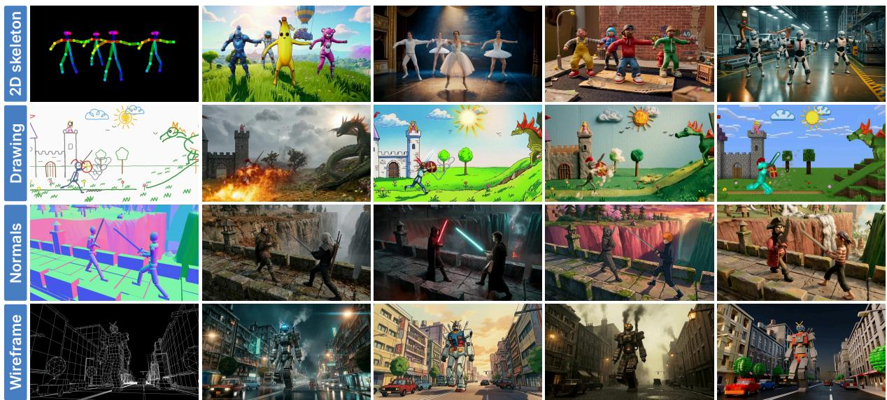  
Figure 4 Multiple appearances from unseen structural representations. The left column shows, from top to bottom, a 2D skeleton, a crayon drawing, a normal map, and a wireframe. The remaining columns show our generated appearances at the same time.

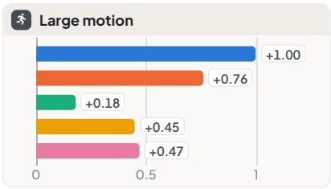

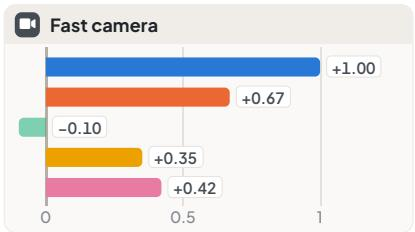

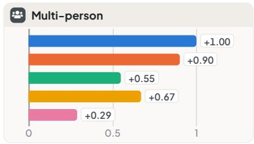

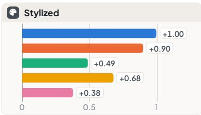

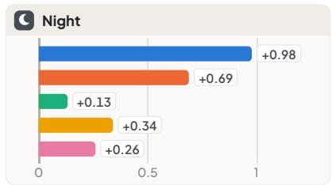  
Ours vs. StreamRender-H3 Streaming CWM Ours (Stage 1, 50 steps) Stage 1 + LongLive-Plug Stage 1 + DMAD

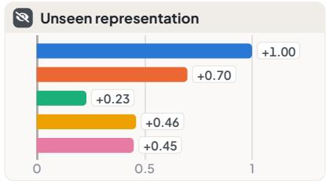  
Figure 5 Results by difficulty tag. Net score of ours against each compared method on the generalization benchmark. Positive values favor ours.

• In-distribution test set, which assesses how well SolarRenderer renders the kinds of structure seen in training. Its 53 clips come from the training sources, share no recording, scene, or map with the training data, and each has a ground-truth video.

• Generalization benchmark, which assesses how well a single model transfers to new structure and has no ground truth. Its 208 cases are built from 57 structural videos covering 16 representations, 11 of which never occur in training, such as pencil storyboards, children’s drawings, point clouds, voxels, and wireframes. Most of these videos were built in a game engine by a coding agent, and each case is labelled by dificulty, namely large motion, fast camera motion, multiple people, stylization, and night scenes, with results per label in Figure 5.

Evaluation Protocol. We assess every method with pairwise judgments and automatic scores.

• Pairwise judgment is our primary measure. Gemini 3.8 Flash (Google DeepMind, 2026; Gemini Team, 2023) receives the structural video, the first frame, and two renderings, and compares them on <sup>1</sup>visual quality, <sup>2</sup>adherence to the structure and motion, <sup>3</sup>preservation of the first frame, and <sup>4</sup>overall preference. Each pair is judged in both orders. We report the net score of ours against each compared method as (wins − losses)/cases, the diference between our win and loss rates. It ranges from −1 to 1, with positive values indicating a preference for ours. From the verdicts between all pairs of methods on a test set we fit one Bradley–Terry model (Bradley and Terry, 1952) per judge question and report the strength of every method as an Elo rating, with the mean of the compared methods at 1000. A blind human study agrees with the verdicts of the judge.

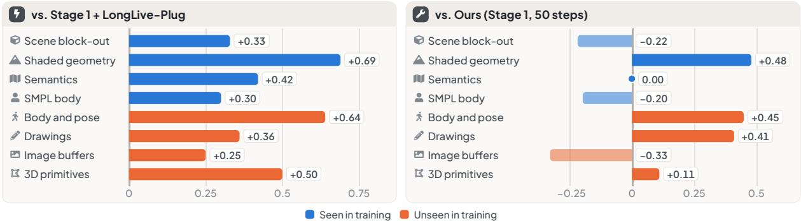  
Figure 6 Results by representation. Net score of ours against Stage 1 + LongLive-Plug (left) and our 50-step Stage 1 model (right) on the generalization benchmark, grouped by representation category. Positive values favor ours.

• Automatic metrics, grouped into <sup>1</sup>quality (DOVER (Wu et al., 2023), LAION aesthetics (Schuhmann, 2022), VideoScore2 (He et al., 2025)), <sup>2</sup>stability (flow-warping residual and adjacent-frame DINOv2 similarity (Oquab et al., 2023)), <sup>3</sup>control (CoTracker3 track error (Karaev et al., 2025) and edge F1 against the structure), and <sup>4</sup>first-frame preservation (DINOv2 similarity of the last second to the first frame). Each metric is mapped linearly from a fixed range to 0–100, and the automatic score averages the metrics within each group and then the four groups.

Details of the protocol and the full results are given in Sections A.2 and C.1.

Compared Methods. We compare SolarRenderer with three groups of methods.

• Baselines, the oficial Ref2VA backbone and our Stage 1 model, both with 50 steps.

• Existing acceleration LoRAs, which assess the structure-guided post-training of Stage 2. Each attaches LongLive-Plug (Yang et al., 2026a), DMAD (Yu et al., 2026), or FastH3 (Hao AI Lab, 2026) to our Stage 1 model without further training.

• Structure-conditioned renderers, namely LynnReal-Omni (Mao et al., 2026), StreamRender-H3 (Lu et al., 2026d), Streaming CWM (Liao and Liu, 2026), PAI ControlNet-Union (Alibaba PAI, 2026), Cosmos-Transfer2.5 (NVIDIA, 2025), and Wan2.2-VACE-Fun (Team Wan et al., 2025; Jiang et al., 2025). Each runs with its released resolution, frame count, sampler, and number of steps, and its outputs are resized to our evaluation format.

Implementation. Training builds on the open SolarWM framework (Huang et al., 2026a). SolarRenderer uses the control LoRA after 38,400 training steps. Its acceleration LoRA has rank 384, with the first 128 ranks initialized from the pretrained DMAD four-step LoRA and the rest at zero, and is trained for 800 iterations of structure-guided distribution matching with w = 1.5. It renders a 158-frame clip with four denoising steps in about 209 s on one GPU, 12.3 times faster than the 2,562 s of 50-step sampling.

## 5.2 Comparison with Existing Methods

Comparison with Structure-Conditioned Renderers. SolarRenderer reaches the best rating on every judge question of both test sets (Table 1). Renderers built around one engine do not transfer. StreamRender-H3 and Streaming CWM learned a single representation from a racing game and from CARLA, and rate 580 and 1075 overall on the generalization benchmark against 1441 for ours. Cosmos-Transfer2.5 and Wan2.2-VACE-Fun trace the edges of the structure closely, yet their appearance falls so far behind that they rate below 400. The strongest competitor, LynnReal-Omni, ties with ours in overall preference on the generalization benchmark (1441 each) and trails by 100 points on the in-distribution test set, while its structure rating is about 95 points lower on both. LynnReal-Omni labels the type of each reference, whereas our method reads untyped, frame-aligned structure, which tightens its control. Its total automatic score also exceeds every external renderer on both sets, with balanced quality and structural agreement.

Causal Streaming. The causal variant of our method renders each block from past frames only and outputs it as soon as it is sampled. It rates 1191 and 1199 overall on the two test sets, below the bidirectional model at 1441 and 1510 but well above the streaming renderers, Streaming CWM at 1075 and 988 and StreamRender-H3 at 580 and 651 (Table 1). Its structure rating stays close to ours and on the in-distribution test set even exceeds our Stage 1 model (1313 against 1308), so that causal attention mainly costs appearance, as later blocks drift from the colours of the first frame, while the learned control carries over to block-by-block generation.

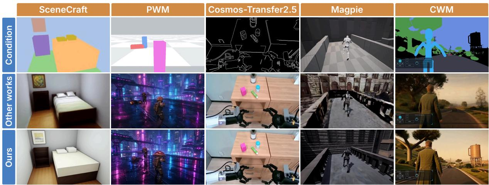  
Figure 7 Visual comparison with other methods. Top to bottom: structural condition, results from other works, and ours. Left to right: SceneCraft, Programmable World Model, Cosmos-Transfer2.5, Magpie, and CWM, with frames synchronized within each example.

Table 2 Ablation on structure guidance. Gemini Elo ratings on the generalization benchmark, fitted per starting point and comparable only within a block. w = 1 means no guidance, and bold marks the best value per block.
<table><tr><td>Model</td><td>Overall</td><td>Quality</td><td>Struct.</td><td>First fr.</td></tr><tr><td colspan="5">Self-distillation</td></tr><tr><td>Start (LongLive-Plug)</td><td>986</td><td>985</td><td>984</td><td>999</td></tr><tr><td>w = 1</td><td>949</td><td>947</td><td>979</td><td>981</td></tr><tr><td>w = 2</td><td>1066</td><td>1069</td><td>1037</td><td>1020</td></tr><tr><td colspan="5">LongLive-Plug start</td></tr><tr><td>No post-training</td><td>1028</td><td>1033</td><td>997</td><td>1028</td></tr><tr><td>w = 1</td><td>798</td><td>789</td><td>980</td><td>856</td></tr><tr><td>w = 1.5</td><td>1067</td><td>1065</td><td>1012</td><td>1046</td></tr><tr><td>w = 2</td><td>1107</td><td>1113</td><td>1012</td><td>1070</td></tr><tr><td colspan="5">DMAD start</td></tr><tr><td>No post-training</td><td>1024</td><td>1027</td><td>1003</td><td>1040</td></tr><tr><td>w = 1</td><td>820</td><td>812</td><td>982</td><td>850</td></tr><tr><td>Ours (w = 1.5)</td><td>1156</td><td>1161</td><td>1015</td><td>1110</td></tr></table>

Table 3 Ablation on post-training settings. Gemini Elo ratings on the generalization benchmark from one fit over this table, comparable only within it. Each block varies one setting of our model, listed in the last row.
<table><tr><td>Setting</td><td>Overall</td><td>Quality</td><td>Struct.</td><td>First fr.</td></tr><tr><td>Starting point</td><td></td><td></td><td></td><td></td></tr><tr><td>LongLive-Plug</td><td>922</td><td>910</td><td>993</td><td>956</td></tr><tr><td>FastH3</td><td>1053</td><td>1061</td><td>1000</td><td>1049</td></tr><tr><td>DMAD</td><td>1006</td><td>1011</td><td>992</td><td>1012</td></tr><tr><td>Guidance strength</td><td></td><td></td><td></td><td></td></tr><tr><td>w = 2</td><td>1045</td><td>1062</td><td>996</td><td>1059</td></tr><tr><td>Sampling steps</td><td></td><td></td><td></td><td></td></tr><tr><td>2 steps</td><td>961</td><td>969</td><td>970</td><td>983</td></tr><tr><td>8 steps</td><td>1080</td><td>1094</td><td>1010</td><td>1032</td></tr><tr><td>Ours (DMAD, w = 1.5, 4 steps)</td><td>1096</td><td>1108</td><td>1005</td><td>1076</td></tr></table>

Generalization on Hard Cases. Figure 5 splits the generalization benchmark by dificulty tag. Ours is preferred over every compared method on every tag, including large motion, multiple people, and night scenes, with the single exception of our own 50-step model on fast camera motion (−0.10). The margin over the engine-specific renderers stays between +0.67 and +1.00, and the margin over the four-step compositions with LongLive-Plug and DMAD between +0.26 and +0.68. The cases with an unseen representation are no exception, with +0.46 over LongLive-Plug and +0.70 over Streaming CWM, and ours also keeps the best structure rating among all methods on them (Table 6).

Generalization to Unseen Representations. Figure 6 groups the representations into categories. Ours is ahead of LongLive-Plug on every category, seen or unseen, from block-outs and semantic maps to pose skeletons, drawings, image bufers, and 3D primitives, by +0.25 to +0.69. Against our own 50-step model, the four-step model is preferred on body and pose (+0.45) and drawings (+0.41), so acceleration costs little on unseen structure. Since no reference carries a type identifier, the control LoRA cannot specialize to a format and instead learns to read layout and motion from whatever occupies the position of a target frame. A single control LoRA therefore generalizes to unseen structure.

Table 4 Ablation on conditioning design. Automatic group scores and their mean (0–100) for control models. Bold marks the best per block.
<table><tr><td>Model</td><td>Qual.</td><td>Stab.</td><td>Ctrl.</td><td>First</td><td>Auto.</td></tr><tr><td>Conditioning pathway</td><td></td><td></td><td></td><td></td><td></td></tr><tr><td>ControlNet branch</td><td>60.2</td><td>90.5</td><td>46.8</td><td>66.4</td><td>66.0</td></tr><tr><td>Ours (native)</td><td>59.6</td><td>91.6</td><td>48.0</td><td>66.8</td><td>66.5</td></tr><tr><td>Structure resolution</td><td></td><td></td><td></td><td></td><td></td></tr><tr><td>Half resolution</td><td>59.5</td><td>91.5</td><td>46.6</td><td>67.0</td><td>66.2</td></tr><tr><td>Ours (full res.)</td><td>59.6</td><td>91.6</td><td>48.0</td><td>66.8</td><td>66.5</td></tr><tr><td>RoPE (half resolution)</td><td></td><td></td><td></td><td></td><td></td></tr><tr><td>Separate RoPE</td><td>59.1</td><td>91.5</td><td>46.4</td><td>67.0</td><td>66.0</td></tr><tr><td>Shared RoPE</td><td>59.5</td><td>91.5</td><td>46.6</td><td>67.0</td><td>66.2</td></tr></table>

Table 5 Ablation on training data. Automatic group scores and their mean (0–100) for data variants. Bold marks the best per block.
<table><tr><td>Model</td><td>Qual.</td><td>Stab.</td><td>Ctrl.</td><td>First</td><td>Auto.</td></tr><tr><td colspan="6">Data composition</td></tr><tr><td>All data</td><td>59.5</td><td>91.5</td><td>46.6</td><td>67.0</td><td>66.2</td></tr><tr><td>Structured only</td><td>59.7</td><td>91.2</td><td>47.3</td><td>66.8</td><td>66.2</td></tr><tr><td>Ours (w/o misaligned)</td><td>59.9</td><td>91.6</td><td>47.4</td><td>66.9</td><td>66.5</td></tr><tr><td colspan="6">Data scale</td></tr><tr><td>1/10 data</td><td>59.6</td><td>91.4</td><td>46.5</td><td>67.1</td><td>66.1</td></tr><tr><td>Full data, new seed</td><td>58.9</td><td>91.5</td><td>46.4</td><td>66.9</td><td>65.9</td></tr><tr><td>All data</td><td>59.5</td><td>91.5</td><td>46.6</td><td>67.0</td><td>66.2</td></tr></table>

Comparison with the Backbone. Without the control LoRA, the oficial backbone treats the structural video as a generic reference and rarely follows its layout. Its structure rating is 627 on the generalization benchmark and 554 on the in-distribution test set, against 1338 and 1386 for ours (Table 1), so the control comes entirely from a lightweight LoRA on top of a frozen backbone. Our 50-step Stage 1 model already follows the structure, which shows that the native reference pathway with a single control LoRA sufices for control, but it renders blurrier frames. The four-step final model rates higher on both test sets, 1441 against 1389 and 1510 against 1299 overall, and renders 12.3 times faster.

Visual Comparison with Other Methods. Figure 7 compares our four-step outputs with results from five renderers, using the structural inputs from their demonstration cases. Ours produces sharper furniture boundaries in SceneCraft (Yang et al., 2024) and clearer character silhouettes in the neon scene from Programmable World Model. In the Magpie scene, the bridge railings follow the block-out more closely, while the CWM example preserves the roadside layout and resolves the water tower. The Cosmos example preserves the tabletop layout from edge input.

Visual Diversity. Figure 4 illustrates how the same unseen structure supports contrasting appearances. The dancers preserve their arrangement across human, clay, and robotic forms, while the drawing, normal map, and wireframe examples change materials and scene style around the specified composition. Figure 8 presents additional showcase renderings across scenes and visual styles.

## 5.3 Ablation Studies

We ablate the post-training stage on the generalization benchmark with Gemini Elo ratings (Tables 2 and 3), and the conditioning design and the training data scored by automatic metrics (Tables 4 and 5).

Comparison with Existing Acceleration LoRAs. An existing four-step LoRA attached to our control LoRA renders in four steps, but it was trained without the control adapter and shifts the outputs of the control model. Composed this way, LongLive-Plug, DMAD, and FastH3 reach overall ratings of 922, 1006, and 1053 (Table 3). Structure-guided post-training removes the mismatch and lifts the DMAD start to 1096, above every composition, with the highest quality and first-frame ratings. The gain therefore comes from adapting the acceleration LoRA to the control model.

Structure Guidance. Table 2 post-trains the same students without guidance (w = 1), either by updating the four-step LoRA from DMAD or LongLive-Plug, or by self-distillation, which updates the control LoRA with LongLive-Plug frozen. Plain distribution matching pulls the student toward a teacher whose structure-conditioned prediction is blurry, so the unguided student degrades its starting point, from 1024 to 820 for DMAD and from 1028 to 798 for LongLive-Plug. Extrapolating the teacher along the structural condition sharpens this target, and the guided student rates far above both the unguided student and its start from every starting point, 1156 against 820 from DMAD, 1107 against 798 from LongLive-Plug, and 1066 against 949 with self-distillation, with the best value on almost every judge question. A blind human comparison with the unguided DMAD student agrees in direction.

Starting Point and Strength. Guidance improves every starting point, and DMAD with w = 1.5 gives the best student. The best strength depends on the start. From LongLive-Plug, w = 2 is better than w = 1.5 (1107 against 1067 in Table 2), whereas from DMAD, w = 2 lowers the rating from 1096 to 1045 (Table 3).

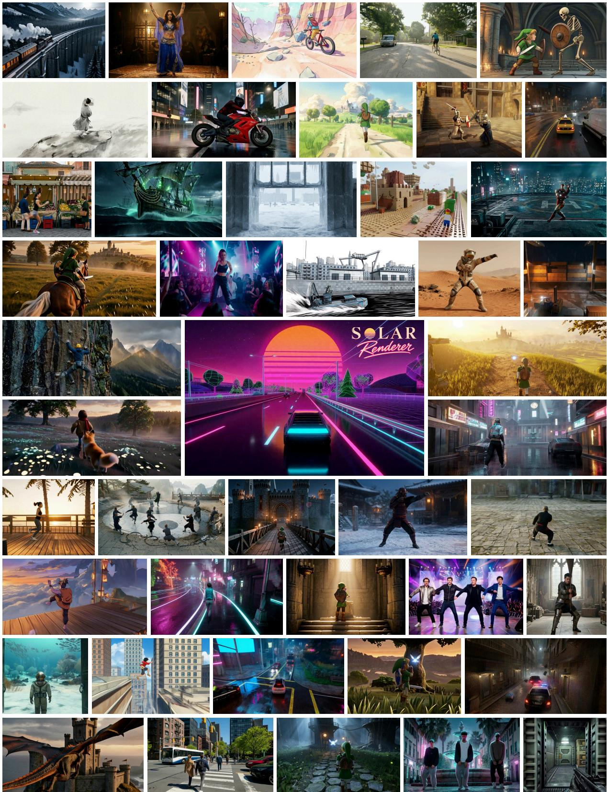  
Figure 8 A gallery of structure-conditioned renderings. Each image comes from a diferent case, spanning human motion, everyday scenes, and imagined environments across seen and unseen structural representations.

Schedule, Training Length, and Sampling Steps. Applying guidance only at re-noising levels $\sigma \geq 0 . 9$ rates on par with guidance at every level (1107 against 1096), so guidance acts mainly at high noise levels, where the layout of the clip is decided. Longer post-training does not help, as 1,200 iterations lower the overall rating to 992, and adding self-distillation of the control LoRA on top of our post-training lowers it to

1049. The student is trained for four steps and works best with four. Two steps lower the overall rating to   
961, and eight steps bring no gain (1080).

Conditioning Design. Table 4 trains variants of the control model under the same data and budget. A ControlNet branch in place of the native reference pathway lowers the structure score from 48.0 to 46.8 and the stability, and giving the structure tokens separate RoPE positions instead of those of their target frames lowers quality and structure, which supports native reference conditioning. Reading the structure at full instead of half resolution further raises the structure score from 46.6 to 48.0.

Frame-Aligned Data. Table 5 varies the training data. Using the WildWorld boxes, which do not line up with the frames, as structure lowers the structure score from 47.4 to 46.6, since misaligned supervision teaches the model to loosen its control. Training only on samples with structure lowers stability. The final corpus therefore keeps samples without structure for appearance and uses as structure only sources whose structure is aligned frame by frame with the video. Training on 1/10 of the data changes every score by at most 0.2, less than retraining on the full data with a new seed, whereas removing the misaligned structure helps more, so the alignment of the data matters more than its amount.

## 6 Conclusion

We presented SolarRenderer, a few-step generative renderer that turns structure from game engines and coding agents into realistic video. Structural videos enter the native reference pathway of a frozen MiniMax-H3 backbone without any type identifier, so that a single control LoRA follows arbitrary structural representations, and structure-guided distribution matching adapts a pretrained four-step LoRA to this control model. Trained on 136K frame-aligned clips from game engines, simulators, and YouTube videos, our method achieves state-of-the-art results on both the in-distribution test set and the generalization benchmark, and generalizes to representations never seen in training, while rendering 12.3 times faster than 50-step sampling. Its block-causal variant further renders 768p video in real time.

## Appendix

A Experimental Details 15   
A.1 Implementation Details . 15   
A.2 Evaluation Protocol and Metrics 15   
A.3 Compared Methods and Generation Settings . 18   
B Data and Prompt Specifications 18   
B.1 Training Captions . 19   
B.2 Caption Validation 19   
B.3 Source Audit Details 20   
C Additional Experimental Results 20   
C.1 Detailed Results . 20   
C.2 Additional Ablations 22

## A Experimental Details

## A.1 Implementation Details

The backbone is the oficial MiniMax-H3 33B Ref2VA model and stays frozen throughout. The control LoRA has rank 384 on the attention and feed-forward layers and is trained with the native flow-matching objective of the backbone on clips of 158 frames at $1 3 4 4 \times 7 6 8$ and 24 $\mathrm { f p s }$ , using AdamW (Loshchilov and Hutter, 2019) with a learning rate of $1 0 ^ { - 4 }$ for 38,400 steps at a batch of 4. For structure-guided post-training, the control LoRA is frozen and the teacher is the backbone with the control LoRA. The four-step LoRA has rank 384, with its first 128 ranks initialized from the pretrained DMAD LoRA and the rest at zero, and the fake-score model is a separate LoRA initialized at the teacher. The generator is updated once every five fake-score updates, with learning rates of $1 0 ^ { - 5 }$ for the generator and $2 \times 1 0 ^ { - 6 }$ for the fake-score model, for 800 iterations at a batch of 4 with $w = 1 . 5 .$ . The conditioning and data ablations use an earlier data mixture. The causal control LoRA (Section 3.4) starts from the control LoRA after 38,400 steps and is trained with teacher forcing for 19,200 steps at a batch of 2, using AdamW with a learning rate of $3 \times 1 0 ^ { - 5 }$ . The causal acceleration LoRA starts from the bidirectional four-step LoRA and is trained for 1,600 iterations at a batch of 1 with the causal control LoRA frozen. The generator and the fake-score model, a rank-128 LoRA initialized at the teacher, use learning rates of $2 \times 1 0 ^ { - 5 }$ and $5 \times 1 0 ^ { - 5 }$ with five fake-score updates per generator update. All schedules are given for one $8 { \cdot } \mathrm { G P U }$ node, as in the released configurations; the released weights were trained on as many samples at a larger batch.

## A.2 Evaluation Protocol and Metrics

This section defines the automatic metrics, the automatic score, and the pairwise judge with its Elo rating. Let $V = \{ I _ { t } \} _ { t = } ^ { T } { . }$ be a rendered video, $S = \{ S _ { t } \} _ { t = } ^ { T } .$ its structural video, and $I ^ { \mathrm { r e f } }$ the given first frame. $f ( \cdot )$ denotes the global DINOv2 ViT-S/14 embedding and cos(·, ·) cosine similarity. Every metric is computed per case and averaged over the cases of a test set.

## 1. Visual Quality

Three learned predictors rate the appearance of the rendering alone.

DOVER. The overall score of DOVER on the clip, in [0, 1].

Aesthetic Score. The LAION aesthetic predictor on CLIP ViT-L/14 (Radford et al., 2021) embeddings of two frames per second, averaged over frames, in [1, 10].

VideoScore2. The visual-quality rating of VideoScore2 at 2 fps with greedy decoding, read as the expected level $\textstyle \sum _ { k = 1 } ^ { 5 } k p ( k )$ over its five levels.

subject\_definitions. <Video 1> is a semantic segmentation of the scene, one flat colour per class (road,   
sidewalk, building, vegetation, vehicle, pedestrian, sky and so on), frame by frame, from the same camera   
as the target video.   
<Video 2> is the first frame of [Shot 1], held still.   
summary. [keyframe completion + reference generation] The target video begins from <Video 2> and   
follows the frame-by-frame structure and motion of <Video 1>. A blue hatchback drives along a foggy,   
rain-slicked city street at night, passing a yellow taxi before continuing toward a distant red trafic light,   
while the camera tracks behind from a slightly elevated rear angle.   
retention\_analysis. <Video 1> (frame-by-frame layout of every class and camera): attribute\_trans  
fer – every region keeps its class, outline and place; materials, colours and lighting are not given by   
<Video 1>; the flat class colours are not shown.   
<Video 2> ([Shot 1] first frame): fully\_preserved – the composition, subjects, materials, colours and   
lighting of <Video 2> are the target video’s first frame.   
detailed\_description. The target video is a realistic 3D game render in a dark, foggy night with wet   
reflective surfaces and soft, difused street lighting cutting through heavy atmospheric haze. [Shot 1] The   
shot begins from <Video 2>. The opening frame shows a bright blue compact hatchback with a black   
roof and rear spoiler positioned in the right lane of a multi-lane urban road, viewed from a slightly ele  
vated rear-three-quarter angle. . . .  
Figure 9 Training caption from CARLA with a semantic map. The detailed description is truncated.

## 2. Temporal Stability

Two measures of frame-to-frame consistency.

Flicker. Each frame $I _ { t + 1 }$ is warped onto $I _ { t }$ with RAFT optical flow (Teed and Deng, 2020), giving $\tilde { I } _ { t + 1 }$ and compared on the pixels $M _ { t }$ whose forward and backward flows agree, after a Gaussian low-pass G $( \sigma = 2 \mathrm { p x } )$ so that fine texture is not counted:

$$
E _ { \mathrm { f i c k e r } } = { \frac { 1 } { T - 1 } } \sum _ { t = 1 } ^ { T - 1 } { \frac { 1 } { | M _ { t } | } } \sum _ { p \in M _ { t } } { \bigl | } ( G * I _ { t } ) ( p ) - ( G * { \tilde { I } } _ { t + 1 } ) ( p ) { \bigr | } ,\tag{7}
$$

with pixel values in [0, 255]. Lower is better.

Adjacent-Frame Similarity. $\begin{array} { r } { S _ { \mathrm { D I N O } } = \frac { 1 } { T - 1 } \sum _ { t = 1 } ^ { T - 1 } \cos \bigl ( f ( I _ { t } ) , f ( I _ { t + 1 } ) \bigr ) } \end{array}$

## 3. Structural Adherence

Two measures compare the rendering with its structural video.

Motion Error. CoTracker3 tracks the same $2 0 \times 1 2$ grid of points in $S$ and in $V ,$ giving positions $q _ { j } ( t )$ and $\hat { q } _ { j } ( t )$ . Over the set R of points and frames where the structural track is reliable,

$$
E _ { \mathrm { m o t i o n } } = \frac { 1 } { \left| \mathcal { R } \right| D } \sum _ { ( j , t ) \in \mathcal { R } } \left\| \hat { q } _ { j } ( t ) - q _ { j } ( t ) \right\| _ { 2 } ,\tag{8}
$$

where D is the image diagonal. Lower is better.

Edge F1. On every fourth frame, Canny edges (Canny, 1986) $\mathcal { E } _ { t }$ of the rendering are matched to the edges $\mathcal { E } _ { t } ^ { S }$ of the structural video with a tolerance of 2 px. With precision $P _ { t }$ the fraction of $\mathcal { E } _ { t }$ within tolerance of $\mathcal { E } _ { t } ^ { S }$ and recall $R _ { t }$ the converse, the score averages $2 P _ { t } R _ { t } / ( P _ { t } + R _ { t } )$ over frames.

## 4. First-Frame Preservation

The appearance of the given first frame should persist through the clip. Over the frames $\mathcal { L }$ of the last second,

$$
S _ { \mathrm { f i r s t } } = \frac { 1 } { | \mathcal { L } | } \sum _ { t \in \mathcal { L } } \cos \bigl ( f ( I _ { t } ) , f ( I ^ { \mathrm { r e f } } ) \bigr ) .\tag{9}
$$

subject\_definitions. <Video 1> is a grey shaded rendering of the engine’s depth within about 30 me  
tres of the camera, from the same camera as the target video; everything farther, and the sky, is black. It   
gives the exact shapes, positions and motion of the nearby scene, characters and vehicles, and the camera   
of every frame.   
<Video 2> is the first frame of [Shot 1], held still.   
summary. [keyframe completion + reference generation] The target video begins from <Video 2> and   
follows the frame-by-frame structure and motion of <Video 1>. A man in a blue shirt and beige shorts   
chases a taxi and a black car down a dark city street at night, running along the double yellow lines as   
the vehicles speed away from him and the camera follows from behind.   
retention\_analysis. <Video 1> (frame-by-frame near geometry, motion and camera): attribute\_trans  
fer – the shapes, positions and motion of everything within the near range and the camera are followed;   
the far scene, materials, colours and lighting are not given by <Video 1> and are the target video’s own;   
the grey shading and the black background of <Video 1> are not shown.   
<Video $2 >$ ([Shot 1] first frame): fully\_preserved – the composition, subjects, materials, colours and   
lighting of <Video 2> are the target video’s first frame.   
detailed\_description. The target video is a realistic 3D CG game render in nighttime urban lighting   
with warm sodium-vapor streetlamps and cool distant building illumination. [Shot 1] The shot begins   
from <Video 2>. The opening frame shows a man in a blue long-sleeve shirt and beige knee-length shorts   
standing in the middle of a two-lane road marked with double yellow lines, facing away from the camera.  
Figure 10 Training caption from an engine recording with near-range depth. The detailed description is truncated.

## 5. Automatic Score

Each metric x is mapped to a fixed 0–100 scale,

$$
n ( x ) = 1 0 0 { \frac { x - a } { b - a } } { \mathrm { ~ ( h i g h e r ~ i s ~ b e t t e r ) } } , \qquad n ( x ) = 1 0 0 { \frac { b - x } { b - a } } { \mathrm { ~ ( l o w e r ~ i s ~ b e t t e r ) } } ,\tag{10}
$$

with $[ a , b ] = [ 0 , 1 ]$ for DOVER, edge F1, adjacent-frame similarity, and first-frame similarity, [1, 10] for the aesthetic score, [1, 5] for VideoScore2, [0, 10] for flicker, and [0, 0.5] for motion error. The score of a group is the mean of n(x) over its metrics. For the oficial backbone and Wan2.2-VACE-Fun, the structure metrics use the frames they render.

## 6. Pairwise Judge and Elo

Gemini 3.8 Flash receives the structural video, the first frame, and two renderings, and answers four questions: which rendering has higher visual quality, which follows the structure and motion more closely, which keeps the first frame better, and which it would rather ship. Each pair is judged in both orders, and a case is a win for a method when both orders prefer it or one prefers it and the other is a tie. With W wins, L losses, and $N$ cases, the net score is $( W - L ) / N \in [ - 1 , 1 ]$

Elo Rating. From the verdicts between all pairs of methods on a test set we fit one Bradley–Terry model per judge question,

$$
\mathrm { P r } ( i \succ j ) = \frac { 1 } { 1 + 1 0 ^ { ( R _ { j } - R _ { i } ) / 4 0 0 } } ,\tag{11}
$$

by maximum likelihood, counting a tie as half a win for each side and adding one virtual tie per method against a fixed reference, so that a method that loses every comparison still has a finite rating. Ratings are shifted so that the mean of the compared methods is 1000.

Judge Inputs. The three videos are resized to $6 7 2 \times 3 8 4$ at 12 fps. Each input is preceded by a label (reference structure, first frame, video $\mathrm { A } ,$ video B). The prompt asks the judge to assess visual quality on the two videos alone, to ignore the crude appearance of the structure, and not to favor either position, and requests a JSON answer with a reason of at most 40 words.

Human Study. In a blind study, human raters compared pairs of renderings shown side by side in random order without method names, and chose one of the two videos or declared a tie. Their preferences agree with the judge in direction.

```csv
subject_definitions. <Video 1> is an untextured grey block-out of the scene, rendered from the same
camera as the target video, giving the layout, the large geometry, the characters’ bodies, their motion and
the camera of every frame.
<Video 2> is the first frame of [Shot 1], held still.
summary. [keyframe completion + reference generation] The target video begins from <Video 2> and
follows the frame-by-frame structure and motion of <Video 1>. A man in a dark leather jacket runs
through a rubble-strewn, war-torn urban courtyard, vaulting over a low concrete barrier and continuing
across debris toward a burning car, while the camera tracks behind and arcs around him.
retention_analysis. <Video 1> (frame-by-frame layout, geometry, motion and camera): attribute_-
transfer – the lavout, large shapes, character bodies, motion and camera are followed exactly: small ob
jects, materials, colours and lighting are not given by <Video 1> and are the target video’s own; the grey
look of <Video 1> is not shown.
<Video 2> ([Shot 1] first frame): fully_preserved – the composition, subjects, materials, colours and
lighting of <Video 2> are the target video’s first frame.
detailed_description. The target video is a realistic 3D game render in bright midday sun with sharp,
crisp shadows and warm, slightly desaturated color grading. [Shot 1] The shot begins from <Video 2>.
The opening frame shows a man standing with his back to camera in a narrow passage of a destroyed ur
ban environment. . . .
```  
Figure 11 Training caption from Magpie with a scene block-out. The detailed description is truncated.

## A.3 Compared Methods and Generation Settings

We group the compared methods into structure-conditioned renderers, baselines, and existing acceleration LoRAs. Each method runs with its released resolution, frame count, sampler, and number of steps, and its outputs are resized to 1344 × 768 at 24 fps before scoring.

## A.3.1 Structure-Conditioned Renderers

LynnReal-Omni is a four-step omni-reference model on the same backbone. We render at 1344 × 768 and 24 fps with 4 steps, and the first frame enters as a style reference.

StreamRender-H3 is a same-backbone streaming renderer trained on semantic maps of a racing game.   
We use its released settings with an 832 × 480 reference and two-step streaming.

Streaming CWM is a same-backbone renderer for the proxy videos of a code world model, trained on CARLA. We use its released four-step LoRA, resize the structure to its 336 × 192 proxy input, and concatenate ten 17-frame chunks and trim them to 158 frames.

PAI ControlNet-Union is a multi-condition ControlNet for video. We render 158 frames at 1280 × 704 with 40 steps and guidance 1.0, with the first frame as its inpainting input.

Cosmos-Transfer2.5 transfers control videos into realistic video. We render 93-frame chunks at 1280 ×704 with 35 steps and guidance 3, and the first frame serves as a style reference.

Wan2.2-VACE-Fun is an all-in-one video creation and editing model. We render 81 frames at 832 × 480 and 16 fps (the first five seconds) with 50 steps and guidance 5.0, with the first frame as the start image.

## A.3.2 Baselines

Official backbone is the MiniMax-H3 Ref2VA model without our adapters, which receives the structural video as an ordinary reference video. We render 124 frames at 1344 × 768 and 24 fps with 50 steps.

Ours (Stage 1) is our control model before post-training, sampled with 50 steps.

## A.3.3 Existing Acceleration LoRAs

LongLive-Plug, DMAD, and FastH3 are four-step acceleration LoRAs trained on the backbone. Each is attached to our Stage 1 control LoRA without further training and sampled with four steps.

## B Data and Prompt Specifications

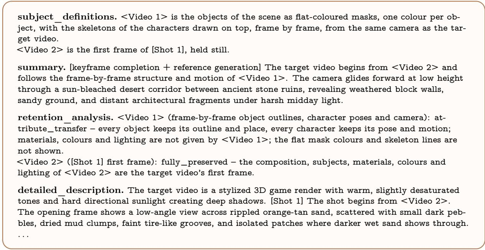  
Figure 12 Training caption from UnrealZoo with object masks and skeletons. The detailed description is truncated.

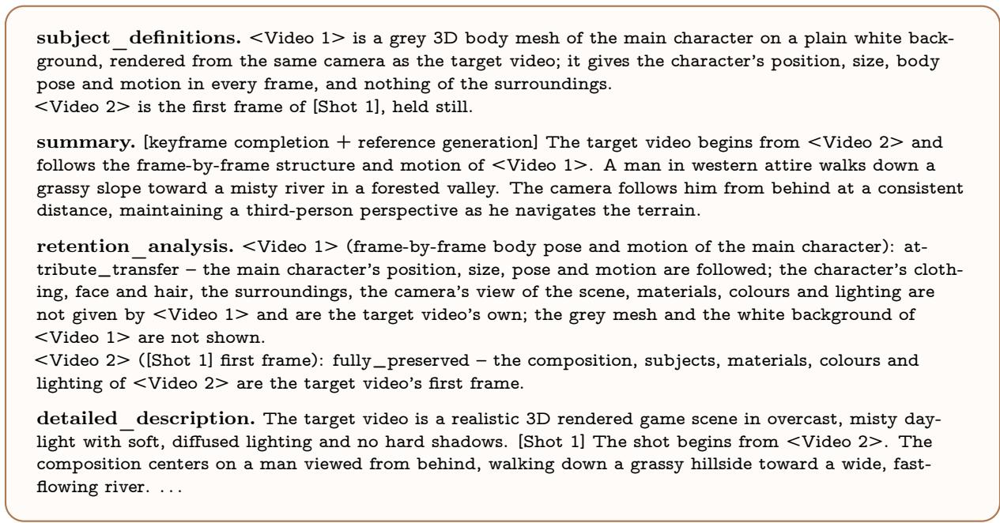  
Figure 13 Training caption from a YouTube video with an SMPL body. The detailed description is truncated.

## B.1 Training Captions

All structural references enter the same reference pathway, and the caption states what each of them constrains. Every caption has a fixed definition and retention line for each supplied reference, which tells the model which information the reference gives and that its look is not shown, followed by a summary and a detailed description of the target video. Figures 9 to 14 show one real caption from six sources each.

## B.2 Caption Validation

The captioning pipeline uses Kimi K2.6. For every caption, validators require all six fields, only defined reference tags, a 350–500-word body, no Chinese outside quotation marks, and increasing shot times. When a first frame is provided, the first shot must begin from that reference. Captions that fail these checks are regenerated, with at most three retries.

subject\_definitions. <Video 1> is the first frame of [Shot 1], held still.

summary. [keyframe completion] The target video begins from <Video 1>. An armored hunter wielding a massive bone greatsword battles a serpentine monster in a dark rocky cavern. The hunter charges, dodges, and unleashes a fiery charged attack against the coiling creature, with the camera tracking dynamically around the combat.

retention\_analysis. <Video 1> ([Shot 1] first frame): fully\_preserved – the composition, subjects, materials, colours and lighting of <Video 1> are the target video’s first frame.

detailed\_description. The target video is a realistic 3D CG game render in dim, cool-toned cavern light with soft volumetric fog and muted shadows. [Shot 1] The shot begins from <Video 1>. The scene opens on a hunter in brown and bronze segmented plate armor standing on dark wet stone, facing a massive serpentine monster with a broad armored head, glowing yellow eyes, and multiple long black tentacles lined with yellow-gold ridges. . . .

Figure 14 Training caption from WildWorld with a first frame only. The detailed description is truncated.  
Table 6 Comparison on unseen representations. Gemini Elo ratings and automatic totals on 74 cases. The causal variant is rated only against ours. Bold and underlined italics mark the best and second-best values.
<table><tr><td>Method</td><td>Steps</td><td>Over.</td><td>Qual.</td><td>Struct.</td><td>First</td><td>Auto.</td></tr><tr><td colspan="7">Baselines</td></tr><tr><td>Official backbone</td><td>50</td><td>998</td><td>1038</td><td>722</td><td>1120</td><td>69.9</td></tr><tr><td>Ours (Stage 1)</td><td>50</td><td>1318</td><td>1272</td><td>1280</td><td>1325</td><td>70.4</td></tr><tr><td colspan="7">Structure-conditioned renderers</td></tr><tr><td>Wan2.2-VACE-Fun</td><td>50</td><td>519</td><td>622</td><td>598</td><td>508</td><td>65.8</td></tr><tr><td>PAI ControlNet-Union</td><td>40</td><td>1215</td><td>1224</td><td>1046</td><td>1103</td><td>68.7</td></tr><tr><td>Cosmos-Transfer2.5</td><td>35</td><td>519</td><td>500</td><td>1105</td><td>508</td><td>64.0</td></tr><tr><td>LynnReal-Omni</td><td>4</td><td>1409</td><td>1369</td><td>1275</td><td>1405</td><td>69.7</td></tr><tr><td>Streaming CWM</td><td>4</td><td>1098</td><td>1095</td><td>891</td><td>1135</td><td>70.1</td></tr><tr><td>StreamRender-H3</td><td>2</td><td>519</td><td>500</td><td>722</td><td>508</td><td>62.3</td></tr><tr><td>Ours (causal)</td><td>4</td><td>1132</td><td>1068</td><td>1201</td><td>1103</td><td>69.8</td></tr><tr><td>Ours</td><td>4</td><td>1403</td><td>1381</td><td>1360</td><td>1390</td><td>70.6</td></tr></table>

Table 7 Automatic scores of the conditioning and data ablations. Group scores and their mean (0–100) for Tables 4 and 5. Higher is better; bold marks the best value within each block.
<table><tr><td>Model</td><td>Qual.</td><td>Stab.</td><td>Ctrl.</td><td>First</td><td>Auto.</td></tr><tr><td colspan="6">Conditioning design</td></tr><tr><td>ControlNet branch</td><td>60.2</td><td>90.5</td><td>46.8</td><td>66.4</td><td>66.0</td></tr><tr><td>Half resolution</td><td>59.5</td><td>91.5</td><td>46.6</td><td>67.0</td><td>66.2</td></tr><tr><td>Separate RoPE</td><td>59.1</td><td>91.5</td><td>46.4</td><td>67.0</td><td>66.0</td></tr><tr><td>Ours (full res.)</td><td>59.6</td><td>91.6</td><td>48.0</td><td>66.8</td><td>66.5</td></tr><tr><td colspan="6">Training data (half resolution)</td></tr><tr><td>All data</td><td>59.5</td><td>91.5</td><td>46.6</td><td>67.0</td><td>66.2</td></tr><tr><td>Structured only</td><td>59.7</td><td>91.2</td><td>47.3</td><td>66.8</td><td>66.2</td></tr><tr><td>1/10 data</td><td>59.6</td><td>91.4</td><td>46.5</td><td>67.1</td><td>66.1</td></tr><tr><td>New seed</td><td>58.9</td><td>91.5</td><td>46.4</td><td>66.9</td><td>65.9</td></tr><tr><td>W/o misaligned</td><td>59.9</td><td>91.6</td><td>47.4</td><td>66.9</td><td>66.5</td></tr></table>

## B.3 Source Audit Details

Source Alignment. On Magpie, the synchronization audit retains 32,027 of 44,266 clips. Shot changes, static content, structural mismatch, and darkness account for most rejections, followed by near-duplicates, black frames, and unmatched jumps. For the engine recordings, depth, masks, camera poses, and skeletons are aligned to the RGB timestamps, 80 of 84 motion windows have their best ofset at zero, and depthand-camera reprojection has a median error of 0.06%. The near-range depth conversion retains 13,700 of 13,702 clips. A finer proxy built from 0.25 m blocks was also considered but not adopted, because its flicker is four to seven times higher.

YouTube Videos. We keep 137 of 559 videos with a clear protagonist. Our target stream and the stream used for SMPL fitting difer by about 2 grey levels per pixel on a 0–255 scale, and the mesh videos match the target in crop, resolution, length, and frame rate.

## C Additional Experimental Results

## C.1 Detailed Results

We extend the main comparison with ratings on unseen representations, direct pairwise margins, and automatic scores grouped by evaluation dimension. We then break down representation groups to compare four-step rendering with the full-step control model.

Generalization to Unseen Representations. Table 6 restricts the comparison to the 74 cases whose structural representation never occurs in training. SolarRenderer achieves the highest quality and structure ratings, with a structure rating of 1360 against 1275 for LynnReal-Omni. Its overall rating is only six points

Generalization benchmark

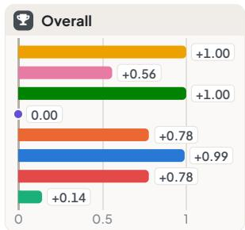  
In-distribution test set

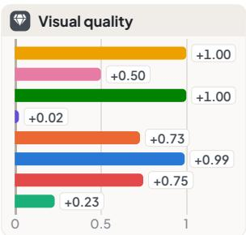

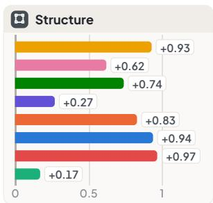

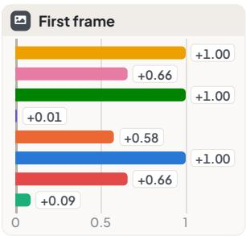

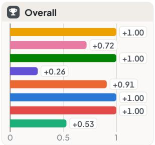

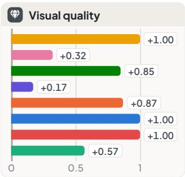

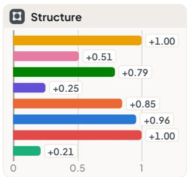

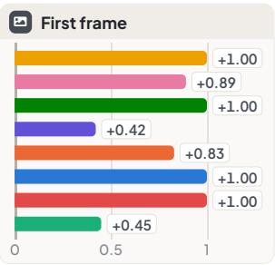  
Ours vs. Wan2.2 VACE-Fun PAI ControlNet-Union Cosmos-Transfer2.5 LynnReal-Omni Streaming CWM StreamRender-H3 Oficial backbone Ours (Stage 1, 50 steps)

Figure 15 Pairwise margin of ours over each compared method. Net score of ours against each indicated method for each judge question on the two test sets. Positive values favor ours.

Table 8 Automatic scores on both test sets. Four group scores and their equally weighted total (0–100, higher is better) on the generalization benchmark (208 cases) and in-distribution test set (53 clips). Bold and underlined italics mark the best and second-best values.

<table><tr><td></td><td colspan="5">Generalization benchmark</td><td colspan="5">In-distribution test set</td></tr><tr><td>Method</td><td>Steps</td><td>Quality</td><td>Stability</td><td>Control</td><td>First fr.</td><td>Auto.</td><td>Quality</td><td>Stability</td><td>Control</td><td>First fr.</td><td>Auto.</td></tr><tr><td>Baselines</td><td></td><td></td><td></td><td></td><td></td><td></td><td></td><td></td><td></td><td></td><td></td></tr><tr><td>Official backbone</td><td>50</td><td>63.8</td><td>90.7</td><td>55.6</td><td>69.3</td><td>69.8</td><td>54.4</td><td>91.4</td><td>44.4</td><td>69.1</td><td>64.8</td></tr><tr><td>Ours (Stage 1)</td><td>50</td><td>69.3</td><td>90.7</td><td>57.8</td><td>68.8</td><td>71.6</td><td>60.3</td><td>91.4</td><td>43.8</td><td>69.4</td><td>66.2</td></tr><tr><td colspan="10">Structure-conditioned renderers</td><td></td></tr><tr><td>Wan2.2-VACE-Fun</td><td>50</td><td>60.3</td><td>87.6</td><td>62.6</td><td>50.3</td><td>65.2</td><td>55.9</td><td>85.4</td><td>59.9</td><td>50.8</td><td>63.0</td></tr><tr><td>PAI ControlNet-Union</td><td>40</td><td>67.5</td><td>91.4</td><td>56.0</td><td>62.9</td><td>69.4</td><td>61.5</td><td>90.8</td><td>44.4</td><td>61.7</td><td>64.6</td></tr><tr><td>Cosmos-Transfer2.5</td><td>35</td><td>52.3</td><td>90.0</td><td>69.5</td><td>47.2</td><td>64.7</td><td>57.5</td><td>89.6</td><td>58.3</td><td>53.3</td><td>64.7</td></tr><tr><td>LynnReal-Omni</td><td>4</td><td>70.7</td><td>86.4</td><td>55.4</td><td>67.5</td><td>70.0</td><td>64.8</td><td>86.5</td><td>39.1</td><td>66.4</td><td>64.2</td></tr><tr><td>Streaming CWM</td><td>4</td><td>67.9</td><td>92.3</td><td>50.3</td><td>72.1</td><td>70.7</td><td>59.4</td><td>92.1</td><td>36.3</td><td>69.1</td><td>64.2</td></tr><tr><td>StreamRender-H3</td><td>2</td><td>61.9</td><td>83.4</td><td>54.8</td><td>55.4</td><td>63.9</td><td>55.3</td><td>82.3</td><td>43.7</td><td>54.8</td><td>59.0</td></tr><tr><td>Ours (causal)</td><td>4</td><td>68.8</td><td>91.6</td><td>60.0</td><td>64.3</td><td>71.2</td><td>60.3</td><td>91.4</td><td>48.5</td><td>66.3</td><td>66.6</td></tr><tr><td>Ours</td><td>4</td><td>69.1</td><td>89.8</td><td>61.0</td><td>66.7</td><td>71.6</td><td>61.9</td><td>89.8</td><td>48.9</td><td>67.5</td><td>67.0</td></tr></table>

below that competitor, while the quality rating is higher and the first-frame rating is slightly lower. The clearest advantage is thus following unfamiliar structure while producing competitive appearance. The four-step model also improves on Stage 1 on all four questions, showing that the benefit of structure-guided post-training extends to representations absent from the training corpus. It also leads the total automatic score at 70.6, followed by Stage 1 at 70.4.

Pairwise Comparison with Existing Methods. Figure 15 reports the normalized win–loss margin of ours against each method, complementing the ratings in Table 1. Every margin is nonnegative on both test sets. Against LynnReal-Omni, the overall comparison is even on the generalization benchmark, but the structure margin reaches +0.27, and all four questions favor ours on the in-distribution test set. Against Stage 1, quality improves alongside structure and first-frame preservation on both sets. These direct comparisons support the same conclusion as the Elo ratings: four-step rendering improves the controlled output, with the strongest gain over the closest external competitor in structure.

Results by Representation and Source. Figure 16 expands the categories in Figure 6 into individual representations and sources. Compared with Stage 1 + LongLive-Plug, ours has a positive margin in every broad group, with particularly strong results on pose inputs and shaded geometry. Against our 50-step Stage 1 model, the four-step model wins on six of eight agent-built skeleton cases and on six of seven silhouettes, but loses on colour-mapped depth, voxels, and pencil storyboards. Thus, the gains on unseen inputs cover several distinct formats, while some individual formats still favor full-step sampling. The category totals and the case counts make both patterns visible beyond the aggregate comparison.

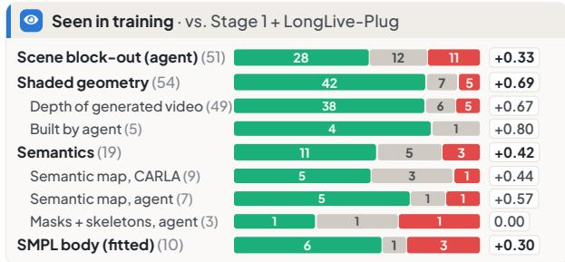

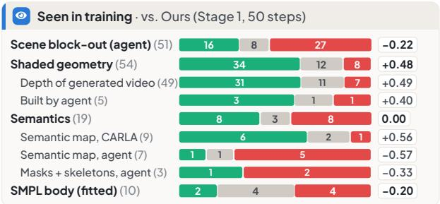

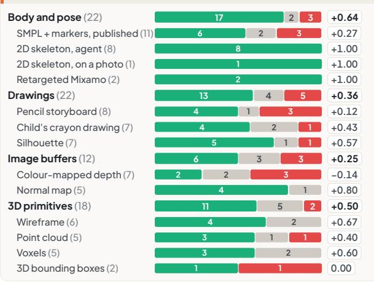

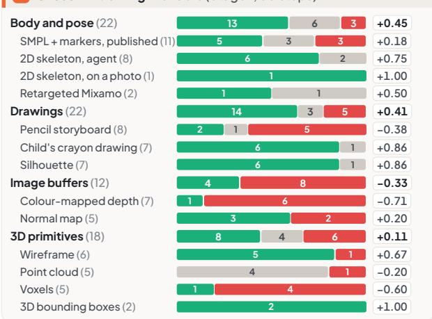  
win tie loss number of cases in parentheses, net score at the end of each bar  
Figure 16 Results by representation and source on the generalization benchmark. Each bar splits the cases of one representation into wins, ties, and losses of ours against Stage 1 + LongLive-Plug (left) and against our 50-step Stage 1 model (right), with the number of cases in parentheses and the net score at the end of the bar. Bold rows match the categories in Figure 6, with individual representations and sources below. Positive values favor ours.

Comparison on Automatic Metrics. Table 8 compares quality, stability, control, and first-frame preservation on both test sets. Our method has the highest total on the in-distribution test set and matches Stage 1 at the reported precision on the generalization benchmark. Individual renderers lead diferent groups: LynnReal-Omni leads quality, Cosmos-Transfer2.5 and Wan2.2-VACE-Fun lead control on the two sets, and Streaming CWM leads stability but has the lowest control scores. Our model balances quality and structural agreement. Compared with Stage 1, post-training improves control on both sets and quality on the in-distribution test set, while stability and first-frame preservation decrease. These changes leave the generalization total nearly unchanged and raise the in-distribution total.

Visual Comparison with Other Methods. Figure 17 summarizes comparisons on 86 demonstration cases from 15 works. We render each case using the structural input shared on its project page and the provided first frame, or the first frame of its output video when no separate reference is available. We compare our outputs with the original results, presenting each pair to the judge in both orders. The comparison covers StreamRender-H3, Magpie, Cosmos-Transfer2.5, SceneCraft, Proxy2World, Difusion as Shader, PAI ControlNet-Union, Programmable World Model, the neural rendering examples of Safka (2026), Go-with-the-Flow, VACE, EdenLive, CWM, AgentGarten, and Code Video Model. Across these cases, ours wins 49 comparisons, ties 13, and loses 24, giving a net score of +0.29. The positive margin shows that our model also competes well on cases selected by other methods.

## C.2 Additional Ablations

We report the four automatic group scores and their total for the main-text ablations, focusing on how each design afects appearance, temporal consistency, and agreement with the structural input.

Table 9 Automatic scores of the structure-guidance ablation. Group scores and their mean (0–100, higher is better) for Table 2. Bold marks the best per block.
<table><tr><td>Model</td><td>Qual.</td><td>Stab.</td><td>Ctrl.</td><td>First</td><td>Auto.</td></tr><tr><td colspan="6">Self-distillation</td></tr><tr><td>w = 1</td><td>68.6</td><td>91.1</td><td>59.4</td><td>68.7</td><td>71.9</td></tr><tr><td>w = 2</td><td>69.3</td><td>90.5</td><td>61.2</td><td>67.6</td><td>72.1</td></tr><tr><td colspan="6">LongLive-Plug start</td></tr><tr><td>w = 1</td><td>68.0</td><td>91.4</td><td>59.1</td><td>68.2</td><td>71.7</td></tr><tr><td>w = 1.5</td><td>69.3</td><td>90.8</td><td>60.2</td><td>68.0</td><td>72.1</td></tr><tr><td>w = 2</td><td>69.2</td><td>90.7</td><td>60.4</td><td>68.1</td><td>72.1</td></tr><tr><td colspan="6">DMAD start</td></tr><tr><td>w = 1</td><td>68.0</td><td>91.8</td><td>59.2</td><td>68.1</td><td>71.8</td></tr><tr><td>Ours (w = 1.5)</td><td>69.1</td><td>89.8</td><td>61.0</td><td>66.7</td><td>71.6</td></tr></table>

Table 10 Automatic scores of the post-training ablation. Group scores and their mean (0–100) for Table 3. Ours uses DMAD, w = 1.5, and four steps. Higher is better, with the best in bold.
<table><tr><td>Model</td><td>Qual.</td><td>Stab.</td><td>Ctrl.</td><td>First</td><td>Auto.</td></tr><tr><td colspan="6">Starting point, no post-training</td></tr><tr><td>LongLive-Plug</td><td>69.1</td><td>91.1</td><td>59.7</td><td>68.7</td><td>72.1</td></tr><tr><td>FastH3</td><td>69.4</td><td>90.5</td><td>59.8</td><td>67.8</td><td>71.9</td></tr><tr><td>DMAD</td><td>68.8</td><td>91.3</td><td>60.4</td><td>68.1</td><td>72.1</td></tr><tr><td colspan="6">Guidance strength</td></tr><tr><td>w = 2</td><td>69.3</td><td>88.8</td><td>60.9</td><td>66.3</td><td>71.3</td></tr><tr><td colspan="6">Sampling steps</td></tr><tr><td>2 steps</td><td>69.1</td><td>89.9</td><td>61.3</td><td>65.7</td><td>71.5</td></tr><tr><td>8 steps</td><td>69.5</td><td>89.7</td><td>61.2</td><td>66.0</td><td>71.6</td></tr><tr><td>Ours</td><td>69.1</td><td>89.8</td><td>61.0</td><td>66.7</td><td>71.6</td></tr></table>

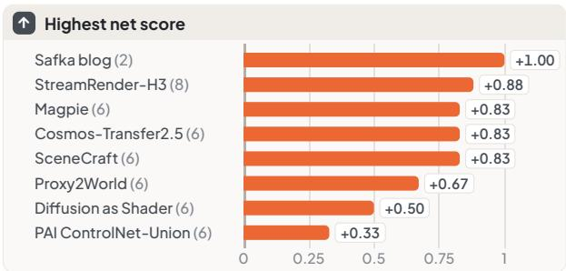

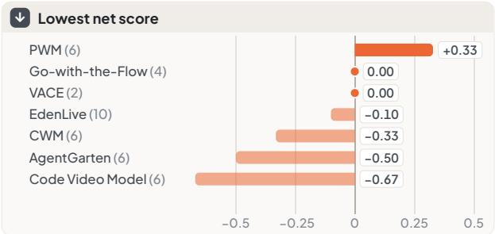  
Examples per work in parentheses. All 86 examples: 49 wins, 13 ties, 24 losses, net +0.29  
Figure 17 Visual comparison with other methods. Overall net score of ours against the outputs of 15 works on demonstration cases from their project pages. Positive values favor ours.

Effects of Structure Guidance. Table 9 supplements Table 2 with automatic scores. Guidance improves quality and control from every starting point, consistent with a teacher that more strongly follows the structural input. From the DMAD start, control rises from 59.2 to 61.0 and quality from 68.0 to 69.1, while stability and first-frame preservation fall. These changes slightly lower the equally weighted total, even as the pairwise ratings improve. The automatic groups expose this tradeof, while the higher Elo ratings reflect the judge’s joint preference over appearance and structure.

Post-Training and Sampling Settings. Table 10 gives group scores for the settings in Table 3. Post-training the DMAD composition raises quality and control, while its lower stability and first-frame score reduce the automatic total. Increasing guidance to w = 2 further lowers stability with little change in control. Eight sampling steps improve quality slightly over four, but reduce first-frame preservation and leave the total unchanged at the reported precision. Two steps have the highest control score but a lower first-frame score. Four steps achieve the highest overall, quality, and first-frame Elo ratings among these settings, balancing rendering quality with sampling cost.

Conditioning Design. Table 7 collects the group scores of Tables 4 and 5 and adds their automatic totals. The native full-resolution pathway improves stability and control over the ControlNet branch, with a small reduction in quality. Increasing structural resolution raises control from 46.6 to 48.0 and the total from 66.2 to 66.5, with little change in the other groups. At half resolution, shared RoPE also improves quality and control over separate positions. The consistent control gains support aligning reference tokens with the target frames and preserving the spatial detail of the structural input.

Training Data. The lower block of Table 7 compares data variants. Keeping only structured samples raises control but lowers stability and first-frame preservation, leaving the automatic total unchanged at the reported precision. Removing misaligned structural supervision improves quality, stability, and control over using all data, raising the total from 66.2 to 66.5. The corpus therefore benefits from combining reliable structural supervision with appearance-only samples. Reducing the data to one tenth has a smaller efect than the variation between full-data runs, consistent with prioritizing alignment over data volume.

## References

Alibaba PAI. MiniMax-H3-Fun-Controlnet-Union-2.0. Hugging Face model card, 2026. URL https://huggingface. co/alibaba-pai/MiniMax-H3-Fun-Controlnet-Union-2.0.

Hritik Bansal, Clark Peng, Yonatan Bitton, Roman Goldenberg, et al. VideoPhy-2: A Challenging Action-Centric Physical Commonsense Evaluation in Video Generation, 2025. URL https://arxiv.org/abs/2503.06800. arXiv:2503.06800.

Yuxuan Bian, Xin Chen, Zenan Li, Tiancheng Zhi, et al. Video-As-Prompt: Unified Semantic Control for Video Generation. In International Conference on Learning Representations (ICLR), 2026. URL https: //arxiv.org/abs/2510.20888. arXiv:2510.20888.

Ralph Allan Bradley and Milton E. Terry. Rank analysis of incomplete block designs: I. the method of paired comparisons. Biometrika, 39(3/4):324–345, 1952.

Ryan Burgert, Yuancheng Xu, Wenqi Xian, Oliver Pilarski, et al. Go-with-the-Flow: Motion-Controllable Video Difusion Models Using Real-Time Warped Noise. In Proceedings of the IEEE/CVF Conference on Computer Vision and Pattern Recognition (CVPR), pages 13–23, 2025. doi: 10.1109/CVPR52734.2025.00011. URL https://arxiv.org/abs/2501.08331. arXiv:2501.08331.

John Canny. A computational approach to edge detection. IEEE Transactions on Pattern Analysis and Machine Intelligence, 8(6):679–698, 1986. doi: 10.1109/TPAMI.1986.4767851.

Bohong Chen, Yajing Chen, Yihua Du, Junchao Huang, et al. H3 Streaming VAE Decoder: Training-Free Streaming without Future Latents. SolarX-Team blog post, 2026a. URL https://solarx-team.github.io/H3-Str eaming-VAE-Decoder/.

Yiwen Chen, Guosheng Lin, and Chi Zhang. Code World Model: Coding Agent as World Brain, 2026b. URL https://arxiv.org/abs/2608.25927. arXiv:2608.25927.

Jiawei Chi, Shangchen Miao, Zhiyuan Shi, Kailu Wu, et al. AgentGarten: Code Worlds for Evolving Agents, 2026. URL https://arxiv.org/abs/2610.12374. arXiv:2610.12374.

Alexey Dosovitskiy, German Ros, Felipe Codevilla, Antonio Lopez, et al. CARLA: An Open Urban Driving Simulator. In Conference on Robot Learning (CoRL), volume 78 of Proceedings of Machine Learning Research, pages 1–16, 2017. URL https://proceedings.mlr.press/v78/dosovitskiy17a.html. arXiv:1711.03938.

Guian Fang, Yuchao Gu, and Mike Zheng Shou. FramePrompt: In-context Controllable Animation with Zero Structural Changes, 2025. URL https://arxiv.org/abs/2506.17301. arXiv:2506.17301.

Heyuan Gao, Bangxun Tang, Yiren Song, Guian Fang, et al. PAI-Studio: Cinematic Video Background Replacement with Camera-Aware Motion. In Computer Vision - ECCV 2026 - 19th European Conference, Malmö, Sweden, September 8-12, 2026, Proceedings, Part LIII, Lecture Notes in Computer Science, pages 455–472. Springer, 2026. doi: 10.1007/978-3-032-37255-0\_25.

Gemini Team. Gemini: A family of highly capable multimodal models. arXiv preprint arXiv:2312.11805, 2023. URL https://arxiv.org/abs/2312.11805.

Gonzalo Gomez-Nogales, Yicong Hong, Chongjian Ge, Peiye Zhuang, et al. Coarse-to-Real: Generative Rendering for Populated Dynamic Scenes, 2026. URL https://arxiv.org/abs/2601.22301. arXiv:2601.22301.

Google DeepMind. Gemini 3.8 Flash Model Card. Model card, 2026. URL https://deepmind.google/models/m odel-cards/gemini-3-8-flash/.

Yuchao Gu, Guian Fang, Yuxin Jiang, Weijia Mao, et al. AnyFlow: Any-Step Video Difusion Model with On-Policy Flow Map Distillation. In European Conference on Computer Vision (ECCV), pages 163–181, 2026. doi: 10.1007/978-3-032-37235-2\_10. arXiv:2605.13724.

Zekai Gu, Rui Yan, Jiahao Lu, Peng Li, et al. Difusion as Shader: 3D-aware Video Difusion for Versatile Video Generation Control. In Proceedings of the Special Interest Group on Computer Graphics and Interactive Techniques Conference Conference Papers (SIGGRAPH Conference Papers), 2025. doi: 10.1145/3721238.3730607. URL https://arxiv.org/abs/2501.03847. arXiv:2501.03847.

Hao AI Lab. FastVideo-FastH3-4-step-Preview-v1-LoRA. FastVideo model release, 2026. URL https://huggingf ace.co/FastVideo/FastVideo-FastH3-4-step-Preview-v1-LoRA.

Xuan He, Dongfu Jiang, Ping Nie, Minghao Liu, et al. VideoScore2: Think before You Score in Generative Video Evaluation, 2025. URL https://arxiv.org/abs/2509.22799. arXiv:2509.22799.

Jonathan Ho and Tim Salimans. Classifier-Free Difusion Guidance. In NeurIPS Workshop on Deep Generative Models and Downstream Applications, 2021. URL https://arxiv.org/abs/2207.12598. arXiv:2207.12598.

Edward J. Hu, Yelong Shen, Phillip Wallis, Zeyuan Allen-Zhu, et al. LoRA: Low-Rank Adaptation of Large Language Models. In International Conference on Learning Representations (ICLR), 2022. URL https: //arxiv.org/abs/2106.09685. arXiv:2106.09685.

Junchao Huang, Guian Fang, Shengju Qian, Xianghao Kong, et al. SolarWM: Open Data and Scalable Training for Long-Horizon Video World Models, 2026a. URL https://arxiv.org/abs/2609.02886. arXiv:2609.02886.

Xun Huang, Zhengqi Li, Guande He, Mingyuan Zhou, et al. Self Forcing: Bridging the Train-Test Gap in Autoregressive Video Difusion. In Advances in Neural Information Processing Systems (NeurIPS), 2025. URL https://arxiv.org/abs/2506.08009. arXiv:2506.08009.

Zheng-Hui Huang, Guixu Lin, Jiacheng Lin, Yi-Chuan Huang, et al. Programmable World Model, 2026b. URL https://arxiv.org/abs/2609.10540. arXiv:2609.10540.

Zheng-Hui Huang, Zhixiang Wang, Jiaming Tan, Ruihan Yu, et al. Generative World Renderer, 2026c. URL https://arxiv.org/abs/2604.02329. arXiv:2604.02329.

Ziqi Huang, Yinan He, Jiashuo Yu, Fan Zhang, et al. VBench: Comprehensive Benchmark Suite for Video Generative Models. In Proceedings of the IEEE/CVF Conference on Computer Vision and Pattern Recognition, 2024. URL https://openaccess.thecvf.com/content/CVPR2024/html/Huang\_VBench\_Comprehensive\_Ben chmark\_Suite\_for\_Video\_Generative\_Models\_CVPR\_2024\_paper.html.

Zeyinzi Jiang, Zhen Han, Chaojie Mao, Jingfeng Zhang, et al. VACE: All-in-One Video Creation and Editing. In Proceedings of the IEEE/CVF International Conference on Computer Vision (ICCV), pages 17191–17202, 2025. doi: 10.1109/ICCV51701.2025.01597. URL https://arxiv.org/abs/2503.07598. arXiv:2503.07598.

Xuan Ju, Yiming Gao, Zhaoyang Zhang, Ziyang Yuan, et al. MiraData: A Large-Scale Video Dataset with Long Durations and Structured Captions, 2024. URL https://arxiv.org/abs/2407.06358. arXiv:2407.06358.

Xuan Ju, Weicai Ye, Quande Liu, Qiulin Wang, et al. FullDiT: Video Generative Foundation Models with Multimodal Control via Full Attention. In Proceedings of the IEEE/CVF International Conference on Computer Vision (ICCV), pages 15737–15747, 2025. doi: 10.1109/ICCV51701.2025.01460. URL https://arxiv.org/abs/25 03.19907. arXiv:2503.19907.

Nikita Karaev, Iurii Makarov, Jianyuan Wang, Natalia Neverova, et al. CoTracker3: Simpler and Better Point Tracking by Pseudo-Labelling Real Videos. In Proceedings of the IEEE/CVF International Conference on Computer Vision (ICCV), 2025. doi: 10.1109/ICCV51701.2025.00568. URL https://arxiv.or /abs/2410.11831. arXiv:2410.11831.

Kimi Team. Kimi K2.5: Visual Agentic Intelligence, 2026. URL https://arxiv.org/abs/2602.02276. arXiv:2602.02276.

Lingdong Kong, Yu Yang, Jianbiao Mei, Youquan Liu, et al. 3D and 4D World Modeling: A Survey, 2025. URL https://arxiv.org/abs/2509.07996. arXiv:2509.07996.

Quanhao Li, Zhen Xing, Rui Wang, Haidong Cao, et al. FlashMotion: Few-Step Controllable Video Generation with Trajectory Guidance. In Proceedings of the IEEE/CVF Conference on Computer Vision and Pattern Recognition (CVPR), pages 8986–8996, 2026a. URL https://arxiv.org/abs/2603.12146. arXiv:2603.12146.

Shihong Li, Juntao Xu, JinCao, Maowen Tang, et al. DART: Distillation-Aware Reparameterization for Training-Free LoRA Reuse in Few-Step Video Difusion Models, 2026b. URL https://arxiv.org/abs/2609.20051. arXiv:2609.20051.

Zhen Li, Zian Meng, Shuwei Shi, Wenshuo Peng, et al. WildWorld: A Large-Scale Dataset for Dynamic World Modeling with Actions and Explicit State toward Generative ARPG, 2026c. URL https://arxiv.org/abs/2603 .23497. arXiv:2603.23497.

Ziye Li, Hao Luo, Xincheng Shuai, and Henghui Ding. AnyI2V: Animating Any Conditional Image with Motion Control. In Proceedings of the IEEE/CVF International Conference on Computer Vision (ICCV), pages 17302– 17311, 2025. doi: 10.1109/ICCV51701.2025.01607. URL https://arxiv.org/abs/2507.02857. arXiv:2507.02857.

Ruofan Liang, Zan Gojcic, Huan Ling, Jacob Munkberg, et al. Difusion Renderer: Neural Inverse and Forward Rendering with Video Difusion Models. In Proceedings of the IEEE/CVF Conference on Computer Vision and Pattern Recognition (CVPR), pages 26069–26080, 2025. doi: 10.1109/CVPR52734.2025.02428. URL https://arxiv.org/abs/2501.18590. arXiv:2501.18590.

Zhiyang Liang, Jiawei Zhang, Guocheng Qian, Dongdong Chen, et al. Code Video Model: Conditioning Video Generation on Code. Technical report, https://code-video-model.github.io/tech\_report.pdf, 2026. URL https://code-video-model.github.io/.

Tingting Liao and Guangyi Liu. Streaming Code World Model. GitHub repository, 2026. URL https://github.c om/TingtingLiao/streaming-code-world-model.

Guixu Lin, Zheng-Hui Huang, Siqi Yang, Ming-Hsuan Yang, et al. Generative World Renderer at the Speed of Play, 2026a. URL https://arxiv.org/abs/2607.18703. arXiv:2607.18703.

Haotong Lin, Sili Chen, Jun Hao Liew, Donny Y. Chen, et al. Depth Anything 3: Recovering the Visual Space from Any Views. In International Conference on Learning Representations (ICLR), 2026b. URL https://arxiv.org/abs/2511.10647.

Shanchuan Lin and Xiao Yang. AnimateDif-Lightning: Cross-Model Difusion Distillation, 2024. URL https: //arxiv.org/abs/2403.12706. arXiv:2403.12706.

Yaron Lipman, Ricky T. Q. Chen, Heli Ben-Hamu, Maximilian Nickel, et al. Flow Matching for Generative Modeling. In International Conference on Learning Representations (ICLR), 2023. URL https://arxiv.org/abs/2210.02747. arXiv:2210.02747.

Dongyang Liu, Peng Gao, David Liu, Ruoyi Du, et al. Decoupled DMD: CFG Augmentation as the Spear, Distribution Matching as the Shield. In International Conference on Learning Representations (ICLR), 2026. URL https://arxiv.org/abs/2511.22677. arXiv:2511.22677.

Matthew Loper, Naureen Mahmood, Javier Romero, Gerard Pons-Moll, et al. SMPL: A Skinned Multi-Person Linear Model. ACM Transactions on Graphics, 34(6), 2015. doi: 10.1145/2816795.2818013.

Ilya Loshchilov and Frank Hutter. Decoupled weight decay regularization. In International Conference on Learning Representations (ICLR), 2019. URL https://arxiv.org/abs/1711.05101.

Dongyue Lu, Guian Fang, Hur Lim, Yonggang Wu, et al. Orbia: Do Generated Videos Form a Consistent 3D World?, 2026a. URL https://orbia-bench.github.io/paper/orbia.pdf. Preprint.

Dongyue Lu, Ao Liang, Tianxin Huang, Xiao Fu, et al. See4d: Pose-free 4d generation via auto-regressive video inpainting. In Computer Graphics Forum, page e70345. Wiley Online Library, 2026b.

Jinpeng Lu, Dexu Zhu, Haoyuan Shi, Linghan Cai, et al. Current World Models Lack a Persistent State Core, 2026c. URL https://arxiv.org/abs/2606.20545. arXiv:2606.20545.

Yanzuo Lu, Tian Ye, Yitong Li, Shuchen Xue, et al. StreamRender-H3: Interactive Coding Worlds with Real-time Streaming Difusion Render. https://nvlabs.github.io/Sana/Sol-Engine/StreamRender-H3/, 2026d. Project page.

Simian Luo, Yiqin Tan, Suraj Patil, Daniel Gu, et al. LCM-LoRA: A Universal Stable-Difusion Acceleration Module, 2023. URL https://arxiv.org/abs/2311.05556. arXiv:2311.05556.

Xiaofeng Mao, Peijia Lin, Shaohao Rui, Yibo Zhang, et al. LynnReal-Omni: Native multi-modal Video Generation for Agentic Visual Workflows, 2026. URL https://arxiv.org/abs/2609.15863. arXiv:2609.15863.

MiniMax. MiniMax H3: An Open Model Breaking the Boundaries Between Tasks and Modalities. Model card and release blog, 2026. URL https://huggingface.co/MiniMaxAI/MiniMax-H3.

Moonshot AI. Kimi-K2.6. Hugging Face model card, 2026. URL https://huggingface.co/moonshotai/Kimi-K2.6.

NVIDIA. Cosmos-Transfer2.5: World Generation with Adaptive Multimodal Control. Oficial project page, 2025. URL https://research.nvidia.com/labs/cosmos-lab/cosmos-transfer2.5/.

NVIDIA, Arslan Ali, Junjie Bai, Maciej Bala, et al. World Simulation with Video Foundation Models for Physical AI, 2025. URL https://arxiv.org/abs/2511.00062. arXiv:2511.00062.

Maxime Oquab, Timothée Darcet, Théo Moutakanni, Huy Vo, et al. DINOv2: Learning Robust Visual Features without Supervision, 2023. URL https://arxiv.org/abs/2304.07193. arXiv:2304.07193.

Alec Radford, Jong Wook Kim, Chris Hallacy, Aditya Ramesh, et al. Learning transferable visual models from natural language supervision. In International Conference on Machine Learning (ICML), volume 139 of Proceedings of Machine Learning Research, pages 8748–8763, 2021. URL https://proceedings.mlr.press/v139/r adford21a.html.

Jintao Rong, Xin Xie, Xinyi Yu, Linlin Ou, et al. When Distillation Breaks Motion Control: Restoring Generative Trajectories for Fast Video Generators, 2025. URL https://arxiv.org/abs/2506.19348. arXiv:2506.19348.

Christian Safka. Real-Time Neural Rendering for World Models. Blog post, 2026. URL https://christiansafka.c om/blog/real-time-neural-rendering/.

Christoph Schuhmann. Improved Aesthetic Predictor. GitHub repository, 2022. URL https://github.com/christo phschuhmann/improved-aesthetic-predictor.

Zehong Shen, Huaijin Pi, Yan Xia, Zhi Cen, et al. World-Grounded Human Motion Recovery via Gravity-View Coordinates. In SIGGRAPH Asia 2024 Conference Papers, pages 1–11. ACM, 2024. doi: 10.1145/3680528.3687 565. URL https://arxiv.org/abs/2409.06662. arXiv:2409.06662.

Jianlin Su, Yu Lu, Shengfeng Pan, Ahmed Murtadha, et al. RoFormer: Enhanced Transformer with Rotary Position Embedding, 2021. URL https://arxiv.org/abs/2104.09864. arXiv:2104.09864.

Zhiyao Sun, Ziqiao Peng, Yifeng Ma, Yi Chen, et al. StreamAvatar: Streaming Difusion Models for Real-Time Interactive Human Avatars. In Proceedings of the IEEE/CVF Conference on Computer Vision and Pattern Recognition (CVPR), 2026. URL https://arxiv.org/abs/2512.22065. arXiv:2512.22065.

Zhenxiong Tan, Songhua Liu, Xingyi Yang, Qiaochu Xue, et al. OminiControl: Minimal and Universal Control for Difusion Transformer. In Proceedings of the IEEE/CVF International Conference on Computer Vision (ICCV), pages 14940–14950, 2025. doi: 10.1109/ICCV51701.2025.01386. URL https://arxiv.org/abs/2411.15098. arXiv:2411.15098.

Bangxun Tang, Heyuan Gao, Yiren Song, Guian Fang, et al. PAI-Actor: Cinematic Multi-Character Replacement in Dynamic Scenes. In Advances in Neural Information Processing Systems (NeurIPS), 2026. URL https: //arxiv.org/abs/2609.05918.

Team Wan, Ang Wang, Baole Ai, Bin Wen, et al. Wan: Open and Advanced Large-Scale Video Generative Models, 2025. URL https://arxiv.org/abs/2503.20314. arXiv:2503.20314.

Zachary Teed and Jia Deng. RAFT: Recurrent all-pairs field transforms for optical flow. In European Conference on Computer Vision (ECCV), pages 402–419, 2020. doi: 10.1007/978-3-030-58536-5\_24.

VAST-AI-Research. EdenLive: Real-Time Generative Rendering for Interactive Worlds, from Any Reference. https://github.com/VAST-AI-Research/EdenLive, 2026. URL https://vast-eden.ai/?p=edenlive.

Jianyuan Wang, Minghao Chen, Nikita Karaev, Andrea Vedaldi, et al. VGGT: Visual geometry grounded transformer. In Proceedings of the IEEE/CVF Conference on Computer Vision and Pattern Recognition (CVPR), pages 5294–5306, 2025a. doi: 10.1109/CVPR52734.2025.00499.

Xinyu Wang, Chongbo Zhao, Fangneng Zhan, and Yue Ma. LiveEdit: Towards Real-Time Difusion-Based Streaming Video Editing. In Proceedings of the European Conference on Computer Vision (ECCV), pages 631– 649, 2026a. doi: 10.1007/978-3-032-37574-2\_35. URL https://arxiv.org/abs/2606.26740. arXiv:2606.26740.

Yifan Wang, Liya Ji, Zhanghan Ke, Harry Yang, et al. Zero-shot Synthetic Video Realism Enhancement via Structure-aware Denoising, 2025b. URL https://arxiv.org/abs/2511.14719. arXiv:2511.14719.

Yuchen Wang, Wenliang Zhong, Lichen Bai, Zikai Zhou, et al. Exploring Data-Free LoRA Transferability for Video Difusion Models. In International Conference on Machine Learning (ICML), 2026b. URL https: //arxiv.org/abs/2605.01929. arXiv:2605.01929.

Zimo Wang, Junkun Yuan, Angtian Wang, Haotian Yang, et al. PDMD: Projected Distribution Matching Distillation for Video Difusion Models, 2026c. URL https://arxiv.org/abs/2609.35768. arXiv:2609.35768.

Haoning Wu, Erli Zhang, Liang Liao, Chaofeng Chen, et al. Exploring Video Quality Assessment on User Generated Contents from Aesthetic and Technical Perspectives. In Proceedings of the IEEE/CVF International Conference on Computer Vision (ICCV), pages 20087–20097, 2023. doi: 10.1109/ICCV51070.2023.01843. URL https://arxiv.org/abs/2211.04894. arXiv:2211.04894.

Zexi Wu, Baolu Li, Jing Dai, Yiming Zhang, et al. Video2LoRA: Unified Semantic-Controlled Video Generation via Per-Reference-Video LoRA. In Proceedings of the IEEE/CVF Conference on Computer Vision and Pattern Recognition (CVPR), Findings Track, pages 4202–4212, 2026. doi: 10.1109/CVPRF71909.2026.00406. URL https://arxiv.org/abs/2603.08210. arXiv:2603.08210.

Dianbing Xi, Jiepeng Wang, Yuanzhi Liang, Xi Qiu, et al. CtrlVDif: Controllable Video Generation via Unified Multimodal Video Difusion, 2025. URL https://arxiv.org/abs/2511.21129. arXiv:2511.21129.

Hongli Xu, Weilong Yan, Anbang Wang, Chunyu Zou, et al. Proxy2World: Learning to Generate Worlds From Lightweight Proxies without Seeing Them, 2026. URL https://arxiv.org/abs/2609.35023. arXiv:2609.35023.

Shuai Yang, Luozhou Wang, Wei Huang, ZhiFei Chen, et al. LongLive-Plug: Once-for-All Distillation for Video Generation, 2026a. URL https://arxiv.org/abs/2609.38154. arXiv:2609.38154.

Xiuyu Yang, Yunze Man, Jun-Kun Chen, and Yu-Xiong Wang. SceneCraft: Layout-Guided 3D Scene Generation. In Advances in Neural Information Processing Systems (NeurIPS), pages 82060–82084, 2024. doi: 10.52202/079 017-2608. URL https://arxiv.org/abs/2410.09049. arXiv:2410.09049.

Yu Yang, Xuemeng Yang, Licheng Wen, Lingdong Kong, et al. Quo Vadis, World Modeling?, 2026b. URL https://arxiv.org/abs/2608.02713. arXiv:2608.02713.

Tianwei Yin, Michaël Gharbi, Taesung Park, Richard Zhang, et al. Improved Distribution Matching Distillation for Fast Image Synthesis. In Advances in Neural Information Processing Systems (NeurIPS), 2024a. URL https://arxiv.org/abs/2405.14867. arXiv:2405.14867.

Tianwei Yin, Michaël Gharbi, Richard Zhang, Eli Shechtman, et al. One-step Difusion with Distribution Matching Distillation. In Proceedings of the IEEE/CVF Conference on Computer Vision and Pattern Recognition (CVPR), pages 6613–6623, 2024b. doi: 10.1109/CVPR52733.2024.00632. URL https://arxiv.org/abs/2311.18828. arXiv:2311.18828.

Kaining Ying, Hengrui Hu, Siyu Ren, Jiamu Li, et al. WBench: A Comprehensive Multi-turn Benchmark for Interactive Video World Model Evaluation, 2026. URL https://arxiv.org/abs/2605.25874. arXiv:2605.25874.

Zhengming Yu, Junkun Yuan, Haotian Yang, Gordon Guocheng Qian, et al. DMAD: Distribution Matching as Adversarial Distillation for Fast Visual Generation, 2026. URL https://arxiv.org/abs/2610.02188. arXiv:2610.02188.

Zheng Zeng, Marco Salvi, Lifan Wu, Jan Novák, et al. RGBX-Next: Towards Realistic Generative Rendering from G-Bufers, 2026. URL https://arxiv.org/abs/2608.13929. arXiv:2608.13929.

Xiaoyu Zhan, Xinyu Wang, Xiaohong Zhang, Huanjie Zhu, et al. Magpie: Real-Time World Renderer for Interactive Games, 2026. URL https://arxiv.org/abs/2608.27168. arXiv:2608.27168.

Lvmin Zhang, Anyi Rao, and Maneesh Agrawala. Adding Conditional Control to Text-to-Image Difusion Models. In Proceedings of the IEEE/CVF International Conference on Computer Vision (ICCV), pages 3813–3824, 2023. doi: 10.1109/ICCV51070.2023.00355. URL https://arxiv.org/abs/2302.05543. arXiv:2302.05543.

Zhuoran Zhao, Shengju Qian, Tongtong Liang, Xianghao Kong, et al. Mask Forcing: Improving Autoregressive Video Difusion Distillation via Dual-Noise Masking Rollout, 2026. URL https://arxiv.org/abs/2609.09123. arXiv:2609.09123.

Kaiwen Zheng, Yuji Wang, Qianli Ma, Huayu Chen, et al. Large Scale Difusion Distillation via Score-Regularized Continuous-Time Consistency. In International Conference on Learning Representations (ICLR), 2026. URL https://arxiv.org/abs/2510.08431. arXiv:2510.08431.

Fangwei Zhong, Kui Wu, Churan Wang, Hao Chen, et al. UnrealZoo: Enriching Photo-realistic Virtual Worlds for Embodied AI. In Proceedings of the IEEE/CVF International Conference on Computer Vision (ICCV), pages 5769–5779, 2025. doi: 10.1109/ICCV51701.2025.00546. URL https://arxiv.org/abs/2412.20977. arXiv:2412.20977.

Yang Zhou, Yifan Wang, Jianjun Zhou, Wenzheng Chang, et al. OmniWorld: A Multi-Domain and Multi-Modal Dataset for 4D World Modeling. In International Conference on Learning Representations (ICLR), 2026. URL https://arxiv.org/abs/2509.12201. arXiv:2509.12201.