# SENSEALIGN: UNDERSTANDING VISION AND TOUCHTHROUGH LANGUAGE AT TEST TIME

Chuyang Ye1 Qinting Jiang2 Jingyan Jiang3∗

1New York University

2Tsinghua Shenzhen International Graduate School, Tsinghua University

3Shenzhen Technology University

## ABSTRACT

Tactile–visual–language models combine vision and touch through a shared language space to recognize objects and materials. In real-world deployment, changes in lighting, contact quality or sensor hardware can shift visual or tactile inputs and degrade recognition performance. When both modalities contribute to a prediction, an unreliable modality can override correct evidence from the other. Since labeled data are generally unavailable during deployment, test-time adaptation offers a way to recover recognition performance from unlabeled observations. In this setting, we find that comparing accumulated observations with the text embeddings of candidate classes reveals modality reliability differences that confidence can miss. Refining features against competing classes also improves recognition beyond geometric alignment alone. These findings motivate SenseAlign, which uses a common semantic reference for test-time modality weighting and feature correction. Alignment Trust weights each modality according to its support for shared predicted classes. Anchor Realignment uses the same class text embeddings to fit a shared feature correction that separates predicted classes from alternatives. Both modules use the same unlabeled history while keeping all encoders frozen. Extensive experiments across diverse datasets demonstrate strong recognition performance under both natural shifts and controlled corruptions.

## 1 INTRODUCTION

Tactile–visual–language (TVL) models align visual and tactile observations with language, bringing what a robot sees and feels into a shared semantic space (Fu et al., 2024; Yang et al., 2024a; Feng et al., 2025). For a robot sorting materials, this connects two different views of the same object. Touch can distinguish surfaces that look alike, while vision reveals information beyond a small contact patch. Textual descriptions provide a common vocabulary for these observations, allowing both senses to contribute to recognizing objects and their physical properties.

These two views are acquired under different sensing conditions. Poor lighting can obscure visual distinctions, while incomplete contact or a different sensor can weaken tactile information. During recognition, each modality scores candidate classes by comparing its representation with their text descriptions; fusion combines these scores into a prediction. Our analysis finds cases where equal fusion loses distinctions that one modality still preserves, with either vision or touch taking the stronger role. Other cases benefit from both senses. The challenge is therefore to retain their complementarity as their relative value changes.

Responding to such changes without labels is the premise of test-time adaptation (TTA). Existing approaches learn from prediction entropy and cross-modal information (Wang et al., 2021; Niu et al., 2023; Yang et al., 2024b; Guo & Jin, 2025), including methods that address reliability bias and modality-specific shift (Yang et al., 2024b; Chen et al., 2025). Prediction confidence offers an intuitive signal for deciding which sense to trust. It measures how strongly a model favors its prediction over the alternatives, but a strong preference can persist when the prediction is wrong. Our analysis finds precisely this mismatch: the less accurate modality can be more confident. Giving it greater influence can reinforce its errors. For fusion, the relevant question is whether each modality still preserves the class distinctions needed for recognition under the current sensing conditions.

The shared language space provides a reference for examining these class distinctions. Its text embeddings, or semantic anchors, describe the same candidate classes even when the visual and tactile observations change. We group accumulated paired observations under shared predicted classes, then compare each modality’s support for those classes against the alternatives. Using the same observations and assignments lets us examine how the two modalities represent the same evidence. Our analysis finds that this semantic comparison favors the more accurate modality even when confidence reverses their ordering. Comparing support against the same anchors offers a basis for adjusting their contributions without assuming that one sense should always dominate.

Adjusting these contributions changes how branch predictions are combined, but leaves each branch’s feature–anchor relationships unchanged. Those relationships determine how a branch distinguishes candidate classes, providing a complementary target for adaptation. The same semantic anchors can therefore guide both modality weighting and feature correction. Building on these two roles, we introduce SenseAlign for test-time adaptation. Alignment Trust adjusts modality weights through semantic support, while Anchor Realignment fits a shared feature correction for class discrimination. Both use the same unlabeled history with frozen encoders.

Our contributions are as follows.

1. We identify confidence reversals in TVL recognition under changing sensing conditions. Shared text embeddings offer an alternative comparison signal when the less accurate modality remains more confident.

2. We introduce SenseAlign, coupling modality weighting and feature realignment through a common semantic reference. Both use one unlabeled history to adapt modality contributions and class discrimination with frozen encoders.

3. Experiments across two TVL models cover natural shifts and controlled corruptions. Matched comparisons show average gains beyond confidence-based fusion, while component studies demonstrate the benefit of combining weighting and feature correction.

## 2 MOTIVATION

Complementarity depends on the sensing condition. Neither modality is uniformly more informative. When one loses a semantic distinction that the other retains, equal fusion can move observations across the wrong class boundary. The upper and middle examples in Figure 2a show this interference in opposite directions: vision separates classes that touch confuses in one case, while touch separates classes that vision confuses in the other.

Both modalities can also preserve useful distinctions, as shown by the stream-level comparison in Figure 2b. A useful adaptation rule must therefore adjust their contributions without assuming that one source should always dominate. This requires a signal for comparing the two modalities without knowing which one is more accurate.

Semantic support provides a reference beyond confidence. Confidence alone can favor the less accurate modality. It measures how strongly a prediction favors one class, which need not reflect whether that class is correct. The lower example in Figure 3b shows this mismatch: the more confident branch has substantially lower accuracy. Increasing its contribution would strengthen the wrong signal.

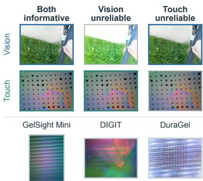  
Figure 1: Vision and touch under sensing and hardware shifts. Natural changes in lighting or contact can affect the modalities unequally. The upper panel uses brightness and defocus corruptions to illustrate three possible modality relationships. The lower panel shows separate wire contacts recorded by GelSight Mini, DIGIT and DuraGel, illustrating differences across tactile sensor hardware and capture conditions.

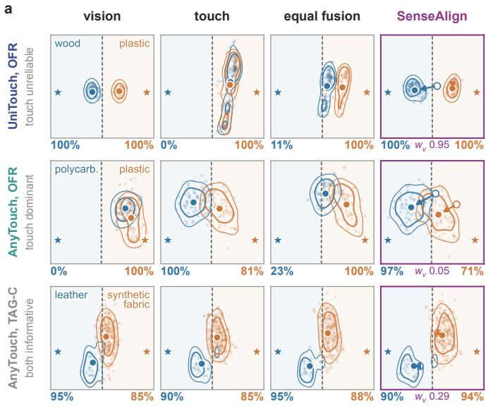

b  
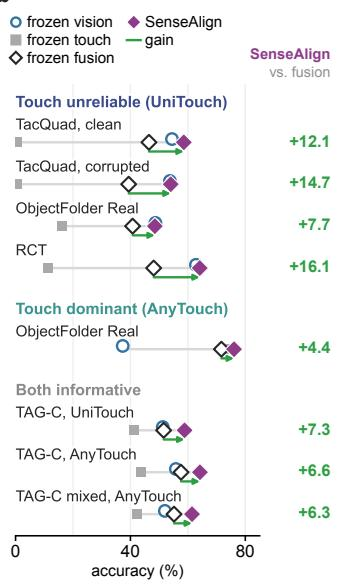

text anchor class centre fusion centre boundary  
Figure 2: Modality reliability varies with backbone and stream. (a) Selected class pairs projected along their text-embedding decision direction. Stars mark text anchors; percentages give each class’s share on its own side of the dashed boundary, not full-vocabulary accuracy. Arrows show shifts from equal-fusion to SenseAlign class centres; $w _ { v }$ is the mean vision weight. (b) Stream-level accuracy; green arrows and labels give gains over frozen equal fusion in percentage points.  
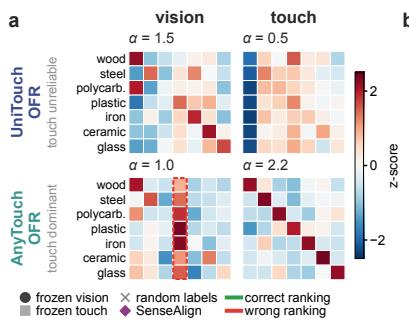  
b

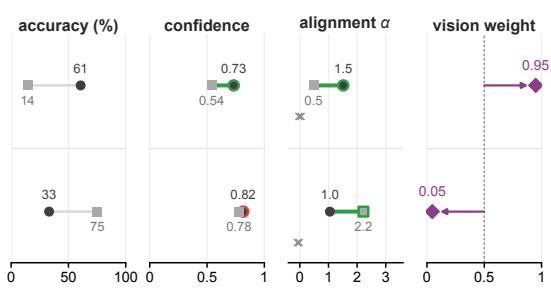  
Figure 3: Semantic alignment distinguishes modalities when confidence misranks them. (a) Standardized scores between pseudo-label group means and text embeddings. Columns follow the row-label order; grey rows lack accepted observations. The red box highlights the visual branch’s strong scores for plastic across groups. (b) Frozen accuracy, mean top-1 probability, final-memory alignment α and mean online vision weight. Green and red outlines indicate whether confidence or alignment favors the more or less accurate modality; crosses show alignment with randomized memory labels. Purple diamonds show SenseAlign’s vision weights.

Text embeddings provide a common semantic reference for comparing the observations. We group the two modalities under the same estimated labels, then compare their accumulated representations with the assigned anchors and the alternatives. Using identical groups keeps differences in sample selection from entering the modality comparison.

Relative semantic support can reveal distinctions that confidence misses. In the upper and lower examples of Figure 3, alignment favors the more accurate modality, including the case where confidence reverses the ordering. Randomizing the memory labels weakens this structure, linking the signal to the feature–label correspondence.

The same reference can guide feature correction. Weighting changes the contribution of each branch, but leaves its feature positions relative to the text anchors unchanged. A branch given more weight still makes the same distinctions among candidate classes. The shared groups also let us examine these distinctions and use their assigned anchors as targets for feature correction. Such a correction must consider competing anchors, because recognition depends on relative class scores. This motivates two uses of the same semantic reference: comparing modality contributions and improving the class distinctions in the features they supply.

## 3 PROBLEM SETTING

Multimodal test-time adaptation updates a pretrained model from unlabeled target observations under distribution shift. Let $\mathcal { D } _ { 0 }$ denote the source distribution and $\mathcal { D } _ { b }$ the test distribution at batch b. A shift may affect vision alone: $\mathcal { D } _ { b } ( x ^ { v } ) \neq \mathcal { D } _ { 0 } ( x ^ { v } )$ while $\mathcal { D } _ { b } ( x ^ { t } ) = \mathrm { \tilde { \mathcal { D } } _ { 0 } } ( x ^ { t } )$ . It may instead affect touch alone, or both modalities. The modalities may shift at different times. Text descriptions specify the vocabulary C of C classes. The frozen text encoder maps these descriptions to semantic anchors.

We observe ordered batches $\boldsymbol { B _ { b } } = \{ ( \boldsymbol { x } _ { i } ^ { v } , \boldsymbol { x } _ { i } ^ { t } ) \} _ { i \in I _ { b } }$ , with both inputs describing the same recognition target. Adaptation aims to improve online classification using only the pretrained model, class descriptions and the unlabeled stream. True labels, the affected modality, shift identities and change boundaries are unavailable to adaptation; $\widehat { y } _ { i }$ denotes a pseudo-label. We predict each batch before updating. Model and adaptation state persist within streams and reset between streams.

## 4 SENSEALIGN

SenseAlign uses one semantic reference to compare modality contributions and correct the features being combined. Alignment Trust gives more weight to the modality whose accumulated observations better support their assigned text anchors. Anchor Realignment uses those anchors as targets for a shared feature correction. Both operations draw on the same groups of past observations, connecting fusion and correction through one shared memory (Figure 4). All encoders remain frozen.

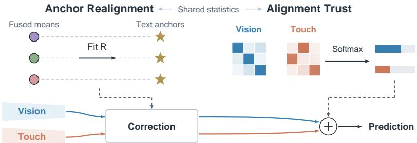  
Figure 4: A shared history supports modality weighting and feature correction. Past unlabeled observations supply both modules with shared group statistics. Anchor Realignment fits R using fused means (circles) and class text embeddings (stars), then refines class separation. Alignment Trust compares standardized group–text scores to assign fusion weights. Dashed arrows pass the shared correction and weights to the prediction path; the same correction is applied to both branches before weighted fusion. Encoders remain frozen. Positions, colors and bar lengths are schematic.

## 4.1 A SHARED SEMANTIC REFERENCE

Comparing modalities requires a common basis for judging their semantic support. We therefore group the same observations under shared pseudo-labels and sample weights. Their branch means support the modality comparison; their fused means supply the fitting signal for feature correction. For modality m $\iota \in \{ v , t \}$ , let $u _ { i } ^ { m } = \nu ( h _ { 0 } ^ { m } ( x _ { i } ^ { m } ) )$ ) be the frozen unit feature of observation i, where $\nu ( z ) = z / \operatorname* { m a x } ( \| z \| _ { 2 } , \epsilon )$ and features are row vectors. Encoders, prompts and classifier remain unchanged during adaptation.

Each class c has one text prompt. Its normalized embedding $a _ { c }$ serves both as the classifier anchor and as the target for feature correction. The rows of $A \in \mathbb { R } ^ { \tilde { C } \times d }$ are these anchors.

To keep the groups independent of adapted fusion weights, we assign labels from the raw equal-fusion feature $u _ { i } ^ { 0 } \stackrel { \smile } { = } \nu ( \bar { ( } u _ { i } ^ { v } + \bar { u } _ { i } ^ { t } ) / 2 )$ . Let $c ( \bar { z } ) = \arg \operatorname* { m a x } _ { j } \bar { z } a _ { j } ^ { \top }$ and let $\bar { \delta } ( z )$ be the gap between its largest and second-largest cosine scores. An observation enters memory only when its top score and margin are positive:

$$
\begin{array} { l l } { { \widehat { y } _ { i } = c ( u _ { i } ^ { 0 } ) , } } & { { \gamma _ { i } = { \bf 1 } \big [ u _ { i } ^ { 0 } a _ { \widehat { y } _ { i } } ^ { \top } > 0 , \delta ( u _ { i } ^ { 0 } ) > 0 \big ] , } } \\ { { \lambda _ { i } = \gamma _ { i } \delta ( u _ { i } ^ { 0 } ) . } } & { { } } \end{array}\tag{1}
$$

Larger margins give more weight to assignments that separate the leading class from its closest competitor; rejected samples have zero weight. These labels remain model-generated assignments, rather than ground-truth supervision. Both modalities use the same assignments and weights.

Before batch b, let $\mathcal { H } _ { c , b }$ contain earlier observations assigned pseudo-label c. Each modality and their equal-fusion feature use the same samples and weights to form a weighted mean:

$$
\mu _ { c , b } ^ { m } = \frac { \sum _ { j \in \mathcal { H } _ { c , b } } \lambda _ { j } u _ { j } ^ { m } } { \Lambda _ { c , b } } , \qquad \Lambda _ { c , b } = \sum _ { j \in \mathcal { H } _ { c , b } } \lambda _ { j } , \quad m \in \{ v , t , 0 \} .\tag{2}
$$

Only groups with $\Lambda _ { c , b } > 0$ enter the set $\mathcal { C } _ { b }$ . The memory stores weighted sums and total weights, rather than past samples. Its raw features are never replaced by corrected features (see the appendix).

## 4.2 ALIGNMENT TRUST

The shared groups let us compare how distinctly each modality supports the assigned class relative to competing classes. This comparison should reflect relative semantic support without depending on a score row’s overall offset or positive scale. Alignment Trust removes both by standardizing the scores against all C anchors. For each group mean, let $\ell _ { c , b } ^ { m } = \mu _ { c , b } ^ { m } A ^ { \top }$ and define

$$
z _ { c , b } ^ { m } = \frac { \ell _ { c , b } ^ { m } - \operatorname* { m e a n } _ { j } ( [ \ell _ { c , b } ^ { m } ] _ { j } ) \mathbf { 1 } } { \mathrm { s t d } _ { j } ( [ \ell _ { c , b } ^ { m } ] _ { j } ) } .\tag{3}
$$

Here $j$ ranges over all anchors, 1 is the all-ones vector, and std is the population standard deviation; set $z _ { c , b } ^ { m } = 0$ for a zero-variance vector. Dot products and cosine similarities therefore give identical standardized scores. Averaging the $K = | \mathcal { C } _ { b } |$ assigned-anchor scores measures semantic support across the accumulated groups:

$$
\alpha _ { b } ^ { m } = \frac { 1 } { K } \sum _ { c \in \mathcal { C } _ { b } } [ z _ { c , b } ^ { m } ] _ { c } .\tag{4}
$$

This semantic alignment score corresponds to the comparison in Figure 3b (expanded in the appendix). A softmax then assigns greater weight to the modality with stronger support:

$$
[ w _ { b } ^ { v } , w _ { b } ^ { t } ] = \mathrm { s o f t m a x } \left( g [ \alpha _ { b } ^ { v } , \alpha _ { b } ^ { t } ] \right) .\tag{5}
$$

The inverse temperature $g$ controls reweighting strength; equal alignment gives equal weights.

Alignment measures support for the shared predicted assignments. The weights remain one half during warm-up or with fewer than two positive-mass groups. For $C = \bar { 2 }$ , each nonconstant standardized row is $\{ + 1 , - 1 \}$ regardless of its score gap. Trust uses this binary signal after warm-up; realignment uses the identity map.

## 4.3 ANCHOR REALIGNMENT

Reweighting alone leaves each branch’s feature–anchor relationships unchanged. Anchor Realignment uses the same semantic reference to adjust these relationships before fusion. It fits one map from fused means $\mu _ { c , b } ^ { 0 }$ to targets $a _ { c }$ , then applies it to both modalities. The fused means provide a joint fitting signal under the assignments already used for Trust.

The correction acts only in the joint span of the observed means and their targets, leaving directions outside this span unchanged. We constrain the map to be orthogonal to preserve inner products before residual mixing. Stack the means into $X _ { b } \in \mathbb { R } ^ { \tilde { K } \times d }$ and select their assigned rows from A to form $A _ { { \mathcal { C } } _ { b } }$ . Let the columns of $Q _ { b } \in \mathbb { R } ^ { d \times r }$ form an orthonormal basis for this span, so $Q _ { b } ^ { \top } Q _ { b } = I _ { r }$ . The full-space map is

$$
R _ { b } ( P ) = I + Q _ { b } ( P - I _ { r } ) Q _ { b } ^ { \top } , \qquad P ^ { \top } P = I _ { r } .\tag{6}
$$

Here $P$ rotates or reflects features within the span, while the map is identity outside it. We first fit the fused means to their targets using orthogonal Procrustes (Schönemann, 1966), giving a geometric initialization:

$$
P _ { b } ^ { 0 } = \arg \operatorname* { m i n } _ { P ^ { \top } P = I _ { r } } \| X _ { b } Q _ { b } P - A _ { { \mathcal C } _ { b } } Q _ { b } \| _ { F } ^ { 2 } .\tag{7}
$$

Among nonunique optima, we choose the solution nearest identity (see the appendix).

A close geometric fit alone does not ensure separation from competing classes. Moving a feature toward its assigned anchor can also increase its similarity to other anchors. An increase shared across all class scores leaves their ranking unchanged. We therefore refine the initialization with a classification objective that compares each assigned anchor against all alternatives. Define projected mean directions $\tilde { \mu } _ { c } = \nu ( \mu _ { c , b } ^ { 0 } Q _ { b } )$ and projected classifier anchors $\tilde { A } _ { b } = A Q _ { b }$ . We leave the projected anchors unnormalized to preserve their original scores within the span. With residual strength $\beta$ and softmax temperature T, the corrected mean and its probabilities are

$$
\hat { \mu } _ { c } ( P ) = \nu \big ( ( 1 - \beta ) \tilde { \mu } _ { c } + \beta \tilde { \mu } _ { c } P \big ) , \qquad p _ { c , b } ( P ) = \mathrm { s o f t m a x } \big ( \hat { \mu } _ { c } ( P ) \tilde { A } _ { b } ^ { \top } / T \big ) .\tag{8}
$$

The residual mix retains part of the original mean direction, and the softmax compares it with all C classifier anchors. Group concentration $\rho _ { c } = \| \mu _ { c , b } ^ { 0 } \| _ { 2 }$ weights the cross-entropy objective:

$$
\mathcal { L } _ { b } ( \boldsymbol { P } ) = \frac { \sum _ { c \in \mathcal { C } _ { b } } \rho _ { c } \operatorname { C E } ( p _ { c , b } ( \boldsymbol { P } ) , c ) } { \sum _ { c \in \mathcal { C } _ { b } } \rho _ { c } } .\tag{9}
$$

Here $\mathrm { C E } ( p , c ) = - \log p _ { c }$ . Concentrated groups contribute more to the fit. Projected descent from the Procrustes initialization produces $P _ { b }$ and the full map $R _ { b } = R _ { b } ( P _ { b } )$ . This mean-based objective remains a proxy under the shared pseudo-labels. The appendix details the local solver.

## 4.4 PREDICTION AND ONLINE UPDATES

Prediction brings the two operations together: Trust weights the branch scores produced after Realignment. The adaptation state for each batch uses only earlier observations; the batch updates the history after prediction. To retain part of the original representation, mix the normalized input $u = \nu ( z )$ with its transformed counterpart $u _ { R } = \nu ( u R _ { b } )$ :

$$
\phi _ { b } ( z ) = \nu \big ( ( 1 - \beta ) u + \beta u _ { R } \big ) .\tag{10}
$$

The score vector is $q _ { i } ^ { m } = \tau \phi _ { b } ( u _ { i } ^ { m } ) A ^ { \top }$ , with $\tau$ the checkpoint logit scale. The prediction combines the corrected scores using the semantic modality weights:

$$
s _ { i } = w _ { b } ^ { v } q _ { i } ^ { v } + w _ { b } ^ { t } q _ { i } ^ { t } .\tag{11}
$$

Orthogonality preserves inner products under $R _ { b }$ itself; residual mixing and normalization can change pairwise angles (see the appendix). Every observation is predicted, including those rejected by the memory gate. During warm-up, $\phi _ { b } = \nu$

After prediction, raw features update the shared sums under shared pseudo-labels and weights. Corrected predictions never supply memory labels, keeping both operations tied to the same raw observation history. The appendix details the stored statistics and update order.

## 5 RELATED WORK

Tactile–visual–language representations. Shared semantic representations connect contact observations with visual and linguistic information. Image–text alignment provides a basis for comparing visual features with class descriptions (Radford et al., 2021). Paired visual–tactile observations establish correspondences between appearance and contact (Yang et al., 2022), while language supervision connects these observations with semantic descriptions (Fu et al., 2024). UniTouch and AnyTouch extend representation learning across sensors and modalities (Yang et al., 2024a; Feng et al., 2025). These developments provide the shared language space in which our adaptation operates. We study how to use that space during deployment, when the relative usefulness of the two sensory representations changes. In SenseAlign, class text embeddings serve both as classification references and as targets for comparing and correcting sensory features.

Test-time adaptation and modality reliability. Test-time adaptation learns from unlabeled observations during deployment. TENT minimizes entropy (Wang et al., 2021); SAR combines reliable-sample selection with sharpness-aware optimization (Niu et al., 2023); DeYO filters and reweights samples using entropy and prediction changes under perturbation (Lee et al., 2024). RoTTA uses memory and teacher–student updates (Yuan et al., 2023). These methods derive adaptation signals from predictions and accumulated observations, with different mechanisms for controlling unreliable updates. Multimodal adaptation additionally considers how updates should respond when branches are affected differently. READ adapts cross-modal attention (Yang et al., 2024b), SuMi combines sample selection with information sharing (Guo & Jin, 2025), and TSA routes modalityspecific adapters (Chen et al., 2025). These approaches make modality interactions part of the adaptation problem. SenseAlign addresses their relative contributions through a semantic comparison: it evaluates accumulated visual and tactile observations against the same class text embeddings. Shared observations and pseudo-label groups give this comparison a common reference across the two modalities.

Adaptation with frozen encoders. Adaptation can also operate on cached features, semantic references or contextual embeddings while keeping encoders frozen. TDA uses a feature–pseudo-label cache (Karmanov et al., 2024); OGA combines Gaussian likelihoods with zero-shot priors (Fuchs et al., 2025); StatA uses text-derived statistical anchors (Zanella et al., 2025). ETTA adapts contextual embeddings and prompt selection (Dastmalchi et al., 2025); SubTTA aligns visual and textual subspaces (Zeng et al., 2026). MG-MTTA freezes encoders and adapts fusion using modality drift from running anchors (Chen et al., 2026). These studies adapt how pretrained features are interpreted, including their class associations, alignment and contributions to the final prediction. Our TDA, OGA and StatA extensions adapt each modality separately and average their outputs. SenseAlign couples modality weighting and feature correction through one shared memory. Alignment Trust compares semantic support under common class assignments, while Anchor Realignment adjusts both modalities with a common correction. Its classification refinement compares each assigned text embedding with competing classes, extending the geometric alignment objective to class discrimination. This coupling connects the choice of modality contributions with the class distinctions preserved by the corrected features.

## 6 EXPERIMENTS

## 6.1 DATASETS AND CHECKPOINTS

We evaluate the released UniTouch (Yang et al., 2024a) and AnyTouch (Feng et al., 2025) checkpoints without retraining. Natural shifts cover object recognition on TacQuad (Feng et al., 2025) and material recognition on ObjectFolder Real (OFR) (Gao et al., 2023) and RCT (He et al., 2026). Controlled corruptions use TAG-C, based on Touch and Go (Yang et al., 2022), with visual, tactile and mixed corruption streams. Both models use the same evaluation panels. Table 1 summarizes representative modality relationships, stream sizes and frozen accuracies. The appendix provides the comparison protocol and implementation details.

Table 1: Evaluation protocol and frozen accuracy (%), one original prompt per class. Presentations count paired observations. Touch is unreliable near/below chance (4.2% for 24 classes, 14.3% for seven), dominant when more accurate; both sensors are informative when well above chance. Labels are retrospective and unavailable to adaptation. Natural shifts weight groups and streams equally; TAG-C aggregation is detailed in the appendix.
<table><tr><td colspan="6"></td><td colspan="3">Frozen accuracy</td></tr><tr><td>Regime</td><td>Benchmark</td><td>Model</td><td>Streams</td><td>Presentations</td><td>Classes</td><td>Vision</td><td></td><td>Touch Fusion</td></tr><tr><td rowspan="4">Touch unreliable</td><td>TacQuad (clean)</td><td>UniTouch</td><td>3 sensors</td><td>1,536</td><td>24</td><td>54.5</td><td>0.6</td><td>46.4</td></tr><tr><td>TacQuad (15 corruptions)</td><td>UniTouch</td><td>45</td><td>23,040</td><td>24</td><td>53.7</td><td>0.6</td><td>39.4</td></tr><tr><td>ObjectFolder Real</td><td>UniTouch</td><td>5 splits</td><td>3,395</td><td>7</td><td>48.7</td><td>16.2</td><td>40.8</td></tr><tr><td>RCT</td><td>UniTouch</td><td>1</td><td>9,620</td><td>7</td><td>62.8</td><td>11.4</td><td>48.1</td></tr><tr><td>Touch dominant</td><td>ObjectFolder Real</td><td>AnyTouch</td><td>5 splits</td><td>3,395</td><td>7</td><td>37.3</td><td>74.6</td><td>71.7</td></tr><tr><td rowspan="3">Both informative</td><td>TAG-C (visual / tactile)</td><td>UniTouch</td><td>2</td><td>90,772</td><td>20</td><td>51.3</td><td>41.2</td><td>51.6</td></tr><tr><td>TAG-C (visual / tactile)</td><td>AnyTouch</td><td>2</td><td>90,772</td><td>20</td><td>55.8</td><td>43.5</td><td>57.6</td></tr><tr><td>TAG-C mixed stream</td><td>AnyTouch</td><td>1</td><td>94,898</td><td>20</td><td>52.0</td><td>42.4</td><td>55.2</td></tr></table>

## 6.2 RECOGNITION ACROSS SENSING CONDITIONS

Recovering recognition when touch is unreliable. SenseAlign reduces the loss caused by weak tactile predictions. Across four UniTouch natural-shift panels, mean accuracy rises from 43.7% with equal fusion to 56.8%, exceeding frozen vision’s 54.9% (Table 2). Gains hold in every panel and displayed TacQuad condition (Figure 5b). Default weights favor vision (Figure 5a); accuracy reflects both weighting and realignment.

Table 2: Natural-shift accuracy (%) with one prompt per class. Both models share four panels; Mean weights panels equally. OFR uses five released-order splits. Frozen◦ uses equal fusion.
<table><tr><td></td><td colspan="5">UniTouch</td><td colspan="5">AnyTouch</td></tr><tr><td>Method</td><td>TacQuad clean</td><td>TacQuad corr.</td><td></td><td>OFR RCT</td><td>Mean</td><td>TacQuad clean</td><td>TacQuad corr.</td><td>OFR RCT Mean</td><td></td><td></td></tr><tr><td>Frozen°</td><td>46.4</td><td>39.4</td><td>40.8</td><td>48.1</td><td>43.7</td><td>42.2</td><td>37.4</td><td>71.7</td><td>29.5</td><td>45.2</td></tr><tr><td>Frozen Vision</td><td>54.5</td><td>53.7</td><td>48.7</td><td>62.8</td><td>54.9</td><td>42.2</td><td>32.0</td><td>37.3</td><td>47.1</td><td>39.6</td></tr><tr><td>Frozen Tactile</td><td>0.6</td><td>0.6</td><td>16.2</td><td>11.4</td><td>7.2</td><td>18.1</td><td>18.1</td><td>74.6</td><td>18.1</td><td>32.3</td></tr><tr><td>TENT</td><td>45.5</td><td>36.8</td><td>35.0</td><td>26.5</td><td>35.9</td><td>41.1</td><td>35.1</td><td>69.7</td><td>19.4</td><td>41.3</td></tr><tr><td>SAR</td><td>46.4</td><td>39.3</td><td>40.6</td><td>39.7</td><td>41.5</td><td>42.0</td><td>37.2</td><td>71.6</td><td>24.7</td><td>43.9</td></tr><tr><td>DeYO</td><td>46.4</td><td>39.4</td><td>40.7</td><td>46.5</td><td>43.2</td><td>42.2</td><td>37.2</td><td>71.8</td><td>28.2</td><td>44.9</td></tr><tr><td>SuMi</td><td>46.4</td><td>38.9</td><td>39.3</td><td>26.2</td><td>37.7</td><td>42.2</td><td>37.4</td><td>71.9</td><td>18.0</td><td>42.4</td></tr><tr><td>RoTTA</td><td>40.0</td><td>34.5</td><td>26.8</td><td>26.3</td><td>31.9</td><td>40.8</td><td>34.9</td><td>67.8</td><td>3.2</td><td>36.7</td></tr><tr><td>TSA</td><td>43.5</td><td>36.3</td><td>37.6</td><td>11.9</td><td>32.3</td><td>44.4</td><td>32.8</td><td>59.6</td><td>17.8</td><td>38.6</td></tr><tr><td>TDA</td><td>49.1</td><td>43.6</td><td>42.6</td><td>37.2</td><td>43.1</td><td>46.3</td><td>37.1</td><td>69.3</td><td>27.5</td><td>45.0</td></tr><tr><td>OGA</td><td>52.1</td><td>46.1</td><td>48.1</td><td>9.1</td><td>38.8</td><td>39.9</td><td>32.8</td><td>68.1</td><td>19.9</td><td>40.2</td></tr><tr><td>StatA</td><td>51.3</td><td>45.2</td><td>46.2</td><td>60.2</td><td>50.7</td><td>30.1</td><td>25.7</td><td>55.3</td><td>37.3</td><td>37.1</td></tr><tr><td>SenseAlign</td><td>58.6</td><td>54.0</td><td>50.4</td><td>64.1</td><td>56.8</td><td>45.5</td><td>39.0</td><td>81.2</td><td>49.6</td><td>53.8</td></tr></table>

a  
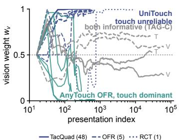

b  
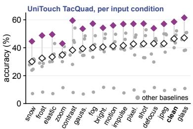

c  
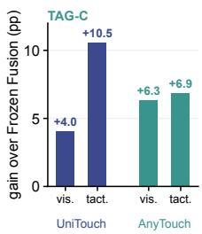  
Frozen Fusion (equal weights) SenseAlign  
Figure 5: Modality weights adapt across streams, with gains over equal fusion. (a) Online vision weights: the median across TacQuad streams and individual trajectories elsewhere. Grey TAG-C curves are solid for AnyTouch and dashed for UniTouch; V/T indicate visual/tactile corruption. (b) UniTouch TacQuad accuracy averaged over three sensors per condition. Hollow diamonds denote frozen equal fusion, filled diamonds SenseAlign, and grey dots other baselines. (c) TAG-C gains over matched equal fusion in percentage points under visual or tactile corruption; blue denotes UniTouch and teal AnyTouch.

Retaining the contribution of stronger touch. The same semantic rule can favor touch when it is more informative. On AnyTouch OFR, frozen touch outperforms vision (74.6% versus 37.3%), and default weights favor touch (Figure 5a). With g = 1, SenseAlign reaches 81.2%, above both frozen touch and 71.7% equal fusion. Across four AnyTouch natural-shift panels, mean accuracy rises from 45.2% to 53.8%; clean TacQuad still trails TDA (45.5% versus 46.3%).

Improving recognition with two informative modalities. Gains extend beyond severe modality imbalance. SenseAlign improves on equal fusion in all six TAG-C corruption scenarios, reaching 60.9% mean accuracy versus 53.8% for equal fusion and 55.6% for TDA, the strongest complete baseline (Table 3). SenseAlign leads all three AnyTouch scenarios and the UniTouch mean; SAR leads UniTouch Visual and Mixed.

A common configuration retains the mean advantage. With $\beta = 0 . 2 , g = 4$ and warm-up 16 in all 14 main-table scenarios, SenseAlign averages 56.62%, versus 49.00% for TDA: a 7.61-point gain. The mean advantage thus persists across both backbones without scenario-specific settings (see the appendix).

Table 3: TAG-C severity-3 accuracy (%), one prompt per class; means weight scenarios equally. : equal fusion. Bold/underline: best/second.
<table><tr><td colspan="5"></td><td colspan="4">UniTouch</td><td rowspan="2">Overall Mean</td></tr><tr><td>Method</td><td>Visual</td><td>Tactile</td><td>Mixed</td><td>Mean</td><td>Visual</td><td>Tactile</td><td>Mixed</td><td>Mean</td></tr><tr><td>Frozen°</td><td>56.1</td><td>59.1</td><td>55.2</td><td>56.8</td><td>52.8</td><td>50.3</td><td>49.6</td><td>50.9</td><td>53.8</td></tr><tr><td>TENT</td><td>53.0</td><td>60.2</td><td>2.4</td><td>38.6</td><td>46.3</td><td>32.2</td><td>33.6</td><td>37.4</td><td>38.0</td></tr><tr><td>SAR</td><td>52.4</td><td>56.9</td><td>44.1</td><td>51.1</td><td>58.9</td><td>53.1</td><td>57.7</td><td>56.6</td><td>53.9</td></tr><tr><td>SuMi</td><td>56.7</td><td>60.8</td><td>51.6</td><td>56.4</td><td>49.8</td><td>45.4</td><td>16.0</td><td>37.1</td><td>46.7</td></tr><tr><td>RoTTA</td><td>62.2</td><td>57.1</td><td>50.0</td><td>56.4</td><td>42.4</td><td>47.4</td><td>31.3</td><td>40.4</td><td>48.4</td></tr><tr><td>DeYO</td><td>58.0</td><td>59.5</td><td>57.2</td><td>58.2</td><td>53.4</td><td>51.4</td><td>49.8</td><td>51.5</td><td>54.9</td></tr><tr><td>TSA</td><td>37.0</td><td>41.9</td><td>30.5</td><td>36.5</td><td>35.2</td><td>37.6</td><td>32.8</td><td>35.2</td><td>35.9</td></tr><tr><td>TDA</td><td>57.2</td><td>62.1</td><td>57.5</td><td>58.9</td><td>54.0</td><td>51.7</td><td>50.8</td><td>52.2</td><td>55.6</td></tr><tr><td>OGA</td><td>46.9</td><td>47.1</td><td>49.2</td><td>47.7</td><td>40.0</td><td>48.0</td><td>37.8</td><td>41.9</td><td>44.8</td></tr><tr><td>StatA</td><td>50.5</td><td>56.4</td><td>50.6</td><td>52.5</td><td>52.6</td><td>53.7</td><td>50.7</td><td>52.3</td><td>52.4</td></tr><tr><td>SenseAlign</td><td>62.4</td><td>66.0</td><td>61.4</td><td>63.3</td><td>57.7</td><td>60.8</td><td>57.1</td><td>58.5</td><td>60.9</td></tr></table>

## 6.3 SEMANTIC SUPPORT BEYOND CONFIDENCE

Semantic support improves weighting even when corrected features and fitted maps are held constant. Trust exceeds maximum-probability, inverse-entropy and equal weighting by 0.94, 0.80 and 1.22 points on average across six TAG-C scenarios (see the appendix). The paired 95% interval against equal weighting is [0.89, 1.56], conditional on recorded histories. Probability and entropy use current predictions; Trust uses accumulated observations.

The advantage persists against history-grouped margin, which uses the same observations, groups and weights but compares top-two score gaps instead of assigned-class support. Trust retains mean gains of 3.33 points across three UniTouch TacQuad/RCT panels and 1.26 across six TAG-C panels (see the appendix). The semantic signal thus adds value beyond history aggregation alone.

## 6.4 FEATURE CORRECTION FOR CLASS DISCRIMINATION

Refinement improves recognition beyond geometric matching to text embeddings. With AnyTouch and equal weights, geometric realignment raises OFR accuracy from 71.7% to 74.4%; refinement further raises it to 78.3%, isolating the gain from Trust. A retrospective one-split diagnostic applies final-memory maps to their construction observations: refinement lowers correct-class similarity but lowers the strongest rival more, increasing their mean gap (see the appendix). This illustrates improved class separation, separately from online evaluation.

## 6.5 COMBINING WEIGHTING AND REALIGNMENT

Trust adjusts modality contributions; Realign changes the features used to score classes. Their combination leads on all three sensors in the TacQuad component study (Table 4), reaching 47.99% mean accuracy: 3.72 points above Trust alone and 6.25 above Realign alone. These matched comparisons support complementary roles for weighting and feature correction.

## 7 CONCLUSION

Table 4: Components on AnyTouch TacQuad. One prompt per class; accuracy (%). Groups are weighted equally within each sensor; Mean weights sensors equally.
<table><tr><td colspan="3">GelSight</td></tr><tr><td>Configuration</td><td>Mini</td><td>DIGIT DuraGel Mean 42.31</td></tr><tr><td>Equal fusion</td><td>55.15 46.76</td><td>30.2342.56 45.06 41.0144.27</td></tr><tr><td>Trust only</td><td>54.18</td><td>38.34 32.6941.74</td></tr><tr><td>Realign only</td><td>56.50</td><td>41.24 47.99</td></tr><tr><td>SenseAlign</td><td></td><td>46.23</td></tr></table>

SenseAlign uses one unlabeled history to compare vision and touch against text semantics and fit a shared classification correction. With frozen

encoders, it improves recognition across natural shifts and controlled corruptions under the evaluated protocols. Matched TAG-C controls show that semantic weighting adds an average benefit beyond realignment and simple confidence-based fusion. The relative benefits depend on the backbone and sensing condition.

## REPRODUCIBILITY STATEMENT

The appendix specifies the class vocabulary and prompts, calibration solver, frozen encoder state, online update order, and benchmark protocols. It identifies the sampling units and aggregation rules for each comparison. The accompanying code regenerates the figures and the appendix tables from saved evaluation outputs and checks every cell of the main tables against those outputs.

## ETHICS STATEMENT

The study evaluates recognition on existing visual and tactile datasets. It does not collect new human data or deploy a physical robot. Recognition gains under image corruptions do not establish safe manipulation: contact force, action selection, and physical failure recovery require separate evaluation. Dataset licenses and redistribution constraints apply to any accompanying data release.

## STATEMENT ON THE USE OF LARGE LANGUAGE MODELS

Large language model tools assisted with drafting, source retrieval, code inspection, experiment coordination and figure preparation. Quantitative figures use recorded evaluations; the method diagram illustrates the stated procedure. The authors are responsible for the scientific and editorial content.

## REFERENCES

Lixian Chen, Mingxuan Huang, Yanhui Chen, Junyi Lin, and Yang Shi. Majorization-guided test-time adaptation for vision-language models under modality-specific shift. arXiv preprint arXiv:2604.24602, 2026.

Mingcai Chen, Baoming Zhang, Zongbo Han, Wenyu Jiang, Yanmeng Wang, Shuai Feng, Yuntao Du, and Bingkun Bao. Test-time selective adaptation for uni-modal distribution shift in multimodal data. In Proceedings of the 42nd International Conference on Machine Learning, volume 267 of Proceedings of Machine Learning Research, pp. 9711–9727, 2025. URL https:// proceedings.mlr.press/v267/chen25ch.html.

Hamidreza Dastmalchi, Aijun An, and Ali Cheraghian. ETTA: Efficient test-time adaptation for visionlanguage models through dynamic embedding updates. In British Machine Vision Conference, 2025. URL https://arxiv.org/abs/2508.05898.

Ruoxuan Feng, Jiangyu Hu, Wenke Xia, Tianci Gao, Ao Shen, Yuhao Sun, Bin Fang, and Di Hu. AnyTouch: Learning unified static-dynamic representation across multiple visuo-tactile sensors. In International Conference on Learning Representations, 2025. URL https://proceedings.iclr.cc/paper\_files/paper/2025/hash/ 4d893f766ab60e5337659b9e71883af4-Abstract-Conference.html.

Letian Fu, Gaurav Datta, Huang Huang, William Chung-Ho Panitch, Jaimyn Drake, Joseph Ortiz, Mustafa Mukadam, Mike Lambeta, Roberto Calandra, and Ken Goldberg. A touch, vision, and language dataset for multimodal alignment. arXiv preprint arXiv:2402.13232, 2024. URL https://arxiv.org/abs/2402.13232.

Clément Fuchs, Maxime Zanella, and Christophe De Vleeschouwer. Online gaussian test-time adaptation of vision-language models. In IEEE/CVF Conference on Computer Vision and Pattern Recognition Workshops, 2025. URL https://arxiv.org/abs/2501.04352.

Ruohan Gao, Yiming Dou, Hao Li, Tanmay Agarwal, Jeannette Bohg, Yunzhu Li, Li Fei-Fei, and Jiajun Wu. The ObjectFolder benchmark: Multisensory learning with neural and real objects. arXiv preprint arXiv:2306.00956, 2023. URL https://arxiv.org/abs/2306.00956.

Zirun Guo and Tao Jin. Smoothing the shift: Towards stable test-time adaptation under complex multimodal noises. In International Conference on Learning Representations, 2025. URL https://arxiv.org/abs/2503.02616.

Jingbo He, Michael Färber, and Roberto Calandra. RCT: A robot-collected touch–vision–language dataset for tactile generalization. arXiv preprint arXiv:2606.31694, 2026. URL https:// arxiv.org/abs/2606.31694.

Adilbek Karmanov, Dayan Guan, Shijian Lu, Abdulmotaleb El Saddik, and Eric Xing. Efficient test-time adaptation of vision-language models. In IEEE/CVF Conference on Computer Vision and Pattern Recognition, 2024. URL https://arxiv.org/abs/2403.18293.

Jonghyun Lee, Dahuin Jung, Saehyung Lee, Junsung Park, Juhyeon Shin, Uiwon Hwang, and Sungroh Yoon. Entropy is not enough for test-time adaptation: From the perspective of disentangled factors. In International Conference on Learning Representations, 2024. URL https://proceedings.iclr.cc/paper\_files/paper/2024/hash/ cd0665986c1e9c15f6569ac944bcf88a-Abstract-Conference.html.

Shuaicheng Niu, Jiaxiang Wu, Yifan Zhang, Zhiquan Wen, Yaofo Chen, Peilin Zhao, and Mingkui Tan. Towards stable test-time adaptation in dynamic wild world. In International Conference on Learning Representations, 2023. URL https://arxiv.org/abs/2302.12400.

Alec Radford, Jong Wook Kim, Chris Hallacy, Aditya Ramesh, Gabriel Goh, Sandhini Agarwal, Girish Sastry, Amanda Askell, Pamela Mishkin, Jack Clark, Gretchen Krueger, and Ilya Sutskever. Learning transferable visual models from natural language supervision. In International Conference on Machine Learning, 2021. URL https://arxiv.org/abs/2103.00020.

Peter H. Schönemann. A generalized solution of the orthogonal Procrustes problem. Psychometrika, 31(1):1–10, 1966. doi: 10.1007/BF02289451. URL https://doi.org/10.1007/ BF02289451.

Dequan Wang, Evan Shelhamer, Shaoteng Liu, Bruno Olshausen, and Trevor Darrell. Tent: Fully testtime adaptation by entropy minimization. In International Conference on Learning Representations, 2021. URL https://arxiv.org/abs/2006.10726.

Fengyu Yang, Chenyang Ma, Jiacheng Zhang, Jing Zhu, Wenzhen Yuan, and Andrew Owens. Touch and go: Learning from human-collected vision and touch. In Advances in Neural Information Processing Systems, volume 35, pp. 8081–8103, 2022. URL https://proceedings.neurips.cc/paper\_files/paper/2022/ hash/354892587fe39b17c2b727af02abff4a-Abstract-Datasets\_and\_ Benchmarks.html.

Fengyu Yang, Chao Feng, Ziyang Chen, Hyoungseob Park, Daniel Wang, Yiming Dou, Ziyao Zeng, Xien Chen, Rit Gangopadhyay, Andrew Owens, and Alex Wong. Binding touch to everything: Learning unified multimodal tactile representations. arXiv preprint arXiv:2401.18084, 2024a. URL https://arxiv.org/abs/2401.18084.

Mouxing Yang, Yunfan Li, Changqing Zhang, Peng Hu, and Xi Peng. Test-time adaptation against multi-modal reliability bias. In International Conference on Learning Representations, 2024b. URL https://proceedings.iclr.cc/paper\_files/paper/2024/hash/ f25d75fc760aec0a6174f9f5d9da59b8-Abstract-Conference.html.

Longhui Yuan, Binhui Xie, and Shuang Li. Robust test-time adaptation in dynamic scenarios. In IEEE/CVF Conference on Computer Vision and Pattern Recognition, pp. 15922–15932, 2023. URL https://arxiv.org/abs/2303.13899.

Maxime Zanella, Clément Fuchs, Christophe De Vleeschouwer, and Ismail Ben Ayed. Realistic test-time adaptation of vision-language models. In IEEE/CVF Conference on Computer Vision and Pattern Recognition, 2025. URL https://arxiv.org/abs/2501.03729.

Zhichen Zeng, Wenxuan Bao, Xiao Lin, Ruizhong Qiu, Tianxin Wei, Xuying Ning, Yuchen Yan, Chen Luo, Monica Xiao Cheng, Jingrui He, and Hanghang Tong. Subspace alignment for vision-language model test-time adaptation. arXiv preprint arXiv:2601.08139v2, 2026. URL https://arxiv.org/abs/2601.08139v2.

## A EVALUATION PROTOCOL IN DETAIL

Table 1 summarizes representative modality relationships, stream sizes and frozen accuracies.

Common comparison settings. Within each comparison, all methods share the checkpoint, ordered inputs, candidate vocabulary and one original prompt per class. Comparisons use nominal external batches of 16 while retaining each baseline’s native internal steps and serving timing. SenseAlign predicts before updating and shares its text anchors between classification and correction. Encoder paths, baseline adaptations and task-specific settings are given in Appendices C, D and B.6.

Two pretrained models. UniTouch (Yang et al., 2024a) and AnyTouch (Feng et al., 2025) use the same four natural-shift panels and the controlled-corruption streams. Both are released checkpoints; we do not retrain them.

Natural sensor shifts. TacQuad (Feng et al., 2025) provides object recognition across GelSight Mini, DIGIT and DuraGel sensors. We keep a fixed 512 observations per sensor, selected by path hash. We evaluate clean inputs and 15 visual corruptions while holding tactile inputs fixed, giving 48 streams with 24 classes. ObjectFolder Real (OFR) (Gao et al., 2023) provides seven-class material recognition from real tactile images and object views. We use all five source splits in their original order: 3,395 presentations from 61 objects. RCT (He et al., 2026) contributes the full seven-category DIGIT material stream, with 9,620 observations from 121 materials. The AnyTouch extension in Table 2 uses these same sample identities, class vocabularies, stream orders and external batches of 16. Each sensor/condition stream starts with fresh adaptation state;

Controlled corruptions. TAG-C, a controlled-corruption benchmark based on Touch and Go (TAG) (Yang et al., 2022), presents 4,126 frame identities under 15 visual and seven tactile corruptions at severity three. The visual and tactile streams hold 61,890 and 28,882 presentations with 20 material classes, each run as one continuous stream in its original order. With both backbones we additionally run the same mixed stream of 94,898 presentations in which clean inputs and visual, tactile and joint corruptions are interleaved.

Prompt configuration. Every method uses one original prompt per class on every benchmark. Within each comparison, SenseAlign and the baselines share the ordered class vocabulary and text prompts.

Compared methods. We evaluate baselines from three test-time adaptation families: parameterupdate methods (TENT, SAR, DeYO, RoTTA, SuMi), readout-adaptation methods (TDA, OGA, StatA) and multimodal-reliability methods (READ, TSA). Each keeps its native internal steps and output timing; TDA, OGA and StatA maintain one state per sensor and average the two. Appendix D details the baselines and their precision qualifications. For SenseAlign we report the two modules separately and together.

Metrics. The four natural-shift panels are TacQuad clean, TacQuad corruptions, ObjectFolder Real and RCT. Object or material groups receive equal weight within each stream, followed by equal weight over streams. Each natural-shift mean gives equal weight to its four panels. AnyTouch TAG-C accuracy weights presentations; UniTouch averages corruption conditions within each direction (Appendix E). Mixed accuracy weights presentations for both backbones. Each backbone mean weights its three scenarios equally; Overall weights all six equally, using unrounded scores and requiring every constituent result. On the AnyTouch TAG-C streams our runs take batches of 16 with a two-observation tail.

Motivation figure protocol. Figure 2 uses single prompts and the g = 4 replay; its ObjectFolder pairs are retrospective cases selected from the first test split by the largest loss from equal fusion. Figure 3 uses the two ObjectFolder streams and single prompts from the first two rows of Figure 2(a), including all seven classes rather than only the selected pairs. Both models use the same 704 observations. Its matrices compare per-sensor class means with all semantic anchors at the end of the stream. The scalar α averages the standardized assigned-anchor scores as in Eq. 4; the displayed mean vision weight uses $g = \bar { 4 }$

Experiment figure protocol. Figure 5 uses the $g = 4$ replay on recorded streams. Panel (a) contains 63 single-prompt histories: 48 for TacQuad, five UniTouch OFR splits, one RCT stream, five AnyTouch OFR splits, and four TAG-C streams (two corruption directions per model). TacQuad is summarized by its median trajectory; the other streams are shown individually. Panel (b) averages accuracy over the three sensors for each condition. Its nine baseline series are TENT, SAR, DeYO, SuMi, RoTTA, READ, TSA, TDA and OGA. Panel (c) reports percentage-point gains over the same-head equal fusion under visual or tactile corruption, with one prompt per class for both models.

## B METHOD SPECIFICATION AND REPRODUCIBILITY

Terminology shared with the main text. Alignment Trust (Trust) performs modality weighting; Anchor Realignment (Realign) performs feature realignment, including classification refinement. SenseAlign combines both modules using one shared memory. “Trust only” and “Realign only” in Table 4 denote the individual modules. Narrow appendix tables use “Realign” for feature realignment only and “Realign−” for realignment without classification refinement. Both realignment variants retain equal modality weights. Equal-weight fusion, shortened to “equal fusion”, uses neither module; its prompt configuration is specified for each comparison.

## B.1 SEMANTIC ANCHORS AND MEMORY SELECTION

One original prompt per class supplies the normalized text anchor $a _ { c }$ (Appendix B.8). Its embedding is used for classification, modality comparison and the realignment target. Equation 1 defines the acceptance indicator $\gamma _ { i } ,$ pseudo-label $\widehat { y } _ { i }$ and margin weight $\bar { \lambda } _ { i } .$ . The top-class score and runner-up margin use unscaled cosine similarities. All three are computed from the raw equal-fusion feature before any realignment or modality reweighting.

## B.2 STATE AND EXECUTION ORDER

Let $I _ { < b }$ contain all observations before batch b. To accumulate the means in Equation 2, we store

$$
S _ { c , b } ^ { m } = \sum _ { j \in I _ { < b } } { \bf 1 } [ \widehat { y } _ { j } = c ] \lambda _ { j } u _ { j } ^ { m } , \qquad \Lambda _ { c , b } = \sum _ { j \in I _ { < b } } { \bf 1 } [ \widehat { y } _ { j } = c ] \lambda _ { j } .\tag{12}
$$

Dividing each feature sum by its shared total weight gives Equation 2 in the main text. The following realignment updates suppress the batch index and write $\bar { S _ { c } } \bar { = } \bar { S _ { c } ^ { 0 } }$ and $\Lambda _ { c }$ for its fused-feature sum and shared mass. The per-modality sums use the same assignments and weights.

Anchor Realignment is identified by mcc\_readout\_ce in the source records. SenseAlign additionally keeps the per-modality sums of Equation 2 for Alignment Trust. Anchor Realignment maintains a feature sum $\bar { \boldsymbol { S } } _ { c } \in \mathbb { R } ^ { d }$ and mass $\Lambda _ { c }$ for every class, an accepted-observation count $N$ , and a reusable factorization of the current correction. The encoders and semantic anchors are fixed. After predicting batch b, it applies

$$
\begin{array} { l } { { S _ { c } \gets S _ { c } + \displaystyle \sum _ { i \in I _ { b } } \mathbf { 1 } [ \widehat { y } _ { i } = c ] \lambda _ { i } u _ { i } ^ { 0 } , } } \\ { { \ } } \\ { { \Lambda _ { c } \gets \Lambda _ { c } + \displaystyle \sum _ { i \in I _ { b } } \mathbf { 1 } [ \widehat { y } _ { i } = c ] \lambda _ { i } , \qquad N \gets N + \displaystyle \sum _ { i \in I _ { b } } \gamma _ { i } , } } \end{array}\tag{13}
$$

with $\widehat { y } _ { i } , \lambda _ { i }$ and $\gamma _ { i }$ as in Equations 1 and 2. A mean $S _ { c } / \Lambda _ { c }$ c is available when $\Lambda _ { c } > 0$ . Warm-up counts 16 accepted observations, not a weight mass of 16 and not a fixed number of batches. The gate uses strictly positive unscaled cosine support and top-two margin. A tie therefore rejects the observation for updating the statistics, although it still receives a classification prediction. No forgetting factor or sample replay buffer is used.

True labels, corrupted-modality identities and shift boundaries do not enter any operation above. Adaptation states reset between the independently defined streams, not at unannounced changes inside a mixed stream.

Table 5: Anchor Realignment alone for one batch. All fitted state is based on earlier batches; fusion weights remain equal. SenseAlign also computes modality weights from the shared memory, as specified in Section 4.2.
<table><tr><td>Step</td><td>Operation</td></tr><tr><td>1</td><td>Encode both modalities with frozen encoders; normalize their features.</td></tr><tr><td>2</td><td>If  $C > 2 , N \geq$  16 and history changed, form  $\mu _ { c } = { S _ { c } } / { \Lambda _ { c } } ,$  construct  $Q ,$  initialize P by minimum-change Procrustes, and refine  $\dot { P }$  using Equation 9.</td></tr><tr><td>3</td><td>Apply the correction fitted to earlier observations to each branch, fuse with equal weights, classify with the shared text anchors, and record every prediction. Use the identity map before warm-up</td></tr><tr><td>4</td><td>or when  $C = 2 .$  Compute the pseudo-label and positive-margin weight from raw frozen fusion.</td></tr><tr><td>5</td><td>Append the current batch&#x27;s raw statistics using Equation 13. Mark the fit for recomputation if any observation was accepted.</td></tr></table>

## B.3 EXPANDED SEMANTIC ALIGNMENT

Let $M _ { b } ^ { m } [ c , \cdot ] = \mu _ { c , b } ^ { m } A ^ { \top }$ collect scores against all C classifier anchors for the $K = | \mathcal { C } _ { b } |$ represented groups. The z-score notation in Equation 4 expands to

$$
\alpha _ { b } ^ { m } = \frac { 1 } { K } \sum _ { c \in \mathcal { C } _ { b } } \frac { M _ { b } ^ { m } [ c , c ] - \operatorname* { m e a n } _ { c ^ { \prime } } M _ { b } ^ { m } [ c , c ^ { \prime } ] } { \operatorname* { s t d } _ { c ^ { \prime } } M _ { b } ^ { m } [ c , c ^ { \prime } ] } ,\tag{14}
$$

The standard deviation is the population standard deviation; a zero-variance row contributes zero. The softmax in Equation 5 is equivalently

$$
w _ { b } ^ { m } = \frac { \exp ( g \alpha _ { b } ^ { m } ) } { \exp ( g \alpha _ { b } ^ { v } ) + \exp ( g \alpha _ { b } ^ { t } ) } .\tag{15}
$$

## B.4 INITIALIZATION IN THE JOINT SEMANTIC SUBSPACE

Equations 6 and 7 define the full-space map and its initialization. We give the minimum-change solution below.

We drop the batch index of Section 4.3. For the K means X and assigned anchor rows $A _ { C } ,$ , the Procrustes objective is

$$
\| X R - A _ { \mathcal { C } } \| _ { F } ^ { 2 } = \| X \| _ { F } ^ { 2 } + \| A _ { \mathcal { C } } \| _ { F } ^ { 2 } - 2 \langle R , X ^ { \top } A _ { \mathcal { C } } \rangle _ { F } .\tag{16}
$$

The joint row span of X and $A _ { \mathcal { C } }$ has an orthonormal basis Q of rank $r \le \operatorname* { m i n } ( d , 2 K )$ . Set $Y =$ $( X \bar { Q } ) ^ { \top } ( A _ { { \mathcal { C } } } Q )$ and write its nonzero singular part as $U _ { + } \Sigma _ { + } V _ { + } ^ { \top }$ . A primary optimum in the joint span has form

$$
P ^ { 0 } = U _ { + } V _ { + } ^ { \top } + U _ { 0 } H V _ { 0 } ^ { \top } , \qquad H ^ { \top } H = I .\tag{17}
$$

Here $U _ { 0 } , V _ { 0 }$ span the respective null spaces. The completion H maximizes $\langle H , U _ { 0 } ^ { \top } V _ { 0 } \rangle _ { F } ,$ , equivalently selecting the primary fit closest to identity. A polar factor supplies this completion. Remaining ties are resolved by pairing canonical null-space bases. The action outside the joint span is identity. This is the solution for realignment without refinement and the initialization of Anchor Realignment.

A canonical basis is constructed greedily from the residual subspace projector. At each step, the coordinate with largest projected squared norm is selected, with first-coordinate tie breaking. Its vector is twice reorthogonalized against previous vectors, then normalized and assigned a positive pivot sign. Rank decisions use float64 and the threshold ma $\kappa ( n _ { 1 } , n _ { 2 } ) \epsilon _ { 6 4 } \sigma _ { 1 }$ for a matrix of shape $( n _ { 1 } , n _ { 2 } )$ . These conventions specify otherwise ambiguous rank-deficient solutions.

## B.5 CLASSIFICATION REFINEMENT AND LOCAL SOLVER

Define the projected unit mean and unnormalized projected anchors by $\tilde { \mu } _ { c } = \nu ( \mu _ { c , b } ^ { 0 } Q _ { b } )$ and $\tilde { a } _ { j } =$ $a _ { j } Q _ { k }$ . The vector softmax in Equation 8 has components

$$
[ p _ { c , b } ( P ) ] _ { j } = \frac { \exp ( \hat { \mu } _ { c } ( P ) \tilde { a } _ { j } ^ { \top } / T ) } { \sum _ { k } \exp ( \hat { \mu } _ { c } ( P ) \tilde { a } _ { k } ^ { \top } / T ) } .\tag{18}
$$

The residual mean and expanded loss are

$$
\begin{array} { r l } & { \mathcal { L } _ { b } ( P ) = \displaystyle \frac { \sum _ { c } \rho _ { c } \ell _ { c } ( P ) } { \sum _ { c } \rho _ { c } } , \qquad \hat { \mu } _ { c } ( P ) = \nu \big ( ( 1 - \beta ) \tilde { \mu } _ { c } + \beta \tilde { \mu } _ { c } P \big ) , } \\ & { \ell _ { c } ( P ) = - \log \displaystyle \frac { \exp ( \hat { \mu } _ { c } ( P ) \tilde { a } _ { c } ^ { \top } / T ) } { \sum _ { j } \exp ( \hat { \mu } _ { c } ( P ) \tilde { a } _ { j } ^ { \top } / T ) } . } \end{array}\tag{19}
$$

All sums over c use $\mathcal { C } _ { b } ,$ , and each softmax spans all vocabulary anchors. The abbreviations in Equation 10 also preserve the full nested normalization:

$$
\phi _ { b } ( z ) = \nu \bigl ( ( 1 - \beta ) \nu ( z ) + \beta \nu ( \nu ( z ) R _ { b } ( P _ { b } ) ) \bigr ) .\tag{20}
$$

The vector prediction in Equation 11 has components

$$
\begin{array} { r } { q _ { i c } ^ { m } = \tau \phi _ { b } ( u _ { i } ^ { m } ) a _ { c } ^ { \top } , \qquad s _ { i c } = w _ { b } ^ { v } q _ { i c } ^ { v } + w _ { b } ^ { t } q _ { i c } ^ { t } . } \end{array}\tag{21}
$$

The proxy in Equation 9 uses unit mean directions in the joint subspace but retains the original mean norm $\rho _ { c }$ as a class weight. Since means are averages of unit vectors, this norm represents concentration rather than sample count. Every class with positive mass contributes one term; all vocabulary anchors appear in its softmax normalizer. The projected classifier vectors $\tilde { a } _ { j } = a _ { j } Q$ are not renormalized.

For matrix P, let $G = \nabla _ { P } \mathcal { L } _ { b } ( P )$ . A trial step is

$$
P ^ { \prime } = \mathrm { p o l a r } ( P - \eta G / \| G \| _ { F } ) .\tag{22}
$$

For a matrix with singular value decomposition $U { \boldsymbol { \Sigma } } V ^ { \top }$ , the implemented polar projection is $U V ^ { \top }$ It permits either determinant sign and imposes no determinant-+1 constraint. Starting with $\eta = 1$ backtracking accepts a candidate only if

$$
\begin{array} { r } { \langle G , P ^ { \prime } - P \rangle _ { F } < 0 , \qquad \mathcal { L } _ { b } ( P ^ { \prime } ) \leq \mathcal { L } _ { b } ( P ) + 1 0 ^ { - 4 } \langle G , P ^ { \prime } - P \rangle _ { F } . } \end{array}\tag{23}
$$

Otherwise η is halved, for at most 20 attempts. The solver stops if no descent step is accepted, $\| G \| _ { F } < 1 0 ^ { \dot { - } 1 0 }$ , the accepted decrease is at most $1 0 ^ { - 9 } \operatorname* { m a x } ( 1 , | \dot { \mathcal { L } } _ { b } ( P ) | )$ , or 64 accepted steps have been taken. Gradients are computed with respect to $P$ only; no backpropagation through the polar decomposition or the encoders is used. Each new fit restarts from the geometric initialization for the current history. It does not warm-start from the previous fitted P.

## B.6 HYPERPARAMETER SETTINGS

Table 6: Default SenseAlign settings. Main-table exceptions are listed in Table 7. All comparisons use one original prompt per class.
<table><tr><td>Setting</td><td>Value</td></tr><tr><td>Encoder parameters updated</td><td>None</td></tr><tr><td>Classification reference</td><td>One normalized text embedding per class</td></tr><tr><td>Initialization targets</td><td>Same anchors as the classifier</td></tr><tr><td>History weighting</td><td>Positive top-two cosine margin</td></tr><tr><td>Refinement class weighting</td><td>Norm of accumulated class mean</td></tr><tr><td>Default residual coefficient</td><td>β = 0.2</td></tr><tr><td>Default Trust inverse temperature</td><td>g = 4</td></tr><tr><td>Binary vocabulary</td><td>Trust enabled; realignment disabled</td></tr><tr><td>Warm-up</td><td>16 accepted observations</td></tr><tr><td>Refinement temperature</td><td>T = 0.07</td></tr><tr><td>Local solver budget</td><td>64 projected steps</td></tr><tr><td>Initial normalized step</td><td>1.0, with backtracking</td></tr><tr><td>Nominal external batch</td><td>16; original tails retained</td></tr><tr><td>Within-stream forgetting</td><td>None</td></tr><tr><td>Embedding dimension</td><td>1,024 (UniTouch); 768 (AnyTouch)</td></tr></table>

## B.7 PARAMETER SENSITIVITY AND A COMMON CONFIGURATION

The best-performing settings balance how much to change the features against how strongly to favor one modality (Figure 6). For AnyTouch RCT and UniTouch OFR, $( \beta , \bar { g } ) = ( 0 . 1 , 6 4 )$ combines a small feature correction with sharply differentiated modality weights. Increasing $\beta$ generally reduces accuracy near this setting, suggesting that redistributing modality contributions is more useful here than strongly altering the representations. UniTouch TAG-C Visual and Mixed instead peak at (0.4, 8). Their improvement from $\beta = 0 \mathrm { t o } 0 . 4$ at $g = 8$ supports a larger role for feature correction, while the decline beyond $g = 8$ favors retaining contributions from both modalities.

Table 7: SenseAlign settings for every main-table scenario. All rows use 16 accepted observations before adaptation.
<table><tr><td rowspan=1 colspan=2>Model      Scenario              β   g</td></tr><tr><td rowspan=1 colspan=2>AnyTouch  TacQuad clean      0.2   8</td></tr><tr><td rowspan=1 colspan=2>AnyTouch  TacQuad corrupted  0.4   1</td></tr><tr><td rowspan=1 colspan=2>AnyTouchAnyTouch  RCT                0.1  64AnyTouch  TAG-C Visual       0.2   4AnyTouch  TAG-C Tactile       0.2   4</td></tr><tr><td rowspan=1 colspan=2>AnyTouch  TAG-C Mixed       0.2   4</td></tr><tr><td rowspan=1 colspan=2>UniTouch  TacQuad clean      0.2   4</td></tr><tr><td rowspan=1 colspan=2>UniTouch  TacQuad corrupted  0.2   4</td></tr><tr><td rowspan=1 colspan=2>UniTouch  ObjectFolder Real   0.1  64</td></tr><tr><td rowspan=1 colspan=2>UniTouch  RCT                0.2   4</td></tr><tr><td rowspan=1 colspan=2>UniTouch  TAG-C Visual       0.4   8</td></tr><tr><td rowspan=1 colspan=2>UniTouch  TAG-C Tactile      0.2   4</td></tr><tr><td rowspan=1 colspan=2>UniTouch  TAG-C Mixed       0.4   8</td></tr></table>

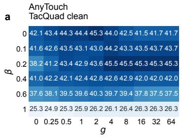

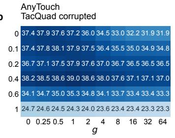

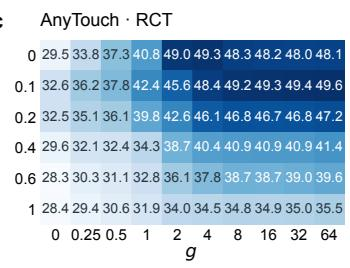

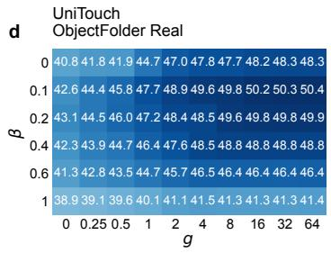

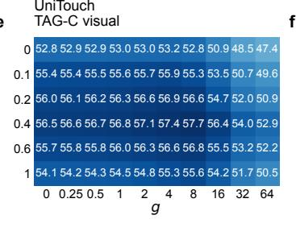

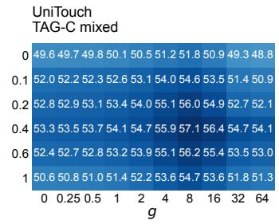  
Figure 6: Sensitivity to feature correction and modality weighting. Cells report accuracy (%); colours show the drop from each panel’s best tested setting on a shared scale.

AnyTouch TacQuad corrupted favors $( \beta , g ) = ( 0 . 4 , 1 )$ , pairing stronger correction with softer weight ing. This pattern is consistent with correcting features while avoiding an overly sharp preference between modalities. Clean TacQuad favors (0.2, 8), but $g = 4$ performs almost identically at the same $\beta .$ Here, moderate correction matters more than the precise weighting sharpness.

With one configuration $( \beta = 0 . 2 , g = 4$ , warm-up 16), SenseAlign averages 56.62% across all 14 main-table scenarios, versus 49.00% for TDA, the strongest complete baseline, a 7.61-point gain. The mean weights all scenarios equally.

## B.8 TEXT CONSTRUCTION AND VOCABULARY

Each class uses one original prompt, encoded with the frozen text encoder and normalized to obtain $a _ { c } .$ TAG-C uses the tactile sensor is touching a {name}. UniTouch and AnyTouch encode the same strings with their respective text encoders. Each comparison shares its ordered class vocabulary and prompt strings across methods.

All prompt strings and ordered candidate lists are provided with the source evidence specifications. ObjectFolder Real candidates are wood, steel, polycarbonate, plastic, iron, ceramic and glass. RCT candidates are crafts, metal, paper cardboard, plastic rubber, small items, textiles leather, and wood bamboo cork. TacQuad uses its 24 capture-derived object candidates. No prompt text is updated from test labels or optimized during the stream.

## B.9 STORAGE AND COMPUTATION

Class sums and masses require $O ( C d )$ storage. Constructing the joint span costs $O ( d K ^ { 2 } + K ^ { 3 } )$ for K represented pseudo-classes. The factored map stores $O ( d \bar { r } + r ^ { 2 } )$ scalars. Each local step evaluates scores for all C classes and projects an $r \times r$ matrix, with costs of order $O ( K r ^ { 2 } + \bar { K } C r + r ^ { 3 } )$ Applying the map to a batch of n observations costs $O ( n d r + n r ^ { 2 } )$ . Its main resource saving is the absence of encoder gradients, student activations and Adam moments.

## C PRIMARY EVALUATION WITH UNITOUCH

## C.1 CHECKPOINT AND DATA COVERAGE

The primary experiments strictly load the vision, touch and text branches of the released UniTouch checkpoint: 1,030 active tensors with 1,291,745,579 elements and 1,024-dimensional outputs. The implementation restores text end-token pooling and projection as specified by the checkpoint and uses the original ImageBind image preprocessing for both sensory modalities. A fixed official code revision and weight revision are recorded in the source bundle. CPU/GPU implementation checks and active-parameter shape checks precede evaluation. The comparison uses the released encoder with a shared fusion head across methods.

UniTouch’s published training data include Touch and Go, Feeling of Success, YCB-Slide and objects 101–1000 of ObjectFolder 2.0. The completed TacQuad, ObjectFolder Real and RCT panel is distinct from those collections. TAG-C is evaluated as corruption robustness on a documented training source. ObjectFolder Real is listed as an out-of-domain evaluation in the original work; TacQuad and RCT are absent from its published training list (Yang et al., 2024a). This distinction is defined at the dataset level from the published training list; sample-level exposure remains unspecified because the released checkpoint lacks a complete sample-level training manifest.

TacQuad retains 512 rows per sensor selected by a fixed path hash before running the conditions. The same rows appear in the clean condition and all 15 existing visual corruptions. The original relative order is kept, and tactile inputs are unchanged across those conditions. There are 25 conservative named-target groups and 24 classes. These names define the resampling units. TacQuad uses the existing corruption assets without assigning an official severity level; the severity-three specification applies to TAG-C. Each of the 48 conditions starts afresh.

ObjectFolder Real retains all five source test splits and their batch tails, with 3,395 presentations and 2,079 unique image pairs from 61 objects. Objects may recur across splits. Only the original order is evaluated in this primary experiment. RCT retains the complete seven-class DIGIT stream of 9,620 rows and 121 materials. Its source material-identity correction, image bindings and literal category labels are retained in the data records. The reference RGB photos are reused across tactile contacts. This is a material-recognition task distinct from the physical-attribute task in the AnyTouch supplement.

## C.2 SCORING

Within each condition, accuracy first averages predictions for an observed group and then averages the observed groups equally. Conditions are averaged equally for the task-level result. TacQuad

corruption statistics average 45 sensor–corruption conditions; clean accuracy averages three sensors.   
ObjectFolder Real averages the five tests, and RCT averages its materials.

Correction and harm counts describe presentations: a correction is a frozen error changed to a correct prediction, and a harm is the reverse. Their net divided by presentation count gives the presentation-weighted change; the primary metric instead gives equal weight to groups.

## C.3 ALL TACQUAD CONDITIONS

Table 8 averages sensors for each corruption; the following tables retain every sensor-specific condition. SenseAlign is above equal fusion by point estimate in all 48 sensor–condition streams, by 2.8 to 31.6 points.

Table 8: UniTouch on each TacQuad condition (accuracy, %), averaging named targets within a sensor and then the three sensors. The last column is SenseAlign minus equal fusion.
<table><tr><td>Condition</td><td>Equal fusion</td><td>SenseAlign</td><td>SenseAlign — fusion</td></tr><tr><td>Clean</td><td>46.45</td><td>58.59</td><td>+12.14</td></tr><tr><td>Brightness</td><td>40.55</td><td>54.24</td><td>+13.70</td></tr><tr><td>Contrast</td><td>38.29</td><td>59.53</td><td>+21.24</td></tr><tr><td>Defocus blur</td><td>42.99</td><td>53.97</td><td>+10.98</td></tr><tr><td>Elastic</td><td>33.43</td><td>49.52</td><td>+16.09</td></tr><tr><td>Fog</td><td>40.16</td><td>57.26</td><td>+17.10</td></tr><tr><td>Frost</td><td>32.54</td><td>48.77</td><td>+16.24</td></tr><tr><td>Gaussian noise</td><td>39.37</td><td>53.63</td><td>+14.25</td></tr><tr><td>Glass blur</td><td>47.09</td><td>61.54</td><td>+14.45</td></tr><tr><td>Impulse noise</td><td>41.57</td><td>56.99</td><td>+15.42</td></tr><tr><td>JPEG</td><td>43.00</td><td>57.07</td><td>+14.07</td></tr><tr><td>Motion blur</td><td>41.21</td><td>55.99</td><td>+14.78</td></tr><tr><td>Pixelation</td><td>42.72</td><td>57.13</td><td>+14.41</td></tr><tr><td>Shot noise</td><td>42.88</td><td>57.28</td><td>+14.40</td></tr><tr><td>Snow</td><td>30.03</td><td>44.58</td><td>+14.55</td></tr><tr><td>Zoom blur</td><td>34.89</td><td>42.98</td><td>+8.09</td></tr></table>

Tables 9 to 11 keep each sensor separate.

Table 9: GelSight Mini on TacQuad with UniTouch (accuracy, %). The last column is SenseAlign minus equal fusion.
<table><tr><td>Condition</td><td>Equal fusion</td><td>SenseAlign</td><td>SenseAlign – fusion</td></tr><tr><td>Clean</td><td>48.09</td><td>60.49</td><td>+12.40</td></tr><tr><td>Brightness</td><td>42.74</td><td>60.77</td><td>+18.03</td></tr><tr><td>Contrast</td><td>37.97</td><td>61.60</td><td>+23.63</td></tr><tr><td>Defocus blur</td><td>38.73</td><td>52.84</td><td>+14.10</td></tr><tr><td>Elastic</td><td>37.63</td><td>47.55</td><td>+9.92</td></tr><tr><td>Fog</td><td>38.06</td><td>52.87</td><td>+14.82</td></tr><tr><td>Frost</td><td>33.74</td><td>48.14</td><td>+14.40</td></tr><tr><td>Gaussian noise</td><td>39.85</td><td>52.68</td><td>+12.83</td></tr><tr><td>Glass blur</td><td>47.44</td><td>64.50</td><td>+17.07</td></tr><tr><td>Impulse noise</td><td>45.36</td><td>53.17</td><td>+7.81</td></tr><tr><td>JPEG</td><td>43.31</td><td>53.45</td><td>+10.14</td></tr><tr><td>Motion blur</td><td>39.82</td><td>56.89</td><td>+17.07</td></tr><tr><td>Pixelation</td><td>43.38</td><td>60.02</td><td>+16.64</td></tr><tr><td>Shot noise</td><td>43.50</td><td>56.48</td><td>+12.98</td></tr><tr><td>Snow</td><td>27.61</td><td>44.49</td><td>+16.87</td></tr><tr><td>Zoom blur</td><td>33.02</td><td>44.56</td><td>+11.54</td></tr></table>

Table 10: DIGIT on TacQuad with UniTouch (accuracy, %). The last column is SenseAlign minus equal fusion.
<table><tr><td>Condition</td><td>Equal fusion</td><td>SenseAlign</td><td>SenseAlign — fusion</td></tr><tr><td>Clean</td><td>43.46</td><td>57.81</td><td>+14.35</td></tr><tr><td>Brightness</td><td>35.45</td><td>51.57</td><td>+16.12</td></tr><tr><td>Contrast</td><td>31.56</td><td>63.13</td><td>+31.57</td></tr><tr><td>Defocus blur</td><td>38.22</td><td>54.22</td><td>+16.00</td></tr><tr><td>Elastic</td><td>28.29</td><td>54.46</td><td>+26.17</td></tr><tr><td>Fog</td><td>35.03</td><td>63.26</td><td>+28.23</td></tr><tr><td>Frost</td><td>32.30</td><td>49.24</td><td>+16.94</td></tr><tr><td>Gaussian noise</td><td>32.19</td><td>54.54</td><td>+22.35</td></tr><tr><td>Glass blur</td><td>43.32</td><td>63.97</td><td>+20.65</td></tr><tr><td>Impulse noise</td><td>36.24</td><td>63.51</td><td>+27.28</td></tr><tr><td>JPEG</td><td>35.41</td><td>60.63</td><td>+25.22</td></tr><tr><td>Motion blur</td><td>36.95</td><td>56.41</td><td>+19.46</td></tr><tr><td>Pixelation</td><td>42.57</td><td>58.07</td><td>+15.50</td></tr><tr><td>Shot noise</td><td>36.30</td><td>60.33</td><td>+24.04</td></tr><tr><td>Snow</td><td>28.32</td><td>39.90</td><td>+11.59</td></tr><tr><td>Zoom blur</td><td>29.95</td><td>39.08</td><td>+9.13</td></tr></table>

Table 11: DuraGel on TacQuad with UniTouch (accuracy, %). The last column is SenseAlign minus equal fusion.
<table><tr><td>Condition</td><td>Equal fusion</td><td>SenseAlign</td><td>SenseAlign – fusion</td></tr><tr><td>Clean</td><td>47.79</td><td>57.47</td><td>+9.68</td></tr><tr><td>Brightness</td><td>43.45</td><td>50.40</td><td>+6.94</td></tr><tr><td>Contrast</td><td>45.33</td><td>53.85</td><td>+8.52</td></tr><tr><td>Defocus blur</td><td>52.01</td><td>54.86</td><td>+2.85</td></tr><tr><td>Elastic</td><td>34.38</td><td>46.55</td><td>+12.17</td></tr><tr><td>Fog</td><td>47.39</td><td>55.66</td><td>+8.27</td></tr><tr><td>Frost</td><td>31.57</td><td>48.94</td><td>+17.37</td></tr><tr><td>Gaussian noise</td><td>46.07</td><td>53.66</td><td>+7.59</td></tr><tr><td>Glass blur</td><td>50.52</td><td>56.14</td><td>+5.62</td></tr><tr><td>Impulse noise</td><td>43.12</td><td>54.28</td><td>+11.16</td></tr><tr><td>JPÉG</td><td>50.28</td><td>57.12</td><td>+6.84</td></tr><tr><td>Motion blur</td><td>46.87</td><td>54.67</td><td>+7.79</td></tr><tr><td>Pixelation</td><td>42.21</td><td>53.29</td><td>+11.08</td></tr><tr><td>Shot noise</td><td>48.84</td><td>55.02</td><td>+6.18</td></tr><tr><td>Snow</td><td>34.16</td><td>49.35</td><td>+15.19</td></tr><tr><td>Zoom blur</td><td>41.70</td><td>45.31</td><td>+3.61</td></tr></table>

## C.4 ALL OBJECTFOLDER REAL TESTS

Table 12: UniTouch on the five ObjectFolder Real test splits (accuracy, %, objects weighted equally). Default $\beta = 0 . 2 , g = 4$ results; the selected main-table configuration is reported separately. The last column is SenseAlign minus equal fusion.
<table><tr><td>Split</td><td>Equal fusion</td><td>SenseAlign</td><td>SenseAlign — fusion</td></tr><tr><td>0</td><td>41.11</td><td>59.91</td><td>+18.79</td></tr><tr><td>1</td><td>46.63</td><td>41.91</td><td>-4.73</td></tr><tr><td>2</td><td>48.71</td><td>51.93</td><td>+3.22</td></tr><tr><td>3</td><td>38.89</td><td>57.88</td><td>+18.98</td></tr><tr><td>4</td><td>28.46</td><td>30.88</td><td>+2.42</td></tr></table>

## D COMPLETE COMPARISONS WITH TEST-TIME ADAPTATION BASELINES

## D.1 TEXT CONFIGURATION AND COMPARISON PROTOCOL

All methods use the same checkpoint, ordered inputs, candidate vocabulary, domain resets and one original prompt per class. Every row shares one text classifier. Equal fusion normalizes the fused feature before computing logits, whereas the external methods average the two branch logits.

The comparison contains ten baselines: nine in Table 2 and READ in Appendix D.2. The difference tables below carry the six baselines with matched paired comparison records. TDA, OGA and StatA operate independently on visual and tactile features and average their branch predictions; native branch settings, independent state and pretrained logit scale are retained. TSA and SuMi use their registered UniTouch baselines. Gradient-based baselines use the declared common learning rate of $1 0 ^ { - 4 }$ ; SenseAlign has no encoder optimizer learning rate.

Parameter-update baselines. TENT, SAR, SuMi, DeYO, RoTTA and READ update encoder parameters from the fused prediction, the average of the image–text and touch–text logits at the checkpoint scale. TENT minimizes entropy. SAR uses sharpness-aware entropy minimization, reliable-sample selection, the fixed ImageNet threshold policy and model recovery. Both update every normalization layer of the sensory trunks and heads (328 tensors, 0.37M parameters). SuMi runs its native procedure on the same layers. DeYO keeps its entropy and PLPD filters and reweighting (patch shuffling with patch length 4, PLPD threshold 0.2) and updates the normalization layers inside both trunks (0.20M parameters) with SGD and momentum 0.9. RoTTA keeps its memory bank and updates the attention projections and normalization layers of both trunks (309M parameters). READ updates the attention projections (309M parameters). All use a learning rate of $1 0 ^ { - 4 }$ , keep their native number of steps and prediction timing, and reset at the start of each stream.

Architecture mapping and original defaults. We compare READ’s and TSA’s released defaults with the shared settings above to clarify the scope of these adapted baselines. Both methods ship their entry point with learning rate $1 0 ^ { - 4 }$ as the default. READ (Yang et al., 2024b) declares -lr with default $1 0 ^ { - 4 }$ and optimizes the last cross-modal attention layer with Adam, betas (0.9, 0.999) and no weight decay (https://github.com/XLearning-SCU/2024-ICLR-READ); its paper reports the same initial learning rate of $1 0 ^ { - 4 }$ . TSA (Chen et al., 2025) likewise declares -lr with default $1 0 ^ { - 4 }$ and uses Adam with betas (0.9, 0.999) and weight decay $1 0 ^ { - 4 } \mathrm { ( h t t p s : / / g i t h u b ) }$ com/chenmc1996/Uni-Modal-Distribution-Shift). The shared learning rate of $1 0 ^ { - 4 }$ therefore coincides with the released default of both methods. The comparison holds this rate fixed under the shared backbone and batch-size configuration. The original work uses audio–visual CAV-MAE; our baselines use tactile–visual backbones. For READ, the branches meet only at fused logits, so its cross-modal attention update is mapped to attention projections within the encoders. Tables 2 and 3 report TSA; Tables 13 and 14 report the transferred READ configuration.

The TacQuad comparison includes all 48 sensor–condition streams and 24,576 presentations. The ObjectFolder Real comparison retains all five tests and 3,395 presentations. RCT retains all 9,620 material-recognition inputs. Object or material groups receive equal weight within a domain, followed by equal weighting of domains. Presentation-weighted accuracy is recorded in the source bundles and never substituted for these estimates.

## D.2 READ RESULTS ON TACTILE–VISUAL BACKBONES

Tables 13 and 14 report the complete READ results for both backbones under the comparison protocols above. They evaluate the stated architecture mapping on tactile–visual models; these results do not describe READ on its original audio–visual backbone.

Table 13: READ natural-shift accuracy (%) on the tactile–visual backbones. The four panels, input order and aggregation match Table 2; each Mean weights its four panels equally.
<table><tr><td rowspan="2">Method</td><td colspan="5">UniTouch</td><td colspan="5">AnyTouch</td></tr><tr><td>TacQuad clean</td><td>TacQuad corr.</td><td>OFR</td><td>RCT</td><td>Mean</td><td>clean</td><td>TacQuad TacQuad corr.</td><td>OFR</td><td></td><td>RCT Mean</td></tr><tr><td>READ</td><td>9.9</td><td>9.1</td><td>17.9</td><td>26.4</td><td>15.9</td><td>12.1</td><td>9.7</td><td>18.0</td><td>3.3</td><td>10.8</td></tr></table>

Table 14: READ TAG-C accuracy (%) at severity 3 on the tactile–visual backbones. Scenarios and aggregation match Table 3; each model Mean weights three scenarios equally, and Overall weights all six.
<table><tr><td></td><td colspan="4">AnyTouch</td><td colspan="4">UniTouch</td><td>Overall</td></tr><tr><td>Method</td><td>Visual</td><td>Tactile</td><td>Mixed</td><td>Mean</td><td>Visual</td><td>Tactile</td><td>Mixed</td><td>Mean</td><td>Mean</td></tr><tr><td>READ</td><td>6.4</td><td>10.2</td><td>0.1</td><td>5.6</td><td>1.3</td><td>23.2</td><td>6.5</td><td>10.3</td><td>7.9</td></tr></table>

## D.3 CHANGES RELATIVE TO THE INITIAL CLASSIFIER

Tables 15 and 16 compare each reported external method with its single-prompt frozen reference. The initial classifier is shared within these comparisons; native prediction timing and the StatA precision qualification remain as specified above. The tables retain every reported paired difference.

Table 15: Reported external method minus equal fusion with one prompt per class on TacQuad. Differences are in percentage points. StatA uses FP64 arithmetic.
<table><tr><td>Method</td><td>Clean</td></tr><tr><td>READ</td><td>-36.50 -30.23</td></tr><tr><td>SuMi</td><td>-0.08</td></tr><tr><td>TDA</td><td>-0.53 +4.20</td></tr><tr><td>OGA</td><td>+6.71</td></tr><tr><td>StatA</td><td>+5.82</td></tr><tr><td>TSA</td><td>-2.98</td></tr></table>

Methods start from the same single-prompt classifier and follow their registered output timing.  
Table 16: Reported external method minus equal fusion with one prompt per class on natural shifts. Differences are in percentage points. StatA uses FP64 arithmetic.

<table><tr><td>Method</td><td>ObjectFolder Real</td><td>RCT</td></tr><tr><td>READ</td><td>-22.81</td><td>-21.65</td></tr><tr><td>SuMi</td><td>-1.42</td><td>-21.85</td></tr><tr><td>TDA</td><td>+1.82</td><td>-10.90</td></tr><tr><td>OGA</td><td>+7.31</td><td>-39.02</td></tr><tr><td>StatA</td><td>+5.48</td><td>+12.15</td></tr><tr><td>TSA</td><td>-3.21</td><td>-36.18</td></tr></table>

Methods start from the same single-prompt classifier and follow their registered output timing.

## D.4 NUMERICAL PRECISION AND PREDICTION VALIDITY

StatA’s native FP32 computation produced nonfinite outputs on 52 TacQuad and 217 RCT batches. A uniform FP64 implementation of the same equations and settings completed the full streams without this failure. The comparison reports that implementation as StatA, with FP64 specified in the table captions. It changes 10,438 predictions among 23,744 finite TacQuad rows, 470 among 6,160 finite RCT rows, and 399 of the 3,395 ObjectFolder Real predictions. Precision therefore affects more than the previously nonfinite rows. The FP64 score is a result for this numerical baseline, rather than a bit-equivalent reproduction of the native FP32 run; the latter has no valid full-stream TacQuad or RCT score. Table 17 gives the coverage of both implementations.

Table 17: StatA numerical precision diagnostic on the completed full streams.
<table><tr><td>Dataset</td><td>FP32 invalid batches</td><td>Finite rows</td><td>Disagreements</td><td>FP32 accuracy</td></tr><tr><td>TacQuad</td><td>52</td><td>23744</td><td>10438</td><td>一</td></tr><tr><td>ObjectFolder Real</td><td>0</td><td>3395</td><td>399</td><td>42.00</td></tr><tr><td>RCT</td><td>217</td><td>6160</td><td>470</td><td></td></tr></table>

Invalid batches contain nonfinite FP32 outputs; — denotes undefined full-stream accuracy. Accuracy is macro accuracy (%). Disagreements count changed predictions among rows in entirely finite native FP32 batches. FP64 evaluates the same formulas and settings uniformly. FP64 changes predictions even where FP32 is finite, so it is reported as a numerical baseline rather than a bit-equivalent reproduction.

## E TAG-C CORRUPTION ROBUSTNESS WITH UNITOUCH

## E.1 DATA STREAMS AND ADAPTATION CONFIGURATIONS

The UniTouch extension retains all 4,126 original TAG-C frame identities. Fifteen visual corruption conditions contribute 61,890 presentations; seven tactile conditions contribute 28,882. All use the original severity-three assets and the same 20 material categories, including Others. The uncorrupted modality remains available in each direction. These two streams are distinct from the 94,898- presentation mixed stream evaluated with both backbones, which additionally includes simultaneous corruptions and clean observations.

Each direction starts with fresh adaptation state. Its original row order is retained without resets between corruption conditions. External batches contain 16 observations, with the final two observations evaluated as their own batch. No observations are dropped or joined to an earlier batch.

Equal fusion and the baselines use one original prompt per class. SenseAlign uses the same prompts and predicts a complete batch before incorporating it into the shared memory. Anchor Realignment uses the fixed 64-step classification refinement with a 16-observation warm-up, while all encoders remain frozen. The default control uses $\beta = 0 . 2 , g = 4 ;$ the main-table Visual result uses the selected $\beta = 0 . 4 , g = 8$ setting. Tactile retains the defaults. Labels are used by the separate scoring and panel-level parameter selection, not during adaptation.

READ, TDA, OGA and TSA use the single-prompt classifier and the registered serving conventions described in Appendix D. They retain every observation in both directions. TDA and OGA keep independent visual and tactile adaptation state and combine branch outputs equally. READ updates the selected attention projections in the visual, tactile and text branches. TSA retains its native postupdate traversal sum and the declared shared-learning-rate override. We report recorded optimizer calls without assuming one update per batch.

StatA’s native $k = 3$ operation is undefined for each original final batch of two observations. Both the FP64 numerical implementation and the FP32 sensitivity run retain those four undefined observations in their validity masks. Table 3 reports the FP64 baseline over the remaining 90,768 observations. We do not impute predictions for the four, join the tail to a preceding batch, or drop any other observation. The FP32 sensitivity run gives 52.50 and 53.58 on the two directions, against 52.59 and 53.69 for FP64.

Touch and Go is included in UniTouch’s documented pretraining sources. These results measure corruption robustness on a documented pretraining source, complementing the primary natural-shift streams.

## E.2 AGGREGATION

Accuracy is the fraction of correct presentations within each corruption. Each directional score averages its corruption conditions equally, and the UniTouch directional overall weights the visual and tactile directions equally. Thus the 15 visual conditions do not receive more total weight than the seven tactile conditions. In the main table, each backbone mean equally weights Visual, Tactile, and Mixed, and Overall equally weights all six scenarios. This presentation-based calculation differs from the group-balanced metric of the three primary datasets.

Table 3 compares SenseAlign with the baselines and single-prompt equal fusion. Table 18 retains per-corruption differences relative to single-prompt equal fusion at the default $\beta = 0 . 2 , g = 4$ settings. Its visual mean differs from the selected main-table result.

## E.3 IMPLEMENTATION AND NUMERICAL STATUS

The following records specify the adaptation procedures and numerical status associated with the reported table entries.

READ updates attention projections in the visual, tactile and text branches and returns predictions after adaptation, using its original loss and the shared learning rate of $1 0 ^ { - 4 }$ . Table 14 reports its results in both directions and on Mixed. Appendix D specifies the architecture mapping and the parameters receiving the loss.

SuMi retains feature smoothing, its time schedule and entropy selection, and updates LayerNorm affine parameters in all three branches. The visual and Mixed entries retain their completed native mixed-precision runs. For the tactile entry, native runs encountered nonfinite logits; correcting the reciprocal gradient scale alone subsequently left the scale at zero after 7,136 observations. We therefore reran the complete tactile stream from the original checkpoint in FP32, disabling autocas and gradient scaling while retaining the original loss, thresholds, learning rate, parameter groups and post-update predictions. This precision recovery completed all 28,882 observations with 1,806 optimizer calls, finite predictions and finite gradients at every executed update. Every batch selected by the native rule triggered an optimizer call; parameters outside the declared groups remained unchanged. Independent recomputation gives 45.38% tactile accuracy. The failed mixed-precision trajectories contribute no accuracy to the table.

Table 18: UniTouch TAG-C differences from single-prompt equal fusion at default $\beta = 0 . 2 , g = 4$ (percentage points).
<table><tr><td>Condition</td><td>SenseAlign minus fusion</td></tr><tr><td>Visual mean</td><td>+4.04</td></tr><tr><td>Tactile mean</td><td>+10.53</td></tr><tr><td>Overall mean</td><td>+7.29</td></tr><tr><td>Visual corruptions</td><td></td></tr><tr><td>Brightness</td><td>+4.90</td></tr><tr><td>Defocus blur</td><td>+5.40</td></tr><tr><td>Fog</td><td>+5.62</td></tr><tr><td>Gaussian noise</td><td>+1.19</td></tr><tr><td>Impulse noise</td><td>+3.56</td></tr><tr><td>Motion blur</td><td>+2.69</td></tr><tr><td>Shot noise</td><td>+4.19</td></tr><tr><td>Contrast</td><td>+3.76</td></tr><tr><td>Elastic</td><td>+4.99 +4.58</td></tr><tr><td>Frost</td><td></td></tr><tr><td>Glass blur</td><td>+3.01 +3.95</td></tr><tr><td>JPEG</td><td>+4.14</td></tr><tr><td>Pixelation</td><td></td></tr><tr><td>Snow</td><td>+4.48</td></tr><tr><td>Zoom blur</td><td>+4.12</td></tr><tr><td>Tactile corruptions</td><td>+7.59</td></tr><tr><td>Brightness</td><td>+6.62</td></tr><tr><td>Defocus blur</td><td>+14.13</td></tr><tr><td>Gaussian noise</td><td></td></tr><tr><td>Impulse noise</td><td>+11.05</td></tr><tr><td>Motion blur</td><td>+10.59</td></tr><tr><td>Contrast</td><td>+17.72</td></tr><tr><td>Elastic</td><td>+6.03</td></tr></table>

## E.4 COMPLETE MATCHED MIXED COMPARISON

The UniTouch Mixed extension uses the same 94,898 ordered presentations, 20 classes and 117 capture directories as AnyTouch. The stream contains 4,126 clean, 30,945 visually corrupted, 14,441 tactile-corrupted and 45,386 jointly corrupted presentations. Each method starts with fresh state and then runs continuously, without resets at corruption boundaries apart from its native recovery rule. All methods use 5,930 batches of 16 followed by batches of 14 and 4, retaining every presentation. Parameter updates use the shared $1 0 ^ { - 4 }$ learning rate and the previously declared parameter groups, native losses, thresholds and serving timing. TDA, OGA and StatA maintain separate modality states and average their outputs. The default SenseAlign control uses $g = 4 , \beta = 0 . 2$ , the 16-observation warm-up and 64-step refinement, with one prompt per class, and scores 55.10%. The main-table Mixed result uses the selected $\beta = 0 . 4 , g = 8$ configuration and scores 57.13% (Appendix B.6); the remaining settings are unchanged.

The independent scorer verifies full predictions, input identity and order, class and prompt order, checkpoint, code and configuration hashes, and all batch records. Direct image-to-output frozen inference agrees with all 94,898 cached frozen predictions (47,042 correct). The complete baseline counts and selected SenseAlign predictions supply the Mixed entries in Table 3. Both backbone means equally weight their three scenarios, and Overall weights all six, using full-precision constituent scores before rounding. The comparison describes method performance on this recorded trajectory under the specified checkpoint, inputs and adaptation configurations.

The UniTouch Mixed StatA row retains the previously accepted FP64 numerical implementation. Its FP32 counterpart is finite in all 5,932 batches but has different predicted classes on 281 presentations. The table reports the FP64 configuration throughout. The Mixed tail sizes support its native $k = 3$ operation; the four undefined observations in the original directional runs remain excluded only from those rows.

The unmodified Mixed SuMi run completed with 15,187 correct predictions and 4,264 optimizer calls; its AMP scale remained positive. This separate result occupies the Mixed cell; the tactile-directional entry uses the FP32 recovery described above.

## F MATCHED COMPARISONS OF READOUT RULES

These default-setting comparisons retain $g = 4 ,$ , including AnyTouch OFR, whose selected main-table setting is $g = 1$ . They ask whether the semantic weighting rule adds value after holding feature realignment fixed. Each corrected serving rule uses the same encoders, class vocabulary, singleprompt head, batch order, memory writes and fitted maps. Only their serving weights change; frozen references and the original Realign-only control are listed separately below. All eleven primary panels are retained: four UniTouch natural-shift panels, AnyTouch OFR in released order, and six TAG-C scenarios.

Weighting rules. Let $q ^ { v }$ and $q ^ { t }$ denote the realigned branch logits in Equation 11. Set $p ^ { m } =$ softmax $( q ^ { m } ) , c _ { m } = \operatorname* { m a x } _ { j } p _ { j } ^ { m }$ , and $\begin{array} { r } { H _ { m } = - \sum _ { j } p _ { j } ^ { \overline { { m } } } \log p _ { j } ^ { m } } \end{array}$ . Maximum-probability weighting uses $w _ { v } = c _ { v } / ( c _ { v } + c _ { t } )$ ; inverse-entropy weighting uses $w _ { v } = ( H _ { t } + \epsilon ) / ( H _ { v } + H _ { t } + 2 \epsilon )$ , with $\epsilon = 1 0 ^ { - 1 2 }$ These rules use the current input’s branch logits at the original checkpoint scale, without a temperature search. Maximum-probability selection assigns all weight to the more confident branch. Alignment selection instead chooses the branch with larger historical Trust weight. Ties within $1 0 ^ { - 1 2 }$ use equal weights, including Trust warm-up. The prefix control follows Trust until the first completed batch containing at least 256 cumulative inputs, then keeps the next-batch weight fixed while realignment continues to update.

Corrected single-branch readouts use $w _ { v } = 1$ or 0 with the same multimodally fitted map. They are readout controls, not independently adapted unimodal methods. Frozen branches and frozen equal fusion are also reported. Corrected equal weights and Realign only coincide on every panel.

Results and uncertainty. Table 19 preserves the three original aggregate definitions rather than combining them into a new overall measure. The TAG-C mean is 60.44% for SenseAlign, 59.23% for corrected equal weights, 59.51% for maximum-probability weights and 59.64% for inverseentropy weights. The UniTouch natural mean also favors SenseAlign over the probability and entropy rules. On AnyTouch OFR, those two rules and corrected equal weights have higher point estimates. Tables 21 and 22 retain every primary panel and comparator.

The intervals in Table 20 use 5,000 paired bootstrap draws at the original grouping level: named targets for TacQuad, objects for OFR, materials for RCT, and capture directories for TAG-C. Repeated groups share the same draw across conditions and OFR splits; TAG-C also shares capture draws across directions and backbones. Each draw retains the original within-panel aggregation, followed by the specified equal-panel mean. These are intervals conditional on the saved adaptation histories: maps and weights are not refitted after resampling. They do not correct for multiple comparisons or development selection and do not measure independent test-set generalization.

Across the six TAG-C scenarios, SenseAlign minus corrected equal weights is +1.22 points with interval $[ + 0 . 8 9 , + 1 . 5 6 ]$ ; against probability and inverse-entropy weights the differences are +0.94 and +0.80 points.

Matching history and class grouping. The additional comparison in Table 23 covers UniTouch TacQuad clean, TacQuad corrupted and RCT, and the six TAG-C panels. It preserves Trust’s accepted observations, shared pseudo-label groups, sample weights, class means and prediction-before-update timing. Let $z _ { c , b , ( 1 ) } ^ { m } \mathrm { a n d } z _ { c , b , ( 2 ) } ^ { m }$ be the two largest entries of the standardized score vector in Equation 3.

Table 19: Matched readout comparisons (accuracy, %). All use one prompt per class. The natural mean weights the four UniTouch panels equally; OFR uses AnyTouch in the five splits in released order; TAG-C weights its six model–scenario combinations equally. Corrected rules share the same realignment fits.
<table><tr><td>Readout</td><td>UniTouch natural AnyTouch OFR</td><td></td><td>TAG-C mean</td></tr><tr><td>Frozen equal fusion</td><td>43.67</td><td>71.67</td><td>53.85</td></tr><tr><td>Frozen vision</td><td>54.93</td><td>37.31</td><td>52.50</td></tr><tr><td>Frozen touch</td><td>7.20</td><td>74.62</td><td>41.94</td></tr><tr><td>Realign only</td><td>46.44</td><td>78.27</td><td>59.23</td></tr><tr><td>Corrected equal weights</td><td>46.44</td><td>78.27</td><td>59.23</td></tr><tr><td>Maximum-probability weights</td><td>49.07</td><td>78.31</td><td>59.51</td></tr><tr><td>Inverse-entropy weights</td><td>50.53</td><td>78.28</td><td>59.64</td></tr><tr><td>Maximum-probability selection</td><td>50.73</td><td>77.04</td><td>58.58</td></tr><tr><td>Alignment selection</td><td>56.70</td><td>75.15</td><td>54.19</td></tr><tr><td>Weights fixed after 256 inputs</td><td>44.37</td><td>76.58</td><td>60.21</td></tr><tr><td>Corrected vision readout</td><td>56.40</td><td>53.71</td><td>57.97</td></tr><tr><td>Corrected touch readout</td><td>11.49</td><td>77.07</td><td>46.69</td></tr><tr><td>SenseAlign</td><td>56.32</td><td>76.08</td><td>60.44</td></tr></table>

Table 20: SenseAlign minus each readout in Table 19 (percentage points; paired 95% intervals). Intervals condition on fixed adaptation histories and use 5,000 group bootstrap draws. They do not include uncertainty from refitting or parameter selection.
<table><tr><td rowspan=1 colspan=6>Readout                               UniTouch natural           AnyTouch OFR             TAG-C mean</td></tr><tr><td rowspan=2 colspan=2>Frozen equal fusion             +12.65 [+8.05, +17.36]Frozen vision                     +1.39 [−0.96, +3.94]</td><td rowspan=1 colspan=2>+4.40 [−4.29, +13.20]</td><td rowspan=1 colspan=1>+6.59 [+</td><td rowspan=1 colspan=1>5.13, +7.99]</td></tr><tr><td rowspan=1 colspan=1>+38.77 [+25</td><td rowspan=1 colspan=1>.49, +51.43]</td><td rowspan=1 colspan=1>+7.94 [+</td><td rowspan=1 colspan=1>6.03, +9.85]</td></tr><tr><td rowspan=1 colspan=2>Frozen touch                  +49.12 [+39.99, +58.03]</td><td rowspan=1 colspan=1>+1.46 [−</td><td rowspan=1 colspan=1>3.09, +5.75]</td><td rowspan=1 colspan=1>+18.50 [+15</td><td rowspan=1 colspan=1>.35, +21.09]</td></tr><tr><td rowspan=1 colspan=2>Realign only                     +9.87 [+6.52, +13.30]</td><td rowspan=1 colspan=1>-2.19</td><td rowspan=1 colspan=1>[−9.32, +5.00]</td><td rowspan=1 colspan=1>+1.22 [+</td><td rowspan=1 colspan=1>0.89, +1.56]</td></tr><tr><td rowspan=7 colspan=2>Corrected equal weights          +9.87 [+6.52, +13.30]Maximum-probability weights     +7.25 [+4.60, +9.97]Inverse-entropy weights           +5.78 [+3.66, +7.91]Maximum-probability selection    +5.59 [+3.81, +7.49]Alignment selection               -0.39 [−0.95, +0.08]Weights fixed after 256 inputs   +11.95 [+9.63, +14.17]Corrected vision readout           -0.08 [−0.96, +0.94]</td><td rowspan=1 colspan=1>-2.19</td><td rowspan=1 colspan=1>[−9.32, +5.00]</td><td rowspan=1 colspan=1>+1.22</td><td rowspan=1 colspan=1>[+0.89, +1.56]</td></tr><tr><td rowspan=1 colspan=1>-2.24</td><td rowspan=1 colspan=1>[−9.31, +4.91]</td><td rowspan=1 colspan=1>+0.94 [+</td><td rowspan=1 colspan=1>0.61, +1.25]</td></tr><tr><td rowspan=1 colspan=1>-2.20</td><td rowspan=1 colspan=1>[−9.36, +4.71]</td><td rowspan=1 colspan=1>+0.80 [[</td><td rowspan=1 colspan=1>+0.41, +1.17]</td></tr><tr><td rowspan=1 colspan=1>-0.96</td><td rowspan=1 colspan=1>[−7.79, +5.72]</td><td rowspan=1 colspan=1>+1.86[</td><td rowspan=1 colspan=1>+1.37, +2.35]</td></tr><tr><td rowspan=1 colspan=1>+0.92</td><td rowspan=1 colspan=1>[−1.09, +2.63]</td><td rowspan=1 colspan=1>+6.25[</td><td rowspan=1 colspan=1>+5.19, +7.31]</td></tr><tr><td rowspan=1 colspan=1>-9.63, +14.17</td><td rowspan=1 colspan=1>-0.51 [−</td><td rowspan=1 colspan=1>1.26, +0.13]</td><td rowspan=1 colspan=1>+0.23 [+</td><td rowspan=1 colspan=1>0.10, +0.36]</td></tr><tr><td rowspan=1 colspan=1>-0.96, +0.94</td><td rowspan=1 colspan=1>+22.37 [+10</td><td rowspan=1 colspan=1>.26, +34.08]</td><td rowspan=1 colspan=1>+2.47 [+</td><td rowspan=1 colspan=1>1.45, +3.55]</td></tr><tr><td rowspan=1 colspan=2>Corrected touch readout        +44.82 [+35.27, +54.04]</td><td rowspan=1 colspan=1>-0.99 [−</td><td rowspan=1 colspan=1>4.45, +1.95]</td><td rowspan=1 colspan=1>+13.75 [+12</td><td rowspan=1 colspan=1>.10, +15.21]</td></tr></table>

Table 21: All five natural-shift panels for the matched readout comparison (accuracy, %). TacQuad clean and corrupted, OFR and RCT use UniTouch; the final column uses AnyTouch OFR. Grouping, histories and prompts are fixed within each panel.
<table><tr><td></td><td>TacQuad</td><td>TacQuad</td><td>UniTouch</td><td></td><td>AnyTouch</td></tr><tr><td>Readout</td><td>clean</td><td>corrupted</td><td>OFR</td><td>RCT</td><td>OFR</td></tr><tr><td>Frozen equal fusion</td><td>46.45</td><td>39.38</td><td>40.76</td><td>48.09</td><td>71.67</td></tr><tr><td>Frozen vision</td><td>54.47</td><td>53.73</td><td>48.70</td><td>62.81</td><td>37.31</td></tr><tr><td>Frozen touch</td><td>0.55</td><td>0.55</td><td>16.24</td><td>11.45</td><td>74.62</td></tr><tr><td>Realign only</td><td>49.96</td><td>44.71</td><td>43.10</td><td>47.99</td><td>78.27</td></tr><tr><td>Corrected equal weights</td><td>49.96</td><td>44.71</td><td>43.10</td><td>47.99</td><td>78.27</td></tr><tr><td>Maximum-probability weights</td><td>53.24</td><td>49.28 51.25</td><td>45.09</td><td>48.65</td><td>78.31</td></tr><tr><td>Inverse-entropy weights</td><td>54.67</td><td>52.52</td><td>47.92</td><td>48.29</td><td>78.28</td></tr><tr><td>Maximum-probability selection</td><td>56.23</td><td></td><td>46.69</td><td>47.48</td><td>77.04</td></tr><tr><td>Alignment selection</td><td>58.59</td><td>54.20 54.02</td><td>49.91 48.59</td><td>64.11</td><td>75.15</td></tr><tr><td>Weights fixed after 256 inputs</td><td>58.59</td><td>54.58</td><td>50.00</td><td>16.28</td><td>76.58</td></tr><tr><td>Corrected vision readout</td><td>57.16 4.94</td><td>5.60</td><td>19.74</td><td>63.84</td><td>53.71</td></tr><tr><td>Corrected touch readout</td><td>58.59</td><td>54.03</td><td>48.50</td><td>15.69</td><td>77.07</td></tr><tr><td>SenseAlign</td><td></td><td></td><td></td><td>064.14</td><td>76.08</td></tr></table>

Table 22: All six single-prompt TAG-C scenarios for the matched readout comparison (accuracy, %). A and U denote AnyTouch and UniTouch; V, T and M denote visual corruption, tactile corruption and Mixed. Corrected equal weights and Realign only coincide.
<table><tr><td>Readout</td><td>A-V</td><td>A-T</td><td>A-M</td><td>U-V</td><td>U-T</td><td>U-M</td></tr><tr><td>Frozen equal fusion</td><td>56.08</td><td>59.13</td><td>55.17</td><td>52.85</td><td>50.28</td><td>49.57</td></tr><tr><td>Frozen vision</td><td>49.56</td><td>62.09</td><td>51.99</td><td>47.37</td><td>55.14</td><td>48.85</td></tr><tr><td>Frozen touch</td><td>47.60</td><td>39.42</td><td>42.41</td><td>46.61</td><td>35.81</td><td>39.78</td></tr><tr><td>Realign only</td><td>63.03</td><td>66.52</td><td>62.73</td><td>56.05</td><td>54.25</td><td>52.77</td></tr><tr><td>Corrected equal weights</td><td>63.03</td><td>66.52</td><td>62.73</td><td>56.05</td><td>54.25</td><td>52.77</td></tr><tr><td>Maximum-probability weights</td><td>63.08</td><td>66.77</td><td>62.87</td><td>55.84</td><td>55.29</td><td>53.18</td></tr><tr><td>Inverse-entropy weights</td><td>62.97</td><td>66.94</td><td>62.84</td><td>55.59</td><td>56.03</td><td>53.47</td></tr><tr><td>Maximum-probability selection</td><td>61.81</td><td>66.28</td><td>61.56</td><td>54.29</td><td>55.13</td><td>52.39</td></tr><tr><td>Alignment selection</td><td>56.60</td><td>54.73</td><td>50.94</td><td>50.78</td><td>59.97</td><td>52.14</td></tr><tr><td>Weights fixed after 256 inputs</td><td>63.08</td><td>65.87</td><td>62.29</td><td>56.81</td><td>60.56</td><td>52.65</td></tr><tr><td>Corrected vision readout</td><td>56.57</td><td>69.09</td><td>59.26</td><td>50.77</td><td>59.96</td><td>52.17</td></tr><tr><td>Corrected touch readout</td><td>56.57</td><td>47.80</td><td>50.94</td><td>47.91</td><td>36.32</td><td>40.57</td></tr><tr><td>SenseAlign</td><td>62.41</td><td>65.99</td><td>61.45</td><td>56.88</td><td>60.81</td><td>55.10</td></tr></table>

History-grouped margin replaces assigned-class support with the top-two gap:

$$
D _ { b } ^ { m } = \frac { 1 } { \vert { \mathcal C } _ { b } \vert } \sum _ { c \in { \mathcal C } _ { b } } \big ( z _ { c , b , ( 1 ) } ^ { m } - z _ { c , b , ( 2 ) } ^ { m } \big ) , \qquad [ w _ { b } ^ { v } , w _ { b } ^ { t } ] = \mathrm { s o f t m a x } \big ( 4 [ D _ { b } ^ { v } , D _ { b } ^ { t } ] \big ) .\tag{24}
$$

The current-sample margin control applies the same standardization and top-two gap to each input’s raw branch scores, using the same gain and readiness condition. All three rules combine identical corrected branch scores. Equal gain does not imply identical weight sharpness across signals. Intervals use the paired, fixed-history bootstrap described above.

Table 23: Matched-history reliability comparison (accuracy, %). The final column gives Trust minus historygrouped margin in percentage points, with paired 95% intervals. Means weight the three TacQuad/RCT or six TAG-C panels equally.
<table><tr><td>Model</td><td>Scenario</td><td>Sample margin</td><td>History margin Trust</td></tr><tr><td>UniTouch</td><td>TacQuad clean</td><td>52.66</td><td>58.59 +1.08[+0.22, +2.28]</td></tr><tr><td>UniTouch</td><td>TacQuad corrupted</td><td>49.19</td><td>54.03 +1.12 [+0.27, +2.28]</td></tr><tr><td>UniTouch</td><td>RCT</td><td>47.46</td><td>64.14 +7.78[+2.36, +13.43]</td></tr><tr><td>AnyTouch</td><td>TAG-C Visual</td><td>60.62 60.68</td><td>62.41 +1.74[+1.18, +2.29]</td></tr><tr><td>AnyTouch</td><td>TAG-C Tactile</td><td>64.10 62.26</td><td>+3.73 [+3.17, +4.27]</td></tr><tr><td>AnyTouch</td><td>TAG-C Mixed</td><td>60.13 58.02</td><td>65.99 61.45 +3.43 [+2.90, +3.92]</td></tr><tr><td>UniTouch</td><td>TAG-C Visual</td><td>54.82 56.81</td><td>+0.07[-0.23, +0.37]</td></tr><tr><td>UniTouch</td><td>TAG-C Tactile</td><td>56.22 61.57</td><td>-0.76 [-1.03, -0.48]</td></tr><tr><td>UniTouch</td><td>TAG-C Mixed</td><td>53.14 55.75</td><td>-0.65 [-0.91, -0.39]</td></tr><tr><td>UniTouch</td><td>TacQuad/RCT mean</td><td>49.77 55.60</td><td>+3.33 [+1.43, +5.30]</td></tr><tr><td>Both</td><td>TAG-C mean</td><td>58.17 59.18</td><td>+1.26 [+1.00, +1.52]</td></tr></table>

Interpreting the UniTouch exceptions. The two exceptions are consistent with Trust assigning too little weight to vision. On UniTouch Tactile and Mixed, history-grouped margin raises the mean visual weight from 0.709 to 0.755 and from 0.610 to 0.658, respectively. Its net gains arise on predictions receiving more visual weight; both panels have a more accurate corrected visual branch (Table 22). Trust measures support for shared predicted classes, which need not calibrate the relative usefulness of the corrected branches. Its more balanced weights can therefore retain too much tactile influence in these streams. Both fusion rules nevertheless outperform corrected vision alone, supporting a stronger visual contribution while retaining complementary touch. This interpretation describes the saved weight and prediction differences; it does not establish pseudo-label errors as their underlying cause.

Frozen reference provenance. The paired controls use frozen predictions from the same method replay. On UniTouch Mixed, this frozen reference differs from the separately executed main-table baseline on one of 94,898 predictions, with 47,041 rather than 47,042 correct. Both round to 49.57%; the six-scenario mean changes by less than 0.0002 points. The difference does not enter any contrast between corrected weighting rules. All SenseAlign predictions in these controls match their archived method outputs.

## G RETROSPECTIVE ANALYSIS OF ANCHOR REALIGNMENT

We examine how the fitting stages change feature geometry and class scores with AnyTouch on ObjectFolder Real split 0, using 704 observations and seven classes. We reconstruct the final shared memory, the Procrustes initialization, and classification refinement with the original solver. Encoders and semantic anchors remain fixed. Both branches receive the same correction and are fused with weights of one half, so Alignment Trust does not contribute to this diagnostic. All observations are retained and weighted equally in the reported means and accuracies. True labels are used only for analysis; the fits use the shared-memory pseudo-labels. Each final memory includes the replayed stream, and the results describe retrospective application to those same observations. The subsequent factor and normalization controls analyze these fitted maps. In the compact figure and table labels, “Raw” means equal-weight fusion, “Procrustes” means realignment without refinement, and “CE” means feature realignment after the cross-entropy classification refinement of Section 4.3.

## G.1 GEOMETRIC MATCHING AND CLASS DISCRIMINATION

For each stage, we compute diagnostic cosine scores from the normalized fusion of the corrected unit branches,

$$
z _ { i } = \nu \big ( \big ( \phi ( u _ { i } ^ { v } ) + \phi ( u _ { i } ^ { t } ) \big ) / 2 \big ) , \qquad r _ { i c } = z _ { i } a _ { c } ^ { \top } .\tag{25}
$$

The raw stage uses $\phi = \nu$ . These scores omit the checkpoint logit scale and normalize the fused feature, unlike the serving logits in Eq. 11. This additional positive scale leaves predictions unchanged but changes score magnitudes. We decompose each score and define the gap to the strongest incorrect class as

$$
\begin{array} { l } { { r _ { i , \mathrm { a v g } } = \displaystyle \frac { 1 } { C } \sum _ { j } r _ { i j } , \qquad r _ { i c } = r _ { i , \mathrm { a v g } } + ( r _ { i c } - r _ { i , \mathrm { a v g } } ) , } } \\ { { \Delta _ { i } = r _ { i y _ { i } } - \displaystyle \operatorname* { m a x } _ { j \ne y _ { i } } r _ { i j } . } } \end{array}\tag{26}
$$

The first term is identical for all classes of an observation. It cancels in score differences and softmax probabilities. The gap $\Delta _ { i }$ uses the true label $y _ { i }$ and is an evaluation diagnostic, not an inference-time selection or weighting signal.

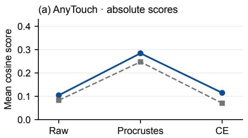

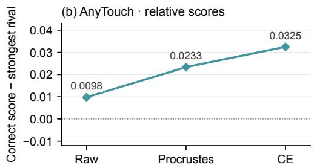  
OFR split 0 · 704 observations · equal fusion · final-memory replay  
Figure 7: Geometric matching and class discrimination. Raw denotes uncorrected features; Procrustes and CE denote geometric initialization and subsequent cross-entropy refinement. (a) Mean cosine similarity to the correct-class text embedding and the mean across all class embeddings. (b) Mean gap between the correct-class score and the strongest incorrect-class score. Scores are evaluated retrospectively using the final memory.

Procrustes increases mean correct-anchor similarity, but an increase in the mean score over all classes accounts for 91.4% of that increase (Figure 7). This is a ratio of changes in dataset means. Accuracy is computed separately from predicted classes. Classification refinement then reduces the mean correct-anchor score, while reducing the mean strongest-rival score more. The mean gap therefore increases (Table 24). These quantities summarize the observation population.

Table 24: Stage scores and retrospective accuracy on the same ObjectFolder Real replay. Correct and Rival are the means of $r _ { i y _ { i } }$ and $\mathrm { m a x } _ { j \neq y _ { i } } r _ { i j } ;$ Gap is their difference. The last row applies the same refined map with $\beta = 1$ without refitting a map optimized at $\beta = 0 . 2$
<table><tr><td>Backbone</td><td>Stage</td><td>Correct</td><td>Rival</td><td>Gap</td><td>Accuracy (%)</td></tr><tr><td rowspan="4">AnyTouch</td><td>Raw</td><td>0.1044</td><td>0.0946</td><td>0.0098</td><td>72.30</td></tr><tr><td>Procrustes,  $\beta = . 2$ </td><td>0.2843</td><td>0.2610</td><td>0.0233</td><td>81.25</td></tr><tr><td> $\mathrm { C E } , \beta = . 2$ </td><td>0.1148</td><td>0.0823</td><td>0.0325</td><td>89.35</td></tr><tr><td>Same CE map,  $\beta = 1$ </td><td>-0.0001</td><td>-0.0628</td><td>0.0627</td><td>94.32</td></tr></table>

## G.2 THE COMPONENT SHARED BY THE SEMANTIC ANCHORS

Let $\begin{array} { r } { a _ { \mathrm { a v g } } = C ^ { - 1 } \sum _ { c } a _ { c } } \end{array}$ denote the average across classifier anchors, distinct from an individual class anchor $a _ { c }$ . The following identity separates its squared norm from variation across classes,

$$
\frac { 1 } { C } \sum _ { c } \| a _ { c } \| ^ { 2 } = \| a _ { \mathrm { a v g } } \| ^ { 2 } + \frac { 1 } { C } \sum _ { c } \| a _ { c } - a _ { \mathrm { a v g } } \| ^ { 2 } .\tag{27}
$$

The ratio of the first term to the left-hand side is 87.66% for AnyTouch. Here “energy” means squared vector norm. Classification depends on the differences between anchor scores. For any feature z, the score term $z a _ { \mathrm { a v g } } ^ { \top }$ is shared across classes. Moving toward this common component can raise absolute anchor similarities without improving class ranking. The decomposition measures the shared component of the evaluated anchors; the remaining class-specific component determines their score differences.

## G.3 GEOMETRY OF THE RESIDUAL MAP

For unit u and orthogonal R, the serving transform simplifies to $\phi ( u ) = \nu ( u B )$ , where $B =$ $( 1 - \beta ) I + \beta R .$ . Although R preserves inner products, generally

$$
B B ^ { \top } = { \big ( } ( 1 - \beta ) ^ { 2 } + \beta ^ { 2 } { \big ) } I + \beta ( 1 - \beta ) ( R + R ^ { \top } ) \neq I .\tag{28}
$$

Thus residual mixing introduces directional scaling as well as a change of orientation. $\mathbf { A } \mathbf { t } \ \beta = 0 . 2 .$ the triangle and reverse-triangle inequalities give $0 . { \bar { 6 } } \| u \| \leq \| u B \| \leq \| { \bar { u } } \|$ , so the singular values of B lie in [0.6, 1]. The map is invertible; for fixed memory, its direction map has inverse $z \mapsto \nu ( z B ^ { - 1 } )$ This invertible transform adapts the readout while retaining the information in each individual feature.

Writing $\theta \ : = \ : \angle ( u , u R )$ gives tan $\angle ( u , u B ) = \beta$ sin $\theta / ( 1 - \beta + \beta \cos \theta )$ . For $0 ~ \le ~ \beta ~ < ~ 1 / 2$ maximizing over θ bounds the angle by arcsin $( \beta / ( 1 - \beta ) )$ , or about $1 4 . 4 8 ^ { \circ }$ at $\beta = 0 . 2$ . This bound characterizes the angular modification of each unit sensor feature. The tables separately report the resulting fused predictions.

We use the polar decomposition $B = O H$ , with O orthogonal and H symmetric positive definite, to remove one factor at a time from the same fitted map. Both factors remain the identity outside the observed span. Table 25 shows that each factor changes classification. These controls decompose a single fitted map, with each accuracy evaluated separately. Applying the full refined map with $\beta = 1$ gives the changes in Table 24, using the fit obtained at $\beta = 0 . 2$ . At $\beta = 0 . 2$ , feature realignment corrects 121 raw errors and introduces one with AnyTouch.

Table 25: Frozen-factor controls, reported as retrospective accuracy (%). Full B applies both polar factors and normalizes each branch separately. Common norm. uses the same $\dot { B }$ but normalizes only after summing the two transformed branches. All maps and explicit fusion weights are fixed.
<table><tr><td>Backbone</td><td>Raw</td><td>O only</td><td>H only</td><td>Full B</td><td>Common norm.</td></tr><tr><td>AnyTouch</td><td>72.30</td><td>86.93</td><td>77.27</td><td>89.35</td><td>90.06</td></tr></table>

Let $n _ { m } = \| u ^ { m } B \|$ . The equal-weight serving logits can be written exactly as

$$
\frac { s _ { c } } { \tau } = \frac { u ^ { v } B a _ { c } ^ { \top } } { 2 n _ { v } } + \frac { u ^ { t } B a _ { c } ^ { \top } } { 2 n _ { t } } .\tag{29}
$$

Relative to the unnormalized transformed branches, the coefficients vary with the observation. Normalizing these two coefficients to sum to one gives $\widehat { w } _ { v } = n _ { t } / ( n _ { v } + n _ { t } )$ . Omitting their common positive scale preserves the argmax, but need not preserve softmax probabilities. This is an equivalent description of the existing normalization, not an additional reliability estimate. The unit branches are still combined with explicit weights of one half.

Table 26: Coefficients relative to unnormalized branches and effects of separate branch normalization on the same 704 observations. Corrected and Introduced count errors corrected and introduced relative to the common normalization control in Table 25.

<table><tr><td>Backbone</td><td>Mean  $\widehat { w } _ { v }$ </td><td>Corrected</td><td>Introduced</td></tr><tr><td>AnyTouch</td><td>51.46%</td><td>0</td><td>5</td></tr></table>

Separate normalization changes five predictions with AnyTouch, introducing five errors relative to common normalization (Table 26). These retrospective comparisons quantify how normalization changes the recorded predictions. Anchor Realignment thus also affects relative branch contributions, even when the explicit Trust weights are held fixed.