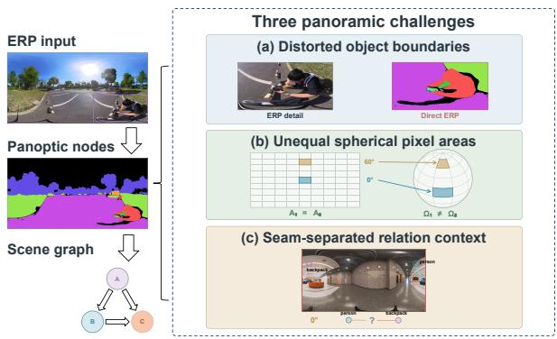
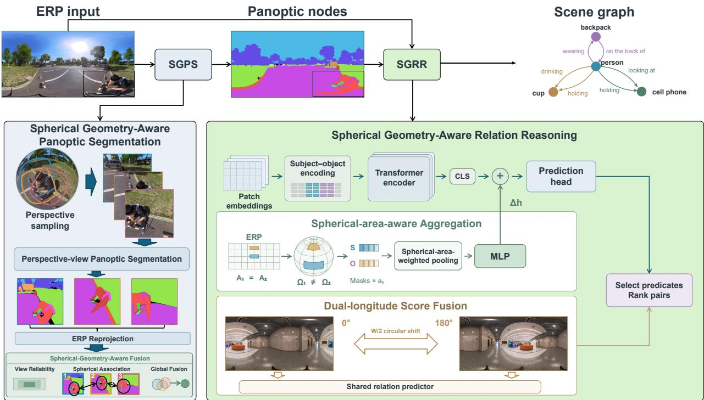

# SPHERICAL GEOMETRY-AWARE PANOPTIC SCENE GRAPH GENERATION FOR EQUIRECTANGULAR PANORAMAS

Zhe Wu1, Xiaoyan Fei2, Xinyi Jiang1, Yanxu Wei1, Junming Rao1, Yihong Yan1, Xuewei Li1∗

1Shanghai DianJi University, Shanghai, China 2University of Minnesota Twin Cities, Minneapolis, MN, USA

## ABSTRACT

Panoptic scene graph generation (PSGG) represents scene entities with segmentation masks and directed relations. Equirectangular projection (ERP) panoramas challenge PSGG through distortion, latitude-dependent pixel areas, and an artificial seam. We propose a two-stage spherical geometryaware framework that fuses overlapping perspective-view predictions using observation reliability, spherical overlap, and angular proximity. Relation reasoning combines spherical-area-aware aggregation, weighted no-relation supervision, and dual-longitude score fusion. We also construct a dataset of 340 high-resolution panoramas with 10,571 nodes and 6,632 directed relations. Against corresponding baselines, spherical fusion improves PQ by 36.03% under matched views, while relation reasoning improves mR@50 by 11.20% under PredCls with ground-truth masks and object labels. The full framework improves mR@50 by 52.99% under SGDet with predicted panoptic segments. These results demonstrate the value of spherical geometry for panoramic PSGG.

Index Terms— panoptic scene graph generation, panoptic segmentation, spherical geometry

## 1. INTRODUCTION

Panoptic scene graph generation (PSGG) represents scene entities with segmentation masks and directed semantic relations [1]. Panoramas capture full-scene entities and interactions in one observation. Prior work exploits panoramic context for holistic 3D understanding [2, 3] and studies omnirange context [4], projection distortion [5, 6], and spherical geometry [7, 8] in panoramic segmentation. PSGG models address predicate imbalance [9], pair selection [10], and mask-aware relation modeling and ranking through DSFormer [11], but largely assume perspective images. Panoramic PSGG must therefore model spherical geometry in both entity representation and relation prediction.

Equirectangular projection creates three geometric challenges for panoramic PSGG (Fig. 1): distorted object boundaries, unequal spherical areas for equal-sized image regions, and seam-separated relational context. Overlapping perspective views reduce distortion but yield duplicate or truncated instances with inconsistent identities, requiring reliable association and fusion. Relation features should reflect spherical rather than image area, and relation-existence predictions should remain stable when the longitude origin moves the ERP seam without changing the scene.

  
Fig. 1. Panoramic geometry challenges for PSGG. (a) Direct parsing of ERP images introduces object boundary errors in the highlighted region. (b) Equally sized ERP regions correspond to different spherical surface areas at different latitudes. (c) The ERP seam artificially separates spatially adjacent instances on the sphere, disrupting their shared relational context.

We make three contributions. (1) Spherical geometryaware panoptic segmentation (SGPS) associates and fuses cross-view instances using observation reliability, spherical overlap, and angular proximity, improving PQ by 36.03% over a baseline with the same view configuration. (2) Spherical geometry-aware relation reasoning (SGRR) combines spherical-area-aware aggregation, weighted no-relation supervision, and dual-longitude score fusion. Under PredCls, this module improves mR@50 by 11.20% over its corresponding baseline. (3) A high-resolution panoramic PSGG dataset comprises 340 panoramas, 10,571 nodes, and 6,632 directed relations with multi-stage quality control. Under SGDet, the complete framework improves mR@50 by

52.99% over the corresponding baseline, while stage-wise ablation isolates the gains from SGPS and SGRR.

## 2. METHOD

Panoramic PSGG maps an RGB ERP image $I \in \mathbb { R } ^ { H \times W \times 3 }$ to a directed graph $\mathcal { G } = ( \nu , \mathcal { E } )$ , where H and W are the image height and width. Each node $v _ { i } = ( M _ { i } , c _ { i } , b _ { i } ) \in \mathcal { V }$ contains a thing or stuff mask $M _ { i } .$ , object label $c _ { i } ,$ and bounding box $b _ { i }$ Each directed edge assigns a semantic predicate to an ordered subject–object pair. Spherical geometry-aware panoptic segmentation (SGPS) constructs panoramic nodes, and spherical geometry-aware relation reasoning (SGRR) predicts their directed relations. Figure 2 shows the framework.

## 2.1. Spherical Geometry-Aware Panoptic Segmentation

A fixed MaskDINO [12] predicts panoptic masks in 30 overlapping $9 0 °$ views sampled at yaw angles $6 0 ^ { \circ } k , k = 0 , \ldots , 5 ,$ and pitch angles $3 0 ^ { \circ } l , l = - 2 , \ldots , 2$ . The predictions are reprojected into ERP coordinates.

For an ERP pixel p observed in perspective view $v ,$ its observation reliability is defined as

$$
w _ { v } ( p ) = \mathbf { 1 } _ { \mathrm { v a l i d } ( v , p ) } [ \cos \alpha _ { v } ( p ) ] _ { + } ^ { \eta } \ \mathrm { c l i p } \biggl ( \frac { d _ { v } ( p ) } { \delta } , 0 , 1 \biggr ) ,\tag{1}
$$

where $w _ { v } ( p )$ is the reliability of $\dot { p }$ in view v, and $\mathbf { 1 } _ { \mathrm { v a l i d } ( v , p ) }$ is 1 for a valid projection and 0 otherwise. The notation $[ x ] _ { + } =$ $\mathrm { m a x } ( x , 0 )$ retains non-negative values. The angle $\alpha _ { v } ( p )$ is measured from the optical axis, with $\eta$ controlling angular decay; $d _ { v } ( p )$ is the nearest boundary distance, normalized by δ. Finally, $\mathrm { c l i p } ( x , 0 , 1 ) = \mathrm { m i n } \{ 1 , \mathrm { m a x } \{ 0 , x \} \}$ Thus, high reliability requires a valid observation near the optical axis and away from view boundaries.

Let $y ( p )$ be the ERP row of pixel $p , \ \phi ( y )$ its latitude, $a _ { y } = \operatorname* { m a x } \{ \epsilon ,$ cos ϕ(y)} the spherical-area weight of row y, and $\textstyle \mu ( A ) = \sum _ { p \in A } a _ { y ( p ) }$ the weighted area of region A. For a mask M reprojected from view v and a same-class candidate N, we compute

$$
\begin{array} { c l } { \displaystyle \mathrm { I o U } _ { \mathrm { s p h } } ( { \cal M } , { \cal N } ) = \frac { \mu ( { \cal M } \cap { \cal N } ) } { \mu ( { \cal M } \cup { \cal N } ) } , } \\ { \displaystyle \bar { \bf u } _ { \cal M } = \frac { \sum _ { p \in { \cal M } } w _ { v } ( p ) { \bf u } ( p ) } { \left\| \sum _ { p \in { \cal M } } w _ { v } ( p ) { \bf u } ( p ) \right\| _ { 2 } } , } \end{array}\tag{2}
$$

where $\mathbf { u } ( p )$ is the unit spherical direction of $p , \parallel \cdot \parallel _ { 2 }$ is the Euclidean norm, and $\bar { \mathbf { u } } _ { M }$ is the normalized spherical center of $M .$ . Candidates are matched when $\mathrm { I o U _ { s p h } } ( M , N ) \ge \tau _ { h } .$ , or when $\mathrm { I o U } _ { \mathrm { s p h } } ( M , N ) \ge \tau _ { m }$ and arccos $( \bar { \mathbf { u } } _ { M } ^ { \top } \bar { \mathbf { u } } _ { N } ) \le \tau _ { \theta }$ . Here, $\tau _ { h } , \tau _ { m }$ , and $\tau _ { \theta }$ are the high-overlap, moderate-overlap, and angular-distance thresholds, respectively.

After association, global instance g receives a pixel-wise support score

$$
S _ { g } ( p ) = \sum _ { v \in \mathcal { O } _ { g } } w _ { v } ( p ) \mathbf { 1 } [ p \in M _ { v , g } ] ,\tag{3}
$$

where ${ \mathcal { O } } _ { g }$ is the set of source-view observations, $M _ { v , g }$ is the candidate mask assigned to g in view v, and $\mathbf { 1 } [ p \in M _ { v , g } ]$ equals 1 when $p$ belongs to that mask and 0 otherwise. Thing conflicts are resolved by maximum support, after which category-wise stuff predictions fill unassigned regions.

## 2.2. Spherical Geometry-Aware Relation Reasoning

SGRR builds on the mask-prompted transformer encoder in [11]. A visual backbone and feature pyramid produce an ERP feature map partitioned into patches $P _ { j }$ , whose projected embeddings are $\mathbf { f } _ { j }$ . For ordered pair $( s , o )$ , the masks, boxes, and object labels condition the patch sequence, and the final classification token gives the contextual pair feature $\mathbf { h } _ { s , o } .$

For node $i \in \{ s , o \}$ , its spherical mass in patch $P _ { j }$ is $\begin{array} { r } { \mu _ { i , j } = \sum _ { p \in P _ { j } } M _ { i } ( p ) a _ { y ( p ) } } \end{array}$ . We obtain

$$
\begin{array} { r } { \mathbf { z } _ { i } = \displaystyle \sum _ { j } \frac { \mu _ { i , j } } { \sum _ { r } \mu _ { i , r } } \mathbf { f } _ { j } , } \\ { \widetilde { \mathbf { h } } _ { s , o } = \mathbf { h } _ { s , o } + \mathrm { M L P } ( [ \mathbf { z } _ { s } ; \mathbf { z } _ { o } ] ) , } \end{array}\tag{4}
$$

where $j$ and r index feature patches, $\mathbf { z } _ { i }$ is the spherical-areaweighted node feature, [ ; ] denotes feature concatenation, and MLP is a multilayer perceptron. The output $\widetilde { \mathbf { h } } _ { s , o }$ is the augmented subject–object pair representation.

For sampled ordered pairs $( s , o ) \in B , \mathbf { y } _ { s , o } \in \{ 0 , 1 \} ^ { C }$ is the multi-hot foreground-predicate target, and $y _ { s , o } ^ { \emptyset } =$ $1 [ \sum _ { c } y _ { s , o , c } = 0 ]$ indicates no relation. Let $p _ { s , o , c }$ and $p _ { s , o } ^ { \emptyset }$ be the corresponding predicted probabilities. Using binary cross-entropy $\ell _ { \mathrm { B C E } } ( y , p ) = - y \log p - ( 1 - y ) \log ( 1 - p )$ we optimize

$$
\begin{array} { r } { \mathcal { L } _ { \mathrm { r e l } } = \displaystyle \frac { 1 } { | \mathcal { B } | } \sum _ { ( s , o ) \in \mathcal { B } } \bigg [ \sum _ { c = 1 } ^ { C } \ell _ { \mathrm { B C E } } ( y _ { s , o , c } , p _ { s , o , c } ) } \\ { + \lambda _ { \emptyset } \ell _ { \mathrm { B C E } } ( y _ { s , o } ^ { \emptyset } , p _ { s , o } ^ { \emptyset } ) \bigg ] , } \end{array}\tag{5}
$$

where C is the number of foreground predicates and $\lambda _ { \emptyset }$ weights no-relation supervision. For image n, $\mathcal { P } _ { n } ^ { + }$ and $\textstyle { \mathcal { N } } _ { n }$ denote positive and non-self negative pairs. All positives are retained, negatives are sampled uniformly without replacement at ratio $\rho ,$ and $\boldsymbol { B }$ is their union over the mini-batch. Multiple predicates on one pair share a multi-hot target.

At inference, shifting the ERP image and masks by $W / 2$ forms a second longitude branch. Superscripts (0) and (π) denote the original and shifted branches, which share param-

  
Fig. 2. Spherical geometry-aware PSGG framework. Spherical geometry-aware panoptic segmentation (SGPS) fuses overlapping perspective-view predictions. Spherical geometry-aware relation reasoning (SGRR) combines spherical-area-aware aggregation, weighted no-relation supervision, and dual-longitude score fusion.

eters. We compute

$$
\begin{array} { c } { { \bar { p } _ { s , o } ^ { \emptyset } = \frac { 1 } { 2 } \left( p _ { s , o } ^ { \emptyset , ( 0 ) } + p _ { s , o } ^ { \emptyset , ( \pi ) } \right) , } } \\ { { { } } } \\ { { q _ { s , o , c } = \left( 1 - \bar { p } _ { s , o } ^ { \emptyset } \right) p _ { s , o , c } ^ { ( 0 ) } , } } \end{array}\tag{6}
$$

where $\bar { p } _ { s , o } ^ { \varnothing }$ is the fused no-relation probability and $^ { q _ { s , o , c } }$ is the final score used to rank predicate c for pair (s, o). Thus, the two branches fuse relation-existence evidence while retaining the original branch’s foreground-predicate distribution.

## 3. EXPERIMENTS

## 3.1. PanoPSG Dataset and Experimental Setup

We introduce PanoPSG, a high-resolution panoramic panoptic scene graph dataset comprising 340 ERP panoramas, each with full 360◦ coverage and a resolution of 11968 × 5984 pixels (Table 1). Reviewer-verified masks were delineated in CVAT, while a dedicated platform supported high-resolution relation annotation, persistent node identities, and multiple predicates per ordered pair. A second review checked endpoint validity, duplicate triplets, and mask–relation alignment.

Each panorama contains an average of 31.09 nodes and 19.51 directed relations, respectively 2.83× and 3.48× the

Table 1. Statistics of the PanoPSG dataset.
<table><tr><td>Property</td><td>Statistics</td></tr><tr><td>Panoramas (train / val)</td><td>340 (272 / 68)</td></tr><tr><td>Resolution</td><td>11968 × 5984</td></tr><tr><td>Pixels / panorama</td><td>71.62 M</td></tr><tr><td>Node classes (predefined / observed)</td><td>133 / 82</td></tr><tr><td>Nodes (thing / stuff)</td><td>10,571 (4,043 / 6,528)</td></tr><tr><td>Relations / predicates</td><td>6,632 / 21</td></tr><tr><td>Mean nodes / relations per panorama</td><td>31.09 / 19.51</td></tr></table>

PSG averages of 11.0 and 5.6 [1]. Together with 71.62 million pixels per image and full-scene coverage, this density supports evaluating panoramic panoptic segmentation and relation reasoning in complex scenes.For implementation, we set $\epsilon = 1 0 ^ { - 6 } , \eta = 2 , \delta = 6 4 , \lambda _ { \emptyset } = 4 .$ , and ρ = 1.

SGPS is evaluated on all 340 panoramas using panoptic quality (PQ) [13], spherical-area-weighted mean intersection over union (Sphere-mIoU), seam-region mIoU (SeammIoU), instance recall at an IoU threshold of 0.5 (IR@0.5), and mean instance recall (mIR@0.5). Sphere-mIoU accumulates an $a _ { y } .$ -weighted confusion matrix over the dataset and averages class IoU over ground-truth-present classes. SeammIoU is computed within the two 5◦ strips adjacent to the ERP seam. IR@0.5 uses one-to-one, same-category matching and excludes crowd thing instances. IR is micro-averaged over eligible instances, whereas mIR is macro-averaged over ground-truth-present thing categories.

Table 2. Panoptic segmentation performance on PanoPSG (%).
<table><tr><td></td><td>PQ↑</td><td>Sphere- mIoU ↑</td><td>Seam- mIoU ↑</td><td></td><td>IR@0.5↑ mIR@0.5↑</td></tr><tr><td>Method</td><td></td><td></td><td></td><td>40.26</td><td>19.67</td></tr><tr><td>Direct ERP</td><td>25.02 33.22</td><td>34.81 45.47</td><td>30.82 47.71</td><td>61.92</td><td>43.29</td></tr><tr><td>Cubemap-6 Basic Fusion</td><td>28.89</td><td>45.97</td><td>48.81</td><td>72.71</td><td>58.67</td></tr><tr><td>Ours</td><td>39.30</td><td>56.04</td><td>61.11</td><td>74.74</td><td>64.65</td></tr></table>

Relation models use an image-disjoint split of 272 training and 68 validation panoramas, a 30-epoch training budget, and best-validation checkpoint selection. Predicate classification (PredCls) uses ground-truth masks and object labels, isolating relation reasoning from segmentation errors. Although the annotations permit multiple predicates for each ordered pair, graph-constrained evaluation retains only the highestscoring predicate [1, 11]. Recall at K (R@K) measures the recovery of ground-truth triplets among the top-K predictions per image. Mean recall (mR@K) macro-averages predicatespecific recall over the 21 predicates, providing a predicatebalanced complement to aggregate retrieval [14, 11]. We report $K \in \{ 2 0 , 5 0 \}$ over 1,325 validation relations. Under scene graph detection (SGDet), node matching requires identical object labels and original-resolution mask IoU > 0.5. Unmatched predictions remain in the top-K ranking. Together, PredCls and SGDet distinguish relation-reasoning gains from improvements inherited from panoramic node construction while retaining the same recall-based evaluation.

## 3.2. Spherical Geometry-Aware Panoptic Segmentation

Table 2 compares first-stage panoptic segmentation methods on PanoPSG. Direct ERP, Cubemap-6, Basic Fusion, and our method use the same frozen MaskDINO segmentation model. Basic Fusion applies basic fusion to the best-performing single-FoV configuration.

Our method leads all five metrics in Table 2. Compared with Basic Fusion under the same view configuration, it improves PQ by 10.41 percentage points, corresponding to a relative improvement of 36.03%. It also gains 10.07 points in Sphere-mIoU, 12.30 points in Seam-mIoU, and 5.98 points in mIR@0.5. With the segmentation model and view sampling held fixed, these results demonstrate the contribution of reliability-weighted spherical association and fusion to panoptic quality, spherical semantic accuracy, and seam continuity.

## 3.3. Spherical Geometry-Aware Relation Reasoning

Table 3 compares the proposed relation reasoning model with IMP [15], MOTIFS [16], VCTree [17], and DSFormer [11] under the shared PredCls protocol.

Table 3. Relation-model comparison under PredCls on PanoPSG (%).
<table><tr><td>Model</td><td>R@20↑</td><td>R@50↑</td><td>mR@20↑</td><td>mR@50↑</td></tr><tr><td>IMP [15]</td><td>33.77</td><td>47.16</td><td>14.45</td><td>21.13</td></tr><tr><td>MOTIFS [16]</td><td>49.92</td><td>63.59</td><td>28.40</td><td>36.42</td></tr><tr><td>VCTree [17]</td><td>53.03</td><td>67.85</td><td>30.91</td><td>40.15</td></tr><tr><td>DSFormer [11]</td><td>45.06</td><td>68.60</td><td>25.50</td><td>53.49</td></tr><tr><td>Ours</td><td>48.68</td><td>70.57</td><td>35.18</td><td>59.48</td></tr></table>

Table 4. Component ablation under SGDet on PanoPSG (%).
<table><tr><td>SGPS</td><td>SGRR</td><td>R@20↑</td><td>R@50↑</td><td>mR@20↑</td><td>mR@50↑</td></tr><tr><td>X</td><td>X</td><td>25.43</td><td>29.28</td><td>15.01</td><td>22.25</td></tr><tr><td>√</td><td>X</td><td>27.02</td><td>42.79</td><td>14.62</td><td>27.00</td></tr><tr><td>√</td><td>V</td><td>29.13</td><td>45.13</td><td>18.45</td><td>34.04</td></tr></table>

Our method achieves the highest R@50 of 70.57%, mR@20 of 35.18%, and mR@50 of 59.48%. Relative to DS-Former, mR@20 and mR@50 increase by 9.68 and 5.99 percentage points, respectively, with the latter corresponding to an 11.20% relative improvement. VCTree achieves the highest R@20, whereas our method provides the strongest results for R@50 and both predicate-balanced metrics. These results demonstrate that incorporating spherical geometry into the relation pathway improves both aggregate and predicatebalanced relation retrieval.

Table 4 reports the SGDet ablation, where both panoptic segments and directed relations are predicted.

Replacing Direct ERP segmentation with SGPS while retaining the baseline relation model increases R@50 from 29.28% to 42.79% and mR@50 from 22.25% to 27.00%. Adding SGRR further raises these metrics to 45.13% and 34.04%, respectively. The complete framework therefore improves R@50 by 15.85 points and mR@50 by 11.79 points over the baseline; the latter corresponds to a 52.99% relative improvement. These results confirm complementary gains from SGPS and SGRR under SGDet.

## 4. CONCLUSION

We presented a two-stage spherical geometry-aware panoramic PSGG framework combining SGPS and SGRR, and introduced PanoPSG with 340 panoramas, 10,571 nodes, and 6,632 directed relations. Against corresponding baselines, SGPS improves PQ by 36.03% under matched views, SGRR improves mR@50 by 11.20% under PredCls, and the full framework improves mR@50 by 52.99% under SGDet. SGPS improves graph-node consistency, while SGRR reduces sensitivity to latitude-dependent area and seam placement. These complementary gains validate spherical geometry for panoramic PSGG. The framework provides a unified basis for geometry-consistent scene graphs from highresolution panoramas.

## 5. REFERENCES

[1] Jingkang Yang, Yi Zhe Ang, Zujin Guo, Kaiyang Zhou, Wayne Zhang, and Ziwei Liu, “Panoptic scene graph generation,” in Proc. Eur. Conf. Comput. Vis. (ECCV), 2022, pp. 178–196.

[2] Cheng Zhang, Zhaopeng Cui, Cai Chen, Shuaicheng Liu, Bing Zeng, Hujun Bao, and Yinda Zhang, “Deep-PanoContext: Panoramic 3D scene understanding with holistic scene context graph and relation-based optimization,” in Proc. IEEE/CVF ICCV, 2021, pp. 12632– 12641.

[3] Yuan Dong, Chuan Fang, Liefeng Bo, Zilong Dong, and Ping Tan, “PanoContext-Former: Panoramic total scene understanding with a transformer,” in Proc. IEEE/CVF CVPR, 2024, pp. 28087–28097.

[4] Kailun Yang, Jiaming Zhang, Simon Reiss, Xinxin Hu, and Rainer Stiefelhagen, “Capturing omni-range context for omnidirectional segmentation,” in Proc. IEEE/CVF CVPR, 2021, pp. 1376–1386.

[5] Jiaming Zhang, Kailun Yang, Chaoxiang Ma, Simon Reiß, Kunyu Peng, and Rainer Stiefelhagen, “Bending reality: Distortion-aware transformers for adapting to panoramic semantic segmentation,” in Proc. IEEE/CVF CVPR, 2022, pp. 16917–16927.

[6] Xu Zheng, Jinjing Zhu, Yexin Liu, Zidong Cao, Chong Fu, and Lin Wang, “Both style and distortion matter: Dual-path unsupervised domain adaptation for panoramic semantic segmentation,” in Proc. IEEE/CVF CVPR, 2023, pp. 1285–1295.

[7] Xuewei Li, Tao Wu, Zhongang Qi, Gaoang Wang, Ying Shan, and Xi Li, “SGAT4PASS: Spherical geometryaware transformer for panoramic semantic segmentation,” in Proc. IJCAI, 2023, pp. 1125–1133.

[8] Xuewei Li, Xinghan Bao, Zhimin Chen, and Xi Li, “REL-SF4PASS: Panoramic semantic segmentation with REL depth representation and spherical fusion,” in Proc. IEEE/CVF CVPR, 2026, pp. 27676–27685.

[9] Zijian Zhou, Miaojing Shi, and Holger Caesar, “HiLo: Exploiting high low frequency relations for unbiased panoptic scene graph generation,” in Proc. IEEE/CVF ICCV, 2023, pp. 21637–21648.

[10] Jinghao Wang, Zhengyu Wen, Xiangtai Li, Zujin Guo, Jingkang Yang, and Ziwei Liu, “Pair then relation: Pair-Net for panoptic scene graph generation,” IEEE Trans. Pattern Anal. Mach. Intell., vol. 46, no. 12, pp. 10452– 10465, 2024.

[11] Julian Lorenz, Alexander Pest, Daniel Kienzle, Katja Ludwig, and Rainer Lienhart, “A fair ranking and new model for panoptic scene graph generation,” in Proc. Eur. Conf. Comput. Vis. (ECCV), 2024, pp. 148–164.

[12] Feng Li, Hao Zhang, Huaizhe Xu, Shilong Liu, Lei Zhang, Lionel M. Ni, and Heung-Yeung Shum, “Mask DINO: Towards a unified transformer-based framework for object detection and segmentation,” in Proc. IEEE/CVF CVPR, 2023, pp. 3041–3050.

[13] Alexander Kirillov, Kaiming He, Ross Girshick, Carsten Rother, and Piotr Dollár, “Panoptic segmentation,” in Proc. IEEE/CVF CVPR, 2019, pp. 9404–9413.

[14] Julian Lorenz, Florian Barthel, Daniel Kienzle, and Rainer Lienhart, “Haystack: A panoptic scene graph dataset to evaluate rare predicate classes,” in Proc. IEEE/CVF ICCV Workshops, 2023, pp. 62–70.

[15] Danfei Xu, Yuke Zhu, Christopher B. Choy, and Li Fei-Fei, “Scene graph generation by iterative message passing,” in Proc. IEEE CVPR, 2017, pp. 5410–5419.

[16] Rowan Zellers, Mark Yatskar, Sam Thomson, and Yejin Choi, “Neural motifs: Scene graph parsing with global context,” in Proc. IEEE CVPR, 2018, pp. 5831–5840.

[17] Kaihua Tang, Hanwang Zhang, Baoyuan Wu, Wenhan Luo, and Wei Liu, “Learning to compose dynamic tree structures for visual contexts,” in Proc. IEEE/CVF CVPR, 2019, pp. 6619–6628.