# SPLATFLUX: FEED-FORWARD 4D GAUSSIAN RECON-STRUCTION AND GENERATION FROM VIDEO LATENTS

Runmin Zhang1∗† Binglin Ren1∗† Zhu Yu1∗ Fudong Wang2 Jiangke Lin2 Yichun Shentu2 Si-Yuan Cao1 Yi Yuan2‡ Hui-Liang Shen1‡

1Zhejiang University 2Ant Group

Project Page: https://rm-zhang.github.io/SplatFlux/

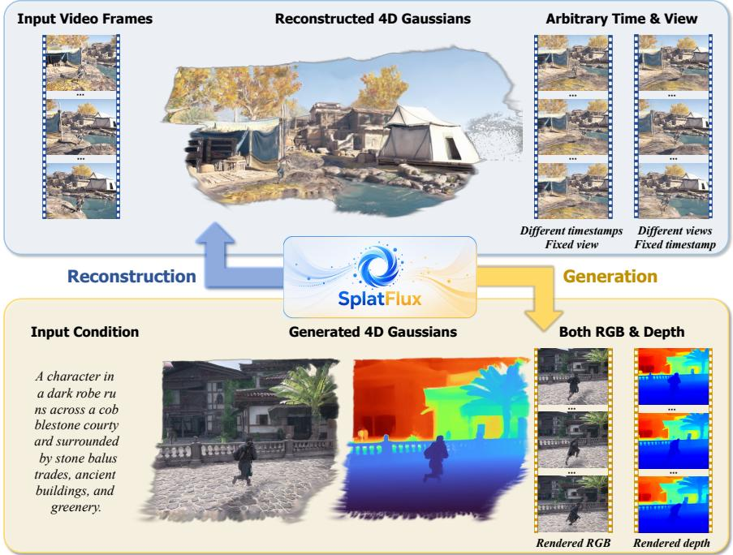  
Figure 1: SplatFlux provides a feed-forward latent-to-4DGS framework for 4D reconstruction and generation, supporting arbitrary-time and arbitrary-view rendering with a shared dynamic Gaussian representation. It reconstructs 4D Gaussians from input video frames and generates 4D Gaussians from input conditions, producing coherent RGB and depth sequences.

## ABSTRACT

This work presents SplatFlux, a feed-forward latent-to-4DGS framework for both video-based 4D reconstruction and conditional 4D generation. Our key observation is that observed videos and conditionally generated content can be represented in the same pretrained video latent space, allowing both tasks to be formulated as latent-to-4DGS decoding. To construct compact and temporally coherent 4D scenes, SplatFlux introduces a static-dynamic decoupled 4D Gaussian representation that explicitly predicts dynamic probabilities for Gaussian primitives. This representation separates static scene structures from moving regions, enabling complete 4D scene construction in a feed-forward manner through static aggregation and dynamic motion interpolation. To learn static-dynamic decomposition and dynamic Gaussian motion without costly annotations, we further develop an auxiliary distillation strategy that provides pseudo dynamic masks and optical-flow cues. Extensive experiments across 3D and 4D reconstruction and generation demonstrate that SplatFlux achieves state-of-the-art performance.

## 1 INTRODUCTION

Reconstructing and synthesizing dynamic 3D worlds is essential for filmmaking, VR/AR, and physical AI systems grounded in closed-loop simulation (Bahmani et al., 2026; Pan et al., 2025; Zhu et al., 2025; Wu et al., 2025a; Wang et al., 2025a; Wen et al., 2025). Recent feed-forward geometry and depth models (Wang et al., 2025c; Lin et al., 2026; Wang et al., 2026c; 2025e; 2024) demonstrate that rich 3D information can be inferred directly from visual observations. Building on this progress, feed-forward 4D Gaussian Splatting (4DGS) methods (Xu et al., 2025b; Yang et al., 2026; Liang et al., 2024; Lin et al., 2025a; Hur et al., 2026) have emerged to predict temporally coherent Gaussian primitives for efficient dynamic scene reconstruction and novel view synthesis.

Despite this progress, most existing feed-forward 4DGS approaches (Xu et al., 2025b; Lin et al., 2025a; Yang et al., 2026; Liang et al., 2024; Hur et al., 2026; Wu et al., 2025b) are developed for reconstructing dynamic scenes from observed videos. In parallel, modern video generative models (Team, 2024; Kong et al., 2024; Wan et al., 2025; Yang et al., 2024) can synthesize highquality video latents from user conditions, providing conditionally generated dynamic visual content in the video latent domain. These advances suggest a latent-domain formulation of 4DGS, where both captured videos and generated content can be represented as video latent sequences before being decoded into dynamic Gaussian representations.

Nevertheless, a key challenge lies in separating and representing static and dynamic components within a complete 4D scene. Existing feed-forward 4DGS approaches often separate static and dynamic components indirectly, through temporal lifespan modeling (Xu et al., 2025b), trackingbased post-processing (Yang et al., 2026), or motion-induced displacement prediction (Lin et al., 2025a). Such implicit formulations may entangle moving objects with static scene structures, especially under complex motion and occlusion.

In this work, we present SplatFlux, a feed-forward latent-to-4DGS framework for both videobased reconstruction and conditional 4D generation. Our key observation is that observed videos and conditionally generated content can be represented in the same pretrained video latent space (Wan et al., 2025). Observed videos are compressed into latent sequences by the VAE encoder, while condi tional generation directly produces latent sequences in this space. This common latent representation allows both tasks to be formulated as a unified latent-to-4DGS decoding problem, enabling a shared decoder to map video latents from different sources into dynamic Gaussian representations.

Beyond this task-level unification, SplatFlux further addresses the representation-level ambiguity between static scene structures and moving regions. Instead of inducing static-dynamic separation im plicitly from temporal cues, we introduce a static-dynamic decoupled 4D Gaussian representation by explicitly predicting dynamic probabilities for Gaussian primitives. This explicit representation enables complete 4D scene construction in a feed-forward manner without relying on any postprocessing. To learn static-dynamic decomposition and dynamic Gaussian motion without costly annotations, we adopt an auxiliary distillation strategy. Specifically, we supervise dynamic probabilities with pseudo dynamic masks generated by vision-language-guided segmentation (Bai et al., 2025; Yuan et al., 2025), and constrain dynamic Gaussian motion using pseudo optical-flow labels (Zhang et al., 2025c). These complementary signals provide scalable supervision for explicit static-dynamic decomposition and dynamic motion learning.

We evaluate SplatFlux across 3D and 4D reconstruction and generation tasks. Experiments demonstrate that SplatFlux achieves state-of-the-art results. Our contributions are summarized as follows:

• We propose SplatFlux, a feed-forward latent-to-4DGS framework that decodes video latents from different sources into 4D Gaussian representations, supporting both video-based 4D reconstruction and conditional 4D generation.

• We introduce a static-dynamic decoupled 4D Gaussian representation through explicit dynamic probability estimation, enabling compact and complete 4D scene construction in a feed-forward manner.

• We develop an auxiliary distillation strategy that uses vision-language-guided dynamic masks and optical-flow cues to learn static-dynamic decomposition and dynamic Gaussian motion without costly annotations.

• Extensive experiments across 3D and 4D reconstruction and generation tasks demonstrate that SplatFlux achieves state-of-the-art performance.

## 2 RELATED WORK

## 2.1 3D/4D RECONSTRUCTION AND NOVEL VIEW SYNTHESIS

Traditional approaches typically rely on costly per-scene optimization, including classical structurefrom-motion (SfM) (Schonberger & Frahm, 2016), neural radiance fields (NeRF) (Mildenhall et al., 2020), and 3D Gaussian Splatting (3DGS) (Kerbl et al., 2023). Several methods (Wang et al., 2025d; Sun et al., 2024b; Wang et al., 2026b; Lei et al., 2025) further extend 3DGS to dynamic scenes through temporal deformation modeling and additional supervision estimated from vision foundation models. With the growth of large-scale 3D datasets and foundation models (Dosovitskiy et al., 2020; Oquab et al., 2023; Simeoni et al.´ , 2025; Ranftl et al., 2021), feed-forward 3D and 4D reconstruction approaches (Wang et al., 2024; Leroy et al., 2024; Wang et al., 2025f; 2026c; Lin et al., 2026; Wang et al., 2025c; Fang et al., 2025; Gao et al., 2025; Yu et al., 2026b; Zhang et al., 2025a; Wang et al., 2025e; Chen et al., 2025b; Wang et al., 2025b; Hu et al., 2025b; Wen et al., 2025; Wang et al., 2026a; Yu et al., 2026a) have become increasingly prominent. Methods such as DUSt3R (Wang et al., 2024) and VGGT (Wang et al., 2025c) directly predict dense geometry and camera parameters from images, while approaches (Ye et al., 2025a; 2024; Liu et al., 2025; Jiang et al., 2025; Zhang et al., 2025b) like AnySplat (Jiang et al., 2025) predict 3D Gaussian primitives for novel view synthesis in static scenes.

For feed-forward dynamic novel view synthesis, recent methods such as L4GM (Ren et al., 2024), STORM (Yang et al., 2025a), 4DGT (Xu et al., 2025b), MoVieS (Lin et al., 2025a), DGS-LRM (Lin et al., 2025b), and BTimer (Liang et al., 2024) estimate motion-related attributes for Gaussian primitives. However, most of these approaches still assume posed inputs, and MoVieS (Lin et al., 2025a) and BTimer (Liang et al., 2024) further require additional network inference for rendering at each target timestamp. UFO-4D (Hur et al., 2026) relaxes the pose requirement, but is limited to two input views. NeoVerse (Yang et al., 2026) supports unposed video inputs, yet relies on hand-crafted global motion tracking to aggregate a scene-level representation. These limitations highlight the need for a feed-forward framework that can infer a complete dynamic Gaussian representation from unposed monocular videos, without per-timestamp network inference or hand-crafted post-processing.

## 2.2 3D/4D GENERATION

Recent 3D and 4D generative approaches have made notable progress by distilling or fine-tuning pretrained image and video diffusion models (Saharia et al., 2022; Rombach et al., 2022; Wan et al., 2025; Yang et al., 2024). The pioneering work DreamFusion (Poole et al., 2022) introduces score distillation sampling (SDS) to optimize 3D representations by distilling gradients from pretrained diffusion models. Subsequent methods (Wang et al., 2023; Singer et al., 2023; Bahmani et al., 2024a;b) improve the distillation objective or extend this paradigm to 4D scene generation.

Another line of work (Tang et al., 2024; Szymanowicz et al., 2025; Gao et al., 2024; Sun et al., 2024a; Go et al., 2025b; Zhou et al., 2025a; Yang et al., 2025b; Cai et al., 2025) combines generative diffusion priors with 3D reconstruction for efficient 3D scene generation. Approaches such as CAT3D (Gao et al., 2024) and SEVA (Zhou et al., 2025a) first synthesize multi-view images with diffusion models, followed by 3D reconstruction. In contrast, other methods (Yang et al., 2025b; Cai et al., 2025; Go et al., 2025b;a) bypass explicit RGB multi-view synthesis, and directly decode latent features into 3D Gaussian primitives. To support 4D content generation, some approaches (Wang et al., 2025a; Wu et al., 2025a; Xie et al., 2024) generate synchronized multi-view videos, while others extend video generation to dynamic point maps (Zhu et al., 2025; Chen et al., 2025c; Park et al., 2025). Recent methods such as Lyra (Bahmani et al., 2026) and Diff4Splat (Pan et al., 2025) further explore dynamic Gaussian generation. However, they rely on target-time Gaussian prediction mechanisms, as in BTimer (Liang et al., 2024) and MoVieS (Lin et al., 2025a), where rendering a new timestamp requires additional network inference to obtain the corresponding Gaussian state. In contrast, SplatFlux formulates conditional 4D generation as latent-to-4DGS decoding, and directly produces a complete 4DGS representation that supports continuous-time rendering without pertimestamp network inference.

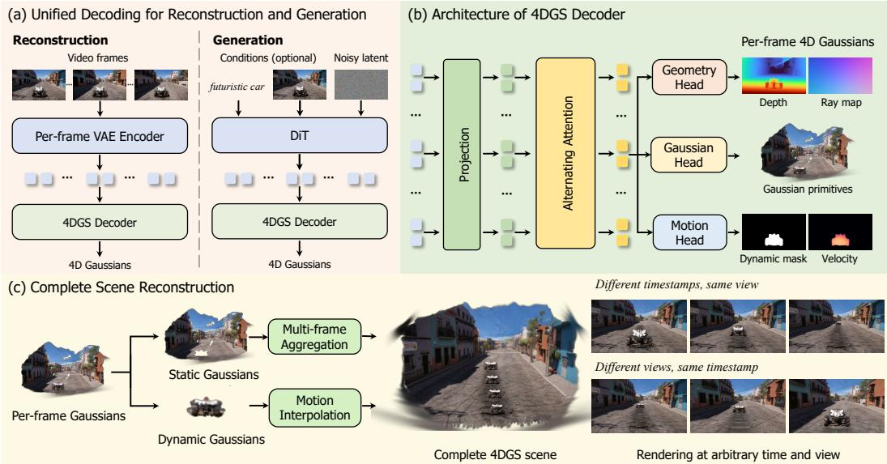  
Figure 2: Overview of SplatFlux. SplatFlux unifies video-based reconstruction and conditional generation through a shared latent-to-4DGS decoder. It predicts a static-dynamic decoupled 4D Gaussian representation, where static Gaussians are aggregated across frames and dynamic Gaussians are propagated by local motion for arbitrary-time and arbitrary-view rendering.

## 3 METHOD

## 3.1 OVERVIEW

We introduce SplatFlux, a fully feed-forward framework that unifies 4D Gaussian reconstruction and generation under a latent-to-4DGS formulation. Given a latent sequence ${ \bf z } _ { 0 : T - 1 } { } ^ { 1 }$ obtained by encoding observed videos or by conditional generation, SplatFlux decodes it into a 4D Gaussian scene S:

$$
\begin{array} { r } { { \cal S } = { \cal D } _ { \mathrm { G S } } ( { \bf z } _ { 0 : T - 1 } ) , } \end{array}\tag{1}
$$

where $\mathcal { D } _ { \mathrm { G S } }$ is the shared 4DGS decoder. At the core of SplatFlux is a static-dynamic decoupled 4D Gaussian representation. Each Gaussian primitive is assigned a dynamic probability for explicit static-dynamic decomposition. Static Gaussians are aggregated across frames into a compact scene representation, while dynamic Gaussians remain frame-anchored and are propagated by local velocities for continuous-time rendering. This allows SplatFlux to construct a complete 4D Gaussian scene for arbitrary-view and arbitrary-time rendering without hand-crafted post-processing or pertimestamp network inference. Fig. 2 illustrates the overall pipeline.

## 3.2 DECOUPLED 4D GAUSSIAN REPRESENTATION

Per-frame 4DGS Representation. Given a latent sequence ${ \bf z } _ { 0 : T - 1 }$ , our decoder predicts a set of per-pixel 4D Gaussian primitives for each timestamp. We denote the 4D Gaussians at frame t as

$$
\mathcal { G } _ { t } = \left\{ g _ { t , i } = \left( \mu _ { t , i } , \mathbf { s } _ { t , i } , \mathbf { q } _ { t , i } , \alpha _ { t , i } , \mathbf { c } _ { t , i } , m _ { t , i } , \mathbf { v } _ { t , i } ^ { + } , \mathbf { v } _ { t , i } ^ { - } \right) \right\} _ { i = 1 } ^ { H W } ,\tag{2}
$$

where i indexes the image grid, and H and W denote the output resolution. Each primitive $g _ { t , i }$ is parameterized by its 3D center $\mu _ { t , i } ,$ scale $\mathbf { s } _ { t , i } ,$ rotation $\mathbf { q } _ { t , i } ,$ , opacity $\alpha _ { t , i } ,$ color $\mathbf { c } _ { t , i } ,$ , dynamic probability $m _ { t , i }$ , forward velocity $\mathbf { v } _ { t , i } ^ { + } ,$ and backward velocity $\mathbf { v } _ { t , i } ^ { - }$ . We note that the dynamic probability enables explicit static-dynamic decomposition of Gaussian primitives in a feed-forward manner, while $\mathbf { v } _ { t , i } ^ { + }$ and $\mathbf { v } _ { t , i } ^ { - }$ support arbitrary-time rendering by locally interpolating Gaussian motion without per-timestamp network inference.

Complete Scene Reconstruction. To obtain a compact and complete 4DGS scene, we do not simply concatenate per-frame Gaussians across timestamps, as this would introduce substantial redundancy in static regions and entangle static and dynamic content. Instead, we explicitly separate the predicted Gaussians according to their dynamic probabilities. Given a threshold $\tau _ { m }$ , the Gaussians at frame t are divided into static and dynamic subsets as

$$
\mathcal G _ { t } ^ { s } = \{ g _ { t , i } \ | \ m _ { t , i } < \tau _ { m } \} , \quad \mathcal G _ { t } ^ { d } = \{ g _ { t , i } \ | \ m _ { t , i } \geq \tau _ { m } \} .\tag{3}
$$

For static regions, we perform multi-frame aggregation through differentiable voxelization (Jiang et al., 2025) to merge redundant primitives, obtaining $\begin{array} { r } { \mathcal { G } ^ { s } = \operatorname { A g g } \left( \bigcup _ { t = 0 } ^ { T - 1 } \mathcal { G } _ { t } ^ { s } \right) } \end{array}$ . The complete 4DGS scene is therefore composed as ${ \cal S } = \mathcal { G } ^ { s } \cup \left\{ \mathcal { G } _ { t } ^ { d } \right\} _ { t = 0 } ^ { T - 1 }$ , where $\mathcal G ^ { s }$ represents the compact static scene, and $\{ \mathcal { G } _ { t } ^ { d } \}$ preserves dynamic regions with their associated velocities for continuous-time rendering. Fig. 2(c) illustrates the process of our complete scene reconstruction.

For an arbitrary target time $t _ { \mathrm { t a r g e t } }$ between two adjacent timestamps t and t+1, we move the dynamic Gaussians $\mathcal { G } _ { t } ^ { d }$ and $\mathcal { G } _ { t + 1 } ^ { d }$ to $t _ { \mathrm { t a r g e t } }$ using linear motion interpolation (Hur et al., 2026; Yang et al., 2026; Wu et al., 2025b) as

$$
\mu _ { t \to t _ { \mathrm { t a r g e t } } , i } = \mu _ { t , i } + ( t _ { \mathrm { t a r g e t } } - t ) \mathbf { v } _ { t , i } ^ { + } , \quad \mu _ { t + 1 \to t _ { \mathrm { t a r g e t } } , i } = \mu _ { t + 1 , i } + ( t + 1 - t _ { \mathrm { t a r g e t } } ) \mathbf { v } _ { t + 1 , i } ^ { - } .\tag{4}
$$

The scene at $t _ { \mathrm { t a r g e t } }$ is then composed of the static Gaussians and moved dynamic Gaussians, enabling rasterization (Kerbl et al., 2023) of novel views. Overall, this static-dynamic decoupled representation provides a compact and complete 4D scene by aggregating static structures across frames while preserving dynamic regions with local motion for continuous-time rendering.

## 3.3 UNIFIED LATENT-TO-4DGS DECODING

Reconstruction from Videos. Given a monocular video sequence $\mathbf { I } _ { 0 : T - 1 } = \left\{ I _ { 0 } , \dots , I _ { T - 1 } \right\}$ , we use the frozen Wan VAE encoder $\mathcal { E }$ to extract latents as $\mathbf { z } _ { t } = \mathcal { E } ( I _ { t } )$ . We note that each frame is treated as an individual image and encoded independently, without applying temporal compression in the video VAE encoder. This frame-wise design avoids temporal compression, and allows training with unordered multi-view image datasets.

Generation from Conditions. For input conditions $c ,$ such as a text prompt, a single image, or their combination, we use a Diffusion Transformer (DiT) (Peebles & Xie, 2023) as the generator $\Phi _ { \mathrm { g e n } }$ to produce a latent sequence as $\mathbf { z } _ { 0 : T - 1 } = \Phi _ { \mathrm { g e n } } ( c )$ . Different from standard video generation pipelines that decode generated latents into RGB videos, we directly decode the generated latent sequence into a 4DGS scene using our proposed decoder $\mathcal { D } _ { \mathrm { G S } }$

Architecture of 4DGS Decoder. As shown in Fig. 2(b), the decoder first maps the low-dimensional VAE latent sequence into high-dimensional feature tokens through a latent projector. The resulting tokens are then processed by alternating attention blocks (Wang et al., 2025c) to exchange spatial and temporal information. Finally, we use three prediction heads (Ranftl et al., 2021) to estimate geometry, appearance, and motion attributes from the spatiotemporal fused features $\mathbf { F } _ { t }$ as

$$
( \mathbf { d } _ { t } , \mathbf { r } _ { t } ) = \mathcal { H } _ { \mathrm { g e o } } ( \mathbf { F } _ { t } ) , \quad \mathbf { a } _ { t } = \mathcal { H } _ { \mathrm { a p p } } ( \mathbf { F } _ { t } ) , \quad ( \mathbf { m } _ { t } , \mathbf { v } _ { t } ^ { + } , \mathbf { v } _ { t } ^ { - } ) = \mathcal { H } _ { \mathrm { m o t i o n } } ( \mathbf { F } _ { t } ) ,\tag{5}
$$

where $\mathbf { d } _ { t }$ and $\mathbf { r } _ { t }$ denote depth and ray map (Lin et al., 2026), $\mathbf { a } _ { t }$ denotes appearance attributes including scale, rotation, opacity, and color, and m , $\mathbf { v } _ { t } ^ { + }$ , and $\mathbf { v } _ { t } ^ { - }$ denote the dynamic mask, forward velocity, and backward velocity, respectively. The Gaussian centers are then derived from the predicted $\mathbf { d } _ { t }$ and $\mathbf { r } _ { t }$

## 3.4 MODEL TRAINING

Learning static-dynamic decomposition and dynamic Gaussian motion would benefit from direct supervision with dynamic masks and motion labels. However, such annotations are costly to obtain, and are typically limited to small-scale synthetic datasets (Karaev et al., 2023; Zheng et al., 2023). Relying only on rendering losses provides weak constraints on dynamic probabilities and local velocities, often leading to ambiguous decomposition and inaccurate motion estimation.

Table 1: Quantitative comparison of dynamic novel view synthesis on the NVIDIA Dynamic Scene, DyCheck, and DAVIS datasets. \* denotes approaches that require camera pose as input. The best and second-best results are highlighted for clarity.
<table><tr><td rowspan="2">Method</td><td colspan="3">NVIDIA Dynamic Scene</td><td colspan="3">DyCheck</td><td colspan="3">DAVIS</td></tr><tr><td>PSNR ↑</td><td>SSIM ↑</td><td>LPIPS↓</td><td>mPSNR ↑</td><td>mSSIM ↑</td><td>mLPIPS ↓</td><td>PSNR ↑</td><td>SSIM↑</td><td>LPIPS ↓</td></tr><tr><td>4DGT* Xu et al. (2025b)</td><td>15.97</td><td>0.3426</td><td>0.5408</td><td>13.98</td><td>0.4609</td><td>0.5225</td><td>17.54</td><td>0.4767</td><td>0.4581</td></tr><tr><td>MoVieS* Lin et al. (2025a)</td><td>18.72</td><td>0.5059</td><td>0.2527</td><td>13.89</td><td>0.4802</td><td>0.4536</td><td>19.97</td><td>0.5927</td><td>0.2516</td></tr><tr><td>NeoVerse Yang et al. (2026)</td><td>18.83</td><td>0.4695</td><td>0.2881</td><td>14.57</td><td>0.4639</td><td>0.4645</td><td>18.58</td><td>0.5067</td><td>0.3198</td></tr><tr><td>SplatFlux (Ours)</td><td>21.56</td><td>0.5879</td><td>0.1918</td><td>14.68</td><td>0.5007</td><td>0.4201</td><td>20.84</td><td>0.6083</td><td>0.2494</td></tr></table>

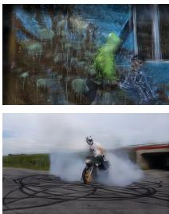  
4DGT

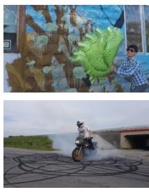  
MoVieS

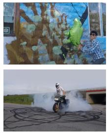  
NeoVerse

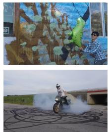  
SplatFlux (Ours)

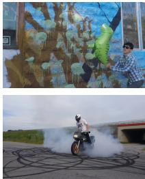  
Ground truth  
Figure 3: Qualitative comparison of dynamic novel view synthesis across different methods.

To address this issue, we adopt an auxiliary distillation strategy. We generate pseudo dynamic masks and optical-flow labels using expert foundation models (Bai et al., 2025; Yuan et al., 2025; Zhang et al., 2025c), and use them as auxiliary supervision during training. This provides scalable guidance on where the scene should be decomposed and how dynamic Gaussians should move, allowing SplatFlux to benefit from large-scale training without costly annotations.

Dynamic mask supervision. To construct pseudo labels for dynamic masks, we first use Qwen2.5- VL-72B-Instruct (Bai et al., 2025) to detect dynamic objects in videos, and generate a text description including the category and visual attributes for each detected dynamic object. We then use this description as the prompt for Sa2VA (Yuan et al., 2025) to segment the corresponding object. The masks of all detected dynamic objects in the same image are merged into a pseudo dynamic mask.

Given the predicted dynamic mask $\mathbf { m } _ { t }$ and its pseudo label $\widetilde { \mathbf { m } } _ { t } ,$ we compute the dynamic mask loss as a combination of binary cross-entropy, Dice, and binarization regularization:

$$
\mathcal { L } _ { \mathrm { d y n } } = \mathcal { L } _ { \mathrm { B C E } } ( \mathbf { m } _ { t } , \widetilde { \mathbf { m } } _ { t } ) + \lambda _ { \mathrm { D i c e } } \mathcal { L } _ { \mathrm { D i c e } } ( \mathbf { m } _ { t } , \widetilde { \mathbf { m } } _ { t } ) + \lambda _ { \mathrm { b i n } } \mathcal { L } _ { \mathrm { b i n } } ( \mathbf { m } _ { t } ) ,\tag{6}
$$

where the binarization regularization is defined as

$$
\mathcal { L } _ { \mathrm { b i n } } ( \mathbf { m } _ { t } ) = \frac { 1 } { \left| \Omega \right| } \sum _ { \mathbf { x } \in \Omega } \mathbf { m } _ { t } ( \mathbf { x } ) \left( 1 - \mathbf { m } _ { t } ( \mathbf { x } ) \right) ,\tag{7}
$$

and Ω denotes all image pixels. The dynamic mask supervision provides an explicit signal for separating static and dynamic Gaussians, which is essential for feed-forward 4D scene construction.

Motion supervision. To supervise local velocities, we employ the optical-flow foundation model UFM (Zhang et al., 2025c) to generate pseudo motion cues. Instead of directly supervising velocities in 3D space, we project the predicted Gaussian motion into the image plane, and minimize the discrepancy between the optical flow induced by the predicted Gaussian motion and the pseudo flow labels from UFM.

Given the predicted depth $\mathbf { d } _ { t }$ , ray map $\mathbf { r } _ { t } ,$ , and bidirectional velocities $\mathbf { v } _ { t } ^ { + }$ and $\mathbf { v } _ { t } ^ { - }$ , we compute the Gaussian center at pixel $\mathbf { x } \in \Omega$ as $\pmb { \mu } _ { t } ( \mathbf { x } ) = \mathcal { P } \big ( \mathbf { x } , \mathbf { d } _ { t } ( \mathbf { x } ) , \mathbf { r } _ { t } ( \mathbf { x } ) \big )$ , where $\mathcal { P } ( \cdot )$ denotes the backward projection function. The optical flows from frame t to t + 1 and t − 1 can be derived as

$$
\mathbf { F } _ { t  t + 1 } ( \mathbf { x } ) = \Pi _ { t + 1 } ( \pmb { \mu } _ { t } ( \mathbf { x } ) + \mathbf { v } _ { t } ^ { + } ( \mathbf { x } ) ) - \mathbf { x } ,\tag{8}
$$

$$
\mathbf { F } _ { t  t - 1 } ( \mathbf { x } ) = \Pi _ { t - 1 } ( \pmb { \mu } _ { t } ( \mathbf { x } ) + \mathbf { v } _ { t } ^ { - } ( \mathbf { x } ) ) - \mathbf { x } .\tag{9}
$$

Table 2: Quantitative comparison of text-to-3D generation on SceneBench (Yang et al., 2025b). The best and second-best results are highlighted for clarity.
<table><tr><td>Method</td><td>Imaging ↑</td><td>Aesthetic ↑</td><td> $\mathrm { C L I P \uparrow }$ </td><td>Alignment ↑</td><td>Coherence ↑</td><td>Style ↑</td></tr><tr><td>Prometheus (Yang et al., 2025b)</td><td>44.73</td><td>45.85</td><td>28.57</td><td>3.20</td><td>3.36</td><td>2.98</td></tr><tr><td>SplatFlow (Go et al., 2025b)</td><td>48.85</td><td>53.71</td><td>29.43</td><td>3.47</td><td>3.65</td><td>3.26</td></tr><tr><td>VIST3A (Go et al., 2025a)</td><td>64.87</td><td>56.96</td><td>30.18</td><td>3.67</td><td>3.86</td><td>3.40</td></tr><tr><td>SplatFlux (Ours)</td><td>69.18</td><td>58.08</td><td>31.35</td><td>3.72</td><td>3.97</td><td>3.48</td></tr></table>

Table 3: Quantitative comparison of text-to-4D generation on PenguinVideoBenchmark (Kong et al., 2024). SteerXMochi/HunyuanVideo denotes the variant using Mochi (Team, 2024) or Hunyuan-Video (Kong et al., 2024) as the base model. The best and second-best results are highlighted for clarity.
<table><tr><td>Method</td><td>Sub. consistency ↑</td><td> $\mathrm { B . g . }$ </td><td>consistency ↑ Dynamic degree ↑ Aesthetic ↑ Imaging ↑</td><td></td><td></td></tr><tr><td>Mochi (Team, 2024)</td><td>95.07</td><td>94.37</td><td>54.08</td><td>52.37</td><td>56.09</td></tr><tr><td>HunyuanVideo (Kong et al., 2024)</td><td>95.94</td><td>94.78</td><td>37.76</td><td>53.51</td><td>64.69</td></tr><tr><td>SteerXMochi (Park et al., 2025)</td><td>94.07</td><td>93.88</td><td>57.14</td><td>49.69</td><td>57.13</td></tr><tr><td>SteerXHunyuanVideo (Park et al., 2025)</td><td>96.11</td><td>95.23</td><td>37.76</td><td>53.32</td><td>61.23</td></tr><tr><td>SplatFlux (Ours)</td><td>96.11</td><td>95.90</td><td>74.49</td><td>64.07</td><td>70.92</td></tr></table>

Here, $\Pi _ { t + 1 } ( \cdot )$ and $\Pi _ { t - 1 } ( \cdot )$ denote the projection functions using the corresponding ray maps. Let $\widetilde { \mathbf { F } } _ { t  t + 1 }$ and $\widetilde { \mathbf { F } } _ { t  t - 1 }$ denote the pseudo optical flows estimated by the teacher model. We supervise the optical flows induced by Gaussian motion as

$$
\mathcal { L } _ { \mathrm { { f l o w } } } = \frac { 1 } { | \Omega | } \sum _ { \mathbf { x } \in \Omega } w _ { t } ( \mathbf { x } ) ( \Big \| \mathbf { F } _ { t  t + 1 } ( \mathbf { x } ) - \widetilde { \mathbf { F } } _ { t  t + 1 } ( \mathbf { x } ) \Big \| _ { 1 } + \Big \| \mathbf { F } _ { t  t - 1 } ( \mathbf { x } ) - \widetilde { \mathbf { F } } _ { t  t - 1 } ( \mathbf { x } ) \Big \| _ { 1 } ) ,\tag{10}
$$

where $w _ { t } ( \mathbf { x } )$ is a dynamic-region weight derived from the pseudo dynamic mask $\widetilde { \mathbf { m } } _ { t }$ . This weighting encourages the model to focus more on regions with meaningful object motion.

Overall objective. The overall training objective combines geometry, rendering, dynamic mask, and optical-flow losses as

$$
\mathcal { L } = \lambda _ { \mathrm { g e o } } \mathcal { L } _ { \mathrm { g e o } } + \lambda _ { \mathrm { r e n d } } \mathcal { L } _ { \mathrm { r e n d } } + \lambda _ { \mathrm { d y n } } \mathcal { L } _ { \mathrm { d y n } } + \lambda _ { \mathrm { f o w } } \mathcal { L } _ { \mathrm { f o w } } .\tag{11}
$$

Here, $\mathcal { L } _ { \mathrm { g e o } }$ supervises the depths and ray maps of source views following the implementation of DA3 (Lin et al., 2026). The rendering loss $\mathcal { L } _ { \mathrm { r e n d } }$ is applied to the rendered RGB images and depths of both source and target views. Specifically, we use $\ell _ { 2 }$ and LPIPS (Johnson et al., 2016) losses for RGB rendering, and $\ell _ { 1 }$ loss for depth rendering. The dynamic mask loss $\mathcal { L } _ { \mathrm { d y n } }$ provides direct supervision for static-dynamic decomposition, while the optical-flow loss ${ \mathcal { L } } _ { \mathrm { { f l o w } } }$ constrains the motion of dynamic Gaussians.

Implementation Details. We train SplatFlux on 17 public datasets, covering static and dynamic content across object-centric, indoor, and outdoor scenarios. For the 4DGS decoder, we initialize the alternating attention blocks and geometry head from DA3-Giant (Lin et al., 2026), use the frozen Wan2.1 VAE (Wan et al., 2025) as the latent encoder, and adopt gsplat (Ye et al., 2025b) for differentiable rasterization. For each training iteration, we sample $\dot { T }$ source frames and $T - 1$ intermediate target frames between adjacent source frames. The 4DGS decoder is supervised using the objective in Eq. 11. For conditional generation, we fine-tune Wan2.1-14B (Wan et al., 2025) with the standard flow-matching objective, where training videos are encoded into per-frame latent sequences without temporal compression. The generated conditional latents are directly decoded by the shared 4DGS decoder $\mathcal { D } _ { \mathrm { G S } }$ . The full training pipeline takes approximately 10 days on 32 NVIDIA H20 GPUs. Details of the training datasets and implementation are provided in Appendix A and Appendix B, respectively.

A construction site   
features concrete   
and metal structures   
with scattered   
equipment and   
materials, suggesting   
ongoing work on a   
building.

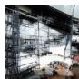  
Condition

VIST3A  
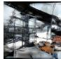

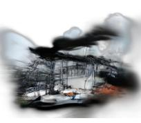  
Prometheus

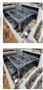

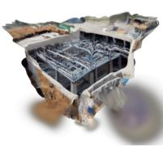

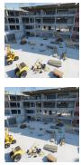

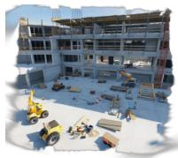  
SplatFlux (Ours)

The butterfly lands on the railing, and the camera pans to the right to capture the tulip field next to it. The entire video is presented in anime style.

Condition

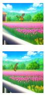

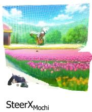

(a) Text-to-3D Generation  
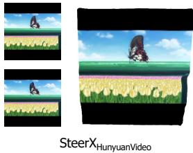

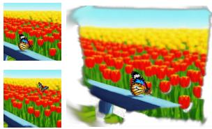  
SplatFlux (Ours)  
(b) Text-to-4D Generation

An eagle is flying   
over a mountain with   
trees in the   
background.

  
Condition

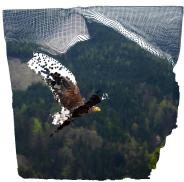  
SteerXCogVideoX

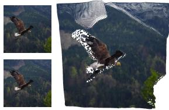  
Aether  
(c) Image-to-4D Generation

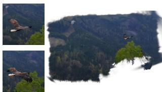  
SplatFlux (Ours)

Figure 4: Qualitative comparison of conditional 3D and 4D generation across different methods.  
Table 4: Quantitative comparison of image-to-4D generation on VBench-I2V (Huang et al., 2024). Steer $\mathbf { \cdot X } _ { \mathrm { C o g V i d e o X } }$ denotes the variant using CogVideoX (Yang et al., 2024) as the base model. The best and second-best results are highlighted for clarity.
<table><tr><td>Method</td><td>Sub. consistency ↑</td><td>B.g. consistency ↑</td><td>Dynamic degree ↑</td><td>Aesthetic ↑</td><td>Imaging ↑</td></tr><tr><td>Cog VideoX (Yang et al., 2024)</td><td>94.86</td><td>94.83</td><td>40.00</td><td>63.70</td><td>69.56</td></tr><tr><td>SteerXCogVideox (Park et al., 2025)</td><td>95.91</td><td>95.43</td><td>31.55</td><td>64.16</td><td>71.55</td></tr><tr><td>Aether (Zhu et al., 2025)</td><td>97.97</td><td>97.03</td><td>19.72</td><td>63.89</td><td>69.85</td></tr><tr><td>SplatFlux (Ours)</td><td>95.95</td><td>96.01</td><td>49.86</td><td>64.84</td><td>72.07</td></tr></table>

## 4 EXPERIMENTS

## 4.1 DYNAMIC NOVEL VIEW SYNTHESIS

We evaluate SplatFlux for dynamic novel view synthesis on the NVIDIA Dynamic Scene (Yoon et al., 2020), DyCheck (Gao et al., 2022), and DAVIS (Perazzi et al., 2016) datasets. We compare with three state-of-the-art open-sourced approaches (Xu et al., 2025b; Lin et al., 2025a; Yang et al., 2026), and list the results in Table 1. The results demonstrate that SplatFlux achieves superior dynamic novel view synthesis without relying on camera poses as input. The qualitative comparison in Fig. 3 further shows that our method produces clearer details with fewer rendering artifacts. In contrast, the comparison approaches often suffer from ghosting artifacts in dynamic regions, or exhibit limited generalization ability on in-the-wild scenes. The detailed evaluation protocol can be found in Appendix B.

## 4.2 CONDITIONAL 3D AND 4D GENERATION

Text-to-3D Generation. We evaluate SplatFlux for text-to-3D generation on SceneBench (Yang et al., 2025b). In alignment with VIST3A (Go et al., 2025a), we employ imaging quality and aesthetic quality in VBench (Huang et al., 2024) for visual fidelity, CLIP Score (Hessel et al., 2021) for text alignment, and alignment, coherence, and style scores in UnifiedReward (Wang et al., 2025g) for overall generation quality. As shown in Table 2, SplatFlux consistently outperforms competing methods across all metrics. Qualitative results in Fig. 4(a) further show that SplatFlux generates scenes that more faithfully match the input text conditions.

Table 5: Ablations of static-dynamic decoupling and auxiliary supervision on the NVIDIA Dynamic Scene (Yoon et al., 2020) dataset.
<table><tr><td>Settings</td><td>PSNR ↑ SSIM ↑ LPIPS ↓</td></tr><tr><td>w/o static-dynamic decoupling</td><td>13.94 0.4984</td></tr><tr><td>w/o dynamic mask supervision</td><td>0.4655 18.41 0.5301</td></tr><tr><td>w/o optical-flow supervision</td><td>0.2663 18.62 0.5259 0.2619</td></tr><tr><td>Full Model</td><td>21.56 0.5879 0.1918</td></tr></table>

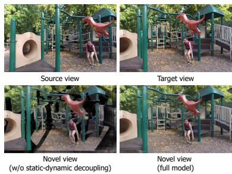  
Figure 5: Qualitative results of the static-dynamic decoupling.

Text-to-4D Generation. Following prior work (Park et al., 2025), we evaluate text-to-4D generation on the PenguinVideoBenchmark (Kong et al., 2024). We report VBench (Huang et al., 2024) metrics for quantitative comparison. As shown in Table 3, SplatFlux achieves substantial improvements in both scene consistency and image aesthetics. The qualitative results in Fig. 4(b) further show that our method generates 4D content that better follows the input conditions and exhibits plausible motion. Moreover, we note that SplatFlux produces 4D Gaussian scenes that support photorealistic rendering, whereas baselines are limited to generating dynamic point clouds.

Image-to-4D Generation. In alignment with Park et al. (2025), we evaluate image-to-4D generation on 355 samples from VBench-I2V (Huang et al., 2024). As shown in Table 4, SplatFlux achieves stronger motion dynamics and better perceptual quality in the generated 4D scenes. The qualitative results in Fig. 4(c) further show that SplatFlux generates large-range and physically plausible scene dynamics, whereas the compared methods are mostly limited to relatively local 4D motion.

## 4.3 ABLATIONS

We present ablation studies on our static-dynamic decoupled representation and auxiliary supervision using the NVIDIA Dynamic Scene dataset in Table 5. Removing the decoupled representation causes the largest performance drop, suggesting that explicit static-dynamic separation is essential for complete 4D scene construction. Without this constraint, the model tends to learn an interpolation-like representation from monocular videos, where static structures may be treated as dynamic, leading to incomplete geometry and holes under novel view rendering, as illustrated in Fig. 5. The two supervision signals further provide complementary constraints for dynamic attributes. Dynamic mask supervision guides where the scene should be decomposed, while optical-flow supervision constrains how dynamic Gaussians should move. Removing either supervision signal degrades performance. Notably, our method does not require perfectly precise pseudo labels, benefiting from the consistency constraints provided by rendering supervision, as shown in Fig. 7.

Please refer to Appendices C and D for more detailed quantitative and qualitative results, including results on video depth estimation, static novel view synthesis, and dynamic object segmentation.

## 5 CONCLUSIONS

We have presented SplatFlux, a unified feed-forward latent-to-4DGS framework for video-based 4D reconstruction and conditional 4D generation. By decoding video latents from different sources into a 4D Gaussian representation, SplatFlux provides a shared formulation for captured and generated dynamic content. We further introduce a static-dynamic decoupled 4D Gaussian representation that supports complete 4D scene construction in a feed-forward manner. Through auxiliary distillation from vision-language-guided dynamic masks and optical-flow cues, SplatFlux learns dynamic attributes without costly annotations. Extensive experiments on 3D and 4D reconstruction and generation demonstrate the effectiveness and generality of SplatFlux.

## REFERENCES

Sherwin Bahmani, Xian Liu, Wang Yifan, Ivan Skorokhodov, Victor Rong, Ziwei Liu, Xihui Liu, Jeong Joon Park, Sergey Tulyakov, Gordon Wetzstein, et al. TC4D: Trajectory-conditioned text-to-4D generation. In European Conference on Computer Vision, pp. 53–72, 2024a.

Sherwin Bahmani, Ivan Skorokhodov, Victor Rong, Gordon Wetzstein, Leonidas Guibas, Peter Wonka, Sergey Tulyakov, Jeong Joon Park, Andrea Tagliasacchi, and David B Lindell. 4D-fy: Text-to-4D generation using hybrid score distillation sampling. In Proceedings ofthe IEEE/CVF Conference on Computer Vision and Pattern Recognition, pp. 7996–8006, 2024b.

Sherwin Bahmani, Tianchang Shen, Jiawei Ren, Jiahui Huang, Yifeng Jiang, Haithem Turki, Andrea Tagliasacchi, David B. Lindell, Zan Gojcic, Sanja Fidler, Huan Ling, Jun Gao, and Xuanchi Ren. Lyra: Generative 3D scene reconstruction via video diffusion model self-distillation. In International Conference on Learning Representations, 2026.

Shuai Bai, Keqin Chen, Xuejing Liu, Jialin Wang, Wenbin Ge, Sibo Song, Kai Dang, Peng Wang, Shijie Wang, Jun Tang, Humen Zhong, Yuanzhi Zhu, Mingkun Yang, Zhaohai Li, Jianqiang Wan, Pengfei Wang, Wei Ding, Zheren Fu, Yiheng Xu, Jiabo Ye, Xi Zhang, Tianbao Xie, Zesen Cheng, Hang Zhang, Zhibo Yang, Haiyang Xu, and Junyang Lin. Qwen2.5-VL technical report. arXiv preprint arXiv:2502.13923, 2025.

Gilad Baruch, Zhuoyuan Chen, Afshin Dehghan, Tal Dimry, Yuri Feigin, Peter Fu, Thomas Gebauer, Brandon Joffe, Daniel Kurz, Arik Schwartz, et al. Arkitscenes: A diverse real-world dataset for 3D indoor scene understanding using mobile rgb-d data. arXiv preprint arXiv:2111.08897, 2021.

Michael J. Black, Priyanka Patel, Joachim Tesch, and Jinlong Yang. BEDLAM: A synthetic dataset of bodies exhibiting detailed lifelike animated motion. In Proceedings ofthe IEEE/CVF International Conference on Computer Vision, pp. 8726–8737, 2023.

Daniel J Butler, Jonas Wulff, Garrett B Stanley, and Michael J Black. A naturalistic open source movie for optical flow evaluation. In European Conference on Computer Vision, pp. 611–625, 2012.

Yohann Cabon, Naila Murray, and Martin Humenberger. Virtual kitti 2. arXiv preprint arXiv:2001.10773, 2020.

Yuanhao Cai, He Zhang, Kai Zhang, Yixun Liang, Mengwei Ren, Fujun Luan, Qing Liu, Soo Ye Kim, Jianming Zhang, Zhifei Zhang, et al. Baking gaussian splatting into diffusion denoiser for fast and scalable single-stage image-to-3d generation and reconstruction. In Proceedings ofthe IEEE/CVF International Conference on Computer Vision, pp. 25062–25072, 2025.

Sili Chen, Hengkai Guo, Shengnan Zhu, Feihu Zhang, Zilong Huang, Jiashi Feng, and Bingyi Kang. Video Depth Anything: Consistent depth estimation for super-long videos. In Proceedings ofthe IEEE/CVF Conference on Computer Vision and Pattern Recognition, pp. 22831–22840, 2025a.

Xingyu Chen, Yue Chen, Yuliang Xiu, Andreas Geiger, and Anpei Chen. Easi3R: Estimating disentangled motion from dust3r without training. In Proceedings ofthe IEEE/CVF International Conference on Computer Vision, pp. 9158–9168, 2025b.

Zhaoxi Chen, Tianqi Liu, Long Zhuo, Jiawei Ren, Zeng Tao, He Zhu, Fangzhou Hong, Liang Pan, and Ziwei Liu. 4DNeX: Feed-forward 4D generative modeling made easy. arXiv preprint arXiv:2508.13154, 2025c.

Alexey Dosovitskiy, Lucas Beyer, Alexander Kolesnikov, Dirk Weissenborn, Xiaohua Zhai, Thomas Unterthiner, Mostafa Dehghani, Matthias Minderer, Georg Heigold, Sylvain Gelly, et al. An image is worth 16x16 words: Transformers for image recognition at scale. arXiv preprint arXiv:2010.11929, 2020.

Xianze Fang, Jingnan Gao, Zhe Wang, Zhuo Chen, Xingyu Ren, Jiangjing Lyu, Qiaomu Ren, Zhonglei Yang, Xiaokang Yang, Yichao Yan, and Chengfei Lyu. Dens3R: A foundation model for 3D geometry prediction. arXiv preprint arXiv:2507.16290, 2025.

Hang Gao, Ruilong Li, Shubham Tulsiani, Bryan Russell, and Angjoo Kanazawa. Monocular dynamic view synthesis: A reality check. Advances in Neural Information Processing Systems, 35: 33768–33780, 2022.

Jingnan Gao, Zhe Wang, Xianze Fang, Xingyu Ren, Zhuo Chen, Shengqi Liu, Yuhao Cheng, Jiangjing Lyu, Xiaokang Yang, and Yichao Yan. MoRE: 3D visual geometry reconstruction meets mixture-of-experts. arXiv preprint arXiv:2510.27234, 2025.

Ruiqi Gao, Aleksander Holynski, Philipp Henzler, Arthur Brussee, Ricardo Martin-Brualla, Pratul Srinivasan, Jonathan T Barron, and Ben Poole. CAT3D: Create anything in 3D with multi-view diffusion models. arXiv preprint arXiv:2405.10314, 2024.

Andreas Geiger, Philip Lenz, Christoph Stiller, and Raquel Urtasun. Vision meets robotics: The kitti dataset. The International Journal ofRobotics Research, 32(11):1231–1237, 2013.

Hyojun Go, Dominik Narnhofer, Goutam Bhat, Prune Truong, Federico Tombari, and Konrad Schindler. VIST3A: Text-to-3D by stitching a multi-view reconstruction network to a video generator. arXiv preprint arXiv:2510.13454, 2025a.

Hyojun Go, Byeongjun Park, Jiho Jang, Jin-Young Kim, Soonwoo Kwon, and Changick Kim. SplatFlow: Multi-view rectified flow model for 3D Gaussian splatting synthesis. In Proceedings of the IEEE/CVF Conference on Computer Vision and Pattern Recognition, pp. 21524–21536, 2025b.

Jack Hessel, Ari Holtzman, Maxwell Forbes, Ronan Le Bras, and Yejin Choi. Clipscore: A referencefree evaluation metric for image captioning. In Proceedings of the 2021 Conference on Empirical Methods in Natural Language Processing, pp. 7514–7528, 2021.

Edward J Hu, Yelong Shen, Phillip Wallis, Zeyuan Allen-Zhu, Yuanzhi Li, Shean Wang, Lu Wang, and Weizhu Chen. LoRA: Low-rank adaptation of large language models. In International Conference on Learning Representations, 2022.

Wenbo Hu, Xiangjun Gao, Xiaoyu Li, Sijie Zhao, Xiaodong Cun, Yong Zhang, Long Quan, and Ying Shan. DepthCrafter: Generating consistent long depth sequences for open-world videos. In Proceedings of the IEEE/CVF Conference on Computer Vision and Pattern Recognition, pp. 2005–2015, 2025a.

Yu Hu, Chong Cheng, Sicheng Yu, Xiaoyang Guo, and Hao Wang. VGGT4D: Mining motion cues in visual geometry transformers for 4D scene reconstruction. arXiv preprint arXiv:2511.19971, 2025b.

Po-Han Huang, Kevin Matzen, Johannes Kopf, Narendra Ahuja, and Jia-Bin Huang. DeepMVS: Learning multi-view stereopsis. In Proceedings ofthe IEEE/CVF Conference on Computer Vision and Pattern Recognition, pp. 2821–2830, 2018.

Ziqi Huang, Yinan He, Jiashuo Yu, Fan Zhang, Chenyang Si, Yuming Jiang, Yuanhan Zhang, Tianxing Wu, Qingyang Jin, Nattapol Chanpaisit, et al. Vbench: Comprehensive benchmark suite for video generative models. In Proceedings of the IEEE/CVF Conference on Computer Vision and Pattern Recognition, pp. 21807–21818, 2024.

Junhwa Hur, Charles Herrmann, Songyou Peng, Philipp Henzler, Zeyu Ma, Todd Zickler, and Deqing Sun. UFO-4D: Unposed feedforward 4D reconstruction from two images. arXiv preprint arXiv:2602.24290, 2026.

Lihan Jiang, Yucheng Mao, Linning Xu, Tao Lu, Kerui Ren, Yichen Jin, Xudong Xu, Mulin Yu, Jiangmiao Pang, Feng Zhao, et al. AnySplat: Feed-forward 3D Gaussian splatting from unconstrained views. ACM Transactions on Graphics, 44(6):1–16, 2025.

Linyi Jin, Richard Tucker, Zhengqi Li, David Fouhey, Noah Snavely, and Aleksander Holynski. Stereo4D: Learning how things move in 3D from internet stereo videos. In Proceedings of the IEEE/CVF Conference on Computer Vision and Pattern Recognition, 2025.

Justin Johnson, Alexandre Alahi, and Li Fei-Fei. Perceptual losses for real-time style transfer and super-resolution. In European conference on computer vision, pp. 694–711, 2016.

Nikita Karaev, Ignacio Rocco, Benjamin Graham, Natalia Neverova, Andrea Vedaldi, and Christian Rupprecht. Dynamicstereo: Consistent dynamic depth from stereo videos. In Proceedings of the IEEE/CVF International Conference on Computer Vision, 2023.

Bernhard Kerbl, Georgios Kopanas, Thomas Leimkuhler, George Drettakis, et al. 3D Gaussian¨ splatting for real-time radiance field rendering. ACM Transactions on Graphics, 42(4):139–1, 2023.

Weijie Kong, Qi Tian, Zijian Zhang, Rox Min, Zuozhuo Dai, Jin Zhou, Jiangfeng Xiong, Xin Li, Bo Wu, Jianwei Zhang, et al. HunyuanVideo: A systematic framework for large video generative models. arXiv preprint arXiv:2412.03603, 2024.

Jiahui Lei, Yijia Weng, Adam W Harley, Leonidas Guibas, and Kostas Daniilidis. MoSca: Dynamic gaussian fusion from casual videos via 4d motion scaffolds. In Proceedings of the IEEE/CVF Conference on Computer Vision and Pattern Recognition, pp. 6165–6177, 2025.

Vincent Leroy, Yohann Cabon, and Jer´ ome Revaud. Grounding image matching in 3D with MASt3R.ˆ In European Conference on Computer Vision, pp. 71–91, 2024.

Hanxue Liang, Jiawei Ren, Ashkan Mirzaei, Antonio Torralba, Ziwei Liu, Igor Gilitschenski, Sanja Fidler, Cengiz Oztireli, Huan Ling, Zan Gojcic, et al. Feed-forward bullet-time reconstruction of dynamic scenes from monocular videos. arXiv preprint arXiv:2412.03526, 2024.

Chenguo Lin, Yuchen Lin, Panwang Pan, Yifan Yu, Tao Hu, Honglei Yan, Katerina Fragkiadaki, and Yadong Mu. MoVieS: Motion-aware 4D dynamic view synthesis in one second. arXiv preprint arXiv:2507.10065, 2025a.

Chieh Hubert Lin, Zhaoyang Lv, Songyin Wu, Zhen Xu, Thu Nguyen-Phuoc, Hung-Yu Tseng, Julian Straub, Numair Khan, Lei Xiao, Ming-Hsuan Yang, et al. DGS-LRM: Real-time deformable 3D Gaussian reconstruction from monocular videos. arXiv preprint arXiv:2506.09997, 2025b.

Haotong Lin, Sili Chen, Jun Hao Liew, Donny Y. Chen, Zhenyu Li, Yang Zhao, Sida Peng, Hengkai Guo, Xiaowei Zhou, Guang Shi, Jiashi Feng, and Bingyi Kang. Depth Anything 3: Recovering the visual space from any views. In International Conference on Learning Representations, 2026.

Lu Ling, Yichen Sheng, Zhi Tu, Wentian Zhao, Cheng Xin, Kun Wan, Lantao Yu, Qianyu Guo, Zixun Yu, Yawen Lu, et al. Dl3dv-10k: A large-scale scene dataset for deep learning-based 3d vision. In Proceedings of the IEEE/CVF Conference on Computer Vision and Pattern Recognition, pp. 22160–22169, 2024.

Yifan Liu, Zhiyuan Min, Zhenwei Wang, Junta Wu, Tengfei Wang, Yixuan Yuan, Yawei Luo, and Chunchao Guo. WorldMirror: Universal 3D world reconstruction with any-prior prompting. arXiv preprint arXiv:2510.10726, 2025.

Lukas Mehl, Jenny Schmalfuss, Azin Jahedi, Yaroslava Nalivayko, and Andres Bruhn. Spring: A´ high-resolution high-detail dataset and benchmark for scene flow, optical flow and stereo. In Proceedings ofthe IEEE/CVF Conference on Computer Vision and Pattern Recognition, 2023.

Ben Mildenhall, Pratul P. Srinivasan, Matthew Tancik, Jonathan T. Barron, Ravi Ramamoorthi, and Ren Ng. NeRF: Representing scenes as neural radiance fields for view synthesis. In European Conference on Computer Vision, 2020.

Maxime Oquab, Timothee Darcet, Th´ eo Moutakanni, Huy Vo, Marc Szafraniec, Vasil Khalidov,´ Pierre Fernandez, Daniel Haziza, Francisco Massa, Alaaeldin El-Nouby, et al. Dinov2: Learning robust visual features without supervision. arXiv preprint arXiv:2304.07193, 2023.

Emanuele Palazzolo, Jens Behley, Philipp Lottes, Philippe Giguere, and Cyrill Stachniss. ReFusion: 3D reconstruction in dynamic environments for RGB-D cameras exploiting residuals. In IEEE/RSJ International Conference on Intelligent Robots and Systems, pp. 7855–7862, 2019.

Panwang Pan, Chenguo Lin, Jingjing Zhao, Chenxin Li, Yuchen Lin, Haopeng Li, Honglei Yan, Kairun Wen, Yunlong Lin, Yixuan Yuan, et al. Diff4Splat: Controllable 4D scene generation with latent dynamic reconstruction models. arXiv preprint arXiv:2511.00503, 2025.

Xiaqing Pan, Nicholas Charron, Yongqian Yang, Scott Peters, Thomas Whelan, Chen Kong, Omkar Parkhi, Richard Newcombe, and Yuheng (Carl) Ren. Aria Digital Twin: A new benchmark dataset for egocentric 3D machine perception. In Proceedings ofthe IEEE/CVF International Conference on Computer Vision, pp. 20133–20143, 2023.

Byeongjun Park, Hyojun Go, Hyelin Nam, Byung-Hoon Kim, Hyungjin Chung, and Changick Kim. SteerX: Creating any camera-free 3D and 4D scenes with geometric steering. In Proceedings of the IEEE/CVF International Conference on Computer Vision, pp. 27326–27337, 2025.

William Peebles and Saining Xie. Scalable diffusion models with transformers. In Proceedings of the IEEE/CVF International Conference on Computer Vision, pp. 4195–4205, 2023.

Federico Perazzi, Jordi Pont-Tuset, Brian McWilliams, Luc Van Gool, Markus Gross, and Alexander Sorkine-Hornung. A benchmark dataset and evaluation methodology for video object segmentation. In Proceedings of the IEEE Conference on Computer Vision and Pattern Recognition, pp. 724–732, 2016.

Ben Poole, Ajay Jain, Jonathan T Barron, and Ben Mildenhall. DreamFusion: Text-to-3D using 2D diffusion. arXiv preprint arXiv:2209.14988, 2022.

Rene Ranftl, Alexey Bochkovskiy, and Vladlen Koltun. Vision transformers for dense prediction. In´ Proceedings of the IEEE/CVF International Conference on Computer Vision, pp. 12179–12188, 2021.

Nikhila Ravi, Valentin Gabeur, Yuan-Ting Hu, Ronghang Hu, Chaitanya Ryali, Tengyu Ma, Haitham Khedr, Roman Radle, Chloe Rolland, Laura Gustafson, et al. SAM 2: Segment anything in images¨ and videos. arXiv preprint arXiv:2408.00714, 2024.

Jeremy Reizenstein, Roman Shapovalov, Philipp Henzler, Luca Sbordone, Patrick Labatut, and David Novotny. Common objects in 3D: Large-scale learning and evaluation of real-life 3D category reconstruction. In Proceedings of the IEEE/CVF International Conference on Computer Vision, pp. 10901–10911, 2021.

Jiawei Ren, Kevin Xie, Ashkan Mirzaei, Hanxue Liang, Xiaohui Zeng, Karsten Kreis, Ziwei Liu, Antonio Torralba, Sanja Fidler, Seung Wook Kim, and Huan Ling. L4GM: Large 4D Gaussian reconstruction model. In Advances in Neural Information Processing Systems, 2024.

Mike Roberts, Jason Ramapuram, Anurag Ranjan, Atulit Kumar, Miguel Angel Bautista, Nathan Paczan, Russ Webb, and Joshua M Susskind. Hypersim: A photorealistic synthetic dataset for holistic indoor scene understanding. In Proceedings ofthe IEEE/CVF International Conference on Computer Vision, pp. 10912–10922, 2021.

Robin Rombach, Andreas Blattmann, Dominik Lorenz, Patrick Esser, and Bjorn Ommer. High-¨ resolution image synthesis with latent diffusion models. In Proceedings ofthe IEEE/CVF Conference on Computer Vision and Pattern Recognition, pp. 10684–10695, 2022.

Chitwan Saharia, William Chan, Saurabh Saxena, Lala Li, Jay Whang, Emily L Denton, Kamyar Ghasemipour, Raphael Gontijo Lopes, Burcu Karagol Ayan, Tim Salimans, et al. Photorealistic text-to-image diffusion models with deep language understanding. Advances in Neural Information Processing Systems, 35:36479–36494, 2022.

Johannes L Schonberger and Jan-Michael Frahm. Structure-from-motion revisited. In Proceedings of the IEEE Conference on Computer Vision and Pattern Recognition, pp. 4104–4113, 2016.

Oriane Simeoni, Huy V Vo, Maximilian Seitzer, Federico Baldassarre, Maxime Oquab, Cijo Jose,´ Vasil Khalidov, Marc Szafraniec, Seungeun Yi, Michael Ramamonjisoa, et al. Dinov3.¨ arXiv preprint arXiv:2508.10104, 2025.

Uriel Singer, Shelly Sheynin, Adam Polyak, Oron Ashual, Iurii Makarov, Filippos Kokkinos, Naman Goyal, Andrea Vedaldi, Devi Parikh, Justin Johnson, et al. Text-to-4D dynamic scene generation. arXiv preprint arXiv:2301.11280, 2023.

Pei Sun, Henrik Kretzschmar, Xerxes Dotiwalla, Aurelien Chouard, Vijaysai Patnaik, Paul Tsui, James Guo, Yin Zhou, Yuning Chai, Benjamin Caine, Vijay Vasudevan, Wei Han, Jiquan Ngiam, Hang Zhao, Aleksei Timofeev, Scott Ettinger, Maxim Krivokon, Amy Gao, Aditya Joshi, Yu Zhang, Jonathon Shlens, Zhifeng Chen, and Dragomir Anguelov. Scalability in perception for autonomous driving: Waymo open dataset. In Proceedings ofthe IEEE/CVF Conference on Computer Vision and Pattern Recognition, 2020.

Wenqiang Sun, Shuo Chen, Fangfu Liu, Zilong Chen, Yueqi Duan, Jun Zhang, and Yikai Wang. DimensionX: Create any 3D and 4D scenes from a single image with controllable video diffusion. arXiv preprint arXiv:2411.04928, 2024a.

Yang-Tian Sun, Yi-Hua Huang, Lin Ma, Xiaoyang Lyu, Yan-Pei Cao, and Xiaojuan Qi. Splatter a video: Video gaussian representation for versatile processing. Advances in Neural Information Processing Systems, 37:50401–50425, 2024b.

Stanislaw Szymanowicz, Jason Y Zhang, Pratul Srinivasan, Ruiqi Gao, Arthur Brussee, Aleksander Holynski, Ricardo Martin-Brualla, Jonathan T Barron, and Philipp Henzler. Bolt3D: Generating 3D scenes in seconds. In Proceedings of the IEEE/CVF International Conference on Computer Vision, pp. 24846–24857, 2025.

Jiaxiang Tang, Zhaoxi Chen, Xiaokang Chen, Tengfei Wang, Gang Zeng, and Ziwei Liu. LGM: Large multi-view gaussian model for high-resolution 3D content creation. In European Conference on Computer Vision, pp. 1–18. Springer, 2024.

Genmo Team. Mochi 1. https://github.com/genmoai/models, 2024.

Team Wan, Ang Wang, Baole Ai, Bin Wen, Chaojie Mao, Chen-Wei Xie, Di Chen, Feiwu Yu, Haiming Zhao, Jianxiao Yang, et al. Wan: Open and advanced large-scale video generative models. arXiv preprint arXiv:2503.20314, 2025.

Chaoyang Wang, Peiye Zhuang, Tuan Duc Ngo, Willi Menapace, Aliaksandr Siarohin, Michael Vasilkovsky, Ivan Skorokhodov, Sergey Tulyakov, Peter Wonka, and Hsin-Ying Lee. 4Real-Video: Learning generalizable photo-realistic 4D video diffusion. In Proceedings of the IEEE/CVF Conference on Computer Vision and Pattern Recognition, pp. 17723–17732, 2025a.

Haonan Wang, Hanyu Zhou, Haoyue Liu, and Luxin Yan. 4D-VGGT: A general foundation model with spatiotemporal awareness for dynamic scene geometry estimation. arXiv preprint arXiv:2511.18416, 2025b.

Jianyuan Wang, Minghao Chen, Nikita Karaev, Andrea Vedaldi, Christian Rupprecht, and David Novotny. VGGT: Visual geometry grounded transformer. In Proceedings of the IEEE/CVF Conference on Computer Vision and Pattern Recognition, pp. 5294–5306, 2025c.

Jianyuan Wang, Minghao Chen, Shangzhan Zhang, Nikita Karaev, Johannes Schonberger, Patrick¨ Labatut, Piotr Bojanowski, David Novotny, Andrea Vedaldi, and Christian Rupprecht. VGGT-Ω. arXiv preprint arXiv:2605.15195, 2026a.

Qianqian Wang, Vickie Ye, Hang Gao, Weijia Zeng, Jake Austin, Zhengqi Li, and Angjoo Kanazawa. Shape of Motion: 4D reconstruction from a single video. In Proceedings of the IEEE/CVF International Conference on Computer Vision, pp. 9660–9672, 2025d.

Qianqian Wang, Yifei Zhang, Aleksander Holynski, Alexei A Efros, and Angjoo Kanazawa. Continuous 3D perception model with persistent state. In Proceedings of the IEEE/CVF Conference on Computer Vision and Pattern Recognition, pp. 10510–10522, 2025e.

Ruicheng Wang, Sicheng Xu, Cassie Dai, Jianfeng Xiang, Yu Deng, Xin Tong, and Jiaolong Yang. MoGe: Unlocking accurate monocular geometry estimation for open-domain images with optimal training supervision. In Proceedings of the IEEE/CVF Conference on Computer Vision and Pattern Recognition, pp. 5261–5271, 2025f.

Shuzhe Wang, Vincent Leroy, Yohann Cabon, Boris Chidlovskii, and Jer´ ome Revaud. DUSt3R:ˆ Geometric 3D vision made easy. In Proceedings ofthe IEEE/CVF Conference on Computer Vision and Pattern Recognition, pp. 20697–20709, 2024.

Wenshan Wang, Delong Zhu, Xiangwei Wang, Yaoyu Hu, Yuheng Qiu, Chen Wang, Yafei Hu, Ashish Kapoor, and Sebastian Scherer. Tartanair: A dataset to push the limits of visual slam. In IEEE/RSJ International Conference on Intelligent Robots and Systems, pp. 4909–4916, 2020.

Xuezhen Wang, Li Ma, Yulin Shen, Zeyu Wang, and Pedro V Sander. RetimeGS: Continuous-time reconstruction of 4D gaussian splatting. arXiv preprint arXiv:2603.13783, 2026b.

Yibin Wang, Yuhang Zang, Hao Li, Cheng Jin, and Jiaqi Wang. Unified reward model for multimodal understanding and generation. arXiv preprint arXiv:2503.05236, 2025g.

Yifan Wang, Jianjun Zhou, Haoyi Zhu, Wenzheng Chang, Yang Zhou, Zizun Li, Junyi Chen, Jiangmiao Pang, Chunhua Shen, and Tong He. π3: Permutation-equivariant visual geometry learning. In International Conference on Learning Representations, 2026c.

Zhengyi Wang, Cheng Lu, Yikai Wang, Fan Bao, Chongxuan Li, Hang Su, and Jun Zhu. ProlificDreamer: High-fidelity and diverse text-to-3d generation with variational score distillation. Advances in neural information processing systems, 36:8406–8441, 2023.

Kairun Wen, Yuzhi Huang, Runyu Chen, Hui Zheng, Yunlong Lin, Panwang Pan, Chenxin Li, Wenyan Cong, Jian Zhang, Junbin Lu, et al. DynamicVerse: A physically-aware multimodal framework for 4D world modeling. arXiv preprint arXiv:2512.03000, 2025.

Rundi Wu, Ruiqi Gao, Ben Poole, Alex Trevithick, Changxi Zheng, Jonathan T Barron, and Aleksander Holynski. CAT4D: Create anything in 4D with multi-view video diffusion models. In Proceedings of the IEEE/CVF Conference on Computer Vision and Pattern Recognition, pp. 26057–26068, 2025a.

Zike Wu, Qi Yan, Xuanyu Yi, Lele Wang, and Renjie Liao. StreamSplat: Towards online dynamic 3D reconstruction from uncalibrated video streams. arXiv preprint arXiv:2506.08862, 2025b.

Yiming Xie, Chun-Han Yao, Vikram Voleti, Huaizu Jiang, and Varun Jampani. SV4D: Dynamic 3D content generation with multi-frame and multi-view consistency. arXiv preprint arXiv:2407.17470, 2024.

Tian-Xing Xu, Xiangjun Gao, Wenbo Hu, Xiaoyu Li, Song-Hai Zhang, and Ying Shan. GeometryCrafter: Consistent geometry estimation for open-world videos with diffusion priors. In Proceedings of the IEEE/CVF International Conference on Computer Vision, pp. 6632–6644, 2025a.

Zhen Xu, Zhengqin Li, Zhao Dong, Xiaowei Zhou, Richard Newcombe, and Zhaoyang Lv. 4DGT: Learning a 4D Gaussian transformer using real-world monocular videos. arXiv preprint arXiv:2506.08015, 2025b.

Jiawei Yang, Jiahui Huang, Yuxiao Chen, Yan Wang, Boyi Li, Yurong You, Maximilian Igl, Apoorva Sharma, Peter Karkus, Danfei Xu, Boris Ivanovic, Yue Wang, and Marco Pavone. Storm: Spatiotemporal reconstruction model for large-scale outdoor scenes. In International Conference on Learning Representations, 2025a.

Yuanbo Yang, Jiahao Shao, Xinyang Li, Yujun Shen, Andreas Geiger, and Yiyi Liao. Prometheus: 3D-aware latent diffusion models for feed-forward text-to-3D scene generation. In Proceedings of the IEEE/CVF Conference on Computer Vision and Pattern Recognition, pp. 2857–2869, 2025b.

Yuxue Yang, Lue Fan, Ziqi Shi, Junran Peng, Feng Wang, and Zhaoxiang Zhang. NeoVerse: Enhancing 4D world model with in-the-wild monocular videos. arXiv preprint arXiv:2601.00393, 2026.

Zhuoyi Yang, Jiayan Teng, Wendi Zheng, Ming Ding, Shiyu Huang, Jiazheng Xu, Yuanming Yang, Wenyi Hong, Xiaohan Zhang, Guanyu Feng, et al. CogVideoX: Text-to-video diffusion models with an expert transformer. arXiv preprint arXiv:2408.06072, 2024.

Botao Ye, Sifei Liu, Haofei Xu, Xueting Li, Marc Pollefeys, Ming-Hsuan Yang, and Songyou Peng. No pose, no problem: Surprisingly simple 3D Gaussian splats from sparse unposed images. arXiv preprint arXiv:2410.24207, 2024.

Botao Ye, Boqi Chen, Haofei Xu, Daniel Barath, and Marc Pollefeys. Yonosplat: You only need one model for feedforward 3D Gaussian splatting. arXiv preprint arXiv:2511.07321, 2025a.

Vickie Ye, Ruilong Li, Justin Kerr, Matias Turkulainen, Brent Yi, Zhuoyang Pan, Otto Seiskari, Jianbo Ye, Jeffrey Hu, Matthew Tancik, et al. gsplat: An open-source library for Gaussian splatting. Journal ofMachine Learning Research, 26(34):1–17, 2025b.

Chandan Yeshwanth, Yueh-Cheng Liu, Matthias Nießner, and Angela Dai. Scannet++: A highfidelity dataset of 3D indoor scenes. In Proceedings of the IEEE/CVF International Conference on Computer Vision, 2023.

Jae Shin Yoon, Kihwan Kim, Orazio Gallo, Hyun Soo Park, and Jan Kautz. Novel view synthesis of dynamic scenes with globally coherent depths from a monocular camera. In Proceedings of the IEEE/CVF Conference on Computer Vision and Pattern Recognition, pp. 5336–5345, 2020.

Zhu Yu, Jingnan Gao, Runmin Zhang, Lingteng Qiu, Zhengyi Zhao, Rui Peng, Yichao Yan, Kejie Qiu, Siyu Zhu, Si-Yuan Cao, et al. Towards consistent video geometry estimation. arXiv preprint arXiv:2605.30060, 2026a.

Zhu Yu, Zhengyi Zhao, Runmin Zhang, Lingteng Qiu, Si-Yuan Cao, Kejie Qiu, Yisheng He, Siyu Zhu, Zilong Dong, and Hui-Liang Shen. Large depth completion model from sparse observations. In International Conference on Learning Representations, 2026b.

Haobo Yuan, Xiangtai Li, Tao Zhang, Yueyi Sun, Zilong Huang, Shilin Xu, Shunping Ji, Yunhai Tong, Lu Qi, Jiashi Feng, et al. Sa2VA: Marrying sam2 with llava for dense grounded understanding of images and videos. arXiv preprint arXiv:2501.04001, 2025.

Junyi Zhang, Charles Herrmann, Junhwa Hur, Varun Jampani, Trevor Darrell, Forrester Cole, Deqing Sun, and Ming-Hsuan Yang. MonST3R: A simple approach for estimating geometry in the presence of motion. In International Conference on Learning Representations, 2025a.

Shangzhan Zhang, Jianyuan Wang, Yinghao Xu, Nan Xue, Christian Rupprecht, Xiaowei Zhou, Yujun Shen, and Gordon Wetzstein. FLARE: Feed-forward geometry, appearance and camera estimation from uncalibrated sparse views. In Proceedings ofthe IEEE/CVF Conference on Computer Vision and Pattern Recognition, 2025b.

Yuchen Zhang, Nikhil Keetha, Chenwei Lyu, Bhuvan Jhamb, Yutian Chen, Yuheng Qiu, Jay Karhade, Shreyas Jha, Yaoyu Hu, Deva Ramanan, et al. UFM: A simple path towards unified dense correspondence with flow. arXiv preprint arXiv:2506.09278, 2025c.

Yang Zheng, Adam W Harley, Bokui Shen, Gordon Wetzstein, and Leonidas J Guibas. Pointodyssey: A large-scale synthetic dataset for long-term point tracking. In Proceedings of the IEEE/CVF International Conference on Computer Vision, pp. 19855–19865, 2023.

Jensen Zhou, Hang Gao, Vikram Voleti, Aaryaman Vasishta, Chun-Han Yao, Mark Boss, Philip Torr, Christian Rupprecht, and Varun Jampani. Stable virtual camera: Generative view synthesis with diffusion models. In Proceedings of the IEEE/CVF International Conference on Computer Vision, pp. 12405–12414, 2025a.

Yang Zhou, Yifan Wang, Jianjun Zhou, Wenzheng Chang, Haoyu Guo, Zizun Li, Kaijing Ma, Xinyue Li, Yating Wang, Haoyi Zhu, Mingyu Liu, Dingning Liu, Jiange Yang, Zhoujie Fu, Junyi Chen, Chunhua Shen, Jiangmiao Pang, Kaipeng Zhang, and Tong He. OmniWorld: A multi-domain and multi-modal dataset for 4D world modeling. arXiv preprint arXiv:2509.12201, 2025b.

Haoyi Zhu, Yifan Wang, Jianjun Zhou, Wenzheng Chang, Yang Zhou, Zizun Li, Junyi Chen, Chunhua Shen, Jiangmiao Pang, and Tong He. Aether: Geometric-aware unified world modeling. In Proceedings ofthe IEEE/CVF International Conference on Computer Vision, pp. 8535–8546, 2025.

## APPENDIX

## A DATASETS

Table 6 summarizes the 17 datasets used for training SplatFlux. We mainly follow CUT3R (Wang et al., 2025e) for data preprocessing and filtering. For large-scale datasets such as Aria Synthetic Environments (Pan et al., 2023) and Lyra (Bahmani et al., 2026), we select 5000 scenes for efficient training. For datasets with provided dynamic masks, such as OmniWorld-Game (Zhou et al., 2025b) and Dynamic Replica (Karaev et al., 2023), we directly use the masks provided in the dataset. For the remaining dynamic datasets, such as Lyra (Bahmani et al., 2026) and Stereo4D (Jin et al., 2025), we generate pseudo dynamic masks using Qwen2.5-VL-72B-Instruct (Bai et al., 2025) and Sa2VA (Yuan et al., 2025). During training, we use UFM (Zhang et al., 2025c) to compute pseudo optical-flow supervision for all dynamic datasets. All 17 datasets are used to train the 4DGS decoder, while the generator is trained on DL3DV (Ling et al., 2024), OmniWorld-Game (Zhou et al., 2025b), Stereo4D (Jin et al., 2025), and Lyra (Bahmani et al., 2026).

Table 6: Training Datasets of SplatFlux.
<table><tr><td>Dataset</td><td>Domain</td><td>Real?</td><td>Dynamic?</td><td>#Scenes</td></tr><tr><td>ARKitScenes (Baruch et al., 2021)</td><td>Indoor</td><td>√</td><td>x</td><td>675</td></tr><tr><td>BEDLAM (Black et al., 2023)</td><td>Mixed</td><td>x</td><td>√</td><td>7309</td></tr><tr><td>CO3Dv2 (Reizenstein et al., 2021)</td><td>Object</td><td>√</td><td>x</td><td>2500</td></tr><tr><td>DL3DV (Ling et al., 2024)</td><td>Mixed</td><td>√</td><td>x</td><td>6370</td></tr><tr><td>Dynamic Replica (Karaev et al., 2023)</td><td>Indoor</td><td>x</td><td>√</td><td>483</td></tr><tr><td>Hypersim (Roberts et al., 2021)</td><td>Indoor</td><td>x</td><td>x</td><td>741</td></tr><tr><td>Lyra (Bahmani et al., 2026)</td><td>Mixed</td><td>x</td><td>√</td><td>5000</td></tr><tr><td>Aria Synthetic Environments (Pan et al., 2023)</td><td>Indoor</td><td>x</td><td>x</td><td>5000</td></tr><tr><td>MVS-Synth (Huang et al., 2018)</td><td>Outdoor</td><td>x</td><td>√</td><td>120</td></tr><tr><td>OmniWorld-Game (Zhou et al., 2025b)</td><td>Mixed</td><td>x</td><td>V</td><td>11424</td></tr><tr><td>PointOdyssey (Zheng et al., 2023)</td><td>Mixed</td><td>x</td><td>√</td><td>33</td></tr><tr><td>ScanNet++ (Yeshwanth et al., 2023)</td><td>Indoor</td><td>√</td><td>x</td><td>853</td></tr><tr><td>Spring (Mehl et al., 2023)</td><td>Mixed</td><td>x</td><td>S</td><td>35</td></tr><tr><td>Stereo4D (Jin et al., 2025)</td><td>Mixed</td><td>√</td><td>S</td><td>5000</td></tr><tr><td>TartanAir (Wang et al., 2020)</td><td>Mixed</td><td>x</td><td>S</td><td>369</td></tr><tr><td>VKITTI2 (Cabon et al., 2020)</td><td>Outdoor</td><td>x</td><td>S</td><td>100</td></tr><tr><td>Waymo (Sun et al., 2020)</td><td>Outdoor</td><td>√</td><td>S</td><td>798</td></tr></table>

## B MORE IMPLEMENTATION DETAILS

Training of the 4DGS Decoder. To improve generalization, we randomly sample the aspect ratio from 0.5 to 2.0, and resize and crop images while keeping the total number of pixels between 100,000 and 250,000. The number of source frames T is randomly sampled from 2 to 12. We train the 4DGS decoder in two stages. In the first stage, we disable voxelization-based aggregation and train the decoder for 100K iterations. In the second stage, we enable voxelization-based aggregation to reduce redundant static Gaussians and fine-tune the model for another 50K iterations. We use the AdamW optimizer with a cosine learning rate schedule and linear warm-up. The maximum learning rates of the two stages are set to $1 \times 1 0 ^ { - 4 }$ and $1 \times 1 0 ^ { - 5 }$ , respectively. For the parameters initialized from DA3-Giant (Lin et al., 2026), we scale the learning rate by 0.1.

Training of the DiT Generator. We train the DiT generator to produce key frame latent sequences. The generator is fine-tuned for 20,000 iterations using LoRA (Hu et al., 2022), with rank $r = 3 2$ scaling factor $\alpha = 6 4$ , and group size $G = 6 4$ . We optimize the LoRA parameters with AdamW using a learning rate of $1 \times \mathrm { \bar { 1 } } 0 ^ { - 4 }$ and a weight decay of $1 \times 1 0 ^ { - 4 }$

Evaluation Protocol for dynamic novel view synthesis. For NVIDIA Dynamic Scene, we select 12 input frames in a round-robin manner across cameras, and test on 12 frames from camera 0. For DyCheck, we sample 64 consecutive timestamps for each scene. We reconstruct from 32 frames sampled every two timestamps from a casually captured video (camera 0), and evaluate on all 64 frames from a fixed-camera video (camera 1) together with the remaining 32 frames from camera 0. For DAVIS, we select 60 scenes for evaluation. For each scene, we sample 48 consecutive frames and split them evenly into 24 input frames and 24 evaluation frames. The image resolutions for NVIDIA Dynamic Scene, DyCheck, and DAVIS are set to 560 × 336, 336 × 448, and $5 6 0 \times 3 3 6$ , respectively.

Table 7: Quantitative comparison of scale-invariant video depth estimation on the Sintel (Butler et al., 2012), Bonn (Palazzolo et al., 2019), and KITTI (Geiger et al., 2013) datasets. The best and second-best results are highlighted for clarity.
<table><tr><td rowspan="2">Method</td><td colspan="2">Sintel</td><td colspan="2">Bonn</td><td colspan="2">KITTI</td></tr><tr><td>Rel ↓</td><td>δ1 ↑</td><td>Rel ↓</td><td>δ1↑</td><td>Rel ↓</td><td>δ1 ↑</td></tr><tr><td>VDA (Chen et al., 2025a)</td><td>0.855</td><td>0.340</td><td>0.301</td><td>0.465</td><td>0.272</td><td>0.535</td></tr><tr><td>DepthCrafter (Hu et al., 2025a)</td><td>0.469</td><td>0.455</td><td>0.074</td><td>0.968</td><td>0.282</td><td>0.435</td></tr><tr><td>GeometryCrafter (Xu et al., 2025a)</td><td>0.305</td><td>0.675</td><td>0.057</td><td>0.969</td><td>0.057</td><td>0.981</td></tr><tr><td>VGGT (Wang et al., 2025c)</td><td>0.373</td><td>0.634</td><td>0.057</td><td>0.966</td><td>0.062</td><td>0.969</td></tr><tr><td>Pi3 (Wang et al., 2026c)</td><td>0.281</td><td>0.663</td><td>0.049</td><td>0.975</td><td>0.038</td><td>0.985</td></tr><tr><td>DA3 (Lin et al., 2026)</td><td>0.284</td><td>0.666</td><td>0.050</td><td>0.972</td><td>0.058</td><td>0.976</td></tr><tr><td>ViGeo (Yu et al., 2026a)</td><td>0.229</td><td>0.724</td><td>0.046</td><td>0.976</td><td>0.036</td><td>0.983</td></tr><tr><td>SplatFlux (Ours)</td><td>0.248</td><td>0.679</td><td>0.049</td><td>0.974</td><td>0.036</td><td>0.986</td></tr></table>

Table 8: Quantitative comparison of static novel view synthesis on the DL3DV-140 benchmark (Ling et al., 2024) with 6 and 12 unposed input views. The best and second-best results are highlighted.
<table><tr><td rowspan="2">Method</td><td colspan="3">6 Views</td><td colspan="3">12 Views</td></tr><tr><td>PSNR ↑</td><td>SSIM ↑</td><td>LPIPS ↓</td><td>PSNR ↑</td><td>SSIM ↑</td><td>LPIPS↓</td></tr><tr><td>WorldMirror (Liu et al., 2025)</td><td>21.69</td><td>0.7050</td><td>0.2418</td><td>20.61</td><td>0.6558</td><td>0.2933</td></tr><tr><td>DA3 (Lin et al., 2026)</td><td>20.86</td><td>0.6472</td><td>0.2395</td><td>20.54</td><td>0.6241</td><td>0.2592</td></tr><tr><td>NeoVerse (Yang et al., 2026)</td><td>20.02</td><td>0.6170</td><td>0.3267</td><td>18.99</td><td>0.5550</td><td>0.3915</td></tr><tr><td>SplatFlux (Ours)</td><td>22.17</td><td>0.7309</td><td>0.2287</td><td>21.01</td><td>0.6731</td><td>0.2778</td></tr></table>

## C MORE COMPARISON RESULTS

In this section, we evaluate SplatFlux on additional tasks, including video depth estimation, static novel view synthesis, and dynamic object segmentation.

## C.1 VIDEO DEPTH ESTIMATION

We evaluate the video depth estimation capability of SplatFlux on the Sintel (Butler et al., 2012), Bonn (Palazzolo et al., 2019), and KITTI (Geiger et al., 2013) datasets. In line with Yu et al. (2026a), the predicted depth sequences are aligned to the ground-truth depth using a scale factor per sequence. Table 7 reports the absolute relative error (Abs Rel) and threshold accuracy (δ1). SplatFlux achieves competitive performance, outperforming 3D reconstruction foundation models such as VGGT (Wang et al., 2025c) and DA3 (Lin et al., 2026).

## C.2 STATIC NOVEL VIEW SYNTHESIS

SplatFlux also supports 3D Gaussian reconstruction and rendering of static scenes. We evaluate SplatFlux on the DL3DV-140 benchmark (Ling et al., 2024), and report the comparative results in Table 8. SplatFlux achieves strong overall performance, demonstrating its generalization to static novel view synthesis.

Table 9: Quantitative comparison of dynamic object segmentation on the DAVIS (Perazzi et al., 2016) dataset. Easi3R denotes the variant using DUSt3R (Wang et al., 2024) or MonST3R (Zhang et al., 2025a) as backbone, and w/ SAM2 denotes using SAM2 (Ravi et al., 2024) for mask refinement. The best and second-best results are highlighted for clarity.
<table><tr><td rowspan="2">Method</td><td colspan="4">DAVIS-16</td><td colspan="4">DAVIS-17</td><td colspan="4">DAVIS-all</td></tr><tr><td>JM↑</td><td>JR↑</td><td>FM↑</td><td>FR↑</td><td>JM↑</td><td>JR↑</td><td>FM↑</td><td>FR↑</td><td>JM↑</td><td>JR↑</td><td>FM↑</td><td>FR↑</td></tr><tr><td>Easi3RDust3R (w/ SAM2) (Chen et al., 2025b)</td><td>71.7</td><td>80.5</td><td>71.9</td><td>78.1</td><td>64.3</td><td>71.8</td><td>64.3</td><td>69.4</td><td>56.4</td><td>63.2</td><td>55.6</td><td>58.5</td></tr><tr><td>Easi3RMonST3R (w/ SAM2) (Chen et al., 2025b)</td><td>70.7</td><td>81.8</td><td>68.4</td><td>79.4</td><td>66.9</td><td>76.2</td><td>65.2</td><td>75.7</td><td>63.2</td><td>71.1</td><td>61.0</td><td>66.9</td></tr><tr><td>VGGT4D (Hu et al., 2025b)</td><td>62.1</td><td>76.8</td><td>56.0</td><td>67.5</td><td>56.5</td><td>65.6</td><td>51.1</td><td>56.9</td><td>50.8</td><td>55.6</td><td>47.0</td><td>46.4</td></tr><tr><td>SplatFlux (Ours)</td><td>76.8</td><td>89.3</td><td>81.2</td><td>92.5</td><td>76.7</td><td>88.1</td><td>80.9</td><td>91.2</td><td>73.6</td><td>82.5</td><td>78.6</td><td>87.3</td></tr></table>

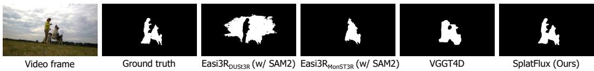  
Figure 6: Qualitative comparison of dynamic object segmentation across different methods.

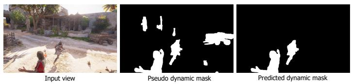  
Figure 7: Qualitative comparison between the pseudo dynamic mask and the dynamic mask predicted by SplatFlux.

## C.3 DYNAMIC OBJECT SEGMENTATION

We evaluate SplatFlux for dynamic object segmentation on the DAVIS (Perazzi et al., 2016) dataset. Quantitative metrics including mean IoU (JM), recall of IoU (JR), mean contour accuracy (FM), and recall of contour accuracy (FR) are reported in Table 9. SplatFlux achieves the best performance across these metrics, demonstrating its ability to distinguish dynamic regions from static scene content. Qualitative results in Fig. 6 further show that our method produces more accurate and complete dynamic masks.

## D MORE QUALITATIVE RESULTS

Visualization of the Dynamic Mask. Fig. 7 presents a qualitative comparison between the pseudo dynamic mask used for supervision and the dynamic mask predicted by SplatFlux. Compared with the pseudo mask, SplatFlux produces cleaner dynamic regions and avoids incorrectly classifying static scene structures as dynamic, indicating that the learned static-dynamic decomposition is more robust than the noisy supervision.

Visualization of Reconstructed 4DGS Scenes. Fig. 8 presents additional reconstruction results from SplatFlux, demonstrating independent control of camera pose and time through fixed-camera, frozen-time, and joint camera-time rendering. The rendered sequences preserve scene appearance and motion, exhibiting visual consistency across changes in viewpoint and time.

Visualization of Generated 4DGS Scenes. Fig. 9 presents additional generation results from SplatFlux under text and image conditions. The generated scenes reflect the conditioning content and maintain visual consistency across changes in viewpoint and time.

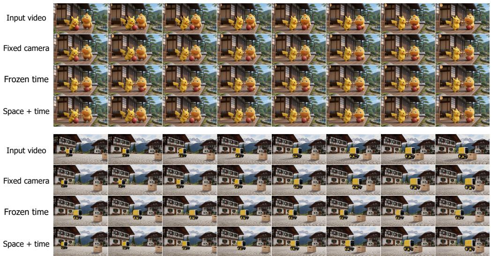  
Figure 8: Visualization of 4DGS scenes reconstructed by SplatFlux. Rows show the input video, fixed-camera rendering, frozen-time rendering, and joint camera–time variation. Columns follow the progression of each visualization sequence.

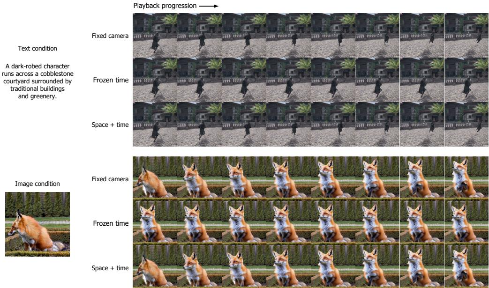  
Figure 9: Visualization of 4DGS scenes generated by SplatFlux. The corresponding text or image condition is shown on the left. For each scene, rows show fixed-camera rendering, frozen-time rendering, and joint camera-time variation. Columns follow the progression of each visualization sequence.

## E LIMITATIONS

SplatFlux currently works in an offline setting and does not support streaming reconstruction or generation. We leave streaming latent decoding to future work.