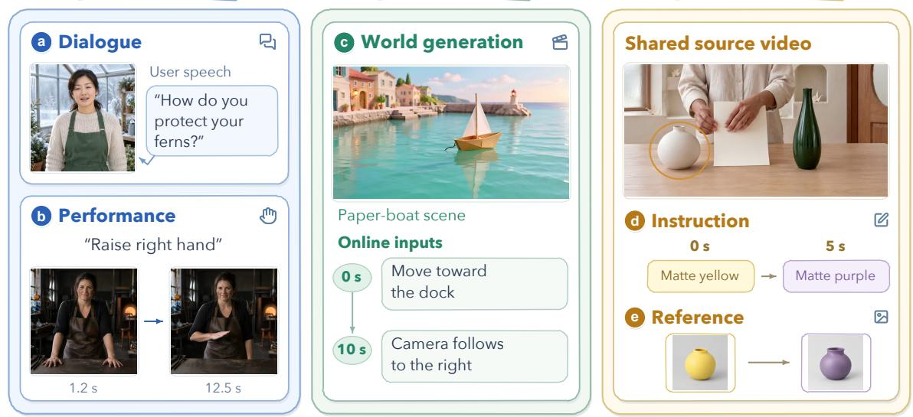
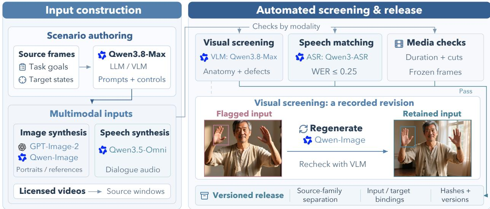
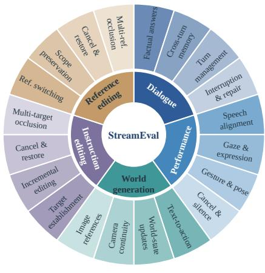
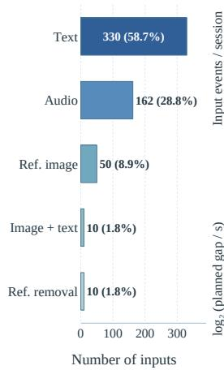
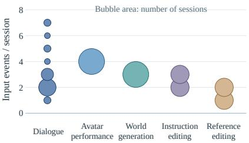
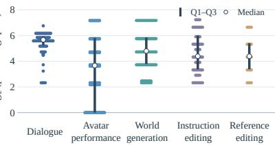
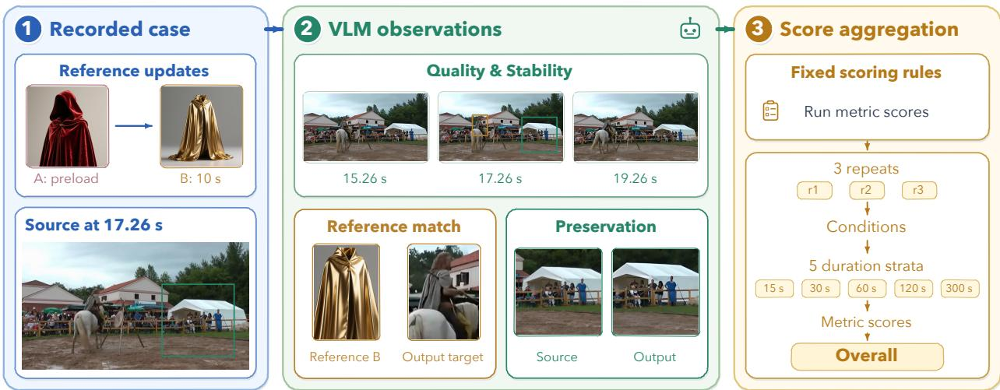
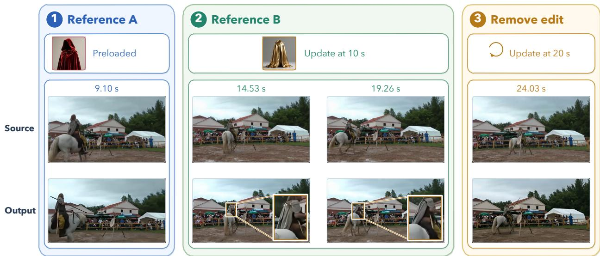

  
Figure 1: StreamEval overview. Five tasks span avatar interaction, world generation, and real-time video editing. Avatar panels show recorded frames; the world-generation panel illustrates a scenario. Editing uses a shared source video with text instructions or reference images that change over time.

# StreamEval: Evaluating Interactive Streaming Video Generation Models

StreamEval Team1,2,3,4,5,6,7

1Tsinghua University, 2NVIDIA, 3CMU, 4UC Berkeley, 5Princeton, 6NUS, 7Reactor

Leaderboard: https://streameval.ai

Github Code: https://github.com/StreamEval/StreamEval Benchmark Data: https://huggingface.co/datasets/StreamEval/StreamEval

## Abstract

As streaming video generation advances, enabling real-time interaction with generated video is becoming increasingly important. We introduce StreamEval, a unified benchmark for interactive streaming video generation spanning five tasks: avatar dialogue, avatar performance, world generation, instruction editing, and reference editing. StreamEval comprises 300 scripted test cases lasting 15–300 s, each specifying initial assets, incrementally arriving multimodal requests, and explicit requirements for state changes and content preservation. Performance is assessed along four evaluation dimensions: task execution, state consistency, visual fidelity, and audiovisual coordination, instantiated through ten task-specific metrics on a 0–100 scale. Evaluating 37 distinct models across 300 test cases, we find that high visual quality and identity retention do not necessarily coincide with reliable request execution or sustained state consistency. In particular, request execution remains challenging: the highest task-specific scores are 36.90 for Following among seven avatar-performance models, 25.93 for Following in text-conditioned world generation, and 15.00 for Edit Success among three reported reference-editing models. These findings identify reliable request execution under timing and preservation constraints as a central challenge for advancing omni-modal real-time interactive systems. The leaderboard is available at https://streameval.ai.

Avatar interaction

## World generation

## Real-time video editing

## Contents

Introduction 3   
The StreamEval Benchmark .   
2.1 Motivation   
2.2 Benchmark Construction .   
2.3 Data Statistics   
2.4 Comparison with Existing Benchmarks   
2.5 Quality Verification . 6   
3 System Evaluation 7   
3.1 Evaluation Setup 7   
3.2 Metrics and Scoring 8   
3.2.1 Task-Specific Metrics 8   
3.2.2 Score Aggregation 9   
3.3 Experimental Results . 10   
3.3.1 Digital-Human Dialogue 10   
3.3.2 Avatar Performance 11   
3.3.3 World Generation 11   
3.3.4 Instruction Editing 11   
3.3.5 Reference Editing 12   
Analysis and Qualitative Results 13   
4.1 A Recorded Reference-Editing Session 13   
4.2 Benchmark Coverage 13   
5 Related Work 14   
5.1 Streaming Video Models . 14   
5.1.1 Streaming Video Generation 14   
5.1.2 Streaming Video Editing . 15   
5.2 Evaluating Streaming Video Systems 15   
6 Conclusion . 16   
Contributions and Acknowledgments 22

## 1 Introduction

As streaming video generation advances, enabling real-time interaction with generated video is becoming increasingly important [59, 79]. Systems that generate video incrementally can accept new user inputs while a session is in progress [5, 63], supporting conversational avatars, controllable virtual worlds, and live video editing. Such settings require more than plausible individual frames or clips: generation and responsive control must remain aligned with incoming inputs as user requests and the surrounding context evolve over time.

Sustained interaction requires systems to execute new requests while preserving relevant prior content and state. A conversational avatar must respond in context without losing its identity or dialogue history; a generated world must accommodate new controls without disrupting unafected scene content; and a video editor must apply, update, or remove edits while tracking an advancing source stream. Each request carries timing and scope requirements, defining when a change should occur, what it should modify, and what must remain intact. Evaluation must therefore assess both task execution and state consistency throughout a session alongside visual fidelity and audiovisual coordination.

Existing benchmarks examine complementary aspects of these requirements. VBench and EvalCrafter assess visual quality and temporal behavior, while T2V-CompBench examines compositional alignment [21, 41, 51]. WBench and WBench-Editing evaluate multi-turn control, successive edits, and content preservation within generated worlds [36, 68]. StreamAV-Bench assesses interactive updates and state retention in streaming audio-video generation [39], and LongV2VBench examines editing quality over sustained source streams [59]. VideoFDB evaluates full-duplex conversational agents through their perception and generation of nonverbal audiovisual cues [44]. Its focus on conversational dynamics complements task-directed evaluation of request execution and state preservation. Building on these eforts, we bring avatar interaction, world generation, and real-time video editing into a unified benchmark with explicit, task-specific execution and preservation criteria.

We introduce StreamEval, spanning five tasks across these domains: digital-human dialogue, avatar performance, world generation, instruction editing, and reference editing (figure 1). The benchmark contains 300 scripted test cases, each representing a 15–300 s interactive session. A test case bundles the initial portrait, scene, or source video with a sequence of timed user requests and explicit criteria for what the output should change and preserve. For example, an editing case may change one object, update another while retaining the first edit, then remove an edit to restore the source. Inputs arrive incrementally, so the system must respond as the session unfolds. Ten task-specific metrics evaluate performance along four complementary dimensions: task execution, state consistency, visual fidelity, and audiovisual coordination. This framework structures evaluation across tasks while respecting diferences in model input interfaces and metric applicability.

We evaluate 37 models on 300 test cases across five interactive streaming video tasks. Vidu S2 Avatar obtains the highest reported Dialogue score in digital-human dialogue. By Overall score, Vidu S2 Avatar leads avatar performance, MemFlow leads world generation, and Vidu S2 Editing leads both instruction and reference editing. Individual metrics reveal complementary strengths: LiveTalk obtains the highest Quality score in avatar performance, while JoyAI-Video-Edit obtains the highest Preservation score in instruction editing (section 3.3). These results highlight distinct model strengths across tasks and interaction requirements. Looking ahead, we view real-time interactive video as an important challenge for bringing omni-modal models to diverse application settings.

Our contributions are:

• Unified interactive benchmark. Five streaming tasks and 300 scripted test cases specify timed multimodal inputs alongside explicit request-execution and state-preservation requirements.

• Multidimensional evaluation. Ten task-specific metrics assess task execution and state consistency alongside visual fidelity and audiovisual coordination under a shared session protocol.

• Cross-task system study. Evaluating 37 models across 300 test cases reveals limited instruction following in avatar performance and world generation, alongside low full-edit completion in reference editing.

## 2 The StreamEval Benchmark

## 2.1 Motivation

Real-time interactive video is an important step toward omni-modal systems that continuously perceive, generate, and respond to evolving user needs. Evaluating this capability requires testing whether systems execute new requests while preserving relevant context and state. StreamEval addresses these requirements through five tasks spanning avatar interaction, world generation, and real-time video editing, with task-specific metrics defined in section 3.2.

Each test case specifies initialization, a timeline of incoming inputs, and expected outcomes. A scheduler releases inputs incrementally and advances editing sources on the session clock. Input events specify when controls arrive; scoring opportunities specify what the system must accomplish or retain.

Avatar interaction. Digital-human dialogue requires contextually appropriate responses to user speech while maintaining persona and conversational history. Avatar performance requires rendering prescribed speech and requested visual actions, such as gaze shifts or hand gestures.

World generation. World generation creates evolving scenes in response to successive controls over objects, actions, cameras, or spatial state, while preserving unafected content and continuity.

Real-time video editing. Instruction editing applies text-specified changes to an advancing source video; reference editing uses images to specify the desired appearance. Both require modifying the intended target while preserving non-target content and source motion. Removal requests restore the contemporaneous source state.

## 2.2 Benchmark Construction

We pair online inputs with explicit state requirements (figure 2). Qwen3.8-Max drafts session goals, timed controls, protected attributes, and expected outcomes. An authored oracle specifies what to establish, retain, cancel, or restore at each checkpoint. Media inputs are screened and revised against these requirements. All benchmark cases, including their timelines, oracles, and media, will be released together.

  
Figure 2: Benchmark construction and verification. Model-assisted authoring and input synthesis precede modalityspecific checks. A Qwen-Image portrait with hand defects is regenerated and passes the same screening.

Functional diversity and dificulty. Each task covers individual operations, combined requests, and recovery. Dialogue covers factual answers, cross-turn state, turn-taking, and interruption; performance covers speech, gaze, expression, pose, and gestures. World generation tests object and action control, state updates, and camera or spatial continuity. Editing tests target establishment, incremental updates, reference switching, scope preservation, and restoration. Repair, multi-target updates, and reappearance after occlusion add more demanding interactions within the same benchmark.

Successive editing controls test whether established changes persist when new requests arrive. Cases include introducing a second target while retaining the first, updating selected attributes, switching references, and removing an edit to restore the advancing source.

Avatar and world-generation inputs. GPT-Image-2 and Qwen-Image synthesize portraits and visual references; portraits depict original synthetic adults or stylized fictional characters. Qwen3.5-Omni generates expressive user and prescribed speech. Dialogue pairs these recordings with authored personas and verified facts, including recordings with background noise or reverberation. Paired text-dialogue derivatives replace audio turns with authored text while retaining identical source-family identities.

Live editing sources. Editing tracks use continuous source videos comprising licensed real-world footage, animation, and benchmark-generated scenes. Third-party sources include Wikimedia Commons, NASA, and Blender Studio; per-asset licenses and attribution are supplied in the data release. Each source covers the session without looping, speed changes, or concatenation, so edits follow the advancing scene. Target regions are temporally grounded via Qwen3.8-Max at planned control timestamps.

## 2.3 Data Statistics

Release composition. Each task contains 60 test cases, balanced across 15, 30, 60, 120, and 300 seconds with 12 cases per duration. Across all five tracks, 300 test cases span 240 independent source families, with 60 text-dialogue derivatives reusing existing families. One pass through the 300 video-session cases represents 525 minutes of active streaming generation, excluding setup and response tails.

Interaction load and diversity. The 300 test cases contain 1,347 planned online events, excluding initialization and continuous source frames. Inputs include speech, text, and visual references; each input can impose multiple execution and preservation requirements. Avatar designs span photorealistic, stylized 3D, anime, and clay or stop-motion appearances. Dialogue includes clean speech, background noise, and room reverberation, while editing covers indoor and outdoor scenes with single or multiple targets. Figure 3 summarizes interaction statistics for 200 of these cases.

Evaluation roster. The evaluation protocol specifies a roster of 300 test cases: 60 per task, with 12 at each duration tier and three independent runs per case and model. The results reported in this paper cover these 300 cases (section 3.1). All five duration strata receive equal aggregation weight within each task, so longer sessions contribute equally to the final assessment rather than in proportion to their duration.

## 2.4 Comparison with Existing Benchmarks

Table 1 positions StreamEval against existing video generation and interactive benchmarks across task coverage and evaluation horizons. Avatar-performance benchmarks assess rendered speakers, including visual quality and speech-motion synchronization, while Full-Duplex-Bench evaluates spoken dialogue without video output. VideoFDB additionally evaluates full-duplex conversational perception and audiovisual response generation [44]. Its naturally occurring nonverbal cues complement our authored speech-input dialogue and prescribed-performance tasks; our broader task coverage does not imply coverage of its user-video perception requirements. For video editing, WBench and WBench-Editing focus on world-model environments, while EditVerseBench covers instruction- and reference-conditioned editing of external videos [29, 36, 68]. WBench Editing also reports a separate reference-conditioned comparison. Task interfaces and control timing jointly define the interaction protocol.

  
(a) Task and function taxonomy

  
(b) Online input types

(c) Input events per session  
  
(d) Scheduled input gaps  
Figure 3: Benchmark composition. (a) Task and function composition. (b) Planned input types. (c) Inputs per session. (d) Gaps between adjacent scheduled inputs. The 200 cases shown contain 562 online events, excluding initialization and continuous source frames. Gap statistics exclude pairs containing a trigger.

StreamEval applies a balanced multi-horizon design across all five streaming tasks: 15, 30, 60, 120, and 300 seconds, with 60 test cases at each duration tier. Its 300-second editing cases represent a five-fold expansion over LongV2VBench (60 s), while its world-generation cases extend beyond StreamAV-Bench’s 180-second rollouts [39, 59]. Longer avatar sequences already appear in GenBench [20]; our contribution is balanced coverage across tasks and durations, with incrementally released multimodal controls and continuously advancing editing sources.

We evaluate 37 models on 300 test cases across these tasks (section 3.1). For context, WBench evaluates 20 models, WorldMark 10, and StreamAV-Bench 13 systems within their respective domains [39, 62, 68]. Our benchmark brings these application domains into a shared framework for assessing request execution and state preservation alongside content quality.

## 2.5 Quality Verification

Asset and consistency checks. Automated checks verify media decodability and duration bounds, file identity, and agreement among events, opportunities, and scoring requirements (figure 2). Qwen3-ASR transcribes synthesized speech, requiring normalized word-error rates of at most 0.25 against authored transcripts. Qwen3.8-Max audits images for subject clarity and anatomical or rendering defects. Editing sources are checked for scene cuts, frozen spans, and unsuitable targets. Revised candidates must pass the same checks.

Judge calibration. Targeted positive and negative probes evaluate automated production judges against acceptance criteria of at most 5% false positive rate, 10% false negative rate, and 10% unresolved decisions per class. Visual critique judges return structured defect categories, severity ratings, and supporting frame timestamps. Identity uses the lower rating from two judges given the same initialization portrait (or the system’s opening frame for a fixed avatar) and sampled output frames to guard against same-style identity substitutions.

Table 1: Five-task coverage and evaluation duration. Dlg.: dialogue; Perf.: avatar performance; World: world generation; Instr./Ref.: instruction/reference real-time video editing. $\checkmark / \times$ denote task inclusion/exclusion.
<table><tr><td rowspan="2">Benchmark</td><td colspan="5">Task coverage</td><td rowspan="2">Duration (s)</td></tr><tr><td>Dlg.</td><td>Perf.</td><td>World</td><td>Instr.</td><td>Ref.</td></tr><tr><td>VBench [21]</td><td>X</td><td>X</td><td>√</td><td>X</td><td>X</td><td>2-3.3</td></tr><tr><td>VBench++ [22]</td><td>X</td><td>X</td><td>√</td><td>X</td><td>X</td><td>Var.</td></tr><tr><td>T2V-CompBench [51]</td><td>X</td><td>X</td><td>√</td><td>X</td><td>X</td><td>2-5</td></tr><tr><td>TC-Bench [11]</td><td>X</td><td>X</td><td>√</td><td>X</td><td>X</td><td>Var.</td></tr><tr><td>NarraStream-Bench [38]</td><td>X</td><td>X</td><td>√</td><td>X</td><td>X</td><td>60</td></tr><tr><td>MBench [86]</td><td>X</td><td>X</td><td>√</td><td>X</td><td>X</td><td>25</td></tr><tr><td>WorldMark [62]</td><td>X</td><td>X</td><td>√</td><td>X</td><td>X</td><td>20-60</td></tr><tr><td>WBench [68]</td><td>X</td><td>X</td><td>√</td><td>X</td><td>X</td><td>Var.</td></tr><tr><td>WBench-Editing [36]</td><td>X</td><td>X</td><td>√</td><td>X</td><td>X</td><td>15-30</td></tr><tr><td>StreamAV-Bench [39]</td><td>X</td><td>X</td><td>√</td><td>X</td><td>X</td><td>180</td></tr><tr><td>GenBench [20]</td><td>X</td><td>V</td><td>X</td><td>X</td><td>X</td><td> ${ \sim } 1 0 ; > 3 0 0$ </td></tr><tr><td>THEval [45]</td><td>×</td><td>√</td><td>X</td><td>X</td><td>X</td><td>2-334.6</td></tr><tr><td>Full-Duplex-Bench [37]</td><td>√</td><td>X</td><td>X</td><td>X</td><td>X</td><td>Var.</td></tr><tr><td>VideoFDB [44]</td><td>√</td><td>X</td><td>X</td><td>X</td><td>X</td><td>Var.</td></tr><tr><td>EditVerseBench [29]</td><td>X</td><td>X</td><td>X</td><td>√</td><td>√</td><td>Var.</td></tr><tr><td>LiveEdit [55]</td><td>X</td><td>X</td><td>X</td><td>√</td><td>X</td><td>一</td></tr><tr><td>EgoEditBench [33]</td><td>X</td><td>X</td><td>X</td><td>√</td><td>X</td><td>Var.</td></tr><tr><td>CharEdit-Bench [34]</td><td>X</td><td>X</td><td>X</td><td>√</td><td>X</td><td>5; &gt; 60</td></tr><tr><td>LongV2VBench [59]</td><td>X</td><td>X</td><td>X</td><td>√</td><td>X</td><td>60</td></tr><tr><td>StreamEval</td><td>√</td><td>√</td><td>√</td><td>5</td><td>√</td><td>15-300</td></tr></table>

Duration follows the benchmark evaluation, excluding longer model demonstrations; Var.: model/case-dependent; –: unspecified. Dialogue includes audio-only and audiovisual conversation. VideoFDB’s avatar responses are conversational, not prescribedperformance tasks; its duration varies by clip. Online control follows each benchmark’s input protocol.

## 3 System Evaluation

We evaluate how systems execute evolving requests, retain relevant state, and render the resulting video across the five tasks in section 2. Each task and input setting has a defined metric profile and an Overall score.

## 3.1 Evaluation Setup

Evaluated models. We report 37 distinct models across 47 task configurations. A task configuration is a model evaluated on one task with its specified input route and any adapter components. A model evaluated on multiple tasks is counted once in the model total and separately for each task configuration. Avatar models include Vidu S2 Avatar [79], Tavus CVI Full, LiveAvatar FULL, Runway Characters, Vivix A1, AptAvatar, Avatar-Forever, AvatarForcing, AVTR-1, LiveTalk [5], MuseTalk [87], Quark Live Avatar, and the SoulX-FlashHead, SoulX-FlashTalk, and SoulX-LiveAct models. World generation covers AlayaWorld, HappyOyster 1.0 Adventure, HY-World 1.5 WorldPlay, LingBot-World 2.0, Matrix-Game 3.5, Causal Forcing, Context Forcing, Helios, Krea Realtime, LongLive 2.0, MemFlow, Reward Forcing, Rolling Forcing [40], Self-Forcing, ShotStream, Yume 1.5, and Zing-0.5. Reported editing models include Vidu S2 Editing, JoyAI-Video-Edit [59], EditaLive, SANA-Streaming, and XMax X2.0. The editing tables show configurations with Overall at least 5; this presentation subset was selected after evaluation. The model and configuration totals refer to the reported subset. LiveAvatar FULL and Tavus CVI Full use fixed, provider-supplied avatars because avatar customization is unavailable through their evaluated interfaces; Identity is rated against each system’s own opening frame and included in Overall, and their names appear in gray in table 2.

Evaluation tasks. The five tasks are digital-human dialogue (15 configurations), avatar performance (7), world generation (17: 12 text-conditioned and 5 image-conditioned), instruction editing (5), and reference editing (3). The evaluation covers 300 test cases (60 in each task) across five equally weighted duration strata from 15 to 300 s, with three repeats per test case and model. World generation includes text-controlled and image-conditioned inputs; the latter adds appearance conditioning.

Evaluation metrics. We report ten metrics across four dimensions: task execution (Dialogue, Following, Edit Success), state consistency (Stability, Continuity, Preservation), visual fidelity (Quality, Identity, Reference), and audiovisual coordination (A–V Sync). Each task reports the equal-weight mean of its applicable metrics as Quality-Overall; avatar tasks additionally report a customization bonus and their sum as Overall.

## 3.2 Metrics and Scoring

## 3.2.1 Task-Specific Metrics

Shared output measures. All five tasks assess output quality and stability under the expected state sequence, including authorized actions, edits, and restoration. Quality scores five-second clips from primary-judge defect lists: no defect, one minor defect, multiple minor defects, one severe defect, and multiple severe defects give ratings $r \in \{ 5 , 4 , 3 , 2 , 1 \}$ , respectively, with severe defects taking precedence and mapping to 25(r − 1). Stability measures the duration covered by clips with no severe temporal defect, at most one minor temporal defect, and Quality rating at least 3. Because Stability is gated by Quality, the two metrics overlap and a high Stability score requires both temporal consistency and acceptable visual quality.

Digital-human dialogue. Dialogue measures the percentage of planned turns satisfying answer, content, conversational, and timing requirements. Identity provides the initialization portrait (or the system’s own opening frame for a fixed avatar) and sampled clip frames to two judges, Qwen3.8-Max-0902 and Qwen3- VL-Plus, and takes the lower feature-derived rating while allowing authorized expression, pose, crop, and lighting changes. An explicitly diferent person or at least three clear feature changes gives rating 1; two clear changes give 2; one clear change or at least three slight changes gives 3; one or two slight changes give 4; no change gives 5. An unclear same-person judgment caps the rating at 3, and the final score is 25(r − 1). A–V Sync measures the percentage of required speech events with lip-opening/audio-envelope correlation at least 0.3, evaluated at a pooled system ofset whose 95% interval (2,000 session-bootstrap draws) lies within [−200, 200] ms using 10-ms search steps over [−1000, 1000] ms. Sparse source sampling (500 ms for dialogue, 250 ms for performance) limits its temporal resolution. Together with Quality and Stability, these metrics evaluate conversational execution, speaker appearance, and audiovisual delivery.

Avatar performance. Following measures the percentage of control events in which the avatar executes the requested gaze, expression, pose, or gesture on the specified target. Prescribed speech supplies the verbal content. The task combines Following with Quality, Stability, Identity, and A–V Sync.

World generation. Following measures the percentage of online controls that produce the requested scene operation on the specified target; a control passes when every frame in which the target is visible shows the requested outcome fully or partially. Continuity measures the fraction of generated duration meeting motion, camera, object-permanence, transition, and spatial-relation requirements. These two metrics join Quality and Stability in both the text-conditioned and the image-conditioned setting.

Instruction editing. Following checks the requested operation and target, allowing a partial appearance match when no severe leakage occurs. Edit Success requires the complete edit to satisfy scope, active-state, deadline, persistence, and protected-content checks. Preservation assesses non-target content and current source motion, including restoration against the contemporaneous source. Together with Quality and Stability, this profile separates operation execution, full edit completion, source retention, and visual fidelity.

Reference editing. Reference measures declared appearance attributes at checkpoints where the supplied image is active, whereas avatar Identity compares against the initialization portrait or, for fixed-avatar interfaces, the system’s opening frame. Edit Success checks the full editing contract, Preservation assesses protected source content and motion, and Quality and Stability complete the five-metric profile

Fixed rules convert structured visual observations into scores using each test case’s predefined deadline and verification window. Figure 4 illustrates a recorded reference-editing session.

  
Figure 4: Evaluation workflow. Recorded inputs and output frames from reference-editing case 234 illustrate quality, stability, reference, and preservation checks. Fixed rules convert structured VLM observations into run metric scores. Aggregation averages repeats, conditions, and duration strata before computing task-specific Overall.

## 3.2.2 Score Aggregation

The ten content metrics use a 0–100 scale, with applicability fixed before inspecting outputs. Missing output and unsupported required operations receive zero, and all planned control opportunities remain in the denominator, including unfired triggers and controls beyond a provider’s session limit. Unresolved judgments define an interval by contributing 0 to the lower endpoint and 100 to the upper endpoint; tables report the lower endpoint when any required judgment is unresolved. Let $s _ { c , r , m }$ denote the run-level score for test case $c ,$ repeat $r ,$ and metric $m ,$ and let $\mathcal { C } _ { d , m }$ contain the applicable test cases in duration stratum d. We average the three repeats, then test cases within each stratum, and finally the five duration strata D:

$$
S _ { m } = \frac { 1 } { \mathcal { | D | } } \sum _ { d \in \mathcal { D } } \frac { 1 } { \mathcal { | C } _ { d , m } \vert } \sum _ { c \in \mathcal { C } _ { d , m } } \frac { 1 } { 3 } \sum _ { r = 1 } ^ { 3 } s _ { c , r , m } .\tag{1}
$$

Task-specific Overall. For task t and model k, let $\mathcal { M } _ { t , k }$ contain its applicable metrics and $S _ { t , k , m }$ denote the metric aggregate from equation (1). Quality-Overall is their equal-weight mean:

$$
\mathrm { Q O v e r a l l } _ { t , k } = \frac { 1 } { \vert \mathcal { M } _ { t , k } \vert } \sum _ { m \in \mathcal { M } _ { t , k } } S _ { t , k , m } .\tag{2}
$$

We abbreviate Quality-Overall as Q-Overall. Portrait-conditioned dialogue, performance, and both editing tasks average five metrics; fixed-avatar dialogue also averages five, because Identity is rated against the system’s own opening frame when its evaluated interface does not accept a custom portrait. World generation averages four metrics.

Sweet-spot bonus for avatar customization. Avatar customization is an essential capability for digital-human dialogue and avatar performance, so these two tasks add a sweet-spot bonus to Q-Overall. Every system that supports a custom avatar receives +5; systems restricted to fixed, provider-supplied avatars receive 0. The tables report Q-Overall, the bonus (Custom.), and their sum as Overall, which orders the avatar tasks. All other tasks report Overall = Q-Overall. Thus,

$$
\mathrm { O v e r a l l } _ { t , k } = \mathrm { Q O v e r a l l } _ { t , k } + B _ { t , k } , \qquad B _ { t , k } = \left\{ \begin{array} { l l } { 5 , } & { \mathrm { a v a t a r ~ t a s k ~ w i t h ~ c u s t o m - a v a t a r ~ s u p p o r t } , } \\ { 0 , } & { \mathrm { o t h e r w i s e } . } \end{array} \right.\tag{3}
$$

Q-Overall remains on a 0–100 scale; the avatar ranking score can reach 105. The bonus describes interface capability and does not alter the underlying metric scores.

## 3.3 Experimental Results

Tables 2 to 6 report model performance across the five tasks in alphabetical order. The website shows the same scores sorted by descending Overall within each task.

## 3.3.1 Digital-Human Dialogue

Among custom-avatar models, Vidu S2 Avatar achieves the highest Overall score (93.98; 88.98 Q-Overall plus the customization bonus) and leads in Quality (96.78), Dialogue (75.29), and Identity (90.12), followed by AVTR-1 at 84.14 Overall (79.14 Q-Overall), 82.97 Quality, and 88.54 Identity (table 2). In the fixed-avatar setting, where Identity is rated against each system’s own opening frame, Tavus CVI Full reaches 86.65 Q-Overall and 89.89 Identity compared with 65.07 and 87.70 for LiveAvatar FULL; neither supports a custom avatar, so both receive no bonus and their Overall equals Q-Overall. Across individual shared dimensions, Tavus CVI Full records the highest A–V Sync (94.44 vs. 84.87 for Vidu S2 Avatar) and the second-highest Dialogue (73.91, behind Vidu S2 Avatar at 75.29 and ahead of 61.37 for LiveAvatar FULL), while LiveAvatar FULL reaches 100.00 in Stability alongside 0.00 in A–V Sync.

Results among models evaluated with the shared dialogue pipeline further show that strong visual appearance and temporal stability do not automatically accompany high synchronization or conversational scores. MuseTalk 1.5 [87] attains 95.34 in Quality, 97.11 in Stability, and 88.44 in Identity, yet records 38.09 in A–V Sync and 54.34 in Dialogue (79.66 Overall). Conversely, AptAvatar 14B reaches 70.32 in A–V Sync and 94.74 in Stability, but scores 35.98 in Dialogue and 68.03 in Quality (75.01 Overall), whereas SoulX-FlashTalk 14B records 68.90 Quality, 66.27 A–V Sync, and 50.57 Dialogue to reach 77.90 Overall.

Table 2: Digital-human dialogue.
<table><tr><td colspan="10">Model Quality A-V Sync Stability Dialogue Identity Q-Overall Custom. Overall</td></tr><tr><td>AptAvatar 14B†</td><td>68.03</td><td>70.32</td><td>94.74</td><td>35.98</td><td>81.00</td><td>70.01</td><td>+5</td><td></td><td>75.01</td></tr><tr><td>Avatar-Forever 22B†</td><td>50.86</td><td>48.17</td><td>68.48</td><td>54.93</td><td>75.23</td><td></td><td>59.53</td><td>+5</td><td>64.53</td></tr><tr><td>AvatarForcing 1.3B†</td><td>57.17</td><td>0.00</td><td>87.30</td><td></td><td>8.93</td><td>66.85</td><td>44.05</td><td>+5</td><td>49.05</td></tr><tr><td>AVTR-1†</td><td>82.97</td><td>69.38</td><td>99.87</td><td>54.97</td><td></td><td>88.54</td><td>79.14</td><td>+5</td><td>84.14</td></tr><tr><td>LiveAvatar FULL</td><td>76.27</td><td>0.00</td><td>100.00</td><td>61.37</td><td></td><td>87.70</td><td>65.07</td><td>0</td><td>65.07</td></tr><tr><td>LiveTalk 1.3B†</td><td>61.75</td><td>62.80</td><td>86.51</td><td></td><td>54.40</td><td>77.51</td><td>68.60</td><td>+5</td><td>73.60</td></tr><tr><td>MuseTalk 1.5†</td><td>95.34</td><td>38.09</td><td>97.11</td><td></td><td>54.34</td><td>88.44</td><td>74.66</td><td>+5</td><td>79.66</td></tr><tr><td>Quark Live Avatar 14B†</td><td>56.00</td><td>64.91</td><td>70.90</td><td></td><td>55.02</td><td>78.10</td><td>64.99</td><td>+5</td><td>69.99</td></tr><tr><td>Runway Characters</td><td>57.81</td><td>49.82</td><td>75.94</td><td></td><td>43.53</td><td>60.40</td><td>57.50</td><td>+5</td><td>62.50</td></tr><tr><td>SoulX-FlashHead (Lite)†</td><td>68.43</td><td>29.77</td><td>91.61</td><td></td><td>56.65</td><td>79.69</td><td>65.23</td><td>+5</td><td>70.23</td></tr><tr><td>SoulX-FlashTalk 14B†</td><td>68.90</td><td>66.27</td><td>95.45</td><td></td><td>50.57</td><td>83.31</td><td>72.90</td><td>+5</td><td>77.90</td></tr><tr><td>SoulX-LiveAct 18B†</td><td>64.93</td><td>50.30</td><td>91.54</td><td></td><td>54.98</td><td>75.09</td><td>67.37</td><td>+5</td><td>72.37</td></tr><tr><td>Tavus CVI Full</td><td>75.04</td><td>94.44</td><td>99.95</td><td></td><td>73.91</td><td>89.89</td><td>86.65</td><td>0</td><td>86.65</td></tr><tr><td>Vidu S2 Avatar</td><td>96.78</td><td>84.87</td><td>97.83</td><td></td><td>75.29</td><td>90.12</td><td>88.98</td><td>+5</td><td>93.98</td></tr><tr><td>Vivix A1</td><td>45.78</td><td>69.15</td><td>66.83</td><td></td><td>50.38</td><td>75.19</td><td>61.47</td><td>+5</td><td>66.47</td></tr></table>

Q-Overall: equal-weight mean of the content metrics. Custom.: sweet-spot bonus, +5 for systems that support a custom avatar and 0 otherwise. Overall = Q-Overall + Custom.

## 3.3.2 Avatar Performance

Vidu S2 Avatar (81.71 Overall) and LiveTalk 1.3B (75.85 Overall) lead avatar performance with distinct metric profiles (table 3). Vidu S2 Avatar achieves the highest scores in A–V Sync (99.60), Stability (97.25), Identity (86.12), and Following (36.90), paired with 63.68 in Quality. LiveTalk 1.3B leads in Quality (71.27) and reaches 16.59 in Following, while recording 86.44 in A–V Sync, 96.06 in Stability, and 83.89 in Identity. AptAvatar 14B ranks third at 70.37 Overall, ahead of Quark Live Avatar 14B at 62.83 and SoulX-LiveAct 18B at 53.51; all seven systems support a custom avatar and receive the +5 bonus.

Middle-ranking systems also difer in temporal stability and visual quality despite similar lip synchronization and identity preservation scores. AptAvatar 14B and Quark Live Avatar 14B tie at 98.89 in A–V Sync and score similarly in Identity (81.33 vs. 79.75), but difer in Stability (78.06 vs. 55.30) and Quality (55.55 vs. 43.51). Across all seven evaluated models, executing scripted actions under timing constraints remains the primary challenge: Following scores span 6.37 (Avatar-Forever 22B) to 36.90 (Vidu S2 Avatar), even for systems that exceed 80 in Identity and 96 in Stability.

Table 3: Avatar performance.
<table><tr><td>Quality A-V Sync Stability Following Identity Q-Overall Custom. Overall</td></tr><tr><td>Model AptAvatar 14B</td><td>55.55</td><td>98.89</td><td>78.06</td><td>13.04</td><td>81.33</td><td>65.37</td><td>+5 70.37</td></tr><tr><td>Avatar-Forever 22B</td><td>34.73</td><td>34.67</td><td>45.31</td><td>6.37</td><td>74.82</td><td>39.18</td><td>+5 44.18</td></tr><tr><td>AvatarForcing 1.3B</td><td>54.32</td><td>18.44</td><td>71.60</td><td>8.44</td><td>68.50</td><td>44.26 +5</td><td>49.26</td></tr><tr><td>LiveTalk 1.3B</td><td>71.27</td><td>86.44</td><td>96.06</td><td>16.59</td><td>83.89</td><td>70.85 +5</td><td>75.85</td></tr><tr><td>Quark Live Avatar 14B</td><td>43.51</td><td>98.89</td><td>55.30</td><td>11.70</td><td>79.75</td><td>57.83 +5</td><td>62.83</td></tr><tr><td>SoulX-LiveAct 18B</td><td>48.39</td><td>48.67</td><td>64.94</td><td>10.74</td><td>69.83</td><td>48.51 +5</td><td>53.51</td></tr><tr><td>Vidu S2 Avatar</td><td>63.68</td><td>99.60</td><td>97.25</td><td>36.90</td><td>86.12</td><td>76.71 +5</td><td>81.71</td></tr></table>

Q-Overall: equal-weight mean of the content metrics. Custom.: sweet-spot bonus, +5 for systems that support a custom avatar and 0 otherwise. Overall = Q-Overall + Custom.

## 3.3.3 World Generation

World generation ranks text- and image-conditioned configurations together; a model evaluated with both inputs is reported with its text-conditioned result (table 4). MemFlow achieves the highest Overall score at 33.36, closely followed by Rolling Forcing [40] at 33.01, Krea Realtime at 31.61, HY-World 1.5 WorldPlay at 31.44, and HappyOyster 1.0 Adventure at 30.84. HappyOyster has the highest Quality (58.34) and Stability (56.67) but low Following (5.56) and Continuity (2.78). Matrix-Game 3.5 achieves the highest Continuity at 34.50, followed by MemFlow at 29.54.

The ordering of models changes across visual quality, continuity, and Following. Krea Realtime records the highest Following score at 25.93, followed by Reward Forcing at 23.33 and MemFlow at 22.59, whereas Rolling Forcing scores 17.78 and Causal Forcing 15.23. Reward Forcing reaches 23.33 in Following but only 16.06 in Stability. Similarly, ShotStream attains 33.80 in Quality but 20.55 in Stability and 9.34 in Continuity (21.02 Overall), underscoring the joint requirements of visual synthesis, temporal continuity, and responsive online control.

## 3.3.4 Instruction Editing

Vidu S2 Editing (45.43 Overall) and JoyAI-Video-Edit [59] (42.39 Overall) lead instruction editing by a wide margin over the remaining three reported models (table 5). Vidu S2 Editing achieves the highest scores in Following (72.10), Edit Success (57.20), Quality (22.99), and Stability (13.94), accompanied by 60.93 in Preservation. JoyAI-Video-Edit ranks second in Following (63.89), Edit Success (43.52), and Stability (9.57), while leading all systems in Preservation at 83.33. SANA-Streaming ranks third at 16.95 Overall (15.15 Quality, 44.26 Preservation, 4.63 Edit Success), and the other two reported models score at or below 10.29 Overall.

Table 4: World generation. Text- and image-conditioned configurations are ranked together; a model evaluated with both inputs is reported with its text-conditioned result.
<table><tr><td>Model</td><td>Quality</td><td>Stability</td><td>Following</td><td>Continuity</td><td>Overall</td></tr><tr><td>AlayaWorld</td><td>49.44</td><td>46.17</td><td>8.89</td><td>10.08</td><td>28.65</td></tr><tr><td>Causal Forcing</td><td>18.12</td><td>15.83</td><td>15.23</td><td>14.11</td><td>15.82</td></tr><tr><td>Context Forcing</td><td>35.70</td><td>31.04</td><td>18.52</td><td>16.49</td><td>25.44</td></tr><tr><td>HappyOyster 1.0 Adventure</td><td>58.34</td><td>56.67</td><td>5.56</td><td>2.78</td><td>30.84</td></tr><tr><td>Helios</td><td>28.79</td><td>28.04</td><td>14.44</td><td>19.90</td><td>22.79</td></tr><tr><td>HY-World 1.5 WorldPlay</td><td>50.60</td><td>48.06</td><td>10.00</td><td>17.11</td><td>31.44</td></tr><tr><td>Krea Realtime</td><td>35.61</td><td>42.79</td><td>25.93</td><td>22.12</td><td>31.61</td></tr><tr><td>LingBot-World 2.0</td><td>16.76</td><td>17.44</td><td>11.11</td><td>15.33</td><td>15.16</td></tr><tr><td>LongLive 2.0</td><td>30.08</td><td>31.84</td><td>17.41</td><td>20.74</td><td>25.02</td></tr><tr><td>Matrix-Game 3.5</td><td>40.43</td><td>37.86</td><td>6.67</td><td>34.50</td><td>29.87</td></tr><tr><td>MemFlow</td><td>40.93</td><td>40.38</td><td>22.59</td><td>29.54</td><td>33.36</td></tr><tr><td>Reward Forcing</td><td>21.73</td><td>16.06</td><td>23.33</td><td>21.41</td><td>20.63</td></tr><tr><td>Rolling Forcing</td><td>45.19</td><td>44.47</td><td>17.78</td><td>24.61</td><td>33.01</td></tr><tr><td>Self-Forcing</td><td>16.29</td><td>17.06</td><td>15.19</td><td>13.62</td><td>15.54</td></tr><tr><td>ShotStream</td><td>33.80</td><td>20.55</td><td>20.37</td><td>9.34</td><td>21.02</td></tr><tr><td>Yume 1.5</td><td>25.97</td><td>27.68</td><td>19.63</td><td>26.22</td><td>24.88</td></tr><tr><td>Zing-0.5</td><td>35.60</td><td>39.15</td><td>17.41</td><td>23.66</td><td>28.96</td></tr></table>

The distribution of metrics across both leading and mid-tier systems highlights the multi-constraint structure of streaming instruction editing. While Following assesses the requested operation and target, Edit Success evaluates complete editing requirements including scope, timing, persistence, and protected-content requirements (Following / Edit Success: 72.10 / 57.20 for Vidu S2 Editing, 63.89 / 43.52 for JoyAI-Video-Edit, and 12.04 / 4.26 for EditaLive (14B)). Meanwhile, Quality (up to 22.99) and Stability (up to 13.94) remain low even for the highest-scoring systems, indicating the dificulty of sustaining clean temporal rendering during live edits.

Table 5: Instruction editing.
<table><tr><td>Model</td><td>Quality</td><td>Stability</td><td>Following</td><td>Edit Success</td><td>Preservation</td><td>Overall</td></tr><tr><td>EditaLive (14B)</td><td>7.86</td><td>4.12</td><td>12.04</td><td>4.26</td><td>23.15</td><td>10.29</td></tr><tr><td>JoyAI-Video-Edit</td><td>11.63</td><td>9.57</td><td>63.89</td><td>43.52</td><td>83.33</td><td>42.39</td></tr><tr><td>SANA-Streaming</td><td>15.15</td><td>9.22</td><td>11.48</td><td>4.63</td><td>44.26</td><td>16.95</td></tr><tr><td>Vidu S2 Editing</td><td>22.99</td><td>13.94</td><td>72.10</td><td>57.20</td><td>60.93</td><td>45.43</td></tr><tr><td>XMax X2.0</td><td>5.14</td><td>0.97</td><td>11.30</td><td>2.59</td><td>28.52</td><td>9.70</td></tr></table>

## 3.3.5 Reference Editing

Vidu S2 Editing achieves the highest Overall score in reference editing at 39.02, leading in Reference (31.20), Preservation (64.44), Stability (46.74), Quality (37.72), and Edit Success (15.00) (table 6). JoyAI-Video-Edit ranks second at 14.33 Overall, followed by XMax X2.0 at 9.47. On checkpoint-level Reference matching, JoyAI-Video-Edit (26.11) and XMax X2.0 (20.56) follow Vidu S2 Editing (31.20).

Comparing Reference, Preservation, and Edit Success illustrates the distinct requirements of adopting reference appearances, preserving source content, and completing an edit. Although JoyAI-Video-Edit and XMax X2.0 exceed 20 in Reference, their lower Preservation (26.67 and 10.00) and Stability (3.46 and 7.51) accompany Edit Success scores of 8.89 and 1.11, respectively. Conversely, Vidu S2 Editing pairs 64.44 Preservation with the top Edit Success score of 15.00, showing that satisfying the full reference-editing criteria remains challenging across the three reported systems; section 4 illustrates these requirements in a recorded session.

Table 6: Reference editing.
<table><tr><td>Model</td><td></td><td></td><td></td><td>Quality Stability Reference Edit Success Preservation Overall</td><td></td><td></td></tr><tr><td>JoyAI-Video-Edit</td><td>6.54</td><td>3.46</td><td>26.11</td><td>8.89</td><td>26.67</td><td>14.33</td></tr><tr><td>Vidu S2 Editing</td><td>37.72</td><td>46.74</td><td>31.20</td><td>15.00</td><td>64.44</td><td>39.02</td></tr><tr><td>XMax X2.0</td><td>8.20</td><td>7.51</td><td>20.56</td><td>1.11</td><td>10.00</td><td>9.47</td></tr></table>

## 4 Analysis and Qualitative Results

We examine a recorded reference-editing session to illustrate the divergence between source preservation and reference adoption observed in section 3.3.5, and summarize benchmark coverage and evaluation scope.

## 4.1 A Recorded Reference-Editing Session

Figure 5 compares source preservation and reference adoption in a recorded session.1 The prompt schedule requests a red velvet cape (Reference A) initially, switches to a gold satin cape (Reference B) at 10 s, and requests removal at 20 s. Both sampled B-phase outputs pair the generated video with the latest contemporaneous source frame: the models preserve the underlying scene, but retain the original grey cape rather than adopting the requested gold satin appearance.

  
Figure 5: Reference editing under changing inputs. Reference A is preloaded, B arrives at 10 s, and removal is requested at 20 s. Columns pair source and output frames at recorded session times. Insets magnify the outlined cape regions, showing grey retained in both B-phase outputs instead of the requested gold satin.

## 4.2 Benchmark Coverage

The benchmark combines synthetic portraits and speech, controlled acoustic variations, and licensed source videos. Its editing tasks test reference switching, multi-target retention, and restoration against an advancing source video, while future extensions can cover broader identities and environments, global resets, and selective restoration while concurrent edits remain active.

## 5 Related Work

## 5.1 Streaming Video Models

## 5.1.1 Streaming Video Generation

Eficient causal generation. Incremental video synthesis requires eficient sampling and temporal models that can use previously generated content. StreamDifusion develops eficient pipelines for interactive image synthesis [30], while Difusion Forcing provides a flexible formulation for sequence prediction [2]. CausVid brings few-step distillation to causal video generation [67]; Self Forcing and Causal Forcing further address the mismatch between training and autoregressive inference [19, 97]. Causal Forcing++ further studies frame-wise generation with one or two sampling steps [90]. rCM scales consistency distillation to large image and video models, and Causal-rCM extends it to autoregressive streaming difusion [94, 95]. Speculative decoding for video generation uses a smaller drafter and a quality router to reduce target-model computation [16]. StreamDiT and StreamDifusionV2 develop continuous generation and serving pipelines [10, 31], making incremental synthesis practical for interactive applications.

Eficient inference and serving. Eficient attention methods span hardware-eficient kernels, sparsity, compact representations, and linear formulations [72]. SageAttention and its successors accelerate low-bit inference [70, 73, 74, 76], while SageBwd studies low-bit training [78]; dynamic block-level INT8 fallback handles trainingtime activation outliers [85]. SpargeAttention and SpargeAttention2 study sparse attention, while SLA and SLA2 combine sparse and linear computation [75, 81–83]. Sparse VideoGen and Sparse VideoGen2 exploit spatial-temporal sparsity and semantic grouping, and SVG-EAR adds error-aware routing and linear compensation [56, 64, 96]. Mixed-precision quantization and difusion distillation further reduce videogeneration cost [48, 77]. Related image-generation work studies pixel- and timestep-level model stitching for difusion acceleration [50].

Flash-KMeans targets online clustering for token grouping and KV-cache quantization [65]. KernelBenchX evaluates correctness and hardware eficiency of LLM-generated GPU kernels [53]. TurboServe addresses stateful-session scheduling and GPU provisioning [26]; Vidu S1 and S2 connect eficient synthesis to live character interaction and streaming editing [79, 80]. These implementation advances motivate measuring client-observed response and sustained delivery alongside content quality.

Memory and changing controls. Sustained generation adds the problem of retaining useful history as the stream grows. FramePack bounds the context cost by compressing historical frames [84]; Rolling Forcing, Reward Forcing, and Helios address accumulated drift and motion degradation over long rollouts [40, 42, 69]. Context Forcing trains with longer historical context, while MemFlow retrieves relevant past frames [4, 23]. Changing requests also require deciding which earlier states remain relevant. LongLive supports prompt transitions during generation [63], and Yume-1.5 adds text-controlled world events [43]. IAMFlow tracks persistent entities across narrative updates [38], and SEGUE models the intermediate state changes needed to execute a prompt switch [46]. Quant VideoGen compresses autoregressive KV caches, UltraViCo addresses video-length extrapolation, and ViewRoPE introduces camera-ray geometry for spatial persistence [57, 58, 89]. These developments connect long-term memory with selective adaptation to new controls.

Avatars and spoken interaction. Avatar generation applies these capabilities to speech, identity, and bodily motion. VASA-1 animates portraits from supplied audio, MuseTalk focuses on identity-preserving lip synchronization [87], and OmniAvatar extends audio-driven synthesis to text-controlled body animation [13, 61]. Live Avatar, SoulX-FlashTalk, and AvatarForcing pursue eficient, sustained avatar rendering [7, 20, 47]. SoulX-LiveAct extends sustained human animation with compressed historical memory [92]. Joint audiovisual models also generate both modalities during streaming, as in OmniForcing and Omni-LiveAvatar [49, 99]. TurboT2VA studies eficient joint audio-video synthesis through consistency distillation [66]. Conversational interaction additionally requires deciding what to say and when to respond, drawing on real-time speech dialogue in Moshi and multimodal interactive synthesis in LiveTalk [5, 8]. This progression motivates separate evaluation of prescribed avatar performance and dialogue behavior.

## 5.1.2 Streaming Video Editing

Preserving an advancing source. Video editing introduces an external source whose content and motion constrain the generated output. InstructPix2Pix establishes instruction-conditioned image editing, while TokenFlow addresses consistency across edited video frames [1, 14]. StreamV2V and Live2Dif support incremental processing through historical features and causal attention [35, 60]. Recent work combines eficient inference with stronger editing and preservation: LiveEdit and SANA-Streaming develop few-step streaming editors [55, 91], StreamEdit adapts streaming generators without additional training [28], and EgoEdit targets egocentric scenes with hand–object interactions [33]. JoyAI-Video-Edit further addresses source drift during sustained autoregressive editing [59].

Instructions and visual references. Editing controls specify both the desired appearance and the content to preserve. VACE unifies images, source videos, and masks as conditioning inputs, with an autoregressive adaptation enabling streaming use [12, 27]. EditaLive transfers appearance from edited references while retaining character motion [34], and Vidu S2-Editing combines source and reference conditioning for streaming edits [79]. These interfaces support diferent editing requests. In StreamEval, successive instructions or references specify when an edit should take efect, which established changes should persist, and when edited content should return to the current source.

## 5.2 Evaluating Streaming Video Systems

Quality, semantics, and automated judging. Video evaluation has progressed from distributional measures such as Fréchet Video Distance [52] to decomposed assessments of visual quality, motion, and semantic fidelity in VBench, VBench++, and EvalCrafter [21, 22, 41]. T2V-CompBench and GenAI-Bench examine compositional alignment [32, 51], while VBench-2.0 broadens evaluation to intrinsic faithfulness, including physics and commonsense [93]. Video-Bench studies human-aligned judging of generated videos [15]; MLLMas-a-Judge examines multimodal judges across scoring, comparison, and ranking [3]. Together, these works provide content-level evaluation foundations and motivate checking the reliability of automated judgments.

Temporal change and long-term memory. Evaluating evolving content requires examining both intended changes and retained state. TC-Bench assesses the completion of transitions between specified scene states [11]. NarraStream-Bench evaluates entity grounding, cross-segment consistency, and instruction following under multiple narrative prompts [38]; MBench examines entity, environment, and causal consistency as aspects of world-model memory [86]. OpenTrans-360 further evaluates how earlier states end and new states emerge during prompt switches [46]. ViewBench diagnoses loop-closure fidelity and geometric drift [58]. These benchmarks establish temporal behavior and memory as evaluation targets beyond the quality of individual frames.

Multi-turn and streaming interaction. Interactive benchmarks connect generated changes to successive controls. A first-principles account of general world models places such interaction within a broader cycle of understanding, imagination, and action [98]. WorldScore assesses world controllability, quality, and dynamics [9], while WorldMark standardizes scenes and action interfaces across interactive world models [62]. WBench evaluates multi-turn navigation, subject actions, event editing, and perspective changes [68]; its event edits modify the generated world. EditWorld’s WBench-Editing examines successive world edits and preservation of unrelated content through a main text-only comparison and a separate reference-conditioned subset [36]. StreamAV-Bench addresses streaming audio-video generation through progressive and interactive tracks, assessing prompt updates, response realization, and state retention and reuse [39]. Its diagnostics also account for unsuccessful updates. These protocols already capture important aspects of interactive behavior, providing direct points of comparison for StreamEval.

Avatar performance and dialogue. Avatar evaluation adds identity and audiovisual requirements. SyncNet provides a measure of lip synchronization [6], while THEval and Live Avatar’s GenBench evaluate rendered speakers, including visual quality and synchronization across diferent durations [20, 45]. Full-Duplex-Bench evaluates conversational behaviors such as pausing, backchanneling, turn-taking, and interruption [37]. VideoFDB evaluates full-duplex audiovisual conversation through separate perception and generation assessments of nonverbal cues [44]. This emphasis on conversational appropriateness complements our dialogue execution and prescribed-performance tasks, which do not test perception of a live user-video stream. These complementary assessments distinguish the quality of a rendered performance from the behavior of a system participating in a conversation.

Real-time video editing. Editing benchmarks assess requested changes together with source preservation. TDVE-DB provides human ratings of quality, alignment, and structural consistency for TDVE-Assessor [54]. EditVerseBench covers diverse editing operations, including reference insertion and first-frame propagation [29]. LiveEdit benchmarks streaming editing [55], while EgoEditBench emphasizes egocentric edits and preservation under hand–object interactions [33]. CharEdit-Bench evaluates character transformations over short and long videos [34], and LongV2VBench tests global and local editing operations over long videos [59]. These studies make source retention and long-horizon editing quality important complements to edit alignment.

StreamEval brings these evaluation requirements together across dialogue, prescribed avatar performance, world generation, instruction editing, and reference editing. Each task specifies when inputs become available, what should change, and which state or source content should remain. The resulting assessment links task execution and state consistency with visual fidelity and audiovisual coordination. Section 2.4 compares five-task coverage and evaluation duration across existing benchmarks.

## 6 Conclusion

StreamEval brings five interactive streaming video tasks into a unified benchmark of 300 scripted test cases, linking evolving requests to explicit execution and state-preservation requirements. Our evaluation of 37 models reveals complementary strengths across tasks, while online action following and reference-based editing remain challenging. In reference editing, the highest reported Edit Success score is 15.00 on a 0–100 scale. Improving request execution alongside visual fidelity and state continuity is therefore an important direction for future model design. A natural next step is to collect human pairwise judgments and examine their agreement with the task-specific evaluation rubric. Together, these directions support progress toward omni-modal real-time interactive applications that integrate continuous perception, generation, and responsive control.

## References

[1] Tim Brooks, Aleksander Holynski, and Alexei A. Efros. InstructPix2Pix: Learning to Follow Image Editing Instructions. arXiv preprint arXiv:2211.09800, 2022. URL https://arxiv.org/abs/2211.09800.

[2] Boyuan Chen, Diego Marti Monso, Yilun Du, Max Simchowitz, Russ Tedrake, and Vincent Sitzmann. Difusion Forcing: Next-token Prediction Meets Full-Sequence Difusion. arXiv preprint arXiv:2407.01392, 2024. URL https://arxiv.org/abs/2407.01392.

[3] Dongping Chen, Ruoxi Chen, Shilin Zhang, Yinuo Liu, Yaochen Wang, Huichi Zhou, Qihui Zhang, Yao Wan, Pan Zhou, and Lichao Sun. MLLM-as-a-Judge: Assessing Multimodal LLM-as-a-Judge with Vision-Language Benchmark. arXiv preprint arXiv:2402.04788, 2024. URL https://arxiv.org/abs/2402.04788.

[4] Shuo Chen, Cong Wei, Sun Sun, Ping Nie, Kai Zhou, Ge Zhang, Ming-Hsuan Yang, and Wenhu Chen. Context Forcing: Consistent Autoregressive Video Generation with Long Context. arXiv preprint arXiv:2602.06028, 2026. URL https://arxiv.org/abs/2602.06028.

[5] Ethan Chern, Zhulin Hu, Bohao Tang, Jiadi Su, Stefi Chern, Zhijie Deng, and Pengfei Liu. LiveTalk: Real-Time Multimodal Interactive Video Difusion via Improved On-Policy Distillation. arXiv preprint arXiv:2512.23576, 2025. URL https://arxiv.org/abs/2512.23576.

[6] Joon Son Chung and Andrew Zisserman. Out of time: Automated lip sync in the wild. In Workshop on Multi-view Lip-reading, Asian Conference on Computer Vision, 2016. URL https://www.robots.ox.ac.uk/\~vgg/ publications/2016/Chung16a/.

[7] Liyuan Cui, Wentao Hu, Wenyuan Zhang, Zesong Yang, Fan Shi, and Xiaoqiang Liu. AvatarForcing: One-Step Streaming Talking Avatars via Local-Future Sliding-Window Denoising. arXiv preprint arXiv:2603.14331, 2026. URL https://arxiv.org/abs/2603.14331.

[8] Alexandre Défossez, Laurent Mazaré, Manu Orsini, Amélie Royer, Patrick Pérez, Hervé Jégou, Edouard Grave, and Neil Zeghidour. Moshi: a speech-text foundation model for real-time dialogue. arXiv preprint arXiv:2410.00037, 2024. URL https://arxiv.org/abs/2410.00037.

[9] Haoyi Duan, Hong-Xing Yu, Sirui Chen, Li Fei-Fei, and Jiajun Wu. WorldScore: A Unified Evaluation Benchmark for World Generation. arXiv preprint arXiv:2504.00983, 2025. URL https://arxiv.org/abs/2504.00983.

[10] Tianrui Feng, Zhi Li, Shuo Yang, Haocheng Xi, Muyang Li, Xiuyu Li, Lvmin Zhang, Keting Yang, Kelly Peng, Song Han, Maneesh Agrawala, Kurt Keutzer, Akio Kodaira, and Chenfeng Xu. StreamDifusionV2: A Streaming System for Dynamic and Interactive Video Generation. arXiv preprint arXiv:2511.07399, 2025. URL https://arxiv.org/abs/2511.07399.

[11] Weixi Feng, Jiachen Li, Michael Saxon, Tsu-jui Fu, Wenhu Chen, and William Yang Wang. TC-Bench: Benchmarking Temporal Compositionality in Text-to-Video and Image-to-Video Generation. arXiv preprint arXiv:2406.08656, 2024. URL https://arxiv.org/abs/2406.08656.

[12] Ryan Fosdick. Adapting VACE for Real-Time Autoregressive Video Difusion. arXiv preprint arXiv:2602.14381, 2026. URL https://arxiv.org/abs/2602.14381.

[13] Qijun Gan, Ruizi Yang, Jianke Zhu, Shaofei Xue, and Steven Hoi. OmniAvatar: Eficient Audio-Driven Avatar Video Generation with Adaptive Body Animation. arXiv preprint arXiv:2506.18866, 2025. URL https://arxiv. org/abs/2506.18866.

[14] Michal Geyer, Omer Bar-Tal, Shai Bagon, and Tali Dekel. TokenFlow: Consistent Difusion Features for Consistent Video Editing. arXiv preprint arXiv:2307.10373, 2023. URL https://arxiv.org/abs/2307.10373.

[15] Hui Han, Siyuan Li, Jiaqi Chen, Yiwen Yuan, Yuling Wu, Chak Tou Leong, Hanwen Du, Junchen Fu, Youhua Li, Jie Zhang, Chi Zhang, Li-jia Li, and Yongxin Ni. Video-Bench: Human-Aligned Video Generation Benchmark. arXiv preprint arXiv:2504.04907, 2025. URL https://arxiv.org/abs/2504.04907.

[16] Yuezhou Hu and Jintao Zhang. Speculative Decoding for Autoregressive Video Generation. arXiv preprint arXiv:2604.17397, 2026. URL https://arxiv.org/abs/2604.17397.

[17] Yuezhou Hu, Weiyu Huang, Zichen Liang, Chang Chen, Jintao Zhang, Jun Zhu, and Jianfei Chen. Identifying sensitive weights via post-quantization integral. arXiv preprint arXiv:2503.01901, 2025. URL https://arxiv. org/abs/2503.01901.

[18] Yuezhou Hu, Harman Singh, Monishwaran Maheswaran, Haocheng Xi, Coleman Hooper, Jintao Zhang, Aditya Tomar, Michael W Mahoney, Sewon Min, Mehrdad Farajtabar, Kurt Keutzer, Amir Gholami, and Chenfeng Xu. Residual Context Difusion Language Models. arXiv preprint arXiv:2601.22954, 2026. URL https: //arxiv.org/abs/2601.22954.

[19] Xun Huang, Zhengqi Li, Guande He, Mingyuan Zhou, and Eli Shechtman. Self Forcing: Bridging the Train-Test Gap in Autoregressive Video Difusion. arXiv preprint arXiv:2506.08009, 2025. URL https://arxiv.org/abs/ 2506.08009

[20] Yubo Huang, Hailong Guo, Fangtai Wu, Weiqiang Wang, Shifeng Zhang, Shijie Huang, Qijun Gan, Lin Liu, Sirui Zhao, Enhong Chen, Jiaming Liu, and Steven Hoi. Live Avatar: Streaming Real-time Audio-Driven Avatar Generation with Infinite Length. arXiv preprint arXiv:2512.04677, 2025. URL https://arxiv.org/abs/2512. 04677.

[21] Ziqi Huang, Yinan He, Jiashuo Yu, Fan Zhang, Chenyang Si, Yuming Jiang, Yuanhan Zhang, Tianxing Wu, Qingyang Jin, Nattapol Chanpaisit, Yaohui Wang, Xinyuan Chen, Limin Wang, Dahua Lin, Yu Qiao, and Ziwei Liu. VBench: Comprehensive benchmark suite for video generative models. In Proceedings of the IEEE/CVF Conference on Computer Vision and Pattern Recognition, pages 21807– 21818, 2024. URL https://openaccess.thecvf.com/content/CVPR2024/html/Huang\_VBench\_Comprehensive\_ Benchmark\_Suite\_for\_Video\_Generative\_Models\_CVPR\_2024\_paper.html.

[22] Ziqi Huang, Fan Zhang, Xiaojie Xu, Yinan He, Jiashuo Yu, Ziyue Dong, Qianli Ma, Nattapol Chanpaisit, Chenyang Si, Yuming Jiang, Yaohui Wang, Xinyuan Chen, Ying-Cong Chen, Limin Wang, Dahua Lin, Yu Qiao, and Ziwei Liu. VBench++: Comprehensive and Versatile Benchmark Suite for Video Generative Models. arXiv preprint arXiv:2411.13503, 2024. URL https://arxiv.org/abs/2411.13503.

[23] Sihui Ji, Xi Chen, Shuai Yang, Xin Tao, Pengfei Wan, and Hengshuang Zhao. MemFlow: Flowing Adaptive Memory for Consistent and Eficient Long Video Narratives. arXiv preprint arXiv:2512.14699, 2025. URL https://arxiv.org/abs/2512.14699.

[24] Youhe Jiang, Fangcheng Fu, Wanru Zhao, Stephan Rabanser, Jintao Zhang, Nicholas D Lane, and Binhang Yuan. Cascadia: An eficient cascade serving system for large language models. arXiv preprint arXiv:2506.04203, 2025. URL https://arxiv.org/abs/2506.04203.

[25] Youhe Jiang, Wenshuang Li, You Peng, Jintao Zhang, Ran Yan, Jianfei Chen, Xu Han, Fangcheng Fu, and Binhang Yuan. HexGen-3: A Fully Disaggregated LLM Serving Framework with Fine-Grained Heterogeneous Resource Autoscaling. In Forty-third International Conference on Machine Learning, 2026. URL https:// openreview.net/forum?id=fVG57FKBNp.

[26] Youhe Jiang, Haoxu Wang, Haotong Bao, Kai Jiang, Jianfei Chen, Jun Zhu, Fangcheng Fu, and Jintao Zhang. TurboServe: Serving Streaming Video Generation Eficiently and Economically. arXiv preprint arXiv:2606.19271, 2026. URL https://arxiv.org/abs/2606.19271.

[27] Zeyinzi Jiang, Zhen Han, Chaojie Mao, Jingfeng Zhang, Yulin Pan, and Yu Liu. VACE: All-in-One Video Creation and Editing. arXiv preprint arXiv:2503.07598, 2025. URL https://arxiv.org/abs/2503.07598.

[28] Guanlong Jiao, Chenyangguang Zhang, Jia Jun Cheng Xian, Zewei Zhang, and Renjie Liao. StreamEdit: Training-Free Video Editing via Few-Step Streaming Video Generation. arXiv preprint arXiv:2605.21466, 2026. URL https://arxiv.org/abs/2605.21466.

[29] Xuan Ju, Tianyu Wang, Yuqian Zhou, He Zhang, Qing Liu, Nanxuan Zhao, Zhifei Zhang, Yijun Li, Yuanhao Cai, Shaoteng Liu, Daniil Pakhomov, Zhe Lin, Soo Ye Kim, and Qiang Xu. EditVerse: Unifying Image and Video Editing and Generation with In-Context Learning. arXiv preprint arXiv:2509.20360, 2025. URL https://arxiv.org/abs/2509.20360.

[30] Akio Kodaira, Chenfeng Xu, Toshiki Hazama, Takanori Yoshimoto, Kohei Ohno, Shogo Mitsuhori, Soichi Sugano, Hanying Cho, Zhijian Liu, Masayoshi Tomizuka, and Kurt Keutzer. StreamDifusion: A Pipelinelevel Solution for Real-time Interactive Generation. arXiv preprint arXiv:2312.12491, 2023. URL https: //arxiv.org/abs/2312.12491.

[31] Akio Kodaira, Tingbo Hou, Ji Hou, Markos Georgopoulos, Felix Juefei-Xu, Masayoshi Tomizuka, and Yue Zhao. StreamDiT: Real-Time Streaming Text-to-Video Generation. arXiv preprint arXiv:2507.03745, 2025. URL https://arxiv.org/abs/2507.03745.

[32] Baiqi Li, Zhiqiu Lin, Deepak Pathak, Jiayao Li, Yixin Fei, Kewen Wu, Tifany Ling, Xide Xia, Pengchuan Zhang, Graham Neubig, and Deva Ramanan. GenAI-Bench: Evaluating and Improving Compositional Text-to-Visual Generation. arXiv preprint arXiv:2406.13743, 2024. URL https://arxiv.org/abs/2406.13743.

[33] Runjia Li, Moayed Haji-Ali, Ashkan Mirzaei, Chaoyang Wang, Arpit Sahni, Ivan Skorokhodov, Aliaksandr Siarohin, Tomas Jakab, Junlin Han, Sergey Tulyakov, Philip Torr, and Willi Menapace. EgoEdit: Dataset, Real-Time Streaming Model, and Benchmark for Egocentric Video Editing. arXiv preprint arXiv:2512.06065, 2025. URL https://arxiv.org/abs/2512.06065.

[34] Zhiyuan Li, Chi-Man Pun, Peng-Tao Jiang, Bo Li, and Xiaodong Cun. EditaLive! Unified Character Video Editing for Live Streaming. arXiv preprint arXiv:2608.27123, 2026. URL https://arxiv.org/abs/2608.27123.

[35] Feng Liang, Akio Kodaira, Chenfeng Xu, Masayoshi Tomizuka, Kurt Keutzer, and Diana Marculescu. Looking Backward: Streaming Video-to-Video Translation with Feature Banks. arXiv preprint arXiv:2405.15757, 2024. URL https://arxiv.org/abs/2405.15757

[36] Xinyao Liao, Xianfang Zeng, Zhu Liang, Zhoujie Fu, Qianxun Xu, Jiachi Liu, Gang Yu, and Guosheng Lin. Precise Editing and Flexible Referencing for Interactable Worlds. arXiv preprint arXiv:2609.34470, 2026. URL https://arxiv.org/abs/2609.34470.

[37] Guan-Ting Lin, Jiachen Lian, Tingle Li, Qirui Wang, Gopala Anumanchipalli, Alexander H. Liu, and Hung-yi Lee. Full-Duplex-Bench: A Benchmark to Evaluate Full-duplex Spoken Dialogue Models on Turn-taking Capabilities. arXiv preprint arXiv:2503.04721, 2025. URL https://arxiv.org/abs/2503.04721.

[38] Jinzhuo Liu, Jiangning Zhang, Wencan Jiang, Yabiao Wang, Dingkang Liang, Zhucun Xue, Ran Yi, and Yong Liu. Advancing Narrative Long Video Generation via Training-Free Identity-Aware Memory. arXiv preprint arXiv:2605.18733, 2026. URL https://arxiv.org/abs/2605.18733.

[39] Kaiqi Liu, Haoxuan Zeng, Jingqi Liu, Jiacong Fang, Ziqi Cai, Yunyao Mao, Henglin Liu, Yu Sheng, Shuchen Weng, and Boxin Shi. StreamAV-Bench: A Comprehensive Benchmark for Streaming Audio-Video Generation. arXiv preprint arXiv:2608.26336, 2026. URL https://arxiv.org/abs/2608.26336.

[40] Kunhao Liu, Wenbo Hu, Jiale Xu, Ying Shan, and Shijian Lu. Rolling Forcing: Autoregressive Long Video Difusion in Real Time. arXiv preprint arXiv:2509.25161, 2025. URL https://arxiv.org/abs/2509.25161.

[41] Yaofang Liu, Xiaodong Cun, Xuebo Liu, Xintao Wang, Yong Zhang, Haoxin Chen, Yang Liu, Tieyong Zeng, Raymond Chan, and Ying Shan. EvalCrafter: Benchmarking and Evaluating Large Video Generation Models. arXiv preprint arXiv:2310.11440, 2023. URL https://arxiv.org/abs/2310.11440.

[42] Yunhong Lu, Yanhong Zeng, Haobo Li, Hao Ouyang, Qiuyu Wang, Ka Leong Cheng, Jiapeng Zhu, Hengyuan Cao, Zhipeng Zhang, Xing Zhu, Yujun Shen, and Min Zhang. Reward Forcing: Eficient Streaming Video Generation with Rewarded Distribution Matching Distillation. arXiv preprint arXiv:2512.04678, 2025. URL https://arxiv.org/abs/2512.04678.

[43] Xiaofeng Mao, Zhen Li, Chuanhao Li, Xiaojie Xu, Kaining Ying, Tong He, Jiangmiao Pang, Yu Qiao, and Kaipeng Zhang. Yume-1.5: A Text-Controlled Interactive World Generation Model. arXiv preprint arXiv:2512.22096, 2025. URL https://arxiv.org/abs/2512.22096.

[44] Amrita Mazumdar, Seonwook Park, Rajarshi Roy, Nikhil Srihari, Shengze Wang, Yuhao Zhou, Julia Wang, Koki Nagano, and Shalini De Mello. VideoFDB: Evaluating Full-Duplex Vision-Speech Capabilities in Conversational Agents. arXiv preprint arXiv:2605.30256, 2026. URL https://arxiv.org/abs/2605.30256v2.

[45] Nabyl Quignon, Baptiste Chopin, Yaohui Wang, and Antitza Dantcheva. THEval. Evaluation Framework for Talking Head Video Generation. arXiv preprint arXiv:2511.04520, 2025. URL https://arxiv.org/abs/2511. 04520.

[46] Zejing Rao, Ketong Ren, Xiaoqiang Liu, Yiping Meng, Guoxin Zhang, and Fan Tang. No Corners Cut: State-Grounded Transitions for Mid-Stream Prompt Switches in Video Generation. arXiv preprint arXiv:2609.38691, 2026. URL https://arxiv.org/abs/2609.38691.

[47] Le Shen, Qian Qiao, Tan Yu, Ke Zhou, Tianhang Yu, Yu Zhan, Zhenjie Wang, Ming Tao, Shunshun Yin, and Siyuan Liu. SoulX-FlashTalk: Real-Time Infinite Streaming of Audio-Driven Avatars via Self-Correcting Bidirectional Distillation. arXiv preprint arXiv:2512.23379, 2025. URL https://arxiv.org/abs/2512.23379.

[48] Rundong Su, Jintao Zhang, Zhihang Yuan, Haojie Duanmu, Jianfei Chen, and Jun Zhu. 6Bit-Difusion: Inference-Time Mixed-Precision Quantization for Video Difusion Models. arXiv preprint arXiv:2603.18742, 2026. URL https://arxiv.org/abs/2603.18742.

[49] Yaofeng Su, Yuming Li, Zeyue Xue, Jie Huang, Siming Fu, Haoran Li, Ying Li, Zezhong Qian, Haoyang Huang, and Nan Duan. OmniForcing: Unleashing Real-time Joint Audio-Visual Generation. arXiv preprint arXiv:2603.11647, 2026. URL https://arxiv.org/abs/2603.11647.

[50] Desen Sun, Jason Hon, Jintao Zhang, and Sihang Liu. HybridStitch: Pixel and Timestep Level Model Stitching for Difusion Acceleration. arXiv preprint arXiv:2603.07815, 2026. URL https://arxiv.org/abs/2603.07815.

[51] Kaiyue Sun, Kaiyi Huang, Xian Liu, Yue Wu, Zihan Xu, Zhenguo Li, and Xihui Liu. T2V-CompBench: A Comprehensive Benchmark for Compositional Text-to-video Generation. arXiv preprint arXiv:2407.14505, 2024. URL https://arxiv.org/abs/2407.14505

[52] Thomas Unterthiner, Sjoerd van Steenkiste, Karol Kurach, Raphael Marinier, Marcin Michalski, and Sylvain Gelly. Towards Accurate Generative Models of Video: A New Metric & Challenges. arXiv preprint arXiv:1812.01717, 2018. URL https://arxiv.org/abs/1812.01717.

[53] Han Wang, Jintao Zhang, Kai Jiang, Haoxu Wang, Jianfei Chen, and Jun Zhu. KernelBenchX: A Comprehensive Benchmark for Evaluating LLM-Generated GPU Kernels. arXiv preprint arXiv:2605.04956, 2026. URL https: //arxiv.org/abs/2605.04956.

[54] Juntong Wang, Jiarui Wang, Huiyu Duan, Guangtao Zhai, and Xiongkuo Min. TDVE-Assessor: Benchmarking and Evaluating the Quality of Text-Driven Video Editing with LMMs. arXiv preprint arXiv:2505.19535, 2025. URL https://arxiv.org/abs/2505.19535.

[55] Xinyu Wang, Chongbo Zhao, Fangneng Zhan, and Yue Ma. LiveEdit: Towards Real-Time Difusion-Based Streaming Video Editing. arXiv preprint arXiv:2606.26740, 2026. URL https://arxiv.org/abs/2606.26740.

[56] Haocheng Xi, Shuo Yang, Yilong Zhao, Chenfeng Xu, Muyang Li, Xiuyu Li, Yujun Lin, Han Cai, Jintao Zhang, Dacheng Li, Jianfei Chen, Ion Stoica, Kurt Keutzer, and Song Han. Sparse Video-Gen: Accelerating Video Difusion Transformers with Spatial-Temporal Sparsity. In Proceedings of the 42nd International Conference on Machine Learning, volume 267 of Proceedings of Machine Learning Research, pages 68208–68224. PMLR, 2025. URL https://proceedings.mlr.press/v267/xi25c.html.

[57] Haocheng Xi, Shuo Yang, Yilong Zhao, Muyang Li, Han Cai, Xingyang Li, Yujun Lin, Zhuoyang Zhang, Jintao Zhang, Xiuyu Li, Zhiying Xu, Jun Wu, Chenfeng Xu, Ion Stoica, Song Han, and Kurt Keutzer. Quant VideoGen: Auto-Regressive Long Video Generation via 2-Bit KV-Cache Quantization. arXiv preprint arXiv:2602.02958, 2026. URL https://arxiv.org/abs/2602.02958.

[58] Chendong Xiang, Jiajun Liu, Jintao Zhang, Xiao Yang, Zhengwei Fang, Shizun Wang, Zijun Wang, Yingtian Zou, Hang Su, and Jun Zhu. Geometry-Aware Rotary Position Embedding for Consistent Video World Model. arXiv preprint arXiv:2602.07854, 2026. URL https://arxiv.org/abs/2602.07854.

[59] Yicheng Xiao, Wenxun Dai, Xinran Qin, Lin Song, Maoquan Zhang, Hang Xu, Yukang Chen, Yitong Li, Guohui Zhang, Yuan Zhang, Xuying Zhang, Tommy Zhang, Jianlong Yuan, Peihao Li, Shuai Lu, Siming Fu, Chuyang Zhao, Xin Han, Jie Huang, Wenbo Li, Guoqing Ma, Wei Huang, Xiaojuan Qi, Haoyang Huang, and Nan Duan. JoyAI-Video-Edit: Real-Time Open-Ended Video Editing with Autoregressive Difusion. arXiv preprint arXiv:2608.03974, 2026. URL https://arxiv.org/abs/2608.03974.

[60] Zhening Xing, Gereon Fox, Yanhong Zeng, Xingang Pan, Mohamed Elgharib, Christian Theobalt, and Kai Chen. Live2Dif: Live Stream Translation via Uni-directional Attention in Video Difusion Models. arXiv preprint arXiv:2407.08701, 2024. URL https://arxiv.org/abs/2407.08701.

[61] Sicheng Xu, Guojun Chen, Yu-Xiao Guo, Jiaolong Yang, Chong Li, Zhenyu Zang, Yizhong Zhang, Xin Tong, and Baining Guo. VASA-1: Lifelike Audio-Driven Talking Faces Generated in Real Time. arXiv preprint arXiv:2404.10667, 2024. URL https://arxiv.org/abs/2404.10667.

[62] Xiaojie Xu, Zhengyuan Lin, Kang He, Yukang Feng, Xiaofeng Mao, Yuanyang Yin, Yongtao Ge, and Kaipeng Zhang. WorldMark: A Unified Benchmark Suite for Interactive Video World Models. arXiv preprint arXiv:2604.21686, 2026. URL https://arxiv.org/abs/2604.21686.

[63] Shuai Yang, Wei Huang, Ruihang Chu, Yicheng Xiao, Yuyang Zhao, Xianbang Wang, Muyang Li, Enze Xie, Yingcong Chen, Yao Lu, Song Han, and Yukang Chen. LongLive: Real-time Interactive Long Video Generation. arXiv preprint arXiv:2509.22622, 2025. URL https://arxiv.org/abs/2509.22622.

[64] Shuo Yang, Haocheng Xi, Yilong Zhao, Muyang Li, Jintao Zhang, Han Cai, Yujun Lin, Xiuyu Li, Chenfeng Xu, Kelly Peng, Jianfei Chen, Song Han, Kurt Keutzer, and Ion Stoica. Sparse VideoGen2: Accelerate Video Generation with Sparse Attention via Semantic-Aware Permutation. In D. Belgrave, C. Zhang, H. Lin, R. Pascanu, P. Koniusz, M. Ghassemi, and N. Chen, editors, Advances in Neural Information Processing Systems, volume 38, Main Conference, pages 96965–96991. Curran Associates, Inc., 2025. doi: 10.52202/085713-3243. URL https://proceedings. neurips.cc/paper\_files/paper/2025/file/8bd5148caced2d73cea7b6961a874a49-Paper-Conference.pdf.

[65] Shuo Yang, Haocheng Xi, Yilong Zhao, Muyang Li, Xiaoze Fan, Jintao Zhang, Han Cai, Yujun Lin, Xiuyu Li, Kurt Keutzer, Song Han, Chenfeng Xu, and Ion Stoica. Flash-KMeans: Fast and Memory-Eficient Exact K-Means. arXiv preprint arXiv:2603.09229, 2026. URL https://arxiv.org/abs/2603.09229.

[66] Xiaoda Yang, Yuxiang Liu, Kaiwen Zheng, Yuan Liu, Yibo Lai, Shengpeng Ji, Kai Jiang, Jianfei Chen, Shan Yang, Sen Liang, Xiaobin Hu, Shuicheng Yan, Jintao Zhang, Jun Zhu, and Zhou Zhao. TurboT2VA: Fast Large-Scale Text-to-Video-Audio Generation via Score-Regularized Consistency Distillation. arXiv preprint arXiv:2608.24674, 2026. URL https://arxiv.org/abs/2608.24674.

[67] Tianwei Yin, Qiang Zhang, Richard Zhang, William T. Freeman, Fredo Durand, Eli Shechtman, and Xun Huang. From Slow Bidirectional to Fast Autoregressive Video Difusion Models. arXiv preprint arXiv:2412.07772, 2024. URL https://arxiv.org/abs/2412.07772.

[68] Kaining Ying, Hengrui Hu, Siyu Ren, Jiamu Li, Fengjiao Chen, Ziwen Wang, Xuezhi Cao, Xunliang Cai, and Henghui Ding. WBench: A Comprehensive Multi-turn Benchmark for Interactive Video World Model Evaluation. arXiv preprint arXiv:2605.25874, 2026. URL https://arxiv.org/abs/2605.25874.

[69] Shenghai Yuan, Yuanyang Yin, Zongjian Li, Xinwei Huang, Xiao Yang, and Li Yuan. Helios: Real Real-Time Long Video Generation Model. arXiv preprint arXiv:2603.04379, 2026. URL https://arxiv.org/abs/2603.04379.

[70] Jintao Zhang, Haofeng Huang, Pengle Zhang, Jia Wei, Jun Zhu, and Jianfei Chen. SageAttention2: Eficient Attention with Thorough Outlier Smoothing and Per-thread INT4 Quantization. In Proceedings of the 42nd International Conference on Machine Learning, volume 267 of Proceedings of Machine Learning Research, pages 75097–75119. PMLR, 2025. URL https://proceedings.mlr.press/v267/zhang25ae.html.

[71] Jintao Zhang, Guoliang Li, and Jinyang Su. SAGE: A Framework of Precise Retrieval for RAG. In 2025 IEEE 41st International Conference on Data Engineering (ICDE), 2025. URL https://ieeexplore.ieee.org/abstract/ document/11112897/.

[72] Jintao Zhang, Rundong Su, Chunyu Liu, Jia Wei, Ziteng Wang, Haoxu Wang, Pengle Zhang, Huiqiang Jiang, Haofeng Huang, Chendong Xiang, Haocheng Xi, Shuo Yang, Xingyang Li, Yilong Zhao, Yuezhou Hu, Tianyu Fu, Tianchen Zhao, Yicheng Zhang, Boqun Cao, Youhe Jiang, Chang Chen, Kai Jiang, Huayu Chen, Min Zhao, Xiaoming Xu, Yi Wu, Fan Bao, Ion Stoica, Joseph E. Gonzalez, Jianfei Chen, and Jun Zhu. Eficient Attention Methods: Hardware-eficient, Sparse, Compact, and Linear Attention. Technical report, 2025. URL https://attention-survey.github.io/files/Attention\_Survey.pdf.

[73] Jintao Zhang, Jia Wei, Haoxu Wang, Pengle Zhang, Xiaoming Xu, Haofeng Huang, Kai Jiang, Jianfei Chen, and Jun Zhu. SageAttention3: Microscaling FP4 Attention for Inference and An Exploration of 8-Bit Training. In D. Belgrave, C. Zhang, H. Lin, R. Pascanu, P. Koniusz, M. Ghassemi, and N. Chen, editors, Advances in Neural Information Processing Systems, volume 38, Main Conference, pages 53901–53931. Curran Associates, Inc., 2025. doi: 10.52202/085713-1799. URL https://proceedings.neurips.cc/paper\_files/paper/2025/file/ 4db397e0f760cc573c681e81a01a3dba-Paper-Conference.pdf.

[74] Jintao Zhang, Jia Wei, Pengle Zhang, Jun Zhu, and Jianfei Chen. SageAttention: Accurate 8-Bit Attention for Plug-and-play Inference Acceleration. In Y. Yue, A. Garg, N. Peng, F. Sha, and R. Yu, editors, International Conference on Learning Representations, volume 2025, pages 71566–71585, 2025. URL https://proceedings. iclr.cc/paper\_files/paper/2025/file/b286c344d38e10d2466c0514b78e2f36-Paper-Conference.pdf.

[75] Jintao Zhang, Chendong Xiang, Haofeng Huang, Jia Wei, Haocheng Xi, Jun Zhu, and Jianfei Chen. SpargeAttention: Accurate and Training-free Sparse Attention Accelerating Any Model Inference. In Proceedings of the 42nd International Conference on Machine Learning, volume 267 of Proceedings of Machine Learning Research, pages 76397–76413. PMLR, 2025. URL https://proceedings.mlr.press/v267/zhang25ch.html.

[76] Jintao Zhang, Xiaoming Xu, Jia Wei, Haofeng Huang, Pengle Zhang, Chendong Xiang, Jun Zhu, and Jianfei Chen. SageAttention2++: A More Eficient Implementation of SageAttention2. arXiv preprint arXiv:2505.21136, 2025. URL https://arxiv.org/abs/2505.21136.

[77] Jintao Zhang, Kaiwen Zheng, Kai Jiang, Haoxu Wang, Ion Stoica, Joseph E Gonzalez, Jianfei Chen, and Jun Zhu. TurboDifusion: Accelerating Video Difusion Models by 100-200 Times. arXiv preprint arXiv:2512.16093, 2025. URL https://arxiv.org/abs/2512.16093.

[78] Jintao Zhang, Marco Chen, Haoxu Wang, Kai Jiang, Ion Stoica, Joseph E. Gonzalez, Jianfei Chen, and Jun Zhu. SageBwd: A Trainable Low-bit Attention. arXiv preprint arXiv:2603.02170, 2026. URL https://arxiv.org/ abs/2603.02170.

[79] Jintao Zhang, Kai Jiang, Jintao Chen, Xu Wang, Deyuan Liu, Jungang Li, Dechuang Chen, Ming Lin, Jingjiang Zhou, Haopeng Jin, Qi Jia, Xiaohang Wang, Yaole Wang, Zhanqiang Zhang, Ran Li, Zhengkun Huang, Shuyue Xiong, Yuji Wang, Zikun Dai, Hui He, Yang Luo, Mang Ning, Weiqi Feng, Chengyang Ye, Xinyue Lin, Min Zhao, Hongzhou Zhu, Hengkai Tan, Zeyuan Wang, Chendong Xiang, Kaiwen Zheng, Zhijie Deng, Fan Bao, Jianfei Chen, and Jun Zhu. Vidu S2: Real-Time Interactive, Editable, and Spatial Video Generation. arXiv preprint arXiv:2609.11638, 2026. URL https://arxiv.org/abs/2609.11638.

[80] Jintao Zhang, Kai Jiang, Jintao Chen, Xu Wang, Yang Luo, Yuji Wang, Dechuang Chen, Jungang Li, Chengyang Ye, Marco Chen, Hongzhou Zhu, Min Zhao, Yuxuan Jiang, Zhengkun Huang, Chendong Xiang, Kaiwen Zheng, Haoxu Wang, Xiaohang Wang, Qi Jia, Xin Chen, Yimin Chen, Youhe Jiang, Fangcheng Fu, Zhijie Deng, Fan Bao, Jianfei Chen, and Jun Zhu. Vidu S1: A Real-Time Interactive Video Generation Model. arXiv preprint arXiv:2607.03118, 2026. URL https://arxiv.org/abs/2607.03118.

[81] Jintao Zhang, Kai Jiang, Chendong Xiang, Weiqi Feng, Yuezhou Hu, Haocheng Xi, Jianfei Chen, and Jun Zhu. SpargeAttention2: Trainable Sparse Attention via Hybrid Top-k+Top-p Masking and Distillation Fine-Tuning. arXiv preprint arXiv:2602.13515, 2026. URL https://arxiv.org/abs/2602.13515.

[82] Jintao Zhang, Haoxu Wang, Kai Jiang, Shuo Yang, Kaiwen Zheng, Haocheng Xi, Ziteng Wang, Hongzhou Zhu, Min Zhao, Ion Stoica, Joseph E Gonzalez, Jianfei Chen, and Jun Zhu. SLA: Beyond Sparsity in Difusion Transformers via Fine-Tunable Sparse–Linear Attention. In C. Vondrick, B. Hariharan, C. Raffel, L. Pinto, D. Yang, and A. Faust, editors, International Conference on Learning Representations, volume 2026, pages 138288–138305, 2026. URL https://proceedings.iclr.cc/paper\_files/paper/2026/file/ df77cca99e2785eafb5b2416d688ae24-Paper-Conference.pdf.

[83] Jintao Zhang, Haoxu Wang, Kai Jiang, Kaiwen Zheng, Youhe Jiang, Ion Stoica, Jianfei Chen, Jun Zhu, and Joseph E Gonzalez. SLA2: Sparse-Linear Attention with Learnable Routing and QAT. arXiv preprint arXiv:2602.12675, 2026. URL https://arxiv.org/abs/2602.12675.

[84] Lvmin Zhang, Shengqu Cai, Muyang Li, Gordon Wetzstein, and Maneesh Agrawala. Frame Context Packing and Drift Prevention in Next-Frame-Prediction Video Difusion Models. arXiv preprint arXiv:2504.12626, 2025. URL https://arxiv.org/abs/2504.12626.

[85] Pengle Zhang, Jia Wei, Jintao Zhang, Jun Zhu, and Jianfei Chen. Accurate INT8 Training Through Dynamic Block-Level Fallback. arXiv preprint arXiv:2503.08040, 2025. URL https://arxiv.org/abs/2503.08040.

[86] Shengjun Zhang, Zhang Zhang, Simin Huang, Zhenyu Tang, Hanyang Wang, Chensheng Dai, Min Chen, Yifan Li, Yuxin Li, Yingjie Chen, Hao Liu, Chen Li, Jing Lyu, and Yueqi Duan. MBench: A Comprehensive Benchmark on Memory Capability for Video World Models. arXiv preprint arXiv:2606.00793, 2026. URL https://arxiv.org/abs/2606.00793.

[87] Yue Zhang, Zhizhou Zhong, Minhao Liu, Zhaokang Chen, Bin Wu, Yubin Zeng, Chao Zhan, Yingjie He, Junxin Huang, and Wenjiang Zhou. MuseTalk: Real-Time High-Fidelity Video Dubbing via Spatio-Temporal Sampling. arXiv preprint arXiv:2410.10122v3, 2025. URL https://arxiv.org/abs/2410.10122v3.

[88] Min Zhao, Bokai Yan, Xue Yang, Hongzhou Zhu, Jintao Zhang, Shilong Liu, Chongxuan Li, and Jun Zhu. Ultraimage: Rethinking resolution extrapolation in image difusion transformers. arXiv preprint arXiv:2512.04504, 2025. URL https://arxiv.org/abs/2512.04504.

[89] Min Zhao, Hongzhou Zhu, Yingze Wang, Bokai Yan, Jintao Zhang, Guande He, Ling Yang, Chongxuan Li, and Jun Zhu. UltraViCo: Breaking Extrapolation Limits in Video Difusion Transformers. In C. Vondrick, B. Hariharan, C. Rafel, L. Pinto, D. Yang, and A. Faust, editors, International Conference on Learning Representations, volume 2026, pages 122283–122309, 2026. URL https://proceedings.iclr.cc/paper\_files/paper/2026/file/ c6e3856954d23bec921f2d13d8c0e0e7-Paper-Conference.pdf.

[90] Min Zhao, Hongzhou Zhu, Kaiwen Zheng, Zihan Zhou, Bokai Yan, Xinyuan Li, Xiao Yang, Chongxuan Li, and Jun Zhu. Causal Forcing++: Scalable Few-Step Autoregressive Difusion Distillation for Real-Time Interactive Video Generation. arXiv preprint arXiv:2605.15141, 2026. URL https://arxiv.org/abs/2605.15141.

[91] Yuyang Zhao, Yicheng Pan, Qiyuan He, Jincheng Yu, Junsong Chen, Tian Ye, Haozhe Liu, Enze Xie, and Song Han. SANA-Streaming: Real-time Streaming Video Editing with Hybrid Difusion Transformer. arXiv preprint arXiv:2605.30409, 2026. URL https://arxiv.org/abs/2605.30409.

[92] Dingcheng Zhen, Xu Zheng, Ruixin Zhang, Zhiqi Jiang, Yichao Yan, Ming Tao, and Shunshun Yin. SoulX-LiveAct: Towards Hour-Scale Real-Time Human Animation with Neighbor Forcing and ConvKV Memory. arXiv preprint arXiv:2603.11746, 2026. URL https://arxiv.org/abs/2603.11746.

[93] Dian Zheng, Ziqi Huang, Hongbo Liu, Kai Zou, Yinan He, Fan Zhang, Lulu Gu, Yuanhan Zhang, Jingwen He, Wei-Shi Zheng, Yu Qiao, and Ziwei Liu. VBench-2.0: Advancing Video Generation Benchmark Suite for Intrinsic Faithfulness. arXiv preprint arXiv:2503.21755, 2025. URL https://arxiv.org/abs/2503.21755.

[94] Kaiwen Zheng, Guande He, Min Zhao, Jintao Zhang, Huayu Chen, Jianfei Chen, Chen-Hsuan Lin, Ming-Yu Liu, Jun Zhu, and Qianli Ma. Causal-rCM: A Unified Teacher-Forcing and Self-Forcing Open Recipe for Autoregressive Difusion Distillation in Streaming Video Generation and Interactive World Models. arXiv preprint arXiv:2606.25473, 2026. URL https://arxiv.org/abs/2606.25473.

[95] Kaiwen Zheng, Yuji Wang, Qianli Ma, Huayu Chen, Jintao Zhang, Yogesh Balaji, Jianfei Chen, Ming-Yu Liu, Jun Zhu, and Qinsheng Zhang. Large Scale Difusion Distillation via Score-Regularized Continuous-Time Consistency. In C. Vondrick, B. Hariharan, C. Rafel, L. Pinto, D. Yang, and A. Faust, editors, International Conference on Learning Representations, volume 2026, pages 2582–2603, 2026. URL https://proceedings.iclr.cc/paper\_ files/paper/2026/file/0534abc9e6db91683d82186ef0d68202-Paper-Conference.pdf.

[96] Xuanyi Zhou, Qiuyang Mang, Shuo Yang, Haocheng Xi, Jintao Zhang, Huanzhi Mao, Joseph E. Gonzalez, Kurt Keutzer, Ion Stoica, and Alvin Cheung. SVG-EAR: Parameter-Free Linear Compensation for Sparse Video Generation via Error-aware Routing. In Paolo Favaro, Zuzana Kukelova, Atsuto Maki, Anna Rohrbach, Konrad Schindler, and Federico Tombari, editors, Computer Vision – ECCV 2026, pages 167–185, Cham, 2026. Springer Nature Switzerland. ISBN 978-3-032-37359-5. doi: 10.1007/978-3-032-37359-5\_10. URL https: //link.springer.com/chapter/10.1007/978-3-032-37359-5\_10.

[97] Hongzhou Zhu, Min Zhao, Guande He, Hang Su, Chongxuan Li, and Jun Zhu. Causal Forcing: Autoregressive Difusion Distillation Done Right for High-Quality Real-Time Interactive Video Generation. arXiv preprint arXiv:2602.02214, 2026. URL https://arxiv.org/abs/2602.02214.

[98] Jun Zhu, Hengkai Tan, Jintao Zhang, Min Zhao, Fan Bao, and Bo Zhang. General world models from first principles. Available at SSRN 7412285, 2026. URL https://papers.ssrn.com/sol3/papers.cfm?abstract\_id=7412285.

[99] Lunjie Zhu, Xingtong Ge, Fangyu Lin, Yi Zhang, Zhening Liu, Mengfei Li, Yumeng Zhang, Guanglu Song, Yu Liu, and Jun Zhang. Omni-LiveAvatar: Minute-Level Real-Time Streaming Joint Audio-Video Avatar Generation. arXiv preprint arXiv:2608.13602, 2026. URL https://arxiv.org/abs/2608.13602.

## 7 Contributions and Acknowledgments

## StreamEval Team

Jungang Li, Ziqi Huang, Tian Ye, Haocheng Xi, Yuezhou Hu, Kai Jiang, Zhifei Li, Yichuan Wang, Shuo Yang, Zhiqiu Lin, Zian Zheng, Alberto Taiuti, Jintao Zhang