# SynCalib: Breaking Dataset Shortcuts in LiDAR-Camera Calibration via Extrinsic-Controllable Synthesis

Huihua Zhu1, Shuyang Zhang1,†, Dongqing Chen1, Zhuo Yu1, Jianhao Jiao2, Yilong Zhu3, Siyu Teng4, Xiaopin Zhong1,†, and Zongze Wu1

Abstract—Online LiDAR-camera calibration remains a fundamental yet challenging task in the field of robotics. Recently, deep learning-based data-driven approaches have emerged, offering high-precision, targetless calibration capabilities. However, existing methods often suffer from a critical dataset shortcut phenomenon due to the lack of extrinsic diversity in their training data. Networks tend to overfit to fixed nominal extrinsic configurations, leading to severe performance degradation and poor generalization in real-world deployments. To address this limitation, we propose a highly generalizable data generation framework tailored for training LiDAR-camera calibration networks. Our framework leverages existing omnidirectional image datasets annotated with depth ground truth to synthesize multimodal calibration data under rigorous extrinsic constraints. Extensive experiments demonstrate that the data generated by our pipeline significantly enhances the generalization and robustness of typical learning-based calibration networks. Furthermore, we conduct comprehensive real-world evaluations across various camera-LiDAR configurations, validating the zero-shot transfer capability of models trained exclusively on our synthetic data. To facilitate future research and community use, the code for data generation, the pre-trained models, and online benchmark datasets will be made publicly available.

## I. INTRODUCTION

Multi-modal systems have become indispensable for modern robotics, with the combination of cameras and LiDARs serving as the predominant configuration [1]–[3]. Accurately estimating the extrinsic parameters between these sensors to achieve precise spatial alignment is a critical prerequisite for downstream tasks such as perception [4], navigation [5].

During manufacturing, robots typically undergo precise extrinsic calibration in dedicated facilities using specialized fiducial markers (e.g., checkerboards). While these target-based methods achieve exceptional accuracy by leveraging known geometric priors, sensors deployed in the field inevitably experience extrinsic drift due to mechanical vibrations and thermal stresses in harsh operational environments [6]. Returning robots to the factory for re-calibration incurs prohibitive maintenance costs and system downtime. Consequently, targetless online calibration, which estimates extrinsics directly from natural scenes without specialized facilities, has emerged as a practical alternative. Despite being marginally less accurate than target-based approaches, its operational convenience and scalability make it highly desirable for mass-produced robotic systems.

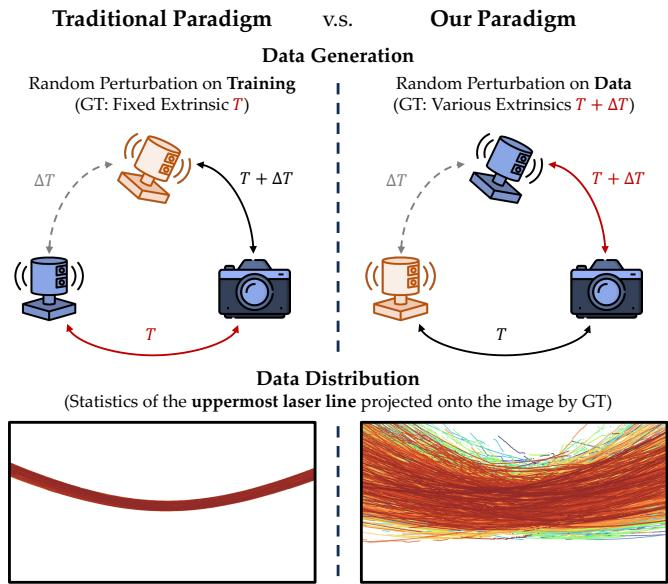  
Fig. 1. Comparison between traditional and our data paradigm. Traditional methods use public datasets, which provide training data with a fixed LiDARcamera extrinsic, while ours generates pairs with various configurations. The data visualization shows that our training data has richer patterns (projections after calibration), while the traditional one introduces harmful inductive bias

Deep learning-based calibration methods have emerged as the dominant paradigm in recent years, for its adaptability to various scenarios and excellent performance. However, these methods suffer from a critical flaw of severe dataset bias [7]– [9]. Recent models are typically trained on several public datasets (e.g., KITTI [10] and nuScenes [11]) with highly restricted sensor setups. This scarcity of diverse extrinsic configurations leads to severe representational homogeneity in the training data (Fig. 1). Consequently, instead of learning meaningful cross-modal associations, network resorts to shortcut learning: It merely memorizes the spatial distribution priors of LiDAR projections to minimize training loss. Ultimately, this causes existing algorithms to overfit to the specific LiDAR distribution and fail to provide reliable extrinsics in practice.

To tackle this challenge, our core insight is to systematically diversify the extrinsic ground truths in the training data, thereby eliminating the conditions that foster shortcut learning. To this end, we propose SynCalib, a novel offline data synthesis framework designed for arbitrary LiDAR-camera configurations. By leveraging existing simulated environments equipped with omnidirectional cameras, SynCalib synthesizes large-scale LiDAR-camera data pairs with fully controllable extrinsic parameters. This guarantees the richness of extrinsic configurations during network training, fundamentally enhancing the model’s zero-shot generalization capabilities. Our main contributions are summarized as follows:

• A calibration data generation framework that enables model training prior to physical sensor deployment. Models trained with our synthesized data can be deployed in a zero-shot manner, and effectively circumvent shortcut learning.

• An extrinsics-controllable synthesis pipeline leveraging a simulated omnidirectional visual system with dense depth ground truth. This pipeline features fully controllable extrinsic sampling to ensure high-fidelity data synthesis.

• Comprehensive experiments demonstrating that our system successfully overcomes the performance degradation caused by dataset bias in traditional training paradigms.

## II. RELATED WORKS

LiDAR-camera calibration methods are generally categorized into target-based and target-free approaches.

## A. Target-based LiDAR-camera Calibration

Target-based methods rely on specialized calibration objects with distinct semantic or geometric structures. Alignment is achieved by extracting cross-modal features and applying geometric solvers like Perspective-n-Point (PnP). Typically, planar boards are used, where precise manufacturing guarantees the spatial relationship between visual and geometric cues [12]– [14]. Xie et al. [15] designed a 3D depth-textured target for solid-state LiDARs to ensure salient feature extraction. Chen et al. [16] aligned image color with LiDAR reflectivity using a textured planar scene, optimizing extrinsics via planeconstrained bundle adjustment.

Despite their exceptional precision, these methods require custom targets, controlled environments, and empirical expertise for data collection. Consequently, they are labor-intensive and costly, often necessitating factory re-calibration or professional operators.

## B. Target-free LiDAR-camera Calibration

Target-free approaches leverage natural environmental content for on-the-fly calibration. Traditional methods establish cross-modal associations via mutual information (MI) maximization [17], [18] or edge alignment [19], [20], followed by geometric optimization. Recent works incorporate semantic segmentation [21], deep feature matching [6], [22], and neural rendering [23] for more robust associations. Additionally, egomotion and hand-eye calibration frameworks [24], [25] enable extrinsic estimation even with minimal field-of-view (FoV) overlap.

Recently, end-to-end neural networks [26]–[28] have become mainstream, directly regressing relative poses by implicitly learning alignment cues from large-scale datasets. However, regression-based pose learning is highly susceptible to scene overfitting [29] and shortcut learning [7], often exploiting dataset biases rather than learning genuine crossmodal geometric alignment.

## C. Practical Solutions for Dataset Shortcuts

To address shortcut learning, recent strategies aim to eliminate dataset biases. CMRNext [8] mitigates this by replacing end-to-end regression with a hybrid framework, using RAFTbased dense matching for feature correspondences followed by a PnP solver. DST-Calib [9] identified this issue and proposed transforming the problem into a geometry-to-geometry registration task by utilizing a monocular vision model (e.g., MoGe-2 [30]) to convert RGB images into depth maps. Furthermore, they implemented data augmentation on both the image and LiDAR branches, leveraging cross-frame matching to enhance extrinsic generalization.

Unlike these algorithmic interventions, our work tackles shortcut learning from a purely data-centric perspective. We utilize simulated omnidirectional images to synthesize largescale LiDAR-camera training pairs with highly diverse extrinsic constraints. Notably, our primary focus lies exclusively in the generation of high-quality calibration data, without requiring modifications to the underlying architectures of existing deep learning networks. By training mainstream calibration models directly on our synthesized data, we empirically demonstrate the elimination of dataset shortcuts and a significant improvement in zero-shot generalization.

## III. METHODOLOGY

## A. Problem Formulation and System Overview

LiDAR-camera calibration networks typically estimate extrinsic residuals $\Delta \mathbf { T } \in \mathrm { S E } ( 3 )$ from input image $\mathbf { \bar { I } } \in \mathbb { R } ^ { W \times H \times 3 }$ and point cloud $\textbf { P } \in \mathbf { \mathbb { R } } ^ { \hat { N } \times 3 }$ . During the training stage, they project point cloud P onto the image I as depth map D $\mathbf { \Sigma } ) \mathbf { \Sigma } \in \bar { \mathbb { R } ^ { W \times \bar { H } } }$ using ground-truth extrinsics $\mathbf { T } _ { 0 }$ and apply perturbations ∆T at the input stage. However, fixed hardware configurations in public datasets severely limit extrinsic diversity, and this conventional projection creates learning shortcuts via highly consistent spatial features.

To address this, we introduce extrinsic perturbations ∆T during the data generation phase rather than the input stage (Fig. 2a). We first generate image I and point cloud P pairs with the ground truth extrinsics $\mathbf { T } + \Delta \mathbf { T }$ . For the network input, we project the point cloud using the nominal transformation T, which is defined as the factory extrinsic in practice. This novel formulation naturally enriches extrinsic diversity and effectively eliminates learning shortcuts.

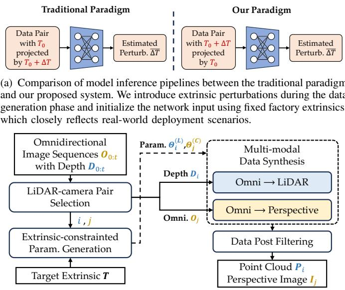  
(b) The system overview of our data generation process.  
Fig. 2. Our training paradigm and data generation pipeline.

The overview of our system is illustrated Fig. 2b, which generates LiDAR-camera training data using simulated datasets with ground-truth depth. The methodology unfolds as follows: Section III-B details multi-modal data generation; Section III-C formulates extrinsic constraints between modalities; and Section III-D describes surround-view data selection and post-filtering to remove low-quality samples.

## B. Multi-modal Data Synthesis

We synthesize perspective images and LiDAR point clouds under arbitrary viewpoints and sensor configurations from omnidirectional images. We utilize the TartanGround [31] dataset, which contains full 360◦ scene images with ground truth depth. These images are stored by a CubeMap format, consisting of six mutually orthogonal views, each with a FoV of 90◦. Without loss of generality, we convert these CubeMaps into equirectangular projection (ERP) images to facilitate subsequent operations. The ERP format maps the spherical surface onto a projection image with a 2:1 aspect ratio, where each pixel strictly corresponds to a spatial angular $\{ \theta , \phi \}$ . Detailed operations regarding ERP images can be found in [32].

1) Omni2LiDAR: Mainstream LiDARs are broadly categorized into repetitive scanning (including solid-state LiDARs) and non-repetitive scanning types. By defining a temporal list of rays, LiDAR sensors measure the corresponding depth of each ray based on the Time-of-Flight (ToF) principle, which is subsequently converted into a point in Euclidean space.

We construct a LiDAR pattern bank by importing the parameter specifications of mainstream LiDAR sensors. Repetitive scanning LiDARs show constant ray angles. Specifically, for non-repetitive scanning LiDARs (e.g., the Livox Mid-360) characterized by complex spatial angular sequences, we extract a continuous 4-second directional angle sequence from official simulation examples. By randomly sampling a start time $t _ { s t a r t }$ from the sequence, we obtain non-repetitive scanning patterns with a fixed duration of d seconds. Furthermore, to account for the physical limitations of LiDAR sensors, such as maximum depth estimation ranges, we simply apply depth range thresholds $\{ d _ { \operatorname* { m i n } } , d _ { \operatorname* { m a x } } \}$ to filter out-of-range points.

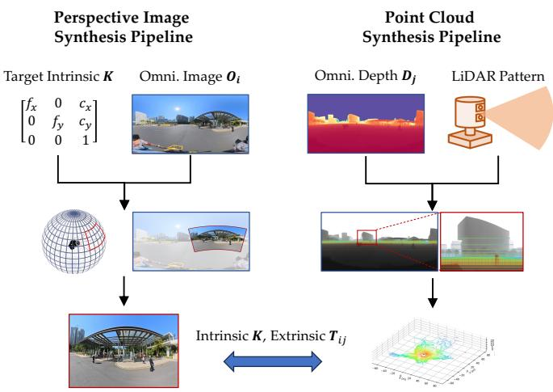  
Fig. 3. The proposed Omni2Perspective and Omni2LiDAR data synthesis pipelines.

2) Omni2Perspective: To synthesize perspective images, we first utilize the rotation component of the camera’s extrinsic parameters to determine the coordinates of the perspective image’s origin (principal point) on the ERP image. Given the intrinsic parameters of the target perspective camera, including the focal length $\{ f _ { x } , f _ { y } \}$ and image dimensions $W _ { \mathrm { c r o p } } \times H _ { \mathrm { c r o p } } ,$ we calculate the equivalent horizontal and vertical FoVs. Since the pixel resolution of the ERP image directly maps to the angular resolution, we can determine the exact sampling dimensions required for these intrinsics. After extracting this region, the image is resized to the target output shape of $W _ { \mathrm { o u t } } \times H _ { \mathrm { o u t } }$

## C. Extrinsic-constrained Data Pair Generation

Given panoramic images $\mathbf { O } _ { i }$ and $\mathbf { O } _ { j }$ with a known relative pose $\mathbf { T } _ { O _ { i } } ^ { O _ { j } ^ { - } } = \{ \mathbf { R } _ { O _ { i } } ^ { O _ { j } } , \mathbf { t } _ { O _ { i } } ^ { O _ { j } ^ { - } } \}$ , we can synthesize virtual LiDAR L and camera C data at their respective locations. To ensure the generated pairs strictly satisfy the target extrinsics $\mathbf { T } _ { L } ^ { C } = \{ \bar { \mathbf { R } } _ { L } ^ { C } , \mathbf { t } _ { L } ^ { C } \}$ , geometric constraints must be established. The standard rigid transformation on a 3D point p follows a rotate-then-translate chain as $\mathbf { p } ^ { C } = \mathbf { R } _ { L } ^ { C } \mathbf { \bar { p } } ^ { L } + \mathbf { \bar { t } } _ { L } ^ { C }$ . Since our virtual sensors share the optical centers of their source panoramas, we alter this transformation via a rotate-translate-

Step 1: Generating Translation Magnitude �!"  
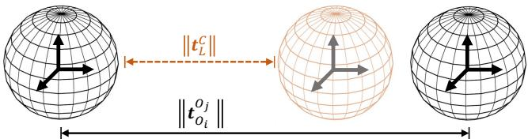

Step 2: Generating Translation Direction $\vec { \pmb { t } } _ { L } ^ { C }$  
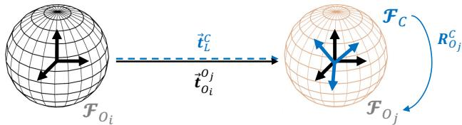

Step 3: Generating Complete Rotation $\pmb { R } _ { L } ^ { C }$  
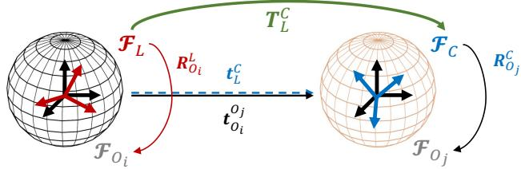  
Fig. 4. The proposed 3-step extrinsic-constrained data generation pipeline.

rotate kinematic chain:

$$
\begin{array} { r l } & { \mathbf { p } ^ { C } = \mathbf { R } _ { O _ { j } } ^ { C } \left( \mathbf { R } _ { O _ { i } } ^ { O _ { j } } ( \mathbf { R } _ { L } ^ { O _ { i } } \mathbf { p } ^ { L } ) + \mathbf { t } _ { O _ { i } } ^ { O _ { j } } \right) } \\ & { \quad \quad = \underbrace { ( \mathbf { R } _ { O _ { j } } ^ { C } \mathbf { R } _ { O _ { i } } ^ { O _ { j } } \mathbf { R } _ { L } ^ { O _ { i } } ) } _ { \mathbf { R } _ { L } ^ { C } } \mathbf { p } ^ { L } + \underbrace { \mathbf { R } _ { O _ { j } } ^ { C } \mathbf { t } _ { O _ { i } } ^ { O _ { j } } } _ { \mathbf { t } _ { L } ^ { C } } . } \end{array}\tag{1}
$$

1) 3-step Generation Pipeline: We propose a three-step solution strategy to introduce the extrinsic constraints in the generation process.

Step 1 – Generating Translation Magnitude $| | \mathbf { t } _ { L } ^ { C } | | \mathbf { : }$ : Since the physical baseline of $\mathbf { O } _ { i }$ and $\mathbf { O } _ { j }$ in the dataset is fixed, we introduce a scale factor s to match the magnitude of the target translation. The scale factor is defined as:

$$
s = \| \mathbf { t } _ { L } ^ { C } \| / \| \mathbf { t } _ { O _ { i } } ^ { O _ { j } } \| .\tag{2}
$$

According to the principles of visual triangulation, scaling the entire 3D scene by changing the depth map $\mathbf { D } _ { i }$ to $\mathbf { D } _ { i } ^ { ( s ) } =$ sDi proportionally rescales the translation baseline to $| | \mathbf { t } _ { L } ^ { C } | |$ without affecting any rotational components.

Step 2 – Generating Translation Direction $\vec { \bf t } _ { L } ^ { C }$ : With the result of Eq. 1, we can isolate the translation component as $\mathbf { t } _ { L } ^ { C } = \mathbf { R } _ { O _ { i } } ^ { C } \mathbf { t } _ { O _ { i } } ^ { \bar { O } _ { j } }$ . This reveals that the target translation direction $\vec { \mathbf { t } } _ { L } ^ { C } = \mathbf { t } _ { L } ^ { C } / | | \mathbf { t } _ { L } ^ { C } | |$ is solely determined by rotating the direction of omnidirectional baseline $\vec { \mathbf { t } } _ { O _ { i } } ^ { O _ { j } } = \mathbf { t } _ { O _ { i } } ^ { O _ { j } } \dot { / } \lVert \mathbf { t } _ { O _ { i } } ^ { O _ { j } } \rVert$ using the virtual camera’s orientation $\mathbf { R } _ { O _ { i } } ^ { C }$

$$
\vec { \bf t } _ { L } ^ { C } = { \bf R } _ { O _ { j } } ^ { C } \vec { \bf t } _ { O _ { i } } ^ { O _ { j } } .\tag{3}
$$

Step 3 – Generating Complete Rotation $\mathbf { R } _ { L } ^ { C }$ : Given ${ \bf R } _ { O } ^ { C }$ j obtained from Step 2 and the known baseline rotation ${ \bf R } _ { O _ { i } } ^ { O _ { j } }$ , we

can analytically derive the required LiDAR orientation $\mathbf { R } _ { L } ^ { O _ { i } }$ to satisfy the target extrinsic constraints. The relationship can be expressed as:

$$
\mathbf { R } _ { L } ^ { O _ { i } } = ( \mathbf { R } _ { O _ { i } } ^ { O _ { j } } ) ^ { - 1 } ( \mathbf { R } _ { O _ { j } } ^ { C } ) ^ { - 1 } \mathbf { R } _ { L } ^ { C } .\tag{4}
$$

2) Rotational Data Augmentation: While Eq. (3) establishes the directional constraint, aligning two 3D unit vectors only consumes 2 degrees of freedom (DoF). Since the rotation matrix $\mathbf { R } _ { O _ { i } } ^ { C } \in \mathrm { S O } \bar { ( 3 ) }$ possesses 3 DoF, the kinematic null space of this constraint is 1-dimensional.

To rigorously derive this, let $\mathbf { R } _ { \mathrm { b a s e } }$ be a particular shortestpath rotation solution that satisfies $\vec { \mathbf { t } } _ { L } ^ { C } = \dot { \mathbf { R } } _ { \mathrm { b a s e } } \vec { \mathbf { t } } _ { O _ { i } } ^ { O _ { j } }$ . We introduce a rotational perturbation in the Lie group, represented by $\exp ( [ \omega ] _ { \times } )$ , where $\omega \in \mathfrak { s o } ( 3 )$ is the Lie algebra of SO(3) and $[ \cdot ] _ { \times }$ denotes the skew-symmetric matrix operator. The perturbed rotation $\mathbf { R } _ { O _ { i } } ^ { C } = \mathrm { e x p } ( [ \omega ] _ { \times } ) \mathbf { R } _ { \mathrm { b a s e } }$ must still satisfy Eq. (3) and we can also introduce it into Eq. (3) as

$$
\exp ( [ \omega ] _ { \times } ) \mathbf { R } _ { \mathrm { b a s e } } \vec { \mathbf { t } } _ { O _ { i } } ^ { O _ { j } } = \vec { \mathbf { t } } _ { L } ^ { C } \implies \exp ( [ \omega ] _ { \times } ) \vec { \mathbf { t } } _ { L } ^ { C } = \vec { \mathbf { t } } _ { L } ^ { C } .\tag{5}
$$

Applying the first-order Taylor expansion for a small perturbation, $\mathrm { e x p } ( [ \pmb { \omega } ] _ { \times } ) \approx \mathbf { I } + [ \pmb { \omega } ] _ { \times }$ , the condition simplifies to:

$$
\begin{array} { l } { { ( \mathbf { I } + [ \omega ] _ { \times } ) \vec { \mathbf { t } } _ { L } ^ { C } = \vec { \mathbf { t } } _ { L } ^ { C } , } } \\ { { \implies [ \omega ] _ { \times } \vec { \mathbf { t } } _ { L } ^ { C } = \mathbf { 0 } , } } \\ { { \implies \omega \times \vec { \mathbf { t } } _ { L } ^ { C } = \mathbf { 0 } . } } \end{array}\tag{6}
$$

This indicates that ω must be parallel to $\vec { \bf t } _ { L } ^ { C }$ . An intuitive explanation can be derived from Eq. 1: In its rotational part, various combinations of $\mathbf { R } _ { O _ { j } } ^ { C }$ and $\mathbf { \bar { R } } _ { L } ^ { O _ { i } }$ can satisfy a fixed rotation $\mathbf { R } _ { L } ^ { C }$ . In the translation part, an additional rotation superimposed on the direction of $\mathbf { \bar { t } } _ { O _ { i } } ^ { O _ { j } }$ can also guarantee the invariance of $\mathbf { t } _ { L } ^ { C }$ . The null space can be parameterized by a single scalar angle $\phi ,$ such that $\omega = \phi \vec { \bf t } _ { L } ^ { C }$ . The general solution for the camera orientation is thus given by:

$$
\mathbf { R } _ { O _ { j } } ^ { C } = \mathbf { R } _ { \mathrm { n u l l } } ( \phi , \vec { \mathbf { t } } _ { L } ^ { C } ) \mathbf { R } _ { \mathrm { b a s e } } ,\tag{7}
$$

where $\mathbf { R } _ { \mathrm { n u l l } } ( \phi , \vec { \mathbf { t } } _ { L } ^ { C } )$ represents a rotation by an arbitrary angle $\phi \in [ 0 , 2 \pi )$ around the axis $\vec { \bf t } _ { L } ^ { C }$

We leverage this 1-DoF null space as a mathematically rigorous data augmentation strategy. During the data generation process, we uniformly sample the angle $\phi \sim \mathcal { U } ( 0 , 2 \pi )$ to compute $\mathbf { R } _ { O _ { i } } ^ { C }$ , which in turn yields diverse valid solutions for $\mathbf { R } _ { L } ^ { O _ { i } }$ via Eq. (4). This allows us to synthesize an infinite number of valid LiDAR-camera pairs with extensive viewpoint rotations while strictly preserving the required extrinsic constraints.

## D. Data Pair Selection and Post Filtering

To enhance the efficiency of data generation and ensure the high quality of the synthesized dataset, we implement a rigorous two-stage filtering mechanism: a pre-synthesis candidate selection on the omnidirectional data, and a postsynthesis verification on the generated pairs.

Before synthesis (Section III-C), we coarsely filter omnidirectional pairs $( \mathbf { O } _ { 1 }$ and $\mathbf { O } _ { 2 } )$ , retaining those with a relative translation below $\tau _ { \mathrm { d i s t } } = 5$ m. Next, a fine-grained co-visibility check is performed via bidirectional projection using the relative pose $\mathbf { T } _ { O _ { 1 } } ^ { O _ { 2 } }$ and depth maps $( { \bf D } _ { 1 }$ and $\mathbf { D } _ { 2 } )$ . When projecting $\mathbf { O } _ { 1 }$ onto $\mathbf { O } _ { 2 } .$ , a Z-buffer strategy [8] resolves occlusions by retaining only the minimum depth. The projected depth $\mathbf { D } _ { 1 } ^ { \mathrm { p r o j } }$ is then pixelwisely compared against $\mathbf { D } _ { 2 } .$ Pixels with depth ratio discrepancies $\tau _ { \mathrm { d i f f } } < 0 . 0 5$ are deemed valid. To guarantee sufficient cross-modal information overlap, the valid overlapping ratio $\gamma _ { \mathrm { v a l i d } }$ is quantitatively defined as:

$$
\gamma _ { \mathrm { v a l i d } } = \frac { 1 } { N } \sum _ { p \in \Omega } \mathbb { I } \left( \frac { \left. \mathbf { D } _ { 1 } ^ { \mathrm { p r o j } } ( p ) - \mathbf { D } _ { 2 } ( p ) \right. } { \operatorname* { m a x } \left( \mathbf { D } _ { 1 } ^ { \mathrm { p r o j } } ( p ) , \mathbf { D } _ { 2 } ( p ) \right) } < \tau _ { \mathrm { d i f f } } \right) .\tag{8}
$$

Data pairs are valid when the pixel ratio $\gamma _ { \mathrm { v a l i d } } > 3 0 \%$ in both projection directions. Finally, to augment dataset generalization, we randomly assign the virtual LiDAR and camera roles between $\mathbf { O } _ { 1 }$ and $\mathbf { O } _ { 2 }$ during generation.

After generating the virtual LiDAR-camera pairs, the perspective images undergo significant FOV cropping. To guarantee data validity within the cropped regions, we apply a postprocessing step involving a unidirectional projection from the virtual LiDAR to the virtual camera. We re-evaluate the overlap ratio using the aforementioned depth consistency check, but impose a stricter threshold of $\gamma _ { \mathrm { v a l i d } } \ge 8 0 \%$ . Furthermore, recognizing that structural edges provide the most critical geometric cues for LiDAR-camera registration tasks, we assess the structural richness of the generated pairs. We apply the Sobel operator to the projected depth map D to compute the depth gradient magnitude. Pixels with a gradient magnitude exceeding 0.03 m are classified as edge pixels. A synthesized data pair is preserved only if edge pixels constitute more than 5% of the entire image, ensuring abundant geometric features for downstream tasks.

## IV. EXPERIMENT

## A. Datasets and devices

To generate the training data, we utilize the omnidirectional subset from TartanGround [31] dataset, which comprises 63 diverse scenes. Instead of using the entire dataset, we deliberately exclude unstructured natural scenes (e.g., forests or heavily vegetated areas) that contain severe structural noise and lack distinct geometric features. We carefully select 20 high-quality structured scenes with 18861 images, allocating 16 scenes for training and 4 scenes for testing. Following our synthesis pipeline, we generate 2000 valid LiDAR-camera data pairs per scene. This yields a comprehensive dataset comprising 32000 training pairs and 8000 testing pairs, of which each pair owns a unique extrinsic parameter.

To evaluate the capability of our trained model in real-world scenarios, we construct a custom data collection platform featuring two distinct sensor configurations (Fig. 5). Both configurations share the same camera module: a FLIR BFS-U3-31S4C camera equipped with a lens providing a horizontal FoV of approximately $9 0 °$ . The captured images are resized and cropped to a resolution of 576×768 to match the network’s input requirements. For the 3D modality, we employ two different LiDAR sensors to assess the method’s robustness across diverse scanning patterns: a traditional mechanical spinning LiDAR (RoboSense RS-LiDAR-32) and a non-repetitive scanning pattern (Livox Mid-360).

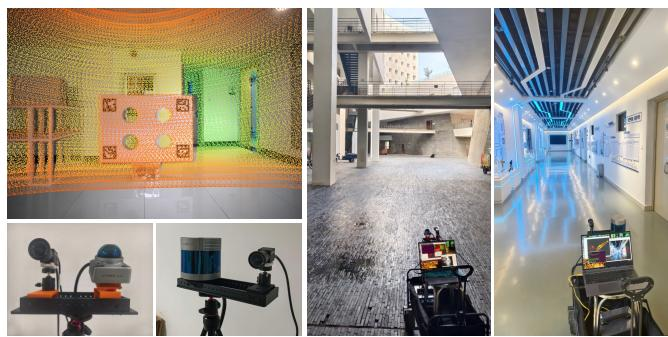  
Fig. 5. Our real-world rig configurations and experiment scenarios. The ground truth extrinsics are derived by using the target-based calibration method of [14].

## B. Baseline Methods and Evaluation Criterion

Since the core contribution of our work focuses on enhancing the generalization of training data and mitigating learning shortcuts, we benchmark our approach against the prevailing data generation paradigm. The standard paradigm typically relies on a single (or a strictly limited set) of extrinsic calibrations to generate training data, heavily depending on the injection of random extrinsic perturbations on-the-fly as a form of data augmentation. In contrast, our proposed method achieves inherent dataset-level generalization through diverse viewpoint synthesis, while still incorporating minor synthetic perturbations during training to further augment the data and ensure robustness.

As our work focuses on the data synthesis pipeline rather than architectural innovations, we validate the efficacy of our dataset using two widely adopted LiDAR-camera calibration networks representing different paradigms:

• CMRNext [8] is a representative geometry-based framework. It employs a RAFT-inspired optical flow architecture for dense multimodal feature alignment and utilizes a PnP solver for the final geometric pose estimation.

• CalibNet [33] is a classic regression-based network. It utilizes a dual-branch encoder to independently extract and compress point cloud and image features, culminating in fully connected layers that directly regress the 6-DoF extrinsic pose parameters.

To quantitatively assess the calibration performance, we employ two primary evaluation metrics. We first compute the absolute pose error (APE) between the network’s predicted 6- DoF pose T¯ and the ground truth extrinsic $\mathbf { T } _ { \mathrm { g t } } ,$ evaluating the translation and rotation deviations, respectively:

$$
\mathrm { e r r } _ { R } = \operatorname { a r c c o s } \left( \frac { \mathrm { T r } ( \mathbf { R } _ { \mathrm { g t } } ^ { \top } \bar { \mathbf { R } } ) - 1 } { 2 } \right) ,\tag{9}
$$

$$
\mathrm { e r r } _ { t } = \lVert \bar { \mathbf { t } } - \mathbf { t } _ { \mathrm { g t } } \rVert _ { 2 } .\tag{10}
$$

For CMRNext that generates intermediate dense alignment representations, we evaluate the multi-modal alignment quality

err� = 28.45 �� err = 1.58° err#\$# = 20.31 ���  
err� = 0.49°  
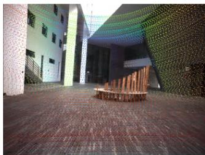  
Case 1  
Mid360 - Good  
err� = 3.97 ��  
err� = 0.37°  
err#\$# = 3.48 ���

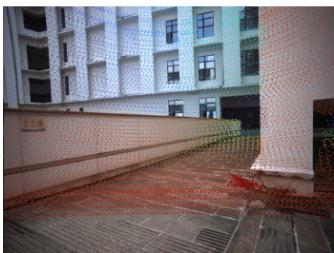  
Case 2 Mid360 - Poor

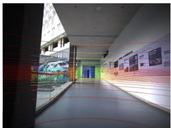  
Case 3  
RS-32 - Good  
err� = 3.29 ��  
err#\$# = 3.96 ���

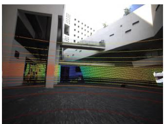  
Case 4  
RS-32 - Poor  
err� = 0.31°  
err#\$# = 5.74 ���  
Fig. 6. Qualitative analysis of LiDAR-to-camera projections using CMRNext’s outputs. Online calibration typically achieves high accuracy when the scene is rich in multi-directional edge features (Cases 1 & 3). However, an uneven spatial distribution of these features can induce slight rotation-translation coupling, leading to increased calibration errors, even if the edges are visually aligned (Case 2). When employing sparse, repetitive scanning LiDAR sensors, the lack of cross-modal overlap exacerbates information loss within the point cloud, ultimately resulting in substantial independent translation errors (Case 4).

TABLE I  
CROSS-EVALUATION ON DIFFERENT DATA GENERATION PARADIGMS WITH DIFFERENT LIDAR PATTERNS. VALUES INDICATE THE MEAN/MEDIAN ERRORS.
<table><tr><td>LiDAR</td><td>Model</td><td>Train</td><td>Test</td><td>Rot. Err. (°)</td><td>Trans. Err. (cm)</td><td>EPE. Err. (pixel)</td></tr><tr><td rowspan="6">Miid-360</td><td rowspan="6">CMRRNxt</td><td>Trad.</td><td>Trad.</td><td>0.35 / 0.17</td><td>1.49 / 0.83</td><td>4.99 /  2.18</td></tr><tr><td>Trad.</td><td>Ours</td><td>4.25 / 3.17</td><td>18.77 / 16.75</td><td>61.91 / 46.38</td></tr><tr><td>Ours</td><td>Ours</td><td>0.72 / 0.26</td><td>3.10 / 1.49</td><td>15.66 / 6.51</td></tr><tr><td>Ours</td><td>Trad.</td><td>1.31 / 0.46</td><td>6.44 / 3.09</td><td>22.46 / 7.03</td></tr><tr><td>Trad.</td><td>Trad.</td><td>4.97 / 4.4</td><td>16.49 / 15.34</td><td>57.15 / 48.40</td></tr><tr><td>Trad.</td><td>Ours</td><td>10.04 / 9.84</td><td>22.75 / 21.94</td><td>107.34 / 98.95</td></tr><tr><td rowspan="5">Caibet</td><td>Ours</td><td>Ours</td><td>8.35 / 8.23</td><td>16.97  / 16.85</td><td>82.51 /  78.87</td></tr><tr><td>Ours</td><td>Trad.</td><td>7.98 /  7.80</td><td>19.95 / 19.97</td><td>80.45 / 75.89</td></tr><tr><td></td><td></td><td></td><td></td><td></td></tr><tr><td rowspan="3">CMRRRxt</td><td>Trad. Trad.</td><td>Trad. Ours</td><td>0.63 / 0.17 6.50 / 5.99</td><td>2.34 / 1.32 21.69 / 19.04</td><td>6.56 /  1.98 53.13 / 35.54</td></tr><tr><td>Ours</td><td>Ours</td><td>0.99 / 0.34</td><td>5.15 / 2.80</td><td>12.11 / 4.25</td></tr><tr><td>Ours</td><td>Trad.</td><td>2.75 / 1.00</td><td>15.05 / 8.40</td><td>32.90 / 9.70</td></tr><tr><td rowspan="5">RS--32</td><td rowspan="5">Calbet</td><td>Trad.</td><td></td><td></td><td></td><td></td></tr><tr><td>Trad.</td><td>Trad. Ours</td><td>6.20 / 5.81</td><td>20.20 / 19.20</td><td>81.13 / 65.48</td></tr><tr><td>Ours</td><td>Ours</td><td>9.40 / 9.32 11.27 / 9.02</td><td>23.11 / 22.93</td><td>93.51  / 87.34</td></tr><tr><td></td><td></td><td></td><td>21.17 / 16.00</td><td>165.87  / 81.62</td></tr><tr><td>Ours</td><td>Trad.</td><td>9.48 / 8.59</td><td>22.58 / 20.73</td><td>108.96 / 85.86</td></tr></table>

using the end-point error (EPE), defined as the 2D pixel discrepancy between the LiDAR points projected using the estimated extrinsics and those projected using the ground truth:

$$
\mathrm { e r r } _ { \mathrm { E P E } } = \Vert \pi ( \bar { \mathbf { T P } } _ { i } ) - \pi ( \mathbf { T } _ { \mathrm { g t } } \mathbf { P } _ { i } ) \Vert _ { 2 } .\tag{11}
$$

For all metrics, we report both the mean and median errors across the test set to provide a comprehensive and robust statistical evaluation.

## C. Experiment 1: Synthetic Data Training and Inference

We first conduct training and evaluation on our synthesized datasets to establish a controlled baseline. To simulate initial misalignments, we inject random extrinsic perturbations uniformly sampled within a range of 20 cm per axis for translation and 10◦ per angle for rotation. During the training phase, we train the CMRNext model for 300 epochs and the CalibNet for 30 epochs, which aligns with their respective convergence characteristics.

To rigorously assess the generalization capabilities of the models, we design a cross-dataset evaluation protocol. Specifically, we train the networks independently on datasets generated by two different paradigms. Subsequently, we perform cross-inference testing on the test sets of both distributions. The quantitative results are summarized in Table I. The results show that models trained under the traditional paradigm exhibit a severe inductive bias and lack generalization capability (especially the experiment sets of Mid360-CMRNext and RS-LiDAR-32-CMRNext). When the extrinsic parameters in the test set deviate from the narrow distribution of the training set (e.g., simulating real-world extrinsic shifts from factory defaults), the inference performance of the traditionally trained models degrades significantly. In contrast, models trained in our paradigm demonstrate robust and consistent performance across both test sets, maintaining reasonable and closely aligned accuracy regardless of the underlying data generation methods.

Interestingly, during the experiments, we observed that networks trained on the traditional dataset converge faster and are seemingly easier to train compared to those trained on our dataset. However, rather than indicating superior learning, this apparent ease of training is a strong indicator of the dataset shortcut phenomenon. In the traditional paradigm, the network exploits spurious correlations and merely memorizes the restricted extrinsic distribution (the shortcut) instead of learning the complex, underlying geometric alignment between the point clouds and images. While this allows the training loss to drop rapidly, it is ultimately detrimental to the fundamental task of cross-modal calibration, rendering the model fragile in real-world applications. Our data generation method effectively mitigates these shortcuts, forcing the network to learn generalized alignment features.

## D. Experiment 2: Real-world Zero-shot Inference

To evaluate the real-world applicability of our approach, we deploy the models trained exclusively on the synthetic dataset (as described in Section IV-C) directly onto real-world sensor data. For each configuration, the real-world data was recorded under three distinct extrinsic calibration states, yielding 40 synchronized LiDAR-camera pairs per state. The first state, denoted as $\mathbf { T } _ { 0 } .$ , represents a factory calibration extrinsic. During evaluation on $\mathbf { T } _ { 0 } .$ , we simulate traditional calibration initialization by injecting random synthetic perturbations. The remaining two states $( \mathbf { T } _ { 1 }$ and $\mathbf { T } _ { 2 } )$ , represent slight physical misalignments introduced relative to $\mathbf { T } _ { 0 } .$ These physically altered states are specifically designed to evaluate the network’s direct regression performance in authentic, uncalibrated realworld settings without relying on artificial noise injection. This zero-shot inference is conducted without any fine-tuning or prior exposure to the real-world target domain during the training phase. The quantitative and qualitative results of this evaluation are shown in Table II and Fig. 6. The performance metrics clearly demonstrate that our proposed data generation endows the networks with better zero-shot generalization than traditional training paradigm, significantly narrowing the domain gap between synthetic data and realworld sensor distributions. Honestly, we observe that models trained exclusively on synthetic data exhibit a pronounced drift in translation errors during zero-shot transfer to realworld scenes. A detailed discussion of this phenomenon will be provided in the Section V.

TABLE II  
CROSS-EVALUATION ON REAL-WORLD CAPTURED DATA USING CMRNEXT. VALUES INDICATE THE MEAN/MEDIAN ERRORS.
<table><tr><td>LiDAR</td><td>Extr.</td><td>Train Pdgm.</td><td>Rot. Err. (°)</td><td>Trans. Err. (cm)</td><td>EPE. Err. (pixel)</td></tr><tr><td rowspan="4">Mi60</td><td> $\mathbf { T } _ { 0 }$ </td><td>Trad. Ours</td><td>0.97  / 0.73 0.57 / 0.42</td><td>19.81 /  16.83 11.90 / 9.86</td><td>15.08 /  13.32 9.58 /  7.66</td></tr><tr><td></td><td>Trad.</td><td>1.08 / 0.88</td><td>23.70 / 21.47</td><td>14.41 / 12.95</td></tr><tr><td> $\mathbf { T } _ { 1 }$ </td><td>Ours</td><td>0.50 / 0.39</td><td>13.23 / 11.97</td><td>9.33 / 8.29</td></tr><tr><td> $\mathbf { T } _ { 2 }$ </td><td>Trad. Ours</td><td>1.15 / 1.01 0.58 / 0.44</td><td>20.75 /  17.55 12.16 / 9.98</td><td>19.64 / 17.61 11.18 / 8.31</td></tr><tr><td rowspan="5">RS--32</td><td> $\mathbf { T } _ { 0 }$ </td><td>Trad.</td><td>0.38 / 0.29</td><td>12.28 / 9.43</td><td>6.41 / 4.28</td></tr><tr><td></td><td>Ours</td><td>0.70 / 0.48</td><td>15.79 / 12.22</td><td>7.24 / 5.87</td></tr><tr><td rowspan="2"> $\mathbf { T } _ { 1 }$ </td><td>Trad.</td><td>5.03 /  1.21</td><td>16.99 /  12.91</td><td>57.33 / 22.49</td></tr><tr><td>Ours</td><td>1.52 / 1.29</td><td>14.82 / 12.79</td><td>12.33 / 9.03</td></tr><tr><td> $\mathbf { T } _ { 2 }$ </td><td>Trad. Ours</td><td>3.17 /  1.58 1.73 /  1.50</td><td>20.96 / 13.14 14.80 / 13.26</td><td>32.73 / 12.53 14.77 / 11.74</td></tr></table>

## E. Experiment 3: Multi-stage Cascaded Inference

To achieve high-precision calibration, the original architecture of CMRNext employs a multi-stage inference strategy, where models are progressively trained on varying ranges of extrinsic perturbations and are used for inference as a cascading pipeline. Following this paradigm, we design a corresponding three-stage training pipeline, yielding three distinct inference networks specialized for coarse-to-fine alignment. The output of each stage serves as the initial pose estimate for the subsequent stage, progressively refining the extrinsic parameters. As demonstrated in Table III, this cascaded approach enables our algorithm to ultimately achieve a competitive calibration accuracy (a median error of 1.06 cm and 0.24◦, with a mean error of 3.35 cm and 0.96◦).

## V. DISCUSSION

Our experiments reveal that geometry-based calibration networks (e.g., CMRNext) are significantly more robust than direct regression architectures (e.g., CalibNet). Historically, regression models severely overfit to specific spatial priors (driving scenes) from high-density LiDAR datasets like KITTI.

TABLE III  
PERFORMANCE EVALUATION AT DIFFERENT STAGES WITH INPUT PERTURBATIONS. VALUES INDICATE THE MEAN/MEDIAN ERRORS. NOTED THAT THE INPUT PERTURBATION FOR TRANSLATION AND ROTATION IS INTRODUCED PER AXIS AND PER ANGLE, RESPECTIVELY.
<table><tr><td>Stage</td><td>Input Perturb.</td><td>Rot. Err. (°)</td><td>Trans. Err. (cm)</td><td>EPE. Err. (pixel)</td></tr><tr><td>1</td><td>[20 cm, 10°]</td><td>1.35 / 0.51</td><td>5.03 / 2.71</td><td>25.94 / 12.52</td></tr><tr><td>2</td><td>[5 cm, 1.5°]</td><td>1.01 / 0.27</td><td>3.53 /  1.14</td><td>15.34 / 3.70</td></tr><tr><td>3</td><td>[3 cm, 0.8°]</td><td>0.96 / 0.24</td><td>3.35 /  1.06</td><td>14.11 / 3.17</td></tr></table>

Consequently, their performance degrades drastically when LiDAR resolution decreases or scene complexity increases (as seen in our RS-LiDAR-32-CalibNet subset). However, this limitation may not be inherent; scaling up both diverse training data and model capacity could potentially enable regression networks to overcome these bottlenecks.

Furthermore, models trained on our synthetic pipeline demonstrate promising zero-shot generalization despite the sim-to-real gap. This robustness stems from the model’s reliance on cross-modal geometric edges (low-frequency signals), making it less sensitive to the high-frequency textures that typically exacerbate domain shifts. Nevertheless, we observe notable translation error perturbations during real-world zero-shot deployment. This likely results from discrepancies in pairwise image baseline distributions between synthetic data and real-world extrinsics. Scaling these baselines inadvertently introduces a scene depth bias, compromising generalization. Future work will leverage advanced simulators and highfidelity image generation to bridge this remaining gap.

## VI. CONCLUSION

In this paper, we addressed the critical dataset shortcut phenomenon that severely limits the real-world applicability and generalization of existing learning-based LiDAR-camera calibration networks. To break the networks’ reliance on fixed extrinsics, we proposed a highly generalizable data generation framework. By leveraging omnidirectional images with depth ground truth, our pipeline synthesizes highly diverse, extrinsically constrained multimodal training data. Extensive experiments confirmed that classical calibration networks trained exclusively on our synthesized data exhibit significantly enhanced robustness against extrinsic perturbations. Our approach demonstrated remarkable zero-shot transfer capabilities across various physical sensor configurations, validating its practical viability for real-world robotic deployments.

In future work, we intend to extend our extrinsic data generation pipeline directly to real-world captured omnidirectional datasets. This advancement aims to fundamentally bridge the sim-to-real domain gap inherent in purely synthetic data, while significantly scaling up scene diversity and overall data richness. Ultimately, by leveraging these massively scaled and highly diverse datasets, we want to develop a robust cross-modal alignment foundation model for point clouds and images, paving the way for universal, zero-shot sensor calibration across diverse hardware configurations.

## ACKNOWLEDGMENT

During the preparation of this manuscript, the authors used Gemini-3.1-Pro for text polishing and grammar correction. After using this tool, the authors thoroughly reviewed and edited the manuscript, and take full responsibility for the final content of this publication.

## REFERENCES

[1] X. Lang, J. Lv, K. Tang, L. Li, J. Huang, L. Liu, Y. Liu, and X. Zuo, “Gaussian-lic2: Lidar-inertial-camera gaussian splatting slam,” The International Journal of Robotics Research, 2026.

[2] D. Xue, B. Li, Y. Li, F. Sun, and X. Zhang, “Lwfusionformer: Lightweight convolution and transformer fusion for accurate and efficient depth estimation,” IEEE Transactions on Automation Science and Engineering, vol. 23, pp. 9376–9387, 2026.

[3] L. Wang, L. Guo, Z. Xu, Q. Wang, F. Gao, and X. Chen, “Lidar-vggt: Cross-modal coarse-to-fine fusion for globally consistent and metricscale dense mapping,” IEEE Robotics and Automation Letters, 2026.

[4] Z. Liu, H. Tang, A. Amini, X. Yang, H. Mao, D. Rus, and S. Han, “Bevfusion: Multi-task multi-sensor fusion with unified bird’s-eye view representation,” in IEEE International Conference on Robotics and Automation (ICRA), 2023.

[5] C. Zheng, W. Xu, Z. Zou, T. Hua, C. Yuan, D. He, B. Zhou, Z. Liu, J. Lin, F. Zhu, Y. Ren, R. Wang, F. Meng, and F. Zhang, “Fast-livo2: Fast, direct lidar–inertial–visual odometry,” IEEE Transactions on Robotics, vol. 41, pp. 326–346, 2025.

[6] K. Koide, S. Oishi, M. Yokozuka, and A. Banno, “General, single-shot, target-less, and automatic lidar-camera extrinsic calibration toolbox,” in 2023 IEEE International Conference on Robotics and Automation (ICRA). IEEE, 2023, pp. 11 301–11 307.

[7] S. Huang, C. Lin, and Y. Zhao, “What really matters for learning-based lidar-camera calibration,” in Proceedings of the 7th ACM International Conference on Multimedia in Asia, 2025, pp. 1–8.

[8] D. Cattaneo and A. Valada, “Cmrnext: Camera to lidar matching in the wild for localization and extrinsic calibration,” IEEE Transactions on Robotics, vol. 41, pp. 1995–2013, 2025.

[9] Z. Huang, Y. Fu, Y. Zhou, X. Chen, Q. Chen, and R. Fan, “Dst-calib: A dual-path, self-supervised, target-free lidar-camera extrinsic calibration network,” arXiv preprint arXiv:2601.01188, 2026.

[10] A. Geiger, P. Lenz, C. Stiller, and R. Urtasun, “Vision meets robotics: The kitti dataset,” The international journal of robotics research, vol. 32, no. 11, pp. 1231–1237, 2013.

[11] H. Caesar, V. Bankiti, A. H. Lang, S. Vora, V. E. Liong, Q. Xu, A. Krishnan, Y. Pan, G. Baldan, and O. Beijbom, “nuscenes: A multimodal dataset for autonomous driving,” in 2020 IEEE/CVF conference on computer vision and pattern recognition (CVPR). IEEE, 2020, pp. 11 618–11 628.

[12] C. Fang, S. Ding, Z. Dong, H. Li, S. Zhu, and P. Tan, “Single-shot is enough: Panoramic infrastructure based calibration of multiple cameras and 3d lidars,” in 2021 IEEE/RSJ International Conference on Intelligent Robots and Systems (IROS), 2021, pp. 8890–8897.

[13] J. Jiao, F. Chen, H. Wei, J. Wu, and M. Liu, “Lce-calib: Automatic lidar-frame/event camera extrinsic calibration with a globally optimal solution,” IEEE/ASME Transactions on Mechatronics, vol. 28, no. 5, pp. 2988–2999, 2023.

[14] C. Zheng and F. Zhang, “Fast-calib: Lidar-camera extrinsic calibration in one second,” IEEE Robotics and Automation Practice, vol. 1, pp. 108–112, 2026.

[15] Y. Xie, L. Deng, T. Sun, Y. Fu, J. Li, X. Cui, H. Yin, S. Deng, J. Xiao, and B. Chen, “A4lidartag: Depth-based fiducial marker for extrinsic calibration of solid-state lidar and camera,” IEEE Robotics and Automation Letters, vol. 7, no. 3, pp. 6487–6494, 2022.

[16] F. Chen, L. Li, S. Zhang, J. Wu, and L. Wang, “Pbacalib: Targetless extrinsic calibration for high-resolution lidar-camera system based on plane-constrained bundle adjustment,” IEEE Robotics and Automation Letters, vol. 8, no. 1, pp. 304–311, 2023.

[17] G. Pandey, J. R. McBride, S. Savarese, and R. M. Eustice, “Automatic extrinsic calibration of vision and lidar by maximizing mutual information,” Journal of Field Robotics, vol. 32, no. 5, pp. 696–722, 2015.

[18] A. C. Stutts, D. Erricolo, S. Ravi, T. Tulabandhula, and A. R. Trivedi, “Mutual information-calibrated conformal feature fusion for uncertaintyaware multimodal 3d object detection at the edge,” in 2024 IEEE international conference on robotics and automation (ICRA). IEEE, 2024, pp. 2029–2035.

[19] Y. Hu, H. Ma, L. Jie, and H. Zhang, “Dedgenet: Extrinsic calibration of camera and lidar with depth-discontinuous edges,” in 2023 IEEE International Conference on Robotics and Automation (ICRA), 2023, pp. 11 439–11 445.

[20] T. Ye, W. Xu, C. Zheng, and Y. Cui, “Mfcalib: Single-shot and automatic extrinsic calibration for lidar and camera in targetless environments based on multi-feature edge,” in 2024 IEEE/RSJ International Conference on Intelligent Robots and Systems (IROS), 2024, pp. 864–871.

[21] Z. Huang, Y. Zhang, Q. Chen, and R. Fan, “Online, target-free lidarcamera extrinsic calibration via cross-modal mask matching,” IEEE Transactions on Intelligent Vehicles, vol. 10, no. 5, pp. 3531–3542, 2024.

[22] Y. Wang, Y. Tong, R. Wang, S. Zhang, Z. Song, and X. Zhang, “Sptllcc: Single-shot, pixel-level, target-free, and lidar-type agnostic lidarcamera extrinsic self-calibration,” IEEE Transactions on Aerospace and Electronic Systems, vol. 61, no. 6, pp. 17 567–17 583, 2025.

[23] H. Jung, N. Kim, J. Kim, and J. Park, “Targetless LiDAR-Camera Calibration with Neural Gaussian Splatting,” IEEE Robotics and Automation Letters, vol. 11, no. 4, pp. 4777–4784, 2026.

[24] N. Ou, H. Cai, J. Yang, and J. Wang, “Targetless extrinsic calibration of camera and low-resolution 3-d lidar,” IEEE Sensors Journal, vol. 23, no. 10, pp. 10 889–10 899, 2023.

[25] K. Petek, N. Vodisch, J. Meyer, D. Cattaneo, A. Valada, and W. Burgard,¨ “Automatic target-less camera-lidar calibration from motion and deep point correspondences,” IEEE Robotics and Automation Letters, vol. 9, no. 11, pp. 9978–9985, 2024.

[26] J. Zhu, J. Xue, and P. Zhang, “Calibdepth: Unifying depth map representation for iterative lidar-camera online calibration,” in 2023 IEEE International Conference on Robotics and Automation (ICRA), 2023, pp. 726–733.

[27] Z. Duan, X. Hu, J. Ding, P. An, X. Huang, and J. Ma, “A robust lidarcamera self-calibration via rotation-based alignment and multi-level cost volume,” IEEE Robotics and Automation Letters, vol. 9, no. 1, pp. 627– 634, 2023.

[28] N. Ou, Z. Chen, X. Zhang, and J. Wang, “Native-domain cross-attention for camera-lidar extrinsic calibration under large initial perturbations,” IEEE Robotics and Automation Letters, vol. 11, no. 6, pp. 6983–6990, 2026.

[29] T. Sattler, Q. Zhou, M. Pollefeys, and L. Leal-Taixe, “Understanding´ the limitations of cnn-based absolute camera pose regression,” in 2019 IEEE/CVF Conference on Computer Vision and Pattern Recognition (CVPR), 2019, pp. 3297–3307.

[30] R. Wang, S. Xu, Y. Dong, Y. Deng, J. Xiang, Z. Lv, G. Sun, X. Tong, and J. Yang, “Moge-2: Accurate monocular geometry with metric scale and sharp details,” Advances in Neural Information Processing Systems, vol. 38, pp. 35 928–35 959, 2026.

[31] M. Patel, F. Yang, Y. Qiu, C. Cadena, S. Scherer, M. Hutter, and W. Wang, “Tartanground: A large-scale dataset for ground robot perception and navigation,” in 2025 IEEE/RSJ International Conference on Intelligent Robots and Systems (IROS). IEEE, 2025, pp. 20 524–20 531.

[32] H. Huang and S.-K. Yeung, “360vo: Visual odometry using a single 360 camera,” in 2022 international conference on robotics and automation (icra). IEEE, 2022, pp. 5594–5600.

[33] G. Iyer, R. K. Ram, J. K. Murthy, and K. M. Krishna, “Calibnet: Geometrically supervised extrinsic calibration using 3d spatial transformer networks,” in 2018 IEEE/RSJ International Conference on Intelligent Robots and Systems (IROS). IEEE, 2018, pp. 1110–1117.