# TOUCH-JEPA: TACTILE REPRESENTATION LEARNING FROM HAND-OBJECT VIDEO WITH LIMITED TACTILE SUPERVISION

Minseong Kweon1,2, Qiao Feng2, Yiming Huang2, Lingjie Liu2 1University of Minnesota, 2University of Pennsylvania

Project Page: https://touch-jepa.github.io

## ABSTRACT

Understanding contact and tactile magnitude in hand-object interaction is a key step toward physically intelligent systems, yet learning such representations is limited by the cost and restricted coverage of tactile measurements. We present Touch-JEPA, a framework for learning tactile representations from hand-object videos with limited tactile supervision. We first introduce a self-supervised pretraining objective that learns from video alone without tactile supervision. Using video-derived hand geometry, Touch-JEPA predicts masked visual features at corresponding hand-surface locations from spatial and temporal context, encouraging the representation to capture latent contact dynamics. We then extend this formulation to joint representation learning, where masked prediction is applied to all videos while tactile supervision is available only for a labeled subset, grounding the shared representation in measured contact and magnitude. With self-supervised pretraining alone, simple supervised readouts on frozen Touch-JEPA features outperform supervised baselines in contact discrimination and tactile magnitude estimation across three human-hand benchmarks, and transfer to robotic hands without robot tactile training data. Joint learning with limited tactile supervision further improves contact and magnitude estimation on the humanhand benchmarks. Together, these results show that hand-object video can provide scalable self-supervision for tactile representation learning, while limited tactile measurements provide complementary physical grounding.

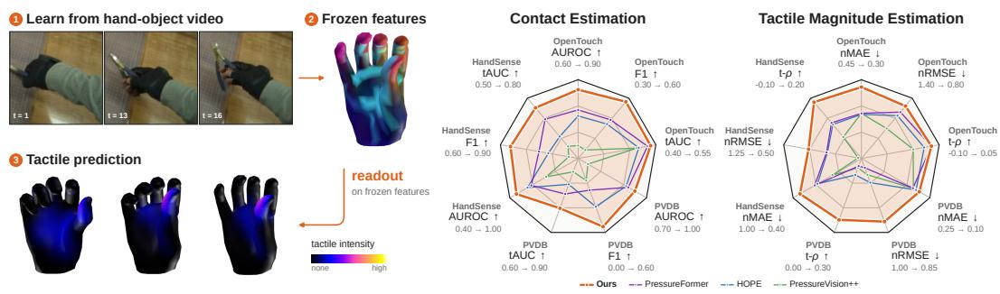  
Figure 1: Touch-JEPA learns tactile representations from video. Readouts on frozen features outperform the supervised baselines in contact and tactile magnitude estimation. Axis numbers give the center-to-ring range, and outer is better.

## 1 INTRODUCTION

Physical understanding of hand-object interaction underpins contact-rich manipulation (Xue et al., 2025), the transfer of dexterous skill from human video to robots (Qin et al., 2022; Shaw et al., 2023), and clinical hand-function assessment (Zhao & Zariffa, 2024). Yet visual observations reveal hand-object geometry and motion while contact state and tactile magnitude remain only indirectly observable (Grady et al., 2022). Learning representations that capture such tactile information from visual and temporal cues could therefore provide a richer understanding of hand-object interaction beyond geometry and motion (Zhao et al., 2025).

Prior work has largely approached tactile understanding from video through supervised prediction. Early approaches exploited load-related visual cues, including soft-tissue deformation, fingertip color changes, and cast shadows, to predict planar pressure maps (Grady et al., 2022; 2024). More recent methods extend this setting to pressure on 3D hand meshes (Zhao et al., 2025; Jeon et al., 2026), forces on hand and object meshes given object geometry (Ilic et al., 2026), and dense handsurface contact across diverse interactions (Jung & Lee, 2025). Alongside these methods, paired hand-object video and sensor datasets have enabled supervised learning and evaluation for pressure prediction, contact estimation, retrieval, and classification (Song et al., 2025; Zhang et al., 2026b; Zhou et al., 2026b; Zeng et al., 2026). These advances show the potential of learning tactile information from visual observations, but depend on paired tactile measurements for supervision.

However, paired tactile data are difficult to acquire at scale (Jiang et al., 2024). Collecting such supervision often requires specialized hardware and careful calibration. Moreover, tactile gloves alter bare-hand appearance (Zhang et al., 2026b), planar sensors restrict contact geometry, and instrumented objects limit object diversity (Brahmbhatt et al., 2019). Simulation and derived contact labels alleviate some of these sensing constraints but often depend on task-specific pipelines (Wang et al., 2022). Consequently, existing tactile datasets provide strong physical grounding but only fragmented coverage of hand regions, objects, and interactions.

In contrast, large-scale video datasets capture diverse hand-object interactions across broad visual and behavioral distributions, but lack explicit tactile annotation (Damen et al., 2022; Grauman et al., 2022). Our key insight is that tactile supervision and large-scale unlabeled video provide complementary learning signals: tactile measurements ground the representation in physically meaningful quantities, while diverse interaction videos provide broader spatial, anatomical, and temporal context. Self-supervised masked prediction (Assran et al., 2025) can therefore leverage unlabeled videos to learn interaction regularities beyond the limited tactile-labeled subset, while explicit tac tile supervision preserves grounding in contact and magnitude. Together, these signals enable tactile representations to benefit from both physically grounded supervision and the scale and diversity of natural interaction videos.

We introduce Touch-JEPA, a framework for tactile representation learning from hand-object interaction videos with limited tactile supervision. In the self-supervised setting, Touch-JEPA learns from video without tactile annotations through masked prediction. Video-derived hand geometry defines corresponding hand-surface locations, allowing visual features to be predicted from spatial and temporal interaction context across heterogeneous videos. A Geometry Encoder integrates evidence across hand regions and frames under interaction and anatomical masking. We then extend the framework to joint representation learning, where the JEPA objective is applied across all videos while tactile supervision is available only for the labeled subset. The two objectives share the encoder, allowing tactile measurements to ground the learned representation in contact and magnitude while self-supervised prediction continues to exploit the scale and diversity of the broader video distribution. We further control interference between the two learning signals during joint training to preserve their complementary information. Our contributions are summarized below:

• We introduce Touch-JEPA, a unified tactile representation learning framework that treats abundant hand-object video and limited tactile measurements as complementary sources of supervision: video provides scalable interaction coverage, while tactile measurements provide direct physical grounding of the shared representation.

• We propose a geometry-guided self-supervised pretraining objective that learns tactilerelevant hand-surface representations from video alone. Touch-JEPA predicts masked latent features at anatomically corresponding surface locations, using video-derived hand geometry together with interaction and anatomical masking to integrate spatial and temporal evidence without requiring tactile annotations.

• We develop a joint representation learning strategy that incorporates tactile supervision from a limited labeled subset while retaining self-supervised learning across all videos. Tactile supervision shapes the shared encoder and its EMA teacher, allowing physically grounded information to propagate through representation-level self-distillation without tactile pseudo-labels, while gradient control preserves the complementary learning signals.

## 2 RELATED WORK

Tactile Representation and Estimation. Instrumented gloves enable dense hand-object contact sensing (Sundaram et al., 2019; Song et al., 2025), while prior work learns tactile representations through autoencoding, cross-modal self-supervision, and cross-sensor alignment (Murali et al., 2018; Zambelli et al., 2021; Yang et al., 2022; Kerr et al., 2022; Yang et al., 2024; Feng et al., 2025; Wi et al., 2026). Recent methods further use masked visuo-tactile reconstruction or joint-embedding objectives for tactile observations (Zhu et al., 2025; Higuera et al., 2024). Tactile-JEPA (Kovtun et al., 2026) applies joint-embedding prediction to the signals of distributed tactile sensors, whereas Touch-JEPA learns touch from video and never takes a tactile signal as input. A complementary line of work estimates tactile quantities from vision, including dense contact (Jung & Lee, 2025), planar pressure (Grady et al., 2022; 2024), hand-surface pressure (Zhao et al., 2025; Jeon et al., 2026), and joint hand-object forces (Ilic et al., 2026). Paired video-tactile datasets support supervised prediction (Zhou et al., 2026b; Zeng et al., 2026), and concurrent work scales such supervision with large glove recordings and RGB-only inference (Zhang et al., 2026a; Zhou et al., 2026a). These methods, including vertex-token video models (Jeon et al., 2026), are trained on tactile or contact labels. In contrast, Touch-JEPA learns tactile representations from video without tactile targets during self supervised pretraining and evaluates whether contact and tactile magnitude can be decoded from the resulting frozen features.

Self-Supervised and Hybrid Representation Learning. Self-supervised visual models learn transferable representations through self-distillation and masked prediction (Caron et al., 2021; Zhou et al., 2021; Oquab et al., 2023; Simeoni et al., 2025). Joint-embedding predictive architectures´ learn by predicting unobserved representations in images (Assran et al., 2023) and videos (Bardes et al., 2024; Assran et al., 2025; Mur-Labadia et al., 2026), and such video encoders already capture fine-grained physical-contact cues (Alrasheed et al., 2026). Related work combines representation prediction with geometric, generative, or action objectives. VGGT-Ω (Wang et al., 2026) learns reconstruction from geometric annotations and subsequently extends training to unlabeled videos through EMA self-distillation. On paired text-to-code tasks, LLM-JEPA (Huang et al., 2026) jointly optimizes JEPA latent prediction and token-level supervision, combining learned representation targets with explicit output sequences. JEPT (Luo & Lu, 2025) combines self-supervised visual transition prediction on labeled and unlabeled videos with supervised inverse dynamics learning on action-labeled demonstrations. Touch-JEPA adapts latent prediction to anatomically corresponding hand-surface locations across time and combines masked prediction on all videos with tactile supervision on the labeled subset.

## 3 TOUCH-JEPA

Touch-JEPA learns hand-surface representations by predicting masked visual features at anatomically corresponding locations (Figure 2). The student x-encoder predicts targets from the teacher y-encoder, updated by an exponential moving average (EMA). Visual prediction uses all videos, while tactile supervision anchors the shared representation to measured contact and magnitude.

Problem formulation. Given a T-frame RGB clip x, a frozen HaWoR estimator (Zhang et al., 2025) recovers MANO (Romero et al., 2017) geometry g using dataset-provided camera intrinsics. Each frame contains $V = 7 7 8$ vertices and $J = 2 1$ joints with consistent anatomical indices. For vertex v at time $t , u _ { t , v }$ denotes its image projection, $\iota _ { t , v }$ its in-image indicator, and $s _ { t , v }$ its meshbased visibility indicator. Mesh visibility requires image inclusion, camera-facing orientation, and no self-occlusion. Occlusion by objects or the other hand is not modeled.

## 3.1 GEOMETRY-GUIDED MASKED VISUAL PREDICTION

The x-encoder produces vertex and joint states $z = f _ { \boldsymbol { \theta } } ( \hat { x } , g , a )$ from masked RGB xˆ, unmasked geometry $^ { g , }$ and image-read permissions a. The y-encoder observes unmasked RGB. Its targets are computed directly from the visual field without surface-state feedback. Geometry specifies where to sample, while video determines the target content, requiring prediction of visual features at anatomically corresponding hand-surface locations.

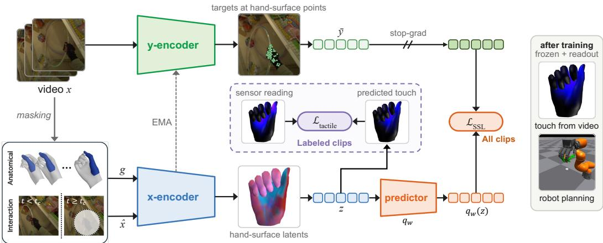  
Figure 2: Touch-JEPA overview. Given a hand-object interaction video, the y-encoder processes unmasked RGB to produce target visual features at geometry-aligned hand-surface locations. The x-encoder combines masked RGB with estimated hand geometry to predict these targets. When tactile annotations are available, joint training additionally supervises contact and magnitude predictions decoded from masked x-encoder states before the predictor, providing complementary physical grounding for the shared representation.

Let $\bar { h } _ { t }$ denote the y-encoder’s video-feature field aligned to frame t. For backbone width $D$ and surface width $d = 2 5 6$ , we define the projected target field and vertex targets as

$$
\bar { Y } _ { t } = \mathtt { L a y e r N o r m } ( \bar { h } _ { t } R ) , \qquad \bar { y } _ { t , v } = \mathtt { S a m p l e } ( \bar { Y } _ { t } , u _ { t , v } ) ,\tag{1}
$$

where $R \in \mathbb { R } ^ { D \times d }$ has fixed orthonormal columns and Sample denotes bilinear sampling. Joint targets are sampled analogously at projected joint locations.

Interaction masking. We select a split $t _ { c }$ between context and target frames based on valid hand observations. For image-patch center $c _ { p }$ and masking radius $^ { r , }$ the interaction mask is

$$
m _ { t , p } = \mathbf { 1 } [ t \geq t _ { c } ] \operatorname* { m a x } _ { \eta } \left\{ s _ { t , v } \mathbf { 1 } [ \left\| c _ { p } - u _ { t , v } \right\| \leq r ] \right\} .\tag{2}
$$

Pixels in masked patches are zeroed after RGB normalization. The x-encoder must recover withheld evidence in target frames using context frames, remaining scene regions, and target-frame geometry.

Anatomical masking. We additionally select a set of finger or palm regions $\mathcal { H }$ and mask neighborhoods around their projected vertices throughout the clip. Their vertex and joint tokens lose direct image-read access during initial sampling and per-layer lifting. Local image-window attention is also blocked for their vertex tokens. Geometry remains available, together with spatial and temporal communication. Interaction masking preserves visual context before $t _ { c } .$ . Anatomical masking additionally removes direct visual evidence for selected regions across all frames, encouraging inference from other hand regions. Sampling rules are provided in Appendix C.3.

## 3.2 GEOMETRY ENCODER

Vertex states $H _ { t } \in \mathbb { R } ^ { V \times d }$ and joint states $S _ { t } \in \mathbb { R } ^ { J \times d }$ pass through four layers interleaved with the final four V-JEPA 2.1 ViT-B/16 blocks (Mur-Labadia et al., 2026). Backbone adaptation is restricted to rank-8 LoRA (Hu et al., 2021) in these blocks. The visual path without surface feedback and the interleaved path share backbone weights. Local attention preserves anatomical structure, while global and temporal exchange integrates evidence across regions and frames.

Visual lifting. The initial field $F _ { t }$ sums projected, temporally aligned features of the masked clip xˆ from the x-encoder’s visual path without surface feedback. For vertex attributes $g _ { t , v }$ extracted from $^ { g , }$ we initialize

$$
H _ { t , v } ^ { 0 } = \gamma ( g _ { t , v } ) + \mathtt { P E } ( v , t ) + a _ { t , v } \phi _ { \mathrm { i m g } } \big ( \mathtt { S a m p l e } ( F _ { t } , u _ { t , v } ) \big ) + ( 1 - a _ { t , v } ) e _ { \emptyset } ,\tag{3}
$$

where $\gamma$ embeds geometry and visibility, PE encodes template position, identity, anatomical region, and time, $\phi _ { \mathrm { i m g } }$ is an affine projection, and $e _ { \emptyset }$ represents missing image evidence. Permission $\boldsymbol { a } _ { t , v }$ equals $\iota _ { t , v }$ outside anatomically masked regions and zero otherwise. Joints are initialized analogously. Each layer adds permitted samples from its ViT features. Vertices also attend to local image windows containing initial and current-layer features.

Anatomical attention. Vertices are partitioned into 20 parts ${ \mathcal P } ,$ , comprising 15 phalangeal parts and five palm zones assigned by geodesic proximity to the fingers. Within-part attention first updates the vertex states. Pooled part tokens then exchange information and broadcast updates to their constituent vertices through

$$
\begin{array} { r l } & { h _ { t , P } = \phi _ { \downarrow } \Bigg ( | P | ^ { - 1 } \sum _ { w \in P } \mathtt { L a y e r N o r m } ( H _ { t , w } ) \Bigg ) , } \\ & { H _ { t , v }  H _ { t , v } + \phi _ { \uparrow } \big ( \mathtt { A t t n } ( h _ { t , P ( v ) } , \{ h _ { t , P } \} _ { P \in \mathcal { P } } ) \big ) , } \end{array}\tag{4}
$$

where $P ( v )$ denotes the part containing vertex $v , \phi _ { \downarrow }$ projects to 64 dimensions, Attn denotes multihead attention, and $\phi _ { \uparrow }$ is a zero-initialized projection back to width d. A token-wise feed-forward network completes the block.

Global and temporal exchange. A global attention core combines 195 downsampled surface tokens with 21 joint tokens at width 128. Full self-attention exchanges information across these tokens, with residual updates returned directly to joints and through fixed mesh upsampling to vertices. A shared causal block then integrates each vertex and joint track across frames, while the video encoder remains noncausal. The first three layers feed surface states back to video patches through gated bilinear splatting. Final LayerNorm operations produce z. Architecture and initialization details appear in Appendix C.2.

## 3.3 SELF-SUPERVISED TRAINING

A token-wise residual predictor $q _ { \omega } ( z ) = z + \mathtt { M L P } _ { \omega } ( z )$ maps x-encoder states to y-encoder features without mixing tokens or frames. The ML $\mathbf { \varPhi } \mathbf { \bar { s } }$ final layer is zero-initialized, making $q _ { \omega }$ initially the identity. For vertex or joint token $i ,$ the dense prediction loss is

$$
\mathcal { L } _ { \mathrm { d e n s e } } = \Big \langle \lVert q _ { \omega } ( { z } _ { t , i } ) - s \mathrm { g } ( \bar { y } _ { t , i } ) \rVert _ { 1 } / d \Big \rangle _ { w } ,\tag{5}
$$

where sg denotes stop-gradient and $\langle \cdot \rangle _ { w }$ denotes a weighted mean computed within each data lane and then averaged across lanes. Each lane corresponds to a data-source group. Weights prioritize mesh-visible, anatomically masked vertices and visually supported target-frame tokens over context tokens. Visual support requires mesh visibility for vertices and valid image projections for joints. Eligible target vertices receive additional weight based on changes in y-encoder features from the last context frame. Exact weighting rules are provided in Appendix D.1.

A position-conditioned decoder $D _ { \xi }$ predicts patch targets $\bar { F } _ { t , p } \in \mathbb { R } ^ { d _ { p } }$ from vertex and joint states. These targets are the normalized counterpart of $F _ { t }$ computed by the y-encoder without surface feedback. For patch-feature width $d _ { p }$ , the reconstruction loss is

$$
\mathcal { L } _ { \mathrm { p a t c h } } = \Big \langle \| D _ { \xi } ( z ) _ { t , p } - s \mathrm { g } ( \bar { F } _ { t , p } ) \| _ { 1 } / d _ { p } \Big \rangle _ { m _ { t , p } = 1 } .\tag{6}
$$

The mean is computed over interaction-masked patches within each lane and then averaged across lanes. This loss encourages the representation to retain surrounding interaction evidence beyond individual vertex and joint samples. The target-field construction and decoder are detailed in $\mathsf { A p - }$ pendices C.1 and D.1. The self-supervised objective is

$$
\mathcal { L } _ { \mathrm { S S L } } = \mathcal { L } _ { \mathrm { d e n s e } } + 0 . 5 \mathcal { L } _ { \mathrm { p a t c h } } + 0 . 0 5 \mathcal { L } _ { \mathrm { w S I G } } .\tag{7}
$$

Inspired by SIGReg (Balestriero & LeCun, 2025), WeakSIGReg encourages the covariance of randomly projected vertex features toward identity, discouraging dimensional collapse.

## 3.4 TACTILE SUPERVISION

Visual prediction learns from all videos, while tactile labels anchor the shared representation to measured contact and sensor-native magnitude. Fixed dataset-specific correspondences map annotations to sensor-supported vertices, with supervision determined by annotation validity independently of image visibility. A two-layer head maps masked x-encoder states before the predictor to $( o , \eta ) = h _ { \psi } ( z )$ , with contact logit o and raw magnitude η. The contact probability and contactconditional magnitude are ${ \hat { c } } = \sigma ( o )$ and $\hat { m } = \tt s o f t p l u s ( \eta )$ , respectively, yielding the gated prediction $\hat { y } = \hat { c } \hat { m }$ , where σ denotes sigmoid.

For ground-truth magnitude y normalized by a fixed training-subset standard deviation, we define

$$
\begin{array} { r l } & { \mathcal { L } _ { \mathrm { t a c t i l e } } = \mathcal { L } _ { \mathrm { c o n t a c t } } } \\ & { \quad + \lambda _ { m } \Big \langle \vert \log ( 1 + \hat { m } ) - \log ( 1 + y ) \vert \Big \rangle _ { \mathcal { C } } } \\ & { \quad + \mathcal { L } _ { \mathrm { h e a d } } , } \end{array}\tag{8}
$$

where $\mathcal { L } _ { \mathrm { { c o n t a c t } } }$ is class-weighted binary cross-entropy, C contains valid ground-truth contact entries, and $\lambda _ { m }$ weights magnitude supervision per dataset. Contact and log-magnitude losses update the encoder and head. The L1 loss $\mathcal { L } _ { \mathrm { h e a d } }$ fits gated predictions to y over all valid entries using sg(z), updating only the head. Losses are normalized within labeled clips and averaged across clips.

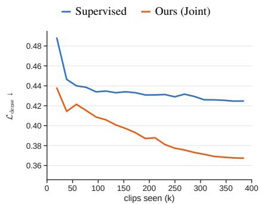  
(a) Visual prediction

The joint objective is

$$
\mathcal { L } = \mathcal { L } _ { \mathrm { S S L } } + \lambda _ { \mathrm { t a c } } ( k ) \mathcal { L } _ { \mathrm { t a c t i l e } } ,\tag{9}
$$

where k denotes the training step and $\lambda _ { \mathrm { t a c } }$ is zero for SSL   
only or warmed up to one for joint training. $\operatorname { A t } z ,$ we   
remove the tactile gradient component opposing the SSL   
gradient (Yu et al., 2020) and cap its remaining norm rel  
ative to an SSL-gradient reference (Appendix D). Tactile   
supervision updates the Geometry Encoder and LoRA-  
Figure 3: Visual and tactile prediction.adapted backbone through the masked x-encoder states, adapted backbone through the masked x-encoder states,

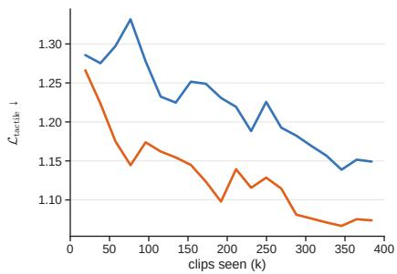  
(b) Tactile prediction

without tactile pseudo-labels. Visual targets are read from the y-encoder’s image stream without surface feedback. For both variants, tactile estimation removes input masks and fits a new readout on the frozen y-encoder using training-split tactile labels. The SSL predictor and any training-time tactile head are discarded after training.

We compare joint training with Supervised using the same encoder architecture and matched clip budgets. Supervised omits visual prediction gradients to the encoder, and its dense prediction loss plateaus. Joint training continues to reduce this loss against its own y-encoder targets (Figure 3a) while maintaining lower held-out tactile loss than Supervised throughout training (Figure 3b). These trends support the benefit of visual prediction for tactile learning while the predictive task itself keeps improving during training.

## 3.5 TOUCH-JEPA-AC

We assess the utility of the learned representations for simulated robot manipulation through actionconditioned planning (Assran et al., 2025). Touch-JEPA-AC freezes the y-encoder and trains a block-causal predictor to forecast pooled video features, pooled hand-surface representations, and robot state from observed history and issued actions. A MANO proxy fitted to robot fingertips through forward kinematics supplies the hand geometry. Robot contact and force annotations are used only for evaluation.

At decision τ, candidate action a produces predicted scene and surface features ${ \hat { B } } _ { \tau + 1 } ( \mathbf { a } )$ and $\hat { U } _ { \tau + 1 } ( \mathbf { a } )$ . We compare them with reference subgoal features using

$$
\begin{array} { r } { E _ { \tau } ( \mathbf { a } ) = \mathrm { M } \mathbb { A } \mathrm { E } \big ( \hat { B } _ { \tau + 1 } ( \mathbf { a } ) , { B } _ { \tau } ^ { \star } \big ) + w _ { \tau } \mathrm { M } \mathbb { A } \mathrm { E } \big ( \hat { U } _ { \tau + 1 } ( \mathbf { a } ) , { U } _ { \tau } ^ { \star } \big ) , } \end{array}\tag{10}
$$

PVDB

HandSense

OpenTouch

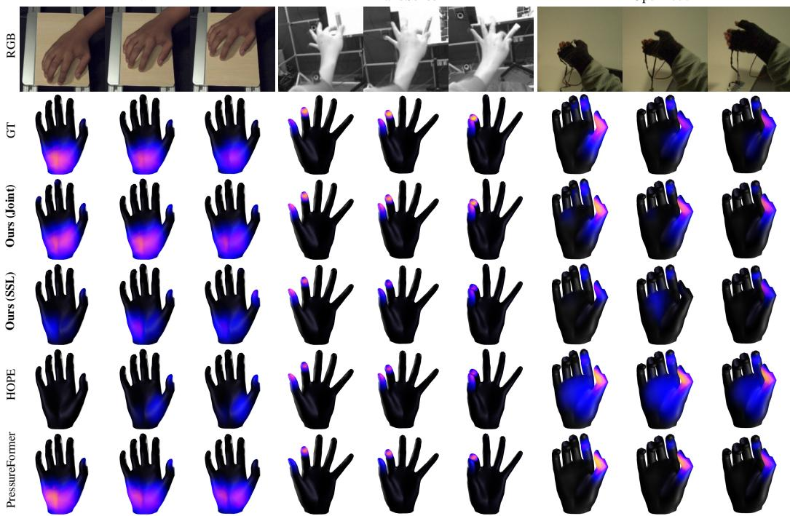  
Figure 4: Qualitative comparison of tactile magnitude estimation. Three interaction sequences unfold from left to right, with brighter colors indicating greater tactile magnitude.

where MAE averages absolute differences, starred features encode the current subgoal, and wτ is a task-dependent surface weight. The cross-entropy method selects palm and grip commands with a one-step horizon and replans after execution. Scripted closing, test lifts, release, and motion constraints complement planning. Details are provided in Appendix H.

## 4 EXPERIMENTS

## 4.1 EXPERIMENTAL SETTING

Implementation details. We use 16-frame clips at 384 × 384 resolution. The Geometry Encoder has four layers of width 256 with four attention heads. All three training settings process 384,000 clip presentations over 12,000 updates with batch size 32. Our model trains on two NVIDIA L40 GPUs. We use AdamW with learning rates of 10−4 for LoRA and 3 × 10−4 for new modules, with 4% warmup followed by cosine decay. EMA momentum increases from 0.996 to 0.9995. Further training and readout details appear in Appendices A and E.

Datasets. Encoder training uses three tactile sensing datasets, HandSense (Zhang et al., 2026b), PressureVision DB (PVDB, Grady et al., 2022), and OpenTouch (Song et al., 2025), alongside standard hand-object interaction datasets, HRDexDB-Human (Lim et al., 2026), DexYCB (Chao et al., 2021), HO3D (Hampali et al., 2021), HO-Cap (Wang et al., 2025), and SHOWMe (Swamy et al., 2023). All three training settings use the same video sources. Joint training and the Supervised control also use the tactile measurements. Contact and magnitude estimation are evaluated on held out test clips from OpenTouch, PVDB (meshes fused across views), and HandSense.

Evaluation metrics. Within each comparison, methods are scored on identical valid entries. For contact, we report pooled AUROC and F1. Temporal AUROC (tAUC) is computed separately for each sensor within a clip and averaged across eligible sequences. For tactile magnitude, nMAE and nRMSE measure errors over these entries, normalized by a fixed training-subset standard deviation of each dataset’s target magnitude. Temporal Spearman correlation (t-ρ) is computed separately for each sensor within a clip using only ground-truth contact frames, then averaged across eligi-

Table 1: Contact estimation. Joint training achieves the best performance across all datasets, while SSL alone outperforms supervised baselines on most metrics. The first , second , and third ranks are assigned among learned methods, and equal displayed values share a rank.
<table><tr><td>Method</td><td colspan="3">OpenTouch</td><td colspan="3">PVDB</td><td colspan="3">HandSense</td></tr><tr><td></td><td>AUROC↑</td><td>F1↑</td><td>tAUC ↑</td><td>AUROC ↑</td><td>F1↑</td><td>tAUC ↑</td><td>AUROC↑</td><td>F1↑</td><td>tAUC ↑</td></tr><tr><td>PressureVision</td><td>0.676</td><td>0.364</td><td>0.506</td><td>0.890</td><td>0.368</td><td>0.748</td><td>0.734</td><td>0.672</td><td>0.588</td></tr><tr><td>PressureVision++</td><td>0.649</td><td>0.342</td><td>0.513</td><td>0.743</td><td>0.179</td><td>0.654</td><td>0.680</td><td>0.636</td><td>0.560</td></tr><tr><td>PressureFormer</td><td>0.785</td><td>0.492</td><td>0.534</td><td>0.920</td><td>0.257</td><td>0.744</td><td>0.811</td><td>0.751</td><td>0.695</td></tr><tr><td>HOPE</td><td>0.762</td><td>0.471</td><td>0.517</td><td>0.911</td><td>0.391</td><td>0.705</td><td>0.844</td><td>0.715</td><td>0.609</td></tr><tr><td>Ours (SSL)</td><td>0.836</td><td>0.549</td><td>0.527</td><td>0.925</td><td>0.475</td><td>0.783</td><td>0.914</td><td>0.826</td><td>0.699</td></tr><tr><td>Ours (Joint)</td><td>0.862</td><td>0.582</td><td>0.540</td><td>0.949</td><td>0.553</td><td>0.802</td><td>0.941</td><td>0.861</td><td>0.752</td></tr><tr><td>Static prior</td><td>0.832</td><td>0.542</td><td>0.500</td><td>0.819</td><td>0.335</td><td>0.500</td><td>0.559</td><td>0.618</td><td>0.500</td></tr></table>

Table 2: Tactile magnitude estimation. Joint training achieves the best displayed results, while SSL alone surpasses the retrained supervised baselines on most metrics. Targets are nominal pressure in PVDB and uncalibrated sensor magnitudes in OpenTouch and HandSense. Errors are computed over the common valid entries. The $\mathbf { t } { - } \rho$ metric measures temporal rank agreement within groundtruth contact. N/A denotes undefined correlation for the static prior.

<table><tr><td>Method</td><td colspan="3">OpenTouch</td><td colspan="3">PVDB</td><td colspan="3">HandSense</td></tr><tr><td></td><td>nMAE↓</td><td>nRMSE↓</td><td> $\mathrm { t } { - } \rho \uparrow$ </td><td>nMAE↓</td><td>nRMSE↓</td><td> $\mathrm { t } { - } \rho \uparrow$ </td><td>nMAE↓</td><td>nRMSE↓</td><td> $\mathrm { t } { - } \rho \uparrow$ </td></tr><tr><td>PressureVision</td><td>0.363</td><td>1.099</td><td>-0.001</td><td>0.130</td><td>0.919</td><td>0.105</td><td>0.738</td><td>1.210</td><td>0.026</td></tr><tr><td>PressureVision++</td><td>0.364</td><td>1.102</td><td>0.000</td><td>0.136</td><td>0.967</td><td>0.038</td><td>0.746</td><td>1.219</td><td>0.007</td></tr><tr><td>PressureFormer</td><td>0.364</td><td>0.939</td><td>0.035</td><td>0.137</td><td>0.981</td><td>0.031</td><td>0.590</td><td>0.914</td><td>0.077</td></tr><tr><td>HOPE</td><td>0.366</td><td>0.974</td><td>0.021</td><td>0.130</td><td>0.951</td><td>0.067</td><td>0.614</td><td>0.922</td><td>0.069</td></tr><tr><td>Ours (SSL)</td><td>0.326</td><td>0.914</td><td>0.030</td><td>0.129</td><td>0.893</td><td>0.239</td><td>0.495</td><td>0.781</td><td>0.152</td></tr><tr><td>Ours (Joint)</td><td>0.314</td><td>0.879</td><td>0.035</td><td>0.123</td><td>0.872</td><td>0.249</td><td>0.461</td><td>0.740</td><td>0.180</td></tr><tr><td>Static prior</td><td>0.398</td><td>0.898</td><td>N/A</td><td>0.221</td><td>0.955</td><td>N/A</td><td>0.755</td><td>1.047</td><td>N/A</td></tr></table>

ble sequences. It measures within-contact temporal rank agreement in sensor-native magnitude, not calibrated force recovery. Differences are tested with paired bootstrap intervals over test clips. Additional details for metrics are provided in Appendix E.

## 4.2 EXPERIMENTAL RESULTS

Contact Estimation. Without tactile annotations during encoder pretraining, Ours (SSL) outperforms all four retrained supervised baselines in pooled AUROC and F1 across all three datasets using supervised readouts on frozen encoders (Table 1). Hand-surface masked visual prediction therefore learns contact-relevant features. Temporal performance varies across datasets. On PVDB, SSL achieves a tAUC of 0.783 against the strongest baseline’s 0.748, and it is on par with PressureFormer (Zhao et al., 2025) on HandSense. Among compared methods, joint training is best in AUROC, F1, and tAUC on every dataset, including a tAUC increase over SSL from 0.699 to 0.752 on HandSense. On OpenTouch, tAUC stays near chance for every method, and the video-free static prior is 0.500 by construction, so pooled discrimination alone does not measure contact timing.

Tactile Magnitude Estimation. Readouts on frozen Ours (SSL) features achieve lower nRMSE than all four retrained supervised baselines across the three datasets and lower nMAE on Open-Touch and HandSense, on par with the best baseline on PVDB (Table 2 and Figure 4). On PVDB, within-contact temporal correlation reaches 0.239, compared with 0.105 for the strongest supervised baseline, and increases to 0.249 with joint training. Joint training achieves the best results across all metrics in this comparison. The largest gains from joint training occur on HandSense, where nMAE decreases from 0.495 to 0.461 relative to SSL and $\mathbf { t } { - } \rho$ rises from 0.152 to 0.180. Visual prediction alone thus improves on the baselines in sensor-native magnitude estimation, and tactile supervision improves it further. Temporal correlations nevertheless remain low on OpenTouch and HandSense, so fine-grained tracking is still challenging.

Ablation Studies. Each variant is retrained without the named component. The two controls apply the same readout to per-vertex hand kinematics and to frozen V-JEPA 2.1 features, respectively. Table 3 shows that the full SSL model achieves the best results across all six dataset-averaged metrics. Compared with frozen V-JEPA 2.1, AUROC improves by 0.060. Removing the Geometry Encoder lowers AUROC from 0.892 to 0.815, below frozen V-JEPA 2.1. Using geometry alone reduces it to 0.811, so visual evidence adds to hand geometry. Both masking strategies improve contact and magnitude estimation. Combining hand geometry with masked visual prediction therefore yields tactile-relevant representations beyond frozen video features.

Table 3: Effectiveness of individual components. SSL variants after half of the 12,000 updates, averaged over the three test sets on all valid entries.
<table><tr><td rowspan="2">Variant</td><td colspan="3">Contact</td><td colspan="3">Magnitude</td></tr><tr><td>AUROC↑</td><td>F1↑</td><td>tAUC ↑</td><td>nMAE↓ nRMSE↓</td><td></td><td>t-ρ↑</td></tr><tr><td>Full model (SSL)</td><td>0.892</td><td>0.613</td><td>0.674</td><td>0.312</td><td>0.853</td><td>0.130</td></tr><tr><td>w/o anatomical masking</td><td>0.883</td><td>0.605</td><td>0.663</td><td>0.323</td><td>0.870</td><td>0.121</td></tr><tr><td>w/o interaction masking</td><td>0.871</td><td>0.599</td><td>0.652</td><td>0.323</td><td>0.883</td><td>0.094</td></tr><tr><td>w/o geometry encoder</td><td>0.815</td><td>0.527</td><td>0.651</td><td>0.345</td><td>0.937</td><td>0.111</td></tr><tr><td>w/o video (geometry only)</td><td>0.811</td><td>0.430</td><td>0.611</td><td>0.350</td><td>0.946</td><td>0.069</td></tr><tr><td>V-JEPA 2.1 (frozen)</td><td>0.832</td><td>0.558</td><td>0.664</td><td>0.337</td><td>0.918</td><td>0.102</td></tr></table>

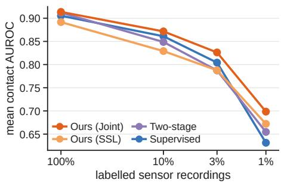  
Figure 5: Scaling annotated sensor recordings. Mean contact AUROC over test sets.

Table 4: Zero-shot transfer to Allegro. AP is average precision and ρ per-episode Spearman.
<table><tr><td>Method</td><td>AUROC ↑</td><td>AP↑</td><td>F1↑</td><td>ρ↑</td></tr><tr><td>PressureVision</td><td>0.506</td><td>0.443</td><td>0.474</td><td>-0.032</td></tr><tr><td>PressureVision++</td><td>0.435</td><td>0.395</td><td>0.429</td><td>-0.039</td></tr><tr><td>PressureFormer</td><td>0.537</td><td>0.485</td><td>0.502</td><td>-0.017</td></tr><tr><td>HOPE</td><td>0.582</td><td>0.510</td><td>0.535</td><td>0.159</td></tr><tr><td>Ours (SSL)</td><td>0.676</td><td>0.608</td><td>0.608</td><td>0.183</td></tr><tr><td>Ours (Joint)</td><td>0.628</td><td>0.529</td><td>0.569</td><td>0.106</td></tr></table>

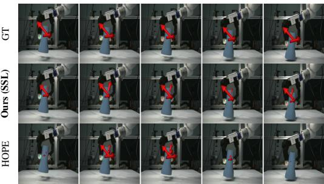  
Figure 6: Comparison on the Allegro hand.

Label Efficiency. With labels on 1 to 10% of the sensor recordings, a joint model and a Supervised model would otherwise see each labeled clip a different number of times. We therefore oversample the labeled clips identically in both arms, so that each labeled clip is drawn equally often, and fit the readouts with the same labeled fraction. At 100%, every sensor clip is labeled and the exposure is equal by construction. Joint training helps most when labels are scarce (Figure 5). With labels on 1% of the recordings, it raises contact AUROC over Supervised by 0.170 on PVDB and by 0.046 on OpenTouch, and the gain is small once every clip is labeled. On HandSense, the two do not differ reliably at 1 to 10%, and joint training is ahead at 100%. For Ours (SSL), the frozen encoder is read out with the same labels, and the two-stage control further trains Ours (SSL) on the labeled clips alone. Averaged over the test sets, joint training stays above Ours (SSL), the two-stage control, and Supervised at every fraction up to 10%.

## 4.3 ROBOTIC TRANSFER AND MANIPULATION

Transfer to Robotic Hands. We evaluate human-trained predictors without adaptation on 89 real Allegro episodes (10,562 frames), with hand geometry from measured joint angles. Ours (SSL) leads all four metrics and outperforms the joint model (Table 4), with examples in Figure 6. Its AUROC and magnitude correlation are 0.676 and 0.183, compared with 0.628 and 0.106 for joint training. The joint model still beats the supervised baselines in Allegro contact estimation. On the five-fingertip Inspire hand, Ours (SSL) also leads all four metrics (Appendix H.1). We therefore use the SSL encoder for planning, so that, like the V-JEPA 2.1 baseline, it is label-free.

Action-Conditioned Planning for Robotic Manipulation. Using the frozen SSL encoder, Touch-JEPA-AC plans simulated grasp-lift and place actions toward reference subgoals with an actionconditioned predictor trained on robot trajectories (Appendix H.2). Across 50 matched scenes per task, success rates are 86% for grasp-lift and 84% for place, compared with 54% and 46% for

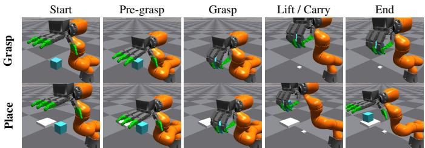  
Figure 7: Robot manipulation rollouts. Grasp-lift and place with time progressing from left to right.

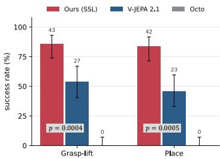  
Figure 8: Task success rates.  
V-JEPA 2.1. Exact two-sided McNemar tests give unadjusted p = 0.0004 and $p = 0 . 0 0 0 5$ , respectively. Octo (Octo Model Team et al., 2024) succeeds in neither task (Figure 8). The representations thus also serve simulated manipulation, as the sample rollouts in Figure 7 illustrate.

## 5 CONCLUSION

We presented Touch-JEPA, a unified framework that combines self-supervised learning of tactilerelevant representations from hand-object video with tactile supervision on a labeled subset. Geometry-guided masked visual prediction enables contact and sensor-native magnitude estimation through supervised readouts on frozen features. Joint training further improves human-hand estimation, with particular benefits under limited tactile supervision. The self-supervised representations also transfer to robotic hands and support simulated manipulation, demonstrating their utility beyond tactile estimation.

Limitations and Future Work. Magnitude results are sensor-specific and do not establish crosssensor force calibration. Within-contact temporal correlations remain low on some datasets, where limited tactile variation within 16-frame clips constrains the evaluation of fine-grained temporal tracking. Future work includes pretraining on more diverse and longer videos, improving robustness to geometry errors, and evaluating manipulation across broader tasks and on physical robots. Additionally, the joint-embedding framework could be extended to incorporate language or sensor inputs during representation learning.

## REFERENCES

Ali J Alrasheed, Aryan Yazdan Parast, Basim Azam, James Bailey, and Naveed Akhtar. Latent video prediction for world modeling: An evaluation uncovering intriguing favorable evidence. arXiv preprint arXiv:2605.15618, 2026.

Mahmoud Assran, Quentin Duval, Ishan Misra, Piotr Bojanowski, Pascal Vincent, Michael Rabbat, Yann Le-Cun, and Nicolas Ballas. Self-supervised learning from images with a joint-embedding predictive architecture. In 2023 IEEE/CVF Conference on Computer Vision and Pattern Recognition (CVPR), pp. 15619– 15629. IEEE, 2023.

Mido Assran, Adrien Bardes, David Fan, Quentin Garrido, Russell Howes, Matthew Muckley, Ammar Rizvi, Claire Roberts, Koustuv Sinha, Artem Zholus, et al. V-JEPA 2: Self-supervised video models enable understanding, prediction and planning. arXiv preprint arXiv:2506.09985, 2025.

Randall Balestriero and Yann LeCun. LeJEPA: Provable and scalable self-supervised learning without the heuristics. arXiv preprint arXiv:2511.08544, 2025.

Adrien Bardes, Quentin Garrido, Jean Ponce, Xinlei Chen, Michael Rabbat, Yann LeCun, Mahmoud Assran, and Nicolas Ballas. Revisiting feature prediction for learning visual representations from video. arXiv preprint arXiv:2404.08471, 2024.

Samarth Brahmbhatt, Cusuh Ham, Charles C Kemp, and James Hays. ContactDB: Analyzing and predicting grasp contact via thermal imaging. In 2019 IEEE/CVF Conference on Computer Vision and Pattern Recognition (CVPR), pp. 8709–8719. IEEE, 2019.

Mathilde Caron, Hugo Touvron, Ishan Misra, Herve J ´ egou, Julien Mairal, Piotr Bojanowski, and Armand´ Joulin. Emerging properties in self-supervised vision transformers. In 2021 IEEE/CVF international conference on computer vision (ICCV), pp. 9650–9660. IEEE, 2021.

Yu-Wei Chao, Wei Yang, Yu Xiang, Pavlo Molchanov, Ankur Handa, Jonathan Tremblay, Yashraj S Narang, Karl Van Wyk, Umar Iqbal, Stan Birchfield, Jan Kautz, and Dieter Fox. DexYCB: A benchmark for capturing hand grasping of objects. In 2021 IEEE/CVF Conference on Computer Vision and Pattern Recognition (CVPR), pp. 9044–9053. IEEE, 2021.

Junhyeong Cho, Kim Youwang, and Tae-Hyun Oh. Cross-attention of disentangled modalities for 3D human mesh recovery with transformers. In European Conference on Computer Vision (ECCV), 2022.

Dima Damen, Hazel Doughty, Giovanni Maria Farinella, Antonino Furnari, Evangelos Kazakos, Jian Ma, Davide Moltisanti, Jonathan Munro, Toby Perrett, Will Price, et al. Rescaling egocentric vision: Collection, pipeline and challenges for EPIC-KITCHENS-100. International Journal of Computer Vision, 130(1):33– 55, 2022.

Ruoxuan Feng, Jiangyu Hu, Wenke Xia, Tianci Gao, Ao Shen, Yuhao Sun, Bin Fang, and Di Hu. AnyTouch: Learning unified static-dynamic representation across multiple visuo-tactile sensors. In International Conference on Learning Representations, 2025.

Patrick Grady, Chengcheng Tang, Samarth Brahmbhatt, Christopher D Twigg, Chengde Wan, James Hays, and Charles C Kemp. PressureVision: Estimating hand pressure from a single RGB image. In European Conference on Computer Vision, pp. 328–345. Springer, 2022.

Patrick Grady, Jeremy A Collins, Chengcheng Tang, Christopher D Twigg, Kunal Aneja, James Hays, and Charles C Kemp. PressureVision++: Estimating fingertip pressure from diverse RGB images. In 2024 IEEE/CVF Winter Conference on Applications of Computer Vision (WACV), pp. 8698–8708. IEEE, 2024.

Kristen Grauman, Andrew Westbury, Eugene Byrne, Zachary Chavis, Antonino Furnari, Rohit Girdhar, Jackson Hamburger, Hao Jiang, Miao Liu, Xingyu Liu, et al. Ego4D: Around the world in 3,000 hours of egocentric video. In Proceedings ofthe IEEE/CVF conference on computer vision and pattern recognition, pp. 18995– 19012, 2022.

Shreyas Hampali, Sayan Deb Sarkar, and Vincent Lepetit. HO-3D v3: Improving the accuracy of hand-object annotations of the HO-3D dataset. arXiv preprint arXiv:2107.00887, 2021.

Carolina Higuera, Akash Sharma, Chaithanya Krishna Bodduluri, Taosha Fan, Patrick Lancaster, Mrinal Kalakrishnan, Michael Kaess, Byron Boots, Mike Lambeta, Tingfan Wu, et al. Sparsh: Self-supervised touch representations for vision-based tactile sensing. arXiv preprint arXiv:2410.24090, 2024.

Edward J Hu, Yelong Shen, Phillip Wallis, Zeyuan Allen-Zhu, Yuanzhi Li, Shean Wang, Lu Wang, and Weizhu Chen. LoRA: Low-rank adaptation of large language models. arXiv preprint arXiv:2106.09685, 2021.

Hai Huang, Yann LeCun, and Randall Balestriero. LLM-JEPA: Large language models meet joint embedding predictive architectures. In International Conference on Learning Representations, 2026.

Andela Ilic, Rachel Schuchert, Yijing Jiang, and Christian Holz. EgoPHI: Estimating 3D hand-object contact and force from egocentric vision. In European Conference on Computer Vision, pp. 410–428. Springer, 2026.

Subin Jeon, Byungjun Kim, and Hanbyul Joo. HOPE: Hand-object pressure estimation from monocular videos. arXiv preprint arXiv:2608.06192, 2026.

Chunpeng Jiang, Wenqiang Xu, Yutong Li, Zhenjun Yu, Longchun Wang, Xiaotong Hu, Zhengyi Xie, Qingkun Liu, Bin Yang, Xiaolin Wang, et al. Capturing forceful interaction with deformable objects using a deep learning-powered stretchable tactile array. Nature Communications, 15(1):9513, 2024.

Daniel Jung and Kyoung Mu Lee. Learning dense hand contact estimation from imbalanced data. In Advances in Neural Information Processing Systems, volume 38, 2025.

Justin Kerr, Huang Huang, Albert Wilcox, Ryan Hoque, Jeffrey Ichnowski, Roberto Calandra, and Ken Goldberg. Self-supervised visuo-tactile pretraining to locate and follow garment features. arXiv preprint arXiv:2209.13042, 2022.

Elizaveta Kovtun, Matvey Konovalov, Andrey Sakhovskiy, and Semen Budennyy. Tactile-JEPA: Topology-aware self-supervised representation learning for distributed tactile sensors. arXiv preprint arXiv:2609.24385, 2026.

Jongbin Lim, Taeyun Ha, Seongho Cha, Kanghyeon Cho, Mingi Choi, Subin Jeon, Jisoo Kim, Byungjun Kim, and Hanbyul Joo. HRDexDB: A 4D dexterous grasping dataset across human and multiple robot embodiments. arXiv preprint arXiv:2604.14944, 2026.

Hao Luo and Zongqing Lu. Learning video-conditioned policy on unlabelled data with joint embedding predictive transformer. In International Conference on Learning Representations, 2025.

Lorenzo Mur-Labadia, Matthew Muckley, Amir Bar, Mido Assran, Koustuv Sinha, Mike Rabbat, Yann LeCun, Nicolas Ballas, and Adrien Bardes. V-JEPA 2.1: Unlocking dense features in video self-supervised learning. arXiv preprint arXiv:2603.14482, 2026.

Adithyavairavan Murali, Yin Li, Dhiraj Gandhi, and Abhinav Gupta. Learning to grasp without seeing. In International Symposium on Experimental Robotics, pp. 375–386. Springer, 2018.

Octo Model Team, Dibya Ghosh, Homer Walke, Karl Pertsch, Kevin Black, Oier Mees, Sudeep Dasari, Joey Hejna, Tobias Kreiman, Charles Xu, et al. Octo: An open-source generalist robot policy. arXiv preprint arXiv:2405.12213, 2024.

Maxime Oquab, Timothee Darcet, Th´ eo Moutakanni, Huy Vo, Marc Szafraniec, Vasil Khalidov, Pierre Fernan-´ dez, Daniel Haziza, Francisco Massa, Alaaeldin El-Nouby, et al. DINOv2: Learning robust visual features without supervision. arXiv preprint arXiv:2304.07193, 2023.

Georgios Pavlakos, Dandan Shan, Ilija Radosavovic, Angjoo Kanazawa, David Fouhey, and Jitendra Malik. Reconstructing hands in 3D with transformers. In CVPR, 2024.

Yuzhe Qin, Yueh-Hua Wu, Shaowei Liu, Hanwen Jiang, Ruihan Yang, Yang Fu, and Xiaolong Wang. DexMV: Imitation learning for dexterous manipulation from human videos. In European Conference on Computer Vision, pp. 570–587. Springer, 2022.

Javier Romero, Dimitrios Tzionas, and Michael J. Black. Embodied hands: Modeling and capturing hands and bodies together. ACM Transactions on Graphics, (Proc. SIGGRAPH Asia), 36(6):245:1–245:17, November 2017.

Kenneth Shaw, Shikhar Bahl, and Deepak Pathak. VideoDex: Learning dexterity from internet videos. In Conference on Robot Learning, pp. 654–665. PMLR, 2023.

Oriane Simeoni, Huy V Vo, Maximilian Seitzer, Federico Baldassarre, Maxime Oquab, Cijo Jose, Vasil´ Khalidov, Marc Szafraniec, Seungeun Yi, Michael Ramamonjisoa, et al. DINOv3. ¨ arXiv preprint arXiv:2508.10104, 2025.

Yuxin Ray Song, Jinzhou Li, Rao Fu, Devin Murphy, Kaichen Zhou, Rishi Shiv, Yaqi Li, Haoyu Xiong, Crystal Elaine Owens, Yilun Du, et al. OpenTouch: Bringing full-hand touch to real-world interaction. arXiv preprint arXiv:2512.16842, 2025.

Subramanian Sundaram, Petr Kellnhofer, Yunzhu Li, Jun-Yan Zhu, Antonio Torralba, and Wojciech Matusik. Learning the signatures of the human grasp using a scalable tactile glove. Nature, 569(7758):698–702, 2019.

Anilkumar Swamy, Vincent Leroy, Philippe Weinzaepfel, Fabien Baradel, Salma Galaaoui, Romain Bregier,´ Matthieu Armando, Jean-Sebastien Franco, and Gregory Rogez. SHOWMe: Benchmarking object-agnostic´ hand-object 3D reconstruction. In 2023 IEEE/CVF International Conference on Computer Vision Workshops (ICCVW), pp. 1935–1944. IEEE, 2023.

Jianyuan Wang, Minghao Chen, Shangzhan Zhang, Nikita Karaev, Johannes Schonberger, Patrick Labatut, Piotr¨ Bojanowski, David Novotny, Andrea Vedaldi, and Christian Rupprecht. VGGT-ω, 2026. URL https: //arxiv.org/abs/2605.15195.

Jikai Wang, Qifan Zhang, Yu-Wei Chao, Bowen Wen, Xiaohu Guo, and Yu Xiang. HO-Cap: A capture system and dataset for 3D reconstruction and pose tracking of hand-object interaction. In Advances in Neural Information Processing Systems, volume 38, 2025.

Shaoxiong Wang, Mike Lambeta, Po-Wei Chou, and Roberto Calandra. TACTO: A fast, flexible, and opensource simulator for high-resolution vision-based tactile sensors. IEEE Robotics and Automation Letters, 7 (2):3930–3937, 2022.

Youngsun Wi, Jessica Yin, Elvis Xiang, Akash Sharma, Jitendra Malik, Mustafa Mukadam, Nima Fazeli, and Tess Hellebrekers. TactAlign: Human-to-robot policy transfer via tactile alignment. In Proceedings of Robotics: Science and Systems, Sydney, Australia, 2026. doi: 10.15607/RSS.2026.XXII.006.

Han Xue, Jieji Ren, Wendi Chen, Gu Zhang, Yuan Fang, Guoying Gu, Huazhe Xu, and Cewu Lu. Reactive diffusion policy: Slow-fast visual-tactile policy learning for contact-rich manipulation. arXiv preprint arXiv:2503.02881, 2025.

Fengyu Yang, Chenyang Ma, Jiacheng Zhang, Jing Zhu, Wenzhen Yuan, and Andrew Owens. Touch and go: Learning from human-collected vision and touch. arXiv preprint arXiv:2211.12498, 2022.

Fengyu Yang, Chao Feng, Ziyang Chen, Hyoungseob Park, Daniel Wang, Yiming Dou, Ziyao Zeng, Xien Chen, Rit Gangopadhyay, Andrew Owens, and Alex Wong. Binding touch to everything: Learning unified multimodal tactile representations. In 2024 IEEE/CVF Conference on Computer Vision and Pattern Recognition (CVPR), pp. 26340–26353. IEEE, 2024.

Tianhe Yu, Saurabh Kumar, Abhishek Gupta, Sergey Levine, Karol Hausman, and Chelsea Finn. Gradient surgery for multi-task learning. In Advances in Neural Information Processing Systems, volume 33, pp. 5824–5836, 2020.

Martina Zambelli, Yusuf Aytar, Francesco Visin, Yuxiang Zhou, and Raia Hadsell. Learning rich touch representations through cross-modal self-supervision. In Conference on Robot Learning, pp. 1415–1425. PMLR, 2021.

Yuan Zeng, Yujia Shi, Tiao Tan, Xingting Li, Yaqi Qin, Zongqing Lu, Wenming Yang, Jing-Hao Xue, and Qingmin Liao. EgoTactile: Learning grasp pressure for everyday objects from egocentric video. arXiv preprint arXiv:2606.09243, 2026.

Jinglei Zhang, Jiankang Deng, Chao Ma, and Rolandos Alexandros Potamias. HaWoR: World-space hand motion reconstruction from egocentric videos. In 2025 IEEE/CVF Conference on Computer Vision and Pattern Recognition (CVPR), pp. 1805–1815. IEEE, 2025.

Wenkang Zhang, Chengbo Yuan, Zicheng Zhang, Zhengxue Cheng, and Yang Gao. EgoTac: In-the-wild tactile prediction from egocentric vision. arXiv preprint arXiv:2608.15060, 2026a.

Xinyu Zhang, Ziyi Kou, Chuan Qin, Mia Huang, Ergys Ristani, Ankit Kumar, Lele Chen, Kun He, Abdeslam Boularias, and Li Guan. Glove2Hand: Synthesizing natural hand-object interaction from multi-modal sensing gloves. arXiv preprint arXiv:2603.20850, 2026b.

Nicholas Zhao and Jose Zariffa. Automated hand prehension assessment from egocentric video after spinal cord injury. IEEE Transactions on Neural Systems and Rehabilitation Engineering, 32:2864–2872, 2024.

Yiming Zhao, Taein Kwon, Paul Streli, Marc Pollefeys, and Christian Holz. EgoPressure: A dataset for hand pressure and pose estimation in egocentric vision. In 2025 IEEE/CVF Conference on Computer Vision and Pattern Recognition (CVPR), pp. 27727–27738. IEEE, 2025.

Danyan Zhou, Jinxuan Lu, Jiawei Lin, Tianxing Chen, Chuqiao Lyu, and Wenbo Ding. TouchSight: Bare-handed tactile prediction from egocentric video via generative visual augmentation. arXiv preprint arXiv:2609.20414, 2026a.

Jianyi Zhou, Ziteng Gao, Feiyang Hong, Zirui Liu, Guannan Zhang, Weisheng Dai, Ruichen Zhen, Chuqiao Lyu, Haotian Wu, Yinian Mao, et al. TouchAnything: A dataset and framework for bimanual tactile estima tion from egocentric video. arXiv preprint arXiv:2605.13083, 2026b.

Jinghao Zhou, Chen Wei, Huiyu Wang, Wei Shen, Cihang Xie, Alan Yuille, and Tao Kong. iBOT: Image BERT pre-training with online tokenizer. arXiv preprint arXiv:2111.07832, 2021.

Xinyue Zhu, Binghao Huang, and Yunzhu Li. Touch in the wild: Learning fine-grained manipulation with a portable visuo-tactile gripper. In Advances in Neural Information Processing Systems, volume 38, 2025.

## SUPPLEMENTARY MATERIAL

## A DATA AND TRAINING PROTOCOL

Video corpus and tactile coverage. Table 5 summarizes the 110,147 training clips used for encoder learning. Each clip contains T = 16 frames. Tactile measurements are available for 30,329 clips, or 27.5% of the corpus, from three sensor datasets. The remaining 79,818 clips provide vi sual self-supervision. Clip counts refer to temporal windows. OpenTouch windows overlap, and HRDexDB-Human windows are counted separately for each camera view. These counts therefore describe the training roster rather than unique frames.

Table 5: Encoder-training corpus. Counts are 16-frame training clips. DexYCB, HO3D, HO-Cap, and SHOWMe form the hand-object interaction (HOI) group and share one sampling lane. Tactile measurements supervise encoder updates only in joint and Supervised training.
<table><tr><td>Dataset</td><td># Clips</td><td>Available tactile measurements</td></tr><tr><td>HandSense</td><td>3,721</td><td>Five fingertip channels in glove counts</td></tr><tr><td>PressureVision DB</td><td>3,970</td><td>Surface pressure in nominal kPa</td></tr><tr><td>OpenTouch</td><td>22,638</td><td>169 taxels in sensor counts</td></tr><tr><td>HRDexDB-Human</td><td>40,536</td><td>None</td></tr><tr><td>DexYCB</td><td>17,200</td><td>None used</td></tr><tr><td>HO3D</td><td>4,058</td><td>None used</td></tr><tr><td>HO-Cap</td><td>15,346</td><td>None used</td></tr><tr><td>SHOWMe</td><td>2,678</td><td>None used</td></tr><tr><td>Total</td><td>110,147</td><td>30,329 clips with tactile measurements</td></tr></table>

Partitions and sensor support. PressureVision DB uses its participant-based training and test folds, with 24 and 6 participants, respectively. HandSense and OpenTouch use recording-disjoint partitions. HandSense contains 161 training and 18 test recordings, while OpenTouch contains 970 and 123. The corresponding test sets contain 447, 1,224, and 2,519 clips for HandSense, Pressure-Vision DB, and OpenTouch. HandSense uses the released synthesized bare-hand videos with binary contact annotations and glove readings. PressureVision DB provides pressure on palmar vertices within the sensing pad and facing the pad. OpenTouch retains the 169 supported taxels and uses 3072 minus the released sensor value as magnitude. Sensor validity determines supervised entries independently of image visibility. HRDexDB contributes only its human videos to encoder training.

Matched training schedules. SSL, Supervised, and joint training share the encoder initialization, sampling configuration, and seed 912. Each processes 384,000 clip presentations through 12,000 updates with global batch size 32. The first 1,200 updates sample only the three sensor datasets. Each worker receives 3 HandSense, 3 PressureVision DB, and 10 OpenTouch clips per update. Subsequently, these counts become 1, 1, and 3, with 4 HRDexDB-Human and 7 HOI clips. In this mixed phase, about 70% of the sampled clips therefore come from videos without tactile measurements. Within each lane, sampling uses shuffled permutations with disjoint worker shards. An evaluation interval spans 600 updates or 19,200 clip presentations.

Optimization and supervision. Inputs have resolution 384 × 384. Training selects the observer view or a hand-centered crop with equal probability. Crop expansion is 1.5 times a uniform multiplier in [0.8, 1.2], with independent center shifts of up to 10% of the crop side along each axis. AdamW uses $\beta \ \stackrel { \cdot } { = } \ ( 0 . 9 , 0 . 9 5 )$ and weight decay 0.04, with learning rates $1 0 ^ { - 4 }$ for LoRA and $3 \times 1 0 ^ { - 4 }$ for new modules. A 480-update warmup starts at one sixth of these rates, followed by cosine decay to $1 0 ^ { - 6 }$ . We clip the gradient norm at 1.0 and increase EMA momentum from 0.996 to 0.9995. Training uses bfloat16 and gradient checkpointing. SSL receives no tactile gradient in the encoder. Detached online probes use a separate optimizer and serve only as diagnostics. Joint training adds contact and magnitude supervision from the three sensor datasets, with $\lambda _ { \mathrm { t a c } }$ increasing from 0.1 to 1 over the first 1,200 updates. Supervised applies the same supervised losses with

(a) PressureVision DB, palm-and-finger press

oint SSL) orme ision+ ision RGB GT urs urs OPE ressur ressur ressur

(b) HandSense, piano key press

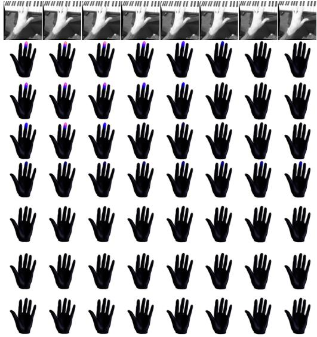  
Figure 9: Additional comparisons on PressureVision DB and HandSense. Eight frames per sequence progress from left to right. Brighter colors indicate greater tactile magnitude, and gray marks entries without a prediction.  
(a) OpenTouch, fabrication lab

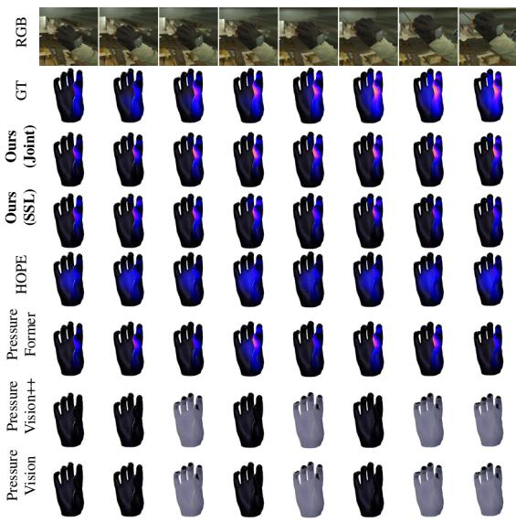

(b) OpenTouch, office

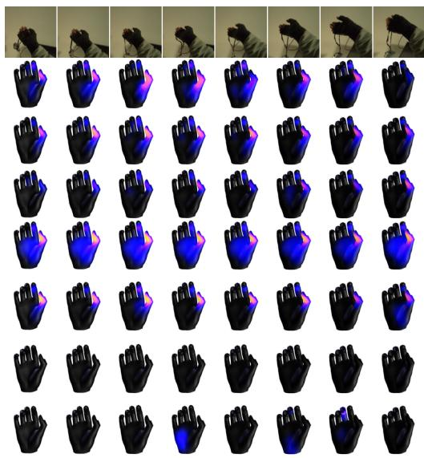  
Figure 10: Additional comparisons on OpenTouch. Display conventions follow Figure 9.

unit weight throughout training and no SSL-relative gradient cap. Neither supervised setting uses geometric contact labels from DexYCB or tactile pseudo-labels.

## B ADDITIONAL VISUALIZATIONS

Figures 9 to 13 compare tactile magnitude predictions with ground truth across three datasets, and Figure 14 shows the examples of Figure 4 from the video camera. Figure 15 shows the examples of Figures 9 to 13 from the camera and from the palm side.

(a) PressureVision DB, palm press

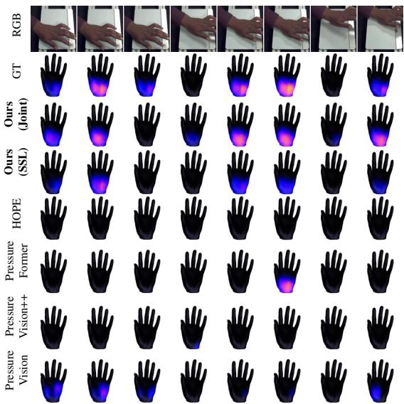

(b) PressureVision DB, cupped-palm press

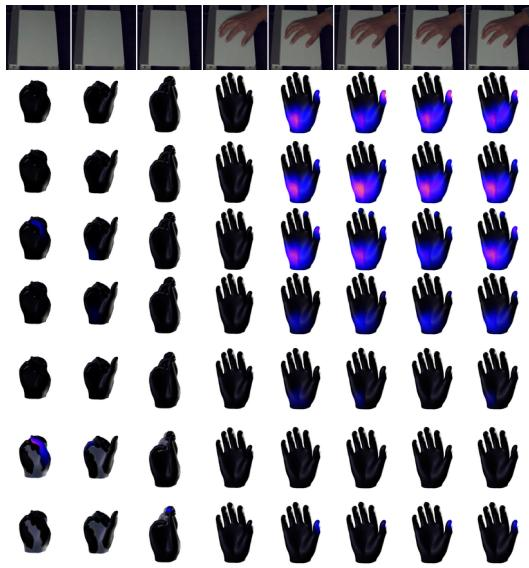  
Figure 11: More comparisons on PressureVision DB. Display conventions follow Figure 9.  
(a) HandSense, opening a bottle  
(b) HandSense, opening a bottle (second session)

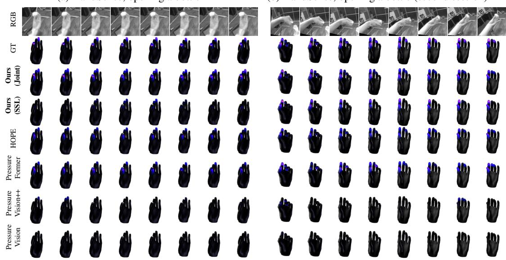  
Figure 12: More comparisons on HandSense. Display conventions follow Figure 9.

## C ARCHITECTURE AND MASKING

## C.1 GEOMETRY AND VISUAL FEATURE PATHS

Hand geometry provides correspondence between image observations and a common anatomical surface. Vertex and joint coordinates are centered at the wrist and divided by the root mean squared vertex distance to the wrist in each frame. Vertex attributes additionally include surface normals, mesh visibility, and image inclusion. The anatomical positional encoding sums a vertex embedding, a region embedding, six-frequency Fourier features of the template coordinates, and a linear em bedding of normalized frame index. Joints use joint identity and frame index. An additional palm frame, defined by the wrist, index metacarpophalangeal joint, and ring metacarpophalangeal joint, supplies canonical coordinates through zero-initialized affine projections. The same zero-initialized side input also carries the frame’s rotation and the wrist position divided by hand size, so the global hand pose remains available (18 inputs per vertex and 15 per joint). The original camera-oriented coordinates remain available. Geometry estimation is frozen throughout training.

(b) OpenTouch, kitchen  
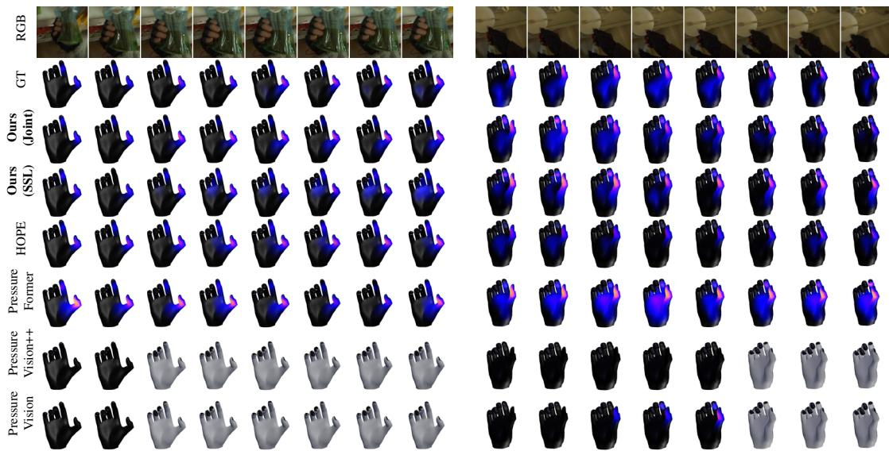  
Figure 13: More comparisons on OpenTouch. Display conventions follow Figure 9.

The backbone has width D = 768, patch size 16, and temporal tubelets of two frames. We number its twelve blocks from 0 to 11. The initial visual field $\mathbf { \hat { \boldsymbol { F } } } _ { t }$ sums features from blocks 5, 8, and 11, each projected to $d _ { p } = 1 2 8$ dimensions and aligned to the input frames by a learned temporal decoder. Dense teacher targets instead use the final block’s features, projected to $d = 2 5 6$ by the fixed matrix R in Equation 1. We construct R by QR decomposition of a Gaussian matrix with seed 912. The target-field LayerNorm has no learnable affine parameters. Each tubelet feature supplies both constituent frames before bilinear sampling.

Table 6 distinguishes the visual target path from the surface representation path. The interleaved path branches after block 8 and reruns blocks 9 through 11 with the same backbone and LoRA parameters. Thus, surface feedback changes the features read by subsequent Geometry Encoder layers without entering the visual features used as prediction targets.

Table 6: Information flow in Touch-JEPA. The visual and interleaved paths share backbone parameters within each encoder. The EMA copy supplies targets and the evaluated representation.
<table><tr><td>Path</td><td>RGB input</td><td>Surface feedback</td><td>Output and use</td></tr><tr><td>Student visual</td><td>Masked</td><td>None</td><td>Initial field  $F _ { t }$ </td></tr><tr><td>Student surface</td><td>Masked</td><td>First three layers</td><td>States z for prediction and tactile supervi- sion</td></tr><tr><td>EMA visual</td><td>Unmasked</td><td>None</td><td>Dense and patch targets</td></tr><tr><td>EMA surface</td><td>Unmasked</td><td>First three layers</td><td>Frozen states for downstream readouts</td></tr></table>

## C.2 GLOBAL AND TEMPORAL EXCHANGE

Each of the four Geometry Encoder layers combines within-part attention over the 20 template parts, cross-part attention, and a local feed-forward network with GELU activation. The output projections of the cross-part and feed-forward branches are zero-initialized.

A fixed downsampling matrix $D _ { 0 } \in \{ 0 , 1 \} ^ { 1 9 5 \times 7 7 8 }$ selects 195 template vertices, and a fixed sparse matrix $U _ { 0 } \in \mathbb { R } ^ { 7 7 8 \times 1 9 5 }$ maps coarse updates back to the full surface. For layer ℓ, the persistent frame

OpenTouch

PVDB

HandSense

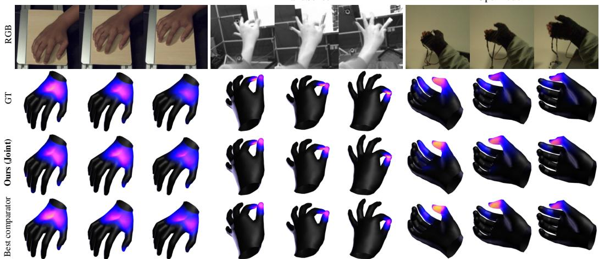  
Figure 14: The examples of Figure 4 seen from the video camera. Activation on the side facing away from the camera shows through the hand. The comparator is the supervised baseline with the highest contact AUROC in Table 1.

core $C _ { t } ^ { \ell } \in \mathbb { R } ^ { 2 1 6 \times 1 2 8 }$ is updated by

$$
\begin{array} { r l } & { C _ { t } ^ { \ell + 1 } = \mathrm { C o r e } _ { \ell } \big ( C _ { t } ^ { \ell } + \phi _ { \mathrm { i n } } ^ { \ell } \big ( \mathrm { C o n c a t } ( S _ { t } , D _ { 0 } H _ { t } ) \big ) \big ) , } \\ & { ~ \Delta _ { t } ^ { \ell } = \phi _ { \mathrm { o u t } } ^ { \ell } ( C _ { t } ^ { \ell + 1 } ) , } \\ & { ~ S _ { t } \gets S _ { t } + [ \Delta _ { t } ^ { \ell } ] _ { \mathrm { j o i n t } } , ~ H _ { t } \gets H _ { t } + U _ { 0 } [ \Delta _ { t } ^ { \ell } ] _ { \mathrm { s u r f } } . } \end{array}\tag{11}
$$

Concatenation joins token rows, with joints preceding surface tokens. The core uses four-head self attention and a feed-forward network, and the affine output map $\phi _ { \mathrm { o u t } } ^ { \ell }$ is zero-initialized.

The core embeddings and the first three core attention modules are initialized from a FreiHANDtrained FastMETRO checkpoint (Cho et al., 2022). The fourth attention module copies the third at initialization, and the remaining modules are initialized separately, identically in all training variants.

After each core update, a causal temporal block runs along each anatomical track, with weights shared across vertices and joints within a layer. This restriction does not make the video backbone causal. After the first three layers, in-image vertex states are bilinearly splatted to the neighboring patches and averaged over each two-frame tubelet. A bias-free projection and zero-initialized channel gate add the result before the next interleaved ViT block. Separate final LayerNorm operations yield vertex and joint states.

## C.3 MASK CONSTRUCTION AND IMAGE ACCESS

The interaction radius is $4 8 \times 3 8 4 / 2 2 4 \simeq 8 2 . 3$ pixels. To select $t _ { c } ,$ we find the first and last frames containing supported vertices. Candidate bounds reserve three frames on either side and are clamped to [6, 10]. An integer is drawn uniformly from the resulting half-open interval when it is nonempty. Otherwise, we use the midpoint split of the observed interval, clamped to [6, 10].

For anatomical masking, a clip selects a thumb and another finger with probability 0.30, the palm with probability 0.175, one finger with probability 0.35, or no region with probability 0.175. The single-finger case adds a different second finger with probability 0.5. A selection is redrawn up to four attempts if a chosen region is visible in less than 5% of its vertex-frame entries. For hand bounding-box diagonal $b _ { t }$ in pixels, the anatomical pixel mask uses discs of radius $r _ { t } ^ { \mathrm { a n a t } } = \mathrm { c l i p } ( 0 . 0 5 b _ { t } + \bar { 3 , } 5 , 1 7 )$ around selected in-image vertices in every frame. Both masks zero RGB values after input normalization.

Anatomically hidden vertices lose image access during initialization, per-layer lifting, and local image-window attention. Associated joints also lose direct samples. The local window radius is approximately 109.7 pixels. A vertex outside the image raster, which has no patch within this radius, attends to all patches. Hidden vertices receive no window-attention update. Geometry and communication through other parts, the core, and temporal tracks remain available. This closes direct image reads while preserving the inference paths used to recover withheld evidence.

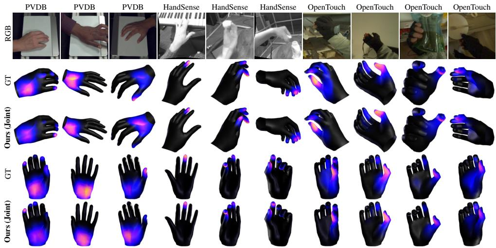  
Figure 15: The examples of Figures 9 to 13 from two viewpoints. For each clip, the ground truth and Ours (Joint) at the frame with the largest measured total, seen from the video camera (upper rows) and the palm side (lower rows).

## D TRAINING OBJECTIVES AND JOINT OPTIMIZATION

## D.1 DENSE PREDICTION AND PATCH RECONSTRUCTION

Let $h _ { v }$ indicate membership in an anatomically hidden region, $I _ { t } = \mathbf { 1 } [ t \geq t _ { c } ]$ , and $\chi _ { t , j }$ indicate a valid joint projection. Before change-based reweighting, the dense weights are

$$
\begin{array} { r l } & { w _ { t , v } ^ { 0 } = s _ { t , v } \big ( h _ { v } + ( 1 - h _ { v } ) [ I _ { t } + \lambda _ { c } ( k ) ( 1 - I _ { t } ) ] \big ) , } \\ & { w _ { t , j } ^ { 0 } = \chi _ { t , j } [ I _ { t } + \lambda _ { c } ( k ) ( 1 - I _ { t } ) ] , \qquad \lambda _ { c } ( k ) = 0 . 2 \operatorname* { m i n } \biggl ( 1 , \frac { k } { 0 . 1 K } \biggr ) , } \end{array}\tag{12}
$$

where k is the training step and $K = 1 2 { , } 0 0 0$ is the total number of updates. For unhidden target vertices supported both currently and at $t _ { c } - 1$ , we multiply $w _ { t , v } ^ { 0 }$ by their mean absolute teacherfeature change divided by the mean change over eligible entries, clipped to [0.25, 4]. Other weights are unchanged. Within each data lane, weighted vertex and joint errors share one normalization denominator. The dense objective averages these normalized losses over lanes with nonzero support.

The residual predictor uses LayerNorm followed by a 256-to-512-to-256 MLP with GELU and zero-initialized final affine layer. The patch decoder uses a learned query plus an affine embedding of normalized patch position and frame index. One four-head cross-attention block reads the same frame’s 778 vertex and 21 joint states. Output normalization and affine maps produce $d _ { p } = 1 2 8$ features. The patch target is the normalized EMA counterpart of $F _ { t }$ . Only interaction-masked patches in target frames contribute to Equation 6, with the same within-lane normalization followed by averaging across lanes.

## D.2 COVARIANCE REGULARIZATION

WeakSIGReg samples at most 1024 supported vertex states per device and uses an independently redrawn orthonormal sketch $Q \in \mathbb { R } ^ { 2 5 6 \times 6 4 }$ at each step. For sampled states $Z \in \mathbb { R } ^ { n \times 2 5 6 }$ , define centered sketches $\widetilde { Z } = Z Q - \mathbf { 1 } \mathrm { m e a n } _ { \mathrm { r o w s } } ( Z Q )$ . The regularizer is

$$
\mathcal { L } _ { \mathrm { w S I G } } = \Bigg \Vert \frac { \widetilde { Z } ^ { \top } \widetilde { Z } } { n - 1 } - I _ { 6 4 } \Bigg \Vert _ { F } .\tag{13}
$$

The Frobenius norm is not squared, and fewer than eight supported rows contribute zero.

## D.3 TACTILE SUPERVISION AND GRADIENT COUPLING

Sensor annotations are lifted to vertices through fixed correspondences. Each covered vertex receives the value and validity of its dominant sensor channel. PressureVision DB already supplies vertex-level targets. The tactile head uses a 256-unit hidden layer, GELU, dropout 0.1, and two zero-initialized outputs. For training contact prevalence r, positive BCE entries receive weight $\mathrm { c l i p } ( ( 1 - r ) / r , 1 , \hat { 1 0 } )$ . Magnitude weights $\lambda _ { m }$ are 1.0, 1.0, and 0.3 for HandSense, PressureVision DB, and OpenTouch. The magnitude normalization uses the encoder-training statistics in Table 7.

The BCE and contact-conditioned log-magnitude terms update the encoder and head. For the allvalid gated L1 term, evaluating the head on $\operatorname { s g } ( z )$ preserves its parameter gradients while blocking encoder gradients. Each component is normalized over its eligible entries within a clip and the sum is averaged over labeled clips. The objective uses no tactile pseudo-labels or geometry-derived contact terms.

The tactile weight follows $\lambda _ { \mathrm { t a c } } ( k ) = \operatorname* { m i n } ( 1 , 0 . 1 + 0 . 9 k / ( 0 . 1 K ) )$ . Let $g _ { s }$ and $g _ { t }$ denote the corresponding unweighted SSL and tactile gradients at the shared vertex states, and write $\lambda = \lambda _ { \mathrm { t a c } } ( k )$ We apply

$$
\begin{array} { r l } & { g _ { t } ^ { + } = g _ { t } - \displaystyle \frac { \operatorname* { m i n } \bigl ( 0 , \langle g _ { t } , g _ { s } \rangle \bigr ) } { \operatorname* { m a x } \bigl ( \| g _ { s } \| _ { 2 } ^ { 2 } , \epsilon \bigr ) } g _ { s } , } \\ & { \alpha = \operatorname* { m i n } \biggl ( 1 , \displaystyle \frac { 0 . 4 \operatorname* { m a x } \bigl ( \| g _ { s } \| _ { 2 } , r _ { k } \bigr ) } { \operatorname* { m a x } \bigl ( \lambda \| g _ { t } ^ { + } \| _ { 2 } , \epsilon \bigr ) } \biggr ) , \qquad g _ { z } = g _ { s } + \lambda \alpha g _ { t } ^ { + } . } \end{array}\tag{14}
$$

Here $\epsilon = 1 0 ^ { - 2 0 }$ and $r _ { k }$ is the running mean SSL gradient norm collected at steps 100 through 599, held fixed afterwards and zero before collection. The projection removes the opposing component at z (Yu et al., 2020). The cap uses the larger of the current and reference norms, while leaving gs unchanged. The head receives ordinary gradients of the weighted tactile loss.

EMA updates the trainable visual and Geometry Encoder parameters after optimization. The SSL predictor, patch decoder, and tactile head are outside this EMA copy. The tactile head reads the student’s masked-view vertex states from the same forward pass as the JEPA term, so the label gradient reaches the LoRA adapters, the visual-field projections, and the Geometry Encoder through both the contact and the log-magnitude terms. Through the shared adapters, tactile gradients can also affect later visual targets, without generating tactile pseudo-labels. For Supervised, the dense predictor is trained on detached states, so the encoder receives only tactile supervision. Its tactile weight is one from the start and no gradient cap is applied. All downstream readouts use unmasked frozen EMA states and discard the training predictor and tactile head.

## E READOUTS AND EVALUATION PROTOCOL

Frozen representations and sensor correspondence. Evaluation fixes the EMA encoder and removes input masks. The SSL predictor and the tactile head used in joint training are discarded. A deterministic hand crop with scale 1.5 produces vertex features of shape $1 6 \times 7 7 8 \times 2 5 6$ , and Appendix F.2 repeats the evaluation without the crop. Fixed row-normalized operators pool these features to the sensor grid before the readout. PressureVision DB uses the identity over 778 vertices, OpenTouch maps to 169 taxels, and HandSense maps to five fingertip channels. The same operators and training clips are used for each Touch-JEPA training setting.

Readout fitting. For each dataset, we sample 1,500 training clips with seed 912 and at most 400 valid entries per clip. A clip-level 20% holdout is reserved for model selection. Each feature dimension is standardized using the fitting subset mean and standard deviation, with $1 0 ^ { - 6 }$ added to the denominator. The readout contains a 256-unit linear layer, GELU, dropout 0.1, and a two-output linear layer initialized to zero. The contact probability cˆ is obtained by applying sigmoid to the contact logit. The final normalized magnitude prediction is $\hat { y } = \hat { c } \hat { m }$ , where mˆ is the nonnegative magnitude output. We minimize class-balanced binary cross-entropy plus unit-weight L1 error of the gated magnitude. The positive-class weight is the negative-to-positive ratio in the fitting entries. AdamW uses learning rate $1 0 ^ { - 3 }$ , weight decay $1 0 ^ { - 4 }$ , and batch size 16,384 for 40 epochs (head seed 0). We keep the epoch with the lowest total holdout loss, without refitting on it.

Magnitude normalization. Encoder supervision and readout evaluation use separate fixed training subsets of 120 and 60 clips per dataset. Each scalar is the population standard deviation of all valid measurements in its subset, pooled across clips, frames, and channels. Table 7 distinguishes these scales. The normalized target y in Equation 8 is the raw measurement divided by $\nu _ { \mathrm { e n c } } .$ . Readout targets are divided by $\nu _ { \mathrm { e v a l } }$ . Before evaluation, the final gated prediction is converted back to sensor units as $\hat { y } ^ { \mathrm { r a w } } = \nu _ { \mathrm { e v a l } } \hat { y }$ . The reported errors of every method are normalized by the same $\nu _ { \mathrm { e v a l } }$ OpenTouch contact uses a positive magnitude exceeding the training-subset tenth percentile plus 0.25 times its standard deviation. This gives thresholds of 108.54 counts during encoder supervision and 107.58 counts for readout fitting and evaluation.

Table 7: Fixed magnitude scales and evaluation support. Scales use training data only. Ablations and objective comparisons use all valid entries, and baseline comparisons use common ones.
<table><tr><td>Dataset</td><td> $\nu _ { \mathrm { e n c } }$ </td><td> $\nu _ { \mathrm { e v a l } }$ </td><td>All valid</td><td>Common</td></tr><tr><td>OpenTouch</td><td>434.146</td><td>430.309</td><td>6,811,376</td><td>3,328,284</td></tr><tr><td>PressureVision DB</td><td>5.354</td><td>5.160</td><td>3,230,307</td><td>3,142,493</td></tr><tr><td>HandSense</td><td>191.711</td><td>181.521</td><td>18,816</td><td>18,811</td></tr></table>

Comparison populations. Within each comparison, the evaluation mask intersects annotation validity with the availability of every method’s predictions. Image-based pressure outputs restrict the main comparison to their projection support. The Touch-JEPA objective comparisons and ablations use all annotation-valid entries, including entries outside that support.

Contact metrics. AUROC and average precision use each method’s contact score, with Touch-JEPA using the contact logit $^ { O , }$ and pool valid test entries with 4,000-bin histograms. F1 pools true-positive, predicted-positive, and ground-truth-positive counts. On OpenTouch and HandSense, each method’s score is thresholded at the quantile of its own test scores that matches the dataset’s training contact rate, so no test label is used. On PressureVision DB, contact is predicted when the final pressure prediction, $\hat { y } ^ { \mathrm { r a w } }$ for Touch-JEPA, is at least 1 kPa, the labeling rule. Temporal AUROC averages over clip-channel sequences with at least four valid frames and both contact classes.

Magnitude metrics. For Touch-JEPA, all magnitude metrics use the final native-unit prediction $\hat { y } ^ { \mathrm { r a w } } = \nu _ { \mathrm { e v a l } } \hat { c } \hat { m }$ , where $\hat { c } = \sigma ( o )$ is the contact probability and mˆ is the nonnegative normalized magnitude from the same readout head. Compared methods are evaluated using their own final pressure predictions. For annotation-valid comparison entries $\mathcal { E } ,$ let $e _ { i } = { \hat { y } } _ { i } ^ { \mathrm { r a w } } - { \bar { y } } _ { i } ^ { \mathrm { r a w } }$ denote the native-unit prediction error. We compute

$$
\mathrm { n M A E } = \frac { \sum _ { i \in \mathcal { E } } \left| e _ { i } \right| } { \nu _ { \mathrm { e v a l } } \left| \mathcal { E } \right| } , \qquad \mathrm { n R M S E } = \frac { 1 } { \nu _ { \mathrm { e v a l } } } \sqrt { \frac { \sum _ { i \in \mathcal { E } } e _ { i } ^ { 2 } } { \left| \mathcal { E } \right| } } .\tag{15}
$$

Temporal Spearman correlation is computed separately for each sensor within a clip using only valid ground-truth contact frames. Eligible sequences contain at least four such frames with nonconstant target magnitude. Eligibility does not depend on predicted contact, and constant predictions contribute zero. The static prior is constant in every sequence, so it is reported as N/A rather than zero. For Touch-JEPA, conditioning on ground-truth contact does not fix predicted contact confidence, so this metric evaluates the combined output, not the magnitude branch alone.

Baselines. The main comparison matches a budget of 6,144,000 frame presentations. Pressure Former (Zhao et al., 2025) is reimplemented with frozen HaMeR (Pavlakos et al., 2024) image features and a UV pressure decoder, using supervised PVDB vertices for its projection loss. All outputs are mapped to the same sensor grids. HOPE (Jeon et al., 2026) and PressureVision++ (Grady et al., 2024) additionally train on DexYCB contact labels. On PressureVision DB, the hand meshes are fused from HaWoR fits of the synchronized views, and the mesh-based baselines (HOPE, PressureFormer) use the same geometry. The static prior uses fixed training-set contact rates and mean magnitudes per sensor entry, without video.

Uncertainty. Unless stated otherwise, paired bootstrap intervals resample test clips 200 times with seed 912, applying the same resample to all compared methods. Difference intervals use the 2.5th and 97.5th percentiles. They capture test-sample variation for one training seed and fixed readouts.

## F ADDITIONAL RESULTS

## F.1 TRAINING BUDGETS

Figure 16 compares Supervised and Ours (Joint) after 192k, 288k, and 384k training clips, scored with the main-table readout on all valid test entries of each dataset (the main comparison uses the entries shared with the baselines). At every budget, Ours (Joint) has the higher contact AUROC and F1 on all three test sets. Across the 54 cells of three budgets, three test sets, and six metrics, it is significantly better than Supervised in 46 cells. Supervised has the higher HandSense tAUC at every budget, significantly so at 384k.

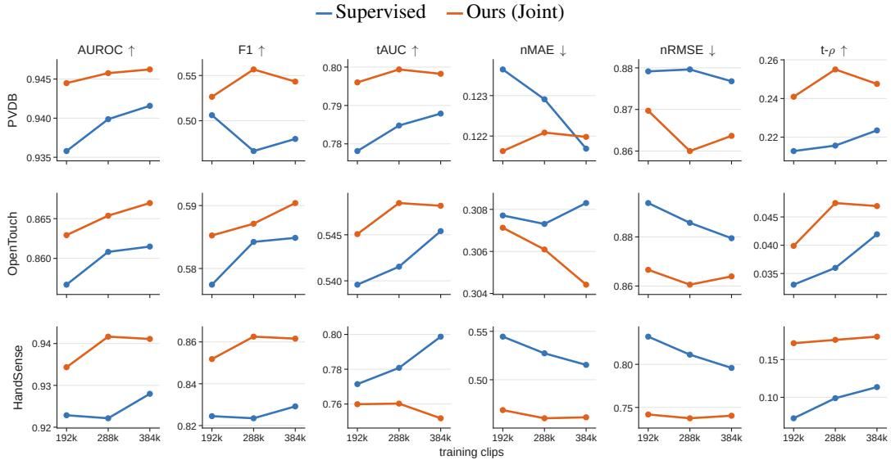  
Figure 16: Training budgets. Results after 192k, 288k, and 384k training clips.

## F.2 EVALUATION WITHOUT THE HAND CROP

Our encoder reads a hand crop computed from the estimated hand mesh. Training samples both the observer view and the hand crop, so the observer view is not out of distribution. With readouts refitted and evaluated on each dataset’s observer view without the crop, Ours (SSL) and Ours (Joint) reach a contact AUROC of 0.929 and 0.951 on PVDB, 0.839 and 0.864 on OpenTouch, and 0.901 and 0.928 on HandSense, above the best supervised baseline (0.920, 0.785, and 0.844).

## F.3 SENSOR-SHARED INTENSITY AXIS

The three sensors report intensity in incompatible units (nominal kPa on PVDB, uncalibrated counts on the two gloves). We therefore ask whether the intensity read out on one sensor orders the measurements of another. With the 192k-clip checkpoints, a readout fitted on one sensor is applied unchanged to the others and scored by rank correlation (Figure 17). The readout is a two-layer head fitted on the training clips of the source sensor, with the intensity loss applied to ground-truth contact entries only, and is transferred together with the source standardization. For Ours (Joint), the mean cross-sensor rank correlation reaches 0.73 of the mean within-sensor one (0.374 against 0.509), against 0.36 for Ours (SSL) (0.171 against 0.477) and 0.25 for Supervised (0.117 against 0.470). Supervised transfers contact across sensors (mean cross-sensor contact AUROC 0.854, against 0.879 for Ours (Joint) and 0.554 for Ours (SSL)) but intensity much less. The shared intensity axis is strongest under joint training, consistent with both objectives shaping the same hand-surface latents.

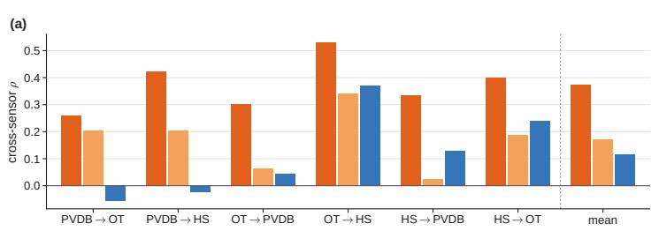

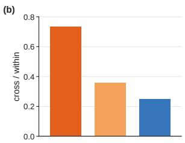  
Figure 17: A sensor-shared intensity axis. A readout fitted on one sensor is applied unchanged to another. (a) Spearman correlation over the contact entries of the target sensor, per transfer direction. (b) Mean cross-sensor correlation relative to the within-sensor one.

(a) Image motion, kitchen  
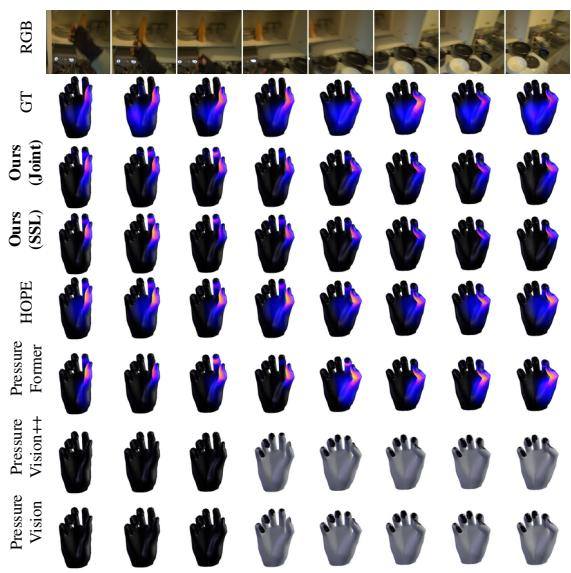

(b) Limited visibility, restaurant  
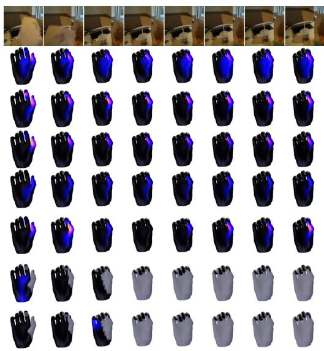  
Figure 18: Failure cases on OpenTouch. Eight frames per sequence progress from left to right. Brighter colors indicate greater sensor-native magnitude, and gray marks missing predictions.

## G FAILURE ANALYSIS

Analysis protocol. We examine challenging conditions using the test predictions from the main comparisons. Qualitative examples are selected to illustrate failures and do not estimate their prevalence in the test sets.

Motion and limited surface visibility. The OpenTouch examples in Figure 18 show incomplete recovery of tactile responses under image motion and limited surface visibility. In the kitchen sequence, Ours (Joint) underestimates the broad palm response present in the ground truth, with predictions concentrated near the fingertips. In the restaurant sequence, the predicted palm response is similarly weak, while the thumb-tip response is overestimated relative to the ground truth. These ex amples illustrate errors in both the spatial distribution and magnitude of predicted tactile responses.

Sparse contact events. Figure 19 illustrates weak or missing predictions for localized fingertip contacts. In the piano sequence, the brief index-fingertip response in the ground truth is substantially weaker in Ours (Joint). In the bottle-opening sequence, both Ours variants fail to reproduce the index-fingertip response, while PressureFormer captures part of it. These examples show that brief or localized contact can remain underrepresented in the predicted tactile maps despite joint training.

(a) Piano, brief index-fingertip contact

(b) Bottle opening, index-fingertip contact

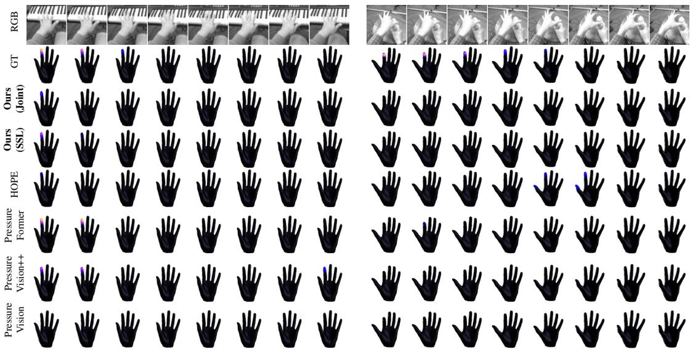  
Figure 19: Failure cases on HandSense. Display conventions follow Figure 18.

## H ROBOTIC TRANSFER AND MANIPULATION

The robot studies examine two uses of the learned representation. Zero-shot transfer applies a human-trained tactile predictor to real Allegro-hand video. Action-conditioned planning instead trains a dynamics predictor on simulated robot trajectories while keeping the visual encoder frozen. The latter uses observed actions and robot state but no tactile targets for learning or planning.

## H.1 ZERO-SHOT TACTILE ESTIMATION ON ROBOTIC HANDS

Data and correspondence. We evaluate the Allegro portion of the paired human and robot recordings in HRDexDB (Lim et al., 2026). The collection contains 89 robot episodes. Available synchronized camera views provide 2,754 valid contexts covering 10,562 distinct robot frames.

Measured robot joint angles drive forward kinematics. A fixed retargeting maps the index, middle, ring, and thumb fingertips to the corresponding MANO fingertips. We fit the MANO pose with 500 Adam steps at learning rate 0.05 and a pose-prior weight of 0.01. This geometric proxy provides image sampling locations without fitting to tactile data. The virtual little finger has no robot target and is excluded from scoring. In this real-video pipeline it remains in the encoder input under the pose prior. Hand crops use an expansion factor of 1.5 and are resized to 384 × 384 for Touch-JEPA.

Human-trained predictions. For Touch-JEPA, the fixed HandSense correspondence operator pools vertex features into fingertip features before standardization and readout. We retain its four rows with robot counterparts. The saved heads are fitted on the HandSense training split with the same recipe used for human evaluation in Appendix E. No robot examples fit or adapt these heads. HOPE pools its predicted vertex field, while PressureVision and PressureVision++ pool projected class logits before decoding magnitude. PressureFormer reads the same view through its own hand crop and pools its vertex logits over the fingertip regions before decoding. For each robot frame, finite predictions from all covering contexts and camera views are averaged. All methods are scored on the same 42,207 valid frame and fingertip entries.

Targets and statistics. A robot tactile sample is valid when its nearest timestamp is within 50 ms of the video frame. Contact labels use a channel-specific threshold equal to the tenth percentile plus 0.25 standard deviations of tactile readings from the designated robot training recordings. These measurements define evaluation labels and do not update the predictors. The readings are noisy and sparse (Lim et al., 2026), which bounds the attainable scores, and all methods are scored against the same readings. Pooled AUROC and average precision (AP) use contact scores over the common entries. F1 thresholds each method’s scores at the quantile that matches the human training contact rate of 0.512, so no robot label is used.

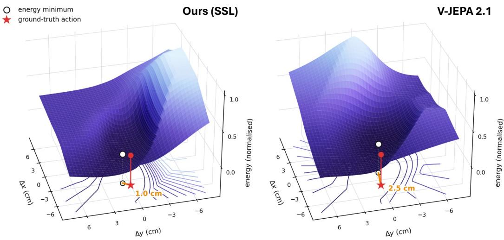  
Figure 20: One-step scene prediction energy during object transport. Horizontal translation commands are varied on a 41 × 41 grid, with remaining command dimensions fixed before controller projection. Energy is the scene-feature L1 distance to the next reference observation, normalized independently to [0, 1] within each panel. White circles mark sampled minima and red stars denote the ground-truth action. Annotated distances are measured in the displayed command plane.

Magnitude correlation is computed within each episode and fingertip using at least eight valid samples with nonconstant targets and predictions. We average finite Spearman correlations over finger tips and then over episodes. Unlike the human benchmark, a sequence with constant predictions is skipped for that method. Paired bootstrap comparisons resample episodes 1,000 times with seed 140914 and report the 2.5 and 97.5 percentiles of each difference. For joint minus SSL, the intervals are $[ - 0 . 0 8 7 , - 0 . 0 1 4 ]$ for AUROC, [−0.119, −0.040] for AP, [−0.075, −0.008] for F1, and $[ - 0 . 1 3 6 , - \mathrm { \dot { 0 } } . 0 1 7 ]$ for magnitude correlation. These intervals support the SSL encoder choice in the planning experiment.

Additional evaluation on the Inspire hand. We additionally evaluate zero-shot tactile estimation on sequences of the five-finger Inspire hand from HRDexDB (Lim et al., 2026). Table 8 reports results on its five fingertip channels. Ours (SSL) achieves the highest scores across all four metrics among the compared methods.

Table 8: Zero-shot transfer to the Inspire hand. Evaluation covers five fingertip channels.
<table><tr><td>Method</td><td>AUROC↑</td><td>AP↑</td><td>F1↑</td><td>ρ↑</td></tr><tr><td>PressureVision</td><td>0.494</td><td>0.145</td><td>0.218</td><td>-0.023</td></tr><tr><td>PressureVision++</td><td>0.479</td><td>0.137</td><td>0.213</td><td>0.002</td></tr><tr><td>PressureFormer</td><td>0.575</td><td>0.173</td><td>0.270</td><td>0.003</td></tr><tr><td>HOPE</td><td>0.568</td><td>0.178</td><td>0.257</td><td>0.014</td></tr><tr><td>Ours (SSL)</td><td>0.608</td><td>0.195</td><td>0.284</td><td>0.059</td></tr><tr><td>Ours (Joint)</td><td>0.509</td><td>0.150</td><td>0.222</td><td>-0.015</td></tr></table>

## H.2 OBSERVATIONS AND ACTION-CONDITIONED LEARNING

Simulated observations. We use a fixed-base KUKA iiwa arm and an Allegro hand in Isaac Gym. Physics runs at 120 Hz with two substeps. A calibrated RGB camera records 384 × 384 images at 4 Hz with a 55-degree field of view. Each encoder input contains the trailing 16 actual frames, spanning 3.75 seconds and ending at the current observation. Although the backbone is noncausal within this window, it receives no frames after the decision time. The input is the full camera image with ImageNet normalization.

The MANO proxy is fitted to the four fingertip pads using forward kinematics and the pose fitting procedure above. In simulation, the unsupported little finger’s 114 vertices and four joints are marked invalid, leaving 664 supported vertices. At decision τ, the observation is $\mathbf { o } _ { \tau } = ( B _ { \tau } , U _ { \tau } , \mathbf { p } _ { \tau } )$ Scene tokens $\dot { B } _ { \tau } \in \breve { \mathbb { R } ^ { 3 6 \times 7 6 8 } }$ are obtained by $4 \times 4$ average pooling of the final backbone layer’s $2 4 \times 2 4$ patch grid at its last tubelet. Surface tokens $U _ { \tau } \in \breve { \mathbb { R } } ^ { 3 2 \times 2 5 6 }$ average current-frame vertex states within 32 fixed groups of supported vertex indices. The state $\mathbf { p } _ { \tau } \in \mathbb { R } ^ { \breve { 3 } 5 }$ concatenates 23 joint angles and the flattened $3 \times 4$ palm pose. Each feature group uses channel-wise training means and standard deviations, with a standard-deviation floor of 0.05.

Predictor and training data. The action-conditioned predictor has 24 Transformer blocks of width 1024, 16 attention heads, and feed-forward width 4096. Separate projections embed 36 scene tokens, 32 surface tokens, one state token, and one action token. Learned slot and step embeddings identify these 70 tokens per decision. Block-causal attention permits all tokens from the current and preceding decisions within an eight-step context.

Training uses 696 trajectories from 408 initial scenes, with 232 trajectories each for grasp-lift, place, and push-align. Push-align is used only for training. Trajectories and reference demonstrations use scene seeds distinct from evaluation. An eight-dimensional issued action contains three palmtranslation commands, four finger-flexion commands, and thumb opposition. Action inputs record the issued commands after controller projection.

For group $r \in \{ B , U , \mathbf { p } \}$ , let $\mathcal { L } _ { r } ^ { \mathrm { t f } }$ be mean absolute prediction error over eight transitions conditioned on observed history. Let $\mathcal { L } _ { r } ^ { \mathrm { a r } }$ be the corresponding mean over a two-step autoregressive rollout. The predictor objective is

$$
{ \mathcal { L } } _ { \mathrm { A C } } = \sum _ { r \in \{ B , U , { \bf p } \} } \lambda _ { r } { \big ( } { \mathcal { L } } _ { r } ^ { \mathrm { t f } } + { \mathcal { L } } _ { r } ^ { \mathrm { a r } } { \big ) } , \qquad ( \lambda _ { B } , \lambda _ { U } , \lambda _ { \bf p } ) = ( 1 , 1 , 0 . 1 ) .\tag{16}
$$

The autoregressive rollout feeds back predicted scene features, surface features, and robot state, with gradients through both steps. Future measured state is not supplied. Encoder features are frozen targets, and object state, contact, and magnitude are excluded from this loss. AdamW uses 1,024 updates of 256 windows, weight decay $0 . 0 4$ , gradient clipping at norm 1, and seed 917. The learning rate warms up for 49 updates to $4 . { \dot { 2 } } 5 \times 1 { \dot { 0 } } ^ { - 4 }$ , remains constant through update 975, and decays linearly to zero. Evaluation uses the final predictor checkpoint.

## H.3 PLANNING AND CONTROL

Planning minimizes the scene and surface distance in Equation 10 with a one-step horizon. Reference observations at demonstration endpoints 2, 4, 14, and 18 provide successive subgoals for 2, 2, 10, and 4 decisions. Each encoder computes its own reference features using its training normalization. Predicted robot state is rolled forward by the predictor but does not enter the goal distance.

At each planning decision, the cross-entropy method samples 400 candidates for 10 refinement iterations and retains 10 elites. The search variables are three palm translations and one grip value, which is copied to the five hand commands. Initial search standard deviation is 0.7, with a floor of 0.03. Translation is limited to an L1 norm of 7.5 cm per decision and a fixed workspace. The controller executes the projected final mean through inverse kinematics and a smooth joint ramp.

One-step energy landscape. Following the qualitative energy analysis in V-JEPA 2 (Assran et al., 2025), Figure 20 visualizes the scene-feature prediction energy for a reference carry transition in the place task. The goal is the next observation in the demonstration. In this example, the sampled minimum lies 1.0 cm from the ground-truth action for Touch-JEPA-AC, compared with 2.5 cm for V-JEPA 2.1 in the horizontal command plane.

## H.4 BASELINES AND EVALUATION CRITERIA

Comparison settings. The V-JEPA 2.1 baseline uses the same released visual backbone initialization, camera observations, fitted geometry, trajectories, predictor training budget, subgoal schedule,

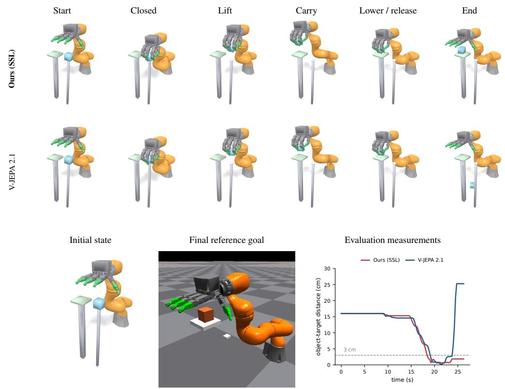

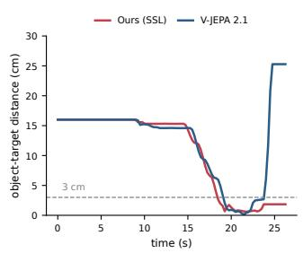  
Figure 21: Place rollout comparison. Time progresses from left to right. Curves show planar objecttarget distance. Touch-JEPA-AC releases the object with a maximum planar target error of 1.8 cm over the final second, while V-JEPA 2.1 drops it away from the target.

CEM settings, and controller as Touch-JEPA-AC. Its surface input samples concatenated features from backbone blocks 5, 8, and 11, followed by a fixed orthonormal projection to 768 channels and the same vertex grouping. Thus, its surface tokens have width 768, compared with Touch-JEPA’s learned width 256. Predictor input and output projections accommodate this difference.

Octo is adapted as a direct policy with a frozen backbone and trainable action head and proprioceptive tokenizer. It receives two RGB frames, two 35-dimensional state vectors, and a goal image. A diffusion head predicts a four-action chunk, and only the first is executed. The five hand commands are averaged into one grip value. Training uses the same 696 trajectories and 1,024 updates of 256 samples. AdamW uses learning rate $3 \times \mathrm { \bar { 1 0 } ^ { - 5 } }$ , a 100-update warmup, and weight decay 0.1.

Success criteria. Each task uses 50 matched scenes across methods. Grasp-lift succeeds when the minimum object-height increase during the final second is at least 10 cm and the maximum summed fingertip-pad force over the episode is at most 8 N. Place succeeds when, throughout the final second, horizontal target error is at most 3 cm, vertical error is at most 1 cm, and the object has been released. Object pose and contact measurements are used to score these conditions. Table 9 reports the counts with Wilson intervals.

Table 9: Planning success with uncertainty. Counts use the same 50 scenes per task. Parentheses give Wilson 95% confidence intervals for success percentages.
<table><tr><td>Method</td><td>Grasp-lift</td><td>Place</td></tr><tr><td>Touch-JEPA-AC</td><td>43/50 (73.8, 93.0)</td><td>42/50 (71.5, 91.7)</td></tr><tr><td>V-JEPA 2.1</td><td>27/50 (40.4,67.0)</td><td>23/50 (33.0, 59.6)</td></tr><tr><td>Octo</td><td>0/50 (0.0, 7.1)</td><td>0/50 (0.0, 7.1)</td></tr></table>

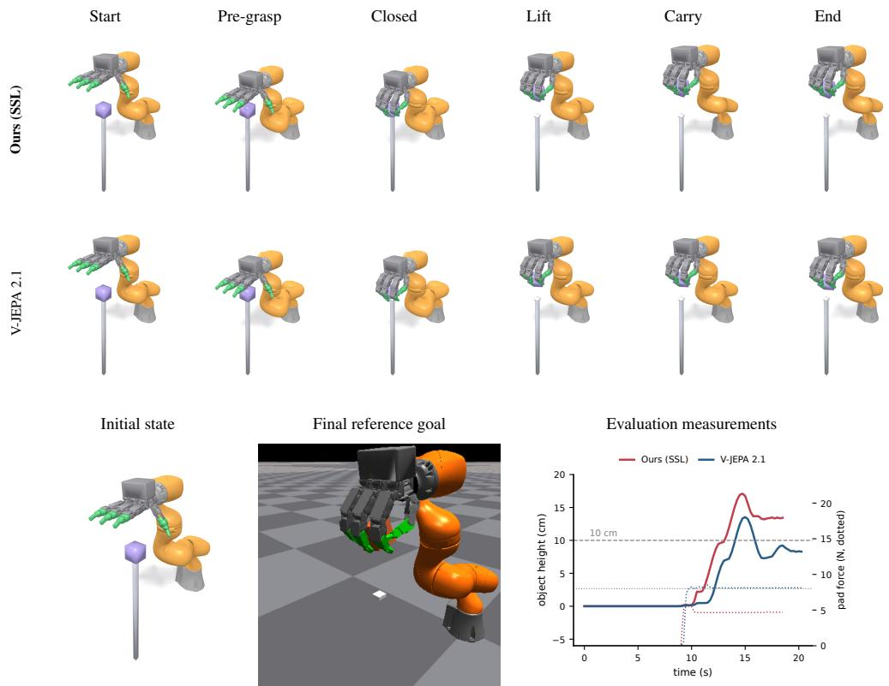

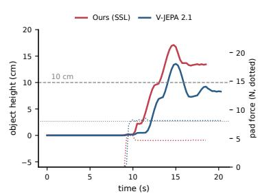  
Figure 22: Grasp-lift rollout comparison. Time progresses from left to right. Curves show object height above its initial position and summed fingertip-pad force. Both methods grasp and lift the object. Touch-JEPA-AC maintains a minimum lift of 13 cm over the final second with a peak force of 5.7 N, whereas V-JEPA 2.1 maintains 8.2 cm and peaks at 8.9 N, failing both the 10 cm height and 8 N force criteria.

For grasp-lift, both planners succeed in 25 scenes, only Touch-JEPA-AC succeeds in 18, only V-JEPA 2.1 succeeds in two, and both fail in five. The corresponding place counts are 18, 24, five, and three. Let b count successes unique to Touch-JEPA-AC and c count successes unique to V-JEPA 2.1. The exact two-sided McNemar probability is

$$
p = \operatorname* { m i n } \left( 1 , 2 \sum _ { j = 0 } ^ { \operatorname* { m i n } ( b , c ) } { \binom { b + c } { j } } 2 ^ { - ( b + c ) } \right) .\tag{17}
$$

This yields unadjusted $p = 4 . 0 2 \times 1 0 ^ { - 4 }$ and $p = 5 . 4 6 \times 1 0 ^ { - 4 }$ , respectively, consistent with the rounded values in the main text. Confidence intervals describe variation across evaluation scenes for one predictor training seed.

## H.5 QUALITATIVE ROLLOUT COMPARISONS

Figure 7 illustrates Touch-JEPA-AC rollouts from the planner camera. Figures 8 and 20 to 22 label Touch-JEPA-AC as Ours (SSL). Figures 21 and 22 additionally compare Touch-JEPA-AC and V-JEPA 2.1 on matched scenes. For each task, we show the lowest-index evaluation scene in which Touch-JEPA-AC succeeds and V-JEPA 2.1 fails. Rollout and initial-state panels are rendered from recorded robot and object states, while goal panels show the final reference camera images supplied to the planner. The accompanying curves report simulator measurements used for evaluation.