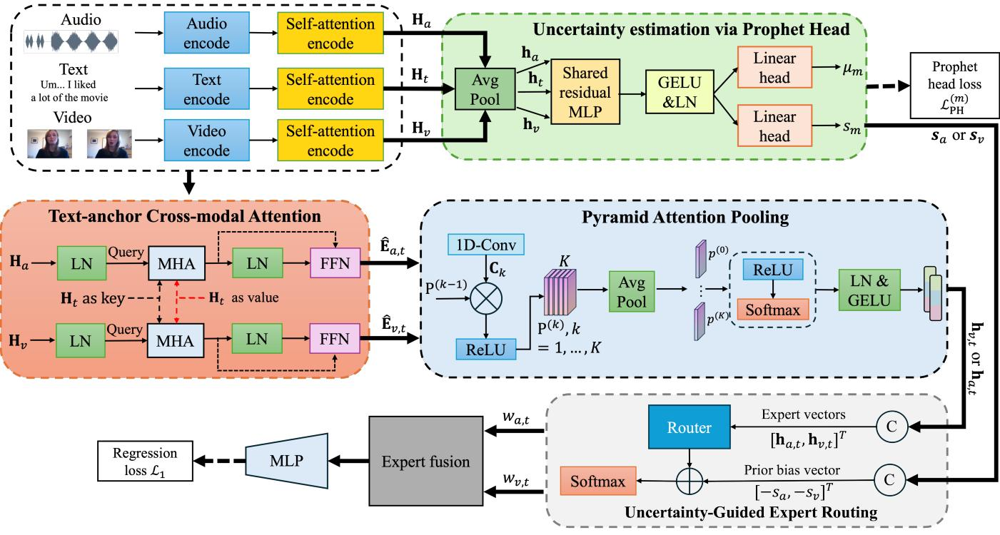

# Text-Anchored Modality Experts with Uncertainty-Guided Routing for Multimodal Sentiment Analysis

Xiaohua Huang, Bingrui Lei, Xiuyan Shao, Ling Zhou, Yuan Zong, Wenming Zheng, and Guoying Zhao

Abstract—Multimodal sentiment analysis (MSA) aims to understand user-generated videos by integrating multiple modalities. Existing methods often treat modalities as symmetric, overlooking the fact that language provides a dominant semantic prior while nonverbal signals are complementary and noise-prone. To address this, we propose a Text-Anchored Modality Experts with Uncertainty-Guided Routing, termed TAME, that reformulates MSA as an uncertainty-guided refinement paradigm, where the language prior is calibrated and enhanced by selectively trusted nonverbal evidence. Specifically, TAME adopts an asymmetric Mixture-of-Modality-Experts framework, in which textual features act as a fixed and always-activated shared expert, while audio-textual and video-textual cross-modal branches serve as dynamically routed auxiliary experts. Furthermore, we introduce lightweight Prophet Heads to quantify the sample-level predictive uncertainty of each individual modality, and this uncertainty metric is further incorporated into the modality router to realize reliability-aware expert aggregation and fusion. Experiments on CMU-MOSI, CMU-MOSEI, and CH-SIMS datasets demonstrate that TAME achieves state-of-the-art performance on the majority of metrics while reducing parameter count by up to 78.7% and FLOPs by up to 41.2% over the mixture-of-expert baseline.

Index Terms—Multimodal Sentiment Analysis, Cross-attention module, Expert Network

## I. INTRODUCTION

Multimodal sentiment analysis (MSA) aims to predict the sentiment expressed in an utterance by jointly leveraging language, acoustic, and visual signals. A dominant paradigm treats the three modalities as symmetric information sources and seeks to align or fuse them as thoroughly as possible, for example via all-pair cross-modal transformers [1], modalityinvariant decomposition [2], or mutual-information maximization [3]. Although this symmetric fusion philosophy has driven steady progress, it overlooks a fundamental asymmetry that is well documented in the literature: on text-centric sentiment benchmarks such as CMU-MOSI, language generally provides the strongest and most stable semantic prior, while audio and video contribute information that is complementary but noisier and more sample-dependent [4], [5].

This observation motivates a different question. Rather than asking “how can we align all modalities more completely?”, we ask: when should a model trust nonverbal evidence to revise the initial judgment that language alone provides? Answering this question at the sample level requires two capabilities that symmetric fusion methods lack: an architectural bias that treats text as a prior rather than an equal participant, and an explicit mechanism for estimating the reliability of each nonverbal evidence source before admitting it.

We address both requirements in a unified framework called Text-Anchored Modality Experts with Uncertainty-Guided Routing (TAME). Motivated by the shared-plus-routed expert paradigm from recent LLMs [6], TAME treats the text branch as an always-on shared expert that anchors the semantic prior, while the audio–text and video–text branches serve as routed experts whose contributions are dynamically gated by persample uncertainty estimates from lightweight Prophet Heads. The outcome is an “evaluate-then-trust” decision process, in which the model first assesses how reliable each nonverbal signal is, then decides how much it should be allowed to revise the language prior. In summary, our main contributions are as follows:

• TAME designates the text branch as an always-on shared expert and the audio–text and video–text branches as sparsely activated routed experts. This asymmetric shared-plus-routed expert architecture explicitly reflects the empirically observed text dominance in sentiment benchmarks.

• To ground the interpretation of nonverbal signals in reliable linguistic context, we introduce a text-anchored cross-modal attention mechanism that restrict crossattention to audio-to-text and video-to-text pathways, deliberately excluding direct audio–video interactions. This design acts as a semantic filter, preventing spurious nonverbal correlations from bypassing the text anchor and distorting routing decisions.

• We propose a pyramid attention pooling module to capture sentiment cues at different temporal granularities, together with a heteroscedastic uncertainty estimation strategy that independently quantifies each modality’s aleatoric uncertainty via a Prophet Head. The estimated log-variances are directly injected as a prior bias into the router logits, enabling sample-level, end-to-end reliability-aware fusion without external calibration.

• Extensive experiments on three benchmarks demonstrate that TAME consistently outperforms or achieves competitive performance among state-of-the-art methods, validating the effectiveness of text-anchored cross-modal attention, multi-scale temporal pooling, and uncertaintyaware routing.

## II. RELATED WORK

## A. Multimodal Sentiment Analysis

Multimodal sentiment analysis (MSA) focuses on predicting sentiment by jointly modeling textual, visual, and auditory signals. Early approaches rely on tensor-based fusion strategies. For example, Tensor Fusion Networks (TFN) [7] and Low-rank Multimodal Fusion (LMF) [8] capture inter-modal interactions through outer products, yet they suffer from limited representation flexibility. With the advancement of Transformer architecture, cross-modal attention has become the mainstream way for MSA. MulT [1] introduces all-pair directional cross-modal attention to align multimodal sequences. MISA [2] decomposes features into modality-invariant and modality-specific components to enhance representation robustness. Furthermore, Self-MM [4] exploits self-supervised unimodal learning to preserve modality-specific information, while MMIM [3] enhances fusion quality by maximizing mutual information across modalities. Other advances include CRIL [9] for contrastive cross-modal alignment, DMD [10] for modeling decouples multimodal dynamics, and DLF [11] for exploring adaptive deep late fusion. Despite this progress, most existing methods assume complete and aligned inputs, which is often unrealistic. To address missing modalities and unaligned sequences, Huan et al. [12] proposed UniMF, a lightweight Transformer framework that generates missing modalities via a specialized attention mask and fuses information through a learnable multimodal sequence. Furthermore, to mitigate spurious correlations that harm out-of-distribution generalization, Huan et al. [13] presented MulDeF, a modelagnostic debiasing framework combining causal intervention and counterfactual reasoning to remove label bias and multimodal biases.

Nevertheless, these methods still fail to fully exploit the modality-specific information that is also important for MSA. Some recent methods have addressed this issue by projecting the multimodal features into multiple subspaces [14] or by using multi-task learning to share knowledge across different sentiment tasks [15]. However, both strategies still treat modalities under a largely symmetric structure, either by decomposing a shared feature space or by sharing a unified backbone, and they do not explicitly model the asymmetric roles that different modalities play in text-centric sentiment benchmarks. Moreover, they lack a principled mechanism to estimate the reliability of each modality on a per-sample basis, which is essential for deciding when nonverbal evidence should be trusted.

## B. Mixture of Experts in Multimodal Learning

The Mixture of Experts (MoE) framework [16] improves model capacity by activating different specialized subnetworks for different input patterns, guided by a learnable gating mechanism. A recent architectural advance is the sharedplus-routed expert design introduced in DeepSeekMoE [6], where a subset of experts is always active, i.e., shared experts, while others are sparsely activated, i.e., routed experts. This paradigm has proven effective in large language models [17] for balancing capacity and efficiency.

MoE has also been explored in multimodal learning, for instance in vision–language models for task-level routing [18]. Within MSA, a key challenge is that modalities are inherently asymmetric: language typically serves as the dominant semantic carrier, while audio and visual cues provide complementary but variable support. Existing MoE-based MSA methods, such as EMOE [19] and MMoLRE [20], treats each modality as an independent expert, using a dynamic gating mechanism to adaptively fuse modality-specific predictions. However, they still assume a symmetric expert organization, treating all modalities as peers and failing to distinguish between generally useful information, which should be always active, and conditionally useful information, which should be selectively activated. This motivates an asymmetric expert design that explicitly anchors on the dominant text modality.

## C. Uncertainty in Multimodal Sentiment Analysis

Generally, uncertainty in deep learning can be categorized into epistemic uncertainty and aleatoric uncertainty [21]. The former represents the uncertainty inherent in the neural network itself, indicating the confidence level in its predictions. The latter refers to the inherent noise present in the data, such as image blurriness, text ambiguity, or missing modalities, which pose significant challenges to the model’s predictions.

Several recent works have introduced uncertainty-aware learning into MSA. Han et al. [22] use Dirichlet-based evidential uncertainty for classification-level fusion. U-MoE [23] models both data and cognitive uncertainty via cross-modal density estimation and uses symmetric KL divergence to quantify modality discrepancies, dynamically adjusting modality weights based on estimated missing rates. EUAR [24] proposes an uncertainty-aware mixture of experts, where enhanced experts capture aleatoric uncertainty and an uncertainty-guided gate learns to route samples to low-uncertainty experts.

Despite these advances, existing uncertainty-aware MoE methods for MSA such as EUAR [24] still adopt a symmetric expert design, where all modalities are treated as equally important peers. Their routing decisions are driven primarily by uncertainty estimates or polarity patterns, without explicitly modeling the inherent asymmetry between the dominant textual modality and the auxiliary non-verbal modalities. Moreover, these methods either estimate uncertainty separately from the routing network or rely on post-hoc adjustments, rather than integrating per-sample, per-modality predictive uncertainty directly into the end-to-end router logits. Separately, MMoLRE [20] demonstrates the benefit of separating shared and task-specific experts in multi-task scenarios, but its design is not tailored to the modality-asymmetry challenge in singletask MSA.

To address these gaps, TAME introduces an asymmetric shared-plus-routed expert organization, where a shared text expert is always active and routed cross-modal experts are sparsely activated. Crucially, we introduce Prophet Heads to produce per-sample uncertainty estimates for each modality, and these estimates are directly injected into the router logits and trained jointly with the entire architecture. This allows the model to learn, end-to-end, when a non-verbal modality is trustworthy enough to complement the text, thereby unifying asymmetric modality fusion with reliability-aware routing.

## III. METHODOLOGY

TAME formulates this task as an uncertainty-guided refinement paradigm based on a language prior, where nonverbal evidence is selectively leveraged based on its reliability. The proposed TAME framework, as shown in Fig. 1, consists of four core components: (1) a Text-Anchored Cross-Modal Attention (TACMA) for interpreting nonverbal signals through the lens of linguistic semantics, (2) a Pyramid Attention Pooling (PAP) for capturing multi-scale temporal structure, (3) Uncertainty Estimation via Prophet Heads (UEPH) for quantifying the predictive uncertainty of each modality-specific expert, and (4) an Uncertainty-Guided Expert Router (UGER) for adaptively determining the weight of corrective evidence from experts.

## A. Problem Formulation

Given an utterance with multimodal observations, let $\mathbf { X } _ { t } \in$ $\mathbb { R } ^ { T _ { t } \times d _ { t } } , \ \mathbf { X } _ { a } \ \in \ \mathbb { R } ^ { T _ { a } \times d _ { a } }$ , and $\mathbf { X } _ { v } \in \mathbb { R } ^ { T _ { v } \times d _ { \tau } }$ v denote the text, audio, and video feature sequences, respectively, where $T _ { m }$ and $d _ { m }$ are the temporal length and feature dimensionality for modality $m \ \in \ \{ t , a , v \}$ , respectively. The objective of MSA is to predict a continuous sentiment intensity $y$ by extracting and integrating complementary information across these modalities.

Traditional multimodal fusion strategies typically treat all modalities as symmetric contributors and learns a single joint representation $\mathbf { h } = f ( \mathbf { X } _ { t } , \mathbf { X } _ { a } , \mathbf { X } _ { v } )$ . However, this symmetric design fails to account for the inherent asymmetry in the informativeness of different modalities. Recently, the sharedplus-routed expert paradigm proposed in DeepSeekMoE [6] employs a subset of always-activate shared experts to capture common knowledge, alongside sparsely activated routed experts dedicated to specialized processing.

Motivated by this paradigm, we propose a TAME architecture to decompose the prediction process into a shared expert and two routed experts, which explicitly models the empirically observed asymmetry in modality informativeness. Specifically, the text branch serves as an always-on shared expert providing a stable semantic prior $\mathbf { h } _ { t } .$ , while the audiotext and video-text cross-modal branches act as routed experts, supplying corrective evidence denoted as $\mathbf { h } _ { a , t }$ and $\mathbf { h } _ { v , t } ,$ respectively. Critically, their contributions are dynamically modulated by a learned uncertainty-aware router, leading to the following prediction function:

$$
\hat { y } = f ( \underbrace { \mathbf { h } _ { t } } _ { \mathrm { s h a r e d ~ p r i o r } } + \underbrace { w _ { a , t } \mathbf { h } _ { a , t } + w _ { v , t } \mathbf { h } _ { v , t } } _ { \mathrm { r o u t e d ~ c o r r e c t i v e ~ e v i d e n c e } } ) ,\tag{1}
$$

where $w _ { a , t } , w _ { v , t } \geq 0$ with $w _ { a , t } + w _ { v , t } = 1$ denote sample-level routing weights, and $f$ denotes an learned prediction function of our TAME model.

## B. Modality Encoding

As the temporal lengths differ across modalities, i.e., $T _ { a } \neq$ $T _ { v } \neq T _ { t }$ , a linear temporal alignment layer is employed to map each non-text modality to the fixed length $T$ before encoding, that is, $\mathbf { X } _ { m } ^ { \prime } ~ = ~ \mathbf { X } _ { m } \mathbf { W } _ { \mathrm { a l i g n } } ^ { m } ~ \in ~ \mathbb { R } ^ { T \times d _ { m } }$ , where $\mathbf { W } _ { \mathrm { a l i g n } } ^ { m } \in \mathbb { R } ^ { T _ { m } \times T }$ is a learned alignment matrix. This temporal alignment operates in the feature space and does not require external word-level alignment tools.

Text encoding. Raw token sequences from the dataset are fed directly into the model and encoded end-to-end by a fine-tuned DeBERTa-v3-base [25] for the two English benchmarks, i.e., CMH-MOSI and CMU-MOSEI. For CH-SIMS, the corresponding Chinese pre-trained language model, such as BERT-base-Chinese [26] or ERNIE-3.0-base [27], is finetuned in the same end-to-end fashion. The output consists of 768-dimensional contextualized token embeddings. We denote these text representations as $\mathbf { Z } _ { t } \in \mathbb { R } ^ { T \times d _ { t } }$ , where $d _ { t } = 7 6 8$

Audio/Video encoding. Acoustic features $\mathbf { Z } _ { a }$ are the preextracted COVAREP descriptors released with each dataset $( d _ { a } \ = \ 5$ for CMU-MOSI; $d _ { a } ~ = ~ 7 4$ for CMU-MOSEI), and visual features $\mathbf { Z } _ { v }$ are the pre-extracted Facet facialexpression descriptors $( d _ { v } = 2 0$ for $\mathrm { C M U - M O S I } ; d _ { v } = 3 5 $ for CMU-MOSEI). For CH-SIMS we use the official multimodal features released with the dataset [28] for both modalities.

Self-attention encoding. After projection, each modality sequence is further contextualized through an independent L-layer Transformer encoder [29], i.e., $\mathbf { H } _ { m } = \mathcal { T } _ { m } ( \mathbf { Z } _ { m } ) \in$ $\mathbb { R } ^ { T \times d }$ , where $m \in \{ a , v , t \} , \mathcal { T } _ { m }$ denotes the modality-specific Transformer encoder. Each $\mathcal { T } _ { m }$ consists of multi-head selfattention with h heads, Pre-LN residual connections, and GELU-activated feed-forward networks.

## C. Text-Anchored Cross-Modal Attention

According to the prior studies [30], nonverbal features are often interpreted together with the linguistic context. Meanwhile, in text-centric benchmarks, text has been shown to provide the strongest and most stable semantic signal [4], [5]. Using text as the contextual reference can ensure that cross-modal representations are firmly grounded in reliable semantic information, avoiding misinterpretation of nonverbal cues divorced from linguistic context. Motivated by these observations, we propose the text-anchored cross-modal attention (TACMA) mechanism to anchor the interpretation of nonverbal features to text. Concretely, for each non-text modality $m \in \{ a , v \}$ , a Pre-LN cross-attention layer uses $\mathbf { H } _ { m }$ as queries and $\mathbf { H } _ { t }$ as keys and values. The formulation is defined as follows,

$$
\mathbf E _ { m , t } = \mathbf H _ { m } + \mathrm { M H A } \big ( \mathrm { L a y e r N o r m } ( \mathbf H _ { m } ) , \mathbf H _ { t } , \mathbf H _ { t } \big ) ,\tag{2}
$$

$$
\hat { \mathbf { E } } _ { m , t } = \mathbf { E } _ { m , t } + \mathrm { F F N } \big ( \mathrm { L a y e r N o r m } ( \mathbf { E } _ { m , t } ) \big ) ,\tag{3}
$$

where MHA(·) denotes multi-head attention [29] with h heads, LayerNorm(·) denotes layer normalization, and $\mathrm { F F N } ( \cdot )$ is a two-layer feed-forward network with GELU activation.

  
LN: Layer Normalization MHA: Multi-Head Attention FFN: Feed-forward Network  Add Multiplication  Concatenation  
Fig. 1. Overview of the TAME architecture. It consists of a Text-Anchored Cross-Modal Attention (TACMA), a Pyramid Attention Pooling (PAP), Uncertaint Estimation via Prophet Heads (UEPH), and an Uncertainty-Guided Expert Router (UGER).

This yields the cross-modal expert sequences $\begin{array} { r l } { \hat { \bf E } _ { a , t } } & { { } \in \quad } \end{array}$ $\mathbb { R } ^ { T \times d _ { a , t } }$ and $\hat { \mathbf { E } } _ { v , t } \in \mathbb { R } ^ { T \times d _ { v , t } }$ , respectively. Notably, TAME restricts cross-attention exclusively to the unidirectional A→T and V→T pathways, and deliberately excludes direct A↔V interactions. This design is not merely a structural simplification, but a principled choice motivated by robustness and semantic consistency. Direct audio-video cross-attention may create an information pathway that bypasses the text anchor, allowing spurious correlations between nonverbal cues such as lip movements correlating with speech tempo to introduce noise and distort the routing signal. By anchoring all cross-modal fusion to text, we enforce that information flows through a linguistic bottleneck, which serves as a semantic filter to ensure reliable and interpretable multimodal reasoning.

## D. Pyramid Attention Pooling

Since each cross-modal expert sequence $\hat { \mathbf { E } } _ { m , t } \in \mathbb { R } ^ { T \times d _ { m , t } }$ has variable temporal length, it must be condensed into a fixeddimensional representation for routing and fusion. A naive solution employs simple temporal average pooling, which treats all time steps equally and discards multi-scale temporal structure. However, sentiment-relevant cues manifest at different temporal granularities. These include fine-grained wordlevel emphasis, medium-grained phrase-level prosody, and coarse-grained utterance-level affect. Therefore, we propose Pyramid Attention Pooling (PAP), which captures multi-scale temporal structure via a learnable temporal pyramid with adaptive scale weighting. This module comprises three key components including pyramid construction, adaptive scale attention, and output projection.

Pyramid construction. Given input $\hat { \mathbf { E } } _ { m , t }$ , PAP constructs a hierarchy of K resolution levels, $i . e . , \mathbf { P } ^ { ( 0 ) } = \hat { \mathbf { E } } _ { m , t }$ . Level 0 retains the original sequence. Each subsequent level halves the temporal resolution through a learnable stride-2 convolution with ReLU activation:

$$
\mathbf { P } ^ { ( k ) } = \operatorname { R e L U } \bigl ( \mathbf { C } _ { k } * \mathbf { P } ^ { ( k - 1 ) } \bigr ) , \ k = 1 , \ldots , K - 1 ,\tag{4}
$$

where $\mathbf { C } _ { k }$ denotes a 1D convolution with stride 2 and kernel size 2 and d output channels. Different from average pooling used in FPN [31], the learnable convolution enables each pyramid level to selectively preserve temporally salient features while suppressing noise at the corresponding scale. Each level is then globally average-pooled to obtain a scale descriptor, i.e., $\begin{array} { r } { \mathbf { p } ^ { ( k ) } = \frac { 1 } { T _ { k } } \dot { \sum } _ { i = 1 } ^ { T _ { k } } \dot { \mathbf { P } _ { i } ^ { ( k ) } } } \end{array}$

Adaptive scale attention. The relative importance of different temporal scales varies across samples. A sample with a single emphatic word benefits more from fine-grained (i.e., level 0) information, while a sample with gradually shifting affect depends on coarser summaries. Motivated by the channel attention mechanism in SE-Net [32], we employ a lightweight two-layer network to compute scale-specific weights as follows:

$$
\alpha = \mathrm { s o f t m a x } \Big ( \mathbf { W } _ { 2 } \mathrm { R e L U } \big ( \mathbf { W } _ { 1 } [ \mathbf { p } ^ { ( 0 ) } ; \ldots ; \mathbf { p } ^ { ( K - 1 ) } ] \big ) \Big ) ,\tag{5}
$$

where $\mathbf { W } _ { 1 } ~ \in ~ \mathbb { R } ^ { d \times ( K \times d ) }$ and $\mathbf { W } _ { 2 } ~ \in ~ \mathbb { R } ^ { K \times d }$ are learnable weights of two-layer bottleneck that forces the network to attend to the most discriminative scale characteristics. The

softmax normalization ensures $\textstyle \sum _ { k } \alpha _ { k } = 1$ , yielding a convex combination of scale descriptors.

Output projection. The pooled representation is obtained by the weighted sum of scale descriptors, followed by a linear projection with layer normalization:

$$
\begin{array} { r } { \mathbf { h } _ { m , t } = \sigma \big ( \mathrm { L a y e r N o r m } \big ( \mathbf { W } _ { p } \sum _ { k = 0 } ^ { K - 1 } \alpha _ { k } \mathbf { p } ^ { ( k ) } \big ) \big ) , } \end{array}\tag{6}
$$

where $\sigma ( \cdot )$ denotes dropout followed by GELU activation.

In the implementation, PAP is applied independently to each routed expert branch, producing $\mathbf { h } _ { a , t }$ and $\mathbf { h } _ { v , t }$ as input to both the router and the fusion stage. The shared text expert uses simple temporal average pooling to otbain $\mathbf { h } _ { t } .$ since text features from BERT are already well-contextualized at the token level and do not exhibit the same multi-scale temporal variation as audio-visual signals.

## E. Uncertainty Estimation via Prophet Heads

Before routing, TAME independently assesses the reliability of each modality for the current sample. Therefore, we introduce a lightweight Prophet Head (PH) strategy for each modality branch after self-attention encoding to quantify modality reliability. Specifically, we model the conditional distribution of the sentiment label given modali $\mathbf { \Delta } _ { \mathbf { U } } - m$ features as a Gaussian with input-dependent variance, denoted as $p ( y | \mathbf { H } _ { m } ) \ = \ N ( y ; \mu _ { m } , \sigma _ { m } ^ { 2 } )$ . Here, $\mu _ { m }$ corresponds to the predicted sentiment score, and $\sigma _ { m } ^ { 2 }$ represents the aleatoric uncertainty. Both values are estimated from the learned feature representation.

Each Prophet head takes the average pooled self-attention output $\begin{array} { r } { \mathbf { h } _ { m } \overset { \cdot } { = } \frac { 1 } { T } \sum _ { i } \mathbf { H } _ { m } ^ { ( i ) } } \end{array}$ as input. A residual MLP with Post-LN serves as a feature extractor to produce a compact and discriminative representation:

$$
\mathbf { f } _ { m } = \mathrm { L a y e r N o r m } \big ( \bar { \mathbf { W } } _ { 2 } \sigma ( \bar { \mathbf { W } } _ { 1 } \mathbf { h } _ { m } ) + \mathbf { h } _ { m } \big ) ,\tag{7}
$$

where $\bar { \mathbf { W } } _ { 1 } \in \mathbb { R } ^ { 2 d \times d }$ and $\bar { \bf W } _ { 2 } \in \mathbb { R } ^ { d \times 2 d }$ are learnable parameters, and $\sigma ( \cdot )$ denotes GELU activation followed by dropout.

Based on this enhanced shared feature, two separate linear heads predict the sentiment mean $\mu _ { m } = \mathbf { w } _ { \mu } ^ { \top } \mathbf { f } _ { m } + b _ { \mu } ,$ , and the log-variance $\begin{array} { r } { s _ { m } = \mathbf { w } _ { s } ^ { \top } \mathbf { f } _ { m } + b _ { s } } \end{array}$ , where $\mathbf { w } _ { \mu }$ and ${ \bf w } _ { s }$ denote the learnable weights.

This heteroscedastic modeling strategy enables the system to capture sample-dependent noise levels. A small value of $\sigma _ { m } ^ { 2 }$ indicates that the modality provides clear and trustworthy sentiment evidence, while a large value suggests that the signal is ambiguous, noisy, or otherwise unreliable. Importantly, aleatoric uncertainty describes the irreducible noise that exists naturally in the data. As proper initialization of the PH is essential to avoid training instability, especially in the early stages, we initialize the variance head with $b _ { s } ~ = ~ 0$ and $\mathbf { w } _ { s } \sim \mathcal { N } ( 0 , 0 . 0 1 ^ { 2 } )$ , a setting that gives $\sigma _ { m } ^ { 2 } \approx e ^ { 0 } = 1$ at initialization.

To train each head to produce calibrated uncertainty estimates, we define a Prophet head loss based on heteroscedastic Gaussian negative log-likelihood (GNLL) as the supervision signal:

$$
{ \mathcal L } _ { \mathrm { P H } } ^ { ( m ) } = \frac { 1 } { 2 } e ^ { - s _ { m } } ( y - \mu _ { m } ) ^ { 2 } + \frac { 1 } { 2 } s _ { m } .\tag{8}
$$

This loss function encourages accurate predictions and wellcalibrated uncertainty by balancing two key terms. The first term is a precision-weighted regression loss that strengthens training for confident predictions, while the second term acts as a regularization penalty on log-variance to prevent the model from concealing errors by setting overly large $s _ { m }$ . The balance between these two terms yields meaningful and calibrated uncertainty. Uniformly high $s _ { m }$ reduces the weighted error but increases the penalty, while uniformly low $s _ { m }$ forces the model to fit noisy samples and degrades overall performance. An optimal equilibrium emerges when $s _ { m }$ faithfully represents the true difficulty of each prediction.

## F. Uncertainty-Guided Expert Routing

The router determines how much corrective evidence from each routed expert should be admitted into the final prediction. Its design combines content-based gating and an uncertainty prior. The gating reflects what the cross-modal features themselves suggest about their relevance, while the prior indicates how reliable each expert’s prediction is likely to be.

Given expert representations $\mathbf { h } _ { a , t }$ and $\mathbf { h } _ { v , t }$ from PAP, the router first concatenates them and computes content-based gating logits through a bottleneck MLP:

$$
\mathbf { g } = \mathbf { W } _ { g } ^ { ( 2 ) } \operatorname { N o r m } \bigl ( \operatorname { G E L U } ( \mathbf { W } _ { g } ^ { ( 1 ) } [ \mathbf { h } _ { a , t } , \mathbf { h } _ { v , t } ] ) \bigr ) ,\tag{9}
$$

where $\mathbf { W } _ { g } ^ { ( 1 ) } \in \mathbb { R } ^ { d / 4 \times 2 d }$ and $\mathbf { W } _ { g } ^ { ( 2 ) } \in \mathbb { R } ^ { 2 \times d / 4 }$ are the weights of bottleneck, and Norm(·) denotes ℓ -normalization.

This architecture servers two key purposes. First, it reduces the parameter complexity of the router, preventing it to specific sample patterns and ensuring the model focuses on generalizable feature relationship. Second, the ℓ2-normalization stabilizes the scale of the gating logits across different samples, avoding bias caused by varying feature magnitudes.

Given a prior bias vector $\mathbf { b } = [ - s _ { a } , - s _ { v } ] ^ { \top }$ outputted by the Prophet Heads, a lower $s _ { m }$ corresponds to a larger prior that encourages the corresponding expert. The content-based logits and the uncertainty prior are combined through a learnable weighting:

$$
[ w _ { a , t } , w _ { v , t } ] = \mathrm { s o f t m a x } \Bigg ( \frac { \mathbf { g } + \lambda _ { p } \cdot \mathbf { b } } { \tau } \Bigg ) ,\tag{10}
$$

where $\tau$ is a temperature parameter that controls the sharpness of the routing distribution, and the prior strength $\lambda _ { p }$ is learnable scale controlling the strengthen of the uncertainty prior. The temperature τ controls the entropy of the routing distribution. When $\tau  0 .$ , routing degenerates to hard expert selection. In contrast, when $\tau  \infty$ , routing becomes uniform, $i . e . , \ w _ { a , t } \ = \ w _ { v , t } \ = \ 0 . 5$ . In our implementation, according to our empirical experience, we fix $\tau = 1 . 0$

## G. Fusion and Training Objective

Expert fusion. The shared expert representation of text modality is obtained by average pooling the text self-attention output, i.e., $\begin{array} { r } { \mathbf { h } _ { t } = \frac { 1 } { T } \sum _ { i } \mathbf { H } _ { t } ^ { ( i ) } } \end{array}$ . The final fused representation combines the shared prior with the routed corrective evidence as in Equation (1):

$$
\mathbf { c } = \mathbf { h } _ { t } + w _ { a , t } \mathbf { h } _ { a , t } + w _ { v t } \mathbf { h } _ { v , t } .\tag{11}
$$

In Equation (11), $\mathbf { h } _ { t }$ serves as the prior prediction, and the routed term provides a perturbation whose direction and magnitude are controlled by the router. This is structurally analogous to a residual connection [33], where the routed experts learn to predict the residual sentiment information that the text alone cannot capture.

Output projection. A residual two-layer MLP produces the final sentiment prediction:

$$
\mathbf { c } ^ { \prime } = \operatorname { R e L U } ( \mathbf { W } _ { 1 } ^ { o } \mathbf { c } + \mathbf { b } _ { 1 } ^ { o } ) ,\tag{12}
$$

$$
\hat { y } = \mathbf { w } _ { o } ^ { \top } ( \mathbf { W } _ { 2 } ^ { o } \mathbf { c } ^ { \prime } + \mathbf { c } ) + b _ { o } ,\tag{13}
$$

where dropout is applied after the ReLU activation. The skip connection from c to the output layer ensures that the fused representation is directly accessible to the prediction head, preventing information loss through the nonlinear projection.

Training objective. Based on Equation (8), the total loss combines the main regression loss and the auxiliary Prophet Head losses, which is formulated as follows:

$$
\mathcal { L } = \mathcal { L } _ { 1 } ( \hat { y } , y ) + \frac { 1 } { 3 } \sum _ { m \in \{ t , a , v \} } \mathcal { L } _ { \mathrm { P H } } ^ { ( m ) } ,\tag{14}
$$

where $\mathcal { L } _ { 1 } = | \hat { y } - y |$ denotes the $\ell _ { 1 }$ loss. Here, we choose the $\ell _ { 1 }$ instead of $\ell _ { 2 }$ loss because it is more robust to outlier sentiment annotations [34]. The Prophet head losses serve two key purposes besides uncertainty estimation. First, they train the uncertainty heads to generate calibrated $s _ { m }$ values for routing. Second, they provide auxiliary gradients to each modality encoder, encouraging these encoders to learn representations that are individually predictive of the sentiment label.

## IV. EXPERIMENTAL SETTINGS

## A. Datasets and implementation details

We conduct experiments on three publicly available multimodal sentiment analysis benchmarks: CMU-MOSI [34], CMU-MOSEI [35], and CH-SIMS [28]. CMU-MOSI contains 2,199 video clips annotated with continuous sentiment score from [−3, +3]. We use the official train/validation/test split of 1,284/229/686 utterances. CMU-MOSE is a largerscale multimodal sentiment dataset with 23,453 utterances on the same [−3, +3] scale. The official split consists of 16,326/1,871/4,659 utterances for training, validation, and testing. CH-SIMS is a Chinese-language dataset comprising 2,281 video segments annotated with fine-grained sentiment intensity within [−1, +1]. We follow the official train/validation/test split of 1,368/456/457 segments.

TAME employs eight attention heads for both self-attention and cross-attention modules. The number of self-attention layer is set to 3, 3, 4, 3, and 2 layers for CMU-MOSI (Aligned), CMU-MOSI (Unaligned), CMU-MOSEI (Aligned), CMU-MOSEI (Unaligned), and CH-SIMS, respectively; the corresponding pyramid levels for PAP are 2, 2, 4, 4, and 3. All Prophet Heads adopt a hidden expansion ratio of 2× with GELU activation, and the router temperature τ is fixed to 1. We optimize with AdamW [36] on two NVIDIA V100 GPUs with 32GB each, using a batch size of 16, gradient clipping at a threshold of 0.6, and a ReduceLROnPlateau scheduler at

a patience of 5 and a factor of 0.5. Early stopping is applied.   
All experiments are implemented in PyTorch.

For CMU-MOSI and CMU-MOSEI, following prior work [19], [37], we report Acc-2 (negative/positive), Acc-7, F1 score, and MAE under both aligned and unaligned settings. For CH-SIMS, following the official protocol [28], we report Acc-2 (negative vs. non-negative), Acc-3, Acc-5, F1, MAE, and Pearson correlation (Corr). Except for MAE, higher value denote better performance.

## B. Comparison with State-of-the-Art

We compare TAME against a representative set of multimodal sentiment analysis methods spanning four families: (i) classical fusion baselines including TFN [7], LMF [8], MulT [1], and RAVEN [38]; (ii) disentangled and selfsupervised methods including MISA [2], FDMER [9], MMIM [3], Self-MM [4], and SDRS [37]; (iii) uncertaintyand Mixture-of-Experts-based methods including EUAR [24], U-MOE [40], PAMoE [41], MMoLRE [20], and EMOE [19]; and (iv) other recent approaches including PMR [42], MICA [43], IMDer [44], GCNet [45], TCTR [46], DLF [11], DEVA [47], MFN [48], Graph-MFN [35], MCTN [49], and DMD [10]. Baseline results are taken from their published papers under the same training protocol. Performance comparisons are reported in Tables I and II.

CMU-MOSI. TAME with the DeBERTa-v3 backbone establishes new state-of-the-art on Acc-2 of 88.41%, F1 of 88.41%, and Acc-7 of 49.42% under the aligned setting. It also leads on all four metrics under the unaligned setting. It surpasses MoE-uncertainty baselines, including PAMoE, MMoLRE, and EUAR. The MAE under the aligned setting is 0.650, competitive to PAMoE, while TAME outperforms PAMoE on the three classification metrics by substantial margins: 1.37% on Acc-2, 1.42% on F1, and 0.72% on Acc-7. To verify the effectiveness of TAME for MSA, the one-sample t-test is conducted on the results on CMU-MOSI database presented in Table I, comparing our method and all baseline results on each metric. TAME significantly outperforms the baseline mean on all metrics under both aligned and unaligned settings (all $\begin{array} { r c l } { p } & { < } & { 0 . 0 0 0 1 ) } \end{array}$ . For example, on Acc-2 under aligned setting, the improvement over the baseline mean of 82.21% yields $t = 8 . 2 9 , p < 0 . 0 0 0 1$ ; on MAE under aligned setting, TAME is lower than the baseline mean of 0.837 with $t = - 4 . 8 7 , p < 0 . 0 0 0 1$

CMU-MOSEI. The largest gains appear on this more challenging benchmark. TAME outperforms all compared baselines on all four metrics under both settings. The improvement on Acc-7 is especially notable. Under the aligned setting, it exceeds EUAR by 1.11% and MMoLRE by 0.23%. Under the unaligned setting, it surpasses EMOE by 2.59%. MAE drops to 0.499 / 0.497, marking the first sub-0.50 results on this benchmark among all compared methods. Notably, under the aligned setting, TAME reaches an Acc-7 of 56.01%, exceeding the baseline mean of 52.41% by 3.6 percentage points, where t = 8.82, df = 25, p < 0.0001. The MAE values of 0.499 and 0.497 are significantly lower than the baseline means of 0.558 and 0.566 with $p < 0 . 0 0 0 1$

TABLE I  
COMPARISON WITH STATE-OF-THE-ART METHODS ON CMU-MOSI AND CMU-MOSEI. BEST RESULTS ARE IN BOLD; SECOND BEST ARE UNDERLINED. ∗ INDICATES VANILLA BERT-BASE LANGUAGE FEATURES. § INDICATES A DOMAIN-ADAPTED BERT VARIANT CONTINUED-PRETRAINED ON MSA DATA (PAMOE’S MSA-BERT). ‡ INDICATES ROBERTA-BASED LANGUAGE FEATURES. † INDICATES DEBERTA-V3-BASE LANGUAGE FEATURES. THE SYMBOL ‘–’ INDICATES ‘NOT REPORTED’.
<table><tr><td></td><td colspan="8">CMU-MOSI</td><td colspan="8">CMU-MOSEI</td></tr><tr><td></td><td colspan="4">Aligned</td><td colspan="4">Unaligned</td><td colspan="4">Aligned</td><td colspan="4">Unaligned</td></tr><tr><td>Method</td><td>Acc2 (%)</td><td>F1 (%)</td><td>Acc7 (%)</td><td>MAE</td><td>Acc2 (%)</td><td>F1 (%)</td><td>Acc7 (%)</td><td>MAE</td><td>Acc2 (%)</td><td>F1 (%)</td><td>Acc7 (%)</td><td>MAE</td><td>Acc2 (%)</td><td>F1 (%)</td><td>Acc7 (%)</td><td>MAE</td></tr><tr><td>MISA* [2]</td><td>84.2</td><td>84.2</td><td>41.8</td><td>0.754</td><td>83.8</td><td>83.9</td><td>43.6</td><td>0.742</td><td>85.3</td><td>85.1</td><td>52.3</td><td>0.543</td><td>84.8</td><td>84.8</td><td>51.0</td><td>0.557</td></tr><tr><td>Self-MM* [4]</td><td>84.9</td><td>84.9</td><td>45.3</td><td>0.738</td><td>83.4</td><td>83.6</td><td>45.7</td><td>0.724</td><td>84.5</td><td>84.3</td><td>53.2</td><td>0.540</td><td>85.3</td><td>84.8</td><td>52.9</td><td>0.535</td></tr><tr><td>TFN [7]</td><td>78.8</td><td>78.9</td><td>31.9</td><td>0.953</td><td>76.5</td><td>76.6</td><td>35.3</td><td>0.995</td><td>80.4</td><td>80.7</td><td>50.9</td><td>0.574</td><td>84.2</td><td>84.0</td><td>50.2</td><td>0.573</td></tr><tr><td>LMF [8]</td><td>78.7</td><td>78.7</td><td>36.9</td><td>0.931</td><td>79.1</td><td>79.1</td><td>31.1</td><td>0.963</td><td>84.7</td><td>84.5</td><td>52.3</td><td>0.564</td><td>83.8</td><td>83.9</td><td>51.9</td><td>0.565</td></tr><tr><td>MulT [1]</td><td>80.0</td><td>80.1</td><td>35.1</td><td>0.936</td><td>80.3</td><td>80.3</td><td>33.2</td><td>0.933</td><td>82.7</td><td>82.8</td><td>52.3</td><td>0.572</td><td>84.0</td><td>84.0</td><td>53.2</td><td>0.556</td></tr><tr><td>RAVEN [38]</td><td>78.0</td><td>76.6</td><td>33.2</td><td>0.915</td><td>72.7</td><td>73.1</td><td>31.7</td><td>1.076</td><td>79.1</td><td>79.5</td><td>50.0</td><td>0.614</td><td>75.4</td><td>75.7</td><td>45.5</td><td>0.664</td></tr><tr><td>EF-LSTM [39]</td><td>75.3</td><td>75.2</td><td>33.7</td><td>1.386</td><td>73.6</td><td>74.5</td><td>31.0</td><td>1.420</td><td>78.2</td><td>77.9</td><td>47.4</td><td>0.620</td><td>76.1</td><td>75.9</td><td>46.3</td><td>0.594</td></tr><tr><td>LF-DNN [39]</td><td>78.4</td><td>78.3</td><td>31.5</td><td>0.972</td><td>78.2</td><td>78.3</td><td>32.5</td><td>0.987</td><td>83.5</td><td>83.1</td><td>51.7</td><td>0.568</td><td>83.7</td><td>83.2</td><td>52.3</td><td>0.561</td></tr><tr><td>FDMER* [9]</td><td>84.6</td><td>84.7</td><td>44.1</td><td>0.724</td><td>1</td><td></td><td></td><td></td><td>86.1</td><td>85.8</td><td>54.1</td><td>0.536</td><td></td><td></td><td></td><td></td></tr><tr><td>MMIM* [3]</td><td>84.6</td><td>84.5</td><td>45.8</td><td>0.717</td><td>83.4</td><td>83.4</td><td>45.9</td><td>0.777</td><td>83.6</td><td>83.5</td><td>50.1</td><td>0.580</td><td>81.5</td><td>81.3</td><td>52.6</td><td>0.578</td></tr><tr><td>EUAR* [24]</td><td>86.3</td><td>86.3</td><td>46.1</td><td></td><td></td><td>一</td><td></td><td></td><td>86.6</td><td>86.4</td><td>54.9</td><td></td><td></td><td>一</td><td></td><td></td></tr><tr><td>U-MOE* [40]</td><td>79.51</td><td>80.27</td><td>42.98</td><td>0.808</td><td></td><td></td><td></td><td></td><td>84.14</td><td>84.02</td><td>50.66</td><td>0.572</td><td></td><td></td><td></td><td></td></tr><tr><td>PAMoE§ [41]</td><td>87.04</td><td>86.99</td><td>48.7</td><td>0.609</td><td>一</td><td></td><td></td><td></td><td>87.07</td><td>86.90</td><td>54.6</td><td>0.526</td><td>一</td><td></td><td></td><td></td></tr><tr><td>MMoLRE [20]</td><td>88.21</td><td>88.23</td><td>47.52</td><td>0.666</td><td>1</td><td>1</td><td>一</td><td></td><td>86.57</td><td>86.28</td><td>55.78</td><td>0.505</td><td>1</td><td></td><td>1</td><td></td></tr><tr><td>EMOE* [19]</td><td>85.4</td><td>85.4</td><td>47.7</td><td>0.710</td><td>85.4</td><td>85.3</td><td>47.8</td><td>0.697</td><td>85.3</td><td>85.3</td><td>54.1</td><td>0.536</td><td>85.5</td><td>85.5</td><td>53.9</td><td>0.530</td></tr><tr><td>PMR [42]</td><td>83.6</td><td>83.4</td><td>40.6</td><td>一</td><td>82.4</td><td>82.1</td><td>40.6</td><td>一</td><td>83.3</td><td>82.6</td><td>52.5</td><td>一</td><td>83.1</td><td>82.8</td><td>51.8</td><td>一</td></tr><tr><td>MICA [43]</td><td></td><td></td><td></td><td></td><td>82.6</td><td>82.7</td><td>40.8</td><td></td><td>83.7</td><td>83.3</td><td>52.4</td><td></td><td></td><td></td><td></td><td></td></tr><tr><td>IMDer* [44]</td><td>85.7</td><td>85.6</td><td>45.3</td><td>0.736</td><td>85.2</td><td>85.2</td><td>44.5</td><td>0.744</td><td>85.1</td><td>85.1</td><td>53.4</td><td>0.542</td><td>84.7</td><td>84.7</td><td>53.0</td><td>0.582</td></tr><tr><td>GCNet* [45]</td><td>85.2</td><td>85.1</td><td>44.9</td><td></td><td></td><td></td><td></td><td></td><td>85.2</td><td>85.1</td><td>51.5</td><td></td><td></td><td></td><td></td><td></td></tr><tr><td>TCTR* [46]</td><td>86.1</td><td>86.3</td><td>44.5</td><td>0.751</td><td></td><td></td><td></td><td></td><td>85.8</td><td>85.8</td><td>53.9</td><td>0.532</td><td></td><td></td><td></td><td></td></tr><tr><td>DLF* [11]</td><td>85.1</td><td>85.0</td><td>47.1</td><td>0.731</td><td></td><td></td><td>一</td><td></td><td>85.4</td><td>85.3</td><td>53.9</td><td>0.536</td><td></td><td></td><td></td><td>一</td></tr><tr><td>DEVA* [47]</td><td>86.3</td><td>86.3</td><td>46.3</td><td>0.730</td><td></td><td></td><td></td><td></td><td>86.1</td><td>86.2</td><td>52.3</td><td>0.541</td><td></td><td></td><td></td><td></td></tr><tr><td>MFN [48]</td><td>78.4</td><td>78.4</td><td>35.6</td><td>0.964</td><td>80.0</td><td>80.1</td><td>34.7</td><td>0.971</td><td>84.0</td><td>84.0</td><td>50.8</td><td>0.574 0.553</td><td>83.2 84.2</td><td>83.3 84.2</td><td>51.3 51.8</td><td>0.567 0.568</td></tr><tr><td>Graph-MFN [35]</td><td>78.1 79.3</td><td>78.1 80.0</td><td>31.5 33.1</td><td>0.970 0.963</td><td>79.4 77.1</td><td>79.2 77.3</td><td>34.4 31.9</td><td>0.930 1.033</td><td>84.6 83.5</td><td>84.5 83.4</td></table>

TABLE II

COMPARISON WITH STATE-OF-THE-ART METHODS ON CH-SIMS. BEST RESULTS ARE IN BOLD; SECOND BEST ARE UNDERLINED. [N]/[U] INDICATE THAT THE MODEL IS TRAINED without OR with ADDITIONAL UNIMODAL SENTIMENT LABELS, RESPECTIVELY. (B)/(E) INDICATE THAT THE TEXTUAL EMBEDDING IS EXTRACTED BY BERT-BASE-CHINESE OR ERNIE-3.0-BASE, RESPECTIVELY. THE ASTERISK (∗) ON BASELINE NAMES FOLLOWS THE ORIGINAL SDRS CONVENTION DENOTING AN IMPROVED FINE-TUNED VARIANT.
<table><tr><td>Method</td><td>Acc-2 (%)</td><td>F1 (%)</td><td>Acc-3 (%)</td><td>Acc-5 (%)</td><td>MAE</td><td>Corr</td></tr><tr><td>LF-DNN [N] [39]</td><td>78.87</td><td>79.87</td><td>66.91</td><td>41.62</td><td>0.420</td><td>0.612</td></tr><tr><td>MFN [N] [48]</td><td>77.90</td><td>77.88</td><td>65.73</td><td>39.47</td><td>0.435</td><td>0.582</td></tr><tr><td>LMF [N] [8]</td><td>77.77</td><td>77.88</td><td>64.68</td><td>40.53</td><td>0.441</td><td>0.576</td></tr><tr><td>TFN [N] [7]</td><td>78.38</td><td>78.62</td><td>65.12</td><td>39.30</td><td>0.432</td><td>0.591</td></tr><tr><td>Self-MM [N] [4]</td><td>80.04</td><td>80.44</td><td>65.47</td><td>41.53</td><td>0.425</td><td>0.595</td></tr><tr><td>LF-DNN [U] [39]</td><td>82.28</td><td>82.52</td><td>69.06</td><td>38.03</td><td>0.406</td><td>0.674</td></tr><tr><td>LMF [U] [8]</td><td>82.32</td><td>81.84</td><td>67.70</td><td>37.33</td><td>0.420</td><td>0.631</td></tr><tr><td>TFN [U] [7]</td><td>82.45</td><td>82.56</td><td>69.02</td><td>37.20</td><td>0.406</td><td>0.669</td></tr><tr><td>Self-MM* (U) (B) [4]</td><td>81.32</td><td>81.73</td><td>68.39</td><td>39.77</td><td>0.408</td><td>0.647</td></tr><tr><td>ConFEDE (U)(B) [50]</td><td>82.23</td><td>82.08</td><td>70.15</td><td>46.30</td><td>0.392</td><td>0.637</td></tr><tr><td>SDRS (N)(B) [37]</td><td>82.79</td><td>82.75</td><td>70.21</td><td>46.45</td><td>0.405</td><td>0.677</td></tr><tr><td>TAME (N) (B) (ours)</td><td>83.25</td><td>83.21</td><td>70.68</td><td>46.61</td><td>0.394</td><td>0.661</td></tr><tr><td>Self-MM*(U)(E) [4]</td><td>82.61</td><td>82.54</td><td>69.31</td><td>40.13</td><td>0.398</td><td>0.651</td></tr><tr><td>ConFEDE* (U)(E)[50]</td><td>82.73</td><td>82.68</td><td>69.36</td><td>46.21</td><td>0.394</td><td>0.653</td></tr><tr><td>SDRS (N)(E) [37]</td><td>84.27</td><td>84.05</td><td>71.29</td><td>46.73</td><td>0.385</td><td>0.707</td></tr><tr><td>TAME (N) (E) (ours)</td><td>85.57</td><td>85.50</td><td>72.21</td><td>48.80</td><td>0.367</td><td>0.711</td></tr></table>

CH-SIMS. On the Chinese-language CH-SIMS benchmark, TAME outperforms SDRS on five of the six reported metrics under both Chinese language backbones. The only exception occurs under BERT-base-Chinese, where SDRS marginally leads on Corr, 0.677 vs. 0.661. With BERT-base-Chinese, TAME (N)(B) still improves Acc-2 by 0.46%, F1 by 0.46, Acc-3 by 0.47%, Acc-5 by 0.16%. It also reduces MAE by 0.011. With ERNIE-3.0-base, TAME (N)(E) achieves the best results on all six metrics: ACC-2 of 85.57% F1 of 85.50%, Acc03 of 72.21%, Acc-5 of 48.80%, MAE of 0.367, and Corr of 0.711. By comparison, SDRS (N)(E) obtains 84.27%, 84.05%, 71.29%, 46.73%, 0.385, and 0.707, respectively. These results show that the architectural contributions of TAME, including asymmetric MoE organization, text-anchored cross-modal attention, and uncertainty-guided routing, transfer faithfully across both languages and pretrained language models.

Overall, across all three benchmarks, TAME consistently delivers leading or highly competitive performance. On the English datasets CMU-MOSI and CMU-MOSEI, it sets new state-of-the-art on multiple metrics and achieves the first sub-0.50 MAE on CMU-MOSEI, with all improvements significant. On the Chinese CH-SIMS benchmark, TAME transfers effectively across both language backbones, outperforming the previous best method on nearly all metrics with significance confirmed in most comparisons. These results collectively demonstrate that the proposed asymmetric expert design and uncertainty-guided routing form a robust and generalisable framework for MSA.

TABLE III  
PARAMETER AND COMPUTATIONAL EFFICIENCY OF TAME AGAINST EMOE ON CMU-MOSI (ALIGNED), CMU-MOSEI (ALIGNED), AND CH-SIMS.
<table><tr><td>Dataset</td><td></td><td>Method Params (M) FLOPs (G)</td><td></td></tr><tr><td rowspan="2">CMU-MOSI (Aligned)</td><td>EMOE</td><td>317.30</td><td>1.4</td></tr><tr><td>TAME</td><td>195.80</td><td>1.069</td></tr><tr><td rowspan="2">CMU-MOSEI (Aligned)</td><td>EMOE</td><td>361.15</td><td>1.531</td></tr><tr><td>TAME</td><td>195.59</td><td>1.286</td></tr><tr><td rowspan="2">CH-SIMS</td><td>EMOE</td><td>537.78</td><td>1.489</td></tr><tr><td>TAME</td><td>114.80</td><td>0.876</td></tr></table>

## C. Efficiency Analysis

Beyond accuracy, parameter count and computational cost are critical for practical deployment. We compare TAME against EMOE [19], the state-of-the-art Mixture-of-Experts MSA baseline, using identical condition: the same V100 32 GB hardware, a batch size of 16, and the same preprocessing pipelines. The results are summarized in Table III.

As shown in Table III, TAME consistently requires substantially fewer parameters and lower FLOPs than EMOE across all three benchmarks. On CMU-MOSEI, TAME uses only 198.58 M parameters and 1.268G FLOPs, corresponding to reductions of 45.8% and 16.0%, respectively. On CMU-MOSI, the parameter count drops by 38.3% and FLOPs by 23.6%. The advantage is even more pronounced on CH-SIMS, where TAME achieves reductions of 78.7% in parameters and 41.2% in FLOPs. Notably, on the two English benchmarks these savings are realized despite TAME employing a substantially larger language backbone (DeBERTa-v3-base, approximately 184M parameters) compared to EMOE’s BERT-base (approximately 110M). The structural source of this efficiency is the asymmetric Mixture-of-Modality-Experts organization. EMOE assigns one expert per modality plus an additional fusion gate, causing the parameter footprint to grow roughly linearly with the number of modalities. In contrast, TAME uses only two routed cross-modal experts, A→T and V→T, which share text-anchored cross-attention, while the always-on shared text expert directly reuses the language backbone representation. Moreover, the Prophet Heads and the uncertainty-aware router are deliberately lightweight, comprising only a residual MLP, a single bottleneck, and a 2-class logit. The Pyramid Attention Pooling module reuses the cross-modal feature dimension without expanding it. Consequently, TAME achieves expertlevel multimodal fusion while keeping the modality-specific overhead far lower than in conventional MoE designs.

## D. Ablation study

We conduct ablation experiments on CMU-MOSEI (Unaligned) to quantify the contribution of each key component in TAME. Four components are examined: (1) Text-Anchored Cross-Modal Attention (TACMA), (2) Uncertainty Estimation via Prophet Heads (UEPH), (3) Uncertainty-Guided Expert Routing (UGER), and (4) Pyramid Attention Pooling (PAP), which is replaced by temporal mean pooling when ablated. As well, we also ablate the influence of shared expert defined in Equation 11. Note that removing UEPH necessarily disables UGER due to their architectural dependency. The results are reported in Table IV and Table V.

TABLE IV  
ABLATION STUDY ON TEXT-ANCHORED CROSS-MODAL ATTENTION OF TAME.
<table><tr><td>Variant</td><td>Acc-2 (%)↑ F1 (%)↑ Acc-7 (%)↑ MAE↓</td><td></td><td></td><td></td></tr><tr><td>T1: TAME</td><td>88.22</td><td>88.15</td><td>56.49</td><td>0.4966</td></tr><tr><td>T2: +A↔V branch</td><td>86.90</td><td>86.95</td><td>54.75</td><td>0.5144</td></tr><tr><td>T3: Text as Query</td><td>87.20</td><td>87.29</td><td>56.13</td><td>0.5056</td></tr><tr><td>T4:  $\mathrm { T } 2 + \mathrm { T } 3$ </td><td>86.46</td><td>86.50</td><td>54.17</td><td>0.5190</td></tr></table>

Effects of Text-Anchored Cross-Modal Attention. We investigate the empirical optimality of TACMA via a twofactor design: (i) whether to include the direct A↔V branch, and (ii) the query direction, i.e., whether queries come from non-text modalities or from text. Table IV reports the results for the four configurations, T1 through T4.

First, incorporating the A↔V branch consistently impairs performance. Under the non-text-query setting, T1→T2 reduces Acc-2 by 1.32% and Acc-7 by 1.74%; under the textquery setting, T3→T4 reduces them by 0.74% and 1.96%, respectively. Averaging across both factorial cells yields a main-effect drop of 1.03% in Acc-2 and 1.85% in Acc-7. This consistent degradation empirically substantiates the linguisticbottleneck rationale underlying TACMA.

Second, we examine the reverse configuration by swapping the query–key/value roles relative to Eq. 2. Concretely, for each non-text modality $m \in \{ a , v \}$ , we set the queries to $\mathbf { H } _ { t }$ while the keys and values are drawn from $\mathbf { H } _ { m } .$ , yielding two separate MHA modules—one per modality—whose outputs are subsequently processed by the same FFN as in Eq. 3. This inversion lets text attend to each non-text modality independently, creating two distinct cross-modal pathways. We observe that using text as the query (T3) underperforms the full T1 baseline, with drops of 1.02% in Acc-2 and 0.37% in Acc-7. The interaction between the two factors is small and inconsistent in sign.

Third, T4 combining both modifications drops 1.76% in Acc-2 and 2.32% in Acc-7 relative to the full T1 baseline. These degradations closely mirror the cumulative sum of the individual losses from T2 and T3, suggesting that the two design choices contribute in an approximately additive manner. Together, these results confirm that TACMA’s default topology is a principled, empirically grounded architectural decision rather than an ad-hoc configuration.

Effects of Uncertainty Estimation via Prophet Heads (UEPH). We first isolate the contribution of the heteroscedastic uncertainty estimation itself by examining the “w/o UEPH” variant, which retains UEPH but disables its injection into the router logits. Removing only the uncertainty prior still incurs notable degradations: Acc-2 drops by 1.10%, F1 by 1.06%, Acc-7 by 0.73%, and MAE increases by 0.0132. This indicates that the auxiliary GNLL objective in Eq. 14 alone, even without routing feedback, already provides meaningful supervisory signals that improve modality-specific representations and enhance overall robustness.

TABLE V  
ABLATION STUDY OF TAME. EACH ROW REMOVES ONE COMPONENT FROM THE TAME MODEL. REMOVING UEPH ALSO DISABLES URGE DUE TO ARCHITECTURAL DEPENDENCY.
<table><tr><td>Variant</td><td>Acc-2 (%)↑</td><td>F1 (%)↑</td><td>Acc-7 (%)↑</td><td>MAE↓</td></tr><tr><td>TAME</td><td>88.22</td><td>88.15</td><td>56.49</td><td>0.4966</td></tr><tr><td>w/o UEPH</td><td>86.76</td><td>86.85</td><td>54.60</td><td>0.5109</td></tr><tr><td>w/o URGE</td><td>87.12</td><td>87.09</td><td>55.76</td><td>0.5098</td></tr><tr><td>w/o PAP</td><td>87.64</td><td>87.71</td><td>53.94</td><td>0.5239</td></tr></table>

Effects of Uncertainty-Guided Expert Routing (URGE). To assess the value of feeding uncertainty estimates back into the routing decision, we compare “w/o UEPH” against “w/o URGE”. The additional deterioration, namely a further drop of 0.36% in Acc-2 and 1.16% in Acc-7, directly quantifies the benefit of incorporating the prior bias $\mathbf { \delta } _ { \mathbf { { \sigma } } ^ { \mathbf { { 0 } } } } = [ - s _ { a } , - s _ { v } ] ^ { \top }$ into the router as per Eq. 10. Crucially, the “w/o URGE” variant still underperforms the full model substantially despite retaining UEPH, confirming that uncertainty estimates are most effective when explicitly used to modulate routing weights rather than serving only as an auxiliary training signal. Jointly removing both UEPH and URGE causes the largest overall degradations across all variants, with Acc-2 dropping by 1.46%, F1 by 1.30%, Acc-7 by 1.89%, and MAE increasing by 0.0143. This firmly establishes the complete uncertaintyguided routing pipeline as the core driver of TAME’s performance.

Effects of Pyramid Attention Pooling (PAP). Replacing PAP with temporal mean pooling (“w/o PAP”) yields a 0.58% drop in Acc-2 and 0.44% drop in F1, yet it causes the largest Acc-7 drop of 2.55% and the largest MAE increase of 0.0273 among the four component ablations. This pattern suggests that the multi-scale temporal aggregation provided by PAP primarily benefits fine-grained sentiment discrimination and regression accuracy rather than coarse polarity classification, positioning PAP as a supporting representation-quality module rather than a core routing mechanism.

## V. CONCLUSION

In this paper, we introduced TAME, a Confidence-Guided Mixture of Modality Experts that re-formulates multimodal sentiment analysis as uncertainty-guided refinement of a language prior. Its key novelty lies in an asymmetric Mixture-of-Modality-Experts architecture: the text branch acts as an always-on shared expert, while two cross-modal experts (A→T, V→T) are selectively engaged via an uncertainty-aware router. The router, conditioned on per-modality confidence estimates from lightweight Prophet Heads, implements an “evaluate-then-trust” decision that dynamically admits only reliable nonverbal evidence. Experiments on CMU-MOSI, CMU-MOSEI, and CH-SIMS datasets show TAME achieves new state-of-the-art on Acc-2, F1, and Acc-7, while while reducing parameter count by up to 45.8% on the English benchmarks and by 78.7% on the Chinese benchmark, alongside FLOPs reductions of up to 41.2%.. The learned routing weights exhibit a near-perfect negative correlation with prediction uncertainty, directly validating the router’s ability to favor trustworthy modalities. Future work will explore adaptive shared-expert selection for non-text-centric scenarios, lightweight audio–visual alignment, and extension to additional modalities.

## REFERENCES

[1] Y.-H. H. Tsai, S. Bai, P. P. Liang, J. Z. Kolter, L.-P. Morency, and R. Salakhutdinov, “Multimodal transformer for unaligned multimodal language sequences,” in Proc. Annu. Meet. Assoc. Comput. Linguist., 2019, pp. 6558–6569.

[2] D. Hazarika, R. Zimmermann, and S. Poria, “Misa: Modality-invariant and-specific representations for multimodal sentiment analysis,” in Proc. ACM Int. Conf. Multimed., 2020, pp. 1122–1131.

[3] W. Han, H. Chen, and S. Poria, “Improving multimodal fusion with hierarchical mutual information maximization for multimodal sentiment analysis,” in Proc. Conf. Empir. Methods Nat. Lang. Process., 2021, pp. 9180–9192.

[4] W. Yu, H. Xu, Z. Yuan, and J. Wu, “Learning modality-specific representations with self-supervised multi-task learning for multimodal sentiment analysis,” in Proc. AAAI Conf. Artif. Intell., 2021, pp. 10 790– 10 797.

[5] R. Das and T. D. Singh, “Multimodal sentiment analysis: a survey of methods, trends, and challenges,” ACM Computing Surveys, vol. 55, no. 13s, pp. 1–38, 2023.

[6] D. Dai, C. Deng, C. Zhao, R. Xu, H. Gao, D. Chen, J. Li, W. Zeng, X. Yu, Y. Wu et al., “Deepseekmoe: Towards ultimate expert specialization in mixture-of-experts language models,” in Proc. Annu. Meet. Assoc. Comput. Linguist., 2024, pp. 1280–1297.

[7] A. Zadeh, M. Chen, S. Poria, E. Cambria, and L.-P. Morency, “Tensor fusion network for multimodal sentiment analysis,” in Proc. Conf. Empir. Methods Nat. Lang. Process., 2017, pp. 1103–1114.

[8] Z. Liu, Y. Shen, V. B. Lakshminarasimhan, P. P. Liang, A. B. Zadeh, and L.-P. Morency, “Efficient low-rank multimodal fusion with modalityspecific factors,” in Proc. Annu. Meet. Assoc. Comput. Linguist., 2018, pp. 2247–2256.

[9] D. Yang, S. Huang, H. Kuang, Y. Du, and L. Zhang, “Disentangled representation learning for multimodal emotion recognition,” in Proc. ACM Int. Conf. Multimed., 2022, pp. 1642–1651.

[10] Y. Li, Y. Wang, and Z. Cui, “Decoupled multimodal distilling for emotion recognition,” in Proc. IEEE/CVF Conf. Comput. Vis. Pattern Recognit., 2023, pp. 6631–6640.

[11] P. Wang, Q. Zhou, Y. Wu, T. Chen, and J. Hu, “Dlf: Disentangledlanguage-focused multimodal sentiment analysis,” in Proc. AAAI Conf. Artif. Intell., 2025, pp. 21 180–21 188.

[12] R. Huan, G. Zhong, P. Chen, and R. Liang, “Unimf: A unified multimodal framework for multimodal sentiment analysis in missing modalities and unaligned multimodal sequences,” IEEE Trans. Multimedia, vol. 26, pp. 5753–5768, 2024.

[13] ——, “Muldef: A model-agnostic debiasing framework for robust multimodal sentiment analysis,” IEEE Trans. Multimedia, vol. 27, pp. 2304– 2319, 2025.

[14] J. Huang, J. Zhou, Z. Tang, J. Lin, and C. Y.-C. Chen, “Tmbl: Transformer-based multimodal binding learning model for multimodal sentiment analysis,” Knowl.-Based Syst., vol. 285, p. 111346, 2024.

[15] Y. Zhang, J. Wang, Y. Liu, L. Rong, Q. Zheng, D. Song, P. Tiwari, and J. Qin, “A multitask learning model for multimodal sarcasm, sentiment and emotion recognition in conversations,” Inf. Fusion., vol. 93, pp. 282–301, 2023.

[16] R. A. Jacobs, M. I. Jordan, S. J. Nowlan, and G. E. Hinton, “Adaptive mixtures of local experts,” Neural Comput., vol. 3, no. 1, pp. 79–87, 1991.

[17] A. Q. Jiang, A. Sablayrolles, A. Roux, A. Mensch, B. Savary, C. Bamford, D. S. Chaplot, D. d. l. Casas, E. B. Hanna, F. Bressand et al., “Mixtral of experts,” arXiv preprint arXiv:2401.04088, 2024.

[18] B. Lin, Z. Tang, Y. Ye, J. Huang, J. Zhang, Y. Pang, P. Jin, M. Ning, J. Luo, and L. Yuan, “Moe-llava: Mixture of experts for large visionlanguage models,” IEEE Trans. Multimedia, 2026.

[19] Y. Fang, W. Huang, G. Wan, K. Su, and M. Ye, “Emoe: Modalityspecific enhanced dynamic emotion experts,” in Proc. IEEE/CVF Conf. Comput. Vis. Pattern Recognit., 2025, pp. 14 314–14 324.

[20] S. Zhang, J. Zhang, Z. Zhang, and L. Li, “Multimodal mixture of lowrank experts for sentiment analysis and emotion recognition,” in Proc IEEE Int. Conf. Multim. Expo., 2025.

[21] E. Hullermeier and W. Waegeman, “Aleatoric and epistemic uncertainty¨ in machine learning: An introduction to concepts and methods,” Machine Learning, vol. 110, no. 3, pp. 457–506, 2021.

[22] Z. Han, C. Zhang, H. Fu, and J. T. Zhou, “Trusted multi-view classification with dynamic evidential fusion,” IEEE Trans. Pattern Anal. Mach. Intell., vol. 45, no. 2, pp. 2551–2566, 2022.

[23] X. Xiao, X. Wang, S. Qi, and H. Li, “Uncertainty-aware mixture of experts for robust multimodal sentiment analysis,” Pattern Recognit., p. 113417, 2026.

[24] Z. Gao, D. Hu, X. Jiang, H. Lu, H. T. Shen, and X. Xu, “Enhanced experts with uncertainty-aware routing for multimodal sentiment analysis,” in Proc. ACM Int. Conf. Multimed., 2024, p. 9650–9659.

[25] P. He, J. Gao, and W. Chen, “DeBERTav3: Improving deBERTa using ELECTRA-style pre-training with gradient-disentangled embedding sharing,” in Pro. Int. Conf. Learn. Represent., 2023.

[26] J. Devlin, M.-W. Chang, K. Lee, and K. Toutanova, “Bert: Pre-training of deep bidirectional transformers for language understanding,” in Proc. of NAACL HLT, 2019, pp. 4171–4186.

[27] Y. Sun, S. Wang, S. Feng, S. Ding, C. Pang, J. Shang, J. Liu, X. Chen, Y. Zhao, Y. Lu et al., “Ernie 3.0: Large-scale knowledge enhanced pre-training for language understanding and generation,” arXiv preprint arXiv:2107.02137, 2021.

[28] W. Yu, H. Xu, F. Meng, Y. Zhu, Y. Ma, J. Wu, J. Zou, and K. Yang, “Ch-sims: A chinese multimodal sentiment analysis dataset with finegrained annotation of modality,” in Proc. Annu. Meet. Assoc. Comput. Linguist., 2020, pp. 3718–3727.

[29] A. Vaswani, N. Shazeer, N. Parmar, J. Uszkoreit, L. Jones, A. N. Gomez, Ł. Kaiser, and I. Polosukhin, “Attention is all you need,” in Proc. Adv. Neural Inf. Process. Syst., vol. 30, 2017.

[30] T. Wharton and P. Madella, “Non-verbal communication and context: Multi-modality in interaction,” in The Cambridge Handbook of Language in Context. Cambridge University Press, 2024, pp. 419–436.

[31] T.-Y. Lin, P. Dollar, R. Girshick, K. He, B. Hariharan, and S. Belongie,´ “Feature pyramid networks for object detection,” in Proc. IEEE/CVF Conf. Comput. Vis. Pattern Recognit., 2017, pp. 2117–2125.

[32] J. Hu, L. Shen, and G. Sun, “Squeeze-and-excitation networks,” in Proc. IEEE/CVF Conf. Comput. Vis. Pattern Recognit., 2018, pp. 7132–7141.

[33] K. He, X. Zhang, S. Ren, and J. Sun, “Deep residual learning for image recognition,” in Proc. IEEE/CVF Conf. Comput. Vis. Pattern Recognit., 2016, pp. 770–778.

[34] A. Zadeh, R. Zellers, E. Pincus, and L.-P. Morency, “Mosi: multimodal corpus of sentiment intensity and subjectivity analysis in online opinion videos,” arXiv preprint arXiv:1606.06259, 2016.

[35] A. B. Zadeh, P. P. Liang, S. Poria, E. Cambria, and L.-P. Morency, “Multimodal language analysis in the wild: Cmu-mosei dataset and interpretable dynamic fusion graph,” in Proc. Annu. Meet. Assoc. Comput. Linguist., 2018, pp. 2236–2246.

[36] I. Loshchilov and F. Hutter, “Decoupled weight decay regularization,” in Proc. Int. Conf. Learn. Representations, 2019, pp. 1–10.

[37] S. Zhao, Z. Yang, H. Shi, X. Feng, L. Meng, B. Qin, C. Yan, J. Tao, and G. Ding, “Sdrs: Sentiment-aware disentangled representation shifting for multimodal sentiment analysis,” IEEE Trans. Affect. Comput., vol. 16, no. 3, pp. 1802–1813, 2025.

[38] Y. Wang, Y. Shen, Z. Liu, P. P. Liang, A. Zadeh, and L.-P. Morency, “Words can shift: Dynamically adjusting word representations using nonverbal behaviors,” in Proc. AAAI Conf. Artif. Intell., 2019, pp. 7216– 7223.

[39] J. Williams, S. Kleinegesse, R. Comanescu, and O. Radu, “Recognizing emotions in video using multimodal dnn feature fusion,” in Proc. of Challenge-HML, 2018, pp. 11–19.

[40] X. Xiao, X. Wang, S. Qi, and H. Li, “Uncertainty-aware mixture of experts for robust multimodal sentiment analysis,” Pattern Recognit., p. 113417, 2026.

[41] C. Huang, Z. Lin, Z. Han, Q. Huang, F. Jiang, and X. Huang, “Pamoemsa: polarity-aware mixture of experts network for multimodal sentiment analysis,” Int. J. Multimed. Inf. Retr., vol. 14, no. 1, p. 7, 2025.

[42] F. Lv, X. Chen, Y. Huang, L. Duan, and G. Lin, “Progressive modality reinforcement for human multimodal emotion recognition from unaligned multimodal sequences,” in Proc. IEEE/CVF Conf. Comput. Vis. Pattern Recognit., 2021, pp. 2554–2562.

[43] T. Liang, G. Lin, L. Feng, Y. Zhang, and F. Lv, “Attention is not enough: Mitigating the distribution discrepancy in asynchronous multimodal sequence fusion,” in Proc. IEEE Int. Conf. Comput. Vis., 2021, pp. 8148– 8156.

[44] Y. Wang, Y. Li, and Z. Cui, “Incomplete multimodality-diffused emotion recognition,” in Proc. Adv. Neural Inf. Process. Syst., vol. 36, 2023, pp. 17 117–17 128.

[45] Z. Lian, L. Chen, L. Sun, B. Liu, and J. Tao, “Gcnet: Graph completion network for incomplete multimodal learning in conversation,” IEEE Trans. Pattern Anal. Mach. Intell., vol. 45, no. 7, pp. 8419–8432, 2023.

[46] Z. Yang, Q. He, M. Yu, N. Du, and Y. Lu, “Tctr: Text-guided contrastive learning with token-level reconstruction network for missing modalities in multimodal sentiment analysis,” Inf. Fusion., vol. 126, p. 103571, 2026.

[47] S. Wu, D. He, X. Wang, L. Wang, and J. Dang, “Enriching multimodal sentiment analysis through textual emotional descriptions of visual-audio content,” in Proc. AAAI Conf. Artif. Intell., 2025, pp. 1601–1609.

[48] A. Zadeh, P. P. Liang, N. Mazumder, S. Poria, E. Cambria, and L.-P. Morency, “Memory fusion network for multi-view sequential learning,” in Proc. AAAI Conf. Artif. Intell., 2018.

[49] H. Pham, P. P. Liang, T. Manzini, L.-P. Morency, and B. Poczos, “Found´ in translation: Learning robust joint representations by cyclic translations between modalities,” in Proc. AAAI Conf. Artif. Intell., 2019, pp. 6892– 6899.

[50] J. Yang, Y. Yu, D. Niu, W. Guo, and Y. Xu, “Confede: Contrastive feature decomposition for multimodal sentiment analysis,” in Proc. Annu. Meet. Assoc. Comput. Linguist., 2023, pp. 7617–7630.