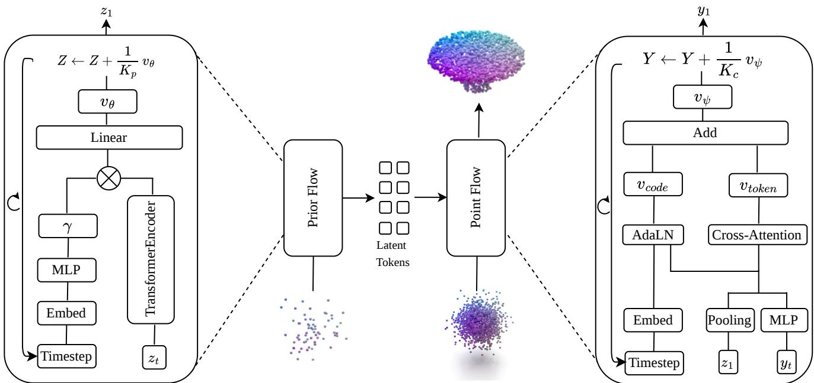
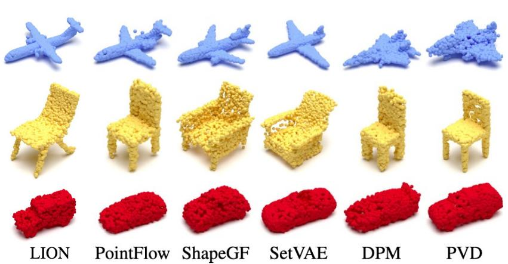
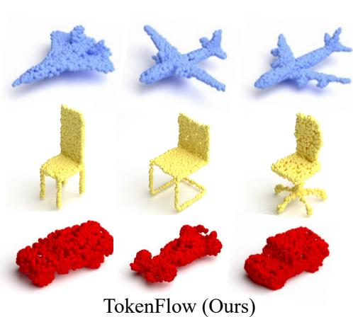
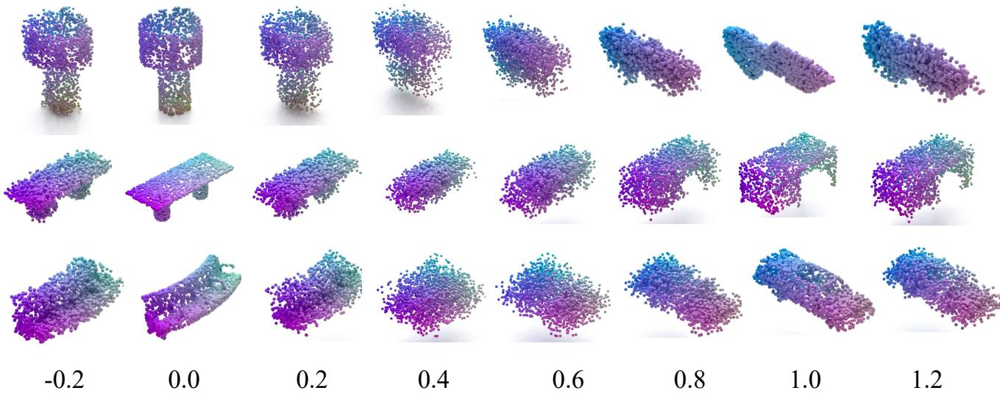
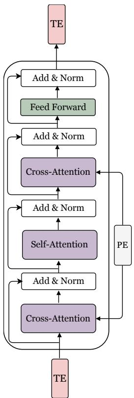
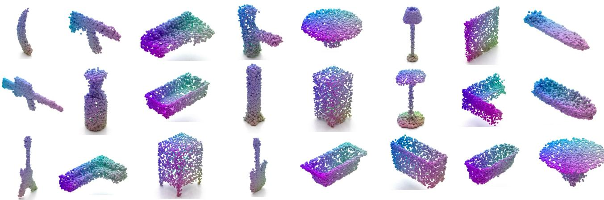

# TokenFlow: Latent Token Rectified Flow Matching for 3D Point Cloud Generation

Linhao Wang<sup>1</sup>, Dongjin Huang<sup>1,†</sup> <sup>1</sup>Shanghai Film Academy, Shanghai University <sup>†</sup> Corresponding Author

## Abstract

3D point clouds generation requires capturing both partlevel layout and surface detail while preserving permutation equivariance. Existing latent generative models often encode an entire shape into a single vector, which limits their ability to retain part-level structure. We propose TokenFlow, a hierarchicalflow matchingframework that represents each shape as a set of latent tokens and couples a rectified flow over these tokens with a conditional flow over points. A bottleneck of M ≪ N learnable tokens aggregates global context through cross-attention at O(NM) cost. On ShapeNet, TokenFlow achieves the best MMD and coverage across airplane, car, and chair, while obtaining 1-NNA comparable to the strongest baselines. On Model-Net, its learned latent set reaches the best reported linearevaluation accuracy on ModelNet10. These results show that representing a shape as a set of latent tokens, aggregated at O(NM) cost, provides an effective representation for 3D point cloud generation.

## 1. Introduction

A 3D shape is more than a collection of points. Although a point cloud is represented as an unordered set of coordinates, its identity is largely determined by how parts are organized and how their surfaces are formed. A chair, for example, requires the seat, back, and legs to occupy a coherent spatial configuration, while each individual leg must still exhibit a well-defined local surface. These two requirements are fundamentally different: global structure determines where parts should be and how they relate to one another, whereas local geometry determines how those parts are realized at the point level. A useful generative model must capture both while remaining permutationequivariant.

Point cloud generation has progressed substantially along several directions. Early GAN- and VAE-based approaches [1, 15, 27, 30, 51] directly generate point sets and optimize set distances such as Chamfer Distance (CD) and Earth Mover’s Distance (EMD) [14]. Continuous normalizing flows (CNFs), including PointFlow [60], SoftFlow [26], and DPF-Net [28], instead model point clouds through continuous transformations of distributions. More recently, diffusion models [22, 35, 47, 67] have improved generation quality, while latent representations [29, 38, 47, 63] and flow matching [32, 33] have emerged as effective ways to improve the scalability and efficiency of generative modeling. Despite these advances, most existing models still treat the generation process as a single prediction problem: one representation and one generative field are responsible for both global organization and local surface formation.

This design creates a less obvious bottleneck. Consider a rectified transport path

$$
Y _ { t } = ( 1 - t ) Y _ { 0 } + t X .
$$

At an early time t, the current state contains little information about the target shape; later in the trajectory, the target geometry becomes increasingly identifiable. Thus, the useful signal available for predicting the target is not uniform throughout the transport process. Global structure and local geometry are also not equally informative at the same time, and the two types of information cannot be expected to share a single representation.

The representation used by latent generative models makes this problem more pronounced. Recent approaches such as LION [47] and 3DShape2VecSet [63] avoid operating directly on all points by first mapping a shape into a latent representation. However, compressing an entire shape into a single global vector makes part-level structure difficult to preserve explicitly. A natural alternative is to retain a set of latent tokens, so that different tokens can encode different aspects of the shape while remaining permutationinvariant as a whole. The challenge is then to connect this latent representation back to N points without resorting to full point-to-point attention, whose $O ( N ^ { 2 } )$ complexity becomes costly as the point resolution grows.

These observations suggest a simple question: where should the boundary between global organization and local geometry lie? We answer this question with Token-Flow, a hierarchical flow matching framework that places the two roles at different levels while allowing them to interact throughout the transport process. TokenFlow represents a shape as a set of $M \ll N$ latent tokens rather than a single global code. These tokens provide a compact global state from which part-level organization can be modeled, while cross-attention connects the global representation back to individual points at O(NM) cost.

Collectively, these components yield a generative model that disentangles shape semantics from surface geometry across different levels, while maintaining their coupling via the flow. We additionally conduct controlled experiments to isolate the effect of the representation.

Our contributions are summarized as follows:

• We introduce TokenFlow, a latent-set rectified flow framework for 3D point cloud generation that separates global shape organization from point-level detail in its representation.

• We propose context bottleneck aggregation. Placing it after point-wise feature extraction means cross-attention learns only a grouping rather than a metric, and using asymmetric query/key versus value widths keeps the O(NM) attention map low-dimensional while the carried information stays high-dimensional.

• We evaluate TokenFlow on ShapeNet and ModelNet datasets, demonstrating superior performance compared with previous state-of-the-art methods.

## 2. Related Work

## 2.1. Point Cloud Generation

Early point cloud generators directly model an N × 3 point matrix with GANs [1, 30, 51], VAEs [15, 27], and adversarial autoencoders [36, 62]. These methods typically use a fixed number of output points and rely on set distances such as Chamfer Distance and Earth Mover’s Distance [14]. FoldingNet [61] and AtlasNet [19] instead generate surfaces by deforming 2D patches. PointFlow [60] introduced a continuous normalizing flow formulation that models both the shape distribution and the conditional point distribution, allowing density estimation and variable point counts. Soft-Flow [26], DPF-Net [28], and ShapeGF [4] further explored continuous distributional formulations.

Diffusion models subsequently became a dominant paradigm for point cloud generation [35, 40, 67] and latent 3D generation [29, 34, 38, 47]. Recent work has extended diffusion to unified point cloud processing [13], joint geometry-semantic generation [44], and state-space architectures [64]. Autoregressive models have also shown competitive performance through coarse-to-fine next-scale prediction [37]. Beyond generation, diffusion features have been distilled for point cloud representation learning [9]. Our work instead separates the two at the level of representation: a set of latent tokens carries global shape organization, while a conditional flow resolves local geometry.

## 2.2. Continuous-Time Generative Modeling

Continuous-time generative models provide a principled framework for transporting a simple reference distribution to the data distribution. Diffusion models [22] perform this transformation through a predefined noise schedule, but typically require many denoising steps at inference. Flow matching [32] directly learns a velocity field along a prescribed probability path, while rectified flow [33] uses straight interpolation paths that enable efficient Euler sampling. Optimal-transport couplings [46] further improve path straightness, and consistency models [43] reduce the number of required sampling steps.

These formulations have recently been applied to 3D generation. TripoSG [31] uses a large-scale rectified-flow transformer for image-to-3D synthesis, while ShapeR [42] conditions rectified flow on sparse SLAM points, posed images, and text. Related approaches target dynamic meshes [58] and 3D Gaussian objects [52]. Hierarchical Flow Matching [50] factorizes point cloud generation into a latent flow and a conditional point flow. Other recent studies have revisited transport design and evaluation for poin cloud generation [3, 23, 49].

TokenFlow is closest to hierarchical flow-based formulations, but differs in how the shape is represented and how the conditional field is conditioned. It aggregates context through a bottleneck of $M \ll N$ latent tokens, which condition a point-level rectified flow at O(NM) cost.

## 2.3. Latent Shape Representations

The choice of representation strongly affects how well a generative model preserves 3D structure. Global latent vectors [35, 60] provide compact shape representations but compress part-level information into a single code. Voxeland grid-based representations preserve spatial locality but incur rapidly increasing memory costs with resolution.

Latent sets provide an alternative by representing a shape with multiple learned tokens. LION [47] models a latent point cloud obtained from a hierarchical VAE, while 3DShape2VecSet [63] represents shapes as sets of latent vectors and applies a diffusion transformer for unconditional, category-, text-, and image-conditioned generation. Part-aware representations have also been explored in SPAGHETTI [21] and SALAD [29]. Autoregressive approaches instead discretize latent representations and generate them sequentially [7, 10, 45]. At the scene level, classpartitioned VQ-VAEs have recently been combined with latent flow matching for multi-object point cloud generation

  
Figure 1. TokenFlow pipeline. The prior flow transports Gaussian noise to a set of latent tokens over a Transformer encoder with several layers whose output is rescaled by a time-conditioned $\gamma .$ . The conditional point flow then decodes those tokens into a point cloud. A shared per-point MLP embeds each point and feeds two separately projected branches that are added, a code path in which the pooled token set and the time embedding give the scale and shift of an adaptive layer normalization over the point features, and a token path that cross-attends from the points to the latent tokens.

[12].

TokenFlow also adopts a latent set, but uses it as explicit global context for a conditional point flow rather than as the input to a single monolithic denoiser. This separation allows coarse layout and point-level detail to be modeled at different levels of the transport process.

## 2.4. Context Aggregation and Scalability on Point Sets

Global context is essential for point cloud modeling, but direct point-to-point interaction scales poorly with the number of points. PointNet [39] uses symmetric pooling to obtain permutation invariance with negligible interaction cost, but the resulting global representation is not explicitly adaptive to individual points. Transformer-based architectures, including PCT [20] and Point Transformer [56, 66], model point-to-point relations through attention, with full attention requiring $O ( N ^ { 2 } )$ time and memory. Local attention [66] reduces the interaction range but remains dependent on the point resolution.

A different strategy is to introduce a smaller set of latent tokens as an information bottleneck. Perceiver [24] crossattends from a small array of learned latents to a large input and then processes the latents with self-attention, avoiding any $N \times N$ map. Hierarchical masked autoencoders [65] and 3DShape2VecSet [63] adopt the same recipe for 3D shapes. TokenFlow follows this bottleneck design and aggregates N point features into $M \ \ll \ N$ context tokens through cross-attention, reducing the interaction cost to $O ( N M )$ . Our contribution here is not the bottleneck itself, which is established, but its placement and parametrisation: we place it after point-wise feature extraction, where cross-attention has to learn only a grouping rather than a metric, and we make the query/key and value widths asymmetric so that the $O ( N M )$ attention map is constructed in a low-dimensional space. Neither choice is analysed in the works above; we quantify the resulting cost against global, local and linear attention in Tab. 1.

## 3. Preliminaries

## 3.1. Continuous Normalizing Flows

A continuous normalizing flow (CNF) [8, 18] transports a noise sample $z ( t _ { 0 } )$ to the data space by integrating an ODE

$$
\frac { d z ( t ) } { d t } = f ( z ( t ) , t ) ,\tag{1}
$$

where $f$ is a learned vector field. Exact densities are available through the change-of-variables identity, but training pays for them three times over: the Jacobian trace must be estimated at every step, $f$ is confined to tractable forms such as affine couplings, and gradients must flow through the ODE solver itself. These costs are why point cloud generators built on CNFs [26, 28, 60] have largely given way to simulation-free training.



  
Figure 2. Qualitative comparisons against previous state-of-the-art methods.

## 3.2. Rectified Flow Matching

Flow matching [32] takes the opposite bargain: give up exact densities, and in exchange train by plain regression. Given data $a _ { 1 }$ and noise $a _ { 0 } \sim \mathcal { N } ( 0 , I )$ , define the straight interpolation

$$
a _ { t } = \left( 1 - t \right) a _ { 0 } + t a _ { 1 } , \qquad t \in [ 0 , 1 ] ,\tag{2}
$$

and regress a network $v _ { \vartheta }$ on the constant velocity along the segment,

$$
\mathcal { L } _ { \mathrm { F M } } = \mathbb { E } \Big | \Big | v _ { \vartheta } ( a _ { t } , t ) - ( a _ { 1 } - a _ { 0 } ) \Big | \Big | ^ { 2 } .\tag{3}
$$

Sampling integrates ${ d } a _ { t } / { d t } = v _ { \vartheta } ( a _ { t } , t )$ from $t = 0$ to 1. Since each path has constant velocity, trajectories stay close to straight lines, and a handful of Euler steps is enough [33, 46]. Nothing needs to be invertible, so $v _ { \vartheta }$ can be any network; in our case it is a permutation-equivariant one. Conditioning is free: a context c simply enters as another argument of $v _ { \vartheta }$ , and Eq. (3) becomes regression on $a _ { 1 } - a _ { 0 }$ given $( a _ { t } , t , c )$

## 3.3. Two-Level Generation

A point cloud is itself a set of samples, which motivates the hierarchy of PointFlow [60]: a shape code Z is drawn from a prior $P _ { \eta } ( Z )$ , and the N points are drawn conditionally, $X \sim P _ { \alpha } ( X | Z )$ . Training maximizes the ELBO

$$
\begin{array} { r } { \log P _ { \alpha } ( X ) \geq \mathbb { E } _ { Q _ { \varphi } ( Z \mid X ) } \big [ \log P _ { \alpha } ( X \mid Z ) \big ] - } \\ { D _ { K L } \big ( Q _ { \varphi } ( Z \mid X ) \ \parallel \ P _ { \eta } ( Z ) \big ) . } \end{array}\tag{4}
$$

We keep this hierarchy and change both of its ingredients: Z becomes a set of M tokens rather than one vector, and both levels are learned by the regression of Eq. (3) instead of by CNF likelihoods.

<table><tr><td>Context module</td><td>Time</td><td>Memory</td></tr><tr><td>Transformer [48]</td><td> $O ( N ^ { 2 } C )$ </td><td>O(N2)</td></tr><tr><td>PointTransformer [66]</td><td> $O ( N k C )$ </td><td>O(Nk)</td></tr><tr><td>Performer [11]</td><td> $O \dot { ( } N C ^ { 2 } )$ </td><td>O(NC)</td></tr><tr><td>CBA (ours)</td><td>O(NMĆ)</td><td>O(NM)</td></tr></table>

Table 1. Complexity of context aggregation over N points with C channels. CBA uses $M \ll N$ latent tokens, so both time and memory are linear in $N$

## 4. Method

## 4.1. Overview

A point cloud is denoted as $X = \{ x _ { i } \} _ { i = 1 } ^ { N }$ , where $x _ { i } \in \mathbb { R } ^ { 3 }$ and a shape is represented by a compact set of tokens $Z = \{ z _ { m } \bar  \} _ { m = 1 } ^ { M }$ , where $z _ { m } \in \mathbb { R } ^ { d }$ and $M \ll N$ . Token-Flow jointly trains two components (Fig. 1): a latent-set autoencoder $Q _ { \varphi } ( Z | X )$ , which maps the input point cloud to a compact token set and reconstructs the point cloud from it (Sec. 4.2), and two rectified flow models, including a prior over the token set and a conditional flow that generates point coordinates conditioned on Z (Secs. 4.3 and 4.4). The overall training objective is described in Sec. 4.5.

## 4.2. Latent-Set Shape Encoder

Point-wise geometry embedding. Each point is independently embedded by a shared 1×1 convolution, $X \in$ $\mathbb { R } ^ { B \times N \times \bar { 3 } } \mapsto H ^ { ( 0 ) } \in \mathbb { R } ^ { \bar { B } \times N \times C }$ , with C = 128. This operation is permutation equivariant with $O ( N C )$ complexity but captures no inter-point interactions, which are introduced by the bottleneck below.

Context Bottleneck Aggregation. Transformer selfattention over all N points costs $O ( N ^ { 2 } )$ time and memory. We instead aggregate through M learnable tokens $Q = \{ q _ { m } \} _ { m = 1 } ^ { M }$ that cross-attend to the point features. Each block (Fig. 4) computes

$$
Z = \mathrm { C B A } ( H ) ,\tag{5}
$$



Figure 3. Interpolation and extrapolation in the latent space.  
  
Figure 4. Illustration of CBA block. $\because \mathrm { T E } ^ { , \ r }$ means token embeddings while $\bf \ " P E \ "$ represents point embeddings.

where $\mathrm { C B A } ( \cdot )$ denotes a stack of $L _ { b }$ bottleneck blocks. Inside each block, point features $H \in \mathbb { R } ^ { B \times N \times C }$ are first aggregated into M latent tokens by a cross-attention layer,

$$
\tilde { Z } = \mathrm { L N } \left( Q + \mathrm { s o f t m a x } \left( \frac { ( Q W _ { Q } ) ( H W _ { K } ) ^ { \top } } { \sqrt { C } } \right) ( H W _ { V } ) \right) ,\tag{6}
$$

followed by a self-attention layer,

$$
\hat { Z } = \mathrm { L N } \Big ( \tilde { Z } + \mathrm { S e l f A t t n } ( \tilde { Z } ) \Big ) ,\tag{7}
$$

then a second cross-attention in which the updated tokens re-read the point features for calibration,

$$
Z ^ { \prime } = \mathrm { L N } \left( \hat { Z } + \mathrm { s o f t m a x } \left( \frac { ( \hat { Z } W _ { Q } ^ { \prime } ) ( H W _ { K } ^ { \prime } ) ^ { \top } } { \sqrt { C } } \right) ( H W _ { V } ^ { \prime } ) \right) ,\tag{8}
$$

and finally a feed-forward network,

$$
Z ^ { \prime \prime } = \mathrm { L N } ( Z ^ { \prime } + \mathrm { F F N } ( Z ^ { \prime } ) ) .\tag{9}
$$

The block output is $Z ^ { \prime \prime } .$ , and every sublayer applies layer normalization after adding its residual. Here $\grave { Q } \in \mathbb { R } ^ { M \times C }$ are the learnable latent tokens and $\mathrm { L N } ( \cdot )$ denotes layer normalization [2].

Two design choices are important. First, we apply the bottleneck after the point-wise embedding rather than directly to the raw coordinates. Each point therefore already has a C-dimensional feature that captures local geometry, allowing the cross-attention to focus on grouping points instead of learning low-level geometric relations from scratch. Second, we use asymmetric projection dimensions. Following [48], the query and key dimensions are set to $C / 8 ,$ while the value dimension remains C. This keeps the $O ( N M )$ attention map low-dimensional while preserving the full feature dimension for information propagation.

Tab. 1 summarizes the cost. At $N = 2 0 4 8$ and $M =$ 64 the pairwise interactions fall from $N ^ { 2 } \approx 4 . 2 \times 1 0 ^ { 6 }$ to $N M \approx 1 . 3 { \times } 1 0 ^ { 5 }$ , over an order of magnitude, and attention memory becomes linear in N.

<table><tr><td rowspan="3">Method</td><td colspan="5">Chair</td><td colspan="5">Airplane</td><td colspan="5"> $\mathbf { C a r }$ </td></tr><tr><td colspan="2">MMD↓</td><td colspan="2">COV(%)↑</td><td>JSD↓</td><td colspan="2">MMD↓</td><td colspan="2">COV(%)↑</td><td>JSD↓</td><td colspan="2">MMD↓</td><td colspan="2">COV(%)↑</td><td>JSD↓</td></tr><tr><td>CD</td><td>EMD</td><td>CD</td><td>EMD</td><td>一</td><td>CD</td><td>EMD</td><td>CD</td><td>EMD</td><td>一</td><td>CD</td><td>EMD</td><td>CD</td><td>EMD</td><td></td></tr><tr><td>r-GAN</td><td>2.57</td><td>12.80</td><td>33.99</td><td>9.97</td><td>11.50</td><td>0.261</td><td>5.47</td><td>42.72</td><td>18.02</td><td>7.44</td><td>1.27</td><td>8.74</td><td>15.06</td><td>9.38</td><td>12.80</td></tr><tr><td>1-GAN (CD)</td><td>2.46</td><td>8.91</td><td>41.39</td><td>25.68</td><td>4.59</td><td>0.239</td><td>4.27</td><td>43.21</td><td>21.23</td><td>4.62</td><td>1.55</td><td>6.25</td><td>38.64</td><td>18.47</td><td>4.43</td></tr><tr><td>1-GAN (EMD)</td><td>2.61</td><td>7.85</td><td>40.79</td><td>41.69</td><td>2.27</td><td>0.269</td><td>3.29</td><td>47.90</td><td>50.62</td><td>3.61</td><td>1.48</td><td>5.43</td><td>39.20</td><td>39.77</td><td>2.21</td></tr><tr><td>PVD</td><td>2.62</td><td></td><td>48.84</td><td>50.60</td><td>一</td><td>0.224</td><td>一</td><td>48.88</td><td>52.09</td><td>一</td><td>1.10</td><td>一</td><td>41.19</td><td>50.56</td><td>一</td></tr><tr><td>GET3D</td><td></td><td></td><td>43.36</td><td>42.77</td><td>1</td><td>一</td><td>一</td><td>1</td><td>一</td><td>一</td><td>一</td><td>1</td><td>15.04</td><td>18.38</td><td>一</td></tr><tr><td>DPF-Net</td><td>2.54</td><td></td><td>44.71</td><td>48.79</td><td></td><td>0.264</td><td></td><td>46.17</td><td>48.89</td><td></td><td>1.13</td><td></td><td>45.74</td><td>49.43</td><td></td></tr><tr><td>SoftFlow</td><td>2.53</td><td></td><td>41.39</td><td>47.43</td><td>1</td><td>0.231</td><td>1</td><td>46.91</td><td>47.90</td><td>1</td><td>1.19</td><td>一</td><td>42.90</td><td>44.60</td><td>一</td></tr><tr><td>PointFlow</td><td>2.42</td><td>7.87</td><td>46.83</td><td>46.98</td><td>1.74</td><td>0.217</td><td>3.24</td><td>46.91</td><td>48.40</td><td>4.92</td><td>0.91</td><td>5.22</td><td>44.03</td><td>46.59</td><td>0.87</td></tr><tr><td>PC-GAN</td><td>2.75</td><td>8.20</td><td>36.50</td><td>38.98</td><td>3.90</td><td>0.287</td><td>3.57</td><td>36.46</td><td>40.94</td><td>4.63</td><td>1.12</td><td>5.83</td><td>23.56</td><td>30.29</td><td>5.85</td></tr><tr><td>MeshDiffusion</td><td></td><td></td><td>46.00</td><td>46.71</td><td>1</td><td></td><td></td><td>47.34</td><td>42.15</td><td></td><td></td><td></td><td>34.07</td><td>25.85</td><td></td></tr><tr><td>TokenFlow (ours)</td><td>2.35</td><td>7.63</td><td>51.28</td><td>51.37</td><td>1.51</td><td>0.211</td><td>3.07</td><td>52.91</td><td>52.72</td><td>4.52</td><td>0.88</td><td>5.12</td><td>49.75</td><td>52.76</td><td>0.75</td></tr></table>

Table 2. Generation results using MMD, COV and JSD (↑/↓ as marked). MMD-CD and MMD-EMD are scaled by $1 0 ^ { 3 }$ and $1 0 ^ { 2 } \colon$ ; JSD by $1 0 ^ { 2 } . \mathit { \Omega } ^ { \ast } - \mathit { \Omega } ^ { \ast }$ marks unreported entries.

<table><tr><td>Model</td><td>MN10 (%)</td><td>MN40 (%)</td></tr><tr><td>SPH</td><td>68.2</td><td>79.8</td></tr><tr><td>LFD</td><td>75.5</td><td>79.9</td></tr><tr><td>T-L Network</td><td>74.4</td><td></td></tr><tr><td>Vconv-DAE</td><td>75.5</td><td>80.5</td></tr><tr><td>PointGrow</td><td>85.7</td><td></td></tr><tr><td>3D-GAN</td><td>83.3</td><td>91.0</td></tr><tr><td>PointFlow</td><td>86.8</td><td>93.7</td></tr><tr><td>DPM</td><td>87.6</td><td>94.2</td></tr><tr><td>DualGAN</td><td>87.6</td><td>94.1</td></tr><tr><td>TGN</td><td>87.7</td><td>94.2</td></tr><tr><td>TokenFlow (ours)</td><td>87.9</td><td>93.9</td></tr></table>

Table 3. Classification results on ModelNet10 (MN10) and ModelNet40 (MN40) datasets. Missing entries are denoted as $^ { 6 6 } - ^ { 9 9 }$

Latent distribution and decoding. A linear head turns each token into the parameters of a diagonal Gaussian.

$$
( \mu _ { m } , \log \sigma _ { m } ) = { \mathrm { H e a d } } ( z _ { m } ) ,\tag{10}
$$

$$
q _ { \varphi } ( z _ { m } | X ) = \mathcal { N } \big ( z _ { m } ; \mu _ { m } , \mathrm { d i a g } ( \sigma _ { m } ^ { 2 } ) \big ) ,\tag{11}
$$

The latent tokens are sampled using the reparameterization trick [35, 60]. For decoding, we initialize $Y _ { 0 } \sim \mathcal { N } ( 0 , I )$ and integrate the conditional flow in Sec. 4.4 conditioned on Z, yielding the reconstructed point cloud $\hat { X } = D _ { \psi } ( Z , Y _ { 0 } )$ Since the encoder consists only of point-wise operations and permutation-invariant aggregation, $Q _ { \varphi } ( Z | X )$ is invariant to point ordering, while the decoder remains permutation equivariant.

## 4.3. Prior Rectified Flow Matching

Both levels of Eq. (4) are trained by the regression of Sec. 3.2 rather than by CNF likelihoods. The first level is a rectified flow over the latent token set, which supplies the shape-level representation that the second level is conditioned on.

Flow over the latent set. Take $Z _ { 1 } \sim q _ { \varphi } ( \cdot | X )$ from the encoder posterior and $Z _ { 0 } \sim \mathcal { N } ( 0 , I )$ . Along $Z _ { t } ~ = ~ ( 1 -$ $t ) Z _ { 0 } + t Z _ { 1 }$ we regress

$$
\mathcal { L } _ { \mathrm { p r i o r } } = \mathbb { E } _ { t , Z _ { 0 } , Z _ { 1 } } { \left. { v _ { \theta } ( Z _ { t } , t ) - ( Z _ { 1 } - Z _ { 0 } ) } \right. } ^ { 2 } ,\tag{12}
$$

where $v _ { \theta }$ is a permutation-equivariant transformer over the tokens, conditioned by adaptive layer normalization on t.

Optimal-transport coupling. Trajectory straightness, and hence the number of Euler steps needed at inference, depends on how $Z _ { 0 }$ is paired with $Z _ { 1 }$ . Following [46], we compute an optimal-transport plan $\pi ^ { \star }$ between noise and data tokens within each minibatch, minimizing $\begin{array} { r l } { \sum _ { i j } \pi _ { i j } \| Z _ { 0 } ^ { ( i ) } - Z _ { 1 } ^ { ( j ) } \| ^ { 2 } } \end{array}$ , and draw training pairs from it. This lowers the variance of the regression target and straightens the flows.

## 4.4. Conditional Rectified Flow Matching

The second level generates the coordinates themselves, conditioned on the latent set. They come from a conditional rectified flow starting at $Y _ { 0 } \sim { \mathcal { N } } ( 0 , I )$

$$
Y _ { t } = ( 1 - t ) Y _ { 0 } + t X , \qquad { \frac { d Y _ { t } } { d t } } = v _ { \psi } ( Y _ { t } , t ; Z ) ,\tag{13}
$$

trained by

$$
\mathcal { L } _ { \mathrm { c o n d } } = \mathbb { E } _ { t , Y _ { 0 } , X , Z } \big | \big | v _ { \psi } ( Y _ { t } , t ; Z ) - ( X - Y _ { 0 } ) \big | \big | ^ { 2 } .\tag{14}
$$

It remains to specify $v _ { \psi }$ , which is a per-point network conditioned on the latent set. A shared MLP embeds each point, a cross-attention layer lets it read part-level information from the tokens $Z ,$ and the pooled shape code $\bar { z } = \mathrm { P o o l } ( Z )$ enters every point through adaptive layer normalization together with t:

$$
\begin{array} { r l } & { v _ { \psi } ( Y _ { t } , t ; Z ) _ { i } = W _ { g } \mathrm { ~ A d a L N } ( \mathrm { M L P } ( y _ { t , i } ) ; \bar { z } , t ) } \\ & { ~ + W _ { l } \mathrm { ~ C r o s s A t t n } ( \mathrm { M L P } ( y _ { t , i } ) , Z , Z ) . } \end{array}\tag{15}
$$

<table><tr><td rowspan="2">Method</td><td colspan="2">Airplane</td><td colspan="2">Car</td><td colspan="2">Chair</td></tr><tr><td>CD</td><td>EMD</td><td>CD</td><td>EMD</td><td>CD</td><td>EMD</td></tr><tr><td>r-GAN</td><td>98.40</td><td>96.79</td><td>94.46</td><td>99.01</td><td>83.69</td><td>99.70</td></tr><tr><td>1-GAN (CD)</td><td>87.30</td><td>93.95</td><td>66.49</td><td>88.78</td><td>68.58</td><td>83.84</td></tr><tr><td>1-GAN (EMD)</td><td>89.49</td><td>76.91</td><td>71.16</td><td>66.19</td><td>71.90</td><td>64.65</td></tr><tr><td>PC-GAN</td><td>94.35</td><td>92.32</td><td>92.19</td><td>90.87</td><td>76.03</td><td>78.37</td></tr><tr><td>PointFlow</td><td>75.68</td><td>70.74</td><td>60.65</td><td>62.36</td><td>62.84</td><td>60.57</td></tr><tr><td>SoftFlow</td><td>76.05</td><td>65.80</td><td>62.35</td><td>54.48</td><td>59.21</td><td>60.05</td></tr><tr><td>DPF-Net</td><td>75.18</td><td>65.55</td><td>62.35</td><td>54.48</td><td>62.00</td><td>58.53</td></tr><tr><td>SetVAE</td><td>76.54</td><td>67.65</td><td>59.95</td><td>59.94</td><td>58.84</td><td>60.57</td></tr><tr><td>SPAGHETTI</td><td>78.20</td><td>77.00</td><td>72.30</td><td>71.00</td><td>70.70</td><td>69.00</td></tr><tr><td>DPM</td><td>76.42</td><td>86.91</td><td>68.89</td><td>79.97</td><td>60.05</td><td>74.77</td></tr><tr><td>Shape-GF</td><td>80.00</td><td>76.17</td><td>63.20</td><td>56.53</td><td>68.96</td><td>65.48</td></tr><tr><td>CanonicalVAE</td><td>80.15</td><td>76.27</td><td>63.23</td><td>61.56</td><td>62.78</td><td>61.05</td></tr><tr><td>PVD</td><td>73.82</td><td>64.81</td><td>54.55</td><td>53.83</td><td>56.26</td><td>53.32</td></tr><tr><td>LION</td><td>67.41</td><td>61.23</td><td>53.41</td><td>51.14</td><td>53.70</td><td>52.34</td></tr><tr><td>PointGPT</td><td>74.85</td><td>65.61</td><td>55.91</td><td>54.24</td><td>57.24</td><td>55.01</td></tr><tr><td>PSF</td><td>71.11</td><td>61.09</td><td>57.19</td><td>56.07</td><td>58.92</td><td>54.45</td></tr><tr><td>SALAD</td><td>73.90</td><td>71.10</td><td>59.20</td><td>57.20</td><td>57.80</td><td>58.40</td></tr><tr><td>NSOT</td><td>68.64</td><td>61.85</td><td>59.66</td><td>53.55</td><td>55.51</td><td>57.63</td></tr><tr><td>DiPT</td><td></td><td>74.32</td><td></td><td>60.26</td><td></td><td>64.47</td></tr><tr><td>TokenFlow (ours)</td><td>66.65</td><td>60.55</td><td>53.44</td><td>50.87</td><td>54.26</td><td>52.21</td></tr></table>

Table 4. Generation results on Airplane, Car, and Chair compared with baselines using 1-NNA as the metric. Lower is better. For clarity, the table is divided into two splits: the bottom corresponds to results from the past three years while the top corresponds to the earlie methods.

where

$$
\mathrm { A d a L N } ( h ; \bar { z } , t ) = \gamma ( \bar { z } , t ) \odot \frac { h - \mu ( h ) } { \sigma ( h ) } ~ + ~ \beta ( \bar { z } , t ) ,\tag{16}
$$

with $( \gamma , \beta ) = \mathrm { A f f n e } \big ( [ \mathrm { L N } ( \bar { z } ) ; \mathrm { e m b } ( t ) ] \big )$ , layer normalization [2] and a sinusoidal time embedding, as is standard in diffusion transformers [38, 63]. The adaptive-normalization term carries the shape code into all points, so the field stays globally consistent, while the cross-attention term recovers the part-level detail that the pooled code does not retain.

## 4.5. Objective Function

All parameters are trained jointly. We keep the two-level ELBO of Eq. (4) but swap PointFlow’s exact-likelihood terms [60] for the regressions of Eqs. (12) and (14), retaining its entropy term:

$$
\begin{array} { r l } & { \mathcal { L } _ { \mathrm { t o t a l } } = \lambda _ { p } \mathcal { L } _ { \mathrm { p r i o r } } + \lambda _ { c } \mathcal { L } _ { \mathrm { c o n d } } } \\ & { ~ + ~ \lambda _ { k l } \mathcal { L } _ { K L } - \lambda _ { H } \mathcal { L } _ { e n t r o } , } \end{array}\tag{17}
$$

where

$$
\mathcal { L } _ { K L } = \sum _ { m = 1 } ^ { M } D _ { K L } \big ( \mathcal { N } ( \mu _ { m } , \sigma _ { m } ^ { 2 } ) \ | | \ \mathcal { N } ( 0 , I ) \big ) ,\tag{18}
$$

$$
\mathcal { L } _ { e n t r o } = H \big [ Q _ { \varphi } ( Z | X ) \big ] .\tag{19}
$$

$\mathcal { L } _ { \mathrm { c o n d } }$ keeps the geometry needed to rebuild the shape and anchors the code, ${ \mathcal { L } } _ { \mathrm { p r i o r } }$ and $\mathcal { L } _ { K L }$ align the aggregated posterior with a standard Gaussian so sampling is possible, and $\mathcal { L } _ { e n t r o }$ stops the posterior collapsing onto isolated codes, which would destroy diversity. Alg. 1 lists the operations of one training step.

## 4.6. Complexity and Inference

Asymptotic cost. CBA cross-attention is the only one super-linear operation in the encoder at $O ( N M C )$ time and $O ( N M )$ memory, against $O ( N ^ { 2 } C )$ and $O ( N ^ { 2 } )$ for Transformer self-attention (Tab. 1). Self-attention among the M tokens adds $O ( M ^ { 2 } C )$ , negligible when $M \ll N$ . The prior flow acts on M tokens and so is independent of N, and the conditional flow is point-wise in its input, so generation cost is linear in the number of points requested.

Inference. Sampling is a two-stage integration. The prior flow is integrated first, from $Z _ { 0 } \sim \mathcal { N } ( 0 , I )$ to the latent set $Z _ { 1 }$ using $K _ { p }$ Euler steps of size $1 / K _ { p }$ at the left endpoints. The conditional flow is then integrated from an independently drawn $Y _ { 0 } \sim \mathcal { N } ( 0 , I )$ conditioned on $Z _ { 1 }$ , using $K _ { c }$ steps of the same scheme. Both step counts are set to 20, which is enough because the paths are trained to be straight. Alg. 2 summarizes this sampling procedure.

  
Figure 5. Multi-class results generated by TokenFlow.

Algorithm 1 One training step of TokenFlow.   
Require: point cloud X, token count M, weights   
$\lambda _ { p } , \lambda _ { c } , \lambda _ { k l } , \lambda _ { H }$   
1: $\dot { H } \gets \mathrm { R e L U } \big ( \mathrm { C o n v 1 d } ( X ) \big ) \left\{ ( B , N , C ) \right\}$   
2: $Z \gets \mathrm { C B A } ( \dot { H } )$   
3: $( \mu , \log \sigma ) \gets \mathrm { H e a d } ( Z )$   
4: $Z _ { 1 } \gets \mu + \sigma \odot \epsilon , \quad \epsilon \sim \mathcal { N } ( 0 , I )$   
5: $Z _ { 0 } \sim { \mathcal { N } } ( 0 , I )$   
6: $\begin{array} { r } { \pi  \arg \operatorname* { m i n } _ { \pi } \sum _ { i j } \pi _ { i j } \| Z _ { 0 } ^ { ( i ) } - Z _ { 1 } ^ { ( j ) } \| ^ { 2 } } \end{array}$   
7: $Z _ { 0 } \gets Z _ { 0 } [ \pi ]$   
8: $t _ { p } \sim \mathcal { U } [ 0 , 1 ] , \quad Z _ { t } \gets ( 1 - t _ { p } ) Z _ { 0 } + t _ { p } Z _ { 1 }$   
9: $\bar { \mathcal { L } } _ { \mathrm { p r i o r } }  \| v _ { \theta } ( Z _ { t } , t _ { p } ) - ( Z _ { 1 } - Z _ { 0 } ) \| ^ { 2 }$   
10: $\dot { Y _ { 0 } } \sim \mathcal { N } ( 0 , I ) , \quad \dot { t _ { c } } \sim \mathcal { U } [ 0 , 1 ] , \quad \dot { Y _ { t } } \gets ( 1 - t _ { c } ) Y _ { 0 } +$   
$t _ { c } X$   
11: $\mathcal { L } _ { \mathrm { c o n d } } \gets \| v _ { \psi } ( Y _ { t } , t _ { c } ; Z _ { 1 } ) - ( X - Y _ { 0 } ) \| ^ { 2 }$   
12: $\begin{array} { r } { \mathcal { L } _ { K L }  \sum _ { m } D _ { K L } \big ( \mathcal { N } ( \mu _ { m } , \sigma _ { m } ^ { 2 } ) \ : \| \mathcal { N } ( 0 , I ) \big ) } \end{array}$   
13: ${ \mathcal { L } } _ { e n t r o } \gets H \big [ Q _ { \varphi } ( Z | X ) \big ]$   
14: $\mathcal { L }  \lambda _ { p } \mathcal { L } _ { \mathrm { p r i o r } } + \lambda _ { c } \mathcal { L } _ { \mathrm { c o n d } } + \lambda _ { k l } \mathcal { L } _ { K L } - \lambda _ { H } \mathcal { L } _ { e n t r o }$   
15: Backpropagate L

## 5. Experiment

The experiment section has four parts. Sec. 5.1 introduces the experimental setup, including baselines, evaluation metrics, configuration and implementation details. Sec. 5.2 reports the generation results against prior state-of-the-art methods. Sec. 5.3 evaluate the representation learning ability of the proposed autoencoders, and Sec. 5.4 ablates the proposed modules.

## 5.1. Experimental Setup

Baselines. we compare with a variety of previous methods published on top conferences or journals. For generation task: r-GAN [1], l-GAN (CD/EMD) [1], PC-GAN [30], PointFlow [60], SoftFlow [26], DPF-Net [28], SetVAE [27], DPM [35], Shape-GF [4], CanonicalVAE [10], PVD [67], GET3D [16], SPAGHETTI [21], MeshDiffusion [34], PSF [55], LION [47], PointGPT [7], SALAD [29],

```latex
Algorithm 2 Sampling.
Require: Euler steps $K _ { p } , K _ { c } ,$ point count $N ^ { \prime } ,$ , trained fields
$v _ { \theta } , v _ { \psi }$
Ensure: point cloud $\hat { X } \in \mathbb { R } ^ { N ^ { \prime } \times 3 }$
1: $Z \sim { \mathcal { N } } ( 0 , I ) \left\{ \left( M , d \right) \right\}$
2: for $i = 0$ to $K _ { p } - 1$ do
3: $\begin{array} { r } { Z  Z + \frac { 1 } { K _ { p } } v _ { \theta } \Big ( Z , \frac { i } { K _ { p } } \Big ) } \end{array}$
4: end for
5: $Y \sim \mathcal { N } ( 0 , I ) \left\{ \left( N ^ { \prime } , 3 \right) \right\}$
6: for $i = 0 \mathrm { { \bf t o } } K _ { c } - 1 $ do
7: $\begin{array} { r } { Y \gets Y + \frac { 1 } { K _ { c } } v _ { \psi } \Big ( Y , \frac { i } { K _ { c } } ; Z \Big ) } \end{array}$
8: end for
9: return Y
NSOT [23], and DiPT [3]. For representation learning task,
we compare with: SPH [25], LFD [6], T-L Network [17],
Vconv-DAE [41], PointGrow [45], 3D-GAN [54], Point-
Flow [60], DPM [35], DualGAN [53], and TGN [59].
```

Evaluation Metrics. We employ COV (coverage), MMD (minimum matching distance), JSD (Jensen-Shannon divergence), and 1-NNA (1-nearest neighbor accuracy) using Chamfer Distance (CD) and Earth Mover’s Distance (EMD) as base metrics, following prior works [28, 60]. COV detects mode collapse, MMD evaluates fidelity, JSD compares marginal distributions, and 1-NNA is a more robust measure for both diversity and quality [60].

Configuration. For the generation task, we follow previous works [4, 26, 28, 60, 67] and select three classes from ShapeNet dataset [5]: airplane, chair, and car. Each class in ShapeNet contains 15,000 sampled points. We sample 2,048 points for training and testing for each shape and preprocess the point cloud data following the steps outlined in [60].

For the classification evaluation of our auto-encoders, we implement ModelNet40 and ModelNet10 datasets [57], which contain 3D models of 40 and 10 categories, respectively.

Implementation Details. All experiments are conducted on 4 NVIDIA A800 80G GPUs. The point-wise embedding uses C = 128 channels, and the CBA bottleneck uses M = 64 learnable tokens of width $d = 1 2 8 , L _ { b } = 2$ blocks and four attention heads. The conditional point field has a hidden width of 128, and the latent velocity field is a fourlayer Transformer. We optimize with Adam at a learning rate of $2 \times 1 0 ^ { - 3 }$ , with $\beta _ { 1 } = 0 . 9 , \beta _ { 2 } = 0 . 9 9 9$ and no weight decay, for 4000 epochs at a batch size of 128. The learning rate stays constant over the first half of training and then decays linearly to zero. All four weights in Eq. (17) are set to 1, and the minibatch optimal-transport coupling is enabled for the prior flow. Sampling uses $K _ { p } = K _ { c } = 2 0$ Euler steps.

## 5.2. Point Cloud Generation

Qualitative comparisons Fig. 2 compares samples from our model with those of prior methods. We also train our model on all 55 different categories from the ShapeNet dataset. Fig. 5 shows multi-class point clouds generated by TokenFlow to demonstrate its generalizability.

Quantitative comparisons We compare against prior state-of-the-art methods using the metrics of Sec. 5.1. Results are given in Tab. 2 (MMD, COV, JSD) and Tab. 4 (1- NNA). On the distributional metrics (Tab. 2), TokenFlow attains almost the best results across all three categories.

On 1-NNA (Tab. 4) TokenFlow achieves the best on Aiplane-CD/EMD, Car-EMD and Chair-EMD, while Car-CD and Chair-CD results are comparable with LION [47], which is a strong baseline.

We note that fewer comparisons are reported in Tab. 2, as several methods do not provide official results for MMD, COV or JSD. In contrast, 1-NNA has recently become a more widely adopted metric as shown in Tab. 4.

## 5.3. Unsupervised Representation Learning

To additionally evaluate the representation learning ability of auto-encoders, we conduct classification experiments following previous methods [35, 59, 60]. We first train TokenFlow with the full ShapeNet dataset and then train a linear SVM with extracted latent representations for classification. The classification results are summarized in Tab. 3. Our method achieves the best performance on ModelNet10 dataset, while demonstrating competitive results on the ModelNet40 dataset. Further, we visualize the interpolation and extrapolation in the latent codes shown in Fig. 3.

<table><tr><td>Context module</td><td>1-NNA-CD ↓</td><td>1-NNA-EMD ↓</td></tr><tr><td>Transformer [48]</td><td>72.43</td><td>68.91</td></tr><tr><td>PointTransformer [66]</td><td>71.54</td><td>67.96</td></tr><tr><td>Performer [11]</td><td>76.23</td><td>75.60</td></tr><tr><td>CBA (ours)</td><td>66.65</td><td>60.55</td></tr></table>

Table 5. Context module ablation on the Airplane category, reported as 1-NNA (%). Lower is better. Only the context module of the encoder is replaced, and everything else is held fixed.
<table><tr><td>Latent Tokens</td><td>1-NNA-CD ↓</td><td>1-NNA-EMD ↓</td></tr><tr><td>M = 1</td><td>81.59</td><td>80.72</td></tr><tr><td>M = 8</td><td>76.57</td><td>73.68</td></tr><tr><td>M = 32</td><td>72.30</td><td>67.84</td></tr><tr><td>M = 64</td><td>66.65</td><td>60.55</td></tr><tr><td> $M = 1 2 8$ </td><td>70.03</td><td>66.49</td></tr></table>

Table 6. Effect of the number of latent tokens M on the Airplane category, reported as 1-NNA (%). Lower is better. M = 64 is the default used in the main results.

## 5.4. Ablation Study

We ablate the two core designs, the context module of the encoder and the number of latent tokens M.

Context Module. Tab. 5 replaces the context module while the rest of the encoder and both flows stay unchanged. CBA improves on all three alternatives. PointTransformer is the closest competitor and still trails by 4.89 points on 1-NNA-CD and 7.41 points on 1-NNA-EMD. Transformer selfattention trails by 5.78 and 8.36 points, and Performer trails by 9.58 and 15.05 points.

The ranking follows from the way each module turns N points into a shape code. Transformer self-attention mixes all point pairs and then has to pool the resulting N features into one vector, which discards the assignment of points to parts. The conditional flow then has to recover that structure from noise, which is the hardest part of the problem. CBA keeps the assignment because its softmax is taken with M learned queries over all N points, so each token is a contentadaptive summary rather than a fixed average.

PointTransformer does better than full attention because it retains local geometry, but its neighbourhood graph is built on Euclidean distance in the input coordinates. Parts are frequently not proximal, so the four legs of a chair are never placed in one group.

Performer fails for a different reason. The kernel replaces the exponential, so attention mass spreads over many points and no cluster is selected. Its M tokens then summarise diffuse second-order statistics instead of distinct parts.

The costs of the four modules are listed in Tab. 1. CBA replaces an N ×N attention map with an M×N one, which is 32 times smaller at N = 2048 and M = 64. Performer builds no such map and is therefore the only module with a smaller memory footprint, but it is also the least accurate here, so the saving is paid for in fidelity rather than obtained for free.

Latent Tokens. Tab. 6 varies M. Accuracy improves from M = 1 to M = 64 and then degrades again at $M = 1 2 8$ At M = 1 the token self-attention becomes an identity, so the encoder degenerates into the single vector code used by earlier two-level models.

Small values of M in general under-resolve the shape, because too few tokens cannot cover all parts. At $M = 1 2 8$ the opposite failure appears. Tokens beyond the number of parts are redundant, and the latent prior must model a higher dimensional token set from the same training data, so the aggregated posterior drifts further from the Gaussian prior and sampling quality drops. The KL term is summed over every token coordinate, so its magnitude grows with M as well. M = 64 balances the two effects and is the value used in the main results.

## 6. Conclusion

We proposed TokenFlow, a hierarchical rectified flow matching framework that represents a shape as a set of $M \ll \bar { N }$ latent tokens and couples a rectified flow over these tokens with a conditional flow over points. We found that existing models compress a shape into a single global vector, leaving part-level structure implicit. To address this, we introduced a context bottleneck that aggregates global information at O(NM) cost and conditions a point-level rectified flow. Experiments on ShapeNet demonstrate that our method achieves superior fidelity and diversity, with competitive transferable latent representations for ModelNet classification. Future work will extend the framework to large-scale scene-level point clouds and multimodal conditional generation.

## References

[1] Panos Achlioptas, Olga Diamanti, Ioannis Mitliagkas, and Leonidas Guibas. Learning representations and generative models for 3d point clouds. In International conference on machine learning, pages 40–49. PMLR, 2018. 1, 2, 8

[2] Jimmy Lei Ba, Jamie Ryan Kiros, and Geoffrey E Hinton. Layer normalization. arXiv preprint arXiv:1607.06450, 2016. 5, 7

[3] Matteo Bastico, David Ryckelynck, Laurent Corte, Yannick´ Tillier, and Etienne Decenciere. Rethinking metrics and dif-\` fusion architecture for 3d point cloud generation. In 2026 International Conference on 3D Vision (3DV), pages 1380– 1391. IEEE, 2026. 2, 8

[4] Ruojin Cai, Guandao Yang, Hadar Averbuch-Elor, Zekun Hao, Serge Belongie, Noah Snavely, and Bharath Hariharan. Learning gradient fields for shape generation. In European Conference on Computer Vision, pages 364–381. Springer, 2020. 2, 8

[5] Angel X Chang, Thomas Funkhouser, Leonidas Guibas, Pat Hanrahan, Qixing Huang, Zimo Li, Silvio Savarese, Manolis Savva, Shuran Song, Hao Su, et al. Shapenet:

An information-rich 3d model repository. arXiv preprint arXiv:1512.03012, 2015. 8

[6] Ding-Yun Chen, Xiao-Pei Tian, Yu-Te Shen, and Ming Ouhyoung. On visual similarity based 3d model retrieval. In Computer graphics forum, pages 223–232. Wiley Online Library, 2003. 8

[7] Guangyan Chen, Meiling Wang, Yi Yang, Kai Yu, Li Yuan, and Yufeng Yue. Pointgpt: Auto-regressively generative pretraining from point clouds. Advances in Neural Information Processing Systems, 36:29667–29679, 2023. 2, 8

[8] Ricky TQ Chen, Yulia Rubanova, Jesse Bettencourt, and David K Duvenaud. Neural ordinary differential equations. Advances in neural information processing systems, 31, 2018. 3

[9] Yiyang Chen, Shanshan Zhao, Lunhao Duan, Changxing Ding, and Dacheng Tao. Harnessing text-to-image diffusion models for point cloud self-supervised learning. In 2025 IEEE/CVF International Conference on Computer Vision (ICCV), pages 26156–26166. IEEE, 2025. 2

[10] An-Chieh Cheng, Xueting Li, Sifei Liu, Min Sun, and Ming Hsuan Yang. Autoregressive 3d shape generation via canon ical mapping. In European Conference on Computer Vision, pages 89–104. Springer, 2022. 2, 8

[11] Krzysztof Choromanski, Valerii Likhosherstov, David Dohan, Xingyou Song, Andreea Gane, Tamas Sarlos, Peter Hawkins, Jared Davis, Afroz Mohiuddin, Lukasz Kaiser, et al. Rethinking attention with performers. arXiv preprint arXiv:2009.14794, 2020. 4, 9

[12] Dasith de Silva Edirimuni and Ajmal Saeed Mian. Classpartitioned vq-vae and latent flow matching for point cloud scene generation. In Proceedings ofthe AAAI Conference on Artificial Intelligence, pages 3542–3550, 2026. 3

[13] Yi Du, Zhipeng Zhao, Shaoshu Su, Sharath Golluri, Haoze Zheng, Runmao Yao, and Chen Wang. Superpc: A single diffusion model for point cloud completion, upsampling, denoising, and colorization. In 2025 IEEE/CVF Conference on Computer Vision and Pattern Recognition (CVPR), pages 16953–16964. IEEE, 2025. 2

[14] Haoqiang Fan, Hao Su, and Leonidas J Guibas. A point set generation network for 3d object reconstruction from a single image. In Proceedings of the IEEE conference on computer vision and pattern recognition, pages 605–613, 2017. 1, 2

[15] Matheus Gadelha, Rui Wang, and Subhransu Maji. Multiresolution tree networks for 3d point cloud processing. In European conference on computer vision, pages 105–122. Springer, 2018. 1, 2

[16] Jun Gao, Tianchang Shen, Zian Wang, Wenzheng Chen, Kangxue Yin, Daiqing Li, Or Litany, Zan Gojcic, and Sanja Fidler. Get3d: A generative model of high quality 3d tex tured shapes learned from images. Advances in neural infor mation processing systems, 35:31841–31854, 2022. 8

[17] Rohit Girdhar, David F Fouhey, Mikel Rodriguez, and Abhinav Gupta. Learning a predictable and generative vector representation for objects. In European conference on com puter vision, pages 484–499. Springer, 2016. 8

[18] Will Grathwohl, Ricky TQ Chen, Jesse Bettencourt, Ilya Sutskever, and David Duvenaud. Ffjord: Free-form con-

tinuous dynamics for scalable reversible generative models. arXiv preprint arXiv:1810.01367, 2018. 3

[19] Thibault Groueix, Matthew Fisher, Vladimir G Kim, Bryan C Russell, and Mathieu Aubry. A papier-machˆ e ap-´ proach to learning 3d surface generation. In 2018 IEEE/CVF conference on computer vision and pattern recognition, pages 216–224. IEEE, 2018. 2

[20] Meng-Hao Guo, Jun-Xiong Cai, Zheng-Ning Liu, Tai-Jiang Mu, Ralph R Martin, and Shi-Min Hu. Pct: Point cloud transformer. Computational visual media, 7(2):187–199, 2021. 3

[21] Amir Hertz, Or Perel, Raja Giryes, Olga Sorkine-Hornung, and Daniel Cohen-Or. Spaghetti: Editing implicit shapes through part aware generation. ACM Transactions on Graphics (TOG), 41(4):1–20, 2022. 2, 8

[22] Jonathan Ho, Ajay Jain, and Pieter Abbeel. Denoising diffusion probabilistic models. Advances in neural information processing systems, 33:6840–6851, 2020. 1, 2

[23] Ka-Hei Hui, Chao Liu, Chi-Wing Fu, Arash Vahdat, et al. Not-so-optimal transport flows for 3d point cloud generation. In International Conference on Learning Representations, pages 98748–98771, 2025. 2, 8

[24] Andrew Jaegle, Felix Gimeno, Andy Brock, Oriol Vinyals, Andrew Zisserman, and Joao Carreira. Perceiver: General perception with iterative attention. In International conference on machine learning, pages 4651–4664. PMLR, 2021. 3

[25] Michael Kazhdan, Thomas Funkhouser, and Szymon Rusinkiewicz. Rotation invariant spherical harmonic representation of 3 d shape descriptors. In Symposium on geometry processing, pages 156–164, 2003. 8

[26] Hyeongju Kim, Hyeonseung Lee, Woo Hyun Kang, Joun Yeop Lee, and Nam Soo Kim. Softflow: Probabilistic framework for normalizing flow on manifolds. Advances in Neural Information Processing Systems, 33:16388–16397, 2020. 1, 2, 3, 8

[27] Jinwoo Kim, Jaehoon Yoo, Juho Lee, and Seunghoon Hong. Setvae: Learning hierarchical composition for generative modeling of set-structured data. In 2021 IEEE/CVF Conference on Computer Vision and Pattern Recognition (CVPR), pages 15054–15063. IEEE, 2021. 1, 2, 8

[28] Roman Klokov, Edmond Boyer, and Jakob Verbeek. Discrete point flow networks for efficient point cloud generation. In European Conference on Computer Vision, pages 694–710. Springer, 2020. 1, 2, 3, 8

[29] Juil Koo, Seungwoo Yoo, Minh Hieu Nguyen, and Minhyuk Sung. Salad: Part-level latent diffusion for 3d shape generation and manipulation. In 2023 IEEE/CVF International Conference on Computer Vision (ICCV), pages 14395–14405. IEEE, 2023. 1, 2, 8

[30] Chun-Liang Li, Manzil Zaheer, Yang Zhang, Barnabas Poczos, and Ruslan Salakhutdinov. Point cloud gan. arXiv preprint arXiv:1810.05795, 2018. 1, 2, 8

[31] Yangguang Li, Zi-Xin Zou, Zexiang Liu, Dehu Wang, Yuan Liang, Zhipeng Yu, Xingchao Liu, Yuan-Chen Guo, Ding Liang, Wanli Ouyang, et al. Triposg: High-fidelity 3d shape synthesis using large-scale rectified flow models. IEEE

Transactions on Pattern Analysis and Machine Intelligence, 2025. 2

[32] Yaron Lipman, Ricky TQ Chen, Heli Ben-Hamu, Maximil ian Nickel, and Matt Le. Flow matching for generative mod eling. arXiv preprint arXiv:2210.02747, 2022. 1, 2, 4

[33] Xingchao Liu, Chengyue Gong, and Qiang Liu. Flow straight and fast: Learning to generate and transfer data with rectified flow. arXiv preprint arXiv:2209.03003, 2022. 1, 2, 4

[34] Zhen Liu, Yao Feng, Michael J Black, Derek Nowrouzezahrai, Liam Paull, and Weiyang Liu. Meshdif fusion: Score-based generative 3d mesh modeling. arXiv preprint arXiv:2303.08133, 2023. 2, 8

[35] Shitong Luo and Wei Hu. Diffusion probabilistic models for 3d point cloud generation. In 2021 IEEE/CVF Conference on Computer Vision and Pattern Recognition (CVPR), pages 2836–2844. IEEE, 2021. 1, 2, 6, 8, 9

[36] Alireza Makhzani, Jonathon Shlens, Navdeep Jaitly, Ian Goodfellow, and Brendan Frey. Adversarial autoencoders. arXiv preprint arXiv:1511.05644, 2015. 2

[37] Ziqiao Meng, Qichao Wang, Zhiyang Dou, Zixing Song, Zhipeng Zhou, Irwin King, and Peilin Zhao. Pointnsp: Autoregressive 3d point cloud generation with next-scale levelof-detail prediction. In Proceedings of the IEEE/CVF Conference on Computer Vision and Pattern Recognition, pages 31450–31461, 2026. 2

[38] Shentong Mo, Enze Xie, Ruihang Chu, Lanqing Hong, Matthias Niessner, and Zhenguo Li. Dit-3d: Exploring plain diffusion transformers for 3d shape generation. Advances in neural information processing systems, 36:67960–67971, 2023. 1, 2, 7

[39] Charles R Qi, Hao Su, Kaichun Mo, and Leonidas J Guibas. Pointnet: Deep learning on point sets for 3d classification and segmentation. In Proceedings of the IEEE conference on computer vision and pattern recognition, pages 652–660, 2017. 3

[40] Zhiyuan Ren, Minchul Kim, Feng Liu, and Xiaoming Liu. Tiger: Time-varying denoising model for 3d point cloud generation with diffusion process. In 2024 IEEE/CVF Conference on Computer Vision and Pattern Recognition (CVPR), pages 9462–9471. IEEE, 2024. 2

[41] Abhishek Sharma, Oliver Grau, and Mario Fritz. Vconvdae: Deep volumetric shape learning without object labels. In European conference on computer vision, pages 236–250. Springer, 2016. 8

[42] Yawar Siddiqui, Duncan Frost, Samir Aroudj, Armen Avetisyan, Henry Howard-Jenkins, Daniel DeTone, Pierre Moulon, Qirui Wu, Zhengqin Li, Julian Straub, et al. Shaper: Robust conditional 3d shape generation from casual captures. arXiv preprint arXiv:2601.11514, 2026. 2

[43] Yang Song, Prafulla Dhariwal, Mark Chen, and Ilya Sutskever. Consistency models. arXiv preprint arXiv:2303.01469, 2023. 2

[44] Gunner Stone, Sushmita Sarker, and Alireza Tavakkoli. Guided and unguided conditional diffusion mechanisms for structured and semantically-aware 3d point cloud generation. In 2025 International Conference on Machine Learning and Applications (ICMLA), pages 802–807. IEEE, 2025. 2

[45] Yongbin Sun, Yue Wang, Ziwei Liu, Joshua Siegel, and Sanjay Sarma. Pointgrow: Autoregressively learned point cloud generation with self-attention. In Proceedings of the IEEE/CVF winter conference on applications of computer vision, pages 61–70, 2020. 2, 8

[46] Alexander Tong, Kilian Fatras, Nikolay Malkin, Guillaume Huguet, Yanlei Zhang, Jarrid Rector-Brooks, Guy Wolf, and Yoshua Bengio. Improving and generalizing flow-based generative models with minibatch optimal transport. arXiv preprint arXiv:2302.00482, 2023. 2, 4, 6

[47] Arash Vahdat, Francis Williams, Zan Gojcic, Or Litany, Sanja Fidler, Karsten Kreis, et al. Lion: Latent point diffusion models for 3d shape generation. Advances in neural information processing systems, 35:10021–10039, 2022. 1, 2, 8, 9

[48] Ashish Vaswani, Noam Shazeer, Niki Parmar, Jakob Uszkoreit, Llion Jones, Aidan N Gomez, Łukasz Kaiser, and Illia Polosukhin. Attention is all you need. Advances in neural information processing systems, 30, 2017. 4, 5, 9

[49] Nicolas Vercheval, Remco Royen, Adrian Munteanu, and Aleksandra Pizurica. Pcgen: a fully parallelizable pointˇ cloud generative model. Sensors, 24(5):1414, 2024. 2

[50] Linhao Wang, Qichang Zhang, Ye Su, and Hao Wang. Hierarchical flow matching for 3d point cloud generation. arXiv preprint arXiv:2608.05557, 2026. 2

[51] Xiangyang Wang, Jiale Chen, and Rui Wang. Dpr-gan: Dualstream progressive refinement for adversarial 3d point cloud generation. Neural Processing Letters, 56(2):70, 2024. 1, 2

[52] Yizhao Wang, Jingbo Wang, and Guantao Zhang. Fusionaware direct 3d gaussian generation with structured patch latent flows. arXiv preprint arXiv:2609.27779, 2026. 2

[53] Cheng Wen, Baosheng Yu, and Dacheng Tao. Learning progressive point embeddings for 3d point cloud generation. In 2021 IEEE/CVF Conference on Computer Vision and Pattern Recognition (CVPR), pages 10261–10270. IEEE, 2021. 8

[54] Jiajun Wu, Chengkai Zhang, Tianfan Xue, Bill Freeman, and Josh Tenenbaum. Learning a probabilistic latent space of object shapes via 3d generative-adversarial modeling. Advances in neural information processing systems, 29, 2016. 8

[55] Lemeng Wu, Dilin Wang, Chengyue Gong, Xingchao Liu, Yunyang Xiong, Rakesh Ranjan, Raghuraman Krishnamoorthi, Vikas Chandra, and Qiang Liu. Fast point cloud generation with straight flows. In 2023 IEEE/CVF Conference on Computer Vision and Pattern Recognition (CVPR), pages 9445–9454. IEEE, 2023. 8

[56] Xiaoyang Wu, Yixing Lao, Li Jiang, Xihui Liu, and Hengshuang Zhao. Point transformer v2: Grouped vector attention and partition-based pooling. Advances in neural information processing systems, 35:33330–33342, 2022. 3

[57] Zhirong Wu, Shuran Song, Aditya Khosla, Fisher Yu, Linguang Zhang, Xiaoou Tang, and Jianxiong Xiao. 3d shapenets: A deep representation for volumetric shapes. In Proceedings ofthe IEEE conference on computer vision and pattern recognition, pages 1912–1920, 2015. 9

[58] Zijie Wu, Lixin Xu, Puhua Jiang, Sicong Liu, Chunchao Guo, and Xiang Bai. R-dmesh: Video-guided 3d animation

via rectified dynamic mesh flow: R-dmesh. In Proceedings of the Special Interest Group on Computer Graphics and In teractive Techniques Conference Conference Papers, pages 1–11, 2026. 2

[59] Rui Xu, Le Hui, Yuehui Han, Jianjun Qian, and Jin Xie. Transformer-based point cloud generation network. In Proceedings ofthe 31st ACM International Conference on Mul timedia, pages 4169–4177, 2023. 8, 9

[60] Guandao Yang, Xun Huang, Zekun Hao, Ming-Yu Liu, Serge Belongie, and Bharath Hariharan. Pointflow: 3d point cloud generation with continuous normalizing flows. In 2019 IEEE/CVF International Conference on Computer Vision (ICCV), pages 4540–4549. IEEE, 2019. 1, 2, 3, 4, 6, 7, 8, 9

[61] Yaoqing Yang, Chen Feng, Yiru Shen, and Dong Tian. Foldingnet: Point cloud auto-encoder via deep grid deformation. In 2018 IEEE/CVF conference on computer vision and pattern recognition, pages 206–215. IEEE, 2018. 2

[62] Maciej Zamorski, Maciej Zieba, Rafał Nowak, Wojciech Stokowiec, and Tomasz Trzcinski. Adversarial autoencoders for generating 3d point clouds. arXiv preprint arXiv:1811.07605, 2(3), 2018. 2

[63] Biao Zhang, Jiapeng Tang, Matthias Niessner, and Peter Wonka. 3dshape2vecset: A 3d shape representation for neural fields and generative diffusion models. ACM Transactions On Graphics (TOG), 42(4):1–16, 2023. 1, 2, 3, 7

[64] Daopeng Zhang and Li Yu. Enhancing 3d point cloud gen eration via mamba-based time-varying denoising diffusion. Journal of Visual Communication and Image Representation, page 104657, 2025. 2

[65] Renrui Zhang, Ziyu Guo, Peng Gao, Rongyao Fang, Bin Zhao, Dong Wang, Yu Qiao, and Hongsheng Li. Point-m2ae: multi-scale masked autoencoders for hierarchical point cloud pre-training. Advances in neural information processing systems, 35:27061–27074, 2022. 3

[66] Hengshuang Zhao, Li Jiang, Jiaya Jia, Philip HS Torr, and Vladlen Koltun. Point transformer. In Proceedings of the IEEE/CVF international conference on computer vision, pages 16259–16268, 2021. 3, 4, 9

[67] Linqi Zhou, Yilun Du, and Jiajun Wu. 3d shape generation and completion through point-voxel diffusion. In 2021 IEEE/CVF International Conference on Computer Vision (ICCV), pages 5806–5815. IEEE, 2021. 1, 2, 8