# Towards Consistent Geospatial Representations: Aligning One Encoder to Many Foundation Models

Arthur Ouaknine McGill University Mila – Quebec AI Institute arthur.ouaknine@mila.quebec

David Rolnick McGill University Mila – Quebec AI Institute

## Abstract

Geospatial foundation models (GFMs) differ widely in pretraining objective, modality and resolution, and none leads across benchmarks. We ask whether their representations are complementary, and whether a single encoder can inherit that complementarity. We introduce PANGAEA-LATENTS, an extension of the PAN-GAEA benchmark providing frozen embeddings of 5 GFMs over its 11 datasets, along with reproduced baselines, and find GFM embeddings to be neither redundant nor disjoint. We then propose GEOMIXTURE, a preliminary framework to align a ViT to several GFMs per dataset through a multi-representation alignment (mREPA) objective. Our encoder ties the best GFM in average rank across nine PANGAEA datasets, trading peak performance for cross-task consistency.

## 1 Introduction

GFMs have the potential to transform Earth and environmental sciences by learning processes from measurements at planetary scale [1]. Trained by self-supervised learning (SSL) on terabytes of satellite recordings without ground-truth supervision, they map observations from heterogeneous sensors, wavelengths, resolutions and dates onto dense Earth embeddings, reusable for arbitrary downstream tasks [2]. Benchmarks probe how well these frozen representations adapt across regimes, tasks and geographies [3, 4, 5], PANGAEA [4] being widely adopted for its diversity and its evaluation framework suited to ViT backbones. Yet no single GFM leads across benchmarks [6]. One plausible reason is that pretraining objectives, modalities and architectures differ across GFMs (Sec. 2), each covering a different region of the downstream task landscape.

Combining GFMs encoding different information could broaden coverage at a fraction of the cost of pretraining another model [7]. Weight-space merging [8] requires architecture compatibility and released checkpoints, excluding embedding-only models, e.g. AlphaEarth [9]; combination in latent space has neither constraint. We explore it by first introducing PANGAEA-LATENTS, an extension of PANGAEA providing the embeddings of 5 GFMs for each of 11 datasets, with baselines reproduced over 3 seeds. We analyze their similarity and complementarity, finding that the benefit of mixing them depends on the dataset and is not predicted by their similarity. We then propose GEOMIXTURE, a framework aligning a ViT with several GFMs through a multi-representation alignment (mREPA) objective, aiming not for the best score on every dataset but for consistency across the benchmark.

## 2 Related work

Diversity of GFM pretraining. GFMs explore a wide range of SSL objectives on multimodal remote sensing data: masked image modelling [10, 5, 11, 12], contrastive and hybrid objectives [13, 14, 15, 16, 17, 18], and joint-embedding predictive architectures [19]. Others target modalityspecific properties such as scale [20, 21], temporal dynamics [22], spectral heterogeneity [23] or geolocation [24], or structuring the latent space by modality with Mixtures of Experts (MoE) [25].

Complementarity of learned representations. Whether such diverse recipes converge to similar representations is an open question, raised for vision models in general [26]. In the geospatial setting, Plas et al. [7] propose a complementarity score estimating whether two stacked GFM embeddings should improve performance on a task, a useful prior but based on linear probes that does not yield to a deployable model. We extend this analysis to another set of GFMs within the PANGAEA framework.

Combining foundation models. In weight space, Hanna et al. [8] sample GFM weights from a generative model, producing a model on demand at the price of sampling variability and a per-task cost. In the latent space, multi-teacher distillation yields, on natural images, a single backbone matching or exceeding its teachers [27, 28]. We follow this line with a focus on representation alignment [29], aligning a single ViT to N GFMs through one lightweight projection per teacher.

## 3 Benchmark and method

## 3.1 PANGAEA-LATENTS

We propose PANGAEA-LATENTS (Fig. 1a), an extension of PANGAEA [4] (App. B) providing embeddings $e _ { i , j }$ for each of its D = 11 datasets i and each of $N = 5 \mathrm { G F M s } j \colon \mathrm { C R O M A } [ \bar { 1 3 } ] .$ , DOFA [10], Prithvi [22], Scale-MAE [20] and TerraMind-L [11], spanning distinct pretraining objectives and input modalities. Each encoder is applied once to every split under its own preprocessing and band mapping, and the embedding produced by its last layer is stored, then standardized with min-max values per GFM and per dataset for our experiments. Precomputing the latents decouples running the GFMs from training on top of them: a student is trained without a single forward pass through any GFM, making our setup (Sec. 3.3) tractable on one GPU. Further details are provided in App. C.

## 3.2 Similarity and complementarity scores

Let $e _ { i , k } = X \in \mathbb { R } ^ { n \times d _ { k } }$ and $e _ { i , l } = Y \in \mathbb { R } ^ { n \times d _ { l } }$ be two GFM embeddings for a dataset $i \in \{ 1 , \cdots , D \}$ with n matched tokens over the dataset’s tiles. We quantify their similarity with the canonical correlation analysis (CCA) and with the linear centered kernel alignment (CKA) [30]; both are detailed in App. A. As CCA gives importance to directions corresponding to noise and linear CKA is dominated by high-variance directions [31] since GFMs features have highly uneven per-dimension variances, we also report a standardized variant, computed on column-standardized features,

$$
\operatorname { C K A } _ { \mathrm { s t d } } ( X , Y ) = \frac { \Vert \tilde { Y } ^ { \top } \tilde { X } \Vert _ { F } ^ { 2 } } { \Vert \tilde { X } ^ { \top } \tilde { X } \Vert _ { F } \Vert \tilde { Y } ^ { \top } \tilde { Y } \Vert _ { F } } ,\tag{1}
$$

where $\begin{array} { r } { \tilde { X } _ { : , c } = \frac { X _ { : , c } - \mu _ { c } } { \sigma _ { c } + \varepsilon } } \end{array}$ , with $\mu _ { c }$ and $\sigma _ { c }$ the mean and standard deviation of column c and $\varepsilon = 1 0 ^ { - 6 }$ The complementarity score (Eq. 6) is the normalized gain of a ridge regression on concatenated embeddings over the better individual probe [7]. Details are provided in App. A

## 3.3 GEOMIXTURE

Components below are trained independently for each dataset with the same N = 5 GFM teachers;   
we omit the dataset index for readability. Teachers are frozen and exploited via PANGAEA-LATENTS.

Student encoder. Let $\boldsymbol { x } \in \mathbb { R } ^ { M \times w \times h }$ be the stacked input modalities, with M channels and spatial size $w \times h$ . A tokenizer $t _ { \alpha } .$ , implemented as a single 2D convolution, maps x to a token sequence encoded by a ViT-B/16 backbone $f _ { \theta }$ initialized from ImageNet, producin $\vert \mathbf { g } ^ { \star } z \in \mathbb { R } ^ { d \times P }$ with $d = 7 6 8$ and $P = 1 9 6$ . Let $z ^ { [ s ] } \in \mathbb { R } ^ { d }$ be the token at location s, and $e _ { j } \in \mathbb { R } ^ { d _ { j } \times P }$ the embedding of GFM j for the same input, with $d _ { j } \in \{ 7 6 8 , 1 0 2 4 \}$ . The tokenizer, backbone, experts and router (for mixture variants) and projections $p _ { j }$ are trained by the alignment objective; teachers stay frozen.

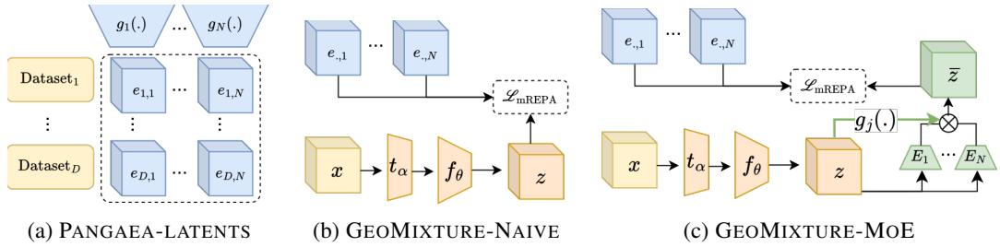  
Figure 1: PANGAEA-LATENTS (a) (Sec. 3.1) is an extension of PANGAEA with frozen embeddings of GFMs. GEOMIXTURE (Sec. 3.3) is a framework aligning a ViT to GFMs through a multirepresentation alignment (mREPA) objective in a single latent (b), or in a Mixture of Experts (c).

Naive vs. mixture of experts. GEOMIXTURE-NAIVE aligns z directly (Fig. 1b). GEOMIXTURE-MOE instead routes it through N experts (Fig. 1c), one per teacher, each $E _ { j } : \mathbb { R } ^ { d }  \mathbb { R } ^ { d }$ a 1DConv → GELU → 1DConv block applied token-wise. A router $W _ { g } \in \mathbb { R } ^ { N \times d }$ , implemented as a 2D convolution over the channel dimension, produces per-location weights over the experts,

$$
g _ { j } ( z ^ { [ s ] } ) = \frac { m _ { j } \exp \bigl ( ( W _ { g } z ^ { [ s ] } ) _ { j } \bigr ) } { \sum _ { k = 1 } ^ { N } m _ { k } \exp \bigl ( ( W _ { g } z ^ { [ s ] } ) _ { k } \bigr ) } , \qquad \bar { z } ^ { [ s ] } = \sum _ { j = 1 } ^ { N } g _ { j } ( z ^ { [ s ] } ) E _ { j } ( z ^ { [ s ] } ) ,\tag{2}
$$

where $m \in \{ 0 , 1 \} ^ { N }$ masks teachers unavailable for the current sample, so weights sum to one at every location. Routing is input-dependent and spatially varying: different regions of a modality may draw on different teachers, while the output retains the backbone width d. We also report GEOMIXTURE-SUM, replacing the router by $g _ { j } = 1$ , summing available experts without reweighting.

Multi-representation alignment. Let $u = z$ for NAIVE, $u = \bar { z }$ for SUM and MOE versions of GEOMIXTURE. Each teacher is matched through a projection $p _ { j } : \mathbb { R } ^ { d }  \mathbb { R } ^ { d _ { j } }$ , a single token-wise 1D convolution that adjusts the width without adding capacity beyond the experts. We minimize

$$
\mathcal { L } _ { \mathrm { m R E P A } } \left( \{ e _ { j } \} _ { j = 1 } ^ { N } , u \right) = \frac { 1 } { P \sum _ { j } m _ { j } } \sum _ { j = 1 } ^ { N } m _ { j } \sum _ { s = 1 } ^ { P } \ell \left( e _ { j } ^ { \left[ s \right] } , p _ { j } \left( u ^ { \left[ s \right] } \right) \right) ,\tag{3}
$$

where ℓ is a discrepancy between two token embeddings. We consider the MSE $\ell _ { \mathrm { m s e } } ( a , b ) = \| a - b \| _ { 2 } ^ { 2 } .$ the negative cosine similarity $\ell _ { \mathrm { c o s } } ( a , b ) = - a ^ { \top } b / ( \| a \| \| b \| )$ , and their sum $\ell _ { \mathrm { m s e } } + \ell _ { \mathrm { c o s } } \left( \mathrm { T a b . 7 } \right)$ . Eq. 3 costs N projections rather than N GFM forward passes, and is normalized across the teachers.

From alignment to evaluation. Alignment supervises only the final block of $f _ { \theta } .$ After training, the projections $p _ { j }$ are discarded and the tokenizer, the backbone and, for the mixture variants, the experts and router are evaluated frozen under the PANGAEA protocol (App. B.2), with a UPerNet decoder reading intermediate stages of $f _ { \theta }$ together with z or z¯. Intermediate representations are thus shaped only indirectly, and the mixture belongs to the evaluated encoder rather than to training alone.

## 4 Experiments and results

Similarity and complementarity. Fig. 2 reports scores aggregated on 11 PANGAEA-LATENTS datasets (per-dataset results in App. F), using standardized CKA as similarity given the limitations of CCA and CKA (Sec. 3.2). In line with Plas et al. [7], GFM embeddings are on average partially similar and complementary, from dissimilar (Scale-MAE×DOFA, 0.26) to highly similar pairs (CROMA×TerraMind-L, 0.83). Both scores depend on the dataset, and similarity does not reliably predict complementarity. Dissimilar pairs can be complementary (Prithvi×DOFA on DynamicEarth-Net, Fig. 5: similarity 0.17, complementarity 0.10), and on Sen1Floods11 (Fig. 10), pairs with similarity 0.36 and 0.70 reach comparable complementarity (0.12–0.16). Yet CROMA×TerraMind-L is not complementary on CropTypeMapping (Fig. 4; similarity 0.77, complementarity −0.03). The complementarity score highlights promising pairs (e.g. Scale-MAE×DOFA on HLSBurnScars, Fig. 7) but becomes unreliable on high-dimensional latents, where ridge regression overfits and is sensitive to regularization (e.g. CROMA self-pair on MADOS, Fig. 8), and it collapses to the majority class on imbalanced datasets (e.g. SpaceNet7, Fig. 11). Overall, global similarity measures may miss the localized latent signals that drive complementarity, which a linear probe may not capture reliably.

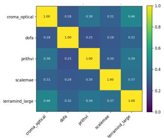  
(a) CCA

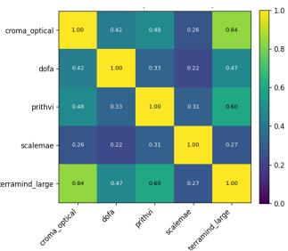  
(b) CKA

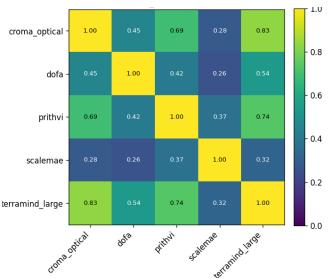  
(c) Standardized CKA

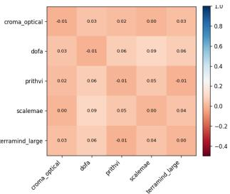  
(d) Complementarity  
Figure 2: Pairwise similarity (Eqs. 4, 5, 1) and complementarity (Eq. 6) between the 5 GFM embeddings, averaged over the 11 datasets of PANGAEA-LATENTS; per-dataset scores in App. F.

Table 1: PANGAEA frozen-encoder evaluation: mIoU as mean ± std over 3 seeds, on nine PANGAEA datasets. Our methods are trained with $\ell _ { \mathrm { m s e } } + \ell _ { \mathrm { c o s } }$ of Eq. 3. Best per dataset in bold, second best is underlined. FiveBillionPixels and Biomassters are omitted, the latter also being scored by RMSE. The full training and evaluation setups are detailed in App. D and B respectively.
<table><tr><td>model</td><td>AI4Farms</td><td>CropMap</td><td>DynEarthNet</td><td>HLSBurns</td><td>MADOS</td><td>PASTIS</td><td>Sen1Floods11</td><td>SN7</td><td>xView2</td><td>Avg mIoU</td><td>Avg rank</td></tr><tr><td>UNet (baseline)</td><td> $\mathbf { 4 5 . 4 1 \pm 0 . 7 1 }$ </td><td> $4 5 . 9 5 \pm 2 . 1 1$ </td><td> $3 3 . 3 2 \pm 1 . 9 6$ </td><td>85.64±0.61</td><td> $5 7 . 6 6 \pm 3 . 0 0$ </td><td>28.56 ± 0.37</td><td>90.88 ± 0.87</td><td> $6 2 . 4 3 \pm 0 . 1 6$ </td><td> $4 2 . 2 1 \pm 2 . 3 2$ </td><td>54.67</td><td>4.33</td></tr><tr><td>CROMA</td><td> $2 7 . 5 9 \pm 0 . 2 7$ </td><td> ${ \bf 5 8 . 4 1 \pm 4 . 5 8 }$ </td><td> $3 0 . 8 0 \pm 1 . 0 7$ </td><td> $8 2 . 5 9 \pm 0 . 2 4$ </td><td> $6 5 . 6 3 \pm 1 . 5 8$ </td><td> $3 8 . 4 9 \pm 0 . 6 9$ </td><td> $9 0 . 0 6 \pm 0 . 2 4$ </td><td> $5 9 . 2 2 \pm 0 . 2 8$ </td><td> $4 0 . 5 2 \pm 0 . 2 0$ </td><td>54.81</td><td>5.22</td></tr><tr><td>DOFA</td><td>27.11 ± 0.37</td><td> $4 7 . 5 3 \pm 5 . 0 2$ </td><td> $3 8 . 9 9 \pm 1 . 1 1 \hphantom { 0 }$ </td><td> $8 0 . 8 6 \pm 0 . 4 5$ </td><td> $\overline { { 6 0 . 5 6 \pm 2 . 6 4 } }$ </td><td>29.53± 0.60</td><td> $8 8 . 2 2 \pm 0 . 2 0 $ </td><td> $6 1 . 0 1 \pm 0 . 1 3$ </td><td> $5 9 . 1 5 \pm 0 . 1 0$ </td><td>54.77</td><td>5.33</td></tr><tr><td>Prithvi</td><td>26.87 ± 0.50</td><td> $4 4 . 9 1 \pm 2 . 4 3$ </td><td> $\overline { { 2 1 . 6 4 \pm 0 . 8 2 } }$ </td><td> $8 3 . 0 8 \pm 0 . 3 6$ </td><td> $5 5 . 0 2 \pm 1 . 4 8$ </td><td> $3 3 . 9 3 \pm 0 . 4 5$ </td><td> $9 0 . 2 0 \pm 0 . 4 4$ </td><td> $5 6 . 5 6 \pm 0 . 2 8$ </td><td> $4 9 . 1 \dot { 7 } \pm 0 . 2 4$ </td><td>51.26</td><td>7.33</td></tr><tr><td>Scale-MAE</td><td> $2 2 . 5 2 \pm 1 . 8 7$ </td><td> $2 5 . 1 8 \pm 1 . 8 7$ </td><td> $3 5 . 9 7 \pm 1 . 7 5$ </td><td>76.56 ± 0.07</td><td> $5 5 . 6 0 \pm 2 . 2 5$ </td><td> $2 4 . 6 1 \pm 0 . 5 5$ </td><td> $7 4 . 8 5 \pm 0 . 0 9$ </td><td> $\mathbf { 6 2 . 5 8 \pm 0 . 5 0 }$ </td><td> ${ \bf 6 0 . 0 5 \pm 0 . 1 6 }$ </td><td>48.66</td><td>6.67</td></tr><tr><td>TerraMind-L</td><td> $2 6 . 9 8 \pm 0 . 5 4$ </td><td> $5 4 . 6 7 \pm 2 . 8 2$ </td><td>35.22 ± 1.42</td><td> $8 3 . 4 1 \pm 0 . 1 5$ </td><td> ${ \bf 7 0 . 9 9 \pm 2 . 3 1 }$ </td><td> ${ \bf 4 2 . 5 4 \pm 0 . 4 4 }$ </td><td> $9 0 . 7 8 \pm 0 . 1 3 $ </td><td> $6 0 . 2 2 \pm 0 . 7 0$ </td><td> $4 8 . 6 7 \pm 0 . 3 7$ </td><td>57.05</td><td>3.89</td></tr><tr><td>GEOMIXTURE-NAIVE</td><td> $2 7 . 0 5 \pm 0 . 3 6$ </td><td> $5 0 . 3 1 \pm 0 . 9 6$ </td><td> $\mathbf { 4 0 . 1 4 \pm 0 . 9 5 }$ </td><td> $8 3 . 2 1 \pm 0 . 1 4$ </td><td>56.55 ± 4.79</td><td> $3 8 . 1 2 \pm 0 . 5 5$ </td><td> $9 0 . 2 7 \pm 0 . 2 1$ </td><td> $6 1 . 6 2 \pm 0 . 3 7$ </td><td> $5 9 . 2 0 \pm 0 . 3 6$ </td><td>56.27</td><td>4.00</td></tr><tr><td>GEOMIXTURE-SUM</td><td> $2 7 . 0 5 \pm 0 . 1 5$ </td><td> $5 3 . 6 2 \pm 2 . 8 6$ </td><td>38.22 ± 1.00</td><td>83.20 ± 0.66</td><td>56.49 ± 0.91</td><td> $3 8 . 5 1 \pm 0 . 2 1$ </td><td> $9 0 . 2 5 \pm 0 . 2 8$ </td><td> $6 1 . 7 2 \pm 0 . 1 9$ </td><td> $5 9 . 3 1 \pm 0 . 3 0$ </td><td>56.49</td><td>3.89</td></tr><tr><td>GEOMIXTURE-MOE</td><td> $2 6 . 9 5 \pm 0 . 4 9$ </td><td> $4 9 . 7 9 \pm 1 . 1 2$ </td><td> $3 7 . 7 7 \pm 0 . 0 6$ </td><td>83.49 ± 0.14</td><td> $5 7 . 2 6 \pm 2 . 2 5$ </td><td> $\overline { { 3 8 . 0 4 \pm 0 . 3 2 } }$ </td><td> $9 0 . 1 0 { \scriptstyle \pm 0 . 3 1 }$ </td><td> $6 1 . 8 3 \pm 0 . 0 8$ </td><td>59.39 ± 0.28</td><td>56.07</td><td>4.33</td></tr></table>

PANGAEA evaluation. We follow the PANGAEA protocol (App. B) with 3 seeds (Tab. 1): encoders are frozen with a supervised UPerNet decoder, and the UNet is trained end-to-end. GEOMIXTURE is aligned on the unlabeled training images of each PANGAEA-LATENTS dataset, unseen by the GFMs during pretraining. GEOMIXTURE-SUM ties TerraMind-L for the best average rank (3.89), and all variants outperform four of the five GFMs. TerraMind-L keeps the best average mIoU (57.05 vs. 56.49) only thanks to MADOS, without which all variants surpass it. No model dominates, but GEOMIXTURE is more consistent: GEOMIXTURE-NAIVE is never ranked below sixth, whereas TerraMind-L ranks first or second on four datasets but sixth or seventh on four others. GEOMIXTURE trails most where one GFM clearly leads the others, i.e. on MADOS, PASTIS and CropTypeMapping (−4.0 to −14.5 mIoU w.r.t. the best GFM), where aligning to a consensus is most costly. Experts yield the best variant, GEOMIXTURE-SUM (no trained gate), but learning the gate (GEOMIXTURE-MOE) brings no further gain, and variants mostly remain within one standard deviation. The objective matters as shown by our loss ablation study (App. E, Tab. 7): $\ell _ { \mathrm { c o s } }$ is best on MADOS but worst on HLSBurnScars for every variant, and $\ell _ { \mathrm { m s e } } + \ell _ { \mathrm { c o s } }$ gives every variant its best average rank.

Frozen GFMs and a supervised baseline. With fewer parameters than the UPerNet decoder alone, the UNet wins three datasets and outranks four of the five GFMs, partly through AI4SmallFarms (45.41 vs. at most 27.59 mIoU for frozen encoders). Frozen GFMs thus do not yet consistently surpass supervised training, but all GEOMIXTURE variants exceed the UNet in average mIoU.

## 5 Conclusion and future work

We introduced PANGAEA-LATENTS, an extension of PANGAEA supporting research on GFM representation alignment, and GEOMIXTURE, aligning a single ViT to five GFMs through a multirepresentation alignment objective. Aligned to several teachers, GEOMIXTURE ties the best GFM in average rank and is more consistent across datasets, while ranking first on only one. Two limitations bound these results. Alignment is performed per dataset, so the student sees the target imagery, without labels, while the GFMs do not; the comparison measures how well a representation can be specialized rather than how well it transfers. The evaluation also covers nine of eleven datasets, and the alignment loss, which is not a neutral choice, is ablated on only five. In future work, we will complete the benchmark, explore additional losses, and scale to additional GFMs [23, 14, 19, 21, 24, 17, 18], including AlphaEarth [9], which releases embeddings but no backbone. Aligning on a large multimodal corpus [14] rather than per dataset would remove the specialization confound and test whether a single GEOMIXTURE encoder transfers across the benchmark.

## Acknowledgments and Disclosure of Funding

This project was supported thanks to funding from IVADO, the Canada CIFAR AI Chairs program, and the Sloan Fellowship program. We thank Mila – Quebec AI Institute (mila.quebec) for supporting this project with compute resources and technical help.

## References

[1] Xiao Xiang Zhu, Zhitong Xiong, Yi Wang, Adam J. Stewart, Konrad Heidler, Yuanyuan Wang, Zhenghang Yuan, Thomas Dujardin, Qingsong Xu, and Yilei Shi. On the foundations of Earth foundation models. Communications Earth & Environment, 7(1):103, January 2026. ISSN 2662-4435. doi: 10.1038/s43247-025-03127-x. URL https://www.nature.com/ articles/s43247-025-03127-x. 1

[2] Konstantin Klemmer, Esther Rolf, Marc Russwurm, Gustau Camps-Valls, Mikolaj Czerkawski, Stefano Ermon, Alistair Francis, Nathan Jacobs, Hannah Kerner, Lester Mackey, Gengchen Mai, Oisin Mac Aodha, Markus Reichstein, Caleb Robinson, David Rolnick, Evan Shelhamer, Vincent Sitzmann, Devis Tuia, and Xiaoxiang Zhu. Earth Embeddings: Toward artificial intelligence-centric representations of our planet. IEEE Geoscience and Remote Sensing Magazine, pages 2–15, 2026. ISSN 2168-6831, 2473-2397. doi: 10.1109/MGRS.2026.3710416. URL https://ieeexplore.ieee.org/document/11636001/. 1

[3] Alexandre Lacoste, Nils Lehmann, Pau Rodriguez, Evan David Sherwin, Hannah Kerner, Björn Lütjens, Jeremy Andrew Irvin, David Dao, Hamed Alemohammad, Alexandre Drouin, Mehmet Gunturkun, Gabriel Huang, David Vazquez, Dava Newman, Yoshua Bengio, Stefano Ermon, and Xiao Xiang Zhu. GEO-Bench: Toward Foundation Models for Earth Monitoring, June 2023. URL http://arxiv.org/abs/2306.03831. arXiv:2306.03831 [cs]. 1

[4] Valerio Marsocci, Yuru Jia, Georges Le Bellier, David Kerekes, Liang Zeng, Sebastian Hafner, Sebastian Gerard, Eric Brune, Ritu Yadav, Ali Shibli, Heng Fang, Yifang Ban, Maarten Vergauwen, Nicolas Audebert, and Andrea Nascetti. PANGAEA: A Global and Inclusive Benchmark for Geospatial Foundation Models, 2025. URL https://arxiv.org/abs/2412.04204. \_eprint: 2412.04204. 1, 2, 9

[5] Nikolaos Ioannis Bountos, Arthur Ouaknine, Ioannis Papoutsis, and David Rolnick. FoMo: Multi-Modal, Multi-Scale and Multi-Task Remote Sensing Foundation Models for Forest Monitoring. Proceedings of the AAAI Conference on Artificial Intelligence, 39(27):27858– 27868, April 2025. ISSN 2374-3468, 2159-5399. doi: 10.1609/aaai.v39i27.35002. URL https://ojs.aaai.org/index.php/AAAI/article/view/35002. 1

[6] Isaac Corley, Nils Lehmann, Caleb Robinson, Gabriel Tseng, Anthony Fuller, Hamed Alemohammad, Evan Shelhamer, Jennifer Marcus, and Hannah Kerner. No One Knows the State of the Art in Geospatial Foundation Models, May 2026. URL http://arxiv.org/abs/2605. 12678. arXiv:2605.12678 [cs.CV]. 1

[7] Thijs L. van der Plas, Jacob JW Bakermans, Vishal Nedungadi, Gabriele Tij ˙ unaityt ¯ e, Marc ˙ Rußwurm, and Ioannis N. Athanasiadis. Better Together: Evaluating the Complementarity of Earth Embedding Models, May 2026. URL http://arxiv.org/abs/2605.18667. arXiv:2605.18667 [cs.CV]. 1, 2, 3, 9

[8] Joelle Hanna, Damian Falk, Stella X. Yu, and Damian Borth. GeoSANE: Learning Geospatial Representations from Models, Not Data, March 2026. URL http://arxiv.org/abs/2603. 23408. arXiv:2603.23408 [cs]. 1, 2

[9] Christopher F. Brown, Michal R. Kazmierski, Valerie J. Pasquarella, William J. Rucklidge, Masha Samsikova, Chenhui Zhang, Evan Shelhamer, Estefania Lahera, Olivia Wiles, Simon Ilyushchenko, Noel Gorelick, Lihui Lydia Zhang, Sophia Alj, Emily Schechter, Sean Askay, Oliver Guinan, Rebecca Moore, Alexis Boukouvalas, and Pushmeet Kohli. AlphaEarth Foundations: An embedding field model for accurate and efficient global mapping from sparse label data, 2025. URL https://arxiv.org/abs/2507.22291. \_eprint: 2507.22291. 1, 4

[10] Zhitong Xiong, Yi Wang, Fahong Zhang, Adam J. Stewart, Joëlle Hanna, Damian Borth, Ioannis Papoutsis, Bertrand Le Saux, Gustau Camps-Valls, and Xiao Xiang Zhu. Neural Plasticity-Inspired Multimodal Foundation Model for Earth Observation, October 2025. URL http://arxiv.org/abs/2403.15356. arXiv:2403.15356 [cs.CV]. 1, 2

[11] Johannes Jakubik, Felix Yang, Benedikt Blumenstiel, Erik Scheurer, Rocco Sedona, Stefano Maurogiovanni, Jente Bosmans, Nikolaos Dionelis, Valerio Marsocci, Niklas Kopp, Rahul Ramachandran, Paolo Fraccaro, Thomas Brunschwiler, Gabriele Cavallaro, Juan Bernabe-Moreno, and Nicolas Longépé. TerraMind: Large-Scale Generative Multimodality for Earth Observation. In Proceedings ofthe IEEE/CVF International Conference on Computer Vision (ICCV), pages 7383–7394, October 2025. 1, 2

[12] Theodor Forgaard, Jarle H. Reksten, Anders U. Waldeland, Valerio Marsocci, Nicolas Longépé, Michael Kampffmeyer, and Arnt-Børre Salberg. THOR: A Versatile Foundation Model for Earth Observation Climate and Society Applications, 2026. URL https://arxiv.org/abs/ 2601.16011. \_eprint: 2601.16011. 1

[13] Anthony Fuller, Koreen Millard, and James R. Green. CROMA: Remote Sensing Representations with Contrastive Radar-Optical Masked Autoencoders. In Thirty-seventh Conference on Neural Information Processing Systems, 2023. URL https://openreview.net/forum?id= ezqI5WgGvY. 1, 2

[14] Gabriel Tseng, Anthony Fuller, Marlena Reil, Henry Herzog, Patrick Beukema, Favyen Bastani, James R. Green, Evan Shelhamer, Hannah Kerner, and David Rolnick. Galileo: Learning Global & Local Features of Many Remote Sensing Modalities. In Forty-second International Conference on Machine Learning, 2025. URL https://openreview.net/forum?id=gqZO3eSZRy. 1, 4

[15] Henry Herzog, Favyen Bastani, Yawen Zhang, Gabriel Tseng, Joseph Redmon, Hadrien Sablon, Ryan Park, Jacob Morrison, Alexandra Buraczynski, Karen Farley, Joshua Hansen, Andrew Howe, Patrick Alan Johnson, Mark Otterlee, Ted Schmitt, Hunter Pitelka, Stephen Daspit, Rachel Ratner, Christopher Wilhelm, Sebastian Wood, Mike Jacobi, Hannah Kerner, Evan Shelhamer, Ali Farhadi, Ranjay Krishna, and Patrick Beukema. OlmoEarth: Stable Latent Image Modeling for Multimodal Earth Observation, 2025. URL https://arxiv.org/abs/ 2511.13655. \_eprint: 2511.13655. 1

[16] Guillaume Astruc, Nicolas Gonthier, Clement Mallet, and Loic Landrieu. OmniSat: Selfsupervised Modality Fusion for Earth Observation. In Aleš Leonardis, Elisa Ricci, Stefan Roth, Olga Russakovsky, Torsten Sattler, and Gül Varol, editors, Computer Vision – ECCV 2024, volume 15086, pages 409–427. Springer Nature Switzerland, Cham, 2025. ISBN 978-3-031-73389-5 978-3-031-73390-1. doi: 10.1007/978-3-031-73390-1\_24. URL https: //link.springer.com/10.1007/978-3-031-73390-1\_24. Series Title: Lecture Notes in Computer Science. 1

[17] Gabriel Tseng, Yawen Zhang, Favyen Bastani, Henry Herzog, Joseph Redmon, Hadrien Sablon, Piper Wolters, Patrick Alan Johnson, Christopher Wilhelm, and Patrick Beukema. OlmoEarth v1.1: A more efficient family of OlmoEarth models, 2026. URL https://arxiv.org/abs/ 2605.20804. Version Number: 1. 1, 4

[18] Zhengpeng Feng, Clement Atzberger, Sadiq Jaffer, Jovana Knezevic, Silja Sormunen, Robin Young, Madeline C. Lisaius, Markus Immitzer, Toby Jackson, James Ball, David A. Coomes, Anil Madhavapeddy, Andrew Blake, and Srinivasan Keshav. TESSERA: Temporal Embeddings of Surface Spectra for Earth Representation and Analysis. In Proceedings of the IEEE/CVF Conference on Computer Vision and Pattern Recognition (CVPR), pages 34818–34831, June 2026. 1, 4

[19] Guillaume Astruc, Nicolas Gonthier, Clément Mallet, and Loic Landrieu. AnySat: One Earth Observation Model for Many Resolutions, Scales, and Modalities. In Proceedings of the IEEE/CVF Conference on Computer Vision and Pattern Recognition (CVPR), pages 19530– 19540, June 2025. 1, 4

[20] Caleb Reed, Sumit Gupta, Shufan Li, Salvador Mayorga, Marcela Cristia, Michal Koziarski, Anima Anandkumar, and Skanda Koppula. Scale-MAE: A Scale-Aware Masked Autoencoder for Multiscale Geospatial Representation Learning. In Proceedings ofthe IEEE/CVF International Conference on Computer Vision (ICCV), pages 3010–3021, October 2023. 2

[21] Nicolas Houdré, Diego Marcos, Hugo Riffaud de Turckheim, Dino Ienco, Laurent Wendling, Camille Kurtz, and Sylvain Lobry. RAMEN: Resolution-Adjustable Multimodal Encoder for Earth Observation, 2025. URL https://arxiv.org/abs/2512.05025. \_eprint: 2512.05025. 2, 4

[22] Daniela Szwarcman, Sujit Roy, Paolo Fraccaro, Þorsteinn Elí Gíslason, Benedikt Blumenstiel, Rinki Ghosal, Pedro Henrique De Oliveira, Joao Lucas De Sousa Almeida, Rocco Sedona, Yanghui Kang, Srija Chakraborty, Sizhe Wang, Carlos Gomes, Ankur Kumar, Vishal Gaur, Myscon Truong, Denys Godwin, Sam Khallaghi, Hyunho Lee, Chia-Yu Hsu, Ata Akbari Asanjan, Besart Mujeci, Disha Shidham, Rufai Omowunmi Balogun, Venkatesh Kolluru, Trevor Keenan, Paulo Arevalo, Wenwen Li, Hamed Alemohammad, Pontus Olofsson, Timothy Mayer, Christopher Hain, Robert Kennedy, Bianca Zadrozny, David Bell, Gabriele Cavallaro, Campbell Watson, Manil Maskey, Rahul Ramachandran, and Juan Bernabe Moreno. Prithvi-EO-2.0: A Versatile Multitemporal Foundation Model for Earth Observation Applications. IEEE Transactions on Geoscience and Remote Sensing, 64:1–20, 2026. ISSN 0196-2892, 1558-0644. doi: 10.1109/TGRS.2025.3642610. URL https://ieeexplore.ieee.org document/11296896/. 2

[23] Danfeng Hong, Bing Zhang, Xuyang Li, Yuxuan Li, Chenyu Li, Jing Yao, Naoto Yokoya, Hao Li, Pedram Ghamisi, Xiuping Jia, Antonio Plaza, Paolo Gamba, Jon Atli Benediktsson, and Jocelyn Chanussot. SpectralGPT: Spectral Remote Sensing Foundation Model. IEEE Transactions on Pattern Analysis and Machine Intelligence, pages 1–18, 2024. ISSN 0162-8828, 2160-9292, 1939-3539. doi: 10.1109/TPAMI.2024.3362475. URL http://arxiv.org/abs/ 2311.07113. arXiv:2311.07113 [cs]. 2, 4

[24] Konstantin Klemmer, Esther Rolf, Caleb Robinson, Lester Mackey, and Marc Rußwurm. SatCLIP: Global, General-Purpose Location Embeddings with Satellite Imagery. Proceedings ofthe AAAI Conference on Artificial Intelligence, 39(4):4347–4355, April 2025. ISSN 2374- 3468, 2159-5399. doi: 10.1609/aaai.v39i4.32457. URL https://ojs.aaai.org/index. php/AAAI/article/view/32457. 2, 4

[25] Yingying Zhang, Lixiang Ru, Kang Wu, Lei Yu, Lei Liang, Yansheng Li, and Jingdong Chen. SkySense V2: A Unified Foundation Model for Multi-modal Remote Sensing, July 2025. URL http://arxiv.org/abs/2507.13812. arXiv:2507.13812 [cs]. 2

[26] Minyoung Huh, Brian Cheung, Tongzhou Wang, and Phillip Isola. Position: The Platonic Representation Hypothesis. In Ruslan Salakhutdinov, Zico Kolter, Katherine Heller, Adrian Weller, Nuria Oliver, Jonathan Scarlett, and Felix Berkenkamp, editors, Proceedings of the 41st International Conference on Machine Learning, volume 235 of Proceedings ofMachine Learning Research, pages 20617–20642. PMLR, July 2024. URL https://proceedings. mlr.press/v235/huh24a.html. 2

[27] Mike Ranzinger, Greg Heinrich, Jan Kautz, and Pavlo Molchanov. AM-RADIO: Agglomerative Vision Foundation Model Reduce All Domains Into One. In Proceedings of the IEEE/CVF Conference on Computer Vision and Pattern Recognition (CVPR), pages 12490–12500, June 2024. 2

[28] Mert Bülent Sarıyıldız, Philippe Weinzaepfel, Thomas Lucas, Diane Larlus, and Yannis Kalantidis. UNIC: Universal Classification Models via Multi-teacher Distillation. In Aleš Leonardis, Elisa Ricci, Stefan Roth, Olga Russakovsky, Torsten Sattler, and Gül Varol, editors, Computer Vision – ECCV 2024, volume 15062, pages 353–371. Springer Nature Switzerland, Cham, 2025. ISBN 978-3-031-73234-8 978-3-031-73235-5. doi: 10.1007/978-3-031-73235-5\_20. URL https://link.springer.com/10.1007/978-3-031-73235-5\_20. Series Title: Lecture Notes in Computer Science. 2

[29] Sihyun Yu, Sangkyung Kwak, Huiwon Jang, Jongheon Jeong, Jonathan Huang, Jinwoo Shin, and Saining Xie. Representation Alignment for Generation: Training Diffusion Transformers Is

Easier Than You Think. In The Thirteenth International Conference on Learning Representations, 2025. URL https://openreview.net/forum?id=DJSZGGZYVi. 2

[30] Simon Kornblith, Mohammad Norouzi, Honglak Lee, and Geoffrey Hinton. Similarity of Neural Network Representations Revisited. In Kamalika Chaudhuri and Ruslan Salakhutdinov, editors, Proceedings ofthe 36th International Conference on Machine Learning, volume 97 of Proceedings ofMachine Learning Research, pages 3519–3529. PMLR, June 2019. URL https://proceedings.mlr.press/v97/kornblith19a.html. 2, 9

[31] MohammadReza Davari, Stefan Horoi, Amine Natik, Guillaume Lajoie, Guy Wolf, and Eugene Belilovsky. Reliability of CKA as a Similarity Measure in Deep Learning. In The Eleventh International Conference on Learning Representations, 2023. URL https://openreview. net/forum?id=8HRvyxc606. 2

## A Similarity and complementarity metrics

Similarity scores. Let $e _ { i , k } = X \in \mathbb { R } ^ { n \times d _ { k } }$ and $e _ { i , l } = Y \in \mathbb { R } ^ { n \times d _ { l } }$ be two GFM embeddings for a dataset $i \in \{ 1 , \cdots , D \}$ . We first quantified latent similarities with canonical correlation analysis (CCA) used for neural network representation similarities [30],

$$
R _ { \mathrm { C C A } } ^ { 2 } ( X , Y ) = \frac { \| Q _ { X } ^ { \top } Q _ { Y } \| _ { F } ^ { 2 } } { \operatorname* { m i n } ( d _ { k } , d _ { l } ) } ,\tag{4}
$$

where $Q _ { X } \ : = \ : X ( X ^ { \top } X ) ^ { - 1 / 2 }$ and $Q _ { Y } = Y ( Y ^ { \top } Y ) ^ { - 1 / 2 }$ their orthonormal bases, and $\left\| \cdot \right\| _ { F }$ the Frobenius norm.

We considered the linear centered kernel alignment (CKA) used to compare multivariate features [30],

$$
\operatorname { C K A } ( X , Y ) = { \frac { \| Y ^ { \top } X \| _ { F } ^ { 2 } } { \| X ^ { \top } X \| _ { F } \| Y ^ { \top } Y \| _ { F } } } .\tag{5}
$$

where X and $Y$ are centered towards the column-wise average. The standardized CKA is defined in Sec. $3 . 2 ( \mathrm { E q . 1 } )$

Complementarity score. Following Plas et al. [7], we measure the complementarity of two embeddings X and $Y$ as

$$
{ \mathrm { c o m p l } } ( X , Y ) = { \frac { S ( X \oplus Y ) - S ^ { \star } } { S _ { \mathrm { b e s t } } - S ^ { \star } } } ,\tag{6}
$$

where ⊕ denotes concatenation along the feature dimension, $S ( \cdot )$ is the score of a probe trained on the given embeddings, $S ^ { \star }$ is the score of the better of the two individual probes $( \operatorname* { m a x } ( S ( X ) , S ( Y ) )$ for higher-is-better metrics such as F1, min for lower-is-better ones such as RMSE), and $S _ { \mathrm { b e s t } }$ is the best attainable value of the metric (e.g. 1 for F1, 0 for RMSE). The score is the fraction of the remaining headroom recovered by concatenation of the embeddings: it is positive when combining $X$ and $\bar { Y }$ improves over the better individual probe, reaches 1 when the combined probe attains $S _ { \mathrm { b e s t } }$ , and is negative when concatenation degrades performance. All probes are ridge regressions whose regularization strength is selected by 4-fold cross-validation in $\{ 1 \dot { 0 } ^ { - 3 } , 1 0 ^ { - 2 } , 1 0 ^ { - 1 } , 1 , \stackrel { \smile } { 1 0 } , 1 0 0 \}$ scaled by the training-set size, per GFM pair and per dataset. Even so, the probe on concatenated embeddings can overfit high-dimensional latents (e.g. MADOS, Fig. 8), making the score sensitive to this choice.

## B The PANGAEA benchmark

We evaluate on PANGAEA [4], a standardized benchmark for geospatial foundation models (GFMs) spanning eleven downstream datasets, four sensor families, three task types, ground sampling distances from sub-metre to 30 m, and single-date, bi-temporal and time-series inputs. We use the released dataset splits (except for the deviations listed in Sec. B.3), preprocessing, decoders, optimization and metrics. Section B.1 describes each dataset, Section B.2 states which evaluation recipe applies to which setup, and Section B.3 lists our deviations.

## B.1 Datasets

Table 2 summarises the eleven datasets. Sample counts are the lengths of the benchmark’s own loaders on our copy of the data, measured per split; these are the quantities that are used for training and evaluation, which for two datasets differs from the number of distinct scenes (see the table footnotes).

MADOS. Marine Debris and Oil Spill detection from Sentinel-2. Each sample is a $2 4 0 \times 2 4 0$ single-date patch of ACOLITE-processed Rayleigh-corrected reflectance, with eleven spectral bands (B1–B8, B8A, B11, B12) resampled to a 10 m grid, and a 15-class label map covering floating litter, algal and organic slicks, oil spills, ships and platforms, and several water types. The annotation is sparse where most pixels carry the ignore index, so the benchmark crops around labelled pixels rather than uniformly at random (Sec. B.2). Classes are strongly imbalanced: marine water, sediment laden water and oil spill account for 74% of labelled pixels, while marine debris, foam and jellyfish each fall below 1%. The dataset probes fine-grained spectral discrimination of globally distributed, low-prevalence targets.

Table 2: The eleven PANGAEA datasets. Mod. is the modality set returned to the encoder (O = optical, S = SAR); T the number of time steps the loader returns; C the number of label classes as declared by the benchmark (C = 1 denotes a single-logit binary mask, or, for BioMassters, a continuous target). Size is the scene size the loader yields. Splits are train/val/test sample counts.
<table><tr><td>Dataset</td><td>Sensor(s)</td><td>Domain / task</td><td>Mod.</td><td>GSD (m)1</td><td>Size</td><td>T</td><td>C</td><td>Splits</td></tr><tr><td>MADOS</td><td>Sentinel-2</td><td>Marine pollution, seg.</td><td>0</td><td>10</td><td>2402</td><td>1</td><td>15</td><td>1433/642/728</td></tr><tr><td>HLSBurnScars</td><td>HLS (L8 + S2)</td><td>Wildfire, seg.</td><td>0</td><td>30</td><td>5122</td><td>1</td><td>2</td><td>486/54/264</td></tr><tr><td>Sen1Floods11</td><td>Sentinel-1/2</td><td>Flood, seg.</td><td>O+S</td><td>10</td><td>5122</td><td>1</td><td>2</td><td>252/89/90</td></tr><tr><td>AI4SmallFarms</td><td>Sentinel-2</td><td>Field boundaries, seg.</td><td>0</td><td>10</td><td>4962</td><td>1</td><td>1</td><td>43/9/10</td></tr><tr><td>CropTypeMapping</td><td>Sentinel-1/2</td><td>Crop type, seg.</td><td>O+S</td><td>10</td><td>642</td><td>6</td><td>4</td><td>554/66/67</td></tr><tr><td>PASTIS</td><td>Sentinel-1/2</td><td>Crop type, seg.</td><td>O+S</td><td>10</td><td>1282</td><td>6</td><td>20</td><td>1455/482/496</td></tr><tr><td>DynamicEarthNet</td><td>PlanetFusion</td><td>Land cover, seg.</td><td>0</td><td>3</td><td>1024²</td><td>6</td><td>6</td><td>936/192/192</td></tr><tr><td>FiveBillionPixels</td><td>Gaofen-2</td><td>Land cover, seg.</td><td>0</td><td>4</td><td>5202</td><td>1</td><td>25</td><td>19110/4004/4186</td></tr><tr><td>SpaceNet7</td><td>Planet</td><td>Urban growth, CD</td><td>0</td><td>≈4</td><td>2562</td><td>2</td><td>1</td><td>480/240/224</td></tr><tr><td>xView2 (xBD)</td><td>Maxar</td><td>Building damage, CD</td><td>0</td><td>≤ 0.8</td><td>10242</td><td>2</td><td>5</td><td>13384/917/933</td></tr><tr><td>BioMassters</td><td>Sentinel-1/2</td><td>Biomass, regression</td><td>O+S</td><td>10</td><td>2562</td><td>12</td><td>1</td><td>7820/869/2773</td></tr></table>

HLSBurnScars. Burn-scar delineation on Harmonized Landsat and Sentinel-2 (HLS) surface reflectance over the United States. Scenes are 512 × 512 at 30 m with six bands (B2, B3, B4, B8A, B11, B12) and a binary label (burned / not burned, ≈ 11% positive). The benchmark’s test split is the release’s held-out validation set; its train and validation splits are a fixed 90/10 random partition of the release’s training set. It is the only 30 m dataset in the benchmark and therefore the main test of transfer across ground sampling distance.

Sen1Floods11. Flood-water mapping from co-registered Sentinel-1 GRD and Sentinel-2 L1C acquisitions of eleven flood events worldwide. The benchmark uses the hand-labelled subset: 512 × 512 scenes with 13 optical bands and two SAR polarisations (VV, VH), and a binary water mask (≈ 9.5% positive). Because SAR penetrates cloud while optical does not, it is the benchmark’s cleanest measure of multi-modal fusion; an encoder can be evaluated on either modality alone or on both.

AI4SmallFarms. Smallholder field-boundary delineation in Cambodia and Vietnam from Sentinel-2 (B2, B3, B4, B8), 496 × 496 scenes, a single binary crop-field mask (≈ 27% positive). With 62 scenes in total it is by far the smallest dataset in the benchmark and the one most sensitive to the quality of the frozen representation, since the decoder has very little data from which to recover. It is the only dataset for which the benchmark replicates the data loader, visiting each train and validation scene twice per epoch.

CropTypeMapping (South Sudan). Crop-type segmentation from paired Sentinel-1 and Sentinel-2 time series over South Sudan, using the release’s official partition. Each sample is a 64 × 64 scene with ten optical bands and two SAR polarisations; the acquisition series is truncated or zero-padded to exactly T = 6 steps. Only the four most frequent crop types (sorghum, maize, rice, groundnut) are retained, every other pixel is mapped to the ignore index, and sorghum alone covers 68% of the labelled pixels. Although the benchmark’s documentation lists Planet among the sensors, its loader returns only the Sentinel-1 and Sentinel-2 arrays. The scenes are far smaller than any encoder’s input resolution, so they are resized rather than cropped, and evaluated whole rather than by sliding window. It combines multi-temporal and multi-modal axes of the benchmark at the smallest spatial support.

PASTIS. Agricultural parcel classification in France from Sentinel-2 and ascending-orbit Sentinel-1 time series, using the official five-fold partition (folds 1-3 train, 4 validation, 5 test). Samples are 128 × 128 patches with ten optical bands and three SAR channels (VV, VH, VV−VH); T = 6 frames are drawn evenly spaced across each patch’s acquisition series. The label space has 20 entries: a background class, 18 crop classes, and a void label that serves as the ignore index and itself covers

29% of pixels. Class frequencies among the evaluated classes span nearly two orders of magnitude, from meadow (26%) to potatoes (0.5%). The loader also opens each patch’s SPOT-6 aerial tile, which must therefore be present on disk, but does not return it. PASTIS is the benchmark reference test of temporal modelling: crop types are separable mainly through their phenological trajectory, not through any single date.

DynamicEarthNet. Land-cover mapping from PlanetFusion daily surface-reflectance mosaics at 3 m. A sample is one labelled month of one 1024 × 1024 cube: the benchmark feeds the first six daily mosaics of that month (T = 6, four bands: blue, green, red, NIR) and predicts the month’s six-class land-cover map (impervious surface, agriculture, forest and other vegetation, wetlands, soil, water); the release’s seventh label band, snow and ice, becomes the ignore index. Because DynamicEarthNet withheld its official validation and test labels for its challenge, any usable partition divides the 55 publicly labelled cubes; the benchmark uses a published cube-level split (39/8/8 cubes over 24 labelled months each). Wetlands is $\mathbf { a } \approx 0 . 3 \%$ class in our measurements, the value published in the benchmark’s configuration (7%) is inconsistent with the data, so its per-class IoU is noisy and depresses mIoU independently of model quality; per-class IoU is the more informative comparison on this dataset.

FiveBillionPixels. Urban and peri-urban land cover in China from Gaofen-2 imagery at 4 m, four bands in NIR-R-G-B order. The benchmark evaluates non-overlapping 520 × 520 crops of the original large scenes, with 25 land-cover classes of which the unlabeled class is the ignore index. At 27,300 crops it is the largest segmentation dataset and, with 24 evaluated classes, the one with the finest-grained label space.

SpaceNet 7. Urban development from Planet monthly mosaics at ≈4 m, globally distributed. The benchmark evaluates this dataset as binary change detection: each 1024 × 1024 scene is tiled into sixteen 256 × 256 tiles, two acquisitions of a tile are encoded, and a single change mask is predicted, the mask being the pixelwise difference between the building-footprint rasters of the two dates. Train, validation and test are 30, 15 and 14 disjoint areas of interest, so the split is geographic. The temporal pair is drawn differently per split: training samples a random pair at least five acquisitions apart, while validation and test use a fixed, deterministic pairing.

xView2. Building-damage assessment from sub-metre Maxar RGB imagery over disasters worldwide. Each sample stacks a pre-event and a post-event acquisition into a (3, 2, 1024, 1024) tensor; the target is the post-event mask with five classes: no building, and four ordinal damage levels (no damage, minor, major, destroyed). Unlike SpaceNet7 the change is typed rather than binary, so the paired representation must carry damage severity, not merely difference. The benchmark oversamples training scenes containing damage, which is why the training loader is longer than the number of distinct pairs.

BioMassters. Above-ground biomass regression over Finnish forests from Sentinel-1 and Sentinel-2. Each sample is a 256 × 256 scene with T = 12 monthly composites, ten optical bands plus a Sentinel-2 cloud-probability channel, and four SAR channels (ascending and descending VV/VH); months with no acquisition are filled with zeros. The target is continuous, so the benchmark trains with MSE, reports RMSE, and normalizes inputs by published minima and maxima rather than by mean and standard deviation. It is the only regression task, the only 12-step series, and the only dataset whose metric is lower-is-better.

## B.2 Evaluation protocol

PANGAEA evaluates a foundation model as afrozen feature extractor: the encoder’s weights are never updated and only a task decoder is trained on its multi-scale features. The recipe is determined by three properties of the (encoder, dataset) pair, the task type (whether the loader returns a time series), and which modalities the two share, and is otherwise identical across the grid. Table 3 gives the mapping.

Decoders. Single-date segmentation uses a UPerNet head with 512 channels over the encoder’s feature pyramid. For multi-temporal datasets (CropTypeMapping, PASTIS, DynamicEarthNet,

Table 3: Which evaluation components are used for which setup. T is the number of time steps returned by the loader. The from-scratch UNet baseline is the only model trained end-to-end.
<table><tr><td>Task</td><td>Temporality</td><td>Decoder (frozen GFM)</td><td>Loss</td></tr><tr><td>Segmentation</td><td> $T = 1$ </td><td>UPerNet</td><td>Cross-entropy (C &gt; 1) / Dice (C = 1)</td></tr><tr><td>Segmentation</td><td> $T > 1$ </td><td>UPerNet + L-TAE temporal fusion</td><td>Cross-entropy</td></tr><tr><td>Change detection</td><td> $T = 2$ </td><td>Siamese-concatenation UPerNet</td><td>Cross-entropy (C &gt; 1) / Dice (C = 1)</td></tr><tr><td>Regression</td><td> $T = 1$ </td><td>Regression UPerNet</td><td>MSE</td></tr><tr><td>Regression</td><td> $T > 1$ </td><td>Regression UPerNet + L-TAE</td><td>MSE</td></tr></table>

UNet baseline (trained from scratch): UNet / Siamese UNet / regression UNet; time steps folded into channels.

BioMassters) the frozen encoder is applied independently to each time step and the resulting sequence of feature maps is fused by a lightweight temporal attention encoder (L-TAE) before the UPerNet head; this is what allows single-date foundation models to be evaluated on time series at all. Change detection (SpaceNet7, xView2) uses a Siamese UPerNet that encodes both acquisitions with the same frozen weights and concatenates their features before decoding. Regression replaces the classification head with a regression UPerNet. The from-scratch UNet baseline brings its own decoder family and, being a convolutional network without a multi-scale token grid, handles time by folding the temporal axis into the input channels. In every case the decoder’s logits are bilinearly interpolated to the target’s spatial size before the loss and the metrics are computed.

Input adaptation. Every scene is reduced to the encoder’s expected input (224 px for DOFA, Prithvi, Scale-MAE and TerraMind, 120 px for CROMA), and the native scene size for UNet by one of three policies. Scenes larger than the encoder input are randomly cropped at training time and processed by sliding window at test time. MADOS instead uses a focus crop guaranteed to contain labelled pixels, because a uniform crop of its sparse annotation frequently yields an all-ignore target and an undefined loss. Scenes smaller than the encoder input (CropTypeMapping at 642, PASTIS at $1 2 8 ^ { 2 } )$ are bilinearly resized rather than cropped (the label is left at its native resolution) and are evaluated whole rather than by sliding window. Spectral bands are then filtered to those the encoder declares, normalized, and zero-padded where the encoder expects a band the dataset does not provide, so an encoder is never silently fed a mismatched channel order. Normalization is per-band mean/standard-deviation for segmentation and change detection and min–max for regression. For modality-flexible encoders the modality set is restricted to the intersection with the dataset’s, so an any-to-any model is evaluated on optical-only data rather than being excluded or fed a fake SAR input.

Optimization. All runs use AdamW $( \mathrm { l r } = 1 0 ^ { - 4 } , \beta = ( 0 . 9 , 0 . 9 9 9 )$ , weight decay 0.05) with a multi-step schedule that decays the learning rate at 60% and 90% of the total iterations, batch size 8 per device, fp32 precision, and 80 epochs. The loss is cross-entropy for multi-class tasks, Dice for the single-logit binary masks (AI4SmallFarms, SpaceNet7), and MSE for regression. Validation runs every 5 epochs and the reported checkpoint is the best-scoring one: by validation mIoU for every segmentation and change-detection dataset except AI4SmallFarms, which selects on the IoU of its positive class, and by validation MSE for regression.

Inference and metrics. Segmentation and change detection are reported as mIoU, the mean of the per-class IoU over all classes other than the ignore index; the binary datasets are scored over two classes, since the benchmark’s evaluator sizes its confusion matrix from the class-name list even where the decoder emits a single logit. Regression is reported as RMSE. Every (encoder, dataset) cell is run with three seeds and we report mean ± standard deviation. Because RMSE is lower-is-better while mIoU is higher-is-better, across datasets with different metrics, aggregates are computed as average rank; over the nine mIoU datasets of Tab. 1, we also report average mIoU.

## B.3 Deviations from the published protocol

We record every deviation from the PANGAEA protocol, since each one breaks comparability with the published numbers if left implicit.

• SpaceNet7 is evaluated as change detection. The single-date mapping loader returns a rank-3 tensor while the preprocessing pipeline asserts rank 4, and fails at every upstream revision. The change-detection loader is unaffected, and is also the configuration PANGAEA reports for this dataset.

• The FiveBillionPixels tiles and their partition are ours. The benchmark evaluates nonoverlapping 520 × 520 crops of the original Gaofen-2 scenes, but that cropped release was never published. We derive it from the original product (8-bit NIR–RGB scenes and index annotations, which is what the benchmark’s band list and statistics assume) and assign whole scenes (not tiles) to a seeded 70/15/15 partition, so neighbouring tiles cannot straddle a split.

• The BioMassters chip lists are ours. The benchmark reads per-split chip lists that were not released. We use the release’s own test set and carve a seeded 10% validation split out of its training set.

• The cloud-probability channel is dropped for DOFA on BioMassters. BioMassters lists Sentinel-2’s cloud-probability mask as an eleventh “optical band”. Encoders with a fixed band list never request it; DOFA, which looks up a centre wavelength for every requested band, has no entry for a mask. We omit the channel rather than assign it a fictitious wavelength. It is the last band, so the remaining channel indices are unchanged.

• Reduced batch size for the UNet baseline at 10242. UNet retains full-resolution feature maps and exhausts GPU memory on xView2 and DynamicEarthNet at the default batch size; those two cells use batch size 2. The transformer encoders operate on a 16×-downsampled grid and are unaffected.

• Deterministic temporal pairing for SpaceNet7 feature caching. The change-detection loader samples its two timestamps at random in training mode. Where we cache encoder features, the loader is placed in its deterministic evaluation pairing so that a cached feature is a function of the sample index. Benchmark training runs are unaffected.

Two further properties are upstream behaviour rather than deviations, but affect how the corresponding numbers should be read. DynamicEarthNet’s published class distribution is internally inconsistent, and its wetlands class is ≈ 0.3% rather than the stated 7%. And CropTypeMapping ships one corrupt archive, which the loader handles by returning the following sample in its place, so one scene of 554 is duplicated in any full pass over that split.

## C Description of PANGAEA-LATENTS

Aligning a student to several GFMs requires their embeddings of the same input. Recomputing them every epoch is wasteful and, for encoders that must be held frozen, unnecessary. We therefore precompute them once into PANGAEA-LATENTS (see Sec. 3.1). Because the tiling is shared, a given (sample, tile) index refers to the same spatial region for every GFM, which is what makes the embeddings comparable and the alignment target well defined.

## C.1 What is stored

A record is the last-layer grid of one tile of shape (d, T, H′, W′) stored in bfloat16. The time axis is always kept and never pooled; no pooled vector is stored, since the projection into a shared space is learned downstream. For our experiments with multi-temporal datasets, alignment is applied per frame. Table 4 gives the per-FM geometry.

Each (dataset, GFM, split) set is written as fixed-shape sharded .npy arrays (512 tiles per shard) with a structured index recording, per row, the source sample index and the tile’s top-left pixel. bfloat16 has no NumPy dtype, so grids are stored bit-exact through a uint16 view. Every set carries a recording of the PANGAEA pin, the dataset version, the encoder weight digest, the code revision, and content hashes of both the latent specification and the tiling policy. CROMA grids are bilinearly resized to 14 × 14 for all our experiements to unify the grid size over all GFMs.

Table 4: The five GFMs and the grid each produces per tile. Input is the model own window, to which every shared tile is resized; the token grid is (input/patch)2.
<table><tr><td>Model</td><td>d</td><td>Input</td><td>Patch</td><td>Grid</td></tr><tr><td>CROMA (optical)</td><td>1024</td><td>120</td><td>8</td><td> $1 5 \times 1 5$ </td></tr><tr><td>DOFA</td><td>768</td><td>224</td><td>16</td><td> $1 4 \times 1 4$ </td></tr><tr><td>Prithvi</td><td>768</td><td>224</td><td>16</td><td> $1 4 \times 1 4$ </td></tr><tr><td>Scale-MAE</td><td>1024</td><td>224</td><td>16</td><td> $1 4 \times 1 4$ </td></tr><tr><td>TerraMind-L</td><td>1024</td><td>224</td><td>16</td><td> $1 4 \times 1 4$ </td></tr></table>

Table 5: Tiling policy, subsampling cap and stored tiles per dataset. Caps are on samples per split, drawn with a fixed seed; the four capped datasets would otherwise dominate the dataset. Tiles are summed over train/val/test and are identical for all five GFMs.
<table><tr><td>Dataset</td><td>Scene</td><td>T</td><td>Policy</td><td>Tiles</td></tr><tr><td>MADOS</td><td> $2 4 0 ^ { 2 }$ </td><td>1</td><td>centre</td><td>2803</td></tr><tr><td>HLSBurnScars</td><td> $5 1 2 ^ { 2 }$ </td><td>1</td><td> $3 \times 3 \mathrm { g r i d }$ </td><td>7236</td></tr><tr><td>Sen1Floods11</td><td> $5 1 2 ^ { 2 }$ </td><td>1</td><td> $3 \times 3 \mathrm { g r i d }$ </td><td>3879</td></tr><tr><td>AI4SmallFarms</td><td> $4 9 6 ^ { 2 }$ </td><td>1</td><td>3 × 3 grid</td><td>558</td></tr><tr><td>CropTypeMapping</td><td>642</td><td>6</td><td>whole scene</td><td>687</td></tr><tr><td>PASTIS</td><td>1282</td><td>6</td><td>whole scene</td><td>2433</td></tr><tr><td>DynamicEarthNet</td><td>10242</td><td>6</td><td>3 × 3 grid, cap 220/40/40</td><td>2700</td></tr><tr><td>FiveBillionPixels</td><td>5202</td><td>1</td><td>3 × 3 grid, cap 1200/200/200</td><td>14400</td></tr><tr><td>SpaceNet7</td><td>2562</td><td>2</td><td>centre</td><td>944</td></tr><tr><td>xView2</td><td>1024²</td><td>2</td><td>3 × 3 grid, cap 600/100/100</td><td>7200</td></tr><tr><td>BioMassters</td><td>2562</td><td>12</td><td>whole scene, cap 1200/200/200</td><td>1600</td></tr></table>

## C.2 The shared tiling

Tiles are cut at native resolution on a shared 224-pixel grid (the largest GFM window) at positions laid out by the same rule as PANGAEA sliding-window evaluator, evenly spaced over [0, size − tile]. A GFM with a smaller window (CROMA, 120) resizes each tile internally. The tile set is deliberately not identical to the evaluator’s: the evaluator opens ⌈size/input⌉ windows at each encoder’s own input size, which would give a different set of crops per GFM, whereas a shared index requires one grid common to all five. Three policies cover the eleven datasets (Table 5): a 3 × 3 grid for scenes much larger than a tile; a single centre tile for scenes only marginally larger, where a grid would be almost entirely redundant overlap; and a single whole-scene tile, at the GFM’s input size, for the three datasets PANGAEA itself feeds whole.

All 5 × 11 = 55 cells are built, every GFM shares the optical modality with every dataset. The dataset holds 44,440 tiles per GFM, 222,200 across the 55 cells, which is 496,420 per-frame embeddings once the time axis is counted, for 185.2 GB in bfloat16.

## C.3 Extraction

One sample is processed as follows. It is read through PANGAEA’s validation preprocessor for that dataset: band filtering, the dataset’s published normalization (mean/standard deviation, or min–max for the regression task), band padding, and, for the datasets the benchmark resizes, its resize with no random crop. Inputs are normalized exactly as the benchmark normalizes it at evaluation time. The normalized scene is then tiled by the policy above, each tile is resized to the GFM’s window, and the frozen encoder’s last-layer output is written to the dataset.

Two details are related to the time axis. An encoder that natively uses time series as input (Prithvi) receives all T frames in one forward pass, but only where the dataset configuration declares a time series; single-date encoders are looped frame by frame and their grids stacked back into a T axis. Either way the stored grid has the same layout, so the time axis is available downstream regardless of which GFM produced it. Encoders are instantiated through the same code path as the benchmark sweep, including the per-cell recipe fixes, so a modality-flexible encoder is restricted to the dataset’s modalities exactly as it is at evaluation.

Because the GFMs expect different band sets, what each one actually consumes differs: PANGAEA’s band filter keeps the bands an encoder requests and the padding step zero-fills any it expects but the dataset lacks. DOFA, whose band list is the dataset’s own, receives every available band unpadded; the fixed-band encoders (CROMA and TerraMind-L at 12 optical bands, Prithvi at 6, Scale-MAE at 3) see correspondingly less, and the optical-only encoders ignore SAR where a dataset provides it. These padded channels carry no information and are recorded per cell rather than left implicit.

## C.4 Determinism and verification

An embedding is only recorded if it is a function of its index. Two sources of randomness had to be removed. PANGAEA SpaceNet7 change-detection loader draws its temporal pair at random in training mode; extraction forces the loader into its deterministic evaluation pairing. PASTIS subsamples any acquisition series longer than 50 frames with an unseeded permutation, in every split; extraction reads each sample under a seed derived from its (dataset, split, index) identity, so the draw depends on the sample rather than on when it was read.

Correctness is then checked by re-extraction: random tiles are re-derived through the identical build path and compared to the dataset, and the check passes only on bitwise equality. This tests index correctness and forward determinism in one, and it is what caught the SpaceNet7 issue above.

## C.5 Limitations

The tiling is a first version and is marked provisional in the store’s own manifest. Two consequences are worth stating. Tiles are cut at 224 pixels and resized to each GFM’s window, so CROMA, whose window is 120, sees the shared tile at a different effective ground sampling distance than it was pretrained at. And the tiling density is a coarse setting rather than a tuned one: the 3 × 3 grid covers the 496–520 pixel scenes completely, but on the 1024 pixel ones (DynamicEarthNet, xView2) it leaves 352 of 1024 pixels per axis unseen, where full coverage would need 5×5; and the centre policy discards an 8 pixel border on MADOS and a 16 pixel one on SpaceNet7. Finally, the per-sample seeding makes our extraction reproducible, but it does not make PASTIS’s frame selection match what the benchmark itself samples at training time, which remains random run to run upstream.

## D GEOMIXTURE training details

The three variants differ only in the module between the backbone and the projections: none (NAIVE), summed experts (SUM), or routed experts (MOE). The student is a ViT-B/16 initialized from ImageNet, its patch embedding inflated from RGB to the dataset’s input bands and left fully trainable using $2 2 4 ^ { 2 }$ tiles as input. Training is supervised with the frozen latents of the five teachers on the common 14 × 14 token grid. Optimization is AdamW with weight decay 0.05 and with linear warmup over 3% of the epoch budget and cosine decay to 1% of the peak. Batch size (32 to 128), epoch budget (70 to 500) and peak learning rate are set per dataset and provided in Table 6. We keep the checkpoint with the lowest validation alignment loss, scored with the same objective that is optimized, and evaluate it frozen under the Pangaea protocol over three seeds. PANGAEA-LATENTS contains all pairs of datasets and GFMs, thus we set m = 1 in all our experiments where the mask allows partial teacher setup (Eqs. 2, 3).

Table 6: Per-dataset alignment hyperparameters for the $\ell _ { \mathrm { m s e } } + \ell _ { \mathrm { c o s } }$ runs, ordered by epoch budget. GEOMIXTURE-SUM and GEOMIXTURE-MOE use $1 0 ^ { - 4 }$ LR on every dataset; only GEOMIXTURE-NAIVE departs from it, on three. Epochs, steps, batch size and $n _ { \mathrm { { t r a i n } } }$ are shared by all three variants.
<table><tr><td rowspan="2">Dataset</td><td colspan="2">Learning rate (LR)</td><td colspan="4"></td></tr><tr><td>SUM, MoE</td><td>NAIVE</td><td>Epochs</td><td>Steps</td><td>Batch</td><td> $n _ { \mathrm { { t r a i n } } }$ </td></tr><tr><td>AI4SmallFarms</td><td> $1 0 ^ { - 4 }$ </td><td> $5 \times 1 0 ^ { - 4 }$ </td><td>500</td><td>6047</td><td>32</td><td>387</td></tr><tr><td>MADOS</td><td> $1 0 ^ { - 4 }$ </td><td> $1 0 ^ { - 4 }$ </td><td>300</td><td>6718</td><td>64</td><td>1433</td></tr><tr><td>SpaceNet7</td><td> $1 0 ^ { - 4 }$ </td><td> $5 \times 1 0 ^ { - 4 }$ </td><td>300</td><td>4500</td><td>64</td><td>960</td></tr><tr><td>CropTypeMapping</td><td> $1 0 ^ { - 4 }$ </td><td> $1 0 ^ { - 4 }$ </td><td>300</td><td>15582</td><td>64</td><td>3324</td></tr><tr><td>Sen1Floods11</td><td> $1 0 ^ { - 4 }$ </td><td> $1 0 ^ { - 3 }$ </td><td>200</td><td>3544</td><td>128</td><td>2268</td></tr><tr><td>HLSBurnScars</td><td> $1 0 ^ { - 4 }$ </td><td> $1 0 ^ { - 4 }$ </td><td>200</td><td>6835</td><td>128</td><td>4374</td></tr><tr><td>PASTIS</td><td> $1 0 ^ { - 4 }$ </td><td> $1 0 ^ { - 4 }$ </td><td>200</td><td>13641</td><td>128</td><td>8730</td></tr><tr><td>xView2</td><td> $1 0 ^ { - 4 }$ </td><td> $1 0 ^ { - 4 }$ </td><td>150</td><td>12657</td><td>128</td><td>10800</td></tr><tr><td>DynamicEarthNet</td><td> $1 0 ^ { - 4 }$ </td><td> $1 0 ^ { - 4 }$ </td><td>70</td><td>6497</td><td>128</td><td>11880</td></tr></table>

## E Loss ablation study for GEOMIXTURE

Table 7: Alignment loss ablation (PANGAEA, UPerNet decoder): mIoU as mean ± std over 3 seeds, per GEOMIXTURE variant × alignment loss ℓ of Eq. 3. Best per dataset in bold, second best is underlined. Avg rank is a variant’s mean rank across the five datasets, where rank 1 is the best of the nine variants on that dataset (lower is better). Ranks are computed on unrounded values. The ablation covers the five datasets run with every loss; the remaining PANGAEA datasets appear in Tab. 1. Datasets acronyms AI4Farms, HLSBurns, and SN7 stands for AI4SmallFarms, HLSBurnScars, SpaceNet7 respectively.
<table><tr><td>variant</td><td>l</td><td>AI4Farms</td><td>HLSBurns</td><td>MADOS</td><td>Sen1Floods11</td><td>SN7</td><td>Avg mIoU</td><td>Avg rank</td></tr><tr><td rowspan="3">GEOMIXTURE-NAIVE</td><td> $\begin{array} { l } { \ell _ { \mathrm { m s e } } } \\ { \ell _ { \infty \infty } } \end{array}$ </td><td> $\mathbf { 2 7 . 4 9 \pm 0 . 4 1 }$ </td><td> $8 3 . 3 1 \pm 0 . 0 9$ </td><td> $5 2 . 1 6 \pm 1 . 7 1$ </td><td> $\mathbf { 9 0 . 5 9 \pm 0 . 0 1 }$ </td><td> $6 1 . 3 2 \pm 0 . 3 6$ </td><td>62.98</td><td>4.00</td></tr><tr><td>ccos</td><td> $2 7 . 3 1 \pm 0 . 3 9$ </td><td> $8 2 . 3 1 \pm 0 . 8 8$ </td><td> $5 8 . 3 1 \pm 2 . 3 2$ </td><td> $9 0 . 4 8 \pm 0 . 1 5$ </td><td> $6 1 . 3 8 \pm 0 . 3 5$ </td><td>63.96</td><td>4.00</td></tr><tr><td> $\ell _ { \mathrm { m s e } } + \ell _ { \mathrm { c o s } }$ </td><td> $2 7 . 0 5 \pm 0 . 3 6$ </td><td> $8 3 . 2 1 \pm 0 . 1 4$ </td><td> $5 6 . 5 5 \pm 4 . 7 9$ </td><td> $\overline { { 9 0 . 2 7 \pm 0 . 2 1 } }$ </td><td> $6 1 . 6 2 \pm 0 . 3 7$ </td><td>63.74</td><td>3.80</td></tr><tr><td rowspan="3">GEOMIXTURE-SUM</td><td> $\ell _ { \mathrm { m s e } }$ </td><td> $2 6 . 6 7 \pm 0 . 2 1$ </td><td> $8 2 . 4 5 \pm 0 . 6 0$ </td><td> $5 3 . 0 0 \pm 2 . 2 0$ </td><td> $9 0 . 1 6 \pm 0 . 1 8$ </td><td> $6 1 . 4 7 \pm 0 . 1 9$ </td><td>62.75</td><td>6.40</td></tr><tr><td> $\ell _ { \mathrm { c o s } }$ </td><td> $2 7 . 0 4 \pm 0 . 2 2$ </td><td> $8 2 . 3 6 \pm { 1 . 0 4 }$ </td><td> $5 8 . 0 9 \pm 2 . 2 0$ </td><td> $8 9 . 7 8 \pm 0 . 0 6$ </td><td> $6 1 . 0 4 \pm 0 . 5 4$ </td><td>63.66</td><td>6.60</td></tr><tr><td> $\ell _ { \mathrm { m s e } } + \ell _ { \mathrm { c o s } }$ </td><td> $2 7 . 0 5 \pm 0 . 1 5$ </td><td> $8 3 . 2 0 \pm 0 . 6 6$ </td><td> $5 6 . 4 9 \pm 0 . 9 1$ </td><td> $9 0 . 2 5 \pm 0 . 2 8$ </td><td> $\underline { { 6 1 . 7 2 \pm 0 . 1 9 } }$ </td><td>63.74</td><td>4.00</td></tr><tr><td rowspan="3">GEOMIXTURE-MOE</td><td> $\ell _ { \mathrm { m s e } }$ </td><td> $2 6 . 9 8 \pm 0 . 4 8$ </td><td> $\mathbf { 8 3 . 7 3 \pm 0 . 2 8 }$ </td><td> $4 7 . 3 8 \pm 2 . 5 5$ </td><td> $9 0 . 1 0 \pm 0 . 1 6$ </td><td> $6 1 . 5 1 \pm 0 . 1 8$ </td><td>61.94</td><td>5.60</td></tr><tr><td> $\ell _ { \mathrm { c o s } }$ </td><td> $2 7 . 0 2 \pm 0 . 1 7$ </td><td> $8 1 . 9 5 \pm 0 . 6 3$ </td><td> ${ \bf 6 0 . 1 0 \pm 2 . 9 4 }$ </td><td> $8 9 . 9 4 \pm 0 . 3 5$ </td><td> $6 1 . 2 7 \pm 0 . 1 6$ </td><td>64.06</td><td>6.40</td></tr><tr><td> $\ell _ { \mathrm { m s e } } + \ell _ { \mathrm { c o s } }$ </td><td> $2 6 . 9 5 \pm 0 . 4 9$ </td><td> $8 3 . 4 9 \pm 0 . 1 4$ </td><td> $5 7 . 2 6 \pm 2 . 2 5$ </td><td> $9 0 . 1 0 \pm 0 . 3 1$ </td><td> $\mathbf { 6 1 . 8 3 \pm 0 . 0 8 }$ </td><td>63.93</td><td>4.20</td></tr></table>

## F Similarity and complementarity scores

Figures 3 to 13 provide quantitative results of the CCA, CKA, standardized CKA and complementarity scores (Sec. 3.2, App. A).

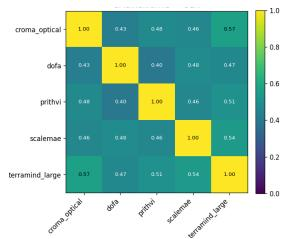  
(a) CCA

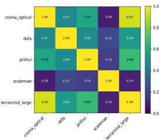  
(b) CKA

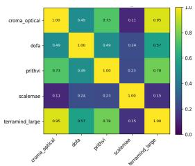  
(c) Standardized CKA

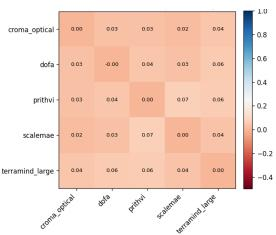  
(d) Complementarity  
Figure 3: AI4SmallFarms similarity and complementarity scores.

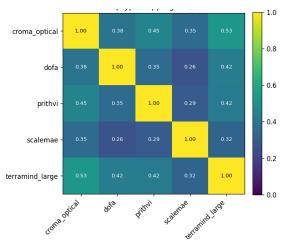  
(a) CCA

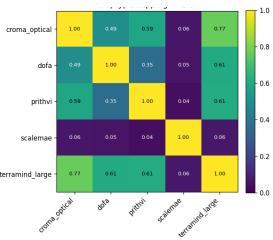  
(b) CKA

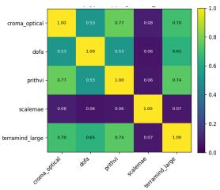  
(c) Standardized CKA

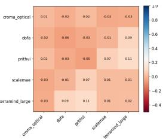  
(d) Complementarity

Figure 4: CropTypeMapping similarity and complementarity scores.  
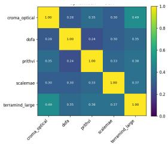  
(a) CCA

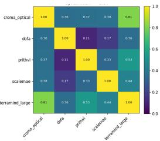  
(b) CKA

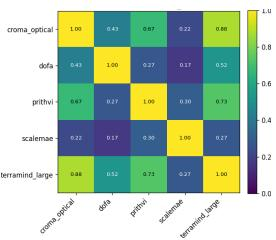  
(c) Standardized CKA

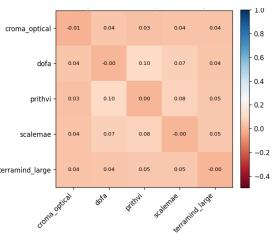  
(d) Complementarity

Figure 5: DynamicEarthNet similarity and complementarity scores.  
  
(a) CCA

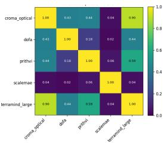  
(b) CKA

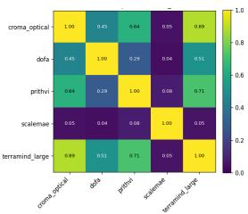  
(c) Standardized CKA

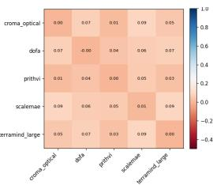  
(d) Complementarity

Figure 6: FiveBillionPixels similarity and complementarity scores.  
  
(a) CCA

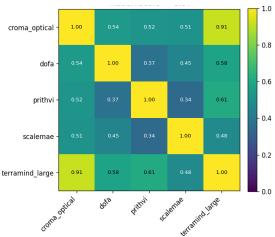  
(b) CKA

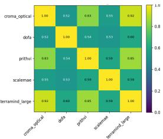  
(c) Standardized CKA

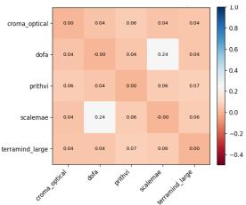  
(d) Complementarity

Figure 7: HLSBurnScars similarity and complementarity scores.  
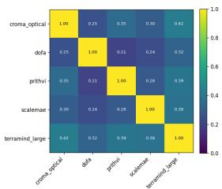  
(a) CCA

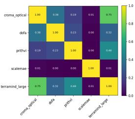  
(b) CKA

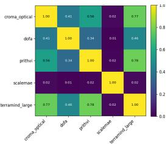  
(c) Standardized CKA

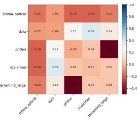  
(d) Complementarity  
Figure 8: MADOS similarity and complementarity scores.

  
(a) CCA

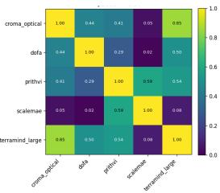  
(b) CKA

  
(c) Standardized CKA

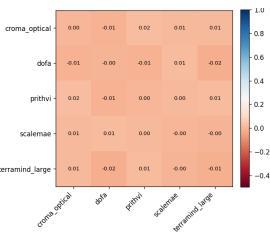  
(d) Complementarity

Figure 9: PASTIS similarity and complementarity scores.  
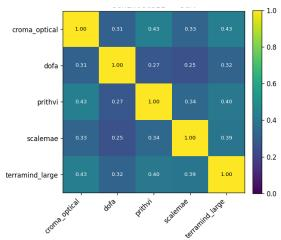  
(a) CCA

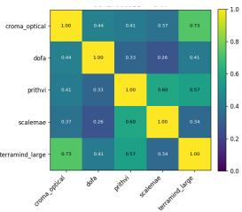  
(b) CKA

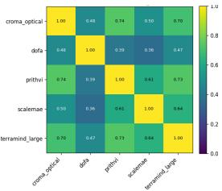  
(c) Standardized CKA

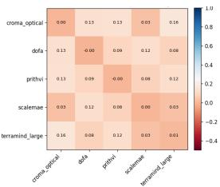  
(d) Complementarity

Figure 10: Sen1Floods11 similarity and complementarity scores.  
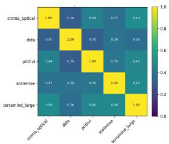  
(a) CCA

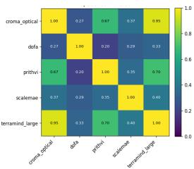  
(b) CKA

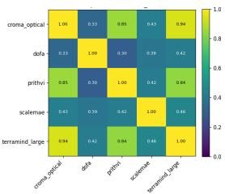  
(c) Standardized CKA

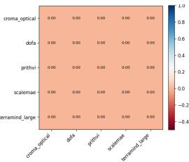  
(d) Complementarity

Figure 11: SpaceNet7 similarity and complementarity scores.  
  
(a) CCA

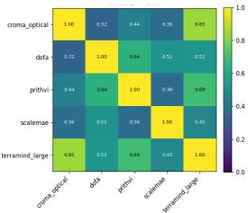  
(b) CKA

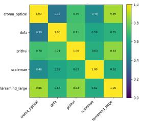  
(c) Standardized CKA

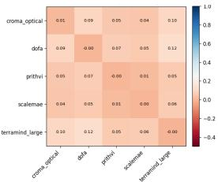  
(d) Complementarity

Figure 12: xView2 similarity and complementarity scores.  
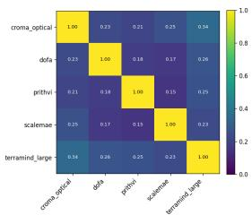  
(a) CCA

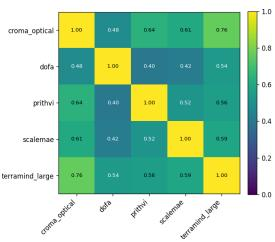  
(b) CKA

  
(c) Standardized CKA

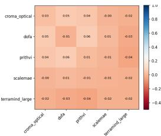  
(d) Complementarity  
Figure 13: BioMassters similarity and complementarity scores.