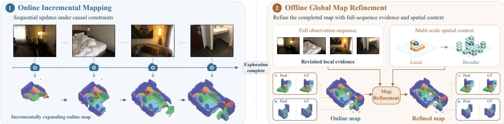
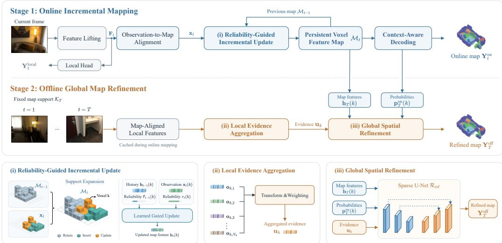
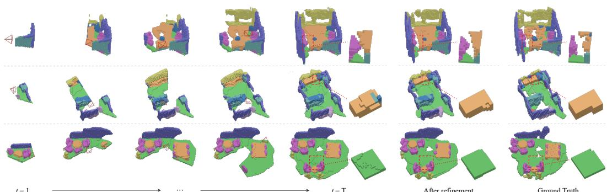
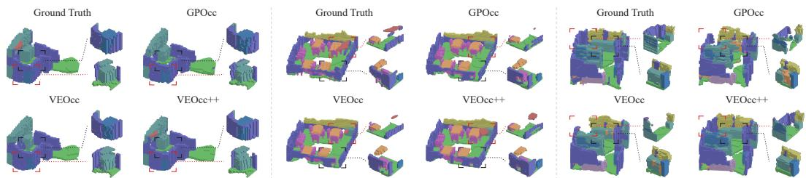
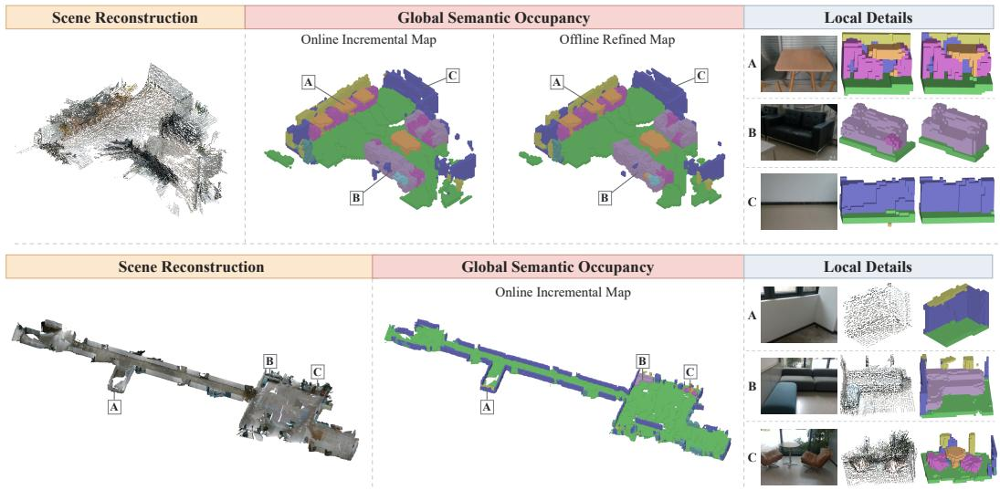
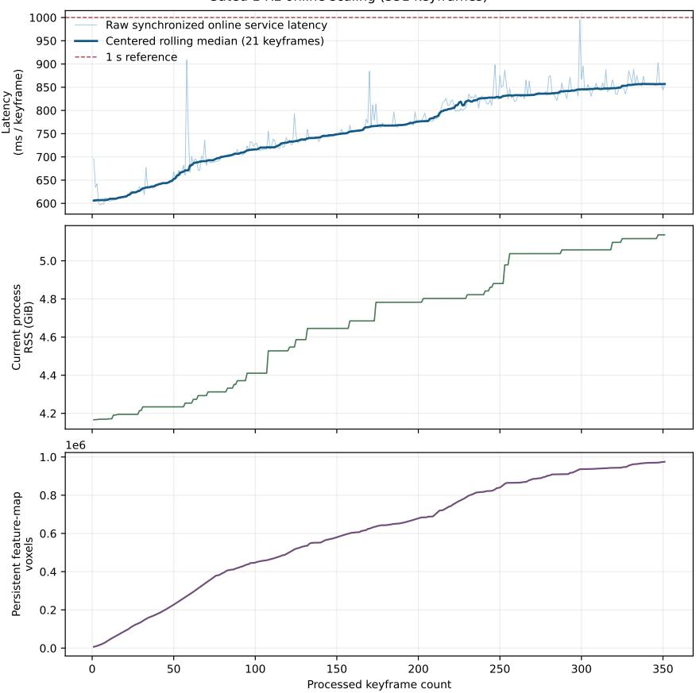
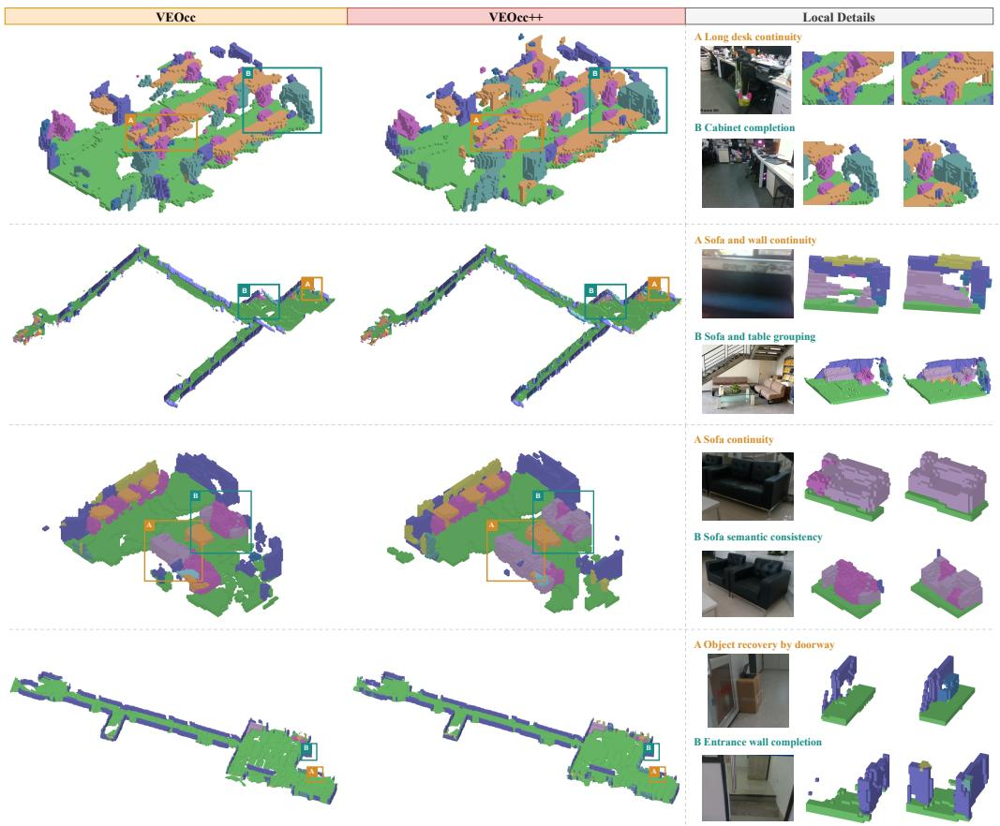

# VEOCC++: LEARNING PERSISTENT VOXEL FEATURE MAPS FOR EMBODIED ONLINE SEMANTIC OCCU-PANCY MAPPING AND OFFLINE REFINEMENT

Ruoyu Wang† Jiahan Li† Yong Liu∗ Kexin Zhang∗

APRIL Lab, Institute of Cyber-Systems and Control, Zhejiang University, China

## ABSTRACT

Semantic occupancy mapping supports embodied perception during exploration and detailed scene understanding afterward, giving rise to two complementary requirements: online incremental mapping for maintaining an up-to-date global map under causal constraints, and offline global map refinement for improving the completed scene representation with additional computation. We present VEOcc++, a unified voxel-centric framework that connects both stages through a persistent sparse voxel feature map. During exploration, the map expands with newly observed regions and integrates aligned local features through reliabilityguided updates, while context-aware decoding produces the current semantic occupancy map. After exploration, cached local features are consolidated as complementary evidence and combined with the completed online representation for multi-scale spatial refinement. On EmbodiedOcc-ScanNet, VEOcc++ achieves 67.12% IoU and 58.40% mIoU, establishing new state-of-the-art performance for online incremental mapping. With the local predictor fixed, our online mapping pipeline outperforms VEOcc fusion by 3.70 IoU and 3.74 mIoU points, demonstrating substantial gains from the proposed global mapping design. Offline global map refinement further improves the completed map to 67.79% IoU and 59.37% mIoU using only the observations acquired during exploration. Zero-shot deployment on a mobile robot further demonstrates transferability to unseen environments, onboard feasibility, and scalability to large-scale indoor mapping. Project page: https://wryzju.github.io/VEOccpp/.

## 1 INTRODUCTION

3D scene understanding (Savva et al., 2019; Gu et al., 2024; Rana et al., 2023; Huang et al., 2023) is a fundamental capability for embodied agents. 3D semantic occupancy maps provide an effective representation by jointly modeling spatial occupancy and semantic categories in a fine-grained volumetric space (McCormac et al., 2017; Yang et al., 2017; Song et al., 2017; Cao & de Charette, 2022). Practical embodied applications place different demands on these maps during and after exploration. During exploration, observations are sequentially integrated under causal constraints to maintain an up-to-date global map for perception and decision making. After exploration, the accumulated map and retained evidence can be processed with additional computation to improve the final scene representation. As shown in Fig. 1, we therefore study online incremental mapping and offline global map refinement as complementary stages of embodied semantic occupancy mapping.

Recent studies have extended semantic occupancy prediction from individual observations to sequential mapping. Gaussian-centric approaches progressively update scene-level representations (Wu et al., 2025; Wang et al., 2025; Zhang et al., 2025; Qian et al., 2026; Zhou et al., 2026a;b), whereas VEOcc (Wang et al., 2026) directly maintains an expanding global voxel map. VEOcc performs long-term accumulation at the semantic prediction level, without retaining the intermediate voxel features for subsequent integration and spatial decoding. Beyond the choice of accumulated representation, incorporating incoming observations and refining a completed map involve different processing objectives. Sequential updates prioritize timely integration, while refinement can devote dedicated computation to broader spatial context across the accumulated scene. These considerations motivate a persistent feature representation that supports both online accumulation and subsequent global map refinement.

  
Figure 1: Overview of the two-stage mapping setting in VEOcc++. Online incremental mapping sequentially integrates observations under causal constraints, while offline global map refinement exploits complementary local evidence and broader spatial context over the completed map. Zoomed examples highlight representative improvements after refinement.

To this end, we present VEOcc++, a unified voxel-centric framework that connects both stages through a shared Persistent Voxel Feature Map. This sparse map expands with exploration while retaining feature states independently of their semantic readout. Reliability-Guided Incremental Update learns to combine aligned local features with historical voxel states, while Context-Aware Decoding incorporates neighboring voxel context to produce the current occupancy map. After exploration, Local Evidence Aggregation consolidates cached local features as complementary evi dence. Global Spatial Refinement then combines this evidence with the completed feature map and its online semantic probabilities for multi-scale spatial reasoning. The resulting refinement improves the final map without acquiring additional observations or expanding the established map support.

Experiments on EmbodiedOcc-ScanNet demonstrate that the online stage alone outperforms all compared methods, achieving 67.12% IoU and 58.40% mIoU. With the local predictor held fixed, our online mapping pipeline improves IoU and mIoU by 3.70 and 3.74 percentage points over VEOcc fusion, respectively, demonstrating gains beyond improvements to the local predictor. Offline global map refinement further raises the results to 67.79% IoU and 59.37% mIoU. Beyond benchmark evaluation, zero-shot deployment on a mobile robot demonstrates transferability to unseen real-world environments, onboard feasibility, and scalability to large-scale indoor mapping.

Our main contributions are summarized as follows:

• We develop a voxel-centric framework built upon a Persistent Voxel Feature Map that connects online incremental mapping with offline global map refinement. Reliability-guided updates and context-aware decoding enable feature-level scene accumulation and dynamic map expansion over time.

• We introduce offline global map refinement that combines cached local evidence with the completed online representation for multi-scale spatial reasoning, improving occupancy and semantic predictions without additional observations or changes to the established map support during refinement.

• Experiments demonstrate state-of-the-art online performance, and further improvements after refinement. Zero-shot robotic deployment demonstrates transferability, onboard feasibility, and scalability to large scale indoor environments.

## 2 RELATED WORK

## 2.1 EMBODIED SEMANTIC OCCUPANCY MAPPING

Embodied semantic occupancy mapping extends frame-wise occupancy prediction to sequential scene construction during exploration. EmbodiedOcc (Wu et al., 2025) introduces this setting with a Gaussian-centric global representation, followed by methods that improve geometry modeling, temporal fusion, and representation efficiency (Wang et al., 2025; Zhang et al., 2025; Qian et al., 2026;

Zhou et al., 2026a;b). Recent works further explore persistent Gaussian feature memory and longhorizon semantic mapping (Qian et al., 2026; Zhu et al., 2026), while FreeOcc (Jiang et al., 2026) studies training-free open-vocabulary mapping. In contrast, VEOcc (Wang et al., 2026) adopts a voxel-centric formulation with an incrementally expanding global map. VEOcc++ follows this direction but performs long-term accumulation in a persistent voxel feature space and further connects online incremental mapping with offline global map refinement.

## 2.2 VOXEL-CENTRIC PERSISTENT SCENE MEMORY FOR SEQUENTIAL 3D PERCEPTION

Voxel-centric persistent representations have been explored for sequential 3D perception. Neural-Recon (Sun et al., 2021) and NeuralFusion (Weder et al., 2021) maintain latent volumetric states for incremental reconstruction and fusion, while ST-Occ (Leng et al., 2025), StreamOcc (Moon et al., 2026), and LMPOcc (Yuan et al., 2026) extend related ideas to occupancy prediction through spatiotemporal memory, recurrent voxel feature propagation, and global occupancy priors. VEOcc (Wang et al., 2026) adopts an incrementally expanding voxel map for embodied semantic occupancy, but performs long-term integration at the prediction level. OccFiner (Shi et al., 2025) focuses on offboard occupancy refinement over completed prediction sequences, rather than causal online map maintenance. In contrast, VEOcc++ maintains a persistent sparse voxel feature map as the shared scene representation for causal online mapping and post-exploration refinement, preserving latent scene information beyond semantic readout throughout both stages.

## 3 METHODOLOGY

## 3.1 PROBLEM FORMULATION

Given a monocular image $\mathbf { I } _ { t } ~ \in ~ \mathbb { R } ^ { H \times W \times 3 }$ and geometric information $\mathbf { G } _ { t } .$ , including camera intrinsics, pose, and local voxel geometry, VEOcc++ produces local and global semantic occupancy predictions through

$$
\begin{array} { r l } & { \mathbf { Y } _ { t } ^ { \mathrm { l o c a l } } = \mathcal { F } _ { \mathrm { l o c a l } } ( \mathbf { I } _ { t } , \mathbf { G } _ { t } ) , } \\ & { ( \mathcal { O } _ { t } , \mathbf { Y } _ { t } ^ { \mathrm { o n } } ) = \mathcal { F } _ { \mathrm { o n l i n e } } ( \mathcal { O } _ { t - 1 } , \mathbf { I } _ { t } , \mathbf { G } _ { t } ) , } \\ & { \mathbf { Y } _ { T } ^ { \mathrm { o f f } } = \mathcal { F } _ { \mathrm { o f f i n e } } \left( \mathcal { O } _ { T } , \{ ( \mathbf { I } _ { t } , \mathbf { G } _ { t } ) \} _ { t = 1 } ^ { T } \right) . } \end{array}\tag{1}
$$

Here, $\mathbf { Y } _ { t } ^ { \mathrm { l o c a l } }$ is the frame-wise local prediction, and ${ \mathcal { O } } _ { t }$ is the persistent global scene state from which the online map $\mathbf { Y } _ { t } ^ { \mathrm { o n } }$ is decoded. Online incremental mapping processes observations sequentially under causal constraints and expands the map support as new regions are observed. After exploration ends at timestep $T ,$ , offline global map refinement uses the completed state and evidence retained from the same sequence to produce $\mathbf { Y } _ { T } ^ { \mathrm { o f f } }$ on the established support.

## 3.2 METHOD OVERVIEW

As illustrated in Fig. 2, a Persistent Voxel Feature Map connects the online and offline stages. The local predictor (Sec. 3.3) extracts voxel features from each frame. Online incremental mapping (Sec. 3.4) aligns and integrates these features into the persistent map, from which semantic occupancy is decoded. Offline global map refinement (Sec. 3.5) subsequently combines the completed online representation with cached local evidence for multi-scale spatial refinement.

## 3.3 LOCAL OCCUPANCY PREDICTION

We adopt the local predictor of VEOcc (Wang et al., 2026) without architectural modifications. Given It and $\mathbf { G } _ { t } .$ , it extracts image features and incorporates a monocular depth prior (Yang et al., 2024) to produce a local voxel feature volume $\mathbf { F } _ { t }$ and the local occupancy prediction $\dot { \mathbf { Y } } _ { t } ^ { \mathrm { l o c a l } }$ . The features before the occupancy head are retained for online accumulation and offline evidence aggregation.

## 3.4 ONLINE INCREMENTAL MAPPING

Persistent Voxel Feature Map. The global scene state ${ \mathcal { O } } _ { t }$ comprises a persistent sparse voxel feature map $\mathcal { M } _ { t } = \{ ( k , \mathbf { h } _ { t } ( k ) \bar { ) } ~ | ~ k \in \bar { \mathcal { K } _ { t } } \}$ and auxiliary voxel-wise reliability statistics. Here, $\textstyle { \mathcal { K } } _ { t }$ contains the stored voxel coordinates in the world frame, and ${ \bf h } _ { t } ( k ) \in \mathbb { R } ^ { C }$ is the feature associated with voxel k. The map retains accumulated scene features independently of their semantic readout, allowing the same representation to support subsequent online updates and offline refinement. Its support grows with exploration without requiring a predefined $\mathrm { g l }$ obal scene boundary.

  
Figure 2: Overall framework of VEOcc++. During online incremental mapping, local voxel features are aligned with the global map and accumulated in a Persistent Voxel Feature Map through reliability-guided updates, while Context-Aware Decoding produces the current occupancy map. During offline global map refinement, Local Evidence Aggregation consolidates cached local features as complementary evidence, which is combined with the completed online representation for Global Spatial Refinement.

Observation-to-Map Alignment. For each incoming frame, we select geometrically visible local voxels and apply a lightweight pose-conditioned adaptation to their features. Let $\widehat { \mathbf { F } } _ { i }$ t denote the adapted local features, $S _ { t }$ the selected voxel set, and $\mathbf { w } _ { t , i }$ the world coordinate of voxel i $\in { S } _ { t }$ . With $\mathrm { g l }$ lobal voxel size $\delta ,$ quantization gives the active map coordinates $\mathcal { A } _ { t } = \{ \lfloor \mathbf { w } _ { t , i } / \delta \rfloor \mid i \in S _ { t } \}$

To account for misalignment between the local and global voxel lattices, we sample features at each active global voxel center $\begin{array} { r } { \mathbf q _ { k } = \delta ( k + \frac 1 2 ) } \end{array}$ :

$$
\mathbf { x } _ { t } ( k ) = { \mathrm { T r i S a m p l e } } \left( { \widehat { \mathbf { F } } } _ { t } , \mathbf { q } _ { k } ; \mathbf { G } _ { t } \right) , \qquad k \in { \mathcal { A } } _ { t } .\tag{2}
$$

The sampling operator uses $\mathbf { G } _ { t }$ to express the world-coordinate query in the local voxel lattice before trilinear interpolation. The resulting ${ \bf x } _ { t } ( k )$ is the aligned observation feature. Pose-conditioned adaptation is detailed in Appendix ${ \tt A } . 2$

Reliability-Guided Incremental Update. Given $A _ { t } ,$ , we expand the map support and update its feature states as

$$
\begin{array} { r } { \mathcal { K } _ { t } = \mathcal { K } _ { t - 1 } \cup \mathcal { A } _ { t } , \qquad \mathbf { h } _ { t } ( k ) = \left\{ \begin{array} { l l } { \mathbf { x } _ { t } ( k ) , } & { k \in \mathcal { A } _ { t } \backslash \mathcal { K } _ { t - 1 } , } \\ { \mathcal { U } ( \mathbf { h } _ { t - 1 } ( k ) , \mathbf { x } _ { t } ( k ) ) , } & { k \in \mathcal { A } _ { t } \cap \mathcal { K } _ { t - 1 } , } \\ { \mathbf { h } _ { t - 1 } ( k ) , } & { k \in \mathcal { K } _ { t - 1 } \backslash \mathcal { A } _ { t } . } \end{array} \right. } \end{array}\tag{3}
$$

New voxels are initialized from the aligned features, while voxels outside the current observation retain their previous states. For re-observed voxels, U adapts the incoming feature and determines its contribution to the persistent state. Following VEOcc (Wang et al., 2026), we estimate the current reliability $r _ { t } ( k )$ from depth and image-boundary cues and maintain the historical average reliability $\bar { r } _ { t - 1 } ( k )$ . Together with semantic uncertainty $E _ { t } ( k )$ from the local prediction and relations between the historical and current features, these quantities form an update descriptor $\xi _ { t } ( k )$ . Its complete construction is provided in Appendix ${ \mathrm { A } } . 3$

The descriptor conditions a corrected candidate feature and a channel-wise update gate:

$$
\begin{array} { r l } & { \widetilde { \mathbf { x } } _ { t } ( k ) = \mathbf { x } _ { t } ( k ) + \Delta _ { c } ( \pmb { \xi } _ { t } ( k ) ) , } \\ & { \mathbf { g } _ { t } ( k ) = \sigma \overset { } { \left( \mathrm { l o g i t } \left( \cfrac { r _ { t } ( k ) } { r _ { t } ( k ) + \bar { r } _ { t - 1 } ( k ) + \epsilon } \right) + \Delta _ { g } ( \pmb { \xi } _ { t } ( k ) ) \right) } . } \end{array}\tag{4}
$$

Here, $\Delta _ { c }$ and $\Delta _ { g }$ are learned residual functions. The candidate branch adjusts the incoming feature, while the gate balances its contribution against the historical state. The reliability ratio anchors this balance to observation quality, and $\Delta _ { g }$ learns descriptor-dependent corrections. The resulting update is

$$
\mathscr { U } ( \mathbf { h } _ { t - 1 } ( k ) , \mathbf { x } _ { t } ( k ) ) = ( 1 - \mathbf { g } _ { t } ( k ) ) \odot \mathbf { h } _ { t - 1 } ( k ) + \mathbf { g } _ { t } ( k ) \odot \widetilde { \mathbf { x } } _ { t } ( k ) .\tag{5}
$$

Context-Aware Decoding. Feature updates are voxel-wise, whereas occupancy prediction also benefits from interactions among neighboring map voxels. A lightweight sparse convolutional head ${ \mathcal { H } } _ { \mathrm { m a p } }$ therefore decodes persistent features over the entire current support $\textstyle { \boldsymbol { \mathcal { K } } } _ { t }$ into semantic logits $\mathbf { L } _ { t } ^ { \mathrm { { \dot { o n } } } }$ , yielding semantic probabilities $\mathbf { P } _ { t } ^ { \mathrm { o n } }$ and the online occupancy map $\mathbf { Y } _ { t } ^ { \mathrm { o n } }$ , with the former retained for subsequent offline refinement.

## 3.5 OFFLINE GLOBAL MAP REFINEMENT

After exploration, we refine the completed online representation using cached evidence from the same image sequence. The spatial support $\kappa _ { T }$ remains fixed, while occupancy and semantic predictions are revised through multi-scale spatial processing. This offline refinement consists of Local Evidence Aggregation and Global Spatial Refinement, described below.

Local Evidence Aggregation. Local voxel features and their geometry are cached during online processing. After exploration, we retrieve these features and align them to $\kappa _ { T }$ without rerunning the local predictor. For each mapped voxel k, the aligned features form $\mathcal { V } _ { k } = \{ \mathbf { o } _ { k , j } \} _ { j = 1 } ^ { N _ { k } }$ , where ${ \mathbf o } _ { k , j } \in \mathbb { R } ^ { C }$ and $N _ { k }$ is the number of valid features. Each feature undergoes a residual transformation and receives a scalar weight normalized over the observations associated with the same voxel:

$$
\mathbf { v } _ { k , j } = \mathbf { o } _ { k , j } + \psi ( \mathbf { o } _ { k , j } ) , \qquad w _ { k , j } = \mathrm { S o f t m a x } _ { j } ( \rho ( \mathbf { v } _ { k , j } ) ) , \qquad \mathbf { u } _ { k } = \sum _ { j = 1 } ^ { N _ { k } } w _ { k , j } \mathbf { v } _ { k , j } .\tag{6}
$$

Here, $\psi$ and $\rho$ are lightweight MLPs. The aggregated feature $\mathbf { u } _ { k }$ supplies complementary local evidence for global refinement.

Global Spatial Refinement. For each mapped voxel, we concatenate the persistent feature, online semantic probability, and aggregated local evidence as ${ \bf z } _ { k } = [ { \bf h } _ { T } ( k ) , { \bf p } _ { T } ^ { \mathrm { o n } } ( k ) , { \bf u } _ { k } ]$ , where ${ \bf p } _ { T } ^ { \mathrm { o n } } ( k ) =$ $\mathrm { S o f t m a x } \dot { ( \mathbf { L } _ { T } ^ { \mathrm { o n } } ( k ) ) }$ . These inputs provide the accumulated scene features, their current semantic interpretation, and complementary frame-wise evidence, respectively. A sparse U-Net combines them across spatial scales to predict

$$
{ \bf L } _ { T } ^ { \mathrm { o f f } } = \mathcal { R } _ { \mathrm { r e f } } \left( \left\{ { \bf z } _ { k } \right\} _ { k \in \mathcal { K } _ { T } } \right) .\tag{7}
$$

Compared with the lightweight online decoder, this multi-scale processing incorporates broader spatial context into the prediction of each mapped voxel. The refined features are directly decoded into final semantic logits $\mathbf { L } _ { T } ^ { \mathrm { o f f } }$ . Semantic classification then produces $\mathbf { Y } _ { T } ^ { \mathrm { o f f } }$ , updating occupancy and category labels while preserving the spatial support.

## 4 EXPERIMENTS

## 4.1 EXPERIMENTAL SETUP

Datasets and Metrics. We evaluate VEOcc++ on two benchmarks: Occ-ScanNet (Yu et al., 2025) for local occupancy prediction and EmbodiedOcc-ScanNet (Wu et al., 2025) for online incremental mapping and offline global map refinement. Occ-ScanNet provides voxelized annotations in a $6 0 \times$ 60×36 grid covering $\mathrm { ~ a ~ 4 . 8 m \times 4 . 8 m \times 2 . 8 8 }$ m local volume, while EmbodiedOcc-ScanNet extends the annotations to complete scenes for sequential global mapping evaluation. We report occupancy IoU and semantic mIoU, together with runtime and memory usage for efficiency evaluation.

Table 1: Local Occupancy Prediction results of embodied occupancy mapping methods on Occ-ScanNet. The best results are highlighted in bold, and the second-best results are underlined.
<table><tr><td></td><td>ceiiing IoU mIoU 一</td><td>inow fuimure obts or Wa char soa taqble əq SAS ■ 一 一 à 一 一</td></tr><tr><td>Method EmbodiedOcc (Wu et al., 2025)</td><td>一</td></tr><tr><td></td><td>|53.95 45.48|40.90 50.80 41.90 33.00 41.20 55.20 61.90 43.80 35.40 53.50 42.90</td></tr><tr><td>EmbodiedOcc++ (Wang et al., 2025) 54.9046.20</td><td>|36.40 53.10 41.80 34.40 42.90 57.30 64.10 45.20 34.80 54.20 44.10</td></tr><tr><td>RoboOcc (Zhang et al., 2025) 56.4847.67</td><td>45.36 53.4944.35 34.8143.3856.93 63.3546.35 36.12 55.4844.78</td></tr><tr><td>TGSFormer (Qian et al., 2026) 64.42 54.73 GPOcc (VGGT) (Zhou et al., 2026a)</td><td>54.20 61.30 50.50 41.3049.50 64.50 69.30 52.40 47.10 63.00 48.80</td></tr><tr><td>GPOcc++ (VGGT) (Zhou et al., 2026b) |63.72 57.41</td><td>63.1456.19 51.6759.93 52.0746.44 51.35 64.4569.4754.30 51.76 63.2953.36</td></tr><tr><td>VEOcc (Wang et al., 2026) 64.5555.49</td><td>56.6261.4050.6348.1353.1266.3471.0556.4848.9564.4854.22 53.20 64.00 49.00 42.90 50.80 65.50 70.50 53.70 48.30 62.60 50.00</td></tr><tr><td>VEOcc++(Ours)</td><td>|66.9858.17|55.70 67.30 51.6046.00 53.00 67.40 72.70 56.10 51.20 65.40 53.30</td></tr></table>

Table 2: Global Occupancy Mapping results on EmbodiedOcc-ScanNet. The best results are highlighted in bold, and the second-best results are underlined. † denotes VEOcc using the same local predictor as VEOcc++.
<table><tr><td>Method</td><td>ceiing 一</td><td>wnw furuie obccts oor wall■ Cha soa taqbe əq tAS ■</td></tr><tr><td>EmbodiedOcc (Wu et al., 2025)</td><td>IoU mIoU</td></tr><tr><td></td><td>|51.52 42.53|22.70 44.60 37.40 38.00 50.10 56.70 59.70 35.40 38.40 52.00 32.90</td></tr><tr><td>EmbodiedOcc++ (Wang et al., 2025) 52.20 43.60</td><td>27.90 43.90 38.70 40.60 49.00 57.90 59.20 36.80 37.80 53.50 34.10</td></tr><tr><td>RoboOcc (Zhang et al., 2025) 53.30 44.05</td><td>21.94 44.5739.54 38.4851.28 57.0463.0936.70 43.0554.42 34.38</td></tr><tr><td>TGSFormer (Qian et al., 2026) 54.4245.29 GPOcc (VGGT) (Zhou et al., 2026a)</td><td>31.00 39.90 39.90 32.70 52.00 66.10 53.00 47.30 38.70 59.60 37.90</td></tr><tr><td>61.41 55.39 GPOcc++ (VGGT) (Zhou et al., 2026b) 62.50 57.41</td><td>42.61 51.35 51.49 48.72 54.32 67.9170.73 52.94 54.75 64.76 49.67</td></tr><tr><td>VEOcc (Wang et al., 2026) 62.2153.00</td><td>48.00 52.14 54.70 53.3954.7168.82 71.0354.2755.23 66.81 52.42</td></tr><tr><td>VEOcc† (Wang et al., 2026) 63.4254.66</td><td>29.90 62.60 45.60 44.60 54.10 68.10 69.70 54.30 45.90 61.60 46.40 33.20 63.40 47.00 46.60 55.40 69.00 71.60 55.90 47.10 63.40 48.60</td></tr><tr><td>VEOcc++ (Ours, Online) 67.1258.40|</td><td>|43.09 66.8751.95 49.1157.8770.49 73.99 60.0148.44 67.28 53.34</td></tr><tr><td>VEOcc++ (Ours, Offline)</td><td>67.79 59.37 42.77 68.76 52.12 49.5158.68 70.74 74.65 61.48 52.3768.01 54.01</td></tr></table>

Implementation Details. VEOcc++ is trained in three stages. We first train the VEOcc local occupancy predictor with a larger learning rate while keeping its architecture unchanged. We then freeze the local predictor and train the online incremental mapping modules. Finally, both the local predictor and online mapper are fixed, and only the refinement modules are optimized on completed scene maps. Training is conducted on four NVIDIA RTX 3090 GPUs and takes approximately 28 hours in total. Additional training and implementation details are provided in Appendix B.

## 4.2 RESULTS ON PUBLIC BENCHMARKS

Local Occupancy Prediction. We first evaluate frame-wise occupancy prediction on Occ-ScanNet. Increasing the learning rate improves the unchanged local predictor to 66.98% IoU and 58.17% mIoU, achieving the best performance among the compared embodied occupancy mapping methods in Table 1. Further analysis of the learning rate is provided in Appendix C.1. The resulting local features provide a strong basis for subsequent online mapping and offline refinement.

Global Occupancy Mapping. (i) Online Mapping Performance. As shown in Table 2, VEOcc++ establishes new state-of-the-art performance on EmbodiedOcc-ScanNet, achieving 67.12% IoU and 58.40% mIoU in the online setting. It surpasses GPOcc++ by 4.62 IoU and 0.99 mIoU points, despite GPOcc++ adopting a substantially larger VGGT backbone with large-scale pretraining. The strong performance obtained before any offline refinement highlights the effectiveness of our online incremental mapping design. (ii) Mapping Gains with a Fixed Local Predictor. To isolate the contribution of global mapping, we additionally report VEOcc†, which uses the same local predictor as VEOcc++ while retaining the analytic prediction-level fusion of VEOcc. This stronger local predictor improves VEOcc from 62.21/53.00 to 63.42/54.66 IoU/mIoU. With the local predictor fixed, VEOcc++ further reaches 67.12/58.40, yielding gains of 3.70 IoU and 3.74 mIoU points. Improvements are observed across all 11 semantic categories, demonstrating a substantial advantage of the proposed online mapping pipeline over the VEOcc formulation. (iii) Offline Re-

→ t = T

  
After refinement  
Ground Truth

Figure 3: Progressive online incremental mapping and offline map refinement. Each row shows the map evolution from t = 1 to t = T, followed by the refined result and ground truth. Red dashed boxes indicate the enlarged regions.  
  
Figure 4: Qualitative comparison of online incremental mapping. Highlighted regions are enlarged for detailed comparison.

finement. Starting from the completed online map, offline global map refinement further improves performance to 67.79% IoU and 59.37% mIoU. Under the same observations and fixed spatial support, our offline refinement yields gains of 0.67 IoU and 0.97 mIoU points over the online result, with improvements across nearly all semantic categories. These consistent gains demonstrate that the proposed refinement effectively exploits previously acquired evidence to enhance global map quality without additional observations or spatial expansion.

Qualitative Results. Fig. 3 illustrates progressive map construction during exploration and subsequent offline refinement. The online map expands as observations arrive, while offline global map refinement reduces residual geometric and semantic artifacts in the highlighted regions. Fig. 4 further compares online incremental mapping with GPOcc and VEOcc on representative EmbodiedOcc-ScanNet scenes. VEOcc++ produces more complete object structures and cleaner semantic boundaries, complementing the quantitative global mapping results.

Table 3: Efficiency and precision comparison on EmbodiedOcc-ScanNet. Runtime and GPU memory are measured on a single RTX 3090.
<table><tr><td>Setting</td><td>Online s/frame</td><td>Online s/scene</td><td>Offline s/scene</td><td>GiB</td><td>Online GPU Offline GPU GiB</td><td>Map B/voxel</td><td>IoU</td><td>Online Online mIoU</td><td>Offline Offline IoU</td><td>mIoU</td></tr><tr><td>FP32</td><td>0.152</td><td>4.57</td><td>0.319</td><td>1.753</td><td>3.169</td><td>424</td><td>67.12</td><td>58.40</td><td>67.79</td><td>59.37</td></tr><tr><td>Mixed FP16</td><td>0.120</td><td>3.60</td><td>0.224</td><td>1.558</td><td>3.252</td><td>232</td><td>67.08</td><td>58.36</td><td>67.77</td><td>59.35</td></tr></table>

Efficiency Analysis. We evaluate VEOcc++ in full precision on a single RTX 3090. As shown in Table 3, the online incremental mapping pipeline averages 152.44 ms/frame, corresponding to approximately 6.6 FPS, while offline global map refinement averages 319.03 ms per 30-frame scene. This refinement cost is only about 7.0% of the cumulative online processing time for the same scene. The persistent map requires 424 bytes per voxel, with moderate GPU memory peaks in both stages, providing a practical full-precision deployment baseline. We further evaluate a mixed-FP16 deployment configuration. As shown in Table 3, this configuration reduces the overall deployment cost with negligible accuracy degradation and is therefore adopted for the subsequent real-world experiments. The slightly higher offline GPU memory peak mainly reflects the additional integer indexing overhead of the Native sparse-convolution backend, which outweighs the memory savings from half-precision features.

  
Figure 5: Zero-shot real-world mapping results. The upper and lower rows show the Reading Room and Laboratory Floor, respectively. Scene reconstructions are provided only for spatial reference and are not used by the occupancy predictor. The global maps demonstrate online incremental mapping at different scene scales, while offline refinement further improves the Reading Room result. A–C highlight representative local regions.

## 4.3 ZERO-SHOT REAL-WORLD ROBOTIC EXPERIMENTS

Robotic Platform. We evaluate zero-shot transfer and onboard feasibility on an AgileX UMR mobile robot equipped with an Intel RealSense D435i, a Livox MID-360 LiDAR with IMU for localization, and an NVIDIA Jetson Orin 16GB for computation (Fig. 6).

Occupancy prediction uses monocular RGB images, while camera poses are provided by the LiDAR–inertial localization system. The benchmark-trained model is deployed without scene-specific finetuning or adaptation. All real-world experiments use mixed FP16 together with TensorRT-accelerated monocular depth estimation.

Real-World Mapping Scenarios. We consider two unseen indoor environments to examine deployment across different scene scales: a furnished Reading Room and a complete Laboratory Floor. As summarized in Table 4, their trajectories span 31.31 m and 235.15 m, respectively, covering compact room-scale exploration and extended floor-scale mapping. Motion-gated keyframe

  
Figure 6: Real-world robotic platform.

selection with a minimum interval of one second yields 91 and 351 processed frames, respectively.

Qualitative Results. Fig. 5 shows the maps produced without scene-specific adaptation. In the Reading Room, online incremental mapping captures the room layout and recognizable furniture structures. Offline global map refinement further reduces surface fragmentation in the highlighted object and wall regions while retaining the overall layout. On the Laboratory Floor, the online map represents connected corridor and room regions over the longer trajectory, with identifiable structural and object-level semantics in the enlarged views. Additional real-world comparisons with VEOcc across multiple mapping sequences are provided in Appendix C.3.

Deployment Efficiency. We measure runtime and memory during sequential replay of the recorded sequences on the onboard device. Table 4 evaluates the complete pipeline in both roomscale and floor-scale environments. In both settings, online mapping takes less than one second per keyframe on average, including local-feature cache writes, with average latencies of 0.630 and 0.764 s/frame for the Reading Room and Laboratory Floor, respectively. The corresponding persistent maps occupy 35.07 and 215.69 MiB, while complete offline refinement takes 4.29 and 25.07 s. In both environments, the offline refinement cost remains below 10% of the cumulative online processing time. Even for the full-floor sequence, peak process RSS remains 5.136 GiB during online mapping and 7.806 GiB during refinement. These results show that VEOcc++ supports both compact room-scale and long-horizon floor-scale mapping on the same embedded platform, demonstrating its practical efficiency and scalability for onboard embodied scene understanding. A finergrained analysis of latency, process memory, and persistent-map growth throughout the Laboratory Floor sequence is provided in Appendix C.2.

Table 4: Real-world deployment results in two indoor environments. Map extent denotes the horizontal bounding box of the final stored voxel map. RSS reports the peak process memory usage in each stage, while Local Cache denotes the cached local features stored for offline refinement.
<table><tr><td>Scene</td><td>Travel Dist. (m)</td><td>Map Extent (m)</td><td>Key Frames</td><td>|Online Avg. (s/frame)</td><td>Online Time (s/scene)</td><td>Offline Refine (s)</td><td>[Online RSS Offline RSS Feature Map Local Cache (GiB)</td><td>(GiB)</td><td>(MiB)</td><td>(MiB)</td></tr><tr><td>Reading Room</td><td>31.31</td><td> $1 0 . 0 \times 9 . 0$ </td><td>91</td><td>0.630</td><td>57.32</td><td>4.29</td><td>4.172</td><td>4.340</td><td>35.07</td><td>151.55</td></tr><tr><td>Laboratory Floor</td><td>235.15</td><td> $5 7 . 3 \times 1 5 . 6$ </td><td>351</td><td>0.764</td><td>268.08</td><td>25.07</td><td>5.136</td><td>7.806</td><td>215.69</td><td>576.50</td></tr></table>

Table 5: Online mapping ablation. PFM: persistent Table 6: Offline refinement ablation. PF: persistent feature map; CA: candidate adaptation; RG: reliability- feature; LF: local features; LA: learned aggregation; guided gating; CAD: context-aware decoding. GSR: global spatial refinement.
<table><tr><td>Variant</td><td>|PFM CA</td><td>RG CAD|</td><td>IoU</td><td>mIoU</td></tr><tr><td>VEOcc fusion</td><td>Analytic fusion</td><td>√</td><td>63.42</td><td>54.66</td></tr><tr><td>No memory</td><td>一 √</td><td></td><td>61.33</td><td>52.03</td></tr><tr><td>Mean update</td><td></td><td></td><td>66.25</td><td>57.49</td></tr><tr><td>Gate only</td><td></td><td>√</td><td>66.86</td><td>58.16</td></tr><tr><td>Candidate only</td><td>√</td><td>一</td><td>66.77</td><td>57.85</td></tr><tr><td>Pointwise decode</td><td>√ √</td><td>√</td><td>66.51</td><td>57.81</td></tr><tr><td>Full</td><td>√</td><td>√</td><td>√</td><td>67.12</td><td>58.40</td></tr></table>

<table><tr><td>Variant</td><td>PF</td><td>LF</td><td>LA</td><td>GSR|</td><td>IoU</td><td>mIoU</td></tr><tr><td>Online map</td><td></td><td>一</td><td></td><td></td><td>67.12</td><td>58.40</td></tr><tr><td>Probability only</td><td>一</td><td>一</td><td></td><td>√</td><td>67.36</td><td>58.62</td></tr><tr><td>Prob. + feature</td><td>√</td><td></td><td></td><td>√</td><td>67.54</td><td>59.03</td></tr><tr><td>Prob. + local</td><td>一</td><td>√</td><td>√</td><td>√</td><td>67.56</td><td>58.94</td></tr><tr><td>Mean fusion</td><td>√</td><td>√</td><td>一</td><td>√</td><td>67.59</td><td>59.05</td></tr><tr><td>Pointwise refine</td><td>√</td><td>√</td><td>√</td><td></td><td>67.21</td><td>58.68</td></tr><tr><td>Full</td><td>√</td><td>√</td><td>√</td><td>L</td><td>67.79</td><td>59.37</td></tr></table>

## 4.4 ABLATION STUDIES

Online Incremental Mapping. Table 5 analyzes the main components of online incremental mapping under the same local predictor. Removing persistent memory causes a substantial drop to 61.33/52.03 IoU/mIoU, while replacing analytic prediction-level fusion with a Persistent Voxel Feature Map and cumulative mean update improves performance from 63.42/54.66 to 66.25/57.49. Building on this representation, reliability-guided gating and candidate adaptation provide complementary improvements when combined in the full Reliability-Guided Incremental Update, reaching 67.12/58.40. Replacing Context-Aware Decoding with pointwise prediction reduces performance to 66.51/57.81, further showing the benefit of spatial context when decoding the feature map.

Offline Global Map Refinement. Table 6 examines the contributions of the three input sources and spatial refinement. Applying Global Spatial Refinement to online semantic probabilities alone improves the completed map from 67.12/58.40 to 67.36/58.62 IoU/mIoU. Adding either persistent map features or learned local evidence further raises performance to 67.54/59.03 and 67.56/58.94, respectively, showing that both provide useful information beyond the online semantic prediction. Combining persistent features with mean-aggregated local evidence reaches 67.59/59.05, while learned Local Evidence Aggregation yields the best result of 67.79/59.37. Replacing Global Spatial Refinement with pointwise prediction reduces performance to 67.21/58.68. Overall, persistent map features and local evidence provide complementary cues, and spatial refinement is important for effectively exploiting them over the completed map.

## 5 CONCLUSION

We presented VEOcc++, a unified voxel-centric framework that connects online incremental mapping and offline global map refinement through a Persistent Voxel Feature Map. During exploration, reliability-guided feature updates and context-aware decoding maintain an incrementally expanding global map; after exploration, cached local evidence and spatial refinement further improve the completed representation. VEOcc++ establishes state-of-the-art online mapping performance on EmbodiedOcc-ScanNet, while offline refinement further improves the final map using the observations already acquired during exploration. Zero-shot robotic experiments additionally demonstrate transferability to unseen environments, onboard feasibility, and floor-scale indoor mapping. VEOcc++ currently relies on externally provided camera poses, and its persistent map and cached local evidence grow with the explored scene and sequence length. Future work will investigate robustness to pose uncertainty and more compact long-term scene representations.

## REFERENCES

Anh-Quan Cao and Raoul de Charette. MonoScene: Monocular 3D semantic scene completion. In Proceedings of the IEEE/CVF Conference on Computer Vision and Pattern Recognition, pp. 3991–4001, 2022.

Qiao Gu, Ali Kuwajerwala, Sacha Morin, Krishna Murthy Jatavallabhula, Bipasha Sen, Aditya Agarwal, Corban Rivera, William Paul, Kirsty Ellis, Rama Chellappa, Chuang Gan, Celso Miguel de Melo, Joshua B. Tenenbaum, Antonio Torralba, Florian Shkurti, and Liam Paull. Concept-Graphs: Open-vocabulary 3D scene graphs for perception and planning. In 2024 IEEE International Conference on Robotics and Automation, pp. 5021–5028, 2024.

Wenlong Huang, Chen Wang, Ruohan Zhang, Yunzhu Li, Jiajun Wu, and Li Fei-Fei. VoxPoser: Composable 3D value maps for robotic manipulation with language models. In Proceedings of the 7th Conference on Robot Learning, volume 229 of Proceedings of Machine Learning Research, pp. 540–562. PMLR, 2023.

Zeyu Jiang, Changqing Zhou, Xingxing Zuo, and Changhao Chen. FreeOcc: Training-free embodied open-vocabulary occupancy prediction. In Proceedings of Robotics: Science and Systems, Sydney, Australia, July 2026. doi: 10.15607/RSS.2026.XXII.166.

Ziyang Leng, Jiawei Yang, Wenlong Yi, and Bolei Zhou. Occupancy learning with spatiotemporal memory. In Proceedings of the IEEE/CVF International Conference on Computer Vision, pp. 26569–26578, 2025.

John McCormac, Ankur Handa, Andrew J. Davison, and Stefan Leutenegger. SemanticFusion: Dense 3D semantic mapping with convolutional neural networks. In 2017 IEEE International Conference on Robotics and Automation, pp. 4628–4635, 2017. doi: 10.1109/ICRA.2017. 7989538.

Seokha Moon, Janghyun Baek, Yujin Jeong, Daewon Chae, Giseop Kim, Jungbeom Lee, Jinkyu Kim, and Sunwook Choi. Streaming dense voxel representations for 3D occupancy prediction. In European Conference on Computer Vision, pp. 659–676, 2026. doi: 10.1007/ 978-3-032-37356-4 36.

Rui Qian, Haozhi Cao, Tianchen Deng, Tianxin Hu, Weixiang Guo, Shenghai Yuan, and Lihua Xie. TGSFormer: Scalable temporal Gaussian splatting for embodied semantic scene completion. In Proceedings of the IEEE/CVF Conference on Computer Vision and Pattern Recognition, pp. 11881–11890, 2026.

Krishan Rana, Jesse Haviland, Sourav Garg, Jad Abou-Chakra, Ian Reid, and Niko Suenderhauf. SayPlan: Grounding large language models using 3D scene graphs for scalable robot task planning. In Proceedings of the 7th Conference on Robot Learning, volume 229 of Proceedings of Machine Learning Research, pp. 23–72. PMLR, 2023.

Manolis Savva, Abhishek Kadian, Oleksandr Maksymets, Yili Zhao, Erik Wijmans, Bhavana Jain, Julian Straub, Jia Liu, Vladlen Koltun, Jitendra Malik, Devi Parikh, and Dhruv Batra. Habitat: A platform for embodied AI research. In Proceedings of the IEEE/CVF International Conference on Computer Vision, pp. 9339–9347, 2019.

Hao Shi, Song Wang, Jiaming Zhang, Xiaoting Yin, Guangming Wang, Jianke Zhu, Kailun Yang, and Kaiwei Wang. Offboard occupancy refinement with hybrid propagation for autonomous driving. IEEE Transactions on Intelligent Transportation Systems, 26(10):16001–16016, 2025. doi: 10.1109/TITS.2025.3572200.

Shuran Song, Fisher Yu, Andy Zeng, Angel X. Chang, Manolis Savva, and Thomas Funkhouser. Semantic scene completion from a single depth image. In Proceedings of the IEEE Conference on Computer Vision and Pattern Recognition, pp. 190–198, 2017. doi: 10.1109/CVPR.2017.28.

Jiaming Sun, Yiming Xie, Linghao Chen, Xiaowei Zhou, and Hujun Bao. NeuralRecon: Real-time coherent 3D reconstruction from monocular video. In Proceedings ofthe IEEE/CVF Conference on Computer Vision and Pattern Recognition, pp. 15598–15607, 2021.

Hao Wang, Xiaobao Wei, Xiaoan Zhang, Jianing Li, Chengyu Bai, Ying Li, Ming Lu, Wenzhao Zheng, and Shanghang Zhang. EmbodiedOcc++: Boosting embodied 3D occupancy prediction with plane regularization and uncertainty sampler. In Proceedings ofthe 33rd ACM International Conference on Multimedia, pp. 925–934, 2025.

Ruoyu Wang, Yong Liu, Jiahan Li, Sheng Tao, Yuhang Lin, and Yukai Ma. VEOcc: Voxelcentric online semantic occupancy prediction for embodied scene understanding. arXiv preprint arXiv:2605.25059, 2026.

Silvan Weder, Johannes L. Schonberger, Marc Pollefeys, and Martin R. Oswald. NeuralFusion: Online depth fusion in latent space. In Proceedings of the IEEE/CVF Conference on Computer Vision and Pattern Recognition, pp. 3162–3172, 2021.

Yuqi Wu, Wenzhao Zheng, Sicheng Zuo, Yuanhui Huang, Jie Zhou, and Jiwen Lu. EmbodiedOcc: Embodied 3D occupancy prediction for vision-based online scene understanding. In Proceedings of the IEEE/CVF International Conference on Computer Vision, pp. 26360–26370, 2025.

Lihe Yang, Bingyi Kang, Zilong Huang, Zhen Zhao, Xiaogang Xu, Jiashi Feng, and Hengshuang Zhao. Depth Anything V2. In Advances in Neural Information Processing Systems, volume 37, pp. 21875–21911, 2024.

Shichao Yang, Yulan Huang, and Sebastian Scherer. Semantic 3D occupancy mapping through efficient high order CRFs. In 2017 IEEE/RSJ International Conference on Intelligent Robots and Systems, pp. 590–597, 2017. doi: 10.1109/IROS.2017.8202212.

Hongxiao Yu, Yuqi Wang, Yuntao Chen, and Zhaoxiang Zhang. Monocular occupancy prediction for scalable indoor scenes. In Computer Vision – ECCV 2024, volume 15088 of Lecture Notes in Computer Science, pp. 38–54. Springer, 2025. doi: 10.1007/978-3-031-73404-5 3.

Shanshuai Yuan, Julong Wei, Muer Tie, Xiangyun Ren, Zhongxue Gan, and Wenchao Ding. Collaborative learning of local 3D occupancy prediction and versatile global occupancy mapping. In IEEE International Conference on Robotics and Automation, 2026.

Zhang Zhang, Qiang Zhang, Wei Cui, Shuai Shi, Yijie Guo, Gang Han, Wen Zhao, Hengle Ren, Renjing Xu, and Jian Tang. RoboOcc: Enhancing the geometric and semantic scene understanding for robots. arXiv preprint arXiv:2504.14604, 2025.

Changqing Zhou, Yueru Luo, and Changhao Chen. Generalizing visual geometry priors to sparse Gaussian occupancy prediction. In Proceedings ofthe IEEE/CVF Conference on Computer Vision and Pattern Recognition, pp. 28578–28587, 2026a.

Changqing Zhou, Yueru Luo, Yulan Guo, Bing Wang, Jie Qin, and Changhao Chen. GPOcc++: Unified sparse Gaussian occupancy prediction with visual geometry priors. arXiv preprint arXiv:2607.13481, 2026b.

Hu Zhu, Bohan Li, Xianda Guo, Hongsi Liu, Baorui Peng, Mingqi Yuan, Xin Jin, Wenjun Zeng, and Chang Wen Chen. GEM-Occ: From visual geometry evidence to embodied semantic occupancy memory. arXiv preprint arXiv:2607.05543, 2026.

## Appendix

## APPENDIX CONTENTS

A Additional Method Details 13   
A.1 Local Predictor and Voxel Feature Extraction 13   
A.2 Observation Alignment and Reliability Estimation 13   
A.3 Persistent Map Update and Online Decoding . 14   
B Training Details 14   
B.1 Local Predictor Training 14   
B.2 Online Incremental Mapping 15   
B.3 Offline Global Map Refinement 15   
C Additional Experimental Analysis 16   
C.1 Learning-Rate Analysis for Local Prediction 16   
C.2 Online Scaling in Real-World Deployment 16   
C.3 Real-World Online Mapping Comparison 17

## A ADDITIONAL METHOD DETAILS

## A.1 LOCAL PREDICTOR AND VOXEL FEATURE EXTRACTION

The local occupancy predictor follows VEOcc (Wang et al., 2026) without architectural modification. Image features are extracted by a 2D backbone, while Depth Anything V2 (Yang et al., 2024) provides a monocular depth prior from the same RGB input. The depth prior conditions the LSS-based lifting process, projecting image features into the local voxel space without requiring an external depth sensor. A 3D encoder then produces the voxel representation $\mathbf { F } _ { t } ,$ from which a lightweight occupancy head predicts frame-wise semantic occupancy. Importantly, the subsequent mapping stages operate on $\mathbf { F } _ { t }$ before the final occupancy head, thereby preserving richer feature information for cross-frame accumulation.

## A.2 OBSERVATION ALIGNMENT AND RELIABILITY ESTIMATION

The pose-conditioned adaptation in Sec. 3.4 is implemented as a residual transformation conditioned on the normalized local voxel coordinate and a 6D camera rotation encoding:

$$
\widehat { \mathbf { f } } _ { t , i } = \mathbf { f } _ { t , i } + \phi \big ( [ \mathbf { f } _ { t , i } , \mathbf { a } _ { t , i } , \mathbf { e } _ { t } ^ { \mathrm { r o t } } ] \big ) ,\tag{8}
$$

where $\phi ( \cdot )$ is a lightweight MLP. Its output layer is zero-initialized, such that the module starts from an identity transformation.

For reliability estimation, we follow the Reliability-Aware Confidence Modulation (RCM) of VEOcc (Wang et al., 2026). For each local voxel observation i, the confidence is computed from its camera-space depth and image-boundary proximity:

$$
c _ { t , i } = \mathrm { c l i p } \left( \exp ( - \alpha z _ { t , i } ) \exp ( - \beta b _ { t , i } ) , c _ { \mathrm { m i n } } , 1 \right) ,\tag{9}
$$

where $z _ { t , \cdot }$ i denotes camera-space depth and $b _ { t , \cdot }$ i measures proximity to the image boundary. For the observations $\mathcal { G } _ { t } ( k )$ associated with global voxel $k _ { : }$ , the voxel-wise reliability is computed as

$$
r _ { t } ( k ) = \frac { \sum _ { i \in { \mathcal { G } } _ { t } ( k ) } c _ { t , i } ^ { 2 } } { \sum _ { i \in { \mathcal { G } } _ { t } ( k ) } c _ { t , i } } .\tag{10}
$$

Table 7: Training configuration and time of the three stages.
<table><tr><td>Stage</td><td>Per-GPU Batch</td><td>Total Batch</td><td>Epochs</td><td>Training Time (h)</td></tr><tr><td>Local Predictor</td><td>4 images</td><td>16 images</td><td>10</td><td>24.8</td></tr><tr><td>Online Incremental Mapping</td><td>1 trajectory (30 frames)</td><td>4 trajectories</td><td>3</td><td>1.3</td></tr><tr><td>Offline Global Map Refinement</td><td>1 scene map</td><td>4 scene maps</td><td>30</td><td>1.9</td></tr></table>

Table 8: Local learning-rate study on Occ-ScanNet. All results are measured at epoch 10 using the same architecture and remaining training configuration. The best results are marked in bold.
<table><tr><td>Learning rate</td><td>Multiplier</td><td>IoU</td><td>mIoU</td></tr><tr><td> $4 \times 1 0 ^ { - 4 }$  (VEOcc; Wang et al., 2026)</td><td>1×</td><td>64.55</td><td>55.49</td></tr><tr><td> $8 \times 1 0 ^ { - 4 }$ </td><td>2×</td><td>66.11</td><td>57.35</td></tr><tr><td> $1 . 6 \times 1 0 ^ { - 3 }$ </td><td>4×</td><td>66.90</td><td>58.08</td></tr><tr><td> $2 \times 1 0 ^ { - 3 } \ : ( \mathrm { V E O c c } + + , \mathrm { O u r s } )$ </td><td>5×</td><td>66.98</td><td>58.17</td></tr></table>

This reliability is computed independently from the aligned voxel feature ${ \bf x } _ { t } ( k )$ and is used to condition the subsequent feature update.

## A.3 PERSISTENT MAP UPDATE AND ONLINE DECODING

For each mapped voxel, we additionally maintain the historical reliability $\bar { r } _ { t } ( k )$ and observation count $n _ { t } ( k )$ . For a repeated observation, they are updated as

$$
\bar { r } _ { t } ( k ) = \frac { n _ { t - 1 } ( k ) \bar { r } _ { t - 1 } ( k ) + r _ { t } ( k ) } { n _ { t - 1 } ( k ) + 1 } , \qquad n _ { t } ( k ) = n _ { t - 1 } ( k ) + 1 .\tag{11}
$$

The observation count is used only to maintain the running reliability and is not provided to the learned updater.

For a re-observed voxel, we use the shorthand $\mathbf { h } = \mathbf { h } _ { t - 1 } ( k )$ and ${ \bf x } = { \bf x } _ { t } ( k )$ . The standardized feature distance is

$$
D ( \mathbf { h } , \mathbf { x } ) = \sqrt { \mathrm { m e a n } \left[ ( \mathbf { h } ^ { n } - \mathbf { x } ^ { n } ) ^ { 2 } \right] + \epsilon } ,\tag{12}
$$

where $\mathbf { h } ^ { n }$ and $\mathbf { x } ^ { n }$ denote the standardized historical and current features.

We characterize the relation between the historical and current features as

$$
{ \bf f } _ { t } ^ { \mathrm { r e l } } ( k ) = [ { \bf h } , { \bf x } , { \bf h } - { \bf x } , { \bf h } \odot { \bf x } , \cos ( { \bf h } , { \bf x } ) , D ( { \bf h } , { \bf x } ) ] .\tag{13}
$$

Together with semantic uncertainty $E _ { t } ( k )$ derived from the local prediction, the current reliability $r _ { t } ( k )$ , and the historical average reliability $\bar { r } _ { t - 1 } ( k )$ ), the complete update descriptor is

$$
\pmb { \xi } _ { t } ( k ) = \left[ \mathbf { f } _ { t } ^ { \mathrm { r e l } } ( k ) , E _ { t } ( k ) , r _ { t } ( k ) , \bar { r } _ { t - 1 } ( k ) \right] .\tag{14}
$$

The descriptor jointly conditions the candidate adaptation and reliability-guided gating branches. The two branches share a lightweight feature encoder, and their output layers are zero-initialized such that the initial update reduces to reliability-ratio interpolation.

The online decoder is implemented by a submanifold sparse convolution followed by a pointwise sparse classifier.

## B TRAINING DETAILS

VEOcc++ is trained in three sequential stages, with modules optimized in earlier stages frozen during subsequent training. All stages are trained on four NVIDIA RTX 3090 GPUs. Table 7 summarizes the batch configuration, training schedule, and training time for each stage.

## B.1 LOCAL PREDICTOR TRAINING

We train the local predictor for 10 epochs using AdamW with a base learning rate of $2 \times 1 0 ^ { - 3 }$ and a 0.1 learning-rate multiplier for the image backbone. Following VEOcc (Wang et al., 2026), the

  
Figure 7: Online deployment scaling on the Laboratory Floor sequence. We track runtime and memory as the global map grows over 351 motion-gated keyframes. The panels show per-keyframe online service latency, current process RSS, and Persistent Voxel Feature Map size, respectively. The centered rolling median over 21 keyframes highlights the latency trend, while the dashed line indicates the 1 s reference.

local training objective is

$$
\mathcal { L } _ { \mathrm { l o c a l } } = 1 0 0 \mathcal { L } _ { \mathrm { f o c a l } } + \mathcal { L } _ { \mathrm { L o v a s z } } + \mathcal { L } _ { \mathrm { s e m } } + \mathcal { L } _ { \mathrm { g e o } } .\tag{15}
$$

The monocular depth prior is not additionally supervised during this stage.

## B.2 ONLINE INCREMENTAL MAPPING

We freeze the local predictor and optimize the pose-conditioned feature adaptation, Reliability-Guided Incremental Update, and Context-Aware Decoding modules for 3 epochs. AdamW is used with a learning rate of $2 \times 1 0 ^ { - 4 }$ and a linear warm-up over 603 iterations. The online training objective is

$$
\mathcal { L } _ { \mathrm { o n l i n e } } = \mathcal { L } _ { \mathrm { C E } } + \mathcal { L } _ { \mathrm { L o v a s z } } + \mathcal { L } _ { \mathrm { s e m } } + \mathcal { L } _ { \mathrm { g e o } } ,\tag{16}
$$

where the cross-entropy term uses inverse-log class-frequency weighting.

Training follows the causal mapping process. The persistent map state is propagated across frames within each trajectory, while gradients through the historical state are detached after each optimization step. Therefore, the model is optimized with single-step truncated temporal back-propagation rather than back-propagating through the complete sequence.

## B.3 OFFLINE GLOBAL MAP REFINEMENT

Finally, we freeze both the local predictor and online incremental mapping modules and jointly optimize Local Evidence Aggregation and Global Spatial Refinement for 30 epochs. AdamW is

  
Figure 8: Qualitative comparison of online incremental mapping on real-world robotic sequences. The first two rows show self-collected sequences previously used in VEOcc, while the last two rows correspond to the two zero-shot deployment sequences reported in the main paper of VEOcc++. For each sequence, we compare the online maps produced by VEOcc and VEOcc++, and show representative local regions in the right column. VEOcc++ yields more complete structures, better continuity of extended objects and surfaces, and improved semantic consistency in the highlighted regions.

used with a peak learning rate of $1 0 ^ { - 3 } .$ , one epoch of warm-up, and cosine decay to $1 0 ^ { - 6 }$ . The offline refinement stage uses the same combination of cross-entropy, Lovasz, semantic-scaling, and geometric-scaling losses as the online stage.

## C ADDITIONAL EXPERIMENTAL ANALYSIS

## C.1 LEARNING-RATE ANALYSIS FOR LOCAL PREDICTION

We further analyze the effect of the learning rate on the unchanged VEOcc local predictor. As shown in Table 8, increasing the learning rate consistently improves local occupancy prediction, indicating that the original architecture retains additional optimization potential. Based on this analysis, we adopt the selected learning-rate setting for all subsequent experiments while keeping the local prediction architecture unchanged.

## C.2 ONLINE SCALING IN REAL-WORLD DEPLOYMENT

Fig. 7 provides a finer-grained view of the online deployment behavior on the Laboratory Floor sequence. As exploration proceeds, the Persistent Voxel Feature Map grows to nearly one million voxels, while process memory increases gradually with the accumulated scene state. Online latency also rises with map growth but remains below the 1 s reference for all processed keyframes in this sequence. These results complement the aggregate statistics in Table 4 by showing how runtime and memory evolve throughout long-horizon floor-scale mapping.

## C.3 REAL-WORLD ONLINE MAPPING COMPARISON

Fig. 8 presents additional qualitative comparison of online incremental mapping in real-world robotic scenes. The first two rows show self-collected sequences previously used in VEOcc, and the last two rows show the two zero-shot deployment sequences reported in the main paper of VEOcc++. In all four cases, VEOcc++ produces cleaner and more spatially consistent occupancy maps. The highlighted local regions further show improved continuity of elongated structures, more complete recovery of cabinets and walls, and stronger semantic consistency for furniture and small objects. These results provide additional evidence that the proposed feature-level mapping pipeline improves real-world online occupancy mapping beyond analytic prediction-level fusion.