# OccJEPA: Occlusion as Masking for Amodal Video Segmentation

Genpei Zhang Department of Computer Sciences, University of Wisconsin–Madison genpei.zhang@wisc.edu

## Abstract

Amodal video segmentation asks for the complete mask of an object in every frame, including the parts hidden behind other objects. The best current methods generate these masks with fine-tuned video diffusion models, which need many denoising steps and an extra depth network, and give a different answer for every sample. Self-supervised video world models of the JEPA family are trained on a closely related task: predicting the representation ofmasked spacetime regionsfrom the visible ones. We therefore treat occlusion as masking. The tokens that the object’s visible mask does not cover are dropped, the pre-trained V-JEPA 2.1 predictor fills them in, and a light head decodes the observed and predicted features into amodal masks. The resulting model, OccJEPA (Occlusion-as-masking JEPA), is deterministic and 33.5× faster than the diffusion-based state of the art, and more accurate on SAIL-VOS, on TAO-Amodal, including a held-out test split (+4.00 AP ) and visible masks tracked by SAM2, and on Kubric. Controlled experiments trace the gain to the predictor’s pretrained weights rather than to its capacity, for world models from 87M to 1.85B parameters. Code is available at https://github.com/zgp110/occjepa.

## 1. Introduction

A pedestrian behind a parked car still has legs. People fill in such hidden parts without effort, and trackers, robots and video editors need the same ability. Amodal segmentation [30, 57] formalises it as predicting the complete mask of an object, visible and hidden parts together. In video, the visible mask of the object is given in every frame, and its full extent has to be recovered over time [18, 21].

Completing a hidden region requires knowing how objects are shaped and how they continue behind occluders. Earlier methods learn this from amodal annotations [25, 41] or synthetic occlusions [13, 51], and video methods add temporal cues [12, 49]. The best current results come from generative models: Diffusion-VAS [9] fine-tunes Stable Video Diffusion [8] to generate amodal mask videos from the visible masks and estimated depth [48]. The prior is strong, but every clip costs a depth network and tens of denoising steps, and different samples give different answers.

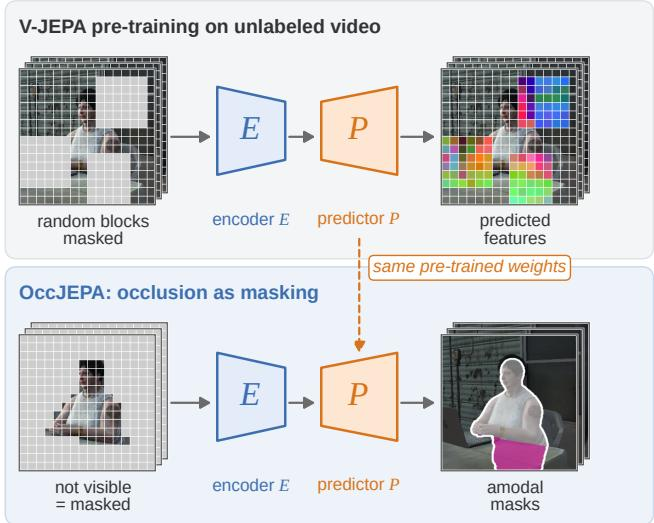  
Figure 1. Background and concept of OccJEPA. Top: a video world model such as V-JEPA is pre-trained without labels: the encoder E reads the visible tokens of a clip and the predictor P predicts the features of masked space-time blocks. Bottom: amodal segmentation asks the same question for an occluded object. OccJEPA treats occlusion as masking: the tokens that the object’s visible mask does not cover are masked, the predictor with the same pre-trained weights fills them in, and a light head turns the result into the complete mask (magenta: completed hidden part), without depth or sampling. Real data of a SAIL-VOS sequence; feature colours: first three principal components; the top block mask is illustrative.

Self-supervised video world models offer another prior. Joint-embedding predictive architectures (JEPAs) [2, 28] hide large space-time regions of a clip and train a predictor to infer their representation from the visible rest [3, 7, 32]. The hidden regions often contain parts of objects, so the predictor has to learn how objects continue. Amodal completion asks the same question for one object: given its visible part, what occupies the region we cannot see? Yet the predictor is normally discarded after pre-training.

We therefore treat occlusion as masking (Figs. 1 and 2). Tokens that the object’s visible mask does not cover are dropped, as masked tokens are in pre-training; the pretrained V-JEPA 2.1 predictor predicts their features; and a small head decodes the observed and predicted features into amodal masks. A second, parameter-free pass re-crops objects whose predicted extent leaves the first crop. We call the model OccJEPA, for Occlusion as masking in a JEPA; it needs no occluder masks, no depth and no sampling.

On SAIL-VOS [21], OccJEPA reaches an occluded IoU of 43.68 against 39.98 for Diffusion-VAS on a common set of frames. On the real videos of TAO-Amodal [18] it improves $\mathsf { A P } _ { 5 0 }$ by +4.11 on val and by +4.00 on a held-out test split that we build with the Diffusion-VAS protocol, and it keeps its lead when SAM2 [36] tracks the visible masks. It also outperforms Diffusion-VAS on the Kubric benchmarks of TACO [31] under a common scorer, and it is 33.5× faster than Diffusion-VAS with 25× fewer FLOPs. Controlled experiments locate the source of the gain: the same predictor trained from scratch loses most of it, the gain appears for V-JEPA encoders from 87M to 1.85B parameters, and VideoMAE’s pre-trained pixel decoder [40] helps in the same way, with the latent V-JEPA predictor giving the strongest model.

Our contributions are:

• We formulate amodal video segmentation as masked latent prediction with the released predictor of a selfsupervised video world model: occlusion as masking.

• We build OccJEPA, a fast, deterministic model that improves over the diffusion-based state of the art on SAIL-VOS and TAO-Amodal, including a held-out test split and visible masks tracked by SAM2, with one set of weights.

• We show with controlled experiments and feature visualisations that the gain comes from the pre-trained weights of the completion module, for world models of every size and for VideoMAE as well.

## 2. Related Work

Amodal segmentation. Amodal instance segmentation was introduced by Li and Malik [30], with human annotations in COCOA [57] and KINS [35]. Image models use occlusion-aware heads [25, 41], shape priors [13, 45], synthetic de-occlusion [51] or layered scene completion [55] (survey: [1]). Recent methods borrow priors from large pre-trained models: image diffusion [34, 47, 50], inpainting models without tuning [29], and segmentation foundation models [26, 36, 52]. In video, SAIL-VOS [21, 22] and TAO-Amodal [18] provide amodal annotations for synthetic and real clips. SaVos [49] learns from motion without amodal labels, EoRaS [12] uses objectcentric bird’s-eye-view representations, A2VIS [42] adds amodal awareness to video instance segmentation, and several trackers keep objects through occlusion [17, 23, 38, 39]. Diffusion-VAS [9] fine-tunes Stable Video Diffusion [8] to generate amodal masks from visible masks and pseudodepth [48] and reports the best results on SAIL-VOS and TAO-Amodal; TACO [31] completes the hidden RGB content with a video diffusion model. Visible masks can come from any video object segmenter [10, 11, 36].

Self-supervised video models and world models. Masked modelling reconstructs the pixels [16, 40, 43] or the tokens and features [5, 6, 44] of masked regions. Generative imputation completes partially observed time series [53]. JEPAs predict the representations of masked regions in a learned latent space [2, 28]. V-JEPA [7] does so for video with large space-time masks, V-JEPA 2 [3] scales it and adds an action-conditioned predictor for planning, and V-JEPA 2.1 [32] adds dense objectives. Latent world models also serve planning [15, 56], but downstream use usually keeps only the encoder. A JEPA predictor has been shown to complete occluded features for image classification [33], and concurrent work asks what video world models retain about a hidden object [46]. We use the released video predictor as the completion module of an amodal segmentation model and evaluate it on the standard benchmarks.

Repurposing pre-trained models. Large generative models have been fine-tuned for depth [20, 24] and semantic perception [54], probed for correspondence [37], and finetuned for amodal completion [9, 31, 34]. We repurpose a predictive model instead. Because the predictor is used for the operation it was trained on, a light head and low-rank adapters [19] suffice, and inference is a deterministic forward pass.

## 3. Method

## 3.1. Problem setup

A video contains frames $I _ { 1 } , \ldots , I _ { L }$ and, for one target object, its visible (modal) masks $m _ { 1 } , \ l . . . , m _ { L } \in \{ 0 , 1 \} ^ { \ l _ { H } \times W }$ The task is to predict its amodal masks $a _ { t } \ \supseteq \ m _ { t } .$ , which also cover the parts hidden by other objects. As in prior work [9, 12, 13], the visible masks are given; in practice they can come from any video object segmenter [11, 36].

## 3.2. Background: V-JEPA

A V-JEPA world model [3, 7, 32] has an encoder E, a vision transformer that maps a clip x to N tokens, one per space-time tubelet, and a predictor P, a narrower transformer. In pre-training, a random set D of tubelets, covering large space-time blocks, is masked and the rest, K, is kept. The encoder reads only the kept tokens, and the predictor receives their features together with learnable mask tokens placed at the positions in $D .$ . Its masked-prediction objective regresses the features that a slowly updated target encoder E¯ computes on the full clip:

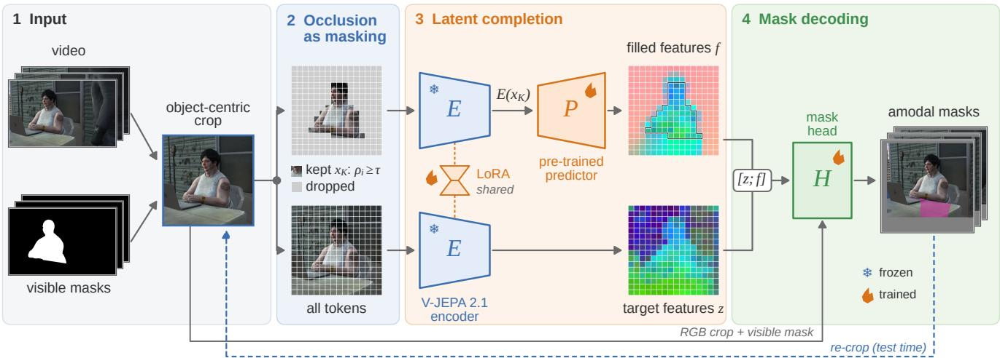  
Figure 2. Overall framework of OccJEPA. The clip is cropped around the object’s visible mask. Tokens whose visible-mask coverage $\rho _ { i }$ is below τ are dropped; the encoder E reads the kept tokens and the pre-trained V-JEPA 2.1 predictor $P$ predicts features at the dropped positions, giving the filled features f (Eq. (4)). The same encoder also reads the full clip (z); it stays frozen except for one LoRA adapter (bow tie: a low-rank bottleneck) shared by both passes. The mask head H decodes $[ z ; f ]$ , together with the RGB crop and the visible mask, into amodal masks, which are pasted back into the frames; at test time, a second pass re-crops objects that leave the first crop. Real data of a SAIL-VOS validation sequence: feature maps show the first three principal components of z and $f$ (in $f ,$ the black outline encloses the kept tokens; everything outside it is predicted); magenta: completed hidden part.

$$
\operatorname* { m i n } _ { E , P } \ \left\| P \big ( E ( x _ { K } ) , D \big ) - \mathrm { s g } \big ( \bar { E } ( x ) \big ) _ { D } \right\| _ { 1 } ,\tag{1}
$$

where sg stops gradients. Because the target lives in representation space, the predictor need not render unpredictable pixel detail; it learns what is likely to occupy a hidden region given what is visible around it. We use the released V-JEPA 2.1 ViT-G model: a 48-block encoder with 1.85B parameters, a 24-block predictor, and features concatenated from four encoder depths [32].

## 3.3. Occlusion as masking

Object-centric clip. For frame t, let $( c _ { t } , h _ { t } , w _ { t } )$ be the centre, height and width of the bounding box of $m _ { t }$ . We crop a square of side

$$
s _ { t } = \operatorname* { m i n } \bigl ( \operatorname* { m a x } \bigl ( 2 \operatorname* { m a x } ( h _ { t } , w _ { t } ) , s _ { \operatorname* { m i n } } \bigr ) , s _ { \operatorname* { m a x } } \bigr )\tag{2}
$$

centred at $c _ { t }$ and shifted into the frame (on TAO-Amodal, into the padded canvas on which Diffusion-VAS also predicts), and resize it to $2 5 6 \times 2 5 6 ;$ in frames where the object is invisible, centre and side are interpolated from the other frames. A clip x holds T=24 such crops and the cropped visible masks $\tilde { m }$ . With tubelets of $2 \times 1 6 \times 1 6$ pixels it has $N = 1 2 \times 1 6 \times 1 6$ tokens.

Dropping what is not visible. Let $V _ { i }$ be the pixels of tubelet i and

$$
\rho _ { i } = \frac { 1 } { | V _ { i } | } \sum _ { p \in V _ { i } } \tilde { m } ( p )\tag{3}
$$

its coverage by the visible mask. We keep $K = \{ i : \rho _ { i } \geq$ $\tau \}$ and drop $D = \{ i : \rho _ { i } < \tau \}$ , with $\tau = 0 . 2 5$ . The dropped set contains the hidden parts of the object, but also the occluders and the background. No occluder mask is needed, and deciding where the object continues is left to the model.

Latent completion. The encoder computes the features of the full clip, $z \ = \ \mathrm { L N } \big ( E ( x ) \big ) \ \in \ \mathring { \mathbb { R } } ^ { N \times d }$ , normalised per feature level as in pre-training, and the context features $E ( x _ { K } )$ of the kept tokens only. The predictor then fills the dropped positions:

$$
\begin{array} { r } { \hat { z } _ { D } = P \big ( E ( x _ { K } ) , D \big ) , \qquad f _ { i } = \left\{ \begin{array} { l l } { \hat { z } _ { i } , } & { i \in D , } \\ { z _ { i } , } & { i \in K . } \end{array} \right. } \end{array}\tag{4}
$$

This is the pre-training computation of Eq. (1) with one change: the masked set is defined by the object’s visibility instead of a random block mask. Each token now carries two descriptions, $z _ { i }$ , what the clip shows at that position, and $f _ { i } .$ , what the predictor infers there from the object’s visible part alone. Where an occluder hides the object, $z _ { i }$ describes the occluder and $f _ { i }$ can describe the object; Fig. 4 shows that this happens.

Why the pre-trained predictor helps. Under the $\ell _ { 1 }$ objective of Eq. (1), the best prediction for a masked token is the median of its target feature given the context. In Eq. (4) the context holds only the object’s visible tokens, so the estimate at a dropped position summarises what typically lies there next to such an object: the object where its shape is likely to continue, generic background elsewhere, and not the occluder, which is absent from the context. A randomly initialised predictor has to learn this from the amodal labels alone (Tab. 4).

Mask head. The head H maps the token grid of $[ z ; f ] \in$ $\mathbb { R } ^ { N \times 2 d }$ to amodal logits. A LayerNorm and a linear layer project each token to 256 channels; transposed convolutions upsample the $1 2 \times 1 6 \times 1 6$ grid to $2 4 \times 1 2 8 \times 1 2 8$ , and the visible mask is fused at the two finest scales. A sub-pixel refiner with 80K parameters, which also reads the RGB crop and $\tilde { m } ,$ , raises the output to $2 4 \times 2 5 6 \times 2 5 6$ logits ℓ. The predicted amodal mask of frame t is

$$
\hat { a } _ { t } = \Pi _ { t } \big ( \ell _ { t } > 0 \big ) \vee m _ { t } ,\tag{5}
$$

where $\Pi _ { t }$ resizes the crop-space mask to the crop box and pastes it into the frame. Clips longer than T frames are covered by overlapping windows, a later window overwriting earlier frames.

Training. The predictor is initialised with its released weights and fine-tuned. The encoder stays frozen except for low-rank adapters [19] (rank 16) on its last 12 blocks, and the same adapted encoder computes z and $E ( x _ { K } )$ . With $y = \sigma ( \ell )$ and the cropped amodal target $^ { a , }$ the loss is

$$
\mathcal { L } = \mathrm { B C E } ( \ell , a ) + 1 - \frac { 2 \sum y a + 1 } { \sum y + \sum a + 1 } .\tag{6}
$$

We train one model on a 50/50 mixture of SAIL-VOS [21] and MOVi-D [12, 14] clips, with the ground-truth visible masks as input. MOVi-D lets the same weights serve the synthetic benchmarks; it does not raise accuracy on SAIL-VOS or TAO-Amodal (supplementary), so the gains over Diffusion-VAS do not come from the extra data.

## 3.4. Test-time re-crop

The crop of Eq. (2) is defined by the visible part. When most of the object is hidden, its amodal extent can leave the crop and cannot be predicted. We therefore run a second pass: the boxes are recomputed with the same rule Eq. (2), applied to $\hat { a } _ { t } \vee m _ { t }$ from the first pass instead of $m _ { t }$ , and the same model predicts again on the new crops. Re-crop has no parameters and is used once; it doubles the inference cost. The supplementary material gives the complete inference procedure as pseudo-code.

## 4. Experiments

## 4.1. Setup

Benchmarks and metrics. We follow the protocols of Diffusion-VAS [9]. SAIL-VOS [21] val has 5,432 25-frame sequences from 39 game-engine videos and is scored with the official amodal mIoU and the occluded-region mIo $\boldsymbol { \mathrm { J _ { o c c } } }$ The official $\mathrm { m I o U _ { o c c } }$ averages each method over the frames on which it predicts some hidden part, and Diffusion-VAS predicts none on 27.5% of the occluded frames, so we also report mIo $\mathrm { J _ { o c c } ^ { f i x e d } }$ on all 83,245 occluded frames. TAO-Amodal [18] annotates amodal boxes in real videos and is scored by box $\mathrm { { A P } _ { 2 5 } , \mathrm { { A P } _ { 5 0 } } }$ and $\mathsf { A P } _ { 7 5 }$ . Besides val (34,800 frames), we evaluate on a held-out test split (48,675 frames, 772 videos) built with the Diffusion-VAS sequence rule after our model was fixed. MOVi-D, MOVi-B [12, 14], Kubric-Static and Kubric-Dynamic [31] are synthetic.

Baselines and implementation. Diffusion-VAS is the state of the art on SAIL-VOS and TAO-Amodal. We score its released outputs on SAIL-VOS and TAO-Amodal val and run its released checkpoint on our test split and on Kubric. Every method receives the ground-truth visible masks, and differences come with 95% bootstrap CIs over videos. OccJEPA uses the released V-JEPA 2.1 ViT-G encoder and predictor, LoRA of rank 16 on the last 12 encoder blocks, and 6000 steps with 8 clips per batch; the supplementary material gives all details.

## 4.2. Comparison with the state of the art

SAIL-VOS and TAO-Amodal. Table 1 compares OccJEPA with every method reported by Diffusion-VAS. Among methods that output a single prediction, OccJEPA has the best mIoU on SAIL-VOS (78.60) and the best AP on TAO-Amodal at every threshold. Scored on the same frames (Tab. 2), it completes the occluded region better than Diffusion-VAS by +3.70 [+1.38, +5.40] mIoUfixed, a margin that holds when whole game missions are resampled (23 missions, lower bound +0.78). On the official mIoUocc, each method is averaged over its own frames (51.4% of all frames for OccJEPA, 44.5% for Diffusion-VAS), so the two numbers in Tab. 1 describe different subsets. On TAO-Amodal, OccJEPA improves $\mathrm { { A P } _ { 5 0 } }$ by +4.11 on val and by +4.00 on the held-out test split, so the gain carries over to unseen videos. It is largest where the task is hardest: on test frames with less than half of the object visible, $\mathsf { A P } _ { 5 0 }$ rises by +29.44. A single deterministic prediction of OccJEPA also exceeds the best of three Diffusion-VAS samples, selected with the ground truth (supplementary), in $\mathsf { A P } _ { 5 0 }$ (93.36 vs. 92.46) and $\mathsf { A P } _ { 2 5 }$ (98.68 vs. 98.31): sampling more outputs from the diffusion model does not close the gap.

<table><tr><td></td><td></td><td colspan="2">SAIL-VOS val</td><td colspan="3">TAO-Amodal val</td></tr><tr><td>Method</td><td>Type</td><td>mIoU</td><td> $\mathrm { m I o U _ { o c c } }$ </td><td> $\mathrm { A P _ { 2 5 } }$ </td><td> $\mathrm { A P _ { 5 0 } }$ </td><td> $\mathrm { A P _ { 7 5 } }$ </td></tr><tr><td>Visible mask</td><td>一</td><td>67.89</td><td>n/a</td><td>93.73</td><td>82.22</td><td>63.12</td></tr><tr><td>Convex hull</td><td></td><td>63.18</td><td>27.54</td><td>93.73</td><td>82.22</td><td>63.12</td></tr><tr><td>Convex hull (refined)</td><td>一</td><td>71.21</td><td>34.27</td><td>93.73</td><td>82.22</td><td>63.12</td></tr><tr><td>PCNet-M [51]</td><td>image</td><td>74.20</td><td>42.52</td><td>94.89</td><td>85.11</td><td>65.97</td></tr><tr><td>AISFormer [41]</td><td>image</td><td>73.51</td><td>39.16</td><td>95.45</td><td>81.93</td><td>59.84</td></tr><tr><td>SDAmodal [50]</td><td>image</td><td>72.73</td><td>41.26</td><td>94.43</td><td>83.60</td><td>63.06</td></tr><tr><td>pix2gestalt [34]</td><td>image</td><td>54.83</td><td>26.59</td><td>80.73</td><td>57.50</td><td>28.95</td></tr><tr><td>VideoMAE [40]</td><td>video</td><td>69.67</td><td>29.39</td><td>69.14</td><td>56.71</td><td>41.19</td></tr><tr><td>3D-UNet [9]</td><td>video</td><td>72.79</td><td>39.54</td><td>94.59</td><td>83.83</td><td>64.33</td></tr><tr><td>Diffusion-VAS [9]</td><td>video</td><td>77.07</td><td>55.12</td><td>97.28</td><td>89.25</td><td>71.99</td></tr><tr><td>OccJEPA (ours)</td><td>video</td><td>78.60</td><td>52.09</td><td>98.68</td><td>93.36</td><td>76.84</td></tr></table>

Table 1. Comparison with the state of the art on SAIL-VOS and TAO-Amodal (Diffusion-VAS protocols). Rows other than ours are reported by [9] (CVPR version); ours is scored with the official metric, which our re-implementation reproduces to within 0.01 on the released Diffusion-VAS outputs (77.08 / 55.12 vs. the reported 77.07 / 55.12). $\mathrm { m I o U _ { o c c } }$ of the visible mask is undefined (its occluded part is empty); convex hulls have the same box as the visible mask on TAO-Amodal. Bold: best, underline: second best. Every method takes the ground-truth visible masks; all are zero-shot on TAO-Amodal.

<table><tr><td rowspan="2">Method</td><td>SAIL-VOS</td><td colspan="2">TAO val</td><td colspan="2">TAO test</td></tr><tr><td> $\overline { { { \bf { m } } { \bf { I o } } { \bf { U } } _ { \mathrm { { o c c } } } ^ { \mathrm { { f i x e d } } } } }$ </td><td> $\mathrm { { A P } _ { 5 0 } }$ </td><td> $\mathrm { A P } _ { 7 5 }$ </td><td> $\mathrm { A P _ { 5 0 } }$ </td><td> $\mathrm { A P } _ { 7 5 }$ </td></tr><tr><td>Visible mask</td><td>0.00</td><td>82.22</td><td>63.12</td><td>83.08</td><td>62.42</td></tr><tr><td>Diffusion-VAS [9]</td><td>39.98</td><td>89.25</td><td>71.99</td><td>88.99</td><td>71.05</td></tr><tr><td>OccJEPA (ours)</td><td>43.68</td><td>93.36</td><td>76.84</td><td>92.99</td><td>76.40</td></tr><tr><td>∆ vs. Diffusion-VAS</td><td> $+ 3 . 7 0$  [+1.38, +5.40] [+3.02, +5.21] [+3.39, +6.34] [+2.99, +5.03] [+4.15, +6.56]</td><td>+4.11</td><td>+4.85</td><td>+4.00</td><td> $+ 5 . 3 5$ </td></tr></table>

Table 2. Controlled comparison: every method scored by us on the same frames with the same code. mIo $\boldsymbol { \mathrm { J } } _ { \mathrm { o c c } } ^ { \mathrm { f i x e d } }$ : occluded IoU on the fixed set of 83,245 SAIL-VOS frames with an occluded region, a miss counting as 0. TAO test (48,675 frames, 772 videos) was never used for any choice; Diffusion-VAS on test is its released checkpoint run by us. ∆: 95% CI, bootstrap over videos.

Predicted visible masks. In a complete system, a video object segmenter supplies the visible masks. With masks tracked on the test split by SAM2 [36] from the annotated first frame (mean IoU 0.83 with the annotations) and both methods unchanged, OccJEPA still leads Diffusion-VAS by +4.32 [+3.37, +5.34] $\mathrm { { A P } _ { 5 0 } }$ (85.59 vs. 81.27), and by +22.22 when less than half of the object is visible.

Figure 3 compares the two methods. On SAIL-VOS, Diffusion-VAS completes little of the hidden objects, while OccJEPA recovers their full shape, also for the door while a person walks in front of it. On TAO-Amodal, OccJEPA recovers the extent of people and of a rabbit, where the boxes of Diffusion-VAS stay near the visible part or spill onto neighbouring objects.

Synthetic benchmarks. On Kubric (Tab. 3, right), with both models run on the same inputs and scored by the same code, OccJEPA leads Diffusion-VAS by +1.19 (Static) and +3.57 (Dynamic) mIoU. On MOVi, in the whole-frame setting, where every method sees the full frame, OccJEPA leads on MOVi-D and, without any MOVi-B training, also on MOVi-B, on which Diffusion-VAS is trained. In the cropped setting, which fixes the input to the EoRaS crop region, OccJEPA is within 0.6 mIoU of Diffusion-VAS on MOVi-D and, without MOVi-B training, within 1.6 on MOVi-B. All results come from a single set of weights, trained once on SAIL-VOS and MOVi-D, whereas Diffusion-VAS uses a separate model for MOVi-B.

## 4.3. Cost

Diffusion-VAS runs a depth network on every frame and 25 denoising steps of a video diffusion model with 1.52B parameters in its U-Net (903 TFLOPs per clip). OccJEPA runs two deterministic forward passes of a 1.91B-parameter model (35.6 TFLOPs), 25× fewer; on the same GPU it takes 0.35 s instead of 11.77 s per object (33.5× faster). Only 69M of its parameters are trained (Tab. 6), in 8 hours on one GPU with 17.0 GB of memory; a full cost breakdown is in the supplementary material. Figure 5a relates cost and accuracy. With the distilled ViT-L world model (3.6 TFLOPs, 248× fewer than Diffusion-VAS), OccJEPA already exceeds Diffusion-VAS on TAO-Amodal $( \mathrm { A P _ { 5 0 } }$ +1.83 [+0.83, +2.91]) and is within 0.83 of it on $\mathrm { S A I L - }$ VOS mIoUfixed. On TAO-Amodal every world model, down to the 87M-parameter ViT-B (90.13), scores a higher $\mathrm { { A P } _ { 5 0 } }$ than Diffusion-VAS (89.25).

## 4.4. Where does the gain come from?

The pre-trained predictor. Table 4 fixes the data, schedule, head and LoRA and changes only the completion module. The predictor adds +8.53 mIo $\mathrm { J _ { o c c } ^ { f i x e d } }$ on SAIL-VOS and +3.93 AP on TAO-Amodal val (+4.08 on the test split). The same predictor architecture trained from a random initialisation recovers only +2.15 and +0.74: the pre-trained weights account for 75% of the SAIL-VOS gain and 81% of the TAO-Amodal gain. The predictor contributes what it learned in pre-training, not extra capacity. It is also what puts OccJEPA ahead of Diffusion-VAS: with the same crops, head and data but no predictor, the model is below Diffusion-VAS on SAIL-VOS (35.15 vs. 39.98 mIoUfixedocc ) and level with it on TAO-Amodal (89.43 vs. 89.25 AP50).

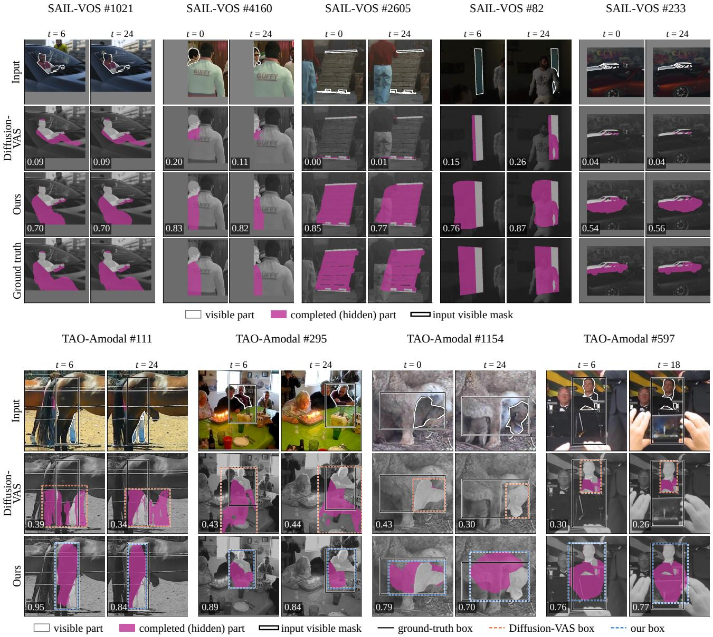  
Figure 3. Qualitative results, two frames far apart per sequence. Top: SAIL-VOS, per-frame occluded IoU. Bottom: real TAO-Amoda videos, which annotate only amodal boxes (values: box IoU). Magenta: completed hidden part; grey: outside the image. More examples in the supplementary material.

Re-crop. The second pass adds $+ 0 . 3 6 \mathrm { m I o U _ { o c c } ^ { f i x e d } }$ on SAIL-VOS and +1.31 $\mathrm { { A P } _ { 5 0 } }$ on TAO-Amodal val. It matters most when the object is mostly hidden and the first crop is too small: on test frames with visibility below 0.5 it adds $+ 1 1 . 3 3 \mathrm { \ A P _ { 5 0 } }$

Occlusion level. Figure 5b and c show that the advantage of OccJEPA grows with occlusion. On SAIL-VOS it leads in every bin from 20% occlusion on, by 6.2 to 9.2 points. Below 10% the hidden part is often a sliver finer than the token grid, which pixel-level generation fits better.

<table><tr><td colspan="3">MOVi-D</td></tr><tr><td>Method</td><td>mIoU</td><td> $\mathrm { m I o U _ { o c c } }$ </td></tr><tr><td>cropped</td><td></td><td></td></tr><tr><td>EoRaS+SG [12]</td><td>74.10</td><td>38.33</td></tr><tr><td>C2F-Seg [13]</td><td>71.67</td><td>36.13</td></tr><tr><td>Amodal SAM [52]</td><td>73.06</td><td>39.21</td></tr><tr><td>Diffusion-VAS [9]</td><td>77.03</td><td>44.23</td></tr><tr><td>OccJEPA</td><td>76.47</td><td>42.05</td></tr><tr><td>whole frame Diffusion-VAS [9]</td><td>82.97</td><td>47.86</td></tr><tr><td>OccJEPA</td><td>84.66</td><td>52.00</td></tr><tr><td></td><td></td><td></td></tr></table>

<table><tr><td colspan="3">MOVi-B</td></tr><tr><td>Method</td><td>mIoU</td><td> $\mathrm { m I o U _ { o c c } }$ </td></tr><tr><td>cropped</td><td></td><td></td></tr><tr><td>EoRaS [12]</td><td>79.22</td><td>47.89</td></tr><tr><td>EoRaS+SG [12]</td><td>81.76</td><td>49.39</td></tr><tr><td>Diffusion-VAS [9]</td><td>83.51</td><td>53.75</td></tr><tr><td>OccJEPA*</td><td>81.87</td><td>48.70</td></tr><tr><td>whole frame</td><td></td><td></td></tr><tr><td>Diffusion-VAS [9]</td><td>87.80</td><td>53.69</td></tr><tr><td>OccJEPA*</td><td>88.94</td><td>57.00</td></tr></table>

<table><tr><td colspan="3">Kubric (TACO), mIoU</td></tr><tr><td>Method</td><td>Static</td><td>Dynamic</td></tr><tr><td>reported by [27, 31]</td><td></td><td></td></tr><tr><td>pix2gestalt [34]</td><td>75.6</td><td>68.3</td></tr><tr><td>PCNet [51]</td><td>83.2</td><td>76.2</td></tr><tr><td>TACO [31]</td><td>83.9</td><td>77.4</td></tr><tr><td>Diffusion-VAS [9]</td><td>84.3</td><td>77.8</td></tr><tr><td>IC-Amodal [27]</td><td>86.7</td><td>85.5</td></tr><tr><td>run by us, same inputs and scorer</td><td></td><td></td></tr><tr><td>Diffusion-VAS [9]</td><td>92.1</td><td>89.7</td></tr><tr><td>OccJEPA</td><td>93.3</td><td>93.2</td></tr></table>

Table 3. Synthetic benchmarks. MOVi rows of other methods are copied from their papers (EoRaS counting). ∗OccJEPA is zero-shot on MOVi-B, whereas EoRaS and Diffusion-VAS are trained on it. Kubric: the upper block lists values reported with TACO’s scorer; the lower block scores both models with our implementation of the metric (Diffusion-VAS: released SAIL-VOS checkpoint), and comparisons are made within a block. One OccJEPA model is used for all benchmarks. Bold: best; underline: second best within a group.

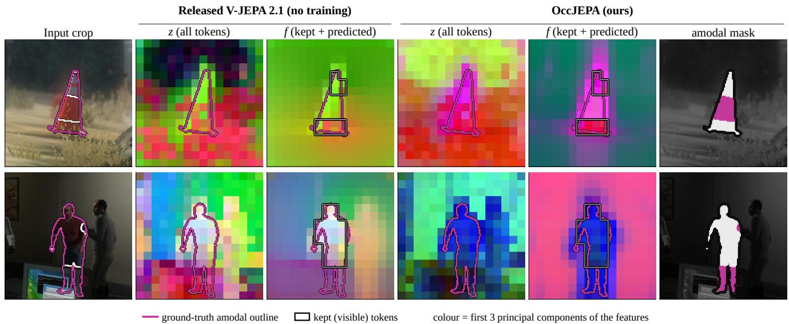  
Figure 4. What the predictor fills in. Features of a clip shown as colours (first three principal components; one projection per model and example, shared by z and f). z: the encoder on all tokens, so the hidden part of the object shows the occluder. f (Eq. (4)): the encoder on the kept tokens only (black boxes) and the predictor everywhere else. Inside the ground-truth amodal outline, f continues the colour of the visible object behind the occluder: the predictor completes the object in feature space. The released V-JEPA 2.1 predictor already does this in part, without any training on amodal labels; in OccJEPA the completed region follows the object’s true extent, which the mask head turns into the amodal mask. Top: the SAIL-VOS sequence with our largest gain over Diffusion-VAS; bottom: the sequence at the median gain.

On TAO-Amodal, OccJEPA keeps a high $\mathsf { A P } _ { 5 0 }$ down to a visibility of 0.25 (77.7 vs. 43.4 between 0.25 and 0.5), and with less than a quarter of the object visible it still reaches 41.5 against 24.5.

World-model size. Table 5 repeats the recipe with four V-JEPA 2.1 world models. The predictor improves over the same encoder without it at every size (+8.67, +8.42, +8.45 and +8.19 mIoU $\mathrm { J _ { o c c } ^ { f i x e d } }$ from ViT-B to ViT-G), and the SAIL-

VOS accuracy of the full model increases with size. The distilled ViT-B and ViT-L predictors output ViT-G features, so for them the head also reads the encoder tokens.

Other completion modules. VideoMAE [40] pre-trains a pixel decoder that reconstructs masked tubelets. Used in place of the predictor with the same recipe, it improves over its encoder alone by +9.83 mIoUfixedocc , and its pre-trained weights add +7.41 over a random initialisation: in both families the module contributes what it learned in pre-training. At matched size, latent prediction gives the stronger model: V-JEPA ViT-L outperforms VideoMAE ViT-L with its de-$\mathrm { A P _ { 5 0 } ) }$

(c) TAO-Amodal val: visibility  
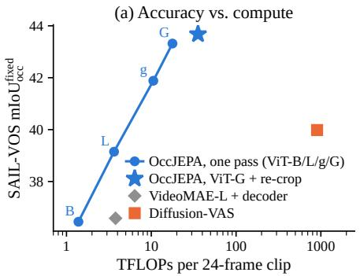

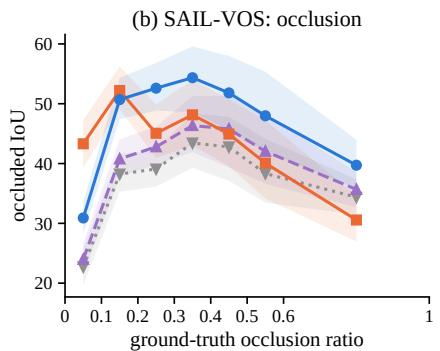

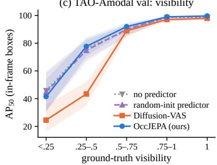  
Figure 5. Analysis. (a) SAIL-VOS mIo $\mathrm { J _ { o c c } ^ { f i x e d } }$ against measured inference FLOPs per clip (log scale): our model with four V-JEPA world models (one pass), the final model with re-crop, the VideoMAE variant, and Diffusion-VAS. (b) Occluded IoU on SAIL-VOS by ground truth occlusion ratio. (c) TAO-Amodal val $\mathrm { A P _ { 5 0 } }$ by ground-truth visibility, for frames whose amodal box lies inside the image. Bands: 95% bootstrap CIs over videos.

<table><tr><td rowspan="2">Completion module</td><td rowspan="2"></td><td colspan="3">SAIL-VOS</td><td colspan="2">TAO val</td></tr><tr><td>RC mIoU</td><td> $\mathrm { m I o U _ { o c c } }$ </td><td> $\mathrm { m I o U _ { o c c } ^ { f i x e d } }$ </td><td> $\mathrm { \ A P _ { 5 0 } }$ </td><td> $\mathrm { A P } _ { 7 5 }$ </td></tr><tr><td>none</td><td></td><td>75.81</td><td>42.39</td><td>35.13</td><td>88.8068.14</td><td></td></tr><tr><td>random init</td><td></td><td>76.81</td><td>44.81</td><td>36.94</td><td></td><td>89.34 69.83</td></tr><tr><td>pre-trained</td><td></td><td>78.73</td><td>51.52</td><td>43.32</td><td>92.05</td><td>75.63</td></tr><tr><td>none</td><td>√</td><td>75.18</td><td>42.26</td><td>35.15</td><td></td><td>89.43 68.18</td></tr><tr><td>random init</td><td>√</td><td>76.60</td><td>45.09</td><td>37.30</td><td></td><td>90.17 70.32</td></tr><tr><td>pre-trained</td><td>√</td><td>78.60</td><td>52.09</td><td>43.68</td><td></td><td>93.36 76.84</td></tr><tr><td>pre-trained – none</td><td>√</td><td>+3.42</td><td>+9.83</td><td>+8.53</td><td></td><td>+3.93 +8.66</td></tr><tr><td>random – none</td><td>√</td><td>+1.42</td><td>+2.84</td><td>+2.15</td><td></td><td>+0.74 +2.14</td></tr><tr><td>pre-trained — random</td><td>√</td><td>+2.00</td><td> $+ 6 . 9 9$ </td><td>+6.38</td><td></td><td> $+ 3 . 1 9 \ + 6 . 5 2$ </td></tr></table>

Table 4. Ablation of the completion module (ViT-G; identical data, schedule, head and LoRA). Random init: same predictor architecture with V-JEPA’s official initialisation. RC: test-time recrop. Every difference in the last three rows has a 95% CI above zero (bootstrap over videos; supplementary).

## 5. Conclusion

The predictor of a self-supervised video world model is trained to infer what lies in masked regions, and amodal segmentation asks the same question about occluded ones. Treating occlusion as masking turns the released V-JEPA 2.1 predictor into a completion module: one deterministic model completes occluded objects more accurately than the diffusion-based state of the art on SAIL VOS, TAO-Amodal and Kubric, 33.5× faster, and controlled experiments show that the knowledge lives in the pre-trained predictor. It keeps its lead with visible masks tracked by SAM2 [36], so together with a video object segmenter it forms a complete amodal video segmenter, with no depth network and no sampling. World-model predictors deserve a place in perception, not only in pre-training: what they learn to predict is what a perception system cannot see.

<table><tr><td colspan="4">with module gain</td></tr><tr><td>World model</td><td>Params TFLOPs</td><td>SV  $\mathsf { A P } _ { 5 0 }$ </td><td>SV  $\mathsf { A P } _ { 5 0 }$ </td></tr><tr><td colspan="4">pre-trained module (V-JEPA: predictor; VideoMAE: decoder)</td></tr><tr><td>V-JEPA 2.1 ViT-B* 0.11B</td><td>1.4</td><td>36.45 90.13 +8.67 +1.95</td><td></td></tr><tr><td>V-JEPA 2.1 ViT-L* 0.33B</td><td>3.6</td><td>39.15 91.09 +8.42 +2.73</td><td></td></tr><tr><td>V-JEPA 2.1 ViT-g 1.08B</td><td>10.6</td><td>41.88 90.96 +8.45 +2.93</td><td></td></tr><tr><td>V-JEPA 2.1 ViT-G 1.91B</td><td>17.8</td><td>43.32 92.05 +8.19+3.24</td><td></td></tr><tr><td>VideoMAE ViT-L 0.35B</td><td>3.8</td><td>36.58 90.25 +9.83 +2.51</td><td></td></tr><tr><td colspan="4">same module, randomly initialised</td></tr><tr><td>V-JEPA 2.1 ViT-g 1.08B</td><td>10.6</td><td>36.16 88.69 +2.72 +0.66</td><td></td></tr><tr><td>VideoMAE ViT-L</td><td>0.35B 3.8</td><td>29.17 88.96 +2.42 +1.22</td><td></td></tr></table>

Table 5. Completion modules of video self-supervised models, same recipe (standard crop, one pass). SV: SAIL-VOS mIoUfixedocc ; occ $\mathrm { { A P } _ { 5 0 } \mathrm { { : } } }$ TAO-Amodal val. Gain: over the same encoder without the module. Params and TFLOPs per 24-frame clip, measured. ∗Distilled from ViT-G. Every gain of a pre-trained module, and every difference between pre-trained and random-init modules, has a 95% CI above zero (supplementary).
<table><tr><td>Method</td><td>Params</td><td>TFLOPs</td><td>Time (s)</td><td>Extra input</td><td>Output</td></tr><tr><td>Diffusion-VAS</td><td>2.59B</td><td>903</td><td>11.77</td><td>depth</td><td>sampled</td></tr><tr><td>OccJEPA</td><td>1.91B</td><td>35.6</td><td>0.35</td><td></td><td>deterministic</td></tr></table>

Table 6. Inference cost per object and clip (Diffusion-VAS: 25 frames at 256×512, 25 denoising steps plus depth estimation; ours: 24 frames at 256×256, two passes with re-crop). FLOPs counted on the actual inference code; time on the same otherwise idle GPU, averaged over 50 objects.

## References

[1] Jiayang Ao, Qiuhong Ke, and Krista A. Ehinger. Image amodal completion: A survey. arXiv preprint arXiv:2207.02062, 2022. 2

[2] Mahmoud Assran, Quentin Duval, Ishan Misra, Piotr Bojanowski, Pascal Vincent, Michael Rabbat, Yann LeCun, and Nicolas Ballas. Self-supervised learning from images with a joint-embedding predictive architecture. In CVPR, 2023. 1, 2

[3] Mido Assran, Adrien Bardes, David Fan, Quentin Garrido, Russell Howes, Mojtaba Komeili, Matthew Muckley, Ammar Rizvi, Claire Roberts, Koustuv Sinha, Artem Zholus, Sergio Arnaud, Abha Gejji, Ada Martin, Francois Robert Hogan, Daniel Dugas, Piotr Bojanowski, Vasil Khalidov, Patrick Labatut, Francisco Massa, Marc Szafraniec, Kapil Krishnakumar, Yong Li, Xiaodong Ma, Sarath Chandar, Franziska Meier, Yann LeCun, Michael Rabbat, and Nicolas Ballas. V-JEPA 2: Self-supervised video models enable understanding, prediction and planning. arXiv preprint arXiv:2506.09985, 2025. 1, 2

[4] Ali Athar, Jonathon Luiten, Paul Voigtlaender, Tarasha Khurana, Achal Dave, Bastian Leibe, and Deva Ramanan. BURST: A benchmark for unifying object recognition, segmentation and tracking in video. In WACV, 2023. 12

[5] Alexei Baevski, Wei-Ning Hsu, Qiantong Xu, Arun Babu, Jiatao Gu, and Michael Auli. data2vec: A general framework for self-supervised learning in speech, vision and language. In ICML, 2022. 2

[6] Hangbo Bao, Li Dong, Songhao Piao, and Furu Wei. BEiT: BERT pre-training of image transformers. In ICLR, 2022. 2

[7] Adrien Bardes, Quentin Garrido, Jean Ponce, Xinlei Chen, Michael Rabbat, Yann LeCun, Mahmoud Assran, and Nicolas Ballas. Revisiting feature prediction for learning visual representations from video. Transactions on Machine Learning Research, 2024. 1, 2

[8] Andreas Blattmann, Tim Dockhorn, Sumith Kulal, Daniel Mendelevitch, Maciej Kilian, Dominik Lorenz, Yam Levi, Zion English, Vikram Voleti, Adam Letts, Varun Jampani, and Robin Rombach. Stable video diffusion: Scaling latent video diffusion models to large datasets. arXiv preprint arXiv:2311.15127, 2023. 1, 2

[9] Kaihua Chen, Deva Ramanan, and Tarasha Khurana. Using diffusion priors for video amodal segmentation. In CVPR, 2025. 1, 2, 4, 5, 7

[10] Ho Kei Cheng and Alexander G. Schwing. XMem: Longterm video object segmentation with an Atkinson-Shiffrin memory model. In ECCV, 2022. 2

[11] Ho Kei Cheng, Seoung Wug Oh, Brian Price, Joon-Young Lee, and Alexander Schwing. Putting the object back into video object segmentation. In CVPR, 2024. 2

[12] Ke Fan, Jingshi Lei, Xuelin Qian, Miaopeng Yu, Tianjun Xiao, Tong He, Zheng Zhang, and Yanwei Fu. Rethinking amodal video segmentation from learning supervised signals with object-centric representation. In ICCV, 2023. 1, 2, 4, 7

[13] Jianxiong Gao, Xuelin Qian, Yikai Wang, Tianjun Xiao, Tong He, Zheng Zhang, and Yanwei Fu. Coarse-to-Fine

amodal segmentation with shape prior. In ICCV, 2023. 1, 2, 7

[14] Klaus Greff, Francois Belletti, Lucas Beyer, Carl Doersch, Yilun Du, Daniel Duckworth, David J. Fleet, Dan Gnanapragasam, Florian Golemo, Charles Herrmann, Thomas Kipf, Abhijit Kundu, Dmitry Lagun, Issam Laradji, Hsueh-Ti Derek Liu, Henning Meyer, Yishu Miao, Derek Nowrouzezahrai, Cengiz Oztireli, Etienne Pot, Noha Rad wan, Daniel Rebain, Sara Sabour, Mehdi S. M. Sajjadi, Matan Sela, Vincent Sitzmann, Austin Stone, Deqing Sun, Suhani Vora, Ziyu Wang, Tianhao Wu, Kwang Moo Yi, Fangcheng Zhong, and Andrea Tagliasacchi. Kubric: A scalable dataset generator. In CVPR, 2022. 4

[15] David Ha and Jurgen Schmidhuber. World models. ¨ arXiv preprint arXiv:1803.10122, 2018. 2

[16] Kaiming He, Xinlei Chen, Saining Xie, Yanghao Li, Piotr Dollar, and Ross Girshick. Masked autoencoders are scalable´ vision learners. In CVPR, 2022. 2

[17] Basile Van Hoorick, Pavel Tokmakov, Simon Stent, Jie Li, and Carl Vondrick. Tracking through containers and occlud ers in the wild. In CVPR, 2023. 2

[18] Cheng-Yen Hsieh, Kaihua Chen, Achal Dave, Tarasha Khurana, and Deva Ramanan. TAO-Amodal: A benchmark for tracking any object amodally. arXiv preprint arXiv:2312.12433, 2023. 1, 2, 4

[19] Edward J. Hu, Yelong Shen, Phillip Wallis, Zeyuan Allen Zhu, Yuanzhi Li, Shean Wang, Lu Wang, and Weizhu Chen. LoRA: Low-rank adaptation of large language models. In ICLR, 2022. 2, 4, 11

[20] Wenbo Hu, Xiangjun Gao, Xiaoyu Li, Sijie Zhao, Xi aodong Cun, Yong Zhang, Long Quan, and Ying Shan. DepthCrafter: Generating consistent long depth sequences for open-world videos. In CVPR, 2025. 2

[21] Yuan-Ting Hu, Hong-Shuo Chen, Kexin Hui, Jia-Bin Huang, and Alexander G. Schwing. SAIL-VOS: Semantic amodal instance level video object segmentation – a synthetic dataset and baselines. In CVPR, 2019. 1, 2, 4

[22] Yuan-Ting Hu, Jiahong Wang, Raymond A. Yeh, and Alexander G. Schwing. SAIL-VOS 3D: A synthetic dataset and baselines for object detection and 3D mesh reconstruction from video data. In CVPR, 2021. 2

[23] Finlay G. C. Hudson and William A. P. Smith. Track anything behind everything: Zero-shot amodal video object segmentation. arXiv preprint arXiv:2411.19210, 2024. 2

[24] Bingxin Ke, Anton Obukhov, Shengyu Huang, Nando Metzger, Rodrigo Caye Daudt, and Konrad Schindler. Repurpos ing diffusion-based image generators for monocular depth estimation. In CVPR, 2024. 2

[25] Lei Ke, Yu-Wing Tai, and Chi-Keung Tang. Deep occlusionaware instance segmentation with overlapping BiLayers. In CVPR, 2021. 1, 2

[26] Alexander Kirillov, Eric Mintun, Nikhila Ravi, Hanzi Mao, Chloe Rolland, Laura Gustafson, Tete Xiao, Spencer Whitehead, Alexander C. Berg, Wan-Yen Lo, Piotr Dollar, and´ Ross Girshick. Segment anything. In ICCV, 2023. 2

[27] Xiaoyu Kong, Ketong Ren, Dongyu She, Weiming Dong, and Miao Wang. Image guides images: Consistent video

amodal completion with rectified in-context exemplar guidance. In CVPR, pages 8257–8266, 2026. 7

[28] Yann LeCun. A path towards autonomous machine intelligence. OpenReview preprint, 2022. 1, 2

[29] Jae Joong Lee, Bedrich Benes, and Raymond A. Yeh. Tuning-free amodal segmentation via the occlusion-free bias of inpainting models. In AAAI, 2026. 2

[30] Ke Li and Jitendra Malik. Amodal instance segmentation. In ECCV, 2016. 1, 2

[31] Ruijie Lu, Yixin Chen, Yu Liu, Jiaxiang Tang, Junfeng Ni, Diwen Wan, Gang Zeng, and Siyuan Huang. TACO: Taming diffusion for in-the-wild video amodal completion. In ICCV, 2025. 2, 4, 7, 12

[32] Lorenzo Mur-Labadia, Matthew Muckley, Amir Bar, Mido Assran, Koustuv Sinha, Mike Rabbat, Yann LeCun, Nicolas Ballas, and Adrien Bardes. V-JEPA 2.1: Unlocking dense features in video self-supervised learning. arXiv preprint arXiv:2603.14482, 2026. 1, 2, 3

[33] William Nguyen and Christopher Nguyen. The JEPA predictor: A transferable operator for occluded feature completion. arXiv preprint arXiv:2607.16274, 2026. 2

[34] Ege Ozguroglu, Ruoshi Liu, D´ıdac Sur´ıs, Dian Chen, Achal Dave, Pavel Tokmakov, and Carl Vondrick. pix2gestalt: Amodal segmentation by synthesizing wholes. In CVPR, 2024. 2, 5, 7

[35] Lu Qi, Li Jiang, Shu Liu, Xiaoyong Shen, and Jiaya Jia. Amodal instance segmentation with KINS dataset. In CVPR, 2019. 2

[36] Nikhila Ravi, Valentin Gabeur, Yuan-Ting Hu, Ronghang Hu, Chaitanya Ryali, Tengyu Ma, Haitham Khedr, Roman Radle, Chloe Rolland, Laura Gustafson, Eric Mintun, Junt-¨ ing Pan, Kalyan Vasudev Alwala, Nicolas Carion, Chao-Yuan Wu, Ross Girshick, Piotr Dollar, and Christoph Feicht-´ enhofer. SAM 2: Segment anything in images and videos. In ICLR, 2025. 2, 5, 8, 12

[37] Luming Tang, Menglin Jia, Qianqian Wang, Cheng Perng Phoo, and Bharath Hariharan. Emergent correspondence from image diffusion. In NeurIPS, 2023. 2

[38] Pavel Tokmakov, Jie Li, Wolfram Burgard, and Adrien Gaidon. Learning to track with object permanence. In ICCV, 2021. 2

[39] Pavel Tokmakov, Allan Jabri, Jie Li, and Adrien Gaidon. Object permanence emerges in a random walk along memory. In ICML, 2022. 2

[40] Zhan Tong, Yibing Song, Jue Wang, and Limin Wang. VideoMAE: Masked autoencoders are data-efficient learners for self-supervised video pre-training. In NeurIPS, 2022. 2, 5, 7

[41] Minh Tran, Khoa Vo, Kashu Yamazaki, Arthur Fernandes, Michael Kidd, and Ngan Le. AISFormer: Amodal instance segmentation with transformer. In BMVC, 2022. 1, 2, 5

[42] Minh Tran, Thang Pham, Winston Bounsavy, Tri Nguyen, and Ngan Le. A2VIS: Amodal-aware approach to video instance segmentation. Image and Vision Computing, 2025. 2

[43] Limin Wang, Bingkun Huang, Zhiyu Zhao, Zhan Tong, Yinan He, Yi Wang, Yali Wang, and Yu Qiao. VideoMAE V2:

Scaling video masked autoencoders with dual masking. In CVPR, 2023. 2

[44] Chen Wei, Haoqi Fan, Saining Xie, Chao-Yuan Wu, Alan Yuille, and Christoph Feichtenhofer. Masked feature prediction for self-supervised visual pre-training. In CVPR, 2022. 2

[45] Yuting Xiao, Yanyu Xu, Ziming Zhong, Weixin Luo, Jiawei Li, and Shenghua Gao. Amodal segmentation based on visible region segmentation and shape prior. In AAAI, 2021. 2

[46] Peng Xie and Amr Alanwar. Tracking is not permanence: What video world models keep of a hidden object. arXiv preprint arXiv:2610.07355, 2026. 2

[47] Katherine Xu, Lingzhi Zhang, and Jianbo Shi. Amodal com pletion via progressive mixed context diffusion. In CVPR, 2024. 2

[48] Lihe Yang, Bingyi Kang, Zilong Huang, Zhen Zhao, Xiao gang Xu, Jiashi Feng, and Hengshuang Zhao. Depth any thing V2. In NeurIPS, 2024. 1, 2

[49] Jian Yao, Yuxin Hong, Chiyu Wang, Tianjun Xiao, Tong He, Francesco Locatello, David Wipf, Yanwei Fu, and Zheng Zhang. Self-supervised amodal video object segmentation. In NeurIPS, 2022. 1, 2

[50] Guanqi Zhan, Chuanxia Zheng, Weidi Xie, and Andrew Zisserman. Amodal ground truth and completion in the wild. In CVPR, 2024. 2, 5

[51] Xiaohang Zhan, Xingang Pan, Bo Dai, Ziwei Liu, Dahua Lin, and Chen Change Loy. Self-supervised scene deocclusion. In CVPR, 2020. 1, 2, 5, 7

[52] Bo Zhang, Zhuotao Tian, Xin Tao, Songlin Tang, Jun Yu, and Wenjie Pei. Amodal SAM: A unified amodal segmentation framework with generalization. arXiv preprint arXiv:2604.20748, 2026. 2, 7

[53] Genpei Zhang. MissPath-FM: Flow matching with structured priors for partially observed time series. arXiv preprint arXiv:2610.17715, 2026. 2

[54] Wenliang Zhao, Yongming Rao, Zuyan Liu, Benlin Liu, Jie Zhou, and Jiwen Lu. Unleashing Text-to-Image diffusion models for visual perception. In ICCV, 2023. 2

[55] Chuanxia Zheng, Duy-Son Dao, Guoxian Song, Tat-Jen Cham, and Jianfei Cai. Visiting the invisible: Layer-by Layer completed scene decomposition. International Journal ofComputer Vision, 129(12):3195–3215, 2021. 2

[56] Gaoyue Zhou, Hengkai Pan, Yann LeCun, and Lerrel Pinto. DINO-WM: World models on pre-trained visual features enable zero-shot planning. In ICML, 2025. 2

[57] Yan Zhu, Yuandong Tian, Dimitris Mexatas, and Piotr Dollar. Semantic amodal segmentation. In´ CVPR, 2017. 1, 2

# OccJEPA: Occlusion as Masking for Amodal Video Segmentation Supplementary Material

This supplement gives implementation details (Sec. A); the evaluation protocols, including the TAO-Amodal test split, how we run Diffusion-VAS, the visible masks tracked by SAM2 and the statistics (Sec. B); full results with confidence intervals (Sec. C); the analyses behind Fig. 5 of the main paper and the temporal behaviour (Sec. D); and further qualitative results, including random draws and failure cases (Sec. E).

## A. Implementation details

Crops and windows. For each frame, the crop is a square of twice the longer side of the visible-mask bounding box (Eq. (2) of the main paper), with minimum and maximum sides of 32 and 256 pixels on MOVi and Kubric (256×256 frames), 100 and 800 pixels on SAIL-VOS (800×1280), and min $( H , W ) / 8$ and the padded-canvas size on TAO-Amodal. On TAO-Amodal the crop may extend by $H / 4$ and W/4 beyond the image, the canvas on which Diffusion-VAS also predicts; elsewhere it is shifted into the frame. Frames without visible pixels take centre and side interpolated from the other frames. Crops are resampled with bilinear grid sample to 256×256. A 25-frame sequence is covered by the windows [0, 24) and [1, 25); the later window overwrites the frames it shares. Logits are resized bilinearly to the crop size, thresholded at zero, pasted into the frame and united with the visible mask.

Tokens and fill. Tubelets of 2×16×16 pixels give $1 2 \times 1 6 \times 1 6 = 3 , 0 7 2$ tokens per 24-frame clip. A token is kept if its visible-mask coverage ρi (Eq. (3) of the main paper) is at least 0.25; if every token would be dropped, the most covered one is kept. The encoder returns four feature levels, each normalised by its own layer norm, and the target features use a parameter-free layer norm per level, as in V-JEPA 2.1 pre-training. The head reads the concatenation $[ z ; f ]$ of the four-level target features and the fill.

Head. The base head applies LayerNorm, a linear projection to 256 channels and GELU to every token, then three transposed convolutions with GroupNorm and GELU upsample the 16×16 grid to 128×128; the visible mask is average-pooled and fused at 64×64 and 128×128, and a

1×1 convolution outputs two frames per tubelet. The refiner reads, per frame, the RGB crop, the visible mask and the upsampled base probabilities, applies a pixel-unshuffle stem, three dilated convolutions (dilations 1, 2, 4) together with the last decoder features, and a zero-initialised convolution with pixel shuffle that adds logits at 256×256.

Optimisation. LoRA [19] of rank 16 and scaling 1 adapts every linear layer (attention and MLP) of the last 12 of the 48 encoder blocks; A is initialised with Kaiming-uniform and B with zeros. AdamW $( \beta = ( 0 . 9 , 0 . 9 9 9 )$ ) uses learning rates $1 0 ^ { - 3 }$ for the head, $1 0 ^ { - 4 }$ for the pre-trained predictor $( 1 0 ^ { - 3 }$ for a randomly initialised one) and $5 { \cdot } 1 0 ^ { - 4 }$ for LoRA, weight decay 0.05 on head and predictor weight matrices (none on biases, norms, mask tokens and LoRA), 300 linear warm-up steps followed by cosine decay to zero, gradient clipping at 1.0, 8 clips per batch and 6000 steps. We report the last checkpoint. The loss is Eq. (6) of the main paper, averaged over the batch.

Data. SAIL-VOS training uses the Diffusion-VAS training list without its 117 sequences whose frames come from more than one video: 15,688 sequences from 155 videos. Six training videos are held out for validation during training; they were used for one decision only, the choice of the world model (below). MOVi-D training uses the Eo-RaS training split (8,893 instances). At each step a coin decides whether the batch comes from SAIL-VOS or from MOVi-D (probability 0.5 each). The ground-truth visible masks are the input in training and in every evaluation, as for Diffusion-VAS.

Choice of the world model. ViT-G was selected over $\mathrm { V i T - g }$ on the held-out training videos, at the last step, by thresholds on mIoU and occluded mIoU fixed before ViT-G was trained: it reached 80.95 / 42.64 against 80.17 / 41.81 (ViT-g: 80.67 / 40.81). No benchmark result of ViT-G was used.

## B. Evaluation protocols

SAIL-VOS. The official metric of Diffusion-VAS resizes each prediction to 800×1280, unites it with the visible mask, computes the IoU with the amodal mask, and, for the occluded part, the IoU of the 5×5-eroded occluded regions. It averages the occluded IoU over frames where it is at least $1 0 ^ { - 6 }$ , so each method is averaged over the frames it does not miss (“kept”). mIoU $\mathrm { J _ { o c c } ^ { f i x e d } }$ uses the same per-frame value on all 83,245 frames whose eroded ground-truth occluded region is non-empty and counts misses as zero. Our re-implementation gives 77.08 / 55.12 on the released Diffusion-VAS outputs, against the reported 77.07 / 55.12.

Algorithm 1: inference of OccJEPA.   
Input: frames $I _ { 1 . . L } ,$ , visible masks m1..L. Output: amodal   
masks $\hat { a } _ { 1 \ldots L } .$   
1: $u _ { t } \gets m _ { t }$ for all t   
2: for $\mathrm { p a s s } = 1 , 2$ do   
3: boxes $b _ { t } \gets \mathrm { E q . } ( 2 )$ on the bounding box of u   
4: for each window of T frames do   
5: crop $x , \tilde { m } ;$ coverage $\rho \left( 3 \right) ;$ split tokens into $K , D$   
6: $\boldsymbol { z } \gets \mathrm { L N } ( E ( \boldsymbol { x } ) ) ; \boldsymbol { \hat { z } } _ { D } \gets P ( E ( \boldsymbol { x } _ { K } ) , D ) ;$ fill f (4)   
7: $\ell \gets H ( [ z ; f ] , x , \tilde { m } ) ; \hat { a } _ { t } \gets \Pi _ { t } ( \ell _ { t } > 0 ) \vee$ mt (5)   
8: $u _ { t } \gets \hat { a } _ { t }$ for all t   
9: return $\hat { a } _ { 1 \ldots L }$

TAO-Amodal and the test split. The metric turns each predicted amodal mask into a box, unites it with the visible box, and reports the fraction of frames whose box IoU with the ground-truth amodal box exceeds 0.25, 0.5 and 0.75 $( \mathrm { A P _ { 2 5 } , A P _ { 5 0 } , A P _ { 7 5 } ) }$ . Diffusion-VAS released the sequences of its TAO-Amodal val evaluation but not the code that builds them, and no test sequences. We reconstructed the rule from the val release: videos at 30 frames per second; every BURST [4] track; for each track, the first 25 consecutive annotated frames that have both a BURST visible mask and a TAO-Amodal amodal box; one sequence per track. On val, the rule produces 1,426 sequences; they contain all 1,389 tracks of the Diffusion-VAS release (plus 37 others), and for 1,370 of them (98.6%) the window is the same and every field is identical. Applied to the test annotations, the rule gives 1,947 sequences from 772 videos (48,675 frames). We fixed the split, the metrics and the comparison before running any method on it, and after our final model had been fixed.

Running Diffusion-VAS. For the test split and Kubric we ported the official evaluation script line by line, with the released checkpoint and settings (25 frames at 256×512, 25 denoising steps, Depth Anything V2 ViT-L pseudo-depth). The official script draws all sequences from one random generator in an order that cannot be reproduced, so we seed each sequence separately; a single seed shared by all sequences would give every sequence the same initial noise (on 40 val sequences it yields $\mathrm { { A P } _ { 5 0 } \ 7 7 . 9 }$ , with a large spurious mask on two of them). On these 40 val sequences the port reproduces the released val boxes: $\mathrm { { A P } _ { 5 0 } }$ 79.5 vs. 82.1, median box IoU 0.971, within the acceptance criterion set before the check $( \mathrm { A P _ { 5 0 } }$ within 3.0 points, median box IoU at least 0.8).

Predicted visible masks. SAM2.1 with the Hiera-L backbone [36] tracks each object of the test split through its 25 frames, prompted with the annotated visible mask of the first frame, the standard semi-supervised video object segmentation setting. The first frame keeps the prompt; on frames 2–25 the SAM2 masks have a mean IoU of 0.826 (median 0.919) with the annotated masks, and on the 2.4% of these frames where SAM2 returns an empty mask, the last non-empty mask is kept. The tracked masks replace the annotated ones for every method, as input and in the metric’s union with the visible box, and both methods run unchanged (Diffusion-VAS with the same seed per sequence as above).

MOVi and Kubric. MOVi-D and MOVi-B use the EoRaS test lists. The primary E counting of EoRaS averages over the frames with an annotated box; Tab. S7 adds two other counting rules. In the cropped setting, inputs outside the EoRaS crop region are zeroed and predictions clipped to it; in the whole-frame setting the whole frame is the input and our model crops itself, with re-crop. Kubric-Static and Kubric-Dynamic are the TACO [31] test sets at 256×256; their scorer is not released, so we re-implemented it and use it for every row that we compute.

Statistics. All intervals are 95% paired bootstrap intervals over videos with 2000 resamples. The comparisons with Diffusion-VAS, the predictor ablations, the world-model study and the VideoMAE controls were specified in advance, including the metrics and the criterion for calling a method better (95% CI above zero and a point estimate of at least 0.75). Design choices were made on SAIL-VOS val and TAO-Amodal val; the TAO-Amodal test split informed no choice. All results come from single training runs.

## C. Additional results

SAIL-VOS (Tab. S1). OccJEPA leads on every metric that scores all methods on the same frames: mIoU by +1.52 [+0.73, +2.33], mIo $\mathrm { J _ { o c c } ^ { f i x e d } }$ by +3.70 [+1.38, +5.40], and $\mathrm { o u r } _ { \mathrm { o c c } } ,$ which also counts thin occluded regions that the 5×5 erosion removes, by +7.89 [+6.09, +9.32]. The lower bound of the mIoU $\mathrm { J _ { o c c } ^ { f i x e d } }$ margin stays above zero whether the bootstrap resamples sequences, the 23 game missions or the 15 video-name prefixes, so the gain is spread over the scenes of the benchmark. The official $\mathrm { m I o U _ { o c c } }$ is an average over a different set of frames for each method, the frames on which the method predicts some hidden part: 51.4% of all frames for OccJEPA and 44.5% for Diffusion-VAS. OccJEPA completes the object on more frames, and mIoUfixed compares the two methods on the same frames. The two reference rows set the scale of the task: the visible mask alone reaches 67.89 mIoU, and the convex hull of the visible mask, a purely geometric completion, reaches 20.75 mIoU $\mathrm { J _ { o c c } ^ { f i x e d } }$ , less than half of the 43.68 of OccJEPA.

<table><tr><td>Method</td><td>mIoU</td><td> $\mathrm { m I o U _ { o c c } }$ </td><td>kept %</td><td> $\mathrm { m I o U _ { o c c } ^ { f i x e d } }$ </td><td> $\mathrm { \bf O u r _ { \mathrm { o c c } } }$ </td></tr><tr><td>Visible mask</td><td>67.89</td><td>n/a</td><td>0.0</td><td>0.00</td><td>0.00</td></tr><tr><td>Convex hull</td><td>63.22</td><td>27.54</td><td>46.2</td><td>20.75</td><td>24.80</td></tr><tr><td>Diffusion-VAS</td><td>77.08</td><td>55.12</td><td>44.5</td><td>39.98</td><td>36.05</td></tr><tr><td>OccJEPA</td><td>78.60</td><td>52.09</td><td>51.4</td><td>43.68</td><td>43.94</td></tr><tr><td>∆ ours − Diffusion-VAS +1.52 [+0.73, +2.33] -3.03 [−5.26, −0.74]</td><td></td><td></td><td></td><td>+3.70 [+1.38, +5.40] +7.89 [+6.09, +9.32]</td><td></td></tr></table>

Table S1. SAIL-VOS val, all metrics, every row scored by us with the official metric (the values reported by Diffusion-VAS, Tab. 1 of the main paper, differ by at most 0.04). Kept: share of frames that enter the official mIo $\mathrm { J _ { o c c } . \ o u r _ { o c c } . }$ un-eroded occluded IoU on frames whose occluded area is at least max(16 px, 5%) of the amodal area, misses counted as 0. Robustness of ∆ mIoUfixedocc to the resampling unit: sequences [+2.85, +4.60], 23 game missions [+0.78, +5.61], 15 video-name prefixes [+0.31, +5.70].
<table><tr><td></td><td colspan="2">all</td><td colspan="2">out of frame</td><td colspan="2">in-frame occl.</td><td colspan="2"> $\mathrm { v i s } < 0 . 5$ </td><td colspan="2">fully visible</td></tr><tr><td>Method</td><td> $\mathsf { A P } _ { 5 0 }$ </td><td> $\mathrm { A P } _ { 7 5 }$ </td><td> $\mathrm { \ A P _ { 5 0 } }$ </td><td> $\mathrm { A P } _ { 7 5 }$ </td><td> $\mathrm { \sf A P 5 0 }$ </td><td> $\mathrm { A P } _ { 7 5 }$ </td><td> $\mathrm { \sf A P 5 0 }$ </td><td> $\mathrm { A P } _ { 7 5 }$ </td><td> $\mathrm { \sf A P 5 0 }$ </td><td> $\mathrm { A P } _ { 7 5 }$ </td></tr><tr><td>Diffusion-VAS (val)</td><td>89.25</td><td>71.99</td><td>82.85</td><td>55.12</td><td>87.66</td><td>68.40</td><td>37.12</td><td>11.57</td><td>97.94</td><td>94.09</td></tr><tr><td>OccJEPA (val)</td><td>93.36</td><td>76.84</td><td>87.39</td><td>57.72</td><td>93.33</td><td>77.15</td><td>65.68</td><td>26.85</td><td>99.66</td><td>96.49</td></tr><tr><td>Diffusion-VAS (test)</td><td>88.99</td><td>71.05</td><td>80.25</td><td>53.54</td><td>87.86</td><td>65.58</td><td>43.75</td><td>19.58</td><td>98.26</td><td>92.45</td></tr><tr><td>OccJEPA (test)</td><td>92.99</td><td>76.40</td><td>85.61</td><td>57.35</td><td>94.27</td><td>75.20</td><td>73.19</td><td>31.64</td><td>98.81</td><td>95.43</td></tr><tr><td>Diffusion-VAS (test, SAM2)</td><td>81.27</td><td>61.26</td><td>77.49</td><td>50.27</td><td>75.52</td><td>51.12</td><td>28.86</td><td>9.96</td><td>89.96</td><td>80.64</td></tr><tr><td>OccJEPA (test, SAM2)</td><td>85.59</td><td>66.85</td><td>82.66</td><td>54.14</td><td>82.45</td><td>60.45</td><td>51.07</td><td>18.99</td><td>91.14</td><td>84.54</td></tr></table>

Table S2. TAO-Amodal by frame type (val / test frames: all 34,800 / 48,675, out of frame 11,124 / 16,200, in-frame occl. 13,068 / 15,300, vis < 0.5 1,754 / 2,048, fully visible 10,608 / 17,175). Out of frame: the ground-truth amodal box leaves the image. SAM2: visible masks tracked by SAM2 instead of annotated (Tab. S3).

TAO-Amodal by frame type (Tab. S2). OccJEPA is ahead of Diffusion-VAS on every slice, at both thresholds, on val and on the held-out test split, and the margin grows with the difficulty of the frame. When less than half of the object is visible, $\mathrm { { A P } _ { 5 0 } }$ rises from 37.12 to 65.68 on val and from 43.75 to 73.19 on test (+29.44 [+21.47, +36.70]). When the object extends beyond the image, $\mathrm { { A P } _ { 5 0 } }$ improves by +4.54 on val and +5.36 on test: the crop may extend onto the padded canvas, so the model completes the object there as well. On fully visible objects both methods are close to the ceiling, and OccJEPA stays at 99.66 (val) and 98.81 (test), against 97.94 and 98.26: completing hidden parts does not make it over-extend visible objects. The ranking is the same on every slice of val and test, so the val results carry over to unseen videos.

Predicted visible masks (Tab. S3). SAM2 masks lower the $\mathrm { { A P } _ { 5 0 } }$ of every method by a similar amount: 7.43 for the visible-mask box itself, 7.73 for Diffusion-VAS and 7.40 for OccJEPA, so the drop comes from the tracked masks, not from the completion. The completion of OccJEPA adds $+ 9 . 9 4 \mathrm { A P } _ { 5 0 }$ over the visible-mask box, as much as with annotated masks (+9.91), and its lead over Diffusion-VAS is +4.32 [+3.37, +5.34], against +4.00 with annotated masks. A single pass is already ahead (+3.57 [+2.61, +4.56]), and re-crop adds +0.75. As with annotated masks, OccJEPA is ahead on every slice of Tab. S2 at both thresholds, and the margin is largest when less than half of the object is visible: 51.07 against 28.86 $\mathrm { { A P } _ { 5 0 } }$ (+22.22 [+15.95, +28.09]).

Best of three samples (Tab. S4). For the two diffusionbased methods, Diffusion-VAS also reports the best of three samples, chosen for each frame with the ground truth, an upper bound of sampling that needs the answer at test time. The selection moves Diffusion-VAS from 55.12 to 59.69 mIo $\mathrm { U _ { o c c } }$ on SAIL-VOS, a measure of how much its samples differ from one draw to the next. OccJEPA gives one answer, without sampling or selection, and on TAO-Amodal this answer exceeds the ground-truth-selected best of three in $\mathsf { A P _ { 2 5 } }$ and $\mathsf { A P } _ { 5 0 }$

Completion module (Tab. S5). Every difference in the table has a 95% CI above zero, in one pass and with re-crop. The effect of the pre-trained predictor concentrates where completion is needed: with re-crop it adds +3.42 to mIoU, which is dominated by the visible part, but +9.83 to $\mathrm { m I o U _ { o c c } }$ and +8.53 to mIoU $\mathrm { J _ { o c c } ^ { f i x e d } }$ ; on TAO-Amodal it adds more at the stricter threshold (+8.66 $\mathsf { A P } _ { 7 5 }$ against +3.93 $\mathrm { A P _ { 5 0 } ) }$ , that is, it makes the amodal extent more precise. The same architecture trained from a random initialisation recovers only +2.15 and +0.74, so the pre-trained weights carry 75% and 81% of the gain. The decomposition is nearly the same in one pass, so it does not depend on the re-crop.

<table><tr><td rowspan="2">Method</td><td colspan="3">SAM2 visible masks</td><td colspan="3">annotated visible masks</td></tr><tr><td> $\mathsf { A P } _ { 2 5 }$ </td><td> $\mathrm { A P _ { 5 0 } }$ </td><td> $\mathsf { A P } _ { 7 5 }$ </td><td> $\mathrm { A P _ { 2 5 } }$ </td><td> $\mathrm { A P _ { 5 0 } }$ </td><td> $\mathrm { A P _ { 7 5 } }$ </td></tr><tr><td>Visible-mask box</td><td>87.94</td><td>75.65</td><td>53.22</td><td>93.67</td><td>83.08</td><td>62.42</td></tr><tr><td>Diffusion-VAS</td><td>91.07</td><td>81.27</td><td>61.26</td><td>96.70</td><td>88.99</td><td>71.05</td></tr><tr><td>OccJEPA, one pass</td><td>92.01</td><td>84.84</td><td>66.29</td><td>97.53</td><td>92.10</td><td>76.09</td></tr><tr><td>OccJEPA</td><td>92.72</td><td>85.59</td><td>66.85</td><td>98.09</td><td>92.99</td><td>76.40</td></tr><tr><td>∆ OccJEPA – Diffusion-VAS</td><td>+1.65</td><td>+4.32</td><td>+5.60</td><td>+1.38</td><td>+4.00</td><td>+5.35</td></tr><tr><td>95% CI ∆ OccJEPA — visible-mask box</td><td>[+1.08, +2.26]</td><td>[+3.37, +5.34]</td><td>[+4.50, +6.76]</td><td>[+0.74, +2.01] [+2.99, +5.03]</td><td></td><td>[+4.15, +6.56]</td></tr><tr><td></td><td>+4.78</td><td>+9.94</td><td>+13.64</td><td>+4.41</td><td>+9.91</td><td>+13.98</td></tr><tr><td>95% CI</td><td></td><td></td><td></td><td></td><td></td><td>[+4.00, +5.65] [+8.83, +11.21] [+12.25, +15.04][+3.68, +5.23] [+8.74, +11.16] [+12.54, +15.49]</td></tr></table>

Table S3. TAO-Amodal test split with visible masks tracked by SAM2 (48,675 frames, 772 videos; Sec. B). The same masks are the input of every method and enter the metric’s union with the visible box. Differences: 95% CIs over videos.

<table><tr><td rowspan="2">Method</td><td>SAIL-VOS val</td><td></td><td colspan="2">TAO-Amodal val</td></tr><tr><td>mIoU</td><td> $\mathrm { m I o U _ { o c c } }$ </td><td> $\mathsf { A P } _ { 2 5 }$ </td><td> $\mathsf { A P } _ { 5 0 }$   $\mathsf { A P } _ { 7 5 }$ </td></tr><tr><td>pix2gestalt, one sample</td><td>54.83</td><td>26.59</td><td>80.73</td><td>57.50 28.95</td></tr><tr><td>pix2gestalt, best of 3</td><td>60.79</td><td>33.76</td><td>91.80</td><td>71.19 38.80</td></tr><tr><td>Diffusion-VAS, one sample</td><td>77.07</td><td>55.12</td><td>97.28</td><td>89.25 71.99</td></tr><tr><td>Diffusion-VAS, best of 3</td><td>79.23</td><td>59.69</td><td>98.31</td><td>92.46 77.48</td></tr><tr><td>OccJEPA, deterministic</td><td>78.60</td><td>52.09</td><td>98.68</td><td>93.3676.84</td></tr></table>

Table S4. Best of three samples, as reported by Diffusion-VAS: for each frame, the sample closest to the ground truth among three. Rows other than ours are reported by Diffusion-VAS.

Predictor ablation, examples (Fig. S1). On the three random sequences, the pre-trained predictor gives the highest sequence-level occluded IoU in two: sequence 2894 (0.49, against 0.43 with a randomly initialised predictor and 0.43 without one) and sequence 4189, where 90% of the bottle is hidden and only the pre-trained predictor recovers a substantial part of it (0.27 vs. 0.07 and 0.01). In sequence 2742, the model without a predictor covers more of the hidden lower part of the box (0.36 vs. 0.26). Single sequences vary; over all sequences, every difference in favour of the pre-trained predictor has a CI above zero (Tab. S5).

Feature maps (Fig. S2). The random sequences show the effect of Fig. 4 of the main paper. At hidden positions, z describes what the frame shows there, the occluder or the background, while the filled features f of OccJEPA continue the object: in sequence 2894 they form a narrow vertical region along the hidden part of the thin object behind the man’s head, and in sequence 4189 a column along the bottle, of which only a few tokens are visible. In sequence 2742 the filled region stays close to the visible part of the rectangular object, and the mask head completes only part of its hidden region, as in Fig. S1.

World models and completion modules (Tab. S6). The predictor improves over the encoder alone at every worldmodel size, by +8.19 to +8.67 mIo $\mathrm { J _ { o c c } ^ { f i x e d } }$ , each with a CI above zero. On TAO-Amodal its gain grows with the size of the world model, from +1.95 $\mathrm { { A P } _ { 5 0 } }$ (ViT-B) to +3.24 (ViT-G) and from +5.57 to $+ 7 . 4 9 \mathrm { A P } _ { 7 5 }$ , in line with the main finding that a stronger world model gives a stronger amodal segmenter; moving from ViT-g to ViT-G adds +1.43 mIoUfixed occ and +1.09 $\mathrm { { A P } _ { 5 0 } }$ . Pre-trained weights matter for both families of video models: against the same module trained from scratch, the V-JEPA predictor gains +5.72 and the Video-MAE decoder +7.41 mIoUfixedocc . The larger gain of Video-MAE over its own encoder (+9.83) reflects a weaker starting point, since its encoder alone reaches 26.75 against 30.73 for V-JEPA ViT-L. With the completion module, latent prediction gives the better model at matched size, on both benchmarks (VideoMAE minus V-JEPA: −2.57 mIoUfixed, $- 0 . 8 4 \mathrm { A P } _ { 5 0 } ,$ , both CIs below zero).

MOVi and Kubric (Tabs. S7 and S8). The ranking on MOVi does not depend on how frames are counted: in each of the four settings, OccJEPA has the best value in all five columns. Its margin over the same model without a predictor on the occluded metrics ranges from +1.86 to +6.53, and is largest under counting D, which scores the occluded region alone. The margins on MOVi-B, a dataset that none of our models saw in training, are at least as large as on MOVi-D. On Kubric with the occluded-region metric, OccJEPA with re-crop is the best model in all four columns. Its advantage over Diffusion-VAS is +7.71 mIo $\mathrm { J _ { o c c } }$ on Kubric-

<table><tr><td>Difference (ViT-G)</td><td>mIoU</td><td> $\mathrm { m I o U _ { o c c } }$ </td><td> $\mathrm { m I o U _ { o c c } ^ { f i x e d } }$ </td><td> $\mathrm { A P _ { 5 0 } }$ </td><td> $\mathrm { A P _ { 7 5 } }$ </td></tr><tr><td>pre-trained — none</td><td> $+ 2 . 9 2 \ [ + 2 . 3 0 , + 3 . 6 5 ]$ </td><td> $+ 9 . 1 3 \ [ + 7 . 5 1 , + 1 0 . 8 8 ]$ </td><td> $+ 8 . 1 9 \ [ + 6 . 8 4 , + 9 . 7 2 ]$ </td><td> $+ 3 . 2 4 \ [ + 2 . 5 0 , + 4 . 0 3 ]$ </td><td> $+ 7 . 4 9 \ [ + 6 . 2 8 , + 8 . 8 3 ]$ </td></tr><tr><td>random – none</td><td>+1.00 [+0.72, +1.29]</td><td> $+ 2 . 4 2 \ [ + 1 . 8 9 , + 2 . 9 6 ]$ </td><td> $+ 1 . 8 1 \ [ + 1 . 1 8 , + 2 . 4 3 ]$ </td><td> $+ 0 . 5 3 \ [ + 0 . 1 7 , + 0 . 9 2 ]$ </td><td> $+ 1 . 7 0 \ [ + 1 . 1 0 , + 2 . 3 2 ]$ </td></tr><tr><td>pre-trained — random</td><td> $+ 1 . 9 2 \ [ + 1 . 4 8 , + 2 . 4 5 ]$ </td><td> $+ 6 . 7 1 \ [ + 5 . 3 9 , + 8 . 2 8 ]$ </td><td> $+ 6 . 3 8 \ [ + 5 . 4 1 , + 7 . 5 7 ]$ </td><td> $+ 2 . 7 1 \ [ + 2 . 1 2 , + 3 . 3 5 ]$ </td><td> $+ 5 . 7 9 \ [ + 4 . 8 3 , + 6 . 8 4 ]$ </td></tr><tr><td>pre-trained – none, RC</td><td> $+ 3 . 4 2 \ [ + 2 . 7 7 , + 4 . 1 4 ]$ </td><td>+9.83 [+8.24, +11.64]</td><td> $+ 8 . 5 3 \ [ + 7 . 1 6 , + 1 0 . 1 5 ]$ </td><td> $+ 3 . 9 3 \ [ + 3 . 0 0 , + 4 . 8 4 ]$ </td><td> $+ 8 . 6 6 \ [ + 7 . 3 9 , + 1 0 . 0 9 ]$ </td></tr><tr><td>random – none, RC</td><td> $+ 1 . 4 2 \ [ + 1 . 0 6 , + 1 . 7 9 ]$ </td><td> $+ 2 . 8 4 \ [ + 2 . 2 0 , + 3 . 4 9 ]$ </td><td> $+ 2 . 1 5 \ [ + 1 . 3 8 , + 2 . 8 6 ]$ </td><td> $+ 0 . 7 4 \ [ + 0 . 3 4 , + 1 . 1 3 ]$ </td><td> $+ 2 . 1 4 \ [ + 1 . 5 0 , + 2 . 8 2 ]$ </td></tr><tr><td>pre-trained — random, RC</td><td> $+ 2 . 0 0 \ [ + 1 . 5 0 , + 2 . 6 1 ]$ </td><td> $+ 6 . 9 9 \ [ + 5 . 5 8 , + 8 . 9 0 ]$ </td><td> $+ 6 . 3 8 \ [ + 5 . 3 8 , + 7 . 7 4 ]$ </td><td> $+ 3 . 1 9 \ [ + 2 . 3 5 , + 4 . 0 1 ]$ </td><td> $+ 6 . 5 2 \ [ + 5 . 4 7 , + 7 . 6 8 ]$ </td></tr></table>

Table S5. Completion-module ablation with 95% CIs (SAIL-VOS: first three columns; TAO-Amodal val: last two). RC: with re-crop.
<table><tr><td>Difference (standard crop, one pass)</td><td>mIoU</td><td> $\mathrm { m I o U _ { o c c } ^ { f i x e d } }$ </td><td> $\mathrm { \sf A P 5 0 }$ </td><td> $\mathrm { A P } _ { 7 5 }$ </td></tr><tr><td>V-JEPA ViT-B: predictor – none</td><td> $+ 2 . 8 0 \ [ + 2 . 1 6 , + 3 . 6 5 ]$ </td><td> $+ 8 . 6 7 \ [ + 7 . 4 1 , + 1 0 . 0 9 ]$ </td><td>+1.95 [+1.28, +2.62]</td><td>+5.57 [+4.48, +6.82]</td></tr><tr><td>V-JEPA ViT-L: predictor – none</td><td> $+ 2 . 7 6 \ [ + 2 . 0 0 , + 3 . 7 0 ]$ </td><td> $+ 8 . 4 2 \ [ + 6 . 8 9 , + 1 0 . 1 8 ]$ </td><td>+2.73 [+2.05, +3.46]</td><td>+6.32 [+5.24, +7.50]</td></tr><tr><td>V-JEPA ViT-g: predictor – none</td><td>+2.70 [+2.06, +3.49]</td><td> $+ 8 . 4 5 \ [ + 7 . 2 9 , + 9 . 7 4 ]$ </td><td>+2.93 [+2.15, +3.75]</td><td>+6.96 [+5.82, +8.27]</td></tr><tr><td>V-JEPA ViT-G: predictor – none</td><td>+2.92 [+2.30, +3.65]</td><td> $+ 8 . 1 9 \ [ + 6 . 8 4 , + 9 . 7 2 ]$ </td><td>+3.24 [+2.50, +4.03]</td><td>+7.49 [+6.28, +8.83]</td></tr><tr><td>VideoMAE ViT-L: decoder - none</td><td>+3.40 [+2.72, +4.22]</td><td>+9.83 [+8.59, +11.15]</td><td>+2.51 [+1.76, +3.27]</td><td>+5.49 [+4.47, +6.48]</td></tr><tr><td>V-JEPA ViT-g: pre-trained — random predictor</td><td>+1.58 [+1.06, +2.15]</td><td>+5.72 [+4.83, +6.82]</td><td>+2.28 [+1.61, +2.93]</td><td>+5.43 [+4.50, +6.49]</td></tr><tr><td>VideoMAE ViT-L: pre-trained – random decoder</td><td> +2.50 [+2.04, +3.04]</td><td> $+ 7 . 4 1 \ [ + 6 . 4 5 , + 8 . 4 4 ]$ </td><td>+1.29 [+0.74, +1.85]</td><td>+3.39 [+2.55, +4.28]</td></tr><tr><td>V-JEPA ViT-g: random predictor — none</td><td>+1.12 [+0.81, +1.44]</td><td> $+ 2 . 7 2 \ [ + 2 . 0 3 , + 3 . 4 4 ]$ </td><td>+0.66 [+0.25, +1.08]</td><td>+1.53 [+0.92, +2.13]</td></tr><tr><td>VideoMAE ViT-L: random decoder – none</td><td> $+ 0 . 9 0 \ [ + 0 . 6 1 , + 1 . 2 4 ]$ </td><td> $+ 2 . 4 2 \ [ + 1 . 8 2 , + 3 . 0 6 ]$ </td><td> $+ 1 . 2 2 \ [ + 0 . 6 8 , + 1 . 7 8 ]$ </td><td> $+ 2 . 1 0 \ [ + 1 . 4 0 , + 2 . 8 3 ]$ </td></tr><tr><td>ViT-G – ViT-g (with predictor)</td><td> $+ 0 . 5 1 \ [ + 0 . 2 0 , + 0 . 8 2 ]$ </td><td> $+ 1 . 4 3 \ [ + 1 . 0 1 , + 1 . 9 0 ]$ </td><td> $+ 1 . 0 9 \ [ + 0 . 7 2 , + 1 . 4 8 ]$ </td><td> $+ 1 . 4 0 \ [ + 0 . 7 8 , + 2 . 0 4 ]$ </td></tr><tr><td>VideoMAE-L – V-JEPA ViT-L (with module)</td><td> $- 0 . 8 6 [ - 1 . 2 6 , - 0 . 4 8 ]$ </td><td> $- 2 . 5 7 [ - 3 . 4 0 , - 1 . 7 3 ]$ </td><td> $- 0 . 8 4 \left[ - 1 . 3 1 , - 0 . 3 7 \right]$ </td><td> $- 0 . 8 1 \ [ - 1 . 4 1 , - 0 . 2 0 ]$ </td></tr></table>

Table S6. World-model and module comparisons with 95% CIs (SAIL-VOS: mIoU and $\mathrm { \ m I o U _ { \mathrm { o c c } } ^ { \mathrm { f i x e d } } }$ ; TAO-Amodal val: AP).
<table><tr><td>Setting</td><td>Model</td><td>E: mIoU</td><td> $\mathrm { E } \colon \mathrm { m I o U _ { \mathrm { o c c } } }$ </td><td>A: mIoU</td><td> $\mathrm { A } { : } \mathrm { m I o U _ { o c c } }$ </td><td> $\mathrm { D } { \colon } \mathrm { m I o U } _ { \mathrm { o c c } }$ </td></tr><tr><td>MOVi-D, cropped</td><td>no predictor</td><td>74.99</td><td>39.85</td><td>63.46</td><td>33.72</td><td>46.90</td></tr><tr><td>MOVi-D, cropped</td><td>ViT-g world model</td><td>75.21</td><td>39.94</td><td>63.65</td><td>33.80</td><td>46.84</td></tr><tr><td>MOVi-D, cropped</td><td>OccJEPA</td><td>76.47</td><td>42.05</td><td>64.71</td><td>35.58</td><td>51.08</td></tr><tr><td>MOVi-D, whole frame</td><td>no predictor</td><td>81.94</td><td>48.17</td><td>77.28</td><td>48.70</td><td>51.53</td></tr><tr><td>MOVi-D, whole frame</td><td>ViT-g world model</td><td>81.73</td><td>47.91</td><td>76.81</td><td>48.19</td><td>51.28</td></tr><tr><td>MOVi-D, whole frame</td><td>OccJEPA</td><td>84.66</td><td>52.00</td><td>79.79</td><td>52.16</td><td>57.36</td></tr><tr><td>MOVi-B, cropped</td><td>no predictor</td><td>80.17</td><td>45.83</td><td>73.89</td><td>42.24</td><td>52.59</td></tr><tr><td>MOVi-B, cropped</td><td>ViT-g world model</td><td>80.39</td><td>46.08</td><td>74.10</td><td>42.47</td><td>52.96</td></tr><tr><td>MOVi-B, cropped</td><td>OccJEPA</td><td>81.87</td><td>48.70</td><td>75.45</td><td>44.88</td><td>57.46</td></tr><tr><td>MOVi-B, whole frame</td><td>no predictor</td><td>86.02</td><td>52.62</td><td>83.91</td><td>53.13</td><td>57.85</td></tr><tr><td>MOVi-B, whole frame</td><td>ViT-g world model</td><td>86.12</td><td>52.85</td><td>83.81</td><td>53.14</td><td>58.12</td></tr><tr><td></td><td>OccJEPA</td><td>88.94</td><td>57.00</td><td>86.75</td><td></td><td></td></tr><tr><td>MOVi-B, whole frame</td><td></td><td></td><td></td><td></td><td>57.31</td><td>64.38</td></tr></table>

Table S7. MOVi under three frame-counting rules. E (primary): EoRaS counting over the annotated box frames. A: all frames with a non-empty amodal mask, including fully hidden ones. D: the Diffusion-VAS SAIL-VOS rule (eroded occluded part, misses dropped). Whole frame: with re-crop.

Dynamic, where a single pass already exceeds Diffusion-VAS (51.78 vs. 44.33), and +0.85 on Kubric-Static.

Design components (Tab. S9). These ablations use the ViT-g world model. Re-crop enlarges the crop to the firstpass amodal prediction, so it can only help when that prediction extends beyond the visible part. The measurement confirms this: with the predictor, the second pass adds $+ 1 . 2 4 \mathrm { \ A P _ { 5 0 } }$ on TAO-Amodal (CI above zero); without it, −0.11. The high-resolution refiner sharpens the masks on SAIL-VOS (+0.37 with the predictor, +1.92 without), and mixing MOVi-D into training leaves SAIL-VOS unchanged (+0.04) and TAO-Amodal within half a point $( - 0 . 3 6 \mathrm { A P _ { 5 0 } ) }$ while letting one model serve all benchmarks of the paper.

## D. Additional analyses

Cost (Tab. 6 of the main paper and Tab. S10). With recrop, OccJEPA needs 35.6 TFLOPs per object and clip,

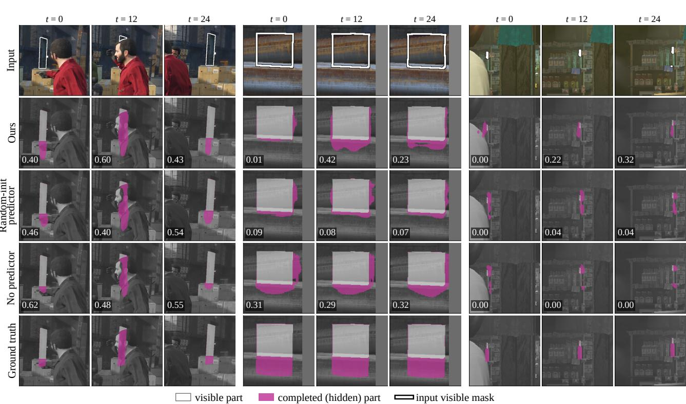  
Figure S1. Predictor ablation on three random SAIL-VOS sequences: the pre-trained predictor (ours), the same predictor trained from a random initialisation, no predictor, and the ground truth, at the first, middle and last of the selected frames. Values: per-frame occluded IoU.

<table><tr><td rowspan="2">Model</td><td colspan="2">Kubric-Static</td><td colspan="2">Kubric-Dynamic</td></tr><tr><td>mIoU</td><td>mIoUocc</td><td>mIoU</td><td>mIoUocc</td></tr><tr><td>Diffusion-VAS (run by us)</td><td>92.13</td><td>48.69</td><td>89.67</td><td>44.33</td></tr><tr><td>no predictor, + re-crop</td><td>91.38</td><td>44.83</td><td>91.19</td><td>45.73</td></tr><tr><td>ViT-g world model, + re-crop</td><td>92.03</td><td>47.54</td><td>91.92</td><td>49.53</td></tr><tr><td>OccJEPA, one pass</td><td>92.02</td><td>47.75</td><td>92.95</td><td>51.78</td></tr><tr><td>OccJEPA, + re-crop</td><td>93.31</td><td>49.54</td><td>93.23</td><td>52.04</td></tr></table>

Table S8. Kubric with the occluded-region metric (A counting, our re-implementation of the TACO scorer, 256×256).

25× fewer than Diffusion-VAS (903), and 0.35 s instead of 11.77 s on the same GPU. Diffusion-VAS spends 3.2 s on depth estimation alone, 9× the complete inference of OccJEPA, and 8.7 s on denoising. The total parameter counts are of the same order (1.91B vs. 2.59B), but OccJEPA trains only 69M of its parameters (3.6%): the predictor (59.4M), the LoRA adapters (5.7M) and the head (3.9M). The completion module costs little next to the encoder, and the distilled world models bring a pass down to 1.4 (ViT-B) and 3.6 TFLOPs (ViT-L), where OccJEPA still recovers most of its accuracy (Fig. 5a of the main paper).

Occlusion level (Tabs. S11 and S12). On SAIL-VOS, OccJEPA leads in every bin from 20% occlusion on, by 6.2 to 9.2 points, and these bins hold 72% of the fixed frame set. The largest bin, 60–100% occlusion with 30,879 frames, is where amodal completion matters most, and there OccJEPA reaches 39.7 against 30.6. Below 10% occlusion the hidden part is often a thin sliver, finer than the token grid (a token typically spans one eighth of the object’s longer side), and pixel-level generation fits it better (43.3 vs. 30.9); the two failure cases in Fig. S5 are of this kind. Both ablated models stay below OccJEPA in every bin, so the pre-trained predictor helps across the whole range of occlusion. On TAO-Amodal, all three variants of our model, which share the crop, the encoder and the head, are far ahead of Diffusion-VAS when less than half of the object is visible: at least 41.5 and 74.8 AP50 in the two lowest bins, against 24.5 and 43.4.

Temporal behaviour (Tab. S13). The table measures how much the predicted amodal mask changes between consecutive frames, relative to the change of the groundtruth mask. The two methods are built for different goals here. Diffusion-VAS generates all 25 frames jointly, and its masks change less from frame to frame (3.96 vs. 7.15). OccJEPA recomputes its crop for every frame and is trained for per-frame accuracy, which Tabs. S1 and S2 show it delivers. The window overlap does not cause the difference: the deviation of OccJEPA is 7.11 after the first pair of frames and 7.99 at the first pair (Diffusion-VAS: 3.96 and 4.11). Temporally smoothed crops or a temporal loss term plug directly into OccJEPA.

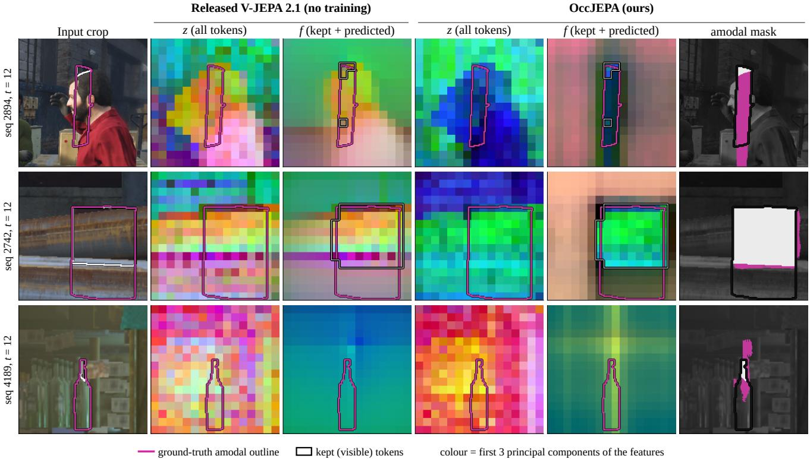

Figure S2. Feature visualisation on the random sequences of Fig. S1, middle frame, as in Fig. 4 of the main paper: first three principal components of the full-clip features z and of the filled features f, for the released V-JEPA 2.1 and for OccJEPA (legend as in the main paper).
<table><tr><td>Component added</td><td> $\mathrm { S A I L \mathrm { - } V O S \ m I o U _ { o c c } ^ { f i x e d } }$ </td><td> $\mathrm { T A O \ A P _ { 5 0 } }$ </td><td> $\mathrm { T A O } \mathrm { A P } _ { 7 5 }$ </td><td>TAO out-of-frame  $\mathrm { A P } _ { 7 5 }$ </td></tr><tr><td>high-resolution refiner, with predictor</td><td> $+ 0 . 3 7 \ [ + 0 . 1 2 , + 0 . 6 3 ]$ </td><td> $- 0 . 1 1 \ [ - 0 . 4 5 , + 0 . 2 8 ]$ </td><td> $- 0 . 2 9 \ [ - 0 . 8 6 , + 0 . 3 4 ]$ </td><td> $- 2 . 0 2 \ [ - 3 . 4 5 , - 0 . 6 6 ]$ </td></tr><tr><td>high-resolution refiner, no predictor</td><td> $+ 1 . 9 2 \ [ + 1 . 4 3 , + 2 . 4 2 ]$ </td><td> $- 0 . 9 6 [ - 1 . 4 4 , - 0 . 4 8 ]$ </td><td> $- 0 . 9 7 \ [ - 1 . 7 1 , - 0 . 2 5 ]$ </td><td> $- 3 . 3 5 \ [ - 5 . 2 2 , - 1 . 5 9 ]$ </td></tr><tr><td>MOVi-D in training</td><td> $+ 0 . 0 4 [ - 0 . 3 0 , + 0 . 3 4 ]$ </td><td> $- 0 . 3 6 [ - 0 . 7 4 , - 0 . 0 1 ]$ </td><td> $+ 0 . 0 5 \ [ - 0 . 5 1 , + 0 . 6 3 ]$ </td><td> $- 0 . 7 8 \ [ - 2 . 2 1 , + 0 . 6 6 ]$ </td></tr><tr><td>re-crop, with predictor</td><td> $+ 0 . 4 7 \ [ + 0 . 2 6 , + 0 . 6 8 ]$ </td><td> $+ 1 . 2 4 \ [ + 0 . 6 7 , + 1 . 8 4 ]$ </td><td> $+ 0 . 6 6 \ [ + 0 . 1 6 , + 1 . 1 8 ]$ </td><td> $+ 1 . 1 3 \ [ - 0 . 0 3 , + 2 . 3 8 ]$ </td></tr><tr><td>re-crop, no predictor</td><td> $+ 0 . 2 6 [ - 0 . 0 3 , + 0 . 5 7 ]$ </td><td> $- 0 . 1 1 \ [ - 0 . 6 8 , + 0 . 5 3 ]$ </td><td> $- 0 . 5 5 \ [ - 1 . 0 9 , + 0 . 0 0 ]$ </td><td> $- 0 . 5 3 \ [ - 1 . 5 8 , + 0 . 5 5 ]$ </td></tr></table>

Table S9. Design components (ViT-g world model; difference made by adding the component, 95% CIs; TAO-Amodal val). Out of frame: frames whose ground-truth amodal box leaves the image.

## E. Qualitative results

This section shows three random SAIL-VOS sequences among those with at least 30% occlusion, our largest gain and our two largest losses against Diffusion-VAS; two random TAO-Amodal sequences with the object out of frame and two with in-frame occlusion; two random Kubric instances per benchmark with at least 30% occlusion; and three random SAIL-VOS sequences for the predictor ablation and the feature visualisation (Figs. S1 and S2, discussed with Tab. S5). Every rendered mask was checked against the stored per-frame scores. In all figures, white is the visible part of the predicted mask, magenta the completed hidden part, and the outline in the input row is the given visible mask.

Largest and median gain (Fig. S3). In the sequence with our largest gain, the middle of a traffic cone is hidden and only its tip and base are visible. Diffusion-VAS predicts no hidden part, while OccJEPA fills the band between the two visible pieces (sequence occluded IoU 0.96 vs. 0.00). In the sequence at the median gain, both methods complete the legs of a person standing behind an object, and the completion of OccJEPA follows the ground truth more closely. The feature maps of these two sequences are in Fig. 4 of the main paper.

Diffusion-VAS
<table><tr><td>Model</td><td>Total</td><td>Module</td><td>Head</td><td>1LoRA</td><td>Trained</td><td>TFLOPs</td></tr><tr><td>ViT-B*</td><td>0.111</td><td>22.9</td><td>1.08</td><td>0.59</td><td>24.5</td><td>1.38</td></tr><tr><td>ViT-L*</td><td>0.330</td><td>23.0</td><td>1.14</td><td>1.57</td><td>25.7</td><td>3.64</td></tr><tr><td>ViT-g</td><td>1.076</td><td>55.4</td><td>3.36</td><td>3.77</td><td>62.5</td><td>10.57</td></tr><tr><td>ViT-G (OccJEPA)</td><td>1.914</td><td>59.4</td><td>3.88</td><td>5.70</td><td>69.0</td><td>17.78</td></tr><tr><td>VideoMAE-L</td><td>0.345</td><td>39.1</td><td>0.85</td><td>1.57</td><td>41.6</td><td>3.79</td></tr></table>

Table S10. Cost of each model (V-JEPA world models unless marked). Parameters in billions (total) or millions (module: predictor or decoder; trained: module, LoRA and head); TFLOPs per 24-frame 256×256 window, one pass (re-crop doubles it), counted with PyTorch’s FLOP counter on the inference code. Diffusion-VAS: U-Net 1.52B, VAE 0.098B, image encoder 0.63B, depth network 0.34B; 903 TFLOPs per 25-frame 256×512 clip. ∗Distilled from ViT-G.
<table><tr><td></td><td>Occluded OccJEPA Diff.-VAS random-init no pred. frames</td><td></td><td></td><td></td><td></td></tr><tr><td>0-10%</td><td>30.9</td><td>43.3</td><td>24.0</td><td>22.7</td><td>13,880</td></tr><tr><td>10-20%</td><td>50.7</td><td>52.2</td><td>40.8</td><td>38.2</td><td>9,014</td></tr><tr><td>20-30%</td><td>52.6</td><td>45.1</td><td>42.8</td><td>39.1</td><td>7,759</td></tr><tr><td>30-40%</td><td>54.4</td><td>48.1</td><td>46.4</td><td>43.4</td><td>7,094</td></tr><tr><td>40-50%</td><td>51.8</td><td>44.9</td><td>45.8</td><td>42.8</td><td>7,419</td></tr><tr><td>50-60%</td><td>48.0</td><td>40.1</td><td>42.0</td><td>38.3</td><td>7,200</td></tr><tr><td>60-100%</td><td>39.7</td><td>30.6</td><td>35.7</td><td>34.4</td><td>30,879</td></tr></table>

Table S11. SAIL-VOS occluded IoU by occlusion ratio (fixed frame set; random-init: predictor trained from a random initialisation; no pred.: no predictor; values behind Fig. 5b).
<table><tr><td>Visibility</td><td>&lt;0.25</td><td>0.25–0.5</td><td>0.5-0.75</td><td>0.75-1</td><td>1</td></tr><tr><td>OccJEPA</td><td>41.5</td><td>77.7</td><td>91.9</td><td>99.0</td><td>99.7</td></tr><tr><td>Diffusion-VAS</td><td>24.5</td><td>43.4</td><td>89.0</td><td>97.1</td><td>97.9</td></tr><tr><td>random-init predictor</td><td>44.8</td><td>74.8</td><td>90.0</td><td>98.9</td><td>99.3</td></tr><tr><td>no predictor</td><td>45.8</td><td>76.5</td><td>89.0</td><td>98.7</td><td>98.8</td></tr><tr><td>frames</td><td>583</td><td>1,171</td><td>2,210</td><td>9,104</td><td>10,608</td></tr></table>

Table S12. TAO-Amodal val $\bf { A P } _ { 5 0 }$ by visibility (frames with the amodal box inside the image; values behind Fig. 5c).

Random draws (Fig. S4). The three random sequences are heavily occluded (mean occlusion 70% to 97%). In all three, Diffusion-VAS predicts little or no hidden part (sequence occluded IoU at most 0.04), while OccJEPA completes the object in every shown frame (sequence occluded IoU 0.29 to 0.55): an object behind a tarp in the first sequence, an object behind the seated man in the second, of which only a piece next to his head is visible, and an object under the man’s hands in the third. This is the behaviour behind the frame counts of the official metric, where Diffusion-VAS predicts no hidden part on 27.5% of the occluded frames.

<table><tr><td>Method</td><td> $\vert \mathrm { I o U } ( P _ { t } , P _ { t + 1 } ) { - } \mathrm { I o U } ( A _ { t } , A _ { t + 1 } ) \vert$ </td><td> $\mathrm { I o U } ( P _ { t } , P _ { t + 1 } )$ </td></tr><tr><td>OccJEPA</td><td>7.15 [5.98, 8.35]</td><td>74.5 [69.9, 78.7]</td></tr><tr><td>Diffusion-VAS</td><td>3.96 [3.21, 4.76]</td><td>77.0 [70.9, 82.3]</td></tr><tr><td>no predictor</td><td>6.52 [5.70, 7.37]</td><td>75.9 [71.0, 80.1]</td></tr><tr><td>ground truth</td><td>0</td><td>80.0</td></tr></table>

Table S13. Temporal stability on SAIL-VOS (all sequences, 24 consecutive pairs each, ×100; 95% CIs over videos). Lower deviation means frame-to-frame changes closer to those of the ground truth.

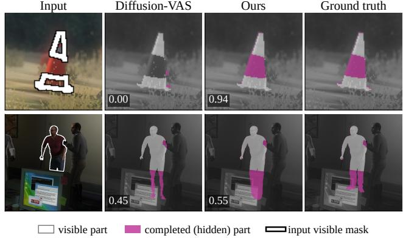  
Figure S3. SAIL-VOS: our largest gain over Diffusion-VAS (top) and the sequence at the median gain (bottom), middle frame. These are the sequences of the feature visualisation (Fig. 4 of the main paper). Values: occluded IoU of the frame.

Failure cases (Fig. S5). Our two largest losses come from the regime of the lowest occlusion bin: on average, only 1.8% and 9.1% of the object is hidden: a sliver at the legs of the seated man and a corner at the top of the second object. Diffusion-VAS completes these small regions (sequence occluded IoU 1.00 and 0.91), while OccJEPA predicts no hidden part there, which gives an occluded IoU of zero. On such frames the occluded IoU is close to all or nothing, and each frame counts as much as a frame with a large hidden part, where OccJEPA is ahead (Tab. S11).

TAO-Amodal (Fig. S6). The random draws come from real videos of indoor scenes (Charades) and of animals (LaSOT). Under in-frame occlusion (right), the box of OccJEPA follows the hidden extent of the sheep in the herd and of the lion more closely than that of Diffusion-VAS in every shown frame. When the object leaves the image (left), both methods extend the box beyond the image border, and their per-frame IoUs in these two draws are mostly close; over all such frames, OccJEPA is ahead by +4.54 AP (Tab. S2). Both methods predict on the same padded canvas and receive the same visible masks.

SAIL-VOS #3553  
SAIL-VOS #2892  
SAIL-VOS #4568  
SAIL-VOS #2065  
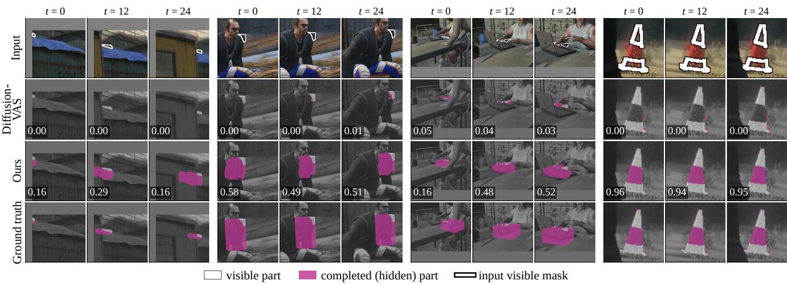  
Figure S4. SAIL-VOS: three random draws and our largest gain (last block), at the first, middle and last of the selected frames. Values: per-frame occluded IoU.

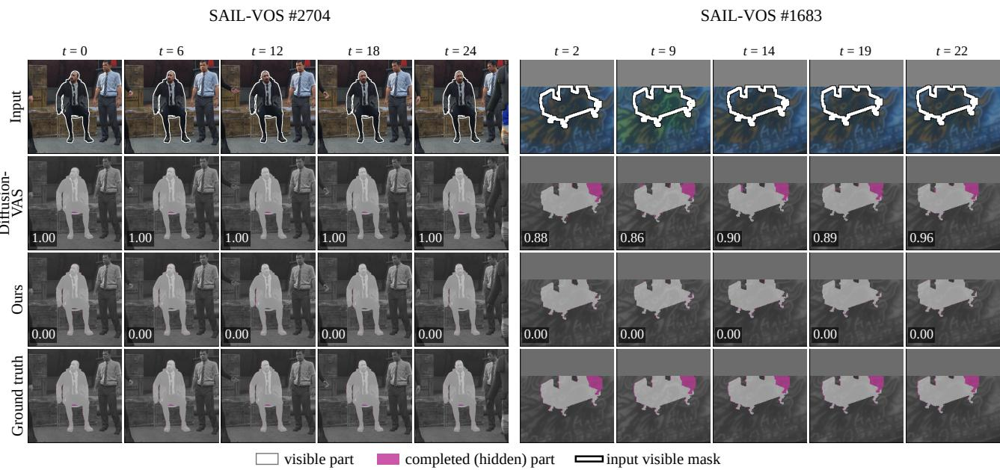  
Figure S5. SAIL-VOS: our two largest losses against Diffusion-VAS. In both sequences the hidden part is a small fraction of the object, the regime of the lowest occlusion bin in Tab. S11. Values: per-frame occluded IoU.

Kubric (Fig. S7). The random Kubric draws follow Tab. S8. On Kubric-Dynamic, where the margin of OccJEPA is largest (+7.71), its completion is closer to the ground truth in most frames, also when the hidden part changes shape as the objects move. On Kubric-Static, where the average margin is +0.85, the per-frame differences go both ways, as in these two draws.

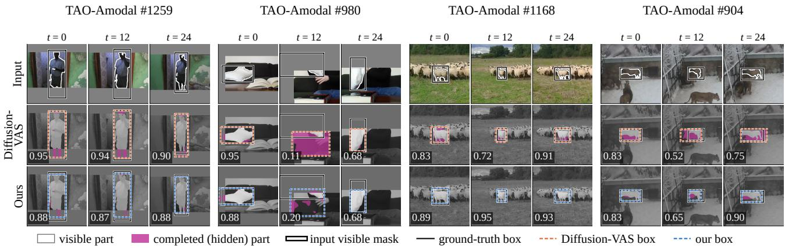  
Figure S6. TAO-Amodal: random draws with the object leaving the frame (left two) and with in-frame occlusion (right two), at the first, middle and last of the selected frames. Values: box IoU; each crop follows the object, and grey marks the area outside the image.

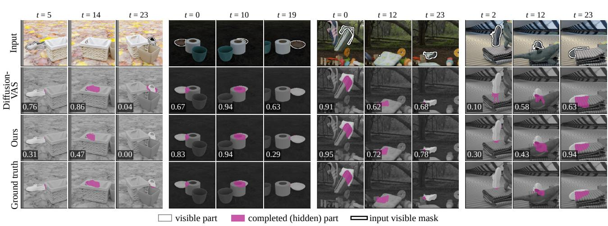  
Figure S7. Kubric-Static (left two) and Kubric-Dynamic (right two): random draws, at the first, middle and last of the selected frames. Diffusion-VAS is run by us with the same inputs. Values: per-frame occluded IoU.