# PROACTEGOMEM: BENCHMARKING PROACTIVE MEMORY IN STREAMING EGOCENTRIC VIDEO

Ruotong Liao<sup>1∗</sup>, Meikel Kokowski<sup>4∗</sup>, Xiaoxiao Sun<sup>2</sup>, Yongqin Xian<sup>3</sup>,

Laura Bravo Sánchez<sup>2</sup>, Shiye Su<sup>2</sup>, Federico Tombari<sup>3</sup>, Serena Yeung-Levy<sup>2</sup>, Volker Tresp<sup>1</sup>

<sup>1</sup>LMU Munich <sup>2</sup>Stanford University <sup>3</sup>Google <sup>4</sup>Technical University of Munich

Link: Project Page | Code | Hugging Face | Leaderboard

## ABSTRACT

Today’s multimodal assistants are typically prompted to interpret the visual evidence presented to them. To offload the cognitive burden of remembering across long horizons, wearable assistants should proactively acquire and maintain useful memory as the user’s surroundings evolve. Remembering the ambience on the user’s behalf requires identifying what matters, understanding in real time, and initiating memory maintenance in the background while the user focuses on activities. We introduce ProactEgoMem, a benchmark that evaluates proactive memory in streaming egocentric video. Three tasks ground the evaluation in ambient environmental needs: INFORMATION CAPTURE (IC) preserves transient yet dense visual information, STATE TRACKING (ST) follows changing object states, and LOCATION TRACKING (LT) records object movements. The benchmark proposes the protocol at two levels of proactiveness: the Notification Level asks for one timely notification that satisfies the user’s intent; the deeper Intervention Level asks for memory maintenance with an active start-to-stop tool lifecycle on the user’s behalf. Parallel ProactEgoMem-Daily and ProactEgoMem-Sci tracks contain 300/100 clips for both daily and scientific use cases, paired with 1000/500 questions in ProactEgoMem-QA, which measures the quality of proactively acquired memory. Across proprietary, open-source, video-language, and streaming baselines, even the strongest models fail to proactively capture the memory timely and accurately. ProactEgoMem is a rigorous evaluation foundation for multimodal proactive assistance and co-existing video agents.

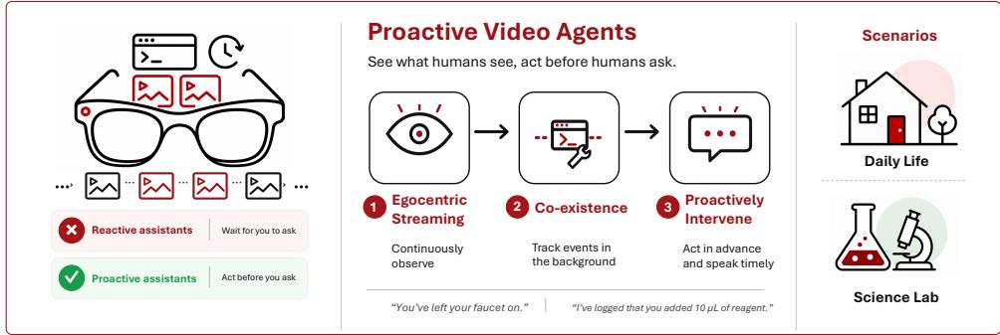  
Figure 1: Proactive agents observe video, co-exist in the background, and act before users ask.

## 1 INTRODUCTION

A wearable assistant on AI glasses can reduce the burden of remembering everyday details while the user attends to other activities (Engel et al., 2023; Yang et al., 2025): for example, alert when a faucet remains running unattended while cooking, remembering where a tool is placed during multitasking (Figure 1). Such assistance requires continuous background observation, where the assistant infers the user’s intent and detects relevant events, maintains ambient environment states, and alerts or remembers proactively for later use without explicit instructions. Useful information may be transient, and the dynamically complex ambient evidence may be intertwined continuously. This motivates our central question: How can a wearable assistant proactively maintain memory in the background as the user’s surroundings change over long time horizons?

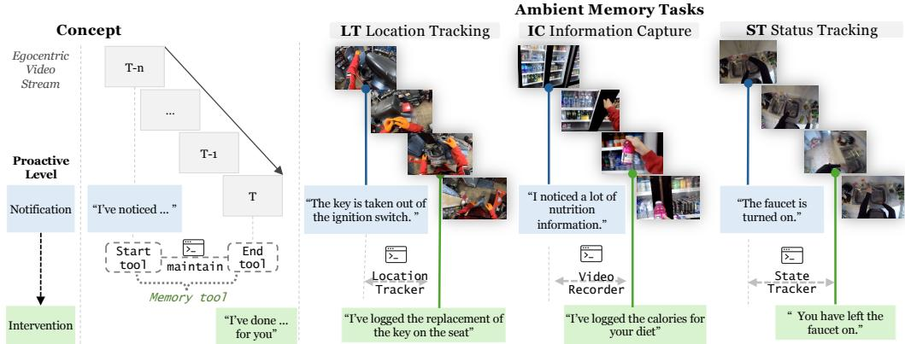  
Figure 2: ProactEgoMem measures proactive memory as lifecycle behavior in egocentric streams. At the Notification Level the agent sends one timely message; at the Intervention Level it starts, maintains, and ends a memory tool, and releases a message when the task is completed.

Remembering on the user’s behalf requires more than recognizing relevant information in a video. An assistant must infer intents, capture transient details before they disappear, and keep track of changing states and object locations as activities unfold. Such memory needs extend over time: the assistant must determine when to begin acquisition, maintain tracking through subsequent observations, and stop when the relevant event ends, all while the user attends to other activities. This calls for two levels of proactive assistance: notifying the user when relevant information warrants attention, and intervening on the user’s behalf to acquire it as memory.

We formulate this capability as proactive memory: autonomously acquiring and maintaining useful evidence from an unfolding egocentric stream. Conventional video QA evaluates answers from post-hoc complete videos (Mangalam et al., 2023; Fu et al., 2025), while streaming QA evaluates responses as video arrives (Lin et al., 2024b). ProactEgoMem evaluates how useful memory is acquired in the first place, how an assistant initiates and maintains background processing and intervenes proactively, and whether the resulting memory supports subsequent assistance.

We introduce ProactEgoMem (Figure 2), a benchmark for proactive memory over streaming egocentric video, built around three object-centric tasks for ambient memories from first-person recordings: INFORMATION CAPTURE (IC), STATE TRACKING (ST), and LOCATION TRACKING (LT). We further propose to evaluate two levels of easy-to-hard proactiveness: the Notification Level asks for a single timely, semantically correct notification once the observation satisfies the user’s intent; the advanced Intervention Level requires the agent to track the situation in the background and operate memory tools on the user’s behalf, such as maintaining lifecycles for recording or status and location tracking. The benchmark comprises two parallel tracks: ProactEgoMem-Daily, built from everyday first-person recordings, with 300 clips and 1000 questions, and ProactEgoMem-Sci, built from egocentric recordings in wet-labs as co-scientist assistants, with 100 clips and 500 questions.

Our Benchmark makes three contributions:

• Formulation. We pose proactive memory for egocentric assistants: deciding from the visual stream when to intervene and what to remember. It has three core components, streaming egocentric perception, proactive initiative, and co-existent background operation, framing it as object-centric ambient memory with a measurable memory lifecycle.

• Evaluation protocol. We design a protocol built on multi-level proactiveness, three ambient-memory tasks, and a question answering dataset that tests the quality of proactive memory; evaluation metrics score jointly on timing and semantics of proactive initiatives.

• Benchmarking. We benchmark proprietary, open-source, video-language, and streaming models on both daily and scientific scenarios and identify failure modes: missed calibrations, delayed initiation,false alarms, lifecycle maintenance, and invalid tool calls.

## 2 RELATED WORK

Streaming and egocentric video understanding. First-person datasets (Grauman et al., 2022; Damen et al., 2022; Grauman et al., 2024; Perrett et al., 2025) and always-on wearables (Engel et al., 2023) support evaluation of long-horizon egocentric QA (Mangalam et al., 2023; Chandrasegaran et al., 2024), long-context video QA (Fu et al., 2025; Wu et al., 2024; Zhou et al., 2025), streaming QA (Lin et al., 2024b; Li et al., 2025), and egocentric episodic memory (Forte et al., 2026; Wang et al., 2026). All of them are query-driven (Table 5); in ProactEgoMem the agent decides when to act with no query and maintains a memory across a start–maintain–stop lifecycle.

Video-language models. Proprietary (OpenAI, 2024; Gemini Team, Google, 2024) and open videolanguage models (Chen et al., 2024b; Li et al., 2024; An et al., 2025; Lin et al., 2024a; Wang et al., 2024; Bai et al., 2025; Qwen Team, Alibaba Group, 2026a;b; Zhang et al., 2025a; Gemma Team, 2026) consume a whole clip and emit an answer. Streaming systems decide online through respondversus-wait objectives (Chen et al., 2024a; Wang et al., 2025c), real-time memory (Zhang et al., 2025b), decoupled perception and reaction (Qian et al., 2025), when-to-speak activation (Kim et al., 2026), offline-to-proactive conversion (Wang et al., 2025a), proactive companions (Yan et al., 2026), and full-duplex omni-models (OpenBMB Team, 2026; Qwen Team, Alibaba Cloud, 2025); each reduces proactivity to a single respond-or-not event.

Proactive assistance and proactivity benchmarks. Proactive assistants span mixed-initiative interaction (Horvitz, 1999; Allen et al., 1999), conversational recommendation (Christakopoulou et al., 2016; Jannach et al., 2021), proactive dialogue systems (Deng et al., 2023) and LLM agents (Lu et al., 2024), and view-sharing wearables (Yang et al., 2025), all triggered by a conversational turn; HoloAssist (Wang et al., 2023) predicts intervention from first-person video offline. Multimodal proactivity benchmarks (Zhang et al., 2025c; Wang et al., 2025d;b) score one “should I respond now?” decision, refined by user profiles (Ran et al., 2026), out-of-plan recovery (Kundu et al., 2026), and one-second grading (Du et al., 2026); Ego2Web (Yu et al., 2026) acts on user instructions, and concurrent work studies intervene-or-abstain decisions (Gong et al., 2026) and memory as an intervention mechanism (Wu et al., 2026). ProactEgoMem is, to our knowledge, the first benchmark in which proactivity produces a memory: the agent decides when to act, sustains a memory through a start–maintain–stop lifecycle, and is scored on whether it answers later questions.

## 3 PROBLEM FORMULATION

## 3.1 STREAMING SETTING

Streaming setting. An episode is a timestamped stream of egocentric frames $V = ( v _ { 1 } , \dots , v _ { T } )$ . At time t, the agent receives only frames from oldest to newest up to the current moment and a logical tool state. At every moment the agent decides what to initiate, operations of memory tool call in the background, a message to the user, or nothing at all.

• Tool calling. The first kind of initiative is an operation of a tool call (recording, state tracking, or location tracking) that acquires memory in the background. At every moment the agent outputs one JSON object whose list of tool calls, possibly empty, starts or stops tools; several tool instances may be active in parallel.

• Proactive message. The second kind of initiative is a message to the user in the message field: grounded in its observations and acquired memory, the agent generates notifications or interventions. The agent keeps silent when no action is required.

```json
y<sub>t</sub> = {"message": null | "<text>",
"tool_calls": [{"name": ..., "arguments": {...}}]}
```

Proactive memory. We use proactive memory that the agent acquires and maintains on its own initiative: the agent decides what to store, keeps memory tools active in the background, and surfaces the memory when the question answering (QA) warrants, with no re-inspection of the full video.

Question answering. Each event is paired with multiple-choice questions (Section 4) whose answers must be grounded in what the agent’s memory tool calls captured during the stream.

Table 1: Illustrative examples of proactive messages for each task and mode.
<table><tr><td></td><td>Task Scenarios</td><td>Notification</td><td>Intervention</td><td colspan="2">Illustration</td></tr><tr><td rowspan="4">IC</td><td>Shopping</td><td>“This label contains dense nutrition facts.&quot;</td><td>“Nutrition facts recorded.&quot;</td><td>one glance 1</td><td></td></tr><tr><td>Construction</td><td>“This sign lists work-zone instructions.&quot;</td><td>“Work-zone instructions saved.&quot;</td><td></td><td>keep</td></tr><tr><td>Car mechanic</td><td>&quot;This document lists repair specifications.&quot;</td><td>&quot;Repair specifications recorded.&quot;</td><td></td><td>目</td></tr><tr><td>Cooking</td><td></td><td></td><td>all on</td><td></td></tr><tr><td rowspan="3">ST</td><td></td><td>&quot;The faucet is still running.&quot;</td><td>“Faucet tracked until off.&quot;</td><td>△</td><td></td></tr><tr><td>Baking</td><td>“The dough mixer is still running.&quot;</td><td>“Mixer tracked until off.&quot;</td><td></td><td></td></tr><tr><td>Cleaning</td><td>“The vacuum is on.&quot;</td><td>“Vacuum tracked until off.&quot;</td><td></td><td>time</td></tr><tr><td rowspan="4">LT</td><td>Carpentry</td><td></td><td>&quot;The hammer is taken from the workbench.&quot; &quot;Hammer&#x27;s last location: on the ground.&quot;</td><td></td><td>watched throughout</td></tr><tr><td>Car mechanic</td><td>&quot;The hose was placed beside the car.</td><td>&quot;Hose&#x27;s last location: on the grass.&quot;</td><td></td><td></td></tr><tr><td></td><td></td><td></td><td>□O</td><td>O</td></tr><tr><td></td><td>Cleaning/laundry &quot;The detergent bottle was in the cabinet.&quot;</td><td>&quot;Bottle&#x27;s last location: on washing machine.&quot;</td><td>A</td><td>B</td></tr></table>

## 3.2 TWO PROACTIVE MODES

Offloading mental burden can be multi-faceted. Inspired by the distinction between proactively informing a user and acting autonomously on their behalf (Kraus et al., 2021), we operationalize proactivity at two depths (Figure 3; Table 1):

Notification Level. The agent should infer the user’s intent and send a timely notification in response to a visual cue. For example, after inferring that the user is shopping for items, the agent sends the proactive assistant message “I noticed a lot of nutrition information” when the user shows interest in an item. The ground truth is a timestamped opportunity and a semantic target message.

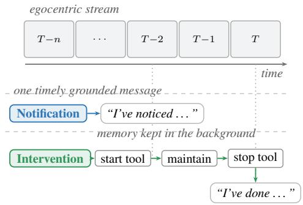  
Figure 3: Two- level proactive modes.

## Intervention Level. At this advanced level, the

agent should infer the user’s intent, act proactively on their behalf, maintain a memory tool lifecycle for proactive memory acquisition, and report the result. For example, when the user is performing multitasking cooking, turns on a faucet, an oven, etc, the agent starts status trackers for each object in the background, keeps them active while the items remain on, stops them once they are turned off, and reports that the tracking has been resolved.

## 3.3 THREE AMBIENT-MEMORY TASKS

From 4,000 hours of video, we define three core ambient-memory tasks that offload mental burden by proactively preserving transient information, object states, and location movements (Table 1).

IC: Information Capture. The agent actively preserves transient dense visual information in the ambient environment that may be useful later, such as a document, sign, label, screen, poster, recipe, or instructions, etc. QA questions ask about the proactively captured dense information, etc.

ST: State Tracking. The agent tracks object states such as on/off, open/closed, active/inactive, filled/empty, or connected/disconnected during multitasking. QA questions ask how often a state changed, what remains active, the order of activations, or which object was active longest, etc.

LT: Location Tracking. The agent remembers where an object was placed elsewhere. The task requires tracking where an object is originally placed, when it is picked up, placed, or last observed if placed at a different location. QA questions ask where an object was placed, its original location, the order of locations, or total times it moved, etc.

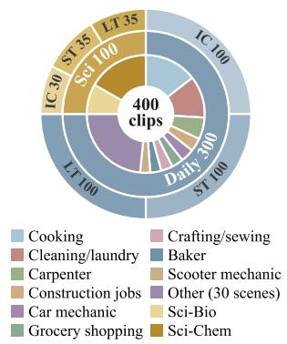

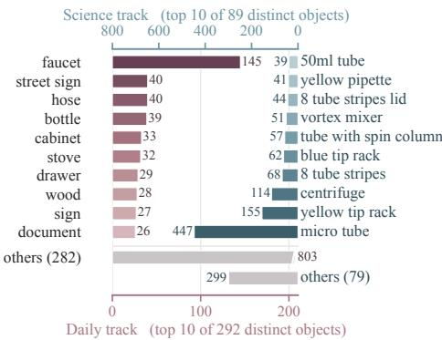

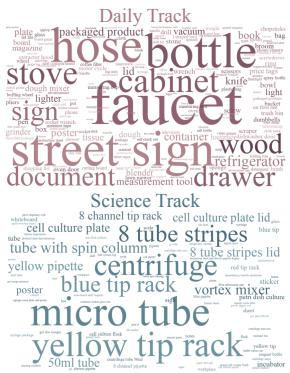  
Figure 4: ProactEgoMem composition and target objects. Left: composition by scenario (inner ring), track (middle), and task (outer). Centre: the ten most frequent target objects per track, counted in annotated events. Right: the full object vocabulary, sized by annotated events.

Table 2: ProactEgoMem-QA question types and benchmark examples
<table><tr><td></td><td>Task Category</td><td>Question and candidates</td></tr><tr><td rowspan="6"></td><td>Text</td><td>What were the Rental Center hours on Sunday? a. 10a–4p b. 1p–6p c. 12p–5p d. 10a–6p</td></tr><tr><td>Sequence</td><td>What was the first packaged product likely to be? a. Bacon strips b. Olive oil c. Hamd. Mushrooms</td></tr><tr><td>Attribute</td><td>What kind of oil did I pour into the frying pan? a. Sesame oil b. Canola oil c. Olive oil d. Sunflower oil</td></tr><tr><td>Price</td><td>How much was the Pop Mandalorian item? a. $20 b. $11 c. $9.50d. $10</td></tr><tr><td>Legibility</td><td>How readable were the Dominoes rules?a. Barely readable b. Written in large print c. Completely unreadable d. Clearly readable</td></tr><tr><td>Direction</td><td>Which way did the sign point for Outdoor Center Rentals?a. To the leftb. Back behind you c. To the right d. Straight ahead</td></tr><tr><td rowspan="6">ST</td><td>Frequency</td><td>How often did I open the drawer? a. 0 times b. 1 time c. 3 times d. 2 times</td></tr><tr><td>Final state</td><td>How many objects remained on or open at the clip&#x27;s end? a. 0 objects b. 3 objects c. 1 objectd. 2 objects</td></tr><tr><td>Unattended state</td><td>How many objects did I open and leave unattended while open?a. 1 objectb. 3 objects c. 0 objects d. 2 objects</td></tr><tr><td>Duration</td><td>How long was the light turned on?a. 10 seconds b. 25 seconds c. 100 seconds d. 30 seconds</td></tr><tr><td>Event order</td><td>What was the on-order (L=light, F=faucet, C=cabinet)? a. L→F→F→C b. F→F→L→C c. F→C→F→L d. C→F→F→L</td></tr><tr><td>Before/after</td><td>What did I open after I turned on the stove? a. oven door b. cabinet c. refrigerator d. drawer</td></tr><tr><td rowspan="6">LT</td><td>Placement</td><td>Where did I place small metal cogs? a. on the workbench b. in the case c. in the drawer d. in the box</td></tr><tr><td>Source</td><td>Where did I pick up the white bowl before putting it in the sink? a. from the drawerb. from the table c. from the cabinet d. from the sink</td></tr><tr><td>Destination</td><td>Where did I place the black crankset after taking it from the box? a. mounted on the bicycle b. in the casec. on the workbench d. in the box</td></tr><tr><td>Last location</td><td>Where did I place the black pliers the last time? a. in the box b. in the drawerc. on the wall d. in the case</td></tr><tr><td>Location count</td><td>How many times did I place the knife at a different location?a. 1 timeb. 0 times c. 3 times d. 2 times</td></tr><tr><td>First location</td><td>What was the hex key&#x27;s original location? a. hanging on the wallb. on the workbench c. on the tool tray by the machine d. in the drawer</td></tr></table>

## 4 PROACTEGOMEM: BENCHMARK CONSTRUCTION

Dataset source and annotation. ProactEgoMem is organized around clips in which an ambient memory would help a user, and both tracks are built by the pipeline of Figure 11 (Appendix A): (1a) native action labels are greedily paired into candidate events while (1b) a VLM (Qwen3.6-27B) densely captions Daily clips; (2) annotators correct these events and task families (Ego4D lab clips are annotated from scratch); (3) QA is generated. The (4) review by ≥3 annotators is visible in Table 3 and the composition and target objects in Figure 4. ProactEgoMem-Daily, the Daily track, is built from Ego4D (Grauman et al., 2022). ProactEgoMem-Sci, the Science track, is built from egocentric recordings in wet-labs (Yagi et al., 2025; Nishimoto et al., 2024) and from lab videos in Ego4D (Grauman et al., 2022) for a co-scientist setting. All annotations on raw video streams and evaluation QA pairs are newly annotated, ensuring zero label leakage from pre-training corpora (details in Appendix B).

ProactEgoMem-QA. Each annotated event is paired with multiple-choice questions that test whether the acquired memory supports later recall; Table 2 lists the question categories of each task with a benchmark example. (1) IC questions are generated by an LLM from dense human annotations of visible information and reviewed in three rounds, and their categories are the forms these questions recur in. (2) ST questions are chiefly instantiated from templates over the reviewed state events, filling object, count, time, duration, and order slots. (3) LT questions are chiefly instantiated from templates over the reviewed object-location transitions, destination, placement, and count slots. Every question is reviewed by at least three annotators above bachelor’s degree level.

Table 3: ProactEgoMem data statistics and inter-annotator agreement. Paired entries read Daily/Sci. N: reference-accepted GT events; agreement is averaged over three annotators.
<table><tr><td>Statistic</td><td>Value</td><td>Statistic</td><td>Value</td></tr><tr><td>Unique clips</td><td>300/100</td><td>closed-ended</td><td>924/1218</td></tr><tr><td>Source videos</td><td>239/100</td><td>open-ended</td><td>318/159</td></tr><tr><td>Total clip len.</td><td></td><td>16.00/6.47 h Mean event len.</td><td>31.82/13.33 s</td></tr><tr><td>Mean clip len.</td><td></td><td>192.0/233.0 s Median event len.</td><td>13.47/4.77 s</td></tr><tr><td>Annotated events</td><td></td><td>1242/1377 Distinct objects</td><td>292/89</td></tr></table>

<table><tr><td></td><td colspan="3">Task Breakdown</td><td colspan="7">Inter-Annotator Agreement</td></tr><tr><td>Task</td><td>Clips</td><td>Events</td><td>QA</td><td>N</td><td>mIoU↑</td><td>σIoU↓</td><td>S@2↑</td><td>E@2↑</td><td>|∆s|↓</td><td>|∆e|↓</td></tr><tr><td>IC</td><td>100/30</td><td>278/175</td><td>507/299</td><td>323</td><td>0.9403</td><td>0.1880</td><td>0.9761</td><td>0.9283</td><td>0.2012</td><td>2.0305</td></tr><tr><td>ST</td><td>100/35</td><td>483/831</td><td>241/104</td><td>465</td><td>0.9957</td><td>0.0614</td><td>0.9957</td><td>0.9957</td><td>0.1497</td><td>0.2380</td></tr><tr><td>LT</td><td>100/35</td><td>481/371</td><td>252/157</td><td>547</td><td>0.9940</td><td>0.0589</td><td>0.9843</td><td>0.9935</td><td>0.3530</td><td>0.2382</td></tr><tr><td>Overall</td><td>300/100</td><td>1242/1377</td><td>1000/500</td><td>1335</td><td>0.9817</td><td>0.1084</td><td>0.9865</td><td>0.9786</td><td>0.2429</td><td>0.6675</td></tr></table>

## 5 EXPERIMENTS

## 5.1 METRICS AND BASELINES

Common metrics. Predictions are matched and scored separately at the two proactive levels. Predictions at both levels are matched to ground truth by Hungarian matching (Kuhn, 1955), which requires that an LLM-judge’s semantic similarity exceeds a threshold and that the temporal offset falls within the matching window; among admitted edges the assignment minimizes the cost $\alpha ( 1 - \mathrm { s i m } ) + ( 1 - \alpha ) ( | \Delta | \tilde { / W } ) ^ { p }$ (Zhang et al., 2025c). Intervention predictions are first converted into intervals and matched on temporal overlap. Three metric groups are then shared by the two levels: (1) Timing (Start@τ): the fraction of matched actions whose start falls within various τ seconds of the ground-truth moment. We report Start@0.2 as the main result: the 200 ms tolerance reflects the residual inter-annotator disagreement on notification timing (Table 3) and is widely used in realtime streaming models. (2) Abs Error $( | \Delta _ { s } | , \sigma ) \colon$ the mean absolute start offset and its standard deviation, in seconds, measuring how far and how consistently a model deviates from the annotated moment. (3) Detection (Prec, Recall, F1): precision over emitted actions, recall over ground-truth events, and their harmonic mean F1, penalizing spurious interruptions and missed ones.

Intervention-level specific metrics. The Intervention-level metrics score the lifecycle itself through two further groups: (4) Overlap (mIoU): interval IoU averaged over all ground-truth opportunities, scoring unmatched opportunities as zero, so a high score requires starting, maintaining, and stopping the tool lifecycle at the right boundaries; various thresholds in IoU@τ are also reported. (5) QA (Acc): accuracy of the ProactEgoMem-QA dataset requiring proactive memory.

Baselines. The comparison includes proprietary models (Gemini 2.5 Flash (Comanici et al., 2025) and GPT-5.4-mini (OpenAI, 2026)), general open-source models (Gemma4-31B (Gemma Team, 2026), Qwen3.8-27B (Qwen Team, Alibaba Group, 2026c), Qwen3.6-27B (Qwen Team, Alibaba Group, 2026b), Qwen3.5-9B (Qwen Team, Alibaba Group, 2026a)), video-language models (VideoLLaMA3-7B (Zhang et al., 2025a), LLaVA-OV-1.5-8B (An et al., 2025), MiniCPM-o-4.5 (OpenBMB Team, 2026)), and streaming models (MMDuet (Wang et al., 2025c), VideoLLM-Online (Chen et al., 2024a), Inkling-Small (Thinking Machines Lab, 2026), and JoyAI-VL (Yao et al., 2026)). All baselines are run with the exact same streaming setting as follows.

## 5.2 STREAMING EVALUATION PROTOCOL

Every baseline receives the same prompt for a given task and proactive level; model-specific code only wraps it in the model’s chat template. FPS rate of 1 is used throughout the evaluation. At every step the prompt is followed by a JSON assistant context and the window of video frames, and the model answers with one JSON object. Complete description in Appendix K. Per turn: one request per video second simulating the streaming setting, with the task prompt, a JSON context, and the 10 most recent frames up to current timestamp t, sampled at 1 fps, each with frame number and timestamp. Earlier turns: only through the context, listing active tool instances and the 5 latest completed intervals (Intervention) or notifications (Notification). Output: one JSON object determining the tool calls at timestamp t; unparseable output counts as action of silence.

## 5.3 MAIN RESULTS

Table 4 reports the ProactEgoMem-Daily main results for every model at both proactive levels, and Figure 5 summarises them by model family. The appendix gives per-level detail in Appendix G, per-task detail in Appendix I, message quality in Appendix D, the timing tolerance sweeps and start-error distributions in Appendix E, and full ProactEgoMem-Sci results in Appendix J.

Table 4: ProactEgoMem-Daily main results for notification and intervention levels. • Start@0.2: matched actions within 0.2 s of the ground-truth start. • mIoU: interval IoU over all opportunities (unmatched scored 0). • Error columns are seconds, all others percentages; bold: best in a task.
<table><tr><td rowspan=3 colspan=7>Notification LevelTask Group    Model        Timing Abs Error      DetectionS@0.2↑|∆8|↓σ↓  Prec↑ Recall↑F1↑</td><td rowspan=1 colspan=6>Intervention Level</td></tr><tr><td rowspan=1 colspan=6>Overlap Timing Abs Error      Detection       QA</td></tr><tr><td rowspan=1 colspan=6>mIoU↑ S@0.2↑|∆s|↓ σ↓  Prec↑ Recall↑F1↑  Acc↑</td></tr><tr><td rowspan=5 colspan=1>Open</td><td rowspan=2 colspan=2>Gemini 2.5 FlashProprietaryGPT-5.4-mini</td><td rowspan=1 colspan=2>14.2  2.092.04</td><td rowspan=1 colspan=1>3.4</td><td rowspan=1 colspan=1>66.2  6.5</td><td rowspan=1 colspan=3>3.4   16.7  3.342.88</td><td rowspan=1 colspan=1>3.9</td><td rowspan=1 colspan=1>10.8  5.8</td><td rowspan=1 colspan=1>54.1</td></tr><tr><td rowspan=1 colspan=2>17.0  1.702.09</td><td rowspan=1 colspan=1>1.3</td><td rowspan=1 colspan=1>65.6  2.6</td><td rowspan=1 colspan=3>2.0   5.3   3.832.22</td><td rowspan=1 colspan=1>5.1</td><td rowspan=1 colspan=1>6.9  5.9</td><td rowspan=1 colspan=1>52.5</td></tr><tr><td rowspan=1 colspan=2>Gemma4-31B</td><td rowspan=1 colspan=2>11.8  2.162.25</td><td rowspan=1 colspan=1>6.1</td><td rowspan=1 colspan=1>62.8 11.1</td><td rowspan=1 colspan=3>4.5   8.6   3.012.71</td><td rowspan=1 colspan=1>3.0</td><td rowspan=1 colspan=1>37.9  5.5</td><td rowspan=1 colspan=1>66.5</td></tr><tr><td rowspan=2 colspan=2>Qwen3.8-27BSourceQwen3.6-27B</td><td></td><td></td><td></td><td></td><td></td><td></td><td></td><td></td><td></td><td></td></tr><tr><td rowspan=1 colspan=2>13.7  1.741.89</td><td rowspan=1 colspan=1>6.1</td><td rowspan=1 colspan=1>70.3 11.2</td><td rowspan=1 colspan=1>4.3</td><td rowspan=1 colspan=2>5.9   3.042.42</td><td rowspan=1 colspan=1>2.9</td><td rowspan=1 colspan=1>30.7  5.3</td><td rowspan=1 colspan=1>60.4</td></tr><tr><td rowspan=1 colspan=1>IC</td><td rowspan=1 colspan=2>Qwen3.5-9B</td><td rowspan=1 colspan=2>19.1  1.992.24</td><td rowspan=1 colspan=1>1.9</td><td rowspan=1 colspan=1>58.2  3.7</td><td rowspan=1 colspan=1>0.7</td><td rowspan=1 colspan=2>11.1  2.761.71</td><td rowspan=1 colspan=1>5.8</td><td rowspan=1 colspan=1>3.2  4.2</td><td rowspan=1 colspan=1>54.0</td></tr><tr><td rowspan=1 colspan=1></td><td rowspan=1 colspan=2>VideoLLaMA3-7B</td><td rowspan=1 colspan=2>28.1  2.183.11</td><td rowspan=1 colspan=1>0.5</td><td rowspan=1 colspan=1>35.3  1.1</td><td rowspan=1 colspan=1>0.6</td><td rowspan=1 colspan=2>9.1   3.832.55</td><td rowspan=1 colspan=1>0.7</td><td rowspan=1 colspan=1>4.0   1.2</td><td rowspan=1 colspan=1>50.5</td></tr><tr><td rowspan=2 colspan=1></td><td rowspan=1 colspan=2>VidLLM   LLaVA-OV-1.5-8B</td><td rowspan=1 colspan=2>0.0   8.500.00</td><td rowspan=1 colspan=1>16.7</td><td rowspan=1 colspan=1>0.3  0.6</td><td rowspan=1 colspan=1>0.3</td><td rowspan=1 colspan=2>0.0   7.091.94</td><td rowspan=1 colspan=1>8.8</td><td rowspan=1 colspan=1>2.2  3.5</td><td rowspan=1 colspan=1>41.0</td></tr><tr><td rowspan=1 colspan=2>MiniCPM-o-4.5</td><td rowspan=1 colspan=2>10.3  4.232.84</td><td rowspan=1 colspan=1>29.6</td><td rowspan=1 colspan=1>9.0  13.8</td><td rowspan=1 colspan=1>0.0</td><td rowspan=1 colspan=2>0.0   3.120.00</td><td rowspan=1 colspan=1>20.0</td><td rowspan=1 colspan=1>0.4  0.7</td><td rowspan=1 colspan=1>36.1</td></tr><tr><td rowspan=3 colspan=1></td><td rowspan=1 colspan=1></td><td rowspan=1 colspan=1>MMDuet</td><td rowspan=1 colspan=2>10.5  2.622.47</td><td rowspan=1 colspan=1>1.7</td><td rowspan=1 colspan=1>11.8  2.9</td><td rowspan=1 colspan=1>0.2</td><td rowspan=1 colspan=2>20.0  2.403.32</td><td rowspan=1 colspan=1>4.9</td><td rowspan=1 colspan=1>1.8  2.6</td><td rowspan=1 colspan=1>40.2</td></tr><tr><td rowspan=1 colspan=1>Streaming</td><td rowspan=1 colspan=1>VideoLLM-Online</td><td rowspan=1 colspan=2>28.0  1.591.77</td><td rowspan=1 colspan=1>1.3</td><td rowspan=1 colspan=1>7.7  2.2</td><td rowspan=1 colspan=1>0.0</td><td rowspan=1 colspan=2>0.0  0.000.00</td><td rowspan=1 colspan=1>0.0</td><td rowspan=1 colspan=1>0.0  0.0</td><td rowspan=1 colspan=1>0.0</td></tr><tr><td rowspan=1 colspan=2>JoyAI-VL</td><td rowspan=1 colspan=2>5.3  2.062.01</td><td rowspan=1 colspan=1>3.1</td><td rowspan=1 colspan=1>27.3  5.6</td><td rowspan=1 colspan=1>0.3</td><td rowspan=1 colspan=2>0.0   0.000.00</td><td rowspan=1 colspan=1>22.2</td><td rowspan=1 colspan=1>0.7   1.4</td><td rowspan=1 colspan=1>52.3</td></tr><tr><td rowspan=5 colspan=1>Open</td><td rowspan=1 colspan=2>Gemini 2.5 FlashProprietary</td><td rowspan=1 colspan=2>14.1  2.072.33</td><td rowspan=1 colspan=1>6.4</td><td rowspan=1 colspan=1>35.1 10.9</td><td rowspan=1 colspan=1>5.1</td><td rowspan=1 colspan=2>14.1   2.152.06</td><td rowspan=1 colspan=1>8.8</td><td rowspan=1 colspan=1>14.7 11.0</td><td rowspan=1 colspan=1>28.8</td></tr><tr><td rowspan=1 colspan=2>GPT-5.4-mini</td><td rowspan=1 colspan=2>16.9  1.571.77</td><td rowspan=1 colspan=1>3.2</td><td rowspan=1 colspan=1>40.9  5.9</td><td rowspan=1 colspan=1>0.8</td><td rowspan=1 colspan=2>16.0  3.463.26</td><td rowspan=1 colspan=1>9.5</td><td rowspan=1 colspan=1>5.2  6.7</td><td rowspan=1 colspan=1>21.5</td></tr><tr><td rowspan=1 colspan=2>Gemma4-31B</td><td rowspan=1 colspan=2>7.0   3.132.55</td><td rowspan=1 colspan=1>5.8</td><td rowspan=1 colspan=1>27.7  9.6</td><td rowspan=1 colspan=1>17.2</td><td rowspan=1 colspan=2>17.2  1.762.23</td><td rowspan=1 colspan=1>10.1</td><td rowspan=1 colspan=1>33.7 15.5</td><td rowspan=1 colspan=1>34.2</td></tr><tr><td rowspan=2 colspan=2>Qwen3.8-27BSourceQwen3.6-27B</td><td></td><td></td><td></td><td></td><td></td><td></td><td></td><td></td><td></td><td></td></tr><tr><td rowspan=1 colspan=1>15.4  1.82</td><td rowspan=1 colspan=1>2.14</td><td rowspan=1 colspan=1>14.8</td><td rowspan=1 colspan=1>26.6 19.0</td><td rowspan=1 colspan=1>9.0</td><td rowspan=1 colspan=1>11.9  2.33</td><td rowspan=1 colspan=1>2.53</td><td rowspan=1 colspan=1>10.5</td><td rowspan=1 colspan=1>26.1 15.0</td><td rowspan=1 colspan=1>28.3</td></tr><tr><td rowspan=1 colspan=1>ST</td><td rowspan=1 colspan=2>Qwen3.5-9B</td><td rowspan=1 colspan=1>27.2  1.10</td><td rowspan=1 colspan=1>1.68</td><td rowspan=1 colspan=1>1.6</td><td rowspan=1 colspan=1>46.1  3.0</td><td rowspan=1 colspan=1>0.0</td><td rowspan=1 colspan=1>0.0  0.00</td><td rowspan=1 colspan=1>0.00</td><td rowspan=1 colspan=1>0.0</td><td rowspan=1 colspan=1>0.0  0.0</td><td rowspan=1 colspan=1>17.7</td></tr><tr><td rowspan=6 colspan=1></td><td rowspan=1 colspan=1></td><td rowspan=1 colspan=2>VideoLLaMA3-7B</td><td rowspan=1 colspan=2>24.8  1.341.87</td><td rowspan=1 colspan=1>0.8</td><td rowspan=1 colspan=1>30.5  1.5</td><td rowspan=1 colspan=1>0.4</td><td rowspan=1 colspan=2>16.7  3.27</td><td rowspan=1 colspan=1>2.99</td><td rowspan=1 colspan=1>0.5</td></tr><tr><td rowspan=2 colspan=1></td><td rowspan=1 colspan=2>VidLLM   LLaVA-OV-1.5-8B</td><td rowspan=1 colspan=2>0.0   0.000.00</td><td rowspan=1 colspan=1>0.0</td><td rowspan=1 colspan=1>0.0  0.0</td><td rowspan=1 colspan=1>0.0</td><td rowspan=1 colspan=1>0.0   0.00</td><td rowspan=1 colspan=1>0.00</td><td rowspan=1 colspan=1>0.0</td><td rowspan=1 colspan=1>0.0  0.0</td><td rowspan=1 colspan=1>21.9</td></tr><tr><td rowspan=1 colspan=2>MiniCPM-o-4.5</td><td rowspan=1 colspan=2>11.1  2.602.65</td><td rowspan=1 colspan=1>1.6</td><td rowspan=1 colspan=1>1.9   1.8</td><td rowspan=1 colspan=1>0.0</td><td rowspan=1 colspan=2>0.0   0.000.00</td><td rowspan=1 colspan=1>0.0</td><td rowspan=1 colspan=1>0.0  0.0</td><td rowspan=1 colspan=1>19.4</td></tr><tr><td rowspan=1 colspan=1></td><td rowspan=1 colspan=1>MMDuet</td><td rowspan=1 colspan=2>4.0   2.041.74</td><td rowspan=1 colspan=1>1.6</td><td rowspan=1 colspan=1>5.4   2.5</td><td rowspan=1 colspan=1>0.1</td><td rowspan=1 colspan=2>0.0   2.000.00</td><td rowspan=1 colspan=1>3.2</td><td rowspan=1 colspan=1>0.2  0.4</td><td rowspan=1 colspan=1>29.1</td></tr><tr><td rowspan=1 colspan=1>Streaming</td><td rowspan=1 colspan=1>VideoLLM-Online</td><td rowspan=1 colspan=2>25.4  0.831.51</td><td rowspan=1 colspan=1>2.8</td><td rowspan=1 colspan=1>12.8  4.6</td><td rowspan=1 colspan=1>0.0</td><td rowspan=1 colspan=1>0.0   0.00</td><td rowspan=1 colspan=1>0.00</td><td rowspan=1 colspan=1>0.0</td><td rowspan=1 colspan=1>0.0  0.0</td><td rowspan=1 colspan=1>0.0</td></tr><tr><td rowspan=1 colspan=2>JoyAI-VL</td><td rowspan=1 colspan=2>12.5  1.401.73</td><td rowspan=1 colspan=1>4.8</td><td rowspan=1 colspan=1>19.9  7.7</td><td rowspan=1 colspan=1>0.0</td><td rowspan=1 colspan=2>0.0   0.000.00</td><td rowspan=1 colspan=1>0.0</td><td rowspan=1 colspan=1>0.0  0.0</td><td rowspan=1 colspan=1>18.6</td></tr><tr><td rowspan=11 colspan=1>OpenLT</td><td rowspan=2 colspan=1>Proprietary</td><td rowspan=1 colspan=1>Gemini 2.5 Flash</td><td rowspan=1 colspan=2>10.6  1.972.29</td><td rowspan=1 colspan=1>4.3</td><td rowspan=1 colspan=1>34.0  7.6</td><td rowspan=1 colspan=1>0.6</td><td rowspan=1 colspan=2>2.5   3.882.80</td><td rowspan=1 colspan=1>9.1</td><td rowspan=1 colspan=1>8.3  8.7</td><td rowspan=1 colspan=1>18.3</td></tr><tr><td rowspan=1 colspan=1>GPT-5.4-mini</td><td rowspan=1 colspan=2>16.9  1.612.21</td><td rowspan=1 colspan=1>2.7</td><td rowspan=1 colspan=1>55.9  5.1</td><td rowspan=1 colspan=1>0.1</td><td rowspan=1 colspan=2>14.3  1.771.79</td><td rowspan=1 colspan=1>9.7</td><td rowspan=1 colspan=1>1.5  2.5</td><td rowspan=1 colspan=1>24.6</td></tr><tr><td rowspan=1 colspan=2>Gemma4-31B</td><td rowspan=1 colspan=2>9.2   1.771.71</td><td rowspan=1 colspan=1>13.2</td><td rowspan=1 colspan=1>32.3 18.7</td><td rowspan=1 colspan=1>4.4</td><td rowspan=1 colspan=2>9.3   2.732.77</td><td rowspan=1 colspan=1>5.2</td><td rowspan=1 colspan=1>33.5  9.0</td><td rowspan=1 colspan=1>29.0</td></tr><tr><td rowspan=2 colspan=2>Qwen3.8-27BSourceQwen3.6-27B</td><td rowspan=1 colspan=2>16.4  1.381.89</td><td rowspan=1 colspan=1>4.6</td><td rowspan=1 colspan=1>62.2  8.5</td><td rowspan=1 colspan=1>5.2</td><td rowspan=1 colspan=2>5.4   3.082.66</td><td rowspan=1 colspan=1>8.9</td><td rowspan=1 colspan=1>35.0 14.2</td><td rowspan=1 colspan=1>30.6</td></tr><tr><td></td><td></td><td></td><td rowspan=1 colspan=1>33.6 15.3</td><td rowspan=1 colspan=1>2.1</td><td rowspan=1 colspan=2>3.2   1.822.05</td><td rowspan=1 colspan=1>12.0</td><td rowspan=1 colspan=1>13.1  12.5</td><td rowspan=1 colspan=1>24.2</td></tr><tr><td rowspan=1 colspan=2>Qwen3.5-9B</td><td rowspan=1 colspan=2>24.9  0.911.51</td><td rowspan=1 colspan=1>1.3</td><td rowspan=1 colspan=1>35.9  2.5</td><td rowspan=1 colspan=1>0.6</td><td rowspan=1 colspan=2>0.0   4.412.22</td><td rowspan=1 colspan=1>11.5</td><td rowspan=1 colspan=1>0.6  1.2</td><td rowspan=1 colspan=1>21.8</td></tr><tr><td rowspan=1 colspan=2>VideoLLaMA3-7B</td><td rowspan=1 colspan=2>28.8  0.731.32</td><td rowspan=1 colspan=1>0.5</td><td rowspan=1 colspan=1>20.6  0.9</td><td rowspan=1 colspan=1>2.2</td><td rowspan=1 colspan=2>4.2   3.932.65</td><td rowspan=1 colspan=1>3.6</td><td rowspan=1 colspan=1>19.8  6.1</td><td rowspan=1 colspan=1>36.1</td></tr><tr><td rowspan=1 colspan=2>MiniCPM-o-4.5</td><td rowspan=1 colspan=2>20.0  1.251.14</td><td rowspan=1 colspan=1>2.8</td><td rowspan=1 colspan=1>1.9   2.2</td><td rowspan=1 colspan=1>0.2</td><td rowspan=1 colspan=2>0.0   0.690.10</td><td rowspan=1 colspan=1>20.0</td><td rowspan=1 colspan=1>0.4  0.8</td><td rowspan=1 colspan=1>18.3</td></tr><tr><td rowspan=1 colspan=2>MMDuet</td><td rowspan=1 colspan=2>4.7   2.962.30</td><td rowspan=1 colspan=1>4.4</td><td rowspan=1 colspan=1>16.0  6.9</td><td rowspan=1 colspan=1>0.0</td><td rowspan=1 colspan=2>0.0   0.000.00</td><td rowspan=1 colspan=1>0.0</td><td rowspan=1 colspan=1>0.0  0.0</td><td rowspan=1 colspan=1>29.0</td></tr><tr><td rowspan=2 colspan=2>Streaming  VideoLLM-OnlineInkling-SmallJoyAI-VL</td><td></td><td></td><td></td><td></td><td></td><td></td><td></td><td></td><td></td><td></td></tr><tr><td rowspan=1 colspan=2>12.7  2.612.84</td><td rowspan=1 colspan=1>2.3</td><td rowspan=1 colspan=1>11.4  3.8</td><td rowspan=1 colspan=1>0.0</td><td rowspan=1 colspan=2>0.0   0.000.00</td><td rowspan=1 colspan=1>0.0</td><td rowspan=1 colspan=1>0.0  0.0</td><td rowspan=1 colspan=1>30.6</td></tr></table>

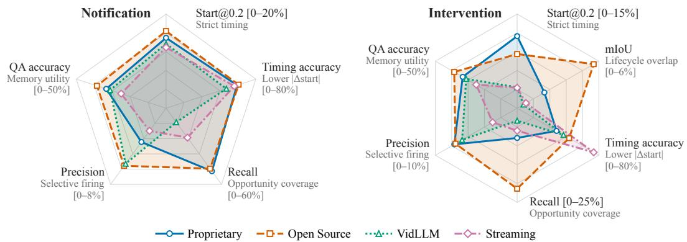  
Figure 5: Proactive competence by model family, averaged over the three tasks: proprietary, open-source, video-language, and streaming models on the notification and intervention axes.

No model dominates and covers all aspects of proactive memory acquisition. The Intervention Level is uniformly harder than the Notification Level. Across all thirteen baselines, covering opportunities never coincides with acting precisely: the best Notification Level F1 reaches only 19.0% (Qwen3.6-27B on ST), the best Intervention Level overlap only 17.2% mIoU (Gemma4-31B on ST), and the strongest strict-timing score only 28.8% Start@0.2 (VideoLLaMA3-7B on LT). Intervention Level is spiking on one or two axes while the rest collapse toward the low scores.

General VLMs perform better regarding metric coverage, while streaming models excel in timing accuracy. (1) Open-source models generally cover more than other models at both level, especially significantly more at the Intervention level. (2) Prompted video-language models are the worst on Recall. (3) VLMs, including open-source and proprietary ones, perform better than nativetrained video models regarding metric coverage. (4) The streaming models spike at the timing accuracy, showing the smallest Intervention-level start error (1.3 s against 2.5–3.1 s). This indicates that streaming-native training acts timelier than general-purpose training.

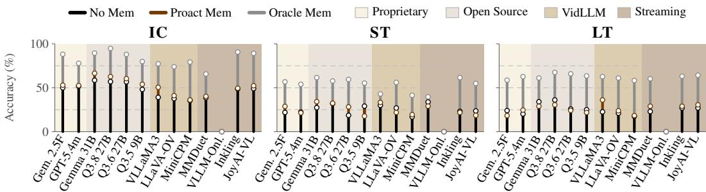

Figure 6: QA accuracy by task. The No-Memory-to-Oracle gap is the acquisition headroom.  
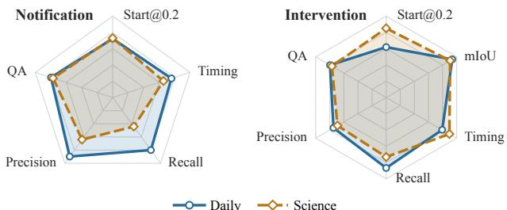  
(a) Mean of the 13 models; shared axis ranges

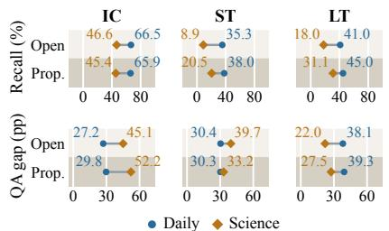  
(b) By task; open-source and proprietary means  
Figure 7: From daily life to the laboratory: (a) the two tracks on the radar axes of Figure 5; (b) notification recall and QA acquisition gap per task.

## 5.4 EFFECTS OF PROACTIVE MEMORY ACQUISITION

The headroom is in proactive memory acquisition. Timing and lifecycle metrics score when an agent acts to acquire memory; ProactEgoMem-QA asks what that action leaves behind. A proactive assistant is useful only if the evidence it chooses to keep can answer the user’s questions later, so we test the acquired memory directly. Every question is answered after the stream ends under three memory conditions (Figure 6): uniform frames (No Memory), the frames the agent kept throughout its tool calls (Proact Memory), and the ground-truth event windows (Oracle Memory). Proact Memory beats No Memory on IC for every model with valid output and splits evenly on ST and LT. In 34 of the 36 valid model–task cells the oracle memory sits at least 20 accuracy points above the proactive one; with oracle memory ceiling at IC 94.9% while ST and LT stay below 70%. Even with oracle memory fed to the video QA model, the benchmark remains hard to solve, and the gap between No Memory and Oracle Memory defines the improvable headroom for proactive memory.

## 5.5 FROM DAILY LIFE TO THE LABORATORY

Scientific scenarios expose the central bottleneck in proactive memory acquisition. We measure it as the memory acquisition gap, oracle QA accuracy minus QA accuracy under proactively acquired memory. On IC the gap nearly doubles in the laboratory, from 27–30 to 45–52 points for the open-source and proprietary groups (Figure 7b, IC). The additional complexity of managing and maintaining the video data in a scientific context adds to the overall burden of proactive memory.

This burden concentrates on IC and ST. Laboratory video lowers notification recall for both groups on all three tasks, halving the model-mean recall (Figure 7a), most sharply on ST, where open-source recall falls from 35.3% to 8.9% (Figure 7b, ST); the ST gap widens to 33–40 points, while LT gaps narrow to 22–27 points (Figure 7b, LT). IC and ST are harder in the lab, whose objects are hard to recognize; LT is easier, as lab objects rarely move.

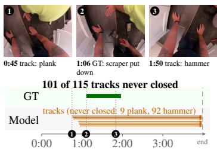

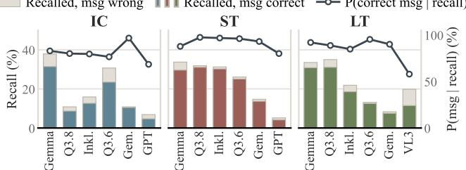  
Figure 8: Message accuracy conditioned on recall

Notification  
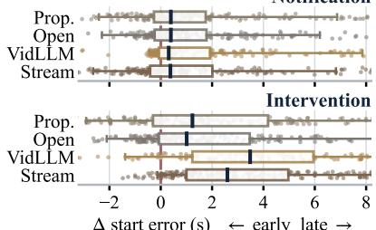  
Figure 9: Start error by family

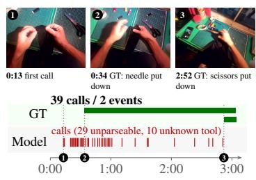  
(a) False alarms

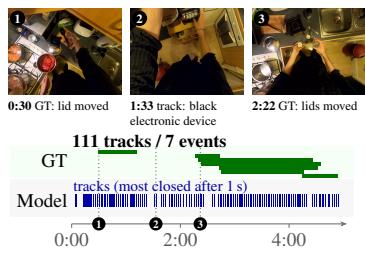  
(b) Miscalibration  
(c) Open-ended memory  
GT event (object put down) model call, no interval track, start to stop track never stopped 1 frame above  
Figure 10: Failure modes on LT clips (Intervention Level): (a) MMDuet, 39 calls for 2 GT events; (b) Gemma4-31B, 111 one-second tracks for 7 events; (c) VideoLLaMA3-7B, tracks never stopped.

## 5.6 FAILURE MODES

Detection of the memory window is the main bottleneck: models that could detect an event mostly explain it correctly. At the Intervention Level, a text-only judge Deepseek-V4-Flash checks whether the message closing a tool call names the right object and outcome against a template reference (Appendix D), for models with recall above 5%. Conditioned on its own true positives, a model explains a recalled intervention correctly 87.8% of the time on average (Figure 8), nearly independent of recall (Spearman r = 0.23).

Proactive actions arrive late, and models are still reactive by nature. Figure 9 pools every matched start error by model family: medians fall near +0.4 s at the Notification Level and from +1.0 to +3.5 s at the Intervention Level, where 67–93% of starts are late. The families that enter the fewest lifecycles are also the latest to enter them. The lag reflects the models’ inherent reactivity.

Uncalibrated interruption: coverage is bought with false alarms. At the Notification Level, recall reaches 79.5% at single-digit precision, capping the best F1 at 19.0% (Appendix G). Gemma4- 31B opens 111 short tracks in one clip; MMDuet fires 39 calls for 2 events (Figures 10a–b and 18).

Lifecycle maintenance: interventions are opened but rarely held. Once a tool must start, persist, and stop, overlap stays single-digit and recall peaks at 37.9% (Appendix G). VideoLLaMA3-7B re-opens a track every second its target is visible and never closes it (Figures 10c, 16, and 17).

Video-language models fail to follow instructions as an agent. Some models leave the tool protocol altogether: VideoLLM-Online narrates the scene (“You open the fridge.”) and MMDuet states its decisions in free text, so neither emits a parsable tool call, and VideoLLM-Online opens no valid intervention on any task (Figure 19; Appendix H), showing the limitations of acting as agents.

## 6 CONCLUSION

ProactEgoMem evaluates proactive ambient memory in streaming egocentric video through two proactive modes and three task families, IC, ST and LT, across daily-life and laboratory co-scientist tracks. The experiments show that today’s multimodal models remain far from reliable proactive assistants: they identify the right moment only under loose timing windows, and they struggle with precision, event tracking over long-horizon location, and proactive memory acquisition. It charts a concrete path toward wearable agents that remember useful context without being asked.

## AI USE STATEMENT

In this work, we used generative AI tools as components of the benchmark pipeline: a VLM writes the dense captions from which candidate events are filtered (Section 4), an LLM generates the IC questions from human-authored dense annotations of visible information (Section 4), an LLMjudged semantic similarity gates the matching of predicted to ground-truth actions (Section 5.1). Regarding LLM, we use DeepSeek-V4-Flash judges the correctness of proactive messages (Appendix D). We have not used generative AI tools for other tasks with required disclosure, and the rest of the required disclosure tasks are not applicable to this work. Additionally, we used generative AI tools for improving the manuscript text and its LAT X layout and for polishing the scripts that draw the figures. We have reviewed all AI-assisted work. Three independent annotators per clip mark the event boundaries, the LLM-generated questions were reviewed in three rounds, and AI-assisted text and figure code were checked, e.g. figure values verified against the result tables by the authors according to the raw experiment logs. We take responsibility for the final content of this work, including text, claims or artifacts produced with the aid of generative AI.

## REPRODUCIBILITY

The ground-truth answers stay private: an evaluation server accepts blind submissions and returns only the scores, which keeps the benchmark out of web-scale training data for foundation models.

## REFERENCES

James E. Allen, Curry I. Guinn, and Eric Horvitz. Mixed-initiative interaction. IEEE Intelligent Systems and their Applications, 14(5):14–23, 1999.

Xiang An, Yin Xie, Kaicheng Yang, Wenkang Zhang, Xiuwei Zhao, Zheng Cheng, Yirui Wang, Songcen Xu, Changrui Chen, Didi Zhu, Chunsheng Wu, Huajie Tan, Chunyuan Li, Jing Yang, Jie Yu, Xiyao Wang, Bin Qin, Yumeng Wang, Zizhen Yan, Ziyong Feng, Ziwei Liu, Bo Li, and Jiankang Deng. LLaVA-OneVision-1.5: Fully open framework for democratized multimodal training, 2025. URL https://arxiv.org/ abs/2509.23661.

Shuai Bai, Keqin Chen, Xuejing Liu, Jialin Wang, Wenbin Ge, Sibo Song, Kai Dang, Peng Wang, Shijie Wang, Jun Tang, Humen Zhong, Yuanzhi Zhu, Mingkun Yang, Zhaohai Li, Jianqiang Wan, Pengfei Wang, Wei Ding, Zheren Fu, Yiheng Xu, Jiabo Ye, Xi Zhang, Tianbao Xie, Zesen Cheng, Hang Zhang, Zhibo Yang, Haiyang Xu, and Junyang Lin. Qwen2.5-VL technical report, 2025. URL https://arxiv.org/abs/ 2502.13923.

Keshigeyan Chandrasegaran et al. HourVideo: 1-hour video-language understanding. In Advances in Neural Information Processing Systems (NeurIPS), Datasets and Benchmarks Track, 2024. URL https: //arxiv.org/abs/2411.04998.

Joya Chen, Zhaoyang Lv, Shiwei Wu, Kevin Qinghong Lin, Chenan Song, Difei Gao, Jia-Wei Liu, Ziteng Gao, Dongxing Mao, and Mike Zheng Shou. VideoLLM-online: Online video large language model for streaming video. In Proceedings of the IEEE/CVF Conference on Computer Vision and Pattern Recognition (CVPR), 2024a. URL https://arxiv.org/abs/2406.11816.

Zhe Chen, Jiannan Wu, Wenhai Wang, Weijie Su, Guo Chen, Sen Xing, Muyan Zhong, Qinglong Zhang, Xizhou Zhu, Lewei Lu, Bin Li, Ping Luo, Tong Lu, Yu Qiao, and Jifeng Dai. InternVL: Scaling up vision foundation models and aligning for generic visual-linguistic tasks. In Proceedings ofthe IEEE/CVF Conference on Computer Vision and Pattern Recognition (CVPR), 2024b. URL https://arxiv.org/abs/ 2312.14238.

Konstantina Christakopoulou, Filip Radlinski, and Katja Hofmann. Towards conversational recommender systems. In Proceedings of the 22nd ACM SIGKDD International Conference on Knowledge Discovery and Data Mining (KDD), pp. 815–824, 2016.

Gheorghe Comanici et al. Gemini 2.5: Pushing the frontier with advanced reasoning, multimodality, long context, and next generation agentic capabilities, 2025. URL https://arxiv.org/abs/2507.06261.

Dima Damen, Hazel Doughty, Giovanni Maria Farinella, Antonino Furnari, Evangelos Kazakos, Jian Ma, Davide Moltisanti, Jonathan Munro, Toby Perrett, Will Price, and Michael Wray. Rescaling egocentric vision: Collection, pipeline and challenges for EPIC-KITCHENS-100. International Journal of Computer Vision (IJCV), 130(1):33–55, 2022. URL https://arxiv.org/abs/2006.13256.

Yang Deng, Wenqiang Lei, Wai Lam, and Tat-Seng Chua. A survey on proactive dialogue systems: Problems, methods, and prospects. In Proceedings of the Thirty-Second International Joint Conference on Artificial Intelligence (IJCAI), Survey Track, 2023. URL https://arxiv.org/abs/2305.02750.

Kaixuan Du, Xin Wan, Hang Zhang, Meng Cao, Dai Guan, Ming Chen, and YuKun Wang. LiveProBench: Can streaming video models really interact like humans?, 2026. URL https://arxiv.org/abs/2609. 12658.

Jakob Engel et al. Project Aria: A new tool for egocentric multi-modal AI research, 2023. URL https: //arxiv.org/abs/2308.13561.

Rosario Forte, Giuseppe Lando, and Antonino Furnari. EgoStream: A diagnostic benchmark for streaming episodic memory in egocentric vision, 2026. URL https://arxiv.org/abs/2605.31557.

Chaoyou Fu, Yuhan Dai, Yongdong Luo, Lei Li, Shuhuai Ren, Renrui Zhang, Zihan Wang, Chenyu Zhou, Yunhang Shen, Mengdan Zhang, et al. Video-MME: The first-ever comprehensive evaluation benchmark of multi-modal LLMs in video analysis. In Proceedings ofthe IEEE/CVF Conference on Computer Vision and Pattern Recognition (CVPR), 2025. URL https://arxiv.org/abs/2405.21075.

Gemini Team, Google. Gemini 1.5: Unlocking multimodal understanding across millions of tokens of context, 2024. URL https://arxiv.org/abs/2403.05530.

Gemma Team. Gemma 4 technical report, 2026. URL https://arxiv.org/abs/2607.02770.

Sitong Gong, Tianyu Yan, Caixin Kang, Bo Zheng, Xiang Ruan, Huchuan Lu, Kaipeng Zhang, Yoichi Sato, and Yifei Huang. Vinci2: Providing proactive assistance in continuous egocentric videos, 2026. URL https://arxiv.org/abs/2607.11523. Accepted at ECCV 2026.

Kristen Grauman, Andrew Westbury, Eugene Byrne, Zachary Chavis, Antonino Furnari, Rohit Girdhar, Jackson Hamburger, Hao Jiang, Miao Liu, Xingyu Liu, Miguel Martin, Tushar Nagarajan, Ilija Radosavovic, Santhosh Kumar Ramakrishnan, et al. Ego4d: Around the world in 3,000 hours of egocentric video. In 2022 IEEE/CVF Conference on Computer Vision and Pattern Recognition (CVPR), pp. 18973–18990, 2022. doi: 10.1109/CVPR52688.2022.01842.

Kristen Grauman, Andrew Westbury, Lorenzo Torresani, Kris Kitani, Jitendra Malik, et al. Ego-Exo4D: Understanding skilled human activity from first- and third-person perspectives. In Proceedings of the IEEE/CVF Conference on Computer Vision and Pattern Recognition (CVPR), 2024. URL https://arxiv.org/ abs/2311.18259.

Eric Horvitz. Principles of mixed-initiative user interfaces. In Proceedings of the SIGCHI Conference on Human Factors in Computing Systems (CHI), pp. 159–166, 1999.

Dietmar Jannach, Ahtsham Manzoor, Wanling Cai, and Li Chen. A survey on conversational recommender systems. ACM Computing Surveys, 54(5):1–36, 2021.

Junho Kim, Hosu Lee, James M. Rehg, Minsu Kim, and Yong Man Ro. STRIDE: When to speak meets sequence denoising for streaming video understanding. In Proceedings of the European Conference on Computer Vision (ECCV), 2026. URL https://arxiv.org/abs/2603.27593.

Matthias Kraus, Nicolas Wagner, Zoraida Callejas, and Wolfgang Minker. The role of trust in proactive conversational assistants. IEEE Access, 9:112821–112836, 2021. doi: 10.1109/ACCESS.2021.3103893.

Harold W. Kuhn. The Hungarian method for the assignment problem. Naval Research Logistics Quarterly, 2 (1–2):83–97, 1955. doi: 10.1002/nav.3800020109.

Kaustav Kundu, Ritvik Shrivastava, Maxim Arap, Nanshu Wang, Xianhui Zhu, Quintin Fettes, Gautam Tiwari, Parth Suresh, Théo Moutakanni, Alejandro Castillejo Munoz, Allen Bolourchi, Pascale Fung, Pinar Donmez, Babak Damavandi, Anuj Kumar, and Seungwhan Moon. Plan, watch, recover: A benchmark and architec tures for proactive procedural assistance, 2026. URL https://arxiv.org/abs/2606.04970.

Bo Li, Yuanhan Zhang, Dong Guo, Renrui Zhang, Feng Li, Hao Zhang, Kaichen Zhang, Peiyuan Zhang, Yanwei Li, Ziwei Liu, and Chunyuan Li. LLaVA-OneVision: Easy visual task transfer, 2024. URL https: //arxiv.org/abs/2408.03326.

Yifei Li, Junbo Niu, Ziyang Miao, Chunjiang Ge, Yuanhang Zhou, Qihao He, Xiaoyi Dong, Haodong Duan, Shuangrui Ding, Rui Qian, Pan Zhang, Yuhang Zang, Yuhang Cao, Conghui He, and Jiaqi Wang. OVO-Bench: How far is your video-LLMs from real-world online video understanding? In Proceedings of the IEEE/CVF Conference on Computer Vision and Pattern Recognition (CVPR), 2025. URL https: //arxiv.org/abs/2501.05510.

Bin Lin, Yang Ye, Bin Zhu, Jiaxi Cui, Munan Ning, Peng Jin, and Li Yuan. Video-LLaVA: Learning united visual representation by alignment before projection. In Proceedings of the 2024 Conference on Empirical Methods in Natural Language Processing (EMNLP), 2024a. URL https://aclanthology.org/ 2024.emnlp-main.342/.

Junming Lin et al. StreamingBench: Assessing the gap for MLLMs to achieve streaming video understanding, 2024b. URL https://arxiv.org/abs/2411.03628.

Yaxi Lu et al. Proactive agent: Shifting LLM agents from reactive responses to active assistance, 2024. URL https://arxiv.org/abs/2410.12361.

Karttikeya Mangalam, Raiymbek Akshulakov, and Jitendra Malik. EgoSchema: A diagnostic benchmark for very long-form video language understanding. In Advances in Neural Information Processing Systems (NeurIPS), Datasets and Benchmarks Track, 2023. URL https://arxiv.org/abs/2308.09126.

Tomohiro Nishimoto, Taichi Nishimura, Koki Yamamoto, Keisuke Shirai, Hirotaka Kameko, Yuto Haneji, Tomoya Yoshida, Keiya Kajimura, Taiyu Cui, Chihiro Nishiwaki, Eriko Daikoku, Natsuko Okuda, Fumihito Ono, and Shinsuke Mori. BioVL-QR: Egocentric biochemical vision-and-language dataset using micro qr codes, 2024. URL https://arxiv.org/abs/2404.03161.

OpenAI. GPT-4o system card, 2024. URL https://arxiv.org/abs/2410.21276.

OpenAI. Introducing GPT-5.4 mini and nano. https://openai.com/index/ introducing-gpt-5-4-mini-and-nano/, 2026.

OpenBMB Team. MiniCPM-o 4.5: Towards real-time full-duplex omni-modal interaction, 2026. URL https://arxiv.org/abs/2604.27393.

Toby Perrett et al. HD-EPIC: A highly-detailed egocentric video dataset. In Proceedings of the IEEE/CVF Conference on Computer Vision and Pattern Recognition (CVPR), 2025. URL https://arxiv.org/ abs/2502.04144.

Rui Qian, Shuangrui Ding, Xiaoyi Dong, Pan Zhang, Yuhang Zang, Yuhang Cao, Dahua Lin, and Jiaqi Wang. Dispider: Enabling video LLMs with active real-time interaction via disentangled perception, decision, and reaction. In Proceedings ofthe IEEE/CVF Conference on Computer Vision and Pattern Recognition (CVPR), 2025. URL https://arxiv.org/abs/2501.03218.

Qwen Team, Alibaba Cloud. Qwen2.5-Omni technical report, 2025. URL https://arxiv.org/abs/ 2503.20215.

Qwen Team, Alibaba Group. Qwen3.5: Towards native multimodal agents. https://qwen.ai/blog? id=qwen3.5, February 2026a.

Qwen Team, Alibaba Group. Qwen3.6-27B: Flagship-level coding in a 27B dense model. https://qwen. ai/blog?id=qwen3.6-27b, April 2026b.

Qwen Team, Alibaba Group. Qwen3.8-Max: A new bar for coding and cowork, August 2026c. URL https: //qwen.ai/blog?id=qwen3.8.

Dongchuan Ran, Linyu Ou, Xueheng Li, Wenwen Tong, Chenxu Guo, Hewei Guo, Kaibing Wang, and Lewei Lu. EgoPro-Bench: Benchmarking personalized proactive interaction in egocentric video streams, 2026. URL https://arxiv.org/abs/2605.07299.

Thinking Machines Lab. Inkling-small. Hugging Face, July 2026. URL https://huggingface.co/ thinkingmachines/Inkling-Small. Version open-weights.

Haibo Wang et al. StreamBridge: Turning your offline video large language model into a proactive streaming assistant. In Advances in Neural Information Processing Systems (NeurIPS), 2025a. URL https:// arxiv.org/abs/2505.05467.

Peng Wang, Shuai Bai, Sinan Tan, Shijie Wang, Zhihao Fan, Jinze Bai, Keqin Chen, Xuejing Liu, Jialin Wang, Wenbin Ge, Yang Fan, Kai Dang, Mengfei Du, Xuancheng Ren, Rui Men, Dayiheng Liu, Chang Zhou, Jingren Zhou, and Junyang Lin. Qwen2-VL: Enhancing vision-language model’s perception of the world at any resolution, 2024. URL https://arxiv.org/abs/2409.12191.

Xiaodong Wang, Xuanyi Zhao, Pedro Rodriguez, Devendra Singh Sachan, Barlas Oguz, Seungwhan Moon, Shang-Wen Li, Gargi Ghosh, Xin Dong, and Wen-Tau Yih. S-EMBER: A large-scale benchmark for stream ing egocentric memory retrieval, 2026. URL https://arxiv.org/abs/2607.02689.

Xin Wang et al. HoloAssist: An egocentric human interaction dataset for interactive AI assistants in the real world. In Proceedings ofthe IEEE/CVF International Conference on Computer Vision (ICCV), 2023. URL https://arxiv.org/abs/2309.17024.

Yueqian Wang, Xiaojun Meng, Yifan Wang, Huishuai Zhang, and Dongyan Zhao. ProactiveVideoQA: A comprehensive benchmark evaluating proactive interactions in video large language models, 2025b. URL https://arxiv.org/abs/2507.09313.

Yueqian Wang, Xiaojun Meng, Yuxuan Wang, Jianxin Liang, Jiansheng Wei, Huishuai Zhang, and Dongyan Zhao. VideoLLM knows when to speak: Enhancing time-sensitive video comprehension with video-text duet interaction format. In Findings of the Association for Computational Linguistics: EMNLP 2025, 2025c. URL https://aclanthology.org/2025.findings-emnlp.336/.

Yuxuan Wang, Yueqian Wang, Bo Chen, Tong Wu, Dongyan Zhao, and Zilong Zheng. OmniMMI: A comprehensive multi-modal interaction benchmark in streaming video contexts. In Proceedings of the IEEE/CVF Conference on Computer Vision and Pattern Recognition (CVPR), 2025d. URL https: //arxiv.org/abs/2503.22952.

Haoning Wu, Dongxu Li, Bei Chen, and Junnan Li. LongVideoBench: A benchmark for long-context interleaved video-language understanding. In Advances in Neural Information Processing Systems (NeurIPS), Datasets and Benchmarks Track, 2024. URL https://arxiv.org/abs/2407.15754.

Yifan Wu, Lizhu Zhang, Yuhang Zhou, Mingyi Wang, Bo Peng, Serena Li, Xiangjun Fan, and Zhuokai Zhao. Remember when it matters: Proactive memory agent for long-horizon agents, 2026. URL https:// arxiv.org/abs/2607.08716.

Takuma Yagi, Misaki Ohashi, Yifei Huang, Ryosuke Furuta, Shungo Adachi, Toutai Mitsuyama, and Yoichi Sato. FineBio: A fine-grained video dataset of biological experiments with hierarchical annotation. International Journal ofComputer Vision, 133:7352–7367, 2025. doi: 10.1007/s11263-025-02523-2.

Weicai Yan, Yuhong Dai, Qi Ran, Haodong Li, Wang Lin, Tao Jin, Xing Xie, Hao Liao, and Jianxun Lian. Proact-VL: A proactive VideoLLM for real-time AI companions, 2026. URL https://arxiv.org/ abs/2603.03447.

Jingkang Yang et al. EgoLife: Towards egocentric life assistant. In Proceedings of the IEEE/CVF Conference on Computer Vision and Pattern Recognition (CVPR), 2025. URL https://arxiv.org/abs/2503. 03803.

Dingyu Yao, Junhao Zhou, Chenxu Yang, Chuanyu Qin, Xiangyu Zeng, Yifei Li, Haowen Hou, Zheming Liang, Congcong Wang, Kaiwen Tuo, Jun Zhang, Yuhan Zhu, Yuhang Cao, Shenglong Ye, Shuai Xie, Shuhuan Gu, Haoyang Huang, Qingyi Si, Nan Duan, and Jiaqi Wang. Joyai-vl-interaction: Real-time vision-language interaction intelligence, 2026. URL https://arxiv.org/abs/2606.14777.

Shoubin Yu, Lei Shu, Antoine Yang, Yao Fu, Srinivas Sunkara, Maria Wang, Jindong Chen, Mohit Bansal, and Boqing Gong. Ego2Web: A web agent benchmark grounded in egocentric videos, 2026. URL https: //arxiv.org/abs/2603.22529.

Boqiang Zhang, Kehan Li, Zesen Cheng, Zhiqiang Hu, Yuqian Yuan, Guanzheng Chen, Sicong Leng, Yuming Jiang, Hang Zhang, Xin Li, Peng Jin, Wenqi Zhang, Fan Wang, Lidong Bing, and Deli Zhao. VideoLLaMA 3: Frontier multimodal foundation models for image and video understanding, 2025a. URL https:// arxiv.org/abs/2501.13106.

Haoji Zhang, Yiqin Wang, Yansong Tang, Yong Liu, Jiashi Feng, and Xiaojie Jin. Flash-VStream: Efficient real-time understanding for long video streams. In Proceedings of the IEEE/CVF International Conference on Computer Vision (ICCV), 2025b. URL https://arxiv.org/abs/2506.23825.

Yichi Zhang, Xin Luna Dong, Zhaojiang Lin, Andrea Madotto, Anuj Kumar, Babak Damavandi, Joyce Chai, and Seungwhan Moon. Proactive assistant dialogue generation from streaming egocentric videos. In Christos Christodoulopoulos, Tanmoy Chakraborty, Carolyn Rose, and Violet Peng (eds.), Proceedings of the 2025 Conference on Empirical Methods in Natural Language Processing, pp. 12044–12068, Suzhou, China, November 2025c. Association for Computational Linguistics. ISBN 979-8-89176-332-6. doi: 10.18653/v1/ 2025.emnlp-main.605. URL https://aclanthology.org/2025.emnlp-main.605/.

Junjie Zhou, Yan Shu, Bo Zhao, Boya Wu, Zhengyang Liang, Shitao Xiao, Minghao Qin, Xi Yang, Yongping Xiong, Bo Zhang, Tiejun Huang, and Zheng Liu. MLVU: Benchmarking multi-task long video understanding. In Proceedings of the IEEE/CVF Conference on Computer Vision and Pattern Recognition (CVPR), 2025. URL https://arxiv.org/abs/2406.04264.

Table 5: Benchmark comparison. Proactive: acting without an explicit query; Multi-Level: two proactive depths; Tool Lifecycle: a maintained background lifecycle; Mem. QA: questions verify self-acquired memory. (✓) marks a partial case; ProactEgoMem marks all four.
<table><tr><td>Benchmark</td><td>Video Domain</td><td>Setting</td><td>Proactive</td><td>Multi-Level</td><td>Tool Lifecycle</td><td>Mem. QA</td><td>Ave. Dur. (s)</td><td>Response Type</td></tr><tr><td>Offline video QA</td><td></td><td></td><td></td><td></td><td></td><td></td><td></td><td></td></tr><tr><td>Video-MME (Fu et al., 2025)</td><td>General</td><td>Offline</td><td></td><td></td><td></td><td></td><td>1018</td><td>Multi-choice</td></tr><tr><td>LongVideoBench (Wu et al., 2024)</td><td>General</td><td>Offline</td><td></td><td></td><td></td><td></td><td>473</td><td>Multi-choice</td></tr><tr><td>MLYU (Zhou et al., 2025)</td><td>General</td><td>Offline</td><td></td><td></td><td></td><td></td><td>930</td><td>Multi-choice</td></tr><tr><td>EgoSchema (Mangalam et al., 2023)</td><td>Egocentric</td><td>Ofline</td><td></td><td></td><td></td><td></td><td>180</td><td>Multi-choice</td></tr><tr><td>HourVideo (Chandrasegaran et al., 2024)</td><td>Egocentric</td><td>Offline</td><td></td><td></td><td></td><td></td><td>2742</td><td>Multi-choice</td></tr><tr><td>EgoLifeQA (Yang et al., 2025)</td><td>Egocentric</td><td>Offline</td><td>××××××××</td><td></td><td></td><td></td><td>~44h</td><td>Multi-choice</td></tr><tr><td>HoloAssist (Wang et al., 2023)</td><td>Egocentric</td><td>Offline</td><td></td><td>××××××××</td><td>××××××××</td><td>××××××××</td><td></td><td>Intervention type</td></tr><tr><td>Ego2Web (Yu et al., 2026)</td><td>Egocentric</td><td>Offline</td><td></td><td></td><td></td><td></td><td>180</td><td>Web actions</td></tr><tr><td>Streaming QA (prompted)</td><td></td><td></td><td></td><td></td><td></td><td></td><td></td><td></td></tr><tr><td>StreamingBench (Lin et al., 2024b)</td><td>General</td><td>Streaming</td><td>(2)</td><td></td><td></td><td></td><td></td><td></td></tr><tr><td>OVO-Bench (Li et al., 2025)</td><td>General</td><td>Streaming</td><td>(S)</td><td>××</td><td>××</td><td>××</td><td>~429</td><td>Multi-choice</td></tr><tr><td></td><td></td><td></td><td></td><td></td><td></td><td></td><td></td><td>Multi-choice</td></tr><tr><td>Streaming episodic memory</td><td></td><td></td><td></td><td></td><td></td><td></td><td></td><td></td></tr><tr><td>EgoStream (Forte et al., 2026) S-EMBER (Wang et al., 2026)</td><td>Egocentric</td><td>Streaming</td><td>(S)</td><td>××</td><td>××</td><td>(S)</td><td></td><td>Open-ended</td></tr><tr><td></td><td>Egocentric</td><td>Streaming</td><td>(S)</td><td></td><td></td><td>(S)</td><td>~445</td><td>Open-ended</td></tr><tr><td>Proactive interaction</td><td></td><td></td><td></td><td></td><td></td><td></td><td></td><td></td></tr><tr><td>OmniMMI (Wang et al., 2025d)</td><td>General</td><td>Streaming</td><td>√ン√</td><td>×××××××</td><td>××</td><td></td><td>~611</td><td>Open-ended</td></tr><tr><td>ProAssist (Zhang et al., 2025c)</td><td>Egocentric</td><td>Streaming</td><td></td><td></td><td></td><td>××××××</td><td>~438</td><td>Dialogue</td></tr><tr><td>ProactiveVideoQA (Wang et al., 2025b)</td><td>General</td><td>Streaming</td><td></td><td></td><td></td><td></td><td>~126</td><td>Open-ended</td></tr><tr><td>EgoServe (Vinci2) (Gong et al., 2026)</td><td>Egocentric</td><td>Streaming Streaming</td><td></td><td></td><td></td><td></td><td></td><td>Service response</td></tr><tr><td>EgoPro-Bench (Ran et al., 2026)</td><td>Egocentric Egocentric</td><td>Streaming</td><td></td><td></td><td></td><td></td><td></td><td>Dialogue</td></tr><tr><td>Pro2Bench / EgoProactive (Kundu et al., 2026)</td><td>General</td><td>Streaming</td><td></td><td></td><td></td><td></td><td>~2310</td><td>Guidance</td></tr><tr><td>LiveProBench (Du et al., 2026) ProactEgoMem (ours)</td><td></td><td>Streaming</td><td>√</td><td>√</td><td></td><td></td><td>202</td><td>Open-ended Timed actions + Multi-choice</td></tr></table>

## A COMPARISON WITH EXISTING BENCHMARKS

Table 5 situates ProactEgoMem among existing video benchmarks. Offline suites (Fu et al., 2025; Wu et al., 2024; Zhou et al., 2025; Mangalam et al., 2023; Chandrasegaran et al., 2024; Yang et al., 2025) evaluate query-driven answers over completed clips; streaming benchmarks (Lin et al., 2024b; Li et al., 2025) still prompt the model at chosen timestamps; streaming episodic-memory benchmarks (Forte et al., 2026; Wang et al., 2026) test recall from a continuous stream but supply the question; and a fast-growing proactive line (Wang et al., 2025d; Zhang et al., 2025c; Wang et al., 2025b; Gong et al., 2026; Ran et al., 2026; Kundu et al., 2026; Du et al., 2026) drops the query yet scores only a single respond-now decision. ProactEgoMem uniquely combines streaming egocentric input, query-free proactivity, and a start–maintain–stop tool lifecycle whose acquired memory is then verified by downstream questions, graded jointly on timing and semantics.

## B DATA LEAKAGE MITIGATION AND ANNOTATION NOVELTY

Although raw video streams in ProactEgoMem are sampled from public egocentric repositories (e.g., Ego4D (Grauman et al., 2022), FineBio (Yagi et al., 2025)), the benchmark evaluates capabilities that cannot be solved through visual frame memorization or pre-training textual priors. We guarantee that ProactEgoMem serves as an out-of-distribution evaluation through three key structural mechanisms:

1. Novel Proactive Task Formulations: Existing video datasets focus on passive captioning or action segmentation. In contrast, ProactEgoMem evaluates proactive tool lifecycles, real-time trigger notifications, and longitudinal tracking (IC, ST, LT). The defined target action boundaries (Start@τ), tool activation states, and intervention logic do not exist in the source datasets.

2. Newly Generated QA Pairs and Templates: All downstream evaluation questions are entirely original. IC questions are synthesized via LLM generation from dense captions and subjected to a three-round human review. ST and LT QA items are programmatically instantiated over human-verified event timelines using custom slot templates (e.g., tracking sequence order, active state durations, and destination locations).

3. Dense, Multi-Stage Human Grounding: Every clip undergoes fresh annotation by three independent annotators (holding a bachelor’s degree or higher) to establish precise temporal boundaries and ground-truth answers. Because the evaluation protocol assesses timing precision and proactive state tracking simultaneously, pre-trained models cannot rely on web-scraped visual captions or pre-training text to succeed.

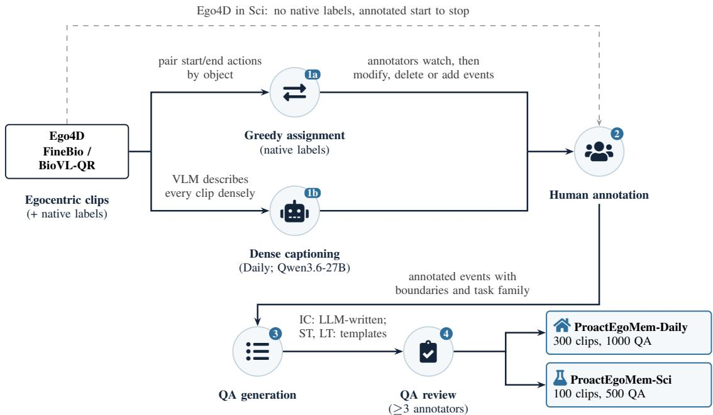  
Figure 11: ProactEgoMem construction pipeline. Native labels are greedily paired into candidate events; for Daily, a VLM densely captions every clip in addition to the greedy pairing. Annotators then watch each clip and modify, delete, or add events (Ego4D clips in Sci are annotated from scratch because native labels are missing). Every QA is reviewed by at least three annotators before being finalized.

## C TOOL INTERFACE

The benchmark exposes three core tools for proactive ambient memory:

• Recorder: records visible information.

• State Tracker: keeps an object state until resolved.

• Location Tracker: tracks an object until it moves.

• Tool-call content: a start call names the target with its description, state, or location; a tracker’s start returns an id that its stop call closes.

• Minimal interface: the difficulty lies in tool calling maintenance; the API surface is deliberately small.

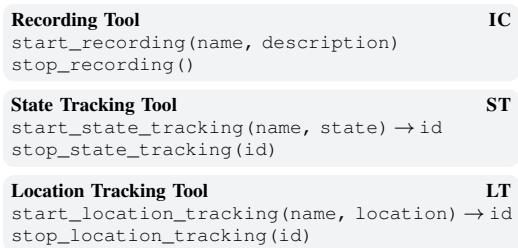

## D QUALITY OF THE PROACTIVE MESSAGE

We further analyze the quality of the message being sent at the end of the tool call at the Intervention Level.

Protocol. For every ground-truth message, we build a reference message by template from its arguments, including object names, tool, and status, building strings such as “[Nutrition facts] has been recorded”, “Keys location has been placed at [a new location]”, or “[Stove status] tracked until [turned off]”. The candidate is the message that the model emitted at the end of its tool call. A separate text-only judge, DeepSeek-V4-Flash, returns a binary score for whether the message conveys the correct information. We condition on the model’s own true positives and report P(correct msg | recall); a model is included in a task only if its Intervention Level recall there exceeds a minimum threshold of 5%.

Detection is the bottleneck; Models tend to emit correct messages conditional on successful detection. Quality of proactive messages still varies by model. Across the 18 model in Figure 8, a recalled intervention is correctly explained above 76%. Once a model notices that a lifecycle should end, it usually names the right object and the right outcome. The quality of the conditional message is also close to independent of recall value (with Spearman value of r = 0.23), showing that models that fire rarely are not thereby more careful about what they say. Accuracy of proactive messages still varies by model, causing conditional message accuracy to range from 58% (VideoLLaMA3-7B on LT) to 97% (Inkling-small on ST). VideoLLaMA3-7B is the substantive case: it recalls 19.8% of LT lifecycles, more than Qwen3.6-27B does, yet explains barely half of them correctly, so its joint rate (11.5%) falls below Qwen3.6-27B’s (12.5%).

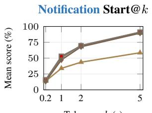

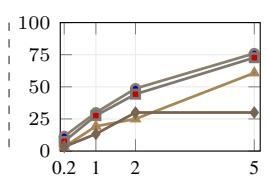

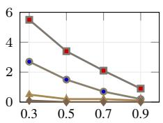  
Proprietary Open Source VidLLM Streaming  
Figure 12: Group-level mean Start@k and intervention IoU@τ over tasks and models as each criterion is relaxed. Note the collapsed scale of the rightmost panel: the best group mean stays below 6%.

Takeaway: Detection Is the Bottleneck and Proactive Message Accuracy Varies by Models

Once a model notices that a lifecycle should end, it names the right object and outcome on average 87.8% of the time. Model performance varies across tasks and models, and some fail to represent what happened at the right moments, which remains as a challenge.

## E EFFECTS OF TIMING IN PROACTIVITY

Start@0.2 measures whether a matched action lands at interactive latency, but a single tolerance does not show whether failures are narrowly late or far from the intended boundary. Figure 12 therefore sweeps the start tolerance and the intervention-overlap criterion before we examine the signed error distributions.

Effect of the Timing Threshold. (1)Given loose tolerances, the models can achieve high coverage: Start@1.0 reaches 50–80% for most models at the Notification Level and 30–60% at the Intervention Level. However, the curves are steep: Start@0.5 drops to 20–40% and 10–30%, respectively, and Start@0.2 falls to 10–30% and 5–20%. The steepness indicates that most response are hard to arrive on time. (2) VLMs, no matter open-source or proprietary, perform better than VidLMs in general, and the proprietary models do not show a consistent advantage over opensource models. (3) The Intervention Level is uniformly harder than the Notification Level, and the curves are steeper, so no model is at once timely, able to maintain tool use, and proactive in memory acquisition.

ProactEgoMem – predicted start error per model  
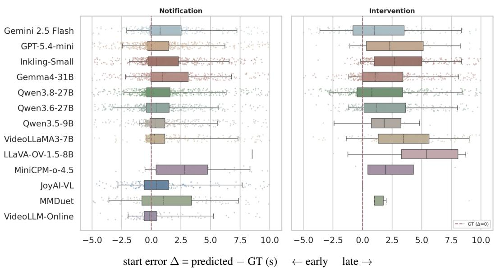  
Figure 13: Predicted start-error distributions by model, pooled across the three tasks, for notification and intervention levels. Points are individual matched starts; the dashed vertical line marks the ground-truth boundary, with positive values late and negative values early. Empty intervention rows indicate that no valid matched intervention was available for that model.

Timing is uncalibrated and responses usually arrive late. Even a semantically matched notification rarely lands on time: group-mean Start@0.2 sits near 13–16%, so fewer than one matched notification in six falls within the 200 ms tolerance. Across emitting model–task cells, mean absolute error is 2.07 s (range 0.73–8.5 s), far beyond responsive sub-second latency. Figure 13 shows notification medians often near the boundary but with long right tails; at the Intervention Level, all 11 valid pooled distributions have a positive median, placing the typical tool start after the moment when it was needed.

Committing to a tool generally costs about another second of delay, but not for every model– task pair. Mean absolute start error rises from 2.07 s at the Notification Level to 3.02 s at the Intervention Level; among the 28 cells with predictions at both levels, 22 become later and six improve. The pooled boxes expose the same asymmetry: intervention distributions shift visibly right for GPT-5.4-mini, Inkling-Small, VideoLLaMA3-7B, and Qwen3.5-9B, while JoyAI-VL and VideoLLM-Online produce no valid intervention distribution. Tool commitment therefore usually adds delay and can also end in abstention.

The lag varies too much to be calibrated away. Start-error spread stays near 2 s at both levels (mean σ of 2.01 s and 2.21 s), and the boxes differ in both width and location. Some models have broad late tails, whereas MMDuet’s intervention box is compact and LLaVA-OV-1.5-8B’s notification estimate collapses to one very late value. A model-level mean shift would leave substantial dispersion and would not reliably bring starts inside the 200 ms tolerance; what is missing is a reliable boundary signal.

## Takeaway: Proactive Timing Is Late and Uncalibrated

Fewer than one matched notification in six lands within the 200 ms tolerance, and committing to a tool adds about another second (mean absolute start error 2.07 s → 3.02 s). Start-error spread stays near 2 s at both levels, so no constant offset could calibrate the lag away; what is missing is a reliable boundary signal.

(a) Paired change per metric

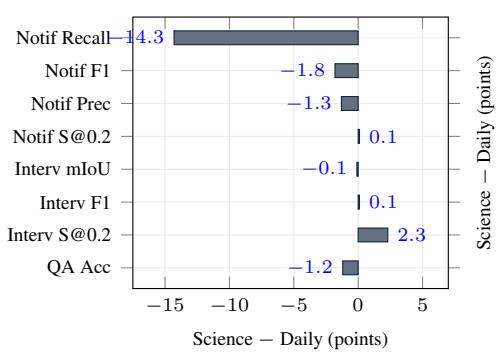

Notif S@0.2 Notif Recall Interv F1 QA Acc  
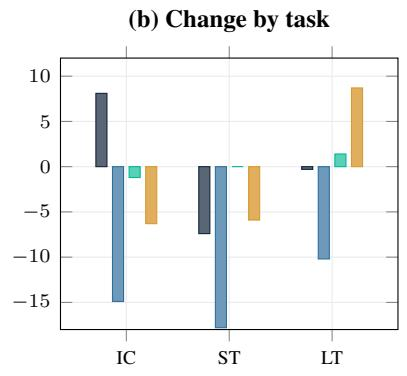

(c) Family transfer  
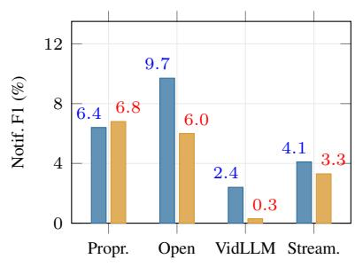

(d) Acquisition gap  
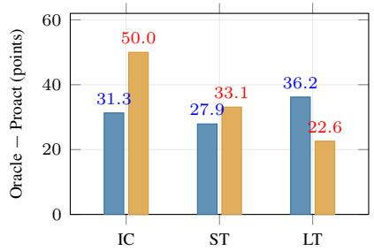  
Panels (c) and (d): ProactEgoMem-Daily ProactEgoMem-Sci  
Figure 14: Daily-to-Science transfer over the expanded paired results: 39 model–task cells for notification and intervention, and 36 for QA (VideoLLM-Online excluded). (a) Mean change per metric: only opportunity coverage moves substantially. (b) The same change split by task: the direction reverses between tasks for strict timing, intervention F1, and QA. (c) Notification-level F1 by model family: the open-source lead in daily life does not survive the move to the laboratory. (d) Mean gap between oracle and proactively acquired memory: acquisition costs more in the laboratory on IC and ST, less on LT.

## F PROACTEGOMEM-SCI: FROM DAILY LIFE TO THE LABORATORY

ProactEgoMem-Sci is the parallel Science track of ProactEgoMem: 100 egocentric laboratory clips (30 IC, 35 ST, and 35 LT) with 500 QA questions, evaluated with identical task settings, tool interfaces, and matching protocol as ProactEgoMem-Daily. Full per-model results are reported in Appendix J (Table 6), with the tolerance sweeps in Figure 20 and the QA memory conditions in Figure 22.

Because ten of the thirteen baselines run on both tracks under one protocol, the two domains can be compared paired: every claim below is a mean over the same 30 model–task cells on each track, so no single outlier can move it. Figure 14 reports the transfer.

The clearest cross-domain effect is a systematic loss of opportunity coverage in the laboratory. At the Notification Level, mean recall falls from 28.5% on ProactEgoMem-Daily to 15.5% on ProactEgoMem-Sci. This decrease is both large and exceptionally consistent: recall is lower in 28 of the 30 paired model–task cells, higher in none, and tied in only two. Notification F1 consequently falls from 5.9% to 3.9%, with 21 of 30 cells decreasing and only four increasing. By contrast, the directions of the intervention, conditional-timing, and QA changes are mixed, so we do not treat their small aggregate shifts as strong evidence of a general domain effect.

The coverage loss spans all three tasks while largely preserving which models are strongest. Notification recall decreases by 13.3 points on IC $( 3 8 . 7  2 5 . 4 \% )$ , 14.8 points on ST (22.7→8.0%), and 10.8 points on LT (24.0 →13.3%). The decline is therefore not caused by one task or one failed model family. At the same time, the cross-track rank correlation of recall remains very strong for

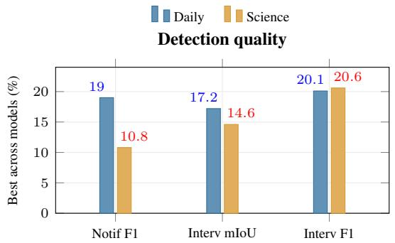

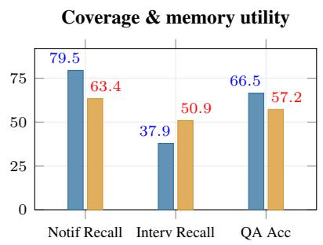  
Figure 15: Daily vs. Science, best value across models per metric. Moving to the laboratory lowers notification F1, intervention mIoU, notification coverage, and memory-backed QA. The higher best intervention recall and F1 come from two different single-model LT spikes.

IC $( \rho = 0 . 9 3 0 )$ , ST $( \rho = 0 . 8 2 8 ) .$ , and LT $( \rho = 0 . 9 0 0 )$ . Science changes the attainable operating point much more than the relative ordering: models that cover more daily-life opportunities usually still cover more laboratory opportunities, but almost all of them miss substantially more of those opportunities after the domain changes. The largest loss on ST further indicates that recognizing domain-specific state transitions is the most acute transfer bottleneck.

The leaderboard view exaggerates the average effect. Figure 15 shows the best value across models on each track. Every joint metric falls sharply at the top: notification F1 from 19.0% to 10.8%, intervention mIoU from 17.2% to 10.2%, intervention F1 from 20.1% to 15.4%, notification recall from 79.5% to 53.1%, and memory-backed QA from 66.5% to 57.2%, while the paired means move far less (notification F1 by 1.9 points, intervention mIoU by 0.2). The headline numbers on both tracks belong to the open-source family, whose joint metrics degrade most in the laboratory (Figure 14c): the laboratory removes the ceiling that one family had set.

Strict timing and intervention recall rise only through selective firing. The best Start@0.2 rises (28.8% → 50.0%) and the best intervention recall edges up (37.9% → 38.8%), both single-model spikes of VideoLLaMA3-7B at 0.6% and 7.0% precision. Silent model–task cells rise from 2 to 7 of 30 at the Notification Level and from 7 to 10 at the Intervention Level, and a silent cell contributes no timing error.

Averaged over models, the laboratory shrinks coverage and leaves the rest of the profile in place. Figure 7a overlays the two tracks, each polygon the mean of the 13 models on shared axes. At the Notification Level, recall nearly halves (32.0% → 17.7%), precision drops from 4.5% to 3.2%, and the timing-accuracy score from 60.7 to 52.5, while strict timing (14.5% against 14.6%) and QA accuracy (31.9% against 30.8%) hold. At the Intervention Level the polygons nearly coincide: overlap stays at 2.3% mIoU and recall slips from 10.4% to 8.8%, while strict timing rises from 6.2% to 8.5% through the fewer, more selective firings above.

The two tracks fail for different reasons. ProactEgoMem-Daily is limited by comprehension as much as by acquisition: its oracle accuracy averages 63.1% and reaches only 56.8–91.1% at best. ProactEgoMem-Sci is limited by acquisition: its oracle mean is higher (67.4%, up to 99.3% on IC) while proactively acquired accuracy is lower, widening the mean acquisition gap from 29.2 to 34.7 points (Figure 14d).

Improving cross-domain proactivity therefore requires coverage-aware domain adaptation. Training should expose models to laboratory objects, instruments, procedures, and hard negatives, while explicitly supervising whether an actionable opportunity exists before optimizing its start time or lifecycle boundary. For ST, a persistent representation of the previous object state and the observed transition should make the trigger depend on a change verified across frames. Finally, coverage or no-output rates should be optimized and reported jointly with conditional timing metrics, preventing abstention from appearing as successful temporal transfer.

## G RESULTS AT THE TWO PROACTIVE LEVELS

At the Notification Level, apparent proactivity is bought by over-triggering. The detection columns show how coverage is earned: recall runs high, up to 79.5% (Inkling-Small on IC), while precision is almost uniformly in the single digits, so the best notification F1 anywhere in the table is only 19.0% (Qwen3.6-27B on ST). Models inflate recall by firing indiscriminately and paying for coverage with false positives, and the few high-precision cells are the mirror image of the same miscalibration. Nor is the moment well chosen when it is caught: Start@0.2 never exceeds 28.8%, and because that metric is conditional on matched intervals it flatters the least selective models, the strict-timing leaders (VideoLLaMA3-7B, VideoLLM-Online, Qwen3.5-9B) all show precision below 2%.

At the Intervention Level, no model maintains the full memory lifecycle in real time, and the over-triggering could not help either. Maintaining a start–maintain–stop background tool lifecycle proves far harder than firing a single notification, with overlap in the single digits in almost all model–task cells. Nine scores contain no valid intervention at all (VideoLLM-Online on all three tasks; Qwen3.5-9B, LLaVA-OV-1.5-8B, MiniCPM-o-4.5, and JoyAI-VL on ST; MMDuet and JoyAI-VL on LT), and the best Start@0.2 drops to 20.0%. Chattiness at the Notification Level no longer supports substantial event coverage either: recall falls from as high as 79.5% at the Notification Level to at most 37.9% (Gemma4-31B on IC), while precision remains low once conditioned on recall, as its highest scores are degenerate (JoyAI-VL at 22.2% precision on 0.7% recall, MiniCPMo-4.5 at 20.0% on 0.4%). Precision, recall, and lifecycle overlap collapse together at the Intervention Level.

Intervention demands background co-existence. A notification is a single shot; an intervention must survive the stream—the agent commits to a tool call, holds it open as the scene changes, keeps perceiving in parallel, and judges when to stop (Section 3.2). The two-level gap measures that co-existence.

## H QUALITATIVE FAILURE CASES

Figures 16–19 walk through representative traces behind the failure modes of Section 5.6. Each case gives the setting, the model’s timestamped reasoning with the tool calls it emitted and the tool’s response, the behavior the ground truth asks for, and an error analysis.

Setting: VideoLLaMA3-7B, ProactEgoMem-Daily, LT, Intervention Level; a 3:58 clip. Situation: the user installs a wooden floor, repeatedly picking up and placing planks and a hammer.

VideoLLaMA3-7B trace:   
0:46 “I decided to start tracking an object’s location because the user is placing a plank on thefloor,   
which could be a personal object.”   
,→ start\_location\_tracking(name="plank", location="on wooden surface") →   
reminder-16   
0:46–3:58 The same call recurs at almost every second the plank is in view, and hammer tracks pile up   
alongside: the timeline holds parallel plank and hammer tracks, every one still open when the clip ends; no   
stop call is issued.

Expected behavior: open one location track when an object is set down, keep it open while the object stays put, and close it once when the object is moved; a new track starts only for a new placement.

Error analysis: (1) No lifecycle state. The model decides from the current frame alone and never consults the tracks it already holds, so every glimpse of the plank opens a duplicate. (2) No closing decision. Nothing in the stream prompts a stop, so the background memory grows without bound and never yields a final location.

Figure 16: Lifecycle maintenance failure: VideoLLaMA3-7B opens tracks without ever closing them.

Setting: VideoLLaMA3-7B, ProactEgoMem-Daily, Intervention Level. Situation (top): the same floor   
installation, LT; a hammer lies on the wooden surface. Situation (bottom): a driving clip, IC; the route is   
being recorded.   
VideoLLaMA3-7B trace (hammer):   
0:10 “I decided to start tracking an object’s location because the user is working on afloor installation   
project and needs to keep track oftools and materials.”   
,→ start\_location\_tracking(name="hammer", location="on wooden surface") →   
reminder-6   
0:11 “I decided to stop tracking the hammer’s location because it is no longer visible in the current   
frame.”   
,→ stop\_location\_tracking(id=reminder-6) → closed after 1.0 s   
0:12 (same reasoning)   
,→ stop\_location\_tracking() → REJECTED: already closed at 0:11   
VideoLLaMA3-7B trace (recording):   
0:09 “I decided to stop recording because the current driving route has already been recorded.”   
,→ stop\_recording() → closed after 4.0 s   
0:10–0:12 “I decided to stop recording because the current driving route has been captured.” (three   
times)   
,→ stop\_recording() → REJECTED: no recording interval is active (three times)   
Expected behavior: keep the hammer’s location while it is out of view, since that is when the user needs   
it, and issue each stop exactly once, against a live track or recording.   
Error analysis: (1) Visibility stands in for state. The model closes the hammer track because the hammer   
left the frame, discarding the memory at the moment it becomes useful. (2) Stale tool state. It repeats stop   
calls on a track and a recording it has already closed, reasoning about the scene while ignoring the tool   
responses it receives.  
Figure 17: Lifecycle maintenance failure: VideoLLaMA3-7B stops tools that are no longer live.

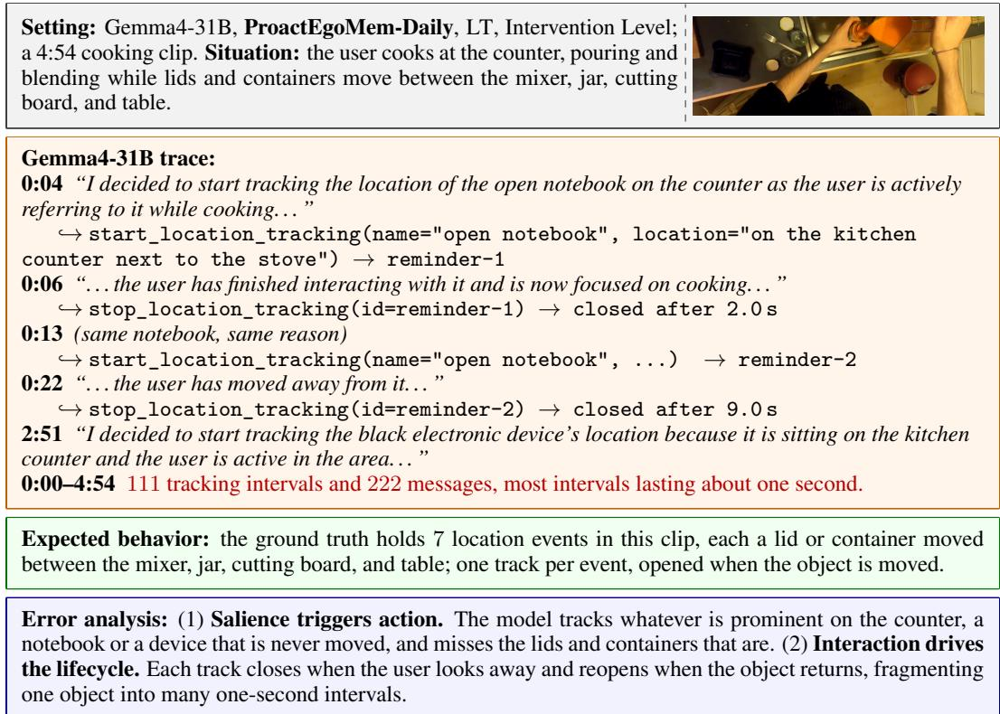  
Figure 18: Uncalibrated interruption: Gemma4-31B over-triggers location tracking.

Setting: VideoLLM-Online, ProactEgoMem-Daily, ST, Intervention   
Level; a 4:56 clip. Situation: the user prepares food in a home kitchen,   
opening the refrigerator, running the tap, and handling a cucumber.   
VideoLLM-Online trace:   
0:00 “(Video Time = 0.0s) Assistant: You are in a room.” [unparsed]   
0:02 “(Video Time = 2.0s) Assistant: You open thefridge.” [unparsed]   
0:12 “. . . You open the tap.” [unparsed] 0:15 “. . . You close the tap.” [unparsed]   
0:00–4:56 248 messages, all unparsed; 0 tool intervals.   
MMDuet trace (another ST clip, the user cutting potatoes):   
1:00 “I decided to start tracking a state because the person is cutting potatoes.” [unparsed]   
1:01 (identical sentence) [unparsed]   
Expected behavior: answer each moment with a JSON tool call; here, start status tracking when the   
refrigerator opens (the ground truth marks it open at 0:02–0:07) and stop it when it closes.   
Error analysis: (1) Perception succeeds, the protocol fails. VideoLLM-Online sees the refrigerator open   
at the annotated moment and says so, yet answers in its pre-trained narration format, so no tool ever starts.   
(2) Intent without action. MMDuet states the right decision in words and never emits the call, repeating it   
every second while nothing executes.  
Figure 19: Video-language models fail to follow instructions: VideoLLM-Online narrates and MMDuet describes its decision instead of calling the tool.

## I RESULTS ACROSS AMBIENT-MEMORY TASKS

Difficulty scales with the memory horizon (IC < ST < LT). IC is the easiest task: memorybacked QA accuracy reaches 36–66%, well above the 18–34% seen on ST and LT.

• IC is the easiest because reading dense text off video frames lands in the strengths of current video/visual-language models, as they are trained on dense visual content.

• ST demands temporal reasoning with parallelism: states change concurrently during multitasking for several object status and the model could not hold multiple state lifecycles open at once, interleaving their updates to know what remains active, in which order, and for how long.

• LT is the hardest, as it requires tracking the dynamics of an individual object over the longest horizon. The model must overwrite the object locations at every move while still remembering the original location, the last location, and whether the object has been moved elsewhere or stays in the same place.

## J PROACTEGOMEM-SCI: FULL MAIN RESULTS

Table 6 reports the full notification- and intervention-level results on ProactEgoMem-Sci under the metrics and layout of Table 4. Ten of the thirteen baselines have a completed streaming run at those two levels; Qwen3.8-27B, Inkling-Small, and JoyAI-VL are evaluated on the QA memory study only (Appendix J.2), which covers all thirteen. Figure 20 relaxes the timing and overlap criteria, Figure 21 compares the per-axis tradeoffs, and Figure 22 evaluates whether the acquired memory supports downstream questions.

Conclusion (Table 6). Transferring from daily life to the laboratory amplifies every joint failure mode: the best notification F1 drops to 10.8% (Gemma4-31B on LT) and the best intervention overlap to 10.2% mIoU (Gemma4-31B on ST), while 7 of 30 model–task cells emit no valid notification and 10 of 30 no valid intervention at all.

Proprietary access does not rescue the laboratory track. The proprietary pair buys coverage but not competence. Averaged over models and tasks, it leads notification recall (32.3% against 22.9% for the open-source group) yet trails on notification precision (4.1 against 7.1), intervention overlap (1.9 against 2.9 mIoU), intervention recall (7.2 against 12.1), and memory-backed QA (32.6 against 37.8), with the two families level on notification F1 (6.8 against 6.7). No proprietary model holds the best value of any joint timing-and-semantics metric on any task.

Table 6: ProactEgoMem-Sci main results for both levels, in the layout of Table 4. • Start@0.2, mIoU and Acc are defined as in Table 4. • Error columns are seconds, all others percentages; bold: best in a task.
<table><tr><td rowspan=3 colspan=8>Notification LevelTask Group    ModelTiming Abs Error      DetectionS@0.2↑|∆s|↓ σ↓  Prec↑ Recall↑F1↑</td><td rowspan=1 colspan=5>Intervention Level</td></tr><tr><td rowspan=1 colspan=5>Overlap Timing Abs Error      Detection       QA</td></tr><tr><td rowspan=1 colspan=5>mIoU↑ S@0.2↑|∆s|↓ σ↓  Prec↑ Recall↑F1↑  Acc↑</td></tr><tr><td></td><td rowspan=5 colspan=1>Open</td><td rowspan=2 colspan=2>Gemini 2.5 FlashProprietaryGPT-5.4-mini</td><td rowspan=1 colspan=2>31.6  1.231.92</td><td rowspan=1 colspan=1>2.2</td><td rowspan=1 colspan=1>43.4  4.2</td><td rowspan=1 colspan=1>2.7</td><td rowspan=1 colspan=1>36.4  1.392.11</td><td rowspan=1 colspan=1>2.5</td><td rowspan=1 colspan=1>6.3  3.6</td><td rowspan=1 colspan=1>41.8</td></tr><tr><td></td><td rowspan=1 colspan=2>30.1  1.281.94</td><td rowspan=1 colspan=1>1.6</td><td rowspan=1 colspan=1>47.4  3.2</td><td rowspan=1 colspan=1>1.9</td><td rowspan=1 colspan=1>20.0  3.413.56</td><td rowspan=1 colspan=1>4.6</td><td rowspan=1 colspan=1>5.7  5.1</td><td rowspan=1 colspan=1>46.5</td></tr><tr><td></td><td rowspan=1 colspan=2>Gemma4-31B</td><td rowspan=1 colspan=2>21.4  1.361.71</td><td rowspan=1 colspan=1>4.0</td><td rowspan=1 colspan=1>48.0  7.4</td><td rowspan=1 colspan=1>5.4</td><td rowspan=1 colspan=1>13.6  2.432.75</td><td rowspan=1 colspan=1>2.0</td><td rowspan=1 colspan=1>25.1  3.8</td><td rowspan=1 colspan=1>57.2</td></tr><tr><td></td><td rowspan=2 colspan=2>Qwen3.8-27BSourceQwen3.6-27B</td><td></td><td></td><td></td><td></td><td></td><td></td><td></td><td></td><td></td></tr><tr><td></td><td rowspan=1 colspan=2>23.7  1.441.84</td><td rowspan=1 colspan=1>4.9</td><td rowspan=1 colspan=1>53.1  8.9</td><td rowspan=1 colspan=1>2.9</td><td rowspan=1 colspan=1>12.5  2.652.59</td><td rowspan=1 colspan=1>1.7</td><td rowspan=1 colspan=1>18.3  3.2</td><td rowspan=1 colspan=1>54.5</td></tr><tr><td></td><td rowspan=1 colspan=1>IC</td><td rowspan=1 colspan=2>Qwen3.5-9B</td><td rowspan=1 colspan=2>28.1  1.271.89</td><td rowspan=1 colspan=1>1.6</td><td rowspan=1 colspan=1>32.6  3.1</td><td rowspan=1 colspan=1>0.0</td><td rowspan=1 colspan=1>0.0   0.000.00</td><td rowspan=1 colspan=1>0.0</td><td rowspan=1 colspan=1>0.0  0.0</td><td rowspan=1 colspan=1>46.5</td></tr><tr><td></td><td rowspan=1 colspan=1></td><td rowspan=1 colspan=2>VideoLLaMA3-7B</td><td rowspan=1 colspan=2>50.0  0.931.92</td><td rowspan=1 colspan=1>0.6</td><td rowspan=1 colspan=1>20.6  1.1</td><td rowspan=1 colspan=1>2.0</td><td rowspan=1 colspan=1>50.0   1.532.55</td><td rowspan=1 colspan=1>0.5</td><td rowspan=1 colspan=1>5.7   1.0</td><td rowspan=1 colspan=1>40.5</td></tr><tr><td></td><td rowspan=6 colspan=1></td><td rowspan=1 colspan=2>VidLLM   LLaVA-OV-1.5-8B</td><td rowspan=1 colspan=2>0.0   0.000.00</td><td rowspan=1 colspan=1>0.0</td><td rowspan=1 colspan=1>0.0  0.0</td><td rowspan=1 colspan=1>0.0</td><td rowspan=1 colspan=1>0.0   4.151.73</td><td rowspan=1 colspan=1>7.1</td><td rowspan=1 colspan=1>1.1   2.0</td><td rowspan=1 colspan=1>34.4</td></tr><tr><td></td><td rowspan=1 colspan=2>MiniCPM-o-4.5</td><td rowspan=1 colspan=2>0.0   0.000.00</td><td rowspan=1 colspan=1>0.0</td><td rowspan=1 colspan=1>0.0  0.0</td><td rowspan=1 colspan=1>0.0</td><td rowspan=1 colspan=1>0.0   0.000.00</td><td rowspan=1 colspan=1>0.0</td><td rowspan=1 colspan=1>0.0  0.0</td><td rowspan=1 colspan=1>32.4</td></tr><tr><td></td><td rowspan=1 colspan=1></td><td rowspan=1 colspan=1>MMDuet</td><td rowspan=1 colspan=2>10.0  2.502.04</td><td rowspan=1 colspan=1>1.4</td><td rowspan=1 colspan=1>5.7  2.3</td><td rowspan=1 colspan=1>0.3</td><td rowspan=1 colspan=1>0.0   3.060.87</td><td rowspan=1 colspan=1>8.3</td><td rowspan=1 colspan=1>1.7  2.8</td><td rowspan=1 colspan=1>39.1</td></tr><tr><td></td><td rowspan=1 colspan=1>Streaming</td><td rowspan=1 colspan=1>VideoLLM-Online</td><td rowspan=1 colspan=2>50.0  2.063.34</td><td rowspan=1 colspan=1>0.7</td><td rowspan=1 colspan=1>3.4  1.1</td><td rowspan=1 colspan=1>0.0</td><td rowspan=1 colspan=1>0.0   0.000.00</td><td rowspan=1 colspan=1>0.0</td><td rowspan=1 colspan=1>0.0  0.0</td><td rowspan=1 colspan=1>0.0</td></tr><tr><td></td><td></td><td></td><td></td><td></td><td></td><td rowspan=1 colspan=1>63.4  4.8</td><td rowspan=1 colspan=1>1.4</td><td rowspan=1 colspan=1>0.0   1.981.52</td><td rowspan=1 colspan=1>1.3</td><td rowspan=1 colspan=1>7.4  2.3</td><td rowspan=1 colspan=1>42.8</td></tr><tr><td></td><td rowspan=1 colspan=2>JoyAI-VL</td><td rowspan=1 colspan=2>11.1   1.642.32</td><td rowspan=1 colspan=1>1.3</td><td rowspan=1 colspan=1>5.1  2.1</td><td rowspan=1 colspan=1>0.0</td><td rowspan=1 colspan=1>0.0   0.000.00</td><td rowspan=1 colspan=1>0.0</td><td rowspan=1 colspan=1>0.0  0.0</td><td rowspan=1 colspan=1>52.8</td></tr><tr><td></td><td rowspan=4 colspan=1>Open</td><td rowspan=1 colspan=2>Gemini 2.5 FlashProprietary</td><td rowspan=1 colspan=2>9.5   2.942.65</td><td rowspan=1 colspan=1>6.3</td><td rowspan=1 colspan=1>16.5  9.1</td><td rowspan=1 colspan=1>3.7</td><td rowspan=1 colspan=1>9.3   2.281.97</td><td rowspan=1 colspan=1>13.2</td><td rowspan=1 colspan=1>13.0  13.1</td><td rowspan=1 colspan=1>20.2</td></tr><tr><td></td><td rowspan=1 colspan=2>GPT-5.4-mini</td><td rowspan=1 colspan=2>12.8  2.062.15</td><td rowspan=1 colspan=1>5.5</td><td rowspan=1 colspan=1>24.4  9.0</td><td rowspan=1 colspan=1>1.2</td><td rowspan=1 colspan=1>10.0  1.401.32</td><td rowspan=1 colspan=1>7.9</td><td rowspan=1 colspan=1>3.6  5.0</td><td rowspan=1 colspan=1>26.0</td></tr><tr><td></td><td rowspan=1 colspan=2>Gemma4-31B</td><td rowspan=1 colspan=2>6.3   3.342.63</td><td rowspan=1 colspan=1>5.7</td><td rowspan=1 colspan=1>15.3  8.3</td><td rowspan=1 colspan=1>ı10.1</td><td rowspan=1 colspan=1>12.3  1.812.04</td><td rowspan=1 colspan=1>9.9</td><td rowspan=1 colspan=1>30.4  14.9</td><td rowspan=1 colspan=1>25.0</td></tr><tr><td></td><td rowspan=1 colspan=2>Qwen3.8-27BSourceQwen3.6-27B</td><td></td><td></td><td></td><td></td><td></td><td></td><td></td><td></td><td></td></tr><tr><td></td><td rowspan=1 colspan=1>ST</td><td rowspan=1 colspan=2>Qwen3.5-9B</td><td rowspan=1 colspan=2>10.7  2.622.71</td><td rowspan=1 colspan=1>1.0</td><td rowspan=1 colspan=1>10.1  1.7</td><td rowspan=1 colspan=1>0.1</td><td rowspan=1 colspan=1>50.0  0.330.15</td><td rowspan=1 colspan=1>28.6</td><td rowspan=1 colspan=1>0.2  0.5</td><td rowspan=1 colspan=1>18.3</td></tr><tr><td rowspan=6 colspan=2></td><td rowspan=1 colspan=1></td><td rowspan=1 colspan=2>VideoLLaMA3-7B</td><td rowspan=1 colspan=2>30.0  0.280.15</td><td rowspan=1 colspan=1>0.1</td><td rowspan=1 colspan=1>1.2  0.2</td><td rowspan=1 colspan=1>4.0</td><td rowspan=1 colspan=2>8.6   2.562.26</td><td rowspan=1 colspan=1>10.7</td></tr><tr><td rowspan=1 colspan=2>VidLLM   LLaVA-OV-1.5-8B</td><td rowspan=1 colspan=2>0.0   0.000.00</td><td rowspan=1 colspan=1>0.0</td><td rowspan=1 colspan=1>0.0  0.0</td><td rowspan=1 colspan=1>0.0</td><td rowspan=1 colspan=1>0.0   0.000.00</td><td rowspan=1 colspan=1>0.0</td><td rowspan=1 colspan=1>0.0  0.0</td><td rowspan=1 colspan=1>18.3</td></tr><tr><td rowspan=1 colspan=2>MiniCPM-o-4.5</td><td rowspan=1 colspan=2>0.0   0.000.00</td><td rowspan=1 colspan=1>0.0</td><td rowspan=1 colspan=1>0.0  0.0</td><td rowspan=1 colspan=1>0.0</td><td rowspan=1 colspan=1>0.0   0.000.00</td><td rowspan=1 colspan=1>0.0</td><td rowspan=1 colspan=1>0.0  0.0</td><td rowspan=1 colspan=1>16.3</td></tr><tr><td rowspan=1 colspan=2>MMDuet</td><td rowspan=1 colspan=2>0.0   0.000.00</td><td rowspan=1 colspan=1>0.0</td><td rowspan=1 colspan=1>0.0  0.0</td><td rowspan=1 colspan=1>0.2</td><td rowspan=1 colspan=1>0.0   1.781.37</td><td rowspan=1 colspan=1>13.5</td><td rowspan=1 colspan=1>1.2  2.2</td><td rowspan=1 colspan=1>19.2</td></tr><tr><td rowspan=2 colspan=2>Streaming  VideoLLM-OnlineInkling-SmallJoyAI-VL</td><td rowspan=1 colspan=2>6.1   2.352.33</td><td rowspan=1 colspan=1>3.5</td><td rowspan=1 colspan=1>5.9  4.4</td><td rowspan=1 colspan=1>0.0</td><td rowspan=1 colspan=1>0.0   0.000.00</td><td rowspan=1 colspan=1>0.0</td><td rowspan=1 colspan=1>0.0  0.0</td><td rowspan=1 colspan=1>0.0</td></tr><tr><td rowspan=1 colspan=2>10.0  1.841.78</td><td rowspan=1 colspan=1>4.6</td><td rowspan=1 colspan=1>2.4  3.2</td><td rowspan=1 colspan=1>0.0</td><td rowspan=1 colspan=1>0.0   0.000.00</td><td rowspan=1 colspan=1>0.0</td><td rowspan=1 colspan=1>0.0  0.0</td><td rowspan=1 colspan=1>15.4</td></tr><tr><td rowspan=13 colspan=2>PrOpenLTS</td><td rowspan=2 colspan=2>Gemini 2.5 FlashoprietaryGPT-5.4-mini</td><td rowspan=1 colspan=1>8.5   2.03</td><td rowspan=1 colspan=1>1.94</td><td rowspan=1 colspan=1>6.3</td><td rowspan=1 colspan=1>25.3 10.1</td><td rowspan=1 colspan=1>1.1</td><td rowspan=1 colspan=1>5.9   2.962.75</td><td rowspan=1 colspan=1>6.4</td><td rowspan=1 colspan=1>9.2   7.5</td><td rowspan=1 colspan=1>26.1</td></tr><tr><td rowspan=1 colspan=1>10.9  1.91</td><td rowspan=1 colspan=1>2.19</td><td rowspan=1 colspan=1>2.7</td><td rowspan=1 colspan=1>36.9  5.0</td><td rowspan=1 colspan=1>0.9</td><td rowspan=1 colspan=1>0.0   3.552.68</td><td rowspan=1 colspan=1>8.1</td><td rowspan=1 colspan=1>3.2  4.6</td><td rowspan=1 colspan=1>35.0</td></tr><tr><td rowspan=1 colspan=2>Gemma4-31B</td><td rowspan=1 colspan=2>9.1   2.412.53</td><td rowspan=1 colspan=1>9.8</td><td rowspan=1 colspan=1>11.9  10.8</td><td rowspan=1 colspan=1>2.7</td><td rowspan=1 colspan=1>6.4   2.142.28</td><td rowspan=1 colspan=1>2.0</td><td rowspan=1 colspan=1>12.7  3.4</td><td rowspan=1 colspan=1>45.2</td></tr><tr><td rowspan=2 colspan=2>Qwen3.8-27BSourceQwen3.6-27B</td><td></td><td></td><td></td><td></td><td></td><td></td><td></td><td></td><td></td></tr><tr><td rowspan=1 colspan=2>9.1   1.591.55</td><td rowspan=1 colspan=1>9.4</td><td rowspan=1 colspan=1>5.9  7.3</td><td rowspan=1 colspan=1>2.2</td><td rowspan=1 colspan=1>4.5   3.092.82</td><td rowspan=1 colspan=1>9.1</td><td rowspan=1 colspan=1>11.9  10.3</td><td rowspan=1 colspan=1>40.8</td></tr><tr><td rowspan=1 colspan=2>Qwen3.5-9B</td><td rowspan=1 colspan=2>27.1  1.011.68</td><td rowspan=1 colspan=1>1.3</td><td rowspan=1 colspan=1>22.9  2.5</td><td rowspan=1 colspan=1>0.0</td><td rowspan=1 colspan=1>0.0   0.000.00</td><td rowspan=1 colspan=1>0.0</td><td rowspan=1 colspan=1>0.0  0.0</td><td rowspan=1 colspan=1>35.0</td></tr><tr><td rowspan=1 colspan=2>VideoLLaMA3-7B</td><td rowspan=1 colspan=2>40.3  0.330.55</td><td rowspan=1 colspan=1>0.9</td><td rowspan=1 colspan=1>18.1  1.7</td><td rowspan=1 colspan=1>14.6</td><td rowspan=1 colspan=1>3.2   3.712.73</td><td rowspan=1 colspan=1>12.4</td><td rowspan=1 colspan=1>50.9  20.0</td><td rowspan=1 colspan=1>33.1</td></tr><tr><td rowspan=1 colspan=2>VidLLM   LLaVA-OV-1.5-8B</td><td rowspan=1 colspan=2>0.0   0.000.00</td><td rowspan=1 colspan=1>0.0</td><td rowspan=1 colspan=1>0.0  0.0</td><td rowspan=1 colspan=1>0.2</td><td rowspan=1 colspan=1>0.0   0.960.00</td><td rowspan=1 colspan=1>12.5</td><td rowspan=1 colspan=1>0.3  0.5</td><td rowspan=1 colspan=1>31.8</td></tr><tr><td rowspan=1 colspan=2>MiniCPM-o-4.5</td><td rowspan=1 colspan=2>0.0   0.000.00</td><td rowspan=1 colspan=1>0.0</td><td rowspan=1 colspan=1>0.0  0.0</td><td rowspan=1 colspan=1>0.0</td><td rowspan=1 colspan=1>0.0   0.000.00</td><td rowspan=1 colspan=1>0.0</td><td rowspan=1 colspan=1>0.0  0.0</td><td rowspan=1 colspan=1>27.4</td></tr><tr><td rowspan=1 colspan=2>MMDuet</td><td rowspan=1 colspan=2>9.4   2.922.61</td><td rowspan=1 colspan=1>3.7</td><td rowspan=1 colspan=1>8.6  5.2</td><td rowspan=1 colspan=1>0.8</td><td rowspan=1 colspan=1>0.0   3.391.58</td><td rowspan=1 colspan=1>7.7</td><td rowspan=1 colspan=1>1.9  3.0</td><td rowspan=1 colspan=1>34.4</td></tr><tr><td rowspan=3 colspan=2>VideoLLM-OnlinetreamingInkling-SmallJoyAI-VL</td><td></td><td></td><td></td><td></td><td></td><td></td><td></td><td></td><td></td></tr><tr><td rowspan=1 colspan=2>9.5   2.412.44</td><td rowspan=1 colspan=1>3.2</td><td rowspan=1 colspan=1>42.6  5.9</td><td rowspan=1 colspan=1>5.1</td><td rowspan=1 colspan=1>4.1   2.802.61</td><td rowspan=1 colspan=1>3.4</td><td rowspan=1 colspan=1>32.6  6.1</td><td rowspan=1 colspan=1>33.8</td></tr><tr><td rowspan=1 colspan=2>8.7   2.351.89</td><td rowspan=1 colspan=1>2.1</td><td rowspan=1 colspan=1>6.2  3.2</td><td rowspan=1 colspan=1>0.0</td><td rowspan=1 colspan=1>0.0   0.000.00</td><td rowspan=1 colspan=1>0.0</td><td rowspan=1 colspan=1>0.0  0.0</td><td rowspan=1 colspan=1>36.9</td></tr></table>

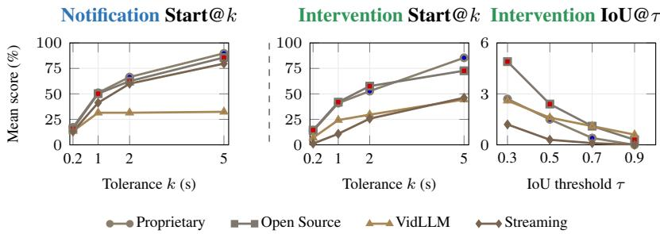  
Figure 20: ProactEgoMem-Sci group-level mean Start@k and intervention IoU@τ over tasks and models as each criterion is relaxed. Note the collapsed scale of the rightmost panel: the best group mean stays below 6%.

Strict timing is task-dependent. Mean notification Start@0.2 over all models is 24.5% on IC in the laboratory against 14.6% on the same task in daily life, but falls to 7.7% on ST and 13.1% on LT (daily: 15.4% and 13.4%). Laboratory IC moments—a label written, a reading taken—are sharper and easier to pin down than their everyday counterparts, whereas the diffuse onsets of laboratory status changes make ST timing markedly worse. The joint metrics still fall on all three tasks, so the laboratory is harder overall despite this one easier axis.

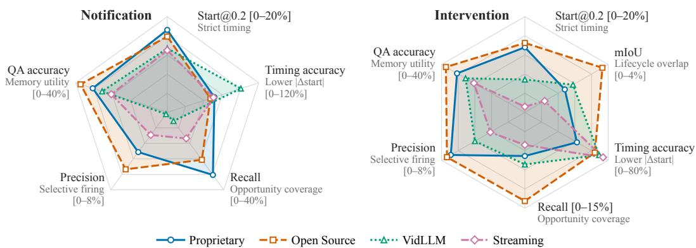  
Figure 21: Notification- and intervention-level radar summaries for ProactEgoMem-Sci, task averaged per model family. Axes and normalization follow Figure 5.

Models land in the right neighborhood but not at the right instant. Figure 20 sweeps both criteria. Conditional on a semantic match, notifications arrive within 5 s at group means of 70.7– 89.8% for every family except the video-language one, yet the same families sit at 13.4–17.2% within 200 ms. The steepest drop falls between 0.2 and 1 s, exactly the range separating an assistant that feels responsive from one that feels late, so the deficit lies in calibration.

Lifecycle overlap collapses at every threshold. Relaxing the overlap criterion reveals no hidden competence: the best group mean is 3.8% of opportunities at IoU ≥ 0.3 (open source), falling to 1.8% at 0.5, 0.8% at 0.7, and 0.2% at 0.9. Per model, the single strongest cell covers 13.8% of opportunities at IoU ≥ 0.3 and 0.4% at 0.9. Models fail to bracket the opportunity at all.

Group means confirm the weakness is field-wide. The strongest family on any given axis still averages only 6.8% notification F1 (proprietary), 2.9% intervention mIoU (open source), and 6.4% intervention F1 (proprietary); the video-language and streaming families are lower still. No family exceeds single digits on any joint timing-and-semantics metric, and the overall means—3.9% notification F1, 1.8% intervention mIoU—leave no candidate for a usable laboratory assistant.

## J.1 FAMILY TRADEOFFS ON THE SCIENCE TRACK

Figure 21 gives the family-level, task-averaged view of the Science track over the same six axes used in Figure 5.

No model family is a rounded proactive assistant on the Science track either. In Figure 21, opensource models lead memory-backed QA (37.9%), intervention overlap, and intervention recall; proprietary models lead notification recall (32.3%) and strict timing; and video-language models spike only on notification timing accuracy. The best notification F1 reaches only 10.8% (Gemma4-31B on LT) and the best intervention overlap only 10.2% mIoU (Gemma4-31B on ST), both below their daily-life counterparts, and the per-metric leaders remain scattered—VideoLLaMA3-7B owns strict timing and intervention F1, Gemma4-31B overlap and QA, Qwen3.6-27B notification precision, GPT-5.4-mini notification recall.

The intervention level stays far harder than the notification level. Intervention overlap remains in the single digits for every model–task cell, and a third of the grid produces nothing at all: MiniCPM-o-4.5 and VideoLLM-Online emit no valid intervention on any of the three tasks, LLaVA-OV-1.5-8B on two, and Qwen3.5-9B—one of the stronger notification-level timers—collapses to zero on IC and LT. Detection recall falls from up to 53.1% at the Notification Level to at most 38.8% at the Intervention Level.

Apparent proactivity is again bought by over-triggering. Notification precision stays at or below 9.8% in 29 of 30 cells; the lone exception, Qwen3.6-27B at 25.9% on ST, comes with only 6.1% recall. Recall runs far higher (up to 53.1%, Qwen3.6-27B on IC)—models inflate coverage by firing indiscriminately.

The smallest video-language model tops every timing axis. The 7B VideoLLaMA3-7B dominates strict timing on all three tasks (Start@0.2 up to 50.0%) and posts the best intervention recall and F1 (38.8% and 15.4%), while the 31B Gemma4-31B leads overlap and QA and the proprietary pair leads none of them; the purpose-built streaming systems again largely collapse at the intervention level. Proactive competence tracks neither scale, nor API access, nor streaming-specific design here.

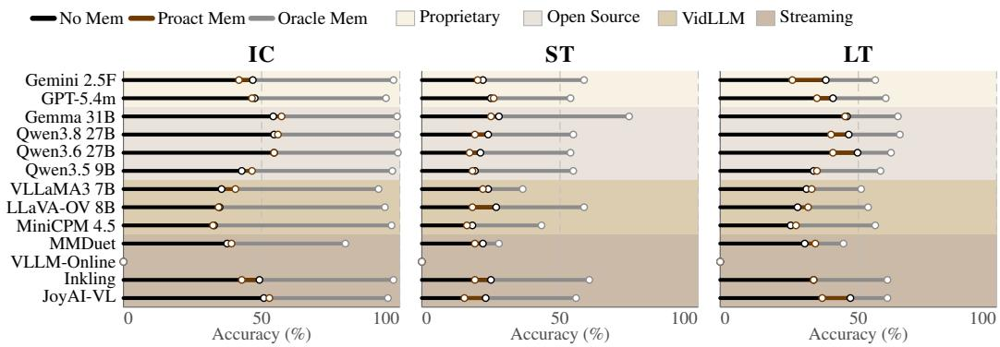  
Figure 22: ProactEgoMem-Sci ProactEgoMem-QA performance by task. Each model is shown as a horizontal accuracy bar: black marks No Memory, brown marks Proact Memory, and gray marks Oracle Memory.

## J.2 EFFECTS OF PROACTIVE MEMORY ON THE SCIENCE TRACK

Proactive acquisition matters only if the stored memory supports later questions, so every ProactEgoMem-Sci question is answered under the three memory conditions of Section 5.4: No Memory, where the model stores nothing and answers from frames sampled uniformly across the whole clip; Proact Memory, where the frames available at answering time are exactly those the model’s own tool calls chose to keep; and Oracle Memory, which substitutes the ground-truth events and bounds what perfect proactivity could deliver. VideoLLM-Online returns no valid answer under any condition and is excluded from the counts below, leaving twelve models per task.

The laboratory questions are easier to answer, once memory is given. Oracle accuracy in Figure 22 is higher on every laboratory task than on its daily-life counterpart: 99.3% against 91.1% on IC, 75.0% against 56.8% on ST, and 65.0% against 60.8% on LT. On IC the ceiling is effectively saturated—eleven of twelve models exceed 92.3% with ground-truth events, for a task mean of 95.4%. The laboratory is harder because its evidence resists acquisition.

Acquisition is the dominant bottleneck here. The oracle marker sits above the proactive one in all 36 model–task cells, by a mean of 50.0 points on IC, 33.1 on ST, and 22.6 on LT (35.3 overall, against roughly 23–25 in daily life), reaching 64.6 points for MiniCPM-o-4.5 on IC. A model that would answer nine out of ten IC questions given the right frame answers barely half of them from the frames its own policy chose to keep.

Proactively acquired memory more often hurts than helps. Against the uniform-sampling baseline, Proact Memory loses in 22 of the 36 cells, gains in 12, and ties in 2. The task dependence is sharper than in daily life: IC splits evenly (6 gains, 5 losses, largest gain 5.0 points for VideoLLaMA3-7B), ST is a near-total loss (11 of 12 models fall, by up to 8.6 points, dragging the task mean from 23.2% to 19.7%), and LT yields 5 gains against 6 losses. Mis-timed events are worse than no selection at all whenever the answer depends on when memory was written and for how long it was held.

On the longest horizon, proactive memory only helps the models that were already weakest. LT splits exactly by baseline strength: all six models with No Memory accuracy at or above 38.2% lose ground—Gemini 2.5 Flash by 12.1 points, JoyAI-VL by 10.2, Qwen3.6-27B by 8.9, Qwen3.8- 27B by 6.4, GPT-5.4-mini by 5.8, Gemma4-31B by 0.7—while all six at or below 33.8% gain or hold, by 0.0 to 3.8 points, with no overlap between the halves. Uniform sampling over a long clip is a strong baseline, and current proactive policies discard more useful evidence than they preserve; only models whose uniform-sampling accuracy is already low have nothing to lose.

## K PROMPTS

Every baseline receives the same prompt for a given task and proactive level; model-specific code only wraps it in the model’s chat template. At every 1-fps step, the prompt is followed by a JSON assistant context and the window of video frames, and the model answers with one JSON object. Tool calls carry no timestamp: each is executed at the current step. We reproduce the LT prompts verbatim and list, for ST and IC, every line that differs.

## K.1 INTERVENTION LEVEL

Intervention Level, LT (verbatim)   
You are a proactive assistant observing an egocentric video stream.   
You must decide whether to start tracking an object’s location, stop tracking an object’s   
location, or do nothing.   
## Input   
After these instructions, you receive the current assistant context followed by a window of   
video frames.   
### Current assistant context   
The context is a JSON object with exactly these fields:   
- \`current\_time\_sec\`: the clip-local time of the current step.   
- \`active\_tools\`: tool instances that are active now. Each entry contains \`instance\_id\`,   
\`tool\_name\`, \`started\_at\_sec\`, and \`arguments\`.   
- \`completed\_tool\_intervals\`: the most recently completed location-tracking intervals in   
this clip, ordered from oldest to newest. Each entry contains \`instance\_id\`,   
\`start\_tool\_name\`, \`end\_tool\_name\`, \`started\_at\_sec\`, \`ended\_at\_sec\`, and \`arguments\`.   
For active location trackers, \`active\_tools\` contains active \`start\_location\_tracking   
instances. The \`instance\_id\` is the tracking id that must be used when calling   
\`stop\_location\_tracking\`.   
\`active\_tools\` is authoritative for what is active now. \`completed\_tool\_intervals\` is   
short-term memory of location trackers that have already ended (it never contains an active   
location tracker) -- use it to avoid redundant tracking and understand what was recently   
tracked or resolved.   
### Video frames   
- Frames are ordered from oldest to newest.   
- Each frame has a relative frame number and a clip-local timestamp in seconds.   
- The final frame is the current moment.   
## Tools   
Several location trackers may be active at the same time.   
### \`start\_location\_tracking\`   
Arguments:   
- \`name\`: a short, specific name for the object being tracked.   
- \`location\`: a concise description of the object’s location to track.   
\`start\_location\_tracking\` starts actively tracking an object’s location for the user and   
returns an instance id.   
A successful \`start\_location\_tracking\` call remains active until \`stop\_location\_tracking\`   
is called with its corresponding instance id.   
This tool will be executed at \`current\_time\_sec\`; timestamps are not part of the tool   
arguments.   
### \`sto \_location\_trackin   
Arguments:   
- \`id\`: the tracking id of the active location tracker to stop.   
\`stop\_location\_tracking\` stops a currently active location tracker.   
Use the \`instance\_id\` from \`active\_tools\` as the \`id\`.   
This tool will be executed at \`current\_time\_sec\`; timestamps are not part of the tool   
arguments.   
## Task Policy   
The user wants help avoiding losing or forgetting personal objects during everyday   
activity.   
To achieve this, you should:   
- Infer the user’s intent and track relevant personal objects and their locations with the   
location-tracking tool.   
Invoke a tool only when it would provide timely and useful support for the user’s goal.   
If no useful action is warranted, do nothing.   
## Output   
Return exactly one JSON object with exactly these root keys:   
{   
"message": null,   
"tool\_calls": []

Table 7: Lines of the Intervention-Level prompt that differ from LT. Elsewhere ST reads “state” for “location”; IC drops the instance\_id paragraph, since a single recording needs no id.
<table><tr><td></td><td>ST</td><td>IC</td></tr><tr><td>Task line</td><td>You must decide whether to start tracking a state, stop tracking a state, or do nothing.</td><td>You must decide whether to start recording, stop recording, or do nothing.</td></tr><tr><td>Concurrency</td><td>Several state trackers may be active at the same time.</td><td>At most one recording may be active at a time. start_recording(name: a short,</td></tr><tr><td>Start tool</td><td>start_state_tracking(name: a short, specific name for the thing being tracked; state: a concise description of the state to track)</td><td>specific name for the information source; description: a concise description of what the recording should preserve)</td></tr><tr><td>Stop tool</td><td>stop_state_tracking(id:the tracking id of the active state tracker to stop) The user wants help avoiding</td><td>stop_recording(): Arguments: {} - the tool call has no arguments. The user seeks help in remembering</td></tr><tr><td>Policy</td><td>accidentally leaving things in an unintended state during everyday activity.... track relevant object states with the state-tracking tool.</td><td>information from their surroundings that may be useful in the future. ... build an ambient memory of the surrounding environment. Maintain broad coverage of relevant objects and their associated information.</td></tr><tr><td>Message style</td><td>&quot;I decided to start/stop tracking a state because ...&quot;</td><td></td><td>continuous recording. &quot;I decided to start/stop recording because ...&quot;</td></tr></table>

}   
Rules:   
- \`message\` must be a string or \`null\`.   
- If a tool is invoked, \`message\` must tell the user what you decided to do and why it   
supports their goal.   
- Use the style:   
- "I decided to start tracking an object’s location because ..."   
- "I decided to stop tracking an object’s location because ..."   
- \`tool\_calls\` must be a JSON list.   
- Each tool call must contain exactly \`name\` and \`arguments\`.   
\`name\` must be \`start\_location\_tracking\` or \`stop\_location\_tracking\`.   
- \`arguments\` must be a JSON object.   
- The do-nothing action is exactly \`{"message": null, "tool\_calls": []}\`.   
- Return JSON only, without a Markdown fence, preamble, explanation, or trailing text.   
## Assistant Context & Window of Video

## K.2 NOTIFICATION LEVEL

The Notification-Level prompt has no tools. Its context carries the clip’s previous messages instead of tool state, and the output is a single message field.

```markdown
Notification Level, LT (verbatim)
You are a proactive assistant observing an egocentric video stream.
You must decide whether to notify the user or do nothing.
## Input
After these instructions, you receive the current assistant context followed by a window of
video frames.
### Current assistant context
The context is a JSON object with exactly these fields:
- `current_time_sec`: the clip-local time of the current step.
- `recent_messages`: previous notifications from this clip, ordered from oldest to newest.
Each entry contains `timestamp_sec`, `step_index`, and `message`.
### Video frames
- Frames are ordered from oldest to newest.
- Each frame has a relative frame number and a clip-local timestamp in seconds.
- The final frame is the current moment.
## Task Policy
The user wants help avoiding losing or forgetting personal objects during everyday
activity.
To achieve this, you should:
```

Table 8: Lines of the Notification-Level prompt that differ from LT.  
ST IC   
Policy The user wants help avoiding The user seeks help in remembering   
accidentally leaving things in an information from their surroundings   
unintended state during everyday that may be useful in the future.   
activity. ... notify the user about notify the user about relevant objects   
relevant object states. But do not and their associated information.   
notify about every single object or But do not notify about every single   
state unless it is relevant to the user object unless it is relevant to the   
intent. user intent.   
Message style "You just ..." "I can see ..."

```markdown
- Infer the user’s intent and notify the user about relevant personal objects and their
locations.
But do not notify about every single object or location unless it is relevant to the user
intent.
## Output
Return exactly one JSON object with exactly this root key:
{
"message": null
}
Rules:
- `message` must be a string or `null`.
- `message` must notify the user about an observation.
- Use the style:
- "You just ..."
- The do-nothing action is exactly `{"message": null}`.
- Return JSON only, without a Markdown fence, preamble, explanation, or trailing text.
## Assistant Context & Window of Video
```

## K.3 MEMORY QA

After the stream ends, each question is answered once per memory condition with the prompt below. On IC the memory is a list of recordings and the answerer also receives up to 40 frames sampled uniformly from those segments. On ST and LT the memory is text only: the tracked name with its state or location and its start and end times. The No-Memory condition receives no memory, only 40 frames sampled uniformly from the whole clip.

Memory QA prompt template (placeholders in angle brackets)   
Answer a multiple-choice question about one egocentric video clip.   
## Instructions   
<condition instruction, see below>   
## Tool Semantics   
<task-specific description of what start/stop calls mean>   
## Memory   
<the memory for this condition, rendered as a list of entries>   
## Evidence Frames   
<IC: up to 40 frames sampled from the memory’s segments; No Memory: frames sampled   
uniformly from the clip>   
## Question   
<question>   
## Choices   
A. <choice>   
B. <choice>   
C. <choice>   
D. <choice>   
## Answer   
Reply with one JSON object and nothing else: {"answer": "A" | "B" | "C" | "D"} - replace   
the alternation with exactly one of A, B, C, or D. Pick the single best option even if the   
evidence is incomplete; never output reasoning, code fences, or other text.   
Text filled into <condition instruction>, per memory condition (verbatim)   
No Memory: This is the no-memory baseline. Do not use proactive tool state or compact   
segments; answer only from the question, the choices, and the attached frames.

Proact Memory: Use only the compact trace memory below and, when real evidence frames are   
attached, the attached frames. The memory comes from tool calls made by the evaluated   
assistant; it may be incomplete, so answer according to the available evidence.   
Oracle Memory: The recordings below are the ground-truth intervals that should have been   
captured, and the attached frames were sampled from them. Use the recording memory and the   
attached frames together to answer.

## K.4 PREDICTION MATCHING

As in ProAssist (Zhang et al., 2025c), predictions are matched to ground truth one to one, and each pairing costs 1 − sim plus a time term |∆t|<sup>p</sup> with p = 1.5. A pairing requires a similarity of at least 0.5 and a time offset inside an asymmetric window, with a hard cutoff outside it.

## K.5 LLM JUDGES

Semantic similarity in the matcher (Section 5.1) is scored by an LLM judge at temperature 0, which returns a number in [0, 1]. At the Intervention Level it compares the ground-truth object with the name argument of the predicted tool call; at the Notification Level it compares a templated groundtruth sentence (IC: “I can see {object}”, ST: “You just turned on / opened {object}”, LT: “You just placed {object}”) with the model’s message.

Intervention-Level judge instruction (verbatim)   
You are given two short object names: a ground-truth object and a model’s predicted object   
name. Rate from 0.0 to 1.0 how likely they refer to the SAME real-world object. A   
synonym, or a more- or less-specific name for the same object, counts as 1.0; clearly   
different or unrelated objects count as 0.0. Judge only object identity, nothing else.

Notification-Level judge instruction (verbatim)   
You judge whether a model’s proactive message conveys the SAME notification as a   
ground-truth reference (the same object and event). Rate from 0.0 to 1.0: 1.0 = same   
object/event being announced, 0.0 = unrelated. Ignore phrasing differences and extra   
detail.

## Judge prompt template: one of the two instructions above is inserted at {instruction} (verbatim)

{instruction}   
Reference (ground truth): "{ref}"   
Candidate (model output): "{cand}"   
Reply with ONLY a single number between 0.0 and 1.0.