# PhyMo: Learning Physical Dynamics with Accurate and Continuous Motion from Multi-View Videos

Shangjia Liu§ Jinxi Li† Siyuan Zhou† Bo Yang† Bing Wang§∗

§Spatial Intelligence Group †vLAR Group The Hong Kong Polytechnic University, Hong Kong SAR, China shangjia.liu@connect.polyu.hk bingwang@polyu.edu.hk

## Abstract

Recovering dynamic 3D scene geometry, appearance, and the physical motion states that govern scene evolution from multi-view videos is important yet challenging. A key difficulty is that appearance can be deceptive. Under rendering supervision alone, a model may fit the observed images by changing color or opacity to compensate for inaccurate deformation, rather than recovering the true evolving geometry and motion. This issue is especially severe in scenes with fast or locally complex motion, where inaccurate trajectories can still produce plausible images over the observed frames, but lead to unreliable reconstruction and discontinuous future prediction. In this paper, we propose PhyMo, a framework for learning evolving dynamics from multi-view videos. We introduce a Motion-Aware Trajectory Representation that drives the model to recover accurate motion from deformation, rather than relying on appearance shortcuts to explain observed motion. On top of this, we propose a Continuous Motion Evolution module with bidirectional kinematic continuity constraint to promote temporally consistent evolution of displacement, velocity, and acceleration. Together, these designs yield geometrically faithful interpolation and continuous motion extrapolation. Experiments on four dynamic scene benchmarks demonstrate state-of-the-art performance. Code is available at https://github.com/BystanderJ/PhyMo.

## 1 Introduction

Modeling the real, complex, and dynamic physical 3D world has long been a fundamental yet challenging problem in computer vision and robotics. A faithful understanding of how 3D scenes evolve over time is critical for a wide range of downstream applications, including embodied AI, world models, and robotic motion planning. Recent advances in 3D scene representations, such as Neural Radiance Fields[1] and 3D Gaussian Splatting[2], have enabled high-quality dynamic scene reconstruction from visual observations. With such powerful representations, current research largely centers on reconstruction quality, yet two fundamental questions remain: what constitutes dynamics in a scene representation, and how can we learn it effectively?

One line of work [3–6] views dynamics as a spatial-temporal trajectory and represents motion with a deformation field. These methods typically fit trajectories by uniformly sampling timestamps and jointly optimizing the deformation and canonical appearance to match observations. However, since their motion modeling is not grounded in physics, they mainly interpolate within the observed interval and degrade quickly beyond it. A second line of work [7–10] models dynamics as physical motion states, such as velocity (and sometimes higher-order states), and learns them via integration to match observations. While this formulation enables future extrapolation, integration-based learning is prone to error accumulation, which can compromise reconstruction quality. More recently, hybrid approaches combine both representations [11–15], using spatial-temporal trajectories to guide the learning of physical motion states and aiming to better balance reconstruction fidelity and future prediction. However, these methods often rely primarily on photometric supervision, leaving motion states weakly constrained and lacking temporal consistency. This limitation reflects a broader gap shared by existing approaches, regardless of the specific dynamics representation.

In this paper, we aim to recover physically plausible scene evolution from dynamic scenes, rather than merely reconstructing geometry and appearance, so that the learned representation supports both geometrically faithful interpolation and continuous motion extrapolation. However, this task is extremely challenging, because existing methods have not resolved two key issues: 1) Rendering fidelity is not equivalent tofaithful motion. Although motion may remain smooth for long periods, recovering accurate trajectories becomes much harder during rapid changes or state transitions. Existing methods typically optimize deformation and canonical appearance jointly under rendering supervision, creating a fundamental ambiguity: while accurate motion can explain correct appearance, correct appearance alone is not evidence of accurate motion. As a result, they may produce plausible renderings while still recovering unreliable trajectories and deformations. 2) Motion evolution is inherently continuous. Displacement, velocity, and acceleration should propagate consistently over time according to the underlying kinematic relationships. However, existing methods often rely on learned trajectories and rendering supervision alone to recover these motion states, without explicitly constraining their temporal consistency. Consequently, the estimated motion states may be locally discontinuous over time, leading to unreliable motion details in both interpolation and extrapolation.

To address these challenges, we propose PhyMo, a framework for learning physical evolution with accurate and continuous motion from multi-view videos. Specifically, we introduce a Motion-aware Trajectory Representation that drives the model to recover accurate motion through deformation, so that observed dynamics are explained by deformation rather than by shortcuts in canonical appearance. This mitigates a key failure mode of existing methods, where fast motion or locally complex motion can be visually explained by appearance fitting while the underlying deformation is still wrong. As a result, our method recovers dynamic scenes that are not only visually plausible, but also geometricallyfaithful in 3D space. On top of the recovered motion trajectories, we further introduce a Continuous Mo

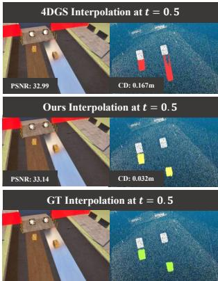  
(a) Geometrically Faithful Interpolation

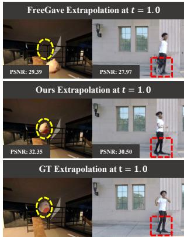  
(b) Continuous Motion Extrapolation

Figure 1: Given video of a dynamic scene, our PhyMo can achieve geometrically faithful reconstruction and continuous motion prediction, comparing to other methods. In (a), white points denote the canonical point cloud, while colored points denote the dynamic point cloud at t = 0.5.

tion Evolution module to model the evolution of physical motion states. Since estimating displacement, velocity, and acceleration from discrete observations under rendering supervision alone is inherently under-constrained, we impose a bidirectional kinematic continuity constraint to promote temporally continuous state propagation, thereby enabling continuous motion extrapolation.

Overall, our method addresses the under-constrained problem of recovering physical motion states like displacement, velocity, acceleration from visual supervision alone. By combining motion-aware trajectory representation with continuous motion evolution, PhyMo achieves both geometrically faithful interpolation and continuous motion extrapolation. Figure 1 shows our qualitative results on two representative tasks, our contributions can be summarized as follows:

• We introduce a new framework for physically plausible dynamic scene modeling from multi-view videos. By combining Motion-Aware Trajectory Representation with Continuous Motion Evolution, PhyMo achieves geometrically faithful reconstruction and continuous motion prediction.

• We demonstrate the appearance shortcut problem in dynamic reconstruction and mitigate it with a Motion-Aware Trajectory Representation, which drives dynamics to be captured by deformation rather than appearance shortcuts for geometrically faithful reconstruction.

• We propose a Continuous Motion Evolution module with bidirectional kinematic continuity to enforce temporally consistent displacement, velocity, and acceleration, and demonstrate strong performance on both interpolation and extrapolation across four benchmarks.

## 2 Related Works

3D Representations. Traditional static 3D representations, such as meshes[16], point clouds[17], voxel grids[18], and primitives[19], are explicit yet inherently discrete. As a result, they often suffer from fundamental limitations in fidelity and efficiency. Recently, a series of implicit 3D modeling approaches have been proposed, such as occupancy fields[20, 21], signed/unsigned distance fields[22–24], and radiance fields[1]. Although these methods have significantly advanced novelview synthesis and shape reconstruction, their rendering is often time-consuming due to expensive volumetric sampling. To address this issue, 3D Gaussian Splatting (3DGS)[2] adopts a point-based representation to encode 3D properties, enabling substantially faster rendering. In our framework, we choose 3DGS as the scene representation, since it naturally integrates with of our pipeline.

Dynamic 3D Reconstruction. Recent progress in dynamic 3D reconstruction has largely focused on extending static scene representations, such as NeRF and 3D Gaussian Splatting (3DGS), into the spatio-temporal domain [25–28, 28–36]. Most NeRF-based or 3DGS-based approaches decouple the static representation from motion or deformation, and incorporate time as an additional input to learn a deformation or motion field. While these methods achieve impressive visual quality for appearance reconstruction, their learned dynamics are often weakly constrained by rendering supervision, limiting their reliability for both past retrodiction and future extrapolation. On the one hand, the learned temporal field may fit photometric correspondences without capturing physically meaningful motion evolution, leading to poor prediction beyond observed frames. On the other hand, even within the observed time span, visually accurate rendering does not necessarily imply accurate dynamic geometry or deformation. Recent efforts [37, 38] improve dynamic Gaussian representations by relaxing the canonical-space assumption, introducing short-range motion, or modeling temporal visibility and lifespan. However, these works mainly treat such failures as optimization issues, without explicitly revealing the underlying competition between appearance fitting and motion recovery.

3D Physics Learning. Motivated by the classical Physics-Informed Neural Networks (PINNs) framework, a growing body of research has explored learning physical attributes of 3D scenes and dynamic objects, such as Young’s modulus and viscosity [39–42]. While these methods can enable future prediction, they are often constrained to a specific set of physical laws and governing equations. However, real-world dynamics are highly complex and are frequently difficult to capture with accurate simulation-based models. Another class of methods instead directly embeds physics systems [43–48], such as graph-based interactions or mass spring structures into the network, so that the dynamics can be learned in a more structured manner. However, such methods also tend to be limited in generalizability and scalability, since the embedded physics systems are usually tailored to specific object categories, material behaviors, or interaction patterns. More recent hybrid methods [12, 14, 15] attempt to learn general physical motion states, such as velocity or acceleration, directly from dynamic videos. However, their motion-state learning is still largely dominated by rendering supervision, making the recovered physical states under-constrained: different motions may explain the observed frames similarly but yield unstable future predictions.

## 3 Method

Given multi-view RGB videos of a dynamic scene, we denote the observed images as $\{ \mathbf { I } _ { t } ^ { n } \} _ { t = 0 , n = 1 } ^ { T , N } ,$ where N is the total number of cameras and T is the greatest timestamp in training. Our goal is to recover faithful dynamic scene geometry and evolving motion from visual observations, enabling geometrically faithful interpolation within the observed interval and continuous motion future-frame extrapolation beyond it. As illustrated in Figure 2, our framework consists of two key components. First, in Section 3.1, we introduce a Motion-Aware Trajectory Representation that drives observed motion to be explained by deformation rather than by shortcuts in canonical appearance, thereby alleviating two common failure modes: premature appearance adaptation in fast local motion, and static-background appearance changes that compensate for unresolved motion. Second, in Section 3.2, we introduce a Continuous Motion Evolution module that models the temporal evolution of displacement, velocity, and acceleration under bidirectional kinematic continuity, improving motion consistency over time. Finally, in Section 3.3, we describe the training strategy that optimizes the whole framework, allowing the learned representation to better capture complex dynamic scenes and produce reliable interpolation and extrapolation results.

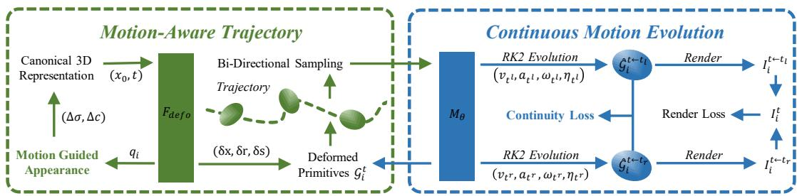  
Figure 2: Overview of PhyMo. The left module, Motion-Aware Trajectory , starts from a canonical 3D representation and uses deformation network $F _ { d e f o }$ to derive a motion-confidence gate $q _ { i }$ that guides canonical appearance learning, encouraging motion to be explained by deformation rather than appearance shortcuts. The right module, Continuous Motion Evolution, bi-directionally sampling from the trajectory, Motion Network $M _ { \theta }$ predicts velocity and acceleration and performs RK2 evolution , where bidirectional kinematic continuity loss and render loss are applied.

## 3.1 Motion-Aware Trajectory Representation

Canonical 3D Gaussian Representation. We represent a dynamic scene by a set of canonical 3D Gaussian Splatting kernels, denoted as $\mathcal { G } _ { 0 } .$ . Each canonical Gaussian is parameterized by its 3D mean position $x _ { 0 } ,$ an anisotropic covariance matrix derived from a unit quaternion $r _ { 0 }$ and per-axis scaling $s _ { 0 }$ , together with an opacity σ and an SH coefficient vector c for view-dependent appearance. Given the observed images at $t = 0 ,$ , together with known camera poses and sparse Structure-from-Motion (SfM) [49] points or random initialization, we optimize the canonical Gaussian set by the standard rendering-based learning procedure:

$$
\underbrace { \left\{ \left( x _ { 0 } , r _ { 0 } , s _ { 0 } , \sigma , c \right) \right\} } _ { \mathcal { G } _ { 0 } } \xrightarrow [ ] { \mathrm { p r o j e c t + r e n d e r } } \left\{ I _ { 0 } ^ { 1 } , \ldots , I _ { 0 } ^ { N } \right\}\tag{1}
$$

To model scene dynamics, we further introduce a deformation field $F _ { \mathrm { d e f o } }$ that predicts the timedependent deformation of each Gaussian from its canonical position and time:

$$
( \delta x , \delta r , \delta s ) = F _ { \mathrm { d e f o } } ( x _ { 0 } , t )\tag{2}
$$

The Gaussian parameters at time t are then obtained by

$$
x _ { t } = x _ { 0 } + \delta x , \quad r _ { t } = r _ { 0 } \circ \delta r , \quad s _ { t } = s _ { 0 } \odot \delta s , \quad \sigma , c\tag{3}
$$

where ◦ and ⊙ denote quaternion composition and element-wise scaling update, respectively. Although the deformation field is intended to model geometric changes over time, rendering-supervised optimization can reduce photometric error without learning reliable motion. Before the deformation field becomes accurate, the model may exploit appearance shortcuts through the canonical attributes c and σ, leading to two typical failure modes, as shown in Figure 3. In static or background-dominated regions, adjusting the SH color coefficients c can preserve visual quality even when the recovered dynamic geometry is inaccurate. In fast-moving or locally complex regions, reducing the opacity σ of poorly aligned dynamic Gaussians can make moving content fade or disappear instead of correcting its trajectory. Thus, rendering loss can decrease while motion recovery remains unreliable.

Motion-Guided Appearance. To suppress appearance shortcuts, we reparameterize the canonical appearance into a motion-guided residual form:

$$
\sigma _ { i } = \sigma _ { i } ^ { b } + q _ { i } \Delta \sigma _ { i } , \qquad c _ { i } = c _ { i } ^ { b } + q _ { i } \Delta c _ { i }\tag{4}
$$

where $\sigma _ { i } ^ { b }$ and $c _ { i } ^ { b }$ denote the base canonical opacity and SH coefficients, $\Delta \sigma _ { i }$ and $\Delta { c } _ { i }$ are residual appearance parameters, and $q _ { i } ~ \in ~ [ 0 , 1 ]$ is a per-Gaussian motion confidence gate. In this way, canonical appearance is no longer a fully free shortcut channel; instead, its effective update is guided by whether the corresponding Gaussian already exhibits active local motion. To characterize whether the deformation field exhibits active local motion on a Gaussian, we define its motion confidence according to the deformation change between adjacent timestamps:

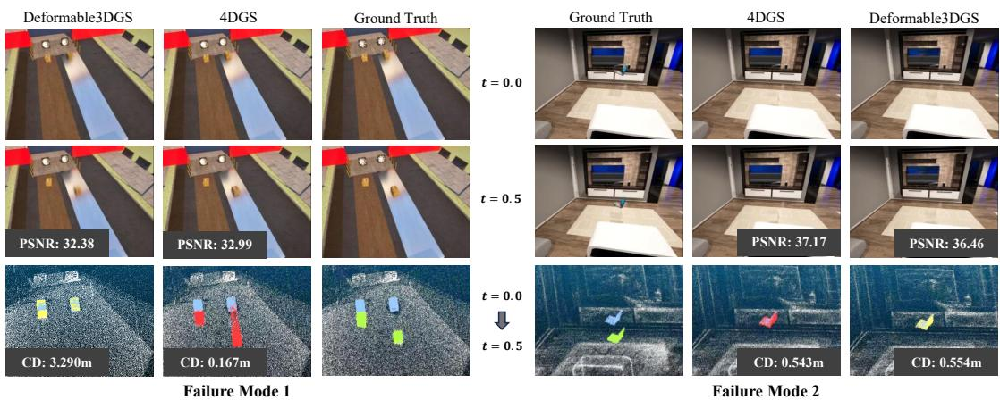  
Figure 3: Two Failure Modes of 4D Reconstruction. 1. Static-background appearance shortcut: Adjusting static-region appearance $c _ { i }$ improves PSNR but doesn’t recover evolving geometry. 2. Dynamic primitives disappearance shortcut: For fast motion, the optimizer makes primitives transparent by reducing $\sigma _ { i }$ instead of recovering the correct trajectory, leading to a local minimum.

$$
q _ { i } = \mathrm { s g } [ \psi ( | | \delta x _ { i } ( t _ { k + 1 } ) - \delta x _ { i } ( t _ { k } ) | \big | _ { 2 } ) ]\tag{5}
$$

where $t _ { k }$ and $t _ { k + 1 }$ denote two adjacent sampled timestamps, $\psi ( \cdot )$ is a monotonic squashing function mapping to $[ 0 , 1 ]$ , and $\mathrm { s g } \left[ \cdot \right]$ denotes stop-gradient. This design reflects whether the corresponding Gaussian exhibits active local motion, rather than how far it has moved away from the canonical state. Intuitively, if the deformation change between adjacent timestamps remains small, the corresponding Gaussian is still motion-inactive and its appearance residual should stay suppressed. Once a clear local motion response emerges, the gate progressively opens, allowing appearance residuals to refine rendering quality. This per-Gaussian design is particularly suitable for dynamic scenes with non-uniform motion difficulty, where different regions may become motion-active at different times.

## 3.2 Continuous Motion Evolution

This module aims to learn motion states that evolve continuously over time. Since real-world physics is highly complex, we adopt a simplified yet effective formulation by treating each Gaussian particle as rigid, with fixed scale over time. Under this assumption, we introduce a Motion Network to predict the instantaneous motion states of each Gaussian particle at any time t, including linear velocity, linear acceleration, angular velocity, and angular acceleration:

$$
\left\{ { \bf { \Phi } } ( v _ { t } , a _ { t } ) , { \bf { \Phi } } ( \omega _ { t } , \eta _ { t } ) \right\} = M _ { \theta } ( x _ { t } , t )\tag{6}
$$

Bidirectional Trajectory Sampling. Built upon the motion trajectory learned in Section 3.1, for each observed timestamp $t ,$ we sample two neighboring instants on both sides with a small interval $\Delta t , t _ { l } = t - \Delta t , t _ { r } = t + \Delta t$ . The Gaussian states at $t _ { l }$ and $t _ { r }$ are directly obtained from the learned trajectory representation, and their motion states are predicted by the Motion Network. We then propagate both states bidirectionally toward the observation time t using Runge-Kutta $2 ^ { n d }$ -order(RK2) method, bidirectional propagation yields two Gaussian estimates at the same observation time t, which are both rendered and supervised by the image at t.

$$
\hat { \mathcal { G } } _ { t  t _ { l } } = \mathrm { R K } 2 [ \mathcal { G } _ { t _ { l } } , t _ { l } , + \Delta t , M _ { \theta } ] \qquad \hat { \mathcal { G } } _ { t  t _ { r } } = \mathrm { R K } 2 [ \mathcal { G } _ { t _ { r } } , t _ { r } , - \Delta t , M _ { \theta } ]\tag{7}
$$

However, supervising this propagation only with rendering loss is inherently ambiguous, because rendered appearance is a consequence of motion evolution rather than its cause. As a result, image supervision alone cannot uniquely determine the underlying motion states. This ambiguity is particularly severe in our setting, where the motion state includes not only position, but also velocity and acceleration. Therefore, learning motion dynamics purely from appearance matching remains an under-constrained inverse problem. To further constrain the propagated motion states, we impose bidirectional kinematic continuity across neighboring timestamps. Specifically, for each observed timestamp t, the motion states predicted at $\bar { t _ { l } } = t - \Delta t$ and $t _ { r } = t + \Delta t$ are required to remain consistent when propagated toward the same observation time through the kinematic chain from acceleration to velocity and from velocity to displacement. This gives the following continuity losses:

$$
\ell _ { \mathrm { c o n t l } } = \frac { 1 } { | \mathcal { G } | } \sum _ { i \in \mathcal { G } } \left. v _ { t _ { l } } ^ { i } - v _ { t _ { r } } ^ { i } + \Delta t \big ( a _ { t _ { l } } ^ { i } + a _ { t _ { r } } ^ { i } \big ) \right. _ { 1 }\tag{8}
$$

$$
\ell _ { \mathrm { c o n t 2 } } = \frac { 1 } { | \mathcal { G } | } \sum _ { i \in \mathcal { G } } \left\| x _ { t _ { l } } ^ { i } - x _ { t _ { r } } ^ { i } + \Delta t \big ( v _ { t _ { l } } ^ { i } + v _ { t _ { r } } ^ { i } \big ) \right\| _ { 1 }\tag{9}
$$

where $\mathcal { G }$ denotes the set of Gaussians, and $x _ { t _ { l / r } } ^ { i } , v _ { t _ { l / r } } ^ { i }$ , and $a _ { t _ { l / r } } ^ { i }$ are the displacement, velocity, and acceleration of the i-th Gaussian at $t _ { l }$ and $t _ { r } ,$ respectively. Equivalently, these losses penalize the mismatch of the two-sided predictions when they are propagated to the same observation time $t ,$ thereby regularizing temporally coherent motion evolution beyond rendering supervision alone.

## 3.3 Training

The training of our framework consists of two parts: learning reliable deformation at observed timestamps, and then learning physical motion states on top of these trajectories. We first optimize the canonical Gaussians together with the deformation field, and then jointly optimize the Motion Network and the deformation field with both rendering supervision and kinematic continuity constraint.

We begin with a canonical warm-up at the initial timestamp, where the canonical Gaussian parameters are optimized using all observations at $t = 0$ . After this initialization, we train the deformation field under a gradual temporal expansion strategy. Instead of introducing all observed timestamps at once, we progressively enlarge the supervised temporal support by adding one time window after another. Deformation field is optimized only on the currently revealed observations:

$$
\{ \mathcal { G } , F _ { \mathrm { d e f o } } \} \gets ( \ell _ { 1 } + \ell _ { \mathrm { s s i m } } )\tag{10}
$$

This gradual schedule is naturally matched with our motion-guided appearance design. As the supervised window expands, the per-Gaussian motion confidence $q _ { i }$ is updated from the local deformation change between adjacent timestamps. Consequently, different Gaussians in different motion regions can adaptively open or suppress the freedom of the canonical appearance parameters $( \sigma _ { i } , c _ { i } )$ at different stages of optimization. This prevents static or motion-inactive regions from reducing rendering loss through appearance shortcuts, while allowing genuinely motion-active regions to refine appearance once deformation becomes reliable.

After establishing reliable deformation trajectories, we train motion network with bidirectional sampling. For each timestamp t, we sample $t _ { l } = t - \Delta t$ and $t _ { r } = t + \Delta t$ , propagate their Gaussian states to t using RK2 (Section 3.2), and supervise the rendered results at t with additional bidirectional kinematic continuity constraints. The overall objective is:

$$
\{ M _ { \theta } , F _ { \mathrm { d e f o } } \} \gets ( \ell _ { 1 } + \ell _ { \mathrm { s s i m } } ) + \lambda _ { \mathrm { c o n t l } } \ell _ { \mathrm { c o n t l } } + \lambda _ { \mathrm { c o n t 2 } } \ell _ { \mathrm { c o n t 2 } }\tag{11}
$$

## 4 Experiments

We evaluate our method on two tasks: Geometrically Faithful Interpolation and Continuous Motion extrapolation. Experiments are conducted on four dynamic scene datasets, covering both real-world and synthetic scenarios with diverse motion patterns and physics-related dynamics.

Datasets. We use four datasets for evaluation. 1) NVIDIA Dynamic Scenes Dataset [50]. We select two real-world dynamic scenes, including a person skateboarding and a moving truck, to evaluate performance on real-world dynamic reconstruction. 2) TRACE MultiPart Dataset [14]. This synthetic dataset contains multi-part objects with piecewise motions and interpolation/extrapolation splits, which are used to evaluate motion continuity under articulated dynamics. 3) FreeGave-GoPro Dataset [12]. This dataset contains real-world dynamic scenes captured by a multi-camera GoPro rig, including challenging object interactions such as cube collisions. 4) PhysInOne Dataset [51] contains synthetic scenes with explicit physical effects. We select six scenes covering friction, gravity, wind force, buoyancy physical mechanisms to evaluate dynamic reconstruction and future prediction.

Baselines: We compare against eight representative baselines, grouped by their dynamic modeling strategies. 1) Spatial-temporal reconstruction methods. DefGS [5], TiNeuVox [52], 4DGS [53], and ModecGS [6] model dynamic scenes mainly through spatial-temporal representations, making them strong baselines for reconstruction and interpolation within the observed time span. 2) Physicsoriented motion modeling. NVFi [8] learns velocity-based motion fields for future extrapolation, but is less focused on high-fidelity spatial-temporal reconstruction. 3) Hybrid trajectory-guided physical motion learning. FreeGave [12], TRACE [14], and ODEGS [15] combine trajectory or deformation representations with physical-motion modeling, making them the closest baselines to our setting. Together, these methods cover reconstruction-oriented, prediction-oriented, and hybrid physics-aware dynamic scene modeling, enabling a comprehensive evaluation.

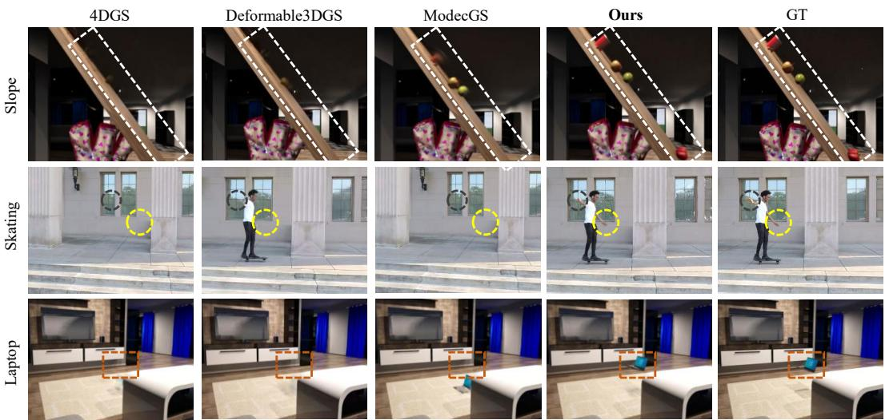  
Figure 4: Qualitative Results of Geometrically Faithful Interpolation Task.

Metrics: We evaluate both RGB rendering quality and dynamic geometric accuracy. For rendering, we report PSNR, SSIM, and LPIPS. For geometry, we report Chamfer Distance (CD) on dynamic point clouds. Specifically, PhysInOne provides ground truth depth maps at each timestamp, from which we back project 3D point clouds and extract dynamic regions through static/dynamic separation. We compute CD between the reconstructed and ground truth dy namic point clouds, allowing us to evaluate whether the dynamic scene geometry

Table 1: Geometrically Faithful Interpolation Evaluation on NVIDIA Dynamic and PhysInOne Datasets. The best metric is highlight in red, the second best in orange.
<table><tr><td></td><td colspan="3">NVIDIA Dynamic Scene</td><td colspan="4">PhysInOne</td></tr><tr><td>Method</td><td>PSNR↑ SSIM↑ LPIPS↓</td><td></td><td></td><td></td><td></td><td></td><td>PSNR↑ SSIM↑ LPIPS↓ CD (m)↓</td></tr><tr><td>TiNeuVox [52]</td><td>30.304</td><td>0.868</td><td>0.216</td><td>30.923</td><td>0.957</td><td>0.123</td><td>0.641</td></tr><tr><td>4DGS [53]</td><td>24.411</td><td>0.462</td><td>0.532</td><td>28.940</td><td>0.941</td><td>0.141</td><td>0.544</td></tr><tr><td>DefGS [5]</td><td>26.662</td><td>0.893</td><td>0.127</td><td>30.165</td><td>0.944</td><td>0.137</td><td>0.877</td></tr><tr><td>FreeGave [12]</td><td>30.276</td><td>0.891</td><td>0.096</td><td>30.850</td><td>0.952</td><td>0.124</td><td>0.496</td></tr><tr><td>ModecGS [6]</td><td>30.080</td><td>0.914</td><td>0.081</td><td>30.110</td><td>0.938</td><td>0.113</td><td>0.678</td></tr><tr><td>Ours</td><td>31.825</td><td>0.914</td><td>0.089</td><td>32.631</td><td>0.971</td><td>0.090</td><td>0.046</td></tr></table>

## 4.1 Evaluation for Geometrically Faithful Interpolation

We evaluate interpolation performance on NVIDIA Dynamic Scene and PhysInOne with representative baselines, including TiNeuVox, 4DGS, Deformable3DGS(DefGS), ModecGS, and FreeGave. The time span of each sequence is normalized to one time unit. Besides standard RGB metrics, we additionally report Chamfer Distance (CD) on PhysInOne to evaluate the 3D geometric accuracy of reconstructed dynamics. This metric is particularly important for dynamic reconstruction, as high rendering quality does not imply that the underlying dynamic geometry follows the correct motion.

Results and Analysis. As shown in Table 1, our method achieves the best interpolation performance in both RGB rendering metrics and dynamic geometric accuracy. Notably, the CD metric is substantially improved over current methods, indicating that our method better recovers the spatial positions and geometry of dynamic regions rather than merely fitting visual appearance. The key reason is that our framework uses local motion derived from the deformation field to guide the learning of the canonical representation, which reduces common appearance shortcuts in dynamic Gaussian reconstruction. In particular, opacity σ can suppress poorly tracked dynamic Gaussians and make moving regions disappear, while color c can compensate image-level errors without placing the dynamic geometry at correct 3D positions. These shortcuts may still produce plausible renderings, but they lead to incorrect dynamic trajectories and are exposed by the Chamfer Distance on dynamic point clouds. By explicitly coupling deformation with motion states, our method better constrains the spatial evolution of dynamic Gaussians, leading to both higher rendering quality and more faithful geometry. This advantage is also reflected in the qualitative results in Figure 4. In the Laptop and Skating scene, competing methods tend to lose dynamic parts due to opacity driven disappearance, whereas our method preserves the moving geometry. In the Slope scene, other methods can partially fit the appearance through color compensation but fail to recover the correct dynamic structure or fine grained motion, while our method reconstructs more coherent trajectories and sharper geometry.

Table 2: Quantitative Results for Continuous Motion Extrapolation on All Four Datasets. The best metric is highlight in red, while the second best highlight in orange.
<table><tr><td></td><td colspan="3">NVIDIA Dynamic Scene</td><td colspan="2">Dynamic Multipart</td><td colspan="2">FreeGave-GoPro</td><td colspan="4">PhysInOne</td></tr><tr><td>Method</td><td>PSNR↑ SSIM↑</td><td></td><td>LPIPS↓</td><td>PSNR↑ SSIM↑ LPIPS↓</td><td></td><td>PSNR↑ SSIM↑ LPIPS↓</td><td></td><td></td><td>PSNR↑ SSIM↑ LPIPS↓ CD (m)↓</td><td></td><td></td></tr><tr><td>TiNeuVox [52] 24.556</td><td></td><td>0.863</td><td>0.215</td><td>20.804 0.923</td><td>0.090</td><td>20.600 0.760</td><td>0.292</td><td>19.264</td><td>0.884</td><td>0.254</td><td>0.925</td></tr><tr><td>NVFi [8]</td><td>28.462</td><td>0.876</td><td>0.214</td><td>25.235 0.955</td><td>0.046</td><td>22.747 0.756</td><td>0.393</td><td>25.571</td><td>0.902</td><td>0.131</td><td>0.610</td></tr><tr><td>DefGS [5]</td><td>24.240</td><td>0.895</td><td>0.140</td><td>20.664 0.930</td><td>0.067</td><td>21.344 0.858</td><td>0.170</td><td>20.384</td><td>0.867</td><td>0.213</td><td>1.029</td></tr><tr><td>4DGS [53]</td><td>22.510</td><td>0.703</td><td>0.408</td><td>20.564 0.935</td><td>0.067</td><td>22.035 0.871</td><td>0.198</td><td>20.687</td><td>0.876</td><td>0.283</td><td>0.947</td></tr><tr><td>ODEGS [15]</td><td>25.296</td><td>0.916</td><td>0.117</td><td>33.371 0.982</td><td>0.009</td><td>25.561 0.899</td><td>0.124</td><td>24.023</td><td>0.916</td><td>0.121</td><td>0.854</td></tr><tr><td>FreeGave [12]</td><td>29.005</td><td>0.933</td><td>0.072</td><td>33.183 0.980</td><td>0.009</td><td>28.094 0.914</td><td>0.112</td><td>27.801</td><td>0.923</td><td>0.125</td><td>0.718</td></tr><tr><td>TRACE [14]</td><td>29.341</td><td>0.933</td><td>0.074</td><td>33.481 0.990</td><td>0.007</td><td>27.871 0.903</td><td>0.126</td><td>27.038</td><td>0.934</td><td>0.096</td><td>0.491</td></tr><tr><td>Ours</td><td>30.265</td><td>0.939</td><td>0.065</td><td>35.754 0.991</td><td>0.007</td><td>28.135 0.916</td><td>0.110</td><td>29.591</td><td>0.949</td><td>0.091</td><td>0.073</td></tr></table>

## 4.2 Evaluation for Continuous Motion Extrapolation

For the Continuous Motion extrapolation task, we focus on baselines that possess explicit predictive capability. Specifically, we compare against FreeGave, TRACE and ODEGS, which model the motion state of the scene, as well as TiNeuVox, NVFi , 4DGS and Deformable3DGS(DefGS), which parameterize space-time dynamics with NeRF-based and Gaussian-based representations, respectively, and thus can perform extrapolation to some extent. For the experimental protocol, we follow the prediction settings of FreeGave and TRACE. Specifically, we normalize the observation time to unit one. We observe frames in [0, 0.75] and predict future frames in [0.75, 1].

Results and Analysis. As shown in Table 2, our method achieves the best performance on future extrapolation across all datasets. This advantage mainly comes from our continuity loss, which explicitly constrains the kinematic relationship among displacement, velocity, and acceleration. Rendering supervision alone can fit observed frames, but it does not uniquely determine the underlying motion states, making the learned velocity and acceleration under-constrained for future prediction. As a result, prior predictive baselines may recover reasonable appearances at observed times but still produce unstable or physically implausible extrapolated motion. By enforcing consistency from acceleration to velocity and from velocity to displacement, our method learns a more coherent motion evolution, leading to kinematically continuous and physically plausible predictions. The qualitative results in Figure 5 clearly reflect this effect. In the Balloon scene, FreeGave predicts an incorrect motion direction, while our method correctly captures the upward buoyancy driven trend. In the Skating scene, FreeGave and TRACE produce discontinuous future motion, whereas our method maintains a smoother and more coherent trajectory. These results show that explicit kinematic continuity is essential for reliable future extrapolation.

## 4.3 Ablation Study

To validate the effectiveness of each component in our framework, we conduct the following ablation studies. All ablation experiments are conducted on the PhysInOne Dataset.

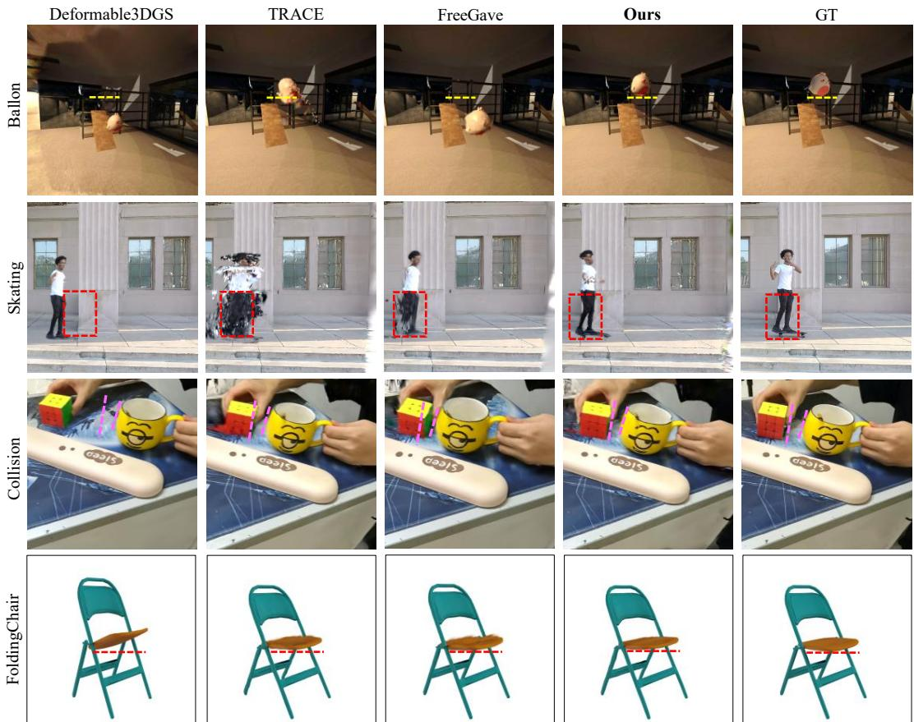  
Figure 5: Qualitative Results of Continuous Motion Extrapolation on Four Datasets.

(1) Removing Motion Guidance: remove the motion confidence $q _ { i }$ used to guide the training of canonical appearance attributes. Instead, the canonical Gaussian parameters and the deformation field are optimized together without motion guidance.

(2) Removing Continuity Loss $\ell _ { \mathbf { c o n t 1 } }$ and $\ell _ { \mathbf { c o n t } 2 } \colon$ when jointly optimizing $f _ { \mathrm { d e f o } }$ and $M _ { \theta }$ , we remove the continuity losses and train the model only with rendering supervision.

(3) Removing Motion Network : remove $M _ { \theta }$ during evaluation and directly use $f _ { \mathrm { d e f o } }$

(4) Different Choices of Time Difference $\Delta t \mathbf { : }$ Given the time interval between two consecutive frames in the training set as $\delta t ,$ compare different training intervals $\Delta t = \{ \delta t , 2 \delta t , 3 \delta t \}$ , where δt denotes the time interval between two adjacent frames.

Results and Analysis. From Table 3, we observe that each key design consistently contributes to the final performance. (1) Removing motion guidance $q _ { i }$ leads to obvious degradation, especially in geometry-related accuracy. This supports our motivation that appearance optimization without motion awareness can fall into shortcut solutions. Since the learned trajectory further serves as the basis for estimating velocity and acceleration, this degradation also affects future prediction.

(2) Removing either continuity loss weakens extrapolation performance. This confirms that rendering supervision alone is insufficient to constrain the learned motion states: even if individual frames can be fitted, the transitions among position, velocity, and acceleration may become temporally inconsistent. (3) Without $M _ { \theta } .$ , the model does not learn physical motion states like velocity and acceleration, and thus loses its ability to predict physically plausible future dynamics. (4) Different choices of $\Delta t$ produce relatively stable results, indicating that the proposed motion evolution formulation is not sensitive to moderate changes in the temporal interval. Overall, these ablations show that motion-aware trajectory representation improves geometrically faithful interpolation, while continuous motion evolution strengthens future extrapolation. The two modules are complementary: more reliable trajectories provide better supervision for motion-state learning, and learned continuous motion states further improve dynamic reconstruction.

Table 3: Quantitative Results of Ablation Studies. The best metric is highlight in red, while the second best highlight in orange.
<table><tr><td colspan="7">Interp.</td><td colspan="4">Extrap.</td></tr><tr><td>qi lcont1</td><td></td><td>lcont2 Mθ</td><td></td><td></td><td></td><td>PSNR↑ SSIM↑ CD (m).↓</td><td></td><td>PSNR↑ SSIM↑ CD (m)↓</td><td></td><td></td></tr><tr><td>(1) x</td><td>√</td><td>√</td><td></td><td>√</td><td>30.164</td><td>0.909</td><td>0.540</td><td>29.016</td><td>0.924</td><td>0.358</td></tr><tr><td>(2)</td><td>√ x</td><td></td><td>√</td><td>√</td><td>31.927</td><td>0.965</td><td>0.066</td><td>28.945</td><td>0.921</td><td>0.079</td></tr><tr><td>(2) √</td><td>√</td><td></td><td>x</td><td>√</td><td>32.628</td><td>0.934</td><td>0.047</td><td>27.468</td><td>0.914</td><td>0.151</td></tr><tr><td>(3) √</td><td>x</td><td></td><td>x</td><td>x</td><td>32.521</td><td>0.970</td><td>0.046</td><td>23.297</td><td>0.901</td><td>0.547</td></tr><tr><td>1δt √</td><td>√</td><td></td><td>√</td><td>√</td><td>32.498</td><td>0.956</td><td>0.059</td><td>29.411</td><td>0.947</td><td>0.075</td></tr><tr><td>2δt √</td><td>√</td><td></td><td>√</td><td>√</td><td>32.631</td><td>0.971</td><td>0.046</td><td>29.591</td><td>0.949</td><td>0.073</td></tr><tr><td>3δt √</td><td>√</td><td></td><td>√</td><td>J</td><td>32.597</td><td>0.967</td><td>0.048</td><td>29.467</td><td>0.920</td><td>0.081</td></tr></table>

## 5 Conclusion

We introduced PhyMo, a novel framework that aims to recover accurate and continuous evolving dynamics rather than merely fitting visual appearance. PhyMo combines a Motion-Aware Trajectory Representation to reduce appearance shortcuts with a Continuous Motion Evolution module to enforce temporal kinematic consistency. Experiments on four dynamic scene benchmarks show that our method achieves strong interpolation and extrapolation performance, producing more accurate dynamic geometry and more continuous, physically plausible future predictions.

## Acknowledgments and Disclosure of Funding

This work is supported in part by the Natural Science Foundation of China (42301520), the Research Grants Council of Hong Kong (15212925, 25206524). The authors declare no competing interests.

## References

[1] Ben Mildenhall, Pratul P Srinivasan, Matthew Tancik, Jonathan T Barron, Ravi Ramamoorthi, and Ren Ng. Nerf: Representing scenes as neural radiance fields for view synthesis. Communications ofthe ACM, 65(1):99–106, 2021.

[2] Bernhard Kerbl, Georgios Kopanas, Thomas Leimkühler, and George Drettakis. 3d gaussian splatting for real-time radiance field rendering. ACM Trans. Graph., 42(4):139–1, 2023.

[3] Diwen Wan, Ruijie Lu, and Gang Zeng. Superpoint gaussian splatting for real-time high-fidelity dynamic scene reconstruction. arXiv preprint arXiv:2406.03697, 2024.

[4] Ang Cao and Justin Johnson. Hexplane: A fast representation for dynamic scenes. In Proceedings ofthe IEEE/CVF Conference on Computer Vision and Pattern Recognition, pages 130–141, 2023.

[5] Ziyi Yang, Xinyu Gao, Wen Zhou, Shaohui Jiao, Yuqing Zhang, and Xiaogang Jin. Deformable 3d gaussians for high-fidelity monocular dynamic scene reconstruction. In Proceedings ofthe IEEE/CVF conference on computer vision and pattern recognition, pages 20331–20341, 2024.

[6] Sangwoon Kwak, Joonsoo Kim, Jun Young Jeong, Won-Sik Cheong, Jihyong Oh, and Munchurl Kim. Modec-gs: Global-to-local motion decomposition and temporal interval adjustment for compact dynamic 3d gaussian splatting. In Proceedings of the IEEE/CVF Conference on Computer Vision and Pattern Recognition, pages 11338–11348, 2025.

[7] Mengyu Chu, Lingjie Liu, Quan Zheng, Aleksandra Franz, Hans-Peter Seidel, Christian Theobalt, and Rhaleb Zayer. Physics informed neural fields for smoke reconstruction with sparse data. ACM Transactions on Graphics (ToG), 41(4):1–14, 2022.

[8] Jinxi Li, Ziyang Song, and Bo Yang. Nvfi: Neural velocity fields for 3d physics learning from dynamic videos. Advances in Neural Information Processing Systems, 36:34723–34751, 2023.

[9] Xuan Li, Yi-Ling Qiao, Peter Yichen Chen, Krishna Murthy Jatavallabhula, Ming Lin, Chenfanfu Jiang, and Chuang Gan. Pac-nerf: Physics augmented continuum neural radiance fields for geometry-agnostic system identification. arXiv preprint arXiv:2303.05512, 2023.

[10] Woojin Cho, Minju Jo, Haksoo Lim, Kookjin Lee, Dongeun Lee, Sanghyun Hong, and Noseong Park. Parameterized physics-informed neural networks for parameterized pdes. arXiv preprint arXiv:2408.09446, 2024.

[11] Boming Zhao, Yuan Li, Ziyu Sun, Lin Zeng, Yujun Shen, Rui Ma, Yinda Zhang, Hujun Bao, and Zhaopeng Cui. Gaussianprediction: Dynamic 3d gaussian prediction for motion extrapolation and free view synthesis. In ACM SIGGRAPH 2024 Conference Papers, pages 1–12, 2024.

[12] Jinxi Li, Ziyang Song, Siyuan Zhou, and Bo Yang. Freegave: 3d physics learning from dynamic videos by gaussian velocity. In Proceedings of the Computer Vision and Pattern Recognition Conference, pages 12433–12443, 2025.

[13] Arnold Caleb Asiimwe and Carl Vondrick. 4d gaussian splatting as a learned dynamical system. arXiv e-prints, pages arXiv–2512, 2025.

[14] Jinxi Li, Ziyang Song, and Bo Yang. Trace: Learning 3d gaussian physical dynamics from multi-view videos. In Proceedings ofthe IEEE/CVF International Conference on Computer Vision, pages 8820–8829, 2025.

[15] Daniel Wang, Patrick Rim, Tian Tian, Dong Lao, Alex Wong, and Ganesh Sundaramoorthi. Ode-gs: Latent odes for dynamic scene extrapolation with 3d gaussian splatting. arXiv preprint arXiv:2506.05480, 2025.

[16] Hiroharu Kato, Yoshitaka Ushiku, and Tatsuya Harada. Neural 3d mesh renderer. In Proceedings ofthe IEEE conference on computer vision and pattern recognition, pages 3907–3916, 2018.

[17] Charles R Qi, Hao Su, Kaichun Mo, and Leonidas J Guibas. Pointnet: Deep learning on point sets for 3d classification and segmentation. In Proceedings ofthe IEEE conference on computer vision and pattern recognition, pages 652–660, 2017.

[18] Bo Yang, Stefano Rosa, Andrew Markham, Niki Trigoni, and Hongkai Wen. Dense 3d object reconstruction from a single depth view. IEEE transactions on pattern analysis and machine intelligence, 41(12):2820–2834, 2018.

[19] Chuhang Zou, Ersin Yumer, Jimei Yang, Duygu Ceylan, and Derek Hoiem. 3d-prnn: Generating shape primitives with recurrent neural networks. In Proceedings of the IEEE International Conference on Computer Vision, pages 900–909, 2017.

[20] Zhiqin Chen and Hao Zhang. Learning implicit fields for generative shape modeling. In Proceedings of the IEEE/CVF conference on computer vision and pattern recognition, pages 5939–5948, 2019.

[21] Lars Mescheder, Michael Oechsle, Michael Niemeyer, Sebastian Nowozin, and Andreas Geiger. Occupancy networks: Learning 3d reconstruction in function space. In Proceedings of the IEEE/CVF conference on computer vision and pattern recognition, pages 4460–4470, 2019.

[22] Julian Chibane, Gerard Pons-Moll, et al. Neural unsigned distance fields for implicit function learning. Advances in Neural Information Processing Systems, 33:21638–21652, 2020.

[23] Jeong Joon Park, Peter Florence, Julian Straub, Richard Newcombe, and Steven Lovegrove. Deepsdf: Learning continuous signed distance functions for shape representation. In Proceedings ofthe IEEE/CVF conference on computer vision and pattern recognition, pages 165–174, 2019.

[24] Qingyong Hu, Bo Yang, Guangchi Fang, Yulan Guo, Aleš Leonardis, Niki Trigoni, and Andrew Markham. Sqn: Weakly-supervised semantic segmentation of large-scale 3d point clouds. In European Conference on Computer Vision, pages 600–619. Springer, 2022.

[25] Wanshui Gan, Hongbin Xu, Yi Huang, Shifeng Chen, and Naoto Yokoya. V4d: Voxel for 4d novel view synthesis. IEEE Transactions on Visualization and Computer Graphics, 30(2): 1579–1591, 2023.

[26] Kai Katsumata, Duc Minh Vo, and Hideki Nakayama. A compact dynamic 3d gaussian representation for real-time dynamic view synthesis. In European Conference on Computer Vision, pages 394–412. Springer, 2024.

[27] Keunhong Park, Utkarsh Sinha, Jonathan T Barron, Sofien Bouaziz, Dan B Goldman, Steven M Seitz, and Ricardo Martin-Brualla. Nerfies: Deformable neural radiance fields. In Proceedings of the IEEE/CVF international conference on computer vision, pages 5865–5874, 2021.

[28] Hongrui Cai, Wanquan Feng, Xuetao Feng, Yan Wang, and Juyong Zhang. Neural surface reconstruction of dynamic scenes with monocular rgb-d camera. Advances in Neural Information Processing Systems, 35:967–981, 2022.

[29] Chen Gao, Ayush Saraf, Johannes Kopf, and Jia-Bin Huang. Dynamic view synthesis from dynamic monocular video. In Proceedings of the IEEE/CVF International Conference on Computer Vision, pages 5712–5721, 2021.

[30] Isabella Liu, Hao Su, and Xiaolong Wang. Dynamic gaussians mesh: Consistent mesh reconstruction from dynamic scenes. arXiv preprint arXiv:2404.12379, 2024.

[31] Youtian Lin, Zuozhuo Dai, Siyu Zhu, and Yao Yao. Gaussian-flow: 4d reconstruction with dynamic 3d gaussian particle. In Proceedings of the IEEE/CVF Conference on Computer Vision and Pattern Recognition, pages 21136–21145, 2024.

[32] Yu-Lun Liu, Chen Gao, Andreas Meuleman, Hung-Yu Tseng, Ayush Saraf, Changil Kim, Yung-Yu Chuang, Johannes Kopf, and Jia-Bin Huang. Robust dynamic radiance fields. In Proceedings of the IEEE/CVF Conference on Computer Vision and Pattern Recognition, pages 13–23, 2023.

[33] Edgar Tretschk, Ayush Tewari, Vladislav Golyanik, Michael Zollhöfer, Christoph Lassner, and Christian Theobalt. Non-rigid neural radiance fields: Reconstruction and novel view synthesis of a dynamic scene from monocular video. In Proceedings of the IEEE/CVF international conference on computer vision, pages 12959–12970, 2021.

[34] Jiahui Lei, Yijia Weng, Adam W Harley, Leonidas Guibas, and Kostas Daniilidis. Mosca: Dynamic gaussian fusion from casual videos via 4d motion scaffolds. In Proceedings of the Computer Vision and Pattern Recognition Conference, pages 6165–6177, 2025.

[35] Svitlana Morkva, Michael Oechsle, Alessio Tonioni, Marco Hutter, and Vaishakh Patil. Mosaicgs: Monocular scene reconstruction via advanced initialization for complex dynamic environments. arXiv preprint arXiv:2601.05368, 2026.

[36] Tingxuan Huang, Haowei Zhu, Jun-hai Yong, Hao Pan, and Bin Wang. Mango-gs: Enhancing spatio-temporal consistency in dynamic scenes reconstruction using multi-frame node-guided 4d gaussian splatting. arXiv preprint arXiv:2603.11543, 2026.

[37] Yifan Wang, Peishan Yang, Zhen Xu, Jiaming Sun, Zhanhua Zhang, Yong Chen, Hujun Bao, Sida Peng, and Xiaowei Zhou. Freetimegs: Free gaussian primitives at anytime anywhere for dynamic scene reconstruction. In Proceedings of the IEEE/CVF Conference on Computer Vision and Pattern Recognition, pages 21750–21760, 2025.

[38] Zhanfeng Liao, Jiajun Zhang, Hanzhang Tu, Zhixi Wang, Yunqi Gao, Hongwen Zhang, and Yebin Liu. Sharptimegs: Sharp and stable dynamic gaussian splatting via lifespan modulation. arXiv preprint arXiv:2602.02989, 2026.

[39] Daniele Baieri, Stefano Esposito, Filippo Maggioli, and Emanuele Rodolà. Fluid dynamics network: topology-agnostic 4d reconstruction via fluid dynamics priors. arXiv preprint arXiv:2303.09871, 2023.

[40] Woobin Im, Geonho Cha, Sebin Lee, Jumin Lee, Juhyeong Seon, Dongyoon Wee, and Sung-Eui Yoon. Regularizing dynamic radiance fields with kinematic fields. In European Conference on Computer Vision, pages 312–328. Springer, 2024.

[41] Maziar Raissi, Alireza Yazdani, and George Em Karniadakis. Hidden fluid mechanics: Learning velocity and pressure fields from flow visualizations. Science, 367(6481):1026–1030, 2020.

[42] Yiming Wang, Siyu Tang, and Mengyu Chu. Physics-informed learning of characteristic trajectories for smoke reconstruction. In ACM SIGGRAPH 2024 Conference Papers, pages 1–11, 2024.

[43] Yuchen Lin, Chenguo Lin, Jianjin Xu, and Yadong Mu. Omniphysgs: 3d constitutive gaussians for general physics-based dynamics generation. arXiv preprint arXiv:2501.18982, 2025.

[44] Tianyi Xie, Zeshun Zong, Yuxing Qiu, Xuan Li, Yutao Feng, Yin Yang, and Chenfanfu Jiang. Physgaussian: Physics-integrated 3d gaussians for generative dynamics. In Proceedings of the IEEE/CVF Conference on Computer Vision and Pattern Recognition, pages 4389–4398, 2024.

[45] Alvaro Sanchez-Gonzalez, Jonathan Godwin, Tobias Pfaff, Rex Ying, Jure Leskovec, and Peter Battaglia. Learning to simulate complex physics with graph networks. In International conference on machine learning, pages 8459–8468. PMLR, 2020.

[46] Fangfu Liu, Hanyang Wang, Shunyu Yao, Shengjun Zhang, Jie Zhou, and Yueqi Duan. Physics3d: Learning physical properties of 3d gaussians via video diffusion. arXiv preprint arXiv:2406.04338, 2024.

[47] Arjun Mani, Ishaan Preetam Chandratreya, Elliot Creager, Carl Vondrick, and Richard Zemel. Surfsup: Learning fluid simulation for novel surfaces. In Proceedings of the IEEE/CVF International Conference on Computer Vision, pages 14225–14235, 2023.

[48] Shiqian Li, Ruihong Shen, Junfeng Ni, Chang Pan, Chi Zhang, and Yixin Zhu. Learning physicsgrounded 4d dynamics with neural gaussian force fields. In The Fourteenth International Conference on Learning Representations, 2026.

[49] Johannes L Schonberger and Jan-Michael Frahm. Structure-from-motion revisited. In Proceedings of the IEEE conference on computer vision and pattern recognition, pages 4104–4113, 2016.

[50] Chaoyang Wang, Ben Eckart, Simon Lucey, and Orazio Gallo. Neural trajectory fields for dynamic novel view synthesis. arXiv preprint arXiv:2105.05994, 2021.

[51] Siyuan Zhou, Hejun Wang, Hu Cheng, Jinxi Li, Dongsheng Wang, Junwei Jiang, Yixiao Jin, Jiayue Huang, Shiwei Mao, Shangjia Liu, et al. Physinone: Visual physics learning and reasoning in one suite. arXiv preprint arXiv:2604.09415, 2026.

[52] Jiemin Fang, Taoran Yi, Xinggang Wang, Lingxi Xie, Xiaopeng Zhang, Wenyu Liu, Matthias Nießner, and Qi Tian. Fast dynamic radiance fields with time-aware neural voxels. In SIG-GRAPH Asia 2022 Conference Papers, pages 1–9, 2022.

[53] Guanjun Wu, Taoran Yi, Jiemin Fang, Lingxi Xie, Xiaopeng Zhang, Wei Wei, Wenyu Liu, Qi Tian, and Xinggang Wang. 4d gaussian splatting for real-time dynamic scene rendering. In Proceedings ofthe IEEE/CVF conference on computer vision and pattern recognition, pages 20310–20320, 2024.

## A Appendix

## The appendix includes:

• More Details of Motion-Aware Trajectory Representation (Appendix A.1)

• Implementation Details of Continuous Motion Evolution Module (Appendix A.2)

• Implementation Details of Training (Appendix A.3)

• Additional Ablation Results (Appendix A.4)

• Additional Qualitative Results (Appendix A.5)

• Additional Quantitative Results (Appendix A.6)

• Details of All Datasets (Appendix A.7)

• Training and Evaluation Resources (Appendix A.8)

• Limitation of Our Model (Appendix A.9)

In addition, we provide a demo video for visualization, appended in the supplementary materials.

## A.1 More Details of Motion-Aware Trajectory Representation

Implementation details of motion confidence. The main paper defines the motion-guided appearance parameterization in Equation (4) and the per-Gaussian motion confidence in Equation (5). Here we provide the exact implementation used in our experiments. When the motion-aware appearance branch is activated, we first store frozen anchors of the canonical appearance parameters, including opacity and SH coefficients. Specifically, let $\sigma _ { i } ^ { b } , c _ { i , \mathrm { d c } } ^ { b }$ , and $c _ { i , \mathrm { r e s t } } ^ { b }$ denote the anchored opacity, DC SH term, and higher-order SH terms of the i-th Gaussian, respectively. During training, the appearance update is released from these anchors according to the motion confidence $q _ { i }$ . The motion confidence is computed from the local deformation change between two adjacent timestamps, consistent with Equation (5). We instantiate the monotonic function $\psi ( \cdot )$ as a sigmoid gate:

$$
q _ { i } = \mathrm { s g } [ q _ { \mathrm { m i n } } + ( 1 - q _ { \mathrm { m i n } } ) \mathrm { s i g m o i d } ( \beta (  \delta x _ { i } ( t _ { k + 1 } ) - \delta x _ { i } ( t _ { k } )  _ { 2 } - \tau ) ) ]\tag{12}
$$

where $\tau$ is the gate threshold, $\beta$ controls the sharpness of the transition, $q _ { \mathrm { m i n } }$ is the minimum gate value, and $\mathrm { s g } ( \cdot ) \bar { }$ denotes stop-gradient. In all reported experiments, we use $\tau = 0 . 2 5 , \beta = 5 0$ , and $q _ { \mathrm { m i n } } = 0 . 0 0 0 1$ . With this setting, the gate stays nearly closed when the local deformation change is weak, and opens rapidly once clear local motion activation emerges. After computing $q _ { i }$ , the anchored

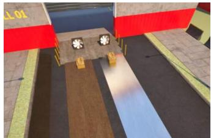  
RGB Rendering at t = 0.0

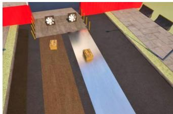  
RGB Rendering at t = 0.5

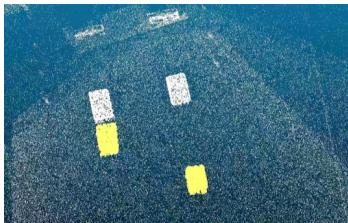  
Dynamic Gaussian Point Cloud  
Figure 6: RGB Rendering and the Evolving Geometry of Sandwich Scene.

appearance parameters are released by a residual form. For the SH coefficients, we separately gate the DC term and the remaining higher-order terms:

$$
c _ { i , \mathrm { d c } } = c _ { i , \mathrm { d c } } ^ { b } + s _ { \mathrm { d c } } q _ { i } \left( c _ { i , \mathrm { d c } } - c _ { i , \mathrm { d c } } ^ { b } \right)\tag{13}
$$

$$
c _ { i , \mathrm { r e s t } } = c _ { i , \mathrm { r e s t } } ^ { b } + q _ { i } \mathopen { } \mathclose \bgroup \left( c _ { i , \mathrm { r e s t } } - c _ { i , \mathrm { r e s t } } ^ { b } \aftergroup \egroup \right)\tag{14}
$$

where $s _ { \mathrm { d c } }$ is an optional scaling factor for the DC term, and we set $s _ { \mathrm { d c } } = 0 . 9 5$ . The opacity branch follows the same anchor-plus-gated-residual form as Equation (4). Importantly, the gate is detached from back-propagation, so that the appearance branch does not directly perturb the motion confidence.

Effectiveness validated by training dynamics. We further verify the effectiveness of motion confidence by visualizing the training dynamics on the Sandwich scene, as shown in Figure 6. In this experiment, we record the rendering loss, the Chamfer Distance (CD) between reconstructed and ground-truth dynamic point clouds, and the number of activated Gaussians during training. The first 3,000 iterations correspond to the canonical Gaussian warm-up stage.

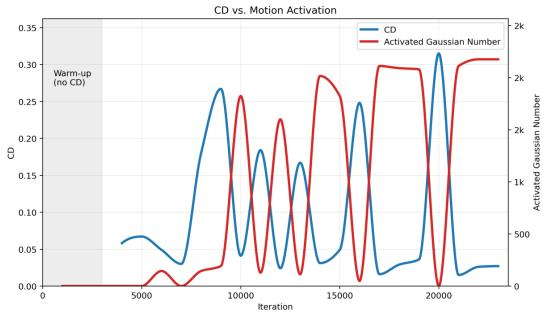

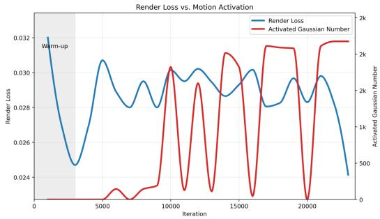  
Figure 7: Training Dynamics of Motion-Aware Trajectory Representation on the Sandwich Scene.

To summarize the per-Gaussian motion confidence during training, we report the activated Gaussian number, defined as $\begin{array} { r } { N _ { \mathrm { a c t } } = \sum _ { i \in \mathcal { G } } \mathbf { 1 } ( q _ { i } > \eta ) } \end{array}$ with $\eta = 0 . 5$ . Since $q _ { i }$ is produced by the sigmoid gate in Equation (12), this threshold corresponds to the midpoint of the gate response; namely, a Gaussian is counted as activated once its local deformation change exceeds the gate threshold τ. We record $N _ { \mathrm { a c t } }$ together with CD and rendering loss along the training iterations. This is particularly informative under our gradual temporal expansion : as new temporal windows are progressively introduced, the evolution of CD, rendering loss, and activated Gaussian number reflects how motion becomes reliable at different timestamps and different scene regions. As shown in Figure 7, after the

Table 4: Ablation Study of Motion-Guided Appearance on PhysInOne.
<table><tr><td colspan="4">Design</td><td colspan="3">Interp.</td></tr><tr><td>Variant</td><td> $q _ { i }$ </td><td>Per-G.</td><td>Local Motion</td><td>PSNR↑</td><td>SSIM↑</td><td>CD (m).↓</td></tr><tr><td>w/o  $q _ { i }$ </td><td>x</td><td>x</td><td>x</td><td>30.164</td><td>0.909</td><td>0.540</td></tr><tr><td>Freeze-then-release</td><td>x</td><td>x</td><td>x</td><td>31.285</td><td>0.902</td><td>0.267</td></tr><tr><td>Disp.-based  $q _ { i }$ </td><td>√</td><td>√</td><td>x</td><td>30.874</td><td>0.924</td><td>0.351</td></tr><tr><td>Local-motion  $q _ { i }$ </td><td>√</td><td>√</td><td>√</td><td>32.631</td><td>0.971</td><td>0.046</td></tr></table>

warm-up stage, the activated Gaussian number remains small when reliable motion has not yet been established, while CD stays relatively high. As training proceeds, the activated Gaussian number increases at several stages, and these increases consistently coincide with decreases in CD. This indicates that the motion confidence gate opens when local deformation becomes reliable, rather than releasing appearance freedom from the beginning. The rendering loss then decreases clearly after more Gaussians become activated, showing that appearance refinement is applied after the model has recovered accurate trajectories. The repeated activation pattern also reflects the non-uniform difficulty of different motion regions, where different parts become motion-active at different time.

More Ablation. We further conduct ablation experiments on PhysInOne to analyze the design of motion-guided appearance. We compare four variants: (1) w/o $q _ { i }$ , which jointly optimizes canonical appearance and deformation without motion confidence; (2) Freeze-release, which globally freezes canonical appearance for the first 10,000 iterations and then jointly optimizes appearance and deformation for another 1,0000 iterations; (3) Disp.-based $q _ { i } ,$ , which computes motion confidence from the cumulative deformation magnitude, $q _ { i } = \psi ( \| \delta x _ { i } ( t ) \| _ { 2 } ) ;$ and (4) Local-motion $q _ { i } ,$ , our final design that computes motion confidence from local deformation change between adjacent timestamps.

As shown in Table 4, removing motion confidence clearly degrades both rendering quality and dynamic geometric accuracy, indicating that fully free canonical appearance can act as a shortcut during deformation learning. The freeze-release strategy improves stability by delaying appearance optimization, but it applies the same schedule to all Gaussians and therefore cannot adapt to spatially varying motion difficulty. In contrast, our per-Gaussian confidence releases appearance freedom according to the actual local motion response of each Gaussian. Compared with the cumulativedisplacement variant, local deformation change is a more accurate indicator of current motion activity: a Gaussian may have moved far from the canonical state simply due to accumulated displacement, while adjacent deformation change directly reflects whether it is actively participating in the current motion. These results show that the proposed motion confidence is important for suppressing appearance shortcuts and improving the accuracy of recovered dynamic geometry.

Algorithm 1 RK2-based Bidirectional Motion Propagation   
Require: Canonical Gaussians ${ \mathcal { G } } _ { 0 } = \{ \cdot \cdot \cdot \left( x _ { 0 } , r _ { 0 } , s _ { 0 } , \sigma , c \right) \cdot \cdot \cdot \}$ , target timestamp t, step size $\Delta t ,$ deformation   
field $f _ { \mathrm { d e f o } } ,$ , motion network $M _ { \theta }$   
Ensure: Integrated Gaussians ${ \mathcal { G } } _ { t } = \{ \cdot \cdot \cdot ( x _ { t } , r _ { t } , s _ { t } , \sigma , c ) \cdot \cdot \cdot \}$   
1: $t _ { l } \gets t - \mathsf { \bar { \Delta } } t , \quad t _ { r } \gets t + \Delta t$   
2: $( \delta x _ { t _ { l } } , \delta r _ { t _ { l } } , \delta s _ { t _ { l } } ) \gets f _ { \mathrm { d e f o } } ( x _ { 0 } , e ( t _ { l } ) )$   
3: $( \delta x _ { t _ { r } } , \delta r _ { t _ { r } } , \delta s _ { t _ { r } } ) \gets f _ { \mathrm { d e f o } } ( x _ { 0 } , e ( t _ { r } ) )$   
4: $x _ { t _ { l } } \gets x _ { 0 } + \delta x _ { t _ { l } } , \quad x _ { t _ { r } } \gets x _ { 0 } + \delta x _ { t _ { r } }$   
5: $r _ { t _ { l } } \gets r _ { 0 } \circ \delta r _ { t _ { l } } , \quad r _ { t _ { r } } \gets r _ { 0 } \circ \delta r _ { t _ { r } }$   
6: $\{ ( v _ { t _ { l } } , a _ { t _ { l } } ) , ( \omega _ { t _ { l } } , \eta _ { t _ { l } } ) \}  M _ { \theta } ( x _ { t _ { l } } , t _ { l } )$   
7: $\{ ( v _ { t _ { r } } , a _ { t _ { r } } ) , ( \omega _ { t _ { r } } , \dot { \eta _ { t _ { r } } } ) \}  M _ { \theta } ( \dot { x _ { t _ { r } } } , t _ { r } )$   
8: $\begin{array} { r } { v _ { \mathrm { m i d } } ^ { l }  v _ { t _ { l } } + \frac { \Delta t } { 2 } a _ { t _ { l } } , \quad v _ { \mathrm { m i d } } ^ { r }  v _ { t _ { r } } - \frac { \Delta t } { 2 } a _ { t _ { \tau } } } \end{array}$   
9: $\begin{array} { r } { \omega _ { \mathrm { m i d } } ^ { l }  \omega _ { t _ { l } } + \frac { \Delta t } { 2 } \eta _ { t _ { l } } , \quad \omega _ { \mathrm { m i d } } ^ { r }  \omega _ { t _ { r } } - \frac { \Delta t } { 2 } \eta _ { t _ { \iota } } } \end{array}$   
10: $\hat { x } _ { t } ^ { l } \gets x _ { t _ { l } } + \Delta t \left( v _ { \mathrm { m i d } } ^ { l } + \omega _ { \mathrm { m i d } } ^ { l } \times x _ { t _ { l } } \right) ,$   
11: $\hat { x } _ { t } ^ { r } \gets \dot { x _ { t _ { r } } } - \Delta t \dot { ( } v _ { \mathrm { m i d } } ^ { r } + \omega _ { \mathrm { m i d } } ^ { r } \times \dot { x _ { t _ { r } } } )$   
12: $\Delta r ^ { l } \gets \exp _ { q } \left( \frac { 1 } { 2 } \omega _ { \mathrm { m i d } } ^ { l } \Delta t \right)$   
13: $\Delta r ^ { r } \gets \exp _ { q } \left( - \frac { 1 } { 2 } \omega _ { \mathrm { m i d } } ^ { r } \Delta t \right)$   
14: $\hat { r } _ { t } ^ { l } \gets \mathrm { n o r m a l i z e } \big ( \Delta r ^ { l } \circ r _ { t _ { l } } \big )$   
15: $\hat { r } _ { t } ^ { r } \gets \mathrm { n o r m a l i z e } \big ( \Delta r ^ { r } \circ r _ { t _ { r } } ^ { ' } \big )$   
16: $x _ { t } \gets \frac { 1 } { 2 } \left( \hat { x } _ { t } ^ { l } + \hat { x } _ { t } ^ { r } \right)$   
17: $r _ { t } \gets \mathrm { S L E R P } \left( \hat { r } _ { t } ^ { l } , \hat { r } _ { t } ^ { r } ; 0 . 5 \right)$   
18: $s _ { t } \gets s _ { 0 }$   
19: return ${ \mathcal { G } } _ { t } = \{ \cdot \cdot \cdot \left( x _ { t } , r _ { t } , s _ { t } , \sigma , c \right) \cdot \cdot \cdot \}$

## A.2 Implementation Details of Continuous Motion Evolution Module

To estimate per-particle motion states, we employ a Motion Network that predicts translational and rotational motion parameters for each Gaussian particle at timestamp t:

$$
\left\{ { \left( v _ { t } , a _ { t } \right) } , \ { \left( \omega _ { t } , \eta _ { t } \right) } \right\} = M _ { \theta } ( x _ { t } , t )\tag{15}
$$

where $( v _ { t } , a _ { t } ) \in \mathbb { R } ^ { 6 }$ denote the translational velocity and acceleration, and $( \omega _ { t } , \eta _ { t } ) \in \mathbb { R } ^ { 6 }$ denote the angular velocity and angular acceleration, respectively. The motion network is implemented by an 8×256 MLP with ReLU activation, consisting of 8 fully-connected layers and 256 hidden units per layer. An 8-degree positional embedding is applied to the input Gaussian position $x _ { t }$ before feeding it into the MLP, enabling the network to model spatially varying motion states. An 8-degree positional embedding is applied to the input 3D position before feeding into the MLP, enabling the network to model spatially-varying motion states of the dynamic scene.

Algorithm 1 follows the second-order Runge-Kutta method, also known as the explicit midpoint rule. For a motion state governed by a time-varying velocity, RK2 first estimates the velocity at the middle of the interval and then uses this midpoint velocity to propagate the state over the full step. In our case, the translational midpoint velocity is computed as $\begin{array} { r } { \dot { v } _ { \mathrm { m i d } } = v + \frac { \Delta t } { 2 } a . } \end{array}$ , while the angular midpoint velocity is computed as $\begin{array} { r } { \omega _ { \mathrm { m i d } } = \omega + \frac { \Delta t } { 2 } \eta . } \end{array}$ . The Gaussian position and rotation are then propagated using these midpoint motion states, which provides a second-order approximation for local motion evolution. We perform this propagation bidirectionally. Starting from the left neighbor $t _ { l } = t - \Delta t$ the Gaussian state is propagated forward to the target timestamp t. Starting from the right neighbor $t _ { r } = t + \Delta t$ , the Gaussian state is propagated backward to t with a negative time step. The two propagated positions are averaged, while the two propagated rotations are fused by spherical linear interpolation, denoted as SLERP(·). Here, $\mathrm { S L E R P } ( r _ { 1 } , \bar { r } _ { 2 } ; \alpha )$ interpolates two unit quaternions along the shortest path on the rotation sphere, and we set $\alpha = 0 . 5 \ : \mathrm { t }$ o take the midpoint rotation. Moreover, exp(·) denotes the SO(3) exponential map, and normalize(·) indicates quaternion normalization to enforce unit norm. The resulting propagated state is used for rendering supervision, while the two directional motion states are further constrained by the kinematic continuity losses.

## A.3 Implementation Details of Training Schedule

We provide the detailed training schedule used in our experiments. The training starts with a canonical Gaussian warm-up for 3,000 iterations, where only the observations at the initial timestamp $t = 0$ are used to initialize the canonical geometry and appearance.

After warm-up, we train the deformation field with gradual temporal expansion. Specifically, we divide the observed time span into N = 10 temporal windows. Training begins from the first window, and then progressively includes one additional window until all observed timestamps are involved. This deformation learning stage takes 20,000 iterations in total. During this process, the motion confidence $q _ { i }$ is updated according to the local deformation change within the currently revealed temporal support, so the freedom of canonical appearance is released adaptively.

Finally, we jointly train the deformation field and the Motion Network for another 20,000 iterations. We use bidirectional neighboring timestamps and RK2-based propagation to obtain the Gaussian states at the supervised timestamp. The rendering loss is optimized together with the bidirectional kinematic continuity losses. In all experiments, we set the loss weights as $\lambda _ { \mathrm { c o n t 1 } } = \lambda _ { \mathrm { c o n t 2 } } = 0 . 3 .$

## A.4 Additional Ablation Results

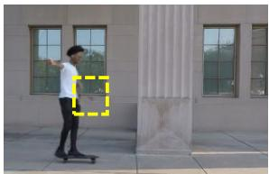  
w/o motion guidance

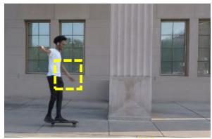  
Full

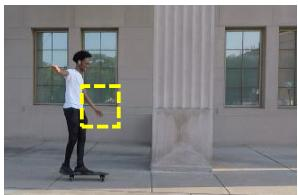  
Ground Truth

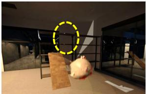  
w/o Continuity Loss

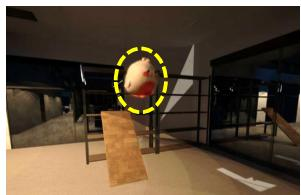  
Full

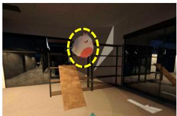  
Ground Truth  
Figure 8: Qualitative Results of Ablation about Motion Guidance and Continuity Loss.

Here, we further provide qualitative comparisons for a more intuitive understanding. As shown in Figure 8, on the Skating scene for novel-time interpolation, removing motion guidance causes the moving arm to disappear, indicating that the model tends to reduce rendering error through appearance shortcuts instead of recovering the correct motion. On the Ballon scene for future-frame extrapolation, removing the continuity loss leads to an incorrect moving direction of the balloon and breaks the temporal consistency of the predicted motion. These qualitative results further demonstrate the importance of motion-guided appearance and kinematic continuity for faithful dynamic reconstruction and physically plausible prediction.

Table 5: Interpolation Evaluation on Dynamic MultiPart and FreeGave-GoPro Dataset.
<table><tr><td rowspan="2"></td><td colspan="3">Dynamic MultiPart</td><td colspan="3">FreeGave-GoPro</td></tr><tr><td>PSNR↑</td><td>SSIM↑</td><td>LPIPS↓</td><td>PSNR↑</td><td>SSIM↑</td><td>LPIPS↓</td></tr><tr><td>TiNeuVox [52]</td><td>29.951</td><td>0.968</td><td>0.051</td><td>19.123</td><td>0.740</td><td>0.328</td></tr><tr><td>4DGS [53]</td><td>37.025</td><td>0.992</td><td>0.016</td><td>28.940</td><td>0.941</td><td>0.141</td></tr><tr><td>DefGS [5]</td><td>34.459</td><td>0.983</td><td>0.014</td><td>28.465</td><td>0.924</td><td>0.097</td></tr><tr><td>FreeGave [12]</td><td>35.776</td><td>0.986</td><td>0.016</td><td>28.457</td><td>0.925</td><td>0.091</td></tr><tr><td>ModecGS [6]</td><td>35.768</td><td>0.991</td><td>0.011</td><td>27.946</td><td>0.928</td><td>0.083</td></tr><tr><td>Ours</td><td>37.625</td><td>0.994</td><td>0.009</td><td>29.231</td><td>0.951</td><td>0.079</td></tr></table>

## A.5 Additional Qualitative Results

Figure 9, Figure 10, Figure 11, Figure 12 and Figure 13 provides additional qualitative comparisons for both Geometrically Faithful Interpolation and Continuous Motion Extrapolation. For geometrically faithful interpolation, as illustrated in the Laptop and Skating scenes, our method recovers more accurate intermediate geometry and motion than strong 4D reconstruction baselines. For continuous motion extrapolation, as shown in the Bus and Freefall scenes, our method produces more accurate and temporally continuous future motion than FreeGave and TRACE, which tend to accumulate motion errors or generate less stable predictions over time.

t=0.75  
t=1.0  
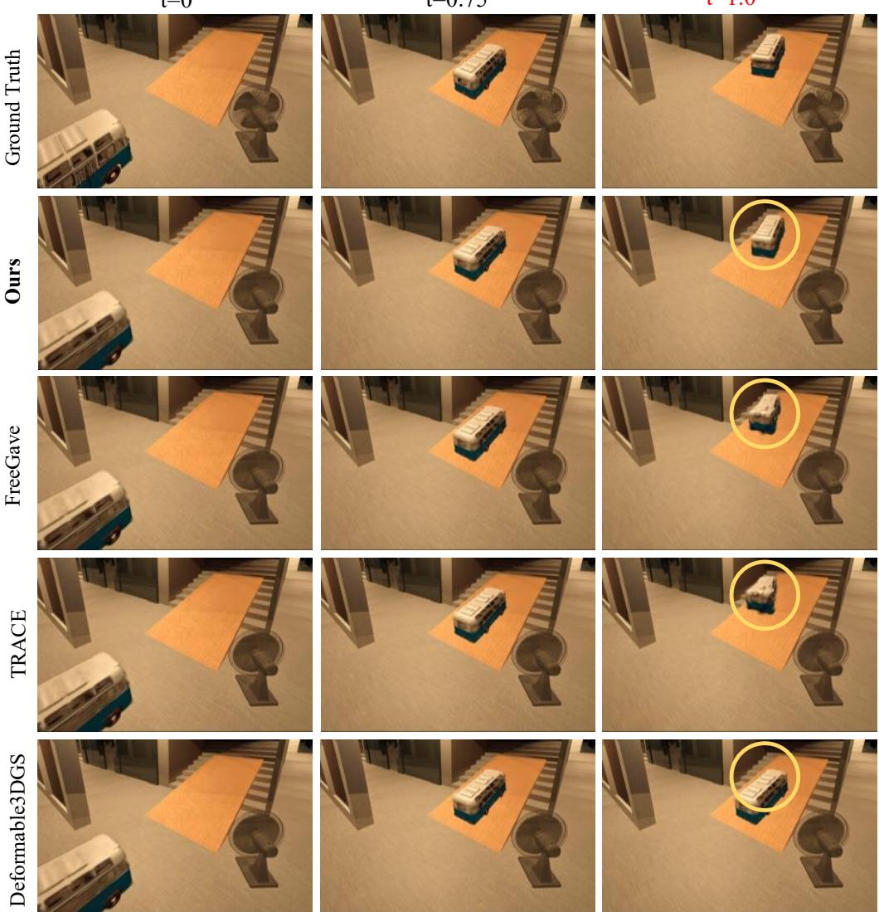  
Figure 9: Qualitative Results for Extrapolation of Bus Scene on PhysInOne Dataset.

We further evaluate the stability of our model under a longer extrapolation setting by extending the prediction interval from [0.75, 1.0] to [0.75, 1.5]. Since ground-truth frames are unavailable for the extended interval [1.0, 1.5], we only provide qualitative results. As shown in Figure 14, our method maintains stable and continuous predictions over the extended horizon.

## A.6 Additional Quantitative Results

We report additional quantitative results on the MultiPart dataset and the FreeGave-GoPro dataset for the interpolation task. As shown in Table 5, our framework consistently outperforms conventional reconstruction-based methods, demonstrating its effectiveness in recovering temporally continuous appearance and motion under challenging dynamic scenes.

## A.7 Details of All Datasets.

FreeGave-GoPro Dataset. This dataset contains 6 challenging real-world dynamic scenes:

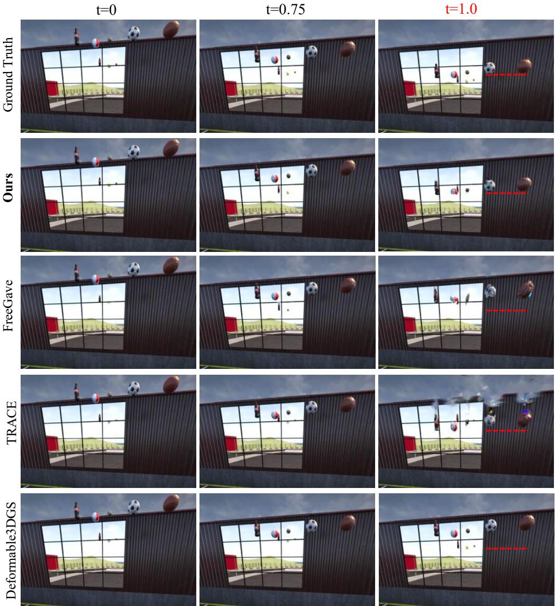  
Figure 10: Qualitative Results for Extrapolation of Freefall Scene on PhysInOne Dataset.

• Pen & Tape. A person holds a pen and attempts to pass it through the hole of a static tape ring. Scene 2 includes more static clutter, introducing stronger occlusions and requiring more accurate separation between moving and static regions. The key challenge lies in forecasting an interaction where one object is expected to penetrate through another in the future.

• Box. A drawer-like box is pushed toward closure. The challenge comes from the tight coupling between the moving part and the static structure, which becomes particularly difficult under future extrapolation.

• Hammer. A hammer moves on top of a box. The scene involves direct contact between dynamic and static objects, requiring sharp separation of diverse motion patterns to preserve correct static/moving states in future frames.

• Collision. A cube and a cup move toward each other with different motion directions. The challenge is to maintain accurate object shapes and trajectories under future prediction.

• Wrist Rest A person bends a wrist rest. The object is deformable, and the motion is neither rigid nor purely part-wise rigid.

Dynamic Multipart Dataset. This dataset features multiple articulated/deformable objects with part-wise motions:

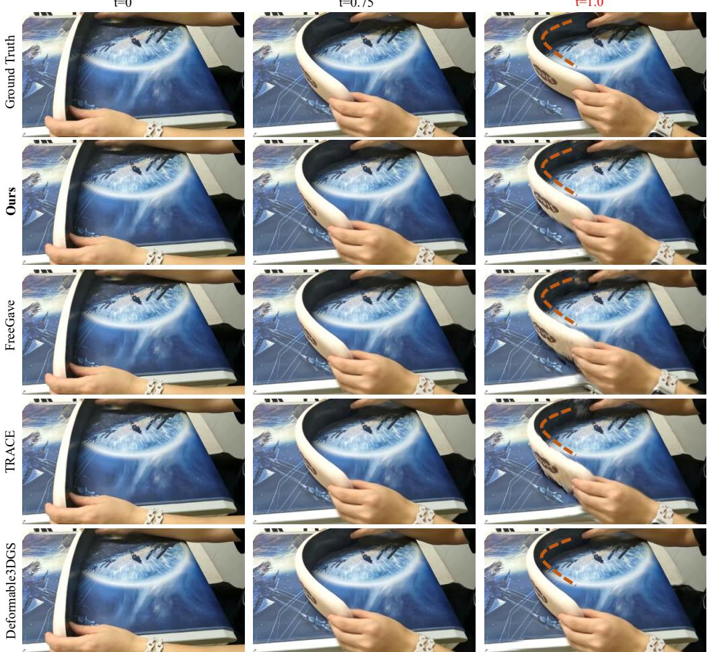  
Figure 11: Qualitative Results for Extrapolation of Wristrest Scene on FreeGave-GoPro Dataset.

• Folding Chair. A folding chair composed of three parts is unfolded. Different parts undergo distinct rotations.

• Hyperbolic Slot. A stick rotates through a hyperbolic-shaped slot. Only the stick is dynamic, making motion extrapolation challenging due to the complex static geometry.

• Satellite. A satellite with two wing doors and one main door opening, where different parts rotate in different directions.

• Stove. A home stove whose motion mainly involves closing its top cover plate.

NVIDIA Dynamic Scenes Dataset. This dataset contains 2 real-world dynamic scenes:

• Skating. A person rides a skateboard while maintaining balance, and then makes a “V” sign on the skateboard.

• Truck. A truck drives along the street.

PhysInone Dataset. We select 6 synthetic scenes governed by four physical effects (gravity, buoyancy, wind force, and friction):

• Laptop. A laptop falls freely in a room, lands on the floor, and then comes to rest.

• Ballon. The white rabbit-shaped balloon floats upward, slowly rising due to buoyancy.

• Freefall. A cola bottle, a baseball, a soccer ball, a basketball, and a volleyball fall side by side from a rooftop under gravity.

• Slope. A wooden plank forms an incline. A W-shaped balloon rises, hits the plank, and slides up it, pulling a rope tied to a bottle. Meanwhile, a bell pepper, two apples, a chips tube, and a lollipop roll down the plank under gravity onto the floor near a carpet and chair.

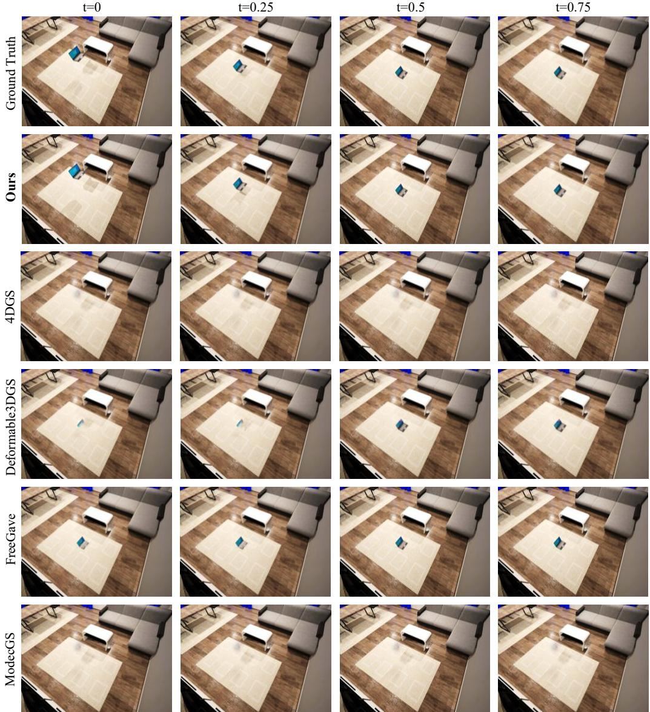  
Figure 12: Qualitative Results for Interpolation of Laptop Scene on PhysInOne Dataset.

• Bus. A blue toy bus sits on a wooden ramp. A front fan pushes it up the incline, while a side fan nudges it sideways, changing its path until it stops mid-ramp.

• Sandwich. Two sandwichs slide on two different smooth surfaces under a fan’s airflow.

## A.8 Training and Evaluation Resources

As the complexity of different scenes varies, the total number of Gaussians optimized per scene ranges from 30k to 2M. Overall, our training speed is comparable to FreeGave, running at about 0.98× the speed of FreeGave. This overhead mainly comes from additional training objectives, while the added network components remain lightweight. At inference time, our rendering speed is comparable to Deformable3DGS. All models are trained on a single NVIDIA RTX 3090 GPU.

## A.9 Limitation of Our Model

Our method remains challenged by highly deformable scenes, such as Newtonian fluids, due to the inherent representation limitations shared by Gaussian Splatting-based methods. In such scenarios, the scene geometry undergoes continuous and complex deformation, making it difficult for discrete Gaussian primitives to faithfully capture fine-grained topology and appearance changes. Moreover,

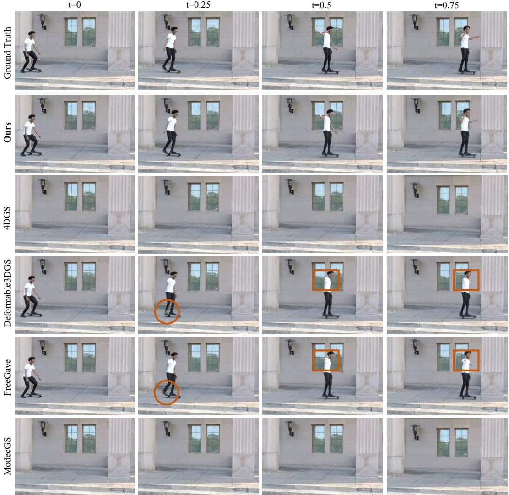  
Figure 13: Qualitative Results for Interpolation of Skating Scene on NVIDIA Dynamic Scene Dataset.

PhyMo captures physical dynamics at the kinematic level without explicitly modeling forces, mass, or material parameters, which may limit its ability to handle complex physical interactions.

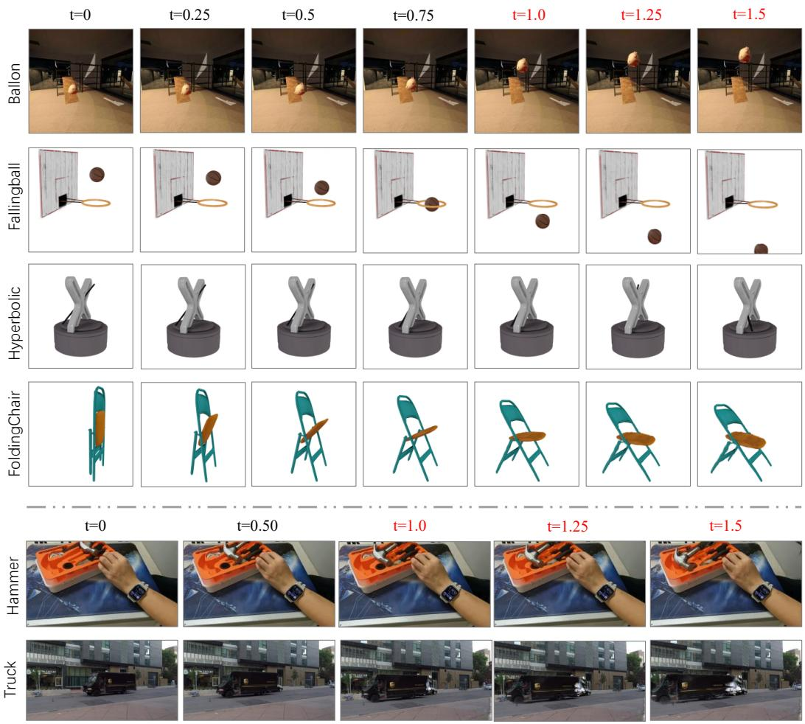  
Figure 14: Qualitative Results of Longer Extrapolation on Four Datasets.

## NeurIPS Paper Checklist

## 1. Claims

Question: Do the main claims made in the abstract and introduction accurately reflect the paper’s contributions and scope?

Answer: [Yes]

Justification: Our papers main contribution has been clearly declared in the abstract and introduction.

Guidelines:

• The answer [N/A] means that the abstract and introduction do not include the claims made in the paper.

• The abstract and/or introduction should clearly state the claims made, including the contributions made in the paper and important assumptions and limitations. A [No] or [N/A] answer to this question will not be perceived well by the reviewers.

• The claims made should match theoretical and experimental results, and reflect how much the results can be expected to generalize to other settings.

• It is fine to include aspirational goals as motivation as long as it is clear that these goals are not attained by the paper.

## 2. Limitations

Question: Does the paper discuss the limitations of the work performed by the authors?

Answer: [Yes]

Justification: We include the limitation part in the Appendix.

Guidelines:

• The answer [N/A] means that the paper has no limitation while the answer [No] means that the paper has limitations, but those are not discussed in the paper.

• The authors are encouraged to create a separate “Limitations” section in their paper.

• The paper should point out any strong assumptions and how robust the results are to violations of these assumptions (e.g., independence assumptions, noiseless settings, model well-specification, asymptotic approximations only holding locally). The authors should reflect on how these assumptions might be violated in practice and what the implications would be.

• The authors should reflect on the scope of the claims made, e.g., if the approach was only tested on a few datasets or with a few runs. In general, empirical results often depend on implicit assumptions, which should be articulated.

• The authors should reflect on the factors that influence the performance of the approach. For example, a facial recognition algorithm may perform poorly when image resolution is low or images are taken in low lighting. Or a speech-to-text system might not be used reliably to provide closed captions for online lectures because it fails to handle technical jargon.

• The authors should discuss the computational efficiency of the proposed algorithms and how they scale with dataset size.

• If applicable, the authors should discuss possible limitations of their approach to address problems of privacy and fairness.

• While the authors might fear that complete honesty about limitations might be used by reviewers as grounds for rejection, a worse outcome might be that reviewers discover limitations that aren’t acknowledged in the paper. The authors should use their best judgment and recognize that individual actions in favor of transparency play an important role in developing norms that preserve the integrity of the community. Reviewers will be specifically instructed to not penalize honesty concerning limitations.

## 3. Theory assumptions and proofs

Question: For each theoretical result, does the paper provide the full set of assumptions and a complete (and correct) proof?

Answer: [N/A]

Justification: The paper does not include theorectical results.

## Guidelines:

• The answer [N/A] means that the paper does not include theoretical results.

• All the theorems, formulas, and proofs in the paper should be numbered and crossreferenced.

• All assumptions should be clearly stated or referenced in the statement of any theorems.

• The proofs can either appear in the main paper or the supplemental material, but if they appear in the supplemental material, the authors are encouraged to provide a short proof sketch to provide intuition.

• Inversely, any informal proof provided in the core of the paper should be complemented by formal proofs provided in appendix or supplemental material.

• Theorems and Lemmas that the proof relies upon should be properly referenced.

## 4. Experimental result reproducibility

Question: Does the paper fully disclose all the information needed to reproduce the main experimental results of the paper to the extent that it affects the main claims and/or conclusions of the paper (regardless of whether the code and data are provided or not)?

Answer: [Yes]

Justification: A detailed description of our method is provided, and the code will be released upon acceptance.

Guidelines:

• The answer [N/A] means that the paper does not include experiments.

• If the paper includes experiments, a [No] answer to this question will not be perceived well by the reviewers: Making the paper reproducible is important, regardless of whether the code and data are provided or not.

• If the contribution is a dataset and/or model, the authors should describe the steps taken to make their results reproducible or verifiable.

• Depending on the contribution, reproducibility can be accomplished in various ways. For example, if the contribution is a novel architecture, describing the architecture fully might suffice, or if the contribution is a specific model and empirical evaluation, it may be necessary to either make it possible for others to replicate the model with the same dataset, or provide access to the model. In general. releasing code and data is often one good way to accomplish this, but reproducibility can also be provided via detailed instructions for how to replicate the results, access to a hosted model (e.g., in the case of a large language model), releasing of a model checkpoint, or other means that are appropriate to the research performed.

• While NeurIPS does not require releasing code, the conference does require all submissions to provide some reasonable avenue for reproducibility, which may depend on the nature of the contribution. For example

(a) If the contribution is primarily a new algorithm, the paper should make it clear how to reproduce that algorithm.

(b) If the contribution is primarily a new model architecture, the paper should describe the architecture clearly and fully.

(c) If the contribution is a new model (e.g., a large language model), then there should either be a way to access this model for reproducing the results or a way to reproduce the model (e.g., with an open-source dataset or instructions for how to construct the dataset).

(d) We recognize that reproducibility may be tricky in some cases, in which case authors are welcome to describe the particular way they provide for reproducibility. In the case of closed-source models, it may be that access to the model is limited in some way (e.g., to registered users), but it should be possible for other researchers to have some path to reproducing or verifying the results.

## 5. Open access to data and code

Question: Does the paper provide open access to the data and code, with sufficient instructions to faithfully reproduce the main experimental results, as described in supplemental material?

## Answer: [No]

Justification: The code is not included for now. It will be released upon acceptance.

## Guidelines:

• The answer [N/A] means that paper does not include experiments requiring code.

• Please see the NeurIPS code and data submission guidelines (https://neurips.cc/ public/guides/CodeSubmissionPolicy) for more details.

• While we encourage the release of code and data, we understand that this might not be possible, so [No] is an acceptable answer. Papers cannot be rejected simply for not including code, unless this is central to the contribution (e.g., for a new open-source benchmark).

• The instructions should contain the exact command and environment needed to run to reproduce the results. See the NeurIPS code and data submission guidelines (https: //neurips.cc/public/guides/CodeSubmissionPolicy) for more details.

• The authors should provide instructions on data access and preparation, including how to access the raw data, preprocessed data, intermediate data, and generated data, etc.

• The authors should provide scripts to reproduce all experimental results for the new proposed method and baselines. If only a subset of experiments are reproducible, they should state which ones are omitted from the script and why.

• At submission time, to preserve anonymity, the authors should release anonymized versions (if applicable).

• Providing as much information as possible in supplemental material (appended to the paper) is recommended, but including URLs to data and code is permitted.

## 6. Experimental setting/details

Question: Does the paper specify all the training and test details (e.g., data splits, hyperparameters, how they were chosen, type of optimizer) necessary to understand the results?

Answer: [Yes]

Justification: We include them in the Experiment Section and also more details in the Appendix.

Guidelines:

• The answer [N/A] means that the paper does not include experiments.

• The experimental setting should be presented in the core of the paper to a level of detail that is necessary to appreciate the results and make sense of them.

• The full details can be provided either with the code, in appendix, or as supplemental material.

## 7. Experiment statistical significance

Question: Does the paper report error bars suitably and correctly defined or other appropriate information about the statistical significance of the experiments?

Answer: [Yes]

Justification: We perform the experiments multiple times and compute the average.

Guidelines:

• The answer [N/A] means that the paper does not include experiments.

• The authors should answer [Yes] if the results are accompanied by error bars, confidence intervals, or statistical significance tests, at least for the experiments that support the main claims of the paper.

• The factors of variability that the error bars are capturing should be clearly stated (for example, train/test split, initialization, random drawing of some parameter, or overall run with given experimental conditions).

• The method for calculating the error bars should be explained (closed form formula, call to a library function, bootstrap, etc.)

• The assumptions made should be given (e.g., Normally distributed errors).

• It should be clear whether the error bar is the standard deviation or the standard error of the mean.

• It is OK to report 1-sigma error bars, but one should state it. The authors should preferably report a 2-sigma error bar than state that they have a 96% CI, if the hypothesis of Normality of errors is not verified.

• For asymmetric distributions, the authors should be careful not to show in tables or figures symmetric error bars that would yield results that are out of range (e.g., negative error rates).

• If error bars are reported in tables or plots, the authors should explain in the text how they were calculated and reference the corresponding figures or tables in the text.

## 8. Experiments compute resources

Question: For each experiment, does the paper provide sufficient information on the computer resources (type of compute workers, memory, time of execution) needed to reproduce the experiments?

Answer: [Yes]

Justification: We provide sufficient information on the computer resources for experiments in the Appendix.

Guidelines:

• The answer [N/A] means that the paper does not include experiments.

• The paper should indicate the type of compute workers CPU or GPU, internal cluster, or cloud provider, including relevant memory and storage.

• The paper should provide the amount of compute required for each of the individual experimental runs as well as estimate the total compute.

• The paper should disclose whether the full research project required more compute than the experiments reported in the paper (e.g., preliminary or failed experiments that didn’t make it into the paper).

## 9. Code of ethics

Question: Does the research conducted in the paper conform, in every respect, with the NeurIPS Code of Ethics https://neurips.cc/public/EthicsGuidelines?

Answer: [Yes]

Justification: We follow the NeurIPS Code of Ethics.

Guidelines:

• The answer [N/A] means that the authors have not reviewed the NeurIPS Code of Ethics.

• If the authors answer [No], they should explain the special circumstances that require a deviation from the Code of Ethics.

• The authors should make sure to preserve anonymity (e.g., if there is a special consideration due to laws or regulations in their jurisdiction).

## 10. Broader impacts

Question: Does the paper discuss both potential positive societal impacts and negative societal impacts of the work performed?

Answer: [Yes]

Justification: We discussed the potential positive impact of our work, as we outlined some of its application in the introduction section of our main text. As for negative social impacts, we have not yet identified significant negative implications.

Guidelines:

• The answer [N/A] means that there is no societal impact of the work performed.

• If the authors answer [N/A] or [No], they should explain why their work has no societal impact or why the paper does not address societal impact.

• Examples of negative societal impacts include potential malicious or unintended uses (e.g., disinformation, generating fake profiles, surveillance), fairness considerations (e.g., deployment of technologies that could make decisions that unfairly impact specific groups), privacy considerations, and security considerations.

• The conference expects that many papers will be foundational research and not tied to particular applications, let alone deployments. However, if there is a direct path to any negative applications, the authors should point it out. For example, it is legitimate to point out that an improvement in the quality of generative models could be used to generate Deepfakes for disinformation. On the other hand, it is not needed to point out that a generic algorithm for optimizing neural networks could enable people to train models that generate Deepfakes faster.

• The authors should consider possible harms that could arise when the technology is being used as intended and functioning correctly, harms that could arise when the technology is being used as intended but gives incorrect results, and harms following from (intentional or unintentional) misuse of the technology.

• If there are negative societal impacts, the authors could also discuss possible mitigation strategies (e.g., gated release of models, providing defenses in addition to attacks, mechanisms for monitoring misuse, mechanisms to monitor how a system learns from feedback over time, improving the efficiency and accessibility of ML).

## 11. Safeguards

Question: Does the paper describe safeguards that have been put in place for responsible release of data or models that have a high risk for misuse (e.g., pre-trained language models, image generators, or scraped datasets)?

Answer: [N/A]

Justification: The paper poses no such risks.

Guidelines:

• The answer [N/A] means that the paper poses no such risks.

• Released models that have a high risk for misuse or dual-use should be released with necessary safeguards to allow for controlled use of the model, for example by requiring that users adhere to usage guidelines or restrictions to access the model or implementing safety filters.

• Datasets that have been scraped from the Internet could pose safety risks. The authors should describe how they avoided releasing unsafe images.

• We recognize that providing effective safeguards is challenging, and many papers do not require this, but we encourage authors to take this into account and make a best faith effort.

## 12. Licenses for existing assets

Question: Are the creators or original owners of assets (e.g., code, data, models), used in the paper, properly credited and are the license and terms of use explicitly mentioned and properly respected?

Answer: [Yes]

Justification: The code we use has been properly cited in the paper.

Guidelines:

• The answer [N/A] means that the paper does not use existing assets.

• The authors should cite the original paper that produced the code package or dataset.

• The authors should state which version of the asset is used and, if possible, include a URL.

• The name of the license (e.g., CC-BY 4.0) should be included for each asset.

• For scraped data from a particular source (e.g., website), the copyright and terms of service of that source should be provided.

• If assets are released, the license, copyright information, and terms of use in the package should be provided. For popular datasets, paperswithcode.com/datasets has curated licenses for some datasets. Their licensing guide can help determine the license of a dataset.

• For existing datasets that are re-packaged, both the original license and the license of the derived asset (if it has changed) should be provided.

• If this information is not available online, the authors are encouraged to reach out to the asset’s creators.

## 13. New assets

Question: Are new assets introduced in the paper well documented and is the documentation provided alongside the assets?

Answer: [N/A]

Justification: The paper does not release new datasets or new assets.

Guidelines:

• The answer [N/A] means that the paper does not release new assets.

• Researchers should communicate the details of the dataset/code/model as part of their submissions via structured templates. This includes details about training, license, limitations, etc.

• The paper should discuss whether and how consent was obtained from people whose asset is used.

• At submission time, remember to anonymize your assets (if applicable). You can either create an anonymized URL or include an anonymized zip file.

## 14. Crowdsourcing and research with human subjects

Question: For crowdsourcing experiments and research with human subjects, does the paper include the full text of instructions given to participants and screenshots, if applicable, as well as details about compensation (if any)?

Answer: [N/A]

Justification: The paper does not involve crowdsourcing nor research with human subjects. Guidelines:

• The answer [N/A] means that the paper does not involve crowdsourcing nor research with human subjects.

• Including this information in the supplemental material is fine, but if the main contribution of the paper involves human subjects, then as much detail as possible should be included in the main paper.

• According to the NeurIPS Code of Ethics, workers involved in data collection, curation, or other labor should be paid at least the minimum wage in the country of the data collector.

## 15. Institutional review board (IRB) approvals or equivalent for research with human subjects

Question: Does the paper describe potential risks incurred by study participants, whether such risks were disclosed to the subjects, and whether Institutional Review Board (IRB) approvals (or an equivalent approval/review based on the requirements of your country or institution) were obtained?

Answer: [N/A]

Justification: The paper does not involve crowdsourcing nor research with human subjects. Guidelines:

• The answer [N/A] means that the paper does not involve crowdsourcing nor research with human subjects.

• Depending on the country in which research is conducted, IRB approval (or equivalent) may be required for any human subjects research. If you obtained IRB approval, you should clearly state this in the paper.

• We recognize that the procedures for this may vary significantly between institutions and locations, and we expect authors to adhere to the NeurIPS Code of Ethics and the guidelines for their institution.

• For initial submissions, do not include any information that would break anonymity (if applicable), such as the institution conducting the review.

## 16. Declaration of LLM usage

Question: Does the paper describe the usage of LLMs if it is an important, original, or non-standard component of the core methods in this research? Note that if the LLM is used only for writing, editing, or formatting purposes and does not impact the core methodology, scientific rigor, or originality of the research, declaration is not required.

## Answer: [N/A]

Justification: LLM is used only for writing, editing, the core method development in this paper does not involve LLMs as any important components.

## Guidelines:

• The answer [N/A] means that the core method development in this research does not involve LLMs as any important, original, or non-standard components.

• Please refer to our LLM policy in the NeurIPS handbook for what should or should not be described.