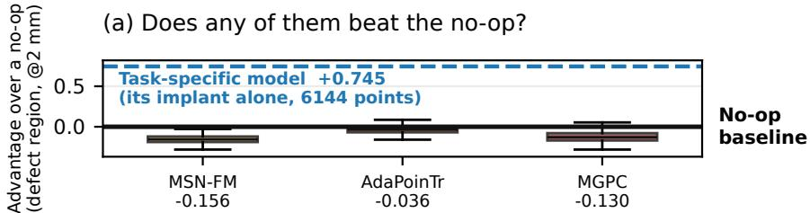
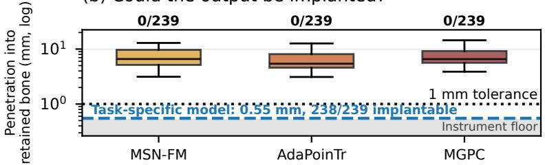
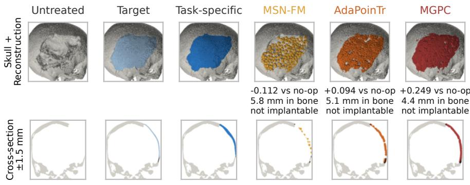
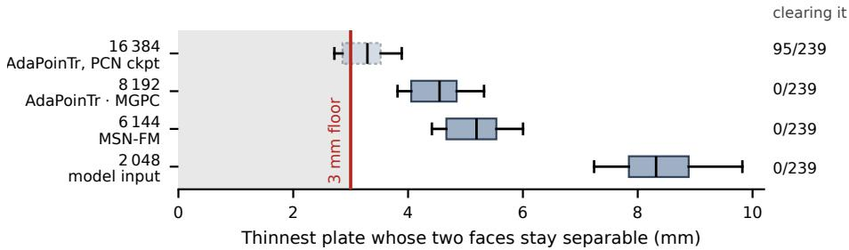

# Plausible but Unimplantable: A Trustworthiness Audit of Shape Completion Foundation Models for Cranial Defect Reconstruction

Marek Wodzinski1,2[0000−0002−8076−6246], Kamil Kwarciak1[0000−0002−1392−4291], Daria Hemmerling1[0000−0002−2193−7690], and Mateusz Daniol1[0000−0003−2363−7912]

1 AGH University of Krakow, Krakow, Poland 2 Sano Centre for Computational Medicine, Krakow, Poland wodzinski@agh.edu.pl

Abstract. A patient who has lost part of the skull vault needs an implant that fits the defect exactly, and such implants are still drawn by hand in CAD by specialists, which makes each case slow and expensive. The task can be considered as a shape completion problem, so pretrained completion models, and now the first shape completion foundation models, look like a way to remove that manual step. We audited three publicly released pretrained shape completion models, two of them foundation models, applied zero-shot to 239 cranial defects, some carved from public skull datasets and some real post-craniectomy cases. Each output was compared with simply returning the patient’s own remaining bone, and tested for whether the predicted material could be placed without intersecting the bone that is still there. On the 210 carved defects none of the three improved on doing nothing, and on the 29 real cases only one did so beyond chance. Yet not one output, from any model in any configuration, was implantable: none managed both to stay clear of the bone the patient still has and to place more material than doing nothing, where a task-specific volumetric model, trained for this task and selected on these cases, was implantable on all but one. The output that most convincingly resembles a skull is no more placeable than the rest, and at these point densities implant thickness cannot be read of the emitted points at all, which is a property of the output representation rather than of any one model. On this evidence the shape completion foundation models we could obtain cannot be trusted and, used as released, are not usable in clinical practice. Substantial research towards trustworthy foundation models for shape completion is still needed.

Keywords: Cranial implant design · Shape completion · Foundation models · Trustworthy machine learning · Point clouds

Accepted at the Workshop on Trustworthy Foundation Models in Medical Imaging (TrustFMI), ACCV 2026. This is the authors’ accepted manuscript; the Version of Record will appear in the ACCV 2026 workshop proceedings.

## 1 Introduction

After a decompressive craniectomy, a head injury or a tumour resection that takes bone, a patient is left with an opening in the skull vault, closed with an implant shaped to that patient’s anatomy [10, 12]. The implant should protect the brain and restore the original shape of the skull, and whether it fits is settled in the operating room [9, 11].

Such implants are designed by hand, in CAD, by specialists, which makes each case slow and expensive and limits how many patients can be ofered one. Automation has been pursued for a decade, mostly as volumetric completion of the missing bone, and networks trained for that task now do well on public benchmarks [9, 10, 12], most recently point-cloud difusion and flow matching [5, 7, 8]. Every one of them has to be trained on data for the task, and that is the cost a foundation model promises to remove.

Foundation models are becoming increasingly popular in medical imaging [17, 28], and the first of them aimed at shape completion are now appearing [14,25]. A skull with a defect is a partial shape and the implant completes it, so implant design is close to what these models advertise [13], and a checkpoint used as it comes would remove both the training data and the manual step.

Completion models are judged by how closely the completed shape resembles a reference, and that resemblance is not what a surgeon needs to know: it cannot say whether the model added anything the patient’s own bone did not already supply, nor whether what it predicted could physically be placed in that patient [15, 16, 24].

Contribution: We audit three publicly released pretrained shape completion models, applied zero-shot to cranial defects, and judge them by what the clinic needs rather than by what a benchmark reports. First, we score every output against an explicit do-nothing baseline, the patient’s own retained bone. Second, we introduce a physical acceptance criterion, under which the predicted material must sit in the defect without intersecting the bone that remains, and we report how many patients could receive each output. Third, we test whether the language conditioning these models advertise carries anatomical information, reading each against its own noise floor. Together they let a completion model be judged on the thing that decides its use: whether what it produced could be put in a patient.

## 2 Related Work

Automatic cranial implant design has been posed mainly as volumetric completion of the missing bone. The AutoImplant challenges established the task over SkullBreak and SkullFix, whose defects are carved synthetically from complete CT skulls [6, 10, 12], and networks trained for it handle those defects well [9]; MUG500+ later added real craniectomy cases with their manufactured implants [11]. These set the standard a zero-shot checkpoint has to meet.

Shape completion infers a complete shape from a partial observation [27]. We audit every released model we could obtain that performs it without task training: the two ofered at or advertised at foundation scale, and one strong generalist as a non-medical control. AdaPoinTr is a strong pretrained generalist trained on ShapeNet-55, whose 55 everyday object categories include no skull [2, 26]. MSN-FM describes itself as the first multi-modal foundation model for medical point cloud completion and takes its text through a BERT encoder [3, 13, 25]. MGPC, a more recent preprint, keeps a text branch and adds an image branch, both read from frozen encoders [14, 18, 20]; it makes both modalities optional at inference, though its released code provides no such path, so an image must always be supplied. MSN-FM is advertised as a foundation model and MGPC is trained at that scale. Surveys of 3D point cloud foundation models reach neither of them [22].

The benchmarks they were built on report similarity to a reference, which is a poor match for a clinical decision. Chamfer distance, the usual choice, is insensitive to mismatched point density and heavily influenced by outliers [24], and without a do-nothing baseline no benchmark separates a model from the trivial solution [16, 21]. Completion trained on synthetic partials also degrades on real scans [19]. We therefore fixed the baseline and the acceptance criterion before running a single model.

## 3 Materials and Methods

We work with 239 skulls: 210 held-out test cases of SkullBreak (100) and Skull-Fix (110), whose defects are carved synthetically, and 29 real craniectomy defects from MUG500+ [6, 11]. The first two give the missing bone, the whole removed volume including the diploe; MUG500+ gives the manufactured implant an expert designed for that patient, so its results measure whether material went where the implant goes rather than reconstruction accuracy.

Every model receives the kept subset of one surface sample of the complete skull, split by the missing-bone mask, so that input and reference come from a single draw. The median kept subset holds 5955 points, reduced by farthest-point sampling to each architecture’s fixed input size: 4096 for MSN-FM, 2048 for the other two. We measure recall of the removed region at 2 mm and report it as an advantage over a no-op, the per-skull diference against simply handing back the patient’s retained bone. That baseline is not optional: the removed bone is a thin shell over the vault, so proximity to retained bone supplies coverage for free [15, 16]. The tolerance is 2 mm because the task-specific model described below saturates at 5 mm and still reaches 0.966 at 2 mm, so sparsity cannot excuse a coverage failure there.

Not every row spends its point budget the same way, so the headline table is not a like-for-like comparison. A completion model spreads its points over a whole skull; the task-specific reference emits the defect region alone, putting 2733 of its 6144 points inside the removed region against 193 for an ideal uniform sample of a whole skull. That uniform resample is the allocation-neutral row, and its median per-skull advantage is +0.169. Recall rises with point count, so every arm is scored at a common 6144-point budget and at its native one; the two conventions agree on the ordering and flip AdaPoinTr’s sign (+0.013 native, −0.036 common). Implantability is read at the common budget. Extra points can only help recall, and because penetration is a maximum over points they can only hurt it, so the two conventions pull in opposite directions.

A prediction is implantable if it is collision-free at a 1 mm tolerance against the patient’s retained bone and its advantage over the no-op at 2 mm is nonnegative. That is a geometric screen and a necessary condition rather than a clinical approval: an output failing it cannot be placed, while one passing it still has to satisfy everything a designer and a surgeon check. The tolerance is 1 mm because that is what the instrument resolves: on the 478 rows whose true penetration is zero by construction it reads 0.533 mm at worst. That is a measurement floor, not a surgical requirement, and nothing in the audited models’ verdict turns on it, their penetrations being ten times larger; the reference row, at 0.55 mm, is the one row it does bind. The second condition earns its place because collision-freedom alone is gameable: one swept configuration returned a skull 0.634× the patient’s size, a median 26.4 mm from any bone. Headline numbers use the deployment frame, which places a model from the defective skull alone; the training-time frame aligns to the complete skull, unobtainable when that skull is the prediction.

A task-specific volumetric model gives the criterion a scale: a 3D convolutional encoder–decoder segments the missing bone and emits an implant mask, sampled to the same 6144 points and scored by the same instrument. It was trained on the SkullBreak and SkullFix training splits, disjoint from the test skulls, then selected as the best of 138 arms by Dice (0.916) on the same 210 carved cases it is reported on, so its row is a test-selected reference ceiling and not an unbiased estimate, and the 29 real defects are out of domain for it. We built it ourselves, and it is here for one reason rather than as a rival: without it a reader could not tell whether these criteria can be met at all.

The easier mistake here is to condemn a model that does not deserve it, so we spent the second half of the study trying to break the first: we swept six protocol dimensions and added a positive control handing each model the complete skull. One asymmetry is worth stating. MSN-FM’s and MGPC’s checkpoints were accepted on reproducing upstream behaviour, AdaPoinTr’s on a weaker check that the weights had loaded, because the ShapeNet-55 test split is not available. The source code is released at [23].

## 4 Results

By the usual coverage score the models do not look broken. With the normalisation held fixed so that only the defect process varies, MSN-FM recalls 0.462 of the removed region at 5 mm on the carved defects, against 0.439 on the compact defect it was trained to repair. Coverage alone cannot say whether a model added anything at all.

Table 1: Medians over 239 skulls at the common 6144-point budget, deployment frame. Advantage is the per-skull gain in recall of the removed region at 2 mm over a no-op; implantable adds collision-freedom at 1 mm. The controls pass by construction, not by merit, and the task-specific row is ours and test-selected (Sec. 3). 29 of the 239 are real craniectomy defects, separated out in Tab. 2.
<table><tr><td>Method</td><td>Params</td><td>Pretraining corpus</td><td>Adv. @2 mm</td><td>Pen. (mm)</td><td>Impl.</td></tr><tr><td>Ground truth</td><td></td><td>control</td><td>+0.802</td><td>0.35</td><td>239/239</td></tr><tr><td>No-op, unchanged</td><td></td><td>control</td><td>+0.000</td><td>0.35</td><td>239/239</td></tr><tr><td>Uniform resample</td><td></td><td>allocation-neutral</td><td>+0.169</td><td></td><td></td></tr><tr><td>Task-specific volumetric</td><td></td><td>trained on this task</td><td>+0.745</td><td>0.55</td><td>238/239</td></tr><tr><td>MSN-FM [25]</td><td>297M</td><td>MedShapeNet, 100k</td><td>-0.156</td><td>6.60</td><td>0/239</td></tr><tr><td>AdaPoinTr [26]</td><td>32M</td><td>ShapeNet-55, 55 classes</td><td>-0.036</td><td>5.42</td><td>0/239</td></tr><tr><td>MGPC [14]</td><td>559M</td><td>MGPC-1M, 1M pairs</td><td>-0.130</td><td>6.57</td><td>0/239</td></tr></table>

Table 2: Advantage over a no-op at 2 mm, median per skull, by defect provenance. The clinical p-values are a two-sided sign test, counting AdaPoinTr’s three tied skulls against it, and a Wilcoxon signed-rank test, which drops them; they disagree for AdaPoinTr, whose clinical median is therefore not established. Every synthetic result is significant at $p < 1 0 ^ { - 2 4 }$ under both. MUG500+ ships a manufactured implant, so its columns measure whether material went where the device goes.
<table><tr><td rowspan="2">Model</td><td colspan="2">Synthetic (n = 210)</td><td colspan="2">Clinical (n = 29)</td><td colspan="2">Clinical p</td></tr><tr><td>Adv.</td><td>Better</td><td>Adv.</td><td>Better</td><td></td><td>Sign Signed-rank</td></tr><tr><td>MSN-FM [25]</td><td>-0.162</td><td>0/210</td><td>-0.102</td><td>1/29</td><td>&lt; 0.0001</td><td>&lt; 0.0001</td></tr><tr><td>AdaPoinTr [26]</td><td>-0.042</td><td>29/210</td><td>+0.021</td><td>16/29</td><td>0.7111</td><td>0.0409</td></tr><tr><td>MGPC [14]</td><td>-0.139</td><td>4/210</td><td>+0.118</td><td>24/29</td><td>0.0005</td><td>&lt; 0.0001</td></tr></table>

All three put less material within 2 mm of the missing bone than the patient’s own retained bone already does (Tab. 1, Fig. 1a): AdaPoinTr −0.036, MGPC −0.130 and MSN-FM −0.156, where the task-specific reference reaches +0.745 on an allocation that is not like-for-like with theirs (Sec. 3). Medical pretraining did not help: MSN-FM is the worst of the three, behind one trained on 55 everyday object categories.

The diference between a completion benchmark and a clinical defect lies in the baseline rather than in the model. In that same comparison a model’s coverage barely moves across defect types, while a no-op recovers 0.049 of the compact ball-shaped defect used in completion training and 0.783 of the dispersed defects the skull datasets ship, both at 5 mm. What looks like competence on the released benchmark is mostly the baseline.

Two things move the sign of the comparison with a no-op. At its native 8192- point budget AdaPoinTr reaches +0.013, which the budget sweep attributes to the extra points rather than better content. So does the cohort (Tab. 2): on the

(b) Could the output be implanted?  
  
Fig. 1: Three pretrained completion models, 239 skulls, equal 6144-point budget. (a) advantage over a no-op at 2 mm; (b) deepest penetration into retained bone, log scale, implantable count above each box. In (b): dotted rule, the 1 mm tolerance; dashed line, the task-specific reference, which is ours and test-selected (Sec. 3); shaded band, the instrument’s floor.

29 real craniectomy defects MGPC beats a no-op at +0.118, on 24 of 29, while losing on the carved ones, and AdaPoinTr’s +0.021 there is not established. One model reversing on 29 skulls, against a manufactured implant, does not settle the clinical question.

Seen on the patient all three cover the defect with material that reads as a completed skull (Fig. 2), but only one returns a surface: 0.564 of AdaPoinTr’s points lie within 2 mm of the true skull, against 0.108 and 0.043 for the others.

Neither kind can be placed in the patient. Every model is implantable on 0 of 239 skulls, against 238 of 239 for the task-specific reference, which is collision-free on all of them; across the three, not one of 2868 model-arm-skull combinations is collision-free at 1 mm (Fig. 1b). Misregistration does not account for that: the unobtainable training-time frame moves penetration by Clif’s δ = −0.025 (p = 0.109) against a total separation from the no-op (δ = 1.000), so the collisions are in the shape of the output, not in where it was put. Nor does the allocation: the ground-truth control spreads the same 6144 points over the same whole skull and collides on none of the 239 (Tab. 1).

At the point densities these models emit, implant thickness is not carried by the output at all, whatever the model (Fig. 3). A 6144-point sample of a skull has a mean nearest-neighbour spacing of 2.56 mm, and at a comparable spacing of 2.4 mm, 0.447 of every neighbourhood on a 3 mm plate is drawn from the opposite face, so the two faces are not separable and thickness cannot be read of the emitted points [1]. Even a 5 mm plate is contaminated at 0.351, whereas at 0.4 mm spacing it separates cleanly, which places the failure in the representation and not in the measurement. The 3 mm floor is itself a design target [4] that the clinical data violate, 11 of the 29 real MUG500+ implants being thinner than it (Fig. 3).

Fig. 2: Case B0001 of MUG500+, from outside (top) and in section (bottom). The patient’s own bone is grey, what each method adds is in colour, black marks material inside bone that is there. MSN-FM’s addition is granular; AdaPoinTr’s and MGPC’s read as solid caps, though only AdaPoinTr’s points lie on a surface. All three run into bone the patient still has. On this case two of them exceed the no-op; the medians in Tab. 1 do not.  
  
Fig. 3: How thin a plate can get before its two surfaces stop being distinguishable, at each point budget in play (ideal even resample, no model, 239 skulls per box). No budget the audited models emit or receive reaches 3 mm, so thickness is lost before a model is asked to recover it. That 3 mm is a design target rather than a law, and the clinical data break it: 11 of the 29 real MUG500+ implants (38 %) are thinner than 3 mm, the 29 having median 3.05 mm and mean 3.30 ± 1.41 mm. The dashed box is AdaPoinTr’s other checkpoint (Sec. 4).

The other advertised capability is language, which only the two foundation models accept. Against each model’s own no-information floor, every MGPC prompt moves the geometry 0.05 to 0.15× as much as a second blank image, and MSN-FM’s 0.49 to 1.08× as much as a change of seed, so most of MSN-

FM’s prompt swaps do less than asking it twice. MSN-FM’s weights say why: its text branch ends in a ReLU, 97.5 % of the text code is exactly zero, and a prompt moves the fused code by 8.8 % of the shape code’s norm. Across two text encoders and two fusion mechanisms the channel is decorative in MGPC and, on all but one prompt, in MSN-FM.

None of this rests on protocol choices of ours. Presentation pose and input scale showed no efect on a 14-skull pilot, which at that size is weak evidence, and we do not read it as evidence of no efect. Across all six swept dimensions, no audited row is implantable. The one arm that comes closest is instructive: AdaPoinTr’s other released checkpoint emits 16 384 points, twice the largest audited budget and the only one that resolves a 3 mm plate (Fig. 3), and it is collision-free on 1 of 239 skulls. It is also the worst arm we ran, at −0.198. Having enough points to represent an implant is not the same as producing one. Handed the complete skull, AdaPoinTr clears a no-op at +0.042 and improves on its own default on 228 of 239 skulls, so a negative number is no artefact of our frame or input. MSN-FM (−0.151) and MGPC (−0.124) cannot return even a shape they were shown.

## 5 Discussion

The models answer a diferent question from the one implant design asks, and thickness shows it. Measuring it at all means turning an output into a solid, which we do with a 3 mm reconstruction radius, identically for every method. What comes back barely moves: 5.40 to 5.93 mm for every model on every cohort, against references spanning 3.05 to 7.25 mm. The number is our reconstruction radius rather than their output, and that is the point: a surface has no thickness, so there is nothing for the measurement to find, and no overlap metric here registers that.

Two barriers stand behind that, and neither would move for a loss weight or more data. The first is that the corruption these models were trained to repair is a diferent object from a clinical defect: a compact cluster removing 10.8 times as many surface points and difering in dispersion at Clif’s δ = 0.83. The second is the output type: a surface has no thickness to recover, at a density that could not resolve one (Fig. 3).

How the failure presents is what makes it a trust problem. Look at the pictures and the models have done their job: the defect is covered, the head has its shape back, and AdaPoinTr returns something a reader would accept as a skull. Measure the same outputs and none can be put in the patient. A difuse cloud is its own warning; a clean cap that scores unremarkably and still cuts into bone carries none, and that is the harder case to catch.

The outputs are not beyond repair. A cloud sitting roughly in the right place could be surfaced, trimmed against the retained bone and thickened into a plate. But each step carries a threshold whose right value difers from skull to skull, so they would be set by hand, per patient. That is the manual work a pretrained model was meant to remove, and a pipeline needing it is not automatic.

What it has to beat is the time a specialist spends in CAD, and repairing these completions is unlikely to be quicker.

Two changes follow, one to the models and one to how they are judged. Recovering thickness needs a volumetric or implicit output, or point spacing below half the plate thickness, and a training defect that is the clinical one. Physical acceptance has to enter the objective, and any overlap score needs a do-nothing baseline [16, 21].

What this does not cover is worth saying plainly. We audited released checkpoints used as they come, so what finetuning on cranial data would buy is untested here. The acceptance criterion is geometric and no clinician read the outputs: failing it is disqualifying, passing it would not by itself make an implant acceptable. We also did not run a task-specific point-cloud method, which would separate the output representation from the pretraining [5, 7]. And the real defects number 29, enough to show that carved benchmarks flatter these models and not enough to settle a clinical question alone.

To conclude, cranial implant design looks, at first sight, like a shape completion problem. That assumption should be treated with caution: the released shape completion foundation models we could obtain are not trustworthy here, and an output can look like a correct reconstruction and still be of no use in the clinic. Research towards trustworthy foundation models for medical shape completion remains at an early stage.

Acknowledgement. The project was funded by The National Centre for Research and Development, Poland under Lider Grant no: LIDER13/0038/2022 (DeepImplant). We gratefully acknowledge Polish high-performance computing infrastructure PLGrid (HPC Center: ACK Cyfronet AGH) for providing computer facilities and support within computational grant no. PLG/2026/019392.

## References

1. Amenta, N., Bern, M.: Surface reconstruction by Voronoi filtering. Discrete Comput. Geom. 22(4), 481–504 (1999). https://doi.org/10.1007/PL00009475

2. Chang, A.X., Funkhouser, T., Guibas, L., Hanrahan, P., Huang, Q., Li, Z., Savarese, S., Savva, M., et al.: ShapeNet: An information-rich 3D model repository. arXiv:1512.03012 [cs.GR] (2015)

3. Devlin, J., Chang, M.W., Lee, K., Toutanova, K.: BERT: Pre-training of deep bidirectional transformers for language understanding. In: Proc. NAACL-HLT. pp. 4171–4186. Association for Computational Linguistics (2019). https://doi.org/ 10.18653/v1/N19-1423

4. Fishman, Z., Mainprize, J.G., Edwards, G., Antonyshyn, O., Hardisty, M., Whyne, C.M.: Thickness and design features of clinical cranial implants – what should automated methods strive to replicate? Int. J. Comput. Assist. Radiol. Surg. 19(4), 747–756 (2024). https://doi.org/10.1007/s11548-024-03068-4

5. Friedrich, P., Wolleb, J., Bieder, F., Thieringer, F.M., Cattin, P.C.: Point cloud difusion models for automatic implant generation. In: MICCAI 2023, Part IX. LNCS, vol. 14228, pp. 112–122. Springer, Cham (2023). https://doi.org/10. 1007/978-3-031-43996-4\_11

6. Kodym, O., Li, J., Pepe, A., Gsaxner, C., Chilamkurthy, S., Egger, J., Španěl, M.: SkullBreak / SkullFix – dataset for automatic cranial implant design and a benchmark for volumetric shape learning tasks. Data Brief 35, 106902 (2021). https://doi.org/10.1016/j.dib.2021.106902

7. Kwarciak, K., Wodzinski, M.: MedPCFM: Improving medical point cloud completion by integrating point transformers and flow matching. arXiv:2606.24433 [cs.CV] (2026)

8. Kwarciak, K., Wodzinski, M.: MedPCFM-TED: One-step point cloud flow matching for implant generation via teacher-guided endpoint distillation. arXiv:2609.16934 [cs.CV] (2026)

9. Li, J., von Campe, G., Pepe, A., Gsaxner, C., Wang, E., Chen, X., Zeferer, U., Tödtling, M., et al.: Automatic skull defect restoration and cranial implant generation for cranioplasty. Med. Image Anal. 73, 102171 (2021). https://doi.org/ 10.1016/j.media.2021.102171

10. Li, J., Ellis, D.G., Kodym, O., Rauschenbach, L., Rieß, C., Sure, U., Wrede, K.H., Alvarez, C.M., et al.: Towards clinical applicability and computational eficiency in automatic cranial implant design: An overview of the AutoImplant 2021 cranial implant design challenge. Med. Image Anal. 88, 102865 (2023). https://doi.org/ 10.1016/j.media.2023.102865

11. Li, J., Krall, M., Trummer, F., Memon, A.R., Pepe, A., Gsaxner, C., Jin, Y., Chen, X., et al.: MUG500+: Database of 500 high-resolution healthy human skulls and 29 craniotomy skulls and implants. Data Brief 39, 107524 (2021). https: //doi.org/10.1016/j.dib.2021.107524

12. Li, J., Pimentel, P., Szengel, A., Ehlke, M., Lamecker, H., Zachow, S., Estacio, L., Doenitz, C., et al.: AutoImplant 2020 – first MICCAI challenge on automatic cranial implant design. IEEE Trans. Med. Imaging 40(9), 2329–2342 (2021). https://doi.org/10.1109/TMI.2021.3077047

13. Li, J., Zhou, Z., Yang, J., Pepe, A., Gsaxner, C., Luijten, G., Qu, C., Zhang, T., et al.: MedShapeNet – a large-scale dataset of 3D medical shapes for computer vision. Biomed. Eng. / Biomed. Tech. 70(1), 71–90 (2025). https://doi.org/10. 1515/bmt-2024-0396

14. Liu, J., Zhao, Y., Ma, H., Liu, Z., Wang, J., Zou, W.: MGPC: Multimodal network for generalizable point cloud completion with modality dropout and progressive decoding. arXiv:2601.03660 [cs.CV] (2026)

15. Maier-Hein, L., Eisenmann, M., Reinke, A., Onogur, S., Stankovic, M., Scholz, P., Arbel, T., Bogunovic, H., et al.: Why rankings of biomedical image analysis competitions should be interpreted with care. Nat. Commun. 9, 5217 (2018). https://doi.org/10.1038/s41467-018-07619-7

16. Maier-Hein, L., Reinke, A., Godau, P., Tizabi, M.D., Buettner, F., Christodoulou, E., Glocker, B., Isensee, F., et al.: Metrics reloaded: Recommendations for image analysis validation. Nat. Methods 21(2), 195–212 (2024). https://doi.org/10. 1038/s41592-023-02151-z

17. Moor, M., Banerjee, O., Abad, Z.S.H., Krumholz, H.M., Leskovec, J., Topol, E.J., Rajpurkar, P.: Foundation models for generalist medical artificial intelligence. Nature 616(7956), 259–265 (2023). https://doi.org/10.1038/s41586-023-05881-4

18. Oquab, M., Darcet, T., Moutakanni, T., Vo, H., Szafraniec, M., Khalidov, V., Fernandez, P., Haziza, D., et al.: DINOv2: Learning robust visual features without supervision. Trans. Mach. Learn. Res. (2024), https://openreview.net/forum? id=a68SUt6zFt

19. Pathak, S., Kumar, P., Baiju, D., Mboga, N., Steenackers, G., Penne, R.: Revisiting point cloud completion: Are we ready for the real-world? In: Proc. ICCV. pp. 25388–25398. IEEE (2025). https://doi.org/10.1109/ICCV51701.2025.02355

20. Radford, A., Kim, J.W., Hallacy, C., Ramesh, A., Goh, G., Agarwal, S., Sastry, G., Askell, A., et al.: Learning transferable visual models from natural language supervision. In: Proc. ICML. PMLR, vol. 139, pp. 8748–8763. PMLR (2021)

21. Reinke, A., Tizabi, M.D., Baumgartner, M., Eisenmann, M., Heckmann-Nötzel, D., Kavur, A.E., et al.: Understanding metric-related pitfalls in image analysis validation. Nat. Methods 21(2), 182–194 (2024). https://doi.org/10.1038/s41592- 023-02150-0

22. Thengane, V., Zhu, X., Bouzerdoum, S., Phung, S.L., Li, Y.: Foundational models for 3D point clouds: A survey and outlook. arXiv:2501.18594 [cs.CV] (2025)

23. Wodzinski, M., et al.: Source code. https://github.com/MWod/plausible\_but\_ unimplantable (2026)

24. Wu, T., Pan, L., Zhang, J., Wang, T., Liu, Z., Lin, D.: Balanced Chamfer distance as a comprehensive metric for point cloud completion. In: Adv. Neural Inf. Process. Syst. (NeurIPS). vol. 34, pp. 29088–29100. Curran Associates, Inc. (2021)

25. Yassin, A., Luijten, G., Elsakka, A., Ferreira, A., Puldai, B., Alves, V., Egger, J.: A MedShapeNet foundation model: Learning-based multimodal medical point cloud completion. Preprint (2024), https://github.com/jrHoss/MedShapeNet-Foundation-Model

26. Yu, X., Rao, Y., Wang, Z., Lu, J., Zhou, J.: AdaPoinTr: Diverse point cloud completion with adaptive geometry-aware transformers. IEEE Trans. Pattern Anal. Mach. Intell. 45(12), 14114–14130 (2023). https://doi.org/10.1109/TPAMI. 2023.3309253

27. Yuan, W., Khot, T., Held, D., Mertz, C., Hebert, M.: PCN: Point completion network. In: Proc. 3DV. pp. 728–737. IEEE (2018). https://doi.org/10.1109/ 3DV.2018.00088

28. Zhang, S., Metaxas, D.: On the challenges and perspectives of foundation models for medical image analysis. Med. Image Anal. 91, 102996 (2024). https://doi. org/10.1016/j.media.2023.102996