actions: speed, curvature

# RETHINKING VIDEO AUTOENCODERSFOR INTERACTIVE WORLD MODELS

Adrien Ramanana Rahary1,2 Yutong Bai3 Nicolas Dufour1 Patrick Perez´ 1,∗ David Picard2

1Kyutai 2LIGM, ENPC, IP Paris, CNRS, UGE 3UC Berkeley

{adrien.ramanana-rahary, david.picard}@enpc.fr

nicolas.dufour@kyutai.org yutongbai@berkeley.edu ∗Work done while at Kyutai.

## ABSTRACT

Video world models predict future frames from past frames and actions. They serve as simulators in which agents train, plan or are evaluated, and that humans can control interactively. They generate in the latent space of a video autoencoder, whose compression sets their cost per frame and how long each action waits to take effect. Yet world models often reuse the autoencoders of text-tovideo generators, built for offline generation with no agent waiting and, without their training data and code, not retrainable at another compression. We therefore ask how, where and how much a world model should compress. We build CADRE, an open family of causal diffusion representation autoencoders spanning multiple spatio-temporal compressions. Its members differ only in a small bottleneck on frozen features and share a diffusion decoder self-distilled to one or a few steps. We train the same world model on each autoencoder in two domains, manipulation and navigation, with two environments each. CADRE forms most of the latency-quality frontier, especially with a moving camera. Our study also leads to four findings. At strong compression, a diffusion decoder is sharper than perceptual regression. In robot manipulation, temporal compression is more effective in the autoencoder than in the world model. Manipulation and navigation call for opposite compressions: temporal compression costs little when the camera is still, and spatial compression when it moves. Surprisingly, with a still camera, coarser spatial tokens hurt motion far more than image quality. Code, models and a live demo are at https://kyutai.org/blog/2026-10-22-cadre.

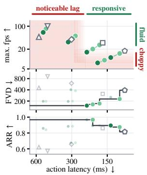

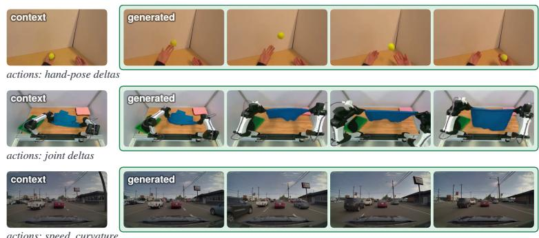  
CADRE (ours), 1 step CADRE (ours), 2 steps Pareto frontier MIRA DC-AE LTX-2 Wan 2.2 Cosmos  
Figure 1: The right video autoencoder lets interactive world models react fast with high image and motion quality. On CADRE, world models run at 20 fps on one H100 and react in under 230 ms, below noticeable action lag (top left; Shimada et al., 2009), and form most of the latencyquality frontier in motion fidelity (FVD) and action following (ARR; bottom left). Right: rollouts given actions, where action lag makes acting hard (juggling, folding) or dangerous (driving).

## 1 INTRODUCTION

A world model is a learned simulator of an environment (Ha & Schmidhuber, 2018). Given past frames and an agent’s actions, a video world model generates the next frames, and can be used to train agents (Hafner et al., 2025; Alonso et al., 2024), evaluate robot policies (Yang et al., 2024), plan the outcome of actions (Bar et al., 2025), or simply play a game (Bruce et al., 2024; Valevski et al., 2025; Hu et al., 2026). To enable all these applications, two different aspects have to be optimized: the throughput that measures the number of frames generated per second, and the latency that measures the delay between the action and its effect on the output. Throughput limits how fast a simulation can happen, whereas latency limits how reactive and faithful a simulation can be.

Most video world models operate in the latent space of a video autoencoder (Bruce et al., 2024; Valevski et al., 2025). To avoid designing an ad hoc autoencoder, many methods (He et al., 2025; Li et al., 2025a; Zhu et al., 2026a) reuse the autoencoder of a text-to-video generator such as LTX-2 (HaCohen et al., 2026), Wan 2.2 (Wan et al., 2025) or HunyuanVideo (Kong et al., 2024). They thus inherit the throughput and latency that come with it. Yet, such autoencoders were not designed with the throughput-latency trade-off of world models in mind, and often perform massive temporal compression since it has low impact on visual quality. A typical 8× temporal compression delays every action by at least 400 ms at 20 frames per second. Humans notice when their own movement appears more than about 230 ms late (Shimada et al., 2009), and interaction feels immediate only below 100 ms (Miller, 1968; Claypool & Claypool, 2006). This raises the question of how other throughput-latency trade-offs affect rollout quality and action following.

To address this question, we propose CADRE, an open family of causal diffusion representation autoencoders built for interactive world models. Its members differ only in a small bottleneck on frozen features, which sets the compression, and share a causal diffusion decoder that needs one or a few steps. To study compression across settings, we train the same world model, a causal diffusion transformer following MIRA (Hu et al., 2026), on each autoencoder, in two domains: manipulation (by a robot and by human hands) and navigation (driving and indoor). We compare CADRE with the autoencoders of Wan 2.2, Cosmos (NVIDIA et al., 2025) and LTX-2, the image autoencoder DC-AE (Chen et al., 2025b) and the MIRA autoencoder retrained on our data. CADRE forms most of the latency-quality frontier, especially with a moving camera (Figure 1).

Interestingly, our study points to four findings. (1) At strong compression, a diffusion decoder is sharper than perceptual regression, and a few-step flow model trained by progressive self-distillation is a good fit. (2) In robot manipulation, temporal compression is more effective in the autoencoder than in the world model: patching inside the world model loses detail, and at eight frames also action following. (3) Manipulation and navigation call for opposite compressions. In manipulation the camera is still, so temporal compression costs little while spatial compression is costly. In navigation the camera moves and the balance reverses, so it pays to keep frames and compress spatially, the low-latency choice. (4) Surprisingly, with a still camera, coarser spatial tokens hurt motion far more than image quality, and, in robot manipulation, action following too.

## Contributions.

• What compression controls in an interactive world model. We make explicit how an autoencoder’s spatial and temporal compression set a world model’s throughput and action latency, and we separate how much to compress from where to compress (Section 2).

• CADRE, causal diffusion representation autoencoders for interactive world models. Open models at seven spatio-temporal compressions, whose decoder learns one- or fewstep decoding by progressive self-distillation, in a single stage and without an adversarial loss (Section 3).

• Where, and how much, to compress video for a world model. A controlled study in four environments, judged by rollouts and action following (Sections 4 and 5).

## 2 WHAT COMPRESSION CONTROLS IN AN INTERACTIVE WORLD MODEL

Before studying how to compress, we make explicit what compression controls. An interactive world model generates in the latent space of an autoencoder that compresses a clip by τ temporally and s spatially, written τ×s×s: $2 \times 3 2 \times 3 2$ compresses $2 \times$ temporally and 32× spatially. These two factors set the world model’s cost, action latency and throughput. The compression itself can happen in the autoencoder or in the world model (Section 5.1).

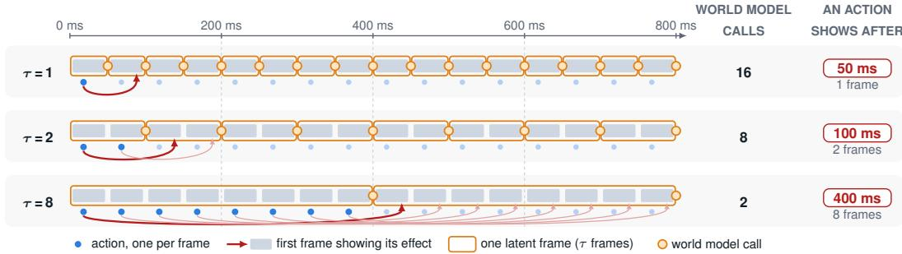  
Figure 2: Every frame registers an action, whose effect appears τ frames later. A latent frame is predicted only once all its τ actions are in, so a larger τ saves world model calls but delays actions.

Compression sets the world model’s cost. The world model we study is a causal, space-time factorized diffusion transformer that predicts the next latent frame from the previous ones and the current action or action chunk (Section 4, Appendix D). Its cost grows with the number of tokens it processes, which only the spatial and temporal compression set: a clip of T frames of size $H \times W$ becomes $N = ( T / \tau ) \dot { ( } H / s ) \dot { ( } W / s )$ latent tokens for the world model.

A latent frame waits for all its actions. Every frame registers one action. A latent frame spans τ frames, so the world model can predict it only once all τ conditioning actions are known. It therefore consumes actions in chunks, and the actions of one chunk shape the next (Figure 2). The agent thus commits to τ actions before seeing their effect, as action-chunking policies do (Zhao et al., 2023; Chi et al., 2024; Black et al., 2025). Causality holds between chunks. Within a chunk, the τ frames decode from the same latent, and their order is learned from real video.

Temporal compression delays every action. The first action of a chunk waits $\tau / f$ for the chunk to close, where f is the frame rate, then $t _ { \mathrm { g e n } }$ for the world model to generate the latent frame and $t _ { \mathrm { d e c } }$ for the autoencoder to decode it into τ frames, which sets the throughput:

$$
\mathrm { l a t e n c y } = \underbrace { \tau / f } _ { \mathrm { c h u n k \ : c l o s e s } } + \underbrace { t _ { \mathrm { g e n } } + t _ { \mathrm { d e c } } } _ { \mathrm { g e n e r a t e \ : a n d \ : d e c o d e } } , \qquad \mathrm { t h r o u g h p u t } = \frac { \tau } { t _ { \mathrm { g e n } } + t _ { \mathrm { d e c } } } .\tag{1}
$$

No speed-up shortens the first term, which at $\tau = 8$ and 20 frames per second is 400 ms, beyond the 230 ms lag humans notice in their own movement (Shimada et al., 2009). In exchange, a larger τ raises the throughput and, at a fixed spatial factor, cuts the token count $N$

## 3 CADRE: CAUSAL DIFFUSION REPRESENTATION AUTOENCODERS

Studying compression means training the autoencoder at many compression points. The autoencoders of text-to-video generators release their weights but not their training data or code, so they cannot be retrained. We instead design an open family of autoencoders for world models, one per compression point (Figure 3). Its members share one recipe, differ only in their compression and are each trained from scratch, so the world models trained on them differ by compression alone.

## 3.1 ARCHITECTURE

Frozen features and one trained layer encode the clip. As in MIRA (Hu et al., 2026), the encoder is that of a representation autoencoder (Zheng et al., 2026). A frozen DINOv3 extractor (Simeoni´ et al., 2026) encodes each frame into one feature per p×p patch, aggregating several layers as in RAEv2 (Singh et al., 2026). One trained 3D convolution with kernel $( \tau , k , k )$ and stride $( \tau , s ^ { \prime } , s ^ { \prime } )$ compresses τ frames of $s ^ { \prime 2 }$ patches into a deterministic latent, with $s = p s ^ { \prime }$ (Appendix B).

A causal diffusion decoder keeps textures sharp. A strongly compressed latent keeps a scene’s layout and semantics but little texture, so a perceptual regression decoder averages the textures consistent with it into a blur (Xu et al., 2026). We therefore use a diffusion decoder (Preechaku et al., 2022; Pern´ıas et al., 2024; Chen et al., 2025d), which samples the clip conditioned on the latent. It is a space-time-factorized transformer (Bertasius et al., 2021; Arnab et al., 2021) on a q×q patch grid, whose blocks attend over space, then causally over time. Most blocks process one token per latent frame, that is, per τ video frames. A linear map then splits each token into τ tokens, one per frame, so the last blocks resolve motion within a latent frame. The latent conditions the diffusion decoder in three places: (i) lifted by a transposed convolution and summed with the patchified noisy clip, (ii) through a spatial AdaLN (Park et al., 2019; Zhu et al., 2020; Dufour et al., 2022; Yu et al., 2026) in every block, which also receives the flow time t and the jump length $d ,$ the size of the denoising step the decoder takes (Section 3.2, Appendix B), and (iii) through a zero-initialized skip into a light convolutional head. The decoder is time-causal, so it streams chunk by chunk.

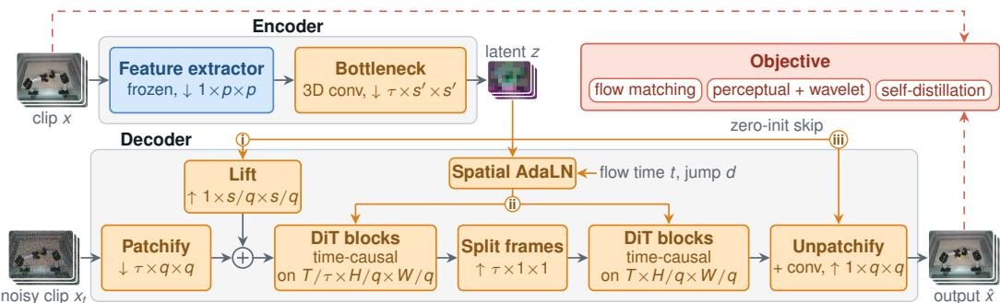  
Figure 3: CADRE. A frozen feature extractor (blue; DINOv3) and a trained bottleneck compress the clip by τ×s×s. A causal diffusion decoder denoises it, conditioned on the latent in three places (i–iii, Section 3.1). Only the bottleneck, lift and temporal patch size depend on τ×s×s.

## 3.2 TRAINING

The decoder learns by flow matching and perceptual losses. The decoder g uses the xprediction, x-loss form of flow matching $( \mathrm { L i } \ \& \ \mathrm { H e } , 2 0 2 6 )$ . It predicts the clean clip x from the latent z and a noisy clip $x _ { t } = t x + ( 1 - t ) \epsilon$ , with $\epsilon \sim \mathcal { N } ( 0 , I )$ and t = 0 pure noise. As in diffusion forcing (Chen et al., 2024a), each chunk of τ frames draws its own $t \sim \mathcal { U } ( 0 , 1 )$ . The loss is

$$
{ \mathcal L } _ { \mathrm { f m } } = \mathrm { E } _ { x , \epsilon , t } \ell _ { \mathrm { r e c } } \bigl ( g _ { \theta } ( z , x _ { t } , t , 0 ) , x \bigr ) ,\tag{2}
$$

where the last argument, the jump length $d ,$ is zero here. The term $\ell _ { \mathrm { r e c } }$ sums a mean absolute error, two perceptual distances (LPIPS (Zhang et al., 2018) and its analog in DINO feature space) and a 3D wavelet term as in LTX-Video (HaCohen et al., 2024), weighted by gradient balancing. CADRE trains on a 76k-hour mixture of web, robot, driving and camera video (Appendix C).

Self-distillation makes one or two decoding steps enough. Flow-matching trajectories curve, so following them takes many steps, while an interactive world model needs single- or few-step decoding. Shortcut models (Frans et al., 2025) and self-distilled flow maps (Boffi et al., 2025) condition the network on its step size and train one large step to agree with two smaller ones. Following them, $g _ { \theta } ( z , x _ { r } , r , d )$ predicts where a jump from r to r+d lands, through $\begin{array} { r } { x _ { r + d } = x _ { r } + \frac { d } { 1 - r } ( \hat { x } - x _ { r } ) } \end{array}$ with implied velocity $v _ { \theta } = ( \hat { x } - x _ { r } ) / ( 1 - r )$ . One jump from r to t is trained to land where two half jumps through $\boldsymbol { u } = ( \boldsymbol { r } + t ) / 2$ do (dropping z from the notation),

$$
\begin{array} { r } { \mathcal { L } _ { \mathtt { p s d } } = \mathrm { E } \Big \| ( 1 - r ) \Big ( v _ { \theta } ( x _ { r } , r , t - r ) - \mathrm { s g } \big [ \frac { 1 } { 2 } \big ( v _ { \theta } ( x _ { r } , r , u - r ) + v _ { \theta } ( \hat { x } _ { u } , u , t - u ) \big ) \big ] \Big ) \Big \| _ { 2 } ^ { 2 } , } \end{array}\tag{3}
$$

where sg stops the gradient and $\hat { x } _ { u }$ is the point reached by the first half jump. Unlike the consistency decoder (OpenAI, 2023) and SSDD (Vallaeys et al., 2026), which distill a decoder in a second stage, the CADRE decoder is its own teacher and learns one- or few-jump decoding in one stage.

## 4 JUDGING AN AUTOENCODER BY ITS WORLD MODEL

An autoencoder is trained to reconstruct its input, yet in latent generation, reconstruction and generation trade off (Yao et al., 2025; Hansen-Estruch et al., 2025), and a line of work shapes the latent for the generator instead (Leng et al., 2025; Kouzelis et al., 2025; Zheng et al., 2026; Xie et al., 2026; Ramanana Rahary et al., 2026b). We therefore score rollouts instead of reconstructions (Appendix F). As in MIRA (Hu et al., 2026), we judge each autoencoder by the rollouts of a world model trained on its latents; the world model, clips and actions are shared, so only the latent varies.

Table 1: Environments. One world model is trained per environment and per autoencoder.
<table><tr><td></td><td>Environment Dataset</td><td></td><td>Camera</td><td>Action</td><td>DoF</td></tr><tr><td rowspan="2">Manipulation</td><td>Robot</td><td>ABC (Allshire et al., 2026)</td><td>static</td><td>joint deltas</td><td>14</td></tr><tr><td>Human</td><td>EgoDex (Hoque et al., 2026)</td><td>nearly static</td><td>hand-pose deltas</td><td>102</td></tr><tr><td rowspan="2">Navigation</td><td>Driving</td><td>Physical AI AV (NVIDIA, 2025)</td><td>moving</td><td>speed, curvature</td><td>2</td></tr><tr><td>Indoor</td><td>RealEstate10K (Zhou et al., 2018) moving</td><td></td><td>camera twist</td><td>6</td></tr></table>

Four environments span manipulation and navigation. We train world models in four environments, two of manipulation and two of navigation (Table 1), so that no conclusion rests on a single environment. In manipulation the view is static for the robot and nearly static for the head-mounted camera of the human, so mainly the arms or hands and the objects they handle move. In navigation the view itself moves, so the whole frame changes; we separate driving, a dynamic scene where other road users move on their own, from indoor navigation in static scenes. Action complexity ranges from 2 dimensions for driving to 102 for two hands. All videos are resampled to 20 frames per second at 288×512. Evaluation uses held-out episodes, and the official split for driving.

One world model recipe serves every autoencoder. The world model is a 1.2B-parameter causal diffusion transformer conditioned on the τ actions of each latent frame and trained with diffusion forcing (Chen et al., 2024a) (Appendix D). Every autoencoder, CADRE included, uses the same recipe from MIRA (Hu et al., 2026), with its latents standardized by their own statistics. Following SD3 (Esser et al., 2024) and RAE (Zheng et al., 2026), our tuning includes shifting the noise schedule with each autoencoder’s latent size and token count.

Rollouts are scored on image and motion quality, and on action following. Each world model receives 40 real frames (2 s) with their actions and generates the next 96 (4.8 s) under the recorded actions, on 2048 held-out samples per environment shared across autoencoders. We score the last 16 decoded frames. FID (Heusel et al., 2017) measures image quality and FVD (Unterthiner et al., 2019) also penalizes implausible motion and temporal seams. PSNR and LPIPS (Zhang et al., 2018) measure closeness to the recorded future; PSNR should always be accompanied by distributional metrics, as it rewards blur. Action following is measured by the action recoverability ratio (ARR), which extends the inverse dynamics evaluation of MIRA (Hu et al., 2026): a frozen probe reads the actions back from the rollout, and their coefficient of determination (R2) is normalized by the probe’s $R ^ { 2 }$ on real video, so an ARR of one means real-video recoverability (Appendix E).

We compare seven CADRE autoencoders with five recent ones. The seven differ only in their compression τ×s×s, and we name each CADRE-τ×s×s (Figure 12, Appendix G). Of the others, four are off the shelf and used at their native compression: Wan 2.2 (Wan et al., 2025) (4×16×16), Cosmos (NVIDIA et al., 2025) (8×8×8), LTX-2 (HaCohen et al., 2026) (8×32×32) and the image autoencoder DC-AE (Chen et al., 2025b) (1×32×32). The fifth retrains the MIRA recipe (Hu et al., 2026) on our data at 2×32×32. The LTX-2 decoder reads future latents, so we decode each prefix and keep its newest frames, as a streaming system would. The generators they come from train on far more video, such as 20M curated hours for Cosmos, likely including many datasets used here.

## 4.1 SHOULD THE DECODER USE PERCEPTUAL REGRESSION OR DIFFUSION?

A decoder can regress one video from the latent or sample one by diffusion. MIRA (Hu et al., 2026) takes the first route: it replaces the adversarial losses used since VQGAN (Esser et al., 2021) with perceptual losses (LPIPS and DINO) and works well on Rocket League. It is also the only autoencoder besides CADRE that runs at 20 frames per second within the 230 ms lag humans notice (Figure 1). To test this route beyond games, we retrain the MIRA recipe on our mixture (Appendix C) at 2×32×32 with our extractor and budget (Figure 4a). Against the CADRE decoder, it gives higher PSNR but worse FID and FVD in every environment. In one step, the CADRE decoder lowers FVD by 1.4 to 2.5× with similar action following. A second step lowers FID by up to 23%.

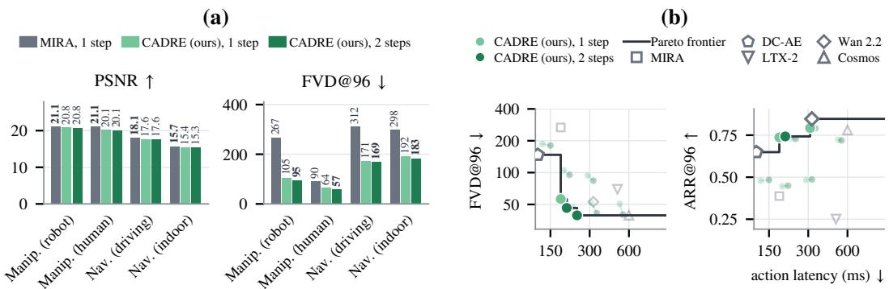  
Figure 4: (a) Diffusion against perceptual regression decoding at 2×32×32: MIRA has the worst FVD but the best PSNR, a sign of blur (all metrics: Figure 13). (b) Rollout quality against action latency in robot manipulation: CADRE forms most of the frontier (all environments: Figure 14).

Should the decoder use perceptual regression or diffusion?

Decode a compressed latent by diffusion. Such a latent fits many videos. Perceptual regression outputs their blurry average, while diffusion outputs one sharp video. Self-distilled, it decodes in one step as fast as regression with 1.4 to 2.5× lower FVD and similar action following; a second step improves it further.

## 4.2 HOW DO THE AUTOENCODERS TRADE QUALITY FOR LATENCY?

To compare the autoencoders on both axes at once, we plot rollout quality against action latency (Figure 4b for robot manipulation, Figure 1 for driving, Figure 14 for all); an autoencoder lies on the Pareto frontier when no other is both faster and better. CADRE autoencoders form most of this frontier in every environment. In 42 of the 48 comparisons with MIRA, Wan 2.2, Cosmos and LTX-2 (four environments; FID, FVD and ARR), a CADRE autoencoder is at least as fast and better by more than 2%; DC-AE, faster than all, is compared below. With two decoding steps, the best FID of every environment belongs to CADRE, most often to CADRE-4×16×16, and so does the best FVD, except in robot manipulation, where CADRE and Cosmos tie. The gap widens with a moving camera: in navigation, all CADRE autoencoders but one beat every other on FID and FVD, while Wan 2.2’s FVD grows from 53 in robot manipulation to 600 or more in navigation and LTX-2’s ARR falls to 0.04 indoors. CADRE also drifts least in 64 s robot manipulation rollouts (Appendix H).

At the fast end, CADRE-1×48×48 reacts about as fast as DC-AE and beats it in navigation; DC-AE wins in manipulation. Few autoencoders are both fluid and responsive: streaming on one H100 with eight denoising steps, only CADRE-2×32×32, CADRE-2×16×16 and MIRA run at 20 frames per second under the 230 ms lag humans notice (Shimada et al., 2009) (Figure 1). The world models of Figure 5 run fluidly, at 29 to 58 frames per second (Appendix D), and, from the same context, follow actions never recorded with it, such as holding still or turning the other way (Figure 22).

## 5 HOW TO COMPRESS FOR INTERACTIVE WORLD MODELS

We now ask three questions: which component should compress temporally, how many frames one latent should span, and what coarser spatial tokens trade for their speed. Comparisons follow the protocol of Section 4, so arms differ only in how the video is compressed.

## 5.1 SHOULD THE AUTOENCODER OR THE WORLD MODEL COMPRESS TEMPORALLY?

Temporal compression can happen in the autoencoder or in the world model. The alternative to CADRE is an image autoencoder that leaves frames temporally uncompressed, with the world model patching its latent temporally. Both routes give the same token grid, but a different model learns the compression. In robot manipulation, we reach each grid a second time by patching the latent of CADRE-1×16×16 inside the world model (Figure 6). Only the compression changes. Actions and noise levels stay per frame, and a patched token receives the actions of every frame it covers.

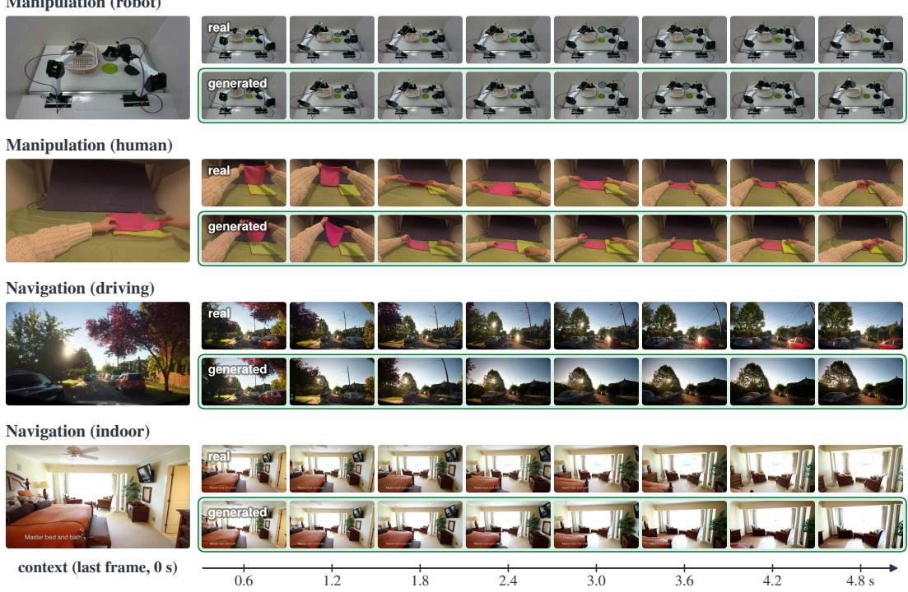  
Figure 5: Real-time rollouts following recorded actions. From 2 s of real video (left) and its actions, CADRE world models generate all other frames, with contact in robot manipulation, cloth dynamics in human manipulation, plausible futures in driving and 3D-consistent indoor scenes.  
compressed by the autoencoder

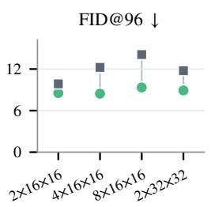

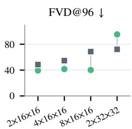  
compressed by the world model

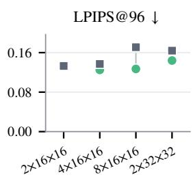

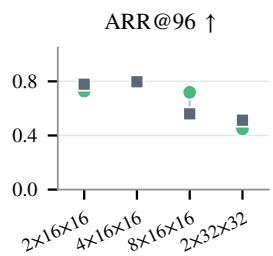  
Figure 6: Temporal compression in the autoencoder or in the world model, at the same token grid in robot manipulation. The autoencoder gives sharper frames, closer to the recorded future, and more plausible motion at all but 2×32×32. Action following barely changes, except at 8 frames.

Temporal compression in the autoencoder gives better frames than in the world model. Com pressing in the autoencoder gives better FID, FVD, PSNR and LPIPS at every temporal grid, except FVD at 2×32×32, where space is compressed too. The FVD gap grows with the factor, from 9 points when compressing 2 frames to 28 when compressing 8. Decoder capacity does not explain it, since the patched arm decodes with CADRE-1×16×16, the best reconstruction among them (Table 6). We attribute this to the training objectives. The autoencoder is trained to reconstruct pixels, so its compression keeps appearance. The world model is trained to predict latents, so its compression keeps only what helps that prediction. This matches image and video generation, where compressing in the autoencoder beats patching (Chen et al., 2025b; Gupta et al., 2024).

Where temporal compression happens barely changes action following. The exception is 8 frames, where patching drops ARR from 0.72 to 0.56. Action following depends on the motion the actions cause, which the world model’s compression is trained to keep.

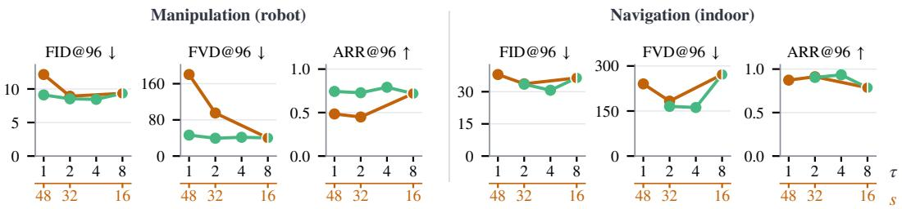  
same token budget: more frames per latent, coarser grid same token size (s = 16): more frames per latent 8×16×16 (both)

Figure 7: Temporal compression and spatial tokens. Green raises τ at a fixed token size; orange at a fixed token budget, so its grid coarsens (spatial factor s). A static view fits eight frames in one latent at no cost; a moving view loses quality with more frames. Full results in Figure 15.

Should the autoencoder or the world model compress temporally?

Let the autoencoder compress temporally. At the same number of tokens, its compressed frames look sharper and move more realistically, with similar action following. It learns its compression to reconstruct pixels, while the world model keeps only what helps it predict.

## 5.2 HOW MANY FRAMES SHOULD ONE LATENT SPAN?

To separate temporal compression from the cost of coarser tokens, we vary τ in two sweeps (Figure 7). The first holds s = 16 and isolates temporal compression. The second holds about 1100 tokens per 16-frame clip, so at a given τ its gap to the first measures the cost of coarser spatial tokens. All world models are matched in training steps and total training frames.

Latents should span many redundant frames in manipulation and few in navigation. In manipulation, the camera is mostly still, so consecutive frames are redundant and one latent can span many of them at no cost (green curve in Figure 7). In navigation, the camera moves and the view shifts by more than a token within one long latent (Appendix I), so long latents degrade motion, raising FVD by up to 64% over two-frame latents. Action following changes less (Appendix G). Camera motion is our leading explanation, though the domains also differ in actions and scenes.

In 64 s robot manipulation rollouts, long latents do not make errors accumulate: CADRE-8×16×16 is best from about 13 s on and ends with the lowest FVD (Appendix H). Long latents do leave seams, visible jumps between chunks. A boundary excess compares the frame-to-frame change across chunk boundaries with the change within chunks, relative to real video (Appendix K). It grows with τ in all four environments, to 1.6–1.8 at τ = 8 (Table 10). With a moving view, the seams also show in FVD, which grows 1.6 to 2.1× more at τ = 8 than at τ = 2.

At a fixed token budget, navigation favors few frames per latent and manipulation many. Along the orange curve of Figure 7, autoencoders give about 1100 tokens per 16-frame clip. In navigation, the low-latency CADRE-2×32×32 is best, with two frames and coarser tokens. In manipulation, CADRE-8×16×16 gives the most plausible motion, with eight frames and fine tokens.

How many frames should one latent span?

Manipulation and navigation call for opposite compressions. In manipulation the camera is still, so each token sees temporally redundant content: temporal compression costs little, but spatial compression loses the small objects being handled. In navigation the camera moves, so each token sees new content: temporal compression shows seams, but spatial compression costs little because the whole view shifts.

## 5.3 WHAT DO COARSER SPATIAL TOKENS TRADE FOR THEIR SPEED?

At a given τ , coarser spatial tokens cut the world model’s cost, and the gap between the two sweeps isolates what they lose in quality and action following.

Fine spatial tokens matter most when the action is small and stays in view. In robot manipulation, the action shows in a small region that stays in view. At τ = 2, coarser spatial tokens multiply FVD by 2.4 and lower action following, with almost no change in FID (orange against green in Figure 7). In navigation, the action moves the whole frame, which coarse tokens already capture, and the gap nearly vanishes (Appendix G). FID may miss errors confined to small regions, but ARR, which reads the motion itself, drops too (Appendix G).

What do coarser spatial tokens trade for their speed?

Surprisingly, coarser tokens hurt motion and action following far more than image quality, above all in manipulation. In manipulation, per-frame quality barely changes, but motion degrades, and so does action following in robot manipulation. In navigation, where the whole view shifts, they cost little.

## 6 RELATED WORK

World models and their autoencoders. Video world models serve driving (Russell et al., 2025), robotics (Yang et al., 2024) and open scenes (Bruce et al., 2024). Interactive ones stream in real time (Valevski et al., 2025; Alonso et al., 2024), often by distilling a text-to-video generator whose autoencoder they inherit (He et al., 2025; Li et al., 2025a). Few study that autoencoder. SANA-WM (Zhu et al., 2026a) swaps two of them offline, and MIRA (Hu et al., 2026) judges its own through the world model, but only on a single game. We compare twelve autoencoders of varied compression through world models in four environments.

Latent structure and compression. Generation quality depends on the structure of the latent (Rombach et al., 2022; Yao et al., 2025). Representation autoencoders generate in the space of a frozen self-supervised encoder (Zheng et al., 2026; Xie et al., 2026), at one compression rate. Video autoencoders mostly compress 8× in space and 4× in time (Wan et al., 2025; Kong et al., 2024), some far more (HaCohen et al., 2024; 2026; Chen et al., 2025b). A generator can also compress through its patch size (Peebles & Xie, 2023; Gupta et al., 2024). For images, DC-AE (Chen et al., 2025b) finds that compressing in the autoencoder beats patching. We test this for video world models and build representation autoencoders that span seven spatio-temporal compressions.

Few-step diffusion decoders. Diffusion decoders avoid adversarial losses (Preechakul et al., 2022; Chen et al., 2025d) but need many steps, or a second stage to reach one (OpenAI, 2023; Vallaeys et al., 2026). Shortcut models and flow maps learn few-step generation in one stage from their own predictions (Frans et al., 2025; Boffi et al., 2025). Our causal video decoder learns one- or two-step decoding this way, with no adversarial loss or second stage. Appendix L extends this section.

## 7 CONCLUSION

An interactive world model inherits its cost per frame, its action latency and much of its quality from its autoencoder, so its compression is a design choice. To study this choice, we build CADRE, an open family spanning seven compressions, and train the same world model on each in manipula tion and navigation. CADRE forms most of the latency-quality frontier, especially with a moving camera, and our study points to four findings. At strong compression, a diffusion decoder is sharper than perceptual regression, even in one or two steps. In robot manipulation, temporal compression is more effective in the autoencoder than in the world model. Manipulation and navigation call for opposite compressions: temporal compression costs little when the camera is still, and spatial compression when it moves. Surprisingly, with a still camera, coarser spatial tokens hurt motion far more than image quality, and, in robot manipulation, action following too.

Our world models each cover one environment; whether these findings carry over to a generalist one, and to policy training and planning, remains open. Our manipulation data use still or nearly still cameras; wrist-mounted cameras move, so our account predicts they favor the compression of navigation. We hope open autoencoders will let practitioners fit a world model’s compression to its scenes and to the latency and throughput its users need.

## REPRODUCIBILITY STATEMENT

Section 3 and Appendix B describe the autoencoder architecture, losses and training recipe, and Table 3 lists the hyperparameters of both the autoencoders and the world models. Appendix C lists every source of the autoencoder training mixture with its sampling weight, size and preprocessing. Appendix D gives the world model architecture, conditioning, objective, training recipe and inference protocol, and Appendix E specifies the inverse dynamics probes behind action recoverability. Section 4 fixes the evaluation protocol shared by every autoencoder, and Table 7 reports every number behind the figures. We release the code and the checkpoints.

## ETHICS STATEMENT

All training and evaluation data come from published datasets, used under their licenses. Some show people, such as the hands in human manipulation and the faces in talking-head and action videos; we use them only to learn video representations and do not identify anyone. Generated video can be misused to fabricate footage. Our world models are specialized to manipulation and navigation, run at 288×512 and follow low-level actions, which limits such use.

## AI USE STATEMENT

We used generative AI tools to implement and debug code, including the training, evaluation and plotting scripts; to draft and edit parts of the paper for readability; to create and edit figures; and to search for and format references. We reviewed all AI-assisted work and take responsibility for the final content of this work, including text, claims or artifacts produced with the aid of generative AI.

## REFERENCES

AgiBot-World-Contributors, Qingwen Bu, Jisong Cai, Li Chen, Xiuqi Cui, Yan Ding, Siyuan Feng, Shenyuan Gao, Xindong He, Xuan Hu, Xu Huang, Shu Jiang, Yuxin Jiang, Cheng Jing, Hongyang Li, Jialu Li, Chiming Liu, Yi Liu, Yuxiang Lu, Jianlan Luo, Ping Luo, Yao Mu, Yuehan Niu, Yixuan Pan, Jiangmiao Pang, Yu Qiao, Guanghui Ren, Cheng Ruan, Jiaqi Shan, Yongjian Shen, Chengshi Shi, Mingkang Shi, Modi Shi, Chonghao Sima, Jianheng Song, Huijie Wang, Wenhao Wang, Dafeng Wei, Chengen Xie, Guo Xu, Junchi Yan, Cunbiao Yang, Lei Yang, Shukai Yang, Maoqing Yao, Jia Zeng, Chi Zhang, Qinglin Zhang, Bin Zhao, Chengyue Zhao, Jiaqi Zhao, and Jianchao Zhu. AgiBot world colosseo: A large-scale manipulation platform for scalable and intelligent embodied systems. In IEEE/RSJ International Conference on Intelligent Robots and Systems (IROS), 2025.

Michael Albergo, Nicholas M. Boffi, and Eric Vanden-Eijnden. Stochastic interpolants: A unifying framework for flows and diffusions. Journal of Machine Learning Research (JMLR), 2025.

Arthur Allshire, Himanshu Gaurav Singh, Ritvik Singh, Adam Rashid, Hongsuk Choi, David McAllister, Justin Yu, Yiyuan Chen, Huang Huang, Pieter Abbeel, Xi Chen, Rocky Duan, Phillip Isola, Jitendra Malik, Fred Shentu, Guanya Shi, Philipp Wu, and Angjoo Kanazawa. Scalable behavior cloning with open data, training, and evaluation. arXiv preprint arXiv:2606.27375, 2026.

Eloi Alonso, Adam Jelley, Vincent Micheli, Anssi Kanervisto, Amos Storkey, Tim Pearce, and Franc¸ois Fleuret. Diffusion for world modeling: Visual details matter in Atari. In Advances in Neural Information Processing Systems (NeurIPS), 2024.

Sotiris Anagnostidis, Gregor Bachmann, Yeongmin Kim, Jonas Kohler, Markos Georgopoulos, Artsiom Sanakoyeu, Yuming Du, Albert Pumarola, Ali Thabet, and Edgar Schonfeld. FlexiDiT: Your¨ diffusion transformer can easily generate high-quality samples with less compute. In Proceedings ofthe IEEE/CVF Conference on Computer Vision and Pattern Recognition (CVPR), 2025.

Anurag Arnab, Mostafa Dehghani, Georg Heigold, Chen Sun, Mario Luciˇ c, and Cordelia Schmid.´ ViViT: A video vision transformer. In Proceedings ofthe IEEE/CVF International Conference on Computer Vision (ICCV), 2021.

Mido Assran, Adrien Bardes, David Fan, Quentin Garrido, Russell Howes, Mojtaba Komeili, Matthew Muckley, Ammar Rizvi, Claire Roberts, Koustuv Sinha, Artem Zholus, Sergio Arnaud, Abha Gejji, Ada Martin, Francois Robert Hogan, Daniel Dugas, Piotr Bojanowski, Vasil Khalidov, Patrick Labatut, Francisco Massa, Marc Szafraniec, Kapil Krishnakumar, Yong Li, Xiaodong Ma, Sarath Chandar, Franziska Meier, Yann LeCun, Michael Rabbat, and Nicolas Ballas. V-JEPA 2: Self-supervised video models enable understanding, prediction and planning. arXiv preprint arXiv:2506.09985, 2025.

Yutong Bai, Xinyang Geng, Karttikeya Mangalam, Amir Bar, Alan L. Yuille, Trevor Darrell, Jitendra Malik, and Alexei A. Efros. Sequential modeling enables scalable learning for large vision models. In Proceedings of the IEEE/CVF Conference on Computer Vision and Pattern Recognition (CVPR), 2024.

Yutong Bai, Danny Tran, Amir Bar, Yann LeCun, Trevor Darrell, and Jitendra Malik. Whole-body conditioned egocentric video prediction. In Advances in Neural Information Processing Systems (NeurIPS), 2025.

Max Bain, Arsha Nagrani, Gul Varol, and Andrew Zisserman. Frozen in time: A joint video and¨ image encoder for end-to-end retrieval. In Proceedings ofthe IEEE/CVF International Conference on Computer Vision (ICCV), 2021.

Fan Bao, Shen Nie, Kaiwen Xue, Yue Cao, Chongxuan Li, Hang Su, and Jun Zhu. All are worth words: A ViT backbone for diffusion models. In Proceedings of the IEEE/CVF Conference on Computer Vision and Pattern Recognition (CVPR), 2023.

Amir Bar, Gaoyue Zhou, Danny Tran, Trevor Darrell, and Yann LeCun. Navigation world models. In Proceedings of the IEEE/CVF Conference on Computer Vision and Pattern Recognition (CVPR), 2025.

Gedas Bertasius, Heng Wang, and Lorenzo Torresani. Is space-time attention all you need for video understanding? In International Conference on Machine Learning (ICML), 2021.

Tianci Bi, Xiaoyi Zhang, Yan Lu, and Nanning Zheng. Vision foundation models can be good tokenizers for latent diffusion models. In Proceedings of the IEEE/CVF Conference on Computer Vision and Pattern Recognition (CVPR), 2026.

BitRobot, Unitree, and Hugging Face. HIW-500: Humanoids in-the-wild dataset for robot learning. https://bitrobot-foundation.github.io/ humanoids-in-the-wild-500-hours/, 2026.

Kevin Black, Noah Brown, Danny Driess, Adnan Esmail, Michael Robert Equi, Chelsea Finn, Niccolo Fusai, Lachy Groom, Karol Hausman, Brian Ichter, Szymon Jakubczak, Tim Jones, Liyiming Ke, Sergey Levine, Adrian Li-Bell, Mohith Mothukuri, Suraj Nair, Karl Pertsch, Lucy Xiaoyang Shi, Laura Smith, James Tanner, Quan Vuong, Anna Walling, Haohuan Wang, and Ury Zhilinsky. π : A Vision-Language-Action Flow Model for General Robot Control. In Robotics: Science and Systems (RSS), 2025.

Julien Blanchon. OpenCS2 dataset. https://huggingface.co/datasets/blanchon/ opencs2\_dataset, 2026.

Andreas Blattmann, Tim Dockhorn, Sumith Kulal, Daniel Mendelevitch, Maciej Kilian, Dominik Lorenz, Yam Levi, Zion English, Vikram Voleti, Adam Letts, Varun Jampani, and Robin Rombach. Stable video diffusion: Scaling latent video diffusion models to large datasets. arXiv preprint arXiv:2311.15127, 2023.

Nicholas Boffi, Michael Albergo, and Eric Vanden-Eijnden. How to build a consistency model: Learning flow maps via self-distillation. In Advances in Neural Information Processing Systems (NeurIPS), 2025.

Jake Bruce, Michael D Dennis, Ashley Edwards, Jack Parker-Holder, Yuge Shi, Edward Hughes, Matthew Lai, Aditi Mavalankar, Richie Steigerwald, Chris Apps, Yusuf Aytar, Sarah Maria Elisabeth Bechtle, Feryal Behbahani, Stephanie C.Y. Chan, Nicolas Heess, Lucy Gonzalez, Simon Osindero, Sherjil Ozair, Scott Reed, Jingwei Zhang, Konrad Zolna, Jeff Clune, Nando De Freitas,

Satinder Singh, and Tim Rocktaschel. Genie: Generative interactive environments. In¨ Interna tional Conference on Machine Learning (ICML), 2024.

Mathilde Caron, Hugo Touvron, Ishan Misra, Herve J´ egou, Julien Mairal, Piotr Bojanowski, and´ Armand Joulin. Emerging properties in self-supervised vision transformers. In Proceedings of the IEEE/CVF International Conference on Computer Vision (ICCV), 2021.

Joao Carreira, Eric Noland, Chloe Hillier, and Andrew Zisserman. A short note on the kinetics-700 human action dataset. arXiv preprint arXiv:1907.06987, 2019.

Hector Carri´ on, Yutong Bai, V´ ´ıctor A. Hernandez Castro, Kishan Panaganti, Ayush Zenith, Matthew´ Trang, Tony Zhang, Pietro Perona, and Jitendra Malik. TARDIS STRIDE: A spatio-temporal road image dataset and world model for autonomy. arXiv preprint arXiv:2506.11302, 2025.

Huiwen Chang, Han Zhang, Lu Jiang, Ce Liu, and William T. Freeman. MaskGIT: Masked generative image transformer. In Proceedings of the IEEE/CVF Conference on Computer Vision and Pattern Recognition (CVPR), 2022.

Jorge Diaz Chao, Konpat Preechakul, Yuxi Liu, and Yutong Bai. The seriality gap in video diffusion models. arXiv preprint arXiv:2607.13031, 2026.

Boyuan Chen, Diego Mart´ı Monso, Yilun Du, Max Simchowitz, Russ Tedrake, and Vincent Sitz- ´ mann. Diffusion forcing: Next-token prediction meets full-sequence diffusion. In Advances in Neural Information Processing Systems (NeurIPS), 2024a.

Joya Chen, Ziyun Zeng, Yiqi Lin, Wei Li, Zejun Ma, and Mike Zheng Shou. LiveCC: Learning video LLM with streaming speech transcription at scale. In Proceedings of the IEEE/CVF Conference on Computer Vision and Pattern Recognition (CVPR), 2025a.

Junyu Chen, Han Cai, Junsong Chen, Enze Xie, Shang Yang, Haotian Tang, Muyang Li, and Song Han. Deep compression autoencoder for efficient high-resolution diffusion models. In International Conference on Learning Representations (ICLR), 2025b.

Junyu Chen, Wenkun He, Yuchao Gu, Yuyang Zhao, Jincheng Yu, Junsong Chen, Dongyun Zou, Yujun Lin, Zhekai Zhang, Muyang Li, Haocheng Xi, Ligeng Zhu, Enze Xie, Song Han, and Han Cai. DC-VideoGen: Efficient video generation with deep compression video autoencoder. arXiv preprint arXiv:2509.25182, 2025c.

Ting Chen. On the importance of noise scheduling for diffusion models. arXiv preprint arXiv:2301.10972, 2023.

Tsai-Shien Chen, Aliaksandr Siarohin, Willi Menapace, Ekaterina Deyneka, Hsiang-wei Chao, Byung Eun Jeon, Yuwei Fang, Hsin-Ying Lee, Jian Ren, Ming-Hsuan Yang, and Sergey Tulyakov. Panda-70M: Captioning 70M videos with multiple cross-modality teachers. In Proceedings of the IEEE/CVF Conference on Computer Vision and Pattern Recognition (CVPR), 2024b.

Yinbo Chen, Rohit Girdhar, Xiaolong Wang, Sai Saketh Rambhatla, and Ishan Misra. Diffusion autoencoders are scalable image tokenizers. arXiv preprint arXiv:2501.18593, 2025d.

Cheng Chi, Zhenjia Xu, Siyuan Feng, Eric Cousineau, Yilun Du, Benjamin Burchfiel, Russ Tedrake, and Shuran Song. Diffusion policy: Visuomotor policy learning via action diffusion. The International Journal ofRobotics Research, 2024.

Mark Claypool and Kajal Claypool. Latency and player actions in online games. Communications ofthe ACM, 49(11):40–45, 2006. doi: 10.1145/1167838.1167860.

Jiahao Cui, Hui Li, Yun Zhan, Hanlin Shang, Kaihui Cheng, Yuqi Ma, Shan Mu, Hang Zhou, Jingdong Wang, and Siyu Zhu. Hallo3: Highly dynamic and realistic portrait image animation with video diffusion transformer. In Proceedings of the IEEE/CVF Conference on Computer Vision and Pattern Recognition (CVPR), 2025.

Xiaoliang Dai, Ji Hou, Chih-Yao Ma, Sam Tsai, Jialiang Wang, Rui Wang, Peizhao Zhang, Simon Vandenhende, Xiaofang Wang, Abhimanyu Dubey, Matthew Yu, Abhishek Kadian, Filip Radenovic, Dhruv Mahajan, Kunpeng Li, Yue Zhao, Vladan Petrovic, Mitesh Kumar Singh, Simran Motwani, Yi Wen, Yiwen Song, Roshan Sumbaly, Vignesh Ramanathan, Zijian He, Peter Vajda, and Devi Parikh. Emu: Enhancing image generation models using photogenic needles in a haystack. arXiv preprint arXiv:2309.15807, 2023.

Lucas Degeorge, Paul Couairon, Arijit Ghosh, Alexei A. Efros, David Picard, and Vicky Kalogeiton. Balancing frequencies and pixels in flow matching. arXiv preprint arXiv:2609.02748, 2026.

Prafulla Dhariwal and Alexander Nichol. Diffusion models beat GANs on image synthesis. In Advances in Neural Information Processing Systems (NeurIPS), 2021.

Nicolas Dufour, David Picard, and Vicky Kalogeiton. SCAM! transferring humans between images with semantic cross attention modulation. In European Conference on Computer Vision (ECCV), 2022.

Nicolas Dufour, Alexei A. Efros, and Patrick Perez. The FID lottery: Quantifying hidden random-´ ness in generative-model evaluation. arXiv preprint arXiv:2606.20536, 2026.

Alexandre Defossez, Laurent Mazar´ e, Manu Orsini, Am´ elie Royer, Patrick P´ erez, Herv´ e J´ egou,´ Edouard Grave, and Neil Zeghidour. Moshi: a speech-text foundation model for real-time dialogue. arXiv preprint arXiv:2410.00037, 2024.

Patrick Esser, Robin Rombach, and Bjorn Ommer. Taming transformers for high-resolution image synthesis. In Proceedings of the IEEE/CVF Conference on Computer Vision and Pattern Recognition (CVPR), 2021.

Patrick Esser, Sumith Kulal, Andreas Blattmann, Rahim Entezari, Jonas Muller, Harry Saini, Yam¨ Levi, Dominik Lorenz, Axel Sauer, Frederic Boesel, Dustin Podell, Tim Dockhorn, Zion English, and Robin Rombach. Scaling rectified flow transformers for high-resolution image synthesis. In International Conference on Machine Learning (ICML), 2024.

Kevin Frans, Danijar Hafner, Sergey Levine, and Pieter Abbeel. One step diffusion via shortcut models. In International Conference on Learning Representations (ICLR), 2025.

FrodoBots Lab. FrodoBots 2K dataset. https://huggingface.co/datasets/ BitRobot/FrodoBots-2K, 2023.

Shanghua Gao, Pan Zhou, Ming-Ming Cheng, and Shuicheng Yan. Masked diffusion transformer is a strong image synthesizer. In Proceedings of the IEEE/CVF International Conference on Computer Vision (ICCV), 2023.

Shenyuan Gao, Jiazhi Yang, Li Chen, Kashyap Chitta, Yihang Qiu, Andreas Geiger, Jun Zhang, and Hongyang Li. Vista: A generalizable driving world model with high fidelity and versatile controllability. In Advances in Neural Information Processing Systems (NeurIPS), 2024.

Shenyuan Gao, William Liang, Kaiyuan Zheng, Ayaan Malik, Seonghyeon Ye, Sihyun Yu, Wei-Cheng Tseng, Yuzhu Dong, Kaichun Mo, Chen-Hsuan Lin, Jiannan Xiang, Yuqi Xie, Ruijie Zheng, Dantong Niu, Pooya Jannaty, Jinwei Gu, Jun Zhang, Jitendra Malik, Pieter Abbeel, Ming-Yu Liu, Yuke Zhu, Joel Jang, and Jim Fan. DreamDojo: A real-time robot world model from large-scale human videos. In International Conference on Machine Learning (ICML), 2026a.

Yuan Gao, Chen Chen, and Jiatao Gu. One layer is enough: Adapting pretrained visual encoders for image generation. In Proceedings of the IEEE/CVF Conference on Computer Vision and Pattern Recognition (CVPR) Findings, 2026b.

Zhengyang Geng, Mingyang Deng, Xingjian Bai, J Zico Kolter, and Kaiming He. Mean flows for one-step generative modeling. In Advances in Neural Information Processing Systems (NeurIPS), 2025.

Junliang Guo, Yang Ye, Tianyu He, Haoyu Wu, Yushu Jiang, Tim Pearce, and Jiang Bian. MineWorld: a real-time and open-source interactive world model on Minecraft. arXiv preprint arXiv:2504.08388, 2025.

Minghui Guo, Shengqiong Wu, and Hao Fei. V-RAE: Rethinking video latent spaces for generation. arXiv preprint arXiv:2608.13556, 2026.

Agrim Gupta, Lijun Yu, Kihyuk Sohn, Xiuye Gu, Meera Hahn, Fei-Fei Li, Irfan Essa, Lu Jiang, and Jose Lezama. Photorealistic video generation with diffusion models. In ´ European Conference on Computer Vision (ECCV), 2024.

David Ha and Jurgen Schmidhuber. World models. ¨ arXiv preprint arXiv:1803.10122, 2018.

Yoav HaCohen, Nisan Chiprut, Benny Brazowski, Daniel Shalem, Dudu Moshe, Eitan Richardson, Eran Levin, Guy Shiran, Nir Zabari, Ori Gordon, Poriya Panet, Sapir Weissbuch, Victor Kulikov, Yaki Bitterman, Zeev Melumian, and Ofir Bibi. LTX-Video: Realtime video latent diffusion. arXiv preprint arXiv:2501.00103, 2024.

Yoav HaCohen, Benny Brazowski, Nisan Chiprut, Yaki Bitterman, Andrew Kvochko, Avishai Berkowitz, Daniel Shalem, Daphna Lifschitz, Dudu Moshe, Eitan Porat, Eitan Richardson, Guy Shiran, Itay Chachy, Jonathan Chetboun, Michael Finkelson, Michael Kupchick, Nir Zabari, Nitzan Guetta, Noa Kotler, Ofir Bibi, Ori Gordon, Poriya Panet, Roi Benita, Shahar Armon, Vic tor Kulikov, Yaron Inger, Yonatan Shiftan, Zeev Melumian, and Zeev Farbman. LTX-2: Efficient joint audio-visual foundation model. arXiv preprint arXiv:2601.03233, 2026.

Danijar Hafner, Timothy Lillicrap, Jimmy Ba, and Mohammad Norouzi. Dream to control: Learning behaviors by latent imagination. In International Conference on Learning Representations (ICLR), 2020.

Danijar Hafner, Jurgis Pasukonis, Jimmy Ba, and Timothy Lillicrap. Mastering diverse control tasks through world models. Nature, 2025.

Tiankai Hang, Shuyang Gu, Chen Li, Jianmin Bao, Dong Chen, Han Hu, Xin Geng, and Baining Guo. Efficient diffusion training via Min-SNR weighting strategy. In Proceedings of the IEEE/CVF International Conference on Computer Vision (ICCV), 2023.

Philippe Hansen-Estruch, David Yan, Ching-Yao Chuang, Orr Zohar, Jialiang Wang, Tingbo Hou, Tao Xu, Sriram Vishwanath, Peter Vajda, and Xinlei Chen. Learnings from scaling visual tokenizers for reconstruction and generation. In International Conference on Machine Learning (ICML), 2025.

Xianglong He, Chunli Peng, Zexiang Liu, Boyang Wang, Yifan Zhang, Qi Cui, Fei Kang, Biao Jiang, Mengyin An, Yangyang Ren, Baixin Xu, Hao-Xiang Guo, Kaixiong Gong, Size Wu, Wei Li, Xuchen Song, Yang Liu, Yangguang Li, and Yahui Zhou. Matrix-game 2.0: An open-source real-time and streaming interactive world model. arXiv preprint arXiv:2508.13009, 2025.

Martin Heusel, Hubert Ramsauer, Thomas Unterthiner, Bernhard Nessler, and Sepp Hochreiter. GANs trained by a two time-scale update rule converge to a local Nash equilibrium. In Advances in Neural Information Processing Systems (NeurIPS), 2017.

Jonathan Ho and Tim Salimans. Classifier-free diffusion guidance. arXiv preprint arXiv:2207.12598, 2022.

Jonathan Ho, Ajay Jain, and Pieter Abbeel. Denoising diffusion probabilistic models. In Advances in Neural Information Processing Systems (NeurIPS), 2020.

Jonathan Ho, Tim Salimans, Alexey Gritsenko, William Chan, Mohammad Norouzi, and David Fleet. Video diffusion models. In Advances in Neural Information Processing Systems (NeurIPS), 2022.

Emiel Hoogeboom, Thomas Mensink, Jonathan Heek, Kay Lamerigts, Ruiqi Gao, and Tim Salimans. Simpler diffusion: 1.5 FID on ImageNet512 with pixel-space diffusion. In Proceedings of the IEEE/CVF Conference on Computer Vision and Pattern Recognition (CVPR), 2025.

Ryan Hoque, Peide Huang, David Yoon, Mouli Sivapurapu, and Jian Zhang. EgoDex: Learning dexterous manipulation from large-scale egocentric video. In International Conference on Learning Representations (ICLR), 2026.

Anthony Hu, Lloyd Russell, Hudson Yeo, Zak Murez, George Fedoseev, Alex Kendall, Jamie Shotton, and Gianluca Corrado. GAIA-1: A generative world model for autonomous driving. arXiv preprint arXiv:2309.17080, 2023.

Anthony Hu, Vaclav Volhejn, Adrien Ramanana Rahary, Chris Mulder, Aditya Makkar, Alyx Liao,´ Amelie Royer, Manu Orsini, Adam Jelley, Eloi Alonso, Florian Laurent, Fredrik Nor´ en, James´ Swingos, Jan Hunermann, Kent Rollins, Lucas Hosseini, Matthieu Le Cauchois, Maxim Peter,¨ Pim de Witte, Tim Brown, Vincent Micheli, Moritz Bohle, Gabriel de Marmiesse, Viktoriia Shar-¨ manska, Lucia Specia, Michael Black, and Patrick Perez. Multiplayer interactive world models´ with representation autoencoders. arXiv preprint arXiv:2607.05352, 2026.

Xun Huang, Zhengqi Li, Guande He, Mingyuan Zhou, and Eli Shechtman. Self forcing: Bridging the train-test gap in autoregressive video diffusion. In Advances in Neural Information Processing Systems (NeurIPS), 2025.

Sadeep Jayasumana, Srikumar Ramalingam, Andreas Veit, Daniel Glasner, Ayan Chakrabarti, and Sanjiv Kumar. Rethinking FID: Towards a better evaluation metric for image generation. In Proceedings ofthe IEEE/CVF Conference on Computer Vision and Pattern Recognition (CVPR), 2024.

Tao Jiang, Tianyuan Yuan, Yicheng Liu, Chenhao Lu, Jianning Cui, Xiao Liu, Shuiqi Cheng, Jiyang Gao, Huazhe Xu, and Hang Zhao. Galaxea open-world dataset and G0 dual-system VLA model. arXiv preprint arXiv:2509.00576, 2025.

Tero Karras, Miika Aittala, Timo Aila, and Samuli Laine. Elucidating the design space of diffusionbased generative models. In Advances in Neural Information Processing Systems (NeurIPS), 2022.

Tero Karras, Miika Aittala, Tuomas Kynka¨anniemi, Jaakko Lehtinen, Timo Aila, and Samuli Laine.¨ Guiding a diffusion model with a bad version of itself. In Advances in Neural Information Processing Systems (NeurIPS), 2024a.

Tero Karras, Miika Aittala, Jaakko Lehtinen, Janne Hellsten, Timo Aila, and Samuli Laine. Analyzing and improving the training dynamics of diffusion models. In Proceedings of the IEEE/CVF Conference on Computer Vision and Pattern Recognition (CVPR), 2024b.

Tommie Kerssies, Gabriele Berton, Ju He, Qihang Yu, Wufei Ma, Daan de Geus, Gijs Dubbelman, and Liang-Chieh Chen. A frame is worth one token: Efficient generative world modeling with delta tokens. In Proceedings of the IEEE/CVF Conference on Computer Vision and Pattern Recognition (CVPR), 2026.

Seung Wook Kim, Yuhao Zhou, Jonah Philion, Antonio Torralba, and Sanja Fidler. Learning to simulate dynamic environments with GameGAN. In Proceedings of the IEEE/CVF Conference on Computer Vision and Pattern Recognition (CVPR), 2020.

Diederik Kingma and Ruiqi Gao. Understanding diffusion objectives as the ELBO with simple data augmentation. In Advances in Neural Information Processing Systems (NeurIPS), 2023.

Diederik Kingma, Tim Salimans, Ben Poole, and Jonathan Ho. Variational diffusion models. In Advances in Neural Information Processing Systems (NeurIPS), 2021.

Weijie Kong, Qi Tian, Zijian Zhang, Rox Min, Zuozhuo Dai, Jin Zhou, Jiangfeng Xiong, Xin Li, Bo Wu, Jianwei Zhang, Kathrina Wu, Qin Lin, Junkun Yuan, Yanxin Long, Aladdin Wang, Andong Wang, Changlin Li, Duojun Huang, Fang Yang, Hao Tan, Hongmei Wang, Jacob Song, Jiawang Bai, Jianbing Wu, Jinbao Xue, Joey Wang, Kai Wang, Mengyang Liu, Pengyu Li, Shuai Li, Weiyan Wang, Wenqing Yu, Xinchi Deng, Yang Li, Yi Chen, Yutao Cui, Yuanbo Peng, Zhentao Yu, Zhiyu He, Zhiyong Xu, Zixiang Zhou, Zunnan Xu, Yangyu Tao, Qinglin Lu, Songtao Liu, Dax Zhou, Hongfa Wang, Yong Yang, Di Wang, Yuhong Liu, Jie Jiang, and Caesar Zhong. HunyuanVideo: A systematic framework for large video generative models. arXiv preprint arXiv:2412.03603, 2024.

Theodoros Kouzelis, Ioannis Kakogeorgiou, Spyros Gidaris, and Nikos Komodakis. EQ-VAE: Equivariance regularized latent space for improved generative image modeling. In International Conference on Machine Learning (ICML), 2025.

Tuomas Kynka¨anniemi, Tero Karras, Samuli Laine, Jaakko Lehtinen, and Timo Aila. Improved¨ precision and recall metric for assessing generative models. In Advances in Neural Information Processing Systems (NeurIPS), 2019.

Tuomas Kynka¨anniemi, Tero Karras, Miika Aittala, Timo Aila, and Jaakko Lehtinen. The role¨ of ImageNet classes in Frechet Inception distance. In ´ International Conference on Learning Representations (ICLR), 2023.

Tuomas Kynka¨anniemi, Miika Aittala, Tero Karras, Samuli Laine, Timo Aila, and Jaakko Lehtinen.¨ Applying guidance in a limited interval improves sample and distribution quality in diffusion models. In Advances in Neural Information Processing Systems (NeurIPS), 2024.

Xingjian Leng, Jaskirat Singh, Yunzhong Hou, Zhenchang Xing, Saining Xie, and Liang Zheng. REPA-E: Unlocking VAE for end-to-end tuning of latent diffusion transformers. In Proceedings ofthe IEEE/CVF International Conference on Computer Vision (ICCV), 2025.

Jiaqi Li, Junshu Tang, Zhiyong Xu, Longhuang Wu, Yuan Zhou, Shuai Shao, Tianbao Yu, Zhiguo Cao, and Qinglin Lu. Hunyuan-GameCraft: High-dynamic interactive game video generation with hybrid history condition. arXiv preprint arXiv:2506.17201, 2025a.

Tianhong Li and Kaiming He. Back to basics: Let denoising generative models denoise. In Proceedings of the IEEE/CVF Conference on Computer Vision and Pattern Recognition (CVPR), 2026.

Tianhong Li, Yonglong Tian, He Li, Mingyang Deng, and Kaiming He. Autoregressive image generation without vector quantization. In Advances in Neural Information Processing Systems (NeurIPS), 2024.

Zhen Li, Chuanhao Li, Xiaofeng Mao, Shaoheng Lin, Ming Li, Shitian Zhao, Zhaopan Xu, Xinyue Li, Yukang Feng, Jianwen Sun, Zizhen Li, Fanrui Zhang, Jiaxin Ai, Zhixiang Wang, Yuwei Wu, Tong He, Yunde Jia, and Kaipeng Zhang. Sekai: A video dataset towards world exploration. In Advances in Neural Information Processing Systems (NeurIPS) Datasets and Benchmarks Track, 2025b.

Lu Ling, Yichen Sheng, Zhi Tu, Wentian Zhao, Cheng Xin, Kun Wan, Lantao Yu, Qianyu Guo, Zixun Yu, Yawen Lu, Xuanmao Li, Xingpeng Sun, Rohan Ashok, Aniruddha Mukherjee, Hao Kang, Xiangrui Kong, Gang Hua, Tianyi Zhang, Bedrich Benes, and Aniket Bera. DL3DV-10K: A large-scale scene dataset for deep learning-based 3D vision. In Proceedings of the IEEE/CVF Conference on Computer Vision and Pattern Recognition (CVPR), 2024.

Yaron Lipman, Ricky T. Q. Chen, Heli Ben-Hamu, Maximilian Nickel, and Matt Le. Flow matching for generative modeling. In International Conference on Learning Representations (ICLR), 2023.

Xingchao Liu, Chengyue Gong, and Qiang Liu. Flow straight and fast: Learning to generate and transfer data with rectified flow. In International Conference on Learning Representations (ICLR), 2023.

Cheng Lu and Yang Song. Simplifying, stabilizing and scaling continuous-time consistency models. In International Conference on Learning Representations (ICLR), 2025.

Cheng Lu, Yuhao Zhou, Fan Bao, Jianfei Chen, Chongxuan Li, and Jun Zhu. DPM-Solver: A fast ODE solver for diffusion probabilistic model sampling in around 10 steps. In Advances in Neural Information Processing Systems (NeurIPS), 2022.

Simian Luo, Yiqin Tan, Longbo Huang, Jian Li, and Hang Zhao. Latent consistency models: Synthesizing high-resolution images with few-step inference. arXiv preprint arXiv:2310.04378, 2023.

Nanye Ma, Mark Goldstein, Michael S. Albergo, Nicholas M. Boffi, Eric Vanden-Eijnden, and Saining Xie. SiT: Exploring flow and diffusion-based generative models with scalable interpolant transformers. In European Conference on Computer Vision (ECCV), 2024.

Xin Ma, Yaohui Wang, Xinyuan Chen, Gengyun Jia, Ziwei Liu, Yuan-Fang Li, Cunjian Chen, and Yu Qiao. Latte: Latent diffusion transformer for video generation. Transactions on Machine Learning Research (TMLR), 2025.

Aniruddha Mahapatra, Long Mai, David Bourgin, Yitian Zhang, and Feng Liu. Progressive growing of video tokenizers for temporally compact latent spaces. In Proceedings of the IEEE/CVF International Conference on Computer Vision (ICCV), 2025.

Xiaofeng Mao, Shaoheng Lin, Zhen Li, Chuanhao Li, Wenshuo Peng, Tong He, Jiangmiao Pang, Mingmin Chi, Yu Qiao, and Kaipeng Zhang. Yume: An interactive world generation model. arXiv preprint arXiv:2507.17744, 2025.

Willi Menapace, Stephane Lathuiliere, Sergey Tulyakov, Aliaksandr Siarohin, and Elisa Ricci. Playable video generation. In Proceedings of the IEEE/CVF Conference on Computer Vision and Pattern Recognition (CVPR), 2021.

Vincent Micheli, Eloi Alonso, and Franc¸ois Fleuret. Transformers are sample-efficient world models. In International Conference on Learning Representations (ICLR), 2023.

Robert B. Miller. Response time in man-computer conversational transactions. In Proceedings ofthe Fall Joint Computer Conference (AFIPS), pp. 267–277, 1968. doi: 10.1145/1476589.1476628.

Lorenzo Mur-Labadia, Matthew Muckley, Amir Bar, Mido Assran, Koustuv Sinha, Mike Rabbat, Yann LeCun, Nicolas Ballas, and Adrien Bardes. V-JEPA 2.1: Unlocking dense features in video self-supervised learning. arXiv preprint arXiv:2603.14482, 2026.

Kepan Nan, Rui Xie, Penghao Zhou, Tiehan Fan, Zhenheng Yang, Zhijie Chen, Xiang Li, Jian Yang, and Ying Tai. OpenVid-1M: A large-scale high-quality dataset for text-to-video generation. In International Conference on Learning Representations (ICLR), 2025.

Soroush Nasiriany, Abhiram Maddukuri, Lance Zhang, Adeet Parikh, Aaron Lo, Abhishek Joshi, Ajay Mandlekar, and Yuke Zhu. RoboCasa: Large-Scale Simulation of Household Tasks for Generalist Robots. In Robotics: Science and Systems (RSS), 2024.

Alexander Quinn Nichol and Prafulla Dhariwal. Improved denoising diffusion probabilistic models. In International Conference on Machine Learning (ICML), 2021.

NVIDIA. PhysicalAI-Autonomous-Vehicles dataset. https://huggingface.co/ datasets/nvidia/PhysicalAI-Autonomous-Vehicles, 2025.

NVIDIA, Niket Agarwal, Arslan Ali, Maciej Bala, Yogesh Balaji, Erik Barker, Tiffany Cai, Prithvijit Chattopadhyay, Yongxin Chen, Yin Cui, Yifan Ding, Daniel Dworakowski, Jiaojiao Fan, Michele Fenzi, Francesco Ferroni, Sanja Fidler, Dieter Fox, Songwei Ge, Yunhao Ge, Jinwei Gu, Siddharth Gururani, Ethan He, Jiahui Huang, Jacob Huffman, Pooya Jannaty, Jingyi Jin, Seung Wook Kim, Gergely Klar, Grace Lam, Shiyi Lan, Laura Leal-Taixe, Anqi Li, Zhaoshuo ´ Li, Chen-Hsuan Lin, Tsung-Yi Lin, Huan Ling, Ming-Yu Liu, Xian Liu, Alice Luo, Qianli Ma, Hanzi Mao, Kaichun Mo, Arsalan Mousavian, Seungjun Nah, Sriharsha Niverty, David Page, Despoina Paschalidou, Zeeshan Patel, Lindsey Pavao, Morteza Ramezanali, Fitsum Reda, Xiaowei Ren, Vasanth Rao Naik Sabavat, Ed Schmerling, Stella Shi, Bartosz Stefaniak, Shitao Tang, Lyne Tchapmi, Przemek Tredak, Wei-Cheng Tseng, Jibin Varghese, Hao Wang, Haoxiang Wang, Heng Wang, Ting-Chun Wang, Fangyin Wei, Xinyue Wei, Jay Zhangjie Wu, Jiashu Xu, Wei Yang, Lin Yen-Chen, Xiaohui Zeng, Yu Zeng, Jing Zhang, Qinsheng Zhang, Yuxuan Zhang, Qingqing Zhao, and Artur Zolkowski. Cosmos world foundation model platform for physical AI. arXiv preprint arXiv:2501.03575, 2025.

Abby O’Neill, Abdul Rehman, Abhiram Maddukuri, Abhishek Gupta, Abhishek Padalkar, Abraham Lee, Acorn Pooley, Agrim Gupta, Ajay Mandlekar, Ajinkya Jain, Albert Tung, Alex Bewley, Alex Herzog, Alex Irpan, Alexander Khazatsky, Anant Rai, Anchit Gupta, Andrew Wang, Anikait Singh, Animesh Garg, Aniruddha Kembhavi, Annie Xie, Anthony Brohan, Antonin Raffin, Archit Sharma, Arefeh Yavary, Arhan Jain, Ashwin Balakrishna, Ayzaan Wahid, Ben Burgess-Limerick, Beomjoon Kim, Bernhard Scholkopf, Blake Wulfe, Brian Ichter, Cewu Lu, Charles Xu, Charlotte¨ Le, Chelsea Finn, Chen Wang, Chenfeng Xu, Cheng Chi, Chenguang Huang, Christine Chan, Christopher Agia, Chuer Pan, Chuyuan Fu, Coline Devin, Danfei Xu, Daniel Morton, Danny Driess, Daphne Chen, Deepak Pathak, Dhruv Shah, Dieter Buchler, Dinesh Jayaraman, Dmitry¨ Kalashnikov, Dorsa Sadigh, Edward Johns, Ethan Foster, Fangchen Liu, Federico Ceola, Fei Xia, Feiyu Zhao, Freek Stulp, Gaoyue Zhou, Gaurav S. Sukhatme, Gautam Salhotra, Ge Yan,

Gilbert Feng, Giulio Schiavi, Glen Berseth, Gregory Kahn, Guanzhi Wang, Hao Su, Hao-Shu Fang, Haochen Shi, Henghui Bao, Heni Ben Amor, Henrik I Christensen, Hiroki Furuta, Homer Walke, Hongjie Fang, Huy Ha, Igor Mordatch, Ilija Radosavovic, Isabel Leal, Jacky Liang, Jad Abou-Chakra, Jaehyung Kim, Jaimyn Drake, Jan Peters, Jan Schneider, Jasmine Hsu, Jeannette Bohg, Jeffrey Bingham, Jeffrey Wu, Jensen Gao, Jiaheng Hu, Jiajun Wu, Jialin Wu, Jiankai Sun, Jianlan Luo, Jiayuan Gu, Jie Tan, Jihoon Oh, Jimmy Wu, Jingpei Lu, Jingyun Yang, Jitendra Malik, Joao Silv˜ erio, Joey Hejna, Jonathan Booher, Jonathan Tompson, Jonathan Yang, Jordi Sal-´ vador, Joseph J. Lim, Junhyek Han, Kaiyuan Wang, Kanishka Rao, Karl Pertsch, Karol Hausman, Keegan Go, Keerthana Gopalakrishnan, Ken Goldberg, Kendra Byrne, Kenneth Oslund, Kento Kawaharazuka, Kevin Black, Kevin Lin, Kevin Zhang, Kiana Ehsani, Kiran Lekkala, Kirsty Ellis, Krishan Rana, Krishnan Srinivasan, Kuan Fang, Kunal Pratap Singh, Kuo-Hao Zeng, Kyle Hatch, Kyle Hsu, Laurent Itti, Lawrence Yunliang Chen, Lerrel Pinto, Li Fei-Fei, Liam Tan, Linxi Jim Fan, Lionel Ott, Lisa Lee, Luca Weihs, Magnum Chen, Marion Lepert, Marius Memmel, Masayoshi Tomizuka, Masha Itkina, Mateo Guaman Castro, Max Spero, Maximilian Du, Michael Ahn, Michael C. Yip, Mingtong Zhang, Mingyu Ding, Minho Heo, Mohan Kumar Srirama, Mohit Sharma, Moo Jin Kim, Naoaki Kanazawa, Nicklas Hansen, Nicolas Heess, Nikhil J Joshi, Niko Suenderhauf, Ning Liu, Norman Di Palo, Nur Muhammad Mahi Shafiullah, Oier Mees, Oliver Kroemer, Osbert Bastani, Pannag R Sanketi, Patrick Tree Miller, Patrick Yin, Paul Wohlhart, Peng Xu, Peter David Fagan, Peter Mitrano, Pierre Sermanet, Pieter Abbeel, Priya Sundaresan, Qiuyu Chen, Quan Vuong, Rafael Rafailov, Ran Tian, Ria Doshi, Roberto Mart´ın-Mart´ın, Rohan Baijal, Rosario Scalise, Rose Hendrix, Roy Lin, Runjia Qian, Ruohan Zhang, Russell Mendonca, Rutav Shah, Ryan Hoque, Ryan Julian, Samuel Bustamante, Sean Kirmani, Sergey Levine, Shan Lin, Sherry Moore, Shikhar Bahl, Shivin Dass, Shubham Sonawani, Shuran Song, Sichun Xu, Siddhant Haldar, Siddharth Karamcheti, Simeon Adebola, Simon Guist, Soroush Nasiriany, Stefan Schaal, Stefan Welker, Stephen Tian, Subramanian Ramamoorthy, Sudeep Dasari, Suneel Belkhale, Sungjae Park, Suraj Nair, Suvir Mirchandani, Takayuki Osa, Tanmay Gupta, Tatsuya Harada, Tatsuya Matsushima, Ted Xiao, Thomas Kollar, Tianhe Yu, Tianli Ding, Todor Davchev, Tony Z. Zhao, Travis Armstrong, Trevor Darrell, Trinity Chung, Vidhi Jain, Vincent Vanhoucke, Wei Zhan, Wenxuan Zhou, Wolfram Burgard, Xi Chen, Xiaolong Wang, Xinghao Zhu, Xinyang Geng, Xiyuan Liu, Xu Liangwei, Xuanlin Li, Yao Lu, Yecheng Jason Ma, Yejin Kim, Yevgen Chebotar, Yifan Zhou, Yifeng Zhu, Yilin Wu, Ying Xu, Yixuan Wang, Yonatan Bisk, Yoonyoung Cho, Youngwoon Lee, Yuchen Cui, Yue Cao, Yueh-Hua Wu, Yujin Tang, Yuke Zhu, Yunchu Zhang, Yunfan Jiang, Yunshuang Li, Yunzhu Li, Yusuke Iwasawa, Yutaka Matsuo, Zehan Ma, Zhuo Xu, Zichen Jeff Cui, Zichen Zhang, and Zipeng Lin. Open X-Embodiment: Robotic learning datasets and RT-X models. In IEEE International Conference on Robotics and Automation (ICRA), 2024.

OpenAI. Consistency decoder. https://github.com/openai/consistencydecoder, 2023.

Maxime Oquab, Timothee Darcet, Th´ eo Moutakanni, Huy Vo, Marc Szafraniec, Vasil Khalidov,´ Pierre Fernandez, Daniel Haziza, Francisco Massa, Alaaeldin El-Nouby, Mahmoud Assran, Nicolas Ballas, Wojciech Galuba, Russell Howes, Po-Yao Huang, Shang-Wen Li, Ishan Misra, Michael Rabbat, Vasu Sharma, Gabriel Synnaeve, Hu Xu, Herve J´ egou, Julien Mairal, Patrick Labatut,´ Armand Joulin, and Piotr Bojanowski. DINOv2: Learning robust visual features without supervision. Transactions on Machine Learning Research (TMLR), 2024.

PAN Team, Zihan Liu, Yi Gu, Mingkai Deng, Guangyi Liu, Zeyu Feng, Qiyue Gao, Yiyan Hu, Benhao Huang, Yichi Yang, Kun Zhou, Jiannan Xiang, Zhiting Hu, Zhengzhong Liu, and Eric P. Xing. PAN: A world model for general, actionable, and long-horizon world simulation. arXiv preprint arXiv:2511.09057, 2025.

Kushagra Pandey, Avideep Mukherjee, Piyush Rai, and Abhishek Kumar. DiffuseVAE: Efficient, controllable and high-fidelity generation from low-dimensional latents. Transactions on Machine Learning Research (TMLR), 2022.

Taesung Park, Ming-Yu Liu, Ting-Chun Wang, and Jun-Yan Zhu. Semantic image synthesis with spatially-adaptive normalization. In Proceedings of the IEEE/CVF Conference on Computer Vision and Pattern Recognition (CVPR), 2019.

Gaurav Parmar, Richard Zhang, and Jun-Yan Zhu. On aliased resizing and surprising subtleties in GAN evaluation. In Proceedings of the IEEE/CVF Conference on Computer Vision and Pattern Recognition (CVPR), 2022.

William Peebles and Saining Xie. Scalable diffusion models with transformers. In Proceedings of the IEEE/CVF International Conference on Computer Vision (ICCV), 2023.

Pablo Pern´ıas, Dominic Rampas, Mats L. Richter, Christopher Pal, and Marc Aubreville. Wurstchen: ¨ An efficient architecture for large-scale text-to-image diffusion models. In International Confer ence on Learning Representations (ICLR), 2024.

Dustin Podell, Zion English, Kyle Lacey, Andreas Blattmann, Tim Dockhorn, Jonas Muller, Joe¨ Penna, and Robin Rombach. SDXL: Improving latent diffusion models for high-resolution image synthesis. In International Conference on Learning Representations (ICLR), 2024.

Adam Polyak, Amit Zohar, Andrew Brown, Andros Tjandra, Animesh Sinha, Ann Lee, Apoorv Vyas, Bowen Shi, Chih-Yao Ma, Ching-Yao Chuang, David Yan, Dhruv Choudhary, Dingkang Wang, Geet Sethi, Guan Pang, Haoyu Ma, Ishan Misra, Ji Hou, Jialiang Wang, Kiran Jagadeesh, Kunpeng Li, Luxin Zhang, Mannat Singh, Mary Williamson, Matt Le, Matthew Yu, Mitesh Kumar Singh, Peizhao Zhang, Peter Vajda, Quentin Duval, Rohit Girdhar, Roshan Sumbaly, Sai Saketh Rambhatla, Sam Tsai, Samaneh Azadi, Samyak Datta, Sanyuan Chen, Sean Bell, Sharadh Ramaswamy, Shelly Sheynin, Siddharth Bhattacharya, Simran Motwani, Tao Xu, Tianhe Li, Tingbo Hou, Wei-Ning Hsu, Xi Yin, Xiaoliang Dai, Yaniv Taigman, Yaqiao Luo, Yen-Cheng Liu, Yi-Chiao Wu, Yue Zhao, Yuval Kirstain, Zecheng He, Zijian He, Albert Pumarola, Ali Thabet, Artsiom Sanakoyeu, Arun Mallya, Baishan Guo, Boris Araya, Breena Kerr, Carleigh Wood, Ce Liu, Cen Peng, Dimitry Vengertsev, Edgar Schonfeld, Elliot Blanchard, Felix Juefei-Xu, Fraylie Nord, Jeff Liang, John Hoffman, Jonas Kohler, Kaolin Fire, Karthik Sivakumar, Lawrence Chen, Licheng Yu, Luya Gao, Markos Georgopoulos, Rashel Moritz, Sara K. Sampson, Shikai Li, Simone Parmeggiani, Steve Fine, Tara Fowler, Vladan Petrovic, and Yuming Du. Movie gen: A cast of media foundation models. arXiv preprint arXiv:2410.13720, 2024.

Konpat Preechakul, Nattanat Chatthee, Suttisak Wizadwongsa, and Supasorn Suwajanakorn. Diffusion autoencoders: Toward a meaningful and decodable representation. In Proceedings of the IEEE/CVF Conference on Computer Vision and Pattern Recognition (CVPR), 2022.

Adrien Ramanana Rahary, Nicolas Dufour, Patrick Perez, and David Picard. One view is enough:´ In-the-wild monocular pretraining for novel view generation. In Advances in Neural Information Processing Systems (NeurIPS), 2026a.

Adrien Ramanana Rahary, Nicolas Dufour, Patrick Perez, and David Picard. Diffusable latents´ from structure-agnostic distillation. In NeurIPS Workshop on Principles of Generative Modeling, 2026b.

Robin Rombach, Andreas Blattmann, Dominik Lorenz, Patrick Esser, and Bjorn Ommer. High-¨ resolution image synthesis with latent diffusion models. In Proceedings of the IEEE/CVF Conference on Computer Vision and Pattern Recognition (CVPR), 2022.

David Ruhe, Jonathan Heek, Tim Salimans, and Emiel Hoogeboom. Rolling diffusion models. In International Conference on Machine Learning (ICML), 2024.

Lloyd Russell, Anthony Hu, Lorenzo Bertoni, George Fedoseev, Jamie Shotton, Elahe Arani, and Gianluca Corrado. GAIA-2: A controllable multi-view generative world model for autonomous driving. arXiv preprint arXiv:2503.20523, 2025.

Tim Salimans and Jonathan Ho. Progressive distillation for fast sampling of diffusion models. In International Conference on Learning Representations (ICLR), 2022.

Sand.ai, Hansi Teng, Hongyu Jia, Lei Sun, Lingzhi Li, Maolin Li, Mingqiu Tang, Shuai Han, Tianning Zhang, W. Q. Zhang, Weifeng Luo, Xiaoyang Kang, Yuchen Sun, Yue Cao, Yunpeng Huang, Yutong Lin, Yuxin Fang, Zewei Tao, Zheng Zhang, Zhongshu Wang, Zixun Liu, Dai Shi, Guoli Su, Hanwen Sun, Hong Pan, Jie Wang, Jiexin Sheng, Min Cui, Min Hu, Ming Yan, Shucheng Yin, Siran Zhang, Tingting Liu, Xianping Yin, Xiaoyu Yang, Xin Song, Xuan Hu, Yankai Zhang, and Yuqiao Li. MAGI-1: Autoregressive video generation at scale. arXiv preprint arXiv:2505.13211, 2025.

Kyle Sargent, Kyle Hsu, Justin Johnson, Li Fei-Fei, and Jiajun Wu. Flow to the mode: Mode-seeking diffusion autoencoders for state-of-the-art image tokenization. In Proceedings of the IEEE/CVF International Conference on Computer Vision (ICCV), 2025.

Axel Sauer, Dominik Lorenz, Andreas Blattmann, and Robin Rombach. Adversarial diffusion distillation. In European Conference on Computer Vision (ECCV), 2024.

Minglei Shi, Haolin Wang, Wenzhao Zheng, Ziyang Yuan, Xiaoshi Wu, Xintao Wang, Pengfei Wan, Jie Zhou, and Jiwen Lu. Latent diffusion model without variational autoencoder. In International Conference on Learning Representations (ICLR), 2026.

Sotaro Shimada, Yuan Qi, and Kazuo Hiraki. Detection of visual feedback delay in active and passive self-body movements. Experimental Brain Research, 201(2):359–364, 2009. doi: 10. 1007/s00221-009-2028-6.

Oriane Simeoni, Huy V. Vo, Maximilian Seitzer, Federico Baldassarre, Maxime Oquab, Cijo Jose,´ Vasil Khalidov, Marc Szafraniec, Seung Eun Yi, Michael Ramamonjisoa, Francisco Massa,¨ Daniel Haziza, Luca Wehrstedt, Jianyuan Wang, Timothee Darcet, Th´ eo Moutakanni, Leonel´ Sentana, Claire Roberts, Andrea Vedaldi, Jamie Tolan, John Brandt, Camille Couprie, Julien Mairal, Herve J´ egou, Patrick Labatut, and Piotr Bojanowski. DINOv3.´ Transactions on Machine Learning Research (TMLR), 2026.

Jaskirat Singh, Boyang Zheng, Zongze Wu, Richard Zhang, Eli Shechtman, and Saining Xie. Improved baselines with representation autoencoders. arXiv preprint arXiv:2605.18324, 2026.

Jascha Sohl-Dickstein, Eric Weiss, Niru Maheswaranathan, and Surya Ganguli. Deep unsupervised learning using nonequilibrium thermodynamics. In International Conference on Machine Learning (ICML), 2015.

Jiaming Song, Chenlin Meng, and Stefano Ermon. Denoising diffusion implicit models. In International Conference on Learning Representations (ICLR), 2021a.

Kiwhan Song, Boyuan Chen, Max Simchowitz, Yilun Du, Russ Tedrake, and Vincent Sitzmann. History-guided video diffusion. In International Conference on Machine Learning (ICML), 2025.

Yang Song and Stefano Ermon. Generative modeling by estimating gradients of the data distribution. In Advances in Neural Information Processing Systems (NeurIPS), 2019.

Yang Song, Jascha Sohl-Dickstein, Diederik P. Kingma, Abhishek Kumar, Stefano Ermon, and Ben Poole. Score-based generative modeling through stochastic differential equations. In International Conference on Learning Representations (ICLR), 2021b.

Yang Song, Prafulla Dhariwal, Mark Chen, and Ilya Sutskever. Consistency models. In International Conference on Machine Learning (ICML), 2023.

George Stein, Jesse Cresswell, Rasa Hosseinzadeh, Yi Sui, Brendan Ross, Valentin Villecroze, Zhaoyan Liu, Anthony L Caterini, Eric Taylor, and Gabriel Loaiza-Ganem. Exposing flaws of generative model evaluation metrics and their unfair treatment of diffusion models. In Advances in Neural Information Processing Systems (NeurIPS), 2023.

Wenqiang Sun, Haiyu Zhang, Haoyuan Wang, Junta Wu, Zehan Wang, Zhenwei Wang, Yunhong Wang, Jun Zhang, Tengfei Wang, and Chunchao Guo. WorldPlay: Towards long-term geometric consistency for real-time interactive world modeling. In International Conference on Machine Learning (ICML), 2026.

Anni Tang, Tianyu He, Junliang Guo, Xinle Cheng, Li Song, and Jiang Bian. VidTok: A versatile and open-source video tokenizer. arXiv preprint arXiv:2412.13061, 2024.

Zachary Teed and Jia Deng. RAFT: Recurrent all-pairs field transforms for optical flow. In European Conference on Computer Vision (ECCV), 2020.

Yao Teng, Minxuan Lin, Xian Liu, Shuai Wang, Xiao Yang, and Xihui Liu. Adaptive 1D video diffusion autoencoder. arXiv preprint arXiv:2602.04220, 2026.

Shengbang Tong, Boyang Zheng, Ziteng Wang, Bingda Tang, Nanye Ma, Ellis Brown, Jihan Yang, Rob Fergus, Yann LeCun, and Saining Xie. Scaling text-to-image diffusion transformers with representation autoencoders. arXiv preprint arXiv:2601.16208, 2026.

Thomas Unterthiner, Sjoerd van Steenkiste, Karol Kurach, Raphael Marinier, Marcin Michalski, and Sylvain Gelly. Towards accurate generative models of video: A new metric & challenges. arXiv preprint arXiv:1812.01717, 2019.

Dani Valevski, Yaniv Leviathan, Moab Arar, and Shlomi Fruchter. Diffusion models are real-time game engines. In International Conference on Learning Representations (ICLR), 2025.

Theophane Vallaeys, Jakob Verbeek, and Matthieu Cord. SSDD: Single-step diffusion decoder for´ efficient image tokenization. In European Conference on Computer Vision (ECCV), 2026.

Team Wan, Ang Wang, Baole Ai, Bin Wen, Chaojie Mao, Chen-Wei Xie, Di Chen, Feiwu Yu, Haiming Zhao, Jianxiao Yang, Jianyuan Zeng, Jiayu Wang, Jingfeng Zhang, Jingren Zhou, Jinkai Wang, Jixuan Chen, Kai Zhu, Kang Zhao, Keyu Yan, Lianghua Huang, Mengyang Feng, Ningyi Zhang, Pandeng Li, Pingyu Wu, Ruihang Chu, Ruili Feng, Shiwei Zhang, Siyang Sun, Tao Fang, Tianxing Wang, Tianyi Gui, Tingyu Weng, Tong Shen, Wei Lin, Wei Wang, Wei Wang, Wenmeng Zhou, Wente Wang, Wenting Shen, Wenyuan Yu, Xianzhong Shi, Xiaoming Huang, Xin Xu, Yan Kou, Yangyu Lv, Yifei Li, Yijing Liu, Yiming Wang, Yingya Zhang, Yitong Huang, Yong Li, You Wu, Yu Liu, Yulin Pan, Yun Zheng, Yuntao Hong, Yupeng Shi, Yutong Feng, Zeyinzi Jiang, Zhen Han, Zhi-Fan Wu, and Ziyu Liu. Wan: Open and advanced large-scale video generative models. arXiv preprint arXiv:2503.20314, 2025.

Alex N. Wang, Trevor Darrell, Pavel Izmailov, Yutong Bai, and Amir Bar. Lifting ego world models for planning and control. In European Conference on Computer Vision (ECCV), 2026a.

Zile Wang, Zexiang Liu, Jiaxing Li, Kaichen Huang, Baixin Xu, Fei Kang, Mengyin An, Peiyu Wang, Biao Jiang, Yichen Wei, Yidan Xietian, Jiangbo Pei, Liang Hu, Boyi Jiang, Hua Xue, Zidong Wang, Haofeng Sun, Wei Li, Wanli Ouyang, Xianglong He, Yang Liu, Yangguang Li, and Yahui Zhou. Matrix-game 3.0: Real-time and streaming interactive world model with longhorizon memory. arXiv preprint arXiv:2604.08995, 2026b.

Jialong Wu, Shaofeng Yin, Ningya Feng, Xu He, Dong Li, Jianye Hao, and Mingsheng Long. iVideoGPT: Interactive VideoGPTs are scalable world models. In Advances in Neural Information Processing Systems (NeurIPS), 2024.

Kun Wu, Chengkai Hou, Jiaming Liu, Zhengping Che, Xiaozhu Ju, Zhuqin Yang, Meng Li, Yinuo Zhao, Zhiyuan Xu, Guang Yang, Shichao Fan, Xinhua Wang, Fei Liao, Zhen Zhao, Guangyu Li, Zhao Jin, Lecheng Wang, Jilei Mao, Ning Liu, Pei Ren, Qiang Zhang, Yaoxu Lyu, Mengzhen Liu, He Jingyang, Yulin Luo, Zeyu Gao, Chenxuan Li, Chenyang Gu, Yankai Fu, Di Wu, Xingyu Wang, Sixiang Chen, Zhenyu Wang, Pengju An, Siyuan Qian, Shanghang Zhang, and Jian Tang. RoboMIND: Benchmark on Multi-embodiment Intelligence Normative Data for Robot Manipulation. In Robotics: Science and Systems (RSS), 2025a.

Shihan Wu, Xuecheng Liu, Shaoxuan Xie, Pengwei Wang, Xinghang Li, Bowen Yang, Zhe Li, Kai Zhu, Hongyu Wu, Yiheng Liu, Zhaoye Long, Runtian Xu, Yue Wang, Chong Liu, Dihan Wang, Ziqiang Ni, Xiang Yang, You Liu, Ruoxuan Feng, Lei Zhang, Denghang Huang, Chenghao Jin, Anlan Yin, Xinlong Wang, Zhenguo Sun, Junkai Zhao, Mengfei Du, Mingyu Cao, Xiansheng Chen, Hongyang Cheng, Xiaojie Zhang, Yankai Fu, Ning Chen, Cheng Chi, Sixiang Chen, Huaihai Lyu, Xiaoshuai Hao, Yequan Wang, Bo Lei, Dong Liu, Xi Yang, Yance Jiao, Tengfei Pan, Yunyan Zhang, Songjing Wang, Ziqian Zhang, Xu Liu, Ji Zhang, Caowei Meng, Zhizheng Zhang, Jiyang Gao, Song Wang, Xiaokun Leng, Zhiqiang Xie, Zhenzhen Zhou, Peng Huang, Wu Yang, Yandong Guo, Yichao Zhu, Suibing Zheng, Hao Cheng, Xinmin Ding, Yang Yue, Huanqian Wang, Chi Chen, Jingrui Pang, YuXi Qian, Haoran Geng, Lianli Gao, Haiyuan Li, Bin Fang, Gao Huang, Yaodong Yang, Hao Dong, He Wang, Hang Zhao, Yadong Mu, Di Hu, Hao Zhao, Tiejun Huang, Shanghang Zhang, Yonghua Lin, Zhongyuan Wang, and Guocai Yao. RoboCOIN: An open-sourced bimanual robotic data collection for integrated manipulation. arXiv preprint arXiv:2511.17441, 2025b.

Yushu Wu, Yanyu Li, Ivan Skorokhodov, Anil Kag, Willi Menapace, Sharath Girish, Aliaksandr Siarohin, Yanzhi Wang, and Sergey Tulyakov. H3AE: High compression, high speed, and high quality AutoEncoder for video diffusion models. arXiv preprint arXiv:2504.10567, 2025c.

Zhihao Xie, Junfeng Wu, Xinting Hu, Junchao Huang, and Li Jiang. VideoRAE: Taming video foundation models for generative modeling via representation autoencoders. arXiv preprint arXiv:2607.14088, 2026.

Haofei Xu, Rundi Wu, Philipp Henzler, Nikolai Kalischek, Michael Oechsle, Fabian Manhardt, Marc Pollefeys, Andreas Geiger, Federico Tombari, and Michael Niemeyer. PointDiT: Pixelspace diffusion for monocular geometry estimation. In International Conference on Machine Learning (ICML), 2026.

Nianzu Yang, Pandeng Li, Liming Zhao, Yang Li, Chen-Wei Xie, Yehui Tang, Xudong Lu, Zhihang Liu, Yun Zheng, Yu Liu, and Junchi Yan. Rethinking video tokenization: A conditioned diffusionbased approach. arXiv preprint arXiv:2503.03708, 2025a.

Sherry Yang, Yilun Du, Kamyar Ghasemipour, Jonathan Tompson, Leslie Kaelbling, Dale Schuurmans, and Pieter Abbeel. Learning interactive real-world simulators. In International Conference on Learning Representations (ICLR), 2024.

Zhuoyi Yang, Jiayan Teng, Wendi Zheng, Ming Ding, Shiyu Huang, Jiazheng Xu, Yuanming Yang, Wenyi Hong, Xiaohan Zhang, Guanyu Feng, Da Yin, Yuxuan Zhang, Weihan Wang, Yean Cheng, Bin Xu, Xiaotao Gu, Yuxiao Dong, and Jie Tang. CogVideoX: Text-to-video diffusion models with an expert transformer. In International Conference on Learning Representations (ICLR), 2025b.

Jingfeng Yao, Bin Yang, and Xinggang Wang. Reconstruction vs. generation: Taming optimization dilemma in latent diffusion models. In Proceedings of the IEEE/CVF Conference on Computer Vision and Pattern Recognition (CVPR), 2025.

Tianwei Yin, Qiang Zhang, Richard Zhang, William T. Freeman, Fredo Durand, Eli Shechtman, and Xun Huang. From slow bidirectional to fast autoregressive video diffusion models. In Proceed ings of the IEEE/CVF Conference on Computer Vision and Pattern Recognition (CVPR), 2025.

Lijun Yu, Jose Lezama, Nitesh Bharadwaj Gundavarapu, Luca Versari, Kihyuk Sohn, David Minnen,´ Yong Cheng, Agrim Gupta, Xiuye Gu, Alexander G Hauptmann, Boqing Gong, Ming-Hsuan Yang, Irfan Essa, David Ross, and Lu Jiang. Language model beats diffusion - tokenizer is key to visual generation. In International Conference on Learning Representations (ICLR), 2024.

Sihyun Yu, Sangkyung Kwak, Huiwon Jang, Jongheon Jeong, Jonathan Huang, Jinwoo Shin, and Saining Xie. Representation alignment for generation: Training diffusion transformers is easier than you think. In International Conference on Learning Representations (ICLR), 2025.

Yongsheng Yu, Wei Xiong, Weili Nie, Yichen Sheng, Shiqiu Liu, and Jiebo Luo. PixelDiT: Pixel diffusion transformers for image generation. In Proceedings of the IEEE/CVF Conference on Computer Vision and Pattern Recognition (CVPR), 2026.

Lvmin Zhang, Shengqu Cai, Muyang Li, Gordon Wetzstein, and Maneesh Agrawala. Frame context packing and drift prevention in next-frame-prediction video diffusion models. In Advances in Neural Information Processing Systems (NeurIPS), 2025a.

Richard Zhang, Phillip Isola, Alexei A. Efros, Eli Shechtman, and Oliver Wang. The unreasonable effectiveness of deep features as a perceptual metric. In Proceedings ofthe IEEE/CVF Conference on Computer Vision and Pattern Recognition (CVPR), 2018.

Yuanhan Zhang, Jinming Wu, Wei Li, Bo Li, Zejun Ma, Ziwei Liu, and Chunyuan Li. LLaVAvideo: Video instruction tuning with synthetic data. Transactions on Machine Learning Research (TMLR), 2025b.

Long Zhao, Sanghyun Woo, Ziyu Wan, Yandong Li, Han Zhang, Boqing Gong, Hartwig Adam, Xuhui Jia, and Ting Liu. Epsilon-VAE: Denoising as visual decoding. In International Conference on Machine Learning (ICML), 2025.

Tony Z. Zhao, Vikash Kumar, Sergey Levine, and Chelsea Finn. Learning Fine-Grained Bimanual Manipulation with Low-Cost Hardware. In Robotics: Science and Systems (RSS), 2023.

Boyang Zheng, Nanye Ma, Shengbang Tong, and Saining Xie. Diffusion transformers with representation autoencoders. In International Conference on Learning Representations (ICLR), 2026.

Tinghui Zhou, Richard Tucker, John Flynn, Graham Fyffe, and Noah Snavely. Stereo magnification: learning view synthesis using multiplane images. ACM Transactions on Graphics, 2018.

Hao Zhu, Wayne Wu, Wentao Zhu, Liming Jiang, Siwei Tang, Li Zhang, Ziwei Liu, and Chen Change Loy. CelebV-HQ: A large-scale video facial attributes dataset. In European Conference on Computer Vision (ECCV), 2022.

Haoyi Zhu, Haozhe Liu, Yuyang Zhao, Tian Ye, Junsong Chen, Jincheng Yu, Tong He, Song Han, and Enze Xie. SANA-WM: Efficient minute-scale world modeling with hybrid linear diffusion transformer. arXiv preprint arXiv:2605.15178, 2026a.

Peihao Zhu, Rameen Abdal, Yipeng Qin, and Peter Wonka. SEAN: Image synthesis with semantic region-adaptive normalization. In Proceedings ofthe IEEE/CVF Conference on Computer Vision and Pattern Recognition (CVPR), 2020.

Yixuan Zhu, Jiaqi Feng, Wenzhao Zheng, Yuan Gao, Xin Tao, Pengfei Wan, Jiwen Lu, and Jie Zhou. Astra: General interactive world model with autoregressive denoising. In International Conference on Learning Representations (ICLR), 2026b.

## A OVERVIEW

The supplementary material details how CADRE and its world models are built and scored, reports every autoencoder in every environment and metric, and adds the analyses behind the explanations of Section 5: long rollouts, camera motion, counterfactual actions and seams. It also compares rollouts of every autoencoder.

Supplementary findings at a glance

• CADRE world models run fluidly on one H100. With 10 denoising steps, every CADRE autoencoder with τ ≥ 4 sustains 20 frames per second, as does CADRE-2×32×32 with one decoding step, at 185 ms of action latency. At τ = 1, this needs one decoding step and at most four denoising steps (Appendix D).

Rollouts follow the actions, not only the usual motion of the environment. Scored against commands shifted by 48 frames, which the rollout never received, every CADRE autoencoder keeps a clear gap in every environment. The gap of Wan 2.2, Cosmos and LTX-2 shrinks to 0.04 to 0.14 in driving, where their rollouts reproduce forward travel (Appendix E).

Reconstruction does not predict rollout quality. The rank correlation between reconstruction and rollout FVD is +0.76 in robot manipulation but −0.39 in driving and −0.35 indoors. Wan 2.2 reconstructs best by far, yet ranks fifth of twelve on rollout FVD in robot manipulation and last indoors (Appendix F).

With two decoding steps, CADRE holds the best FID and FVD of every environment. Only Cosmos ties it, on robot-manipulation FVD. At 2×32×32, the diffusion decoder beats perceptual regression on FID and FVD in all four environments, and regression wins only PSNR, a sign of blur (Appendix G).

• Manipulation tolerates temporal compression, navigation spatial compression. At s = 16, robotmanipulation FVD stays between 39 and 46 from τ = 1 to 8, while from τ = 2 to 8 it rises by 31% in driving and 64% indoors. At τ = 2, 32×32 tokens multiply robot-manipulation FVD by 2.4 and lower ARR from 0.73 to 0.45 at nearly the same FID, but raise navigation FVD by only 11 to 12% (Appendix G).

• Over 64 s, no metric collapses and CADRE drifts least. CADRE-8×16×16 is best from about 13 s on. FVD grows by 0.8 to 1.8 per second for CADRE, 2.0 to 2.7 for the others and 14.5 for Wan 2.2, which starts best. Action recoverability barely decays, though single rollouts can still fail late (Appendix H).

• The view moves far more in navigation than in manipulation. In manipulation, content moves by about one pixel per frame or less, under one token over eight frames. In navigation, it moves by more than two, and half to three quarters of the patches change per frame instead of a third (Appendix I).

• World models follow actions never recorded with their context. From the same real context, they hold still or replay another clip’s actions in manipulation, and turn left or right in indoor navigation (Appendix J).

• Long latents leave seams. At τ = 8, rollouts put 58 to 83% more change at chunk boundaries than real video, against 8 to 47% at τ = 2 (Appendix K).

## Supplementary map.

• B Autoencoder implementation: encoder layers and bottleneck strides, decoder blocks, spatial AdaLN, gradient balancing, losses and progressive self-distillation (Section 3).

• C Autoencoder training data: the 23 video sources, about 76k hours, shared by every CADRE autoencoder and the MIRA recipe (Figure 8, Table 2).

• D World model: architecture, action conditioning and training recipe (Table 3), the streaming inference loop (Figure 11), and the timing behind every latency and frame rate of the paper (Table 4, Figure 10).

• E Inverse dynamics probes: probe architecture and training, the definition of ARR, and a control against shifted commands (Table 5).

• F Reconstruction: held-out reconstruction of every autoencoder (Table 6), and why we do not rank autoencoders by it (Section 4).

• G Full results: every autoencoder in every environment and metric, with one and two decoding steps (Table 7); the compression plane (Figure 12); and Figures 4 and 7 in full (Figures 13, 14 and 15, the last with CADRE-4×24×24).

• H Long-horizon rollouts: 64 s rollouts on robot manipulation (Figure 17), their drift rates (Table 8) and examples (Figure 16).

• I Motion in the evaluation sets: how much each environment moves (Table 9), behind the camera-motion explanation of Section 5.2.

• J Qualitative results: counterfactual rollouts (Figure 22), and rollouts of every autoen coder on the same clip in each environment (Figures 18 to 21).

• K Boundary excess: the seam metric and its values at $\tau = 2 .$ , 4 and 8 (Table 10).

• L Extended related work.

## B AUTOENCODER IMPLEMENTATION DETAILS

Encoder. DINOv3 ViT-B/16 (Simeoni et al.´ , 2026) (p = 16) runs at 288×512, and its features average layers 2 and 4 to 11 plus the last layer. The bottleneck convolution maps its 768 channels to 64. In time, its kernel equals its stride τ and it has no padding, so it is causal. In space, the 18×32 grid is zero-padded to a multiple of the stride and cropped back in the decoder. Kernel and stride are 3 for 1×48×48 (6×11 tokens), 2 for $2 \times 3 2 \times 3 2$ and 1 for s = 16. CADRE-4×24×24 uses kernel 5, stride 3 and padding 1, and reshapes 4×64 output channels into a 2×2 block of latents (12×22 tokens).

Decoder. It has 24 space-time blocks of width 1024 with 16 heads on a 16×16 patch grid; the last 4 form the temporal tail at the native frame rate. Blocks use QK-normalization, gated attention, rotary embeddings in space and time, SwiGLU and LayerScale, with 4 spatial and 1 temporal register tokens. After the unpatchify, a refine head applies two residual blocks of dilated depthwise and causal temporal convolutions. The decoder has about 480M parameters.

Spatial AdaLN. AdaLN in DiT (Peebles & Xie, 2023) modulates all tokens of a sample with one vector. Like SPADE (Park et al., 2019), SEAN (Zhu et al., 2020), SCAM (Dufour et al., 2022) and PixelDiT (Yu et al., 2026), spatial AdaLN modulates each token $h _ { i }$ from the latent zi at its position. With c the embedding of the flow time t and jump d,

$$
( \gamma _ { i } , \beta _ { i } ) = \mathrm { L i n e a r } \big ( \mathrm { S i L U } ( z _ { i } + c ) \big ) , \qquad h _ { i } \gets ( 1 + \gamma _ { i } ) \odot \mathrm { L N } ( h _ { i } ) + \beta _ { i } .\tag{4}
$$

It is applied before space attention, time attention and the MLP, with separate scales and shifts. One head is shared by all blocks, with a learned per-block offset, and is zero-initialized.

Gradient balancing. Each weight in Equation (6) is set at every step from gradient norms, as in the adaptive weight of VQGAN (Esser et al., 2021):

$$
\lambda _ { i } = \mathrm { s g } \left[ \frac { \| \nabla \mathbf { w } \ell _ { 1 } \| _ { 2 } } { \| \nabla \mathbf { w } \ell _ { i } \| _ { 2 } + \delta } \right] ,\tag{5}
$$

where W is the weight of the head’s last layer, $\ell _ { 1 }$ the pixel term and $\ell _ { i }$ an auxiliary term, with $\delta = 1 0 ^ { - 6 }$ and weights clipped at $1 0 ^ { 4 }$

Losses. The reconstruction term of Equation (2) is

$$
\ell _ { \mathrm { r e c } } ( \hat { x } , x ) = \ell _ { 1 } ( \hat { x } , x ) + \lambda _ { \mathrm { l p i p s } } \ell _ { \mathrm { l p i p s } } ( \hat { x } , x ) + \lambda _ { \mathrm { d i n o } } \ell _ { \mathrm { d i n o } } ( \hat { x } , x ) + \lambda _ { \mathrm { d w t } } \ell _ { \mathrm { d w t } } ( \hat { x } , x ) ,\tag{6}
$$

where $\ell _ { \mathrm { d i n o } }$ is the squared distance between normalized DINO features and $\ell _ { \mathrm { d w t } }$ the $L _ { 1 }$ distance between two-level 3D Haar coefficients, which weights the high frequencies that pixel losses underweight (Degeorge et al., 2026). LPIPS and DINO use a random quarter of the frames. The wavelet term has an extra factor of 0.25 and weights its low-pass band by 0.25.

Progressive self-distillation. $\mathcal { L } _ { \mathrm { p s d } }$ has weight 1 on a random quarter of steps. For each latent frame, r and t are two sorted uniform draws, and both halfjumps use the current weights without gradients. The reconstruction and perceptual losses supervise only d = 0. Table 3 gives the training recipe.

Released autoencoders. We also release CADRE- $\cdot 2 \times 3 2 \times 3 2 , 2 \times 1 6 \times 1 6 , 4 \times 1 6 \times 1 6$ and 8×16×16 trained beyond our experiments: to 360k steps, with the learning rate decayed from $2 \times 1 0 ^ { - 4 }$ to $2 \times 1 0 ^ { - 5 }$ over the last 70k, then for 40k steps on clips of five resolutions from 256×448 to 384×640. Our results and world models use the 150k-step versions.

## C AUTOENCODER TRAINING DATA

Every CADRE autoencoder and the MIRA-recipe baseline train on the same 23 video sources, about 76k hours (Figure 8, Table 2). A sample is a random 16-frame window from a video of a randomly drawn source, resized to cover 288×512, center-cropped and resampled to 20 frames per second. Videos shorter than 16 frames or below 256 pixels on the short side are dropped.

## D WORLD MODEL ARCHITECTURE AND TRAINING

The world model follows MIRA (Hu et al., 2026), and Figure 9 is redrawn from theirs. Table 3 lists its hyperparameters.

Blocks. Each block runs bidirectional space attention within a latent frame, then a SwiGLU MLP; blocks 0, 4, 8, 12 and 15 add causal time attention in between. Attention uses 16 query and 4 key/value heads, QK-normalization, a gate and rotary embeddings (2D in space, 1D in time). Blocks are pre-norm, without LayerScale or registers.

Conditioning. Each latent frame is conditioned on its flow time and on the τ actions that produced it, action $a _ { j }$ producing frame $j + 1$ . Actions are normalized per environment; their per-frame embeddings are concatenated, projected and passed through an MLP. The flow time gets a sinusoidal embedding and an MLP, and the sum of both embeddings drives AdaLN (Peebles & Xie, 2023) before space attention, time attention and the MLP of every block. In human manipulation, each hand contributes the frame-to-frame change in wrist position (3), wrist orientation (3) and 15 finger-joint rotations (45).

Objective and recipe. Under diffusion forcing (Chen et al., 2024a), each latent frame draws its own flow time $t _ { i } ,$ , and the model regresses the velocity $z _ { 1 } ~ - ~ z _ { 0 }$ from $z _ { t _ { i } } ~ = ~ t _ { i } z _ { 1 } + ( 1 - t _ { i } ) z _ { 0 }$ (Figure 9). PSD-U, the progressive self-distillation of Boffi et al. (2025) with a uniformly sampled intermediate time, is added on a fixed quarter of every batch. The recipe (Table 3) is the same for every autoencoder; only the action encoder follows the environment. The world model does not patch the latent further, except in Section 5.1.

Inference. The context is encoded once. At each chunk boundary, the world model reads the previous latent frame and the τ actions entered during the chunk and predicts the next latent frame in 10 denoising steps. The frame is decoded for display, re-noised to level 0.2 and cached (Figure 11). Since $a _ { t }$ produces frame $t + 1$ , an action first shows τ frames after it is entered. This timing comes from supervision: the architecture only keeps an action from changing frames already shown, and within a latent frame each decoded frame can depend on all τ actions, so frame 5 reflects $a _ { 4 }$ and earlier actions such as $a _ { 3 }$

Latency. Figures 4b and 14 plot the action latency of Equation (1) for the first action of a chunk, the worst case, at $f = 2 0$ frames per second. We time $t _ { \mathrm { g e n } } .$ , one world model call with its 10 denoising steps and cache pass, and $t _ { \mathrm { d e c } }$ , the decode of one new latent frame, on one H100 at batch 1 in bf16 with torch.compile, averaged over 32 latent frames after warm-up on the robot-manipulation world models (Table 4). Each decoder runs its most efficient streaming decode: causal decoders decode only the new latent and reuse the context (exactly for Wan 2.2; for CADRE, MIRA and Cosmos we time the decode of the new latent, the cost of a decoder cache), DC-AE decodes each frame alone, and the non-causal LTX-2 re-decodes an 8-latent window. The rollouts of Table 7 are decoded over each decoder’s trained window. The resulting maximum frame rate, $\tau / ( t _ { \mathrm { g e n } } + t _ { \mathrm { d e c } } )$ differs from the displayed rate, which is always 20 frames per second; it only tells whether the world model runs fluidly. Every CADRE autoencoder with $\tau \geq 4$ does, as does $\mathrm { \dot { C } A D R E { - } 2 } \times 3 2 \times 3 2$ with one step; those with $\tau = 1$ reach only 7 to 13 frames per second. Raising τ raises both the action latency and the maximum frame rate (Figure 1). With fewer denoising steps, every CADRE autoencoder with $\tau \geq 2$ runs fluidly, while at $\tau = 1$ this needs one decoding step and at most four denoising steps (Figure 10).

## E INVERSE DYNAMICS PROBES FOR ACTION RECOVERABILITY

A frozen probe, one per environment, reads the actions back from decoded frames, so it scores every autoencoder in the same space.

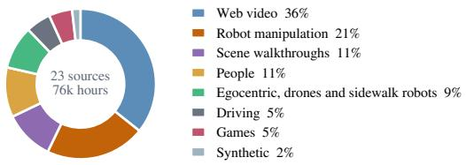  
Figure 8: Autoencoder training mixture, by share of sampling weight.

Table 2: Sources of the autoencoder training mixture, with their share of sampling weight and their size.
<table><tr><td>Category</td><td>Source</td><td>Share (%)</td><td>Hours</td></tr><tr><td rowspan="4">Web video</td><td>Panda-70M (Chen et al., 2024b)</td><td>14.3</td><td>10,330</td></tr><tr><td>LiveCC (Chen et al., 2025a)</td><td>7.1</td><td>15,388</td></tr><tr><td>LLaVA-Video-178K (Zhang et al., 2025b)</td><td>7.1</td><td>2,744</td></tr><tr><td>WebVid (Bain et al., 2021)</td><td>7.1</td><td>1,506</td></tr><tr><td rowspan="4">Robot manipulation</td><td>RoboCOIN, AgiBot World, Open X-Embodiment, Robo- MIND, DreamDojo GR-1 and RoboCasa GR-1 (Wu et al., 2025b; AgiBot-World-Contributors et al., 2025; O&#x27;Neill</td><td>8.9</td><td>5,387</td></tr><tr><td>et al., 2024; Wu et al., 2025a; Gao et al., 2026a; Nasiriany et al., 2024) ABC, three cameras (Allshire et al., 2026)</td><td></td><td></td></tr><tr><td>Galaxea Open-World (Jiang et al., 2025)</td><td>5.4 5.4</td><td>10,790 1,390</td></tr><tr><td>HIW-500 humanoid, head camera (BitRobot et al., 2026)</td><td>1.8</td><td>268</td></tr><tr><td rowspan="2">Scene walkthroughs</td><td>DL3DV-10K (Ling et al., 2024)</td><td>7.1</td><td>206</td></tr><tr><td>RealEstate10K (Zhou et al., 2018)</td><td>3.6</td><td>83</td></tr><tr><td rowspan="3">People</td><td>Kinetics-700 (Carreira et al., 2019)</td><td>3.6</td><td>1,583</td></tr><tr><td>CelebV-HQ and Hallo3 portraits (Zhu et al., 2022; Cui et al., 2025)</td><td>3.6</td><td>240</td></tr><tr><td>LiveSports-3K (Chen et al., 2025a)</td><td>3.6</td><td>32</td></tr><tr><td rowspan="3">Egocentric, drones, sidewalk robots</td><td>Sekai walking, real and game (Li et al., 2025b)</td><td>4.6</td><td>7,546</td></tr><tr><td>Sekai drones, real and game (Li et al., 2025b)</td><td>2.9</td><td>109</td></tr><tr><td>FrodoBots-2K (FrodoBots Lab, 2023)</td><td>1.8</td><td>2,415</td></tr><tr><td>Navigation (driving)</td><td>Physical AI AV, seven cameras (NVIDIA, 2025)</td><td>5.4</td><td>6,019</td></tr><tr><td rowspan="2">Games</td><td>Rocket League (Hu et al., 2026)</td><td>3.6</td><td>4,840</td></tr><tr><td>OpenCS2 (Blanchon, 2026)</td><td>1.4</td><td>5,084</td></tr><tr><td>Synthetic</td><td>Hallo3 generated portraits (Cui et al., 2025)</td><td>1.8</td><td>6</td></tr></table>

Table 3: Training hyperparameters of the autoencoders and world models.
<table><tr><td>CADRE autoencoder</td><td></td><td>World model</td></tr><tr><td>Architecture</td><td>frozen DINOv3 ViT-B/16, conv bottleneck, ViT decoder 24 blocks, width 1024, 16 heads</td><td>causal DiT, 16 blocks, width 2048, 16 heads (4 key/value), 1.2B parameters</td></tr><tr><td>Latent</td><td>64 channels</td><td rowspan="2">autoencoder latent, no further patching flow matching, diffusion forcing, PSD-U</td></tr><tr><td>Objective</td><td>flow matching, MAE, LPIPS, DINO, 3D Haar, PSD</td></tr><tr><td>Optimizer</td><td>AdamW, β = (0.9, 0.95), no weight decay</td><td>AdamW, β = (0.9, 0.99), weight decay 0.1</td></tr><tr><td>Learning rate</td><td> $2 \times 1 0 ^ { - 4 } .$  ,2k warm-up, then constant</td><td> $1 0 ^ { - 4 } .$  , 1k warm-up, then constant</td></tr><tr><td>Gradient clipping Steps, batch</td><td>none 150k, 96 clips (2 H100 nodes, 16 GPUs)</td><td>1.0 100k, 64 clips (2 H100 nodes, 16 GPUs)</td></tr><tr><td>Clips</td><td>16 frames, 288×512, 20 fps</td><td>80 frames (40 context), 288×512, 20 fps</td></tr><tr><td>Precision, EMA</td><td>bf16, 0.9999</td><td>bf16, 0.9999</td></tr><tr><td>Inference</td><td>1 or 2 decoding steps</td><td>10 denoising steps, context noise 0.2</td></tr></table>

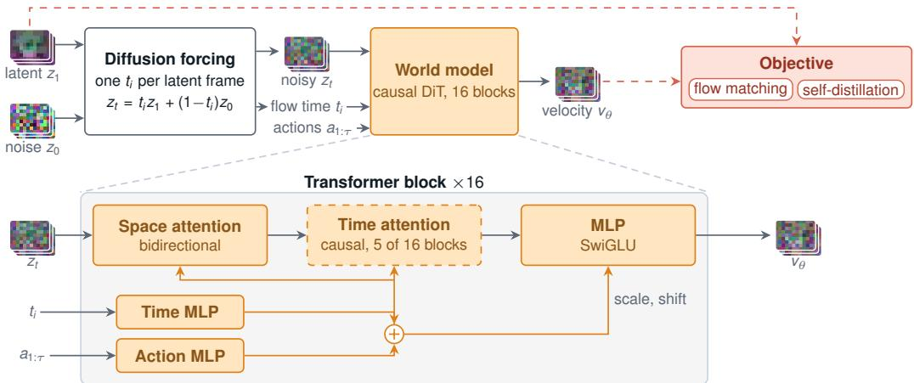  
Figure 9: The world model. Diffusion forcing gives each latent frame its own flow time; actions and flow time condition every block through AdaLN.

Table 4: Timing on one H100, each decoder at its fastest streaming decode. CADRE cells: one / two decoding steps. Max. fps is the sustainable rate; the display runs at 20; bold: fluid. †Non-causal, windowed.
<table><tr><td>Autoencoder</td><td> $\tau$ </td><td> $t _ { \mathrm { g e n } }$  (ms)</td><td> $t _ { \mathrm { d e c } }$  (ms)</td><td>Latency (ms)</td><td>Max. fps</td></tr><tr><td>CADRE-1×48×48</td><td>1</td><td>56</td><td>22 /44</td><td>128 / 150</td><td>12.8 / 10.0</td></tr><tr><td>CADRE-2×32×32</td><td>2</td><td>61</td><td>25 / 50</td><td>185 / 211</td><td>23.4 / 18.1</td></tr><tr><td>CADRE-4×24×24</td><td>4</td><td>65</td><td>26/51</td><td>291 /317</td><td>44.0 / 34.3</td></tr><tr><td>CADRE-8×16×16</td><td>8</td><td>83</td><td>28 / 56</td><td>510 /538</td><td>72.5 / 57.8</td></tr><tr><td>CADRE-1×16×16</td><td>1</td><td>106</td><td>22 /45</td><td>178 / 200</td><td>7.8 / 6.7</td></tr><tr><td>CADRE-2×16×16</td><td>2</td><td>91</td><td>25 / 49</td><td>216 / 240</td><td>17.3 / 14.3</td></tr><tr><td>CADRE-4×16×16</td><td>4</td><td>86</td><td>26 / 51</td><td>311/337</td><td>36.0 / 29.2</td></tr><tr><td>MIRA recipe</td><td>2</td><td>61</td><td>14</td><td>175</td><td>26.6</td></tr><tr><td>Wan 2.2</td><td>4</td><td>85</td><td>32</td><td>317</td><td>34.2</td></tr><tr><td>Cosmos</td><td>8</td><td>198</td><td>7</td><td>605</td><td>39.0</td></tr><tr><td>LTX-2†</td><td>8</td><td>62</td><td>29</td><td>492</td><td>87.4</td></tr><tr><td>DC-AE</td><td>1</td><td>64</td><td>5</td><td>118</td><td>14.6</td></tr></table>

Architecture. The probe maps a window of 8 frames to one action per frame. A frozen DINOv3 ViT-B/16 (Simeoni et al.´ , 2026) gives patch features from layers 2, 5, 8 and 11, combined by a learned softmax. Six factorized space-time blocks with bidirectional attention follow, then a perframe attention pool and a two-layer head (27M trained parameters).

Training. The probe trains on real clips from the world models’ training split with a smooth $L _ { 1 }$ loss on standardized actions and photometric augmentation only. It uses AdamW (learning rate $3 \times 1 0 ^ { - 4 }$ , batch 384) with cosine decay over 60k steps; we keep the 55k-step checkpoint (60k for human manipulation).

Score. For each action dimension d, $R _ { d } ^ { 2 }$ compares the recovered actions with the commanded ones over the last 16 generated frames of all clips, and ARR averages it normalized by the probe’s $R ^ { 2 }$ on the real continuation,

$$
\mathrm { A R R } = \frac { 1 } { | \mathscr { D } | } \sum _ { d \in \mathscr { D } } \frac { \operatorname* { m a x } \left( R _ { d } ^ { 2 } , - 1 \right) } { R _ { d } ^ { 2 } ( \mathrm { r e a l } ) } .\tag{7}
$$

On real video, the probe reaches $R ^ { 2 }$ of 0.91 in robot manipulation, 0.93 in driving and 0.83 in indoor navigation. Human manipulation has 102 action dimensions, and the probe barely reads the 90 finger-joint dimensions at 288×512, so D holds only the 12 wrist dimensions there (real-video $R ^ { 2 } 0 . { \bar { 8 } } 2 )$ .

Control. We also score the recovered actions against the clip’s own commands shifted by 48 frames, which the rollout never received. A world model that ignores its actions scores alike on both, so the gap between the two raw $R ^ { 2 }$ values measures action following (Table 5). Every CADRE autoencoder keeps a clear gap in every environment. In driving, the gap of Wan 2.2, Cosmos and LTX-2 is small (0.04 to 0.14), and so is that of Cosmos and LTX-2 in human manipulation (0.24 and 0.12): their rollouts reproduce motion common to the environment, such as forward travel in driving.

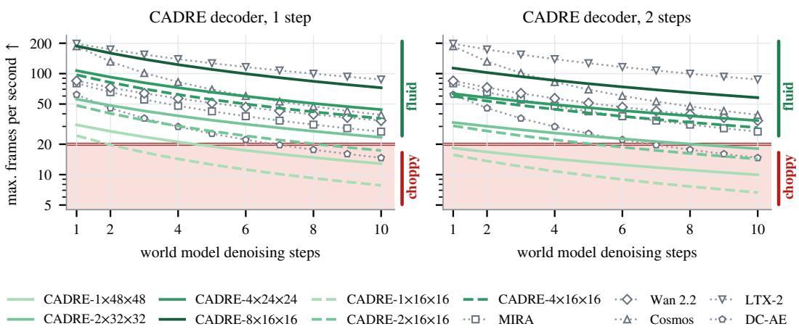

Figure 10: Can the world model run fluidly at 20 frames per second? Maximum frame rate against denoising steps (Table 4); above the line, it can.  
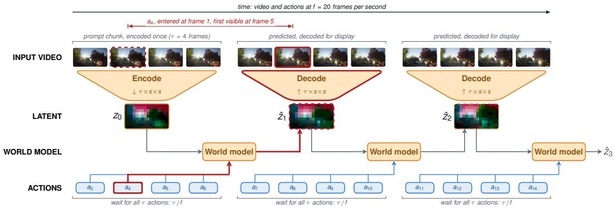  
Figure 11: The streaming inference loop at $\tau = 4 .$ . Each call reads the previous latent frame and the τ actions of the chunk that just closed. Action $a _ { 4 } .$ , entered at frame 1, first shows at frame 5 (red).

## F RECONSTRUCTION

Table 6 reports how well each autoencoder reconstructs held-out general video. Reconstruction does not predict rollout quality. Across autoencoders, the rank correlation between reconstruction and one-step rollout FVD is +0.76 in robot manipulation but −0.39 in driving and −0.35 in indoor navigation. Wan 2.2 reconstructs best by far, yet its world model ranks fifth of twelve on rollout FVD in robot manipulation, second to last in driving and last in indoor navigation (Table 7).

## G FULL RESULTS

Table 7 lists every autoencoder in every environment with both decoding step counts. Figure 12 places the autoencoders in the compression plane, and Figure 14 extends Figures 1 and 4b (driving and robot manipulation) to every environment and metric.

Figure 15 extends Figure 7 to all environments and adds CADRE-4×24×24, whose overlapping kernel confounds it; it is an outlier in navigation (FVD 403 in driving, 435 indoors). We hypothesize that its channel-to-space reshape, which turns each position into a correlated $2 \times 2$ block of latents, is harder to predict when the whole view moves.

Table 5: Action recoverability and its control at frame 96. Gap is the raw $R ^ { 2 }$ against the commanded actions minus the control, against commands shifted by 48 frames. Compare gaps within an environment. CADRE rows use the two-step decode; the CADRE-1×16×16 world model is trained on robot manipulation only.
<table><tr><td></td><td colspan="3">Manipulation (robot)</td><td colspan="3">Manipulation (human)</td><td colspan="3">Navigation (driving)</td><td colspan="3">Navigation (indoor)</td></tr><tr><td>Autoencoder</td><td>ARR</td><td>control</td><td>gap</td><td>ARR</td><td>control</td><td>gap</td><td>ARR</td><td>control</td><td>gap</td><td>ARR</td><td>control</td><td>gap</td></tr><tr><td> $1 \times 4 8 \times 4 8$ </td><td>0.48</td><td>-0.99</td><td>1.46</td><td>0.64</td><td>-0.54</td><td>1.07</td><td>0.90</td><td>0.48</td><td>0.35</td><td>0.87</td><td>0.10</td><td>0.65</td></tr><tr><td> $2 \times 3 2 \times 3 2$ </td><td>0.45</td><td>-0.97</td><td>1.40</td><td>0.75</td><td>-0.58</td><td>1.19</td><td>0.89</td><td>0.47</td><td>0.37</td><td>0.91</td><td>0.08</td><td>0.70</td></tr><tr><td> $4 \times 2 4 \times 2 4$ </td><td>0.49</td><td>-0.84</td><td>1.31</td><td>0.65</td><td>-0.49</td><td>1.03</td><td>0.67</td><td>0.40</td><td>0.24</td><td>0.45</td><td>0.01</td><td>0.38</td></tr><tr><td> $8 \times 1 6 \times 1 6$ </td><td>0.72</td><td>-0.73</td><td>1.40</td><td>0.63</td><td>-0.50</td><td>1.03</td><td>0.86</td><td>0.51</td><td>0.29</td><td>0.79</td><td>-0.01</td><td>0.69</td></tr><tr><td> $1 \times 1 6 \times 1 6$ </td><td>0.74</td><td>-0.89</td><td>1.58</td><td>N/A</td><td>N/A</td><td>N/A</td><td>N/A</td><td>N/A</td><td>N/A</td><td>N/A</td><td>N/A</td><td>N/A</td></tr><tr><td> $2 \times 1 6 \times 1 6$ </td><td>0.73</td><td>-0.82</td><td>1.49</td><td>0.73</td><td>-0.53</td><td>1.13</td><td>0.97</td><td>0.49</td><td>0.41</td><td>0.90</td><td>0.05</td><td>0.73</td></tr><tr><td> $4 \times 1 6 \times 1 6$ </td><td>0.79</td><td>-0.77</td><td>1.50</td><td>0.78</td><td>-0.53</td><td>1.18</td><td>0.88</td><td>0.44</td><td>0.38</td><td>0.93</td><td>0.08</td><td>0.72</td></tr><tr><td>MIRA recipe</td><td>0.39</td><td>-1.00</td><td>1.37</td><td>0.75</td><td>-0.58</td><td>1.19</td><td>0.86</td><td>0.43</td><td>0.38</td><td>0.92</td><td>0.03</td><td>0.76</td></tr><tr><td>Wan 2.2</td><td>0.85</td><td>-0.86</td><td>1.64</td><td>0.72</td><td>-0.53</td><td>1.12</td><td>0.66</td><td>0.49</td><td>0.13</td><td>0.34</td><td>0.03</td><td>0.26</td></tr><tr><td>Cosmos</td><td>0.78</td><td>-0.78</td><td>1.50</td><td>-0.27</td><td>-0.44</td><td>0.24</td><td>0.62</td><td>0.45</td><td>0.14</td><td>0.39</td><td>0.04</td><td>0.31</td></tr><tr><td>LTX-2</td><td>0.25</td><td>-0.80</td><td>1.05</td><td>-0.63</td><td>-0.62</td><td>0.12</td><td>0.57</td><td>0.52</td><td>0.04</td><td>0.04</td><td>-0.09</td><td>0.15</td></tr><tr><td>DC-AE</td><td>0.65</td><td>-0.94</td><td>1.55</td><td>0.39</td><td>-0.53</td><td>0.85</td><td>0.81</td><td>0.33</td><td>0.43</td><td>0.86</td><td>0.12</td><td>0.62</td></tr></table>

Table 6: Reconstruction of 3072 held-out OpenVid-HD (Nan et al., 2025) clips (16 frames at 288×512), with the one-step decode for our autoencoders. No world model is involved.
<table><tr><td></td><td>Autoencoder (τ×s×s)</td><td>FID↓</td><td>FVD↓</td><td>PSNR↑</td><td>LPIPS↓</td></tr><tr><td>CADRE</td><td>1×48×48</td><td>9.71</td><td>43.3</td><td>21.21</td><td>0.127</td></tr><tr><td></td><td> $2 \times 3 2 \times 3 2$ </td><td>6.87</td><td>21.7</td><td>22.86</td><td>0.093</td></tr><tr><td></td><td> $4 \times 2 4 \times 2 4$ </td><td>7.06</td><td>17.7</td><td>23.32</td><td>0.087</td></tr><tr><td></td><td> $8 \times 1 6 \times 1 6$ </td><td>5.93</td><td>14.7</td><td>24.18</td><td>0.077</td></tr><tr><td></td><td> $1 \times 1 6 \times 1 6$ </td><td>4.27</td><td>10.9</td><td>25.05</td><td>0.057</td></tr><tr><td></td><td> $2 \times 1 6 \times 1 6$ </td><td>4.77</td><td>11.5</td><td>25.12</td><td>0.059</td></tr><tr><td></td><td> $4 \times 1 6 \times 1 6$ </td><td>4.91</td><td>11.2</td><td>24.76</td><td>0.065</td></tr><tr><td>Others</td><td>MIRA recipe (2×32×32)</td><td>15.73</td><td>127.1</td><td>24.44</td><td>0.146</td></tr><tr><td></td><td>Wan 2.2 (4×16×16)</td><td>0.78</td><td>0.8</td><td>35.02</td><td>0.012</td></tr><tr><td></td><td>Cosmos (8×8×8)</td><td>6.93</td><td>6.1</td><td>31.39</td><td>0.064</td></tr><tr><td></td><td>LTX-2 (8×32×32)</td><td>4.76</td><td>6.5</td><td>28.24</td><td>0.039</td></tr><tr><td></td><td> ${ \mathrm { D C } } { \mathrm { - A E } } \left( 1 { \times } 3 2 { \times } 3 2 \right)$ </td><td>3.59</td><td>22.7</td><td>26.83</td><td>0.060</td></tr></table>

CADRE other autoencoders  
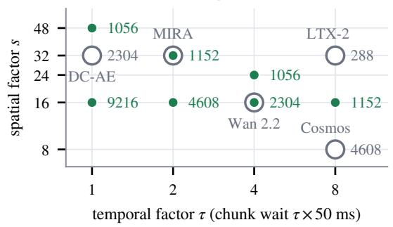  
Figure 12: Compression plane. Our seven autoencoders (green) and the five others, with the tokens per 16-frame clip at 288×512.

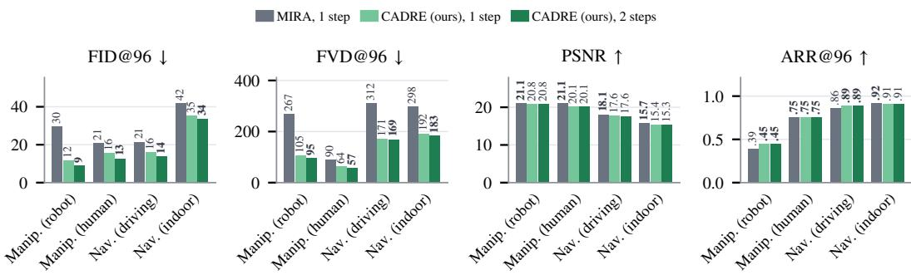  
Figure 13: Diffusion against perceptual regression decoding, all metrics (Figure 4a in full), at $2 \times 3 2 \times 3 2$ . The CADRE decoder lowers FID and FVD in every environment at similar action following; MIRA’s higher PSNR comes with blur.

Along the green curves, which vary τ at $s = 1 6 ,$ , FVD stays between 39 and 46 in robot manipulation and ARR between 0.72 and 0.79. In navigation, FVD rises from $\tau = 2 \mathrm { t o } \tau = 8$ by 31% in driving, where the rise already appears at $\tau = 4 ,$ , and by 64% in indoor navigation, where it appears only at $\tau = 8 ;$ ARR drops by 0.11 in driving and by up to 0.15 in indoor navigation. At the same $\tau ,$ coarser spatial tokens cost far more in robot manipulation: at $\tau = 2$ , going from $s = 1 6 \mathrm { t o } s = 3 2$ multiplies FVD by 2.4 and lowers ARR from 0.73 to 0.45, with almost no change in FID, whereas in navigation FVD rises by only 11 to 12% and ARR changes by at most 0.08. $\mathbf { A } \mathbf { t } \ \tau = 1$ , FVD grows more between frames 32 and 96 than at $\tau = 2$ in four of five comparisons, by 11 to 113%, a confounded sign of error accumulation.

## H LONG-HORIZON ROLLOUTS

To test whether the rankings hold beyond 4.8 s, we roll out the world models of all twelve autoencoders on robot manipulation for 64 s (1280 frames, 256 clips, one-step decode; Figure 17), the only environment with many episodes long enough for such rollouts. No metric collapses. CADRE-$8 \times 1 6 \times 1 6$ is best from about 13 s on and ends with the lowest LPIPS and FVD and the highest PSNR, while the $s = 1 6$ autoencoders lose their early lead in LPIPS and PSNR by then. Action recoverability barely decays. The other autoencoders drift faster (Table 8): FVD grows by 0.8 to 1.8 per second for the CADRE autoencoders, 2.0 to 2.7 for the others and 14.5 for Wan 2.2, which starts best but whose PSNR falls below every CADRE autoencoder by about 9 s. Drift rates are leastsquares slopes between 4.8 and 64 s; the upward bias of Frechet distances at 256 clips is roughly´ constant over time, so slopes stay comparable. The non-causal LTX-2 decoder uses a 57-frame (8- latent) history window here. Figure 16 shows one rollout per autoencoder; there, Wan 2.2 corrupts its colors by 48 s.

## I MOTION IN THE EVALUATION SETS

Table 9 measures motion on the real continuation of every evaluation clip: the mean frame-to-frame pixel difference, the share of pixels and of 32×32 patches that change by more than 0.05, and the RAFT (Teed & Deng, 2020) optical flow in pixels per frame.

In manipulation, a third of the image changes per frame and content moves by about one pixel per frame or less, less than one 16-pixel token over eight frames. In navigation, half to three quarters of the image changes and content moves by more than two pixels per frame, more than a token over eight frames. The head-mounted camera of human manipulation shifts the whole image slightly, which optical flow captures and pixel differences miss.

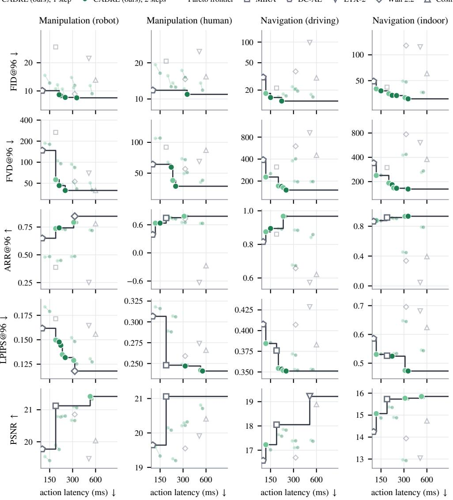  
Figure 14: Rollout quality against action latency in every environment. CADRE decodes in one step (light) or two (dark).

## J QUALITATIVE RESULTS

Figure 22 shows counterfactual rollouts: from the same real context, the world model follows the recorded actions and two action sequences never recorded with it. Rollouts under recorded actions are in Figures 1 and 5. Figures 18 to 21 compare every autoencoder on the same clip in each environment, with its recorded actions.

## K BOUNDARY EXCESS

Let $d _ { t }$ be the mean absolute difference between generated frames t and t − 1, with pixels in [0, 1]. E is the ratio of the mean d over boundary pairs (t a multiple of τ) to that over the other pairs, and the boundary excess is $E / E _ { \mathrm { r e a l } } .$ , with $E _ { \mathrm { r e a l } }$ from the real continuation at the same indices. One means no seam. We compute it on 32 clips per autoencoder with the one-step decode; repeated draws differ by about 0.15. $\mathbf { A t } \tau = 8 ,$ , rollouts put 58 to 83% more change at chunk boundaries than real video (Table 10).

same token budget: more frames per latent, coarser grid same token size (s = 16): more frames per latent

8×16×16 (both)   
4×24×24 (overlapping kernel)

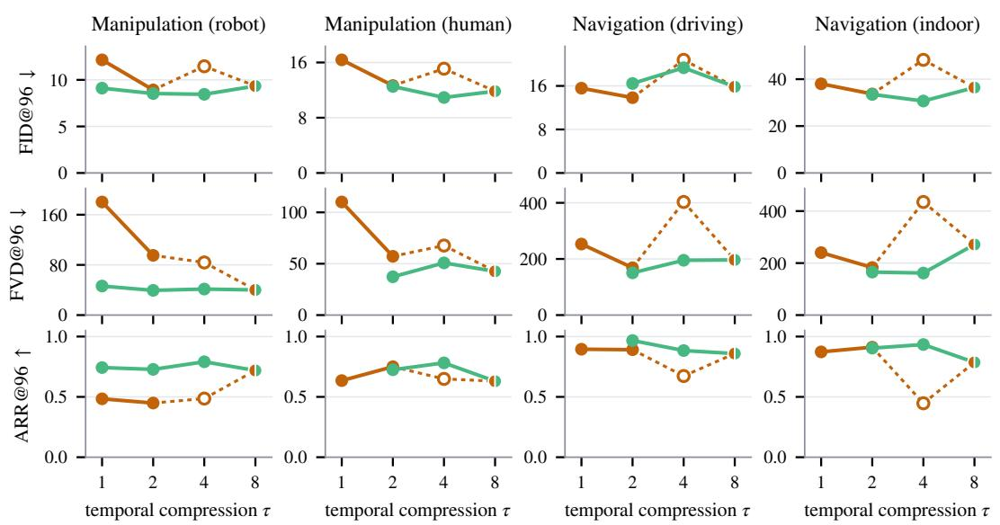  
Figure 15: Temporal compression and spatial tokens, with CADRE-4×24×24 in every environment. Dotted segments touch the overlapping-kernel cell.

Table 7: Full results at 96 frames (4.8 s). 2048 evaluation samples per environment, with 40 context frames and 96 generated. Metrics use the 16 frames ending at frame 96, except indoor PSNR at frame 48, since at 4.8 s it mostly measures viewpoint drift. 95% confidence intervals over test episodes are about ±0.2 dB PSNR (±0.4 indoors), ±0.01 LPIPS and ±0.05 ARR. CADRE numbers decode in two steps, with one step in parentheses. Bold is best and italic second best per environment. The 1×16×16 world model is trained on robot manipulation only, and humanmanipulation ARR uses the 12 wrist dimensions, since the probe barely reads the finger joints.
<table><tr><td></td><td>Autoencoder (τ×s× s)</td><td>Tokens</td><td>FID↓</td><td>FVD↓</td><td>PSNR↑</td><td>LPIPS↓</td><td>ARR↑</td></tr><tr><td colspan="8">Manipulation (robot, ABC)</td></tr><tr><td colspan="8">CADRE 1×48×48 2×32×32</td></tr><tr><td></td><td>4×24×24</td><td>1152 1056</td><td>8.92 (11.63)</td><td>95.2 (105.0) 83.9 (93.8)</td><td>20.78 (20.79)</td><td>0.144 (0.149)</td><td>0.45 (0.45)</td></tr><tr><td></td><td>8×16×16</td><td></td><td>11.46 (13.95)</td><td></td><td>20.66 (20.67)</td><td>0.148 (0.152)</td><td>0.49 (0.48)</td></tr><tr><td></td><td></td><td>1152</td><td>9.34 (11.41)</td><td>40.1 (50.6)</td><td>21.33 (21.42)</td><td>0.127 (0.131)</td><td>0.72 (0.72)</td></tr><tr><td></td><td>1×16×16</td><td>9216</td><td>9.11 (10.55)</td><td>46.3 (56.2)</td><td>19.76 (19.90)</td><td>0.148 (0.150)</td><td>0.74 (0.74)</td></tr><tr><td></td><td>2×16×16</td><td>4608</td><td>8.53 (10.48)</td><td>39.4 (47.6)</td><td>20.80 (20.80)</td><td>0.132 (0.135)</td><td>0.73 (0.73)</td></tr><tr><td></td><td>4×16×16</td><td>2304</td><td>8.45 (10.86)</td><td>41.5 (51.9)</td><td>21.07 (21.09)</td><td>0.125 (0.129)</td><td>0.79 (0.79)</td></tr><tr><td>Others</td><td>MIRA recipe (2×32×32)</td><td>1152</td><td>29.52</td><td>267.1</td><td>21.12</td><td>0.172</td><td>0.39</td></tr><tr><td></td><td>Wan 2.2 (4×16×16)</td><td>2304</td><td>9.29</td><td>52.9</td><td>20.85</td><td>0.118</td><td>0.85</td></tr><tr><td></td><td>Cosmos (8×8×8)</td><td>4608</td><td>13.10</td><td>39.5</td><td>20.04</td><td>0.156</td><td>0.78 0.25</td></tr><tr><td></td><td>LTX-2 (8×32×32)</td><td>288</td><td>22.24</td><td>69.6</td><td>19.47</td><td>0.164</td><td></td></tr><tr><td></td><td>DC-AE(1×32×32)</td><td>2304</td><td>10.07</td><td>147.3</td><td>19.77</td><td>0.162</td><td>0.65</td></tr><tr><td colspan="8">Manipulation (human, EgoDex)</td></tr><tr><td colspan="8">CADRE 1×48×48</td></tr><tr><td></td><td>2×32×32</td><td>1056 1152</td><td>16.38 (19.32) 12.66 (15.62)</td><td>110.1 (109.2) 57.2 (63.8)</td><td>19.33 (19.59) 20.08 (20.15)</td><td>0.316 (0.318) 0.288 (0.289)</td><td>0.64 (0.63) 0.75 (0.75)</td></tr><tr><td></td><td>4×24×24</td><td>1056</td><td>15.10 (17.29)</td><td>67.7 (69.2)</td><td>20.22 (20.21)</td><td>0.247 (0.249)</td><td>0.65 (0.65)</td></tr><tr><td></td><td>8×16×16</td><td>1152</td><td>11.84 (13.58)</td><td>42.6 (40.7)</td><td>20.71 (20.81)</td><td>0.241 (0.242)</td><td>0.63 (0.63)</td></tr><tr><td></td><td>2×16×16</td><td>4608</td><td>12.53 (13.60)</td><td>37.3 (42.4)</td><td>19.20 (19.25)</td><td>0.306 (0.307)</td><td>0.73 (0.73)</td></tr><tr><td>Others</td><td>4×16×16</td><td>2304</td><td>10.93 (12.15)</td><td>50.8 (49.5)</td><td>20.32 (20.29)</td><td>0.248 (0.248)</td><td>0.78 (0.78)</td></tr><tr><td></td><td>MIRA recipe (2×32×32)</td><td>1152</td><td>20.65</td><td>89.7</td><td>21.06</td><td>0.248</td><td>0.75</td></tr><tr><td colspan="8">Wan 2.2 (4×16×16)</td></tr><tr><td></td><td></td><td>2304</td><td>14.60</td><td>55.0</td><td>19.55</td><td>0.259</td><td>0.72</td></tr><tr><td></td><td>Cosmos (8×8×8)</td><td>4608</td><td>15.33</td><td>83.8</td><td>20.41</td><td>0.266</td><td>-0.27</td></tr><tr><td></td><td>LTX-2 (8×32×32)</td><td>288</td><td>24.78</td><td>64.9</td><td>19.91</td><td>0.274</td><td>-0.63</td></tr><tr><td></td><td>DC-AE(1×32×32)</td><td>2304</td><td>11.82</td><td>61.0</td><td>19.65</td><td>0.307</td><td>0.39</td></tr><tr><td colspan="8">Navigation (driving, Physical AI AV) CADRE</td></tr><tr><td colspan="8">1×48×48 2×32×32</td></tr><tr><td></td><td></td><td>1152</td><td>13.84 (15.99)</td><td>168.7 (171.3)</td><td>17.58 (17.64)</td><td>0.353 (0.354)</td><td>0.89 (0.89)</td></tr><tr><td></td><td>4×24×24</td><td>1056</td><td>20.79 (22.39)</td><td>403.0 (378.4)</td><td>17.39 (17.38)</td><td>0.370 (0.372)</td><td>0.67 (0.68)</td></tr><tr><td></td><td>8×16×16</td><td>1152</td><td>15.84 (17.26)</td><td>196.6 (196.5)</td><td>17.37 (17.41)</td><td>0.353 (0.353)</td><td>0.86 (0.84)</td></tr><tr><td></td><td>2×16×16 4×16×16</td><td>4608 2304</td><td>16.45 (17.51)</td><td>150.5 (162.6)</td><td>17.83 (17.86) 17.11 (17.10)</td><td>0.351 (0.352)</td><td>0.97 (0.97)</td></tr><tr><td>Others</td><td>MIRA recipe (2×32×32)</td><td>1152</td><td>19.34 (20.45)</td><td>195.3 (198.5) 311.6</td><td>18.05</td><td>0.352 (0.353) 0.376</td><td>0.88 (0.89) 0.86</td></tr><tr><td colspan="8"></td></tr><tr><td></td><td>Wan 2.2 (4×16×16)</td><td>2304</td><td>21.42 37.36</td><td>599.7</td><td>16.69</td><td>0.407</td><td>0.66</td></tr><tr><td></td><td>Cosmos (8×8×8)</td><td>4608</td><td>30.12</td><td>452.5</td><td>18.89</td><td>0.383</td><td>0.62</td></tr><tr><td></td><td>LTX-2(8×32×32)</td><td>288</td><td>98.36</td><td>913.3</td><td>19.21</td><td>0.429</td><td>0.57</td></tr><tr><td></td><td>DC-AE(1×32×32)</td><td>2304</td><td>30.67</td><td>389.6</td><td>16.57</td><td>0.408</td><td>0.81</td></tr><tr><td colspan="8">Navigation (indoor, RealEstate10K); PSNR at frame 48</td></tr><tr><td colspan="8">CADRE</td></tr><tr><td rowspan="9"></td><td>1×48×48 2×32×32</td><td>1056 1152</td><td>38.01 (40.13) 33.69 (35.27)</td><td>240.3 (238.4) 182.9 (191.9)</td><td>14.87 (15.07) 15.35 (15.37)</td><td>0.532 (0.531) 0.524 (0.525)</td><td>0.87 (0.88) 0.91 (0.91)</td></tr><tr><td>4×24×24</td><td>1056</td><td>48.23 (49.36)</td><td>435.0 (426.2)</td><td>12.93 (12.96)</td><td>0.645 (0.647)</td><td>0.45 (0.45)</td></tr><tr><td>8×16×16</td><td>1152</td><td>36.42 (36.55)</td><td>271.5 (259.8)</td><td>15.80 (15.85)</td><td>0.543 (0.546)</td><td>0.79 (0.79)</td></tr><tr><td>2×16×16</td><td>4608</td><td>33.50 (34.13)</td><td>165.4(167.3)</td><td>14.88 (14.90)</td><td>0.533 (0.533)</td><td>0.90 (0.90)</td></tr><tr><td>4×16×16</td><td>2304</td><td>30.68 (31.69)</td><td>161.7 (165.5)</td><td>15.74 (15.77)</td><td>0.473 (0.475)</td><td>0.93 (0.93)</td></tr><tr><td>MIRA recipe (2×32×32)</td><td>1152</td><td>41.97</td><td>298.5</td><td>15.73</td><td>0.526</td><td>0.92</td></tr><tr><td>Wan 2.2 (4× 16×16)</td><td>2304</td><td>128.35</td><td>771.9</td><td>13.94</td><td>0.696</td><td>0.34</td></tr><tr><td>Cosmos (8×8×8)</td><td>4608</td><td>60.53</td><td>377.7</td><td>14.74</td><td>0.624</td><td>0.39</td></tr><tr><td>LTX-2 (8×32×32)</td><td>288</td><td>123.61</td><td>606.2</td><td>13.04</td><td>0.681</td><td>0.04</td></tr><tr><td></td><td></td><td></td><td></td><td>14.24</td><td>0.586</td><td>0.86</td></tr><tr><td>DC-AE(1×32×32)</td><td>2304</td><td>49.13</td><td>339.3</td><td></td><td></td><td></td></tr></table>

context  
+8 s  
+16 s  
+32 s  
+48 s  
+64 s  
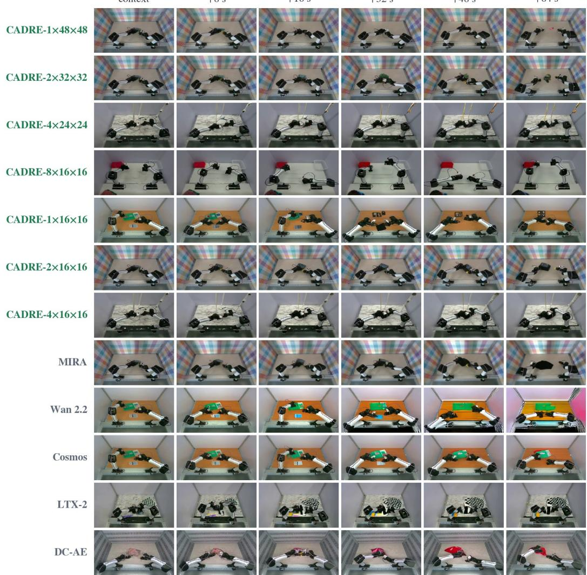  
Figure 16: 64 s rollouts in robot manipulation: for each autoencoder, the real context frame, then generated frames. Scenes differ between rows.

Table 8: Drift rates on robot manipulation, per second between 4.8 and 64 s. Lower is better.
<table><tr><td>Autoencoder</td><td>FID/s</td><td>FVD/s</td><td>PSNR loss (dB/s)</td><td> $\mathrm { L P I P S } / \mathrm { s } ( \times 1 0 ^ { - 3 } )$ </td></tr><tr><td>1×48×48</td><td>0.15</td><td>0.8</td><td>0.046</td><td>1.4</td></tr><tr><td> $2 \times 3 2 \times 3 2$ </td><td>0.19</td><td>1.2</td><td>0.060</td><td>1.6</td></tr><tr><td> $4 \times 2 4 \times 2 4$ </td><td>0.29</td><td>1.1</td><td>0.058</td><td>1.8</td></tr><tr><td> $8 \times 1 6 \times 1 6$ </td><td>0.25</td><td>0.9</td><td>0.059</td><td>1.6</td></tr><tr><td> $1 \times 1 6 \times 1 6$ </td><td>0.35</td><td>1.8</td><td>0.062</td><td>2.1</td></tr><tr><td> $2 \times 1 6 \times 1 6$ </td><td>0.24</td><td>1.5</td><td>0.065</td><td>1.8</td></tr><tr><td> $4 \times 1 6 \times 1 6$ </td><td>0.19</td><td>1.3</td><td>0.068</td><td>1.8</td></tr><tr><td>MIRA recipe</td><td>0.22</td><td>2.4</td><td>0.077</td><td>1.8</td></tr><tr><td>Wan 2.2</td><td>1.75</td><td>14.5</td><td>0.140</td><td>7.4</td></tr><tr><td>Cosmos</td><td>0.35</td><td>2.0</td><td>0.071</td><td>2.1</td></tr><tr><td>LTX-2</td><td>0.47</td><td>2.7</td><td>0.066</td><td>2.2</td></tr><tr><td>DC-AE</td><td>0.41</td><td>2.1</td><td>0.073</td><td>3.0</td></tr></table>

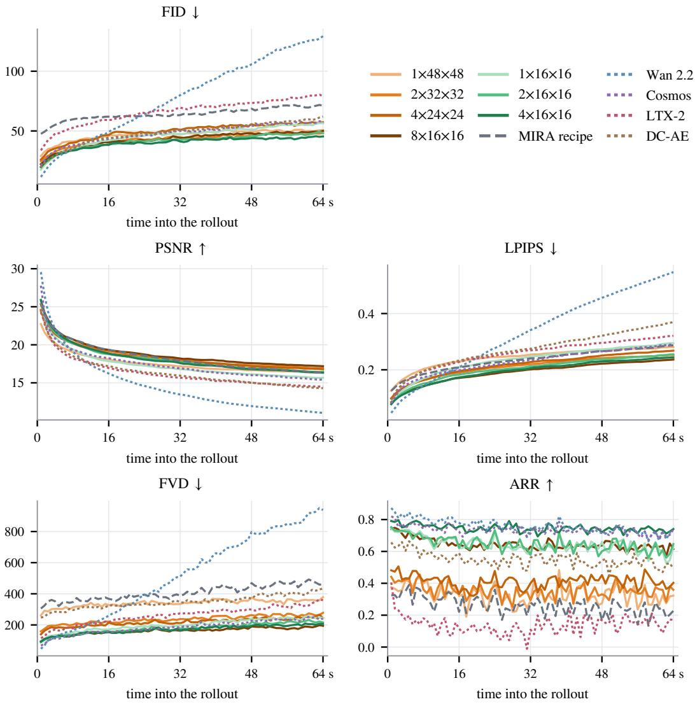  
Figure 17: Rollouts over 64 s on robot manipulation. With 256 clips, FID and FVD are biased upward; compare them only within this figure.

Table 9: How much each environment moves. Averages over the 2048 evaluation samples of each environment (1706 distinct clips indoors).
<table><tr><td>Environment</td><td>Pixel difference per frame</td><td>Pixels that change per frame</td><td>Patches that change per frame</td><td>Optical flow (pixels per frame)</td></tr><tr><td>Manipulation (robot)</td><td>0.010</td><td>2.6%</td><td>32%</td><td>0.24</td></tr><tr><td>Manipulation (human)</td><td>0.009</td><td>3.6%</td><td>33%</td><td>1.27</td></tr><tr><td>Navigation (driving)</td><td>0.017</td><td>8.2%</td><td>48%</td><td>2.13</td></tr><tr><td>Navigation (indoor)</td><td>0.032</td><td>15.7%</td><td>76%</td><td>2.69</td></tr></table>

Table 10: Boundary excess at $\tau \ = \ 2 ,$ 4 and 8 $( 2 \times 1 6 \times 1 6 ,$ 4×16×16, $8 \times 1 6 \times 1 6 ;$ $2 \times 3 2 \times 3 2 .$ 4×24×24 and $8 \times 1 6 \times 1 6$ in human manipulation). One means no seam.
<table><tr><td>Environment</td><td> $\tau = 2$ </td><td> $\tau = 4$ </td><td> $\tau = 8$ </td></tr><tr><td>Manipulation (robot)</td><td>1.17</td><td>1.34</td><td>1.81</td></tr><tr><td>Manipulation (human)</td><td>1.47</td><td>1.56</td><td>1.75</td></tr><tr><td>Navigation (driving)</td><td>1.22</td><td>1.34</td><td>1.83</td></tr><tr><td>Navigation (indoor)</td><td>1.08</td><td>1.18</td><td>1.58</td></tr></table>

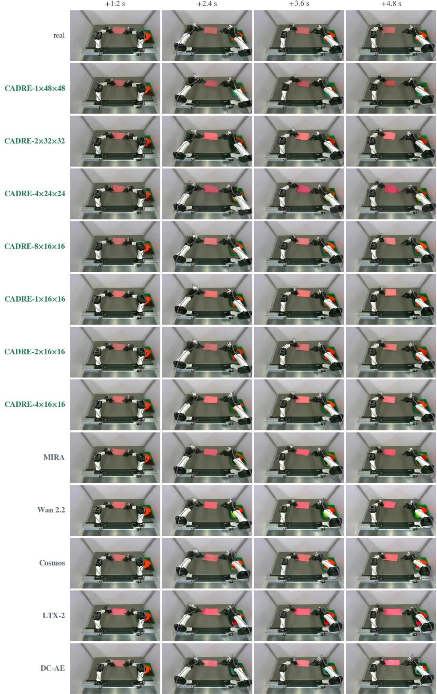  
Figure 18: Rollouts, robot manipulation: the same clip and recorded actions for every autoencoder, with the real future on top.

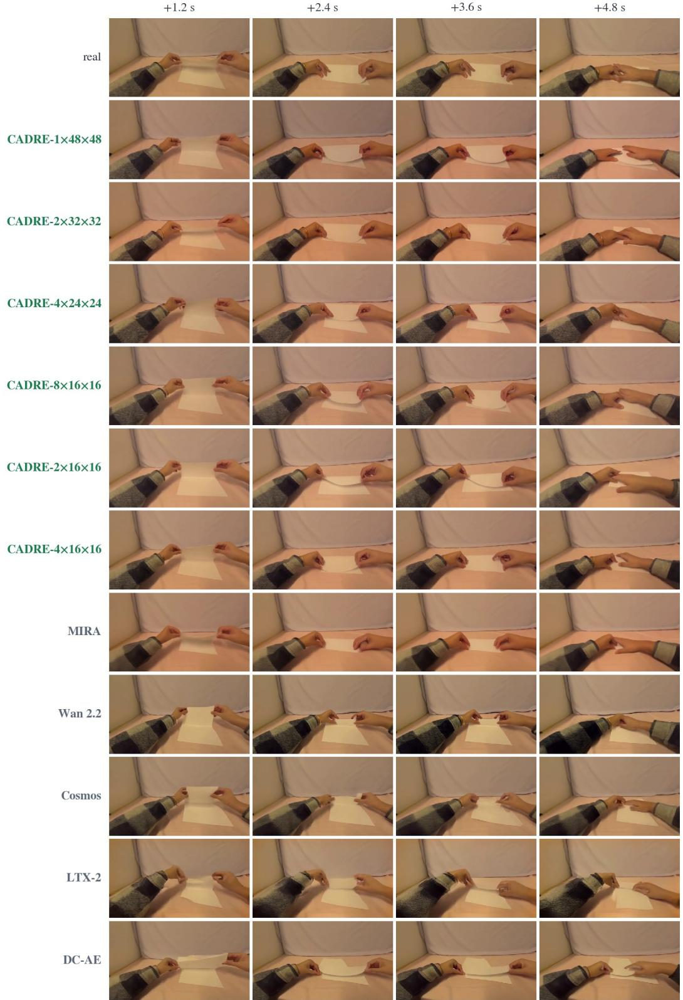  
Figure 19: Rollouts, human manipulation: the same clip and recorded actions for every autoencoder, with the real future on top.

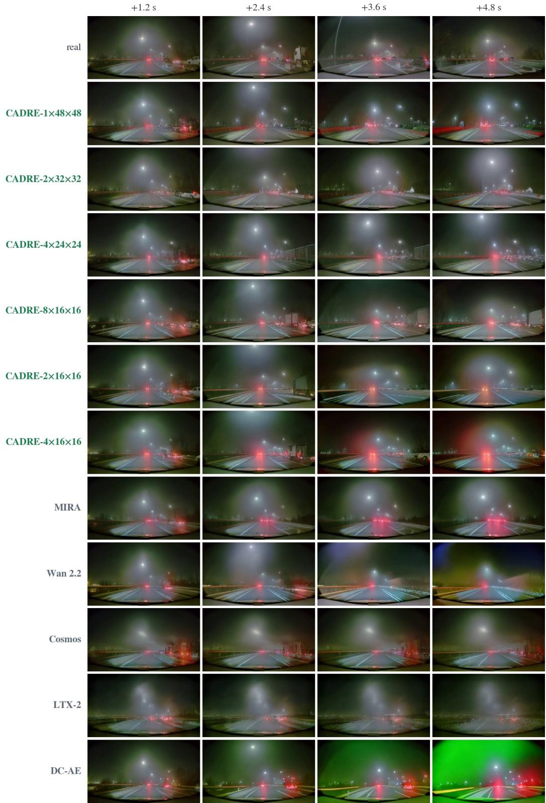  
Figure 20: Rollouts, driving: the same clip and recorded actions for every autoencoder, with the real future on top.

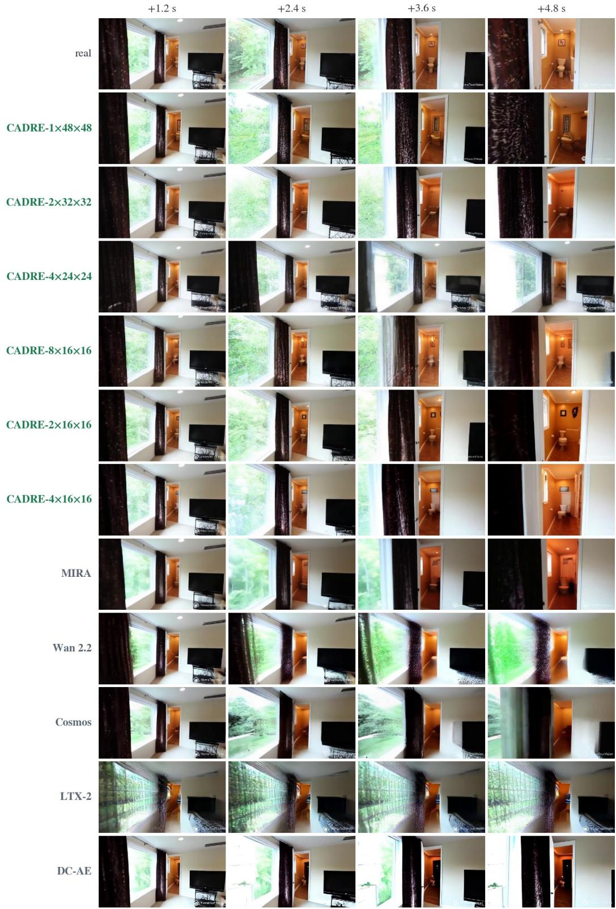  
Figure 21: Rollouts, indoor navigation: the same clip and recorded actions for every autoencoder, with the real future on top.

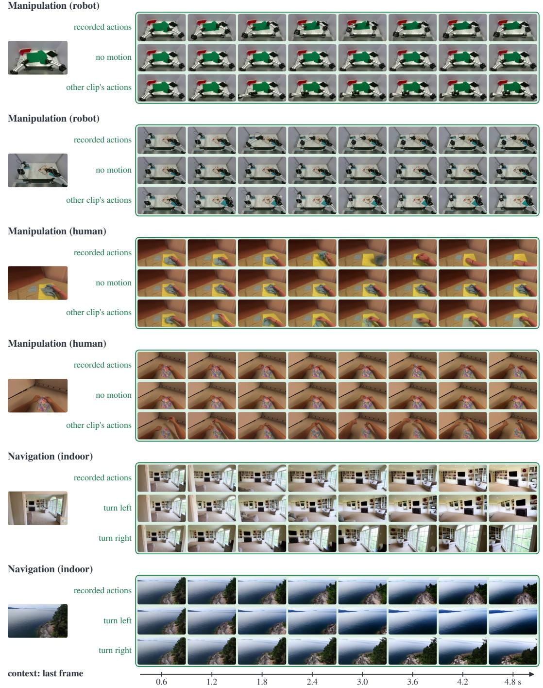  
Figure 22: Counterfactual rollouts. From one real context (left), the world model follows the recorded actions and two counterfactual ones (green): no motion or another clip’s actions in manipulation, a constant left or right turn in indoor navigation.

## L EXTENDED RELATED WORK

We study how much the autoencoder of an interactive world model compresses space and time, and whether that compression belongs in the autoencoder or in the world model.

World models, from offline to streaming. A world model predicts how an environment evolves under actions. Early ones predict compact latents for control (Ha & Schmidhuber, 2018; Hafner et al., 2020; Micheli et al., 2023); most recent ones generate the video itself (Bai et al., 2024), for driving (Gao et al., 2024; Russell et al., 2025; Carrion et al.´ , 2025), robotics (Yang et al., 2024), egocentric motion (Bai et al., 2025; Wang et al., 2026a) and open scenes (Bruce et al., 2024; Mao et al., 2025; PAN Team et al., 2025; Zhu et al., 2026b). Most are offline, taking seconds to minutes per clip. They compare autoencoders only in that regime: SANA-WM (Zhu et al., 2026a) swaps the Wan 2.1 autoencoder for LTX-2’s. An interactive world model streams instead and must render each frame before the next action arrives. Some reach real time by rendering directly from controls (Kim et al., 2020; Menapace et al., 2021) or with dedicated models (Valevski et al., 2025; Alonso et al., 2024; Bar et al., 2025; Ramanana Rahary et al., 2026a). Others adapt a large video generator by streaming distillation (Yin et al., 2025; Huang et al., 2025), as Matrix-Game 2.0 (He et al., 2025) and Hunyuan-GameCraft (Li et al., 2025a) do. They inherit its autoencoder unchanged, at 8× in space and 4× in time. Their blockwise generation also adds serial computation (Chao et al., 2026). MineWorld (Guo et al., 2025) uses discrete tokens instead. Once generation is fast, the decoder becomes the bottleneck, which Matrix-Game 3.0 (Wang et al., 2026b) and WorldPlay (Sun et al., 2026) prune. MIRA (Hu et al., 2026) instead trains its own autoencoder and judges it by the world model; we extend that principle along both compression axes.

Diffusion and flow-based generation. Both the world model and the decoder of CADRE are diffusion models trained with flow matching. Diffusion models (Sohl-Dickstein et al., 2015; Ho et al., 2020; Song & Ermon, 2019; Song et al., 2021b) and their refinements of sampler, schedule, loss weighting and preconditioning (Song et al., 2021a; Lu et al., 2022; Nichol & Dhariwal, 2021; Kingma et al., 2021; Kingma & Gao, 2023; Hang et al., 2023; Karras et al., 2022; 2024b) converge in flow matching (Lipman et al., 2023; Liu et al., 2023; Albergo et al., 2025), which regresses a velocity along an interpolant between noise and data and scales with transformers (Bao et al., 2023; Peebles & Xie, 2023; Ma et al., 2024; Esser et al., 2024). Three of its design choices interact with compression. The first is the prediction target. Noise and velocity prediction (Salimans & Ho, 2022) degrade when each token is high-dimensional, and clean-sample prediction does not (Li & He, 2026). Our decoder outputs large pixel patches, so it predicts the clean sample, and its wavelet loss, related to the frequency balancing of Degeorge et al. (2026), emphasizes the fine texture it must restore. The world model’s tokens keep 64 channels at every compression, so it keeps velocity prediction. The second is the noise schedule, whose optimum shifts with the number of tokens (Chen, 2023; Hoogeboom et al., 2025); RAE (Zheng et al., 2026) generalizes the shift of Esser et al. (2024) to the number of tokens times their channels. Our compressions change the number of tokens by more than an order of magnitude, so our tuning shifts the schedule with each autoencoder’s latent size and token count. The third is the representation. Aligning a generator’s features to a self-supervised encoder speeds up its training (Yu et al., 2025), as masking does (Gao et al., 2023); we place that prior in the autoencoder instead, and the world model generates in the features of a frozen DINOv3.

Conditioning. The world model is conditioned on actions, and how faithfully it follows them is one of our three axes. Image generators usually strengthen adherence to their condition with guidance (Dhariwal & Nichol, 2021; Ho & Salimans, 2022; Kynka¨anniemi et al.¨ , 2024; Karras et al., 2024a); we use none, so action following reflects the latent and the model alone. A condition can also be weak, as with noisy web captions (Dai et al., 2023; Podell et al., 2024), and some action dimensions barely change the image, such as the finger joints in human manipulation, which our probe cannot read even on real video. We therefore measure action following directly, by how well an inverse dynamics probe recovers the actions from the generated frames (Appendix E).

Evaluation. We judge each autoencoder by the world model it yields, with FID (Heusel et al., 2017) and FVD (Unterthiner et al., 2019). These metrics are fragile. FID mixes fidelity and diversity (Kynka¨anniemi et al. ¨ , 2019), depends on resizing and ImageNet features (Parmar et al., 2022; Kynka¨anniemi et al. ¨ , 2023), can disagree with human judgment (Stein et al., 2023; Jayasumana et al., 2024), and moves more when the model is retrained with another seed than when it is resam pled (Dufour et al., 2026).

Video and causal generation. Video diffusion moved from pixel space (Ho et al., 2022) to latents, first by inflating image networks (Blattmann et al., 2023) and then with spatio-temporal transformers (Yang et al., 2025b; Kong et al., 2024; Polyak et al., 2024; Wan et al., 2025), which denoise a whole clip at one noise level. Causal generation breaks that symmetry. Rolling diffusion (Ruhe et al., 2024) gives later frames more noise, and diffusion forcing (Chen et al., 2024a) draws one noise level per frame, so the next frame is denoised from a clean or partly noisy past. History guidance (Song et al., 2025) builds on it, and MAGI-1 (Sand.ai et al., 2025) scales chunk-wise autoregression to 24B parameters. Noise on the context (Valevski et al., 2025) and training on the model’s own rollouts (Huang et al., 2025) curb drift over long horizons, and FramePack (Zhang et al., 2025a) compresses the history to bound its cost. Discrete alternatives predict quantized tokens autoregressively (Yu et al., 2024; Bruce et al., 2024; Wu et al., 2024) or by masked prediction (Chang et al., 2022), and MAR (Li et al., 2024) keeps autoregression but replaces the quantizer with a per-token diffusion loss. Our world model combines flow matching, diffusion forcing and context noise, and stays fixed while the autoencoder varies.

The autoencoder as an object of study. In latent diffusion (Rombach et al., 2022; Esser et al., 2021), generation quality depends on the structure of the latent. A line of work improves it at a fixed generator (Section 4). Representation autoencoders go further and generate in the space of a frozen self-supervised encoder (Zheng et al., 2026; Singh et al., 2026), for text-to-image (Tong et al., 2026), low-dimensional latents (Gao et al., 2026b; Shi et al., 2026; Bi et al., 2026) and video (Xie et al., 2026; Guo et al., 2026; Hu et al., 2026), on encoders such as DINO (Caron et al., 2021; Oquab et al., 2024; Simeoni et al.´ , 2026) and V-JEPA 2 (Assran et al., 2025; Mur-Labadia et al., 2026). Distilling such an encoder into the latent, as in GAIA (Hu et al., 2023; Russell et al., 2025) and Mimi (Defossez et al.´ , 2024), follows the same idea and makes latents easier to diffuse. These works use one compression rate; our representation autoencoders vary it in space and time, one trained autoencoder per compression point.

Video autoencoders and strong compression. Video autoencoders use causal 3D convolutions (Yu et al., 2024). Most settle at 8× in space and 4× in time (Yang et al., 2025b; Wan et al., 2025; Kong et al., 2024). Others compress harder: LTX-Video (HaCohen et al., 2024), DC-AE (Chen et al., 2025b), DC-VideoGen (Chen et al., 2025c), H3AE (Wu et al., 2025c), ProMAG (Mahapatra et al., 2025) and DeltaTok (Kerssies et al., 2026), down to one token per frame. Comparisons across rates use reconstruction (Tang et al., 2024; NVIDIA et al., 2025) or text-to-video generation (Hansen-Estruch et al., 2025). The two rates usually move together. We vary them independently and judge each by an action-conditioned world model.

Diffusion decoders and single-step generation. Pixel and perceptual losses alone blur, so autoencoders add an adversarial loss (Esser et al., 2021), at the price of a sensitive discriminator. Diffusion decoders are the alternative (Preechakul et al., 2022; Pandey et al., 2022; Pern´ıas et al., 2024), and scale as tokenizers with a single flow-matching loss (Chen et al., 2025d), but decode in many steps. Single-step diffusion decoders so far need a second stage or an adversarial term (Vallaeys et al., 2026; Sargent et al., 2025; Zhao et al., 2025); video diffusion decoders keep the adversarial loss (HaCohen et al., 2024) or several steps (Yang et al., 2025a; Teng et al., 2026). Few-step generation itself comes from distillation (Salimans & Ho, 2022; Luo et al., 2023; Sauer et al., 2024) and consistency models (Song et al., 2023; Lu & Song, 2025); shortcut models (Frans et al., 2025), flow maps (Boffi et al., 2025) and MeanFlow (Geng et al., 2025) learn it in one stage from their own predictions. We bring that one-stage self-distillation to a causal decoder with no discriminator.

Where compression lives. A generator can also compress through its patch size. DiT (Peebles & Xie, 2023) improves as the patch shrinks, pixel-space transformers (Li & He, 2026; Hoogeboom et al., 2025) replace the autoencoder with a large patch, W.A.L.T. (Gupta et al., 2024) and Latte (Ma et al., 2025) find temporal patching costliest, and FlexiDiT (Anagnostidis et al., 2025) varies the patch per step. For images, DC-AE (Chen et al., 2025b) finds that compressing in the autoencoder beats patching at matched tokens. We make that comparison for a video world model.

## ACKNOWLEDGMENTS

We thank Hedi Ben-Younes, Moritz Bohle, Andreas Geiger, Alyx Liao, Renaud Marlet, Juliette¨ Marrie, Manu Orsini, Amelie Royer, Nicolas Sereyjol-Garros and V´ aclav Volhejn for interesting´ discussions.