# ROCOCO: Robust Outline Completion of Occluded Curvilinear Objects

Ken Zheng Jaimyn Drake Electrical Engineering & Computer Sciences (EECS) University of California, Berkeley {kenzhengjk, jaimyndrake}@berkeley.edu

## Abstract

We propose a learning-based generative model for completing curvilinear fea tures under occlusion by environmental obstacles. To this end, we adopt a flow matching-based approach that supports the inpainting of occluded regions with the appropriate curvilinear features. To eliminate the reliance on privileged information about the occlusion a priori, we also train a UNet-based mask prediction model, which can identify regions for inpainting given only the occluded observation. The components of our approach are validated via experiments using procedurally generated test cases, and the complete pipeline is validated using large public datasets for curvilinear objects. Against off-the-shelf inpainting baselines, RO-COCO is the strongest method by a wide margin when no occlusion mask is given, and is competitive with mask-supervised inpainting when one is, achieving best on full-image error and second only to LaMa on the occluded region, while using a completer of 7.7M parameters against LaMa’s 51M and Stable Diffusion’s 860M. We release our code.

## 1 Introduction

The perception of curvilinear objects is an important task in robotics, contributing to downstream applications such as the manipulation of deformable linear objects (DLOs) [2], which promise automation in the electronics, automotive, and manufacturing industries. Such manipulation is challenging in part because of pose estimation difficulties, including self-occlusion. Occlusions are particularly problematic due to the natural variability of segment states in curvilinear objects, unlike rigid-body counterparts. This work therefore addresses occlusion in curvilinear features by producing a learned generative model that completes such features across occlusion-induced discontinuities.

Prior work has investigated tracing curvilinear objects [16], but largely focuses on un-occluded objects fully visible on planar surfaces. More recently, work has addressed occluding objects that produce discontinuities [20], but does so through interactive perception, using a robotic manipulator to remove obstacles and reduce uncertainty, rather than addressing unavoidable occlusions. Other works have used diffusion-based methods to estimate the shape and appearance of partially-occluded objects [11], but primarily consider rigid or piecewise-rigid objects rather than deformable and/or curvilinear ones.

In our work, we employ a similar flow-matching approach [8] to estimate partially-occluded objects, focusing specifically on curvilinear features. Our primary contributions are:

1. A two-stage learning-based pipeline for completing curvilinear objects under occlusions.

2. Experiments ablating our approach and comparing it with relevant baselines.

3. Results on realistic curvilinear-object datasets showing that our approach is the strongest available method when no occlusion mask is provided, and competitive with masksupervised inpainting when one is provided, while using a small fraction of the parameters.

## 2 Related Work

Perception of Deformable Linear Objects. When it comes to the perception of deformable linear objects (DLOs), most general image segmentation methods (such as Segment Anything Model [7] and its descendants) struggle due to the relatively low pixel density of such objects relative to their occupancy area. As a result, bounding-box based methods are more likely to perceive additional objects in the background rather than the sparse curvilinear target. Point prompt-based methods can also struggle with curvilinear objects, as the extended traversal length needed to generate masks from a seed point can conflict with biases towards compact objects. Long DLOs may often be identified as a series of multiple discrete objects, rather than one unified trace.

These weaknesses of general perception methods motivate the development of custom strategies more suited to the form factor of DLOs. While classical methods akin to tint fill [14] (also known as flood fill) can be effective for this type of segmentation by gradually traversing across adjacent pixels with similar color values, more sophisticated deep learning methods can further leverage the properties of curvilinear objects by modeling estimation as an autoregressive prediction problem [16]. However, these methods typically assume full visibility of the DLO in question, and assume the provision of an initial seed point from which to expand. Some recent work aims to address the challenge of occlusion [20], but does so via physical intervention. In contrast, our work treats occlusion as an inherent part of the inference problem, and aims to complete curves directly from partial observations without requiring physical interaction.

Diffusion Models for Occluded Objects. In contrast to GANs [5], denoising diffusion probabilistic models (DDPMs) [6], have recently been adopted as a premier method for image generation, via their application in algorithms like Stable Diffusion [12]. This generative ability extends into the use case of inpainting [10], in which a learning-based model generates pixels for a masked region, conditioned on known pixels from the unmasked portion.

Building on this, Ozguroglu et al. present pix2gestalt [11], a promising method for generatively completing occluded objects via diffusion-based inpainting. However, the training and evaluation distribution for their method generally focuses on general rigid (or piecewise-rigid) objects, for which there is less pose uncertainty under occlusion when compared with curvilinear objects. In our work, we focus specifically on the curvilinear case, in which we hope that a specialized model may more effectively learn the distribution of curvilinear features.

Extending from the traditional DDPM approach to diffusion, our method instead leverages flow matching [8]. While DDPMs require many sampling steps and involve complex training objectives, flow matching learns an explicit ODE path between noise and data, enabling more efficient sampling while maintaining generation quality. By adopting a flow matching, we instead opt to learn a more direct probability path between noise and data, enabling more efficient sampling while performing the same inpainting function.

## 3 Problem Statement

Given an observed image $\mathbf { I } _ { \mathrm { o b s } } \in \mathbb { R } ^ { H \times W \times 3 }$ containing a curvilinear feature partially occluded by one or more obstacles, and optionally a binary mask $\mathbf { M } \in \{ 0 , 1 \} ^ { H \times W }$ indicating occluded regions, we aim to recover the complete, unoccluded feature representation $\mathbf { I } _ { \mathrm { g t } }$ . Formally, we seek a mapping $f _ { \theta } : ( \mathbf { I } _ { \mathrm { o b s } } , \mathbf { M } ) \mapsto \ddot { \mathbf { I } }$ that minimizes the mean squared error (MSE) loss:

$$
\mathcal { L } = \mathbb { E } _ { \mathbf { I } _ { \mathrm { g t } } , \mathbf { M } } \left[ \alpha \lVert \hat { \mathbf { I } } \odot \mathbf { M } - \mathbf { I } _ { \mathrm { g t } } \odot \mathbf { M } \rVert _ { 2 } ^ { 2 } + \beta \lVert \hat { \mathbf { I } } - \mathbf { I } _ { \mathrm { g t } } \rVert _ { 2 } ^ { 2 } \right] ,\tag{1}
$$

where $\odot$ denotes element-wise multiplication and the coefficients $\alpha , \beta$ balance masked vs. global reconstruction loss.

We consider two problem settings:

1. Masked Inpainting: M is provided as input. The task reduces to conditional generation where the model completes $\mathbf { I } _ { \mathrm { o b s } }$ within M while preserving observed pixels.

2. Blind Completion: M is unknown. The model must jointly estimate occlusion regions and complete the curvilinear feature, requiring implicit reasoning about discontinuity patterns.

## 4 Method

## 4.1 Architecture Overview

ROCOCO comprises two sequentially trained UNet variants:

1. Mask Predictor: a UNet with 3-channel input, 64-dimensional hidden features and a   
1-channel sigmoid output, trained with binary cross-entropy to predict $\hat { \mathbf { M } } = \sigma \big ( g _ { \phi } ( \mathbf { I } _ { \mathrm { o b s } } ) \big )$ .

2. Flow Matcher: a time-conditioned UNet that predicts velocity fields for flow matching. It accepts the current state, the occlusion mask and a timestep, and outputs $\hat { v } \in \mathbb { R } ^ { H \times W \times \breve { 3 } }$

Both networks share core building blocks.

Residual blocks. The base block implements

$$
\mathbf { y } = \mathrm { C o n v _ { 3 \times 3 } } \left( \mathrm { S i L U } ( \mathrm { G N } ( \mathrm { C o n v _ { 3 \times 3 } } ( \mathrm { S i L U } ( \mathrm { G N } ( \mathbf { x } ) ) ) ) ) \right) , \qquad \hat { \mathbf { x } } = \mathbf { y } + \mathrm { C o n v _ { 1 \times 1 } } ( \mathbf { x } ) ,\tag{2}
$$

with GroupNorm (32 groups) and SiLU activations. For time conditioning, a variant injects the timestep embedding $\mathbf { e } _ { t }$ between the two convolutions via a learned projection, $\hat { \textbf { x } } =$ $\mathrm { C o n v _ { 2 } ( S i L U ( G N ( C o n v _ { 1 } ( x ) + P r o j ( e _ { t } ) ) ) ) + C o n v _ { s k i p } ( x ) }$

Attention. To relate curve fragments on opposite sides of an occluder, the network needs interactions that reach beyond the convolutional receptive field. We therefore apply multi-head self-attention over the HW spatial positions of a feature map: the map is flattened to a sequence of $H W$ tokens of width $C ,$ attended with four heads, and reshaped back with a residual connection,

$$
{ \displaystyle \mathrm { A t t n } ( \mathbf { X } ) = \mathrm { R e s h a p e } \left( \mathbf { M H A } ( \mathrm { F l a t t e n } ( \mathbf { X } ) ) \right) + \mathbf { X } } .\tag{3}
$$

Because attention is quadratic in the number of tokens, applying it at full resolution is infeasible at 128 × 128 (16,384 tokens). As in standard diffusion UNets we place it at the coarsest $( 1 / 4 )$ level, where $3 2 \times 3 2 = 1 0 2 4$ tokens make it cheap while still spanning the whole image.

Time embedding. Timesteps $t \in [ 0 , 1 ]$ are embedded with a standard sinusoidal positional encoding of dimension $d = 6 4$ , with log-spaced frequencies, followed by a two-layer MLP with a SiLU nonlinearity.

## 4.2 Flow Matching Formulation

We adopt a flow matching objective [8] with linear interpolation paths. For each training sample $( \mathbf { x } _ { 0 } , \mathbf { x } _ { \mathrm { o b s } } , \mathbf { m } )$ :

1. Sample noise $\mathbf { x } _ { 1 } \sim \mathcal { N } ( 0 , \mathbf { I } )$ and $t \sim \mathcal { U } [ 0 , 1 ]$

2. Form the interpolated state ${ \bf x } _ { t } = ( 1 - t ) { \bf x } _ { 0 } + t { \bf x } _ { 1 }$

3. Construct the conditional input by compositing the noisy state inside the occlusion with the observation outside it, and appending the mask as an explicit channel: $\mathbf { c } _ { t } = \left[ \mathbf { x } _ { t } \odot \mathbf { m } + \right.$ $\mathbf { x _ { \mathrm { o b s } } } \odot \left( 1 - \mathbf { m } \right) ; \mathbf { m } \mid$

4. Predict the velocity $\hat { v } = v _ { \theta } ( \mathbf { c } _ { t } , t )$

5. Minimize the mask-area-normalized velocity error: $\begin{array} { r } { \mathcal { L } = \frac { \sum \mathbf { m } \odot \lVert \hat { v } - ( \mathbf { x } _ { 1 } - \mathbf { x } _ { 0 } ) \rVert ^ { 2 } } { \sum \mathbf { m } } } \end{array}$

Sampling proceeds by Euler integration,

$$
\begin{array} { r } { \mathbf { x } _ { t - \Delta t }  \mathbf { x } _ { t } - \Delta t \cdot v _ { \theta } ( \mathbf { c } _ { t } , t ) \odot \mathbf { m } , \qquad \Delta t = 1 / T , } \end{array}\tag{4}
$$

with the observed pixels re-imposed after every step so that visible content is preserved exactly. We study the choice of T in §5.4.

## 4.3 Two-Stage Inference

For blind completion, we cascade the mask predictor and flow matcher:

1. Estimate occlusion mask: mˆ $\mathbf { \sigma } . = \mathbb { I } [ \sigma ( g _ { \phi } ( \mathbf { I } _ { \mathrm { o b s } } ) ) > 0 . 0 5 ]$

2. Initialize masked noise state: $\mathbf { x } _ { t } ^ { ( 0 ) } = \hat { \mathbf { m } } \odot \mathbf { x } _ { 1 } + ( 1 - \hat { \mathbf { m } } ) \odot \mathbf { I } _ { \mathrm { o b s } } , \quad \mathbf { x } _ { 1 } \sim \mathcal { N } ( 0 , \mathbf { I } )$

3. Iteratively update: $\begin{array} { r } { \mathbf { x } _ { t } \gets \mathbf { x } _ { t } - \frac { 1 } { T } \hat { \mathbf { m } } \odot v _ { \theta } \big ( \hat { \mathbf { m } } \odot \mathbf { x } _ { t } + \big ( 1 - \hat { \mathbf { m } } \big ) \odot \mathbf { I } _ { \mathrm { o b s } } , \ : t \big ) } \end{array}$

4. Output: $\hat { \mathbf { I } } = \hat { \mathbf { m } } \odot \mathbf { x } _ { 0 } + ( 1 - \hat { \mathbf { m } } ) \odot \mathbf { I } _ { \mathrm { o b s } }$

This decoupling allows the flow matcher to focus on geometric completion while the mask predictor handles discontinuity detection.

Sampling multiple completions. Because the completer is generative, repeated sampling of the same input yields different plausible curves. Averaging n independent completions inside the occluded region is a cheap way to trade computation for accuracy, and we report both the single-sample and averaged settings throughout.

## 4.4 Additional Implementation Details

All models use hidden dimension 64, GroupNorm with 32 groups and SiLU activations, and are trained with Adam. The flow matcher has 7.72M parameters and the mask predictor 7.61M. Synthetic data is generated at $6 4 \times 6 4$ and the realistic datasets at $1 2 8 \times 1 2 8$ . Mask predictors are trained at learning rate $1 0 ^ { - 4 }$ throughout. For the flow matcher we use $1 0 ^ { - 3 }$ on the wire dataset and $2 \times 1 0 ^ { - 4 }$ on the synthetic and crack data, where we found the higher rate to diverge late in training; all reported flow models are trained to a stable optimum under their respective rate. Batch size is 64 for the completers and 48 for the mask predictors.

## 5 Experiments

## 5.1 Datasets

Synthetic data generation. In order to train and evaluate our approach in a controlled manner, we procedurally generate ground truth images $\mathbf { I } _ { \mathrm { g t } } ,$ observed images $\mathbf { I _ { 0 b s } } ,$ and masks M by modeling the joint distribution $p ( \mathbf { I } _ { \mathrm { g t } } , \mathbf { I } _ { \mathrm { o b s } } , \mathbf { M } )$ . In our approach, control points $\mathbf { P } \sim \mathcal { U } ( [ 0 , W ] \times [ 0 , H ] ) ^ { N }$ $N \stackrel { \cdot } { \sim } \mathcal { U } [ 4 , 6 ]$ , are interpolated with a zero-smoothing B-spline to produce a curve C. Colors of the background, curve, and occlusion, $c _ { \boldsymbol { \mathrm { b g } } } , c _ { \mathrm { s p l i n e } } , c _ { \mathrm { o c c } } \in \mathrm { [ 0 , 2 5 5 ] ^ { 3 } }$ , are sampled uniformly under constraints: $\left| \left| c _ { \mathrm { b g } } - c _ { \mathrm { s p l i n e } } \right| \right| > 1 0 0 , ~ \left| \left| c _ { \mathrm { b g } } - c _ { \mathrm { o c c } } \right| \right| > 6 0 , ~ \left| \left| c _ { \mathrm { s p l i n e } } - c _ { \mathrm { o c c } } \right| \right| > 6 0$ . The ground-truth image $\mathbf { I } _ { \mathrm { g t } }$ is obtained by rasterizing C with random thickness on background $c _ { \mathrm { b g } }$

An occluder is generated by sampling a center $\mathbf { c } \sim \mathbf { U n i f o r m } ( \mathbf { C } )$ , angles $\theta _ { i } \sim \mathcal { U } ( 0 , 2 \pi )$ , a base radius $R \sim \mathcal { U } ( 0 . 1 W , \bar { 0 } . 2 5 W )$ , and radii $r _ { i } \sim \mathcal { U } ( 0 . 7 R , 1 . 3 R )$ , forming vertices $\mathbf { q } _ { i } = \mathbf { c } + r _ { i } ( \cos \theta _ { i } , \sin \theta _ { i } )$ Rasterization yields a mask M, and the observed image is: $\mathbf { I } _ { \mathrm { o b s } } = \mathbf { I } _ { \mathrm { g t } } \odot \left( 1 - \mathbf { M } \right) + c _ { \mathrm { o c c } } \mathbf { M }$ . For both training and evaluation, these synthetic samples are generated at runtime, which ensures that each new sample will be different from the rest. In our case, we elect to only employ sample $( \mathbf { I } _ { \mathrm { g t } } , \mathbf { I } _ { \mathrm { o b s } } , \mathbf { M } )$ if M overlaps with C.

Realistic datasets. To validate our approach on realistic data, we test our approach on two large datasets for the segmentation of curvilinear objects: A crack segmentation dataset aggregated from multiple public datasets [22, 17, 4, 13, 1, 23, 13, 3, 9, 18, 19] and an electric wire segmentation dataset provided by Zanella et al. [21]. To modify these datasets for our own downstream prediction task, we resize all images to a size of $1 2 8 \times 1 2 8$ and introduce our own occluding polygons following the approach described in Synthetic Data Generation, using the ground truth segmentation masks from the curve datasets to verify that each occluding polygon intersects with the curve in question. By applying our method to these types of realistic data, we demonstrate that our approach is robust and can be applied across relevant domains.

Table 1: Ablation on procedurally generated data, averaged over 500 freshly sampled test cases. Because samples are generated at run time, no test case is seen during training. Subscript M denotes the occluded region.
<table><tr><td>Model</td><td>MSE↓</td><td>ML1L↓</td><td> $\mathrm { M S E } _ { M } \ \downarrow$ </td><td> $\mathrm { M L } 1 \mathrm { L } _ { M } \downarrow$ </td><td> $\mathrm { S S I M } _ { M } \uparrow$ </td></tr><tr><td>Naive UNet</td><td>0.0026</td><td>0.0170</td><td>0.0548</td><td>0.1354</td><td>0.764</td></tr><tr><td>Pure Flow</td><td>0.0028</td><td>0.0061</td><td>0.0731</td><td>0.1666</td><td>0.708</td></tr><tr><td>Flow + GT mask</td><td>0.0018</td><td>0.0036</td><td>0.0398</td><td>0.0892</td><td>0.851</td></tr><tr><td>Flow Blind (full pipeline)</td><td>0.0019</td><td>0.0038</td><td>0.0427</td><td>0.0922</td><td>0.844</td></tr></table>

Table 2: ROCOCO (blind) on the held-out splits of both realistic datasets.
<table><tr><td>Dataset</td><td>MSE↓</td><td>ML1L↓</td><td> ${ \mathrm { M S E } } _ { M }$  →</td><td> $\mathrm { M L } 1 \mathrm { L } _ { M } \downarrow$ </td><td> $\mathrm { S S I M } _ { M } \uparrow$ </td></tr><tr><td>Wires [21]</td><td>0.0024</td><td>0.0064</td><td>0.0576</td><td>0.1670</td><td>0.655</td></tr><tr><td>Cracks</td><td>0.0022</td><td>0.0060</td><td>0.0696</td><td>0.1931</td><td>0.547</td></tr></table>

## 5.2 Evaluation Metrics

We employ the MSE of Eq. 1 together with a more intuitively interpretable mean $\ell _ { 1 }$ loss (ML1L), the average $\ell _ { 1 }$ distance between pixel colors over a selected region. Pixel values are scaled from $[ 0 , 2 5 5 ] ^ { 3 }$ into the prediction range $[ - 1 , 1 ] ^ { 3 }$ , so an ML1L of 0.2 corresponds to an average difference of 25.5 in RGB per channel. We report both metrics on the full image $( \alpha = 0 , \beta = 1$ in Eq. 1) and on the occluded region alone $( \alpha = 1 , \beta = 0 )$ , rescaling the latter so that it represents the average over masked pixels only. Because pixel error over a largely static background can understate differences in the completed structure, we additionally report Structural Similarity Index Measure (SSIM) over the occluded crop.

## 5.3 Results and Ablations

## 5.3.1 Synthetic Images

Table 1 reports the ablation of our approach on procedurally generated data. Naive UNet predicts $\mathbf { I } _ { \mathrm { g t } }$ from $\mathbf { I } _ { \mathrm { o b s } }$ in a single forward pass. Pure Flow predicts $\mathbf { I } _ { \mathrm { g t } }$ by iterative flow prediction from Gaussian noise, conditioned on $\mathbf { I } _ { \mathrm { o b s } }$ through additional input channels but never told where the occlusion is. Flow + GT mask performs flow-matching inpainting with the ground-truth occlusion mask, and Flow Blind is the full two-stage pipeline with the mask estimated from the observation.

The ablation isolates where the benefit comes from. Flow-matching inpainting with the occlusion mask reduces $\mathbf { M L } 1 \mathbf { L } _ { M }$ to 0.089 from the naive UNet’s 0.135, a 34% reduction, and raises $\mathrm { S S I M } _ { M }$ from 0.764 to $0 . 8 5 1 -$ iterative generation conditioned on the visible remainder recovers curvilinear structure that a single regression pass does not.

The mask supervision is essential to that gain rather than incidental to it. Pure Flow uses the same flow-matching machinery and the same observation, but is never told where the occlusion is; it reaches only 0.167 $\mathbf { M L } 1 \mathbf { L } _ { M }$ , worse than the naive baseline. Generative modeling alone is therefore not what helps: a model that must decide both what to draw and where to draw it does worse than one that simply regresses the whole image. It is the combination of flow matching applied to a localized region that produces the improvement, which is what motivates the two-stage design.

Finally, the blind pipeline recovers almost all of the mask-supervised performance: 0.092 against 0.089 ML $1 \mathrm { L } _ { M }$ and 0.844 against 0.851 $\mathbf { S S I M } _ { M }$ , a gap of roughly 3%. The mask predictor reaches an IoU of 0.977 on this data, so replacing the ground-truth mask with an estimated one costs very little, and the privileged information can be dispensed with almost for free.

## 5.3.2 Realistic Images

We train and evaluate the full pipeline on the wire and crack segmentation datasets (§5.1) without privileged information about the occlusion mask. Table 2 reports performance on each held-out split, and Figure 2 shows representative completions.

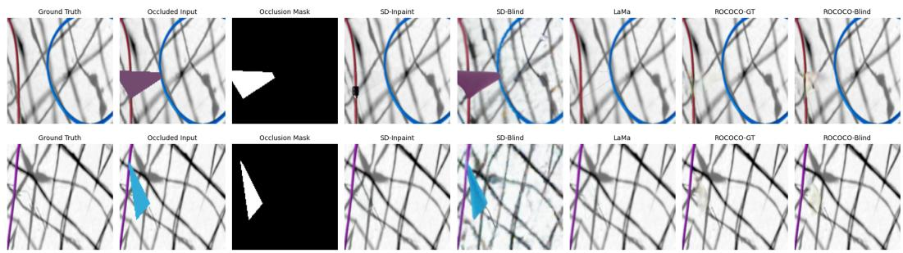  
Figure 1: Qualitative comparison on the wire dataset for all baselines. Columns show: Ground Truth, Occluded Input, Occlusion Mask, SD-Inpaint, SD-Blind, LaMa, ROCOCO-GT, ROCOCO-Blind.

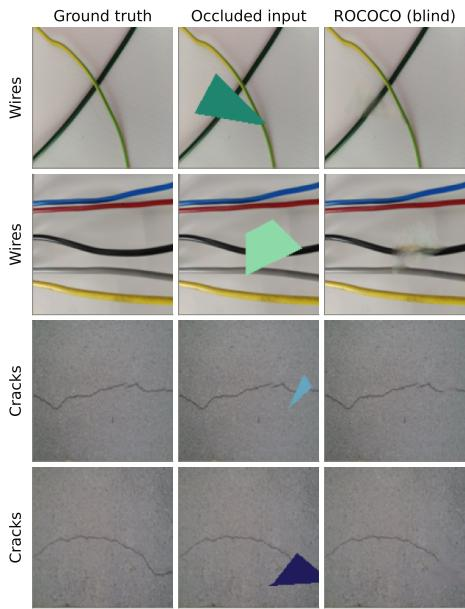  
Figure 2: Blind completions on held-out images from both datasets: the model receives only the occluded input, and must localize the occluder and reconstruct the curvilinear structure behind it without being told where it is.

Both datasets are handled by the same pipeline with no architectural change. The mask predictor localizes the occluder accurately in each case, getting IoU 0.944 on wires and 0.939 on cracks at the operating threshold, so the blind pipeline retains almost all of the accuracy of the mask-supervised one. Performance is comparable across the two domains despite their very difference appearance: wires are high-contrast cables against smooth backdrops, while cracks are thin, low-contrast fractures in textured concrete and asphalt. The crack images are also harder in a specific way: their backgrounds are close to uniform, so more of the reconstruction error is concentrated in the fine texture the model cannot predict, which is reflected in the lower SSIM.

To confirm that these numbers reflect genuine completion rather than an easy task, we compare against two trivial references. Leaving the occluder in place scores 0.565 ML1L on wires and 0.577 on cracks; filling the occluded region with the mean color of the visible image scores 0.292 and 0.217. ROCOCO reaches 0.167 and 0.193, so it improves substantially on both, and the margin is largest on wires, where there is real structure to recover.

## 5.3.3 Comparison with Inpainting Baselines

We evaluate ROCOCO against off-the-shelf inpainting methods on the held-out wire split. For methods that require an explicit occlusion mask we provide the ground truth; for blind variants none is supplied. SD-Inpaint uses the stable-diffusion-v1-5 inpainting checkpoint via DIFFUSERS:

Table 3: Comparison against off-the-shelf inpainting on the held-out wire split (62 images). “Mask” indicates whether the method is given the ground-truth occlusion mask; ROCOCO’s blind rows estimate it from the observation alone. Subscript M denotes the occluded region.
<table><tr><td>Method</td><td>Mask</td><td>Params</td><td>MSE↓</td><td> ${ \bf M L 1 L } \downarrow$ </td><td> ${ \bf M S E } _ { M }$  →</td><td> $\mathbf { M L } 1 \mathbf { L } _ { M }$  →</td><td> $\mathrm { S S I M } _ { M } \uparrow$ </td></tr><tr><td>SD-Blind</td><td>no</td><td>860M</td><td>0.0474</td><td>0.1407</td><td>0.4416</td><td>0.5411</td><td>0.258</td></tr><tr><td>SD-Inpaint</td><td>GT</td><td>860M</td><td>0.0041</td><td>0.0199</td><td>0.0895</td><td>0.1923</td><td>0.634</td></tr><tr><td>LaMa</td><td>GT</td><td>51M</td><td>0.0037</td><td>0.0297</td><td>0.0560</td><td>0.1468</td><td>0.695</td></tr><tr><td>ROCOCO</td><td>GT</td><td>7.7M</td><td>0.0032</td><td>0.0073</td><td>0.0782</td><td>0.1955</td><td>0.596</td></tr><tr><td>ROCOCO (n=8)</td><td>GT</td><td>7.7M</td><td>0.0022</td><td>0.0060</td><td>0.0540</td><td>0.1615</td><td>0.664</td></tr><tr><td>ROCOCO</td><td>no</td><td>7.7M</td><td>0.0035</td><td>0.0078</td><td>0.0831</td><td>0.2012</td><td>0.586</td></tr><tr><td> $\mathsf { R O C O C O } \left( n { = } 8 \right)$ </td><td>no</td><td>7.7M</td><td>0.0024</td><td>0.0064</td><td>0.0576</td><td>0.1670</td><td>0.655</td></tr></table>

the $1 2 8 \times 1 2 8$ occluded image and mask are upsampled to $5 1 2 \times 5 1 2$ , the mask dilated by 3 pixels, with the prompt “wire(s) on aflat background”, 30 denoising steps and guidance 7.5; the output is composited with the observation and downsampled back. SD-Blind uses the standard checkpoint through the image-to-image pipeline with no mask and a prompt instructing it to remove the occluder, testing whether a general-purpose prior can localize and repair an occlusion unaided. LaMa [15] is the big-lama checkpoint, run at $2 5 6 \times 2 5 6$ with a 3-pixel dilated mask and composited back. ROCOCO uses $T = 5$ integration steps, reported both with a single sample and averaged over $n = 8 ,$ as suggested earlier (§5.4). See Table 3 for quantitative and Figure 1 for qualitative comparison.

When no occlusion mask is available ROCOCO is the strongest method by a wide margin. The only other mask-free method, SD-Blind, reaches 0.541 ML1LM against ROCOCO’s 0.167 — a factor of 3.2 — and 0.258 SSIM against 0.655. A general-purpose image-to-image prior cannot reliably localize a geometric occluder and repair the structure behind it, whereas our lightweight two-stage pipeline can. This is the setting that matters for the motivating application, since an occluder is not annotated at test time.

When a mask is available ROCOCO remains competitive with dedicated mask-supervised inpainting at a fraction of the size. It obtains the best full-image MSE (0.0022 against LaMa’s 0.0037), the best full-image ML1L (0.0060 against 0.0297) and the best masked MSE (0.0540 against 0.0560), and is second to LaMa on masked ML1L (0.1615 against 0.1468) and SSIM (0.664 against 0.695), while comfortably clears SD-Inpaint on every metric. It does so with a 7.7M-parameter completer, against 51M for LaMa and an 860M UNet for Stable Diffusion (i.e., roughly a seventh and a hundredth of the parameters respectively). LaMa retains an advantage in fine detail inside the occlusion, which is consistent with its much larger capacity and effective receptive field, but it cannot operate without a mask at all.

Notably, moving from the ground-truth mask to the predicted one costs very little: $\mathbf { M L } 1 \mathbf { L } _ { M }$ rises only from 0.1615 to 0.1670 (3.4% relative), because the mask predictor is accurate (IoU 0.944 at the operating threshold). The privileged information the other mask-supervised methods depend on is, for our pipeline, almost free to recover.

## 5.4 Robustness and Inference Cost

Occluder size. We regenerate the evaluation set with the occluder radius swept from 6% to 35% of image width, giving occluded areas from 0.8% to 10.3% (Figure 3). Completion degrades monotonically as the gap widens, as expected, with ML1L $M$ rising from 0.191 to 0.253 and SSIM $M$ falling from 0.677 to 0.533 across the range, which is a graceful degradation rather than a collapse, even when the occluder hides a tenth of the image.

Integration steps and sample averaging. Sampling cost is linear in the number of Euler steps $T .$ We find that quality peaks at $T \approx 2$ and then degrades slowly: ${ \mathrm { M L } } 1 { \mathrm { L } } _ { M }$ rises from 0.188 at $T = 2$ to 0.210 at $T = 5 0$ and 0.211 at $T = 1 0 0 ( \mathrm { F i g u r e } \bar { 4 } )$ . With a linear probability path the velocity field is close to constant along the trajectory, so a coarse integrator suffices and further steps mostly simply compound the model’s own error. Because the completer is generative, averaging n independent completions seem to be a more productive use of the same budget: at $T = 5 , \mathbf { \bar { M L 1 L } } _ { M }$ falls from 0.206 at $n = 1$ to 0.171 at $n = 8$ and 0.168 at $n = 1 6 ,$ , so the return has largely saturated by $n = 8$ We therefore use $T = 5$ and $n = 8 ,$ , which costs 40 network evaluations of a $7 . 7 \mathbf { M } { } \cdot$ -parameter model.

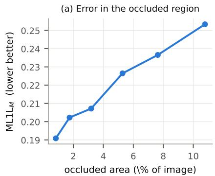

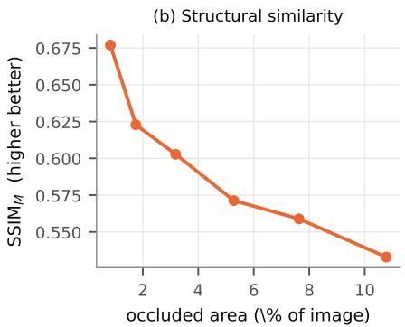  
Figure 3: Completion quality against occluder size on the held-out wire split. Degradation is graceful: the occluded-region error rises by about a third as the occluded area grows more than tenfold.

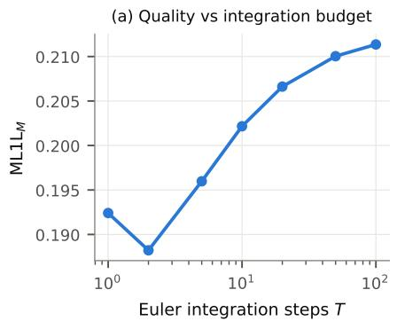

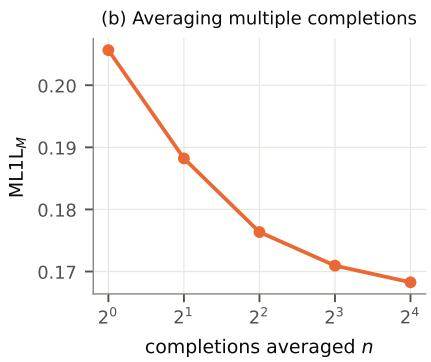  
Figure 4: Inference budget. Quality peaks at $T \approx 2$ integration steps rather than the tens typically used for iterative samplers, and averaging independent completions is a more productive use of the same compute.

## 6 Conclusion

ROCOCO presents an efficient method for the completion of occluded curvilinear objects. A comparison against a one-shot UNet demonstrates that a flow-matching formulation provides substantial benefits in prediction quality; ablating the mask information shows that supervising the occluded region specifically improves reconstruction of the curve rather than merely the background. By pairing the completer with a mask predictor, we obtain that supervision without privileged information about the occluded region, which the mask-supervised baselines cannot do. We validate our method both on programmatic spline-image data and on realistic curve images from large public datasets.

Against off-the-shelf inpainting the picture is consistent: with no occlusion mask ROCOCO is far stronger than the only comparable alternative, and with one it remains competitive with dedicated inpainting models, achieving best on full-image error and second on the occluded region, while using roughly a seventh of LaMa’s parameters and a hundredth of Stable Diffusion’s. Moving from a ground-truth mask to a predicted one costs only a few percent.

Limitations and future work. At this stage, the selection of particular hyperparameters, randomization ranges, and thresholds has not been explored exhaustively. The same can be said for the distribution of data scenarios, such as multiple curves, intersections, and greater variability in occlusions. Future work may want to explore variability in color across a curved object (such as that produced by shadows), or apply this method in conjunction with curve tracing techniques that benefit from unoccluded features to produce complete traces. Overall we believe our method provides a lightweight yet effective way to account for occlusion in the perception of curvilinear objects, and look forward to the benefits it offers in relevant downstream tasks.

## References

[1] Rabih Amhaz, Sylvie Chambon, Jérôme Idier, and Vincent Baltazart. Automatic crack detection on two-dimensional pavement images: An algorithm based on minimal path selection. IEEE Transactions on Intelligent Transportation Systems, 17(10):2718–2729, 2016.

[2] Osher Azulay, Kavish Kondap, Jaimyn Drake, Shuangyu Xie, Hui Li, Sachin Chitta, and Ken Goldberg. Motorcycle 1.0: Automating bimanual cable routing around fixtures on the nist task board. In 2025 IEEE 21st International Conference on Automation Science and Engineering (CASE), pages 2636–2641. IEEE, 2025.

[3] Limeng Cui, Zhiquan Qi, Zhensong Chen, Fan Meng, and Yong Shi. Pavement distress detection using random decision forests. In International Conference on Data Science, pages 95–102. Springer, 2015.

[4] Markus Eisenbach, Ronny Stricker, Daniel Seichter, Karl Amende, Klaus Debes, Maximilian Sesselmann, Dirk Ebersbach, Ulrike Stoeckert, and Horst-Michael Gross. How to get pavement distress detection ready for deep learning? a systematic approach. In International Joint Conference on Neural Networks (IJCNN), pages 2039–2047, 2017.

[5] Ian J Goodfellow, Jean Pouget-Abadie, Mehdi Mirza, Bing Xu, David Warde-Farley, Sherjil Ozair, Aaron Courville, and Yoshua Bengio. Generative adversarial nets. Advances in neural information processing systems, 27, 2014.

[6] Jonathan Ho, Ajay Jain, and Pieter Abbeel. Denoising diffusion probabilistic models. Advances in neural information processing systems, 33:6840–6851, 2020.

[7] Alexander Kirillov, Eric Mintun, Nikhila Ravi, Hanzi Mao, Chloe Rolland, Laura Gustafson, Tete Xiao, Spencer Whitehead, Alexander C Berg, Wan-Yen Lo, et al. Segment anything. In Proceedings of the IEEE/CVF international conference on computer vision, pages 4015–4026, 2023.

[8] Yaron Lipman, Ricky TQ Chen, Heli Ben-Hamu, Maximilian Nickel, and Matt Le. Flow matching for generative modeling. arXiv preprint arXiv:2210.02747, 2022.

[9] Yahui Liu, Jian Yao, Xiaohu Lu, Renping Xie, and Li Li. Deepcrack: A deep hierarchical feature learning architecture for crack segmentation. Neurocomputing, 338:139–153, 2019.

[10] Andreas Lugmayr, Martin Danelljan, Andres Romero, Fisher Yu, Radu Timofte, and Luc Van Gool. Repaint: Inpainting using denoising diffusion probabilistic models. In Proceedings ofthe IEEE/CVF conference on computer vision and pattern recognition, pages 11461–11471, 2022.

[11] Ege Ozguroglu, Ruoshi Liu, Dídac Surís, Dian Chen, Achal Dave, Pavel Tokmakov, and Carl Vondrick. pix2gestalt: Amodal segmentation by synthesizing wholes. In 2024 IEEE/CVF Conference on Computer Vision and Pattern Recognition (CVPR), pages 3931–3940. IEEE Computer Society, 2024.

[12] Robin Rombach, Andreas Blattmann, Dominik Lorenz, Patrick Esser, and Björn Ommer. Highresolution image synthesis with latent diffusion models. In Proceedings of the IEEE/CVF conference on computer vision and pattern recognition, pages 10684–10695, 2022.

[13] Yong Shi, Limeng Cui, Zhiquan Qi, Fan Meng, and Zhensong Chen. Automatic road crack detection using random structured forests. IEEE Transactions on Intelligent Transportation Systems, 17(12):3434–3445, 2016.

[14] Alvy Ray Smith. Tint fill. In Proceedings of the 6th annual conference on Computer graphics and interactive techniques, pages 276–283, 1979.

[15] Roman Suvorov, Elizaveta Logacheva, Anton Mashikhin, Anastasia Remizova, Arsenii Ashukha, Aleksei Silvestrov, Naejin Kong, Harshith Goka, Kiwoong Park, and Victor Lempitsky. Resolution-robust large mask inpainting with fourier convolutions, 2021.

[16] Vainavi Viswanath, Kaushik Shivakumar, Mallika Parulekar, Jainil Ajmera, Justin Kerr, Jeffrey Ichnowski, Richard Cheng, Thomas Kollar, and Ken Goldberg. Handloom: Learned tracing of one-dimensional objects for inspection and manipulation. In Conference on Robot Learning, pages 341–357. PMLR, 2023.

[17] Fan Yang, Lei Zhang, Sijia Yu, Danil Prokhorov, Xue Mei, and Haibin Ling. Feature pyramid and hierarchical boosting network for pavement crack detection. arXiv preprint arXiv:1901.06340, 2019.

[18] Liang Yang, Bing Li, Wei Li, Zhaoming Liu, Guoyong Yang, and Jizhong Xiao. Deep concrete inspection using unmanned aerial vehicle towards cssc database. In Proceedings ofthe IEEE/RSJ international conference on intelligent robots and systems, pages 24–28, 2017.

[19] Liang Yang, Bing Li, Wei Li, Zhaoming Liu, Guoyong Yang, and Jizhong Xiao. A robotic system towards concrete structure spalling and crack database. In 2017 IEEE International Conference on Robotics and Biomimetics (ROBIO), pages 1276–1281. IEEE, 2017.

[20] Justin Yu, Nidhya Shivakumar, Veena Sumedh, Josh Zhang, Ethan Ransing, Osher Azulay, and Ken Goldberg. Handloom 3.0: Interactive bi-directional cable tracing amid clutter.

[21] Riccardo Zanella, Alessio Caporali, Kalyan Tadaka, Daniele De Gregorio, and Gianluca Palli. Auto-generated wires dataset for semantic segmentation with domain-independence. In 2021 International Conference on Computer, Control and Robotics (ICCCR), pages 292–298. IEEE, 2021.

[22] Lei Zhang, Fan Yang, Yimin Daniel Zhang, and Ying Julie Zhu. Road crack detection using deep convolutional neural network. In Image Processing (ICIP), 2016 IEEE International Conference on, pages 3708–3712. IEEE, 2016.

[23] Qin Zou, Yu Cao, Qingquan Li, Qingzhou Mao, and Song Wang. Cracktree: Automatic crack detection from pavement images. Pattern Recognition Letters, 33(3):227–238, 2012.

## Appendix Additional Figures

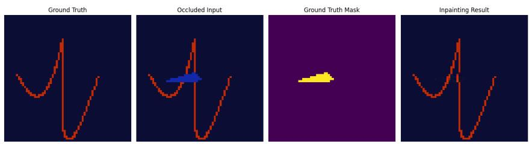  
Figure 5: Example Generation Result: Inpainting with Ground Truth Mask

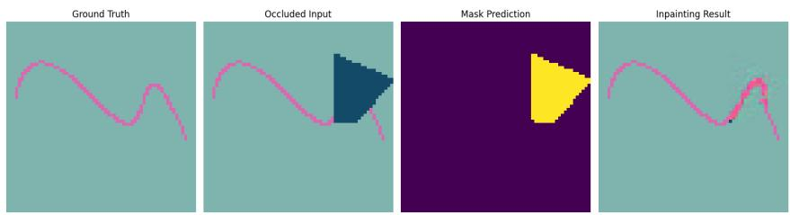  
Figure 6: Example Generation Result: Inpainting with Mask Prediction

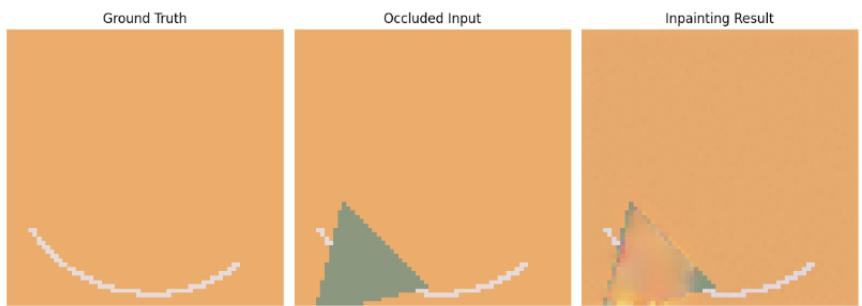  
Figure 7: Example Generation Result: Pure Flow Model

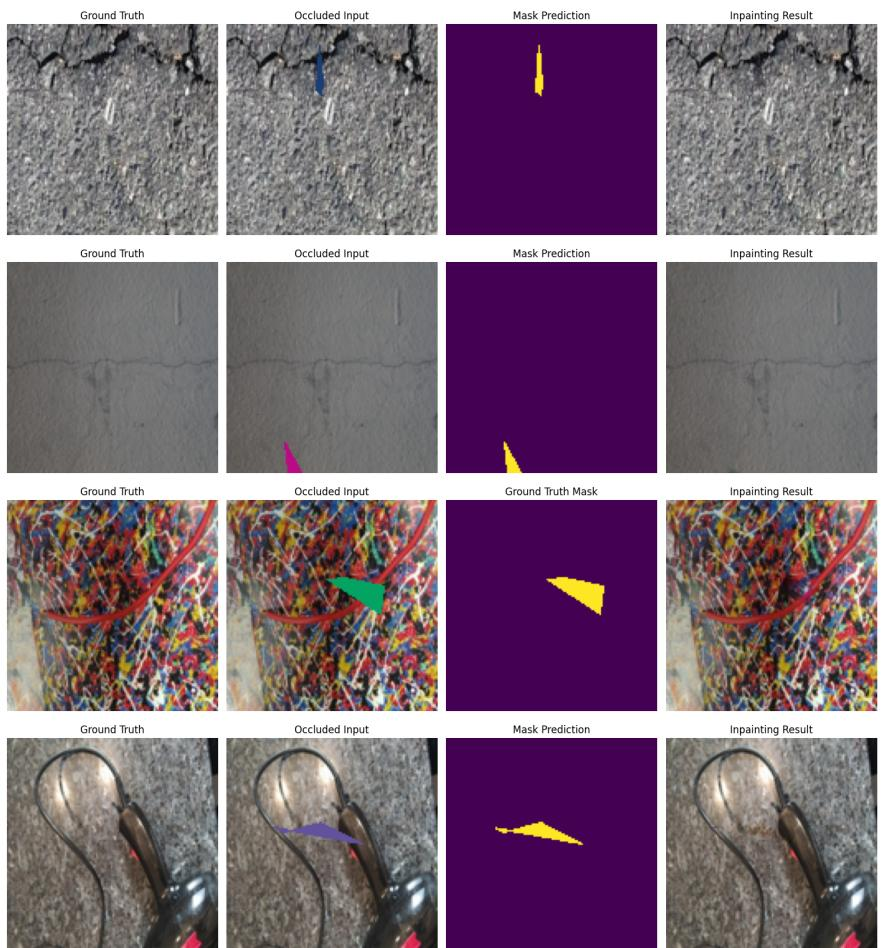  
Figure 8: Example Generations: ROCOCO on cracks and wires

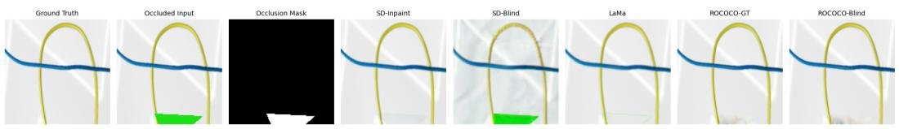  
Figure 9: Example Baseline Comparison Result on the Wires Dataset

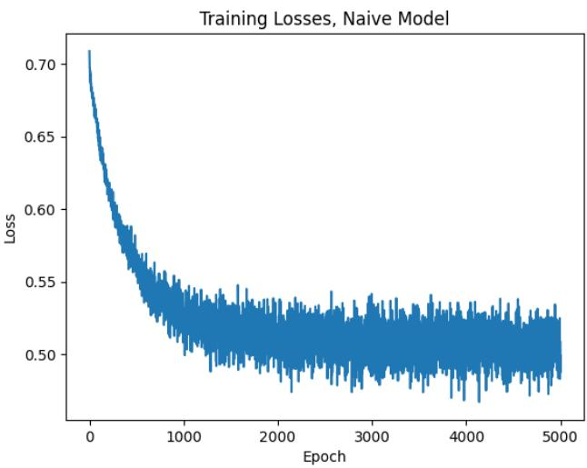

Figure 10: Training Losses, Naive UNet  
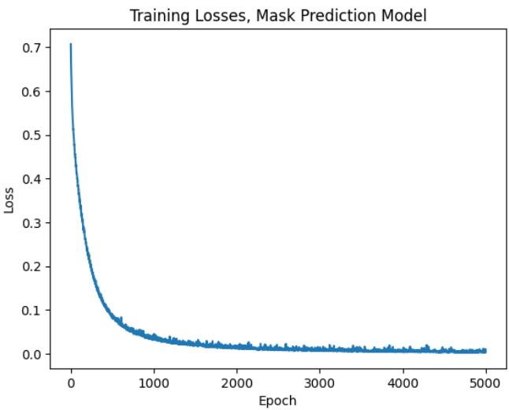

Figure 11: Training Losses, Mask Prediction Model  
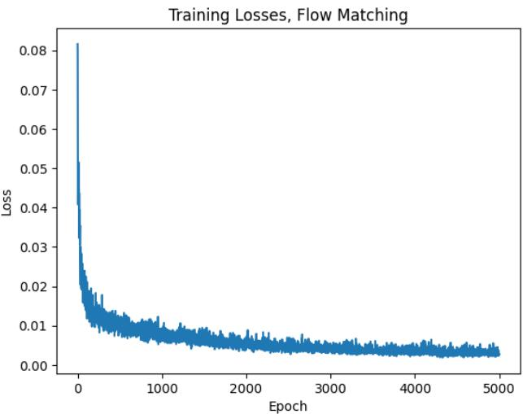  
Figure 12: Training Losses, Flow Matching Inpainting Model